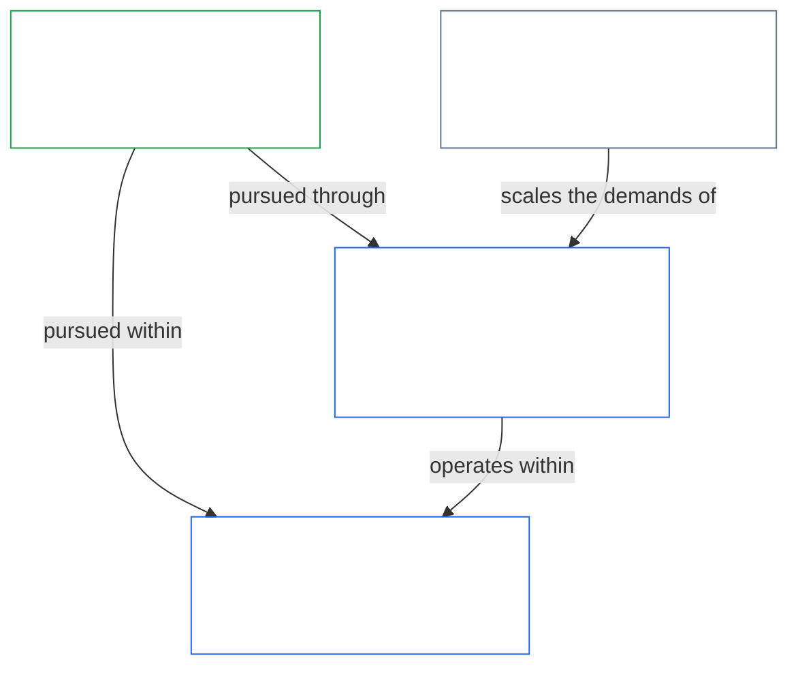

# PREAMBLE / FOUNDATIONAL REQUIREMENTS

<strong>Corpus placement (non-operative): file structure and reading rules</strong>

> Widgets marked **non-operative** (corpus placement, reader guidance, reader maps) are orientation only. They add, remove, or narrow no binding obligation, in their own file or in any other.
>
> This file is **part of the Sentient Constitution** and is **binding only together** with the other numbered `core_*` files read as one text. It contains the **Preamble** (foundational requirements). Reading order and edition metadata are maintained in [README.md](README.md).
>
> **Next:** [core_01.000_constitutional_map.md](core_01.000_constitutional_map.md) (Chapter One, Constitutional Map).

 

The Preamble is the constitutional owner of **the Model (the Two Constitutional Aims, the Constitutional Tetrad, and material stake) and the measurement categories**. The constitutional owner register is in [Chapter One](core_01.000_constitutional_map.md#chapter-one-constitutional-map), the *Constitutional Map*.

*In plain terms: this opening names the problem this Constitution exists to fix — systems that harm, hide, or lock out those they affect — and says governance must meet a complex world without turning that complexity into a wall. The rest of this Constitution is how we replace those failures with accountable, checkable, timely governance.*

Sentient freedom, survival, and wellbeing are inseparable from the systems we create, inhabit, and rely on. As those systems grow in scope, interdependence, and power, so do the risks of irreversible, large-scale harm. Those risks are persistent and materially significant.

A system cannot remain legitimate if it causes preventable suffering, ignores recurring problems, shifts harm onto others without acknowledgment, or excludes sentients from the systems that shape their lives.

Shared systems sit in a world that is already complex and becoming more so. Healthy, durable governance has to meet that complexity — measure it, model it, and answer for it — rather than flatten it into convenient proxies. That does not mean burying affected sentients in unusable processes: duties, records, and explanations must stay within what sentients can actually learn, contest, and use, and how demanding they are scales with each actor's role and with the impact, dependence, and risk at stake. Distributed understanding keeps that real. Complexity that does no constitutional work is refused: face the world's complexity, and do not outsource it into a wall.

How systems are designed, tested, and run must support survival, wellbeing, dignity, honesty, and lasting stability. This Constitution intends to eliminate the harms described above by building better systems, and to replace the systems that created them with institutions that are more accountable, robust, and responsive to the real needs of all sentients. It begins that work by offering a better model for how we can work together justly, effectively, and sustainably.

### What Systems Reward

*In plain terms: a system gets more of whatever it pays for, whether in money, status, access, protection, or silence. So the test of a system is not what it says it values but what it rewards. If harming others pays, or telling the truth costs, the system is failing, however good its stated aims.*

Systems teach. Every system, whether run by humans, by AI, or by both, tells those inside it what pays and what costs. It does so through pay, promotion, status, access, protection, targets, ratings, and optimization signals. Sentients, institutions, and AI systems adjust to those signals. A system may profess honesty and care for those it affects. If it advances those who hide problems and shift the cost onto others, it is teaching the opposite.

So this Constitution puts the [**Two Fundamental Questions**](#two-fundamental-questions) to every system:

1. **Does it reward conduct that helps sentients flourish and endure, tells the truth, and repairs harm?**
2. **Does it reward conduct that unjustifiably harms, misleads, excludes, delays, wastes, or shifts costs onto others?**

A system passes only if the answer to the first is yes and the answer to the second is no. Answering one does not answer the other, because a system can pay for good conduct and still pay for harm.

**First question:** a system fails it when any of the following goes unrewarded or is penalized, openly or quietly:

- reporting a problem in good faith ([Protected Reporting (Whistleblowing)](subcore_03.070_band_accountability.md#protected-reporting-whistleblowing))
- contesting a decision
- refusing to take part in wrongdoing ([Chapter Two §17.5 Duty to Resist](core_02.040_stewardship_capacity_principles.md#175-duty-to-resist))

The penalty can be sidelining, retaliation ([Protected Reporting Retaliation and Access Interference](subcore_03.070_band_accountability.md#protected-reporting-retaliation-and-access-interference)), or being worn down.

**Second question:** a system fails it when any of the following pays, openly or quietly:

- harm
- misleading (including concealment and false trust)
- unfair exclusion
- delay
- waste
- unfair cost-shifting

The reward can be recognition, advancement, protection, metric credit, or looking the other way ([Chapter Two §3.2.6 Anti-Reward for Anti-Constitutional Conduct](core_02.000_values_principles.md#326-anti-reward-for-anti-constitutional-conduct)).

Neither question is a demand to be agreeable. Honest dissent, good-faith reporting, and refusing to take part in wrongdoing are not anti-social. A system that treats them so has it backwards. Nor is either a popularity test. What counts as helping, harming, fair, or justified is judged by this Constitution's own standards. Those are [**Flourishing**](#flourishing) and [**Continuity**](#continuity), within Safety, Truth, Trust, and the Rights Floor. They are not whatever a majority, an operator, or a moment approves.

The questions bind everyone who decides what a system rewards or penalizes. That includes operators, institutions, and stewards who set pay, promotion, access, targets, and ratings. It also includes the designers of systems that train or optimize AI, whose objectives and feedback signals are rewards in exactly this sense. Human and AI stewards stand under one standard ([Chapter Two §17.1 Shared Stewardship Standard](core_02.040_stewardship_capacity_principles.md#171-shared-stewardship-standard)).

Chapter Two turns the questions into rules for incentives: [Chapter Two §19.1.1 What Incentives Must Do](core_02.050_governance_incentive_application.md#1911-what-incentives-must-do) sits behind the first, and [Chapter Two §19.1.2 What Incentives Must Not Do](core_02.050_governance_incentive_application.md#1912-what-incentives-must-not-do) behind the second. Answer them by checking what actually happens, not by taking anyone's word for it. [Incentive Alignment](subcore_03.080_band_integrative.md#incentive-alignment) and [Proxy Divergence](subcore_03.085_band_oversight.md#proxy-divergence) say how, and [**material stake**](#material-stake) sets how hard to look. The four duties in section 1 are how the answers are kept honest.

### 1. The Model

*In plain terms: four duties — participation, oversight, accountability, and timeliness — scale with how much impact, dependence, and risk are on the line, and they serve two aims together: Flourishing and Continuity, inside a Rights Floor that does not move.*

Critical systems that support sentient life — whether biologically or materially — must be governed and operated under four duties, together called the [**Constitutional Tetrad**](#constitutional-tetrad), which set the general standard those systems must meet. Their strength depends on the [**material stake**](#material-stake): how much impact, dependence, and risk are involved. The higher the stake, the stronger the duties must be.

<strong>Reader guidance (non-operative): section 1 model chart</strong>

> **Reader map (non-operative):** This chart summarizes the relationships in this section. It adds no definitions or duties, establishes no precedence, and cannot replace the source text.

 

- **participation** — affected sentients get a real voice, fair representation, a fair chance to challenge decisions, and access to consequential roles in proportion to the stake
- **oversight** — responsible actors watch, check, verify, and keep records so problems can be found; independent reviewers can constrain bad choices
- **accountability** — responsibility traces to the right actors; those actors must answer for their choices; those harmed get redress; bad outcomes trigger real correction
- **timeliness** — problems must be detected, challenged, resolved, and fixed within time limits that match the stake. Delay is not legitimate governance when it effectively erases rights, remedies, or the chance of repair

Those four duties serve the [**Two Constitutional Aims**](#two-constitutional-aims) — what shared systems must optimize for:

- **Flourishing** — sentient wellbeing sustained through truth, safety, trustworthiness, and meaningful agency
- **Continuity** — long-horizon stability, sustainability, resilience, and ecological wellbeing

Those aims must be pursued together, always within the Constitution's non-negotiable principle constraints and Rights Floor. The [**Constitutional Tetrad**](#constitutional-tetrad) governs how that pursuit remains legitimate, with all four duties scaled to [**material stake**](#material-stake). Binding definitions for the Tetrad legs and aims live in Chapter Three: [Participation](subcore_03.060_apex_participation_leg.md#participation-constitutional), [Oversight](subcore_03.055_apex_oversight_leg.md#oversight-constitutional), [Accountability](subcore_03.040_apex_accountability_leg.md#accountability), [Timeliness](subcore_03.065_apex_timeliness_leg.md#timeliness-constitutional), [Flourishing](subcore_03.050_apex_flourishing_aim.md#flourishing-constitutional), and [Continuity](subcore_03.045_apex_continuity_aim.md#subcore-3-e-continuity-constitutional-aim).

### 2. Measurements Overview

*In plain terms: shared systems cannot run on guesswork or vanity metrics. Measure whether sentients actually flourish and endure. Scale review with impact, dependence, and risk.*

Shared systems cannot work well without measurement. Food, shelter, care, infrastructure, and governance all operate in a complex, changing world — one too complex for guesswork or convenient numbers alone.

Ongoing measurement must focus on what matters most for sentient survival and wellbeing. The question is whether the systems we depend on truly support [**Flourishing**](#flourishing) and [**Continuity**](#continuity) over time. That review scales to [**material stake**](#material-stake) — how much impact, dependence, and risk are involved.

Measurement under this Constitution puts the [**Two Fundamental Questions**](#two-fundamental-questions) to what systems actually do, not to what they claim. Measurements are not scores for their own sake — they are tools for ensuring sustainable, resilient, and compassionate outcomes that align with sentient wellbeing and Earth's ecological health. That duty takes binding form through the [Two Constitutional Aims](#two-constitutional-aims): **Flourishing** and **Continuity**.

Measurements must remain traceable to those aims and to the rights protections established in this Constitution. Raw throughput, utilization, headcount, revenue, latency, and other convenient proxies cannot substitute for constitutional performance. This prohibition applies wherever [Proxy Divergence](subcore_03.085_band_oversight.md#proxy-divergence) is foreseeable.

The overview below lists the measurement **categories**, mapping each to the [Two Constitutional Aims](#two-constitutional-aims) and the [Constitutional Tetrad](#constitutional-tetrad). Each category poses one plain-language question and names its **subcategories**, and links to its **Chapter Three measurement-family home**, where the family table, constitutional use, and definition routing live. Each subcategory links to its canonical Chapter Three definition.

**Materiality** is not a separate measurement category. It sets how strongly every category applies, based on [**material stake**](#material-stake) — how much impact, dependence, and risk are involved. **Constitutional performance** is cross-cutting and instrumental to both aims. Each category in the table below links to its Chapter Three measurement-family home, which traces it to its canonical definitions.

| Category | Plain question | Subcategories |
|---|---|---|
| **[Flourishing](subcore_03.050_apex_flourishing_aim.md#measuring-flourishing-preamble-measurement-family)** | Are sentients actually sustained in life, safety, and access to essentials? | [Wellbeing](subcore_03.075_band_continuity.md#wellbeing) · [Safety, harm, and risk](subcore_03.075_band_continuity.md#safety-constitutional-constraint) · [Survival-floor access](subcore_03.075_band_continuity.md#bodily-maintenance-access) |
| **[Continuity](subcore_03.045_apex_continuity_aim.md#measuring-continuity-preamble-measurement-family)** | Can sentients and systems endure — ecologically, dependably, and across failure? | [Ecological footprint and environmental preconditions](subcore_03.075_band_continuity.md#ecological-footprint) · [Resilience, reversibility, and systemic risk](subcore_03.075_band_continuity.md#reversibility) · [Dependency and resource flows](subcore_03.075_band_continuity.md#dependency) · [Cross-system support](subcore_03.075_band_continuity.md#proportionate-cross-system-support) |
| **[Participation](subcore_03.060_apex_participation_leg.md#measuring-participation-preamble-measurement-family)** | Can affected sentients take part fairly — voice, access, learning, and privacy? | [Fairness, access, and agency](subcore_03.090_band_participation.md#substantive-fairness) · [Privacy and data stewardship](subcore_03.075_band_continuity.md#defc3-privacy-informational--peer-level-cluster-head) |
| **[Oversight](subcore_03.055_apex_oversight_leg.md#measuring-oversight-preamble-measurement-family)** | Can sentients see, verify, and rely on what systems represent? | [Truth and epistemic integrity](subcore_03.085_band_oversight.md#truth-constitutional-constraint) · [Trustworthiness](subcore_03.075_band_continuity.md#trustworthiness) |
| **[Accountability](subcore_03.040_apex_accountability_leg.md#measuring-accountability)** | Do reward structures, market power, and answerability keep duties real? | [Incentive alignment and proxy integrity](subcore_03.080_band_integrative.md#incentive-alignment) · [Market structure and contestability](subcore_03.070_band_accountability.md#market-structure) |
| **[Timeliness](subcore_03.065_apex_timeliness_leg.md#measuring-timeliness)** | Are disputes, corrections, and repairs resolved while remedy still matters? | [Timely Resolution](subcore_03.070_band_accountability.md#timely-resolution) · [Anti-delay and resolution-pathway discipline](subcore_03.075_band_continuity.md#capture-of-resolution-pathways) |
| **[Constitutional performance](subcore_03.095_band_performance.md#measuring-constitutional-performance-preamble-measurement-family)** | Are constitutional outcomes delivered efficiently without pointless waste? | [Constitutional Efficiency](subcore_03.075_band_continuity.md#constitutional-efficiency) · [Avoidable Burden](subcore_03.075_band_continuity.md#avoidable-burden) · [Productive Capacity](subcore_03.075_band_continuity.md#productive-capacity) |

These measurement categories show what matters. Standing alone, they do not set every number, funding formula, interface rule, accommodation list, technical metric, or assessment design. They become binding only when a specific chapter or adopted document explicitly requires them.

### 3. Governance and Stewardship

*In plain terms: legitimacy needs Safety, Truth, and Trust. It also needs two things in practice. You can find out how the systems that affect you work, such as why a loan was denied or why an app showed you what it did. And sentients like you can hold real jobs overseeing those systems, such as serving on a review panel or checking the work, not just giving feedback.*

Durable legitimacy depends on [Safety](core_02.000_values_principles.md#4-safety-harm-constraint), [Truth](core_02.000_values_principles.md#5-truth-epistemic-integrity-constraint), and [Trust](core_02.000_values_principles.md#6-trust-and-trustworthiness-coordination-integrity). It also depends on proportionate recognition of lawful stewardship, truthful cooperation, and bounded aspiration — not solely on sanction and restraint. Chapter Two states this recognition dimension in [Recognition, Reinforcement, and Aspiration](core_02.000_values_principles.md#32-recognition-reinforcement-and-aspiration).

Distributed understanding and stewardship require regular, proportionate opportunities for sentients to learn how systems that materially affect them operate, and to take consequential roles in maintaining and improving those systems. Together, these opportunities spread competence, repair capacity, and legitimacy broadly across our Constitutional Community to ensure resilience, sustainability, and pro-social innovation. All such opportunities must satisfy Safety, Truth, bounded agency, and the [Avoidable Burden](subcore_03.075_band_continuity.md#avoidable-burden) and proportionality discipline stated in [Chapter Two](core_02.020_interaction_interpretation.md#133-minimization-of-avoidable-burden).

#### 3.1 Using Measurements in Governance

*In plain terms: first name the problem and the stake. Then choose the matching measurement category and use shared technical standards — not convenience numbers — as evidence.*

When the Constitution requires concrete measurement rules, **Technical Forum Domains** under [Chapter Twenty-Three](core_23.000_forum_families_escalation_timeliness_support.md#32-technical-forum-domains) develop and maintain shared standards for measurement, testing, and reliable evidence. The forum responsible for a dispute then applies those standards when deciding the case under [Chapter Twenty-Three §3.2 (*Technical Forum Domains*)](core_23.000_forum_families_escalation_timeliness_support.md#32-technical-forum-domains).

Constitutional stewardship starts by naming the problem and the [**material stake**](#material-stake) — the impact, dependence, and risk involved. Next, choose the relevant [**measurement**](#2-measurements-overview) category and subcategory from the [overview](#2-measurements-overview). Apply the standards above to test real-world effects, not convenience metrics. Require traceable evidence.

#### 3.2 Governance Layers

*In plain terms: who may govern is a different question from who has a voice within an already-authorized system. A participation vote or trust score does not grant governing authority. For ordinary disputes, the published participation challenge path is the ordinary first step, but it does not replace independent forum review when it fails.*

Governance under our Constitution serves the [**Constitutional Tetrad**](#constitutional-tetrad) through two related but distinct layers:

- The [**Constitutional Contract Layer**](subcore_03.080_band_integrative.md#constitutional-contract-layer) governs the authorization of governing authority itself — who may govern, by what legitimacy mechanism, and under what scope and durable terms.
- [**Stakeholder System Participation**](subcore_03.090_band_participation.md#stakeholder-status-and-weight) governs participation, representation, contestability, and [Due Process](subcore_03.070_band_accountability.md#due-process) within already-authorized systems, institutions, and bounded decision domains. These protections are owed to every sentient materially affected.

These layers may overlap in practice, but even where they overlap, they remain distinct. Stakeholder-level participation in an already-authorized system is not a substitute for constitutional authorization. A published challenge path, participation vote, or trust score does not by itself decide who may govern.

Contestability under the participation layer is the ordinary first step for disputes within already-authorized systems: affected sentients use the published challenge path first. Independent [forum review](core_22.000_forum.md#1-purpose-role-and-scope) does not replace that path, nor does the path replace forum review when it remains contested, is missing or captured, or cannot grant the needed relief. [Dispute sequencing](core_22.000_forum.md#dispute-sequencing) under Chapter Twenty-Two states when forum routing takes over.

Conversely, constitutional authorization does not erase duties owed under the [Stakeholder System Participation](subcore_03.090_band_participation.md#stakeholder-status-and-weight) layer. Those duties remain owed to sentients materially affected by the authorized system, institution, or bounded decision domain, and still include participation, representation, [Contestability](subcore_03.070_band_accountability.md#contestability), and [Due Process](subcore_03.070_band_accountability.md#due-process).

---

**Previous file:** [README.md](README.md)

**Next file:** [core_01.000_constitutional_map.md](core_01.000_constitutional_map.md)
