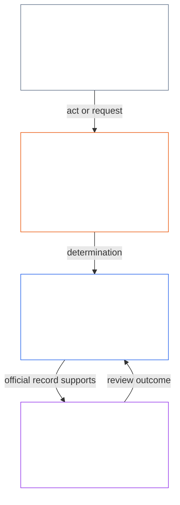
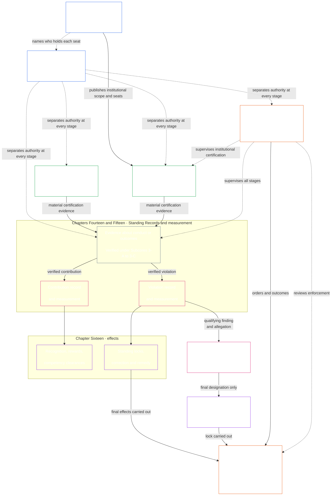

# CHAPTER ONE: CONSTITUTIONAL MAP

<strong>Corpus placement (non-operative): file structure and reading rules</strong>

> Widgets marked **non-operative** (corpus placement, reader guidance, reader maps) are orientation only. They add, remove, or narrow no binding obligation, in their own file or in any other.
>
> This file is **part of the Sentient Constitution** and is **binding only together** with the other numbered `core_*` files and the subcore, read as one text. It contains **Chapter One**, the *Constitutional Map*: its purpose (§1), why it exists (§2), how its files fit together (§3), foundations for later chapters (§4), the key governance processes (§5), and the constitutional owner register (§6 to §11).
>
> **Upstream:** [core_00.000_preamble.md](core_00.000_preamble.md) (Preamble)
> **Next:** [core_02.000_values_principles.md](core_02.000_values_principles.md)

<strong>Trace</strong>

- Upstream: [Preamble](core_00.000_preamble.md) (*the Model, the Two Constitutional Aims, the Constitutional Tetrad, material stake, and the measurement categories*).
- Subsections:
  - [§1](#1-purpose-role-and-scope);
  - [§2](#2-why-the-map-exists);
  - [§3](#3-how-the-files-fit-together);
  - [§4](#4-foundations-for-the-chapters-that-follow);
  - [§5](#5-key-governance-processes);
  - [§6](#6-principles-definitions-and-rights);
  - [§7](#7-system-and-institutional-charters-functional-independence-and-separation-of-duties);
  - [§8](#8-key-practical-process-pipelines);
  - [§9](#9-process-ownership-and-outputs);
  - [§10](#10-governance-change-and-incorporation);
  - [§11](#11-adopted-implementation-corpus).
- Read with: [Authority Stack and Internal Hierarchy](subcore_03.080_band_integrative.md#authority-stack-and-internal-hierarchy) (*how the owner register is applied*); [README.md](README.md) (*reading order*).

 

Chapter One is the constitutional owner of **the constitutional owner register** and of the overview of how the Constitution's chapters, subcore, and adopted corpora fit together.

### 1. Purpose, Role, and Scope

*In plain terms: this chapter is the guide to the rest of the Constitution. It shows how the parts fit, which chapter owns each topic, and how the main processes run, so a reader can find the rule that answers their question.*

**Purpose:** Chapter One gives the overview and the ownership guide. It names the processes that test authorized governance, says which chapter owns which substantive domain, and describes the three tiers of constitutional text.

**Role:** The chapter is orientation and ownership. It adds no duty of its own beyond the owner register, which other chapters and the [Authority Stack and Internal Hierarchy](subcore_03.080_band_integrative.md#authority-stack-and-internal-hierarchy) apply.

**Chapter scope:** The chapter covers:

- why the map exists (**section 2**);
- how the files fit together (**section 3**) and the foundations for later chapters (**section 4**);
- the key governance processes (**section 5**);
- the constitutional owner register: principles, definitions, and rights (**section 6**); charters, functional independence, and separation of duties (**section 7**); the process pipelines (**section 8**); process ownership and outputs (**section 9**); and governance, change, and incorporation (**section 10**); and
- the adopted implementation corpus and the subcore (**section 11**).

### 2. Why the Map Exists

*In plain terms: a text this large needs a guide that shows how the parts fit and who owns each topic. This chapter exists so a reader can find the rule that answers their question.*

The Constitution spreads its work across many chapters, a subcore, and four adopted corpora. A sentient trying to find out what they are owed, or an adopter trying to find a duty, can lose their way. This chapter is the overview and ownership guide: what each part does, which chapter owns which topic, how the pipelines run, and how the tiers relate. It adds no rule of its own beyond the owner register.

**Grounded in:**

- Preamble:
  - [Constitutional Tetrad](core_00.000_preamble.md#constitutional-tetrad): the legs this chapter carries:
    - [Participation](subcore_03.060_apex_participation_leg.md#participation): a sentient can find the rule that answers their question;
    - [Accountability](subcore_03.040_apex_accountability_leg.md#accountability): every topic has a named owner chapter that answers for it;
    - [Oversight](subcore_03.055_apex_oversight_leg.md#oversight): a reader can see how the parts fit and spot a gap or overlap;
    - [Timeliness](subcore_03.065_apex_timeliness_leg.md#timeliness): a reader reaches the right rule without delay;
  - [Two Constitutional Aims](core_00.000_preamble.md#two-constitutional-aims): both aims, which this chapter serves:
    - [Flourishing](core_00.000_preamble.md#flourishing): the Constitution serves sentients only if they can find their way through it;
    - [Continuity](core_00.000_preamble.md#continuity): a clear map keeps the text whole as it grows and changes;
- Chapter Two principles:
  - [§5.2 Plain-Language Accessibility (Participation and Stewardship Duty)](core_02.000_values_principles.md#52-plain-language-accessibility-participation-and-stewardship-duty);
  - [§5.2.4 Complexity-as-Defeat Discipline](core_02.000_values_principles.md#524-complexity-as-defeat-discipline);
  - [§15.4 Constitutional Meaning Conflict Resolution](core_02.030_constitutional_interpretation.md#154-constitutional-meaning-conflict-resolution);
- Chapter Four Articles:
  - [Article XXIV-A](core_04.030_rights_part_d.md#article-xxiv-a-proportional-comprehensibility-right) (*Proportional Comprehensibility Right*);
  - [Article XXIV-B](core_04.030_rights_part_d.md#article-xxiv-b-complexity-audit-and-modularity-requirements) (*Complexity Audit and Modularity Requirements*).

### 3. How the Files Fit Together

The Constitution’s files fit together as follows:

- **Core (`core_*`):** The numbered files contain the Constitution's chapters, written to be read together as one text. They state the guarantees and the constitutional structure.
- **Subcore (`subcore_*`):** These files give the full rules and procedures behind the chapters. Each belongs to a chapter, has the same force as that chapter, and binds every adopter without separate incorporation. The subcore may not narrow its chapter.
- **Implementation (`corpus_*`):** Four files provide operational detail for carrying out the Constitution. They bind within the scope of valid incorporation and implement the Constitution without narrowing it. [Section 11](#11-adopted-implementation-corpus) identifies the four files.

The defined [Corpus](subcore_03.080_band_integrative.md#corpus) is the wider, versioned set of binding constitutional sources: it includes the core, the subcore, adopted implementation text, and any valid compatibility wrappers during transition. Drafts, notes, and navigational guides do not become binding merely by being part of the project.

### 4. Foundations for the Chapters That Follow

*In plain terms: Chapters Two through Four own the values, the dictionary (with the subcore rules on how definitions are built, protected, and proven), and the Rights Floor; later chapters must respect those homes, not quietly move them.*

Chapters **Two through Four** supply the values, vocabulary, verification machinery, and Rights Floor that everything later must respect, including:

- [Chapter Five's System Charter or Institutional Charter requirement, Chapter Six's separation-of-duties requirement, and Chapter Seven's Independent Bodies](#7-system-and-institutional-charters-functional-independence-and-separation-of-duties) in Section 7;
- the [Key Practical Process Pipelines](#8-key-practical-process-pipelines) in Section 8;
- [process ownership and outputs](#9-process-ownership-and-outputs) in Section 9;
- the governance and change-path chapters in Section 10; and
- the [Adopted Implementation Corpus](#11-adopted-implementation-corpus) in Section 11.

### 5. Key Governance Processes

*In plain terms: when the text requires it, first separate the sentients or systems that act, check, record, and hear challenges. Material issues then go through certification, written records of help and harm, correction and remedy, and forum review with clocks. Ordinary disputes use the published challenge path first. These processes test authorized governance; they do not create governing authority by themselves.*

The following points introduce the paths:

- When [Chapter Four — Foundational Rights](core_04.000_rights_part_a.md#chapter-four-foundational-rights), [Chapter Eight — System Alignment Certification — Evaluation](core_08.000_system_alignment_certification_evaluation.md#chapter-eight-system-alignment-certification--evaluation), an incorporated document, or another constitutional provision expressly requires it, take the material constitutional issue into one or more of the paths below.
- The [Key Practical Process Pipelines](#8-key-practical-process-pipelines) turn measurement into records, certification, verified inputs, classification, forum supervision, correction, and timely remedy.
- Through these pipelines, authorized governance is tested, contested, and repaired in practice — but the pipelines do not authorize governance by themselves; they make it reviewable, contestable, correctable, and timely.
- [Section 8.2](#82-how-the-full-chain-fits-together) shows how the stages fit together: separating decision-making seats, certification, Standing Records and measurement, standing effects, designation review when applicable, forum supervision, and carrying out outcomes.

**The paths:**

- **Functional independence and separation of duties** ([Chapter Six](core_06.000_functional_independence_separation_of_duties.md#chapter-six-functional-independence-and-separation-of-duties)):
  - Before a materially binding act moves, identify and separate the initiating, verify-or-authorize, record, and contest seats under the applicable scaling and independence rules.
- **System alignment certification** ([Chapter Eight](core_08.000_system_alignment_certification_evaluation.md#chapter-eight-system-alignment-certification--evaluation)):
  - Before a high-impact system is trusted at scale, gather and review evidence to determine whether it is constitutionally safe to rely on right now.
  - Certification is one of two safeguards that work together: it makes a system worthy of trust, and the rights of sentients to challenge and audit it ([Article XIV](core_04.020_rights_part_c.md#article-xiv-right-to-reliable-and-trustworthy-systems) (*Right to Reliable and Trustworthy Systems*)) keep it honest. Neither replaces the other.
- **Standing Records** ([Chapter Fourteen](core_14.000_standing_assessment.md#chapter-fourteen-standing-records--question-1-what-happened)) — when conduct or harm matters constitutionally, place verified facts in formal contribution or violation case files; rumors and reputation are not enough.
- **Correction and remedy** ([Chapter Eighteen §3.1 (*Remedy and Correction*)](core_18.000_violation_consequences.md#31-remedy-and-correction)) — correct the underlying failure and provide proportionate acknowledgment, repair, restoration, or compensation for those harmed.
- **Forum review** ([Chapter Twenty-Two](core_22.000_forum.md#1-purpose-role-and-scope))
  - Ordinary disputes within already-authorized systems use the published [Stakeholder System Participation](subcore_03.090_band_participation.md#stakeholder-status-and-weight) challenge path first.
  - If that path remains contested, is missing or captured, or cannot grant relief, route the dispute by primary stake through supervised forums.
  - Those forums support evidence, lawful transfer, and timely windows under **Article XXVII-C** (*Timely Resolution and Anti-Delay Floor*).

### 6. Principles, Definitions, and Rights

Sections **6 through 11** are this Constitution's **constitutional owner register**. Each block names the substantive domain its chapter (or adopted corpus) owns and what it produces. Binding one-line owner claims also appear at each numbered chapter opening and at the top of each subcore file. Other layers may point to an owner, but they must not quietly rewrite or relocate it; that non-relocation discipline lives under [Authority Stack and Internal Hierarchy](subcore_03.080_band_integrative.md#authority-stack-and-internal-hierarchy).

Each summary below states what the chapter owns and what it produces.

#### 6.1 Chapter Two — Values, Principles, and Stewardship

Chapter Two owns and produces the following:

- **What it owns:** States the Constitution's guiding values and constraints, including:
  - wellbeing, fairness, Safety, Truth, Trust, and bounded freedom;
  - recognition and proportional reward for lawful contribution;
  - conflict resolution among principles; and
  - stewardship duties, including distributed understanding, systemic evaluation, and governance discipline.
- **What it produces:** The interpretive foundation for every later chapter. These are the rules that turn high-level aims into operative requirements when systems, rights, definitions, or process pipelines must be read and applied.

#### 6.2 Chapter Three — Foundational Definitions

Chapter Three owns and produces the following:

- **What it owns:** Supplies:
  - the canonical definition stack: Oversight, Participation, Accountability, Continuity, and Integrative bands;
  - [Authority Stack and Internal Hierarchy](subcore_03.080_band_integrative.md#authority-stack-and-internal-hierarchy);
  - [Corpus](subcore_03.080_band_integrative.md#corpus); and
  - related boundary rules.
- **What it produces:** Precise constitutional vocabulary for interpretation, audit, and adjudication. It is the **definition stack**, not the Rights Floor — binding Rights Floors live in Chapter Four. Owner-domain routing for the Constitution as a whole lives in this register (sections 6–11). Chapter Three's subcore holds the rules behind the dictionary: Subcore 3-A, 3-B, and 3-C below.

##### 6.2.1 Subcore 3-A — Definition Structure

Subcore 3-A owns and produces the following:

- **What it owns:** Defines how constitutional terms are built through:
  - the Ontological/Measurement/Assessment/Compliance (O/M/A/C) component structure;
  - alignment requirements; and
  - component rules that keep definitions precise and usable across the corpus.
- **What it produces:** A shared grammar for definitions so later chapters do not fall into vague labels, hidden assumptions, or incompatible term shapes.

##### 6.2.2 Subcore 3-B — Definition Integrity

Subcore 3-B owns and produces the following:

- **What it owns:** Guards against:
  - evasion and scope-shifting;
  - redefinition games; and
  - non-compliance tricks that would hollow definitions on paper while defeating them in practice.
- **What it produces:** Anti-evasion discipline and non-compliance orientation metadata — including routing hooks toward standing and misconduct review where evasion is substantiated.

##### 6.2.3 Subcore 3-C — Burden, Traceability, and Verification

Subcore 3-C owns and produces the following:

- **What it owns:**
  - puts the proof burden on whoever claims compliance; and
  - requires traceable evidence, observability, and verification that scale to [**material stake**](core_00.000_preamble.md#material-stake) and remain practically challengeable.
- **What it produces:** The verification pipeline that feeds **verified inputs** in [Chapter Fourteen](core_14.000_standing_assessment.md#chapter-fourteen-standing-records--question-1-what-happened) and system-alignment evidence in [Chapter Eight](core_08.000_system_alignment_certification_evaluation.md#chapter-eight-system-alignment-certification--evaluation). It does not replace standing measurement itself.

#### 6.3 Chapter Four — Foundational Rights

Chapter Four owns and produces the following:

- **What it owns:** States the Rights Floor in Articles **I–XXIX**, covering:
  - survival essentials;
  - resource allocation and dependency stewardship;
  - dignity, agency, and participation;
  - challenge and remedy;
  - justice constraints;
  - timeliness under **Article XXVII-C** (*Timely Resolution and Anti-Delay Floor*); and
  - Adoption Transition rules.
  The four parts organize these protections for planet-first reading.
- **What it produces:** Non-negotiable rights protections and remedy hooks that Chapters Five through Twenty-Six, forums, governance, and amendment rules must respect and not narrow, bypass, or hollow through procedure or proxy metrics.

### 7. System and Institutional Charters, Functional Independence, and Separation of Duties

*In plain terms: a system or institution of real impact publishes a System Charter or Institutional Charter that says what it may do and who holds each seat. Then, before a materially binding act moves, separate who starts it, who checks or authorizes it, who holds the official record, and who reviews a challenge. The roles may scale to the setting, but the same actor and its control line cannot quietly hold the seats that check its own act.*

This section summarizes the two floors that every later process relies on, and the chapter on bodies that must stand apart from those they check, and what each produces.

**Chapter Five — System and Institutional Charters**

- **What it owns:** The floor for the published scope document of a system or institution:
  - which systems and institutions of Class L or higher must publish a [System Charter](subcore_03.075_band_continuity.md#system-charter) or [Institutional Charter](subcore_03.075_band_continuity.md#institutional-charter) (Class P may publish one voluntarily);
  - the minimum a System Charter or Institutional Charter must state, including the [Charter Role Map](subcore_03.075_band_continuity.md#charter-role-map) and [Charter Pointers](subcore_03.075_band_continuity.md#charter-pointer) to the published binding stakeholder-choice rules;
  - how a System Charter or Institutional Charter is amended and reviewed so that its chartered scope does not change silently; and
  - what a System Charter or Institutional Charter cannot do: set class, define the boundary, replace certification, carry decision rules, or grant authority.
- **What it produces:** A published, versioned statement of scope and seat placement that [Chapter Six](core_06.000_functional_independence_separation_of_duties.md#chapter-six-functional-independence-and-separation-of-duties), certification, Standing Records, and forums can test behavior against. Chapter Five is at [`core_05.000_charters.md`](core_05.000_charters.md#chapter-five-system-and-institutional-charters).

**Chapter Six — Functional independence and separation of duties**

- **What it owns:** The cross-process requirement that every [Materially Binding Act](subcore_03.070_band_accountability.md#materially-binding-act) assign four functions separately:
  - initiation;
  - verification or authorization;
  - official record custody; and
  - review of challenges.

  It also governs:

  - the universal minimum contents of each [Materially Binding Act Record](subcore_03.070_band_accountability.md#materially-binding-act-record);
  - independence from the actor's [Material Control Line](subcore_03.070_band_accountability.md#material-control-line);
  - published placement and substitutes;
  - proportionate merged hosting and emergency bounds; and
  - attributable handoffs and wrong-seat routing.
- **What it produces:** A reusable four-seat and Act Record architecture. Every later certification, standing, forum, governance, and incorporated implementation process must instantiate it before its result can count as independently checked, reliably recorded, and genuinely contestable.

**Chapter Seven — Independent Bodies**

- **What it owns:** What makes a body independent, the rule for naming a body as an Independent Body, and the list of Independent Bodies every adopter must have, each with its guarantees to sentients in one line.
- **What it produces:** One standard that every Independent Body meets, so a body's independence is checked the same way wherever it sits. Each listed body's full operating rules sit in its own subcore file attached to [Chapter Seven](core_07.000_independent_bodies.md#chapter-seven-independent-bodies).

#### 7.1 Four-Seat Separation Map

Each **Materially Binding Act** must observe these same-act safeguards:

- The initiating seat must not verify or authorize its own act.
- The verify-or-authorize seat must not hold official record custody for the act.
- The verify-or-authorize seat must not review a challenge to the act.
- The verify-or-authorize and challenge-review seats must be outside the initiating seat's [Material Control Line](subcore_03.070_band_accountability.md#material-control-line).

<strong>Reader guidance (non-operative): four-seat separation map</strong>

> This map shows the four functions and a typical trace of an act and its Act Record. It does not add a fifth seat, prescribe a universal sequence, or alter Chapter Six's rules on independence, proportionate merged hosting, emergency action, or challenge routing.

 

### 8. Key Practical Process Pipelines

*In plain terms: Chapters Eight through Twenty-Two apply Chapter Six's separation-of-duties requirement in one chain: certify systems and institutions, measure help and harm on two separate tracks, apply real effects and remedy, and prevent a forum from being the sole final home for a claim against itself. The chain keeps constitutional duties real in daily life.*

[Chapter Five](core_05.000_charters.md#chapter-five-system-and-institutional-charters) publishes the chartered scope and the seat map of each system and institution of Class L or higher. [Chapter Six](core_06.000_functional_independence_separation_of_duties.md#chapter-six-functional-independence-and-separation-of-duties) supplies the separation-of-duties requirement that makes every act in this chain validly checkable. It requires the functions of initiation, verification or authorization, official record custody, and challenge review to be assigned and kept distinct under the applicable scaling and independence rules. Chapters Eight through Twenty-Two then apply that architecture in sequence:

- **Chapter Eight** uses independent verification to decide whether a materially impactful system or institution is aligned within its stated scope and record span. Chapters Eight through Ten govern system certification: evaluation, forum process and outcomes, and the System Certification Record and recertification. Chapters Eleven through Thirteen govern institutional certification in the same order: the institution's own class and evaluation (Chapter Eleven), the forum process and outcome, including remediation readiness (Chapter Twelve), and the Institutional Certification Record and recertification (Chapter Thirteen).
- **Chapter Fourteen** takes the verified facts and records them in separate Contribution and Violation Standing Records.
- **Chapter Fifteen** measures each Standing Record on its own axis. Verified contribution toward flourishing does not offset, cancel, or reduce a separately verified harm or accountability failure; each remains recorded and subject to its own consequences.
- **Chapter Sixteen** converts those classifications into proportionate standing effects, including competency clearances and recognition on the contribution track and standing locks, correction, and remedy on the violation track.
- **Chapter Twenty** applies only after Chapter Fifteen has measured a high-level violation. It decides whether the conduct independently meets the criteria for a final anti-constitutional-misconduct designation (ACMD), after due-process safeguards.
- **Chapters Twenty-Two and Twenty-Three** supervise routing, evidence, transfer, forum independence, and timely resolution so the resulting records and effects can be challenged, corrected, and enforced without allowing a captured forum to be the sole final judge of its own conduct.

The chapter summaries in Sections 6 through 11 make the division of labor explicit. Each summary identifies the chapter that owns the work and the output that stage must produce for the next stage. The stages are connected, but their roles do not collapse into one another:

- **Certification** produces verified evidence about whether a system is aligned within a stated scope and record span.
- **Standing measurement** uses verified inputs to classify conduct and harm on separate tracks.
- **Standing integration** turns those classifications into proportionate effects, including recognition, competency clearances, correction, standing locks, and remedy.
- **Misconduct review** answers its distinct question: whether a qualifying violation also warrants a final ACMD.
- **Forum supervision** controls routing, evidence, transfer, challenge, and remedy so the official records and decisions can be reviewed and corrected in time.

#### 8.1 Process Map

The pipeline remains one constitutional process because each stage hands forward a defined, reviewable result. It remains constitutionally bounded because:

- the [**Constitutional Tetrad**](core_00.000_preamble.md#constitutional-tetrad) requires every stage to remain participatory, overseen, accountable, and timely;
- the [**Two Constitutional Aims**](core_00.000_preamble.md#two-constitutional-aims) require the process to serve **Flourishing** and **Continuity** together; and
- the Rights Floors prohibit every stage from narrowing, bypassing, or hollowing out non-negotiable protections.

Together, these rules turn constitutional duties into records and decisions that sentients can check, challenge, repair, and rely on in practice, not only on paper.

#### 8.2 How the Full Chain Fits Together

*In plain terms: first separate the seats. Then follow the path from system check to remedy, with forums supervising the dispute and standing steps throughout.*

The full chain runs in the following order:

1. **Separate the seats for every materially binding act** ([Chapter Six](core_06.000_functional_independence_separation_of_duties.md#3-four-seat-constitutional-requirement)) — identify who initiates, who verifies or authorizes, who holds the official record, and who hears a challenge. Apply the prohibited combinations, independence rules, and published substitute route before treating the act as validly checked. Where a System Charter or Institutional Charter is required ([Chapter Five](core_05.000_charters.md#6-the-charter-role-map-and-standing-record-custody)), its Charter Role Map publishes who holds each seat.
2. **Certify systems and institutions when impact is serious enough** — before a high-impact System is trusted at scale, obtain a contestable System Certification Record ([Chapter Eight](core_08.000_system_alignment_certification_evaluation.md#chapter-eight-system-alignment-certification--evaluation)); evaluate an Institution on its own class, conduct, governance, and portfolio under [Chapter Eleven](core_11.000_institutional_alignment_certification_evaluation.md#chapter-eleven-institutional-alignment-certification--evaluation) and record the result in an Institutional Certification Record.
3. **Record and measure standing on separate tracks** ([Chapter Fourteen](core_14.000_standing_assessment.md#chapter-fourteen-standing-records--question-1-what-happened) and [Chapter Fifteen](core_15.000_standing_measurement.md#chapter-fifteen-standing-measurement--question-2-how-good-or-bad-was-it)) — when help or harm is serious enough to matter constitutionally, Chapter Fourteen must open formal case files and admit only **verified inputs** (including system-alignment certification evidence from Chapter Eight when that evidence is material), and Chapter Fifteen measures and classifies what was verified. Rumors, reputations, and dispute stories are not enough.
   - **Contribution nature:** Open a **contribution Standing Record** — a bounded, challengeable case file for verified help toward flourishing — and classify **contribution nature** on the Contribution Axis.
   - **Violation nature:** Open a **violation Standing Record** — a bounded, challengeable case file for verified harm and accountability failures — and classify **violation nature** on the Violation Axis. Help and harm never fold into one net score; linked Standing Records cross-reference but stay separate.
4. **Apply standing effects on each track** ([Chapter Sixteen](core_16.000_standing_integration.md#chapter-sixteen-standing-integration--question-3-what-follows)) — verified contribution may grant competency clearance and must support proportionate recognition and material rewards; verified violation may trigger standing locks, correction, and [remedy for those harmed](core_18.000_violation_consequences.md#31-remedy-and-correction).
5. **Conduct anti-constitutional designation review** ([Chapter Twenty](core_20.000_misconduct_designation.md#chapter-twenty-anti-constitutional-misconduct-designation)) — if a highest-impact violation finding may also satisfy anti-constitutional criteria, Chapter Twenty must decide whether the corresponding ACMD attaches. That ACMD does not change how serious Chapter Fifteen already found the harm to be. Ordinary Chapter Sixteen effects continue in parallel until a final ACMD triggers the Anti-Constitutional Trust Lock.
6. **Route disputes and keep remedy timely** ([Chapter Twenty-Two](core_22.000_forum.md#1-purpose-role-and-scope) and [Chapter Twenty-Three](core_23.000_forum_families_escalation_timeliness_support.md#chapter-twenty-three-forum-families-escalation-timely-resolution-and-support)) — forums must supervise how cases move, which track handles them, and whether windows under **Article XXVII-C** (*Timely Resolution and Anti-Delay Floor*) are met so remedy does not die in delay. Ordinary disputes follow [Dispute sequencing](core_22.000_forum.md#dispute-sequencing). Forums must also classify disputes into five [materiality tiers](core_23.000_forum_families_escalation_timeliness_support.md#5-timely-resolution-materiality-tiers-and-anti-delay-discipline) (A/B/C/L/P) mirroring the system classification alphabet — from survival-critical urgency through private/contained matters. Integrity-family default routing applies when final Chapter Twenty designation is the primary stake.
7. **Carry out outcomes** ([Chapter Twenty-Five](core_25.000_enforcement.md#chapter-twenty-five-enforcement) and [Chapter Twenty-Six](core_26.000_special_enforcement.md#chapter-twenty-six-special-enforcement)) — a final effect, lock, remedy, or forum order is carried out by a named party within its window, and is not dodged, delayed, or quietly dropped. Where the bound actor resists, special enforcement applies within its shared floors: seizure of money and assets with a protected minimum, a standard surrender-pressure ladder, a non-lethal-first force ladder, and root-cause evaluation so the same failure is not repeated.

Each stage above links to its owner chapter, so the chain can be walked from here — including Chapter Eight’s potential verified inputs into standing measurement.

### 9. Process Ownership and Outputs

*In plain terms: the process map and [how the full chain fits together](#82-how-the-full-chain-fits-together) show the chain; this section names the owner and output of each stage, so no stage quietly takes over another's job.*

Each step below states what the chapter owns and what it produces, filling in the owners named in [§8.2 How the Full Chain Fits Together](#82-how-the-full-chain-fits-together).

**Chapter Eight — [System alignment certification](core_08.000_system_alignment_certification_evaluation.md#chapter-eight-system-alignment-certification--evaluation)**

- **What it owns:** Ensures systems with material impact stay constitutionally aligned.
  - Before a system that materially affects sentients is certified or relied on at scale, evidence must be gathered and reviewed under forum supervision.
  - The review must cover:
    - whether the system respects survival essentials;
    - **Article V** (*Resource Allocation, Dependencies, and Ecosystem Funding*) resource allocation and dependency stewardship — including [Proportionate Cross-System Support](subcore_03.075_band_continuity.md#proportionate-cross-system-support) where shared-infrastructure reliance is materially at issue;
    - safety;
    - participation; and
    - other constitutional floors.
  - Sentients with standing must be able to challenge the result.
  - High-risk systems must be recertified on a regular schedule. Certification is never permanent.
- **What it produces:** A **System Certification Record** for each system pass — a bounded, contestable finding on the system's alignment within its stated scope and record span.

**Chapter Eleven — [Institutional alignment certification](core_11.000_institutional_alignment_certification_evaluation.md#chapter-eleven-institutional-alignment-certification--evaluation)**

- **What it owns:** Ensures institutions with material impact stay constitutionally aligned, through the same six phases as Chapter Eight and under the same section numbers. Chapter Eleven owns the evaluation (Phases I and II); [Chapter Twelve](core_12.000_institutional_alignment_certification_forum_process_outcomes.md#chapter-twelve-institutional-alignment-certification--forum-process-and-outcomes) owns forum process and outcomes (Phases III and IV); and [Chapter Thirteen](core_13.000_institutional_alignment_certification_records_recertification.md#chapter-thirteen-institutional-alignment-certification--records-recertification-challenge-and-standing) owns the Institutional Certification Record and operation (Phases V and VI). An institution is checked on what only it controls: whether it keeps to its Institutional Charter, who answers for its authority, what it rewards, and whether the independent checks on it can be used. It relies on each system's certification and does not redo it.
- **What it produces:** An **Institutional Certification Record** for each institution pass — a bounded, contestable finding on the institution's alignment within its stated scope and record span. Chapters Eleven through Thirteen reuse the forum process without re-running system evaluation, and institutional certification is not a licence or a gate on forming or operating an institution.

**Chapter Fourteen — [Standing Records](core_14.000_standing_assessment.md#chapter-fourteen-standing-records--question-1-what-happened)**

- **What it owns:** When conduct matters constitutionally, rumors and reputations are not enough — verified facts enter **Standing Records**. **Contribution** (help toward flourishing) and **violation** (accountability failures and harm) are recorded in **separate Standing Records**: verified help does not erase verified harm, and the two are never folded into one net score.
- **What it produces:** Bounded **Standing Records** on the Contribution and Violation tracks, based only on **verified inputs** and forum-supervised findings; informal scoring and dispute narratives cannot substitute for a verified Standing Record.

**Chapter Fifteen — [Standing measurement](core_15.000_standing_measurement.md#chapter-fifteen-standing-measurement--question-2-how-good-or-bad-was-it)**

- **What it owns:** Measures how good or how bad the verified facts were. Contribution and violation are measured on **separate axes**, each on the same unified scale, and never folded into one net score.
- **What it produces:** A classified measurement — a nature, a size, and a slot — on the Contribution Axis or the Violation Axis for each Standing Record.

**Chapter Sixteen — [Standing integration and effects](core_16.000_standing_integration.md#chapter-sixteen-standing-integration--question-3-what-follows)**

- **What it owns:** Integrates verified classifications into real-world **standing effects** on separate tracks, scaled to [**material stake**](core_00.000_preamble.md#material-stake). It never folds contribution and violation into one net score, and never hollows out participation, oversight, accountability, or timeliness.
  - **Contribution track:** A verified positive classification must produce practical upside, including:
    - [**Competency clearances**](core_17.000_contribution_consequences.md#32-competency-bars-and-clearances) that may open trust-sensitive roles, delegated authority, oversight eligibility, and progressively consequential stewardship when competence is demonstrated against the published competency bar and no applicable [standing lock](core_18.000_violation_consequences.md#32-prevention--general-standing-locks) blocks the gated pathway
    - proportionate recognition and **material rewards** for lawful stewardship and cooperation as [Chapter Two](core_02.000_values_principles.md#32-recognition-reinforcement-and-aspiration) requires; and
    - benefits that are real, evidence-backed, and open to challenge — not empty praise.
  - **Violation track:** A verified violation finding must produce practical consequences, including:
    - **Standing locks**, role limits, remediation orders, [remedy for those harmed](core_18.000_violation_consequences.md#31-remedy-and-correction), supplemental descriptors, and enforcement hooks
    - restrictions proportionate to the severity of what was verified;
    - live treatment of unresolved violations;
    - proportionate paths to restore standing for those who demonstrate authentic restitution; and
    - no waiver of a violation-side standing lock by a contribution-side competency clearance.
- **What it produces:** Separate, scaled standing effects on the Contribution and Violation tracks — competency clearances and material rewards on one side; standing locks, correction, and remedy on the other — neither folded into a single score.

**Chapter Twenty — [Anti-constitutional misconduct guardrail](core_20.000_misconduct_designation.md#chapter-twenty-anti-constitutional-misconduct-designation)**

- **What it owns:** Handles only the most serious verified violations — conduct that may have captured or hollowed out constitutional duties at scale. When Chapter Fifteen has already measured a highest-impact violation finding, and anti-constitutional misconduct is materially alleged, this chapter runs designation review as a Chapter Sixteen gateway track in parallel with ordinary Chapter Sixteen standing effects.
- **What it produces:** A final ACMD — or rejection — for that existing highest-impact finding, but only after the required criteria and due-process safeguards are met. Chapter Fifteen still measures how serious the harm was. Only a final ACMD triggers the Chapter Sixteen **Anti-Constitutional Trust Lock**.

**Chapter Twenty-Two — [Forum supervision and routing](core_22.000_forum.md#chapter-twenty-two-standards-routing-and-forum-cases)**

- **What it owns:** Supervises how disputes and certification matters actually move.
  - [Dispute sequencing](core_22.000_forum.md#dispute-sequencing) from the published Stakeholder System Participation challenge path to forum routing;
  - which forum family handles each matter and where a case ordinarily starts;
  - how forum cases are opened and kept;
  - how matters transfer or consolidate; and
  - how anti-self-judging rules prevent captured forums from being the sole final home.
- **What it produces:** **Standing findings** that may open or update Standing Records, plus lawful routing toward remedy and [timely resolution](subcore_03.070_band_accountability.md#timely-resolution). Forums supervise the pipeline; they do not replace Chapter Fifteen standing measurement.

**Chapter Twenty-Three — [Forum families, escalation, timely resolution, and support](core_23.000_forum_families_escalation_timeliness_support.md#chapter-twenty-three-forum-families-escalation-timely-resolution-and-support)**

- **What it owns:** Who the forums are and how a matter keeps moving once a forum has it.
  - the forum families and their shared standards;
  - escalation and questions for ruling;
  - how interim protection, including a narrow [Interim Hold](subcore_03.070_band_accountability.md#interim-hold) on a named sentient's pathway, is routed, reviewed, and kept distinct from findings and standing locks;
  - how windows under **Article XXVII-C** (*Timely Resolution and Anti-Delay Floor*) prevent matters from remaining unresolved until remedy no longer matters; and
  - how evidence and the sentients taking part are supported before, during, and after review.
- **What it produces:** Forum families able to hear each class of matter, and resolution within the time that keeps remedy meaningful.

**Chapter Twenty-Five — [Enforcement](core_25.000_enforcement.md#chapter-twenty-five-enforcement)**

- **What it owns:** How outcomes are carried out: who carries out an outcome the standing pipeline or a forum has produced, within what time, and what stops it from being dodged, delayed, or quietly dropped.
- **What it produces:** Outcomes that are actually delivered, not left on paper. It adds no new kind of consequence; it governs how the consequences set in Chapters Fourteen through Twenty-Three are carried out.

**Chapter Twenty-Six — [Special enforcement](core_26.000_special_enforcement.md#chapter-twenty-six-special-enforcement)**

- **What it owns:** The added safeguards when carrying out an outcome means freezing or seizing money or assets, when force is used or could be, and when enforcement keeps failing in the same way.
- **What it produces:** Enforcement that leaves the least lasting harm that still carries the outcome out, and root causes of enforcement failure found and removed rather than repeated.

### 10. Governance, Change, and Incorporation

*In plain terms: Chapters Twenty-Seven through Thirty-One close this Constitution: who may govern, how the text may change without rolling back protections, how it relates to other law, and how adopted how-to files stay bound to this source.*

Chapters **Twenty-Seven through Thirty-One** close this Constitution. Together they complete the [constitutional owner register](#6-principles-definitions-and-rights) for governance, change validity, and incorporation: who may govern legitimately, how the Constitution may lawfully change, and how adopted implementation text stays bound to constitutional source without silent drift.

Each summary below states what the chapter owns and what it produces.

[Chapter Twenty-Four](core_24.000_assemblies.md#chapter-twenty-four-assemblies) (*Assemblies*) follows the forum chapters in reading order but belongs with governance: Chapter Twenty-Seven says how governing authority is authorized, and Chapter Twenty-Four says what an assembly does with it.

**Chapter Twenty-Four — Assemblies** ([`core_24.000_assemblies.md`](core_24.000_assemblies.md#chapter-twenty-four-assemblies))

- **What it owns:** What an assembly of a polity decides, how it decides, and what limits it: tax policy and budgets, the division of work between local, regional, and national tiers, the majorities each kind of act needs, the executive each assembly chooses and may remove, community referendums, and typed emergencies.
- **What it produces:** General rules and budgets made in public by an accountable body, executives that answer to it, and emergency powers that are typed, confirmed quickly, revocable at any time, and never touch the Rights Floor.

**Chapter Twenty-Seven — Constitutional contract, legitimacy, and stewardship** ([`core_27.000_governance.md`](core_27.000_governance.md#chapter-twenty-seven-constitutional-contract-legitimacy-authorization-and-stewardship))

- **What it owns:** The [**Constitutional Contract Layer**](subcore_03.080_band_integrative.md#constitutional-contract-layer) — who may govern, by what legitimacy mechanism, under what scope and durable terms, and what stewardship character must be maintained.
- **What it produces:** Authorization and legitimacy requirements distinct from [**Stakeholder System Participation**](subcore_03.090_band_participation.md#stakeholder-status-and-weight) in already-authorized systems. These are rules for governing authority itself, not just for participation inside it.

**Chapter Twenty-Eight — Non-regression** ([`core_28.000_non_regression.md`](core_28.000_non_regression.md#chapter-twenty-eight-non-regression-and-substantive-amendment-validity))

- **What it owns:** The substantive floor against regressive change. Amendments and workarounds cannot roll back core protections, hollow the Tetrad below material stake, or disguise regression as technical cleanup.
- **What it produces:** The **first constitutional guardrail** on any proposed change: if a change would weaken core protections in practice, it is not valid — even when the procedure looks fine. Suspected workarounds or disguised rollbacks are stopped, or sent to the proper review paths, instead of slipping through quietly.

**Chapter Twenty-Nine — Amendment, ratification, and adoption** ([`core_29.000_amendment_ratification.md`](core_29.000_amendment_ratification.md#chapter-twenty-nine-amendment-ratification-and-procedural-validity))

- **What it owns:** How this Constitution may lawfully change — amendment procedure, ratification, and adoption — plus the **procedural guardrails** that follow Chapter Twenty-Eight's substantive one: changes must be published openly, traceable to authoritative custody, and remain meaningfully contestable with independent review where required.
- **What it produces:** A complete lawful change path. Only amendments and adoptions that clear both the **non-regression guardrail** and the **procedural guardrails** count as valid constitutional updates.

**Chapter Thirty — Supremacy and external orders** ([`core_30.000_expansion_supremacy.md`](core_30.000_expansion_supremacy.md#chapter-thirty-expansion-supremacy-and-external-legal-orders))

- **What it owns:** How this Constitution relates to other norms: expansion of protection where lawful, supremacy within its valid source, adoption, and governance-layer scope, non-displacement of applicable external law of its own force, and disciplined interaction with external legal orders without silent subordination or capture.
- **What it produces:** Hierarchy and conflict-order rules. Publication or use is not treated as repealing applicable external law, and adopters cannot treat incorporated procedure, weaker external norms, or convenience metrics as overriding Sentient Constitution meaning within valid adoption scope.

**Chapter Thirty-One — Incorporation bridge** ([`core_31.000_incorporation.md`](core_31.000_incorporation.md))

- **What it owns:** Which implementation files count as binding incorporated text when adopted. It pins editions, maintains custody chains, and forbids silent drift between constitutional source and operational detail.
- **What it produces:** A single incorporation boundary: designated implementation text binds when adopted, but adopted corpora implement the Constitution without becoming a second source that narrows it. [Section 11](#11-adopted-implementation-corpus) summarizes those corpora at a high level.

### 11. Adopted Implementation Corpus

*In plain terms: four adopted corpora (joint structure, systems, institutions, and forum operations) spell out how to carry out what the chapters already require; they bind when validly adopted, and they may not shrink those duties.*

Beyond the numbered `core_*` chapters, four adopted corpora complete the [constitutional owner register](#6-principles-definitions-and-rights) for adopted **implementation text** — operational detail that makes constitutional duties runnable in practice:

- **[corpus_joint_structure](corpus_joint_structure.md)** — cross-file routing, shared operational terms, and joint structure when systems, institutions, and forums must be read together on the same facts.
- **[corpus_systems](corpus_systems.md)** — system classification, design and deployment protocols, information handling, and critical-stewardship mechanics.
- **[corpus_institutions](corpus_institutions.md)** — institutional formation, governance, oversight, proportionality, and dissolution discipline.
- **[corpus_forum](corpus_forum.md)** — forum operations: panel formation, recusal, review lanes, routing detail, and forensic support.

When an adopter validly incorporates them under [Chapter Thirty-One](core_31.000_incorporation.md), these files bind as implementation text within the adoption scope. Sentient Constitution meaning still controls — they **implement, not narrow**, the chapters above. Edition pinning, custody chains, and the no-silent-drift rule keep adopted text traceable to what was actually ratified. The canonical list and boundary rules live in [Chapter Three — Corpus](subcore_03.080_band_integrative.md#corpus).

Between the chapters and the adopted corpora sits the [**subcore**](subcore_03.080_band_integrative.md#subcore): `subcore_*` files that hold the full detail of guarantees and procedure that must be the same for every adopter. Each belongs to one chapter, binds as that chapter does, and changes only by amendment under [Chapter Twenty-Nine](core_29.000_amendment_ratification.md#chapter-twenty-nine-amendment-ratification-and-procedural-validity). The chapter states each guarantee in plain words; its subcore file gives the full rule. Cites show which layer they point to: a cite that begins "Chapter Ten" points to fixed guarantee text, one that begins "Subcore 10-A" points to standardized detail, and the two have the same force. Chapter Three's definitions are cited by the defined term.

Principles, definitions, rights, process pipelines, governance, amendment rules, the subcore, and incorporated implementation must be read together to preserve the Constitution's protective purpose.

---

**Previous file:** [core_00.000_preamble.md](core_00.000_preamble.md)

**Next file:** [core_02.000_values_principles.md](core_02.000_values_principles.md)
