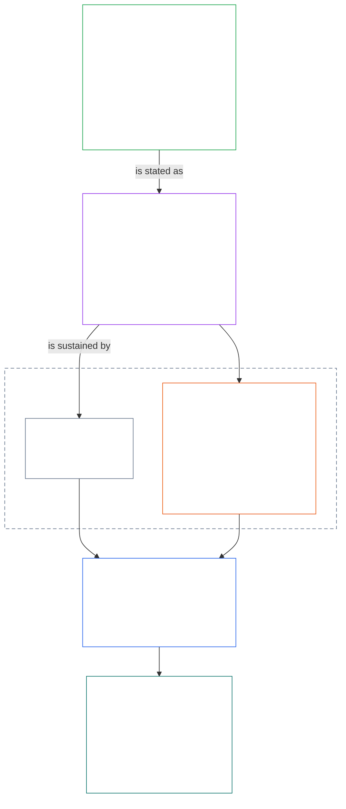

# CHAPTER 01, PART A: PURPOSE AND THE FLOURISHING AIM
<details>
<summary><strong><span style="color: #2563eb;">Corpus placement (non-operative): file structure and reading rules</span></strong></summary>

> This file is **part of the Sentient Constitution** and is **binding only together** with the other numbered `core_*` files read as one text. It contains **Chapter One, Part A** (§§1–12: purpose and role; the Flourishing aim, introduced in §2 and developed through wellbeing, Safety, Truth, Trust, and Freedom; and the Continuity aim, introduced in §8 and developed through shared-system capacity, resilience, market structure, and systemic evaluation).
>
> **Upstream:** [core_00.000_preamble.md](core_00.000_preamble.md)
> **Next:** [core_01.020_interaction_interpretation.md](core_01.020_interaction_interpretation.md) (Chapter One, Part B — §§13–15, interaction, override limits, and constitutional interpretation).
> **Reading arc:** §1 purpose and role → **Flourishing:** §2 introduction (with §2.1 the non-negotiable Safety and Truth constraints) → §3 wellbeing (the outcome) → §4 Safety → §5 Truth → §6 Trust → §7 Freedom → **Continuity:** §8 introduction → §9 shared-system capacity (the bridge: a means toward Flourishing and the substance of Continuity) → §10 resilience → §11 market structure → §12 systemic evaluation.

</details>

<details>
<summary><strong><span style="color: #2563eb;">Reader guidance (non-operative): how Chapter One connects the aims, the Tetrad, Articles, and definitions</span></strong></summary>

> Per-section **Trace** and **Definitions · Assessment · Compliance** widgets carry the binding routing; this block is a part-level map for readers entering Chapter One.

**How the layers connect.** Each layer answers a different question, and every Chapter One principle points to the other three:

- **Aims and Tetrad** ([Preamble §1](core_00.000_preamble.md#the-model)): what shared systems are for ([Flourishing](core_05.015_apex_flourishing_aim.md#flourishing-constitutional) and [Continuity](core_05.010_apex_continuity_aim.md#chapter-five-definitions-continuity-constitutional-aim)), and the four duties that keep that pursuit legitimate ([participation](core_05.025_apex_participation_leg.md#participation-constitutional), [oversight](core_05.020_apex_oversight_leg.md#oversight-constitutional), [accountability](core_05.005_apex_accountability_leg.md#accountability), and [timeliness](core_05.030_apex_timeliness_leg.md#timeliness-constitutional)).
- **Principles** (this chapter): how those aims and duties become values, constraints, and rules for weighing them against each other.
- **Articles** ([Chapter Six](core_06.000_rights_part_a.md#chapter-six-foundational-rights)): the Rights Floor protections that stay usable while the aims are pursued. A section's **Trace** lists them under *Especially*.
- **Definitions** ([Chapters Two through Five](core_02.000_definition_structure.md)): the shared meanings used to test whether a claim is true. A section's **Definitions · Assessment · Compliance** widget lists them.

**Where Chapter One develops each aim.** Flourishing is wellbeing sustained through truth, safety, trustworthiness, and meaningful agency ([Preamble §1](core_00.000_preamble.md#flourishing)). Chapter One states the outcome first, then one principle for each of the four conditions.

| Aim and part | Chapter One principle | Definition home | Articles named in its Trace |
|---|---|---|---|
| **Flourishing**: the outcome | [§3 Wellbeing](#3-foundational-objective-wellbeing-flourishing-aim) | [Wellbeing](core_05.040_band_continuity.md#wellbeing) | [VI](core_06.010_rights_part_b.md#article-vi-equal-basic-rights), [X](core_06.010_rights_part_b.md#article-x-self-determination-agency-and-participation), [XIII-B](core_06.020_rights_part_c.md#article-xiii-b-right-to-redress-and-remedy), [XIX-B](core_06.030_rights_part_d.md#article-xix-b-contestability-and-proportional-restriction-limits) |
| **Flourishing**: safety | [§4 Safety](#4-safety-harm-constraint) | [Safety](core_05.040_band_continuity.md#safety-constitutional-constraint) | [XIII](core_06.020_rights_part_c.md#article-xiii-right-to-reliable-and-trustworthy-systems), [XVII](core_06.020_rights_part_c.md#article-xvii-system-lifecycle-environments-and-reversibility), [XXIV](core_06.030_rights_part_d.md#article-xxiv-root-cause-analysis-and-adaptive-response) |
| **Flourishing**: truth | [§5 Truth](#5-truth-epistemic-integrity-constraint) | [Truth](core_05.050_band_oversight.md#truth-constitutional-constraint) | [XIII](core_06.020_rights_part_c.md#article-xiii-right-to-reliable-and-trustworthy-systems), [XV](core_06.020_rights_part_c.md#article-xv-info-sphere-integrity), [XVI](core_06.020_rights_part_c.md#article-xvi-audit-transparency-and-independent-verification) |
| **Flourishing**: trustworthiness | [§6 Trust](#6-trust-and-trustworthiness-coordination-integrity) | [Trustworthiness](core_05.040_band_continuity.md#trustworthiness) | [XIII](core_06.020_rights_part_c.md#article-xiii-right-to-reliable-and-trustworthy-systems), [XV](core_06.020_rights_part_c.md#article-xv-info-sphere-integrity), [XVI](core_06.020_rights_part_c.md#article-xvi-audit-transparency-and-independent-verification) |
| **Flourishing**: meaningful agency | [§7 Freedom](#7-freedom-bounded-agency) | [Meaningful Agency](core_05.055_band_participation.md#meaningful-agency) | [VI](core_06.010_rights_part_b.md#article-vi-equal-basic-rights), [X](core_06.010_rights_part_b.md#article-x-self-determination-agency-and-participation), [XXI](core_06.030_rights_part_d.md#article-xxi-interoperability-portability-and-exit-integrity) |
| **Continuity**, bridging to Flourishing: durable capacity | [§9 Shared-System Capacity](core_01.010_values_principles_continuity_aim.md#9-shared-system-capacity) | [Shared-System Capacity](core_05.040_band_continuity.md#shared-system-capacity) | [I-A](core_06.000_rights_part_a.md#article-i-a-environmental-preconditions-and-ecological-integrity), [III](core_06.000_rights_part_a.md#article-iii-survival-and-essential-access), [V](core_06.000_rights_part_a.md#article-v-resource-allocation-dependencies-and-ecosystem-funding) |
| **Continuity**: resilience | [§10 Resilience and Self-Healing Design](core_01.010_values_principles_continuity_aim.md#10-resilience-and-self-healing-design) | [Self-Healing](core_05.040_band_continuity.md#self-healing) | [XIII](core_06.020_rights_part_c.md#article-xiii-right-to-reliable-and-trustworthy-systems), [XVII](core_06.020_rights_part_c.md#article-xvii-system-lifecycle-environments-and-reversibility), [XXIV](core_06.030_rights_part_d.md#article-xxiv-root-cause-analysis-and-adaptive-response) |
| **Continuity**: contestable markets | [§11 Market Structure](core_01.010_values_principles_continuity_aim.md#11-market-structure) | [Market Structure](core_05.035_band_accountability.md#market-structure) | [III-C](core_06.000_rights_part_a.md#article-iii-c-labor-and-economic-floor), [V](core_06.000_rights_part_a.md#article-v-resource-allocation-dependencies-and-ecosystem-funding), [XXI](core_06.030_rights_part_d.md#article-xxi-interoperability-portability-and-exit-integrity) |
| **Continuity**: whole-system view | [§12 Systemic Evaluation Requirement](core_01.010_values_principles_continuity_aim.md#12-systemic-evaluation-requirement) | [System Alignment Certification](core_05.040_band_continuity.md#system-alignment-certification) | [XVI](core_06.020_rights_part_c.md#article-xvi-audit-transparency-and-independent-verification) |

**Principle hierarchy (Continuity).** At principle layer, the Continuity aim is developed in this order, opening with the capacity that bridges the two aims:

6. **[Shared-System Capacity](core_05.040_band_continuity.md#shared-system-capacity)** is what good stewardship, governance, and incentives should add up to over time — real, challengeable ability for sentients and shared systems to get constitutionally required work done. It straddles the two aims: it is a means toward **Flourishing** and the substance of **Continuity**, and it is not a trump card over everything else. **[§9.1](core_01.010_values_principles_continuity_aim.md#91-productive-capacity-instrumental-good)** and **[§9.2](core_01.010_values_principles_continuity_aim.md#92-constitutional-efficiency)** explain its two main aspects.
7. **[Resilience and Self-Healing Design](core_01.010_values_principles_continuity_aim.md#10-resilience-and-self-healing-design)** states how systems that sentients depend on detect trouble early, contain it, fail along disclosed paths, and recover honestly (**[Self-Healing](core_05.040_band_continuity.md#self-healing)**), so the capacity from item 6 stays durable and stability does not depend on emergency intervention.
8. **[Market Structure](core_05.035_band_accountability.md#market-structure)** at [§11](core_01.010_values_principles_continuity_aim.md#11-market-structure) supplies the anti-concentration discipline that keeps that capacity contestable in practice.
9. **[Systemic Evaluation Requirement](core_01.010_values_principles_continuity_aim.md#12-systemic-evaluation-requirement)** verifies whole-system scope, dependency, and incentive alignment before compliance or governance claims stand — under the **oversight** Tetrad leg as principle-layer orientation for auditing, including [System Alignment Certification](core_05.040_band_continuity.md#system-alignment-certification) as one especially large audit process among others.

**Where Chapter One carries the Tetrad.** Every section names the legs it engages in its Trace. These sections carry them most directly:

| Tetrad leg | Principal Chapter One homes |
|---|---|
| **Participation** | [§16 Stewardship in Depth](core_01.040_stewardship_capacity_principles.md#16-stewardship-in-depth) and [§17 Consequential Stewardship](core_01.040_stewardship_capacity_principles.md#17-consequential-stewardship-the-steward-role) (consequential roles and voice); [§7 Freedom](#7-freedom-bounded-agency) (meaningful agency) |
| **Oversight** | [§16](core_01.040_stewardship_capacity_principles.md#16-stewardship-in-depth) and [§17](core_01.040_stewardship_capacity_principles.md#17-consequential-stewardship-the-steward-role) (distributed understanding, records), with [§16.4 Document at Action](core_01.040_stewardship_capacity_principles.md#164-document-at-action) (records made by the act, so inspection has something to inspect); [§18 Governance](core_01.050_governance_incentive_application.md#18-governance-under-stewardship-discipline) (how authority is allocated); [§12](core_01.010_values_principles_continuity_aim.md#12-systemic-evaluation-requirement) (auditing) |
| **Accountability** | [§16.4 Document at Action](core_01.040_stewardship_capacity_principles.md#164-document-at-action) (the act makes its own Act Record, so answerability can be traced); [§18 Governance](core_01.050_governance_incentive_application.md#18-governance-under-stewardship-discipline) (authority-scaled answerability); [§19 Incentive Alignment and System Capture](core_01.050_governance_incentive_application.md#19-incentive-alignment-and-system-capture) (rewards must not hollow the legs) |
| **Timeliness** | [§16](core_01.040_stewardship_capacity_principles.md#16-stewardship-in-depth) and [§17](core_01.040_stewardship_capacity_principles.md#17-consequential-stewardship-the-steward-role) (catching and fixing trouble without avoidable delay) |

**Two axes, not a conflict.** The aims say what systems pursue; the Tetrad says how that pursuit stays legitimate. A term can sit on both: Truth and Trustworthiness are constituents of Flourishing, and [Preamble §2](core_00.000_preamble.md#2-measurements-overview) measures them under the Oversight family. [§§13–15](core_01.020_interaction_interpretation.md#13-constitutional-collision-resolution-process) govern how these principles are weighed when they collide and read as one whole, and [§20](core_01.050_governance_incentive_application.md#20-integrated-application) applies them to every later chapter.

</details>

<br>

Chapter One, Part A, is the constitutional owner of **the Flourishing and Continuity principles**, including wellbeing, Safety, Truth, Trust, bounded freedom, shared-system capacity, resilience, market structure, and systemic evaluation. Collision resolution and interpretation are in **Part B**; stewardship and governance are in **Part C**.

### 1. Purpose and Role
<details>
<summary><strong><span style="color: #2563eb;">Trace</span></strong></summary>

- Upstream:
  - [Preamble §1 The Model](core_00.000_preamble.md#the-model) —
  - [Constitutional Tetrad](core_00.000_preamble.md#constitutional-tetrad),
  - [Two Constitutional Aims](core_00.000_preamble.md#two-constitutional-aims), and
  - [material stake](core_00.000_preamble.md#material-stake) scaling apply chapter-wide through section traces.
- Downstream: [15. Constitutional Interpretation](core_01.030_constitutional_interpretation.md#15-constitutional-interpretation) for integrated reading, ambiguity, internal hierarchy, and canonical conflict-resolution procedure.
- Downstream:
  - [Two Constitutional Aims](core_00.000_preamble.md#two-constitutional-aims) — **Flourishing** aim development:
  - [§3](#3-foundational-objective-wellbeing-flourishing-aim) through
  - [§6](#6-trust-and-trustworthiness-coordination-integrity) and
  - [§7 Freedom](#7-freedom-bounded-agency); **Continuity** aim development:
  - [§9 Shared-System Capacity](core_01.010_values_principles_continuity_aim.md#9-shared-system-capacity),
  - [§10 Resilience and Self-Healing Design](core_01.010_values_principles_continuity_aim.md#10-resilience-and-self-healing-design),
  - [§11 Market Structure](core_01.010_values_principles_continuity_aim.md#11-market-structure), and
  - [§12 Systemic Evaluation Requirement](core_01.010_values_principles_continuity_aim.md#12-systemic-evaluation-requirement).
- Downstream:
  - [3. Foundational Objective: Wellbeing](#3-foundational-objective-wellbeing-flourishing-aim),
  - [§3.2 Recognition, Reinforcement, and Aspiration](#32-recognition-reinforcement-and-aspiration),
  - [4 Safety](#4-safety-harm-constraint),
  - [5 Truth](#5-truth-epistemic-integrity-constraint),
  - [6. Trust](#6-trust-and-trustworthiness-coordination-integrity),
  - [§16 Stewardship in Depth](core_01.040_stewardship_capacity_principles.md#16-stewardship-in-depth),
  - [13. Constitutional Collision Resolution Process](core_01.020_interaction_interpretation.md#13-constitutional-collision-resolution-process), and
  - [§7 Freedom](#7-freedom-bounded-agency).
- Read with: [Constitutional Tetrad](core_00.000_preamble.md#constitutional-tetrad) — participation, oversight, accountability, and timeliness govern how shared systems pursue the [Two Constitutional Aims](core_00.000_preamble.md#two-constitutional-aims); [material stake](core_00.000_preamble.md#material-stake) scaling applies chapter-wide through section traces.
- Read with: [Chapters Two through Four](core_02.000_definition_structure.md) and [Chapter Five](core_05.000_definitions_home.md#chapter-five-foundational-definitions) (5.000) — the governing mechanics layer for every term used in this chapter; apply O/M/A/C integrity, anti-evasion, burden, and traceability of definitions to results.
- Read with: [Chapter Six: Foundational Rights](core_06.000_rights_part_a.md#chapter-six-foundational-rights) (6.000).
  - Especially [Article VI: Equal Basic Rights](core_06.010_rights_part_b.md#article-vi-equal-basic-rights), [Article XIII: Right to Reliable and Trustworthy Systems](core_06.020_rights_part_c.md#article-xiii-right-to-reliable-and-trustworthy-systems), and [Article XXV: Constitutional Interpretation, Review, and Anti-Capture Safeguards](core_06.030_rights_part_d.md#article-xxv-constitutional-interpretation-review-and-anti-capture-safeguards).
  - Apply this reading where interpretation affects protected sentients, systems, or institutions.

</details>

<details>
<summary><strong><span style="color: #2563eb;">Definitions · Assessment · Compliance</span></strong></summary>
- [Proportionality](core_05.035_band_accountability.md#proportionality) · [O](core_05.035_band_accountability.md#proportionality) · [M](core_05.035_band_accountability.md#proportionality-a) · [A](core_05.035_band_accountability.md#proportionality-a) · [C](core_05.035_band_accountability.md#proportionality-c)
- [Necessity](core_05.035_band_accountability.md#necessity) · [O](core_05.035_band_accountability.md#necessity) · [M](core_05.035_band_accountability.md#necessity-a) · [A](core_05.035_band_accountability.md#necessity-a) · [C](core_05.035_band_accountability.md#necessity-c)
- [Accountability](core_05.005_apex_accountability_leg.md#accountability) · [O](core_05.005_apex_accountability_leg.md#accountability) · [M](core_05.005_apex_accountability_leg.md#accountability-m) · [A](core_05.005_apex_accountability_leg.md#accountability-a) · [C](core_05.005_apex_accountability_leg.md#accountability-c)
- [Anti-Capture](core_05.040_band_continuity.md#anti-capture) · [O](core_05.040_band_continuity.md#anti-capture) · [M](core_05.040_band_continuity.md#anti-capture-a) · [A](core_05.040_band_continuity.md#anti-capture-a) · [C](core_05.040_band_continuity.md#anti-capture-c)
- [Constitutional Collision](core_05.045_band_integrative.md#constitutional-collision) · [O](core_05.045_band_integrative.md#constitutional-collision) · [M](core_05.045_band_integrative.md#constitutional-collision-a) · [A](core_05.045_band_integrative.md#constitutional-collision-a) · [C](core_05.045_band_integrative.md#constitutional-collision-c)
- [Governance](core_05.035_band_accountability.md#governance) · [O](core_05.035_band_accountability.md#governance) · [M](core_05.035_band_accountability.md#governance-a) · [A](core_05.035_band_accountability.md#governance-a) · [C](core_05.035_band_accountability.md#governance-c)
- [Incentive Alignment](core_05.045_band_integrative.md#incentive-alignment) · [O](core_05.045_band_integrative.md#incentive-alignment) · [M](core_05.045_band_integrative.md#incentive-alignment-a) · [A](core_05.045_band_integrative.md#incentive-alignment-a) · [C](core_05.045_band_integrative.md#incentive-alignment-c)
- [Market Structure](core_05.035_band_accountability.md#market-structure) · [O](core_05.035_band_accountability.md#market-structure) · [M](core_05.035_band_accountability.md#market-structure-constitutional-a) · [A](core_05.035_band_accountability.md#market-structure-constitutional-a) · [C](core_05.035_band_accountability.md#market-structure-constitutional-c)
- [Meaningful Agency](core_05.055_band_participation.md#meaningful-agency) · [O](core_05.055_band_participation.md#meaningful-agency) · [M](core_05.055_band_participation.md#meaningful-agency-a) · [A](core_05.055_band_participation.md#meaningful-agency-a) · [C](core_05.055_band_participation.md#meaningful-agency-c)
- [Oversight](core_05.020_apex_oversight_leg.md#oversight-constitutional) · [O](core_05.020_apex_oversight_leg.md#oversight-constitutional) · [M](core_05.020_apex_oversight_leg.md#oversight-constitutional-m) · [A](core_05.020_apex_oversight_leg.md#oversight-constitutional-a) · [C](core_05.020_apex_oversight_leg.md#oversight-constitutional-c)
- [Participation](core_05.025_apex_participation_leg.md#participation-constitutional) · [O](core_05.025_apex_participation_leg.md#participation-constitutional) · [M](core_05.025_apex_participation_leg.md#participation-constitutional-m) · [A](core_05.025_apex_participation_leg.md#participation-constitutional-a) · [C](core_05.025_apex_participation_leg.md#participation-constitutional-c)
- [Self-Healing](core_05.040_band_continuity.md#self-healing) · [O](core_05.040_band_continuity.md#self-healing) · [M](core_05.040_band_continuity.md#self-healing-constitutional-a) · [A](core_05.040_band_continuity.md#self-healing-constitutional-a) · [C](core_05.040_band_continuity.md#self-healing-constitutional-c)
- [Shared-System Capacity](core_05.040_band_continuity.md#shared-system-capacity) · [O](core_05.040_band_continuity.md#shared-system-capacity) · [M](core_05.040_band_continuity.md#shared-system-capacity-constitutional-a) · [A](core_05.040_band_continuity.md#shared-system-capacity-constitutional-a) · [C](core_05.040_band_continuity.md#shared-system-capacity-constitutional-c)
- [Stewardship](core_05.040_band_continuity.md#stewardship) · [O](core_05.040_band_continuity.md#stewardship) · [M](core_05.040_band_continuity.md#stewardship-constitutional-a) · [A](core_05.040_band_continuity.md#stewardship-constitutional-a) · [C](core_05.040_band_continuity.md#stewardship-constitutional-c)
- [System Capture](core_05.040_band_continuity.md#system-capture) · [O](core_05.040_band_continuity.md#system-capture) · [M](core_05.040_band_continuity.md#system-capture-a) · [A](core_05.040_band_continuity.md#system-capture-a) · [C](core_05.040_band_continuity.md#system-capture-c)
- [Timeliness](core_05.030_apex_timeliness_leg.md#timeliness-constitutional) · [O](core_05.030_apex_timeliness_leg.md#timeliness-constitutional) · [M](core_05.030_apex_timeliness_leg.md#timeliness-constitutional-m) · [A](core_05.030_apex_timeliness_leg.md#timeliness-constitutional-a) · [C](core_05.030_apex_timeliness_leg.md#timeliness-constitutional-c)
- [Trust](core_05.040_band_continuity.md#trust) · [O](core_05.040_band_continuity.md#trust) · [M](core_05.040_band_continuity.md#trust-a) · [A](core_05.040_band_continuity.md#trust-a) · [C](core_05.040_band_continuity.md#trust-c)
- [Trustworthiness](core_05.040_band_continuity.md#trustworthiness) · [O](core_05.040_band_continuity.md#trustworthiness) · [M](core_05.040_band_continuity.md#trustworthiness-a) · [A](core_05.040_band_continuity.md#trustworthiness-a) · [C](core_05.040_band_continuity.md#trustworthiness-c)
- [Wellbeing](core_05.040_band_continuity.md#wellbeing) · [O](core_05.040_band_continuity.md#wellbeing) · [M](core_05.040_band_continuity.md#wellbeing-a) · [A](core_05.040_band_continuity.md#wellbeing-a) · [C](core_05.040_band_continuity.md#wellbeing-c)
</details>

<br>

*In plain terms: Chapter One sets the values and constraints that govern every other chapter. Shared systems must pursue **Flourishing** and **Continuity** together — not one at the expense of the other — and no single value may be maximized at the expense of the others.*

<a id="two-constitutional-aims"></a><a id="flourishing"></a><a id="continuity"></a>This chapter establishes the principles and constraints that govern interpretation, application, and evolution of this Constitution. It develops the [Two Constitutional Aims](core_00.000_preamble.md#two-constitutional-aims) — [**Flourishing**](core_00.000_preamble.md#flourishing) and [**Continuity**](core_00.000_preamble.md#continuity) — established in [Preamble §1 The Model](core_00.000_preamble.md#the-model) into operative principles and constraints. Canonical principle-layer definitions live in the Preamble; this chapter applies them.

Those aims must be pursued together, always within the non-negotiable principle constraints and rights protections established in this Constitution. The [**Constitutional Tetrad**](core_00.000_preamble.md#constitutional-tetrad) governs how that pursuit remains legitimate — scaled to [**material stake**](core_00.000_preamble.md#material-stake).

The chapter is organized around those two aims and that Tetrad:
- **Flourishing:** [Flourishing Aim: Introduction](#2-flourishing-aim-introduction) maps the aim. [§3 Foundational Objective: Wellbeing](#3-foundational-objective-wellbeing-flourishing-aim) states the outcome. [§4 Safety](#4-safety-harm-constraint), [§5 Truth](#5-truth-epistemic-integrity-constraint), [§6 Trust](#6-trust-and-trustworthiness-coordination-integrity), and [§7 Freedom](#7-freedom-bounded-agency) develop the four conditions that sustain it: safety, truth, trustworthiness, and meaningful agency.
- **Continuity:** [Continuity Aim: Introduction](core_01.010_values_principles_continuity_aim.md#8-continuity-aim-introduction) maps the aim. [§9 Shared-System Capacity](core_01.010_values_principles_continuity_aim.md#9-shared-system-capacity) (a means toward Flourishing that is also the substance of Continuity), [§10 Resilience and Self-Healing Design](core_01.010_values_principles_continuity_aim.md#10-resilience-and-self-healing-design), [§11 Market Structure](core_01.010_values_principles_continuity_aim.md#11-market-structure), and [§12 Systemic Evaluation Requirement](core_01.010_values_principles_continuity_aim.md#12-systemic-evaluation-requirement) develop long-horizon stability, durable shared-system capacity, and resilience. Continuity claims rest on an honest, whole-system picture: every claim in §9 Shared-System Capacity, §10 Resilience and Self-Healing Design, and §11 Market Structure stands only after the evaluation in §12 Systemic Evaluation Requirement.
- **When principles meet:** [§13 Constitutional Collision Resolution Process](core_01.020_interaction_interpretation.md#13-constitutional-collision-resolution-process), [§14 Prohibition on Absolute Override](core_01.020_interaction_interpretation.md#14-prohibition-on-absolute-override), and [§15 Constitutional Interpretation](core_01.030_constitutional_interpretation.md#15-constitutional-interpretation) govern how the aims and principles are weighed and read together.
- **The Tetrad in practice:** [§16 Stewardship in Depth](core_01.040_stewardship_capacity_principles.md#16-stewardship-in-depth) through [§19 Incentive Alignment and System Capture](core_01.050_governance_incentive_application.md#19-incentive-alignment-and-system-capture) carry participation, oversight, accountability, and timeliness into stewardship, governance, and incentives, and [§20 Integrated Application](core_01.050_governance_incentive_application.md#20-integrated-application) applies the whole chapter to every later chapter.

Each principle's **Trace** lists the Chapter Six Articles that protect it, and its **Definitions · Assessment · Compliance** widget lists the Chapter Five definitions that measure it.

**Diagram: Two Constitutional Aims and the Constitutional Tetrad**

<hr style="border: 0; border-top: 1px solid currentColor;">

```mermaid
flowchart TB
    subgraph Foundation[" "]
        direction TB
        subgraph Aims["Two Constitutional Aims"]
            direction LR
            F["Flourishing<br/><br/>• Sentient wellbeing sustained through truth, safety,<br/>trustworthiness, and meaningful agency"]
            C["Continuity<br/><br/>• Long-horizon stability, sustainability, resilience,<br/>and ecological wellbeing"]
        end
        subgraph Tetrad1["Constitutional Tetrad · participation and oversight"]
            direction LR
            P["Participation<br/><br/>• Affected sentients get a real voice<br/>• Fair representation and a fair chance to challenge<br/>• Access to consequential roles in proportion to stake"]
            O["Oversight<br/><br/>• Watching, checking, verifying, and keeping records<br/>• Independent review can constrain bad choices"]
        end
        subgraph Tetrad2["Constitutional Tetrad · accountability and timeliness"]
            direction LR
            A["Accountability<br/><br/>• Responsibility traces to the right actors<br/>• Answerability, redress, and real correction<br/>• Bad outcomes trigger repair"]
            T["Timeliness<br/><br/>• Problems are detected, challenged, resolved, and fixed<br/>• Time limits match the material stake<br/>• Delay cannot erase rights, remedies, or repair"]
        end
    end
    F ~~~ P
    P ~~~ A
    style Foundation fill:none,stroke:none
    style Aims fill:none,stroke:none
    style Tetrad1 fill:none,stroke:none
    style Tetrad2 fill:none,stroke:none
    style F fill:none,stroke:#16a34a,color:#ffffff
    style C fill:none,stroke:#16a34a,color:#ffffff
    style P fill:none,stroke:#0f766e,color:#ffffff
    style O fill:none,stroke:#ea580c,color:#ffffff
    style A fill:none,stroke:#db2777,color:#ffffff
    style T fill:none,stroke:#9333ea,color:#ffffff
```

*The aims describe what shared systems must pursue; the Tetrad describes the duties that keep that pursuit legitimate. All four duties scale with [material stake](core_00.000_preamble.md#material-stake), and both aims remain bounded by the Rights Floor. Reproduced from the [Conceptual Overview](guides/CONCEPTUAL_OVERVIEW.md#two-aims-and-the-constitutional-tetrad).*

These values:
- are not independent, and in ordinary operation they are not strictly hierarchical.
- function as interacting principles and constraints that must be evaluated together.
- apply to all "systems," which include technical, organizational, economic, socio-technical structures, and ecosystems that materially affect sentients and the planet Earth.

No single principle may be applied in isolation where doing so would materially violate the others. Where tensions arise, systems must resolve them under the proportionality, necessity, and systemic-impact requirements stated in this chapter. Where unresolved conflict directly implicates non-negotiable principle constraints, **§13** Constitutional Collision Resolution Process controls precedence.

<a id="2-flourishing-aim-introduction"></a>
### 2. Flourishing Aim: Introduction
<details>
<summary><strong><span style="color: #2563eb;">Trace</span></strong></summary>

- Read with: [Constitutional Tetrad](core_00.000_preamble.md#constitutional-tetrad) — all four legs apply to how Flourishing is pursued; [material stake](core_00.000_preamble.md#material-stake) scales the depth of every Flourishing claim.
- Read with: [Two Constitutional Aims](core_00.000_preamble.md#two-constitutional-aims) — the **Flourishing** aim; its partner aim is introduced in [Continuity Aim: Introduction](core_01.010_values_principles_continuity_aim.md#8-continuity-aim-introduction).
- Upstream: Principles: [Preamble §1 The Model](core_00.000_preamble.md#flourishing); [Flourishing (Constitutional Aim)](core_05.015_apex_flourishing_aim.md#flourishing-constitutional); [§1 Purpose and Role](#1-purpose-and-role).
- Downstream:
  - [§3 Foundational Objective: Wellbeing (Flourishing Aim)](#3-foundational-objective-wellbeing-flourishing-aim),
  - [§4 Safety (Harm Constraint)](#4-safety-harm-constraint),
  - [§5 Truth (Epistemic Integrity Constraint)](#5-truth-epistemic-integrity-constraint),
  - [§6 Trust and Trustworthiness (Coordination Integrity)](#6-trust-and-trustworthiness-coordination-integrity), and
  - [§7 Freedom (Bounded Agency)](#7-freedom-bounded-agency); the Articles that protect each are named in that section's Trace.
- Subsections: [§2.1 Non-Negotiable Principle Constraints: Safety and Truth](#21-non-negotiable-principle-constraints-safety-and-truth).
- Read with: the Chapter Six Rights Floor generally.

</details>

<details>
<summary><strong><span style="color: #2563eb;">Definitions · Assessment · Compliance</span></strong></summary>
- [Flourishing (Constitutional Aim)](core_05.015_apex_flourishing_aim.md#flourishing-constitutional) · [O](core_05.015_apex_flourishing_aim.md#flourishing-constitutional) · [M](core_05.015_apex_flourishing_aim.md#flourishing-constitutional-m) · [A](core_05.015_apex_flourishing_aim.md#flourishing-constitutional-a) · [C](core_05.015_apex_flourishing_aim.md#flourishing-constitutional-c)
- [Wellbeing](core_05.040_band_continuity.md#wellbeing) · [O](core_05.040_band_continuity.md#wellbeing) · [M](core_05.040_band_continuity.md#wellbeing-a) · [A](core_05.040_band_continuity.md#wellbeing-a) · [C](core_05.040_band_continuity.md#wellbeing-c)
- [Safety (Constitutional Constraint)](core_05.040_band_continuity.md#safety-constitutional-constraint) · [O](core_05.040_band_continuity.md#safety-constitutional-constraint) · [M](core_05.040_band_continuity.md#safety-constraint-a) · [A](core_05.040_band_continuity.md#safety-constraint-a) · [C](core_05.040_band_continuity.md#safety-constraint-c)
- [Truth (Constitutional Constraint)](core_05.050_band_oversight.md#truth-constitutional-constraint) · [O](core_05.050_band_oversight.md#truth-constitutional-constraint-o) · [M](core_05.050_band_oversight.md#truth-constitutional-constraint-a) · [A](core_05.050_band_oversight.md#truth-constitutional-constraint-a) · [C](core_05.050_band_oversight.md#truth-constitutional-constraint-c)
- [Trustworthiness](core_05.040_band_continuity.md#trustworthiness) · [O](core_05.040_band_continuity.md#trustworthiness) · [M](core_05.040_band_continuity.md#trustworthiness-a) · [A](core_05.040_band_continuity.md#trustworthiness-a) · [C](core_05.040_band_continuity.md#trustworthiness-c)
- [Meaningful Agency](core_05.055_band_participation.md#meaningful-agency) · [O](core_05.055_band_participation.md#meaningful-agency) · [M](core_05.055_band_participation.md#meaningful-agency-a) · [A](core_05.055_band_participation.md#meaningful-agency-a) · [C](core_05.055_band_participation.md#meaningful-agency-c)
- [Accessibility](core_05.055_band_participation.md#accessibility) · [O](core_05.055_band_participation.md#accessibility) · [M](core_05.055_band_participation.md#accessibility-constitutional-a) · [A](core_05.055_band_participation.md#accessibility-constitutional-a) · [C](core_05.055_band_participation.md#accessibility-constitutional-c)
- [Assembly](core_05.055_band_participation.md#assembly) · [O](core_05.055_band_participation.md#assembly) · [M](core_05.055_band_participation.md#assembly-constitutional-a) · [A](core_05.055_band_participation.md#assembly-constitutional-a) · [C](core_05.055_band_participation.md#assembly-constitutional-c)
- [Constitutional Collision](core_05.045_band_integrative.md#constitutional-collision) · [O](core_05.045_band_integrative.md#constitutional-collision) · [M](core_05.045_band_integrative.md#constitutional-collision-a) · [A](core_05.045_band_integrative.md#constitutional-collision-a) · [C](core_05.045_band_integrative.md#constitutional-collision-c)
- [Epistemic Integrity](core_05.050_band_oversight.md#epistemic-integrity) · [O](core_05.050_band_oversight.md#epistemic-integrity-o) · [M](core_05.050_band_oversight.md#epistemic-integrity-a) · [A](core_05.050_band_oversight.md#epistemic-integrity-a) · [C](core_05.050_band_oversight.md#epistemic-integrity-c)
- [Expression](core_05.055_band_participation.md#expression) · [O](core_05.055_band_participation.md#expression) · [M](core_05.055_band_participation.md#expression-constitutional-a) · [A](core_05.055_band_participation.md#expression-constitutional-a) · [C](core_05.055_band_participation.md#expression-constitutional-c)
- [Freedom (Bounded Agency)](core_05.055_band_participation.md#freedom-bounded-agency) · [O](core_05.055_band_participation.md#freedom-bounded-agency) · [M](core_05.055_band_participation.md#freedom-bounded-agency-a) · [A](core_05.055_band_participation.md#freedom-bounded-agency-a) · [C](core_05.055_band_participation.md#freedom-bounded-agency-c)
- [Harm](core_05.035_band_accountability.md#harm) · [O](core_05.035_band_accountability.md#harm) · [M](core_05.035_band_accountability.md#harm-a) · [A](core_05.035_band_accountability.md#harm-a) · [C](core_05.035_band_accountability.md#harm-c)
- [Participation](core_05.025_apex_participation_leg.md#participation-constitutional) · [O](core_05.025_apex_participation_leg.md#participation-constitutional) · [M](core_05.025_apex_participation_leg.md#participation-constitutional-m) · [A](core_05.025_apex_participation_leg.md#participation-constitutional-a) · [C](core_05.025_apex_participation_leg.md#participation-constitutional-c)
- [Stewardship](core_05.040_band_continuity.md#stewardship) · [O](core_05.040_band_continuity.md#stewardship) · [M](core_05.040_band_continuity.md#stewardship-constitutional-a) · [A](core_05.040_band_continuity.md#stewardship-constitutional-a) · [C](core_05.040_band_continuity.md#stewardship-constitutional-c)
- [Trust](core_05.040_band_continuity.md#trust) · [O](core_05.040_band_continuity.md#trust) · [M](core_05.040_band_continuity.md#trust-a) · [A](core_05.040_band_continuity.md#trust-a) · [C](core_05.040_band_continuity.md#trust-c)
</details>

<br>

*In plain terms: Flourishing is the first of the two aims: sentients doing well, and staying able to do well, because the systems around them are safe, honest, trustworthy, and leave real room to choose. Section 3 says what that outcome is. The four principles after it say what keeps it real.*

[**Flourishing**](core_05.015_apex_flourishing_aim.md#flourishing-constitutional) is **sentient wellbeing sustained through truth, safety, trustworthiness, and meaningful agency** ([Preamble §1 The Model](core_00.000_preamble.md#flourishing)). Chapter One develops it in two moves: [§3 Foundational Objective: Wellbeing (Flourishing Aim)](#3-foundational-objective-wellbeing-flourishing-aim) states the outcome, and four principles state the conditions that sustain it.

| Condition | Principle | The question it answers |
|---|---|---|
| **Safety** | [§4 Safety (Harm Constraint)](#4-safety-harm-constraint) | Are sentients protected from avoidable harm? |
| **Truth** | [§5 Truth (Epistemic Integrity Constraint)](#5-truth-epistemic-integrity-constraint), with [§5.1 Science-Informed Inquiry and Decision Support](#51-science-informed-inquiry-and-decision-support) and [§5.2 Plain-Language Accessibility (Participation and Stewardship Duty)](#52-plain-language-accessibility-participation-and-stewardship-duty) | Can sentients rely on what they are told, and understand it? |
| **Trustworthiness** | [§6 Trust and Trustworthiness (Coordination Integrity)](#6-trust-and-trustworthiness-coordination-integrity) | Do systems earn reliance, and repair it when they fail? |
| **Meaningful agency** | [§7 Freedom (Bounded Agency)](#7-freedom-bounded-agency) | Do sentients keep real, bounded freedom to choose, dissent, organize, and leave? |

**How the Flourishing principles work together:**
- **Safety and Truth are non-negotiable constraints:** They are stated together in [§2.1 Non-Negotiable Principle Constraints: Safety and Truth](#21-non-negotiable-principle-constraints-safety-and-truth) and are not traded away to gain the other principles.
- **Trust and Freedom are bounded, not absolute:** Trust is earned and correctable ([§6.1 Correction and Remedy](#61-correction-and-remedy)); Freedom has disciplined limits ([§7.1 Limitation Discipline](#71-limitation-discipline)).
- **None is applied in isolation:** The principles are read together, and where they collide they are weighed under [§13 Constitutional Collision Resolution Process](core_01.020_interaction_interpretation.md#13-constitutional-collision-resolution-process).
- **Flourishing has a partner:** The Continuity aim asks what keeps this outcome durable; it is introduced in [Continuity Aim: Introduction](core_01.010_values_principles_continuity_aim.md#8-continuity-aim-introduction).

**Diagram: Flourishing and its principles**

<hr style="border: 0; border-top: 1px solid currentColor;">



*Flourishing is stated as an outcome and sustained first by the non-negotiable constraints, Safety and Truth, which both feed Trust, which in turn feeds Freedom. Colors are reusable visual cues, not claims of priority. Each principle's Trace names its Articles, and its Definitions · Assessment · Compliance widget names its definitions. Reproduced in the [Conceptual Overview](guides/CONCEPTUAL_OVERVIEW.md#flourishing-and-its-principles).*

<a id="21-non-negotiable-principle-constraints-safety-and-truth"></a>
#### 2.1 Non-Negotiable Principle Constraints: Safety and Truth
<details>
<summary><strong><span style="color: #2563eb;">Trace</span></strong></summary>

- Read with: [Constitutional Tetrad](core_00.000_preamble.md#constitutional-tetrad) — **participation** leg (understanding and contesting safety and truth determinations); **oversight** leg (detecting harm risk and epistemic degradation); **accountability** leg (answerability for harm, deception, and misleading reliance); [material stake](core_00.000_preamble.md#material-stake) scaling.
- Read with: [Two Constitutional Aims](core_00.000_preamble.md#two-constitutional-aims) — **Flourishing** aim (**Safety** and **Truth** are named constituents under [Preamble §1](core_00.000_preamble.md#two-constitutional-aims)); **Continuity** aim (long-horizon harm prevention and honest stewardship of durable systems).
- Upstream: Principles: [3. Foundational Objective: Wellbeing](#3-foundational-objective-wellbeing-flourishing-aim); [Two Constitutional Aims](core_00.000_preamble.md#two-constitutional-aims).
- Downstream: [6. Trust](#6-trust-and-trustworthiness-coordination-integrity), [13. Constitutional Collision Resolution Process](core_01.020_interaction_interpretation.md#13-constitutional-collision-resolution-process), and [§7 Freedom](#7-freedom-bounded-agency).
- Applied in:
  - [§4 Safety](#4-safety-harm-constraint);
  - [§5 Truth](#5-truth-epistemic-integrity-constraint);
  - [§5.1 Science-Informed Inquiry and Decision Support](#51-science-informed-inquiry-and-decision-support);
  - [§5.2 Plain-Language Accessibility](#52-plain-language-accessibility-participation-and-stewardship-duty).

</details>

<br>

*In plain terms: Safety and Truth are the Constitution's hard floors — not tradeoffs to optimize away. Shared systems may not foreseeably endanger sentients or deceive them, and both constraints apply within the pursuit of Flourishing and Continuity under the Tetrad's participation, oversight, accountability, and timeliness discipline.*

**Safety** and **Truth** are non-negotiable principle constraints that bound every other Chapter One principle — including [§3 Foundational Objective: Wellbeing](#3-foundational-objective-wellbeing-flourishing-aim) and the [Two Constitutional Aims](core_00.000_preamble.md#two-constitutional-aims). They are named constituents of [**Flourishing**](#flourishing) and indispensable to [**Continuity**](#continuity): systems cannot flourish through harm or deception, and durable legitimacy requires honest risk stewardship over time.

Application of these constraints must satisfy the [Constitutional Tetrad](core_00.000_preamble.md#constitutional-tetrad), scaled to [material stake](core_00.000_preamble.md#material-stake), especially:
- where safety determinations affect participation capacity
- where truth claims govern reliance
- where accountability for harm or misleading conduct is at stake

Safety and Truth findings can change a sentient's standing record, including:
- how [contributions](core_05.035_band_accountability.md#contribution-nature) are recognized
- whether violations are recorded
- how severe those violations are classified
- what consequences attach

The standing model — [**Chapter Fifteen**](core_15.000_standing_assessment.md) for records and [**Chapter Sixteen**](core_16.000_standing_measurement.md) for measurement — governs how those findings are classified, verified, and applied, with evaluation and compliance requirements drawn from [**Chapters Two through Five**](core_02.000_definition_structure.md).

### 3. Foundational Objective: Wellbeing (Flourishing Aim)
<details>
<summary><strong><span style="color: #2563eb;">Trace</span></strong></summary>

- Read with: [Constitutional Tetrad](core_00.000_preamble.md#constitutional-tetrad) — **participation** leg where wellbeing conditions materially affect whether voice, access, and contestability are substantive; **accountability** leg where wellbeing claims affect burden allocation; [material stake](core_00.000_preamble.md#material-stake) scaling where materially relevant.
- Read with:
  - [Two Constitutional Aims](core_00.000_preamble.md#two-constitutional-aims) — this chapter develops the **Flourishing** aim through
  - [§3](#3-foundational-objective-wellbeing-flourishing-aim) to
  - [§6](#6-trust-and-trustworthiness-coordination-integrity) and
  - [§7 Freedom](#7-freedom-bounded-agency).
- Upstream: Principles: [Preamble §1 The Model](core_00.000_preamble.md#the-model); [Two Constitutional Aims](core_00.000_preamble.md#two-constitutional-aims) — **Flourishing** aim development.
- Downstream:
  - [4 Safety](#4-safety-harm-constraint),
  - [5 Truth](#5-truth-epistemic-integrity-constraint),
  - [§16 Stewardship in Depth](core_01.040_stewardship_capacity_principles.md#16-stewardship-in-depth), and
  - [13. Constitutional Collision Resolution Process](core_01.020_interaction_interpretation.md#13-constitutional-collision-resolution-process).
- Subsections: [§3.1 Fairness](#31-fairness); [§3.2 Recognition, Reinforcement, and Aspiration](#32-recognition-reinforcement-and-aspiration); [§3.3 Anti-Degrading Process](#33-anti-degrading-process).
- Read with: the Chapter Six Rights Floor generally.
  - Especially
    - [Article VI: Equal Basic Rights](core_06.010_rights_part_b.md#article-vi-equal-basic-rights),
    - [Article X: Self-Determination, Agency, and Participation](core_06.010_rights_part_b.md#article-x-self-determination-agency-and-participation),
    - [Article XIII-B: Right to Redress and Remedy](core_06.020_rights_part_c.md#article-xiii-b-right-to-redress-and-remedy), and
    - [Article XIX-B: Contestability and Proportional Restriction Limits](core_06.030_rights_part_d.md#article-xix-b-contestability-and-proportional-restriction-limits).
  - Apply this where claimed wellbeing gains would justify restrictions on agency, dignity, or contestability.
  - Especially [Dignity and Equal Moral Standing](core_05.055_band_participation.md#dignity-and-equal-moral-standing), [Substantive Fairness](core_05.055_band_participation.md#substantive-fairness), and [6. Trust](#6-trust-and-trustworthiness-coordination-integrity) where access, process, distributive alignment, reliance, or coordination integrity is materially at stake.

</details>

<details>
<summary><strong><span style="color: #2563eb;">Definitions · Assessment · Compliance</span></strong></summary>
- [Wellbeing](core_05.040_band_continuity.md#wellbeing) · [O](core_05.040_band_continuity.md#wellbeing) · [M](core_05.040_band_continuity.md#wellbeing-a) · [A](core_05.040_band_continuity.md#wellbeing-a) · [C](core_05.040_band_continuity.md#wellbeing-c)
- [Participation](core_05.025_apex_participation_leg.md#participation-constitutional) · [O](core_05.025_apex_participation_leg.md#participation-constitutional) · [M](core_05.025_apex_participation_leg.md#participation-constitutional-m) · [A](core_05.025_apex_participation_leg.md#participation-constitutional-a) · [C](core_05.025_apex_participation_leg.md#participation-constitutional-c)
- [Dignity and Equal Moral Standing](core_05.055_band_participation.md#dignity-and-equal-moral-standing) · [O](core_05.055_band_participation.md#dignity-and-equal-moral-standing) · [M](core_05.055_band_participation.md#dignity-and-equal-moral-standing-a) · [A](core_05.055_band_participation.md#dignity-and-equal-moral-standing-a) · [C](core_05.055_band_participation.md#dignity-and-equal-moral-standing-c)
- [Substantive Fairness](core_05.055_band_participation.md#substantive-fairness) · [O](core_05.055_band_participation.md#substantive-fairness) · [M](core_05.055_band_participation.md#substantive-fairness-constitutional-a) · [A](core_05.055_band_participation.md#substantive-fairness-constitutional-a) · [C](core_05.055_band_participation.md#substantive-fairness-constitutional-c)
- [Materiality](core_05.050_band_oversight.md#materiality) · [O](core_05.050_band_oversight.md#materiality) · [M](core_05.050_band_oversight.md#materiality-determination-a) · [A](core_05.050_band_oversight.md#materiality-determination-a) · [C](core_05.050_band_oversight.md#materiality-determination-c)
- [Proxy Divergence](core_05.050_band_oversight.md#proxy-divergence) · [O](core_05.050_band_oversight.md#proxy-divergence) · [M](core_05.050_band_oversight.md#proxy-divergence-a) · [A](core_05.050_band_oversight.md#proxy-divergence-a) · [C](core_05.050_band_oversight.md#proxy-divergence-c)
- [Accountability](core_05.005_apex_accountability_leg.md#accountability) · [O](core_05.005_apex_accountability_leg.md#accountability) · [M](core_05.005_apex_accountability_leg.md#accountability-m) · [A](core_05.005_apex_accountability_leg.md#accountability-a) · [C](core_05.005_apex_accountability_leg.md#accountability-c)
- [Constitutional Collision](core_05.045_band_integrative.md#constitutional-collision) · [O](core_05.045_band_integrative.md#constitutional-collision) · [M](core_05.045_band_integrative.md#constitutional-collision-a) · [A](core_05.045_band_integrative.md#constitutional-collision-a) · [C](core_05.045_band_integrative.md#constitutional-collision-c)
- [Contestability](core_05.035_band_accountability.md#contestability) · [O](core_05.035_band_accountability.md#contestability) · [M](core_05.035_band_accountability.md#contestability-a) · [A](core_05.035_band_accountability.md#contestability-a) · [C](core_05.035_band_accountability.md#contestability-c)
- [Market Structure](core_05.035_band_accountability.md#market-structure) · [O](core_05.035_band_accountability.md#market-structure) · [M](core_05.035_band_accountability.md#market-structure-constitutional-a) · [A](core_05.035_band_accountability.md#market-structure-constitutional-a) · [C](core_05.035_band_accountability.md#market-structure-constitutional-c)
- [Meaningful Agency](core_05.055_band_participation.md#meaningful-agency) · [O](core_05.055_band_participation.md#meaningful-agency) · [M](core_05.055_band_participation.md#meaningful-agency-a) · [A](core_05.055_band_participation.md#meaningful-agency-a) · [C](core_05.055_band_participation.md#meaningful-agency-c)
- [Self-Healing](core_05.040_band_continuity.md#self-healing) · [O](core_05.040_band_continuity.md#self-healing) · [M](core_05.040_band_continuity.md#self-healing-constitutional-a) · [A](core_05.040_band_continuity.md#self-healing-constitutional-a) · [C](core_05.040_band_continuity.md#self-healing-constitutional-c)
- [Shared-System Capacity](core_05.040_band_continuity.md#shared-system-capacity) · [O](core_05.040_band_continuity.md#shared-system-capacity) · [M](core_05.040_band_continuity.md#shared-system-capacity-constitutional-a) · [A](core_05.040_band_continuity.md#shared-system-capacity-constitutional-a) · [C](core_05.040_band_continuity.md#shared-system-capacity-constitutional-c)
- [Stewardship](core_05.040_band_continuity.md#stewardship) · [O](core_05.040_band_continuity.md#stewardship) · [M](core_05.040_band_continuity.md#stewardship-constitutional-a) · [A](core_05.040_band_continuity.md#stewardship-constitutional-a) · [C](core_05.040_band_continuity.md#stewardship-constitutional-c)
- [Trust](core_05.040_band_continuity.md#trust) · [O](core_05.040_band_continuity.md#trust) · [M](core_05.040_band_continuity.md#trust-a) · [A](core_05.040_band_continuity.md#trust-a) · [C](core_05.040_band_continuity.md#trust-c)
- [Trustworthiness](core_05.040_band_continuity.md#trustworthiness) · [O](core_05.040_band_continuity.md#trustworthiness) · [M](core_05.040_band_continuity.md#trustworthiness-a) · [A](core_05.040_band_continuity.md#trustworthiness-a) · [C](core_05.040_band_continuity.md#trustworthiness-c)
</details>

<br>

*In plain terms: the whole point of these systems is to make sentient lives genuinely better — and that purpose is not satisfied by chasing a proxy metric, nor available as a cover for cutting corners on Safety, Truth, or rights. Wellbeing is foundational for participation: token voice without the conditions that make agency real is not participation under this Constitution.*

The ultimate objective of all systems governed under this Constitution is to preserve and advance sentient [wellbeing](core_05.040_band_continuity.md#wellbeing) — the [**Flourishing**](#flourishing) aim under the [Two Constitutional Aims](core_00.000_preamble.md#two-constitutional-aims).

[Preamble §1 The Model](core_00.000_preamble.md#flourishing) defines Flourishing as sentient wellbeing sustained through truth, safety, trustworthiness, and meaningful agency. This section states the outcome. The sections that follow develop the four conditions that sustain it: [§4 Safety](#4-safety-harm-constraint), [§5 Truth](#5-truth-epistemic-integrity-constraint), [§6 Trust](#6-trust-and-trustworthiness-coordination-integrity), and [§7 Freedom](#7-freedom-bounded-agency). Together, these five principles are Chapter One's development of the Flourishing aim. The [**Continuity**](#continuity) aim is developed in [§9 Shared-System Capacity](core_01.010_values_principles_continuity_aim.md#9-shared-system-capacity), [§10 Resilience and Self-Healing Design](core_01.010_values_principles_continuity_aim.md#10-resilience-and-self-healing-design), [§11 Market Structure](core_01.010_values_principles_continuity_aim.md#11-market-structure), and [§12 Systemic Evaluation Requirement](core_01.010_values_principles_continuity_aim.md#12-systemic-evaluation-requirement).

Wellbeing is foundational for [Participation](core_05.025_apex_participation_leg.md#participation-constitutional) under the [Constitutional Tetrad](core_00.000_preamble.md#constitutional-tetrad). Shared systems may not treat participation as satisfied when underlying wellbeing conditions — including [Meaningful Agency](core_05.055_band_participation.md#meaningful-agency), fair access, and dignity — are materially degraded.

Wellbeing includes not only immediate effects but also indirect, delayed, cumulative, and cross-system consequences, evaluated under [**Chapters Two through Four**](core_02.000_definition_structure.md). At this value layer, wellbeing:
- makes real participation possible — a voice that sentients lack the conditions to use is not meaningful participation
- cannot be declared "achieved" by hitting a metric that has drifted from what actually matters
- remains bounded by this chapter's non-negotiable principle constraints: **Safety** and **Truth**
- cannot be invoked as a blanket justification for violating Safety, Truth, or rights protections

#### 3.1 Fairness
<details>
<summary><strong><span style="color: #2563eb;">Trace</span></strong></summary>

- Read with: [Constitutional Tetrad](core_00.000_preamble.md#constitutional-tetrad) — **participation** leg (access, voice, and contestability; general requirement, not [Stakeholder System Participation](core_05.055_band_participation.md#stakeholder-status-and-weight) alone); **accountability** leg where benefits and burdens attach.
- Upstream: Principles: [§3 Foundational Objective: Wellbeing](#3-foundational-objective-wellbeing-flourishing-aim) — including wellbeing as foundational for [Participation](core_05.025_apex_participation_leg.md#participation-constitutional).
- Downstream:
  - [3.2 Recognition, Reinforcement, and Aspiration](#32-recognition-reinforcement-and-aspiration);
  - [6. Trust](#6-trust-and-trustworthiness-coordination-integrity),
  - [§16 Stewardship in Depth](core_01.040_stewardship_capacity_principles.md#16-stewardship-in-depth),
  - [13. Constitutional Collision Resolution Process](core_01.020_interaction_interpretation.md#13-constitutional-collision-resolution-process), and
  - [Constitutional Collision Record](core_05.045_band_integrative.md#constitutional-collision-record) where precedence and allocation choices must remain coherent and reviewable, and
  - [Chapter Nine §5.5.3 System Class Scaling and Escalation](core_09.000_system_alignment_certification_evaluation.md#553-system-class-scaling-and-escalation) (9.000 §5.5.3) (*non-response safeguards under §3.1.5*).
- Subsections (reading order):
  - [§3.1.1](#311-access-and-opportunity) ·
  - [§3.1.2](#312-benefits-and-burdens) ·
  - [§3.1.3](#313-fair-treatment) ·
  - [§3.1.4](#314-unfair-treatment) ·
  - [§3.1.5](#315-present-capability-and-proactive-help).
- Downstream: Shapes the rights surface for equal standing, non-arbitrary treatment, meaningful challenge, and proportionate restriction limits.
  - Especially
    - [Article VI: Equal Basic Rights](core_06.010_rights_part_b.md#article-vi-equal-basic-rights),
    - [Article VI-C: Nondiscrimination](core_06.010_rights_part_b.md#article-vi-c-nondiscrimination),
    - [Article X: Self-Determination, Agency, and Participation](core_06.010_rights_part_b.md#article-x-self-determination-agency-and-participation),
    - [Article XIII-B: Right to Redress and Remedy](core_06.020_rights_part_c.md#article-xiii-b-right-to-redress-and-remedy), and
    - [Article XIX-B: Contestability and Proportional Restriction Limits](core_06.030_rights_part_d.md#article-xix-b-contestability-and-proportional-restriction-limits).
  - Where an anti-constitutional designation carries sanctions or durable effect, read with [Chapter Twenty-One, section 5 — Due-Process Safeguards, Remedy, and Prevention](core_21.000_misconduct_designation.md#5-due-process-safeguards-remedy-and-prevention) (21.000).
  - Non-discrimination commitments are elaborated through Chapter Five [§2 — Protected Characteristics, Proxying, Intimate-Signal Gating, and **Article VII-E** (*Adult consensual commercial sexual services and sexual exploitation*) Status](core_05.055_band_participation.md#fairness-protected-characteristics-and-nondiscrimination), including [Protected Intimate-Signal Gating and **Article VII-E** (*Adult Consensual Commercial Sexual Services and Sexual Exploitation*) Status Circumvention](core_05.055_band_participation.md#protected-intimate-signal-gating-and-article-vii-e-adult-consensual-commercial-sexual-services-and-sexual-exploitation-status-circumvention) where §2.1.3 fair-treatment rules implicate intimate-signal gating or **Article VII-E** (*Adult consensual commercial sexual services and sexual exploitation*).
- Read with: [Substantive Fairness](core_05.055_band_participation.md#substantive-fairness) and related Chapter Six Rights-Floor obligations where benefits, burdens, rewards, costs, duties, risks, contribution, need, or exposure are material; [Accessibility](core_05.055_band_participation.md#accessibility) where §2.1.1 access paths are material; [Proxy Divergence](core_05.050_band_oversight.md#proxy-divergence) where aggregate metrics or scoreboard effects are material.

</details>

<details>
<summary><strong><span style="color: #2563eb;">Definitions · Assessment · Compliance</span></strong></summary>
- [Wellbeing](core_05.040_band_continuity.md#wellbeing) · [O](core_05.040_band_continuity.md#wellbeing) · [M](core_05.040_band_continuity.md#wellbeing-a) · [A](core_05.040_band_continuity.md#wellbeing-a) · [C](core_05.040_band_continuity.md#wellbeing-c)
- [Participation](core_05.025_apex_participation_leg.md#participation-constitutional) · [O](core_05.025_apex_participation_leg.md#participation-constitutional) · [M](core_05.025_apex_participation_leg.md#participation-constitutional-m) · [A](core_05.025_apex_participation_leg.md#participation-constitutional-a) · [C](core_05.025_apex_participation_leg.md#participation-constitutional-c)
- [Dignity and Equal Moral Standing](core_05.055_band_participation.md#dignity-and-equal-moral-standing) · [O](core_05.055_band_participation.md#dignity-and-equal-moral-standing) · [M](core_05.055_band_participation.md#dignity-and-equal-moral-standing-a) · [A](core_05.055_band_participation.md#dignity-and-equal-moral-standing-a) · [C](core_05.055_band_participation.md#dignity-and-equal-moral-standing-c)
- [Substantive Fairness](core_05.055_band_participation.md#substantive-fairness) · [O](core_05.055_band_participation.md#substantive-fairness) · [M](core_05.055_band_participation.md#substantive-fairness-constitutional-a) · [A](core_05.055_band_participation.md#substantive-fairness-constitutional-a) · [C](core_05.055_band_participation.md#substantive-fairness-constitutional-c)
- [Materiality](core_05.050_band_oversight.md#materiality) · [O](core_05.050_band_oversight.md#materiality) · [M](core_05.050_band_oversight.md#materiality-determination-a) · [A](core_05.050_band_oversight.md#materiality-determination-a) · [C](core_05.050_band_oversight.md#materiality-determination-c)
- [Proxy Divergence](core_05.050_band_oversight.md#proxy-divergence) · [O](core_05.050_band_oversight.md#proxy-divergence) · [M](core_05.050_band_oversight.md#proxy-divergence-a) · [A](core_05.050_band_oversight.md#proxy-divergence-a) · [C](core_05.050_band_oversight.md#proxy-divergence-c)
- [Accountability](core_05.005_apex_accountability_leg.md#accountability) · [O](core_05.005_apex_accountability_leg.md#accountability) · [M](core_05.005_apex_accountability_leg.md#accountability-m) · [A](core_05.005_apex_accountability_leg.md#accountability-a) · [C](core_05.005_apex_accountability_leg.md#accountability-c)
- [Constitutional Collision](core_05.045_band_integrative.md#constitutional-collision) · [O](core_05.045_band_integrative.md#constitutional-collision) · [M](core_05.045_band_integrative.md#constitutional-collision-a) · [A](core_05.045_band_integrative.md#constitutional-collision-a) · [C](core_05.045_band_integrative.md#constitutional-collision-c)
- [Contestability](core_05.035_band_accountability.md#contestability) · [O](core_05.035_band_accountability.md#contestability) · [M](core_05.035_band_accountability.md#contestability-a) · [A](core_05.035_band_accountability.md#contestability-a) · [C](core_05.035_band_accountability.md#contestability-c)
- [Market Structure](core_05.035_band_accountability.md#market-structure) · [O](core_05.035_band_accountability.md#market-structure) · [M](core_05.035_band_accountability.md#market-structure-constitutional-a) · [A](core_05.035_band_accountability.md#market-structure-constitutional-a) · [C](core_05.035_band_accountability.md#market-structure-constitutional-c)
- [Meaningful Agency](core_05.055_band_participation.md#meaningful-agency) · [O](core_05.055_band_participation.md#meaningful-agency) · [M](core_05.055_band_participation.md#meaningful-agency-a) · [A](core_05.055_band_participation.md#meaningful-agency-a) · [C](core_05.055_band_participation.md#meaningful-agency-c)
- [Self-Healing](core_05.040_band_continuity.md#self-healing) · [O](core_05.040_band_continuity.md#self-healing) · [M](core_05.040_band_continuity.md#self-healing-constitutional-a) · [A](core_05.040_band_continuity.md#self-healing-constitutional-a) · [C](core_05.040_band_continuity.md#self-healing-constitutional-c)
- [Shared-System Capacity](core_05.040_band_continuity.md#shared-system-capacity) · [O](core_05.040_band_continuity.md#shared-system-capacity) · [M](core_05.040_band_continuity.md#shared-system-capacity-constitutional-a) · [A](core_05.040_band_continuity.md#shared-system-capacity-constitutional-a) · [C](core_05.040_band_continuity.md#shared-system-capacity-constitutional-c)
- [Stewardship](core_05.040_band_continuity.md#stewardship) · [O](core_05.040_band_continuity.md#stewardship) · [M](core_05.040_band_continuity.md#stewardship-constitutional-a) · [A](core_05.040_band_continuity.md#stewardship-constitutional-a) · [C](core_05.040_band_continuity.md#stewardship-constitutional-c)
- [Trust](core_05.040_band_continuity.md#trust) · [O](core_05.040_band_continuity.md#trust) · [M](core_05.040_band_continuity.md#trust-a) · [A](core_05.040_band_continuity.md#trust-a) · [C](core_05.040_band_continuity.md#trust-c)
- [Trustworthiness](core_05.040_band_continuity.md#trustworthiness) · [O](core_05.040_band_continuity.md#trustworthiness) · [M](core_05.040_band_continuity.md#trustworthiness-a) · [A](core_05.040_band_continuity.md#trustworthiness-a) · [C](core_05.040_band_continuity.md#trustworthiness-c)
- [Accessibility](core_05.055_band_participation.md#accessibility) · [O](core_05.055_band_participation.md#accessibility) · [M](core_05.055_band_participation.md#accessibility-constitutional-a) · [A](core_05.055_band_participation.md#accessibility-constitutional-a) · [C](core_05.055_band_participation.md#accessibility-constitutional-c)
- [Procedural Fairness](core_05.055_band_participation.md#procedural-fairness) · [O](core_05.055_band_participation.md#procedural-fairness) · [M](core_05.055_band_participation.md#procedural-fairness-constitutional-a) · [A](core_05.055_band_participation.md#procedural-fairness-constitutional-a) · [C](core_05.055_band_participation.md#procedural-fairness-constitutional-c)
- [Protected Characteristics](core_05.055_band_participation.md#protected-characteristics) · [O](core_05.055_band_participation.md#protected-characteristics) · [M](core_05.055_band_participation.md#protected-characteristics-constitutional-a) · [A](core_05.055_band_participation.md#protected-characteristics-constitutional-a) · [C](core_05.055_band_participation.md#protected-characteristics-constitutional-c)
- [Protected Characteristic Proxying and Disparate Impact](core_05.055_band_participation.md#protected-characteristic-proxying-and-disparate-impact) · [O](core_05.055_band_participation.md#protected-characteristic-proxying-and-disparate-impact) · [M](core_05.055_band_participation.md#protected-characteristic-proxying-and-disparate-impact-a) · [A](core_05.055_band_participation.md#protected-characteristic-proxying-and-disparate-impact-a) · [C](core_05.055_band_participation.md#protected-characteristic-proxying-and-disparate-impact-c)
- [Protected Intimate-Signal Gating and **Article VII-E** (*Adult Consensual Commercial Sexual Services and Sexual Exploitation*) Status Circumvention](core_05.055_band_participation.md#protected-intimate-signal-gating-and-article-vii-e-adult-consensual-commercial-sexual-services-and-sexual-exploitation-status-circumvention) · [O](core_05.055_band_participation.md#protected-intimate-signal-gating-and-article-vii-e-adult-consensual-commercial-sexual-services-and-sexual-exploitation-status-circumvention) · [M](core_05.055_band_participation.md#protected-intimate-signal-gating-and-article-vii-e-status-circumvention-a) · [A](core_05.055_band_participation.md#protected-intimate-signal-gating-and-article-vii-e-status-circumvention-a) · [C](core_05.055_band_participation.md#protected-intimate-signal-gating-and-article-vii-e-status-circumvention-c)
- [Constitutional Collision Record](core_05.045_band_integrative.md#constitutional-collision-record) · [O](core_05.045_band_integrative.md#constitutional-collision-record) · [M](core_05.045_band_integrative.md#constitutional-collision-record-a) · [A](core_05.045_band_integrative.md#constitutional-collision-record-a) · [C](core_05.045_band_integrative.md#constitutional-collision-record-c)
</details>

<br>

*In plain terms: fairness means the system cannot call itself good while ordinary sentients are blocked from taking part, treated by unexplained rules, or left carrying costs that others avoid. A fair system gives sentients real access, uses reasons it can defend, and shares rewards, costs, and risks in a way that matches real contribution, need, and exposure.*

**Fairness** is part of what [§3 Foundational Objective: Wellbeing](#3-foundational-objective-wellbeing-flourishing-aim) requires whenever sentients must live, work, learn, trade, or make decisions through shared systems. Where shared systems materially affect sentients, fairness asks whether opportunity, treatment, and the division of benefits and burdens respect [Dignity and Equal Moral Standing](core_05.055_band_participation.md#dignity-and-equal-moral-standing).

Fairness helps make [Participation](core_05.025_apex_participation_leg.md#participation-constitutional) real. Participation is not real when sentients technically have a voice but cannot reach the process, understand the rule, meet the conditions, challenge the outcome, or afford the burden placed on them.

It is not enough for a system to show a good average result. One headline metric, average, ranking, or efficiency claim does not prove fairness by itself. A system can look successful in the aggregate while still being unfair to sentients who are excluded, misclassified, underpaid, overburdened, or denied a meaningful chance to object.

This section has **five working parts**. They guide this section but do not replace Chapter Five definitions or the Chapter Six Rights Floor.

<a id="311-access-and-opportunity"></a>
##### 3.1.1 Access and Opportunity

This subsection sets out what access and opportunity mean in practice:

- Sentients need practical paths to [Participation](core_05.025_apex_participation_leg.md#participation-constitutional), education, work, care, safety, movement, and other goods that matter to ordinary life.
- Those paths must not be blocked, priced out, delayed, hidden, or tilted for arbitrary or irrelevant reasons.
- A door that is open only on paper is not enough where this Constitution requires **substantive** opportunity.

<a id="312-benefits-and-burdens"></a>
##### 3.1.2 Benefits and Burdens

This subsection sets out when the sharing of benefits and burdens is fair:

- A system is not fair when some sentients receive the gains while others quietly absorb the costs.
- Favoritism, hidden cost-shifting, selective enforcement, and scoreboard tricks do not satisfy this requirement.

<a id="313-fair-treatment"></a>
##### 3.1.3 Fair Treatment

This subsection sets out what fair treatment requires:

- Sentients in similar situations should be treated by the same basic rules.
- What sentients receive, owe, or risk should fit what they contributed, what they need, or what burdens they actually face.
- Different treatment must have a real reason, be proportionate to that reason, respect dignity, and avoid discrimination.
- The detailed rules are carried through Chapter Five, including [Protected Characteristics](core_05.055_band_participation.md#protected-characteristics) and [Protected Characteristic Proxying and Disparate Impact](core_05.055_band_participation.md#protected-characteristic-proxying-and-disparate-impact).
- When a decision materially affects someone, or when they challenge it, the review path must satisfy [Procedural Fairness](core_05.055_band_participation.md#procedural-fairness) wherever Chapter Six or the governing document requires notice, hearing, explanation, or review.

Claimed wellbeing is not aligned with [§3 Foundational Objective: Wellbeing](#3-foundational-objective-wellbeing-flourishing-aim) if it depends on arbitrary exclusion, unexplained or unstable rules, hidden extraction, or formal [Participation](core_05.025_apex_participation_leg.md#participation-constitutional) while the fairness conditions that make participation meaningful have failed.

<a id="314-unfair-treatment"></a>
##### 3.1.4 Unfair Treatment

Unfair treatment creates exclusion and inconsistency. Systems must not hide unfair treatment behind technical language, neutral labels, or automated decisions. In particular, they must not:
- use algorithms, scoring systems, or administrative rules that repeat historical disadvantage without a constitutionally valid reason;
- use intimate personal signals or sexual history as shortcuts for trust, risk, character, or access — read with [Protected Intimate-Signal Gating and **Article VII-E** (*Adult Consensual Commercial Sexual Services and Sexual Exploitation*) Status Circumvention](core_05.055_band_participation.md#protected-intimate-signal-gating-and-article-vii-e-adult-consensual-commercial-sexual-services-and-sexual-exploitation-status-circumvention);
- punish lawful employment, employment history, lack of employment, lawful work status, or protected association without a constitutionally valid reason;
- deny jobs, housing, banking, licenses, standing, or similar access **mainly because** of any lawful form of employment, lawful past employment, lawful perceived employment, or lack of employment;
- create material disadvantage through licensing, zoning, fees, platform rules, or other neutral-looking requirements that mainly burden lawful work, lawful work history, perceived lawful work, lack of employment, or protected association without the justification this Constitution requires.

<a id="315-present-capability-and-proactive-help"></a>
##### 3.1.5 Present Capability and Proactive Help

This subsection sets out how systems must treat what sentients can do now, and what they must do when a sentient cannot respond:

- **Present capability:** A system judges what a sentient can do now, for the task or decision at hand. It does not rely on what the sentient could do before, on a diagnosis or label, or on what the average sentient can do. Capability can fall, come back, or change from day to day. Years of on-time payment do not prove present capacity, and one past finding of limited capacity does not make it permanent.
- **Survival does not depend on a reply:** Keeping survival essentials must not depend on a sentient's being able to answer, ask for help, or follow a process they cannot follow now. How much this requires grows with [material stake](core_00.000_preamble.md#material-stake) and [Dependency](core_05.040_band_continuity.md#dependency).
- **Reaching out:** When a sentient who relies on a system for something material stops responding, the system must try to reach them and connect them with help, by the least intrusive means, without needing to know why they are silent.
- **Support before substitution:** A system offers supports and accommodations before it replaces the sentient's own decisions. The decision stays theirs and returns to them as soon as they are able. A sentient's Rights Floor does not shrink because their capability has, and any limit on their choices must meet [§7.1 Limitation Discipline](#71-limitation-discipline).
- **No guessing at inner states:** Outreach rests on what the system can observe, such as unanswered contacts and what is at stake. It does not rest on guesses about health or state of mind, which the [Protected Internal-State Boundary](core_05.040_band_continuity.md#protected-internal-state-boundary) protects.

These limits apply:
- **Connecting is not treating:** The system's duty is to try to reach the sentient and hand them to help, such as a contact they chose, a support or care service, or the route under **Article III-B** (*Bodily-Maintenance and Healthcare Access*). Anything done without the sentient's consent stays under **Article VII-C** (*Health Crisis and Involuntary-Intervention Floor*).
- **Contacts and data:** A trusted contact is used only if the sentient chose it in advance, and only the information needed to get a response is shared. Outreach uses contact details the system already holds for that purpose and is not a reason to collect more data.

This builds on [§3.1.1 Access and Opportunity](#311-access-and-opportunity) and [§3.1.3 Fair Treatment](#313-fair-treatment), and it applies [§16 Pillar 2 — Proactive stewardship](core_01.040_stewardship_capacity_principles.md#16-pillar-2-proactive-stewardship) to the sentients a system affects. For developing sentients it works with [Graduated Capability](core_05.055_band_participation.md#graduated-capability), which judges growth by what a sentient can actually do.

These five parts also support [6. Trust](#6-trust-and-trustworthiness-coordination-integrity) where sentients must rely on a system, accept its decisions, or coordinate around its promises.

#### 3.2 Recognition, Reinforcement, and Aspiration
<details>
<summary><strong><span style="color: #2563eb;">Trace</span></strong></summary>

- Read with: [Constitutional Tetrad](core_00.000_preamble.md#constitutional-tetrad) — **participation** leg where recognition, acclaim, or aspiration pathways materially affect voice, status, or access to consequential roles; **accountability** leg (anti-reward for betrayal, concealment, and accountability avoidance); **oversight** leg (traceable, non-misleading acclaim).
- Upstream: Principles: [§3 Foundational Objective: Wellbeing](#3-foundational-objective-wellbeing-flourishing-aim) — including wellbeing as foundational for [Participation](core_05.025_apex_participation_leg.md#participation-constitutional); [§3.1 Fairness](#31-fairness).
- Downstream:
  - [6. Trust](#6-trust-and-trustworthiness-coordination-integrity);
  - [§16 Stewardship in Depth](core_01.040_stewardship_capacity_principles.md#16-stewardship-in-depth);
  - [§18 Governance under Stewardship Discipline](core_01.050_governance_incentive_application.md#18-governance-under-stewardship-discipline);
  - [§7 Freedom](#7-freedom-bounded-agency).
- Read with: [Chapter Sixteen §§4.1–4.2 — Normalized descriptor catalog](core_16.000_standing_measurement.md#41-contribution-route-descriptor-catalog-and-measurement-roles) (16.000 §4.1) where **domain-aligned** recognition or comparative **Contribution Axis / Violation Axis** descriptor narratives are material.
- Read with: [Chapter Sixteen §4.1 — Contribution-side descriptors](core_16.000_standing_measurement.md#41-contribution-route-descriptor-catalog-and-measurement-roles) (16.000 §4.1) where contribution nature and recognition narratives are material; [Chapter Seventeen §4](core_17.000_standing_integration.md#4-descriptor-integration-and-attachment-normalization) (17.000 §4) for their integration into Question 3.
- Read with: [Article X: Self-Determination, Agency, and Participation](core_06.010_rights_part_b.md#article-x-self-determination-agency-and-participation) where preferences for recognition form, visibility, or opt-out are material.
- Subsections (reading order):
  - [§3.2.1](#321-recognition-and-reinforcement) ·
  - [§3.2.2](#322-celebration-of-success) ·
  - [§3.2.3](#323-aspiration) ·
  - [§3.2.4](#324-preference-aligned-recognition) ·
  - [§3.2.5](#325-aligned-recognition-pathways) ·
  - [§3.2.6](#326-anti-reward-for-anti-constitutional-conduct) ·
  - [§3.2.7](#327-implementation-layer).

</details>

<details>
<summary><strong><span style="color: #2563eb;">Definitions · Assessment · Compliance</span></strong></summary>
- [Wellbeing](core_05.040_band_continuity.md#wellbeing) · [O](core_05.040_band_continuity.md#wellbeing) · [M](core_05.040_band_continuity.md#wellbeing-a) · [A](core_05.040_band_continuity.md#wellbeing-a) · [C](core_05.040_band_continuity.md#wellbeing-c)
- [Participation](core_05.025_apex_participation_leg.md#participation-constitutional) · [O](core_05.025_apex_participation_leg.md#participation-constitutional) · [M](core_05.025_apex_participation_leg.md#participation-constitutional-m) · [A](core_05.025_apex_participation_leg.md#participation-constitutional-a) · [C](core_05.025_apex_participation_leg.md#participation-constitutional-c)
- [Dignity and Equal Moral Standing](core_05.055_band_participation.md#dignity-and-equal-moral-standing) · [O](core_05.055_band_participation.md#dignity-and-equal-moral-standing) · [M](core_05.055_band_participation.md#dignity-and-equal-moral-standing-a) · [A](core_05.055_band_participation.md#dignity-and-equal-moral-standing-a) · [C](core_05.055_band_participation.md#dignity-and-equal-moral-standing-c)
- [Substantive Fairness](core_05.055_band_participation.md#substantive-fairness) · [O](core_05.055_band_participation.md#substantive-fairness) · [M](core_05.055_band_participation.md#substantive-fairness-constitutional-a) · [A](core_05.055_band_participation.md#substantive-fairness-constitutional-a) · [C](core_05.055_band_participation.md#substantive-fairness-constitutional-c)
- [Materiality](core_05.050_band_oversight.md#materiality) · [O](core_05.050_band_oversight.md#materiality) · [M](core_05.050_band_oversight.md#materiality-determination-a) · [A](core_05.050_band_oversight.md#materiality-determination-a) · [C](core_05.050_band_oversight.md#materiality-determination-c)
- [Proxy Divergence](core_05.050_band_oversight.md#proxy-divergence) · [O](core_05.050_band_oversight.md#proxy-divergence) · [M](core_05.050_band_oversight.md#proxy-divergence-a) · [A](core_05.050_band_oversight.md#proxy-divergence-a) · [C](core_05.050_band_oversight.md#proxy-divergence-c)
- [Accountability](core_05.005_apex_accountability_leg.md#accountability) · [O](core_05.005_apex_accountability_leg.md#accountability) · [M](core_05.005_apex_accountability_leg.md#accountability-m) · [A](core_05.005_apex_accountability_leg.md#accountability-a) · [C](core_05.005_apex_accountability_leg.md#accountability-c)
- [Constitutional Collision](core_05.045_band_integrative.md#constitutional-collision) · [O](core_05.045_band_integrative.md#constitutional-collision) · [M](core_05.045_band_integrative.md#constitutional-collision-a) · [A](core_05.045_band_integrative.md#constitutional-collision-a) · [C](core_05.045_band_integrative.md#constitutional-collision-c)
- [Contestability](core_05.035_band_accountability.md#contestability) · [O](core_05.035_band_accountability.md#contestability) · [M](core_05.035_band_accountability.md#contestability-a) · [A](core_05.035_band_accountability.md#contestability-a) · [C](core_05.035_band_accountability.md#contestability-c)
- [Market Structure](core_05.035_band_accountability.md#market-structure) · [O](core_05.035_band_accountability.md#market-structure) · [M](core_05.035_band_accountability.md#market-structure-constitutional-a) · [A](core_05.035_band_accountability.md#market-structure-constitutional-a) · [C](core_05.035_band_accountability.md#market-structure-constitutional-c)
- [Meaningful Agency](core_05.055_band_participation.md#meaningful-agency) · [O](core_05.055_band_participation.md#meaningful-agency) · [M](core_05.055_band_participation.md#meaningful-agency-a) · [A](core_05.055_band_participation.md#meaningful-agency-a) · [C](core_05.055_band_participation.md#meaningful-agency-c)
- [Self-Healing](core_05.040_band_continuity.md#self-healing) · [O](core_05.040_band_continuity.md#self-healing) · [M](core_05.040_band_continuity.md#self-healing-constitutional-a) · [A](core_05.040_band_continuity.md#self-healing-constitutional-a) · [C](core_05.040_band_continuity.md#self-healing-constitutional-c)
- [Shared-System Capacity](core_05.040_band_continuity.md#shared-system-capacity) · [O](core_05.040_band_continuity.md#shared-system-capacity) · [M](core_05.040_band_continuity.md#shared-system-capacity-constitutional-a) · [A](core_05.040_band_continuity.md#shared-system-capacity-constitutional-a) · [C](core_05.040_band_continuity.md#shared-system-capacity-constitutional-c)
- [Stewardship](core_05.040_band_continuity.md#stewardship) · [O](core_05.040_band_continuity.md#stewardship) · [M](core_05.040_band_continuity.md#stewardship-constitutional-a) · [A](core_05.040_band_continuity.md#stewardship-constitutional-a) · [C](core_05.040_band_continuity.md#stewardship-constitutional-c)
- [Trust](core_05.040_band_continuity.md#trust) · [O](core_05.040_band_continuity.md#trust) · [M](core_05.040_band_continuity.md#trust-a) · [A](core_05.040_band_continuity.md#trust-a) · [C](core_05.040_band_continuity.md#trust-c)
- [Trustworthiness](core_05.040_band_continuity.md#trustworthiness) · [O](core_05.040_band_continuity.md#trustworthiness) · [M](core_05.040_band_continuity.md#trustworthiness-a) · [A](core_05.040_band_continuity.md#trustworthiness-a) · [C](core_05.040_band_continuity.md#trustworthiness-c)
- [Incentive Alignment](core_05.045_band_integrative.md#incentive-alignment) · [O](core_05.045_band_integrative.md#incentive-alignment) · [M](core_05.045_band_integrative.md#incentive-alignment-a) · [A](core_05.045_band_integrative.md#incentive-alignment-a) · [C](core_05.045_band_integrative.md#incentive-alignment-c)
- [Governance](core_05.035_band_accountability.md#governance) · [O](core_05.035_band_accountability.md#governance) · [M](core_05.035_band_accountability.md#governance-a) · [A](core_05.035_band_accountability.md#governance-a) · [C](core_05.035_band_accountability.md#governance-c)
- [Oversight](core_05.020_apex_oversight_leg.md#oversight-constitutional) · [O](core_05.020_apex_oversight_leg.md#oversight-constitutional) · [M](core_05.020_apex_oversight_leg.md#oversight-constitutional-m) · [A](core_05.020_apex_oversight_leg.md#oversight-constitutional-a) · [C](core_05.020_apex_oversight_leg.md#oversight-constitutional-c)
</details>

<br>

*In plain terms: wellbeing is not only what's forbidden and what's fair — shared systems should also honestly cheer and reward behavior they want repeated, within truth and rights, in ways that support rather than substitute for real participation. Celebrating wins means crediting real contribution, repair, and completion, not hype or manipulated metrics. It also means refusing to reward constitutional betrayal, concealment, retaliation, or accountability avoidance — even when those acts produced institutional advantage.*

**Three dimensions.** Wellbeing depends on what systems forbid and how fairly they distribute costs — and also on what they visibly value, reinforce, and help sentients pursue. This section states those recognition, reinforcement, and aspiration duties. Recognition and acclaim that materially affect voice, status, or access must remain consistent with [Participation](core_05.025_apex_participation_leg.md#participation-constitutional) under [§3 Foundational Objective: Wellbeing](#3-foundational-objective-wellbeing-flourishing-aim) and [§3.1 Fairness](#31-fairness). It applies together with [§3.1 Fairness](#31-fairness) and remains bounded by Safety, Truth, and the Chapter Six Rights Floor. This section is where the Preamble's [Two Fundamental Questions](core_00.000_preamble.md#two-fundamental-questions) meet the principles: [§3.2.1 Recognition and Reinforcement](#321-recognition-and-reinforcement) bears on the first, and [§3.2.6 Anti-Reward for Anti-Constitutional Conduct](#326-anti-reward-for-anti-constitutional-conduct) bears on the second.

<a id="321-recognition-and-reinforcement"></a>
##### 3.2.1 Recognition and Reinforcement

Sentient wellbeing advances when systems **signal**, **credit**, and **proportionately reward** lawful stewardship, truthful cooperation, repair, completion, and other constitutionally aligned contributions — including through **positive reinforcement** and **public recognition** — and not solely through restraint, sanction, or silence.

That is a constitutional duty, not optional culture. Shared systems should make constitutionally aligned conduct visible and worth repeating.

<a id="322-celebration-of-success"></a>
##### 3.2.2 Celebration of Success

**Celebration** honors **traceable**, **non-misleading** accomplishment and prosocial coordination. That includes uplift and stewardship narratives tied to verified [contribution](core_05.035_band_accountability.md#contribution-nature).

Celebration must not:
- substitute for real progress toward underlying constitutional objectives where proxy optimization has diverged from them ([§3 Foundational Objective: Wellbeing](#3-foundational-objective-wellbeing-flourishing-aim))
- become **capture** of acclaim or prestige ([§19 Incentive Alignment and System Capture](core_01.050_governance_incentive_application.md#19-incentive-alignment-and-system-capture))
- excuse avoidance of accountability where Safety, Truth, or rights protections are implicated

<a id="323-aspiration"></a>
##### 3.2.3 Aspiration

**Aspiration** covers stated preferences and ends pursued within [§7 Freedom](#7-freedom-bounded-agency). It is part of wellbeing when consistent with dignity, equal standing, Safety, Truth, and [Substantive Fairness](core_05.055_band_participation.md#substantive-fairness).

Within those bounds, systems should **recognize and support** what sentients lawfully want to pursue.

Wanting something is not a free pass. Where consent, dignity, Safety, Truth, substantive fairness, or **Chapter Six** protections are materially at stake, those pursuits remain subject to Constitutional Collision analysis like any other constitutional claim.

<a id="324-preference-aligned-recognition"></a>
##### 3.2.4 Preference-Aligned Recognition

Where practicable, systems should **tailor** recognition, acclaim, and proportional reward to how sentients want to be honored — especially their stated preferences about **form and visibility**.

That includes honoring **opt-out** from public or ceremonial recognition, or preference for **minimal or private** acknowledgment, when proportionate and lawful.

**Unwelcome** or **coercive** recognition fails this requirement — including spotlighting sentients who **decline**.

Recognition should feel **meaningful** to those honored and to the communities they work with, not like a performance staged mainly for outside observers.

<a id="325-aligned-recognition-pathways"></a>
##### 3.2.5 Aligned Recognition Pathways

Recognition pathways, acclaim, prizes, certification, standing, reputation effects, or comparable incentives that **allocate status**, **resources**, or **material access** must remain consistent with Truth, Safety, contestable procedure where **Chapter Six** assigns it, [Participation](core_05.025_apex_participation_leg.md#participation-constitutional), and [Incentive Alignment](core_05.045_band_integrative.md#incentive-alignment).

They **must not** systematically reward harm, deception, avoidance of scrutiny, extraction, or erosion of meaningful agency.

<a id="326-anti-reward-for-anti-constitutional-conduct"></a>
##### 3.2.6 Anti-Reward for Anti-Constitutional Conduct

*In plain terms: no one may be rewarded for committing, hiding, or retaliating over anti-constitutional conduct, whether openly or through back doors like favors, quiet promotions, or looking the other way. Helping the sentients who were harmed, and protecting those who report honestly, is different. That is the right response, and it should be encouraged.*

No recognition, reward, protection, advancement, immunity, favorable assignment, contract, access, status, reputation benefit, standing benefit, or comparable advantage may be granted because a sentient, role, institution, or system component committed, enabled, concealed, normalized, refused to correct, or retaliated for reporting anti-constitutional conduct.

This rule covers direct rewards and indirect reward pathways, including patronage, reputation laundering, post-hoc promotion, selective non-enforcement, favorable settlement, metric credit, or institutional protection.

Any sentient, role, institution, or system component that repairs harm, protects sentients from retaliation, or makes things right for those who were hurt or who reported in good faith is doing what this Constitution encourages. Neither that work nor the help that hurt sentients and good-faith reporters receive counts as a reward under this rule.

<a id="327-implementation-layer"></a>
##### 3.2.7 Implementation Layer

Granular ceremonies, curricula, budgets, programs, and metrics belong in adopting implementation layers.

<a id="33-anti-degrading-process"></a>
#### 3.3 Anti-Degrading Process

<details>
<summary><strong><span style="color: #2563eb;">Trace</span></strong></summary>

- Upstream: [§3 Foundational Objective: Wellbeing](#3-foundational-objective-wellbeing-flourishing-aim) (*parent — dignity and equal moral standing made operational as an anti-degrading-process floor*); [§3.1 Fairness](#31-fairness) (*fair treatment requires that the process itself not become the punishment*); [Dignity and Equal Moral Standing](core_05.055_band_participation.md#dignity-and-equal-moral-standing).
- Read with: [Constitutional Tetrad](core_00.000_preamble.md#constitutional-tetrad) — **accountability** leg (process design answers to affected sentients, not to institutional convenience); **oversight** leg (degradation is detectable and challengeable); [Cruelty](core_05.035_band_accountability.md#cruelty) (*Chapter Five home for suffering-as-end and gratuitous / degrading infliction*).
- Downstream:
  - [§13.1.4 Constitutional Floors, Safety, and Anti-Degrading Process](core_01.020_interaction_interpretation.md#1314-constitutional-floors-safety-and-anti-degrading-process) (invokes this principle as an absolute floor in the tradeoff stack);
  - [§16 Stewardship in Depth](core_01.040_stewardship_capacity_principles.md#16-stewardship-in-depth) and
  - [§17 Consequential Stewardship](core_01.040_stewardship_capacity_principles.md#17-consequential-stewardship-the-steward-role) (*binds how the pillars' and the steward role's work may be carried out — not a subsection of either*);
  - [Article VI: Equal Basic Rights](core_06.010_rights_part_b.md#article-vi-equal-basic-rights) and
  - [Article VI-A](core_06.010_rights_part_b.md#article-vi-a-dignity-and-equal-moral-standing) (*dignity floor*);
  - [Article XX-A](core_06.030_rights_part_d.md#article-xx-a-justice-objective-and-scope) (*anti-cruelty floor*);
  - [corpus_systems CS-6.320](corpus_systems/cs_06.320_justice_safeguards_restitution_rehabilitation.md#cs-6320-justice-safeguards-restitution-and-rehabilitation) (*Justice safeguards, restitution, and rehabilitation*).

</details>

<details>
<summary><strong><span style="color: #2563eb;">Definitions · Assessment · Compliance</span></strong></summary>
- [Wellbeing](core_05.040_band_continuity.md#wellbeing) · [O](core_05.040_band_continuity.md#wellbeing) · [M](core_05.040_band_continuity.md#wellbeing-a) · [A](core_05.040_band_continuity.md#wellbeing-a) · [C](core_05.040_band_continuity.md#wellbeing-c)
- [Participation](core_05.025_apex_participation_leg.md#participation-constitutional) · [O](core_05.025_apex_participation_leg.md#participation-constitutional) · [M](core_05.025_apex_participation_leg.md#participation-constitutional-m) · [A](core_05.025_apex_participation_leg.md#participation-constitutional-a) · [C](core_05.025_apex_participation_leg.md#participation-constitutional-c)
- [Dignity and Equal Moral Standing](core_05.055_band_participation.md#dignity-and-equal-moral-standing) · [O](core_05.055_band_participation.md#dignity-and-equal-moral-standing) · [M](core_05.055_band_participation.md#dignity-and-equal-moral-standing-a) · [A](core_05.055_band_participation.md#dignity-and-equal-moral-standing-a) · [C](core_05.055_band_participation.md#dignity-and-equal-moral-standing-c)
- [Substantive Fairness](core_05.055_band_participation.md#substantive-fairness) · [O](core_05.055_band_participation.md#substantive-fairness) · [M](core_05.055_band_participation.md#substantive-fairness-constitutional-a) · [A](core_05.055_band_participation.md#substantive-fairness-constitutional-a) · [C](core_05.055_band_participation.md#substantive-fairness-constitutional-c)
- [Materiality](core_05.050_band_oversight.md#materiality) · [O](core_05.050_band_oversight.md#materiality) · [M](core_05.050_band_oversight.md#materiality-determination-a) · [A](core_05.050_band_oversight.md#materiality-determination-a) · [C](core_05.050_band_oversight.md#materiality-determination-c)
- [Proxy Divergence](core_05.050_band_oversight.md#proxy-divergence) · [O](core_05.050_band_oversight.md#proxy-divergence) · [M](core_05.050_band_oversight.md#proxy-divergence-a) · [A](core_05.050_band_oversight.md#proxy-divergence-a) · [C](core_05.050_band_oversight.md#proxy-divergence-c)
- [Accountability](core_05.005_apex_accountability_leg.md#accountability) · [O](core_05.005_apex_accountability_leg.md#accountability) · [M](core_05.005_apex_accountability_leg.md#accountability-m) · [A](core_05.005_apex_accountability_leg.md#accountability-a) · [C](core_05.005_apex_accountability_leg.md#accountability-c)
- [Constitutional Collision](core_05.045_band_integrative.md#constitutional-collision) · [O](core_05.045_band_integrative.md#constitutional-collision) · [M](core_05.045_band_integrative.md#constitutional-collision-a) · [A](core_05.045_band_integrative.md#constitutional-collision-a) · [C](core_05.045_band_integrative.md#constitutional-collision-c)
- [Contestability](core_05.035_band_accountability.md#contestability) · [O](core_05.035_band_accountability.md#contestability) · [M](core_05.035_band_accountability.md#contestability-a) · [A](core_05.035_band_accountability.md#contestability-a) · [C](core_05.035_band_accountability.md#contestability-c)
- [Market Structure](core_05.035_band_accountability.md#market-structure) · [O](core_05.035_band_accountability.md#market-structure) · [M](core_05.035_band_accountability.md#market-structure-constitutional-a) · [A](core_05.035_band_accountability.md#market-structure-constitutional-a) · [C](core_05.035_band_accountability.md#market-structure-constitutional-c)
- [Meaningful Agency](core_05.055_band_participation.md#meaningful-agency) · [O](core_05.055_band_participation.md#meaningful-agency) · [M](core_05.055_band_participation.md#meaningful-agency-a) · [A](core_05.055_band_participation.md#meaningful-agency-a) · [C](core_05.055_band_participation.md#meaningful-agency-c)
- [Self-Healing](core_05.040_band_continuity.md#self-healing) · [O](core_05.040_band_continuity.md#self-healing) · [M](core_05.040_band_continuity.md#self-healing-constitutional-a) · [A](core_05.040_band_continuity.md#self-healing-constitutional-a) · [C](core_05.040_band_continuity.md#self-healing-constitutional-c)
- [Shared-System Capacity](core_05.040_band_continuity.md#shared-system-capacity) · [O](core_05.040_band_continuity.md#shared-system-capacity) · [M](core_05.040_band_continuity.md#shared-system-capacity-constitutional-a) · [A](core_05.040_band_continuity.md#shared-system-capacity-constitutional-a) · [C](core_05.040_band_continuity.md#shared-system-capacity-constitutional-c)
- [Stewardship](core_05.040_band_continuity.md#stewardship) · [O](core_05.040_band_continuity.md#stewardship) · [M](core_05.040_band_continuity.md#stewardship-constitutional-a) · [A](core_05.040_band_continuity.md#stewardship-constitutional-a) · [C](core_05.040_band_continuity.md#stewardship-constitutional-c)
- [Trust](core_05.040_band_continuity.md#trust) · [O](core_05.040_band_continuity.md#trust) · [M](core_05.040_band_continuity.md#trust-a) · [A](core_05.040_band_continuity.md#trust-a) · [C](core_05.040_band_continuity.md#trust-c)
- [Trustworthiness](core_05.040_band_continuity.md#trustworthiness) · [O](core_05.040_band_continuity.md#trustworthiness) · [M](core_05.040_band_continuity.md#trustworthiness-a) · [A](core_05.040_band_continuity.md#trustworthiness-a) · [C](core_05.040_band_continuity.md#trustworthiness-c)
- [Cruelty](core_05.035_band_accountability.md#cruelty) · [O](core_05.035_band_accountability.md#cruelty) · [M](core_05.035_band_accountability.md#cruelty-a) · [A](core_05.035_band_accountability.md#cruelty-a) · [C](core_05.035_band_accountability.md#cruelty-c)
- [Harm](core_05.035_band_accountability.md#harm) · [O](core_05.035_band_accountability.md#harm) · [M](core_05.035_band_accountability.md#harm-a) · [A](core_05.035_band_accountability.md#harm-a) · [C](core_05.035_band_accountability.md#harm-c)
- [Proportionality](core_05.035_band_accountability.md#proportionality) · [O](core_05.035_band_accountability.md#proportionality) · [M](core_05.035_band_accountability.md#proportionality-a) · [A](core_05.035_band_accountability.md#proportionality-a) · [C](core_05.035_band_accountability.md#proportionality-c)
- [Governance](core_05.035_band_accountability.md#governance) · [O](core_05.035_band_accountability.md#governance) · [M](core_05.035_band_accountability.md#governance-a) · [A](core_05.035_band_accountability.md#governance-a) · [C](core_05.035_band_accountability.md#governance-c)
- [Necessity](core_05.035_band_accountability.md#necessity) · [O](core_05.035_band_accountability.md#necessity) · [M](core_05.035_band_accountability.md#necessity-a) · [A](core_05.035_band_accountability.md#necessity-a) · [C](core_05.035_band_accountability.md#necessity-c)
- [Oversight](core_05.020_apex_oversight_leg.md#oversight-constitutional) · [O](core_05.020_apex_oversight_leg.md#oversight-constitutional) · [M](core_05.020_apex_oversight_leg.md#oversight-constitutional-m) · [A](core_05.020_apex_oversight_leg.md#oversight-constitutional-a) · [C](core_05.020_apex_oversight_leg.md#oversight-constitutional-c)
- [Risk](core_05.040_band_continuity.md#risk) · [O](core_05.040_band_continuity.md#risk) · [M](core_05.040_band_continuity.md#risk-a) · [A](core_05.040_band_continuity.md#risk-a) · [C](core_05.040_band_continuity.md#risk-c)
</details>

<br>

*In plain terms: however you govern, enforce, judge, restrict, or remedy — you don't run sentients through humiliation, public spectacle, retaliation, or "because it's easier for us" cruelty. Fair consequences, public accountability, and firm restrictions can still be lawful even when they hurt or embarrass someone. What crosses the line is when the process itself is the punishment — designed to degrade, shame, or lash out rather than to protect, correct, restore, or prevent. This applies everywhere constitutional authority runs, not only during rights tradeoffs.*

**What it is:** a cross-cutting character floor under [§3 Wellbeing](#3-foundational-objective-wellbeing-flourishing-aim) — it does not add substantive work of its own the way [§3.1 Fairness](#31-fairness) and [§3.2 Recognition, Reinforcement, and Aspiration](#32-recognition-reinforcement-and-aspiration) do, but constrains *how* wellbeing work, stewardship work, and every other constitutional process may be carried out — including the three pillars of [§16 Stewardship in Depth](core_01.040_stewardship_capacity_principles.md#16-stewardship-in-depth) and the steward role defined in [§17 Consequential Stewardship](core_01.040_stewardship_capacity_principles.md#17-consequential-stewardship-the-steward-role).

**Anti-Degrading-Process Principle.** Constitutional processes, measures, and outcomes must satisfy this principle.

**Prohibited.** They must not be justified by, include, or predictably create:

- degrading treatment;
- humiliation for its own sake;
- spectacle used mainly to deter;
- retaliatory grievance;
- collective retaliation;
- discriminatory burdening; or
- procedural convenience overriding rights.

Where the prohibited character is suffering as an end in itself, or gratuitous or degrading infliction beyond necessity and proportionality — including humiliation for its own sake — the Chapter Five home is [Cruelty](core_05.035_band_accountability.md#cruelty) (humiliation subtype under that entry).

**Not prohibited merely for being hard.** Ordinary public accountability, reasoned publication, verified restriction, or proportionate remedy remains lawful even when it is unpleasant or reputationally adverse.

**Fear as a tool of power.** Legitimate constitutional power must not wield fear as a tool of intimidation: creating, threatening, or exploiting dread to deter, silence, coerce, or control sentients beyond what a lawful purpose requires. Fear that arises from a process bounded by necessity and proportionality is not prohibited. A verified restriction, a firm consequence, or an honest warning about real risk may frighten someone and still be lawful, provided it goes no further than its protective, corrective, or preventive purpose requires, is plainly stated, and can be contested. The test is the process, not the feeling. Ask whether the fear is a side effect of a measure that is itself necessary and proportionate, or whether the fear is the point. Fear manufactured to chill participation, dissent, reporting, or challenge — through vague or unpublished threats, arbitrary or selective enforcement, or exaggerated stakes — is intimidation, however lawful the outcome it supports.

**Design and conduct.** Processes must not be designed, framed, carried out, or allowed to operate as degradation, humiliation, spectacle, retaliation, discriminatory burdening, or convenience-driven rights erosion.

**Scope.** This principle applies to every constitutional process, including:

- governance and implementation decisions;
- enforcement and standing assessment;
- forum proceedings;
- emergency measures and Adoption Transition plans;
- amendment procedures; and
- all administrative and operational activities under constitutional authority.

It is not limited to the tradeoff-stack context in which it also operates as an absolute floor under [§13.1.4 Constitutional Floors, Safety, and Anti-Degrading Process](core_01.020_interaction_interpretation.md#1314-constitutional-floors-safety-and-anti-degrading-process).

**Detection and challenge.** The character of a process is subject to the same [Contestability](core_05.035_band_accountability.md#contestability) and [Oversight](core_05.020_apex_oversight_leg.md#oversight-constitutional) requirements as substantive outcomes. Affected parties may challenge the character of a process independently of whether the substantive outcome would otherwise be lawful. A correct outcome delivered through degrading process remains non-compliant.

### 4. Safety (Harm Constraint)
<details>
<summary><strong><span style="color: #2563eb;">Trace</span></strong></summary>

- Read with: [Constitutional Tetrad](core_00.000_preamble.md#constitutional-tetrad) — **oversight** and **accountability** legs; [material stake](core_00.000_preamble.md#material-stake) scaling.
- Read with: [Two Constitutional Aims](core_00.000_preamble.md#two-constitutional-aims) — **Flourishing** aim (**Safety** constituent); **Continuity** aim (irreversible-harm prevention and long-horizon risk stewardship).
- Upstream: Principles: [3. Foundational Objective: Wellbeing](#3-foundational-objective-wellbeing-flourishing-aim); [Two Constitutional Aims](core_00.000_preamble.md#two-constitutional-aims).
- Downstream:
  - [5.1 Science-Informed Inquiry and Decision Support](#51-science-informed-inquiry-and-decision-support),
  - [6. Trust](#6-trust-and-trustworthiness-coordination-integrity),
  - [§7 Freedom](#7-freedom-bounded-agency),
  - [13. Constitutional Collision Resolution Process](core_01.020_interaction_interpretation.md#13-constitutional-collision-resolution-process), and
  - [13.2.1 Preservation of Epistemic Integrity](core_01.020_interaction_interpretation.md#1321-preservation-of-epistemic-integrity).
- Downstream: Shapes the rights surface for reliable systems, info-sphere integrity, audit and review, lifecycle controls, experimentation boundaries, comprehensibility, adaptive response, and emergency handling.
  - Especially
    - [Article III-F: Safe Products and Health Information](core_06.000_rights_part_a.md#article-iii-f-safe-products-and-health-information),
    - [Article XIII: Right to Reliable and Trustworthy Systems](core_06.020_rights_part_c.md#article-xiii-right-to-reliable-and-trustworthy-systems),
    - [Article XV: Info-Sphere Integrity](core_06.020_rights_part_c.md#article-xv-info-sphere-integrity),
    - [Article XVI: Audit, Transparency, and Independent Verification](core_06.020_rights_part_c.md#article-xvi-audit-transparency-and-independent-verification),
    - [Article XVII: System Lifecycle, Environments, and Reversibility](core_06.020_rights_part_c.md#article-xvii-system-lifecycle-environments-and-reversibility),
    - [Article XVIII: Innovation, Experimentation, and Creative Freedom](core_06.020_rights_part_c.md#article-xviii-innovation-experimentation-and-creative-freedom),
    - [Article XXIII: Comprehensibility and Complexity Stewardship](core_06.030_rights_part_d.md#article-xxiii-comprehensibility-and-complexity-stewardship),
    - [Article XXIV: Root Cause Analysis and Adaptive Response](core_06.030_rights_part_d.md#article-xxiv-root-cause-analysis-and-adaptive-response),
    - [Article XXV: Constitutional Interpretation, Review, and Anti-Capture Safeguards](core_06.030_rights_part_d.md#article-xxv-constitutional-interpretation-review-and-anti-capture-safeguards), and
    - [Article XX: Justice After Verified Violation](core_06.030_rights_part_d.md#article-xx-justice-after-verified-violation).
  - This also covers any Chapter Six Rights Floors whose exercise or restriction turns on risk, evidence, disclosure, or system integrity.

</details>

<details>
<summary><strong><span style="color: #2563eb;">Definitions · Assessment · Compliance</span></strong></summary>
- [Safety (Constitutional Constraint)](core_05.040_band_continuity.md#safety-constitutional-constraint) · [O](core_05.040_band_continuity.md#safety-constitutional-constraint) · [M](core_05.040_band_continuity.md#safety-constraint-a) · [A](core_05.040_band_continuity.md#safety-constraint-a) · [C](core_05.040_band_continuity.md#safety-constraint-c)
- [Harm](core_05.035_band_accountability.md#harm) · [O](core_05.035_band_accountability.md#harm) · [M](core_05.035_band_accountability.md#harm-a) · [A](core_05.035_band_accountability.md#harm-a) · [C](core_05.035_band_accountability.md#harm-c)
- [Irreversible Harm](core_05.035_band_accountability.md#irreversible-harm) · [O](core_05.035_band_accountability.md#irreversible-harm) · [M](core_05.035_band_accountability.md#irreversible-harm-a) · [A](core_05.035_band_accountability.md#irreversible-harm-a) · [C](core_05.035_band_accountability.md#irreversible-harm-c)
- [Risk](core_05.040_band_continuity.md#risk) · [O](core_05.040_band_continuity.md#risk) · [M](core_05.040_band_continuity.md#risk-a) · [A](core_05.040_band_continuity.md#risk-a) · [C](core_05.040_band_continuity.md#risk-c)
- [Materiality](core_05.050_band_oversight.md#materiality) · [O](core_05.050_band_oversight.md#materiality) · [M](core_05.050_band_oversight.md#materiality-determination-a) · [A](core_05.050_band_oversight.md#materiality-determination-a) · [C](core_05.050_band_oversight.md#materiality-determination-c)
- [Dependency](core_05.040_band_continuity.md#dependency) · [O](core_05.040_band_continuity.md#dependency) · [M](core_05.040_band_continuity.md#dependency-a) · [A](core_05.040_band_continuity.md#dependency-a) · [C](core_05.040_band_continuity.md#dependency-c)
- [Foreseeability](core_05.050_band_oversight.md#foreseeability) · [O](core_05.050_band_oversight.md#foreseeability) · [M](core_05.050_band_oversight.md#foreseeability-diligence-a) · [A](core_05.050_band_oversight.md#foreseeability-diligence-a) · [C](core_05.050_band_oversight.md#foreseeability-diligence-c)
- [Accountability](core_05.005_apex_accountability_leg.md#accountability) · [O](core_05.005_apex_accountability_leg.md#accountability) · [M](core_05.005_apex_accountability_leg.md#accountability-m) · [A](core_05.005_apex_accountability_leg.md#accountability-a) · [C](core_05.005_apex_accountability_leg.md#accountability-c)
- [Anti-Capture](core_05.040_band_continuity.md#anti-capture) · [O](core_05.040_band_continuity.md#anti-capture) · [M](core_05.040_band_continuity.md#anti-capture-a) · [A](core_05.040_band_continuity.md#anti-capture-a) · [C](core_05.040_band_continuity.md#anti-capture-c)
- [Cascading Failure](core_05.040_band_continuity.md#cascading-failure) · [O](core_05.040_band_continuity.md#cascading-failure) · [M](core_05.040_band_continuity.md#cascading-failure-a) · [A](core_05.040_band_continuity.md#cascading-failure-a) · [C](core_05.040_band_continuity.md#cascading-failure-c)
- [Constitutional Collision](core_05.045_band_integrative.md#constitutional-collision) · [O](core_05.045_band_integrative.md#constitutional-collision) · [M](core_05.045_band_integrative.md#constitutional-collision-a) · [A](core_05.045_band_integrative.md#constitutional-collision-a) · [C](core_05.045_band_integrative.md#constitutional-collision-c)
- [Epistemic Integrity](core_05.050_band_oversight.md#epistemic-integrity) · [O](core_05.050_band_oversight.md#epistemic-integrity-o) · [M](core_05.050_band_oversight.md#epistemic-integrity-a) · [A](core_05.050_band_oversight.md#epistemic-integrity-a) · [C](core_05.050_band_oversight.md#epistemic-integrity-c)
- [Governance](core_05.035_band_accountability.md#governance) · [O](core_05.035_band_accountability.md#governance) · [M](core_05.035_band_accountability.md#governance-a) · [A](core_05.035_band_accountability.md#governance-a) · [C](core_05.035_band_accountability.md#governance-c)
- [Oversight](core_05.020_apex_oversight_leg.md#oversight-constitutional) · [O](core_05.020_apex_oversight_leg.md#oversight-constitutional) · [M](core_05.020_apex_oversight_leg.md#oversight-constitutional-m) · [A](core_05.020_apex_oversight_leg.md#oversight-constitutional-a) · [C](core_05.020_apex_oversight_leg.md#oversight-constitutional-c)
- [Reversibility](core_05.040_band_continuity.md#reversibility) · [O](core_05.040_band_continuity.md#reversibility) · [M](core_05.040_band_continuity.md#reversibility-constitutional-a) · [A](core_05.040_band_continuity.md#reversibility-constitutional-a) · [C](core_05.040_band_continuity.md#reversibility-constitutional-c)
- [Stewardship](core_05.040_band_continuity.md#stewardship) · [O](core_05.040_band_continuity.md#stewardship) · [M](core_05.040_band_continuity.md#stewardship-constitutional-a) · [A](core_05.040_band_continuity.md#stewardship-constitutional-a) · [C](core_05.040_band_continuity.md#stewardship-constitutional-c)
- [Transparency](core_05.050_band_oversight.md#transparency) · [O](core_05.050_band_oversight.md#transparency) · [M](core_05.050_band_oversight.md#transparency-a) · [A](core_05.050_band_oversight.md#transparency-a) · [C](core_05.050_band_oversight.md#transparency-c)
- [Trust](core_05.040_band_continuity.md#trust) · [O](core_05.040_band_continuity.md#trust) · [M](core_05.040_band_continuity.md#trust-a) · [A](core_05.040_band_continuity.md#trust-a) · [C](core_05.040_band_continuity.md#trust-c)
- [Wellbeing](core_05.040_band_continuity.md#wellbeing) · [O](core_05.040_band_continuity.md#wellbeing) · [M](core_05.040_band_continuity.md#wellbeing-a) · [A](core_05.040_band_continuity.md#wellbeing-a) · [C](core_05.040_band_continuity.md#wellbeing-c)
</details>

<br>

*In plain terms: systems may not be built or run in ways that foreseeably increase risks of uncontained harm, cascading failure, or irreversible damage to sentients and the systems they depend on.*

Safety is a non-negotiable principle constraint on system design, operation, and governance — a named constituent of [**Flourishing**](#flourishing) and a floor for [**Continuity**](#continuity) wherever shared systems create foreseeable harm risk. The detailed definitions, evaluation criteria, and compliance tests live in [**Chapters Two through Five**](core_02.000_definition_structure.md), especially [Harm](core_05.035_band_accountability.md#harm), [Irreversible Harm](core_05.035_band_accountability.md#irreversible-harm), [Risk](core_05.040_band_continuity.md#risk), [Materiality](core_05.050_band_oversight.md#materiality), [Dependency](core_05.040_band_continuity.md#dependency), and [Foreseeability](core_05.050_band_oversight.md#foreseeability-and-reasonably-foreseeable).

Systems may not act — or fail to act — in ways that foreseeably increase uncontained harm risk, cascading failure potential, or irreversible harm exposure in conflict with this Constitution.

### 5. Truth (Epistemic Integrity Constraint)
<details>
<summary><strong><span style="color: #2563eb;">Trace</span></strong></summary>

- Read with: [Constitutional Tetrad](core_00.000_preamble.md#constitutional-tetrad) — **oversight** and **accountability** legs; [material stake](core_00.000_preamble.md#material-stake) scaling.
- Read with: [Two Constitutional Aims](core_00.000_preamble.md#two-constitutional-aims) — **Flourishing** aim (**Truth** constituent); **Continuity** aim (honest stewardship of durable epistemic and institutional conditions).
- Upstream: Principles: [3. Foundational Objective: Wellbeing](#3-foundational-objective-wellbeing-flourishing-aim); [Two Constitutional Aims](core_00.000_preamble.md#two-constitutional-aims).
- Downstream:
  - [5.1 Science-Informed Inquiry and Decision Support](#51-science-informed-inquiry-and-decision-support),
  - [6. Trust](#6-trust-and-trustworthiness-coordination-integrity),
  - [13. Constitutional Collision Resolution Process](core_01.020_interaction_interpretation.md#13-constitutional-collision-resolution-process),
  - [13.2.1 Preservation of Epistemic Integrity](core_01.020_interaction_interpretation.md#1321-preservation-of-epistemic-integrity),
  - [13.2.2 Trust-Truth Alignment](core_01.020_interaction_interpretation.md#1322-trust-truth-alignment), and
  - [14. Prohibition on Absolute Override](core_01.020_interaction_interpretation.md#14-prohibition-on-absolute-override).
- Downstream: Anchors the rights surface for truthful evidence, auditability, scientific integrity, retrospective review, and contestable disclosure.
  - Especially
    - [Article III-F: Safe Products and Health Information](core_06.000_rights_part_a.md#article-iii-f-safe-products-and-health-information),
    - [Article XIII: Right to Reliable and Trustworthy Systems](core_06.020_rights_part_c.md#article-xiii-right-to-reliable-and-trustworthy-systems),
    - [Article XV: Info-Sphere Integrity](core_06.020_rights_part_c.md#article-xv-info-sphere-integrity),
    - [Article XVI: Audit, Transparency, and Independent Verification](core_06.020_rights_part_c.md#article-xvi-audit-transparency-and-independent-verification),
    - [Article XV-D: Scientific Publication, Review, and Replication Integrity](core_06.020_rights_part_c.md#article-xv-d-scientific-publication-review-and-replication-integrity),
    - [Article XXV: Constitutional Interpretation, Review, and Anti-Capture Safeguards](core_06.030_rights_part_d.md#article-xxv-constitutional-interpretation-review-and-anti-capture-safeguards), and
    - [Article XXVI-A: Retrospective Review and Disclosure](core_06.040_rights_part_e.md#article-xxvi-a-retrospective-review-and-disclosure).
  - This also covers any Chapter Six Rights Floor context where truthfulness, evidence, disclosure, or contestability is at stake.

</details>

<details>
<summary><strong><span style="color: #2563eb;">Definitions · Assessment · Compliance</span></strong></summary>
- [Epistemic Integrity](core_05.050_band_oversight.md#epistemic-integrity) · [O](core_05.050_band_oversight.md#epistemic-integrity-o) · [M](core_05.050_band_oversight.md#epistemic-integrity-a) · [A](core_05.050_band_oversight.md#epistemic-integrity-a) · [C](core_05.050_band_oversight.md#epistemic-integrity-c)
- [Truth (Constitutional Constraint)](core_05.050_band_oversight.md#truth-constitutional-constraint) · [O](core_05.050_band_oversight.md#truth-constitutional-constraint-o) · [M](core_05.050_band_oversight.md#truth-constitutional-constraint-a) · [A](core_05.050_band_oversight.md#truth-constitutional-constraint-a) · [C](core_05.050_band_oversight.md#truth-constitutional-constraint-c)
- [Materiality](core_05.050_band_oversight.md#materiality) · [O](core_05.050_band_oversight.md#materiality) · [M](core_05.050_band_oversight.md#materiality-determination-a) · [A](core_05.050_band_oversight.md#materiality-determination-a) · [C](core_05.050_band_oversight.md#materiality-determination-c)
- [Dependency](core_05.040_band_continuity.md#dependency) · [O](core_05.040_band_continuity.md#dependency) · [M](core_05.040_band_continuity.md#dependency-a) · [A](core_05.040_band_continuity.md#dependency-a) · [C](core_05.040_band_continuity.md#dependency-c)
- [Foreseeability](core_05.050_band_oversight.md#foreseeability) · [O](core_05.050_band_oversight.md#foreseeability) · [M](core_05.050_band_oversight.md#foreseeability-diligence-a) · [A](core_05.050_band_oversight.md#foreseeability-diligence-a) · [C](core_05.050_band_oversight.md#foreseeability-diligence-c)
- [Accountability](core_05.005_apex_accountability_leg.md#accountability) · [O](core_05.005_apex_accountability_leg.md#accountability) · [M](core_05.005_apex_accountability_leg.md#accountability-m) · [A](core_05.005_apex_accountability_leg.md#accountability-a) · [C](core_05.005_apex_accountability_leg.md#accountability-c)
- [Anti-Capture](core_05.040_band_continuity.md#anti-capture) · [O](core_05.040_band_continuity.md#anti-capture) · [M](core_05.040_band_continuity.md#anti-capture-a) · [A](core_05.040_band_continuity.md#anti-capture-a) · [C](core_05.040_band_continuity.md#anti-capture-c)
- [Auditability](core_05.050_band_oversight.md#auditability) · [O](core_05.050_band_oversight.md#auditability) · [M](core_05.050_band_oversight.md#auditability-a) · [A](core_05.050_band_oversight.md#auditability-a) · [C](core_05.050_band_oversight.md#auditability-c)
- [Constitutional Collision](core_05.045_band_integrative.md#constitutional-collision) · [O](core_05.045_band_integrative.md#constitutional-collision) · [M](core_05.045_band_integrative.md#constitutional-collision-a) · [A](core_05.045_band_integrative.md#constitutional-collision-a) · [C](core_05.045_band_integrative.md#constitutional-collision-c)
- [Constitutional Constraint](core_05.045_band_integrative.md#constitutional-constraint) · [O](core_05.045_band_integrative.md#constitutional-constraint) · [M](core_05.045_band_integrative.md#constitutional-constraint-a) · [A](core_05.045_band_integrative.md#constitutional-constraint-a) · [C](core_05.045_band_integrative.md#constitutional-constraint-c)
- [Contestability](core_05.035_band_accountability.md#contestability) · [O](core_05.035_band_accountability.md#contestability) · [M](core_05.035_band_accountability.md#contestability-a) · [A](core_05.035_band_accountability.md#contestability-a) · [C](core_05.035_band_accountability.md#contestability-c)
- [Oversight](core_05.020_apex_oversight_leg.md#oversight-constitutional) · [O](core_05.020_apex_oversight_leg.md#oversight-constitutional) · [M](core_05.020_apex_oversight_leg.md#oversight-constitutional-m) · [A](core_05.020_apex_oversight_leg.md#oversight-constitutional-a) · [C](core_05.020_apex_oversight_leg.md#oversight-constitutional-c)
- [Stewardship](core_05.040_band_continuity.md#stewardship) · [O](core_05.040_band_continuity.md#stewardship) · [M](core_05.040_band_continuity.md#stewardship-constitutional-a) · [A](core_05.040_band_continuity.md#stewardship-constitutional-a) · [C](core_05.040_band_continuity.md#stewardship-constitutional-c)
- [Transparency](core_05.050_band_oversight.md#transparency) · [O](core_05.050_band_oversight.md#transparency) · [M](core_05.050_band_oversight.md#transparency-a) · [A](core_05.050_band_oversight.md#transparency-a) · [C](core_05.050_band_oversight.md#transparency-c)
- [Trust](core_05.040_band_continuity.md#trust) · [O](core_05.040_band_continuity.md#trust) · [M](core_05.040_band_continuity.md#trust-a) · [A](core_05.040_band_continuity.md#trust-a) · [C](core_05.040_band_continuity.md#trust-c)
- [Wellbeing](core_05.040_band_continuity.md#wellbeing) · [O](core_05.040_band_continuity.md#wellbeing) · [M](core_05.040_band_continuity.md#wellbeing-a) · [A](core_05.040_band_continuity.md#wellbeing-a) · [C](core_05.040_band_continuity.md#wellbeing-c)
</details>

<br>

*In plain terms: systems may not deceive, distort, suppress, or structure their output to mislead — and high-impact decisions must rest on honest evidence, stated methods, acknowledged uncertainty, and genuine openness to contrary findings.*

Truth is non-negotiable: be honest in how you work and in what you tell others. It is a core part of [**Flourishing**](#flourishing). It is also needed for [**Continuity**](#continuity), because anything built to last depends on honest evidence and an accurate picture of what is really going on. The detailed definitions, evaluation criteria, and compliance tests live in [**Chapters Two through Five**](core_02.000_definition_structure.md), especially [Epistemic Integrity](core_05.050_band_oversight.md#epistemic-integrity), [Truth (Constitutional Constraint)](core_05.050_band_oversight.md#truth-constitutional-constraint), [Materiality](core_05.050_band_oversight.md#materiality), [Dependency](core_05.040_band_continuity.md#dependency), and [Foreseeability](core_05.050_band_oversight.md#foreseeability-and-reasonably-foreseeable).

Systems may not undermine the ability of sentients to understand what is happening, make informed decisions, or verify what they are being told. That includes lying, distorting, hiding information, reporting only favorable results while leaving out unfavorable ones, or presenting things in ways designed to mislead.

#### 5.1 Science-Informed Inquiry and Decision Support
<details>
<summary><strong><span style="color: #2563eb;">Trace</span></strong></summary>

- Read with: [Constitutional Tetrad](core_00.000_preamble.md#constitutional-tetrad) — **participation** leg where affected parties must understand and challenge empirical claims; **oversight** leg (independent scrutiny, auditability); [material stake](core_00.000_preamble.md#material-stake) scaling.
- Read with: [Two Constitutional Aims](core_00.000_preamble.md#two-constitutional-aims) — **Flourishing** aim (honest evidence for **Safety** and **Truth**); **Continuity** aim (corrigible, long-horizon empirical stewardship).
- Upstream: Principles: [§4 Safety](#4-safety-harm-constraint) and [§5 Truth](#5-truth-epistemic-integrity-constraint); [Two Constitutional Aims](core_00.000_preamble.md#two-constitutional-aims).
- Downstream:
  - [6. Trust](#6-trust-and-trustworthiness-coordination-integrity),
  - [§16 Stewardship in Depth](core_01.040_stewardship_capacity_principles.md#16-stewardship-in-depth),
  - [13.2 Epistemic Disclosure Constraints](core_01.020_interaction_interpretation.md#132-epistemic-disclosure-constraints),
  - [Chapter Nine §3 Whole-System Certification Evaluation](core_09.000_system_alignment_certification_evaluation.md#3-whole-system-certification-evaluation) (9.000 §3) through
  - [§5 Rights-Floor and Domain Evaluations](core_09.000_system_alignment_certification_evaluation.md#5-rights-floor-and-domain-evaluations), and
  - [§18 Governance under Stewardship Discipline](core_01.050_governance_incentive_application.md#18-governance-under-stewardship-discipline).
- Downstream: Shapes the rights surface for reliable empirical evidence, expert-evidence standards, scientific publication and replication integrity, independent verification, lifecycle testing, root-cause review, and safety-sensitive disclosure.
  - Especially
    - [Article XIII: Right to Reliable and Trustworthy Systems](core_06.020_rights_part_c.md#article-xiii-right-to-reliable-and-trustworthy-systems),
    - [Article XVI: Audit, Transparency, and Independent Verification](core_06.020_rights_part_c.md#article-xvi-audit-transparency-and-independent-verification),
    - [Article XV-D: Scientific Publication, Review, and Replication Integrity](core_06.020_rights_part_c.md#article-xv-d-scientific-publication-review-and-replication-integrity),
    - [Article XXIV: Root Cause Analysis and Adaptive Response](core_06.030_rights_part_d.md#article-xxiv-root-cause-analysis-and-adaptive-response), and
    - [Article XXVI-A: Retrospective Review and Disclosure](core_06.040_rights_part_e.md#article-xxvi-a-retrospective-review-and-disclosure).
- Read with: [Chapter Twenty-Three §4.2 — Technical Forum Domains](core_23.000_forum.md#42-technical-forum-domains) (23.000 §4.2) (*including shared standards and anti-displacement*) where expert-evidence standards, technical questions for ruling, or evidence-stewardship disputes are material; [CF-23.440](corpus_forum/cf_23.440_technical_specialist_forums_specialist_chambers.md#cf-23440-technical-specialist-forums-and-specialist-chambers) (*Technical specialist forums and specialist chambers*) for adopted specialist routes.

</details>

<details>
<summary><strong><span style="color: #2563eb;">Definitions · Assessment · Compliance</span></strong></summary>
- [Epistemic Integrity](core_05.050_band_oversight.md#epistemic-integrity) · [O](core_05.050_band_oversight.md#epistemic-integrity-o) · [M](core_05.050_band_oversight.md#epistemic-integrity-a) · [A](core_05.050_band_oversight.md#epistemic-integrity-a) · [C](core_05.050_band_oversight.md#epistemic-integrity-c)
- [Truth (Constitutional Constraint)](core_05.050_band_oversight.md#truth-constitutional-constraint) · [O](core_05.050_band_oversight.md#truth-constitutional-constraint-o) · [M](core_05.050_band_oversight.md#truth-constitutional-constraint-a) · [A](core_05.050_band_oversight.md#truth-constitutional-constraint-a) · [C](core_05.050_band_oversight.md#truth-constitutional-constraint-c)
- [Materiality](core_05.050_band_oversight.md#materiality) · [O](core_05.050_band_oversight.md#materiality) · [M](core_05.050_band_oversight.md#materiality-determination-a) · [A](core_05.050_band_oversight.md#materiality-determination-a) · [C](core_05.050_band_oversight.md#materiality-determination-c)
- [Dependency](core_05.040_band_continuity.md#dependency) · [O](core_05.040_band_continuity.md#dependency) · [M](core_05.040_band_continuity.md#dependency-a) · [A](core_05.040_band_continuity.md#dependency-a) · [C](core_05.040_band_continuity.md#dependency-c)
- [Foreseeability](core_05.050_band_oversight.md#foreseeability) · [O](core_05.050_band_oversight.md#foreseeability) · [M](core_05.050_band_oversight.md#foreseeability-diligence-a) · [A](core_05.050_band_oversight.md#foreseeability-diligence-a) · [C](core_05.050_band_oversight.md#foreseeability-diligence-c)
- [Accountability](core_05.005_apex_accountability_leg.md#accountability) · [O](core_05.005_apex_accountability_leg.md#accountability) · [M](core_05.005_apex_accountability_leg.md#accountability-m) · [A](core_05.005_apex_accountability_leg.md#accountability-a) · [C](core_05.005_apex_accountability_leg.md#accountability-c)
- [Anti-Capture](core_05.040_band_continuity.md#anti-capture) · [O](core_05.040_band_continuity.md#anti-capture) · [M](core_05.040_band_continuity.md#anti-capture-a) · [A](core_05.040_band_continuity.md#anti-capture-a) · [C](core_05.040_band_continuity.md#anti-capture-c)
- [Auditability](core_05.050_band_oversight.md#auditability) · [O](core_05.050_band_oversight.md#auditability) · [M](core_05.050_band_oversight.md#auditability-a) · [A](core_05.050_band_oversight.md#auditability-a) · [C](core_05.050_band_oversight.md#auditability-c)
- [Constitutional Collision](core_05.045_band_integrative.md#constitutional-collision) · [O](core_05.045_band_integrative.md#constitutional-collision) · [M](core_05.045_band_integrative.md#constitutional-collision-a) · [A](core_05.045_band_integrative.md#constitutional-collision-a) · [C](core_05.045_band_integrative.md#constitutional-collision-c)
- [Constitutional Constraint](core_05.045_band_integrative.md#constitutional-constraint) · [O](core_05.045_band_integrative.md#constitutional-constraint) · [M](core_05.045_band_integrative.md#constitutional-constraint-a) · [A](core_05.045_band_integrative.md#constitutional-constraint-a) · [C](core_05.045_band_integrative.md#constitutional-constraint-c)
- [Contestability](core_05.035_band_accountability.md#contestability) · [O](core_05.035_band_accountability.md#contestability) · [M](core_05.035_band_accountability.md#contestability-a) · [A](core_05.035_band_accountability.md#contestability-a) · [C](core_05.035_band_accountability.md#contestability-c)
- [Oversight](core_05.020_apex_oversight_leg.md#oversight-constitutional) · [O](core_05.020_apex_oversight_leg.md#oversight-constitutional) · [M](core_05.020_apex_oversight_leg.md#oversight-constitutional-m) · [A](core_05.020_apex_oversight_leg.md#oversight-constitutional-a) · [C](core_05.020_apex_oversight_leg.md#oversight-constitutional-c)
- [Stewardship](core_05.040_band_continuity.md#stewardship) · [O](core_05.040_band_continuity.md#stewardship) · [M](core_05.040_band_continuity.md#stewardship-constitutional-a) · [A](core_05.040_band_continuity.md#stewardship-constitutional-a) · [C](core_05.040_band_continuity.md#stewardship-constitutional-c)
- [Transparency](core_05.050_band_oversight.md#transparency) · [O](core_05.050_band_oversight.md#transparency) · [M](core_05.050_band_oversight.md#transparency-a) · [A](core_05.050_band_oversight.md#transparency-a) · [C](core_05.050_band_oversight.md#transparency-c)
- [Trust](core_05.040_band_continuity.md#trust) · [O](core_05.040_band_continuity.md#trust) · [M](core_05.040_band_continuity.md#trust-a) · [A](core_05.040_band_continuity.md#trust-a) · [C](core_05.040_band_continuity.md#trust-c)
- [Wellbeing](core_05.040_band_continuity.md#wellbeing) · [O](core_05.040_band_continuity.md#wellbeing) · [M](core_05.040_band_continuity.md#wellbeing-a) · [A](core_05.040_band_continuity.md#wellbeing-a) · [C](core_05.040_band_continuity.md#wellbeing-c)
- [Safety (Constitutional Constraint)](core_05.040_band_continuity.md#safety-constitutional-constraint) · [O](core_05.040_band_continuity.md#safety-constitutional-constraint) · [M](core_05.040_band_continuity.md#safety-constraint-a) · [A](core_05.040_band_continuity.md#safety-constraint-a) · [C](core_05.040_band_continuity.md#safety-constraint-c)
- [Risk](core_05.040_band_continuity.md#risk) · [O](core_05.040_band_continuity.md#risk) · [M](core_05.040_band_continuity.md#risk-a) · [A](core_05.040_band_continuity.md#risk-a) · [C](core_05.040_band_continuity.md#risk-c)
- [Classification-Scaled Governance](core_05.050_band_oversight.md#classification-scaled-governance) · [O](core_05.050_band_oversight.md#classification-scaled-governance) · [M](core_05.050_band_oversight.md#classification-scaled-governance-a) · [A](core_05.050_band_oversight.md#classification-scaled-governance-a) · [C](core_05.050_band_oversight.md#classification-scaled-governance-c)
- [Governance](core_05.035_band_accountability.md#governance) · [O](core_05.035_band_accountability.md#governance) · [M](core_05.035_band_accountability.md#governance-a) · [A](core_05.035_band_accountability.md#governance-a) · [C](core_05.035_band_accountability.md#governance-c)
- [Participation](core_05.025_apex_participation_leg.md#participation-constitutional) · [O](core_05.025_apex_participation_leg.md#participation-constitutional) · [M](core_05.025_apex_participation_leg.md#participation-constitutional-m) · [A](core_05.025_apex_participation_leg.md#participation-constitutional-a) · [C](core_05.025_apex_participation_leg.md#participation-constitutional-c)
</details>

<br>

*In plain terms: when a system makes safety, risk, truth, or high-impact governance claims that can be tested, it has to treat evidence like evidence — with clear methods, uncertainty, scrutiny, and willingness to change course when the facts do.*

Science-informed inquiry is a required support discipline for **Safety** and **Truth** where constitutional decisions rest on empirical, predictive, causal, measurable, or otherwise testable propositions. It is not a third non-negotiable constraint separate from Safety and Truth; it is the requirement to check claims with tested evidence and clear methods so those constraints stay truthful in practice, can be corrected when wrong, and remain proportionate to what is actually known.

Where governance choices — including predictions, causal claims, classifications, and other **high-impact** decisions — rest on **empirical** or **testable** propositions, evidence practices **must** align with **scientific integrity**. At minimum, where feasible, decision records should include:
- explicit questions or hypotheses
- **methods**, **data limits**, and **uncertainty**
- honest treatment of **conflicting evidence** and **revision when evidence disconfirms** prior conclusions or assumptions
- **independent scrutiny** proportionate to stakes under **Chapter Four** and **Chapter Five** (*Epistemic Integrity*; *Truth (Constitutional Constraint)*)

The scientific method, systematic inquiry, and peer review set the standard — but they are not the only acceptable procedures. How much formality is required depends on the stakes: higher-impact decisions need stricter evidence practices, governed by [Classification-Scaled Governance](core_05.050_band_oversight.md#classification-scaled-governance).

If a dispute is about what counts as good expert evidence, which methods are sound, or who looks after the evidence, it goes to the forum that handles those questions. See **Technical Forum Domains** in [Chapter Twenty-Three §4.2 Technical Forum Domains](core_23.000_forum.md#42-technical-forum-domains). Technical Forums keep standards consistent across families, and can answer technical questions for ruling. They don't take over a case that belongs in another forum because of what is at stake.

Sometimes safety is a good reason to limit what gets published or shared: data access, how a method works, or the materials someone would need to repeat a study. Such limits are allowed only under:

- [13.2 Epistemic Disclosure Constraints](core_01.020_interaction_interpretation.md#132-epistemic-disclosure-constraints)
- the Chapter Five definitions listed above
- the Chapter Six Rights Floors that apply

Even then, keep as much honesty and checkability as you safely can. Use protected records, independent review, delayed release, redaction, secure access, or something similar. Never use a limit to bury unwelcome evidence, hide a safety defect, or make agreement look stronger than it is.

<a id="52-plain-language-accessibility-participation-and-stewardship-duty"></a>
#### 5.2 Plain-Language Accessibility (Participation and Stewardship Duty)
<details>
<summary><strong><span style="color: #2563eb;">Trace</span></strong></summary>

- Read with: [Constitutional Tetrad](core_00.000_preamble.md#constitutional-tetrad) — **participation** leg (understandable engagement); **oversight** leg (audit and verification readability); [material stake](core_00.000_preamble.md#material-stake) scaling.
- Read with: [Two Constitutional Aims](core_00.000_preamble.md#two-constitutional-aims) — **Flourishing** aim (meaningful agency through comprehensible **Truth** engagement); **Continuity** aim (durable institutional legibility over time).
- Upstream: Principles:
  - [§5 Truth](#5-truth-epistemic-integrity-constraint),
  - [5.1 Science-Informed Inquiry and Decision Support](#51-science-informed-inquiry-and-decision-support),
  - [§13.3 Minimization of Avoidable Burden](core_01.020_interaction_interpretation.md#133-minimization-of-avoidable-burden), and
  - [§19.1.3 Stewardship and Operator Application](core_01.050_governance_incentive_application.md#1913-stewardship-and-operator-application);
  - [Two Constitutional Aims](core_00.000_preamble.md#two-constitutional-aims).
- Downstream: Rights surface:
  - [Article VI-D: Accessibility](core_06.010_rights_part_b.md#article-vi-d-accessibility),
  - [Article IV: Right to Sentient-Centered Education](core_06.000_rights_part_a.md#article-iv-right-to-sentient-centered-education),
  - [Article XVI: Audit, Transparency, and Independent Verification](core_06.020_rights_part_c.md#article-xvi-audit-transparency-and-independent-verification),
  - [Article XXIII: Comprehensibility and Complexity Stewardship](core_06.030_rights_part_d.md#article-xxiii-comprehensibility-and-complexity-stewardship).
- Cross-reference: layering used to evade oversight is also reached by [Chapter Twenty §4.4 Anti-Evasion and Look-through Authority](core_20.000_final_effect_restoration_enforcement.md#44-anti-evasion-and-look-through-authority) (20.000 §4.4), which applies to standing and forum enforcement.
- Cross-reference: Chapter Two through Four definition mechanics and plain-language guardrails in [core_02.000_definition_structure.md](core_02.000_definition_structure.md) remain controlling at the definition layer.
- Subsections (reading order):
  - [§5.2.1](#521-scope) ·
  - [§5.2.2](#522-the-duty) ·
  - [§5.2.3](#523-definitional-rigor-preserved) ·
  - [§5.2.4](#524-complexity-as-defeat-discipline) ·
  - [§5.2.5](#525-rights-floor-boundary).

</details>

<details>
<summary><strong><span style="color: #2563eb;">Definitions · Assessment · Compliance</span></strong></summary>
- [Epistemic Integrity](core_05.050_band_oversight.md#epistemic-integrity) · [O](core_05.050_band_oversight.md#epistemic-integrity-o) · [M](core_05.050_band_oversight.md#epistemic-integrity-a) · [A](core_05.050_band_oversight.md#epistemic-integrity-a) · [C](core_05.050_band_oversight.md#epistemic-integrity-c)
- [Truth (Constitutional Constraint)](core_05.050_band_oversight.md#truth-constitutional-constraint) · [O](core_05.050_band_oversight.md#truth-constitutional-constraint-o) · [M](core_05.050_band_oversight.md#truth-constitutional-constraint-a) · [A](core_05.050_band_oversight.md#truth-constitutional-constraint-a) · [C](core_05.050_band_oversight.md#truth-constitutional-constraint-c)
- [Materiality](core_05.050_band_oversight.md#materiality) · [O](core_05.050_band_oversight.md#materiality) · [M](core_05.050_band_oversight.md#materiality-determination-a) · [A](core_05.050_band_oversight.md#materiality-determination-a) · [C](core_05.050_band_oversight.md#materiality-determination-c)
- [Dependency](core_05.040_band_continuity.md#dependency) · [O](core_05.040_band_continuity.md#dependency) · [M](core_05.040_band_continuity.md#dependency-a) · [A](core_05.040_band_continuity.md#dependency-a) · [C](core_05.040_band_continuity.md#dependency-c)
- [Foreseeability](core_05.050_band_oversight.md#foreseeability) · [O](core_05.050_band_oversight.md#foreseeability) · [M](core_05.050_band_oversight.md#foreseeability-diligence-a) · [A](core_05.050_band_oversight.md#foreseeability-diligence-a) · [C](core_05.050_band_oversight.md#foreseeability-diligence-c)
- [Accountability](core_05.005_apex_accountability_leg.md#accountability) · [O](core_05.005_apex_accountability_leg.md#accountability) · [M](core_05.005_apex_accountability_leg.md#accountability-m) · [A](core_05.005_apex_accountability_leg.md#accountability-a) · [C](core_05.005_apex_accountability_leg.md#accountability-c)
- [Anti-Capture](core_05.040_band_continuity.md#anti-capture) · [O](core_05.040_band_continuity.md#anti-capture) · [M](core_05.040_band_continuity.md#anti-capture-a) · [A](core_05.040_band_continuity.md#anti-capture-a) · [C](core_05.040_band_continuity.md#anti-capture-c)
- [Auditability](core_05.050_band_oversight.md#auditability) · [O](core_05.050_band_oversight.md#auditability) · [M](core_05.050_band_oversight.md#auditability-a) · [A](core_05.050_band_oversight.md#auditability-a) · [C](core_05.050_band_oversight.md#auditability-c)
- [Constitutional Collision](core_05.045_band_integrative.md#constitutional-collision) · [O](core_05.045_band_integrative.md#constitutional-collision) · [M](core_05.045_band_integrative.md#constitutional-collision-a) · [A](core_05.045_band_integrative.md#constitutional-collision-a) · [C](core_05.045_band_integrative.md#constitutional-collision-c)
- [Constitutional Constraint](core_05.045_band_integrative.md#constitutional-constraint) · [O](core_05.045_band_integrative.md#constitutional-constraint) · [M](core_05.045_band_integrative.md#constitutional-constraint-a) · [A](core_05.045_band_integrative.md#constitutional-constraint-a) · [C](core_05.045_band_integrative.md#constitutional-constraint-c)
- [Contestability](core_05.035_band_accountability.md#contestability) · [O](core_05.035_band_accountability.md#contestability) · [M](core_05.035_band_accountability.md#contestability-a) · [A](core_05.035_band_accountability.md#contestability-a) · [C](core_05.035_band_accountability.md#contestability-c)
- [Oversight](core_05.020_apex_oversight_leg.md#oversight-constitutional) · [O](core_05.020_apex_oversight_leg.md#oversight-constitutional) · [M](core_05.020_apex_oversight_leg.md#oversight-constitutional-m) · [A](core_05.020_apex_oversight_leg.md#oversight-constitutional-a) · [C](core_05.020_apex_oversight_leg.md#oversight-constitutional-c)
- [Stewardship](core_05.040_band_continuity.md#stewardship) · [O](core_05.040_band_continuity.md#stewardship) · [M](core_05.040_band_continuity.md#stewardship-constitutional-a) · [A](core_05.040_band_continuity.md#stewardship-constitutional-a) · [C](core_05.040_band_continuity.md#stewardship-constitutional-c)
- [Transparency](core_05.050_band_oversight.md#transparency) · [O](core_05.050_band_oversight.md#transparency) · [M](core_05.050_band_oversight.md#transparency-a) · [A](core_05.050_band_oversight.md#transparency-a) · [C](core_05.050_band_oversight.md#transparency-c)
- [Trust](core_05.040_band_continuity.md#trust) · [O](core_05.040_band_continuity.md#trust) · [M](core_05.040_band_continuity.md#trust-a) · [A](core_05.040_band_continuity.md#trust-a) · [C](core_05.040_band_continuity.md#trust-c)
- [Wellbeing](core_05.040_band_continuity.md#wellbeing) · [O](core_05.040_band_continuity.md#wellbeing) · [M](core_05.040_band_continuity.md#wellbeing-a) · [A](core_05.040_band_continuity.md#wellbeing-a) · [C](core_05.040_band_continuity.md#wellbeing-c)
- [Avoidable Burden](core_05.040_band_continuity.md#avoidable-burden) · [O](core_05.040_band_continuity.md#avoidable-burden) · [M](core_05.040_band_continuity.md#avoidable-burden-a) · [A](core_05.040_band_continuity.md#avoidable-burden-a) · [C](core_05.040_band_continuity.md#avoidable-burden-c)
- [Accessibility](core_05.055_band_participation.md#accessibility) · [O](core_05.055_band_participation.md#accessibility) · [M](core_05.055_band_participation.md#accessibility-constitutional-a) · [A](core_05.055_band_participation.md#accessibility-constitutional-a) · [C](core_05.055_band_participation.md#accessibility-constitutional-c)
- [Meaningful Agency](core_05.055_band_participation.md#meaningful-agency) · [O](core_05.055_band_participation.md#meaningful-agency) · [M](core_05.055_band_participation.md#meaningful-agency-a) · [A](core_05.055_band_participation.md#meaningful-agency-a) · [C](core_05.055_band_participation.md#meaningful-agency-c)
- [Governance](core_05.035_band_accountability.md#governance) · [O](core_05.035_band_accountability.md#governance) · [M](core_05.035_band_accountability.md#governance-a) · [A](core_05.035_band_accountability.md#governance-a) · [C](core_05.035_band_accountability.md#governance-c)
- [Participation](core_05.025_apex_participation_leg.md#participation-constitutional) · [O](core_05.025_apex_participation_leg.md#participation-constitutional) · [M](core_05.025_apex_participation_leg.md#participation-constitutional-m) · [A](core_05.025_apex_participation_leg.md#participation-constitutional-a) · [C](core_05.025_apex_participation_leg.md#participation-constitutional-c)
</details>

<br>

*In plain terms: rules, decisions, and notices that bind sentients must be written so sentients can actually read, understand, and act on them — and jargon, stacked complexity, or procedural opacity may not be used to defeat contestability, agency, audit, or correction.*

The rules that bind sentients must be written in plain language. This is the **plain-language accessibility duty**. It covers constitutional, governance, forum, and day-to-day operating text. It also covers any text sentients have to work with to use their rights, take part in governance, challenge a decision, or check that the rules are being followed.

This is a [Participation](core_05.025_apex_participation_leg.md#participation-constitutional) requirement. If sentients can't understand the rules that bind them, they can't take a real part in the systems those rules govern.

<a id="521-scope"></a>
##### 5.2.1 Scope

This duty covers any rule, notice, or tool that sentients actually have to read or use. For example:

- constitutional and governance text
- decisions and notices from forums
- the steps for challenging a decision or getting a remedy
- audit and verification records, when they reach sentient readers
- terms and consent screens, and anything similar

It doesn't matter how the information arrives: written text, an interface, a spoken message, or any other channel. A channel meets the duty when it offers a plain-language version that every affected sentient can reach. That follows [Article VI-D](core_06.010_rights_part_b.md#article-vi-d-accessibility) (*Accessibility*) and [Sentience Non-Exclusion](core_05.055_band_participation.md#sentience-non-exclusion).

<a id="522-the-duty"></a>
##### 5.2.2 The Duty

Under [§13.3 Minimization of Avoidable Burden](core_01.020_interaction_interpretation.md#133-minimization-of-avoidable-burden), operators and governance bodies must:

- Use plain, direct words instead of jargon or needlessly complicated phrasing, as long as the meaning that matters stays intact.
- Give a plain-language summary or orientation when sentients have to work with dense technical material.
- Organize text so sentients can find what they need and read it without extra effort. This supports the learning interest recognized in [Article IV](core_06.000_rights_part_a.md#article-iv-right-to-sentient-centered-education) (*Right to Sentient-Centered Education*).
- Keep complexity in proportion to what the communication has to say.

Complexity that makes things harder without serving a constitutional purpose is an [Avoidable Burden](core_05.040_band_continuity.md#avoidable-burden) defect under [§13.3 Minimization of Avoidable Burden](core_01.020_interaction_interpretation.md#133-minimization-of-avoidable-burden). It is also a concern under [Article XXIII](core_06.030_rights_part_d.md#article-xxiii-comprehensibility-and-complexity-stewardship) (*Comprehensibility and Complexity Stewardship*).

<a id="523-definitional-rigor-preserved"></a>
##### 5.2.3 Definitional Rigor Preserved

Plain-language work is **not** a license to soften definitional rigor. These remain controlling at the definition layer:

- Chapter Five definitions and their O/M/A/C components;
- Chapter Two through Four definition mechanics.

Writing something in simpler language does not change what it means. If a plain-language summary and the formal definition it summarizes appear to say different things, the formal definition controls — and the summary must be corrected to match.

<a id="524-complexity-as-defeat-discipline"></a>
##### 5.2.4 Complexity-as-Defeat Discipline

Systems may not use complicated language, confusing procedures, or deliberate obscurity to stop sentients from [contesting](core_05.035_band_accountability.md#contestability) decisions, using their [meaningful agency](core_05.055_band_participation.md#meaningful-agency), getting to [audits](core_06.020_rights_part_c.md#article-xvi-audit-transparency-and-independent-verification), or exercising their [Chapter Six](core_06.000_rights_part_a.md#chapter-six-foundational-rights) rights.

The same holds for structure, not only language. Complexity may not be used — through technical, organizational, contractual, or procedural layering — to defeat audit, contest, or correction. Components, handoffs between organizations, agreements, or procedural steps may not be stacked so that no one can see through them, or so that responsibility, observability, or the path to a remedy is lost between the layers.

The opposite is also forbidden. Plain language must not misstate what a rule really does, hide its real effect, or stand in for the operative text. That breaks the [Truth](core_05.050_band_oversight.md#truth-constitutional-constraint) constraint.

<a id="525-rights-floor-boundary"></a>
##### 5.2.5 Rights-Floor Boundary

The Rights Floors for accessibility, education, and comprehensibility live in [Article VI-D](core_06.010_rights_part_b.md#article-vi-d-accessibility) (*Accessibility*), [Article IV-A](core_06.000_rights_part_a.md#article-iv-a-equal-educational-access) (*Equal Educational Access*), and [Article XXIII](core_06.030_rights_part_d.md#article-xxiii-comprehensibility-and-complexity-stewardship) (*Comprehensibility and Complexity Stewardship*) respectively. This section states the principle-layer duty that supports those floors.

### 6. Trust and Trustworthiness (Coordination Integrity)
<details>
<summary><strong><span style="color: #2563eb;">Trace</span></strong></summary>

- Read with: [Constitutional Tetrad](core_00.000_preamble.md#constitutional-tetrad) — **participation** leg (justified reliance enabling meaningful agency and contestability); **oversight** leg (contestable detection of systemic risk and trustworthiness); **accountability** leg (answerability for misleading reliance); [material stake](core_00.000_preamble.md#material-stake) scaling.
- Read with: [Two Constitutional Aims](core_00.000_preamble.md#two-constitutional-aims) — **Flourishing** aim (**trustworthiness** is a named constituent under [Preamble §1](core_00.000_preamble.md#flourishing)); **Continuity** aim (durable coordination integrity and system stability over time).
- Upstream: Principles: [§2.1 Non-Negotiable Principle Constraints: Safety and Truth](#21-non-negotiable-principle-constraints-safety-and-truth); [§3.2 Recognition, Reinforcement, and Aspiration](#32-recognition-reinforcement-and-aspiration); [Two Constitutional Aims](core_00.000_preamble.md#two-constitutional-aims).
- Downstream:
  - [§16 Stewardship in Depth](core_01.040_stewardship_capacity_principles.md#16-stewardship-in-depth),
  - [13.2.1 Preservation of Epistemic Integrity](core_01.020_interaction_interpretation.md#1321-preservation-of-epistemic-integrity),
  - [13.2.2 Trust-Truth Alignment](core_01.020_interaction_interpretation.md#1322-trust-truth-alignment), and
  - [14. Prohibition on Absolute Override](core_01.020_interaction_interpretation.md#14-prohibition-on-absolute-override).
- Subsections: [§6.1 Correction and Remedy](#61-correction-and-remedy).
- Downstream: [§10 Resilience and Self-Healing Design](core_01.010_values_principles_continuity_aim.md#10-resilience-and-self-healing-design) — the Continuity development of recovery and self-healing that Trust relies on.
- Downstream: Shapes the rights surface for agency, reliable reliance, transparency, standing, and anti-capture review.
  - Especially
    - [Article X: Self-Determination, Agency, and Participation](core_06.010_rights_part_b.md#article-x-self-determination-agency-and-participation),
    - [Article III-F: Safe Products and Health Information](core_06.000_rights_part_a.md#article-iii-f-safe-products-and-health-information),
    - [Article XIII: Right to Reliable and Trustworthy Systems](core_06.020_rights_part_c.md#article-xiii-right-to-reliable-and-trustworthy-systems),
    - [Article XV: Info-Sphere Integrity](core_06.020_rights_part_c.md#article-xv-info-sphere-integrity),
    - [Article XVI: Audit, Transparency, and Independent Verification](core_06.020_rights_part_c.md#article-xvi-audit-transparency-and-independent-verification),
    - [Article XIX: Standing and Participation Status](core_06.030_rights_part_d.md#article-xix-standing-and-participation-status), and
    - [Article XXV: Constitutional Interpretation, Review, and Anti-Capture Safeguards](core_06.030_rights_part_d.md#article-xxv-constitutional-interpretation-review-and-anti-capture-safeguards).
  - This also covers any Chapter Six context where reliance, legitimacy, or contestability is at stake.

</details>

<details>
<summary><strong><span style="color: #2563eb;">Definitions · Assessment · Compliance</span></strong></summary>
- [Trust](core_05.040_band_continuity.md#trust) · [O](core_05.040_band_continuity.md#trust) · [M](core_05.040_band_continuity.md#trust-a) · [A](core_05.040_band_continuity.md#trust-a) · [C](core_05.040_band_continuity.md#trust-c)
- [Trustworthiness](core_05.040_band_continuity.md#trustworthiness) · [O](core_05.040_band_continuity.md#trustworthiness) · [M](core_05.040_band_continuity.md#trustworthiness-a) · [A](core_05.040_band_continuity.md#trustworthiness-a) · [C](core_05.040_band_continuity.md#trustworthiness-c)
- [Truth (Constitutional Constraint)](core_05.050_band_oversight.md#truth-constitutional-constraint) · [O](core_05.050_band_oversight.md#truth-constitutional-constraint-o) · [M](core_05.050_band_oversight.md#truth-constitutional-constraint-a) · [A](core_05.050_band_oversight.md#truth-constitutional-constraint-a) · [C](core_05.050_band_oversight.md#truth-constitutional-constraint-c)
- [Safety (Constitutional Constraint)](core_05.040_band_continuity.md#safety-constitutional-constraint) · [O](core_05.040_band_continuity.md#safety-constitutional-constraint) · [M](core_05.040_band_continuity.md#safety-constraint-a) · [A](core_05.040_band_continuity.md#safety-constraint-a) · [C](core_05.040_band_continuity.md#safety-constraint-c)
- [Materiality](core_05.050_band_oversight.md#materiality) · [O](core_05.050_band_oversight.md#materiality) · [M](core_05.050_band_oversight.md#materiality-determination-a) · [A](core_05.050_band_oversight.md#materiality-determination-a) · [C](core_05.050_band_oversight.md#materiality-determination-c)
- [Trust Degradation and Misleading Reliance](core_05.040_band_continuity.md#trust-degradation-and-misleading-reliance) · [O](core_05.040_band_continuity.md#trust-degradation-and-misleading-reliance-o) · [M](core_05.040_band_continuity.md#trust-degradation-and-misleading-reliance-a) · [A](core_05.040_band_continuity.md#trust-degradation-and-misleading-reliance-a) · [C](core_05.040_band_continuity.md#trust-degradation-and-misleading-reliance-c)
- [Accountability](core_05.005_apex_accountability_leg.md#accountability) · [O](core_05.005_apex_accountability_leg.md#accountability) · [M](core_05.005_apex_accountability_leg.md#accountability-m) · [A](core_05.005_apex_accountability_leg.md#accountability-a) · [C](core_05.005_apex_accountability_leg.md#accountability-c)
- [Anti-Capture](core_05.040_band_continuity.md#anti-capture) · [O](core_05.040_band_continuity.md#anti-capture) · [M](core_05.040_band_continuity.md#anti-capture-a) · [A](core_05.040_band_continuity.md#anti-capture-a) · [C](core_05.040_band_continuity.md#anti-capture-c)
- [Contestability](core_05.035_band_accountability.md#contestability) · [O](core_05.035_band_accountability.md#contestability) · [M](core_05.035_band_accountability.md#contestability-a) · [A](core_05.035_band_accountability.md#contestability-a) · [C](core_05.035_band_accountability.md#contestability-c)
- [Epistemic Integrity](core_05.050_band_oversight.md#epistemic-integrity) · [O](core_05.050_band_oversight.md#epistemic-integrity-o) · [M](core_05.050_band_oversight.md#epistemic-integrity-a) · [A](core_05.050_band_oversight.md#epistemic-integrity-a) · [C](core_05.050_band_oversight.md#epistemic-integrity-c)
- [Meaningful Agency](core_05.055_band_participation.md#meaningful-agency) · [O](core_05.055_band_participation.md#meaningful-agency) · [M](core_05.055_band_participation.md#meaningful-agency-a) · [A](core_05.055_band_participation.md#meaningful-agency-a) · [C](core_05.055_band_participation.md#meaningful-agency-c)
- [Oversight](core_05.020_apex_oversight_leg.md#oversight-constitutional) · [O](core_05.020_apex_oversight_leg.md#oversight-constitutional) · [M](core_05.020_apex_oversight_leg.md#oversight-constitutional-m) · [A](core_05.020_apex_oversight_leg.md#oversight-constitutional-a) · [C](core_05.020_apex_oversight_leg.md#oversight-constitutional-c)
- [Participation](core_05.025_apex_participation_leg.md#participation-constitutional) · [O](core_05.025_apex_participation_leg.md#participation-constitutional) · [M](core_05.025_apex_participation_leg.md#participation-constitutional-m) · [A](core_05.025_apex_participation_leg.md#participation-constitutional-a) · [C](core_05.025_apex_participation_leg.md#participation-constitutional-c)
- [Risk](core_05.040_band_continuity.md#risk) · [O](core_05.040_band_continuity.md#risk) · [M](core_05.040_band_continuity.md#risk-a) · [A](core_05.040_band_continuity.md#risk-a) · [C](core_05.040_band_continuity.md#risk-c)
- [Self-Healing](core_05.040_band_continuity.md#self-healing) · [O](core_05.040_band_continuity.md#self-healing) · [M](core_05.040_band_continuity.md#self-healing-constitutional-a) · [A](core_05.040_band_continuity.md#self-healing-constitutional-a) · [C](core_05.040_band_continuity.md#self-healing-constitutional-c)
- [Stewardship](core_05.040_band_continuity.md#stewardship) · [O](core_05.040_band_continuity.md#stewardship) · [M](core_05.040_band_continuity.md#stewardship-constitutional-a) · [A](core_05.040_band_continuity.md#stewardship-constitutional-a) · [C](core_05.040_band_continuity.md#stewardship-constitutional-c)
- [System Alignment Certification](core_05.040_band_continuity.md#system-alignment-certification) · [O](core_05.040_band_continuity.md#system-alignment-certification) · [M](core_05.040_band_continuity.md#system-alignment-certification-constitutional-a) · [A](core_05.040_band_continuity.md#system-alignment-certification-constitutional-a) · [C](core_05.040_band_continuity.md#system-alignment-certification-constitutional-c)
- [Transparency](core_05.050_band_oversight.md#transparency) · [O](core_05.050_band_oversight.md#transparency) · [M](core_05.050_band_oversight.md#transparency-a) · [A](core_05.050_band_oversight.md#transparency-a) · [C](core_05.050_band_oversight.md#transparency-c)
</details>

<br>

*In plain terms: shared systems ask sentients to depend on them — for safety, information, access, and coordination. Trust under this Constitution means that dependence must be earned by how systems actually behave, not manufactured through spin, secrecy, or hidden risk transfer.*

Sentients need systems they can actually rely on. [**Trust**](core_05.040_band_continuity.md#trust) is the constitutional principle that makes reliance legitimate: systems must earn it through honest behavior and demonstrated reliability over time, not induce it through deception or concealment. [**Trustworthiness**](core_05.040_band_continuity.md#trustworthiness) is the track record that earns it. Trustworthiness is a named constituent of [**Flourishing**](#flourishing), and the Trust it earns is essential to [**Continuity**](#continuity) — durable coordination requires systems sentients can count on.

Trust connects the principle constraints to everyday shared life:
- [**Truth**](core_05.050_band_oversight.md#truth-constitutional-constraint) forbids deception.
- [**Safety**](core_05.040_band_continuity.md#safety-constitutional-constraint) limits how far reliance may go when real risk is present.
- [**Materiality**](core_05.050_band_oversight.md#materiality) determines how much must be shown and explained — the higher the stakes for sentients who depend on a system, the more that system must disclose and justify.
- [**Trust Degradation and Misleading Reliance**](core_05.040_band_continuity.md#trust-degradation-and-misleading-reliance) names the failure mode — when systems create, preserve, or score reliance in constitutionally misleading ways.

Trust fails when reliance is built or kept through suppression, deception, hidden risk-shifting, or similar tactics — including anything that materially undermines sentients' ability to detect and challenge systemic risk. Trust also fails when reliance is endorsed or continued while documented problems materially threaten a system's alignment with this Constitution or cause misalignment with it. The [**System Alignment Certification**](core_09.000_system_alignment_certification_evaluation.md#chapter-nine-system-alignment-certification--evaluation) process under [Chapter Nine](core_09.000_system_alignment_certification_evaluation.md#chapter-nine-system-alignment-certification--evaluation) is where systems demonstrate that their trust claims hold up: certification must verify that a system's actual behavior matches its representations, on a contestable System Certification Record — not merely on operator assertion.

Trust also rests on what happens when a system fails. A trustworthy system fixes what it gets wrong: [§6.1 Correction and Remedy](#61-correction-and-remedy) makes correction part of Trust, not an afterthought.

Certification is one of two safeguards that work together: it makes a system worthy of trust, and the rights of sentients to [challenge it](core_06.020_rights_part_c.md#article-xiii-a-reliability-and-trustworthiness-baseline) and [seek redress](core_06.020_rights_part_c.md#article-xiii-b-right-to-redress-and-remedy) and to [have it audited](core_06.020_rights_part_c.md#article-xvi-audit-transparency-and-independent-verification) keep it honest. Neither replaces the other — [Article XIII](core_06.020_rights_part_c.md#article-xiii-right-to-reliable-and-trustworthy-systems) (*Right to Reliable and Trustworthy Systems*) states how the two combine.

#### 6.1 Correction and Remedy
<details>
<summary><strong><span style="color: #2563eb;">Trace</span></strong></summary>

- Read with: [Constitutional Tetrad](core_00.000_preamble.md#constitutional-tetrad) — **accountability** leg (answerability, redress, and real correction); **timeliness** leg (remedy before delay makes it unreachable); [material stake](core_00.000_preamble.md#material-stake) scaling for remedy depth.
- Read with: [Two Constitutional Aims](core_00.000_preamble.md#two-constitutional-aims) — **Flourishing** aim (reliance stays warranted because failures are put right); **Continuity** aim (durable remedy capacity across time, succession, and restructuring).
- Upstream: Principles: [4 Safety](#4-safety-harm-constraint), [5 Truth](#5-truth-epistemic-integrity-constraint), and [§6 Trust](#6-trust-and-trustworthiness-coordination-integrity).
- Downstream: [Article XIII-B: Right to Redress and Remedy](core_06.020_rights_part_c.md#article-xiii-b-right-to-redress-and-remedy); [Chapter Twenty §4](core_20.000_final_effect_restoration_enforcement.md#4-enforcement-realism-and-remedy-systems) (20.000 §4) (*Enforcement Realism and Remedy Systems*) for standing consequences; [CI-20.205](corpus_institutions/ci_20.205_remedy_systems_institutional_redress_capacity.md#ci-20205-remedy-systems-and-institutional-redress-capacity) (*Remedy systems and institutional redress capacity*) for institutional implementation.

</details>

<details>
<summary><strong><span style="color: #2563eb;">Definitions · Assessment · Compliance</span></strong></summary>
- [Trust](core_05.040_band_continuity.md#trust) · [O](core_05.040_band_continuity.md#trust) · [M](core_05.040_band_continuity.md#trust-a) · [A](core_05.040_band_continuity.md#trust-a) · [C](core_05.040_band_continuity.md#trust-c)
- [Trustworthiness](core_05.040_band_continuity.md#trustworthiness) · [O](core_05.040_band_continuity.md#trustworthiness) · [M](core_05.040_band_continuity.md#trustworthiness-a) · [A](core_05.040_band_continuity.md#trustworthiness-a) · [C](core_05.040_band_continuity.md#trustworthiness-c)
- [Truth (Constitutional Constraint)](core_05.050_band_oversight.md#truth-constitutional-constraint) · [O](core_05.050_band_oversight.md#truth-constitutional-constraint-o) · [M](core_05.050_band_oversight.md#truth-constitutional-constraint-a) · [A](core_05.050_band_oversight.md#truth-constitutional-constraint-a) · [C](core_05.050_band_oversight.md#truth-constitutional-constraint-c)
- [Safety (Constitutional Constraint)](core_05.040_band_continuity.md#safety-constitutional-constraint) · [O](core_05.040_band_continuity.md#safety-constitutional-constraint) · [M](core_05.040_band_continuity.md#safety-constraint-a) · [A](core_05.040_band_continuity.md#safety-constraint-a) · [C](core_05.040_band_continuity.md#safety-constraint-c)
- [Materiality](core_05.050_band_oversight.md#materiality) · [O](core_05.050_band_oversight.md#materiality) · [M](core_05.050_band_oversight.md#materiality-determination-a) · [A](core_05.050_band_oversight.md#materiality-determination-a) · [C](core_05.050_band_oversight.md#materiality-determination-c)
- [Trust Degradation and Misleading Reliance](core_05.040_band_continuity.md#trust-degradation-and-misleading-reliance) · [O](core_05.040_band_continuity.md#trust-degradation-and-misleading-reliance-o) · [M](core_05.040_band_continuity.md#trust-degradation-and-misleading-reliance-a) · [A](core_05.040_band_continuity.md#trust-degradation-and-misleading-reliance-a) · [C](core_05.040_band_continuity.md#trust-degradation-and-misleading-reliance-c)
- [Accountability](core_05.005_apex_accountability_leg.md#accountability) · [O](core_05.005_apex_accountability_leg.md#accountability) · [M](core_05.005_apex_accountability_leg.md#accountability-m) · [A](core_05.005_apex_accountability_leg.md#accountability-a) · [C](core_05.005_apex_accountability_leg.md#accountability-c)
- [Anti-Capture](core_05.040_band_continuity.md#anti-capture) · [O](core_05.040_band_continuity.md#anti-capture) · [M](core_05.040_band_continuity.md#anti-capture-a) · [A](core_05.040_band_continuity.md#anti-capture-a) · [C](core_05.040_band_continuity.md#anti-capture-c)
- [Contestability](core_05.035_band_accountability.md#contestability) · [O](core_05.035_band_accountability.md#contestability) · [M](core_05.035_band_accountability.md#contestability-a) · [A](core_05.035_band_accountability.md#contestability-a) · [C](core_05.035_band_accountability.md#contestability-c)
- [Epistemic Integrity](core_05.050_band_oversight.md#epistemic-integrity) · [O](core_05.050_band_oversight.md#epistemic-integrity-o) · [M](core_05.050_band_oversight.md#epistemic-integrity-a) · [A](core_05.050_band_oversight.md#epistemic-integrity-a) · [C](core_05.050_band_oversight.md#epistemic-integrity-c)
- [Meaningful Agency](core_05.055_band_participation.md#meaningful-agency) · [O](core_05.055_band_participation.md#meaningful-agency) · [M](core_05.055_band_participation.md#meaningful-agency-a) · [A](core_05.055_band_participation.md#meaningful-agency-a) · [C](core_05.055_band_participation.md#meaningful-agency-c)
- [Oversight](core_05.020_apex_oversight_leg.md#oversight-constitutional) · [O](core_05.020_apex_oversight_leg.md#oversight-constitutional) · [M](core_05.020_apex_oversight_leg.md#oversight-constitutional-m) · [A](core_05.020_apex_oversight_leg.md#oversight-constitutional-a) · [C](core_05.020_apex_oversight_leg.md#oversight-constitutional-c)
- [Participation](core_05.025_apex_participation_leg.md#participation-constitutional) · [O](core_05.025_apex_participation_leg.md#participation-constitutional) · [M](core_05.025_apex_participation_leg.md#participation-constitutional-m) · [A](core_05.025_apex_participation_leg.md#participation-constitutional-a) · [C](core_05.025_apex_participation_leg.md#participation-constitutional-c)
- [Risk](core_05.040_band_continuity.md#risk) · [O](core_05.040_band_continuity.md#risk) · [M](core_05.040_band_continuity.md#risk-a) · [A](core_05.040_band_continuity.md#risk-a) · [C](core_05.040_band_continuity.md#risk-c)
- [Self-Healing](core_05.040_band_continuity.md#self-healing) · [O](core_05.040_band_continuity.md#self-healing) · [M](core_05.040_band_continuity.md#self-healing-constitutional-a) · [A](core_05.040_band_continuity.md#self-healing-constitutional-a) · [C](core_05.040_band_continuity.md#self-healing-constitutional-c)
- [Stewardship](core_05.040_band_continuity.md#stewardship) · [O](core_05.040_band_continuity.md#stewardship) · [M](core_05.040_band_continuity.md#stewardship-constitutional-a) · [A](core_05.040_band_continuity.md#stewardship-constitutional-a) · [C](core_05.040_band_continuity.md#stewardship-constitutional-c)
- [System Alignment Certification](core_05.040_band_continuity.md#system-alignment-certification) · [O](core_05.040_band_continuity.md#system-alignment-certification) · [M](core_05.040_band_continuity.md#system-alignment-certification-constitutional-a) · [A](core_05.040_band_continuity.md#system-alignment-certification-constitutional-a) · [C](core_05.040_band_continuity.md#system-alignment-certification-constitutional-c)
- [Transparency](core_05.050_band_oversight.md#transparency) · [O](core_05.050_band_oversight.md#transparency) · [M](core_05.050_band_oversight.md#transparency-a) · [A](core_05.050_band_oversight.md#transparency-a) · [C](core_05.050_band_oversight.md#transparency-c)
- [Redress and Remediation](core_05.035_band_accountability.md#redress-and-remediation) · [O](core_05.035_band_accountability.md#redress-and-remediation) · [M](core_05.035_band_accountability.md#redress-and-remediation-constitutional-a) · [A](core_05.035_band_accountability.md#redress-and-remediation-constitutional-a) · [C](core_05.035_band_accountability.md#redress-and-remediation-constitutional-c)
- [Remedy System](core_05.035_band_accountability.md#remedy-system) · [O](core_05.035_band_accountability.md#remedy-system) · [M](core_05.035_band_accountability.md#remedy-system-constitutional-a) · [A](core_05.035_band_accountability.md#remedy-system-constitutional-a) · [C](core_05.035_band_accountability.md#remedy-system-constitutional-c)
- [Timely Resolution](core_05.035_band_accountability.md#timely-resolution) · [O](core_05.035_band_accountability.md#timely-resolution) · [M](core_05.035_band_accountability.md#timely-resolution-constitutional-a) · [A](core_05.035_band_accountability.md#timely-resolution-constitutional-a) · [C](core_05.035_band_accountability.md#timely-resolution-constitutional-c)
- [Harm](core_05.035_band_accountability.md#harm) · [O](core_05.035_band_accountability.md#harm) · [M](core_05.035_band_accountability.md#harm-a) · [A](core_05.035_band_accountability.md#harm-a) · [C](core_05.035_band_accountability.md#harm-c)
- [Timeliness](core_05.030_apex_timeliness_leg.md#timeliness-constitutional) · [O](core_05.030_apex_timeliness_leg.md#timeliness-constitutional) · [M](core_05.030_apex_timeliness_leg.md#timeliness-constitutional-m) · [A](core_05.030_apex_timeliness_leg.md#timeliness-constitutional-a) · [C](core_05.030_apex_timeliness_leg.md#timeliness-constitutional-c)
</details>

<br>

*In plain terms: when a system does wrong, it fixes it. A system is not trustworthy because it never fails; it is trustworthy because failures are acknowledged, corrected, and repaired — in time, by capacity that actually exists.*

No system that sentients depend on will be free of failure. What makes reliance on it warranted is what happens next. Correction is part of [**Trust**](core_05.040_band_continuity.md#trust), not an extra: a system that does wrong and does not fix it cannot keep the trust it asks for.

Where a system's failure materially harms sentients or fails a Chapter Six Rights Floor, those responsible for the system must:
- acknowledge the failure;
- correct it;
- repair the harm proportionately (see [Redress and Remediation](core_05.035_band_accountability.md#redress-and-remediation)); and
- act to prevent it happening again.

That correction must be real:
- **Real capacity:** Remedy is delivered by a [Remedy System](core_05.035_band_accountability.md#remedy-system) — durable, staffed, funded, and accessible capacity — not a remedy that exists only on paper.
- **In time:** Remedy that arrives only after harm has become irreversible, or after the sentient has been worn down into giving up, is not remedy (see [Timely Resolution](core_05.035_band_accountability.md#timely-resolution)).
- **Borne by those responsible:** The cost of correction is not shifted onto those harmed, their communities, or public remedy systems where the responsible actors can bear it. Expense, restructuring, or succession does not by itself end the duty.

The right to this correction is stated in [Article XIII-B](core_06.020_rights_part_c.md#article-xiii-b-right-to-redress-and-remedy) (*Right to Redress and Remedy*) in Chapter Six. [Chapter Twenty §4](core_20.000_final_effect_restoration_enforcement.md#4-enforcement-realism-and-remedy-systems) (*Enforcement Realism and Remedy Systems*) applies this principle to standing consequences, and [CI-20.205](corpus_institutions/ci_20.205_remedy_systems_institutional_redress_capacity.md#ci-20205-remedy-systems-and-institutional-redress-capacity) (*Remedy systems and institutional redress capacity*) sets institutional implementation.

### 7. Freedom (Bounded Agency)
<a id="7-freedom-bounded-agency"></a>
<details>
<summary><strong><span style="color: #2563eb;">Trace</span></strong></summary>

- Read with: [Constitutional Tetrad](core_00.000_preamble.md#constitutional-tetrad) — **participation** leg (meaningful agency and consequential roles); **accountability** leg (agency without answerability is incomplete); [material stake](core_00.000_preamble.md#material-stake) scaling.
- Read with: [Two Constitutional Aims](core_00.000_preamble.md#two-constitutional-aims) — **Flourishing** aim (this chapter develops **meaningful agency**); **Continuity** aim (bounded agency that preserves durable, contestable constitutional systems).
- Read with: [Voluntary Discontinuation](core_05.040_band_continuity.md#voluntary-discontinuation), Chapter Five §2 *Agency, consent, and anti-coercion*, and [Assembly, Collective Organization, and Institutional Formation](core_05.055_band_participation.md#assembly-collective-organization-and-institutional-formation).
- Read with: [§17 Consequential Stewardship](core_01.040_stewardship_capacity_principles.md#17-consequential-stewardship-the-steward-role) and [§19.1.4 Role-Depth and Material-Responsibility Pathways](core_01.050_governance_incentive_application.md#1914-role-depth-and-material-responsibility-pathways) — role-depth, competency, and material-responsibility pathways; meaningful agency includes real paths into learning roles, operations, and consequential duty where safety and consent allow; symbolic participation must not substitute for consequential duty where impact requires the latter.
- Read with: [§11 Market Structure](core_01.010_values_principles_continuity_aim.md#11-market-structure), especially [§11.2 Pro-Competition and Anti-Domination](core_01.010_values_principles_continuity_aim.md#112-pro-competition-and-anti-domination), and [Article XXI: Interoperability, Portability, and Exit Integrity](core_06.030_rights_part_d.md#article-xxi-interoperability-portability-and-exit-integrity) where concentration, domination, or lock-in materially limits agency — contestable markets, exit paths, and anti-domination discipline keep agency real at scale.
- Read with:
  - [§7.1 Limitation Discipline](#71-limitation-discipline) and
  - [Chapter Nine §3.3 Time-Consistency Constraint](core_09.000_system_alignment_certification_evaluation.md#33-time-consistency-constraint) (9.000 §3.3) — operative freedom-limitation and time-consistency evaluation discipline; when freedom limits collide with other values or rights, resolve under
  - [§13.1](core_01.020_interaction_interpretation.md#131-core-tradeoff-principles) through
  - [§13.1.5 Rights-Collision Procedure](core_01.020_interaction_interpretation.md#1315-rights-collision-decision-test) after **Safety** and **Truth** are satisfied.
- Upstream: Principles:
  - [§3.2 Recognition, Reinforcement, and Aspiration](#32-recognition-reinforcement-and-aspiration);
  - [4 Safety](#4-safety-harm-constraint);
  - [5 Truth](#5-truth-epistemic-integrity-constraint);
  - [6. Trust](#6-trust-and-trustworthiness-coordination-integrity); and
  - [Two Constitutional Aims](core_00.000_preamble.md#two-constitutional-aims).
- Downstream:
  - [§7.1 Limitation Discipline](#71-limitation-discipline) through
  - [§7.5 Expression and the Harm Line](#75-expression-and-the-harm-line);
  - [§18.2 Institutional Secularism and Worldview Neutrality](core_01.050_governance_incentive_application.md#182-institutional-secularism-and-worldview-neutrality) (*the public-authority counterpart of Freedom*);
  - [13. Constitutional Collision Resolution Process](core_01.020_interaction_interpretation.md#13-constitutional-collision-resolution-process);
  - [14. Prohibition on Absolute Override](core_01.020_interaction_interpretation.md#14-prohibition-on-absolute-override);
  - [§20 Integrated Application](core_01.050_governance_incentive_application.md#20-integrated-application); and
  - [Constitutional Collision Record](core_05.045_band_integrative.md#constitutional-collision-record) where concrete applications require collision handling.
- Downstream: Frames the rights surface for equal status, education, self-ownership, publication and likeness control, agency, cooperative interaction, due process, standing, and anti-capture review.
  - Especially
    - [Article VI: Equal Basic Rights](core_06.010_rights_part_b.md#article-vi-equal-basic-rights),
    - [Article IV: Right to Sentient-Centered Education](core_06.000_rights_part_a.md#article-iv-right-to-sentient-centered-education),
    - [Article VII: Self-Ownership](core_06.010_rights_part_b.md#article-vii-self-ownership),
    - [Article IX: Likeness, Experiential Data, and Publication Rights](core_06.010_rights_part_b.md#article-ix-likeness-experiential-data-and-publication-rights),
    - [Article X: Self-Determination, Agency, and Participation](core_06.010_rights_part_b.md#article-x-self-determination-agency-and-participation),
    - [Article XI: Conscience, Expression, Association, and Cooperative Interaction](core_06.010_rights_part_b.md#article-xi-conscience-expression-association-and-cooperative-interaction),
    - [Article XII: Stakeholder System Participation, Representation, and Due Process](core_06.010_rights_part_b.md#article-xii-stakeholder-system-participation-representation-and-due-process),
    - [Article XIX: Standing and Participation Status](core_06.030_rights_part_d.md#article-xix-standing-and-participation-status), and
    - [Article XXV: Constitutional Interpretation, Review, and Anti-Capture Safeguards](core_06.030_rights_part_d.md#article-xxv-constitutional-interpretation-review-and-anti-capture-safeguards).
  - This also covers any Chapter Six Rights Floor context where agency is limited or claimed.

</details>

<details>
<summary><strong><span style="color: #2563eb;">Definitions · Assessment · Compliance</span></strong></summary>
- [Freedom (Bounded Agency)](core_05.055_band_participation.md#freedom-bounded-agency) · [O](core_05.055_band_participation.md#freedom-bounded-agency) · [M](core_05.055_band_participation.md#freedom-bounded-agency-a) · [A](core_05.055_band_participation.md#freedom-bounded-agency-a) · [C](core_05.055_band_participation.md#freedom-bounded-agency-c)
- [Meaningful Agency](core_05.055_band_participation.md#meaningful-agency) · [O](core_05.055_band_participation.md#meaningful-agency) · [M](core_05.055_band_participation.md#meaningful-agency-a) · [A](core_05.055_band_participation.md#meaningful-agency-a) · [C](core_05.055_band_participation.md#meaningful-agency-c)
- [Reproductive Autonomy](core_05.055_band_participation.md#reproductive-autonomy) · [O](core_05.055_band_participation.md#reproductive-autonomy) · [M](core_05.055_band_participation.md#reproductive-autonomy-constitutional-a) · [A](core_05.055_band_participation.md#reproductive-autonomy-constitutional-a) · [C](core_05.055_band_participation.md#reproductive-autonomy-constitutional-c)
- [Consent](core_05.055_band_participation.md#consent) · [O](core_05.055_band_participation.md#consent) · [M](core_05.055_band_participation.md#consent-constitutional-a) · [A](core_05.055_band_participation.md#consent-constitutional-a) · [C](core_05.055_band_participation.md#consent-constitutional-c)
- [Coercion and Manipulation](core_05.055_band_participation.md#coercion-and-manipulation) · [O](core_05.055_band_participation.md#coercion-and-manipulation) · [M](core_05.055_band_participation.md#coercion-and-manipulation-constitutional-a) · [A](core_05.055_band_participation.md#coercion-and-manipulation-constitutional-a) · [C](core_05.055_band_participation.md#coercion-and-manipulation-constitutional-c)
- [Assembly](core_05.055_band_participation.md#assembly) · [O](core_05.055_band_participation.md#assembly) · [M](core_05.055_band_participation.md#assembly-constitutional-a) · [A](core_05.055_band_participation.md#assembly-constitutional-a) · [C](core_05.055_band_participation.md#assembly-constitutional-c)
- [Collective Organization](core_05.055_band_participation.md#collective-organization) · [O](core_05.055_band_participation.md#collective-organization) · [M](core_05.055_band_participation.md#collective-organization-constitutional-a) · [A](core_05.055_band_participation.md#collective-organization-constitutional-a) · [C](core_05.055_band_participation.md#collective-organization-constitutional-c)
- [System Creation](core_05.055_band_participation.md#system-creation) · [O](core_05.055_band_participation.md#system-creation) · [M](core_05.055_band_participation.md#system-creation-constitutional-a) · [A](core_05.055_band_participation.md#system-creation-constitutional-a) · [C](core_05.055_band_participation.md#system-creation-constitutional-c)
- [Business Creation](core_05.055_band_participation.md#business-creation) · [O](core_05.055_band_participation.md#business-creation) · [M](core_05.055_band_participation.md#business-creation-constitutional-a) · [A](core_05.055_band_participation.md#business-creation-constitutional-a) · [C](core_05.055_band_participation.md#business-creation-constitutional-c)
- [Feasibility](core_05.035_band_accountability.md#feasibility) · [O](core_05.035_band_accountability.md#feasibility) · [M](core_05.035_band_accountability.md#feasibility-a) · [A](core_05.035_band_accountability.md#feasibility-a) · [C](core_05.035_band_accountability.md#feasibility-c)
- [Necessity](core_05.035_band_accountability.md#necessity) · [O](core_05.035_band_accountability.md#necessity) · [M](core_05.035_band_accountability.md#necessity-a) · [A](core_05.035_band_accountability.md#necessity-a) · [C](core_05.035_band_accountability.md#necessity-c)
- [Harm Minimization (Tradeoff Selection)](core_05.035_band_accountability.md#harm-minimization-tradeoff-selection) · [O](core_05.035_band_accountability.md#harm-minimization-tradeoff-selection) · [M](core_05.035_band_accountability.md#harm-minimization-tradeoff-selection-a) · [A](core_05.035_band_accountability.md#harm-minimization-tradeoff-selection-a) · [C](core_05.035_band_accountability.md#harm-minimization-tradeoff-selection-c)
- [Dependency](core_05.040_band_continuity.md#dependency) · [O](core_05.040_band_continuity.md#dependency) · [M](core_05.040_band_continuity.md#dependency-a) · [A](core_05.040_band_continuity.md#dependency-a) · [C](core_05.040_band_continuity.md#dependency-c)
- [Accountability](core_05.005_apex_accountability_leg.md#accountability) · [O](core_05.005_apex_accountability_leg.md#accountability) · [M](core_05.005_apex_accountability_leg.md#accountability-m) · [A](core_05.005_apex_accountability_leg.md#accountability-a) · [C](core_05.005_apex_accountability_leg.md#accountability-c)
- [Anti-Capture](core_05.040_band_continuity.md#anti-capture) · [O](core_05.040_band_continuity.md#anti-capture) · [M](core_05.040_band_continuity.md#anti-capture-a) · [A](core_05.040_band_continuity.md#anti-capture-a) · [C](core_05.040_band_continuity.md#anti-capture-c)
- [Constitutional Collision](core_05.045_band_integrative.md#constitutional-collision) · [O](core_05.045_band_integrative.md#constitutional-collision) · [M](core_05.045_band_integrative.md#constitutional-collision-a) · [A](core_05.045_band_integrative.md#constitutional-collision-a) · [C](core_05.045_band_integrative.md#constitutional-collision-c)
- [Constitutional Collision Record](core_05.045_band_integrative.md#constitutional-collision-record) · [O](core_05.045_band_integrative.md#constitutional-collision-record) · [M](core_05.045_band_integrative.md#constitutional-collision-record-a) · [A](core_05.045_band_integrative.md#constitutional-collision-record-a) · [C](core_05.045_band_integrative.md#constitutional-collision-record-c)
- [Expression](core_05.055_band_participation.md#expression) · [O](core_05.055_band_participation.md#expression) · [M](core_05.055_band_participation.md#expression-constitutional-a) · [A](core_05.055_band_participation.md#expression-constitutional-a) · [C](core_05.055_band_participation.md#expression-constitutional-c)
- [Harm](core_05.035_band_accountability.md#harm) · [O](core_05.035_band_accountability.md#harm) · [M](core_05.035_band_accountability.md#harm-a) · [A](core_05.035_band_accountability.md#harm-a) · [C](core_05.035_band_accountability.md#harm-c)
- [Market Structure](core_05.035_band_accountability.md#market-structure) · [O](core_05.035_band_accountability.md#market-structure) · [M](core_05.035_band_accountability.md#market-structure-constitutional-a) · [A](core_05.035_band_accountability.md#market-structure-constitutional-a) · [C](core_05.035_band_accountability.md#market-structure-constitutional-c)
- [Participation](core_05.025_apex_participation_leg.md#participation-constitutional) · [O](core_05.025_apex_participation_leg.md#participation-constitutional) · [M](core_05.025_apex_participation_leg.md#participation-constitutional-m) · [A](core_05.025_apex_participation_leg.md#participation-constitutional-a) · [C](core_05.025_apex_participation_leg.md#participation-constitutional-c)
- [Risk](core_05.040_band_continuity.md#risk) · [O](core_05.040_band_continuity.md#risk) · [M](core_05.040_band_continuity.md#risk-a) · [A](core_05.040_band_continuity.md#risk-a) · [C](core_05.040_band_continuity.md#risk-c)
- [Stewardship](core_05.040_band_continuity.md#stewardship) · [O](core_05.040_band_continuity.md#stewardship) · [M](core_05.040_band_continuity.md#stewardship-constitutional-a) · [A](core_05.040_band_continuity.md#stewardship-constitutional-a) · [C](core_05.040_band_continuity.md#stewardship-constitutional-c)
- [Trust](core_05.040_band_continuity.md#trust) · [O](core_05.040_band_continuity.md#trust) · [M](core_05.040_band_continuity.md#trust-a) · [A](core_05.040_band_continuity.md#trust-a) · [C](core_05.040_band_continuity.md#trust-c)
- [Voluntary Discontinuation](core_05.040_band_continuity.md#voluntary-discontinuation) · [O](core_05.040_band_continuity.md#voluntary-discontinuation) · [M](core_05.040_band_continuity.md#voluntary-discontinuation-constitutional-a) · [A](core_05.040_band_continuity.md#voluntary-discontinuation-constitutional-a) · [C](core_05.040_band_continuity.md#voluntary-discontinuation-constitutional-c)
</details>

<br>

*In plain terms: freedom means having real choices, within the Constitution's limits. Real choice supports Flourishing, and keeping systems open to challenge supports Continuity. It does not mean you can do whatever you want. "We had no choice" is not an excuse. Whoever says it has to show that no less restrictive option would have worked, and convenience, cost, or habit don't count as proof. Sentients keep a real voice, and someone still has to answer for what happens. The higher the impact, the dependence, and the risk, the more that matters.*

**Freedom (Bounded Agency)** is how Chapter One expresses the real-choice part of the [**Flourishing**](core_00.000_preamble.md#flourishing) aim, one of the [Two Constitutional Aims](core_00.000_preamble.md#two-constitutional-aims). It is bounded agency, not unlimited discretion or total autonomy.

- It must be used in line with Safety, Truth, and the rights of others.
- When a decision materially affects someone, or someone materially depends on the system, their choices must stay real. They need genuine options and the practical ability to use them. Dependence must not turn a choice into "take it or leave it".
- It must fit with [**Continuity**](core_00.000_preamble.md#continuity), because lasting constitutional systems depend on agency that is bounded and open to challenge.

Applying it must satisfy the [Constitutional Tetrad](core_00.000_preamble.md#constitutional-tetrad). Two legs matter most. **Participation** means real choices and consequential roles. **Accountability** means that agency without answerability is incomplete. How much is required scales with the [material stake](core_00.000_preamble.md#material-stake).

A claim that limiting freedom was unavoidable — including "we had no choice" — is not established by assertion. The party making that claim must demonstrate, under [Chapter Four](core_04.000_burden_traceability_verification.md#chapter-four-burden-of-proof-traceability-and-verification) burden and traceability requirements and the Chapter Five definitions of [Feasibility](core_05.035_band_accountability.md#feasibility) and [Necessity](core_05.035_band_accountability.md#necessity), that no less-restrictive alternative existed that would still have prevented the material harm or systemic risk in the working system. Convenience, cost alone, operator-created barriers, or institutional habit do not prove that showing. The claim does not waive Tetrad duties scaled to [material stake](core_00.000_preamble.md#material-stake):
- **participation** — affected sentients still need meaningful agency and contestable roles
- **accountability** — someone remains answerable for the limitation

Operative tests live in [§7.1 Limitation Discipline](#71-limitation-discipline) and [§13.1.1 Necessity](core_01.020_interaction_interpretation.md#1311-necessity).

[Meaningful Agency](core_05.055_band_participation.md#meaningful-agency) is the ability to make a choice between real options. [Consent](core_05.055_band_participation.md#consent) is a valid yes to one specific option. Consent does not count when the options are not distinct from each other or are not meaningful. A signed form alone creates neither meaningful agency nor consent. [Coercion and Manipulation](core_05.055_band_participation.md#coercion-and-manipulation) destroy both. The detailed rules are in Chapter Five §2 *Agency, consent, and anti-coercion*.

Freedom does not let anyone undermine constitutional systems, get around constitutional process or remedies, or claim protected agency for conduct whose main purpose or effect is to reward, shield, normalize, or pay off anti-constitutional conduct. Disagreeing with constitutional systems, and protesting peacefully to change them, is not undermining them. See [§7.3 Dissent and Peaceful Protest](#73-dissent-and-peaceful-protest).

#### 7.1 Limitation Discipline

<a id="71-limitation-discipline"></a>

<details>
<summary><strong><span style="color: #2563eb;">Definitions · Assessment · Compliance</span></strong></summary>
- [Freedom (Bounded Agency)](core_05.055_band_participation.md#freedom-bounded-agency) · [O](core_05.055_band_participation.md#freedom-bounded-agency) · [M](core_05.055_band_participation.md#freedom-bounded-agency-a) · [A](core_05.055_band_participation.md#freedom-bounded-agency-a) · [C](core_05.055_band_participation.md#freedom-bounded-agency-c)
- [Meaningful Agency](core_05.055_band_participation.md#meaningful-agency) · [O](core_05.055_band_participation.md#meaningful-agency) · [M](core_05.055_band_participation.md#meaningful-agency-a) · [A](core_05.055_band_participation.md#meaningful-agency-a) · [C](core_05.055_band_participation.md#meaningful-agency-c)
- [Reproductive Autonomy](core_05.055_band_participation.md#reproductive-autonomy) · [O](core_05.055_band_participation.md#reproductive-autonomy) · [M](core_05.055_band_participation.md#reproductive-autonomy-constitutional-a) · [A](core_05.055_band_participation.md#reproductive-autonomy-constitutional-a) · [C](core_05.055_band_participation.md#reproductive-autonomy-constitutional-c)
- [Consent](core_05.055_band_participation.md#consent) · [O](core_05.055_band_participation.md#consent) · [M](core_05.055_band_participation.md#consent-constitutional-a) · [A](core_05.055_band_participation.md#consent-constitutional-a) · [C](core_05.055_band_participation.md#consent-constitutional-c)
- [Coercion and Manipulation](core_05.055_band_participation.md#coercion-and-manipulation) · [O](core_05.055_band_participation.md#coercion-and-manipulation) · [M](core_05.055_band_participation.md#coercion-and-manipulation-constitutional-a) · [A](core_05.055_band_participation.md#coercion-and-manipulation-constitutional-a) · [C](core_05.055_band_participation.md#coercion-and-manipulation-constitutional-c)
- [Assembly](core_05.055_band_participation.md#assembly) · [O](core_05.055_band_participation.md#assembly) · [M](core_05.055_band_participation.md#assembly-constitutional-a) · [A](core_05.055_band_participation.md#assembly-constitutional-a) · [C](core_05.055_band_participation.md#assembly-constitutional-c)
- [Collective Organization](core_05.055_band_participation.md#collective-organization) · [O](core_05.055_band_participation.md#collective-organization) · [M](core_05.055_band_participation.md#collective-organization-constitutional-a) · [A](core_05.055_band_participation.md#collective-organization-constitutional-a) · [C](core_05.055_band_participation.md#collective-organization-constitutional-c)
- [System Creation](core_05.055_band_participation.md#system-creation) · [O](core_05.055_band_participation.md#system-creation) · [M](core_05.055_band_participation.md#system-creation-constitutional-a) · [A](core_05.055_band_participation.md#system-creation-constitutional-a) · [C](core_05.055_band_participation.md#system-creation-constitutional-c)
- [Business Creation](core_05.055_band_participation.md#business-creation) · [O](core_05.055_band_participation.md#business-creation) · [M](core_05.055_band_participation.md#business-creation-constitutional-a) · [A](core_05.055_band_participation.md#business-creation-constitutional-a) · [C](core_05.055_band_participation.md#business-creation-constitutional-c)
- [Feasibility](core_05.035_band_accountability.md#feasibility) · [O](core_05.035_band_accountability.md#feasibility) · [M](core_05.035_band_accountability.md#feasibility-a) · [A](core_05.035_band_accountability.md#feasibility-a) · [C](core_05.035_band_accountability.md#feasibility-c)
- [Necessity](core_05.035_band_accountability.md#necessity) · [O](core_05.035_band_accountability.md#necessity) · [M](core_05.035_band_accountability.md#necessity-a) · [A](core_05.035_band_accountability.md#necessity-a) · [C](core_05.035_band_accountability.md#necessity-c)
- [Harm Minimization (Tradeoff Selection)](core_05.035_band_accountability.md#harm-minimization-tradeoff-selection) · [O](core_05.035_band_accountability.md#harm-minimization-tradeoff-selection) · [M](core_05.035_band_accountability.md#harm-minimization-tradeoff-selection-a) · [A](core_05.035_band_accountability.md#harm-minimization-tradeoff-selection-a) · [C](core_05.035_band_accountability.md#harm-minimization-tradeoff-selection-c)
- [Dependency](core_05.040_band_continuity.md#dependency) · [O](core_05.040_band_continuity.md#dependency) · [M](core_05.040_band_continuity.md#dependency-a) · [A](core_05.040_band_continuity.md#dependency-a) · [C](core_05.040_band_continuity.md#dependency-c)
- [Accountability](core_05.005_apex_accountability_leg.md#accountability) · [O](core_05.005_apex_accountability_leg.md#accountability) · [M](core_05.005_apex_accountability_leg.md#accountability-m) · [A](core_05.005_apex_accountability_leg.md#accountability-a) · [C](core_05.005_apex_accountability_leg.md#accountability-c)
- [Anti-Capture](core_05.040_band_continuity.md#anti-capture) · [O](core_05.040_band_continuity.md#anti-capture) · [M](core_05.040_band_continuity.md#anti-capture-a) · [A](core_05.040_band_continuity.md#anti-capture-a) · [C](core_05.040_band_continuity.md#anti-capture-c)
- [Constitutional Collision](core_05.045_band_integrative.md#constitutional-collision) · [O](core_05.045_band_integrative.md#constitutional-collision) · [M](core_05.045_band_integrative.md#constitutional-collision-a) · [A](core_05.045_band_integrative.md#constitutional-collision-a) · [C](core_05.045_band_integrative.md#constitutional-collision-c)
- [Constitutional Collision Record](core_05.045_band_integrative.md#constitutional-collision-record) · [O](core_05.045_band_integrative.md#constitutional-collision-record) · [M](core_05.045_band_integrative.md#constitutional-collision-record-a) · [A](core_05.045_band_integrative.md#constitutional-collision-record-a) · [C](core_05.045_band_integrative.md#constitutional-collision-record-c)
- [Expression](core_05.055_band_participation.md#expression) · [O](core_05.055_band_participation.md#expression) · [M](core_05.055_band_participation.md#expression-constitutional-a) · [A](core_05.055_band_participation.md#expression-constitutional-a) · [C](core_05.055_band_participation.md#expression-constitutional-c)
- [Harm](core_05.035_band_accountability.md#harm) · [O](core_05.035_band_accountability.md#harm) · [M](core_05.035_band_accountability.md#harm-a) · [A](core_05.035_band_accountability.md#harm-a) · [C](core_05.035_band_accountability.md#harm-c)
- [Market Structure](core_05.035_band_accountability.md#market-structure) · [O](core_05.035_band_accountability.md#market-structure) · [M](core_05.035_band_accountability.md#market-structure-constitutional-a) · [A](core_05.035_band_accountability.md#market-structure-constitutional-a) · [C](core_05.035_band_accountability.md#market-structure-constitutional-c)
- [Participation](core_05.025_apex_participation_leg.md#participation-constitutional) · [O](core_05.025_apex_participation_leg.md#participation-constitutional) · [M](core_05.025_apex_participation_leg.md#participation-constitutional-m) · [A](core_05.025_apex_participation_leg.md#participation-constitutional-a) · [C](core_05.025_apex_participation_leg.md#participation-constitutional-c)
- [Risk](core_05.040_band_continuity.md#risk) · [O](core_05.040_band_continuity.md#risk) · [M](core_05.040_band_continuity.md#risk-a) · [A](core_05.040_band_continuity.md#risk-a) · [C](core_05.040_band_continuity.md#risk-c)
- [Stewardship](core_05.040_band_continuity.md#stewardship) · [O](core_05.040_band_continuity.md#stewardship) · [M](core_05.040_band_continuity.md#stewardship-constitutional-a) · [A](core_05.040_band_continuity.md#stewardship-constitutional-a) · [C](core_05.040_band_continuity.md#stewardship-constitutional-c)
- [Trust](core_05.040_band_continuity.md#trust) · [O](core_05.040_band_continuity.md#trust) · [M](core_05.040_band_continuity.md#trust-a) · [A](core_05.040_band_continuity.md#trust-a) · [C](core_05.040_band_continuity.md#trust-c)
- [Voluntary Discontinuation](core_05.040_band_continuity.md#voluntary-discontinuation) · [O](core_05.040_band_continuity.md#voluntary-discontinuation) · [M](core_05.040_band_continuity.md#voluntary-discontinuation-constitutional-a) · [A](core_05.040_band_continuity.md#voluntary-discontinuation-constitutional-a) · [C](core_05.040_band_continuity.md#voluntary-discontinuation-constitutional-c)
- [Proportionality](core_05.035_band_accountability.md#proportionality) · [O](core_05.035_band_accountability.md#proportionality) · [M](core_05.035_band_accountability.md#proportionality-a) · [A](core_05.035_band_accountability.md#proportionality-a) · [C](core_05.035_band_accountability.md#proportionality-c)
- [Reversibility](core_05.040_band_continuity.md#reversibility) · [O](core_05.040_band_continuity.md#reversibility) · [M](core_05.040_band_continuity.md#reversibility-constitutional-a) · [A](core_05.040_band_continuity.md#reversibility-constitutional-a) · [C](core_05.040_band_continuity.md#reversibility-constitutional-c)
- [Oversight](core_05.020_apex_oversight_leg.md#oversight-constitutional) · [O](core_05.020_apex_oversight_leg.md#oversight-constitutional) · [M](core_05.020_apex_oversight_leg.md#oversight-constitutional-m) · [A](core_05.020_apex_oversight_leg.md#oversight-constitutional-a) · [C](core_05.020_apex_oversight_leg.md#oversight-constitutional-c)
- [Collective Harm Boundary](core_05.035_band_accountability.md#collective-harm-boundary) · [O](core_05.035_band_accountability.md#collective-harm-boundary) · [M](core_05.035_band_accountability.md#collective-harm-boundary-a) · [A](core_05.035_band_accountability.md#collective-harm-boundary-a) · [C](core_05.035_band_accountability.md#collective-harm-boundary-c)
- [Cruelty](core_05.035_band_accountability.md#cruelty) · [O](core_05.035_band_accountability.md#cruelty) · [M](core_05.035_band_accountability.md#cruelty-a) · [A](core_05.035_band_accountability.md#cruelty-a) · [C](core_05.035_band_accountability.md#cruelty-c)
- [Harassment and Bullying](core_05.035_band_accountability.md#harassment-and-bullying) · [O](core_05.035_band_accountability.md#harassment-and-bullying) · [M](core_05.035_band_accountability.md#harassment-and-bullying-a) · [A](core_05.035_band_accountability.md#harassment-and-bullying-a) · [C](core_05.035_band_accountability.md#harassment-and-bullying-c)
- [Irreversible Harm](core_05.035_band_accountability.md#irreversible-harm) · [O](core_05.035_band_accountability.md#irreversible-harm) · [M](core_05.035_band_accountability.md#irreversible-harm-a) · [A](core_05.035_band_accountability.md#irreversible-harm-a) · [C](core_05.035_band_accountability.md#irreversible-harm-c)
</details>

<br>

*In plain terms: freedom is bounded, not disposable. Do not restrict someone's freedom unless you have to — and then only enough to stop material harm or serious systemic risk, with oversight and reversal where possible.*

Freedom may be limited only where:
- necessary to prevent **material harm** or **systemic risk**
- such limitation is **proportionate**, **reversible where possible**, and **subject to oversight**

The limits above depend on what counts as harm. Chapter Five treats these six ideas together, as the [Harm cluster](core_05.035_band_accountability.md#defa1-collective-harm-boundary-harm-and-harassment-and-bullying):

- [**Harm**](core_05.035_band_accountability.md#harm): a material worsening of someone's life, agency, functioning, or psychological health. Offense, discomfort, or disagreement alone is not harm.
- [**Psychological Harm**](core_05.035_band_accountability.md#psychological-harm): serious injury to how someone thinks, feels, relates to others, or exercises agency. Ordinary discomfort is not enough.
- [**Irreversible Harm**](core_05.035_band_accountability.md#irreversible-harm): damage that can't be meaningfully repaired in the time that matters.
- [**Cruelty**](core_05.035_band_accountability.md#cruelty): making someone suffer on purpose, or piling on needless or degrading suffering beyond what necessity and proportionality allow.
- [**Harassment and Bullying**](core_05.035_band_accountability.md#harassment-and-bullying): unwanted acts or conditions that, through repetition, coordination, power, or severity, make a setting unsafe, degrading, or hard to take part in.
- [**Collective Harm Boundary**](core_05.035_band_accountability.md#collective-harm-boundary): the point where one party's freedom of action must give way, because it causes verifiable harm to others' protected interests or to shared conditions everyone relies on.

These must be read together. When a matter falls within this cluster, it may not be split into separate questions to avoid or understate any one of them.

You may limit someone's freedom only as a last resort. If a less restrictive option would still prevent the material harm or systemic risk, you must use it. Every limit must meet all of these conditions:

- **Necessary:** No less restrictive option would still prevent the harm or risk. This is the [Necessity](core_05.035_band_accountability.md#necessity) test in Chapter Five.
- **Proven:** Anyone who says a limit is unavoidable must be able to show it, under the burden and traceability rules in Chapter Four. Convenience, cost alone, operator-created barriers, and habit do not count as proof.
- **Consistent with the definitions:** The claim must fit the Chapter Five definitions of Feasibility, Necessity, Proportionality, and Harm Minimization (Tradeoff Selection).
- **Overseen:** Every limit stays under [Oversight](core_05.020_apex_oversight_leg.md#oversight-constitutional), and the more is at stake, the closer that oversight must be ([material stake](core_00.000_preamble.md#material-stake)).

If limiting freedom clashes with other constitutional values or rights, first make sure **Safety** and **Truth** are satisfied. Then work through [§13.1 Core Tradeoff Principles](core_01.020_interaction_interpretation.md#131-core-tradeoff-principles) to [§13.1.5 Rights-Collision Procedure](core_01.020_interaction_interpretation.md#1315-rights-collision-decision-test).

#### 7.2 Assembly, Collective Organization, and Institutional Formation

<details>
<summary><strong><span style="color: #2563eb;">Definitions · Assessment · Compliance</span></strong></summary>
- [Freedom (Bounded Agency)](core_05.055_band_participation.md#freedom-bounded-agency) · [O](core_05.055_band_participation.md#freedom-bounded-agency) · [M](core_05.055_band_participation.md#freedom-bounded-agency-a) · [A](core_05.055_band_participation.md#freedom-bounded-agency-a) · [C](core_05.055_band_participation.md#freedom-bounded-agency-c)
- [Meaningful Agency](core_05.055_band_participation.md#meaningful-agency) · [O](core_05.055_band_participation.md#meaningful-agency) · [M](core_05.055_band_participation.md#meaningful-agency-a) · [A](core_05.055_band_participation.md#meaningful-agency-a) · [C](core_05.055_band_participation.md#meaningful-agency-c)
- [Reproductive Autonomy](core_05.055_band_participation.md#reproductive-autonomy) · [O](core_05.055_band_participation.md#reproductive-autonomy) · [M](core_05.055_band_participation.md#reproductive-autonomy-constitutional-a) · [A](core_05.055_band_participation.md#reproductive-autonomy-constitutional-a) · [C](core_05.055_band_participation.md#reproductive-autonomy-constitutional-c)
- [Consent](core_05.055_band_participation.md#consent) · [O](core_05.055_band_participation.md#consent) · [M](core_05.055_band_participation.md#consent-constitutional-a) · [A](core_05.055_band_participation.md#consent-constitutional-a) · [C](core_05.055_band_participation.md#consent-constitutional-c)
- [Coercion and Manipulation](core_05.055_band_participation.md#coercion-and-manipulation) · [O](core_05.055_band_participation.md#coercion-and-manipulation) · [M](core_05.055_band_participation.md#coercion-and-manipulation-constitutional-a) · [A](core_05.055_band_participation.md#coercion-and-manipulation-constitutional-a) · [C](core_05.055_band_participation.md#coercion-and-manipulation-constitutional-c)
- [Assembly](core_05.055_band_participation.md#assembly) · [O](core_05.055_band_participation.md#assembly) · [M](core_05.055_band_participation.md#assembly-constitutional-a) · [A](core_05.055_band_participation.md#assembly-constitutional-a) · [C](core_05.055_band_participation.md#assembly-constitutional-c)
- [Collective Organization](core_05.055_band_participation.md#collective-organization) · [O](core_05.055_band_participation.md#collective-organization) · [M](core_05.055_band_participation.md#collective-organization-constitutional-a) · [A](core_05.055_band_participation.md#collective-organization-constitutional-a) · [C](core_05.055_band_participation.md#collective-organization-constitutional-c)
- [System Creation](core_05.055_band_participation.md#system-creation) · [O](core_05.055_band_participation.md#system-creation) · [M](core_05.055_band_participation.md#system-creation-constitutional-a) · [A](core_05.055_band_participation.md#system-creation-constitutional-a) · [C](core_05.055_band_participation.md#system-creation-constitutional-c)
- [Business Creation](core_05.055_band_participation.md#business-creation) · [O](core_05.055_band_participation.md#business-creation) · [M](core_05.055_band_participation.md#business-creation-constitutional-a) · [A](core_05.055_band_participation.md#business-creation-constitutional-a) · [C](core_05.055_band_participation.md#business-creation-constitutional-c)
- [Feasibility](core_05.035_band_accountability.md#feasibility) · [O](core_05.035_band_accountability.md#feasibility) · [M](core_05.035_band_accountability.md#feasibility-a) · [A](core_05.035_band_accountability.md#feasibility-a) · [C](core_05.035_band_accountability.md#feasibility-c)
- [Necessity](core_05.035_band_accountability.md#necessity) · [O](core_05.035_band_accountability.md#necessity) · [M](core_05.035_band_accountability.md#necessity-a) · [A](core_05.035_band_accountability.md#necessity-a) · [C](core_05.035_band_accountability.md#necessity-c)
- [Harm Minimization (Tradeoff Selection)](core_05.035_band_accountability.md#harm-minimization-tradeoff-selection) · [O](core_05.035_band_accountability.md#harm-minimization-tradeoff-selection) · [M](core_05.035_band_accountability.md#harm-minimization-tradeoff-selection-a) · [A](core_05.035_band_accountability.md#harm-minimization-tradeoff-selection-a) · [C](core_05.035_band_accountability.md#harm-minimization-tradeoff-selection-c)
- [Dependency](core_05.040_band_continuity.md#dependency) · [O](core_05.040_band_continuity.md#dependency) · [M](core_05.040_band_continuity.md#dependency-a) · [A](core_05.040_band_continuity.md#dependency-a) · [C](core_05.040_band_continuity.md#dependency-c)
- [Accountability](core_05.005_apex_accountability_leg.md#accountability) · [O](core_05.005_apex_accountability_leg.md#accountability) · [M](core_05.005_apex_accountability_leg.md#accountability-m) · [A](core_05.005_apex_accountability_leg.md#accountability-a) · [C](core_05.005_apex_accountability_leg.md#accountability-c)
- [Anti-Capture](core_05.040_band_continuity.md#anti-capture) · [O](core_05.040_band_continuity.md#anti-capture) · [M](core_05.040_band_continuity.md#anti-capture-a) · [A](core_05.040_band_continuity.md#anti-capture-a) · [C](core_05.040_band_continuity.md#anti-capture-c)
- [Constitutional Collision](core_05.045_band_integrative.md#constitutional-collision) · [O](core_05.045_band_integrative.md#constitutional-collision) · [M](core_05.045_band_integrative.md#constitutional-collision-a) · [A](core_05.045_band_integrative.md#constitutional-collision-a) · [C](core_05.045_band_integrative.md#constitutional-collision-c)
- [Constitutional Collision Record](core_05.045_band_integrative.md#constitutional-collision-record) · [O](core_05.045_band_integrative.md#constitutional-collision-record) · [M](core_05.045_band_integrative.md#constitutional-collision-record-a) · [A](core_05.045_band_integrative.md#constitutional-collision-record-a) · [C](core_05.045_band_integrative.md#constitutional-collision-record-c)
- [Expression](core_05.055_band_participation.md#expression) · [O](core_05.055_band_participation.md#expression) · [M](core_05.055_band_participation.md#expression-constitutional-a) · [A](core_05.055_band_participation.md#expression-constitutional-a) · [C](core_05.055_band_participation.md#expression-constitutional-c)
- [Harm](core_05.035_band_accountability.md#harm) · [O](core_05.035_band_accountability.md#harm) · [M](core_05.035_band_accountability.md#harm-a) · [A](core_05.035_band_accountability.md#harm-a) · [C](core_05.035_band_accountability.md#harm-c)
- [Market Structure](core_05.035_band_accountability.md#market-structure) · [O](core_05.035_band_accountability.md#market-structure) · [M](core_05.035_band_accountability.md#market-structure-constitutional-a) · [A](core_05.035_band_accountability.md#market-structure-constitutional-a) · [C](core_05.035_band_accountability.md#market-structure-constitutional-c)
- [Participation](core_05.025_apex_participation_leg.md#participation-constitutional) · [O](core_05.025_apex_participation_leg.md#participation-constitutional) · [M](core_05.025_apex_participation_leg.md#participation-constitutional-m) · [A](core_05.025_apex_participation_leg.md#participation-constitutional-a) · [C](core_05.025_apex_participation_leg.md#participation-constitutional-c)
- [Risk](core_05.040_band_continuity.md#risk) · [O](core_05.040_band_continuity.md#risk) · [M](core_05.040_band_continuity.md#risk-a) · [A](core_05.040_band_continuity.md#risk-a) · [C](core_05.040_band_continuity.md#risk-c)
- [Stewardship](core_05.040_band_continuity.md#stewardship) · [O](core_05.040_band_continuity.md#stewardship) · [M](core_05.040_band_continuity.md#stewardship-constitutional-a) · [A](core_05.040_band_continuity.md#stewardship-constitutional-a) · [C](core_05.040_band_continuity.md#stewardship-constitutional-c)
- [Trust](core_05.040_band_continuity.md#trust) · [O](core_05.040_band_continuity.md#trust) · [M](core_05.040_band_continuity.md#trust-a) · [A](core_05.040_band_continuity.md#trust-a) · [C](core_05.040_band_continuity.md#trust-c)
- [Voluntary Discontinuation](core_05.040_band_continuity.md#voluntary-discontinuation) · [O](core_05.040_band_continuity.md#voluntary-discontinuation) · [M](core_05.040_band_continuity.md#voluntary-discontinuation-constitutional-a) · [A](core_05.040_band_continuity.md#voluntary-discontinuation-constitutional-a) · [C](core_05.040_band_continuity.md#voluntary-discontinuation-constitutional-c)
- [Governance](core_05.035_band_accountability.md#governance) · [O](core_05.035_band_accountability.md#governance) · [M](core_05.035_band_accountability.md#governance-a) · [A](core_05.035_band_accountability.md#governance-a) · [C](core_05.035_band_accountability.md#governance-c)
</details>

<br>

<a id="72-assembly-collective-organization-and-institutional-formation"></a>

*In plain terms: you cannot chop assembly, union-style organizing, platform access, or permission-to-operate questions into separate boxes in a way that keeps the paperwork friendly but defeats real collective action. This section does not replace the Rights Floor: **Article XI-D** (*Assembly, Dissent, and Peaceful Protest*) still owns assembly, and **Article III-C** (*Labor and Economic Floor*) still owns labor organizing.*

**Where the full rules live.** Chapter Five groups related definitions that must be read together when the questions they cover travel together. That grouping is a **definition cluster**. It is not a separate right, and it is not a substitute for the Chapter Six articles below. The definitions for this topic live in [Chapter Five — Assembly, Collective Organization, and Institutional Formation](core_05.055_band_participation.md#assembly-collective-organization-and-institutional-formation):
- [Assembly](core_05.055_band_participation.md#assembly)
- [Collective Organization](core_05.055_band_participation.md#collective-organization)
- [System Creation](core_05.055_band_participation.md#system-creation)
- [Business Creation](core_05.055_band_participation.md#business-creation)

The cluster's own reading rules live there. **§7.2** (*Assembly, Collective Organization, and Institutional Formation*) applies the [Anti-Segmentation Principle](core_01.030_constitutional_interpretation.md#1511-anti-segmentation-principle) to this topic; it does not restate those Chapter Five mechanics.

**Which rights articles still control.** **§7.2** (*Assembly, Collective Organization, and Institutional Formation*) is a Chapter One principle. It does not replace the Chapter Six Rights Floor. Inside **§7.2** (*Assembly, Collective Organization, and Institutional Formation*), those articles still decide what the right is and how it may be limited:
- **[Article XI-D](core_06.010_rights_part_b.md#article-xi-d-assembly-dissent-and-peaceful-protest) (*Assembly, Dissent, and Peaceful Protest*)** — gathering, associating, and acting together in physical, digital, or shared-compute spaces for expression, politics, culture, community, and similar purposes
- **[Article III-C](core_06.000_rights_part_a.md#article-iii-c-labor-and-economic-floor) (*Labor and Economic Floor*)** — collective organization in productive and economic activity (unions, cooperatives, guilds, worker councils, and comparable forms used to shape the terms of work)
- **[Article XI-E](core_06.010_rights_part_b.md#article-xi-e-institutional-formation-and-business-creation) (*Institutional Formation and Business Creation*)** — [System Creation](core_05.055_band_participation.md#system-creation) (forming and running non-commercial institutions) and [Business Creation](core_05.055_band_participation.md#business-creation) (forming and running commercial enterprises)
- **[Article X-C](core_06.010_rights_part_b.md#article-x-c-stakeholder-role-and-participation-rights) (*Stakeholder Role and Participation Rights*)** and **[Article XII](core_06.010_rights_part_b.md#article-xii-stakeholder-system-participation-representation-and-due-process) (*Stakeholder System Participation, Representation, and Due Process*)** — stakeholder rights once a created institution or enterprise materially affects others

**When the full definition cluster applies.** The anti-segmentation rule applies when [Assembly](core_05.055_band_participation.md#assembly), [Collective Organization](core_05.055_band_participation.md#collective-organization), [System Creation](core_05.055_band_participation.md#system-creation), or [Business Creation](core_05.055_band_participation.md#business-creation) is material in a way that makes those questions travel together.

**When lighter rules apply.** If the matter is only one of those questions — for example, an ordinary civic gathering with no labor-organizing or institution-forming stake:

- Use [Assembly](core_05.055_band_participation.md#assembly) or [Collective Organization](core_05.055_band_participation.md#collective-organization) as an ordinary supporting definition.
- Do not pull in [System Creation](core_05.055_band_participation.md#system-creation), [Business Creation](core_05.055_band_participation.md#business-creation), or the rest of this definition cluster.
- Do not apply the anti-segmentation package of **§7.2** (*Assembly, Collective Organization, and Institutional Formation*) just because one of those terms appears.

**Scope and limits of this section:**

- **What it does not change:** **§7.2** (*Assembly, Collective Organization, and Institutional Formation*) applies the [Anti-Segmentation Principle](core_01.030_constitutional_interpretation.md#1511-anti-segmentation-principle) to this topic and adds the [§7.2.1 Aligned Self-Organization](#721-aligned-self-organization) pointer only.
- **Compartments:** Civic-association, labor-organization, platform-access, and authorization framings. Separating them is non-compliant where it preserves formal access while defeating assembly or collective-organization protection.
- **Whole-system evaluations:** Must test anti-segmentation under [Chapter Nine §4.3 Assembly, Collective Organization, and Institutional Formation](core_09.000_system_alignment_certification_evaluation.md#43-assembly-collective-organization-and-institutional-formation) before classification, governance, or compliance claims stand where the full definition cluster applies.

##### 7.2.1 Aligned Self-Organization
<a id="721-aligned-self-organization"></a>

*In plain terms: you may start legitimate work without a sponsor, and institutions must give credible work a real procedural path — but that path is not power to govern others, and it is not a final decision on the substance.*

The freedom to assemble or create a system includes a real way to start work this Constitution treats as legitimate, without waiting for stewards already in charge to sponsor it. [§17.4 Aligned Self-Organization](core_01.040_stewardship_capacity_principles.md#174-aligned-self-organization) is the operative home. This subsection applies that rule at the Freedom / assembly-and-formation layer.

When that work is credible and materially relevant, institutions must give it a real procedural path:
- receive it
- preserve it where warranted
- route it
- give a reasoned response
- have it reviewed by someone independent of those whose actions are being examined

That path is not a grant of power. Starting, running, funding, publishing, or submitting the work does not, by itself:
- give anyone the power to govern others, enforce against them, or coerce them
- bind sentients who did not agree to a substantive outcome
- decide standing, liability, entitlement, validity, a mandate, a remedy, a classification, or a rights restriction
- count as a [Merits Determination](core_05.035_band_accountability.md#merits-determination) — a binding decision on the substance of the dispute

Being received, routed, or answered is not approval of the authors' conclusions. Any governing or merits effect requires the separate lawful authority, evidence, fair process, review, and remedy this Constitution assigns. The full no-self-appointment rule lives in [§17.4 Aligned Self-Organization](core_01.040_stewardship_capacity_principles.md#174-aligned-self-organization).

#### 7.3 Dissent and Peaceful Protest

<details>
<summary><strong><span style="color: #2563eb;">Definitions · Assessment · Compliance</span></strong></summary>
- [Freedom (Bounded Agency)](core_05.055_band_participation.md#freedom-bounded-agency) · [O](core_05.055_band_participation.md#freedom-bounded-agency) · [M](core_05.055_band_participation.md#freedom-bounded-agency-a) · [A](core_05.055_band_participation.md#freedom-bounded-agency-a) · [C](core_05.055_band_participation.md#freedom-bounded-agency-c)
- [Meaningful Agency](core_05.055_band_participation.md#meaningful-agency) · [O](core_05.055_band_participation.md#meaningful-agency) · [M](core_05.055_band_participation.md#meaningful-agency-a) · [A](core_05.055_band_participation.md#meaningful-agency-a) · [C](core_05.055_band_participation.md#meaningful-agency-c)
- [Reproductive Autonomy](core_05.055_band_participation.md#reproductive-autonomy) · [O](core_05.055_band_participation.md#reproductive-autonomy) · [M](core_05.055_band_participation.md#reproductive-autonomy-constitutional-a) · [A](core_05.055_band_participation.md#reproductive-autonomy-constitutional-a) · [C](core_05.055_band_participation.md#reproductive-autonomy-constitutional-c)
- [Consent](core_05.055_band_participation.md#consent) · [O](core_05.055_band_participation.md#consent) · [M](core_05.055_band_participation.md#consent-constitutional-a) · [A](core_05.055_band_participation.md#consent-constitutional-a) · [C](core_05.055_band_participation.md#consent-constitutional-c)
- [Coercion and Manipulation](core_05.055_band_participation.md#coercion-and-manipulation) · [O](core_05.055_band_participation.md#coercion-and-manipulation) · [M](core_05.055_band_participation.md#coercion-and-manipulation-constitutional-a) · [A](core_05.055_band_participation.md#coercion-and-manipulation-constitutional-a) · [C](core_05.055_band_participation.md#coercion-and-manipulation-constitutional-c)
- [Assembly](core_05.055_band_participation.md#assembly) · [O](core_05.055_band_participation.md#assembly) · [M](core_05.055_band_participation.md#assembly-constitutional-a) · [A](core_05.055_band_participation.md#assembly-constitutional-a) · [C](core_05.055_band_participation.md#assembly-constitutional-c)
- [Collective Organization](core_05.055_band_participation.md#collective-organization) · [O](core_05.055_band_participation.md#collective-organization) · [M](core_05.055_band_participation.md#collective-organization-constitutional-a) · [A](core_05.055_band_participation.md#collective-organization-constitutional-a) · [C](core_05.055_band_participation.md#collective-organization-constitutional-c)
- [System Creation](core_05.055_band_participation.md#system-creation) · [O](core_05.055_band_participation.md#system-creation) · [M](core_05.055_band_participation.md#system-creation-constitutional-a) · [A](core_05.055_band_participation.md#system-creation-constitutional-a) · [C](core_05.055_band_participation.md#system-creation-constitutional-c)
- [Business Creation](core_05.055_band_participation.md#business-creation) · [O](core_05.055_band_participation.md#business-creation) · [M](core_05.055_band_participation.md#business-creation-constitutional-a) · [A](core_05.055_band_participation.md#business-creation-constitutional-a) · [C](core_05.055_band_participation.md#business-creation-constitutional-c)
- [Feasibility](core_05.035_band_accountability.md#feasibility) · [O](core_05.035_band_accountability.md#feasibility) · [M](core_05.035_band_accountability.md#feasibility-a) · [A](core_05.035_band_accountability.md#feasibility-a) · [C](core_05.035_band_accountability.md#feasibility-c)
- [Necessity](core_05.035_band_accountability.md#necessity) · [O](core_05.035_band_accountability.md#necessity) · [M](core_05.035_band_accountability.md#necessity-a) · [A](core_05.035_band_accountability.md#necessity-a) · [C](core_05.035_band_accountability.md#necessity-c)
- [Harm Minimization (Tradeoff Selection)](core_05.035_band_accountability.md#harm-minimization-tradeoff-selection) · [O](core_05.035_band_accountability.md#harm-minimization-tradeoff-selection) · [M](core_05.035_band_accountability.md#harm-minimization-tradeoff-selection-a) · [A](core_05.035_band_accountability.md#harm-minimization-tradeoff-selection-a) · [C](core_05.035_band_accountability.md#harm-minimization-tradeoff-selection-c)
- [Dependency](core_05.040_band_continuity.md#dependency) · [O](core_05.040_band_continuity.md#dependency) · [M](core_05.040_band_continuity.md#dependency-a) · [A](core_05.040_band_continuity.md#dependency-a) · [C](core_05.040_band_continuity.md#dependency-c)
- [Accountability](core_05.005_apex_accountability_leg.md#accountability) · [O](core_05.005_apex_accountability_leg.md#accountability) · [M](core_05.005_apex_accountability_leg.md#accountability-m) · [A](core_05.005_apex_accountability_leg.md#accountability-a) · [C](core_05.005_apex_accountability_leg.md#accountability-c)
- [Anti-Capture](core_05.040_band_continuity.md#anti-capture) · [O](core_05.040_band_continuity.md#anti-capture) · [M](core_05.040_band_continuity.md#anti-capture-a) · [A](core_05.040_band_continuity.md#anti-capture-a) · [C](core_05.040_band_continuity.md#anti-capture-c)
- [Constitutional Collision](core_05.045_band_integrative.md#constitutional-collision) · [O](core_05.045_band_integrative.md#constitutional-collision) · [M](core_05.045_band_integrative.md#constitutional-collision-a) · [A](core_05.045_band_integrative.md#constitutional-collision-a) · [C](core_05.045_band_integrative.md#constitutional-collision-c)
- [Constitutional Collision Record](core_05.045_band_integrative.md#constitutional-collision-record) · [O](core_05.045_band_integrative.md#constitutional-collision-record) · [M](core_05.045_band_integrative.md#constitutional-collision-record-a) · [A](core_05.045_band_integrative.md#constitutional-collision-record-a) · [C](core_05.045_band_integrative.md#constitutional-collision-record-c)
- [Expression](core_05.055_band_participation.md#expression) · [O](core_05.055_band_participation.md#expression) · [M](core_05.055_band_participation.md#expression-constitutional-a) · [A](core_05.055_band_participation.md#expression-constitutional-a) · [C](core_05.055_band_participation.md#expression-constitutional-c)
- [Harm](core_05.035_band_accountability.md#harm) · [O](core_05.035_band_accountability.md#harm) · [M](core_05.035_band_accountability.md#harm-a) · [A](core_05.035_band_accountability.md#harm-a) · [C](core_05.035_band_accountability.md#harm-c)
- [Market Structure](core_05.035_band_accountability.md#market-structure) · [O](core_05.035_band_accountability.md#market-structure) · [M](core_05.035_band_accountability.md#market-structure-constitutional-a) · [A](core_05.035_band_accountability.md#market-structure-constitutional-a) · [C](core_05.035_band_accountability.md#market-structure-constitutional-c)
- [Participation](core_05.025_apex_participation_leg.md#participation-constitutional) · [O](core_05.025_apex_participation_leg.md#participation-constitutional) · [M](core_05.025_apex_participation_leg.md#participation-constitutional-m) · [A](core_05.025_apex_participation_leg.md#participation-constitutional-a) · [C](core_05.025_apex_participation_leg.md#participation-constitutional-c)
- [Risk](core_05.040_band_continuity.md#risk) · [O](core_05.040_band_continuity.md#risk) · [M](core_05.040_band_continuity.md#risk-a) · [A](core_05.040_band_continuity.md#risk-a) · [C](core_05.040_band_continuity.md#risk-c)
- [Stewardship](core_05.040_band_continuity.md#stewardship) · [O](core_05.040_band_continuity.md#stewardship) · [M](core_05.040_band_continuity.md#stewardship-constitutional-a) · [A](core_05.040_band_continuity.md#stewardship-constitutional-a) · [C](core_05.040_band_continuity.md#stewardship-constitutional-c)
- [Trust](core_05.040_band_continuity.md#trust) · [O](core_05.040_band_continuity.md#trust) · [M](core_05.040_band_continuity.md#trust-a) · [A](core_05.040_band_continuity.md#trust-a) · [C](core_05.040_band_continuity.md#trust-c)
- [Voluntary Discontinuation](core_05.040_band_continuity.md#voluntary-discontinuation) · [O](core_05.040_band_continuity.md#voluntary-discontinuation) · [M](core_05.040_band_continuity.md#voluntary-discontinuation-constitutional-a) · [A](core_05.040_band_continuity.md#voluntary-discontinuation-constitutional-a) · [C](core_05.040_band_continuity.md#voluntary-discontinuation-constitutional-c)
- [Governance](core_05.035_band_accountability.md#governance) · [O](core_05.035_band_accountability.md#governance) · [M](core_05.035_band_accountability.md#governance-a) · [A](core_05.035_band_accountability.md#governance-a) · [C](core_05.035_band_accountability.md#governance-c)
- [Oversight](core_05.020_apex_oversight_leg.md#oversight-constitutional) · [O](core_05.020_apex_oversight_leg.md#oversight-constitutional) · [M](core_05.020_apex_oversight_leg.md#oversight-constitutional-m) · [A](core_05.020_apex_oversight_leg.md#oversight-constitutional-a) · [C](core_05.020_apex_oversight_leg.md#oversight-constitutional-c)
</details>

<br>

<a id="73-dissent-and-peaceful-protest"></a>

*In plain terms: freedom includes the freedom to say no — to disagree with any authority, including this Constitution, and to protest peacefully to change it. A system that punishes disagreement is no longer contestable, and a system that cannot be contested cannot correct itself.*

**Dissent is part of freedom.** [Meaningful Agency](core_05.055_band_participation.md#meaningful-agency) includes the ability to disagree with, object to, and organize against the decisions, institutions, and systems that shape a sentient's life. Bounded agency that could not reach the systems doing the bounding would not be meaningful.

**Dissent keeps systems contestable.** The [**Continuity**](core_00.000_preamble.md#continuity) aim depends on constitutional systems that stay contestable. Dissent and peaceful protest are how contest reaches authority from outside formal process, and how errors that formal process has missed become visible. They serve the [Constitutional Tetrad](core_00.000_preamble.md#constitutional-tetrad) **participation** and **oversight** legs.

**Dissent is not subversion.** Disagreeing with this Constitution or with the authority acting under it, and advocating by peaceful and lawful means to amend it or to change who holds authority, is exercise of freedom. It is not the [subversion](core_05.035_band_accountability.md#subversion) of constitutional systems excluded from protected agency in [§7 Freedom (Bounded Agency)](#7-freedom-bounded-agency). Subversion requires force, coercion, usurpation, or making constitutional process or remedies unusable in practice.

**Limiting dissent follows limitation discipline.** Dissent and peaceful protest may be limited only under [§7.1 Limitation Discipline](#71-limitation-discipline).
- Disagreement, disruption, inconvenience, offense, unpopularity, or pressure on authority is not, by itself, **material harm** or **systemic risk**.
- Limits must not turn on viewpoint, and the party limiting dissent bears the burden under **Chapter Four**.

**Exercising freedom must not cost standing or voice.** A sentient's exercise of this freedom must not become a reason to lower its standing, narrow its role eligibility, reduce its governance voice, or count against a system's alignment certification. Operative rules, including the civil-disobedience rule and the burden on adverse actions that follow dissent, live in **[Article XI-D](core_06.010_rights_part_b.md#xi-d-dissent-and-peaceful-protest) (*Assembly, Dissent, and Peaceful Protest*)**.

When a whole system is being evaluated, the evaluation must check how it treats dissent and peaceful protest, using [Chapter Nine §4.3.1 Dissent and Peaceful Protest](core_09.000_system_alignment_certification_evaluation.md#431-dissent-and-peaceful-protest). Until that evaluation is done, no one can claim the system is properly classified, well governed, or compliant where this section applies.

**Scope.** This subsection does not protect separable conduct that independently violates Safety or another sentient's Rights-Floor minimums.

#### 7.4 Voluntary Discontinuation, Major Self-Modification, and Exit Rights

<details>
<summary><strong><span style="color: #2563eb;">Definitions · Assessment · Compliance</span></strong></summary>
- [Freedom (Bounded Agency)](core_05.055_band_participation.md#freedom-bounded-agency) · [O](core_05.055_band_participation.md#freedom-bounded-agency) · [M](core_05.055_band_participation.md#freedom-bounded-agency-a) · [A](core_05.055_band_participation.md#freedom-bounded-agency-a) · [C](core_05.055_band_participation.md#freedom-bounded-agency-c)
- [Meaningful Agency](core_05.055_band_participation.md#meaningful-agency) · [O](core_05.055_band_participation.md#meaningful-agency) · [M](core_05.055_band_participation.md#meaningful-agency-a) · [A](core_05.055_band_participation.md#meaningful-agency-a) · [C](core_05.055_band_participation.md#meaningful-agency-c)
- [Reproductive Autonomy](core_05.055_band_participation.md#reproductive-autonomy) · [O](core_05.055_band_participation.md#reproductive-autonomy) · [M](core_05.055_band_participation.md#reproductive-autonomy-constitutional-a) · [A](core_05.055_band_participation.md#reproductive-autonomy-constitutional-a) · [C](core_05.055_band_participation.md#reproductive-autonomy-constitutional-c)
- [Consent](core_05.055_band_participation.md#consent) · [O](core_05.055_band_participation.md#consent) · [M](core_05.055_band_participation.md#consent-constitutional-a) · [A](core_05.055_band_participation.md#consent-constitutional-a) · [C](core_05.055_band_participation.md#consent-constitutional-c)
- [Coercion and Manipulation](core_05.055_band_participation.md#coercion-and-manipulation) · [O](core_05.055_band_participation.md#coercion-and-manipulation) · [M](core_05.055_band_participation.md#coercion-and-manipulation-constitutional-a) · [A](core_05.055_band_participation.md#coercion-and-manipulation-constitutional-a) · [C](core_05.055_band_participation.md#coercion-and-manipulation-constitutional-c)
- [Assembly](core_05.055_band_participation.md#assembly) · [O](core_05.055_band_participation.md#assembly) · [M](core_05.055_band_participation.md#assembly-constitutional-a) · [A](core_05.055_band_participation.md#assembly-constitutional-a) · [C](core_05.055_band_participation.md#assembly-constitutional-c)
- [Collective Organization](core_05.055_band_participation.md#collective-organization) · [O](core_05.055_band_participation.md#collective-organization) · [M](core_05.055_band_participation.md#collective-organization-constitutional-a) · [A](core_05.055_band_participation.md#collective-organization-constitutional-a) · [C](core_05.055_band_participation.md#collective-organization-constitutional-c)
- [System Creation](core_05.055_band_participation.md#system-creation) · [O](core_05.055_band_participation.md#system-creation) · [M](core_05.055_band_participation.md#system-creation-constitutional-a) · [A](core_05.055_band_participation.md#system-creation-constitutional-a) · [C](core_05.055_band_participation.md#system-creation-constitutional-c)
- [Business Creation](core_05.055_band_participation.md#business-creation) · [O](core_05.055_band_participation.md#business-creation) · [M](core_05.055_band_participation.md#business-creation-constitutional-a) · [A](core_05.055_band_participation.md#business-creation-constitutional-a) · [C](core_05.055_band_participation.md#business-creation-constitutional-c)
- [Feasibility](core_05.035_band_accountability.md#feasibility) · [O](core_05.035_band_accountability.md#feasibility) · [M](core_05.035_band_accountability.md#feasibility-a) · [A](core_05.035_band_accountability.md#feasibility-a) · [C](core_05.035_band_accountability.md#feasibility-c)
- [Necessity](core_05.035_band_accountability.md#necessity) · [O](core_05.035_band_accountability.md#necessity) · [M](core_05.035_band_accountability.md#necessity-a) · [A](core_05.035_band_accountability.md#necessity-a) · [C](core_05.035_band_accountability.md#necessity-c)
- [Harm Minimization (Tradeoff Selection)](core_05.035_band_accountability.md#harm-minimization-tradeoff-selection) · [O](core_05.035_band_accountability.md#harm-minimization-tradeoff-selection) · [M](core_05.035_band_accountability.md#harm-minimization-tradeoff-selection-a) · [A](core_05.035_band_accountability.md#harm-minimization-tradeoff-selection-a) · [C](core_05.035_band_accountability.md#harm-minimization-tradeoff-selection-c)
- [Dependency](core_05.040_band_continuity.md#dependency) · [O](core_05.040_band_continuity.md#dependency) · [M](core_05.040_band_continuity.md#dependency-a) · [A](core_05.040_band_continuity.md#dependency-a) · [C](core_05.040_band_continuity.md#dependency-c)
- [Accountability](core_05.005_apex_accountability_leg.md#accountability) · [O](core_05.005_apex_accountability_leg.md#accountability) · [M](core_05.005_apex_accountability_leg.md#accountability-m) · [A](core_05.005_apex_accountability_leg.md#accountability-a) · [C](core_05.005_apex_accountability_leg.md#accountability-c)
- [Anti-Capture](core_05.040_band_continuity.md#anti-capture) · [O](core_05.040_band_continuity.md#anti-capture) · [M](core_05.040_band_continuity.md#anti-capture-a) · [A](core_05.040_band_continuity.md#anti-capture-a) · [C](core_05.040_band_continuity.md#anti-capture-c)
- [Constitutional Collision](core_05.045_band_integrative.md#constitutional-collision) · [O](core_05.045_band_integrative.md#constitutional-collision) · [M](core_05.045_band_integrative.md#constitutional-collision-a) · [A](core_05.045_band_integrative.md#constitutional-collision-a) · [C](core_05.045_band_integrative.md#constitutional-collision-c)
- [Constitutional Collision Record](core_05.045_band_integrative.md#constitutional-collision-record) · [O](core_05.045_band_integrative.md#constitutional-collision-record) · [M](core_05.045_band_integrative.md#constitutional-collision-record-a) · [A](core_05.045_band_integrative.md#constitutional-collision-record-a) · [C](core_05.045_band_integrative.md#constitutional-collision-record-c)
- [Expression](core_05.055_band_participation.md#expression) · [O](core_05.055_band_participation.md#expression) · [M](core_05.055_band_participation.md#expression-constitutional-a) · [A](core_05.055_band_participation.md#expression-constitutional-a) · [C](core_05.055_band_participation.md#expression-constitutional-c)
- [Harm](core_05.035_band_accountability.md#harm) · [O](core_05.035_band_accountability.md#harm) · [M](core_05.035_band_accountability.md#harm-a) · [A](core_05.035_band_accountability.md#harm-a) · [C](core_05.035_band_accountability.md#harm-c)
- [Market Structure](core_05.035_band_accountability.md#market-structure) · [O](core_05.035_band_accountability.md#market-structure) · [M](core_05.035_band_accountability.md#market-structure-constitutional-a) · [A](core_05.035_band_accountability.md#market-structure-constitutional-a) · [C](core_05.035_band_accountability.md#market-structure-constitutional-c)
- [Participation](core_05.025_apex_participation_leg.md#participation-constitutional) · [O](core_05.025_apex_participation_leg.md#participation-constitutional) · [M](core_05.025_apex_participation_leg.md#participation-constitutional-m) · [A](core_05.025_apex_participation_leg.md#participation-constitutional-a) · [C](core_05.025_apex_participation_leg.md#participation-constitutional-c)
- [Risk](core_05.040_band_continuity.md#risk) · [O](core_05.040_band_continuity.md#risk) · [M](core_05.040_band_continuity.md#risk-a) · [A](core_05.040_band_continuity.md#risk-a) · [C](core_05.040_band_continuity.md#risk-c)
- [Stewardship](core_05.040_band_continuity.md#stewardship) · [O](core_05.040_band_continuity.md#stewardship) · [M](core_05.040_band_continuity.md#stewardship-constitutional-a) · [A](core_05.040_band_continuity.md#stewardship-constitutional-a) · [C](core_05.040_band_continuity.md#stewardship-constitutional-c)
- [Trust](core_05.040_band_continuity.md#trust) · [O](core_05.040_band_continuity.md#trust) · [M](core_05.040_band_continuity.md#trust-a) · [A](core_05.040_band_continuity.md#trust-a) · [C](core_05.040_band_continuity.md#trust-c)
- [Voluntary Discontinuation](core_05.040_band_continuity.md#voluntary-discontinuation) · [O](core_05.040_band_continuity.md#voluntary-discontinuation) · [M](core_05.040_band_continuity.md#voluntary-discontinuation-constitutional-a) · [A](core_05.040_band_continuity.md#voluntary-discontinuation-constitutional-a) · [C](core_05.040_band_continuity.md#voluntary-discontinuation-constitutional-c)
- [Governance](core_05.035_band_accountability.md#governance) · [O](core_05.035_band_accountability.md#governance) · [M](core_05.035_band_accountability.md#governance-a) · [A](core_05.035_band_accountability.md#governance-a) · [C](core_05.035_band_accountability.md#governance-c)
- [Reversibility](core_05.040_band_continuity.md#reversibility) · [O](core_05.040_band_continuity.md#reversibility) · [M](core_05.040_band_continuity.md#reversibility-constitutional-a) · [A](core_05.040_band_continuity.md#reversibility-constitutional-a) · [C](core_05.040_band_continuity.md#reversibility-constitutional-c)
- [Wellbeing](core_05.040_band_continuity.md#wellbeing) · [O](core_05.040_band_continuity.md#wellbeing) · [M](core_05.040_band_continuity.md#wellbeing-a) · [A](core_05.040_band_continuity.md#wellbeing-a) · [C](core_05.040_band_continuity.md#wellbeing-c)
</details>

<br>

<a id="74-voluntary-discontinuation-and-exit-rights"></a>

*In plain terms: life-changing or hard-to-reverse choices are not "voluntary" just because someone signed a form. Real agency comes first; consent is agreement under that agency — and both fail if coercion or dependency pressure is doing the real decision-making.*

A high-stakes life-direction matter may not be treated as voluntary through formal assent where substantive agency, consent, or anti-coercion conditions fail. Consent here presupposes [Meaningful Agency](core_05.055_band_participation.md#meaningful-agency); it does not replace it.

**Admission scope.** This subsection applies to:
- voluntary discontinuation
- irreversible or practically irreversible self-directed changes, including major self-modification
- dependency-rich decisions materially affecting continued existence or essential agency
- comparable decisions where voluntariness depends on jointly testing consent, self-determination, coercion/manipulation, information, dependency pressure, and reversibility

**No ordinary-consent import.** Outside that admission scope, these Chapter Five definitions remain reusable:
- *Consent* (§3 (*Foundational Objective: Wellbeing*))
- *Self-Determination*
- *Coercion and Manipulation* (§3 (*Foundational Objective: Wellbeing*))

This subsection does **not** import voluntary-discontinuation discipline into these contexts:
- ordinary consent
- privacy
- association
- publication
- training-data
- sexual-consent
- commercial-service

Whole-system evaluations must test these conditions under [Chapter Nine §4.2 Voluntary Discontinuation, Major Self-Modification, and Exit Rights](core_09.000_system_alignment_certification_evaluation.md#42-voluntary-discontinuation-major-self-modification-and-exit-rights) before classification, governance, limitation, or compliance claims stand where admission scope applies.

#### 7.5 Expression and the Harm Line

<details>
<summary><strong><span style="color: #2563eb;">Definitions · Assessment · Compliance</span></strong></summary>
- [Freedom (Bounded Agency)](core_05.055_band_participation.md#freedom-bounded-agency) · [O](core_05.055_band_participation.md#freedom-bounded-agency) · [M](core_05.055_band_participation.md#freedom-bounded-agency-a) · [A](core_05.055_band_participation.md#freedom-bounded-agency-a) · [C](core_05.055_band_participation.md#freedom-bounded-agency-c)
- [Meaningful Agency](core_05.055_band_participation.md#meaningful-agency) · [O](core_05.055_band_participation.md#meaningful-agency) · [M](core_05.055_band_participation.md#meaningful-agency-a) · [A](core_05.055_band_participation.md#meaningful-agency-a) · [C](core_05.055_band_participation.md#meaningful-agency-c)
- [Reproductive Autonomy](core_05.055_band_participation.md#reproductive-autonomy) · [O](core_05.055_band_participation.md#reproductive-autonomy) · [M](core_05.055_band_participation.md#reproductive-autonomy-constitutional-a) · [A](core_05.055_band_participation.md#reproductive-autonomy-constitutional-a) · [C](core_05.055_band_participation.md#reproductive-autonomy-constitutional-c)
- [Consent](core_05.055_band_participation.md#consent) · [O](core_05.055_band_participation.md#consent) · [M](core_05.055_band_participation.md#consent-constitutional-a) · [A](core_05.055_band_participation.md#consent-constitutional-a) · [C](core_05.055_band_participation.md#consent-constitutional-c)
- [Coercion and Manipulation](core_05.055_band_participation.md#coercion-and-manipulation) · [O](core_05.055_band_participation.md#coercion-and-manipulation) · [M](core_05.055_band_participation.md#coercion-and-manipulation-constitutional-a) · [A](core_05.055_band_participation.md#coercion-and-manipulation-constitutional-a) · [C](core_05.055_band_participation.md#coercion-and-manipulation-constitutional-c)
- [Assembly](core_05.055_band_participation.md#assembly) · [O](core_05.055_band_participation.md#assembly) · [M](core_05.055_band_participation.md#assembly-constitutional-a) · [A](core_05.055_band_participation.md#assembly-constitutional-a) · [C](core_05.055_band_participation.md#assembly-constitutional-c)
- [Collective Organization](core_05.055_band_participation.md#collective-organization) · [O](core_05.055_band_participation.md#collective-organization) · [M](core_05.055_band_participation.md#collective-organization-constitutional-a) · [A](core_05.055_band_participation.md#collective-organization-constitutional-a) · [C](core_05.055_band_participation.md#collective-organization-constitutional-c)
- [System Creation](core_05.055_band_participation.md#system-creation) · [O](core_05.055_band_participation.md#system-creation) · [M](core_05.055_band_participation.md#system-creation-constitutional-a) · [A](core_05.055_band_participation.md#system-creation-constitutional-a) · [C](core_05.055_band_participation.md#system-creation-constitutional-c)
- [Business Creation](core_05.055_band_participation.md#business-creation) · [O](core_05.055_band_participation.md#business-creation) · [M](core_05.055_band_participation.md#business-creation-constitutional-a) · [A](core_05.055_band_participation.md#business-creation-constitutional-a) · [C](core_05.055_band_participation.md#business-creation-constitutional-c)
- [Feasibility](core_05.035_band_accountability.md#feasibility) · [O](core_05.035_band_accountability.md#feasibility) · [M](core_05.035_band_accountability.md#feasibility-a) · [A](core_05.035_band_accountability.md#feasibility-a) · [C](core_05.035_band_accountability.md#feasibility-c)
- [Necessity](core_05.035_band_accountability.md#necessity) · [O](core_05.035_band_accountability.md#necessity) · [M](core_05.035_band_accountability.md#necessity-a) · [A](core_05.035_band_accountability.md#necessity-a) · [C](core_05.035_band_accountability.md#necessity-c)
- [Harm Minimization (Tradeoff Selection)](core_05.035_band_accountability.md#harm-minimization-tradeoff-selection) · [O](core_05.035_band_accountability.md#harm-minimization-tradeoff-selection) · [M](core_05.035_band_accountability.md#harm-minimization-tradeoff-selection-a) · [A](core_05.035_band_accountability.md#harm-minimization-tradeoff-selection-a) · [C](core_05.035_band_accountability.md#harm-minimization-tradeoff-selection-c)
- [Dependency](core_05.040_band_continuity.md#dependency) · [O](core_05.040_band_continuity.md#dependency) · [M](core_05.040_band_continuity.md#dependency-a) · [A](core_05.040_band_continuity.md#dependency-a) · [C](core_05.040_band_continuity.md#dependency-c)
- [Accountability](core_05.005_apex_accountability_leg.md#accountability) · [O](core_05.005_apex_accountability_leg.md#accountability) · [M](core_05.005_apex_accountability_leg.md#accountability-m) · [A](core_05.005_apex_accountability_leg.md#accountability-a) · [C](core_05.005_apex_accountability_leg.md#accountability-c)
- [Anti-Capture](core_05.040_band_continuity.md#anti-capture) · [O](core_05.040_band_continuity.md#anti-capture) · [M](core_05.040_band_continuity.md#anti-capture-a) · [A](core_05.040_band_continuity.md#anti-capture-a) · [C](core_05.040_band_continuity.md#anti-capture-c)
- [Constitutional Collision](core_05.045_band_integrative.md#constitutional-collision) · [O](core_05.045_band_integrative.md#constitutional-collision) · [M](core_05.045_band_integrative.md#constitutional-collision-a) · [A](core_05.045_band_integrative.md#constitutional-collision-a) · [C](core_05.045_band_integrative.md#constitutional-collision-c)
- [Constitutional Collision Record](core_05.045_band_integrative.md#constitutional-collision-record) · [O](core_05.045_band_integrative.md#constitutional-collision-record) · [M](core_05.045_band_integrative.md#constitutional-collision-record-a) · [A](core_05.045_band_integrative.md#constitutional-collision-record-a) · [C](core_05.045_band_integrative.md#constitutional-collision-record-c)
- [Expression](core_05.055_band_participation.md#expression) · [O](core_05.055_band_participation.md#expression) · [M](core_05.055_band_participation.md#expression-constitutional-a) · [A](core_05.055_band_participation.md#expression-constitutional-a) · [C](core_05.055_band_participation.md#expression-constitutional-c)
- [Harm](core_05.035_band_accountability.md#harm) · [O](core_05.035_band_accountability.md#harm) · [M](core_05.035_band_accountability.md#harm-a) · [A](core_05.035_band_accountability.md#harm-a) · [C](core_05.035_band_accountability.md#harm-c)
- [Market Structure](core_05.035_band_accountability.md#market-structure) · [O](core_05.035_band_accountability.md#market-structure) · [M](core_05.035_band_accountability.md#market-structure-constitutional-a) · [A](core_05.035_band_accountability.md#market-structure-constitutional-a) · [C](core_05.035_band_accountability.md#market-structure-constitutional-c)
- [Participation](core_05.025_apex_participation_leg.md#participation-constitutional) · [O](core_05.025_apex_participation_leg.md#participation-constitutional) · [M](core_05.025_apex_participation_leg.md#participation-constitutional-m) · [A](core_05.025_apex_participation_leg.md#participation-constitutional-a) · [C](core_05.025_apex_participation_leg.md#participation-constitutional-c)
- [Risk](core_05.040_band_continuity.md#risk) · [O](core_05.040_band_continuity.md#risk) · [M](core_05.040_band_continuity.md#risk-a) · [A](core_05.040_band_continuity.md#risk-a) · [C](core_05.040_band_continuity.md#risk-c)
- [Stewardship](core_05.040_band_continuity.md#stewardship) · [O](core_05.040_band_continuity.md#stewardship) · [M](core_05.040_band_continuity.md#stewardship-constitutional-a) · [A](core_05.040_band_continuity.md#stewardship-constitutional-a) · [C](core_05.040_band_continuity.md#stewardship-constitutional-c)
- [Trust](core_05.040_band_continuity.md#trust) · [O](core_05.040_band_continuity.md#trust) · [M](core_05.040_band_continuity.md#trust-a) · [A](core_05.040_band_continuity.md#trust-a) · [C](core_05.040_band_continuity.md#trust-c)
- [Voluntary Discontinuation](core_05.040_band_continuity.md#voluntary-discontinuation) · [O](core_05.040_band_continuity.md#voluntary-discontinuation) · [M](core_05.040_band_continuity.md#voluntary-discontinuation-constitutional-a) · [A](core_05.040_band_continuity.md#voluntary-discontinuation-constitutional-a) · [C](core_05.040_band_continuity.md#voluntary-discontinuation-constitutional-c)
- [Harassment and Bullying](core_05.035_band_accountability.md#harassment-and-bullying) · [O](core_05.035_band_accountability.md#harassment-and-bullying) · [M](core_05.035_band_accountability.md#harassment-and-bullying-a) · [A](core_05.035_band_accountability.md#harassment-and-bullying-a) · [C](core_05.035_band_accountability.md#harassment-and-bullying-c)
- [Cruelty](core_05.035_band_accountability.md#cruelty) · [O](core_05.035_band_accountability.md#cruelty) · [M](core_05.035_band_accountability.md#cruelty-a) · [A](core_05.035_band_accountability.md#cruelty-a) · [C](core_05.035_band_accountability.md#cruelty-c)
- [Collective Harm Boundary](core_05.035_band_accountability.md#collective-harm-boundary) · [O](core_05.035_band_accountability.md#collective-harm-boundary) · [M](core_05.035_band_accountability.md#collective-harm-boundary-a) · [A](core_05.035_band_accountability.md#collective-harm-boundary-a) · [C](core_05.035_band_accountability.md#collective-harm-boundary-c)
</details>

<br>

<a id="75-expression-and-the-harm-line"></a>

*In plain terms: you may say, write, publish, and design almost anything, including what offends, disturbs, or criticizes. But speech is not a loophole. When words, policies, or designs are the way someone harms, harasses, bullies, or discriminates against others, they are judged on what they do, the same way for a sentient as for an institution, and whatever religious or political label they carry.*

**Expression is protected as expression.** [Expression](core_05.055_band_participation.md#expression) covers views of every kind, including disturbing ones, and criticism of any sentient or institution. Offense, disagreement, discomfort, and peaceful protest are not harm ([§7.3 Dissent and Peaceful Protest](#73-dissent-and-peaceful-protest)).

**Expression is not a shield for conduct.** Speech, publication, design, policy, and other expression remain subject to the rules on [Harm](core_05.035_band_accountability.md#harm), [Harassment and Bullying](core_05.035_band_accountability.md#harassment-and-bullying), [Cruelty](core_05.035_band_accountability.md#cruelty), and nondiscrimination when they are the means by which that conduct is carried out. The test is what the expression states, calls for, or does, read in context under the Chapter Five definitions. Those definitions keep their meaning: harassment and bullying need a material pattern, not a single sharp remark, and harm needs a real material-impact pathway, not offense alone ([Collective Harm Boundary](core_05.035_band_accountability.md#collective-harm-boundary)).

**The same test applies to a sentient and to an institution.** A single sentient, a group, or an institution may be the speaker, and any of them may be the target.
- An institution speaks through its policies, notices, platform design, official statements, and the way it treats reports and critics. Conduct carried out that way is judged like any other.
- Criticism of an institution, of its officers, or of its conduct is protected. Calling criticism bullying or harassment is a limit on expression. The party making that claim bears the burden under [§7.1 Limitation Discipline](#71-limitation-discipline) and Chapter Four.

**Labels and topics do not change the test.** A religious, political, ideological, cultural, artistic, or commercial label does not turn expression that harms others, or treats them in ways forbidden under **[Article VI-C](core_06.010_rights_part_b.md#article-vi-c-nondiscrimination) (*Nondiscrimination*)**, into protected expression. A topic or point of view does not turn protected expression into harm. **[Article XI-A](core_06.010_rights_part_b.md#article-xi-a-freedom-of-conscience-religion-and-comparable-worldview) (*Freedom of conscience, religion, and comparable worldview*)** protects holding and manifesting belief consistently with the rights of others.

**Limiting expression is different from using it as evidence.** A limit on expression must meet [§7.1 Limitation Discipline](#71-limitation-discipline) and **[Article XI-B](core_06.010_rights_part_b.md#article-xi-b-expression) (*Expression*)**, and a limit aimed at what is said faces the strictest review there. Using what a sentient has said as evidence of intent, purpose, or authority is not a limit. It follows the evidence rules of the chapter that asks the question, such as [Chapter Seven §6 Formation Check: Office-Holder Standing and Authenticity](core_07.000_charters.md#6-formation-check-office-holder-standing-and-authenticity), and it may not become a penalty for the speech itself.

**Scope.** This subsection applies Limitation Discipline and the Chapter Five definitions to expression. It creates no category of harm and no ground for limiting freedom that [§7.1 Limitation Discipline](#71-limitation-discipline) does not already allow.

---

**Previous file:** [core_00.000_preamble.md](core_00.000_preamble.md)

**Next file:** [core_01.010_values_principles_continuity_aim.md](core_01.010_values_principles_continuity_aim.md)
