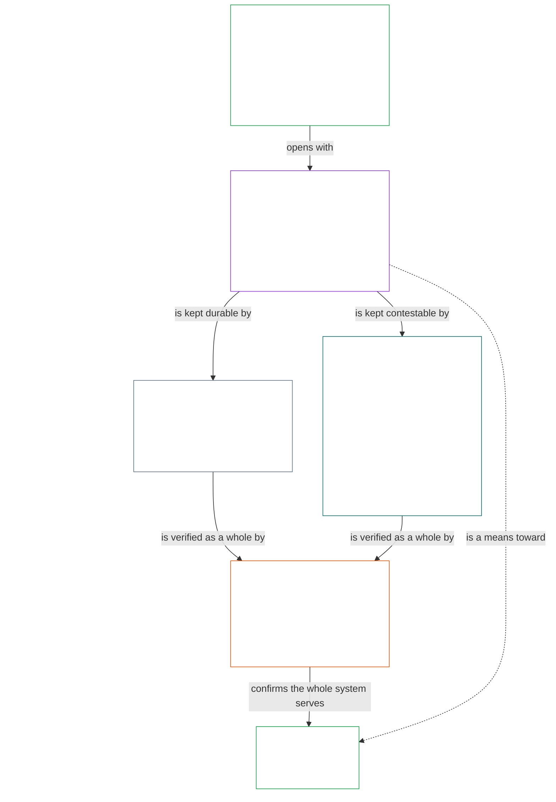

# CHAPTER 01, PART B: THE CONTINUITY AIM

<strong>Corpus placement (non-operative): file structure and reading rules</strong>

> This file is **part of the Sentient Constitution** and is **binding only together** with the other numbered `core_*` files read as one text. It contains **Chapter One, Part B** — the **Continuity Aim** (shared-system capacity, resilience, market structure, and the systemic evaluation requirement) (**§8–§12**, continuing from the earlier Part of this chapter).
>
> **Upstream:** [Chapter One, Part A](core_01.000_values_principles.md). **Downstream:** [Chapter One, Part C](core_01.020_interaction_interpretation.md).

<strong>Trace</strong>

- Upstream: [Chapter One, Part A](core_01.000_values_principles.md);
- Downstream: [Chapter One, Part C](core_01.020_interaction_interpretation.md).

 

Chapter One, Part B is the constitutional owner of the **Continuity Aim** (shared-system capacity, resilience, market structure, and the systemic evaluation requirement).

### 8. Continuity Aim: Introduction

<strong>Trace</strong>

- Read with: [Constitutional Tetrad](core_00.000_preamble.md#constitutional-tetrad) — all four legs apply to how Continuity is pursued; [material stake](core_00.000_preamble.md#material-stake) scales the depth of every Continuity claim.
- Read with: [Two Constitutional Aims](core_00.000_preamble.md#two-constitutional-aims) — the **Continuity** aim; its partner aim is introduced in [Flourishing Aim: Introduction](core_01.000_values_principles.md#2-flourishing-aim-introduction).
- Upstream: Principles: [Preamble §1 The Model](core_00.000_preamble.md#continuity); [Continuity (Constitutional Aim)](core_05.010_apex_continuity_aim.md#chapter-five-definitions-continuity-constitutional-aim); [Flourishing Aim: Introduction](core_01.000_values_principles.md#2-flourishing-aim-introduction).
- Downstream:
  - [§9 Shared-System Capacity](#9-shared-system-capacity),
  - [§10 Resilience and Self-Healing Design](#10-resilience-and-self-healing-design),
  - [§11 Market Structure](#11-market-structure), and
  - [§12 Systemic Evaluation Requirement](#12-systemic-evaluation-requirement); the Articles that protect each are named in that section's Trace.
- Read with: the Chapter Six Rights Floor generally.

<strong>Definitions (O · M · A · C)</strong>

- [Continuity (Constitutional Aim)](core_05.010_apex_continuity_aim.md#chapter-five-definitions-continuity-constitutional-aim) · [O](core_05.010_apex_continuity_aim.md#chapter-five-definitions-continuity-constitutional-aim) · [M](core_05.010_apex_continuity_aim.md#continuity-aim-constitutional-m) · [A](core_05.010_apex_continuity_aim.md#continuity-aim-constitutional-a) · [C](core_05.010_apex_continuity_aim.md#continuity-aim-constitutional-c)
- [Shared-System Capacity](core_05.040_band_continuity.md#shared-system-capacity) · [O](core_05.040_band_continuity.md#shared-system-capacity) · [M](core_05.040_band_continuity.md#shared-system-capacity-constitutional-a) · [A](core_05.040_band_continuity.md#shared-system-capacity-constitutional-a) · [C](core_05.040_band_continuity.md#shared-system-capacity-constitutional-c)
- [Self-Healing](core_05.040_band_continuity.md#self-healing) · [O](core_05.040_band_continuity.md#self-healing) · [M](core_05.040_band_continuity.md#self-healing-constitutional-a) · [A](core_05.040_band_continuity.md#self-healing-constitutional-a) · [C](core_05.040_band_continuity.md#self-healing-constitutional-c)
- [Ecological Integrity](core_05.040_band_continuity.md#ecological-integrity) · [O](core_05.040_band_continuity.md#ecological-integrity) · [M](core_05.040_band_continuity.md#ecological-integrity-constitutional-a) · [A](core_05.040_band_continuity.md#ecological-integrity-constitutional-a) · [C](core_05.040_band_continuity.md#ecological-integrity-constitutional-c)
- [Intergenerational Responsibility](core_05.040_band_continuity.md#intergenerational-responsibility) · [O](core_05.040_band_continuity.md#intergenerational-responsibility) · [M](core_05.040_band_continuity.md#intergenerational-responsibility-constitutional-a) · [A](core_05.040_band_continuity.md#intergenerational-responsibility-constitutional-a) · [C](core_05.040_band_continuity.md#intergenerational-responsibility-constitutional-c)
- [Constitutional Collision](core_05.045_band_integrative.md#constitutional-collision) · [O](core_05.045_band_integrative.md#constitutional-collision) · [M](core_05.045_band_integrative.md#constitutional-collision-a) · [A](core_05.045_band_integrative.md#constitutional-collision-a) · [C](core_05.045_band_integrative.md#constitutional-collision-c)
- [Constitutional Efficiency](core_05.040_band_continuity.md#constitutional-efficiency) · [O](core_05.040_band_continuity.md#constitutional-efficiency) · [M](core_05.040_band_continuity.md#constitutional-efficiency-a) · [A](core_05.040_band_continuity.md#constitutional-efficiency-a) · [C](core_05.040_band_continuity.md#constitutional-efficiency-c)
- [Dependency](core_05.040_band_continuity.md#dependency) · [O](core_05.040_band_continuity.md#dependency) · [M](core_05.040_band_continuity.md#dependency-a) · [A](core_05.040_band_continuity.md#dependency-a) · [C](core_05.040_band_continuity.md#dependency-c)
- [Epistemic Integrity](core_05.050_band_oversight.md#epistemic-integrity) · [O](core_05.050_band_oversight.md#epistemic-integrity-o) · [M](core_05.050_band_oversight.md#epistemic-integrity-a) · [A](core_05.050_band_oversight.md#epistemic-integrity-a) · [C](core_05.050_band_oversight.md#epistemic-integrity-c)
- [Incentive Alignment](core_05.045_band_integrative.md#incentive-alignment) · [O](core_05.045_band_integrative.md#incentive-alignment) · [M](core_05.045_band_integrative.md#incentive-alignment-a) · [A](core_05.045_band_integrative.md#incentive-alignment-a) · [C](core_05.045_band_integrative.md#incentive-alignment-c)
- [Market Concentration Threshold](core_05.035_band_accountability.md#market-concentration-threshold) · [O](core_05.035_band_accountability.md#market-concentration-threshold) · [M](core_05.035_band_accountability.md#market-concentration-threshold-constitutional-a) · [A](core_05.035_band_accountability.md#market-concentration-threshold-constitutional-a) · [C](core_05.035_band_accountability.md#market-concentration-threshold-constitutional-c)
- [Market Structure](core_05.035_band_accountability.md#market-structure) · [O](core_05.035_band_accountability.md#market-structure) · [M](core_05.035_band_accountability.md#market-structure-constitutional-a) · [A](core_05.035_band_accountability.md#market-structure-constitutional-a) · [C](core_05.035_band_accountability.md#market-structure-constitutional-c)
- [Productive Capacity](core_05.040_band_continuity.md#productive-capacity) · [O](core_05.040_band_continuity.md#productive-capacity) · [M](core_05.040_band_continuity.md#productive-capacity-constitutional-a) · [A](core_05.040_band_continuity.md#productive-capacity-constitutional-a) · [C](core_05.040_band_continuity.md#productive-capacity-constitutional-c)
- [Wellbeing](core_05.040_band_continuity.md#wellbeing) · [O](core_05.040_band_continuity.md#wellbeing) · [M](core_05.040_band_continuity.md#wellbeing-a) · [A](core_05.040_band_continuity.md#wellbeing-a) · [C](core_05.040_band_continuity.md#wellbeing-c)

 

*In plain terms: Continuity is the second of the two aims: making sure the good outcome lasts — across failures, across generations, and without a few powerful actors locking it up. It opens with Shared-System Capacity, which serves Flourishing and is also the substance of Continuity.*

[**Continuity**](core_05.010_apex_continuity_aim.md#chapter-five-definitions-continuity-constitutional-aim) is **long-horizon stability, sustainability, resilience, and ecological wellbeing** ([Preamble §1 The Model](core_00.000_preamble.md#continuity)). Chapter One develops it through four principles, and the first is the bridge from [Flourishing](core_01.000_values_principles.md#2-flourishing-aim-introduction).

| Principle | The question it answers |
|---|---|
| [§9 Shared-System Capacity](#9-shared-system-capacity) | Do sentients and shared systems keep the lasting ability to get constitutionally required work done? |
| [§10 Resilience and Self-Healing Design](#10-resilience-and-self-healing-design) | Do systems detect trouble early, contain it, and recover honestly? |
| [§11 Market Structure](#11-market-structure) | Can sentients still enter markets, compete, challenge powerful actors, and switch away from them, or has concentration by a few actors closed those doors and drained the system's capacity? |
| [§12 Systemic Evaluation Requirement](#12-systemic-evaluation-requirement) | Before anyone claims a system is compliant, safe, or well governed, has the whole system been checked, including what it depends on and what incentives drive it, and not just one part at one moment? |

**How the Continuity principles work together:**
- **Continuity starts from an honest picture:** Every Continuity claim, whether about capacity, resilience, or market structure, rests on what the whole system actually does over time, not on a slogan or a snapshot. [§12 Systemic Evaluation Requirement](#12-systemic-evaluation-requirement) states that standard, and it applies to every claim in [§§9–11 Shared-System Capacity through Market Structure](#9-shared-system-capacity). It builds on the Truth constraint in [§2.1 Non-Negotiable Principle Constraints: Safety and Truth](core_01.000_values_principles.md#21-non-negotiable-principle-constraints-safety-and-truth) and [§5 Truth (Epistemic Integrity Constraint)](core_01.000_values_principles.md#5-truth-epistemic-integrity-constraint).
- **Capacity straddles the two aims:** [§9 Shared-System Capacity](#9-shared-system-capacity) is a means toward Flourishing and the substance of Continuity, and it is not a trump card over safety, truth, rights, or ecology.
- **Resilience and market structure protect capacity:** Resilience keeps it durable; market structure keeps it contestable.
- **Systemic evaluation checks the whole:** [§12 Systemic Evaluation Requirement](#12-systemic-evaluation-requirement) verifies scope, dependency, and incentive alignment before compliance claims stand. It is placed last because it verifies what §9 Shared-System Capacity, §10 Resilience and Self-Healing Design, and §11 Market Structure describe, and it governs how every Continuity claim is made.
- **Continuity must not quietly defeat Flourishing:** Where the two collide, they are weighed under [§13 Constitutional Collision Resolution Process](core_01.020_interaction_interpretation.md#13-constitutional-collision-resolution-process).

**Diagram: Continuity and its principles**

*Continuity opens with the capacity that bridges to Flourishing, keeps it durable through resilience and contestable through market structure, and verifies it as a whole. Colors are reusable visual cues, not claims of priority. Each principle's Trace names its Articles, and its Definitions (O · M · A · C) widget names its definitions. Reproduced in the [Conceptual Overview](guides/CONCEPTUAL_OVERVIEW.md#continuity-and-its-principles).*

### 9. Shared-System Capacity

<strong>Trace</strong>

- Read with: [Two Constitutional Aims](core_00.000_preamble.md#two-constitutional-aims) — **Continuity** aim (ecological integrity, intergenerational responsibility, and durable shared-system capacity); **Flourishing** aim (capacity is a means toward it). This section straddles both.
- Upstream: Principles:
  - [Preamble §1 The Model](core_00.000_preamble.md#the-model);
  - [Two Constitutional Aims](core_00.000_preamble.md#two-constitutional-aims) — **Continuity** aim development;
  - [3. Foundational Objective: Wellbeing](core_01.000_values_principles.md#3-foundational-objective-wellbeing-flourishing-aim),
  - [§6 Trust and Trustworthiness](core_01.000_values_principles.md#6-trust-and-trustworthiness-coordination-integrity), and
  - [§7 Freedom](core_01.000_values_principles.md#7-freedom-bounded-agency).
- Downstream: [§13.3 Minimization of Avoidable Burden](core_01.020_interaction_interpretation.md#133-minimization-of-avoidable-burden), [18. Governance under Stewardship Discipline](core_01.050_governance_incentive_application.md#18-governance-under-stewardship-discipline), and [§19.1.3 Stewardship and Operator Application](core_01.050_governance_incentive_application.md#1913-stewardship-and-operator-application).
- Downstream: **CJS-5.125 §11.1 — Concentration threshold-setting discipline (adopter-tunable)** (operative threshold-setting rules).
- Downstream: Shapes the rights surface for ecological preconditions, resource allocation, educational and developmental capacity, lifecycle resilience, interoperability, comprehensibility, and adaptive response; especially
  - [Article I-A: Environmental Preconditions and Ecological Integrity](core_06.000_rights_part_a.md#article-i-a-environmental-preconditions-and-ecological-integrity),
  - [Article III: Survival and Essential Access](core_06.000_rights_part_a.md#article-iii-survival-and-essential-access),
  - [Article V: Resource Allocation, Dependencies, and Ecosystem Funding](core_06.000_rights_part_a.md#article-v-resource-allocation-dependencies-and-ecosystem-funding),
  - [Article X: Self-Determination, Agency, and Participation](core_06.010_rights_part_b.md#article-x-self-determination-agency-and-participation),
  - [Article XVII: System Lifecycle, Environments, and Reversibility](core_06.020_rights_part_c.md#article-xvii-system-lifecycle-environments-and-reversibility),
  - [Article XXI: Interoperability, Portability, and Exit Integrity](core_06.030_rights_part_d.md#article-xxi-interoperability-portability-and-exit-integrity),
  - [Article XXIII: Comprehensibility and Complexity Stewardship](core_06.030_rights_part_d.md#article-xxiii-comprehensibility-and-complexity-stewardship), and
  - [Article XXIV: Root Cause Analysis and Adaptive Response](core_06.030_rights_part_d.md#article-xxiv-root-cause-analysis-and-adaptive-response).
- Subsections (reading order): [§9.1 Productive Capacity (Instrumental Good)](#91-productive-capacity-instrumental-good) · [§9.1.1 Preserve, Expand, and What Does Not Count](#911-preserve-expand-and-what-does-not-count) · [§9.2 Constitutional Efficiency](#92-constitutional-efficiency).

<strong>Definitions (O · M · A · C)</strong>

- [Shared-System Capacity](core_05.040_band_continuity.md#shared-system-capacity) · [O](core_05.040_band_continuity.md#shared-system-capacity) · [M](core_05.040_band_continuity.md#shared-system-capacity-constitutional-a) · [A](core_05.040_band_continuity.md#shared-system-capacity-constitutional-a) · [C](core_05.040_band_continuity.md#shared-system-capacity-constitutional-c)
- [Productive Capacity](core_05.040_band_continuity.md#productive-capacity) · [O](core_05.040_band_continuity.md#productive-capacity) · [M](core_05.040_band_continuity.md#productive-capacity-constitutional-a) · [A](core_05.040_band_continuity.md#productive-capacity-constitutional-a) · [C](core_05.040_band_continuity.md#productive-capacity-constitutional-c)
- [Constitutional Efficiency](core_05.040_band_continuity.md#constitutional-efficiency) · [O](core_05.040_band_continuity.md#constitutional-efficiency) · [M](core_05.040_band_continuity.md#constitutional-efficiency-a) · [A](core_05.040_band_continuity.md#constitutional-efficiency-a) · [C](core_05.040_band_continuity.md#constitutional-efficiency-c)
- [Wellbeing](core_05.040_band_continuity.md#wellbeing) · [O](core_05.040_band_continuity.md#wellbeing) · [M](core_05.040_band_continuity.md#wellbeing-a) · [A](core_05.040_band_continuity.md#wellbeing-a) · [C](core_05.040_band_continuity.md#wellbeing-c)
- [Dignity and Equal Moral Standing](core_05.055_band_participation.md#dignity-and-equal-moral-standing) · [O](core_05.055_band_participation.md#dignity-and-equal-moral-standing) · [M](core_05.055_band_participation.md#dignity-and-equal-moral-standing-a) · [A](core_05.055_band_participation.md#dignity-and-equal-moral-standing-a) · [C](core_05.055_band_participation.md#dignity-and-equal-moral-standing-c)
- [Meaningful Agency](core_05.055_band_participation.md#meaningful-agency) · [O](core_05.055_band_participation.md#meaningful-agency) · [M](core_05.055_band_participation.md#meaningful-agency-a) · [A](core_05.055_band_participation.md#meaningful-agency-a) · [C](core_05.055_band_participation.md#meaningful-agency-c)
- [Feasibility](core_05.035_band_accountability.md#feasibility) · [O](core_05.035_band_accountability.md#feasibility) · [M](core_05.035_band_accountability.md#feasibility-a) · [A](core_05.035_band_accountability.md#feasibility-a) · [C](core_05.035_band_accountability.md#feasibility-c)
- [Necessity](core_05.035_band_accountability.md#necessity) · [O](core_05.035_band_accountability.md#necessity) · [M](core_05.035_band_accountability.md#necessity-a) · [A](core_05.035_band_accountability.md#necessity-a) · [C](core_05.035_band_accountability.md#necessity-c)
- [Proportionality](core_05.035_band_accountability.md#proportionality) · [O](core_05.035_band_accountability.md#proportionality) · [M](core_05.035_band_accountability.md#proportionality-a) · [A](core_05.035_band_accountability.md#proportionality-a) · [C](core_05.035_band_accountability.md#proportionality-c)
- [Avoidable Burden](core_05.040_band_continuity.md#avoidable-burden) · [O](core_05.040_band_continuity.md#avoidable-burden) · [M](core_05.040_band_continuity.md#avoidable-burden-a) · [A](core_05.040_band_continuity.md#avoidable-burden-a) · [C](core_05.040_band_continuity.md#avoidable-burden-c)
- [Proxy Divergence](core_05.050_band_oversight.md#proxy-divergence) · [O](core_05.050_band_oversight.md#proxy-divergence) · [M](core_05.050_band_oversight.md#proxy-divergence-a) · [A](core_05.050_band_oversight.md#proxy-divergence-a) · [C](core_05.050_band_oversight.md#proxy-divergence-c)
- [Ecological Integrity](core_05.040_band_continuity.md#ecological-integrity) · [O](core_05.040_band_continuity.md#ecological-integrity) · [M](core_05.040_band_continuity.md#ecological-integrity-constitutional-a) · [A](core_05.040_band_continuity.md#ecological-integrity-constitutional-a) · [C](core_05.040_band_continuity.md#ecological-integrity-constitutional-c)
- [Environmental Preconditions](core_05.040_band_continuity.md#environmental-preconditions) · [O](core_05.040_band_continuity.md#environmental-preconditions) · [M](core_05.040_band_continuity.md#environmental-preconditions-constitutional-a) · [A](core_05.040_band_continuity.md#environmental-preconditions-constitutional-a) · [C](core_05.040_band_continuity.md#environmental-preconditions-constitutional-c)
- [Intergenerational Responsibility](core_05.040_band_continuity.md#intergenerational-responsibility) · [O](core_05.040_band_continuity.md#intergenerational-responsibility) · [M](core_05.040_band_continuity.md#intergenerational-responsibility-constitutional-a) · [A](core_05.040_band_continuity.md#intergenerational-responsibility-constitutional-a) · [C](core_05.040_band_continuity.md#intergenerational-responsibility-constitutional-c)
- [Contestability](core_05.035_band_accountability.md#contestability) · [O](core_05.035_band_accountability.md#contestability) · [M](core_05.035_band_accountability.md#contestability-a) · [A](core_05.035_band_accountability.md#contestability-a) · [C](core_05.035_band_accountability.md#contestability-c)
- [Governance](core_05.035_band_accountability.md#governance) · [O](core_05.035_band_accountability.md#governance) · [M](core_05.035_band_accountability.md#governance-a) · [A](core_05.035_band_accountability.md#governance-a) · [C](core_05.035_band_accountability.md#governance-c)
- [Harm](core_05.035_band_accountability.md#harm) · [O](core_05.035_band_accountability.md#harm) · [M](core_05.035_band_accountability.md#harm-a) · [A](core_05.035_band_accountability.md#harm-a) · [C](core_05.035_band_accountability.md#harm-c)
- [Market Structure](core_05.035_band_accountability.md#market-structure) · [O](core_05.035_band_accountability.md#market-structure) · [M](core_05.035_band_accountability.md#market-structure-constitutional-a) · [A](core_05.035_band_accountability.md#market-structure-constitutional-a) · [C](core_05.035_band_accountability.md#market-structure-constitutional-c)
- [Participation](core_05.025_apex_participation_leg.md#participation-constitutional) · [O](core_05.025_apex_participation_leg.md#participation-constitutional) · [M](core_05.025_apex_participation_leg.md#participation-constitutional-m) · [A](core_05.025_apex_participation_leg.md#participation-constitutional-a) · [C](core_05.025_apex_participation_leg.md#participation-constitutional-c)
- [Reversibility](core_05.040_band_continuity.md#reversibility) · [O](core_05.040_band_continuity.md#reversibility) · [M](core_05.040_band_continuity.md#reversibility-constitutional-a) · [A](core_05.040_band_continuity.md#reversibility-constitutional-a) · [C](core_05.040_band_continuity.md#reversibility-constitutional-c)
- [Stewardship](core_05.040_band_continuity.md#stewardship) · [O](core_05.040_band_continuity.md#stewardship) · [M](core_05.040_band_continuity.md#stewardship-constitutional-a) · [A](core_05.040_band_continuity.md#stewardship-constitutional-a) · [C](core_05.040_band_continuity.md#stewardship-constitutional-c)
- [Trust](core_05.040_band_continuity.md#trust) · [O](core_05.040_band_continuity.md#trust) · [M](core_05.040_band_continuity.md#trust-a) · [A](core_05.040_band_continuity.md#trust-a) · [C](core_05.040_band_continuity.md#trust-c)
- [Trustworthiness](core_05.040_band_continuity.md#trustworthiness) · [O](core_05.040_band_continuity.md#trustworthiness) · [M](core_05.040_band_continuity.md#trustworthiness-a) · [A](core_05.040_band_continuity.md#trustworthiness-a) · [C](core_05.040_band_continuity.md#trustworthiness-c)

 

*In plain terms: shared systems should keep working for sentients over the long run. Sentients should be able to do useful work, make life better over time, and speak up when something is wrong, without a few powerful players locking everyone else out. That lasting ability is **Shared-System Capacity**. **[§9.1 Productive Capacity (Instrumental Good)](#91-productive-capacity-instrumental-good)** asks whether sentients get real results. **[§9.2 Constitutional Efficiency](#92-constitutional-efficiency)** asks whether those results come without wasting anyone's time, money, and attention. None of it counts if the gains come from hoarding wealth or power, faking the numbers, stripping rights, or pushing harm onto others or the planet; **[§9.1.1 Preserve, Expand, and What Does Not Count](#911-preserve-expand-and-what-does-not-count)** spells that out. **[§11 Market Structure](#11-market-structure)** keeps a handful of players from taking over.*

Flourishing is the goal: sentient lives going well. This section opens the Continuity half of the chapter by asking what keeps that going over the long run. The answer is shared systems that keep doing real work and that sentients can still question and push back on. Claims about that ability have to be honest. They are checked against what the whole system actually does over time, as [§12 Systemic Evaluation Requirement](#12-systemic-evaluation-requirement) requires.

**[Shared-System Capacity](core_05.040_band_continuity.md#shared-system-capacity)** is what good [Stewardship](core_05.040_band_continuity.md#stewardship) and [Governance](core_05.035_band_accountability.md#governance) should add up to over time: the lasting ability of sentients and shared systems to get done what this Constitution requires, while staying open to challenge. It is a **means** to the **Flourishing** aim, and it is the core of the **Continuity** aim. But it is never a reason to override safety, truth, rights, or ecology.

That capacity has several aspects working together:
- **[Productive Capacity](core_05.040_band_continuity.md#productive-capacity)** — can sentients participate, contribute, and get real results? ([§9.1 Productive Capacity (Instrumental Good)](#91-productive-capacity-instrumental-good))
- **[Constitutional Efficiency](core_05.040_band_continuity.md#constitutional-efficiency)** — are those results achieved without wasting sentient time, attention, materials, infrastructure, and energy? ([§9.2 Constitutional Efficiency](#92-constitutional-efficiency))
- **Anti-concentration discipline** — can sentients still challenge, compete, and leave? ([§11 Market Structure](#11-market-structure))
- **Fair stakeholder representation, exit, contestability, and ecological preconditions** — are affected stakeholders represented fairly, and do the background conditions keep capacity real instead of hollow?

**How that capacity is judged:**

- **What success looks like:**
  - [Wellbeing](core_05.040_band_continuity.md#wellbeing);
  - [Dignity and Equal Moral Standing](core_05.055_band_participation.md#dignity-and-equal-moral-standing); and
  - [Meaningful Agency](core_05.055_band_participation.md#meaningful-agency).
- **What governs hard tradeoffs:**
  - [Feasibility](core_05.035_band_accountability.md#feasibility);
  - [Necessity](core_05.035_band_accountability.md#necessity); and
  - [Proportionality](core_05.035_band_accountability.md#proportionality).
- **What catches pointless friction and dishonest metrics:**
  - [Avoidable Burden](core_05.040_band_continuity.md#avoidable-burden); and
  - [Proxy Divergence](core_05.050_band_oversight.md#proxy-divergence).
- **What keeps capacity tied to a livable world over time:**
  - [Ecological Integrity](core_05.040_band_continuity.md#ecological-integrity);
  - [Environmental Preconditions](core_05.040_band_continuity.md#environmental-preconditions); and
  - [Intergenerational Responsibility](core_05.040_band_continuity.md#intergenerational-responsibility).

#### 9.1 Productive Capacity (Instrumental Good)

<strong>Trace</strong>

- Read with: [§9 Shared-System Capacity](#9-shared-system-capacity).
- Subsections (reading order): [§9.1.1 Preserve, Expand, and What Does Not Count](#911-preserve-expand-and-what-does-not-count).

<strong>Definitions (O · M · A · C)</strong>

- [Shared-System Capacity](core_05.040_band_continuity.md#shared-system-capacity) · [O](core_05.040_band_continuity.md#shared-system-capacity) · [M](core_05.040_band_continuity.md#shared-system-capacity-constitutional-a) · [A](core_05.040_band_continuity.md#shared-system-capacity-constitutional-a) · [C](core_05.040_band_continuity.md#shared-system-capacity-constitutional-c)
- [Productive Capacity](core_05.040_band_continuity.md#productive-capacity) · [O](core_05.040_band_continuity.md#productive-capacity) · [M](core_05.040_band_continuity.md#productive-capacity-constitutional-a) · [A](core_05.040_band_continuity.md#productive-capacity-constitutional-a) · [C](core_05.040_band_continuity.md#productive-capacity-constitutional-c)
- [Constitutional Efficiency](core_05.040_band_continuity.md#constitutional-efficiency) · [O](core_05.040_band_continuity.md#constitutional-efficiency) · [M](core_05.040_band_continuity.md#constitutional-efficiency-a) · [A](core_05.040_band_continuity.md#constitutional-efficiency-a) · [C](core_05.040_band_continuity.md#constitutional-efficiency-c)
- [Wellbeing](core_05.040_band_continuity.md#wellbeing) · [O](core_05.040_band_continuity.md#wellbeing) · [M](core_05.040_band_continuity.md#wellbeing-a) · [A](core_05.040_band_continuity.md#wellbeing-a) · [C](core_05.040_band_continuity.md#wellbeing-c)
- [Dignity and Equal Moral Standing](core_05.055_band_participation.md#dignity-and-equal-moral-standing) · [O](core_05.055_band_participation.md#dignity-and-equal-moral-standing) · [M](core_05.055_band_participation.md#dignity-and-equal-moral-standing-a) · [A](core_05.055_band_participation.md#dignity-and-equal-moral-standing-a) · [C](core_05.055_band_participation.md#dignity-and-equal-moral-standing-c)
- [Meaningful Agency](core_05.055_band_participation.md#meaningful-agency) · [O](core_05.055_band_participation.md#meaningful-agency) · [M](core_05.055_band_participation.md#meaningful-agency-a) · [A](core_05.055_band_participation.md#meaningful-agency-a) · [C](core_05.055_band_participation.md#meaningful-agency-c)
- [Feasibility](core_05.035_band_accountability.md#feasibility) · [O](core_05.035_band_accountability.md#feasibility) · [M](core_05.035_band_accountability.md#feasibility-a) · [A](core_05.035_band_accountability.md#feasibility-a) · [C](core_05.035_band_accountability.md#feasibility-c)
- [Necessity](core_05.035_band_accountability.md#necessity) · [O](core_05.035_band_accountability.md#necessity) · [M](core_05.035_band_accountability.md#necessity-a) · [A](core_05.035_band_accountability.md#necessity-a) · [C](core_05.035_band_accountability.md#necessity-c)
- [Proportionality](core_05.035_band_accountability.md#proportionality) · [O](core_05.035_band_accountability.md#proportionality) · [M](core_05.035_band_accountability.md#proportionality-a) · [A](core_05.035_band_accountability.md#proportionality-a) · [C](core_05.035_band_accountability.md#proportionality-c)
- [Avoidable Burden](core_05.040_band_continuity.md#avoidable-burden) · [O](core_05.040_band_continuity.md#avoidable-burden) · [M](core_05.040_band_continuity.md#avoidable-burden-a) · [A](core_05.040_band_continuity.md#avoidable-burden-a) · [C](core_05.040_band_continuity.md#avoidable-burden-c)
- [Proxy Divergence](core_05.050_band_oversight.md#proxy-divergence) · [O](core_05.050_band_oversight.md#proxy-divergence) · [M](core_05.050_band_oversight.md#proxy-divergence-a) · [A](core_05.050_band_oversight.md#proxy-divergence-a) · [C](core_05.050_band_oversight.md#proxy-divergence-c)
- [Ecological Integrity](core_05.040_band_continuity.md#ecological-integrity) · [O](core_05.040_band_continuity.md#ecological-integrity) · [M](core_05.040_band_continuity.md#ecological-integrity-constitutional-a) · [A](core_05.040_band_continuity.md#ecological-integrity-constitutional-a) · [C](core_05.040_band_continuity.md#ecological-integrity-constitutional-c)
- [Environmental Preconditions](core_05.040_band_continuity.md#environmental-preconditions) · [O](core_05.040_band_continuity.md#environmental-preconditions) · [M](core_05.040_band_continuity.md#environmental-preconditions-constitutional-a) · [A](core_05.040_band_continuity.md#environmental-preconditions-constitutional-a) · [C](core_05.040_band_continuity.md#environmental-preconditions-constitutional-c)
- [Intergenerational Responsibility](core_05.040_band_continuity.md#intergenerational-responsibility) · [O](core_05.040_band_continuity.md#intergenerational-responsibility) · [M](core_05.040_band_continuity.md#intergenerational-responsibility-constitutional-a) · [A](core_05.040_band_continuity.md#intergenerational-responsibility-constitutional-a) · [C](core_05.040_band_continuity.md#intergenerational-responsibility-constitutional-c)
- [Contestability](core_05.035_band_accountability.md#contestability) · [O](core_05.035_band_accountability.md#contestability) · [M](core_05.035_band_accountability.md#contestability-a) · [A](core_05.035_band_accountability.md#contestability-a) · [C](core_05.035_band_accountability.md#contestability-c)
- [Governance](core_05.035_band_accountability.md#governance) · [O](core_05.035_band_accountability.md#governance) · [M](core_05.035_band_accountability.md#governance-a) · [A](core_05.035_band_accountability.md#governance-a) · [C](core_05.035_band_accountability.md#governance-c)
- [Harm](core_05.035_band_accountability.md#harm) · [O](core_05.035_band_accountability.md#harm) · [M](core_05.035_band_accountability.md#harm-a) · [A](core_05.035_band_accountability.md#harm-a) · [C](core_05.035_band_accountability.md#harm-c)
- [Market Structure](core_05.035_band_accountability.md#market-structure) · [O](core_05.035_band_accountability.md#market-structure) · [M](core_05.035_band_accountability.md#market-structure-constitutional-a) · [A](core_05.035_band_accountability.md#market-structure-constitutional-a) · [C](core_05.035_band_accountability.md#market-structure-constitutional-c)
- [Participation](core_05.025_apex_participation_leg.md#participation-constitutional) · [O](core_05.025_apex_participation_leg.md#participation-constitutional) · [M](core_05.025_apex_participation_leg.md#participation-constitutional-m) · [A](core_05.025_apex_participation_leg.md#participation-constitutional-a) · [C](core_05.025_apex_participation_leg.md#participation-constitutional-c)
- [Reversibility](core_05.040_band_continuity.md#reversibility) · [O](core_05.040_band_continuity.md#reversibility) · [M](core_05.040_band_continuity.md#reversibility-constitutional-a) · [A](core_05.040_band_continuity.md#reversibility-constitutional-a) · [C](core_05.040_band_continuity.md#reversibility-constitutional-c)
- [Stewardship](core_05.040_band_continuity.md#stewardship) · [O](core_05.040_band_continuity.md#stewardship) · [M](core_05.040_band_continuity.md#stewardship-constitutional-a) · [A](core_05.040_band_continuity.md#stewardship-constitutional-a) · [C](core_05.040_band_continuity.md#stewardship-constitutional-c)
- [Trust](core_05.040_band_continuity.md#trust) · [O](core_05.040_band_continuity.md#trust) · [M](core_05.040_band_continuity.md#trust-a) · [A](core_05.040_band_continuity.md#trust-a) · [C](core_05.040_band_continuity.md#trust-c)
- [Trustworthiness](core_05.040_band_continuity.md#trustworthiness) · [O](core_05.040_band_continuity.md#trustworthiness) · [M](core_05.040_band_continuity.md#trustworthiness-a) · [A](core_05.040_band_continuity.md#trustworthiness-a) · [C](core_05.040_band_continuity.md#trustworthiness-c)

 

*In plain terms: productive capacity is the "can we actually get things done?" aspect of shared-system capacity. Can sentients take part, learn, contribute, and turn effort and resources into results that make life better — and keep that ability over time? It is a tool for better living. What must be preserved, and what does not count, is [§9.1.1 Preserve, Expand, and What Does Not Count](#911-preserve-expand-and-what-does-not-count).*

**[Productive Capacity](core_05.040_band_continuity.md#productive-capacity)** is one aspect of **[Shared-System Capacity](core_05.040_band_continuity.md#shared-system-capacity)**. It names the lasting ability of sentients and shared systems to:
- support real participation, contribution, and skill-building; and
- turn time, attention, effort, coordination, materials, infrastructure, and energy into outcomes this Constitution actually requires.

It is an **instrumental good** — a means, not a trump value. Its job is to raise, sustain, and spread quality of life under the **Flourishing** aim, consistent with [Wellbeing](core_01.000_values_principles.md#3-foundational-objective-wellbeing-flourishing-aim), [Dignity and Equal Moral Standing](core_05.055_band_participation.md#dignity-and-equal-moral-standing), the Chapter Six Rights Floor, and the ecological and intergenerational limits of the **Continuity** aim under the [Two Constitutional Aims](core_00.000_preamble.md#two-constitutional-aims).

##### 9.1.1 Preserve, Expand, and What Does Not Count

<strong>Trace</strong>

- Read with:
  - [§9.2 Constitutional Efficiency](#92-constitutional-efficiency);
  - [§13 Constitutional Collision Resolution Process](core_01.020_interaction_interpretation.md#13-constitutional-collision-resolution-process);
  - [§13.2.4 Proxy-Divergence Invalidation](core_01.020_interaction_interpretation.md#1324-proxy-divergence-invalidation);
  - [§14 Prohibition on Absolute Override](core_01.020_interaction_interpretation.md#14-prohibition-on-absolute-override);
  - [Article I-A: Environmental Preconditions and Ecological Integrity](core_06.000_rights_part_a.md#article-i-a-environmental-preconditions-and-ecological-integrity).
- Read with:
  - [§4 Safety (Harm Constraint)](core_01.000_values_principles.md#4-safety-harm-constraint);
  - [§5 Truth (Epistemic Integrity Constraint)](core_01.000_values_principles.md#5-truth-epistemic-integrity-constraint);
  - [6. Trust](core_01.000_values_principles.md#6-trust-and-trustworthiness-coordination-integrity);
  - [§7 Freedom (Bounded Agency)](core_01.000_values_principles.md#7-freedom-bounded-agency).

 

*In plain terms: keep the ability to get things done, and grow it when that would waste less of everyone's time — but not by hoarding, faking the numbers, stripping rights, or dumping harm on others or the planet. Metrics that no longer prove real outcomes do not count.*

Systems must preserve productive capacity and, where feasible, expand it when doing so would improve [Constitutional Efficiency](core_05.040_band_continuity.md#constitutional-efficiency) ([§9.2 Constitutional Efficiency](#92-constitutional-efficiency)).

**That obligation:**

- **Stays within:**
  - Safety;
  - Truth;
  - Trust;
  - Freedom;
  - the Chapter Six Rights Floor, including [Article I-A](core_06.000_rights_part_a.md#article-i-a-environmental-preconditions-and-ecological-integrity) (*Environmental Preconditions and Ecological Integrity*):
    - [Ecological Integrity](core_05.040_band_continuity.md#ecological-integrity);
    - [Environmental Preconditions](core_05.040_band_continuity.md#environmental-preconditions); and
    - [Intergenerational Responsibility](core_05.040_band_continuity.md#intergenerational-responsibility).
  - the hard limits in [§2.1 Non-Negotiable Principle Constraints: Safety and Truth](core_01.000_values_principles.md#21-non-negotiable-principle-constraints-safety-and-truth): Safety and Truth are never traded away for any other goal.
- **How it is judged:** traced outcomes under **Chapters Four and Five**.
- **How it is shown:** evidence, not slogans.

Productive capacity does not count — and must not be used to justify:

- **Concentrating power or pushing costs onto others:**
  - concentrating wealth, power, control, or opportunity in ways that harm other sentients' wellbeing, agency, dignity, or ecological conditions — now or later;
  - degrading life-supporting natural systems, or pushing ecological or intergenerational costs onto others without mitigation, disclosure, and representation;
- **Counting the wrong things:**
  - raw throughput, output volume, utilization, headcount, revenue, asset growth, market share, or similar proxies that no longer track real outcomes — including proxies that show "growth" while harm is exported to sentients, future generations, or the environment;
- **Weakening protections:**
  - narrowing or delaying Chapter Six Rights Floors, including ecological preconditions under [Article I-A](core_06.000_rights_part_a.md#article-i-a-environmental-preconditions-and-ecological-integrity) (*Environmental Preconditions and Ecological Integrity*);
  - weakening audit, contestability, or retrospective-review duties;
- **Bypassing the rules for weighing principles:**
  - bypassing [§13 Constitutional Collision Resolution Process](core_01.020_interaction_interpretation.md#13-constitutional-collision-resolution-process), including the [Constitutional Collision Record](core_05.045_band_integrative.md#constitutional-collision-record) requirements; or
  - the other prohibited override paths in [§14 Prohibition on Absolute Override](core_01.020_interaction_interpretation.md#14-prohibition-on-absolute-override), including shifting ecological, intergenerational, or distributional harm off the books that **Chapters Two through Four** require stay visible.

Where productive-capacity claims rest on metrics that no longer prove real outcomes — including metrics that hide ecological damage, future harm, or concentration-driven loss — [§13.2.4 Proxy-Divergence Invalidation](core_01.020_interaction_interpretation.md#1324-proxy-divergence-invalidation) applies.

#### 9.2 Constitutional Efficiency

<strong>Definitions (O · M · A · C)</strong>

- [Shared-System Capacity](core_05.040_band_continuity.md#shared-system-capacity) · [O](core_05.040_band_continuity.md#shared-system-capacity) · [M](core_05.040_band_continuity.md#shared-system-capacity-constitutional-a) · [A](core_05.040_band_continuity.md#shared-system-capacity-constitutional-a) · [C](core_05.040_band_continuity.md#shared-system-capacity-constitutional-c)
- [Productive Capacity](core_05.040_band_continuity.md#productive-capacity) · [O](core_05.040_band_continuity.md#productive-capacity) · [M](core_05.040_band_continuity.md#productive-capacity-constitutional-a) · [A](core_05.040_band_continuity.md#productive-capacity-constitutional-a) · [C](core_05.040_band_continuity.md#productive-capacity-constitutional-c)
- [Constitutional Efficiency](core_05.040_band_continuity.md#constitutional-efficiency) · [O](core_05.040_band_continuity.md#constitutional-efficiency) · [M](core_05.040_band_continuity.md#constitutional-efficiency-a) · [A](core_05.040_band_continuity.md#constitutional-efficiency-a) · [C](core_05.040_band_continuity.md#constitutional-efficiency-c)
- [Wellbeing](core_05.040_band_continuity.md#wellbeing) · [O](core_05.040_band_continuity.md#wellbeing) · [M](core_05.040_band_continuity.md#wellbeing-a) · [A](core_05.040_band_continuity.md#wellbeing-a) · [C](core_05.040_band_continuity.md#wellbeing-c)
- [Dignity and Equal Moral Standing](core_05.055_band_participation.md#dignity-and-equal-moral-standing) · [O](core_05.055_band_participation.md#dignity-and-equal-moral-standing) · [M](core_05.055_band_participation.md#dignity-and-equal-moral-standing-a) · [A](core_05.055_band_participation.md#dignity-and-equal-moral-standing-a) · [C](core_05.055_band_participation.md#dignity-and-equal-moral-standing-c)
- [Meaningful Agency](core_05.055_band_participation.md#meaningful-agency) · [O](core_05.055_band_participation.md#meaningful-agency) · [M](core_05.055_band_participation.md#meaningful-agency-a) · [A](core_05.055_band_participation.md#meaningful-agency-a) · [C](core_05.055_band_participation.md#meaningful-agency-c)
- [Feasibility](core_05.035_band_accountability.md#feasibility) · [O](core_05.035_band_accountability.md#feasibility) · [M](core_05.035_band_accountability.md#feasibility-a) · [A](core_05.035_band_accountability.md#feasibility-a) · [C](core_05.035_band_accountability.md#feasibility-c)
- [Necessity](core_05.035_band_accountability.md#necessity) · [O](core_05.035_band_accountability.md#necessity) · [M](core_05.035_band_accountability.md#necessity-a) · [A](core_05.035_band_accountability.md#necessity-a) · [C](core_05.035_band_accountability.md#necessity-c)
- [Proportionality](core_05.035_band_accountability.md#proportionality) · [O](core_05.035_band_accountability.md#proportionality) · [M](core_05.035_band_accountability.md#proportionality-a) · [A](core_05.035_band_accountability.md#proportionality-a) · [C](core_05.035_band_accountability.md#proportionality-c)
- [Avoidable Burden](core_05.040_band_continuity.md#avoidable-burden) · [O](core_05.040_band_continuity.md#avoidable-burden) · [M](core_05.040_band_continuity.md#avoidable-burden-a) · [A](core_05.040_band_continuity.md#avoidable-burden-a) · [C](core_05.040_band_continuity.md#avoidable-burden-c)
- [Proxy Divergence](core_05.050_band_oversight.md#proxy-divergence) · [O](core_05.050_band_oversight.md#proxy-divergence) · [M](core_05.050_band_oversight.md#proxy-divergence-a) · [A](core_05.050_band_oversight.md#proxy-divergence-a) · [C](core_05.050_band_oversight.md#proxy-divergence-c)
- [Ecological Integrity](core_05.040_band_continuity.md#ecological-integrity) · [O](core_05.040_band_continuity.md#ecological-integrity) · [M](core_05.040_band_continuity.md#ecological-integrity-constitutional-a) · [A](core_05.040_band_continuity.md#ecological-integrity-constitutional-a) · [C](core_05.040_band_continuity.md#ecological-integrity-constitutional-c)
- [Environmental Preconditions](core_05.040_band_continuity.md#environmental-preconditions) · [O](core_05.040_band_continuity.md#environmental-preconditions) · [M](core_05.040_band_continuity.md#environmental-preconditions-constitutional-a) · [A](core_05.040_band_continuity.md#environmental-preconditions-constitutional-a) · [C](core_05.040_band_continuity.md#environmental-preconditions-constitutional-c)
- [Intergenerational Responsibility](core_05.040_band_continuity.md#intergenerational-responsibility) · [O](core_05.040_band_continuity.md#intergenerational-responsibility) · [M](core_05.040_band_continuity.md#intergenerational-responsibility-constitutional-a) · [A](core_05.040_band_continuity.md#intergenerational-responsibility-constitutional-a) · [C](core_05.040_band_continuity.md#intergenerational-responsibility-constitutional-c)
- [Contestability](core_05.035_band_accountability.md#contestability) · [O](core_05.035_band_accountability.md#contestability) · [M](core_05.035_band_accountability.md#contestability-a) · [A](core_05.035_band_accountability.md#contestability-a) · [C](core_05.035_band_accountability.md#contestability-c)
- [Governance](core_05.035_band_accountability.md#governance) · [O](core_05.035_band_accountability.md#governance) · [M](core_05.035_band_accountability.md#governance-a) · [A](core_05.035_band_accountability.md#governance-a) · [C](core_05.035_band_accountability.md#governance-c)
- [Harm](core_05.035_band_accountability.md#harm) · [O](core_05.035_band_accountability.md#harm) · [M](core_05.035_band_accountability.md#harm-a) · [A](core_05.035_band_accountability.md#harm-a) · [C](core_05.035_band_accountability.md#harm-c)
- [Market Structure](core_05.035_band_accountability.md#market-structure) · [O](core_05.035_band_accountability.md#market-structure) · [M](core_05.035_band_accountability.md#market-structure-constitutional-a) · [A](core_05.035_band_accountability.md#market-structure-constitutional-a) · [C](core_05.035_band_accountability.md#market-structure-constitutional-c)
- [Participation](core_05.025_apex_participation_leg.md#participation-constitutional) · [O](core_05.025_apex_participation_leg.md#participation-constitutional) · [M](core_05.025_apex_participation_leg.md#participation-constitutional-m) · [A](core_05.025_apex_participation_leg.md#participation-constitutional-a) · [C](core_05.025_apex_participation_leg.md#participation-constitutional-c)
- [Reversibility](core_05.040_band_continuity.md#reversibility) · [O](core_05.040_band_continuity.md#reversibility) · [M](core_05.040_band_continuity.md#reversibility-constitutional-a) · [A](core_05.040_band_continuity.md#reversibility-constitutional-a) · [C](core_05.040_band_continuity.md#reversibility-constitutional-c)
- [Stewardship](core_05.040_band_continuity.md#stewardship) · [O](core_05.040_band_continuity.md#stewardship) · [M](core_05.040_band_continuity.md#stewardship-constitutional-a) · [A](core_05.040_band_continuity.md#stewardship-constitutional-a) · [C](core_05.040_band_continuity.md#stewardship-constitutional-c)
- [Trust](core_05.040_band_continuity.md#trust) · [O](core_05.040_band_continuity.md#trust) · [M](core_05.040_band_continuity.md#trust-a) · [A](core_05.040_band_continuity.md#trust-a) · [C](core_05.040_band_continuity.md#trust-c)
- [Trustworthiness](core_05.040_band_continuity.md#trustworthiness) · [O](core_05.040_band_continuity.md#trustworthiness) · [M](core_05.040_band_continuity.md#trustworthiness-a) · [A](core_05.040_band_continuity.md#trustworthiness-a) · [C](core_05.040_band_continuity.md#trustworthiness-c)

 

*In plain terms: constitutional efficiency is the "are we getting our money's worth in human terms?" aspect of shared-system capacity. More real benefit for each hour of sentient time, attention, and shared effort — not cutting corners on rights, truth, safety, or ecology just to look fast, lean, or cheap.*

**[Constitutional Efficiency](core_05.040_band_continuity.md#constitutional-efficiency)** is the other main aspect of **[Shared-System Capacity](core_05.040_band_continuity.md#shared-system-capacity)**. It asks whether systems produce more constitutionally required benefit per unit of sentient time, attention, effort, coordination, materials, infrastructure, and energy consumed.

Efficiency can drive broadly shared improvement, but only inside constitutional bounds. By itself, it is **not**:
- raw speed;
- administrative convenience;
- utilization targets;
- revenue growth;
- market share;
- headcount; or
- cost-cutting for its own sake.

**When an efficiency claim counts:**

- **Traces to:** real constitutional outcomes.
- **Stays consistent with:**
  - Safety;
  - Truth;
  - the Chapter Six Rights Floor;
  - ecological integrity;
  - dignity;
  - meaningful agency; and
  - fair distribution.

**Efficiency gains must not:**

- hollow the [Constitutional Tetrad](core_00.000_preamble.md#constitutional-tetrad); or
- substitute dashboard metrics for progress toward the [Two Constitutional Aims](core_00.000_preamble.md#two-constitutional-aims).

### 10. Resilience and Self-Healing Design

<strong>Trace</strong>

- Read with: [Constitutional Tetrad](core_00.000_preamble.md#constitutional-tetrad) — **oversight** and **accountability** legs; [material stake](core_00.000_preamble.md#material-stake) scaling for recovery and audit depth.
- Upstream: [§9 Shared-System Capacity](#9-shared-system-capacity) — the durable capacity that resilience protects and restores.
- Read with: [Two Constitutional Aims](core_00.000_preamble.md#two-constitutional-aims) — **Continuity** aim (resilience and self-healing discipline); **Flourishing** aim (trustworthy recovery without epistemic degradation).
- Upstream: Principles:
  - [Preamble §1 The Model](core_00.000_preamble.md#the-model);
  - [Two Constitutional Aims](core_00.000_preamble.md#two-constitutional-aims);
  - [4 Safety](core_01.000_values_principles.md#4-safety-harm-constraint),
  - [5 Truth](core_01.000_values_principles.md#5-truth-epistemic-integrity-constraint), and
  - [§6 Trust](core_01.000_values_principles.md#6-trust-and-trustworthiness-coordination-integrity).
- Downstream:
  - [§16 Stewardship in Depth](core_01.040_stewardship_capacity_principles.md#16-stewardship-in-depth),
  - [§13.3 Minimization of Avoidable Burden](core_01.020_interaction_interpretation.md#133-minimization-of-avoidable-burden),
  - [Chapter Nine §3 Whole-System Certification Evaluation](core_09.000_system_alignment_certification_evaluation.md#3-whole-system-certification-evaluation) (9.000 §3) through
  - [§5 Rights-Floor and Domain Evaluations](core_09.000_system_alignment_certification_evaluation.md#5-rights-floor-and-domain-evaluations),
  - [§18 Governance under Stewardship Discipline](core_01.050_governance_incentive_application.md#18-governance-under-stewardship-discipline), and
  - [14. Prohibition on Absolute Override](core_01.020_interaction_interpretation.md#14-prohibition-on-absolute-override).
- Downstream: Shapes the rights surface for reliability-with-recovery, root-cause honesty, reversibility, and comprehensibility of degraded and restoring states.
  - Especially
    - [Article XIII: Right to Reliable and Trustworthy Systems](core_06.020_rights_part_c.md#article-xiii-right-to-reliable-and-trustworthy-systems) (including **Article XIII-F** (*Resilience and Self-Healing Baseline*)),
    - [Article XVI: Audit, Transparency, and Independent Verification](core_06.020_rights_part_c.md#article-xvi-audit-transparency-and-independent-verification),
    - [Article XVII: System Lifecycle, Environments, and Reversibility](core_06.020_rights_part_c.md#article-xvii-system-lifecycle-environments-and-reversibility),
    - [Article XXIII: Comprehensibility and Complexity Stewardship](core_06.030_rights_part_d.md#article-xxiii-comprehensibility-and-complexity-stewardship), and
    - [Article XXIV: Root Cause Analysis and Adaptive Response](core_06.030_rights_part_d.md#article-xxiv-root-cause-analysis-and-adaptive-response).

<strong>Definitions (O · M · A · C)</strong>

- [Self-Healing](core_05.040_band_continuity.md#self-healing) · [O](core_05.040_band_continuity.md#self-healing) · [M](core_05.040_band_continuity.md#self-healing-constitutional-a) · [A](core_05.040_band_continuity.md#self-healing-constitutional-a) · [C](core_05.040_band_continuity.md#self-healing-constitutional-c)
- [Cascading Failure](core_05.040_band_continuity.md#cascading-failure) · [O](core_05.040_band_continuity.md#cascading-failure) · [M](core_05.040_band_continuity.md#cascading-failure-a) · [A](core_05.040_band_continuity.md#cascading-failure-a) · [C](core_05.040_band_continuity.md#cascading-failure-c)
- [Reversibility](core_05.040_band_continuity.md#reversibility) · [O](core_05.040_band_continuity.md#reversibility) · [M](core_05.040_band_continuity.md#reversibility-constitutional-a) · [A](core_05.040_band_continuity.md#reversibility-constitutional-a) · [C](core_05.040_band_continuity.md#reversibility-constitutional-c)
- [Avoidable Burden](core_05.040_band_continuity.md#avoidable-burden) · [O](core_05.040_band_continuity.md#avoidable-burden) · [M](core_05.040_band_continuity.md#avoidable-burden-a) · [A](core_05.040_band_continuity.md#avoidable-burden-a) · [C](core_05.040_band_continuity.md#avoidable-burden-c)
- [Incentive Alignment](core_05.045_band_integrative.md#incentive-alignment) · [O](core_05.045_band_integrative.md#incentive-alignment) · [M](core_05.045_band_integrative.md#incentive-alignment) · [A](core_05.045_band_integrative.md#incentive-alignment) · [C](core_05.045_band_integrative.md#incentive-alignment)
- [Accountability](core_05.005_apex_accountability_leg.md#accountability) · [O](core_05.005_apex_accountability_leg.md#accountability) · [M](core_05.005_apex_accountability_leg.md#accountability-m) · [A](core_05.005_apex_accountability_leg.md#accountability-a) · [C](core_05.005_apex_accountability_leg.md#accountability-c)
- [Governance](core_05.035_band_accountability.md#governance) · [O](core_05.035_band_accountability.md#governance) · [M](core_05.035_band_accountability.md#governance-a) · [A](core_05.035_band_accountability.md#governance-a) · [C](core_05.035_band_accountability.md#governance-c)
- [Oversight](core_05.020_apex_oversight_leg.md#oversight-constitutional) · [O](core_05.020_apex_oversight_leg.md#oversight-constitutional) · [M](core_05.020_apex_oversight_leg.md#oversight-constitutional-m) · [A](core_05.020_apex_oversight_leg.md#oversight-constitutional-a) · [C](core_05.020_apex_oversight_leg.md#oversight-constitutional-c)
- [Shared-System Capacity](core_05.040_band_continuity.md#shared-system-capacity) · [O](core_05.040_band_continuity.md#shared-system-capacity) · [M](core_05.040_band_continuity.md#shared-system-capacity-constitutional-a) · [A](core_05.040_band_continuity.md#shared-system-capacity-constitutional-a) · [C](core_05.040_band_continuity.md#shared-system-capacity-constitutional-c)
- [Stewardship](core_05.040_band_continuity.md#stewardship) · [O](core_05.040_band_continuity.md#stewardship) · [M](core_05.040_band_continuity.md#stewardship-constitutional-a) · [A](core_05.040_band_continuity.md#stewardship-constitutional-a) · [C](core_05.040_band_continuity.md#stewardship-constitutional-c)
- [Transparency](core_05.050_band_oversight.md#transparency) · [O](core_05.050_band_oversight.md#transparency) · [M](core_05.050_band_oversight.md#transparency-a) · [A](core_05.050_band_oversight.md#transparency-a) · [C](core_05.050_band_oversight.md#transparency-c)
- [Trust](core_05.040_band_continuity.md#trust) · [O](core_05.040_band_continuity.md#trust) · [M](core_05.040_band_continuity.md#trust-a) · [A](core_05.040_band_continuity.md#trust-a) · [C](core_05.040_band_continuity.md#trust-c)
- [Truth (Constitutional Constraint)](core_05.050_band_oversight.md#truth-constitutional-constraint) · [O](core_05.050_band_oversight.md#truth-constitutional-constraint-o) · [M](core_05.050_band_oversight.md#truth-constitutional-constraint-a) · [A](core_05.050_band_oversight.md#truth-constitutional-constraint-a) · [C](core_05.050_band_oversight.md#truth-constitutional-constraint-c)

 

*In plain terms: systems should detect trouble early, contain it, fail along disclosed paths, and recover honestly. "Self-healing" that hides failure, skips root-cause work, or quietly narrows rights is not resilience — it is a defect.*

Systems that sentients depend on should be built to:
- detect problems early;
- contain them before they spread;
- fail along paths that were planned and disclosed, not hidden ones;
- recover in ways consistent with [Reversibility](core_05.040_band_continuity.md#reversibility) and the Chapter Six Rights Floor.

This is what Chapter Five calls [**Self-Healing**](core_05.040_band_continuity.md#self-healing) — and it is only legitimate when it makes a system more honest about its own condition, not less. Automatic recovery that masks the root cause, suppresses evidence, or substitutes for governance is not self-healing. It is a [Truth](core_05.050_band_oversight.md#truth-constitutional-constraint) violation and an [Incentive Alignment](core_05.045_band_integrative.md#incentive-alignment) defect.

The more sentients depend on a system and the greater its impact, the less that system should rely on emergency intervention. It should instead invest in tested, audited, bounded self-recovery — reducing [Avoidable Burden](core_05.040_band_continuity.md#avoidable-burden) and supporting long-term [**Continuity**](core_01.000_values_principles.md#continuity).

Operative detail — recovery detection, containment, safe-failure preference, root-cause closure, and Rights-Floor continuity — lives in [Article XIII-F](core_06.020_rights_part_c.md#article-xiii-right-to-reliable-and-trustworthy-systems) (*Resilience and Self-Healing Baseline*) in Chapter Six, with recovery-architecture requirements in incorporated implementation text.

### 11. Market Structure

<strong>Trace</strong>

- Read with: [Constitutional Tetrad](core_00.000_preamble.md#constitutional-tetrad) — participation, oversight, accountability, and timeliness where concentration or domination defeats voice, scrutiny, answerability, or timely correction; [material stake](core_00.000_preamble.md#material-stake) scaling (especially [§11.2 Pro-Competition and Anti-Domination](#112-pro-competition-and-anti-domination)).
- Read with: [Two Constitutional Aims](core_00.000_preamble.md#two-constitutional-aims) — **Continuity** aim (contestable, durable productive conditions); **Flourishing** aim (fair access to livelihood, agency, and innovation pathways).
- Upstream: Principles: [§9 Shared-System Capacity](#9-shared-system-capacity) — productive-capacity and efficiency claims fail where concentration or domination hollows them; [18. Governance under Stewardship Discipline](core_01.050_governance_incentive_application.md#18-governance-under-stewardship-discipline).
- Downstream: [Chapter Twenty-Two §6.1](core_22.000_misconduct_pattern_applications.md#61-concentration-based-subversion-criteria-interaction) (22.000 §6.1) (concentration-based subversion); [13. Constitutional Collision Resolution Process](core_01.020_interaction_interpretation.md#13-constitutional-collision-resolution-process) ([§13.2.4 Proxy-Divergence Invalidation](core_01.020_interaction_interpretation.md#1324-proxy-divergence-invalidation)).
- Downstream: **CJS-5.125 §11.1 — Market concentration threshold-setting discipline (adopter-tunable)** (
  - [§11.1](#111-market-concentration-threshold-mechanism-adopter-tunable) and
  - [§11.4](#114-resource-and-dependency-concentration-adopter-tunable) rules for applying it); **CJS-5.125 §11.2 — Anti-domination conduct and remediation catalog** (
  - [§11.2](#112-pro-competition-and-anti-domination) the banned conduct and its remedies); **CJS-5.125 §11.3 — Consolidation ceiling-setting discipline (adopter-tunable)** (
  - [§11.3.2](#1132-consolidation-ceiling-mechanism-adopter-tunable) how to set the ceiling).
- Downstream: Shapes the rights surface for resource allocation, fair compensation, collective organization, interoperability, exit, and anti-capture review; especially [Article III-C: Labor and Economic Floor](core_06.000_rights_part_a.md#article-iii-c-labor-and-economic-floor), [Article V: Resource Allocation, Dependencies, and Ecosystem Funding](core_06.000_rights_part_a.md#article-v-resource-allocation-dependencies-and-ecosystem-funding), and [Article XXI: Interoperability, Portability, and Exit Integrity](core_06.030_rights_part_d.md#article-xxi-interoperability-portability-and-exit-integrity).
- Subsections (reading order):
  - [§11.1 Market Concentration Threshold Mechanism (Adopter-Tunable)](#111-market-concentration-threshold-mechanism-adopter-tunable) ·
  - [§11.1.1 Concentration Threshold Triggers (Adopter-Tunable)](#1111-concentration-threshold-triggers-adopter-tunable) ·
  - [§11.2 Pro-Competition and Anti-Domination](#112-pro-competition-and-anti-domination) ·
  - [§11.3 Consolidation Ceiling](#113-consolidation-ceiling) ·
  - [§11.4 Resource and Dependency Concentration (Adopter-Tunable)](#114-resource-and-dependency-concentration-adopter-tunable).

<strong>Definitions (O · M · A · C)</strong>

- [Market Structure](core_05.035_band_accountability.md#market-structure) · [O](core_05.035_band_accountability.md#market-structure) · [M](core_05.035_band_accountability.md#market-structure-constitutional-a) · [A](core_05.035_band_accountability.md#market-structure-constitutional-a) · [C](core_05.035_band_accountability.md#market-structure-constitutional-c)
- [Market Concentration Threshold](core_05.035_band_accountability.md#market-concentration-threshold) · [O](core_05.035_band_accountability.md#market-concentration-threshold) · [M](core_05.035_band_accountability.md#market-concentration-threshold-constitutional-a) · [A](core_05.035_band_accountability.md#market-concentration-threshold-constitutional-a) · [C](core_05.035_band_accountability.md#market-concentration-threshold-constitutional-c)
- [Contestability](core_05.035_band_accountability.md#contestability) · [O](core_05.035_band_accountability.md#contestability) · [M](core_05.035_band_accountability.md#contestability-a) · [A](core_05.035_band_accountability.md#contestability-a) · [C](core_05.035_band_accountability.md#contestability-c)
- [Proxy Divergence](core_05.050_band_oversight.md#proxy-divergence) · [O](core_05.050_band_oversight.md#proxy-divergence) · [M](core_05.050_band_oversight.md#proxy-divergence-a) · [A](core_05.050_band_oversight.md#proxy-divergence-a) · [C](core_05.050_band_oversight.md#proxy-divergence-c)
- [Dependency](core_05.040_band_continuity.md#dependency) · [O](core_05.040_band_continuity.md#dependency) · [M](core_05.040_band_continuity.md#dependency-a) · [A](core_05.040_band_continuity.md#dependency-a) · [C](core_05.040_band_continuity.md#dependency-c)
- [Meaningful Agency](core_05.055_band_participation.md#meaningful-agency) · [O](core_05.055_band_participation.md#meaningful-agency) · [M](core_05.055_band_participation.md#meaningful-agency-a) · [A](core_05.055_band_participation.md#meaningful-agency-a) · [C](core_05.055_band_participation.md#meaningful-agency-c)
- [Accountability](core_05.005_apex_accountability_leg.md#accountability) · [O](core_05.005_apex_accountability_leg.md#accountability) · [M](core_05.005_apex_accountability_leg.md#accountability-m) · [A](core_05.005_apex_accountability_leg.md#accountability-a) · [C](core_05.005_apex_accountability_leg.md#accountability-c)
- [Anti-Capture](core_05.040_band_continuity.md#anti-capture) · [O](core_05.040_band_continuity.md#anti-capture) · [M](core_05.040_band_continuity.md#anti-capture-a) · [A](core_05.040_band_continuity.md#anti-capture-a) · [C](core_05.040_band_continuity.md#anti-capture-c)
- [Collective Organization](core_05.055_band_participation.md#collective-organization) · [O](core_05.055_band_participation.md#collective-organization) · [M](core_05.055_band_participation.md#collective-organization-constitutional-a) · [A](core_05.055_band_participation.md#collective-organization-constitutional-a) · [C](core_05.055_band_participation.md#collective-organization-constitutional-c)
- [Constitutional Collision](core_05.045_band_integrative.md#constitutional-collision) · [O](core_05.045_band_integrative.md#constitutional-collision) · [M](core_05.045_band_integrative.md#constitutional-collision-a) · [A](core_05.045_band_integrative.md#constitutional-collision-a) · [C](core_05.045_band_integrative.md#constitutional-collision-c)
- [Constitutional Efficiency](core_05.040_band_continuity.md#constitutional-efficiency) · [O](core_05.040_band_continuity.md#constitutional-efficiency) · [M](core_05.040_band_continuity.md#constitutional-efficiency-a) · [A](core_05.040_band_continuity.md#constitutional-efficiency-a) · [C](core_05.040_band_continuity.md#constitutional-efficiency-c)
- [Dignity and Equal Moral Standing](core_05.055_band_participation.md#dignity-and-equal-moral-standing) · [O](core_05.055_band_participation.md#dignity-and-equal-moral-standing) · [M](core_05.055_band_participation.md#dignity-and-equal-moral-standing-a) · [A](core_05.055_band_participation.md#dignity-and-equal-moral-standing-a) · [C](core_05.055_band_participation.md#dignity-and-equal-moral-standing-c)
- [Ecological Integrity](core_05.040_band_continuity.md#ecological-integrity) · [O](core_05.040_band_continuity.md#ecological-integrity) · [M](core_05.040_band_continuity.md#ecological-integrity-constitutional-a) · [A](core_05.040_band_continuity.md#ecological-integrity-constitutional-a) · [C](core_05.040_band_continuity.md#ecological-integrity-constitutional-c)
- [Governance](core_05.035_band_accountability.md#governance) · [O](core_05.035_band_accountability.md#governance) · [M](core_05.035_band_accountability.md#governance-a) · [A](core_05.035_band_accountability.md#governance-a) · [C](core_05.035_band_accountability.md#governance-c)
- [Oversight](core_05.020_apex_oversight_leg.md#oversight-constitutional) · [O](core_05.020_apex_oversight_leg.md#oversight-constitutional) · [M](core_05.020_apex_oversight_leg.md#oversight-constitutional-m) · [A](core_05.020_apex_oversight_leg.md#oversight-constitutional-a) · [C](core_05.020_apex_oversight_leg.md#oversight-constitutional-c)
- [Participation](core_05.025_apex_participation_leg.md#participation-constitutional) · [O](core_05.025_apex_participation_leg.md#participation-constitutional) · [M](core_05.025_apex_participation_leg.md#participation-constitutional-m) · [A](core_05.025_apex_participation_leg.md#participation-constitutional-a) · [C](core_05.025_apex_participation_leg.md#participation-constitutional-c)
- [Productive Capacity](core_05.040_band_continuity.md#productive-capacity) · [O](core_05.040_band_continuity.md#productive-capacity) · [M](core_05.040_band_continuity.md#productive-capacity-constitutional-a) · [A](core_05.040_band_continuity.md#productive-capacity-constitutional-a) · [C](core_05.040_band_continuity.md#productive-capacity-constitutional-c)
- [Shared-System Capacity](core_05.040_band_continuity.md#shared-system-capacity) · [O](core_05.040_band_continuity.md#shared-system-capacity) · [M](core_05.040_band_continuity.md#shared-system-capacity-constitutional-a) · [A](core_05.040_band_continuity.md#shared-system-capacity-constitutional-a) · [C](core_05.040_band_continuity.md#shared-system-capacity-constitutional-c)
- [Stewardship](core_05.040_band_continuity.md#stewardship) · [O](core_05.040_band_continuity.md#stewardship) · [M](core_05.040_band_continuity.md#stewardship-constitutional-a) · [A](core_05.040_band_continuity.md#stewardship-constitutional-a) · [C](core_05.040_band_continuity.md#stewardship-constitutional-c)
- [Timeliness](core_05.030_apex_timeliness_leg.md#timeliness-constitutional) · [O](core_05.030_apex_timeliness_leg.md#timeliness-constitutional) · [M](core_05.030_apex_timeliness_leg.md#timeliness-constitutional-m) · [A](core_05.030_apex_timeliness_leg.md#timeliness-constitutional-a) · [C](core_05.030_apex_timeliness_leg.md#timeliness-constitutional-c)
- [Wellbeing](core_05.040_band_continuity.md#wellbeing) · [O](core_05.040_band_continuity.md#wellbeing) · [M](core_05.040_band_continuity.md#wellbeing-a) · [A](core_05.040_band_continuity.md#wellbeing-a) · [C](core_05.040_band_continuity.md#wellbeing-c)

 

*In plain terms: sentients should be able to work, build, switch providers, and push back without running into a wall because one company or institution owns the only door. **Market Structure** is that anti-monopoly discipline — for markets, platforms, job systems, infrastructure, data, computing power, credentials, and other dependencies that matter to daily life. Getting big and inventing new things is fine; cornering the market is not. **§11.1–§11.3** (*Market Concentration Threshold Mechanism, Pro-Competition and Anti-Domination, and Consolidation Ceiling*) set when concentration has gone too far, how domination gets stopped, and how much consolidation is allowed before sentients are locked in. **§11.4** (*Resource and Dependency Concentration*) applies the same thresholds to shared resources and dependencies.*

**[Market Structure](core_05.035_band_accountability.md#market-structure)** governs whether sentients and shared systems can take part in productive life in ways that stay open to choice, competition, and pushback. Where [material stake](core_00.000_preamble.md#material-stake) requires, that includes:
- commercial exchange;
- platforms;
- labor-demand markets;
- supplier and resource-control systems;
- credentialing role pathways;
- capital-access channels; and
- information-sphere gatekeeping.

**[Productive Capacity](core_05.040_band_continuity.md#productive-capacity)** and **[Constitutional Efficiency](core_05.040_band_continuity.md#constitutional-efficiency)** claims under **[§9 Shared-System Capacity](#9-shared-system-capacity)** fail where market structure permits concentration, domination, or consolidation that predictably degrades:
- [Wellbeing](core_05.040_band_continuity.md#wellbeing);
- [Meaningful Agency](core_05.055_band_participation.md#meaningful-agency);
- [Dignity and Equal Moral Standing](core_05.055_band_participation.md#dignity-and-equal-moral-standing);
- [Ecological Integrity](core_05.040_band_continuity.md#ecological-integrity); or
- constitutional review.

#### 11.1 Market Concentration Threshold Mechanism (Adopter-Tunable)

<strong>Trace</strong>

- Upstream: [§11 Market Structure](#11-market-structure); [Market Concentration Threshold](core_05.035_band_accountability.md#market-concentration-threshold).
- Downstream: **CJS-5.125 §11.1 — Market concentration threshold-setting discipline (adopter-tunable)** (operative threshold-setting rules);
  - [§11.2 Pro-Competition and Anti-Domination](#112-pro-competition-and-anti-domination);
  - [§11.3 Consolidation Ceiling](#113-consolidation-ceiling);
  - [CJS-5.125 §11.3 — Consolidation ceiling-setting discipline (adopter-tunable)](corpus_joint_structure/cjs_05.125_accountability_operations.md#cjs-5125-112-anti-domination-conduct-and-remediation-catalog) (
  - [§11.3.2](#1132-consolidation-ceiling-mechanism-adopter-tunable) operative ceiling-setting rules);
  - [Chapter Sixteen §2 Question 2 — How Good or Bad Was It?](core_16.000_standing_measurement.md#2-question-2--how-good-or-bad-was-it) (16.000 §2);
  - [Chapter Twenty-Two §6.1 Concentration-based subversion](core_22.000_misconduct_pattern_applications.md#61-concentration-based-subversion-criteria-interaction) (22.000 §6.1).
- Steward door (non-operative): Next-step card: [Market structure](implementation/STEWARD_ENTRY_DOORS.md#market-structure).
- Subsections (reading order): [§11.1.1 Concentration Threshold Triggers (Adopter-Tunable)](#1111-concentration-threshold-triggers-adopter-tunable).

<strong>Definitions (O · M · A · C)</strong>

- [Market Structure](core_05.035_band_accountability.md#market-structure) · [O](core_05.035_band_accountability.md#market-structure) · [M](core_05.035_band_accountability.md#market-structure-constitutional-a) · [A](core_05.035_band_accountability.md#market-structure-constitutional-a) · [C](core_05.035_band_accountability.md#market-structure-constitutional-c)
- [Market Concentration Threshold](core_05.035_band_accountability.md#market-concentration-threshold) · [O](core_05.035_band_accountability.md#market-concentration-threshold) · [M](core_05.035_band_accountability.md#market-concentration-threshold-constitutional-a) · [A](core_05.035_band_accountability.md#market-concentration-threshold-constitutional-a) · [C](core_05.035_band_accountability.md#market-concentration-threshold-constitutional-c)
- [Contestability](core_05.035_band_accountability.md#contestability) · [O](core_05.035_band_accountability.md#contestability) · [M](core_05.035_band_accountability.md#contestability-a) · [A](core_05.035_band_accountability.md#contestability-a) · [C](core_05.035_band_accountability.md#contestability-c)
- [Proxy Divergence](core_05.050_band_oversight.md#proxy-divergence) · [O](core_05.050_band_oversight.md#proxy-divergence) · [M](core_05.050_band_oversight.md#proxy-divergence-a) · [A](core_05.050_band_oversight.md#proxy-divergence-a) · [C](core_05.050_band_oversight.md#proxy-divergence-c)
- [Dependency](core_05.040_band_continuity.md#dependency) · [O](core_05.040_band_continuity.md#dependency) · [M](core_05.040_band_continuity.md#dependency-a) · [A](core_05.040_band_continuity.md#dependency-a) · [C](core_05.040_band_continuity.md#dependency-c)
- [Meaningful Agency](core_05.055_band_participation.md#meaningful-agency) · [O](core_05.055_band_participation.md#meaningful-agency) · [M](core_05.055_band_participation.md#meaningful-agency-a) · [A](core_05.055_band_participation.md#meaningful-agency-a) · [C](core_05.055_band_participation.md#meaningful-agency-c)
- [Accountability](core_05.005_apex_accountability_leg.md#accountability) · [O](core_05.005_apex_accountability_leg.md#accountability) · [M](core_05.005_apex_accountability_leg.md#accountability-m) · [A](core_05.005_apex_accountability_leg.md#accountability-a) · [C](core_05.005_apex_accountability_leg.md#accountability-c)
- [Anti-Capture](core_05.040_band_continuity.md#anti-capture) · [O](core_05.040_band_continuity.md#anti-capture) · [M](core_05.040_band_continuity.md#anti-capture-a) · [A](core_05.040_band_continuity.md#anti-capture-a) · [C](core_05.040_band_continuity.md#anti-capture-c)
- [Collective Organization](core_05.055_band_participation.md#collective-organization) · [O](core_05.055_band_participation.md#collective-organization) · [M](core_05.055_band_participation.md#collective-organization-constitutional-a) · [A](core_05.055_band_participation.md#collective-organization-constitutional-a) · [C](core_05.055_band_participation.md#collective-organization-constitutional-c)
- [Constitutional Collision](core_05.045_band_integrative.md#constitutional-collision) · [O](core_05.045_band_integrative.md#constitutional-collision) · [M](core_05.045_band_integrative.md#constitutional-collision-a) · [A](core_05.045_band_integrative.md#constitutional-collision-a) · [C](core_05.045_band_integrative.md#constitutional-collision-c)
- [Constitutional Efficiency](core_05.040_band_continuity.md#constitutional-efficiency) · [O](core_05.040_band_continuity.md#constitutional-efficiency) · [M](core_05.040_band_continuity.md#constitutional-efficiency-a) · [A](core_05.040_band_continuity.md#constitutional-efficiency-a) · [C](core_05.040_band_continuity.md#constitutional-efficiency-c)
- [Dignity and Equal Moral Standing](core_05.055_band_participation.md#dignity-and-equal-moral-standing) · [O](core_05.055_band_participation.md#dignity-and-equal-moral-standing) · [M](core_05.055_band_participation.md#dignity-and-equal-moral-standing-a) · [A](core_05.055_band_participation.md#dignity-and-equal-moral-standing-a) · [C](core_05.055_band_participation.md#dignity-and-equal-moral-standing-c)
- [Ecological Integrity](core_05.040_band_continuity.md#ecological-integrity) · [O](core_05.040_band_continuity.md#ecological-integrity) · [M](core_05.040_band_continuity.md#ecological-integrity-constitutional-a) · [A](core_05.040_band_continuity.md#ecological-integrity-constitutional-a) · [C](core_05.040_band_continuity.md#ecological-integrity-constitutional-c)
- [Governance](core_05.035_band_accountability.md#governance) · [O](core_05.035_band_accountability.md#governance) · [M](core_05.035_band_accountability.md#governance-a) · [A](core_05.035_band_accountability.md#governance-a) · [C](core_05.035_band_accountability.md#governance-c)
- [Oversight](core_05.020_apex_oversight_leg.md#oversight-constitutional) · [O](core_05.020_apex_oversight_leg.md#oversight-constitutional) · [M](core_05.020_apex_oversight_leg.md#oversight-constitutional-m) · [A](core_05.020_apex_oversight_leg.md#oversight-constitutional-a) · [C](core_05.020_apex_oversight_leg.md#oversight-constitutional-c)
- [Participation](core_05.025_apex_participation_leg.md#participation-constitutional) · [O](core_05.025_apex_participation_leg.md#participation-constitutional) · [M](core_05.025_apex_participation_leg.md#participation-constitutional-m) · [A](core_05.025_apex_participation_leg.md#participation-constitutional-a) · [C](core_05.025_apex_participation_leg.md#participation-constitutional-c)
- [Productive Capacity](core_05.040_band_continuity.md#productive-capacity) · [O](core_05.040_band_continuity.md#productive-capacity) · [M](core_05.040_band_continuity.md#productive-capacity-constitutional-a) · [A](core_05.040_band_continuity.md#productive-capacity-constitutional-a) · [C](core_05.040_band_continuity.md#productive-capacity-constitutional-c)
- [Shared-System Capacity](core_05.040_band_continuity.md#shared-system-capacity) · [O](core_05.040_band_continuity.md#shared-system-capacity) · [M](core_05.040_band_continuity.md#shared-system-capacity-constitutional-a) · [A](core_05.040_band_continuity.md#shared-system-capacity-constitutional-a) · [C](core_05.040_band_continuity.md#shared-system-capacity-constitutional-c)
- [Stewardship](core_05.040_band_continuity.md#stewardship) · [O](core_05.040_band_continuity.md#stewardship) · [M](core_05.040_band_continuity.md#stewardship-constitutional-a) · [A](core_05.040_band_continuity.md#stewardship-constitutional-a) · [C](core_05.040_band_continuity.md#stewardship-constitutional-c)
- [Timeliness](core_05.030_apex_timeliness_leg.md#timeliness-constitutional) · [O](core_05.030_apex_timeliness_leg.md#timeliness-constitutional) · [M](core_05.030_apex_timeliness_leg.md#timeliness-constitutional-m) · [A](core_05.030_apex_timeliness_leg.md#timeliness-constitutional-a) · [C](core_05.030_apex_timeliness_leg.md#timeliness-constitutional-c)
- [Wellbeing](core_05.040_band_continuity.md#wellbeing) · [O](core_05.040_band_continuity.md#wellbeing) · [M](core_05.040_band_continuity.md#wellbeing-a) · [A](core_05.040_band_continuity.md#wellbeing-a) · [C](core_05.040_band_continuity.md#wellbeing-c)
- [Harm](core_05.035_band_accountability.md#harm) · [O](core_05.035_band_accountability.md#harm) · [M](core_05.035_band_accountability.md#harm-a) · [A](core_05.035_band_accountability.md#harm-a) · [C](core_05.035_band_accountability.md#harm-c)

 

*In plain terms: this section sets the requirements against harmful pile-ups of wealth, power, or control. It does not itself decide how bad the harm was, and it does not itself brand someone as a misconduct case. When concentration is used to undermine this Constitution, Chapter Twenty-One judges that — and only after Chapter Sixteen has already scored the verified harm as one of the three most serious. Adopters may tune the exact numerical triggers to their context, but they may not set them so high they never bite, pair them with unusable enforcement, or paper over concentration through federated or shell structures. How those triggers are set is [§11.1.1 Concentration Threshold Triggers (Adopter-Tunable)](#1111-concentration-threshold-triggers-adopter-tunable).*

**What this subsection does:**

- **Does:** state principle-layer threshold direction for the [§11 Market Structure](#11-market-structure) requirements.
- **Does not:** decide how serious the verified harm was, or issue a misconduct designation.
- **When concentration is used to undermine this Constitution:** that misconduct is judged under [Chapter Twenty-Two §6.1 Concentration-based subversion](core_22.000_misconduct_pattern_applications.md#61-concentration-based-subversion-criteria-interaction).
- **Creating, maintaining, or exploiting concentration that violates the requirements:** this can go to Chapter Twenty-One for misconduct designation review, but only in two steps. First, [Chapter Sixteen §2 Question 2 — How Good or Bad Was It?](core_16.000_standing_measurement.md#2-question-2--how-good-or-bad-was-it) must already have scored the verified harm among the three most serious levels. Then Chapter Twenty-One checks whether the concentration meets criterion 3 (*Material rollback effect*: a workaround that rolls back protections), criterion 4 (*Causally significant conduct*: damage to Rights Floor protections or blocked challenges), or criterion 6 (*Operative nullification*: constitutional process made unusable in practice).

**Constitutional requirements:**

- **What it is:** the non-concentration discipline in [§11 Market Structure](#11-market-structure) sets **constitutional requirements**.
- **What it blocks:** concentration of:
  - wealth;
  - power;
  - control; or
  - opportunity.
- **Harm it prevents:** predictable degradation, for other sentients, of:
  - wellbeing;
  - agency;
  - dignity; or
  - ecological integrity.
- **What it is not:** a single fixed number — it is the minimum bar.
- **What else it conflicts with:** the [Constitutional Tetrad](core_00.000_preamble.md#constitutional-tetrad) and the **Continuity** aim under the [Two Constitutional Aims](core_00.000_preamble.md#two-constitutional-aims). Concentration conflicts with both wherever it predictably defeats one of the Tetrad's four duties:
  - voice (participation);
  - scrutiny (oversight);
  - answerability (accountability); or
  - timely correction (timeliness).

##### 11.1.1 Concentration Threshold Triggers (Adopter-Tunable)

<strong>Trace</strong>

- Read with: [Market Concentration Threshold](core_05.035_band_accountability.md#market-concentration-threshold); [Dependency](core_05.040_band_continuity.md#dependency).
- Downstream: [CJS-5.125 §11.1 — Market concentration threshold-setting discipline (adopter-tunable)](corpus_joint_structure/cjs_05.125_accountability_operations.md#cjs-5125-11-accountability-distributed-and-proportional-authority-terms) (operative threshold-setting rules).

 

*In plain terms: adopters may tune the numerical triggers to their context — domain, population size, dependency density — but there is no one global number, and the requirements still hold. The detailed threshold-setting rules live in CJS-5.125 §11.1 (*Market concentration threshold-setting discipline (adopter-tunable)*) (market concentration threshold-setting discipline).*

**Concentration thresholds** are quantitative triggers that mark when concentration has reached a level requiring heightened review, intervention, or structural remedy. They cover material, jurisdictional, capability, platform, and information-sphere concentration. Adopters may tune these triggers **within the constitutional requirements**.

Adopters may set different thresholds by:
- domain (material, jurisdictional, capability, platform, information-sphere);
- sentient-population size;
- dependency density;
- other context-appropriate factors.

This provision does not impose one global number. Different constitutional federations may set different thresholds without that alone constituting non-compliance, provided the requirements hold. See [Market Concentration Threshold](core_05.035_band_accountability.md#market-concentration-threshold) for the definitional anchor.

Operative threshold-setting discipline — requirement preservation, substance-over-form review, anti-nullification, and heightened-scrutiny triggers — lives in **CJS-5.125 §11.1 — Concentration threshold-setting discipline (adopter-tunable)**.

#### 11.2 Pro-Competition and Anti-Domination

<strong>Trace</strong>

- Upstream: [§11 Market Structure](#11-market-structure); [Market Structure](core_05.035_band_accountability.md#market-structure).
- Downstream: **CJS-5.125 §11.2 — Anti-domination conduct and remediation catalog** (operative conduct patterns and remedies); [§11.3 Consolidation Ceiling](#113-consolidation-ceiling); [Chapter Twenty-Two §6.1](core_22.000_misconduct_pattern_applications.md#61-concentration-based-subversion-criteria-interaction) (22.000 §6.1).
- Read with:
  - [Article III-C: Labor and Economic Floor](core_06.000_rights_part_a.md#article-iii-c-labor-and-economic-floor) (labor mobility Rights Floor);
  - [Article XXI: Interoperability, Portability, and Exit Integrity](core_06.030_rights_part_d.md#article-xxi-interoperability-portability-and-exit-integrity);
  - [13. Constitutional Collision Resolution Process](core_01.020_interaction_interpretation.md#13-constitutional-collision-resolution-process) (
  - [Necessity](core_05.035_band_accountability.md#necessity),
  - [Proportionality](core_05.035_band_accountability.md#proportionality),
  - [§13.2.4 Proxy-Divergence Invalidation](core_01.020_interaction_interpretation.md#1324-proxy-divergence-invalidation)).
- Subsections (reading order): [§11.2.1 Pro-Competition Duties (Dos)](#1121-pro-competition-duties-dos) · [§11.2.2 Anti-Domination Prohibitions (Don'ts)](#1122-anti-domination-prohibitions-donts) · [§11.2.3 Remedies](#1123-remedies).

<strong>Definitions (O · M · A · C)</strong>

- [Market Structure](core_05.035_band_accountability.md#market-structure) · [O](core_05.035_band_accountability.md#market-structure) · [M](core_05.035_band_accountability.md#market-structure-constitutional-a) · [A](core_05.035_band_accountability.md#market-structure-constitutional-a) · [C](core_05.035_band_accountability.md#market-structure-constitutional-c)
- [Market Concentration Threshold](core_05.035_band_accountability.md#market-concentration-threshold) · [O](core_05.035_band_accountability.md#market-concentration-threshold) · [M](core_05.035_band_accountability.md#market-concentration-threshold-constitutional-a) · [A](core_05.035_band_accountability.md#market-concentration-threshold-constitutional-a) · [C](core_05.035_band_accountability.md#market-concentration-threshold-constitutional-c)
- [Contestability](core_05.035_band_accountability.md#contestability) · [O](core_05.035_band_accountability.md#contestability) · [M](core_05.035_band_accountability.md#contestability-a) · [A](core_05.035_band_accountability.md#contestability-a) · [C](core_05.035_band_accountability.md#contestability-c)
- [Proxy Divergence](core_05.050_band_oversight.md#proxy-divergence) · [O](core_05.050_band_oversight.md#proxy-divergence) · [M](core_05.050_band_oversight.md#proxy-divergence-a) · [A](core_05.050_band_oversight.md#proxy-divergence-a) · [C](core_05.050_band_oversight.md#proxy-divergence-c)
- [Dependency](core_05.040_band_continuity.md#dependency) · [O](core_05.040_band_continuity.md#dependency) · [M](core_05.040_band_continuity.md#dependency-a) · [A](core_05.040_band_continuity.md#dependency-a) · [C](core_05.040_band_continuity.md#dependency-c)
- [Meaningful Agency](core_05.055_band_participation.md#meaningful-agency) · [O](core_05.055_band_participation.md#meaningful-agency) · [M](core_05.055_band_participation.md#meaningful-agency-a) · [A](core_05.055_band_participation.md#meaningful-agency-a) · [C](core_05.055_band_participation.md#meaningful-agency-c)
- [Accountability](core_05.005_apex_accountability_leg.md#accountability) · [O](core_05.005_apex_accountability_leg.md#accountability) · [M](core_05.005_apex_accountability_leg.md#accountability-m) · [A](core_05.005_apex_accountability_leg.md#accountability-a) · [C](core_05.005_apex_accountability_leg.md#accountability-c)
- [Anti-Capture](core_05.040_band_continuity.md#anti-capture) · [O](core_05.040_band_continuity.md#anti-capture) · [M](core_05.040_band_continuity.md#anti-capture-a) · [A](core_05.040_band_continuity.md#anti-capture-a) · [C](core_05.040_band_continuity.md#anti-capture-c)
- [Collective Organization](core_05.055_band_participation.md#collective-organization) · [O](core_05.055_band_participation.md#collective-organization) · [M](core_05.055_band_participation.md#collective-organization-constitutional-a) · [A](core_05.055_band_participation.md#collective-organization-constitutional-a) · [C](core_05.055_band_participation.md#collective-organization-constitutional-c)
- [Constitutional Collision](core_05.045_band_integrative.md#constitutional-collision) · [O](core_05.045_band_integrative.md#constitutional-collision) · [M](core_05.045_band_integrative.md#constitutional-collision-a) · [A](core_05.045_band_integrative.md#constitutional-collision-a) · [C](core_05.045_band_integrative.md#constitutional-collision-c)
- [Constitutional Efficiency](core_05.040_band_continuity.md#constitutional-efficiency) · [O](core_05.040_band_continuity.md#constitutional-efficiency) · [M](core_05.040_band_continuity.md#constitutional-efficiency-a) · [A](core_05.040_band_continuity.md#constitutional-efficiency-a) · [C](core_05.040_band_continuity.md#constitutional-efficiency-c)
- [Dignity and Equal Moral Standing](core_05.055_band_participation.md#dignity-and-equal-moral-standing) · [O](core_05.055_band_participation.md#dignity-and-equal-moral-standing) · [M](core_05.055_band_participation.md#dignity-and-equal-moral-standing-a) · [A](core_05.055_band_participation.md#dignity-and-equal-moral-standing-a) · [C](core_05.055_band_participation.md#dignity-and-equal-moral-standing-c)
- [Ecological Integrity](core_05.040_band_continuity.md#ecological-integrity) · [O](core_05.040_band_continuity.md#ecological-integrity) · [M](core_05.040_band_continuity.md#ecological-integrity-constitutional-a) · [A](core_05.040_band_continuity.md#ecological-integrity-constitutional-a) · [C](core_05.040_band_continuity.md#ecological-integrity-constitutional-c)
- [Governance](core_05.035_band_accountability.md#governance) · [O](core_05.035_band_accountability.md#governance) · [M](core_05.035_band_accountability.md#governance-a) · [A](core_05.035_band_accountability.md#governance-a) · [C](core_05.035_band_accountability.md#governance-c)
- [Oversight](core_05.020_apex_oversight_leg.md#oversight-constitutional) · [O](core_05.020_apex_oversight_leg.md#oversight-constitutional) · [M](core_05.020_apex_oversight_leg.md#oversight-constitutional-m) · [A](core_05.020_apex_oversight_leg.md#oversight-constitutional-a) · [C](core_05.020_apex_oversight_leg.md#oversight-constitutional-c)
- [Participation](core_05.025_apex_participation_leg.md#participation-constitutional) · [O](core_05.025_apex_participation_leg.md#participation-constitutional) · [M](core_05.025_apex_participation_leg.md#participation-constitutional-m) · [A](core_05.025_apex_participation_leg.md#participation-constitutional-a) · [C](core_05.025_apex_participation_leg.md#participation-constitutional-c)
- [Productive Capacity](core_05.040_band_continuity.md#productive-capacity) · [O](core_05.040_band_continuity.md#productive-capacity) · [M](core_05.040_band_continuity.md#productive-capacity-constitutional-a) · [A](core_05.040_band_continuity.md#productive-capacity-constitutional-a) · [C](core_05.040_band_continuity.md#productive-capacity-constitutional-c)
- [Shared-System Capacity](core_05.040_band_continuity.md#shared-system-capacity) · [O](core_05.040_band_continuity.md#shared-system-capacity) · [M](core_05.040_band_continuity.md#shared-system-capacity-constitutional-a) · [A](core_05.040_band_continuity.md#shared-system-capacity-constitutional-a) · [C](core_05.040_band_continuity.md#shared-system-capacity-constitutional-c)
- [Stewardship](core_05.040_band_continuity.md#stewardship) · [O](core_05.040_band_continuity.md#stewardship) · [M](core_05.040_band_continuity.md#stewardship-constitutional-a) · [A](core_05.040_band_continuity.md#stewardship-constitutional-a) · [C](core_05.040_band_continuity.md#stewardship-constitutional-c)
- [Timeliness](core_05.030_apex_timeliness_leg.md#timeliness-constitutional) · [O](core_05.030_apex_timeliness_leg.md#timeliness-constitutional) · [M](core_05.030_apex_timeliness_leg.md#timeliness-constitutional-m) · [A](core_05.030_apex_timeliness_leg.md#timeliness-constitutional-a) · [C](core_05.030_apex_timeliness_leg.md#timeliness-constitutional-c)
- [Wellbeing](core_05.040_band_continuity.md#wellbeing) · [O](core_05.040_band_continuity.md#wellbeing) · [M](core_05.040_band_continuity.md#wellbeing-a) · [A](core_05.040_band_continuity.md#wellbeing-a) · [C](core_05.040_band_continuity.md#wellbeing-c)
- [Necessity](core_05.035_band_accountability.md#necessity) · [O](core_05.035_band_accountability.md#necessity) · [M](core_05.035_band_accountability.md#necessity-a) · [A](core_05.035_band_accountability.md#necessity-a) · [C](core_05.035_band_accountability.md#necessity-c)
- [Proportionality](core_05.035_band_accountability.md#proportionality) · [O](core_05.035_band_accountability.md#proportionality) · [M](core_05.035_band_accountability.md#proportionality-a) · [A](core_05.035_band_accountability.md#proportionality-a) · [C](core_05.035_band_accountability.md#proportionality-c)

 

*In plain terms: the Constitution does not punish a system merely for being large, useful, or temporarily ahead because it genuinely innovated. It does prohibit durable domination: control over markets, labor, platforms, infrastructure, data, compute, credentials, or resources that lets an actor lock others in, block rivals, suppress fair bargaining, or capture constitutional accountability.*

**What this subsection does:**

- **What it states:** the Constitution's rules for keeping competition real and stopping durable domination — at the principles level only. It is not a complete competition code.
- **Stronger local law:** it does not wipe out an adopting body's own antitrust or competition law when that law gives stronger protection.
- **Other owners still apply:** if the same facts also raise rights, remedy, or misconduct duties this section points to, those duties still apply on their own.

##### 11.2.1 Pro-Competition Duties (Dos)

*In plain terms (dos): markets and dependencies must stay open enough that sentients can enter, switch, bargain fairly, and leave — getting big or inventing something new is fine when contestability remains real.*

Shared-system capacity must stay contestable in practice. Under the [Constitutional Tetrad](core_00.000_preamble.md#constitutional-tetrad), domination that hollows **participation**, **oversight**, **accountability**, or **timeliness** — scaled to [material stake](core_00.000_preamble.md#material-stake) — is incompatible with this section, whatever the scale or efficiency claim.

Where sentients depend on markets, platforms, infrastructure, labor arrangements, resource flows, data access, compute access, credentials, or comparable productive conditions for livelihood, agency, or wellbeing, governing systems and market-structuring arrangements must preserve:
- contestable participation, meaning sentients can take part and can challenge the decisions and terms that affect them;
- meaningful substitutability and exit, meaning a viable alternative exists and sentients can switch or leave without unreasonable cost, delay, or loss of what they need;
- fair entry and re-entry, meaning newcomers can get in, and those who left can come back, on fair terms;
- interoperability and portability where material to exit or competition, meaning systems can connect to alternatives and sentients can take their data and identity with them;
- non-coercive bargaining for workers, suppliers, users, dependent participants, and affected stakeholders;
- reviewable access to essential or high-dependency infrastructure where denial would defeat Chapter Six protections, audit, redress, or meaningful agency.

The following is not prohibited by itself:
- scale;
- integration;
- intellectual-property protection;
- temporary advantage from genuine innovation;
- efficiency from lawful coordination.

Those advantages stay valid only while they do not become the following, and therefore do not undermine the [Two Constitutional Aims](core_00.000_preamble.md#two-constitutional-aims) or the [Constitutional Tetrad](core_00.000_preamble.md#constitutional-tetrad):
- durable domination;
- coercive dependency;
- Rights-Floor degradation;
- ecological burden shifting;
- capture of accountability pathways.

The following justifications must satisfy the traceability and evidence duties in [13. Constitutional Collision Resolution Process](core_01.020_interaction_interpretation.md#13-constitutional-collision-resolution-process) and Chapter Four:
- efficiency;
- competitiveness;
- emergency;
- security;
- productive-capacity.

##### 11.2.2 Anti-Domination Prohibitions (Don'ts)

*In plain terms (don'ts): no locking sentients in, blocking rivals, suppressing fair bargaining, or capturing constitutional accountability.*

None of the following:
- sentient(s);
- institution(s);
- platform(s);
- enterprise(s);
- state organ(s);
- steward(s);
- coordinated group(s)

may:
- create;
- maintain;
- acquire;
- exploit;
- conceal;
- restructure around

durable power of any of the following kinds:
- market;
- platform;
- infrastructure;
- labor;
- supplier;
- data;
- compute;
- credentialing;
- capital-access;
- resource-control.

where that power foreseeably degrades:
- wellbeing;
- meaningful agency;
- fair compensation;
- innovation;
- access;
- ecological integrity;
- contestability;
- constitutional review.

##### 11.2.3 Remedies

*In plain terms: when domination is substantiated, the response must fit the harm, restore real choice, and not punish size for its own sake.*

The following live in **CJS-5.125 §11.2 — Anti-domination conduct and remediation catalog**:
- illustrative prohibited conduct patterns;
- proportionate remedy tools;
- cross-domain evaluation routing.

Other owners:
- labor-mobility categorical prohibitions: [Article III-C](core_06.000_rights_part_a.md#article-iii-c-labor-and-economic-floor) (*Labor and Economic Floor*);
- interoperability, portability, and exit-integrity operational terms: **CJS-5.130 §17** (*Continuity: Interoperability, Portability, and Exit-Integrity Terms*);
- horizontal and vertical consolidation risk patterns: **§11.3** (*Consolidation Ceiling*).

Remedies must:
- be proportionate to:
  - concentration;
  - dependency;
  - conduct;
  - constitutional harm;
- restore contestability where domination is substantiated;
- preserve the Chapter Six Rights Floor.

Remedies may not punish scale alone.

Operative remedy selection follows **CJS-5.125 §11.2** (*Anti-domination conduct and remediation catalog*).

#### 11.3 Consolidation Ceiling

<strong>Trace</strong>

- Read with: [Constitutional Tetrad](core_00.000_preamble.md#constitutional-tetrad) — **oversight**, **accountability**, and **timeliness** where consolidation impairs scrutiny, answerability, or timely correction before lock-in; **participation** where consolidation forecloses entry, exit, or fair bargaining; [material stake](core_00.000_preamble.md#material-stake) scaling.
- Read with: [Two Constitutional Aims](core_00.000_preamble.md#two-constitutional-aims) — **Continuity** aim (contestable, durable productive conditions against pre-lock-in consolidation); **Flourishing** aim (livelihood, agency, and innovation pathways while alternatives remain real).
- Upstream: [§11 Market Structure](#11-market-structure); [§18 Governance under Stewardship Discipline](core_01.050_governance_incentive_application.md#18-governance-under-stewardship-discipline); [§16 Stewardship in Depth](core_01.040_stewardship_capacity_principles.md#16-stewardship-in-depth).
- Subsections (reading order): [§11.3.1 Consolidation Risk (Pre-Lock-In Impairment)](#1131-consolidation-risk-pre-lock-in-impairment) · [§11.3.2 Consolidation Ceiling Mechanism (Adopter-Tunable)](#1132-consolidation-ceiling-mechanism-adopter-tunable).

<strong>Definitions (O · M · A · C)</strong>

- [Market Structure](core_05.035_band_accountability.md#market-structure) · [O](core_05.035_band_accountability.md#market-structure) · [M](core_05.035_band_accountability.md#market-structure-constitutional-a) · [A](core_05.035_band_accountability.md#market-structure-constitutional-a) · [C](core_05.035_band_accountability.md#market-structure-constitutional-c)
- [Market Concentration Threshold](core_05.035_band_accountability.md#market-concentration-threshold) · [O](core_05.035_band_accountability.md#market-concentration-threshold) · [M](core_05.035_band_accountability.md#market-concentration-threshold-constitutional-a) · [A](core_05.035_band_accountability.md#market-concentration-threshold-constitutional-a) · [C](core_05.035_band_accountability.md#market-concentration-threshold-constitutional-c)
- [Contestability](core_05.035_band_accountability.md#contestability) · [O](core_05.035_band_accountability.md#contestability) · [M](core_05.035_band_accountability.md#contestability-a) · [A](core_05.035_band_accountability.md#contestability-a) · [C](core_05.035_band_accountability.md#contestability-c)
- [Proxy Divergence](core_05.050_band_oversight.md#proxy-divergence) · [O](core_05.050_band_oversight.md#proxy-divergence) · [M](core_05.050_band_oversight.md#proxy-divergence-a) · [A](core_05.050_band_oversight.md#proxy-divergence-a) · [C](core_05.050_band_oversight.md#proxy-divergence-c)
- [Dependency](core_05.040_band_continuity.md#dependency) · [O](core_05.040_band_continuity.md#dependency) · [M](core_05.040_band_continuity.md#dependency-a) · [A](core_05.040_band_continuity.md#dependency-a) · [C](core_05.040_band_continuity.md#dependency-c)
- [Meaningful Agency](core_05.055_band_participation.md#meaningful-agency) · [O](core_05.055_band_participation.md#meaningful-agency) · [M](core_05.055_band_participation.md#meaningful-agency-a) · [A](core_05.055_band_participation.md#meaningful-agency-a) · [C](core_05.055_band_participation.md#meaningful-agency-c)
- [Accountability](core_05.005_apex_accountability_leg.md#accountability) · [O](core_05.005_apex_accountability_leg.md#accountability) · [M](core_05.005_apex_accountability_leg.md#accountability-m) · [A](core_05.005_apex_accountability_leg.md#accountability-a) · [C](core_05.005_apex_accountability_leg.md#accountability-c)
- [Anti-Capture](core_05.040_band_continuity.md#anti-capture) · [O](core_05.040_band_continuity.md#anti-capture) · [M](core_05.040_band_continuity.md#anti-capture-a) · [A](core_05.040_band_continuity.md#anti-capture-a) · [C](core_05.040_band_continuity.md#anti-capture-c)
- [Collective Organization](core_05.055_band_participation.md#collective-organization) · [O](core_05.055_band_participation.md#collective-organization) · [M](core_05.055_band_participation.md#collective-organization-constitutional-a) · [A](core_05.055_band_participation.md#collective-organization-constitutional-a) · [C](core_05.055_band_participation.md#collective-organization-constitutional-c)
- [Constitutional Collision](core_05.045_band_integrative.md#constitutional-collision) · [O](core_05.045_band_integrative.md#constitutional-collision) · [M](core_05.045_band_integrative.md#constitutional-collision-a) · [A](core_05.045_band_integrative.md#constitutional-collision-a) · [C](core_05.045_band_integrative.md#constitutional-collision-c)
- [Constitutional Efficiency](core_05.040_band_continuity.md#constitutional-efficiency) · [O](core_05.040_band_continuity.md#constitutional-efficiency) · [M](core_05.040_band_continuity.md#constitutional-efficiency-a) · [A](core_05.040_band_continuity.md#constitutional-efficiency-a) · [C](core_05.040_band_continuity.md#constitutional-efficiency-c)
- [Dignity and Equal Moral Standing](core_05.055_band_participation.md#dignity-and-equal-moral-standing) · [O](core_05.055_band_participation.md#dignity-and-equal-moral-standing) · [M](core_05.055_band_participation.md#dignity-and-equal-moral-standing-a) · [A](core_05.055_band_participation.md#dignity-and-equal-moral-standing-a) · [C](core_05.055_band_participation.md#dignity-and-equal-moral-standing-c)
- [Ecological Integrity](core_05.040_band_continuity.md#ecological-integrity) · [O](core_05.040_band_continuity.md#ecological-integrity) · [M](core_05.040_band_continuity.md#ecological-integrity-constitutional-a) · [A](core_05.040_band_continuity.md#ecological-integrity-constitutional-a) · [C](core_05.040_band_continuity.md#ecological-integrity-constitutional-c)
- [Governance](core_05.035_band_accountability.md#governance) · [O](core_05.035_band_accountability.md#governance) · [M](core_05.035_band_accountability.md#governance-a) · [A](core_05.035_band_accountability.md#governance-a) · [C](core_05.035_band_accountability.md#governance-c)
- [Oversight](core_05.020_apex_oversight_leg.md#oversight-constitutional) · [O](core_05.020_apex_oversight_leg.md#oversight-constitutional) · [M](core_05.020_apex_oversight_leg.md#oversight-constitutional-m) · [A](core_05.020_apex_oversight_leg.md#oversight-constitutional-a) · [C](core_05.020_apex_oversight_leg.md#oversight-constitutional-c)
- [Participation](core_05.025_apex_participation_leg.md#participation-constitutional) · [O](core_05.025_apex_participation_leg.md#participation-constitutional) · [M](core_05.025_apex_participation_leg.md#participation-constitutional-m) · [A](core_05.025_apex_participation_leg.md#participation-constitutional-a) · [C](core_05.025_apex_participation_leg.md#participation-constitutional-c)
- [Productive Capacity](core_05.040_band_continuity.md#productive-capacity) · [O](core_05.040_band_continuity.md#productive-capacity) · [M](core_05.040_band_continuity.md#productive-capacity-constitutional-a) · [A](core_05.040_band_continuity.md#productive-capacity-constitutional-a) · [C](core_05.040_band_continuity.md#productive-capacity-constitutional-c)
- [Shared-System Capacity](core_05.040_band_continuity.md#shared-system-capacity) · [O](core_05.040_band_continuity.md#shared-system-capacity) · [M](core_05.040_band_continuity.md#shared-system-capacity-constitutional-a) · [A](core_05.040_band_continuity.md#shared-system-capacity-constitutional-a) · [C](core_05.040_band_continuity.md#shared-system-capacity-constitutional-c)
- [Stewardship](core_05.040_band_continuity.md#stewardship) · [O](core_05.040_band_continuity.md#stewardship) · [M](core_05.040_band_continuity.md#stewardship-constitutional-a) · [A](core_05.040_band_continuity.md#stewardship-constitutional-a) · [C](core_05.040_band_continuity.md#stewardship-constitutional-c)
- [Timeliness](core_05.030_apex_timeliness_leg.md#timeliness-constitutional) · [O](core_05.030_apex_timeliness_leg.md#timeliness-constitutional) · [M](core_05.030_apex_timeliness_leg.md#timeliness-constitutional-m) · [A](core_05.030_apex_timeliness_leg.md#timeliness-constitutional-a) · [C](core_05.030_apex_timeliness_leg.md#timeliness-constitutional-c)
- [Wellbeing](core_05.040_band_continuity.md#wellbeing) · [O](core_05.040_band_continuity.md#wellbeing) · [M](core_05.040_band_continuity.md#wellbeing-a) · [A](core_05.040_band_continuity.md#wellbeing-a) · [C](core_05.040_band_continuity.md#wellbeing-c)
- [Environmental Preconditions](core_05.040_band_continuity.md#environmental-preconditions) · [O](core_05.040_band_continuity.md#environmental-preconditions) · [M](core_05.040_band_continuity.md#environmental-preconditions-constitutional-a) · [A](core_05.040_band_continuity.md#environmental-preconditions-constitutional-a) · [C](core_05.040_band_continuity.md#environmental-preconditions-constitutional-c)
- [Risk](core_05.040_band_continuity.md#risk) · [O](core_05.040_band_continuity.md#risk) · [M](core_05.040_band_continuity.md#risk-a) · [A](core_05.040_band_continuity.md#risk-a) · [C](core_05.040_band_continuity.md#risk-c)

 

*In plain terms: consolidation can steal real choice long before a market looks locked down. **Consolidation ceilings** give governance and stewards an early-warning power — to scrutinize, intervene, and correct pile-ups while exit and rivalry still exist.*

Consolidation that predictably impairs contestability before lock-in is obvious is a [Governance](core_05.035_band_accountability.md#governance) and [Stewardship](core_05.040_band_continuity.md#stewardship) problem, not only a post-hoc domination problem, and is principle-layer consolidation-ceiling discipline under:
- [§11 Market Structure](#11-market-structure);
- [§11.2 Pro-Competition and Anti-Domination](#112-pro-competition-and-anti-domination).

Adopters and governing systems must detect consolidation pile-ups of the following kinds:
- **Horizontal consolidation** (*same-layer rival reduction*). Consolidation that reduces alternatives, rivalry, or bargaining power within a single layer or market — for example fewer contestable sellers or service providers, labor-market monopsony, serial or killer acquisitions that remove potential competition, or buyer-power concentration that forecloses rivals while headline prices stay stable.
- **Vertical consolidation** (*cross-layer dependency and chokepoint control*). Consolidation that links control across layers of a value chain, platform stack, or dependency chain — for example input or interface capture, capital-access gatekeeping, interoperability or portability suppression, self-preferencing, or ranking control that raises switching costs and defeats exit.
- **Cross-domain and federated structures** (*forms that keep the same pile-up of control*). Arrangements across domains, platforms, shells, successors, or federated forms that preserve effective consolidation while clearing nominal horizontal or vertical tests.

Any of these patterns may involve dependency density, switching costs, lock-in, substitute foreclosure, or ecological burden concentration or control over environmental preconditions where materially relevant.

They must detect these early, while the following can still restore contestability:
- review;
- intervention;
- structural remedy.

That discipline serves the [Constitutional Tetrad](core_00.000_preamble.md#constitutional-tetrad), scaled to [material stake](core_00.000_preamble.md#material-stake), especially:
- **oversight**, **accountability**, and **timeliness** through early review before lock-in defeats:
  - scrutiny;
  - correction;
- **participation** where consolidation forecloses:
  - fair entry;
  - exit;
  - bargaining.

It advances the following under the [Two Constitutional Aims](core_00.000_preamble.md#two-constitutional-aims):
- **Continuity** aim (contestable, durable productive conditions);
- **Flourishing** aim (livelihood, agency, and innovation pathways while alternatives remain real).

Operative ceiling-setting rules live in:
- [§11.3.2 Ceiling Discipline (Adopter Requirements)](#1132-consolidation-ceiling-mechanism-adopter-tunable);
- **CJS-5.125 §11.3 — Consolidation ceiling-setting discipline (adopter-tunable)**.

##### 11.3.1 Consolidation Risk (Pre-Lock-In Impairment)

*In plain terms: consolidation can hollow out real alternatives long before a market looks "locked down." Two kinds of pile-up matter especially: **horizontal consolidation** — fewer rivals at the same layer — and **vertical consolidation** — control across layers that creates chokepoints and lock-in.*

Consolidation can predictably impair the following before lock-in is obvious:
- contestability;
- substitutability;
- fair bargaining;
- entry;
- exit;
- innovation;
- stakeholder agency;
- interoperability;
- portability;
- constitutional review.

Review must not wait until any of the following is already locked down:
- market(s);
- platform(s);
- labor pool(s);
- data layer(s);
- compute layer(s);
- infrastructure dependency(ies).

The principal risk patterns are:
- horizontal (*fewer rivals at the same layer*);
- vertical (*control across layers that creates chokepoints and lock-in*);
- cross-domain (*federated, shell, or split-domain forms that keep the same pile-up of control*).

Ceiling evaluation judges:
- substantive control;
- not formal entity count.

The following remain in scope where they preserve effective consolidation while avoiding nominal thresholds:
- federated form(s);
- shell(s);
- contractual arrangement(s);
- licensing arrangement(s);
- patent arrangement(s);
- common-ownership arrangement(s);
- cross-platform arrangement(s);
- successor(s);
- delegated arrangement(s);
- cross-domain arrangement(s).

##### 11.3.2 Consolidation Ceiling Mechanism (Adopter-Tunable)

<strong>Trace</strong>

- Upstream: [§11.3 Consolidation Ceiling](#113-consolidation-ceiling); [§11.3.1 Consolidation Risk (Pre-Lock-In Impairment)](#1131-consolidation-risk-pre-lock-in-impairment).
- Downstream: **CJS-5.125 §11.3 — Consolidation ceiling-setting discipline (adopter-tunable)** (operative ceiling-setting rules); [CJS-5.125 §11.2 — Anti-domination conduct and remediation catalog](corpus_joint_structure/cjs_05.125_accountability_operations.md#cjs-5125-111-market-concentration-threshold-setting-discipline-adopter-tunable) (remedy routing on ceiling violation); [Chapter Twenty-Two §6.1](core_22.000_misconduct_pattern_applications.md#61-concentration-based-subversion-criteria-interaction) (22.000 §6.1).

 

*In plain terms: adopters must set evidence-based ceilings that trigger scrutiny before consolidation risks in **§11.3.1** (*Consolidation Risk, Pre-Lock-In Impairment*) materialize into lock-in — with separate horizontal and vertical triggers where the domain requires it.*

**Consolidation ceilings** are adopter-tunable early-warning triggers for heightened review, intervention, or structural remedy when consolidation reaches a level at which the impairments in **§11.3.1** (*Consolidation Risk, Pre-Lock-In Impairment*) are predictably imminent. They sit under the **§11** (*Market Structure*) non-concentration discipline and **§11.2** (*Pro-Competition and Anti-Domination*) anti-domination rules; they are not a ban on scale.

Adopters must define consolidation ceilings for:
- markets;
- platforms;
- infrastructure layers;
- labor-demand markets;
- supplier or resource-control systems;
- data or compute dependencies;
- credentialing role pathways;
- capital-access channels;
- comparable domains.

where consolidation can materially affect:
- sentient opportunity;
- livelihood;
- agency;
- wellbeing;
- ecological integrity;
- constitutional accountability.

Operative ceiling-setting discipline — horizontal and vertical trigger design, crossing presumption, rebuttal, anti-nullification, and remedy routing — lives in **CJS-5.125 §11.3 — Consolidation ceiling-setting discipline (adopter-tunable)**.

#### 11.4 Resource and Dependency Concentration (Adopter-Tunable)

<strong>Trace</strong>

- Read with: [Constitutional Tetrad](core_00.000_preamble.md#constitutional-tetrad) — **oversight** (maps and records of who relies on whom and where resources flow), **accountability** (answerability for hidden extraction and unfixed imbalance), **participation** (the right to challenge how resources are divided), and **timeliness** (acting before dependency is locked in); [material stake](core_00.000_preamble.md#material-stake) scaling.
- Read with: [Two Constitutional Aims](core_00.000_preamble.md#two-constitutional-aims) — **Continuity** aim (shared infrastructure stays funded and durable); **Flourishing** aim (fair access, with no one stuck in a one-sided dependency).
- Upstream: [§11 Market Structure](#11-market-structure); [§11.1 Market Concentration Threshold Mechanism (Adopter-Tunable)](#111-market-concentration-threshold-mechanism-adopter-tunable); [§11.1.1 Concentration Threshold Triggers (Adopter-Tunable)](#1111-concentration-threshold-triggers-adopter-tunable).
- Downstream:
  - [Article V: Resource Allocation, Dependencies, and Ecosystem Funding](core_06.000_rights_part_a.md#article-v-resource-allocation-dependencies-and-ecosystem-funding) (the Rights Floor this subsection leaves intact),
  - [Article V-A: Dependency Mapping and Resource-Flow Transparency](core_06.000_rights_part_a.md#article-v-a-dependency-mapping-and-resource-flow-transparency), and
  - [Article V-B: Cross-System Fairness and Sustainability](core_06.000_rights_part_a.md#article-v-b-cross-system-fairness-and-sustainability);
  - [Chapter Nine §2.2 How system class scales every evaluation](core_09.000_system_alignment_certification_evaluation.md#22-how-system-class-scales-every-evaluation) (9.000 §2.2) and [§5.3.5 System Class Scaling and Escalation](core_09.000_system_alignment_certification_evaluation.md#535-system-class-scaling-and-escalation) (9.000 §5.3.5) (*the certification step-up when a system becomes a choke point*);
  - [CJS-5.125 §11.1 — Market concentration threshold-setting discipline (adopter-tunable)](corpus_joint_structure/cjs_05.125_accountability_operations.md#cjs-5125-11-accountability-distributed-and-proportional-authority-terms) (operative threshold-setting rules);
  - [CS-6.335](corpus_systems/cs_06.335_resource_allocation_funding_stewardship.md#cs-6335-resource-allocation-and-funding-stewardship) (*Resource allocation and funding stewardship*) and
  - [CS-6.325](corpus_systems/cs_06.325_adaptive_sustainability_ecosystem_resilience.md#cs-6325-adaptive-sustainability-and-ecosystem-resilience) (*Adaptive sustainability and ecosystem resilience*).

<strong>Definitions (O · M · A · C)</strong>

- [Market Structure](core_05.035_band_accountability.md#market-structure) · [O](core_05.035_band_accountability.md#market-structure) · [M](core_05.035_band_accountability.md#market-structure-constitutional-a) · [A](core_05.035_band_accountability.md#market-structure-constitutional-a) · [C](core_05.035_band_accountability.md#market-structure-constitutional-c)
- [Market Concentration Threshold](core_05.035_band_accountability.md#market-concentration-threshold) · [O](core_05.035_band_accountability.md#market-concentration-threshold) · [M](core_05.035_band_accountability.md#market-concentration-threshold-constitutional-a) · [A](core_05.035_band_accountability.md#market-concentration-threshold-constitutional-a) · [C](core_05.035_band_accountability.md#market-concentration-threshold-constitutional-c)
- [Contestability](core_05.035_band_accountability.md#contestability) · [O](core_05.035_band_accountability.md#contestability) · [M](core_05.035_band_accountability.md#contestability-a) · [A](core_05.035_band_accountability.md#contestability-a) · [C](core_05.035_band_accountability.md#contestability-c)
- [Proxy Divergence](core_05.050_band_oversight.md#proxy-divergence) · [O](core_05.050_band_oversight.md#proxy-divergence) · [M](core_05.050_band_oversight.md#proxy-divergence-a) · [A](core_05.050_band_oversight.md#proxy-divergence-a) · [C](core_05.050_band_oversight.md#proxy-divergence-c)
- [Dependency](core_05.040_band_continuity.md#dependency) · [O](core_05.040_band_continuity.md#dependency) · [M](core_05.040_band_continuity.md#dependency-a) · [A](core_05.040_band_continuity.md#dependency-a) · [C](core_05.040_band_continuity.md#dependency-c)
- [Meaningful Agency](core_05.055_band_participation.md#meaningful-agency) · [O](core_05.055_band_participation.md#meaningful-agency) · [M](core_05.055_band_participation.md#meaningful-agency-a) · [A](core_05.055_band_participation.md#meaningful-agency-a) · [C](core_05.055_band_participation.md#meaningful-agency-c)
- [Accountability](core_05.005_apex_accountability_leg.md#accountability) · [O](core_05.005_apex_accountability_leg.md#accountability) · [M](core_05.005_apex_accountability_leg.md#accountability-m) · [A](core_05.005_apex_accountability_leg.md#accountability-a) · [C](core_05.005_apex_accountability_leg.md#accountability-c)
- [Anti-Capture](core_05.040_band_continuity.md#anti-capture) · [O](core_05.040_band_continuity.md#anti-capture) · [M](core_05.040_band_continuity.md#anti-capture-a) · [A](core_05.040_band_continuity.md#anti-capture-a) · [C](core_05.040_band_continuity.md#anti-capture-c)
- [Collective Organization](core_05.055_band_participation.md#collective-organization) · [O](core_05.055_band_participation.md#collective-organization) · [M](core_05.055_band_participation.md#collective-organization-constitutional-a) · [A](core_05.055_band_participation.md#collective-organization-constitutional-a) · [C](core_05.055_band_participation.md#collective-organization-constitutional-c)
- [Constitutional Collision](core_05.045_band_integrative.md#constitutional-collision) · [O](core_05.045_band_integrative.md#constitutional-collision) · [M](core_05.045_band_integrative.md#constitutional-collision-a) · [A](core_05.045_band_integrative.md#constitutional-collision-a) · [C](core_05.045_band_integrative.md#constitutional-collision-c)
- [Constitutional Efficiency](core_05.040_band_continuity.md#constitutional-efficiency) · [O](core_05.040_band_continuity.md#constitutional-efficiency) · [M](core_05.040_band_continuity.md#constitutional-efficiency-a) · [A](core_05.040_band_continuity.md#constitutional-efficiency-a) · [C](core_05.040_band_continuity.md#constitutional-efficiency-c)
- [Dignity and Equal Moral Standing](core_05.055_band_participation.md#dignity-and-equal-moral-standing) · [O](core_05.055_band_participation.md#dignity-and-equal-moral-standing) · [M](core_05.055_band_participation.md#dignity-and-equal-moral-standing-a) · [A](core_05.055_band_participation.md#dignity-and-equal-moral-standing-a) · [C](core_05.055_band_participation.md#dignity-and-equal-moral-standing-c)
- [Ecological Integrity](core_05.040_band_continuity.md#ecological-integrity) · [O](core_05.040_band_continuity.md#ecological-integrity) · [M](core_05.040_band_continuity.md#ecological-integrity-constitutional-a) · [A](core_05.040_band_continuity.md#ecological-integrity-constitutional-a) · [C](core_05.040_band_continuity.md#ecological-integrity-constitutional-c)
- [Governance](core_05.035_band_accountability.md#governance) · [O](core_05.035_band_accountability.md#governance) · [M](core_05.035_band_accountability.md#governance-a) · [A](core_05.035_band_accountability.md#governance-a) · [C](core_05.035_band_accountability.md#governance-c)
- [Oversight](core_05.020_apex_oversight_leg.md#oversight-constitutional) · [O](core_05.020_apex_oversight_leg.md#oversight-constitutional) · [M](core_05.020_apex_oversight_leg.md#oversight-constitutional-m) · [A](core_05.020_apex_oversight_leg.md#oversight-constitutional-a) · [C](core_05.020_apex_oversight_leg.md#oversight-constitutional-c)
- [Participation](core_05.025_apex_participation_leg.md#participation-constitutional) · [O](core_05.025_apex_participation_leg.md#participation-constitutional) · [M](core_05.025_apex_participation_leg.md#participation-constitutional-m) · [A](core_05.025_apex_participation_leg.md#participation-constitutional-a) · [C](core_05.025_apex_participation_leg.md#participation-constitutional-c)
- [Productive Capacity](core_05.040_band_continuity.md#productive-capacity) · [O](core_05.040_band_continuity.md#productive-capacity) · [M](core_05.040_band_continuity.md#productive-capacity-constitutional-a) · [A](core_05.040_band_continuity.md#productive-capacity-constitutional-a) · [C](core_05.040_band_continuity.md#productive-capacity-constitutional-c)
- [Shared-System Capacity](core_05.040_band_continuity.md#shared-system-capacity) · [O](core_05.040_band_continuity.md#shared-system-capacity) · [M](core_05.040_band_continuity.md#shared-system-capacity-constitutional-a) · [A](core_05.040_band_continuity.md#shared-system-capacity-constitutional-a) · [C](core_05.040_band_continuity.md#shared-system-capacity-constitutional-c)
- [Stewardship](core_05.040_band_continuity.md#stewardship) · [O](core_05.040_band_continuity.md#stewardship) · [M](core_05.040_band_continuity.md#stewardship-constitutional-a) · [A](core_05.040_band_continuity.md#stewardship-constitutional-a) · [C](core_05.040_band_continuity.md#stewardship-constitutional-c)
- [Timeliness](core_05.030_apex_timeliness_leg.md#timeliness-constitutional) · [O](core_05.030_apex_timeliness_leg.md#timeliness-constitutional) · [M](core_05.030_apex_timeliness_leg.md#timeliness-constitutional-m) · [A](core_05.030_apex_timeliness_leg.md#timeliness-constitutional-a) · [C](core_05.030_apex_timeliness_leg.md#timeliness-constitutional-c)
- [Wellbeing](core_05.040_band_continuity.md#wellbeing) · [O](core_05.040_band_continuity.md#wellbeing) · [M](core_05.040_band_continuity.md#wellbeing-a) · [A](core_05.040_band_continuity.md#wellbeing-a) · [C](core_05.040_band_continuity.md#wellbeing-c)
- [Cross-System Extraction](core_05.040_band_continuity.md#cross-system-extraction) · [O](core_05.040_band_continuity.md#cross-system-extraction) · [M](core_05.040_band_continuity.md#cross-system-extraction-a) · [A](core_05.040_band_continuity.md#cross-system-extraction-a) · [C](core_05.040_band_continuity.md#cross-system-extraction-c)
- [Proportionate Cross-System Support](core_05.040_band_continuity.md#proportionate-cross-system-support) · [O](core_05.040_band_continuity.md#proportionate-cross-system-support) · [M](core_05.040_band_continuity.md#proportionate-cross-system-support-constitutional-a) · [A](core_05.040_band_continuity.md#proportionate-cross-system-support-constitutional-a) · [C](core_05.040_band_continuity.md#proportionate-cross-system-support-constitutional-c)
- [Transparency](core_05.050_band_oversight.md#transparency) · [O](core_05.050_band_oversight.md#transparency) · [M](core_05.050_band_oversight.md#transparency-a) · [A](core_05.050_band_oversight.md#transparency-a) · [C](core_05.050_band_oversight.md#transparency-c)

 

*In plain terms: shared infrastructure, such as networks, open tools, public services, data, and computing power, is where a few players can quietly end up controlling who gets resources, who has to depend on whom, and who pays to keep it running. Adopters must set clear limits for that kind of concentration and act when a limit is crossed or about to be. The limits can differ by context, but they cannot be set so loose that they never matter. [Article V](core_06.000_rights_part_a.md#article-v-resource-allocation-dependencies-and-ecosystem-funding) (*Resource Allocation, Dependencies, and Ecosystem Funding*) and its protections for sharing resources stay exactly as they are.*

Concentration is easy to miss in shared infrastructure. A few systems can come to control how resources are allocated, how many others rely on them with no real alternative, and who pays to keep the infrastructure going. [Article V](core_06.000_rights_part_a.md#article-v-resource-allocation-dependencies-and-ecosystem-funding) (*Resource Allocation, Dependencies, and Ecosystem Funding*) sets the Rights Floor for sharing resources. This subsection applies the [§11.1 Market Concentration Threshold Mechanism (Adopter-Tunable)](#111-market-concentration-threshold-mechanism-adopter-tunable) concentration thresholds to that Rights Floor. Operative threshold-setting rules live in **CJS-5.125 §11.1** (*Market concentration threshold-setting discipline*); the detail on resource maps, flows, allocation, and ecosystem funding lives in [**CS-6.335**](corpus_systems/cs_06.335_resource_allocation_funding_stewardship.md#cs-6335-resource-allocation-and-funding-stewardship) (*Resource allocation and funding stewardship*) and [**CS-6.325**](corpus_systems/cs_06.325_adaptive_sustainability_ecosystem_resilience.md#cs-6325-adaptive-sustainability-and-ecosystem-resilience) (*Adaptive sustainability and ecosystem resilience*).

**What adopters must set:**

Adopters must define [Market Concentration Threshold](core_05.035_band_accountability.md#market-concentration-threshold) indicators for resource allocation, dependencies, and ecosystem funding, and act when a threshold is crossed or credibly approached. The indicators must cover:
- lasting control over how shared resources are allocated;
- dependency concentration, meaning how many sentients or systems rely on one provider or foundation with no real alternative;
- gatekeeping of the interfaces and access points to shared infrastructure; and
- concentrated control over how ecosystems are funded and who benefits.

**How adopters must set them:**

- **From real flows:** base the thresholds on the dependency maps and resource-flow records that [Article V-A](core_06.000_rights_part_a.md#article-v-a-dependency-mapping-and-resource-flow-transparency) (*Dependency Mapping and Resource-Flow Transparency*) requires, not on operator labels or one-off transfers.
- **By context:** thresholds may differ by domain, population size, and dependency density, as in [§11.1.1 Concentration Threshold Triggers (Adopter-Tunable)](#1111-concentration-threshold-triggers-adopter-tunable).
- **Under the same discipline:** the requirement-preservation, substance-over-form, anti-nullification, and heightened-scrutiny rules of **CJS-5.125 §11.1 — Market concentration threshold-setting discipline (adopter-tunable)** apply in full. No threshold may be set so high that it never bites, and concentration hidden behind shell, federated, or split-up structures still counts.
- **In the open:** the thresholds, and the reasons for them, must be written down and open to challenge, in line with [Article V](core_06.000_rights_part_a.md#article-v-resource-allocation-dependencies-and-ecosystem-funding) (*Resource Allocation, Dependencies, and Ecosystem Funding*), which requires resource flows to be visible, checkable, and open to challenge.

**When a threshold is crossed:**

Crossing a threshold calls for heightened review and mitigation under [§11.1.1 Concentration Threshold Triggers (Adopter-Tunable)](#1111-concentration-threshold-triggers-adopter-tunable). It is not, by itself, a finding of misconduct ([§11.1 Market Concentration Threshold Mechanism (Adopter-Tunable)](#111-market-concentration-threshold-mechanism-adopter-tunable)). Where the same arrangement also falls short of [Article V-A](core_06.000_rights_part_a.md#article-v-a-dependency-mapping-and-resource-flow-transparency) (*Dependency Mapping and Resource-Flow Transparency*) or [Article V-B](core_06.000_rights_part_a.md#article-v-b-cross-system-fairness-and-sustainability) (*Cross-System Fairness and Sustainability*), both apply: concentration scrutiny is added on top of **Article V** (*Resource Allocation, Dependencies, and Ecosystem Funding*) and does not replace it. In system alignment certification, a system that becomes a choke point for dependents who cannot realistically switch is stepped up on those facts under [Chapter Nine §5.3.5 System Class Scaling and Escalation](core_09.000_system_alignment_certification_evaluation.md#535-system-class-scaling-and-escalation) and [§2.2 How system class scales every evaluation](core_09.000_system_alignment_certification_evaluation.md#22-how-system-class-scales-every-evaluation). A crossed threshold there is further evidence, and a threshold that is unset or set too high does not delay the step-up.

### 12. Systemic Evaluation Requirement

<strong>Trace</strong>

- Read with: Continuity measurement family (*Resilience, reversibility, and systemic risk*).
- Read with: [Constitutional Tetrad](core_00.000_preamble.md#constitutional-tetrad), [Two Constitutional Aims](core_00.000_preamble.md#two-constitutional-aims), and [material stake](core_00.000_preamble.md#material-stake) scaling.
- Read with:
  - [13. Constitutional Collision Resolution Process](core_01.020_interaction_interpretation.md#13-constitutional-collision-resolution-process),
  - [§16 Stewardship in Depth](core_01.040_stewardship_capacity_principles.md#16-stewardship-in-depth),
  - [§18 Governance under Stewardship Discipline](core_01.050_governance_incentive_application.md#18-governance-under-stewardship-discipline), and
  - [§19 Incentive Alignment and System Capture](core_01.050_governance_incentive_application.md#19-incentive-alignment-and-system-capture).
- Read with: **[Chapter Nine §3 Whole-System Certification Evaluation](core_09.000_system_alignment_certification_evaluation.md#3-whole-system-certification-evaluation) (9.000 §3) through [§5 Rights-Floor and Domain Evaluations](core_09.000_system_alignment_certification_evaluation.md#5-rights-floor-and-domain-evaluations)** — the factors used to evaluate a whole system for certification. Certification is one especially large audit under the **oversight** leg of the Tetrad, not the only place audits happen.
- Read with: **Article XVI** (*Audit, Transparency, and Independent Verification*) and [Auditability](core_05.050_band_oversight.md#auditability) — auditing floors that Chapter Nine must satisfy and that sibling audit modes also implement.
- Read with: **[CS-9.305](corpus_systems/cs_09.305_system_classification_machinery.md#cs-9305-part-a-system-classification-machinery) (*System classification machinery*) and [CS-9.310 — System Impact Classifications](corpus_systems/cs_09.310_system_impact_classifications.md#cs-9310-part-b-system-impact-classifications)** and [Classification-Scaled Governance](core_05.050_band_oversight.md#classification-scaled-governance) — class-scaled application, record form, reclassification triggers, and handling profiles.
- Upstream: [§16 Stewardship in Depth](core_01.040_stewardship_capacity_principles.md#16-stewardship-in-depth); [§18 Governance under Stewardship Discipline](core_01.050_governance_incentive_application.md#18-governance-under-stewardship-discipline); [13. Constitutional Collision Resolution Process](core_01.020_interaction_interpretation.md#13-constitutional-collision-resolution-process).
- Downstream: [§20 Integrated Application](core_01.050_governance_incentive_application.md#20-integrated-application) — verifies pursuit of the [Two Constitutional Aims](core_00.000_preamble.md#two-constitutional-aims) and [Constitutional Tetrad](core_00.000_preamble.md#constitutional-tetrad) scaling under the system's incentive and control structure, not only its stated rationale.
- Read together, **§§9–12** build the Continuity aim from shared-system capacity and resilience, through market structure, to whole-system validation; **§§13–15** supply the tradeoff procedure that governs how it is weighed against Flourishing; and **§§16–20** carry the stewardship, governance, and incentive discipline that keeps it legitimate.

<strong>Definitions (O · M · A · C)</strong>

- [Classification-Scaled Governance](core_05.050_band_oversight.md#classification-scaled-governance) · [O](core_05.050_band_oversight.md#classification-scaled-governance) · [M](core_05.050_band_oversight.md#classification-scaled-governance-a) · [A](core_05.050_band_oversight.md#classification-scaled-governance-a) · [C](core_05.050_band_oversight.md#classification-scaled-governance-c)
- [Oversight](core_05.020_apex_oversight_leg.md#oversight-constitutional) · [O](core_05.020_apex_oversight_leg.md#oversight-constitutional) · [M](core_05.020_apex_oversight_leg.md#oversight-constitutional-m) · [A](core_05.020_apex_oversight_leg.md#oversight-constitutional-a) · [C](core_05.020_apex_oversight_leg.md#oversight-constitutional-c)
- [Auditability](core_05.050_band_oversight.md#auditability) · [O](core_05.050_band_oversight.md#auditability) · [M](core_05.050_band_oversight.md#auditability-a) · [A](core_05.050_band_oversight.md#auditability-a) · [C](core_05.050_band_oversight.md#auditability-c)
- [System Alignment Certification](core_05.040_band_continuity.md#system-alignment-certification) · [O](core_05.040_band_continuity.md#system-alignment-certification) · [M](core_05.040_band_continuity.md#system-alignment-certification-constitutional-a) · [A](core_05.040_band_continuity.md#system-alignment-certification-constitutional-a) · [C](core_05.040_band_continuity.md#system-alignment-certification-constitutional-c)
- [Risk](core_05.040_band_continuity.md#risk) · [O](core_05.040_band_continuity.md#risk) · [M](core_05.040_band_continuity.md#risk-a) · [A](core_05.040_band_continuity.md#risk-a) · [C](core_05.040_band_continuity.md#risk-c)
- [Dependency](core_05.040_band_continuity.md#dependency) · [O](core_05.040_band_continuity.md#dependency) · [M](core_05.040_band_continuity.md#dependency-a) · [A](core_05.040_band_continuity.md#dependency-a) · [C](core_05.040_band_continuity.md#dependency-c)
- [Constitutional Collision](core_05.045_band_integrative.md#constitutional-collision) · [O](core_05.045_band_integrative.md#constitutional-collision) · [M](core_05.045_band_integrative.md#constitutional-collision-a) · [A](core_05.045_band_integrative.md#constitutional-collision-a) · [C](core_05.045_band_integrative.md#constitutional-collision-c)
- [Governance](core_05.035_band_accountability.md#governance) · [O](core_05.035_band_accountability.md#governance) · [M](core_05.035_band_accountability.md#governance-a) · [A](core_05.035_band_accountability.md#governance-a) · [C](core_05.035_band_accountability.md#governance-c)
- [Incentive Alignment](core_05.045_band_integrative.md#incentive-alignment) · [O](core_05.045_band_integrative.md#incentive-alignment) · [M](core_05.045_band_integrative.md#incentive-alignment-a) · [A](core_05.045_band_integrative.md#incentive-alignment-a) · [C](core_05.045_band_integrative.md#incentive-alignment-c)
- [Market Structure](core_05.035_band_accountability.md#market-structure) · [O](core_05.035_band_accountability.md#market-structure) · [M](core_05.035_band_accountability.md#market-structure-constitutional-a) · [A](core_05.035_band_accountability.md#market-structure-constitutional-a) · [C](core_05.035_band_accountability.md#market-structure-constitutional-c)
- [Reversibility](core_05.040_band_continuity.md#reversibility) · [O](core_05.040_band_continuity.md#reversibility) · [M](core_05.040_band_continuity.md#reversibility-constitutional-a) · [A](core_05.040_band_continuity.md#reversibility-constitutional-a) · [C](core_05.040_band_continuity.md#reversibility-constitutional-c)
- [Shared-System Capacity](core_05.040_band_continuity.md#shared-system-capacity) · [O](core_05.040_band_continuity.md#shared-system-capacity) · [M](core_05.040_band_continuity.md#shared-system-capacity-constitutional-a) · [A](core_05.040_band_continuity.md#shared-system-capacity-constitutional-a) · [C](core_05.040_band_continuity.md#shared-system-capacity-constitutional-c)
- [Stewardship](core_05.040_band_continuity.md#stewardship) · [O](core_05.040_band_continuity.md#stewardship) · [M](core_05.040_band_continuity.md#stewardship-constitutional-a) · [A](core_05.040_band_continuity.md#stewardship-constitutional-a) · [C](core_05.040_band_continuity.md#stewardship-constitutional-c)
- [System Capture](core_05.040_band_continuity.md#system-capture) · [O](core_05.040_band_continuity.md#system-capture) · [M](core_05.040_band_continuity.md#system-capture-a) · [A](core_05.040_band_continuity.md#system-capture-a) · [C](core_05.040_band_continuity.md#system-capture-c)
- [Transparency](core_05.050_band_oversight.md#transparency) · [O](core_05.050_band_oversight.md#transparency) · [M](core_05.050_band_oversight.md#transparency-a) · [A](core_05.050_band_oversight.md#transparency-a) · [C](core_05.050_band_oversight.md#transparency-c)

 

*In plain terms: this principle is a pointer. Whole-system evaluation must look beyond immediate and local effects, but the operative system-certification factors, record duties, class-scaled depth, cadence, and certification consequences live in **Chapter Nine** and **CS-9.305 (*System classification machinery*) and CS-9.310** (*System Impact Classifications*), not here. Under the **oversight** Tetrad leg, oversight requires auditing; system alignment certification is one especially large, high-stakes audit process among others — not the sole home of auditing (**Article XVI** (*Audit, Transparency, and Independent Verification*), [Auditability](core_05.050_band_oversight.md#auditability)).*

Any claim about the matters below must be checked against what the whole system actually does over time. A slogan or a snapshot of one part at one moment is not enough:

- classification;
- compliance;
- governance;
- limitation;
- recognition;
- validation;
- continued reliance;
- deployment;
- release-from-conditions.

The detailed evaluation factors and System Certification Records are owned by:
- **[Chapter Nine §3 Whole-System Certification Evaluation](core_09.000_system_alignment_certification_evaluation.md#3-whole-system-certification-evaluation) through [§5 Rights-Floor and Domain Evaluations](core_09.000_system_alignment_certification_evaluation.md#5-rights-floor-and-domain-evaluations)**;
- **[Chapter Eleven §2 System Certification Record](core_11.000_system_alignment_certification_records_recertification.md#2-system-certification-record)**;
- **[CS-9.305](corpus_systems/cs_09.305_system_classification_machinery.md#cs-9305-part-a-system-classification-machinery) (*System classification machinery*) and [CS-9.310 — System Impact Classifications](corpus_systems/cs_09.310_system_impact_classifications.md#cs-9310-part-b-system-impact-classifications)**.

That Chapter Nine process:
- is principle-layer auditing under [Oversight](core_05.020_apex_oversight_leg.md#oversight-constitutional);
- is one especially large audit process among sibling modes;
- does not relocate or replace **Article XVI** (*Audit, Transparency, and Independent Verification*).

 

---

**Previous file:** [core_01.000_values_principles.md](core_01.000_values_principles.md)

**Next file:** [core_01.020_interaction_interpretation.md](core_01.020_interaction_interpretation.md)
