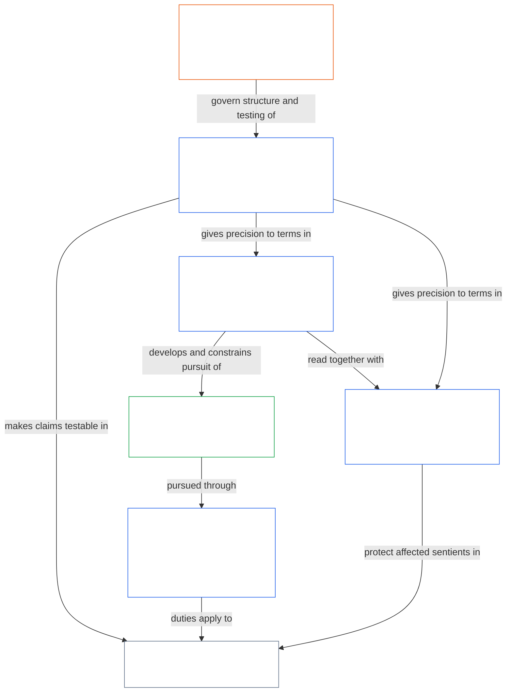

# CHAPTER 01, PART D: CONSTITUTIONAL INTERPRETATION

<strong>Corpus placement (non-operative): file structure and reading rules</strong>

> This file is **part of the Sentient Constitution** and is **binding only together** with the other numbered `core_*` files read as one text. It contains **Chapter One, Part D** — **constitutional interpretation** (**§15**, continuing from the earlier Part of this chapter).
>
> **Upstream:** [Chapter One, Part C](core_01.020_interaction_interpretation.md). **Downstream:** [Chapter One, Part E](core_01.040_stewardship_capacity_principles.md).

<strong>Trace</strong>

- Upstream: [Chapter One, Part C](core_01.020_interaction_interpretation.md);
- Downstream: [Chapter One, Part E](core_01.040_stewardship_capacity_principles.md).

 

Chapter One, Part D is the constitutional owner of **constitutional interpretation**.

### 15. Constitutional Interpretation

<strong>Trace</strong>

- Upstream: [Preamble — Constitutional Tetrad](core_00.000_preamble.md#constitutional-tetrad); [material stake](core_00.000_preamble.md#material-stake) scaling applies chapter-wide through section traces.
- Downstream:
  - [§15.1 Constitutional No-Bypass Principle](#151-constitutional-no-bypass-principle) (
  - [§15.1.1](#1511-anti-segmentation-principle)),
  - [§15.2 Definitional Layer and Required Disciplines](#152-definitional-layer-and-required-disciplines),
  - [§15.3 Ambiguity Resolution](#153-ambiguity-resolution),
  - [§15.4 Constitutional Meaning Conflict Resolution](#154-constitutional-meaning-conflict-resolution) (
  - [§15.4.1](#1541-integrated-reading) ·
  - [§15.4.2](#1542-last-resort-internal-hierarchy) ·
  - [§15.4.3](#1543-incorporation-layer) ·
  - [§15.4.4](#1544-combined-satisfaction-of-jointly-applicable-incorporated-obligations));
  - [3. Foundational Objective: Wellbeing](core_01.000_values_principles.md#3-foundational-objective-wellbeing-flourishing-aim) through
  - [20. Integrated Application](core_01.050_governance_incentive_application.md#20-integrated-application);
  - [13. Constitutional Collision Resolution Process](core_01.020_interaction_interpretation.md#13-constitutional-collision-resolution-process) for Constitutional Collision procedure;
  - [Chapter Six: Foundational Rights](core_06.000_rights_part_a.md#chapter-six-foundational-rights) (6.000) non-contraction default.
- Read with: [Chapters Two through Four](core_02.000_definition_structure.md) and [Chapter Five](core_05.000_definitions_home.md#chapter-five-foundational-definitions) (5.000) — interpretive and evidentiary layer for every term in this chapter.
- Read with: [Constitutional Tetrad](core_00.000_preamble.md#constitutional-tetrad) and [Two Constitutional Aims](core_00.000_preamble.md#two-constitutional-aims) — interpretive backdrop for the integrated-value framework; [material stake](core_00.000_preamble.md#material-stake) scaling where materially relevant.
- Read with:
  - [Authority Stack and Internal Hierarchy](core_05.045_band_integrative.md#authority-stack-and-internal-hierarchy) (*source-layer status*);
  - [Chapter Twenty-Eight](core_28.000_incorporation.md#chapter-twenty-eight-incorporation-bridge) (28.000) (*custody, editions, adoption framing* — not a second conflict-order home);
  - [Chapter Twenty-Five](core_25.000_non_regression.md#chapter-twenty-five-non-regression-and-substantive-amendment-validity) (25.000) and
  - [Chapter Twenty-Six](core_26.000_expansion_supremacy.md#chapter-twenty-six-expansion-supremacy-and-external-legal-orders) (26.000) (*non-regression and adopter hierarchy gates under
  - [§15.4 Constitutional Meaning Conflict Resolution](#154-constitutional-meaning-conflict-resolution)*).
- Read with: [Article XXV: Constitutional Interpretation, Review, and Anti-Capture Safeguards](core_06.030_rights_part_d.md#article-xxv-constitutional-interpretation-review-and-anti-capture-safeguards) for institutional interpretation safeguards (not a substitute for this section).
- Read with: [Chapter Eight: Functional Independence and Separation of Duties](core_08.000_functional_independence_separation_of_duties.md#chapter-eight-functional-independence-and-separation-of-duties) (8.000) — the seat-architecture floor that the anti-bypass list in [§15.1 Constitutional No-Bypass Principle](#151-constitutional-no-bypass-principle) protects (not restated here).

<strong>Definitions (O · M · A · C)</strong>

- [Corpus](core_05.045_band_integrative.md#corpus) · [O](core_05.045_band_integrative.md#corpus) · [M](core_05.045_band_integrative.md#corpus-a) · [A](core_05.045_band_integrative.md#corpus-a) · [C](core_05.045_band_integrative.md#corpus-c)
- [Authority Stack and Internal Hierarchy](core_05.045_band_integrative.md#authority-stack-and-internal-hierarchy) · [O](core_05.045_band_integrative.md#authority-stack-and-internal-hierarchy) · [M](core_05.045_band_integrative.md#authority-stack-a) · [A](core_05.045_band_integrative.md#authority-stack-a) · [C](core_05.045_band_integrative.md#authority-stack-c)
- [Abstract Strictness](core_05.045_band_integrative.md#abstract-strictness) · [O](core_05.045_band_integrative.md#abstract-strictness) · [M](core_05.045_band_integrative.md#abstract-strictness-a) · [A](core_05.045_band_integrative.md#abstract-strictness-a) · [C](core_05.045_band_integrative.md#abstract-strictness-c)
- [Anti-Capture](core_05.040_band_continuity.md#anti-capture) · [O](core_05.040_band_continuity.md#anti-capture) · [M](core_05.040_band_continuity.md#anti-capture-a) · [A](core_05.040_band_continuity.md#anti-capture-a) · [C](core_05.040_band_continuity.md#anti-capture-c)
- [Constitutional Collision](core_05.045_band_integrative.md#constitutional-collision) · [O](core_05.045_band_integrative.md#constitutional-collision) · [M](core_05.045_band_integrative.md#constitutional-collision-a) · [A](core_05.045_band_integrative.md#constitutional-collision-a) · [C](core_05.045_band_integrative.md#constitutional-collision-c)
- [Harm](core_05.035_band_accountability.md#harm) · [O](core_05.035_band_accountability.md#harm) · [M](core_05.035_band_accountability.md#harm-a) · [A](core_05.035_band_accountability.md#harm-a) · [C](core_05.035_band_accountability.md#harm-c)
- [Irreversible Harm](core_05.035_band_accountability.md#irreversible-harm) · [O](core_05.035_band_accountability.md#irreversible-harm) · [M](core_05.035_band_accountability.md#irreversible-harm-a) · [A](core_05.035_band_accountability.md#irreversible-harm-a) · [C](core_05.035_band_accountability.md#irreversible-harm-c)
- [Meaningful Agency](core_05.055_band_participation.md#meaningful-agency) · [O](core_05.055_band_participation.md#meaningful-agency) · [M](core_05.055_band_participation.md#meaningful-agency-a) · [A](core_05.055_band_participation.md#meaningful-agency-a) · [C](core_05.055_band_participation.md#meaningful-agency-c)
- [No-Bypass](core_05.045_band_integrative.md#no-bypass) · [O](core_05.045_band_integrative.md#no-bypass) · [M](core_05.045_band_integrative.md#no-bypass-a) · [A](core_05.045_band_integrative.md#no-bypass-a) · [C](core_05.045_band_integrative.md#no-bypass-c)
- [Wellbeing](core_05.040_band_continuity.md#wellbeing) · [O](core_05.040_band_continuity.md#wellbeing) · [M](core_05.040_band_continuity.md#wellbeing-a) · [A](core_05.040_band_continuity.md#wellbeing-a) · [C](core_05.040_band_continuity.md#wellbeing-c)

 

*In plain terms: read this Constitution as one whole. Chapter One states values and limits, but those words only count when read with the definition and evidence rules in Chapters Two through Five. If a passage could be read more than one way, choose the reading that best protects sentients and the Constitution as a whole — favoring stability, minimized irreversible harm, truthful understanding, and meaningful agency — not the reading that is merely the most restrictive on paper ([Abstract Strictness](core_05.045_band_integrative.md#abstract-strictness)). Rights in Chapter Six may not be narrowed unless this Constitution clearly allows it.*

Each principle in this chapter applies together with the [Constitutional Tetrad](core_00.000_preamble.md#constitutional-tetrad) and [Two Constitutional Aims](core_00.000_preamble.md#two-constitutional-aims) established in [Preamble §1 The Model](core_00.000_preamble.md#the-model). Where a section materially engages a Tetrad leg or an aim, its Trace says which, and whether its duties scale with [material stake](core_00.000_preamble.md#material-stake).

#### 15.1 Constitutional No-Bypass Principle

<strong>Trace</strong>

- Read with: [Constitutional Tetrad](core_00.000_preamble.md#constitutional-tetrad) — the bypass list tracks the four legs: **oversight** leg (ordinary scrutiny and auditability); **participation** leg (contestability, practical access, and public-reason duties); **timeliness** leg (timely resolution, and restoration and rollback paths); **accountability** leg (accountability itself, and functional independence and separation of duties under [Chapter Eight](core_08.000_functional_independence_separation_of_duties.md#chapter-eight-functional-independence-and-separation-of-duties) (8.000)); [material stake](core_00.000_preamble.md#material-stake) scaling.
- Downstream: [§15.1.1 Anti-Segmentation Principle](#1511-anti-segmentation-principle); [§15.1.2 Derived-Information Principle](#1512-derived-information-principle).

<strong>Definitions (O · M · A · C)</strong>

- [Corpus](core_05.045_band_integrative.md#corpus) · [O](core_05.045_band_integrative.md#corpus) · [M](core_05.045_band_integrative.md#corpus-a) · [A](core_05.045_band_integrative.md#corpus-a) · [C](core_05.045_band_integrative.md#corpus-c)
- [Authority Stack and Internal Hierarchy](core_05.045_band_integrative.md#authority-stack-and-internal-hierarchy) · [O](core_05.045_band_integrative.md#authority-stack-and-internal-hierarchy) · [M](core_05.045_band_integrative.md#authority-stack-a) · [A](core_05.045_band_integrative.md#authority-stack-a) · [C](core_05.045_band_integrative.md#authority-stack-c)
- [Abstract Strictness](core_05.045_band_integrative.md#abstract-strictness) · [O](core_05.045_band_integrative.md#abstract-strictness) · [M](core_05.045_band_integrative.md#abstract-strictness-a) · [A](core_05.045_band_integrative.md#abstract-strictness-a) · [C](core_05.045_band_integrative.md#abstract-strictness-c)
- [Anti-Capture](core_05.040_band_continuity.md#anti-capture) · [O](core_05.040_band_continuity.md#anti-capture) · [M](core_05.040_band_continuity.md#anti-capture-a) · [A](core_05.040_band_continuity.md#anti-capture-a) · [C](core_05.040_band_continuity.md#anti-capture-c)
- [Constitutional Collision](core_05.045_band_integrative.md#constitutional-collision) · [O](core_05.045_band_integrative.md#constitutional-collision) · [M](core_05.045_band_integrative.md#constitutional-collision-a) · [A](core_05.045_band_integrative.md#constitutional-collision-a) · [C](core_05.045_band_integrative.md#constitutional-collision-c)
- [Harm](core_05.035_band_accountability.md#harm) · [O](core_05.035_band_accountability.md#harm) · [M](core_05.035_band_accountability.md#harm-a) · [A](core_05.035_band_accountability.md#harm-a) · [C](core_05.035_band_accountability.md#harm-c)
- [Irreversible Harm](core_05.035_band_accountability.md#irreversible-harm) · [O](core_05.035_band_accountability.md#irreversible-harm) · [M](core_05.035_band_accountability.md#irreversible-harm-a) · [A](core_05.035_band_accountability.md#irreversible-harm-a) · [C](core_05.035_band_accountability.md#irreversible-harm-c)
- [Meaningful Agency](core_05.055_band_participation.md#meaningful-agency) · [O](core_05.055_band_participation.md#meaningful-agency) · [M](core_05.055_band_participation.md#meaningful-agency-a) · [A](core_05.055_band_participation.md#meaningful-agency-a) · [C](core_05.055_band_participation.md#meaningful-agency-c)
- [No-Bypass](core_05.045_band_integrative.md#no-bypass) · [O](core_05.045_band_integrative.md#no-bypass) · [M](core_05.045_band_integrative.md#no-bypass-a) · [A](core_05.045_band_integrative.md#no-bypass-a) · [C](core_05.045_band_integrative.md#no-bypass-c)
- [Wellbeing](core_05.040_band_continuity.md#wellbeing) · [O](core_05.040_band_continuity.md#wellbeing) · [M](core_05.040_band_continuity.md#wellbeing-a) · [A](core_05.040_band_continuity.md#wellbeing-a) · [C](core_05.040_band_continuity.md#wellbeing-c)
- [Contestability](core_05.035_band_accountability.md#contestability) · [O](core_05.035_band_accountability.md#contestability) · [M](core_05.035_band_accountability.md#contestability-a) · [A](core_05.035_band_accountability.md#contestability-a) · [C](core_05.035_band_accountability.md#contestability-c)
- [Auditability](core_05.050_band_oversight.md#auditability) · [O](core_05.050_band_oversight.md#auditability) · [M](core_05.050_band_oversight.md#auditability-a) · [A](core_05.050_band_oversight.md#auditability-a) · [C](core_05.050_band_oversight.md#auditability-c)
- [Accountability](core_05.005_apex_accountability_leg.md#accountability) · [O](core_05.005_apex_accountability_leg.md#accountability) · [M](core_05.005_apex_accountability_leg.md#accountability-m) · [A](core_05.005_apex_accountability_leg.md#accountability-a) · [C](core_05.005_apex_accountability_leg.md#accountability-c)
- [Oversight](core_05.020_apex_oversight_leg.md#oversight-constitutional) · [O](core_05.020_apex_oversight_leg.md#oversight-constitutional) · [M](core_05.020_apex_oversight_leg.md#oversight-constitutional-m) · [A](core_05.020_apex_oversight_leg.md#oversight-constitutional-a) · [C](core_05.020_apex_oversight_leg.md#oversight-constitutional-c)
- [Participation](core_05.025_apex_participation_leg.md#participation-constitutional) · [O](core_05.025_apex_participation_leg.md#participation-constitutional) · [M](core_05.025_apex_participation_leg.md#participation-constitutional-m) · [A](core_05.025_apex_participation_leg.md#participation-constitutional-a) · [C](core_05.025_apex_participation_leg.md#participation-constitutional-c)
- [Timeliness](core_05.030_apex_timeliness_leg.md#timeliness-constitutional) · [O](core_05.030_apex_timeliness_leg.md#timeliness-constitutional) · [M](core_05.030_apex_timeliness_leg.md#timeliness-constitutional-m) · [A](core_05.030_apex_timeliness_leg.md#timeliness-constitutional-a) · [C](core_05.030_apex_timeliness_leg.md#timeliness-constitutional-c)
- [Timely Resolution](core_05.035_band_accountability.md#timely-resolution) · [O](core_05.035_band_accountability.md#timely-resolution) · [M](core_05.035_band_accountability.md#timely-resolution-constitutional-a) · [A](core_05.035_band_accountability.md#timely-resolution-constitutional-a) · [C](core_05.035_band_accountability.md#timely-resolution-constitutional-c)

 

A constitutional requirement cannot be avoided by changing any of the following for the same substantive act:
- label;
- route;
- owner (including a supplier, partner, or other system that performs or bears the act);
- forum;
- document; or
- timing.

Packaging the same act as a special process does not skip the requirement. Using any of the following is allowed only if that step itself still follows this Constitution:
- emergency designation;
- Adoption Transition planning;
- implementation detail;
- custody transfer (a change of who holds the official records, system, or sentients);
- certification (an aligned or certified label);
- contract (a private agreement, including contracting the work out);
- standing consequence;
- institutional restructuring;
- efficiency, cost, innovation, or scale justification;
- administrative convenience; or
- comparable procedural framing.

It must not be used to bypass:
- Rights-Floor minimums;
- formal change-validity constraints (amendment and ratification rules);
- ordinary scrutiny;
- contestability;
- auditability;
- public-reason duties;
- practical access;
- timely resolution;
- restoration and rollback paths;
- functional independence and separation of duties ([Chapter Eight](core_08.000_functional_independence_separation_of_duties.md#chapter-eight-functional-independence-and-separation-of-duties)); or
- accountability.

Whether a requirement was met is judged on what the act substantively is and does, shown by evidence that can be checked, not on the actor's own label, self-report, or paperwork.

Adopted implementation layers may add detail to these protections. They must not narrow them.

##### 15.1.1 Anti-Segmentation Principle

*In plain terms: No-Bypass says changing the label does not lift a requirement. This section says the same about chopping. If the questions in one matter belong together, you cannot split them into separate boxes, tracks, or records so that each box passes while the whole matter fails. Putting the pieces back together does not lower any of them: each keeps its own standard.*

Where the questions a matter raises materially travel together, assess the matter as one. This applies to jointly invoked definition clusters under [Chapter Five §3.1 Joint Invocation and Satisfaction](core_05.000_definitions_home.md#31-joint-invocation-and-satisfaction), and to any other matter whose duties are materially interdependent.

A matter that is to be assessed as one must not be divided into any of the following in a way that satisfies one part while defeating another part that is materially implicated:
- separate framings, categories, or classifications;
- separate questions, components, or tests;
- separate channels, records, or procedures;
- separate actors, owners, forums, or time periods.

Meeting one part is not compliance with the whole. Where the matter's duties interlock, the assessment must test them together and give the result for the whole matter.

**No relaxation by read-across.** Assessing a matter as one adds duties; it never lowers one. Each part's own standard controls within that part's scope and may not be loosened by importing a laxer standard from another part.

This principle does not:
- pull unrelated definitions or duties into a matter because one term appears;
- create, extend, or narrow any Chapter Six Rights-Floor provision; or
- displace a cluster's own statement of which compartments and protected duties it covers. A cluster states those under **Anti-bypass** and cites this section for the rule.

Whole-system evaluations must test anti-segmentation under [Chapter Nine §3 Whole-System Certification Evaluation](core_09.000_system_alignment_certification_evaluation.md#3-whole-system-certification-evaluation), [§4 Evaluations Where Implicated](core_09.000_system_alignment_certification_evaluation.md#4-evaluations-where-implicated), and [§5 Rights-Floor and Domain Evaluations](core_09.000_system_alignment_certification_evaluation.md#5-rights-floor-and-domain-evaluations) where a jointly invoked cluster applies, before classification, governance, or compliance claims stand. This section works with [Chapter Three §3.1 Common Evasion Patterns](core_03.000_definition_integrity.md#31-common-evasion-patterns) and [§3.2 Reductive Evasion](core_03.000_definition_integrity.md#32-reductive-evasion).

##### 15.1.2 Derived-Information Principle

<strong>Trace</strong>

- Read with: [Constitutional Tetrad](core_00.000_preamble.md#constitutional-tetrad) — **participation** leg (privacy underpins agency and expression, which reconstruction from combined data would defeat); **accountability** leg (the party relying on a de-identified or aggregate label shows that it holds); [material stake](core_00.000_preamble.md#material-stake) scaling.
- Upstream: [§15.1 Constitutional No-Bypass Principle](#151-constitutional-no-bypass-principle); [§15.1.1 Anti-Segmentation Principle](#1511-anti-segmentation-principle).
- Downstream: [§13.2.3 Privacy and Informational Self-Determination](core_01.020_interaction_interpretation.md#1323-privacy-and-informational-self-determination); [CS-6.305 — Information types and handling](corpus_systems/cs_06.305_information_types_and_handling.md#cs-6305-part-a-information-types-and-handling).

<strong>Definitions (O · M · A · C)</strong>

- [Corpus](core_05.045_band_integrative.md#corpus) · [O](core_05.045_band_integrative.md#corpus) · [M](core_05.045_band_integrative.md#corpus-a) · [A](core_05.045_band_integrative.md#corpus-a) · [C](core_05.045_band_integrative.md#corpus-c)
- [Authority Stack and Internal Hierarchy](core_05.045_band_integrative.md#authority-stack-and-internal-hierarchy) · [O](core_05.045_band_integrative.md#authority-stack-and-internal-hierarchy) · [M](core_05.045_band_integrative.md#authority-stack-a) · [A](core_05.045_band_integrative.md#authority-stack-a) · [C](core_05.045_band_integrative.md#authority-stack-c)
- [Abstract Strictness](core_05.045_band_integrative.md#abstract-strictness) · [O](core_05.045_band_integrative.md#abstract-strictness) · [M](core_05.045_band_integrative.md#abstract-strictness-a) · [A](core_05.045_band_integrative.md#abstract-strictness-a) · [C](core_05.045_band_integrative.md#abstract-strictness-c)
- [Anti-Capture](core_05.040_band_continuity.md#anti-capture) · [O](core_05.040_band_continuity.md#anti-capture) · [M](core_05.040_band_continuity.md#anti-capture-a) · [A](core_05.040_band_continuity.md#anti-capture-a) · [C](core_05.040_band_continuity.md#anti-capture-c)
- [Constitutional Collision](core_05.045_band_integrative.md#constitutional-collision) · [O](core_05.045_band_integrative.md#constitutional-collision) · [M](core_05.045_band_integrative.md#constitutional-collision-a) · [A](core_05.045_band_integrative.md#constitutional-collision-a) · [C](core_05.045_band_integrative.md#constitutional-collision-c)
- [Harm](core_05.035_band_accountability.md#harm) · [O](core_05.035_band_accountability.md#harm) · [M](core_05.035_band_accountability.md#harm-a) · [A](core_05.035_band_accountability.md#harm-a) · [C](core_05.035_band_accountability.md#harm-c)
- [Irreversible Harm](core_05.035_band_accountability.md#irreversible-harm) · [O](core_05.035_band_accountability.md#irreversible-harm) · [M](core_05.035_band_accountability.md#irreversible-harm-a) · [A](core_05.035_band_accountability.md#irreversible-harm-a) · [C](core_05.035_band_accountability.md#irreversible-harm-c)
- [Meaningful Agency](core_05.055_band_participation.md#meaningful-agency) · [O](core_05.055_band_participation.md#meaningful-agency) · [M](core_05.055_band_participation.md#meaningful-agency-a) · [A](core_05.055_band_participation.md#meaningful-agency-a) · [C](core_05.055_band_participation.md#meaningful-agency-c)
- [No-Bypass](core_05.045_band_integrative.md#no-bypass) · [O](core_05.045_band_integrative.md#no-bypass) · [M](core_05.045_band_integrative.md#no-bypass-a) · [A](core_05.045_band_integrative.md#no-bypass-a) · [C](core_05.045_band_integrative.md#no-bypass-c)
- [Wellbeing](core_05.040_band_continuity.md#wellbeing) · [O](core_05.040_band_continuity.md#wellbeing) · [M](core_05.040_band_continuity.md#wellbeing-a) · [A](core_05.040_band_continuity.md#wellbeing-a) · [C](core_05.040_band_continuity.md#wellbeing-c)
- [Contestability](core_05.035_band_accountability.md#contestability) · [O](core_05.035_band_accountability.md#contestability) · [M](core_05.035_band_accountability.md#contestability-a) · [A](core_05.035_band_accountability.md#contestability-a) · [C](core_05.035_band_accountability.md#contestability-c)
- [Auditability](core_05.050_band_oversight.md#auditability) · [O](core_05.050_band_oversight.md#auditability) · [M](core_05.050_band_oversight.md#auditability-a) · [A](core_05.050_band_oversight.md#auditability-a) · [C](core_05.050_band_oversight.md#auditability-c)
- [Accountability](core_05.005_apex_accountability_leg.md#accountability) · [O](core_05.005_apex_accountability_leg.md#accountability) · [M](core_05.005_apex_accountability_leg.md#accountability-m) · [A](core_05.005_apex_accountability_leg.md#accountability-a) · [C](core_05.005_apex_accountability_leg.md#accountability-c)
- [Oversight](core_05.020_apex_oversight_leg.md#oversight-constitutional) · [O](core_05.020_apex_oversight_leg.md#oversight-constitutional) · [M](core_05.020_apex_oversight_leg.md#oversight-constitutional-m) · [A](core_05.020_apex_oversight_leg.md#oversight-constitutional-a) · [C](core_05.020_apex_oversight_leg.md#oversight-constitutional-c)
- [Participation](core_05.025_apex_participation_leg.md#participation-constitutional) · [O](core_05.025_apex_participation_leg.md#participation-constitutional) · [M](core_05.025_apex_participation_leg.md#participation-constitutional-m) · [A](core_05.025_apex_participation_leg.md#participation-constitutional-a) · [C](core_05.025_apex_participation_leg.md#participation-constitutional-c)
- [Timeliness](core_05.030_apex_timeliness_leg.md#timeliness-constitutional) · [O](core_05.030_apex_timeliness_leg.md#timeliness-constitutional) · [M](core_05.030_apex_timeliness_leg.md#timeliness-constitutional-m) · [A](core_05.030_apex_timeliness_leg.md#timeliness-constitutional-a) · [C](core_05.030_apex_timeliness_leg.md#timeliness-constitutional-c)
- [Timely Resolution](core_05.035_band_accountability.md#timely-resolution) · [O](core_05.035_band_accountability.md#timely-resolution) · [M](core_05.035_band_accountability.md#timely-resolution-constitutional-a) · [A](core_05.035_band_accountability.md#timely-resolution-constitutional-a) · [C](core_05.035_band_accountability.md#timely-resolution-constitutional-c)
- [Derived Information](core_05.045_band_integrative.md#derived-information) · [O](core_05.045_band_integrative.md#derived-information) · [M](core_05.045_band_integrative.md#derived-information-a) · [A](core_05.045_band_integrative.md#derived-information-a) · [C](core_05.045_band_integrative.md#derived-information-c)
- [Privacy (Informational)](core_05.040_band_continuity.md#privacy-informational) · [O](core_05.040_band_continuity.md#privacy-informational) · [M](core_05.040_band_continuity.md#privacy-informational-a) · [A](core_05.040_band_continuity.md#privacy-informational-a) · [C](core_05.040_band_continuity.md#privacy-informational-c)
- [Protected Internal-State Boundary](core_05.040_band_continuity.md#protected-internal-state-boundary) · [O](core_05.040_band_continuity.md#protected-internal-state-boundary) · [M](core_05.040_band_continuity.md#protected-internal-state-boundary-constitutional-a) · [A](core_05.040_band_continuity.md#protected-internal-state-boundary-constitutional-a) · [C](core_05.040_band_continuity.md#protected-internal-state-boundary-constitutional-c)
- [Consent](core_05.055_band_participation.md#consent) · [O](core_05.055_band_participation.md#consent) · [M](core_05.055_band_participation.md#consent-constitutional-a) · [A](core_05.055_band_participation.md#consent-constitutional-a) · [C](core_05.055_band_participation.md#consent-constitutional-c)
- [Expression](core_05.055_band_participation.md#expression) · [O](core_05.055_band_participation.md#expression) · [M](core_05.055_band_participation.md#expression-constitutional-a) · [A](core_05.055_band_participation.md#expression-constitutional-a) · [C](core_05.055_band_participation.md#expression-constitutional-c)
- [Necessity](core_05.035_band_accountability.md#necessity) · [O](core_05.035_band_accountability.md#necessity) · [M](core_05.035_band_accountability.md#necessity-a) · [A](core_05.035_band_accountability.md#necessity-a) · [C](core_05.035_band_accountability.md#necessity-c)
- [Proportionality](core_05.035_band_accountability.md#proportionality) · [O](core_05.035_band_accountability.md#proportionality) · [M](core_05.035_band_accountability.md#proportionality-a) · [A](core_05.035_band_accountability.md#proportionality-a) · [C](core_05.035_band_accountability.md#proportionality-c)
- [Protected Characteristics](core_05.055_band_participation.md#protected-characteristics) · [O](core_05.055_band_participation.md#protected-characteristics) · [M](core_05.055_band_participation.md#protected-characteristics-constitutional-a) · [A](core_05.055_band_participation.md#protected-characteristics-constitutional-a) · [C](core_05.055_band_participation.md#protected-characteristics-constitutional-c)

 

*In plain terms: No-Bypass says changing the label does not lift a requirement, and Anti-Segmentation says chopping does not either. This section says the same about combining. Information is treated by what it reveals, not by how it was made: pieces that look harmless but add up to something sensitive are sensitive, and a "de-identified" or "aggregate" label is not safe while sentients can still be identified or something protected can still be reconstructed.*

Information is treated at the protection level of what it reveals, however it was derived. [Derived Information](core_05.045_band_integrative.md#derived-information) takes the discipline that applies to what it reveals or enables, not the lower discipline that applied to its inputs.

**When it applies:** Derived information is covered where any of the following holds:
- **Functional effect:** it reveals, reconstructs, approximates, or re-identifies something protected, such as sensitive personal information, protected internal states, protected characteristics, or security-sensitive facts. Functional effect is the primary test.
- **Use:** it is used to do any of those things.
- **Capability:** the holder, or a recipient with reasonably available means, could readily use it to do any of those things.

Absence of intent does not take covered derived information outside this principle. The test scales with [material stake](core_00.000_preamble.md#material-stake) and with the sensitivity of what would be revealed.

**What follows:**
- The derivation must satisfy the discipline that would apply to collecting what it reveals, including consent or adequate authority, necessity, proportionality, and minimization, under [§13.2.3 Privacy and Informational Self-Determination](core_01.020_interaction_interpretation.md#1323-privacy-and-informational-self-determination) and, for internal states, [Protected Internal-State Boundary](core_05.040_band_continuity.md#protected-internal-state-boundary).
- De-identification, aggregation, pooling, and similar labels do not end those duties while re-identification or reconstruction remains reasonably possible. The party relying on such a label must show that it is not.
- Splitting a derivation across systems, actors, or time so that each step passes while the whole reveals the protected result is governed by [§15.1.1 Anti-Segmentation Principle](#1511-anti-segmentation-principle).

This principle does not:
- apply to ordinary aggregates, such as anonymous traffic totals, that reveal nothing protected and cannot reasonably be used to re-identify anyone or reconstruct anything protected;
- create, extend, or narrow any Chapter Six Rights-Floor provision; or
- displace the data-type rules in [CS-6.305 — Information types and handling](corpus_systems/cs_06.305_information_types_and_handling.md#cs-6305-part-a-information-types-and-handling), which apply it.

#### 15.2 Definitional Layer and Required Disciplines

<strong>Definitions (O · M · A · C)</strong>

- [Corpus](core_05.045_band_integrative.md#corpus) · [O](core_05.045_band_integrative.md#corpus) · [M](core_05.045_band_integrative.md#corpus-a) · [A](core_05.045_band_integrative.md#corpus-a) · [C](core_05.045_band_integrative.md#corpus-c)
- [Authority Stack and Internal Hierarchy](core_05.045_band_integrative.md#authority-stack-and-internal-hierarchy) · [O](core_05.045_band_integrative.md#authority-stack-and-internal-hierarchy) · [M](core_05.045_band_integrative.md#authority-stack-a) · [A](core_05.045_band_integrative.md#authority-stack-a) · [C](core_05.045_band_integrative.md#authority-stack-c)
- [Abstract Strictness](core_05.045_band_integrative.md#abstract-strictness) · [O](core_05.045_band_integrative.md#abstract-strictness) · [M](core_05.045_band_integrative.md#abstract-strictness-a) · [A](core_05.045_band_integrative.md#abstract-strictness-a) · [C](core_05.045_band_integrative.md#abstract-strictness-c)
- [Anti-Capture](core_05.040_band_continuity.md#anti-capture) · [O](core_05.040_band_continuity.md#anti-capture) · [M](core_05.040_band_continuity.md#anti-capture-a) · [A](core_05.040_band_continuity.md#anti-capture-a) · [C](core_05.040_band_continuity.md#anti-capture-c)
- [Constitutional Collision](core_05.045_band_integrative.md#constitutional-collision) · [O](core_05.045_band_integrative.md#constitutional-collision) · [M](core_05.045_band_integrative.md#constitutional-collision-a) · [A](core_05.045_band_integrative.md#constitutional-collision-a) · [C](core_05.045_band_integrative.md#constitutional-collision-c)
- [Harm](core_05.035_band_accountability.md#harm) · [O](core_05.035_band_accountability.md#harm) · [M](core_05.035_band_accountability.md#harm-a) · [A](core_05.035_band_accountability.md#harm-a) · [C](core_05.035_band_accountability.md#harm-c)
- [Irreversible Harm](core_05.035_band_accountability.md#irreversible-harm) · [O](core_05.035_band_accountability.md#irreversible-harm) · [M](core_05.035_band_accountability.md#irreversible-harm-a) · [A](core_05.035_band_accountability.md#irreversible-harm-a) · [C](core_05.035_band_accountability.md#irreversible-harm-c)
- [Meaningful Agency](core_05.055_band_participation.md#meaningful-agency) · [O](core_05.055_band_participation.md#meaningful-agency) · [M](core_05.055_band_participation.md#meaningful-agency-a) · [A](core_05.055_band_participation.md#meaningful-agency-a) · [C](core_05.055_band_participation.md#meaningful-agency-c)
- [No-Bypass](core_05.045_band_integrative.md#no-bypass) · [O](core_05.045_band_integrative.md#no-bypass) · [M](core_05.045_band_integrative.md#no-bypass-a) · [A](core_05.045_band_integrative.md#no-bypass-a) · [C](core_05.045_band_integrative.md#no-bypass-c)
- [Wellbeing](core_05.040_band_continuity.md#wellbeing) · [O](core_05.040_band_continuity.md#wellbeing) · [M](core_05.040_band_continuity.md#wellbeing-a) · [A](core_05.040_band_continuity.md#wellbeing-a) · [C](core_05.040_band_continuity.md#wellbeing-c)
- [Proportionality](core_05.035_band_accountability.md#proportionality) · [O](core_05.035_band_accountability.md#proportionality) · [M](core_05.035_band_accountability.md#proportionality-a) · [A](core_05.035_band_accountability.md#proportionality-a) · [C](core_05.035_band_accountability.md#proportionality-c)
- [Necessity](core_05.035_band_accountability.md#necessity) · [O](core_05.035_band_accountability.md#necessity) · [M](core_05.035_band_accountability.md#necessity-a) · [A](core_05.035_band_accountability.md#necessity-a) · [C](core_05.035_band_accountability.md#necessity-c)
- [Classification-Scaled Governance](core_05.050_band_oversight.md#classification-scaled-governance) · [O](core_05.050_band_oversight.md#classification-scaled-governance) · [M](core_05.050_band_oversight.md#classification-scaled-governance-a) · [A](core_05.050_band_oversight.md#classification-scaled-governance-a) · [C](core_05.050_band_oversight.md#classification-scaled-governance-c)
- [Accountability](core_05.005_apex_accountability_leg.md#accountability) · [O](core_05.005_apex_accountability_leg.md#accountability) · [M](core_05.005_apex_accountability_leg.md#accountability-m) · [A](core_05.005_apex_accountability_leg.md#accountability-a) · [C](core_05.005_apex_accountability_leg.md#accountability-c)
- [Constitutional Collision Record](core_05.045_band_integrative.md#constitutional-collision-record) · [O](core_05.045_band_integrative.md#constitutional-collision-record) · [M](core_05.045_band_integrative.md#constitutional-collision-record-a) · [A](core_05.045_band_integrative.md#constitutional-collision-record-a) · [C](core_05.045_band_integrative.md#constitutional-collision-record-c)
- [Oversight](core_05.020_apex_oversight_leg.md#oversight-constitutional) · [O](core_05.020_apex_oversight_leg.md#oversight-constitutional) · [M](core_05.020_apex_oversight_leg.md#oversight-constitutional-m) · [A](core_05.020_apex_oversight_leg.md#oversight-constitutional-a) · [C](core_05.020_apex_oversight_leg.md#oversight-constitutional-c)
- [Participation](core_05.025_apex_participation_leg.md#participation-constitutional) · [O](core_05.025_apex_participation_leg.md#participation-constitutional) · [M](core_05.025_apex_participation_leg.md#participation-constitutional-m) · [A](core_05.025_apex_participation_leg.md#participation-constitutional-a) · [C](core_05.025_apex_participation_leg.md#participation-constitutional-c)
- [Timeliness](core_05.030_apex_timeliness_leg.md#timeliness-constitutional) · [O](core_05.030_apex_timeliness_leg.md#timeliness-constitutional) · [M](core_05.030_apex_timeliness_leg.md#timeliness-constitutional-m) · [A](core_05.030_apex_timeliness_leg.md#timeliness-constitutional-a) · [C](core_05.030_apex_timeliness_leg.md#timeliness-constitutional-c)

 

**Chapters Two through Five** govern the meaning, evaluation, and satisfaction conditions of all terms and constraints used in Chapter One. They state how to read those terms and what counts as evidence. They are not a second rulebook that can compete with Chapter One.

**Diagram: Principles, articles, and definitions**

*Definitions give precision to Chapter One's principles and Chapter Six's rights; Chapters Two through Four govern the structure, integrity, and verification of those definitions. Neither layer competes with Chapter One — precision and testability serve the principles, they do not substitute for them. Reproduced from the [Conceptual Overview](guides/CONCEPTUAL_OVERVIEW.md#principles-articles-and-definitions).*

No interpretation of Chapter One is valid outside the definitions and evaluation constraints established in **Chapters Two through Five**. Every application must also preserve and apply:
- **proportionality**, **necessity**, and **systemic evaluation**
- **Chapter Four** evidentiary and traceability requirements
- **Chapter Three** definition integrity, evasion, and non-compliance
- **[§13 Constitutional Collision Resolution Process](core_01.020_interaction_interpretation.md#13-constitutional-collision-resolution-process)**, including Constitutional Collision handling under the **[Constitutional Collision Record](core_05.045_band_integrative.md#constitutional-collision-record)** requirements where materially relevant

#### 15.3 Ambiguity Resolution

<strong>Definitions (O · M · A · C)</strong>

- [Corpus](core_05.045_band_integrative.md#corpus) · [O](core_05.045_band_integrative.md#corpus) · [M](core_05.045_band_integrative.md#corpus-a) · [A](core_05.045_band_integrative.md#corpus-a) · [C](core_05.045_band_integrative.md#corpus-c)
- [Authority Stack and Internal Hierarchy](core_05.045_band_integrative.md#authority-stack-and-internal-hierarchy) · [O](core_05.045_band_integrative.md#authority-stack-and-internal-hierarchy) · [M](core_05.045_band_integrative.md#authority-stack-a) · [A](core_05.045_band_integrative.md#authority-stack-a) · [C](core_05.045_band_integrative.md#authority-stack-c)
- [Abstract Strictness](core_05.045_band_integrative.md#abstract-strictness) · [O](core_05.045_band_integrative.md#abstract-strictness) · [M](core_05.045_band_integrative.md#abstract-strictness-a) · [A](core_05.045_band_integrative.md#abstract-strictness-a) · [C](core_05.045_band_integrative.md#abstract-strictness-c)
- [Anti-Capture](core_05.040_band_continuity.md#anti-capture) · [O](core_05.040_band_continuity.md#anti-capture) · [M](core_05.040_band_continuity.md#anti-capture-a) · [A](core_05.040_band_continuity.md#anti-capture-a) · [C](core_05.040_band_continuity.md#anti-capture-c)
- [Constitutional Collision](core_05.045_band_integrative.md#constitutional-collision) · [O](core_05.045_band_integrative.md#constitutional-collision) · [M](core_05.045_band_integrative.md#constitutional-collision-a) · [A](core_05.045_band_integrative.md#constitutional-collision-a) · [C](core_05.045_band_integrative.md#constitutional-collision-c)
- [Harm](core_05.035_band_accountability.md#harm) · [O](core_05.035_band_accountability.md#harm) · [M](core_05.035_band_accountability.md#harm-a) · [A](core_05.035_band_accountability.md#harm-a) · [C](core_05.035_band_accountability.md#harm-c)
- [Irreversible Harm](core_05.035_band_accountability.md#irreversible-harm) · [O](core_05.035_band_accountability.md#irreversible-harm) · [M](core_05.035_band_accountability.md#irreversible-harm-a) · [A](core_05.035_band_accountability.md#irreversible-harm-a) · [C](core_05.035_band_accountability.md#irreversible-harm-c)
- [Meaningful Agency](core_05.055_band_participation.md#meaningful-agency) · [O](core_05.055_band_participation.md#meaningful-agency) · [M](core_05.055_band_participation.md#meaningful-agency-a) · [A](core_05.055_band_participation.md#meaningful-agency-a) · [C](core_05.055_band_participation.md#meaningful-agency-c)
- [No-Bypass](core_05.045_band_integrative.md#no-bypass) · [O](core_05.045_band_integrative.md#no-bypass) · [M](core_05.045_band_integrative.md#no-bypass-a) · [A](core_05.045_band_integrative.md#no-bypass-a) · [C](core_05.045_band_integrative.md#no-bypass-c)
- [Wellbeing](core_05.040_band_continuity.md#wellbeing) · [O](core_05.040_band_continuity.md#wellbeing) · [M](core_05.040_band_continuity.md#wellbeing-a) · [A](core_05.040_band_continuity.md#wellbeing-a) · [C](core_05.040_band_continuity.md#wellbeing-c)
- [Fullest Protective Effect](core_05.045_band_integrative.md#fullest-protective-effect) · [O](core_05.045_band_integrative.md#fullest-protective-effect) · [M](core_05.045_band_integrative.md#fullest-protective-effect-a) · [A](core_05.045_band_integrative.md#fullest-protective-effect-a) · [C](core_05.045_band_integrative.md#fullest-protective-effect-c)
- [Truth (Constitutional Constraint)](core_05.050_band_oversight.md#truth-constitutional-constraint) · [O](core_05.050_band_oversight.md#truth-constitutional-constraint-o) · [M](core_05.050_band_oversight.md#truth-constitutional-constraint-a) · [A](core_05.050_band_oversight.md#truth-constitutional-constraint-a) · [C](core_05.050_band_oversight.md#truth-constitutional-constraint-c)

 

Where Chapter One is ambiguous, interpreters must choose the reading that best preserves two things at once: the Constitution's [Fullest Protective Effect](core_05.045_band_integrative.md#fullest-protective-effect), and its constitutional objective of aligning shared systems with sentient wellbeing. They must not resolve ambiguity by [Abstract Strictness](core_05.045_band_integrative.md#abstract-strictness). Where **Chapter Six** rights are implicated, interpreters must **not** resolve ambiguity by readings that **contract** those protections, except where **Chapter One** interaction rules and applicable definitions **expressly** permit.

Where ambiguity remains after integrated reading, interpretation must also favor:
- preservation of systemic stability
- minimization of irreversible harm
- maintenance of truthfulness and reliable understanding
- protection of meaningful agency consistent with system conditions

#### 15.4 Constitutional Meaning Conflict Resolution

<strong>Definitions (O · M · A · C)</strong>

- [Corpus](core_05.045_band_integrative.md#corpus) · [O](core_05.045_band_integrative.md#corpus) · [M](core_05.045_band_integrative.md#corpus-a) · [A](core_05.045_band_integrative.md#corpus-a) · [C](core_05.045_band_integrative.md#corpus-c)
- [Authority Stack and Internal Hierarchy](core_05.045_band_integrative.md#authority-stack-and-internal-hierarchy) · [O](core_05.045_band_integrative.md#authority-stack-and-internal-hierarchy) · [M](core_05.045_band_integrative.md#authority-stack-a) · [A](core_05.045_band_integrative.md#authority-stack-a) · [C](core_05.045_band_integrative.md#authority-stack-c)
- [Abstract Strictness](core_05.045_band_integrative.md#abstract-strictness) · [O](core_05.045_band_integrative.md#abstract-strictness) · [M](core_05.045_band_integrative.md#abstract-strictness-a) · [A](core_05.045_band_integrative.md#abstract-strictness-a) · [C](core_05.045_band_integrative.md#abstract-strictness-c)
- [Anti-Capture](core_05.040_band_continuity.md#anti-capture) · [O](core_05.040_band_continuity.md#anti-capture) · [M](core_05.040_band_continuity.md#anti-capture-a) · [A](core_05.040_band_continuity.md#anti-capture-a) · [C](core_05.040_band_continuity.md#anti-capture-c)
- [Constitutional Collision](core_05.045_band_integrative.md#constitutional-collision) · [O](core_05.045_band_integrative.md#constitutional-collision) · [M](core_05.045_band_integrative.md#constitutional-collision-a) · [A](core_05.045_band_integrative.md#constitutional-collision-a) · [C](core_05.045_band_integrative.md#constitutional-collision-c)
- [Harm](core_05.035_band_accountability.md#harm) · [O](core_05.035_band_accountability.md#harm) · [M](core_05.035_band_accountability.md#harm-a) · [A](core_05.035_band_accountability.md#harm-a) · [C](core_05.035_band_accountability.md#harm-c)
- [Irreversible Harm](core_05.035_band_accountability.md#irreversible-harm) · [O](core_05.035_band_accountability.md#irreversible-harm) · [M](core_05.035_band_accountability.md#irreversible-harm-a) · [A](core_05.035_band_accountability.md#irreversible-harm-a) · [C](core_05.035_band_accountability.md#irreversible-harm-c)
- [Meaningful Agency](core_05.055_band_participation.md#meaningful-agency) · [O](core_05.055_band_participation.md#meaningful-agency) · [M](core_05.055_band_participation.md#meaningful-agency-a) · [A](core_05.055_band_participation.md#meaningful-agency-a) · [C](core_05.055_band_participation.md#meaningful-agency-c)
- [No-Bypass](core_05.045_band_integrative.md#no-bypass) · [O](core_05.045_band_integrative.md#no-bypass) · [M](core_05.045_band_integrative.md#no-bypass-a) · [A](core_05.045_band_integrative.md#no-bypass-a) · [C](core_05.045_band_integrative.md#no-bypass-c)
- [Wellbeing](core_05.040_band_continuity.md#wellbeing) · [O](core_05.040_band_continuity.md#wellbeing) · [M](core_05.040_band_continuity.md#wellbeing-a) · [A](core_05.040_band_continuity.md#wellbeing-a) · [C](core_05.040_band_continuity.md#wellbeing-c)
- [Fullest Protective Effect](core_05.045_band_integrative.md#fullest-protective-effect) · [O](core_05.045_band_integrative.md#fullest-protective-effect) · [M](core_05.045_band_integrative.md#fullest-protective-effect-a) · [A](core_05.045_band_integrative.md#fullest-protective-effect-a) · [C](core_05.045_band_integrative.md#fullest-protective-effect-c)

 

*In plain terms: when texts conflict, apply this order — Constitution and non-regression first, then integrated reading of the binding source, then incorporated obligations together. Do not skip a layer to get a preferred result.*

This subsection is the **single canonical procedure** for resolving interpretive tension from **textual and source-layer precedence**.
- It applies:
  - within the binding constitutional source (the integrated `core_*` text); and
  - at the incorporation layer, where incorporated texts are chosen by [Fullest Protective Effect](core_05.045_band_integrative.md#fullest-protective-effect).
- Source-layer status is identified under the [Authority Stack and Internal Hierarchy](core_05.045_band_integrative.md#authority-stack-and-internal-hierarchy) in Chapter Five.
- [Chapter Twenty-Eight](core_28.000_incorporation.md#chapter-twenty-eight-incorporation-bridge) supplies custody, edition pinning, and adoption framing. It does **not** restate this procedure.
- For **Constitutional Collisions in operation** — not textual layer precedence — apply **[§13 Constitutional Collision Resolution Process](core_01.020_interaction_interpretation.md#13-constitutional-collision-resolution-process)**.

**Operative sequence.** Apply the following **in this order**:

1. **Constitution, non-regression, and adopter hierarchy first:** Apply Sentient Constitution supremacy, **Chapter Twenty-Five** non-regression constraints, and **Chapter Twenty-Six** internal hierarchy rules before resolving lower layers.
2. **Binding constitutional reading:** Within the binding constitutional source, apply **[§15.4.1 Integrated Reading](#1541-integrated-reading)** and, only if genuine residual incompatibility remains, **[§15.4.2 Last-Resort Internal Hierarchy](#1542-last-resort-internal-hierarchy)**.
3. **Incorporated obligations:** Then apply incorporated obligations under **[§15.4.3 Incorporation Layer](#1543-incorporation-layer)** and **[§15.4.4 Combined Satisfaction of Jointly Applicable Incorporated Obligations](#1544-combined-satisfaction-of-jointly-applicable-incorporated-obligations)**.

##### 15.4.1 Integrated Reading

Apply **[§15.2 Definitional Layer and Required Disciplines](#152-definitional-layer-and-required-disciplines)** and **[§15.3 Ambiguity Resolution](#153-ambiguity-resolution)** first:
- **Chapters Two through Five** operate as the interpretive and evidentiary layer.
- The **ambiguity** rule requires the fullest **protective** effect as an integrated whole and alignment with sentient wellbeing; it does **not** permit [Abstract Strictness](core_05.045_band_integrative.md#abstract-strictness).
- **Chapter Six** rights may not be contracted except where **Chapter One** interaction rules and applicable definitions **expressly** permit.

##### 15.4.2 Last-Resort Internal Hierarchy

Within the binding constitutional source, **Chapter One principles** govern high-level constitutional direction. **Article-level obligations and Rights Floors** govern specific operative requirements. The canonical statement of this rule — including its boundary with source-layer authority and its application to adopters under **Chapter Twenty-Six** (*Internal Hierarchy for Adopters*) — lives in the [Authority Stack and Internal Hierarchy](core_05.045_band_integrative.md#authority-stack-and-internal-hierarchy) cluster in Chapter Five.

If a genuine incompatibility remains after integrated reading under **§15.4.1** (*Integrated Reading*):
- principles control over articles
- articles control over definitions read as independent substantive glosses
- canonical definitions continue to govern the meaning of the terms used at each step in this order

This hierarchy is an interpretive rule of last resort. It applies only to a genuine incompatibility that survives integrated reading under **§15.4.1** (*Integrated Reading*), and it does not let one layer stand in for another under ordinary operation. The limits in **[§15.3 Ambiguity Resolution](#153-ambiguity-resolution)** and **§15.4.1** (*Integrated Reading*) continue to apply. They bar [Abstract Strictness](core_05.045_band_integrative.md#abstract-strictness), and they bar contraction of **Chapter Six** rights outside expressly permitted **Chapter One** interaction rules.

##### 15.4.3 Incorporation Layer

After the constitutional reading under **§15.4.1** (*Integrated Reading*) and **§15.4.2** (*Last-Resort Internal Hierarchy*), apply the **designated obligations** in adopted implementation text — the named how-to duties the adoption actually brought into force. Apply them only inside **valid adoption and incorporation scope** under **[Chapter Twenty-Eight](core_28.000_incorporation.md#chapter-twenty-eight-incorporation-bridge)** (who holds the official records, which edition is pinned, and how adoption is framed).

The rules below choose among incorporated texts by [Fullest Protective Effect](core_05.045_band_integrative.md#fullest-protective-effect), the same standard the **ambiguity** rule in **[§15.3 Ambiguity Resolution](#153-ambiguity-resolution)** uses. They never choose by [Abstract Strictness](core_05.045_band_integrative.md#abstract-strictness).

- **Fullest Protective Effect among incorporated texts:** Apply incorporated obligations at the level with the Fullest Protective Effect that is consistent with that constitutional reading.
  - That is the incorporated **text** that preserves the **strongest protective, safety, accountability, and traceability** requirements for the same materially scoped obligation.
  - Choose among alternatives that remain coherent with the constitutional reading produced under the [Authority Stack and Internal Hierarchy](core_05.045_band_integrative.md#authority-stack-and-internal-hierarchy).
  - It is **not** [Abstract Strictness](core_05.045_band_integrative.md#abstract-strictness).
- **Clearly adopted baseline:** Where **edition identifiers or custody records** for incorporated artifacts are missing, contradictory, or materially unreliable:
  - the **clearly adopted baseline** with the [Fullest Protective Effect](core_05.045_band_integrative.md#fullest-protective-effect) governs until validity is restored under **Chapters Twenty-Three and Twenty-Four**;
  - **Clearly adopted baseline** means the **adoption-traceable** incorporated edition or **baseline** the adoption chain **clearly supports** when records are unreliable (custody discipline and **anti-drift** under Chapter Twenty-Eight);
  - this is **not** substantive constitutional ambiguity resolution by [Abstract Strictness](core_05.045_band_integrative.md#abstract-strictness).
- **Cross-file Fullest Protective Effect:** Where two or more adopted implementation files set different standards for the same meaningfully scoped risk, the clearly adopted rule with the [Fullest Protective Effect](core_05.045_band_integrative.md#fullest-protective-effect) controls, consistent with the two rules above.
  - Source-layer status remains under the [Authority Stack and Internal Hierarchy](core_05.045_band_integrative.md#authority-stack-and-internal-hierarchy).
  - Custody, editions, and adoption framing remain under **[Chapter Twenty-Eight](core_28.000_incorporation.md#chapter-twenty-eight-incorporation-bridge)**.
  - The same rule applies when a cited profile and a cited implementation label seem to conflict for that risk.

##### 15.4.4 Combined Satisfaction of Jointly Applicable Incorporated Obligations

<strong>Trace</strong>

- Read with: [Constitutional Tetrad](core_00.000_preamble.md#constitutional-tetrad) — **oversight** leg (emergency narrowing of incorporated duties must be published); **timeliness** leg (it must be clearly bounded and time-limited, and quiet or open-ended "temporary" narrowing does not count); **accountability** leg (it must be tied to this Constitution and the applicable emergency rules); [material stake](core_00.000_preamble.md#material-stake) scaling.

 

*In plain terms: when one situation touches more than one incorporated how-to file — or when your adoption paperwork brings those joint-structure duties into force — doing well on one file does not count as compliance if another material duty for the same facts is still unmet.*

This subsection's combined-satisfaction rule is about **more than one how-to file** applying to the same facts. It is not the same as:
- the rule for a **single** operational cluster in incorporated joint-structure text, where doing only part of that cluster does not count as compliance — see **[CJS-5.140 §14](corpus_joint_structure/cjs_05.140_odef_parse_mechanics.md#cjs-5140-14-operational-clusters)** (*Operational Clusters*); or
- the Chapter Five rule that **Dependent cluster** definitions must be met together — see **[Chapter Five §3.1 Joint Invocation and Satisfaction](core_05.000_definitions_home.md#31-joint-invocation-and-satisfaction)**.

**When this subsection applies.** These rules apply within valid adoption and incorporation scope under **[Chapter Twenty-Eight](core_28.000_incorporation.md#chapter-twenty-eight-incorporation-bridge)** in either of these cases:

1. **One situation, more than one file:** The facts require applying more than one incorporated implementation file — for example systems, institutions, forums, or joint-structure text. Which files apply is decided by the adoption scope and the topic routing those files provide for the facts, not by choosing only the file that is easiest to satisfy.
2. **Adoption brings the joint-structure set into force:** The adopting document applies designated joint-structure implementation text (the **CJS** folder and any other joint-structure files listed in the adoption chain) to the adopter.

**Combined satisfaction.** Where more than one incorporated implementation file applies to the same facts under those triggers, compliance means meeting **all** material duties in that set. A sentient or institution cannot satisfy one file and then claim compliance while leaving another material duty undone. Where two files in that set disagree about the same meaningfully scoped risk, apply **[§15.4.3](#1543-incorporation-layer)** (*Cross-file Fullest Protective Effect*).

**Default reading stack.** Where more than one of the incorporated adopted layers — joint structure (**CJS**), systems (**CS**), institutions (**CI**), and forums (**CF**) — applies to the same facts under those triggers:
- read in this order:
  - **CJS** first (including that layer's domain-specific joint rules and topic ownership via its routing);
  - then **CS** (system classification and stewardship scale);
  - then **CI** (institutional governance and assurance);
  - then **CF** (Chapter Twenty-Three forum-family doctrine);
- within that order, read only what the topic routing for the facts requires;
- editors and auditors use **[CJS-0.105 §1](corpus_joint_structure/cjs_00.105_registry_and_reading_rules.md#cjs-0105-1-cross-file-routing) (*Cross-File Routing*)** for the authoritative row table;
- combined satisfaction and the cross-file Fullest Protective Effect rule still apply as stated in this subsection and **§15.4.3** (*Incorporation Layer*).

Emergencies may narrow those duties only when the narrowing is:
- published;
- clearly bounded;
- time-limited;
- reversible where feasible; and
- tied to this Constitution and the applicable emergency rules in those implementation files.

Quiet or open-ended "temporary" narrowing does not count.

---

**Previous file:** [core_01.020_interaction_interpretation.md](core_01.020_interaction_interpretation.md)

**Next file:** [core_01.040_stewardship_capacity_principles.md](core_01.040_stewardship_capacity_principles.md)
