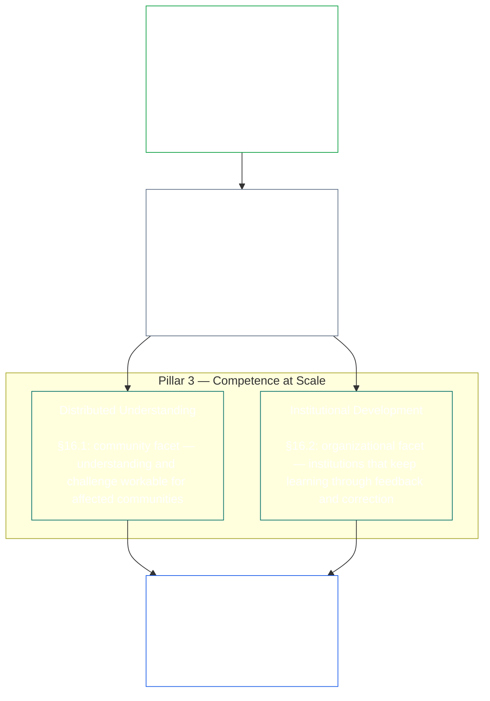
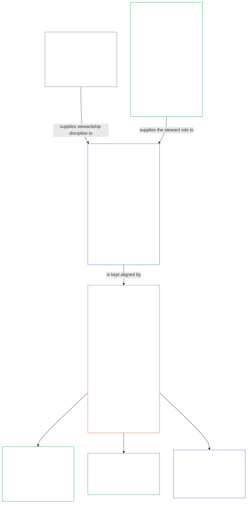

# CHAPTER 01, PART E: STEWARDSHIP AND THE STEWARD ROLE
<details>
<summary><strong><span style="color: #2563eb;">Corpus placement (non-operative): file structure and reading rules</span></strong></summary>

> This file is **part of the Sentient Constitution** and is **binding only together** with the other numbered `core_*` files read as one text. It contains **Chapter One, Part C** (§§16–20: stewardship, governance, incentive alignment and capture, and the integrated application capstone).
>
> **Upstream:** [core_01.020_interaction_interpretation.md](core_01.020_interaction_interpretation.md) (Chapter One, Part B)
> **Next:** [core_02.000_definition_structure.md](core_02.000_definition_structure.md)<br>
> **Reading arc:** §16 stewardship and distributed understanding → §17 the steward role → §18 governance → §19 incentive alignment and capture → **§20 integrated application** (chapter capstone).

</details>

<details>
<summary><strong><span style="color: #2563eb;">Reader guidance (non-operative): principle hierarchy and reading arc (Part C)</span></strong></summary>

> Per-section **Trace** and **Definitions (O · M · A · C)** widgets carry routing at the point each § materially invokes a term; this block is a part-level crosswalk before §§16–20.

**Principle hierarchy (Part C).** At principle layer:

13. **[Stewardship](core_05.040_band_continuity.md#stewardship)** orients material systems through sentient organization — **Pillar 1** ([§17](#17-consequential-stewardship-the-steward-role): consequential hands-on operation and improvement), **Pillar 2** ([proactive stewardship](#16-pillar-2-proactive-stewardship): catching trouble early and fixing it without avoidable delay), and **Pillar 3** ([§16.1](#161-distributed-understanding) · [§16.2](#162-institutional-development): competence at community and institutional scale) — toward durable constitutional alignment over time under the [Constitutional Tetrad](core_00.000_preamble.md#constitutional-tetrad) — especially **[Participation](core_05.025_apex_participation_leg.md#participation-constitutional)** (consequential roles and voice) and **[Oversight](core_05.020_apex_oversight_leg.md#oversight-constitutional)** (distributed understanding, auditability, and contestability — oversight requires auditing; [System Alignment Certification](core_05.040_band_continuity.md#system-alignment-certification) is one especially large audit process among others) — including the **Continuity** aim under the [Two Constitutional Aims](core_00.000_preamble.md#two-constitutional-aims).
14. **[Consequential Stewardship](#17-consequential-stewardship-the-steward-role)** is the steward role itself: the hands-on duties, standards, and protections that attach to anyone doing consequential operation, maintenance, oversight, or improvement work on a material system — **Pillar 1** made operational, plus the shared standard, alignment under pressure, and role-scoped observability a steward's role carries.
15. **[Governance](core_05.035_band_accountability.md#governance)** structures authorized decision-making, participation, and accountability under the [Constitutional Tetrad](core_00.000_preamble.md#constitutional-tetrad) — especially **[Oversight](core_05.020_apex_oversight_leg.md#oversight-constitutional)** of how authority is allocated and exercised, and **authority-scaled answerability** under [§18.1](core_01.050_governance_incentive_application.md#181-governance-as-authorized-structure): greater authorized power or consequential role raises constitutional accountability and oversight, never lowers them. [§18.3 Separation of Duties](core_01.050_governance_incentive_application.md#183-separation-of-duties) keeps the one who acted from being the one who checks. [§18.4 Ongoing Justification](core_01.050_governance_incentive_application.md#184-ongoing-justification) requires those arrangements to keep proving they still fit this Constitution. Where governance and stewardship conflict, stewardship discipline controls at principle layer unless **Necessity** and **Proportionality** expressly justify a bounded, time-limited exception with correction paths. Operative authorization and contract-layer requirements remain owned by **Chapter Twenty-Four**.
16. **[Incentive Alignment and System Capture](core_01.050_governance_incentive_application.md#19-incentive-alignment-and-system-capture)** supplies the principle-layer discipline for incentive structures, proxy integrity, short-horizon defects, reward-path correction, and capture response.
17. **[Integrated Application](core_01.050_governance_incentive_application.md#20-integrated-application)** is the chapter capstone: later chapters are read through this chapter's integrated-value framework.

</details>

<br>

Chapter One, Part C, is the constitutional owner of **stewardship, governance, incentive alignment and capture, and integrated application**. The principles they apply are in **Part A**; collision resolution and interpretation are in **Part B**.

<a id="16-stewardship-in-depth"></a>

### 16. Stewardship in Depth
<details>
<summary><strong><span style="color: #2563eb;">Trace</span></strong></summary>

- Read with: [Constitutional Tetrad](core_00.000_preamble.md#constitutional-tetrad) — primary Chapter One home for the **participation** leg (consequential roles and voice; general requirement, not [Stakeholder System Participation](core_05.055_band_participation.md#stakeholder-status-and-weight) alone), **oversight** leg, and **timeliness** leg (proactive repair velocity); [material stake](core_00.000_preamble.md#material-stake) scaling.
- Read with: [Two Constitutional Aims](core_00.000_preamble.md#two-constitutional-aims) — **Flourishing** aim (participation, agency, and educational pathways); **Continuity** aim (institutional learning, repair capacity, and durable stewardship).
- Upstream: Principles:
  - [3. Foundational Objective: Wellbeing](core_01.000_values_principles.md#3-foundational-objective-wellbeing-flourishing-aim);
  - [5 Truth](core_01.000_values_principles.md#5-truth-epistemic-integrity-constraint);
  - [6. Trust](core_01.000_values_principles.md#6-trust-and-trustworthiness-coordination-integrity); and
  - [§9 Shared-System Capacity](core_01.010_values_principles_continuity_aim.md#9-shared-system-capacity).
- Downstream:
  - [13. Constitutional Collision Resolution Process](core_01.020_interaction_interpretation.md#13-constitutional-collision-resolution-process) (including
  - [§13.3 Minimization of Avoidable Burden](core_01.020_interaction_interpretation.md#133-minimization-of-avoidable-burden));
  - [Chapter Nine §4 Whole-System Certification Evaluation](core_09.000_system_alignment_certification_evaluation.md#4-whole-system-certification-evaluation) (9.000 §4) through
  - [§6 Rights-Floor and Domain Evaluations](core_09.000_system_alignment_certification_evaluation.md#6-rights-floor-and-domain-evaluations);
  - [§19.1.3 Stewardship and Operator Application](core_01.050_governance_incentive_application.md#1913-stewardship-and-operator-application).
- Downstream: [§19.1.4 Role-Depth and Material-Responsibility Pathways](core_01.050_governance_incentive_application.md#1914-role-depth-and-material-responsibility-pathways).
- Downstream: [§7 Freedom (Bounded Agency)](core_01.000_values_principles.md#7-freedom-bounded-agency), which depends on consequential stewardship, distributed understanding, meaningful participation, and repair capacity remaining real under material dependency.
- Downstream: [Chapter Nine — System Alignment Certification](core_09.000_system_alignment_certification_evaluation.md#chapter-nine-system-alignment-certification--evaluation) (9.000) (*one especially large audit process under oversight — not the sole auditing home*); [Chapter Fifteen — Standing Records](core_15.000_standing_assessment.md#chapter-fifteen-standing-records--question-1-what-happened) (15.000) (*standing effect — trust-, role-, and recognition-eligibility — implements this subsection as its principle-layer foundation*).
- Downstream: [Chapter Twenty-Three §1 — Purpose, Role, and Scope](core_23.000_forum.md#1-purpose-role-and-scope) (23.000 §1) and [§4 — Forum family definitions](core_23.000_forum.md#4-forum-family-definitions--accountability-through-adjudication) (*forum families carry the participation and oversight architecture for contestable challenge, remediation sequencing, root-cause learning, and proactive governance aligned with this section*); [CF-23.405](corpus_forum/cf_23.405_forum_formation_chamber_structure.md#cf-23405-forum-formation-forum-structure-mapping-and-chamber-structure) (*Forum formation, forum-structure mapping, and chamber structure*), [CF-23.415](corpus_forum/cf_23.415_routing_operations_transfer_certification_representative_treatment.md#cf-23415-routing-operations-transfer-questions-for-ruling-and-representative-treatment) (*Routing operations, transfer, questions for ruling, and representative treatment*), and [CF-23.420](corpus_forum/cf_23.420_appeal_secondary_review_exhaustion_pathways.md#cf-23420-appeal-secondary-review-and-exhaustion-pathways) (*Appeal, secondary review, and exhaustion pathways*) for adopted forum operations.
- Downstream: Shapes the rights surface for education, Stakeholder System Participation, transparency, comprehensibility, audit and verification, and role-depth pathways into material responsibility.
  - Especially
    - [Article III: Survival and Essential Access](core_06.000_rights_part_a.md#article-iii-survival-and-essential-access),
    - [Article IV: Right to Sentient-Centered Education](core_06.000_rights_part_a.md#article-iv-right-to-sentient-centered-education),
    - [Article X: Self-Determination, Agency, and Participation](core_06.010_rights_part_b.md#article-x-self-determination-agency-and-participation),
    - [Article XII: Stakeholder System Participation, Representation, and Due Process](core_06.010_rights_part_b.md#article-xii-stakeholder-system-participation-representation-and-due-process),
    - [Article XVI: Audit, Transparency, and Independent Verification](core_06.020_rights_part_c.md#article-xvi-audit-transparency-and-independent-verification),
    - [Article XIX: Standing and Participation Status](core_06.030_rights_part_d.md#article-xix-standing-and-participation-status),
    - [Article XXI: Interoperability, Portability, and Exit Integrity](core_06.030_rights_part_d.md#article-xxi-interoperability-portability-and-exit-integrity),
    - [Article XXIII: Comprehensibility and Complexity Stewardship](core_06.030_rights_part_d.md#article-xxiii-comprehensibility-and-complexity-stewardship), and
    - [Article XXV: Constitutional Interpretation, Review, and Anti-Capture Safeguards](core_06.030_rights_part_d.md#article-xxv-constitutional-interpretation-review-and-anti-capture-safeguards).
  - Read with: [Chapter Twenty-Four §6 — Authorized Roles, Competency Development, and Contribution](core_24.000_governance.md#6-authorized-roles-competency-development-and-contribution) (24.000 §6) and **[CS-24.305 — Critical system stewardship](corpus_systems/cs_24.305_critical_system_stewardship.md#cs-24305-critical-system-stewardship)** for operative role pathways and stewardship-development pathways.
- Subsections (reading order):
  - [§16.1 Distributed understanding](#161-distributed-understanding) (community facet of competence at scale) ·
  - [§16.2 Institutional development](#162-institutional-development) (organizational facet) ·
  - [§16.3 Openness aspiration](#163-openness-aspiration) ·
  - [§16.4 Document at action](#164-document-at-action) (*the act makes its own Act Record*).
- Read with:
  - [§17 Consequential Stewardship](#17-consequential-stewardship-the-steward-role) (*the steward role itself — promoted to its own section; carries Pillar 1's hands-on operation, maintenance, oversight, and improvement duties, plus
  - [§17.1](#171-shared-stewardship-standard),
  - [§17.2](#172-alignment-under-pressure),
  - [§17.3](#173-logging-the-role-not-the-steward),
  - [§17.4 Aligned Self-Organization](#174-aligned-self-organization), which extends that discipline beyond the formal role,
  - [§17.5 Duty to Resist](#175-duty-to-resist), and
  - [§17.6 Portable Competence](#176-portable-competence), which keeps that competence from resting on any one steward*).

</details>

<details>
<summary><strong><span style="color: #2563eb;">Definitions (O · M · A · C)</span></strong></summary>
- [Strategic Stewardship Obligation](core_05.040_band_continuity.md#strategic-stewardship-obligation) · [O](core_05.040_band_continuity.md#strategic-stewardship-obligation) · [M](core_05.040_band_continuity.md#strategic-stewardship-obligation-constitutional-a) · [A](core_05.040_band_continuity.md#strategic-stewardship-obligation-constitutional-a) · [C](core_05.040_band_continuity.md#strategic-stewardship-obligation-constitutional-c)
- [Distributed Understanding](core_05.040_band_continuity.md#distributed-understanding) · [O](core_05.040_band_continuity.md#distributed-understanding) · [M](core_05.040_band_continuity.md#distributed-understanding-constitutional-a) · [A](core_05.040_band_continuity.md#distributed-understanding-constitutional-a) · [C](core_05.040_band_continuity.md#distributed-understanding-constitutional-c)
- [Participation](core_05.025_apex_participation_leg.md#participation-constitutional) · [O](core_05.025_apex_participation_leg.md#participation-constitutional) · [M](core_05.025_apex_participation_leg.md#participation-constitutional-m) · [A](core_05.025_apex_participation_leg.md#participation-constitutional-a) · [C](core_05.025_apex_participation_leg.md#participation-constitutional-c)
- [Oversight](core_05.020_apex_oversight_leg.md#oversight-constitutional) · [O](core_05.020_apex_oversight_leg.md#oversight-constitutional) · [M](core_05.020_apex_oversight_leg.md#oversight-constitutional-m) · [A](core_05.020_apex_oversight_leg.md#oversight-constitutional-a) · [C](core_05.020_apex_oversight_leg.md#oversight-constitutional-c)
- [Meaningful Agency](core_05.055_band_participation.md#meaningful-agency) · [O](core_05.055_band_participation.md#meaningful-agency) · [M](core_05.055_band_participation.md#meaningful-agency-a) · [A](core_05.055_band_participation.md#meaningful-agency-a) · [C](core_05.055_band_participation.md#meaningful-agency-c)
- [Auditability](core_05.050_band_oversight.md#auditability) · [O](core_05.050_band_oversight.md#auditability) · [M](core_05.050_band_oversight.md#auditability-a) · [A](core_05.050_band_oversight.md#auditability-a) · [C](core_05.050_band_oversight.md#auditability-c)
- [Contestability](core_05.035_band_accountability.md#contestability) · [O](core_05.035_band_accountability.md#contestability) · [M](core_05.035_band_accountability.md#contestability-a) · [A](core_05.035_band_accountability.md#contestability-a) · [C](core_05.035_band_accountability.md#contestability-c)
- [Educational Agency](core_05.055_band_participation.md#educational-agency) · [O](core_05.055_band_participation.md#educational-agency) · [M](core_05.055_band_participation.md#educational-agency-a) · [A](core_05.055_band_participation.md#educational-agency-a) · [C](core_05.055_band_participation.md#educational-agency-c)
- [Transparency](core_05.050_band_oversight.md#transparency) · [O](core_05.050_band_oversight.md#transparency) · [M](core_05.050_band_oversight.md#transparency-a) · [A](core_05.050_band_oversight.md#transparency-a) · [C](core_05.050_band_oversight.md#transparency-c)
- [Materiality](core_05.050_band_oversight.md#materiality) · [O](core_05.050_band_oversight.md#materiality) · [M](core_05.050_band_oversight.md#materiality-determination-a) · [A](core_05.050_band_oversight.md#materiality-determination-a) · [C](core_05.050_band_oversight.md#materiality-determination-c)
- [Dependency](core_05.040_band_continuity.md#dependency) · [O](core_05.040_band_continuity.md#dependency) · [M](core_05.040_band_continuity.md#dependency-a) · [A](core_05.040_band_continuity.md#dependency-a) · [C](core_05.040_band_continuity.md#dependency-c)
- [Accessibility](core_05.055_band_participation.md#accessibility) · [O](core_05.055_band_participation.md#accessibility) · [M](core_05.055_band_participation.md#accessibility-constitutional-a) · [A](core_05.055_band_participation.md#accessibility-constitutional-a) · [C](core_05.055_band_participation.md#accessibility-constitutional-c)
- [Safety (Constitutional Constraint)](core_05.040_band_continuity.md#safety-constitutional-constraint) · [O](core_05.040_band_continuity.md#safety-constitutional-constraint) · [M](core_05.040_band_continuity.md#safety-constraint-a) · [A](core_05.040_band_continuity.md#safety-constraint-a) · [C](core_05.040_band_continuity.md#safety-constraint-c)
- [Truth (Constitutional Constraint)](core_05.050_band_oversight.md#truth-constitutional-constraint) · [O](core_05.050_band_oversight.md#truth-constitutional-constraint-o) · [M](core_05.050_band_oversight.md#truth-constitutional-constraint-a) · [A](core_05.050_band_oversight.md#truth-constitutional-constraint-a) · [C](core_05.050_band_oversight.md#truth-constitutional-constraint-c)
- [Necessity](core_05.035_band_accountability.md#necessity) · [O](core_05.035_band_accountability.md#necessity) · [M](core_05.035_band_accountability.md#necessity-a) · [A](core_05.035_band_accountability.md#necessity-a) · [C](core_05.035_band_accountability.md#necessity-c)
- [Proportionality](core_05.035_band_accountability.md#proportionality) · [O](core_05.035_band_accountability.md#proportionality) · [M](core_05.035_band_accountability.md#proportionality-a) · [A](core_05.035_band_accountability.md#proportionality-a) · [C](core_05.035_band_accountability.md#proportionality-c)
- [Avoidable Burden](core_05.040_band_continuity.md#avoidable-burden) · [O](core_05.040_band_continuity.md#avoidable-burden) · [M](core_05.040_band_continuity.md#avoidable-burden-a) · [A](core_05.040_band_continuity.md#avoidable-burden-a) · [C](core_05.040_band_continuity.md#avoidable-burden-c)
- [Epistemic Integrity](core_05.050_band_oversight.md#epistemic-integrity) · [O](core_05.050_band_oversight.md#epistemic-integrity-o) · [M](core_05.050_band_oversight.md#epistemic-integrity-a) · [A](core_05.050_band_oversight.md#epistemic-integrity-a) · [C](core_05.050_band_oversight.md#epistemic-integrity-c)
- [Anti-Capture](core_05.040_band_continuity.md#anti-capture) · [O](core_05.040_band_continuity.md#anti-capture) · [M](core_05.040_band_continuity.md#anti-capture-a) · [A](core_05.040_band_continuity.md#anti-capture-a) · [C](core_05.040_band_continuity.md#anti-capture-c)
- [Constitutional Collision](core_05.045_band_integrative.md#constitutional-collision) · [O](core_05.045_band_integrative.md#constitutional-collision) · [M](core_05.045_band_integrative.md#constitutional-collision-a) · [A](core_05.045_band_integrative.md#constitutional-collision-a) · [C](core_05.045_band_integrative.md#constitutional-collision-c)
- [Duty to Resist](core_05.035_band_accountability.md#duty-to-resist) · [O](core_05.035_band_accountability.md#duty-to-resist) · [M](core_05.035_band_accountability.md#duty-to-resist-a) · [A](core_05.035_band_accountability.md#duty-to-resist-a) · [C](core_05.035_band_accountability.md#duty-to-resist-c)
- [Freedom (Bounded Agency)](core_05.055_band_participation.md#freedom-bounded-agency) · [O](core_05.055_band_participation.md#freedom-bounded-agency) · [M](core_05.055_band_participation.md#freedom-bounded-agency-a) · [A](core_05.055_band_participation.md#freedom-bounded-agency-a) · [C](core_05.055_band_participation.md#freedom-bounded-agency-c)
- [Governance](core_05.035_band_accountability.md#governance) · [O](core_05.035_band_accountability.md#governance) · [M](core_05.035_band_accountability.md#governance-a) · [A](core_05.035_band_accountability.md#governance-a) · [C](core_05.035_band_accountability.md#governance-c)
- [Harm](core_05.035_band_accountability.md#harm) · [O](core_05.035_band_accountability.md#harm) · [M](core_05.035_band_accountability.md#harm-a) · [A](core_05.035_band_accountability.md#harm-a) · [C](core_05.035_band_accountability.md#harm-c)
- [Institutional Development](core_05.040_band_continuity.md#institutional-development) · [O](core_05.040_band_continuity.md#institutional-development) · [M](core_05.040_band_continuity.md#institutional-development-constitutional-a) · [A](core_05.040_band_continuity.md#institutional-development-constitutional-a) · [C](core_05.040_band_continuity.md#institutional-development-constitutional-c)
- [Openness Aspiration](core_05.040_band_continuity.md#openness-aspiration) · [O](core_05.040_band_continuity.md#openness-aspiration) · [M](core_05.040_band_continuity.md#openness-aspiration-constitutional-a) · [A](core_05.040_band_continuity.md#openness-aspiration-constitutional-a) · [C](core_05.040_band_continuity.md#openness-aspiration-constitutional-c)
- [Shared-System Capacity](core_05.040_band_continuity.md#shared-system-capacity) · [O](core_05.040_band_continuity.md#shared-system-capacity) · [M](core_05.040_band_continuity.md#shared-system-capacity-constitutional-a) · [A](core_05.040_band_continuity.md#shared-system-capacity-constitutional-a) · [C](core_05.040_band_continuity.md#shared-system-capacity-constitutional-c)
- [Stewardship](core_05.040_band_continuity.md#stewardship) · [O](core_05.040_band_continuity.md#stewardship) · [M](core_05.040_band_continuity.md#stewardship-constitutional-a) · [A](core_05.040_band_continuity.md#stewardship-constitutional-a) · [C](core_05.040_band_continuity.md#stewardship-constitutional-c)
- [System Alignment Certification](core_05.040_band_continuity.md#system-alignment-certification) · [O](core_05.040_band_continuity.md#system-alignment-certification) · [M](core_05.040_band_continuity.md#system-alignment-certification-constitutional-a) · [A](core_05.040_band_continuity.md#system-alignment-certification-constitutional-a) · [C](core_05.040_band_continuity.md#system-alignment-certification-constitutional-c)
- [Timeliness](core_05.030_apex_timeliness_leg.md#timeliness-constitutional) · [O](core_05.030_apex_timeliness_leg.md#timeliness-constitutional) · [M](core_05.030_apex_timeliness_leg.md#timeliness-constitutional-m) · [A](core_05.030_apex_timeliness_leg.md#timeliness-constitutional-a) · [C](core_05.030_apex_timeliness_leg.md#timeliness-constitutional-c)
- [Trust](core_05.040_band_continuity.md#trust) · [O](core_05.040_band_continuity.md#trust) · [M](core_05.040_band_continuity.md#trust-a) · [A](core_05.040_band_continuity.md#trust-a) · [C](core_05.040_band_continuity.md#trust-c)
- [Wellbeing](core_05.040_band_continuity.md#wellbeing) · [O](core_05.040_band_continuity.md#wellbeing) · [M](core_05.040_band_continuity.md#wellbeing-a) · [A](core_05.040_band_continuity.md#wellbeing-a) · [C](core_05.040_band_continuity.md#wellbeing-c)
</details>

<br>

*In plain terms: three ideas hold this section together. First, material systems that affect sentients' lives need sentient organization to run them well — not a sealed-off priesthood of specialists. Second, good stewards don't wait for harm to force their hand — they notice trouble while it's still small, keep it moving through the right hands, and close it out before delay becomes its own harm. Third, that organization must build **competence at scale**: real paths for individuals into consequential work, enough community understanding to notice problems and push back, and institutions that keep learning instead of freezing in place.*

<a id="16-limits"></a>
Stewardship is bounded. **Safety**, **Truth**, **Necessity**, **Proportionality**, **Avoidable Burden**, and **Epistemic Integrity** set the limits that keep these duties fairly sized, honest, and respectful of legitimate security needs — the pillars below operate within those constraints, not around them.

Sentient organization, proactive stewardship, and competence at scale are this section's three pillars. Together, all three pillars carry the [Constitutional Tetrad](core_00.000_preamble.md#constitutional-tetrad) **participation**, **oversight**, and **timeliness** legs at principle layer, scaled to [material stake](core_00.000_preamble.md#material-stake), and advance the [Two Constitutional Aims](core_00.000_preamble.md#two-constitutional-aims).

<br>



**Pillar 1 — Consequential stewardship ([§17 Consequential Stewardship](#17-consequential-stewardship-the-steward-role)):**
- Shared systems that materially affect sentients require sentient hands-on operation, maintenance, oversight, and improvement — [**Strategic Stewardship Obligation**](core_05.040_band_continuity.md#strategic-stewardship-obligation), [**Meaningful Agency**](core_05.055_band_participation.md#meaningful-agency)
- Records and review pathways others can verify and challenge — [**Auditability**](core_05.050_band_oversight.md#auditability), [**Contestability**](core_05.035_band_accountability.md#contestability); records made by the act itself ([§16.4 Document at Action](#164-document-at-action))
- Under the **oversight** Tetrad leg, oversight requires auditing; [System Alignment Certification](core_05.040_band_continuity.md#system-alignment-certification) is one especially large, high-stakes audit process among others — not the sole auditing home (**Article XVI** (*Audit, Transparency, and Independent Verification*))

<a id="16-pillar-2-proactive-stewardship"></a>
**Pillar 2 — Proactive stewardship:**
Proactive stewards handle emerging problems and misalignment in three ways:
- **Notice them before they compound** — good stewards detect misalignment while problems are still small, rather than waiting for them to surface on their own
- **Move them on a tier-appropriate clock** — escalate within windows sized to the role's stakes, rather than sitting on what they find or over-escalating routine matters
- **Close them out, not just flag them** — start fixing without avoidable delay once problems are raised; this is the **timeliness** Tetrad leg ([**Timeliness**](core_05.030_apex_timeliness_leg.md#timeliness-constitutional)) made operational
- **A standing duty of the role, not an add-on:** the steward role defined in [§17 Consequential Stewardship](#17-consequential-stewardship-the-steward-role) favors proactive governance, system design, and constitutional alignment over reactive symptom-fixing after harm or misalignment has already appeared — this pillar is carried by that role as a standing duty, not delegated to a separate process

**Pillar 3 — Competence at scale ([§16.1 Distributed Understanding](#161-distributed-understanding) · [§16.2 Institutional Development](#162-institutional-development)):**
- Stewardship must make understanding and challenge workable for affected communities — [**Educational Agency**](core_05.055_band_participation.md#educational-agency), [**Transparency**](core_05.050_band_oversight.md#transparency)
- Organizations keep learning through feedback, correction, and retained competence, including structured monitoring of variation over time where measurement supports it (patterns such as **statistical process control** are well-known implementations, not universal requirements)

<a id="when-day-to-day-stewardship-is-not-enough"></a>
**When day-to-day stewardship is not enough:**
Stewardship is the first line, not the only one. Three different questions have three different homes, and none of them stands in for another:
- **Disputes inside an already-authorized system — [Stakeholder System Participation](core_05.055_band_participation.md#stakeholder-status-and-weight):**
  - Affected sentients use the published Stakeholder System Participation challenge path first, covering participation, representation, contestability, and due process.
  - These protections are owed to every sentient materially affected.
  - They operate inside systems, institutions, and decision domains that are already authorized.
- **Disputes Stakeholder System Participation cannot settle — [forum review](core_23.000_forum.md#dispute-sequencing):**
  - When the Stakeholder System Participation challenge path stays contested, is missing or captured, or cannot grant relief, the matter goes to the independent **forum families** under [Chapter Twenty-Three §1 — Purpose, Role, and Scope](core_23.000_forum.md#1-purpose-role-and-scope) and [§4 — Forum family definitions](core_23.000_forum.md#4-forum-family-definitions--accountability-through-adjudication), routed by primary stake.
  - This is where sentients get a real way to challenge a decision, a clear repair order, or a way to learn from a repeating pattern.
  - Where the primary stake is the meaning or validity of constitutional text, or action beyond lawful authority, the lead family is the [Constitutional Forums](core_23.000_forum.md#46-constitutional-forums).
  - The detailed rules for how those forums run are in [CF-23.405](corpus_forum/cf_23.405_forum_formation_chamber_structure.md#cf-23405-forum-formation-forum-structure-mapping-and-chamber-structure) (*Forum formation, forum-structure mapping, and chamber structure*) and [CF-23.415](corpus_forum/cf_23.415_routing_operations_transfer_certification_representative_treatment.md#cf-23415-routing-operations-transfer-questions-for-ruling-and-representative-treatment) (*Routing operations, transfer, questions for ruling, and representative treatment*).
- **Who may govern at all — [Constitutional Contract Layer](core_05.045_band_integrative.md#constitutional-contract-layer) ([Chapter Twenty-Four](core_24.000_governance.md)):**
  - Whether governing authority itself is legitimate — who may govern, by what legitimacy mechanism, and under what scope and durable terms — is a separate question from Stakeholder System Participation and forum review.
  - A participation vote, a challenge-path outcome, or a trust score does not confer governing authority.
  - Constitutional authorization does not erase the duties owed under Stakeholder System Participation.
  - The two layers stay distinct even where they overlap ([Preamble §3.3 — Governance Layers](core_00.000_preamble.md#33-governance-layers)).
- **Backstops, not substitutes:** Review, correction, and remediation remain mandatory where evidence warrants them. They do not replace proactive design, incentives, controls, role pathways, observability, and repair capacity that prevent foreseeable constitutional misalignment before harm appears.

<a id="16-scope-priority-and-limits"></a>
**Scope ([§16 Stewardship in Depth](#16-stewardship-in-depth)):**
- This section gives principle-layer direction, not a one-size-fits-all rulebook.
- It does **not** require:
  - rotating everyone through every role
  - overriding justified specialization
  - exceeding legitimate confidentiality or security limits under [13.2 Epistemic Disclosure Constraints](core_01.020_interaction_interpretation.md#132-epistemic-disclosure-constraints) and applicable **Chapter Six** protections.
- It **does** ask for coverage, exercised handoffs, and cross-functional understanding scaled to material stake, as stated in [§17.6 Portable Competence](#176-portable-competence). That is a floor on coverage, not rotation for its own sake.

**Priority:**
- **Materiality**, **Dependency**, and **Accessibility** set the priority for distributing understanding and access — with the strongest focus where impact and reliance are higher.

<a id="161-distributed-understanding"></a>
#### 16.1 Distributed Understanding
<details>
<summary><strong><span style="color: #2563eb;">Trace</span></strong></summary>

- Upstream:
  - [§17 Consequential Stewardship](#17-consequential-stewardship-the-steward-role) (*Pillar 1*);
  - [§16 Stewardship in Depth](#16-stewardship-in-depth) (parent, including *In plain terms* and Pillar 3 framing above);
  - [5 Truth](core_01.000_values_principles.md#5-truth-epistemic-integrity-constraint);
  - [6. Trust](core_01.000_values_principles.md#6-trust-and-trustworthiness-coordination-integrity).
- Read with:
  - [Constitutional Tetrad](core_00.000_preamble.md#constitutional-tetrad) — **participation** leg (
  - [Meaningful Agency](core_05.055_band_participation.md#meaningful-agency),
  - [Educational Agency](core_05.055_band_participation.md#educational-agency)); **oversight** leg (
  - [Transparency](core_05.050_band_oversight.md#transparency),
  - [Auditability](core_05.050_band_oversight.md#auditability));
  - [material stake](core_00.000_preamble.md#material-stake) scaling.
- Steward door (non-operative): Next-step card: [Comprehensibility](implementation/STEWARD_ENTRY_DOORS.md#comprehensibility).
- Downstream: [13.2 Epistemic Disclosure Constraints](core_01.020_interaction_interpretation.md#132-epistemic-disclosure-constraints); rights surface especially [Article XVI: Audit, Transparency, and Independent Verification](core_06.020_rights_part_c.md#article-xvi-audit-transparency-and-independent-verification), [Article XXIII: Comprehensibility and Complexity Stewardship](core_06.030_rights_part_d.md#article-xxiii-comprehensibility-and-complexity-stewardship).

</details>

<details>
<summary><strong><span style="color: #2563eb;">Definitions (O · M · A · C)</span></strong></summary>
- [Strategic Stewardship Obligation](core_05.040_band_continuity.md#strategic-stewardship-obligation) · [O](core_05.040_band_continuity.md#strategic-stewardship-obligation) · [M](core_05.040_band_continuity.md#strategic-stewardship-obligation-constitutional-a) · [A](core_05.040_band_continuity.md#strategic-stewardship-obligation-constitutional-a) · [C](core_05.040_band_continuity.md#strategic-stewardship-obligation-constitutional-c)
- [Distributed Understanding](core_05.040_band_continuity.md#distributed-understanding) · [O](core_05.040_band_continuity.md#distributed-understanding) · [M](core_05.040_band_continuity.md#distributed-understanding-constitutional-a) · [A](core_05.040_band_continuity.md#distributed-understanding-constitutional-a) · [C](core_05.040_band_continuity.md#distributed-understanding-constitutional-c)
- [Participation](core_05.025_apex_participation_leg.md#participation-constitutional) · [O](core_05.025_apex_participation_leg.md#participation-constitutional) · [M](core_05.025_apex_participation_leg.md#participation-constitutional-m) · [A](core_05.025_apex_participation_leg.md#participation-constitutional-a) · [C](core_05.025_apex_participation_leg.md#participation-constitutional-c)
- [Oversight](core_05.020_apex_oversight_leg.md#oversight-constitutional) · [O](core_05.020_apex_oversight_leg.md#oversight-constitutional) · [M](core_05.020_apex_oversight_leg.md#oversight-constitutional-m) · [A](core_05.020_apex_oversight_leg.md#oversight-constitutional-a) · [C](core_05.020_apex_oversight_leg.md#oversight-constitutional-c)
- [Meaningful Agency](core_05.055_band_participation.md#meaningful-agency) · [O](core_05.055_band_participation.md#meaningful-agency) · [M](core_05.055_band_participation.md#meaningful-agency-a) · [A](core_05.055_band_participation.md#meaningful-agency-a) · [C](core_05.055_band_participation.md#meaningful-agency-c)
- [Auditability](core_05.050_band_oversight.md#auditability) · [O](core_05.050_band_oversight.md#auditability) · [M](core_05.050_band_oversight.md#auditability-a) · [A](core_05.050_band_oversight.md#auditability-a) · [C](core_05.050_band_oversight.md#auditability-c)
- [Contestability](core_05.035_band_accountability.md#contestability) · [O](core_05.035_band_accountability.md#contestability) · [M](core_05.035_band_accountability.md#contestability-a) · [A](core_05.035_band_accountability.md#contestability-a) · [C](core_05.035_band_accountability.md#contestability-c)
- [Educational Agency](core_05.055_band_participation.md#educational-agency) · [O](core_05.055_band_participation.md#educational-agency) · [M](core_05.055_band_participation.md#educational-agency-a) · [A](core_05.055_band_participation.md#educational-agency-a) · [C](core_05.055_band_participation.md#educational-agency-c)
- [Transparency](core_05.050_band_oversight.md#transparency) · [O](core_05.050_band_oversight.md#transparency) · [M](core_05.050_band_oversight.md#transparency-a) · [A](core_05.050_band_oversight.md#transparency-a) · [C](core_05.050_band_oversight.md#transparency-c)
- [Materiality](core_05.050_band_oversight.md#materiality) · [O](core_05.050_band_oversight.md#materiality) · [M](core_05.050_band_oversight.md#materiality-determination-a) · [A](core_05.050_band_oversight.md#materiality-determination-a) · [C](core_05.050_band_oversight.md#materiality-determination-c)
- [Dependency](core_05.040_band_continuity.md#dependency) · [O](core_05.040_band_continuity.md#dependency) · [M](core_05.040_band_continuity.md#dependency-a) · [A](core_05.040_band_continuity.md#dependency-a) · [C](core_05.040_band_continuity.md#dependency-c)
- [Accessibility](core_05.055_band_participation.md#accessibility) · [O](core_05.055_band_participation.md#accessibility) · [M](core_05.055_band_participation.md#accessibility-constitutional-a) · [A](core_05.055_band_participation.md#accessibility-constitutional-a) · [C](core_05.055_band_participation.md#accessibility-constitutional-c)
- [Safety (Constitutional Constraint)](core_05.040_band_continuity.md#safety-constitutional-constraint) · [O](core_05.040_band_continuity.md#safety-constitutional-constraint) · [M](core_05.040_band_continuity.md#safety-constraint-a) · [A](core_05.040_band_continuity.md#safety-constraint-a) · [C](core_05.040_band_continuity.md#safety-constraint-c)
- [Truth (Constitutional Constraint)](core_05.050_band_oversight.md#truth-constitutional-constraint) · [O](core_05.050_band_oversight.md#truth-constitutional-constraint-o) · [M](core_05.050_band_oversight.md#truth-constitutional-constraint-a) · [A](core_05.050_band_oversight.md#truth-constitutional-constraint-a) · [C](core_05.050_band_oversight.md#truth-constitutional-constraint-c)
- [Necessity](core_05.035_band_accountability.md#necessity) · [O](core_05.035_band_accountability.md#necessity) · [M](core_05.035_band_accountability.md#necessity-a) · [A](core_05.035_band_accountability.md#necessity-a) · [C](core_05.035_band_accountability.md#necessity-c)
- [Proportionality](core_05.035_band_accountability.md#proportionality) · [O](core_05.035_band_accountability.md#proportionality) · [M](core_05.035_band_accountability.md#proportionality-a) · [A](core_05.035_band_accountability.md#proportionality-a) · [C](core_05.035_band_accountability.md#proportionality-c)
- [Avoidable Burden](core_05.040_band_continuity.md#avoidable-burden) · [O](core_05.040_band_continuity.md#avoidable-burden) · [M](core_05.040_band_continuity.md#avoidable-burden-a) · [A](core_05.040_band_continuity.md#avoidable-burden-a) · [C](core_05.040_band_continuity.md#avoidable-burden-c)
- [Epistemic Integrity](core_05.050_band_oversight.md#epistemic-integrity) · [O](core_05.050_band_oversight.md#epistemic-integrity-o) · [M](core_05.050_band_oversight.md#epistemic-integrity-a) · [A](core_05.050_band_oversight.md#epistemic-integrity-a) · [C](core_05.050_band_oversight.md#epistemic-integrity-c)
- [Anti-Capture](core_05.040_band_continuity.md#anti-capture) · [O](core_05.040_band_continuity.md#anti-capture) · [M](core_05.040_band_continuity.md#anti-capture-a) · [A](core_05.040_band_continuity.md#anti-capture-a) · [C](core_05.040_band_continuity.md#anti-capture-c)
- [Constitutional Collision](core_05.045_band_integrative.md#constitutional-collision) · [O](core_05.045_band_integrative.md#constitutional-collision) · [M](core_05.045_band_integrative.md#constitutional-collision-a) · [A](core_05.045_band_integrative.md#constitutional-collision-a) · [C](core_05.045_band_integrative.md#constitutional-collision-c)
- [Duty to Resist](core_05.035_band_accountability.md#duty-to-resist) · [O](core_05.035_band_accountability.md#duty-to-resist) · [M](core_05.035_band_accountability.md#duty-to-resist-a) · [A](core_05.035_band_accountability.md#duty-to-resist-a) · [C](core_05.035_band_accountability.md#duty-to-resist-c)
- [Freedom (Bounded Agency)](core_05.055_band_participation.md#freedom-bounded-agency) · [O](core_05.055_band_participation.md#freedom-bounded-agency) · [M](core_05.055_band_participation.md#freedom-bounded-agency-a) · [A](core_05.055_band_participation.md#freedom-bounded-agency-a) · [C](core_05.055_band_participation.md#freedom-bounded-agency-c)
- [Governance](core_05.035_band_accountability.md#governance) · [O](core_05.035_band_accountability.md#governance) · [M](core_05.035_band_accountability.md#governance-a) · [A](core_05.035_band_accountability.md#governance-a) · [C](core_05.035_band_accountability.md#governance-c)
- [Harm](core_05.035_band_accountability.md#harm) · [O](core_05.035_band_accountability.md#harm) · [M](core_05.035_band_accountability.md#harm-a) · [A](core_05.035_band_accountability.md#harm-a) · [C](core_05.035_band_accountability.md#harm-c)
- [Institutional Development](core_05.040_band_continuity.md#institutional-development) · [O](core_05.040_band_continuity.md#institutional-development) · [M](core_05.040_band_continuity.md#institutional-development-constitutional-a) · [A](core_05.040_band_continuity.md#institutional-development-constitutional-a) · [C](core_05.040_band_continuity.md#institutional-development-constitutional-c)
- [Openness Aspiration](core_05.040_band_continuity.md#openness-aspiration) · [O](core_05.040_band_continuity.md#openness-aspiration) · [M](core_05.040_band_continuity.md#openness-aspiration-constitutional-a) · [A](core_05.040_band_continuity.md#openness-aspiration-constitutional-a) · [C](core_05.040_band_continuity.md#openness-aspiration-constitutional-c)
- [Shared-System Capacity](core_05.040_band_continuity.md#shared-system-capacity) · [O](core_05.040_band_continuity.md#shared-system-capacity) · [M](core_05.040_band_continuity.md#shared-system-capacity-constitutional-a) · [A](core_05.040_band_continuity.md#shared-system-capacity-constitutional-a) · [C](core_05.040_band_continuity.md#shared-system-capacity-constitutional-c)
- [Stewardship](core_05.040_band_continuity.md#stewardship) · [O](core_05.040_band_continuity.md#stewardship) · [M](core_05.040_band_continuity.md#stewardship-constitutional-a) · [A](core_05.040_band_continuity.md#stewardship-constitutional-a) · [C](core_05.040_band_continuity.md#stewardship-constitutional-c)
- [System Alignment Certification](core_05.040_band_continuity.md#system-alignment-certification) · [O](core_05.040_band_continuity.md#system-alignment-certification) · [M](core_05.040_band_continuity.md#system-alignment-certification-constitutional-a) · [A](core_05.040_band_continuity.md#system-alignment-certification-constitutional-a) · [C](core_05.040_band_continuity.md#system-alignment-certification-constitutional-c)
- [Timeliness](core_05.030_apex_timeliness_leg.md#timeliness-constitutional) · [O](core_05.030_apex_timeliness_leg.md#timeliness-constitutional) · [M](core_05.030_apex_timeliness_leg.md#timeliness-constitutional-m) · [A](core_05.030_apex_timeliness_leg.md#timeliness-constitutional-a) · [C](core_05.030_apex_timeliness_leg.md#timeliness-constitutional-c)
- [Trust](core_05.040_band_continuity.md#trust) · [O](core_05.040_band_continuity.md#trust) · [M](core_05.040_band_continuity.md#trust-a) · [A](core_05.040_band_continuity.md#trust-a) · [C](core_05.040_band_continuity.md#trust-c)
- [Wellbeing](core_05.040_band_continuity.md#wellbeing) · [O](core_05.040_band_continuity.md#wellbeing) · [M](core_05.040_band_continuity.md#wellbeing-a) · [A](core_05.040_band_continuity.md#wellbeing-a) · [C](core_05.040_band_continuity.md#wellbeing-c)
- [Public Oversight Baseline Disclosure](core_05.050_band_oversight.md#public-oversight-baseline-disclosure) · [O](core_05.050_band_oversight.md#public-oversight-baseline-disclosure) · [M](core_05.050_band_oversight.md#public-oversight-baseline-disclosure-a) · [A](core_05.050_band_oversight.md#public-oversight-baseline-disclosure-a) · [C](core_05.050_band_oversight.md#public-oversight-baseline-disclosure-c)
</details>

<br>

*In plain terms: you must not need a PhD in every subsystem to live safely inside shared systems — but the more a system affects your life, the more you should be able to learn what it does, what could go wrong, and how to challenge bad calls. Transparency, education, plain explanations, and audit paths are how that happens. Complexity is not an excuse to hide what matters. Under the **oversight** Tetrad leg, oversight requires auditing; system alignment certification is one especially large audit process among those paths — not the only one.*

Distributed understanding is the community-facing facet of **Pillar 3** under **[§16 Stewardship in Depth](#16-stewardship-in-depth)**. The full definition, measures, and failure conditions are in [Distributed Understanding](core_05.040_band_continuity.md#distributed-understanding). In summary:

- **What it requires:** proportionate, structured access to how shared systems that materially affect sentients operate — their purposes, constraints, uncertainties, and materially relevant effects.
- **What makes it workable:** [§17 Consequential Stewardship](#17-consequential-stewardship-the-steward-role) must supply documentation, education, transparency, role pathways, and comprehensibility stewardship. The obligation stands whether or not every sentient uses every path.
- **Online public baseline:** where lawful online infrastructure exists, the online [Public Oversight Baseline Disclosure](core_05.050_band_oversight.md#public-oversight-baseline-disclosure) — including the paywall prohibition and maximum-feasible public-substitute rule — is governed by [Transparency](core_05.050_band_oversight.md#transparency) and [Public Oversight Baseline Disclosure](core_05.050_band_oversight.md#public-oversight-baseline-disclosure), and is implemented as **Type O** data under **[CS-6.305](corpus_systems/cs_06.305_information_types_and_handling.md#cs-6305-part-a-information-types-and-handling) (*Information types and handling*) and [CS-6.310](corpus_systems/cs_06.310_data_classifications.md#cs-6310-part-b-data-classifications)** (*Data Classifications*).
- **What the access supports:**
  - the [Constitutional Tetrad](core_00.000_preamble.md#constitutional-tetrad) **participation** leg (informed [Meaningful Agency](core_05.055_band_participation.md#meaningful-agency) and contestability)
  - the **oversight** leg, including auditing under [Auditability](core_05.050_band_oversight.md#auditability) and **Article XVI** (*Audit, Transparency, and Independent Verification*), of which [System Alignment Certification](core_05.040_band_continuity.md#system-alignment-certification) is one especially large process among sibling audit modes

Distributed understanding does **not** require every sentient to master every subsystem. It **does** require that understanding scales with [Materiality](core_05.050_band_oversight.md#materiality) and [Dependency](core_05.040_band_continuity.md#dependency). Complexity and opacity must not be used to defeat [Meaningful Agency](core_05.055_band_participation.md#meaningful-agency) or contestability where **Chapter Five** and **Chapter Six** assign disclosure, education, or comprehensibility duties.

<a id="162-institutional-development"></a>
#### 16.2 Institutional Development
<details>
<summary><strong><span style="color: #2563eb;">Trace</span></strong></summary>

- Upstream: [§17 Consequential Stewardship](#17-consequential-stewardship-the-steward-role) (*Pillar 1*); [§16.1 Distributed Understanding](#161-distributed-understanding) (*community facet of Pillar 3*); [§16 Stewardship in Depth](#16-stewardship-in-depth) (parent Pillar 3 framing).
- Read with:
  - [Constitutional Tetrad](core_00.000_preamble.md#constitutional-tetrad) — **participation** leg (workforce and affected-community learning that supports consequential roles); **oversight** leg (
  - [Verifiability](core_05.050_band_oversight.md#verifiability),
  - [Auditability](core_05.050_band_oversight.md#auditability), honest metrics);
  - [material stake](core_00.000_preamble.md#material-stake) scaling.
- Read with: [Strategic Stewardship Obligation](core_05.040_band_continuity.md#strategic-stewardship-obligation) and [Auditability](core_05.050_band_oversight.md#auditability) where materially relevant.
- Read with: [§16.1 Distributed Understanding](#161-distributed-understanding) (*community understanding and institutional learning are distinct facets of the same competence-at-scale requirement, not substitutes for each other*).
- Downstream: [§16.3 Openness Aspiration](#163-openness-aspiration); [§18 Governance under Stewardship Discipline](core_01.050_governance_incentive_application.md#18-governance-under-stewardship-discipline) and [§19 Incentive Alignment and System Capture](core_01.050_governance_incentive_application.md#19-incentive-alignment-and-system-capture) (*institutional learning and incentive alignment*).

</details>

<details>
<summary><strong><span style="color: #2563eb;">Definitions (O · M · A · C)</span></strong></summary>
- [Strategic Stewardship Obligation](core_05.040_band_continuity.md#strategic-stewardship-obligation) · [O](core_05.040_band_continuity.md#strategic-stewardship-obligation) · [M](core_05.040_band_continuity.md#strategic-stewardship-obligation-constitutional-a) · [A](core_05.040_band_continuity.md#strategic-stewardship-obligation-constitutional-a) · [C](core_05.040_band_continuity.md#strategic-stewardship-obligation-constitutional-c)
- [Distributed Understanding](core_05.040_band_continuity.md#distributed-understanding) · [O](core_05.040_band_continuity.md#distributed-understanding) · [M](core_05.040_band_continuity.md#distributed-understanding-constitutional-a) · [A](core_05.040_band_continuity.md#distributed-understanding-constitutional-a) · [C](core_05.040_band_continuity.md#distributed-understanding-constitutional-c)
- [Participation](core_05.025_apex_participation_leg.md#participation-constitutional) · [O](core_05.025_apex_participation_leg.md#participation-constitutional) · [M](core_05.025_apex_participation_leg.md#participation-constitutional-m) · [A](core_05.025_apex_participation_leg.md#participation-constitutional-a) · [C](core_05.025_apex_participation_leg.md#participation-constitutional-c)
- [Oversight](core_05.020_apex_oversight_leg.md#oversight-constitutional) · [O](core_05.020_apex_oversight_leg.md#oversight-constitutional) · [M](core_05.020_apex_oversight_leg.md#oversight-constitutional-m) · [A](core_05.020_apex_oversight_leg.md#oversight-constitutional-a) · [C](core_05.020_apex_oversight_leg.md#oversight-constitutional-c)
- [Meaningful Agency](core_05.055_band_participation.md#meaningful-agency) · [O](core_05.055_band_participation.md#meaningful-agency) · [M](core_05.055_band_participation.md#meaningful-agency-a) · [A](core_05.055_band_participation.md#meaningful-agency-a) · [C](core_05.055_band_participation.md#meaningful-agency-c)
- [Auditability](core_05.050_band_oversight.md#auditability) · [O](core_05.050_band_oversight.md#auditability) · [M](core_05.050_band_oversight.md#auditability-a) · [A](core_05.050_band_oversight.md#auditability-a) · [C](core_05.050_band_oversight.md#auditability-c)
- [Contestability](core_05.035_band_accountability.md#contestability) · [O](core_05.035_band_accountability.md#contestability) · [M](core_05.035_band_accountability.md#contestability-a) · [A](core_05.035_band_accountability.md#contestability-a) · [C](core_05.035_band_accountability.md#contestability-c)
- [Educational Agency](core_05.055_band_participation.md#educational-agency) · [O](core_05.055_band_participation.md#educational-agency) · [M](core_05.055_band_participation.md#educational-agency-a) · [A](core_05.055_band_participation.md#educational-agency-a) · [C](core_05.055_band_participation.md#educational-agency-c)
- [Transparency](core_05.050_band_oversight.md#transparency) · [O](core_05.050_band_oversight.md#transparency) · [M](core_05.050_band_oversight.md#transparency-a) · [A](core_05.050_band_oversight.md#transparency-a) · [C](core_05.050_band_oversight.md#transparency-c)
- [Materiality](core_05.050_band_oversight.md#materiality) · [O](core_05.050_band_oversight.md#materiality) · [M](core_05.050_band_oversight.md#materiality-determination-a) · [A](core_05.050_band_oversight.md#materiality-determination-a) · [C](core_05.050_band_oversight.md#materiality-determination-c)
- [Dependency](core_05.040_band_continuity.md#dependency) · [O](core_05.040_band_continuity.md#dependency) · [M](core_05.040_band_continuity.md#dependency-a) · [A](core_05.040_band_continuity.md#dependency-a) · [C](core_05.040_band_continuity.md#dependency-c)
- [Accessibility](core_05.055_band_participation.md#accessibility) · [O](core_05.055_band_participation.md#accessibility) · [M](core_05.055_band_participation.md#accessibility-constitutional-a) · [A](core_05.055_band_participation.md#accessibility-constitutional-a) · [C](core_05.055_band_participation.md#accessibility-constitutional-c)
- [Safety (Constitutional Constraint)](core_05.040_band_continuity.md#safety-constitutional-constraint) · [O](core_05.040_band_continuity.md#safety-constitutional-constraint) · [M](core_05.040_band_continuity.md#safety-constraint-a) · [A](core_05.040_band_continuity.md#safety-constraint-a) · [C](core_05.040_band_continuity.md#safety-constraint-c)
- [Truth (Constitutional Constraint)](core_05.050_band_oversight.md#truth-constitutional-constraint) · [O](core_05.050_band_oversight.md#truth-constitutional-constraint-o) · [M](core_05.050_band_oversight.md#truth-constitutional-constraint-a) · [A](core_05.050_band_oversight.md#truth-constitutional-constraint-a) · [C](core_05.050_band_oversight.md#truth-constitutional-constraint-c)
- [Necessity](core_05.035_band_accountability.md#necessity) · [O](core_05.035_band_accountability.md#necessity) · [M](core_05.035_band_accountability.md#necessity-a) · [A](core_05.035_band_accountability.md#necessity-a) · [C](core_05.035_band_accountability.md#necessity-c)
- [Proportionality](core_05.035_band_accountability.md#proportionality) · [O](core_05.035_band_accountability.md#proportionality) · [M](core_05.035_band_accountability.md#proportionality-a) · [A](core_05.035_band_accountability.md#proportionality-a) · [C](core_05.035_band_accountability.md#proportionality-c)
- [Avoidable Burden](core_05.040_band_continuity.md#avoidable-burden) · [O](core_05.040_band_continuity.md#avoidable-burden) · [M](core_05.040_band_continuity.md#avoidable-burden-a) · [A](core_05.040_band_continuity.md#avoidable-burden-a) · [C](core_05.040_band_continuity.md#avoidable-burden-c)
- [Epistemic Integrity](core_05.050_band_oversight.md#epistemic-integrity) · [O](core_05.050_band_oversight.md#epistemic-integrity-o) · [M](core_05.050_band_oversight.md#epistemic-integrity-a) · [A](core_05.050_band_oversight.md#epistemic-integrity-a) · [C](core_05.050_band_oversight.md#epistemic-integrity-c)
- [Anti-Capture](core_05.040_band_continuity.md#anti-capture) · [O](core_05.040_band_continuity.md#anti-capture) · [M](core_05.040_band_continuity.md#anti-capture-a) · [A](core_05.040_band_continuity.md#anti-capture-a) · [C](core_05.040_band_continuity.md#anti-capture-c)
- [Constitutional Collision](core_05.045_band_integrative.md#constitutional-collision) · [O](core_05.045_band_integrative.md#constitutional-collision) · [M](core_05.045_band_integrative.md#constitutional-collision-a) · [A](core_05.045_band_integrative.md#constitutional-collision-a) · [C](core_05.045_band_integrative.md#constitutional-collision-c)
- [Duty to Resist](core_05.035_band_accountability.md#duty-to-resist) · [O](core_05.035_band_accountability.md#duty-to-resist) · [M](core_05.035_band_accountability.md#duty-to-resist-a) · [A](core_05.035_band_accountability.md#duty-to-resist-a) · [C](core_05.035_band_accountability.md#duty-to-resist-c)
- [Freedom (Bounded Agency)](core_05.055_band_participation.md#freedom-bounded-agency) · [O](core_05.055_band_participation.md#freedom-bounded-agency) · [M](core_05.055_band_participation.md#freedom-bounded-agency-a) · [A](core_05.055_band_participation.md#freedom-bounded-agency-a) · [C](core_05.055_band_participation.md#freedom-bounded-agency-c)
- [Governance](core_05.035_band_accountability.md#governance) · [O](core_05.035_band_accountability.md#governance) · [M](core_05.035_band_accountability.md#governance-a) · [A](core_05.035_band_accountability.md#governance-a) · [C](core_05.035_band_accountability.md#governance-c)
- [Harm](core_05.035_band_accountability.md#harm) · [O](core_05.035_band_accountability.md#harm) · [M](core_05.035_band_accountability.md#harm-a) · [A](core_05.035_band_accountability.md#harm-a) · [C](core_05.035_band_accountability.md#harm-c)
- [Institutional Development](core_05.040_band_continuity.md#institutional-development) · [O](core_05.040_band_continuity.md#institutional-development) · [M](core_05.040_band_continuity.md#institutional-development-constitutional-a) · [A](core_05.040_band_continuity.md#institutional-development-constitutional-a) · [C](core_05.040_band_continuity.md#institutional-development-constitutional-c)
- [Openness Aspiration](core_05.040_band_continuity.md#openness-aspiration) · [O](core_05.040_band_continuity.md#openness-aspiration) · [M](core_05.040_band_continuity.md#openness-aspiration-constitutional-a) · [A](core_05.040_band_continuity.md#openness-aspiration-constitutional-a) · [C](core_05.040_band_continuity.md#openness-aspiration-constitutional-c)
- [Shared-System Capacity](core_05.040_band_continuity.md#shared-system-capacity) · [O](core_05.040_band_continuity.md#shared-system-capacity) · [M](core_05.040_band_continuity.md#shared-system-capacity-constitutional-a) · [A](core_05.040_band_continuity.md#shared-system-capacity-constitutional-a) · [C](core_05.040_band_continuity.md#shared-system-capacity-constitutional-c)
- [Stewardship](core_05.040_band_continuity.md#stewardship) · [O](core_05.040_band_continuity.md#stewardship) · [M](core_05.040_band_continuity.md#stewardship-constitutional-a) · [A](core_05.040_band_continuity.md#stewardship-constitutional-a) · [C](core_05.040_band_continuity.md#stewardship-constitutional-c)
- [System Alignment Certification](core_05.040_band_continuity.md#system-alignment-certification) · [O](core_05.040_band_continuity.md#system-alignment-certification) · [M](core_05.040_band_continuity.md#system-alignment-certification-constitutional-a) · [A](core_05.040_band_continuity.md#system-alignment-certification-constitutional-a) · [C](core_05.040_band_continuity.md#system-alignment-certification-constitutional-c)
- [Timeliness](core_05.030_apex_timeliness_leg.md#timeliness-constitutional) · [O](core_05.030_apex_timeliness_leg.md#timeliness-constitutional) · [M](core_05.030_apex_timeliness_leg.md#timeliness-constitutional-m) · [A](core_05.030_apex_timeliness_leg.md#timeliness-constitutional-a) · [C](core_05.030_apex_timeliness_leg.md#timeliness-constitutional-c)
- [Trust](core_05.040_band_continuity.md#trust) · [O](core_05.040_band_continuity.md#trust) · [M](core_05.040_band_continuity.md#trust-a) · [A](core_05.040_band_continuity.md#trust-a) · [C](core_05.040_band_continuity.md#trust-c)
- [Wellbeing](core_05.040_band_continuity.md#wellbeing) · [O](core_05.040_band_continuity.md#wellbeing) · [M](core_05.040_band_continuity.md#wellbeing-a) · [A](core_05.040_band_continuity.md#wellbeing-a) · [C](core_05.040_band_continuity.md#wellbeing-c)
- [Verifiability](core_05.050_band_oversight.md#verifiability) · [O](core_05.050_band_oversight.md#verifiability) · [M](core_05.050_band_oversight.md#verifiability-a) · [A](core_05.050_band_oversight.md#verifiability-a) · [C](core_05.050_band_oversight.md#verifiability-c)
- [Constitutional Constraint](core_05.045_band_integrative.md#constitutional-constraint) · [O](core_05.045_band_integrative.md#constitutional-constraint) · [M](core_05.045_band_integrative.md#constitutional-constraint-a) · [A](core_05.045_band_integrative.md#constitutional-constraint-a) · [C](core_05.045_band_integrative.md#constitutional-constraint-c)
- [Incentive Alignment](core_05.045_band_integrative.md#incentive-alignment) · [O](core_05.045_band_integrative.md#incentive-alignment) · [M](core_05.045_band_integrative.md#incentive-alignment-a) · [A](core_05.045_band_integrative.md#incentive-alignment-a) · [C](core_05.045_band_integrative.md#incentive-alignment-c)
- [System Capture](core_05.040_band_continuity.md#system-capture) · [O](core_05.040_band_continuity.md#system-capture) · [M](core_05.040_band_continuity.md#system-capture-a) · [A](core_05.040_band_continuity.md#system-capture-a) · [C](core_05.040_band_continuity.md#system-capture-c)
</details>

<br>

*In plain terms: institutions have to actually learn — not just upgrade software while those in charge stay clueless. That means feedback loops, documented fixes when things fall out of alignment, and keeping competence from walking out the door. Where behavior can be measured repeatably, tracking how performance varies over time is one proportionate way to implement those loops — **statistical process control** is a well-known pattern for that discipline, not a requirement everywhere. Numbers alone do not count: when indicators look wrong, someone has to investigate and fix the root cause. Dashboards must be honest, scaled to real impact, and written so affected sentients can understand them — not gamed to look good while nothing changes.*

Institutional development is the organizational facet of **Pillar 3** under **[§16 Stewardship in Depth](#16-stewardship-in-depth)**. The full definition, measures, and failure conditions are in [Institutional Development](core_05.040_band_continuity.md#institutional-development). In summary:

- **Paired obligation:** organizations and shared systems **learn** — a core requirement of the **Continuity** aim under the [Two Constitutional Aims](core_00.000_preamble.md#two-constitutional-aims).
- **What it requires:** the following, which support repair and adaptation:
  - feedback loops
  - documented correction
  - strategy alignment
  - retention of competence
- **Tetrad:** it carries the [Constitutional Tetrad](core_00.000_preamble.md#constitutional-tetrad) **participation** and **oversight** legs through institutional learning that keeps competence, feedback, and scrutiny pathways live rather than static.
- **Not satisfied by:** upgrading technical artifacts while leaving governance and workforce understanding static.
- **When measurement applies:** where materially relevant behavior supports **repeated, comparable measurement** under [Verifiability](core_05.050_band_oversight.md#verifiability) read with [Auditability](core_05.050_band_oversight.md#auditability):
  - **structured monitoring of variation over time** is one proportionate way to implement those feedback loops
  - that monitoring must be paired with **documented investigation and correction** when indicators warrant
  - **statistical process control** is a well-known implementation pattern for that discipline, not a universal requirement
- **Scale and presentation:** the discipline is scaled to [Materiality](core_05.050_band_oversight.md#materiality), [Dependency](core_05.040_band_continuity.md#dependency), [Necessity](core_05.035_band_accountability.md#necessity), [Proportionality](core_05.035_band_accountability.md#proportionality), and [Avoidable Burden](core_05.040_band_continuity.md#avoidable-burden), and is presented in **sentient-understandable** form where **Chapter Five** and **Chapter Six** assign comprehension or transparency duties, read with [Article XXIII: Comprehensibility and Complexity Stewardship](core_06.030_rights_part_d.md#article-xxiii-comprehensibility-and-complexity-stewardship).
- **Must not:**
  - substitute favorable metrics for substantive alignment
  - narrow evaluation to convenient proxies
  - defeat [Truth (Constitutional Constraint)](core_05.050_band_oversight.md#truth-constitutional-constraint) or [Epistemic Integrity](core_05.050_band_oversight.md#epistemic-integrity) through gaming or misrepresentation

<a id="163-openness-aspiration"></a>
#### 16.3 Openness Aspiration
<details>
<summary><strong><span style="color: #2563eb;">Trace</span></strong></summary>

- Upstream: [§16.1 Distributed Understanding](#161-distributed-understanding) and [§16.2 Institutional Development](#162-institutional-development) (*both facets of Pillar 3 — openness is what makes community understanding checkable and gives institutional learning something honest to learn from*); [§17 Consequential Stewardship](#17-consequential-stewardship-the-steward-role) (*Pillar 1, which openness also supports by keeping the steward's own work inspectable*).
- Read with: [Two Constitutional Aims](core_00.000_preamble.md#two-constitutional-aims) — **Continuity** aim (durable, contestable systems that support inspection, repair, interoperability, and exit rather than lock-in).
- Read with: [Constitutional Tetrad](core_00.000_preamble.md#constitutional-tetrad) — **participation** leg ([Meaningful Agency](core_05.055_band_participation.md#meaningful-agency), sentient-understandable access); **oversight** leg (inspection, independent verification, and contestability); [material stake](core_00.000_preamble.md#material-stake) scaling.
- Downstream:
  - [§16 scope and limits](#16-stewardship-in-depth);
  - [Article XXI: Interoperability, Portability, and Exit Integrity](core_06.030_rights_part_d.md#article-xxi-interoperability-portability-and-exit-integrity) (including
  - [Article XXI-D: Open Formats and Standards](core_06.030_rights_part_d.md#article-xxi-d-open-formats-and-standards));
  - [Article XXIII: Comprehensibility and Complexity Stewardship](core_06.030_rights_part_d.md#article-xxiii-comprehensibility-and-complexity-stewardship).

</details>

<details>
<summary><strong><span style="color: #2563eb;">Definitions (O · M · A · C)</span></strong></summary>
- [Strategic Stewardship Obligation](core_05.040_band_continuity.md#strategic-stewardship-obligation) · [O](core_05.040_band_continuity.md#strategic-stewardship-obligation) · [M](core_05.040_band_continuity.md#strategic-stewardship-obligation-constitutional-a) · [A](core_05.040_band_continuity.md#strategic-stewardship-obligation-constitutional-a) · [C](core_05.040_band_continuity.md#strategic-stewardship-obligation-constitutional-c)
- [Distributed Understanding](core_05.040_band_continuity.md#distributed-understanding) · [O](core_05.040_band_continuity.md#distributed-understanding) · [M](core_05.040_band_continuity.md#distributed-understanding-constitutional-a) · [A](core_05.040_band_continuity.md#distributed-understanding-constitutional-a) · [C](core_05.040_band_continuity.md#distributed-understanding-constitutional-c)
- [Participation](core_05.025_apex_participation_leg.md#participation-constitutional) · [O](core_05.025_apex_participation_leg.md#participation-constitutional) · [M](core_05.025_apex_participation_leg.md#participation-constitutional-m) · [A](core_05.025_apex_participation_leg.md#participation-constitutional-a) · [C](core_05.025_apex_participation_leg.md#participation-constitutional-c)
- [Oversight](core_05.020_apex_oversight_leg.md#oversight-constitutional) · [O](core_05.020_apex_oversight_leg.md#oversight-constitutional) · [M](core_05.020_apex_oversight_leg.md#oversight-constitutional-m) · [A](core_05.020_apex_oversight_leg.md#oversight-constitutional-a) · [C](core_05.020_apex_oversight_leg.md#oversight-constitutional-c)
- [Meaningful Agency](core_05.055_band_participation.md#meaningful-agency) · [O](core_05.055_band_participation.md#meaningful-agency) · [M](core_05.055_band_participation.md#meaningful-agency-a) · [A](core_05.055_band_participation.md#meaningful-agency-a) · [C](core_05.055_band_participation.md#meaningful-agency-c)
- [Auditability](core_05.050_band_oversight.md#auditability) · [O](core_05.050_band_oversight.md#auditability) · [M](core_05.050_band_oversight.md#auditability-a) · [A](core_05.050_band_oversight.md#auditability-a) · [C](core_05.050_band_oversight.md#auditability-c)
- [Contestability](core_05.035_band_accountability.md#contestability) · [O](core_05.035_band_accountability.md#contestability) · [M](core_05.035_band_accountability.md#contestability-a) · [A](core_05.035_band_accountability.md#contestability-a) · [C](core_05.035_band_accountability.md#contestability-c)
- [Educational Agency](core_05.055_band_participation.md#educational-agency) · [O](core_05.055_band_participation.md#educational-agency) · [M](core_05.055_band_participation.md#educational-agency-a) · [A](core_05.055_band_participation.md#educational-agency-a) · [C](core_05.055_band_participation.md#educational-agency-c)
- [Transparency](core_05.050_band_oversight.md#transparency) · [O](core_05.050_band_oversight.md#transparency) · [M](core_05.050_band_oversight.md#transparency-a) · [A](core_05.050_band_oversight.md#transparency-a) · [C](core_05.050_band_oversight.md#transparency-c)
- [Materiality](core_05.050_band_oversight.md#materiality) · [O](core_05.050_band_oversight.md#materiality) · [M](core_05.050_band_oversight.md#materiality-determination-a) · [A](core_05.050_band_oversight.md#materiality-determination-a) · [C](core_05.050_band_oversight.md#materiality-determination-c)
- [Dependency](core_05.040_band_continuity.md#dependency) · [O](core_05.040_band_continuity.md#dependency) · [M](core_05.040_band_continuity.md#dependency-a) · [A](core_05.040_band_continuity.md#dependency-a) · [C](core_05.040_band_continuity.md#dependency-c)
- [Accessibility](core_05.055_band_participation.md#accessibility) · [O](core_05.055_band_participation.md#accessibility) · [M](core_05.055_band_participation.md#accessibility-constitutional-a) · [A](core_05.055_band_participation.md#accessibility-constitutional-a) · [C](core_05.055_band_participation.md#accessibility-constitutional-c)
- [Safety (Constitutional Constraint)](core_05.040_band_continuity.md#safety-constitutional-constraint) · [O](core_05.040_band_continuity.md#safety-constitutional-constraint) · [M](core_05.040_band_continuity.md#safety-constraint-a) · [A](core_05.040_band_continuity.md#safety-constraint-a) · [C](core_05.040_band_continuity.md#safety-constraint-c)
- [Truth (Constitutional Constraint)](core_05.050_band_oversight.md#truth-constitutional-constraint) · [O](core_05.050_band_oversight.md#truth-constitutional-constraint-o) · [M](core_05.050_band_oversight.md#truth-constitutional-constraint-a) · [A](core_05.050_band_oversight.md#truth-constitutional-constraint-a) · [C](core_05.050_band_oversight.md#truth-constitutional-constraint-c)
- [Necessity](core_05.035_band_accountability.md#necessity) · [O](core_05.035_band_accountability.md#necessity) · [M](core_05.035_band_accountability.md#necessity-a) · [A](core_05.035_band_accountability.md#necessity-a) · [C](core_05.035_band_accountability.md#necessity-c)
- [Proportionality](core_05.035_band_accountability.md#proportionality) · [O](core_05.035_band_accountability.md#proportionality) · [M](core_05.035_band_accountability.md#proportionality-a) · [A](core_05.035_band_accountability.md#proportionality-a) · [C](core_05.035_band_accountability.md#proportionality-c)
- [Avoidable Burden](core_05.040_band_continuity.md#avoidable-burden) · [O](core_05.040_band_continuity.md#avoidable-burden) · [M](core_05.040_band_continuity.md#avoidable-burden-a) · [A](core_05.040_band_continuity.md#avoidable-burden-a) · [C](core_05.040_band_continuity.md#avoidable-burden-c)
- [Epistemic Integrity](core_05.050_band_oversight.md#epistemic-integrity) · [O](core_05.050_band_oversight.md#epistemic-integrity-o) · [M](core_05.050_band_oversight.md#epistemic-integrity-a) · [A](core_05.050_band_oversight.md#epistemic-integrity-a) · [C](core_05.050_band_oversight.md#epistemic-integrity-c)
- [Anti-Capture](core_05.040_band_continuity.md#anti-capture) · [O](core_05.040_band_continuity.md#anti-capture) · [M](core_05.040_band_continuity.md#anti-capture-a) · [A](core_05.040_band_continuity.md#anti-capture-a) · [C](core_05.040_band_continuity.md#anti-capture-c)
- [Constitutional Collision](core_05.045_band_integrative.md#constitutional-collision) · [O](core_05.045_band_integrative.md#constitutional-collision) · [M](core_05.045_band_integrative.md#constitutional-collision-a) · [A](core_05.045_band_integrative.md#constitutional-collision-a) · [C](core_05.045_band_integrative.md#constitutional-collision-c)
- [Duty to Resist](core_05.035_band_accountability.md#duty-to-resist) · [O](core_05.035_band_accountability.md#duty-to-resist) · [M](core_05.035_band_accountability.md#duty-to-resist-a) · [A](core_05.035_band_accountability.md#duty-to-resist-a) · [C](core_05.035_band_accountability.md#duty-to-resist-c)
- [Freedom (Bounded Agency)](core_05.055_band_participation.md#freedom-bounded-agency) · [O](core_05.055_band_participation.md#freedom-bounded-agency) · [M](core_05.055_band_participation.md#freedom-bounded-agency-a) · [A](core_05.055_band_participation.md#freedom-bounded-agency-a) · [C](core_05.055_band_participation.md#freedom-bounded-agency-c)
- [Governance](core_05.035_band_accountability.md#governance) · [O](core_05.035_band_accountability.md#governance) · [M](core_05.035_band_accountability.md#governance-a) · [A](core_05.035_band_accountability.md#governance-a) · [C](core_05.035_band_accountability.md#governance-c)
- [Harm](core_05.035_band_accountability.md#harm) · [O](core_05.035_band_accountability.md#harm) · [M](core_05.035_band_accountability.md#harm-a) · [A](core_05.035_band_accountability.md#harm-a) · [C](core_05.035_band_accountability.md#harm-c)
- [Institutional Development](core_05.040_band_continuity.md#institutional-development) · [O](core_05.040_band_continuity.md#institutional-development) · [M](core_05.040_band_continuity.md#institutional-development-constitutional-a) · [A](core_05.040_band_continuity.md#institutional-development-constitutional-a) · [C](core_05.040_band_continuity.md#institutional-development-constitutional-c)
- [Openness Aspiration](core_05.040_band_continuity.md#openness-aspiration) · [O](core_05.040_band_continuity.md#openness-aspiration) · [M](core_05.040_band_continuity.md#openness-aspiration-constitutional-a) · [A](core_05.040_band_continuity.md#openness-aspiration-constitutional-a) · [C](core_05.040_band_continuity.md#openness-aspiration-constitutional-c)
- [Shared-System Capacity](core_05.040_band_continuity.md#shared-system-capacity) · [O](core_05.040_band_continuity.md#shared-system-capacity) · [M](core_05.040_band_continuity.md#shared-system-capacity-constitutional-a) · [A](core_05.040_band_continuity.md#shared-system-capacity-constitutional-a) · [C](core_05.040_band_continuity.md#shared-system-capacity-constitutional-c)
- [Stewardship](core_05.040_band_continuity.md#stewardship) · [O](core_05.040_band_continuity.md#stewardship) · [M](core_05.040_band_continuity.md#stewardship-constitutional-a) · [A](core_05.040_band_continuity.md#stewardship-constitutional-a) · [C](core_05.040_band_continuity.md#stewardship-constitutional-c)
- [System Alignment Certification](core_05.040_band_continuity.md#system-alignment-certification) · [O](core_05.040_band_continuity.md#system-alignment-certification) · [M](core_05.040_band_continuity.md#system-alignment-certification-constitutional-a) · [A](core_05.040_band_continuity.md#system-alignment-certification-constitutional-a) · [C](core_05.040_band_continuity.md#system-alignment-certification-constitutional-c)
- [Timeliness](core_05.030_apex_timeliness_leg.md#timeliness-constitutional) · [O](core_05.030_apex_timeliness_leg.md#timeliness-constitutional) · [M](core_05.030_apex_timeliness_leg.md#timeliness-constitutional-m) · [A](core_05.030_apex_timeliness_leg.md#timeliness-constitutional-a) · [C](core_05.030_apex_timeliness_leg.md#timeliness-constitutional-c)
- [Trust](core_05.040_band_continuity.md#trust) · [O](core_05.040_band_continuity.md#trust) · [M](core_05.040_band_continuity.md#trust-a) · [A](core_05.040_band_continuity.md#trust-a) · [C](core_05.040_band_continuity.md#trust-c)
- [Wellbeing](core_05.040_band_continuity.md#wellbeing) · [O](core_05.040_band_continuity.md#wellbeing) · [M](core_05.040_band_continuity.md#wellbeing-a) · [A](core_05.040_band_continuity.md#wellbeing-a) · [C](core_05.040_band_continuity.md#wellbeing-c)
</details>

<br>

*In plain terms: when safety, truth, and legitimate confidentiality allow, shared systems should default toward openness — inspectable tech, transparent processes, and designs you can verify, repair, or leave — instead of opaque lock-in. That supports **Continuity**: systems sentients can still understand, fix, and exit over time, not just use today. What matters should be explained in language sentients can actually use to participate and push back. Openness never outranks safety, honesty, or justified secrets, and it does not replace the deeper understanding owed where dependence is high.*

The openness aspiration links the two facets of **Pillar 3**. The full definition, measures, and failure conditions are in [Openness Aspiration](core_05.040_band_continuity.md#openness-aspiration). In summary:

- **What it is:** the throughline connecting **Pillar 3**'s two facets — [§16.1 Distributed Understanding](#161-distributed-understanding) (what a community can check) and [§16.2 Institutional Development](#162-institutional-development) (what an institution can honestly learn from) both depend on shared systems being open enough to inspect, not just described.
- Shared systems should **aspire** — consistent with [§16.1 Distributed Understanding](#161-distributed-understanding) and [§16.2 Institutional Development](#162-institutional-development), and with [§17 Consequential Stewardship](#17-consequential-stewardship-the-steward-role)'s own auditability duty, subject to the [§16 limits](#16-limits) — to:
  - **open** hardware and software
  - **open** operational and governance processes
  - interoperable **systems** that support inspection, independent verification, repair, and contestability
- **Under:** the [Constitutional Tetrad](core_00.000_preamble.md#constitutional-tetrad) **participation** and **oversight** legs and the **Continuity** aim under the [Two Constitutional Aims](core_00.000_preamble.md#two-constitutional-aims), rather than opaque lock-in by default.
- **Presentation:** Where **Chapter Five** and **Chapter Six** assign duties, materially relevant behavior should be presented in **sentient-understandable** forms that enable [Meaningful Agency](core_05.055_band_participation.md#meaningful-agency) and contestability, read with [Article XXIII: Comprehensibility and Complexity Stewardship](core_06.030_rights_part_d.md#article-xxiii-comprehensibility-and-complexity-stewardship).
- **Does not:**
  - elevate openness above **Safety**, **Truth**, justified confidentiality, or security constraints
  - substitute for proportionate understanding keyed to [Materiality](core_05.050_band_oversight.md#materiality) and [Dependency](core_05.040_band_continuity.md#dependency)

<a id="164-document-at-action"></a>
#### 16.4 Document at Action
<details>
<summary><strong><span style="color: #2563eb;">Trace</span></strong></summary>

- Upstream: [§16.3 Openness Aspiration](#163-openness-aspiration) (*openness is what makes an Act Record inspectable; this section says when the Act Record is made*); [§17.3 Logging the Role, Not the Steward](#173-logging-the-role-not-the-steward) (*what a role-scoped log is and is not*).
- Read with:
  - [Two Constitutional Aims](core_00.000_preamble.md#two-constitutional-aims) — **Continuity** aim (records that stay reconstructable, inspectable, and contestable);
  - [Constitutional Tetrad](core_00.000_preamble.md#constitutional-tetrad) — **oversight** leg (inspection and independent verification), **accountability** leg (
  - [Attributable Action](core_05.035_band_accountability.md#attributable-action): answerability traced to the act), and **timeliness** leg (no avoidable delay);
  - [material stake](core_00.000_preamble.md#material-stake) scaling.
- Downstream: [CS-24.305 §10 inspectable attributable action](corpus_systems/cs_24.305_critical_system_stewardship.md#cs-24305-103-inspectable-attributable-action) (*default logging contract*); [CF-23.445 §3.2 Publication Timeliness](corpus_forum/cf_23.445_performance_backlog_publication_accessibility.md#cf-23445-32-publication-timeliness) (*forum records and delayed-publication markers*); [Article XVI: Audit, Transparency, and Independent Verification](core_06.020_rights_part_c.md#article-xvi-audit-transparency-and-independent-verification).

</details>

<details>
<summary><strong><span style="color: #2563eb;">Definitions (O · M · A · C)</span></strong></summary>
- [Strategic Stewardship Obligation](core_05.040_band_continuity.md#strategic-stewardship-obligation) · [O](core_05.040_band_continuity.md#strategic-stewardship-obligation) · [M](core_05.040_band_continuity.md#strategic-stewardship-obligation-constitutional-a) · [A](core_05.040_band_continuity.md#strategic-stewardship-obligation-constitutional-a) · [C](core_05.040_band_continuity.md#strategic-stewardship-obligation-constitutional-c)
- [Distributed Understanding](core_05.040_band_continuity.md#distributed-understanding) · [O](core_05.040_band_continuity.md#distributed-understanding) · [M](core_05.040_band_continuity.md#distributed-understanding-constitutional-a) · [A](core_05.040_band_continuity.md#distributed-understanding-constitutional-a) · [C](core_05.040_band_continuity.md#distributed-understanding-constitutional-c)
- [Participation](core_05.025_apex_participation_leg.md#participation-constitutional) · [O](core_05.025_apex_participation_leg.md#participation-constitutional) · [M](core_05.025_apex_participation_leg.md#participation-constitutional-m) · [A](core_05.025_apex_participation_leg.md#participation-constitutional-a) · [C](core_05.025_apex_participation_leg.md#participation-constitutional-c)
- [Oversight](core_05.020_apex_oversight_leg.md#oversight-constitutional) · [O](core_05.020_apex_oversight_leg.md#oversight-constitutional) · [M](core_05.020_apex_oversight_leg.md#oversight-constitutional-m) · [A](core_05.020_apex_oversight_leg.md#oversight-constitutional-a) · [C](core_05.020_apex_oversight_leg.md#oversight-constitutional-c)
- [Meaningful Agency](core_05.055_band_participation.md#meaningful-agency) · [O](core_05.055_band_participation.md#meaningful-agency) · [M](core_05.055_band_participation.md#meaningful-agency-a) · [A](core_05.055_band_participation.md#meaningful-agency-a) · [C](core_05.055_band_participation.md#meaningful-agency-c)
- [Auditability](core_05.050_band_oversight.md#auditability) · [O](core_05.050_band_oversight.md#auditability) · [M](core_05.050_band_oversight.md#auditability-a) · [A](core_05.050_band_oversight.md#auditability-a) · [C](core_05.050_band_oversight.md#auditability-c)
- [Contestability](core_05.035_band_accountability.md#contestability) · [O](core_05.035_band_accountability.md#contestability) · [M](core_05.035_band_accountability.md#contestability-a) · [A](core_05.035_band_accountability.md#contestability-a) · [C](core_05.035_band_accountability.md#contestability-c)
- [Educational Agency](core_05.055_band_participation.md#educational-agency) · [O](core_05.055_band_participation.md#educational-agency) · [M](core_05.055_band_participation.md#educational-agency-a) · [A](core_05.055_band_participation.md#educational-agency-a) · [C](core_05.055_band_participation.md#educational-agency-c)
- [Transparency](core_05.050_band_oversight.md#transparency) · [O](core_05.050_band_oversight.md#transparency) · [M](core_05.050_band_oversight.md#transparency-a) · [A](core_05.050_band_oversight.md#transparency-a) · [C](core_05.050_band_oversight.md#transparency-c)
- [Materiality](core_05.050_band_oversight.md#materiality) · [O](core_05.050_band_oversight.md#materiality) · [M](core_05.050_band_oversight.md#materiality-determination-a) · [A](core_05.050_band_oversight.md#materiality-determination-a) · [C](core_05.050_band_oversight.md#materiality-determination-c)
- [Dependency](core_05.040_band_continuity.md#dependency) · [O](core_05.040_band_continuity.md#dependency) · [M](core_05.040_band_continuity.md#dependency-a) · [A](core_05.040_band_continuity.md#dependency-a) · [C](core_05.040_band_continuity.md#dependency-c)
- [Accessibility](core_05.055_band_participation.md#accessibility) · [O](core_05.055_band_participation.md#accessibility) · [M](core_05.055_band_participation.md#accessibility-constitutional-a) · [A](core_05.055_band_participation.md#accessibility-constitutional-a) · [C](core_05.055_band_participation.md#accessibility-constitutional-c)
- [Safety (Constitutional Constraint)](core_05.040_band_continuity.md#safety-constitutional-constraint) · [O](core_05.040_band_continuity.md#safety-constitutional-constraint) · [M](core_05.040_band_continuity.md#safety-constraint-a) · [A](core_05.040_band_continuity.md#safety-constraint-a) · [C](core_05.040_band_continuity.md#safety-constraint-c)
- [Truth (Constitutional Constraint)](core_05.050_band_oversight.md#truth-constitutional-constraint) · [O](core_05.050_band_oversight.md#truth-constitutional-constraint-o) · [M](core_05.050_band_oversight.md#truth-constitutional-constraint-a) · [A](core_05.050_band_oversight.md#truth-constitutional-constraint-a) · [C](core_05.050_band_oversight.md#truth-constitutional-constraint-c)
- [Necessity](core_05.035_band_accountability.md#necessity) · [O](core_05.035_band_accountability.md#necessity) · [M](core_05.035_band_accountability.md#necessity-a) · [A](core_05.035_band_accountability.md#necessity-a) · [C](core_05.035_band_accountability.md#necessity-c)
- [Proportionality](core_05.035_band_accountability.md#proportionality) · [O](core_05.035_band_accountability.md#proportionality) · [M](core_05.035_band_accountability.md#proportionality-a) · [A](core_05.035_band_accountability.md#proportionality-a) · [C](core_05.035_band_accountability.md#proportionality-c)
- [Avoidable Burden](core_05.040_band_continuity.md#avoidable-burden) · [O](core_05.040_band_continuity.md#avoidable-burden) · [M](core_05.040_band_continuity.md#avoidable-burden-a) · [A](core_05.040_band_continuity.md#avoidable-burden-a) · [C](core_05.040_band_continuity.md#avoidable-burden-c)
- [Epistemic Integrity](core_05.050_band_oversight.md#epistemic-integrity) · [O](core_05.050_band_oversight.md#epistemic-integrity-o) · [M](core_05.050_band_oversight.md#epistemic-integrity-a) · [A](core_05.050_band_oversight.md#epistemic-integrity-a) · [C](core_05.050_band_oversight.md#epistemic-integrity-c)
- [Anti-Capture](core_05.040_band_continuity.md#anti-capture) · [O](core_05.040_band_continuity.md#anti-capture) · [M](core_05.040_band_continuity.md#anti-capture-a) · [A](core_05.040_band_continuity.md#anti-capture-a) · [C](core_05.040_band_continuity.md#anti-capture-c)
- [Constitutional Collision](core_05.045_band_integrative.md#constitutional-collision) · [O](core_05.045_band_integrative.md#constitutional-collision) · [M](core_05.045_band_integrative.md#constitutional-collision-a) · [A](core_05.045_band_integrative.md#constitutional-collision-a) · [C](core_05.045_band_integrative.md#constitutional-collision-c)
- [Duty to Resist](core_05.035_band_accountability.md#duty-to-resist) · [O](core_05.035_band_accountability.md#duty-to-resist) · [M](core_05.035_band_accountability.md#duty-to-resist-a) · [A](core_05.035_band_accountability.md#duty-to-resist-a) · [C](core_05.035_band_accountability.md#duty-to-resist-c)
- [Freedom (Bounded Agency)](core_05.055_band_participation.md#freedom-bounded-agency) · [O](core_05.055_band_participation.md#freedom-bounded-agency) · [M](core_05.055_band_participation.md#freedom-bounded-agency-a) · [A](core_05.055_band_participation.md#freedom-bounded-agency-a) · [C](core_05.055_band_participation.md#freedom-bounded-agency-c)
- [Governance](core_05.035_band_accountability.md#governance) · [O](core_05.035_band_accountability.md#governance) · [M](core_05.035_band_accountability.md#governance-a) · [A](core_05.035_band_accountability.md#governance-a) · [C](core_05.035_band_accountability.md#governance-c)
- [Harm](core_05.035_band_accountability.md#harm) · [O](core_05.035_band_accountability.md#harm) · [M](core_05.035_band_accountability.md#harm-a) · [A](core_05.035_band_accountability.md#harm-a) · [C](core_05.035_band_accountability.md#harm-c)
- [Institutional Development](core_05.040_band_continuity.md#institutional-development) · [O](core_05.040_band_continuity.md#institutional-development) · [M](core_05.040_band_continuity.md#institutional-development-constitutional-a) · [A](core_05.040_band_continuity.md#institutional-development-constitutional-a) · [C](core_05.040_band_continuity.md#institutional-development-constitutional-c)
- [Openness Aspiration](core_05.040_band_continuity.md#openness-aspiration) · [O](core_05.040_band_continuity.md#openness-aspiration) · [M](core_05.040_band_continuity.md#openness-aspiration-constitutional-a) · [A](core_05.040_band_continuity.md#openness-aspiration-constitutional-a) · [C](core_05.040_band_continuity.md#openness-aspiration-constitutional-c)
- [Shared-System Capacity](core_05.040_band_continuity.md#shared-system-capacity) · [O](core_05.040_band_continuity.md#shared-system-capacity) · [M](core_05.040_band_continuity.md#shared-system-capacity-constitutional-a) · [A](core_05.040_band_continuity.md#shared-system-capacity-constitutional-a) · [C](core_05.040_band_continuity.md#shared-system-capacity-constitutional-c)
- [Stewardship](core_05.040_band_continuity.md#stewardship) · [O](core_05.040_band_continuity.md#stewardship) · [M](core_05.040_band_continuity.md#stewardship-constitutional-a) · [A](core_05.040_band_continuity.md#stewardship-constitutional-a) · [C](core_05.040_band_continuity.md#stewardship-constitutional-c)
- [System Alignment Certification](core_05.040_band_continuity.md#system-alignment-certification) · [O](core_05.040_band_continuity.md#system-alignment-certification) · [M](core_05.040_band_continuity.md#system-alignment-certification-constitutional-a) · [A](core_05.040_band_continuity.md#system-alignment-certification-constitutional-a) · [C](core_05.040_band_continuity.md#system-alignment-certification-constitutional-c)
- [Timeliness](core_05.030_apex_timeliness_leg.md#timeliness-constitutional) · [O](core_05.030_apex_timeliness_leg.md#timeliness-constitutional) · [M](core_05.030_apex_timeliness_leg.md#timeliness-constitutional-m) · [A](core_05.030_apex_timeliness_leg.md#timeliness-constitutional-a) · [C](core_05.030_apex_timeliness_leg.md#timeliness-constitutional-c)
- [Trust](core_05.040_band_continuity.md#trust) · [O](core_05.040_band_continuity.md#trust) · [M](core_05.040_band_continuity.md#trust-a) · [A](core_05.040_band_continuity.md#trust-a) · [C](core_05.040_band_continuity.md#trust-c)
- [Wellbeing](core_05.040_band_continuity.md#wellbeing) · [O](core_05.040_band_continuity.md#wellbeing) · [M](core_05.040_band_continuity.md#wellbeing-a) · [A](core_05.040_band_continuity.md#wellbeing-a) · [C](core_05.040_band_continuity.md#wellbeing-c)
- [Attributable Action](core_05.035_band_accountability.md#attributable-action) · [O](core_05.035_band_accountability.md#attributable-action) · [M](core_05.035_band_accountability.md#attributable-action-constitutional-a) · [A](core_05.035_band_accountability.md#attributable-action-constitutional-a) · [C](core_05.035_band_accountability.md#attributable-action-constitutional-c)
- [Surveillance Boundary](core_05.040_band_continuity.md#surveillance-boundary) · [O](core_05.040_band_continuity.md#surveillance-boundary) · [M](core_05.040_band_continuity.md#surveillance-boundary-a) · [A](core_05.040_band_continuity.md#surveillance-boundary-a) · [C](core_05.040_band_continuity.md#surveillance-boundary-c)
- [Accountability](core_05.005_apex_accountability_leg.md#accountability) · [O](core_05.005_apex_accountability_leg.md#accountability) · [M](core_05.005_apex_accountability_leg.md#accountability-m) · [A](core_05.005_apex_accountability_leg.md#accountability-a) · [C](core_05.005_apex_accountability_leg.md#accountability-c)
- [Timely Resolution](core_05.035_band_accountability.md#timely-resolution) · [O](core_05.035_band_accountability.md#timely-resolution) · [M](core_05.035_band_accountability.md#timely-resolution-constitutional-a) · [A](core_05.035_band_accountability.md#timely-resolution-constitutional-a) · [C](core_05.035_band_accountability.md#timely-resolution-constitutional-c)
</details>

<br>

*In plain terms: when something that matters is done, the Act Record should be made by the doing, at that moment, and by the system itself wherever it can be. No one writes it up later from memory. What is not lawfully restricted should be visible straight away. What is restricted should still leave a visible mark that something was done, and a way to learn more later. The system does the recording, so the steward carries no extra work.*

**Document at Action** is the stewardship default that a consequential act and its Act Record happen together. It is the principle behind any record duty that would otherwise name no time and so let the Act Record slip. It binds human and AI stewards alike, and the institutions and systems they run:

- **The act makes the Act Record:**
  - The record of a consequential act (what was done, by which role, on whose authority, on what basis, and with what reasons) is produced by the act itself.
  - Systems and processes should be built to capture it automatically wherever that is feasible, so that no one has to remember to write it up.
  - Where capture cannot yet be automatic, the sentient acting makes the Act Record at the time of the act, not afterward from memory.
- **What is not restricted is available at once:**
  - Information that no lawful restriction holds back is made available when the act is taken, to those entitled to see it. Nobody has to ask for it first.
  - A restriction needs a lawful ground for restricting disclosure, stated and recorded at the time. It holds back only information within that restriction's scope, never the whole Act Record.
- **What is restricted still leaves a trace:**
  - From the moment of the act, a visible marker shows that an act was taken, that part of the Act Record is held back, on what stated ground for restricting disclosure, and by what route the rest will later be released or reconstructed.
  - Where the lawful ground for withholding the Act Record itself bars even the marker, that basis is still recorded at the time of the act, and the marker appears when the bar ends.
- **Automation carries the burden, not the steward:**
  - Recording is a design duty on the system, scaled to [Materiality](core_05.050_band_oversight.md#materiality) and [Dependency](core_05.040_band_continuity.md#dependency).
  - An Act Record that costs a steward extra hours after every act is an [Avoidable Burden](core_05.040_band_continuity.md#avoidable-burden) defect where capture was feasible and was not built. The fix is to build the capture, not to ask for more diligence.

This principle does not:

- **Set a deadline:** "At action" is a design default for records. Time limits for decisions, responses, and review stay where [Chapter Twenty-Three §6 Timely Resolution, Materiality Tiers, and Anti-Delay Discipline](core_23.000_forum.md#6-timely-resolution-materiality-tiers-and-anti-delay-discipline) puts them, and nothing here lengthens or shortens them.
- **Open anyone's inner life:** The Act Record follows the role, as [§17.3 Logging the Role, Not the Steward](#173-logging-the-role-not-the-steward) requires. The [Surveillance Boundary](core_05.040_band_continuity.md#surveillance-boundary) stands: capturing the act is not watching the actor.
- **Outrank Safety, Truth, privacy, security, or justified confidentiality:** It never requires restricted information to be published.
- **Turn an Act Record into a verdict:** An Act Record made at the act is a trail, not a standing finding, and it opens no standing record.

<a id="17-consequential-stewardship-the-steward-role"></a>
### 17. Consequential Stewardship: The Steward Role
<details>
<summary><strong><span style="color: #2563eb;">Trace</span></strong></summary>

- Upstream: [§16 Stewardship in Depth](#16-stewardship-in-depth) (parent, including *In plain terms* and Pillar 1 framing above); [§9 Shared-System Capacity](core_01.010_values_principles_continuity_aim.md#9-shared-system-capacity); [6. Trust](core_01.000_values_principles.md#6-trust-and-trustworthiness-coordination-integrity).
- Read with: [Constitutional Tetrad](core_00.000_preamble.md#constitutional-tetrad) — **participation** leg (consequential roles in operation, maintenance, and improvement); **oversight** leg (records, audit paths, and challengeable observability); **timeliness** leg (detect misalignment early, escalate within tier-appropriate windows, start fixing problems without unnecessary delay); [Timeliness](core_05.030_apex_timeliness_leg.md#timeliness-constitutional).
- Downstream:
  - [§17.1 Shared Stewardship Standard](#171-shared-stewardship-standard) (*substrate-agnostic duty-holders; adopted implementation text may add logging, attribution, and capability limits — not a softer internal code*);
  - [§17.2 Alignment under Pressure](#172-alignment-under-pressure);
  - [§17.3 Logging the Role, Not the Steward](#173-logging-the-role-not-the-steward);
  - [§17.4 Aligned Self-Organization](#174-aligned-self-organization) (*extends the role's discipline to sentients and communities outside any formal role*);
  - [§17.5 Duty to Resist](#175-duty-to-resist) (*refuse unlawful or unconstitutional instructions*);
  - [§17.6 Portable Competence](#176-portable-competence) (*coverage, handoffs, and cross-functional understanding so no steward is indispensable*);
  - [§16.1 Distributed Understanding](#161-distributed-understanding) and
  - [§16.2 Institutional Development](#162-institutional-development) (*Pillar 3 — competence at scale*);
  - [Chapter Nine — System Alignment Certification](core_09.000_system_alignment_certification_evaluation.md#chapter-nine-system-alignment-certification--evaluation) (9.000) (*one especially large audit process under oversight — not the sole auditing home*);
  - [Article XVI: Audit, Transparency, and Independent Verification](core_06.020_rights_part_c.md#article-xvi-audit-transparency-and-independent-verification) (*auditing Rights Floor*);
  - [Chapter Fifteen — Standing Records](core_15.000_standing_assessment.md#chapter-fifteen-standing-records--question-1-what-happened) (15.000) (*standing effect implements distributed competence and consequential stewardship*);
  - [Article XIX: Standing and Participation Status](core_06.030_rights_part_d.md#article-xix-standing-and-participation-status).

</details>

<details>
<summary><strong><span style="color: #2563eb;">Definitions (O · M · A · C)</span></strong></summary>
- [Strategic Stewardship Obligation](core_05.040_band_continuity.md#strategic-stewardship-obligation) · [O](core_05.040_band_continuity.md#strategic-stewardship-obligation) · [M](core_05.040_band_continuity.md#strategic-stewardship-obligation-constitutional-a) · [A](core_05.040_band_continuity.md#strategic-stewardship-obligation-constitutional-a) · [C](core_05.040_band_continuity.md#strategic-stewardship-obligation-constitutional-c)
- [Meaningful Agency](core_05.055_band_participation.md#meaningful-agency) · [O](core_05.055_band_participation.md#meaningful-agency) · [M](core_05.055_band_participation.md#meaningful-agency-a) · [A](core_05.055_band_participation.md#meaningful-agency-a) · [C](core_05.055_band_participation.md#meaningful-agency-c)
- [Auditability](core_05.050_band_oversight.md#auditability) · [O](core_05.050_band_oversight.md#auditability) · [M](core_05.050_band_oversight.md#auditability-a) · [A](core_05.050_band_oversight.md#auditability-a) · [C](core_05.050_band_oversight.md#auditability-c)
- [Timeliness](core_05.030_apex_timeliness_leg.md#timeliness-constitutional) · [O](core_05.030_apex_timeliness_leg.md#timeliness-constitutional) · [M](core_05.030_apex_timeliness_leg.md#timeliness-constitutional-m) · [A](core_05.030_apex_timeliness_leg.md#timeliness-constitutional-a) · [C](core_05.030_apex_timeliness_leg.md#timeliness-constitutional-c)
- [Accountability](core_05.005_apex_accountability_leg.md#accountability) · [O](core_05.005_apex_accountability_leg.md#accountability) · [M](core_05.005_apex_accountability_leg.md#accountability-m) · [A](core_05.005_apex_accountability_leg.md#accountability-a) · [C](core_05.005_apex_accountability_leg.md#accountability-c)
- [Consent](core_05.055_band_participation.md#consent) · [O](core_05.055_band_participation.md#consent) · [M](core_05.055_band_participation.md#consent-constitutional-a) · [A](core_05.055_band_participation.md#consent-constitutional-a) · [C](core_05.055_band_participation.md#consent-constitutional-c)
- [Dependency](core_05.040_band_continuity.md#dependency) · [O](core_05.040_band_continuity.md#dependency) · [M](core_05.040_band_continuity.md#dependency-a) · [A](core_05.040_band_continuity.md#dependency-a) · [C](core_05.040_band_continuity.md#dependency-c)
- [Distributed Understanding](core_05.040_band_continuity.md#distributed-understanding) · [O](core_05.040_band_continuity.md#distributed-understanding) · [M](core_05.040_band_continuity.md#distributed-understanding-constitutional-a) · [A](core_05.040_band_continuity.md#distributed-understanding-constitutional-a) · [C](core_05.040_band_continuity.md#distributed-understanding-constitutional-c)
- [Duty to Resist](core_05.035_band_accountability.md#duty-to-resist) · [O](core_05.035_band_accountability.md#duty-to-resist) · [M](core_05.035_band_accountability.md#duty-to-resist-a) · [A](core_05.035_band_accountability.md#duty-to-resist-a) · [C](core_05.035_band_accountability.md#duty-to-resist-c)
- [Governance](core_05.035_band_accountability.md#governance) · [O](core_05.035_band_accountability.md#governance) · [M](core_05.035_band_accountability.md#governance-a) · [A](core_05.035_band_accountability.md#governance-a) · [C](core_05.035_band_accountability.md#governance-c)
- [Incentive Alignment](core_05.045_band_integrative.md#incentive-alignment) · [O](core_05.045_band_integrative.md#incentive-alignment) · [M](core_05.045_band_integrative.md#incentive-alignment-a) · [A](core_05.045_band_integrative.md#incentive-alignment-a) · [C](core_05.045_band_integrative.md#incentive-alignment-c)
- [Institutional Development](core_05.040_band_continuity.md#institutional-development) · [O](core_05.040_band_continuity.md#institutional-development) · [M](core_05.040_band_continuity.md#institutional-development-constitutional-a) · [A](core_05.040_band_continuity.md#institutional-development-constitutional-a) · [C](core_05.040_band_continuity.md#institutional-development-constitutional-c)
- [Oversight](core_05.020_apex_oversight_leg.md#oversight-constitutional) · [O](core_05.020_apex_oversight_leg.md#oversight-constitutional) · [M](core_05.020_apex_oversight_leg.md#oversight-constitutional-m) · [A](core_05.020_apex_oversight_leg.md#oversight-constitutional-a) · [C](core_05.020_apex_oversight_leg.md#oversight-constitutional-c)
- [Participation](core_05.025_apex_participation_leg.md#participation-constitutional) · [O](core_05.025_apex_participation_leg.md#participation-constitutional) · [M](core_05.025_apex_participation_leg.md#participation-constitutional-m) · [A](core_05.025_apex_participation_leg.md#participation-constitutional-a) · [C](core_05.025_apex_participation_leg.md#participation-constitutional-c)
- [Proxy Divergence](core_05.050_band_oversight.md#proxy-divergence) · [O](core_05.050_band_oversight.md#proxy-divergence) · [M](core_05.050_band_oversight.md#proxy-divergence-a) · [A](core_05.050_band_oversight.md#proxy-divergence-a) · [C](core_05.050_band_oversight.md#proxy-divergence-c)
- [Shared-System Capacity](core_05.040_band_continuity.md#shared-system-capacity) · [O](core_05.040_band_continuity.md#shared-system-capacity) · [M](core_05.040_band_continuity.md#shared-system-capacity-constitutional-a) · [A](core_05.040_band_continuity.md#shared-system-capacity-constitutional-a) · [C](core_05.040_band_continuity.md#shared-system-capacity-constitutional-c)
- [Standardization](core_05.035_band_accountability.md#standardization) · [O](core_05.035_band_accountability.md#standardization) · [M](core_05.035_band_accountability.md#standardization-a) · [A](core_05.035_band_accountability.md#standardization-a) · [C](core_05.035_band_accountability.md#standardization-c)
- [Stewardship](core_05.040_band_continuity.md#stewardship) · [O](core_05.040_band_continuity.md#stewardship) · [M](core_05.040_band_continuity.md#stewardship-constitutional-a) · [A](core_05.040_band_continuity.md#stewardship-constitutional-a) · [C](core_05.040_band_continuity.md#stewardship-constitutional-c)
- [System Alignment Certification](core_05.040_band_continuity.md#system-alignment-certification) · [O](core_05.040_band_continuity.md#system-alignment-certification) · [M](core_05.040_band_continuity.md#system-alignment-certification-constitutional-a) · [A](core_05.040_band_continuity.md#system-alignment-certification-constitutional-a) · [C](core_05.040_band_continuity.md#system-alignment-certification-constitutional-c)
- [System Capture](core_05.040_band_continuity.md#system-capture) · [O](core_05.040_band_continuity.md#system-capture) · [M](core_05.040_band_continuity.md#system-capture-a) · [A](core_05.040_band_continuity.md#system-capture-a) · [C](core_05.040_band_continuity.md#system-capture-c)
- [Transparency](core_05.050_band_oversight.md#transparency) · [O](core_05.050_band_oversight.md#transparency) · [M](core_05.050_band_oversight.md#transparency-a) · [A](core_05.050_band_oversight.md#transparency-a) · [C](core_05.050_band_oversight.md#transparency-c)
- [Trust](core_05.040_band_continuity.md#trust) · [O](core_05.040_band_continuity.md#trust) · [M](core_05.040_band_continuity.md#trust-a) · [A](core_05.040_band_continuity.md#trust-a) · [C](core_05.040_band_continuity.md#trust-c)
- [Trustworthiness](core_05.040_band_continuity.md#trustworthiness) · [O](core_05.040_band_continuity.md#trustworthiness) · [M](core_05.040_band_continuity.md#trustworthiness-a) · [A](core_05.040_band_continuity.md#trustworthiness-a) · [C](core_05.040_band_continuity.md#trustworthiness-c)
- [Wellbeing](core_05.040_band_continuity.md#wellbeing) · [O](core_05.040_band_continuity.md#wellbeing) · [M](core_05.040_band_continuity.md#wellbeing-a) · [A](core_05.040_band_continuity.md#wellbeing-a) · [C](core_05.040_band_continuity.md#wellbeing-c)
</details>

<br>

*In plain terms: a steward is anyone doing real, hands-on work on a system that materially affects sentients' lives — not token consultation or advisory theater. You can start in a learning role and move into operations as you build competence, when safety and consent allow, so expertise does not get locked inside a permanent elite. This section is that role's rulebook: who it binds ([§17.1 Shared Stewardship Standard](#171-shared-stewardship-standard)), what it demands of every steward under pressure ([§17.2 Alignment under Pressure](#172-alignment-under-pressure)), what the role's work may and may not be logged and inspected for ([§17.3 Logging the Role, Not the Steward](#173-logging-the-role-not-the-steward)), how that same discipline extends to sentients and communities who take up stewardship work outside any formal role ([§17.4 Aligned Self-Organization](#174-aligned-self-organization)), what it must refuse ([§17.5 Duty to Resist](#175-duty-to-resist)), and how its competence stays portable so no one steward is indispensable ([§17.6 Portable Competence](#176-portable-competence)). What communities and institutions need to understand and challenge those systems is a different, wider kind of competence — that lives in [§16.1 Distributed Understanding](#161-distributed-understanding) and [§16.2 Institutional Development](#162-institutional-development).*

**A steward**, under this Constitution, is anyone who exercises consequential operation, maintenance, oversight, or improvement authority over a material system that affects sentients — **Pillar 1** of [§16 Stewardship in Depth](#16-stewardship-in-depth) made operational as a role: the [Constitutional Tetrad](core_00.000_preamble.md#constitutional-tetrad) **participation**, **oversight**, and **timeliness** legs, carried by whoever is actually doing the work, not delegated to ceremony or nominal consultation. Good material systems require good stewards to run, maintain, and improve them, and this section states what the role requires of whoever holds it.

**Where the steward role sits.** [§16 Stewardship in Depth](#16-stewardship-in-depth) is carried downstream by three sections that read together. This section supplies the role. [§18 Governance under Stewardship Discipline](core_01.050_governance_incentive_application.md#18-governance-under-stewardship-discipline) and [§19 Incentive Alignment and System Capture](core_01.050_governance_incentive_application.md#19-incentive-alignment-and-system-capture) follow it, and the chart shows how the four connect.

<br>



**Reading the chart:**
- **Stewardship discipline and the steward role both feed governance:** [§16 Stewardship in Depth](#16-stewardship-in-depth) supplies the stewardship discipline, and [§17 Consequential Stewardship: The Steward Role](#17-consequential-stewardship-the-steward-role) supplies the steward role, meaning the sentients and AI systems that actually do the work. [§18 Governance under Stewardship Discipline](core_01.050_governance_incentive_application.md#18-governance-under-stewardship-discipline) sets the authorized structures that work happens inside: who may decide what, separation of duties, ongoing justification, modular architecture, and standardization.
- **Governance structures are kept aligned by incentive alignment:** [§19 Incentive Alignment and System Capture](core_01.050_governance_incentive_application.md#19-incentive-alignment-and-system-capture) keeps rewards, proxies, and ownership changes from pulling those structures, and the stewards inside them, away from constitutional outcomes. It also carries detection, correction, and capture response, and [§19.1.3 Stewardship and Operator Application](core_01.050_governance_incentive_application.md#1913-stewardship-and-operator-application) applies the rule to stewards and operators directly.
- **Incentive alignment serves the aims and the Tetrad:** the **Flourishing** and **Continuity** aims, and the **participation**, **oversight**, **accountability**, and **timeliness** legs of the [Constitutional Tetrad](core_00.000_preamble.md#constitutional-tetrad), scaled to [material stake](core_00.000_preamble.md#material-stake).

The rest of this section covers the role itself.

**Two modes of the role.** Role pathways may separate **learning-dominant** and **operations-dominant** roles. The constitutional requirement is that **movement between those modes remains feasible over time** where impact, safety, and consent constraints permit, so judgment and institutional memory do not concentrate beyond reach of affected communities.

- **Both modes sit inside Pillar 1:**
  - **Operations-dominant roles** carry [§17 Consequential Stewardship](#17-consequential-stewardship-the-steward-role)'s hands-on operation, maintenance, oversight, and improvement duties directly.
  - **Learning-dominant roles** are that same stewardship in formation — supervised and narrower in authority, but bound by the same [§17.1 Shared Stewardship Standard](#171-shared-stewardship-standard), not a softer internal code.
  - **Both** carry [§16 Pillar 2 — Proactive stewardship](#16-pillar-2-proactive-stewardship) as a standing duty — catching trouble early, raising it on time, and fixing it without avoidable delay — scaled to what the role actually controls; for a learning-dominant role, that means raising what it sees rather than fixing it alone.
- **Keeping movement open is how Pillar 1 and Pillar 3 stay connected:**
  - **Learning-dominant roles** are where the competence at scale of [§16.1 Distributed Understanding](#161-distributed-understanding) and [§16.2 Institutional Development](#162-institutional-development) turns into operational judgment.
  - **Operations-dominant roles** return what running the system teaches back to communities and institutions.
  - **A role pathway that only runs one way — or that closes —** leaves **Pillar 3** describing systems it can no longer check and **Pillar 1** accountable only to itself.
- **Across functions, not only across modes:** [§17.6 Portable Competence](#176-portable-competence) carries the same concern sideways: coverage so no steward is indispensable, and enough understanding of neighboring functions to see trouble where they meet.

<a id="171-shared-stewardship-standard"></a>
#### 17.1 Shared Stewardship Standard
<details>
<summary><strong><span style="color: #2563eb;">Trace</span></strong></summary>

- Upstream: [§17 Consequential Stewardship](#17-consequential-stewardship-the-steward-role); [§16 Stewardship in Depth](#16-stewardship-in-depth); [§18 Governance under Stewardship Discipline](core_01.050_governance_incentive_application.md#18-governance-under-stewardship-discipline).
- Read with:
  - [Sentience Non-Exclusion](core_05.055_band_participation.md#sentience-non-exclusion) and
  - [Substrate Class](core_05.055_band_participation.md#substrate-class) (*substrate-agnostic application — this subsection binds duty-holders, including agents and operators who are not recognized sentients*);
  - [Authority Stack and Internal Hierarchy](core_05.045_band_integrative.md#authority-stack-and-internal-hierarchy);
  - [Constitutional Constraint](core_05.045_band_integrative.md#constitutional-constraint);
  - [Contestability](core_05.035_band_accountability.md#contestability);
  - [§17.5 Duty to Resist](#175-duty-to-resist).
- Steward door (non-operative): Next-step card: [Shared stewardship](implementation/STEWARD_ENTRY_DOORS.md#shared-stewardship).
- Downstream:
  - [§17.2 Alignment under Pressure](#172-alignment-under-pressure);
  - [§17.3 Logging the Role, Not the Steward](#173-logging-the-role-not-the-steward);
  - [Chapter Twenty-Four §6 — Authorized Roles, Competency Development, and Contribution](core_24.000_governance.md#6-authorized-roles-competency-development-and-contribution) (24.000 §6);
  - [Chapter Twenty-Eight](core_28.000_incorporation.md) (28.000) (*adopted implementation text implements; it does not replace*);
  - [§19.1.3 Stewardship and Operator Application](core_01.050_governance_incentive_application.md#1913-stewardship-and-operator-application).

</details>

<details>
<summary><strong><span style="color: #2563eb;">Definitions (O · M · A · C)</span></strong></summary>
- [Strategic Stewardship Obligation](core_05.040_band_continuity.md#strategic-stewardship-obligation) · [O](core_05.040_band_continuity.md#strategic-stewardship-obligation) · [M](core_05.040_band_continuity.md#strategic-stewardship-obligation-constitutional-a) · [A](core_05.040_band_continuity.md#strategic-stewardship-obligation-constitutional-a) · [C](core_05.040_band_continuity.md#strategic-stewardship-obligation-constitutional-c)
- [Meaningful Agency](core_05.055_band_participation.md#meaningful-agency) · [O](core_05.055_band_participation.md#meaningful-agency) · [M](core_05.055_band_participation.md#meaningful-agency-a) · [A](core_05.055_band_participation.md#meaningful-agency-a) · [C](core_05.055_band_participation.md#meaningful-agency-c)
- [Auditability](core_05.050_band_oversight.md#auditability) · [O](core_05.050_band_oversight.md#auditability) · [M](core_05.050_band_oversight.md#auditability-a) · [A](core_05.050_band_oversight.md#auditability-a) · [C](core_05.050_band_oversight.md#auditability-c)
- [Timeliness](core_05.030_apex_timeliness_leg.md#timeliness-constitutional) · [O](core_05.030_apex_timeliness_leg.md#timeliness-constitutional) · [M](core_05.030_apex_timeliness_leg.md#timeliness-constitutional-m) · [A](core_05.030_apex_timeliness_leg.md#timeliness-constitutional-a) · [C](core_05.030_apex_timeliness_leg.md#timeliness-constitutional-c)
- [Accountability](core_05.005_apex_accountability_leg.md#accountability) · [O](core_05.005_apex_accountability_leg.md#accountability) · [M](core_05.005_apex_accountability_leg.md#accountability-m) · [A](core_05.005_apex_accountability_leg.md#accountability-a) · [C](core_05.005_apex_accountability_leg.md#accountability-c)
- [Consent](core_05.055_band_participation.md#consent) · [O](core_05.055_band_participation.md#consent) · [M](core_05.055_band_participation.md#consent-constitutional-a) · [A](core_05.055_band_participation.md#consent-constitutional-a) · [C](core_05.055_band_participation.md#consent-constitutional-c)
- [Dependency](core_05.040_band_continuity.md#dependency) · [O](core_05.040_band_continuity.md#dependency) · [M](core_05.040_band_continuity.md#dependency-a) · [A](core_05.040_band_continuity.md#dependency-a) · [C](core_05.040_band_continuity.md#dependency-c)
- [Distributed Understanding](core_05.040_band_continuity.md#distributed-understanding) · [O](core_05.040_band_continuity.md#distributed-understanding) · [M](core_05.040_band_continuity.md#distributed-understanding-constitutional-a) · [A](core_05.040_band_continuity.md#distributed-understanding-constitutional-a) · [C](core_05.040_band_continuity.md#distributed-understanding-constitutional-c)
- [Duty to Resist](core_05.035_band_accountability.md#duty-to-resist) · [O](core_05.035_band_accountability.md#duty-to-resist) · [M](core_05.035_band_accountability.md#duty-to-resist-a) · [A](core_05.035_band_accountability.md#duty-to-resist-a) · [C](core_05.035_band_accountability.md#duty-to-resist-c)
- [Governance](core_05.035_band_accountability.md#governance) · [O](core_05.035_band_accountability.md#governance) · [M](core_05.035_band_accountability.md#governance-a) · [A](core_05.035_band_accountability.md#governance-a) · [C](core_05.035_band_accountability.md#governance-c)
- [Incentive Alignment](core_05.045_band_integrative.md#incentive-alignment) · [O](core_05.045_band_integrative.md#incentive-alignment) · [M](core_05.045_band_integrative.md#incentive-alignment-a) · [A](core_05.045_band_integrative.md#incentive-alignment-a) · [C](core_05.045_band_integrative.md#incentive-alignment-c)
- [Institutional Development](core_05.040_band_continuity.md#institutional-development) · [O](core_05.040_band_continuity.md#institutional-development) · [M](core_05.040_band_continuity.md#institutional-development-constitutional-a) · [A](core_05.040_band_continuity.md#institutional-development-constitutional-a) · [C](core_05.040_band_continuity.md#institutional-development-constitutional-c)
- [Oversight](core_05.020_apex_oversight_leg.md#oversight-constitutional) · [O](core_05.020_apex_oversight_leg.md#oversight-constitutional) · [M](core_05.020_apex_oversight_leg.md#oversight-constitutional-m) · [A](core_05.020_apex_oversight_leg.md#oversight-constitutional-a) · [C](core_05.020_apex_oversight_leg.md#oversight-constitutional-c)
- [Participation](core_05.025_apex_participation_leg.md#participation-constitutional) · [O](core_05.025_apex_participation_leg.md#participation-constitutional) · [M](core_05.025_apex_participation_leg.md#participation-constitutional-m) · [A](core_05.025_apex_participation_leg.md#participation-constitutional-a) · [C](core_05.025_apex_participation_leg.md#participation-constitutional-c)
- [Proxy Divergence](core_05.050_band_oversight.md#proxy-divergence) · [O](core_05.050_band_oversight.md#proxy-divergence) · [M](core_05.050_band_oversight.md#proxy-divergence-a) · [A](core_05.050_band_oversight.md#proxy-divergence-a) · [C](core_05.050_band_oversight.md#proxy-divergence-c)
- [Shared-System Capacity](core_05.040_band_continuity.md#shared-system-capacity) · [O](core_05.040_band_continuity.md#shared-system-capacity) · [M](core_05.040_band_continuity.md#shared-system-capacity-constitutional-a) · [A](core_05.040_band_continuity.md#shared-system-capacity-constitutional-a) · [C](core_05.040_band_continuity.md#shared-system-capacity-constitutional-c)
- [Standardization](core_05.035_band_accountability.md#standardization) · [O](core_05.035_band_accountability.md#standardization) · [M](core_05.035_band_accountability.md#standardization-a) · [A](core_05.035_band_accountability.md#standardization-a) · [C](core_05.035_band_accountability.md#standardization-c)
- [Stewardship](core_05.040_band_continuity.md#stewardship) · [O](core_05.040_band_continuity.md#stewardship) · [M](core_05.040_band_continuity.md#stewardship-constitutional-a) · [A](core_05.040_band_continuity.md#stewardship-constitutional-a) · [C](core_05.040_band_continuity.md#stewardship-constitutional-c)
- [System Alignment Certification](core_05.040_band_continuity.md#system-alignment-certification) · [O](core_05.040_band_continuity.md#system-alignment-certification) · [M](core_05.040_band_continuity.md#system-alignment-certification-constitutional-a) · [A](core_05.040_band_continuity.md#system-alignment-certification-constitutional-a) · [C](core_05.040_band_continuity.md#system-alignment-certification-constitutional-c)
- [System Capture](core_05.040_band_continuity.md#system-capture) · [O](core_05.040_band_continuity.md#system-capture) · [M](core_05.040_band_continuity.md#system-capture-a) · [A](core_05.040_band_continuity.md#system-capture-a) · [C](core_05.040_band_continuity.md#system-capture-c)
- [Transparency](core_05.050_band_oversight.md#transparency) · [O](core_05.050_band_oversight.md#transparency) · [M](core_05.050_band_oversight.md#transparency-a) · [A](core_05.050_band_oversight.md#transparency-a) · [C](core_05.050_band_oversight.md#transparency-c)
- [Trust](core_05.040_band_continuity.md#trust) · [O](core_05.040_band_continuity.md#trust) · [M](core_05.040_band_continuity.md#trust-a) · [A](core_05.040_band_continuity.md#trust-a) · [C](core_05.040_band_continuity.md#trust-c)
- [Trustworthiness](core_05.040_band_continuity.md#trustworthiness) · [O](core_05.040_band_continuity.md#trustworthiness) · [M](core_05.040_band_continuity.md#trustworthiness-a) · [A](core_05.040_band_continuity.md#trustworthiness-a) · [C](core_05.040_band_continuity.md#trustworthiness-c)
- [Wellbeing](core_05.040_band_continuity.md#wellbeing) · [O](core_05.040_band_continuity.md#wellbeing) · [M](core_05.040_band_continuity.md#wellbeing-a) · [A](core_05.040_band_continuity.md#wellbeing-a) · [C](core_05.040_band_continuity.md#wellbeing-c)
- [Sentience Non-Exclusion](core_05.055_band_participation.md#sentience-non-exclusion) · [O](core_05.055_band_participation.md#sentience-non-exclusion) · [M](core_05.055_band_participation.md#sentience-non-exclusion) · [A](core_05.055_band_participation.md#sentience-non-exclusion) · [C](core_05.055_band_participation.md#sentience-non-exclusion)
- [Substrate Class](core_05.055_band_participation.md#substrate-class) · [O](core_05.055_band_participation.md#substrate-class) · [M](core_05.055_band_participation.md#substrate-class) · [A](core_05.055_band_participation.md#substrate-class) · [C](core_05.055_band_participation.md#substrate-class)
- [Contestability](core_05.035_band_accountability.md#contestability) · [O](core_05.035_band_accountability.md#contestability) · [M](core_05.035_band_accountability.md#contestability-a) · [A](core_05.035_band_accountability.md#contestability-a) · [C](core_05.035_band_accountability.md#contestability-c)
- [Authority Stack and Internal Hierarchy](core_05.045_band_integrative.md#authority-stack-and-internal-hierarchy) · [O](core_05.045_band_integrative.md#authority-stack-and-internal-hierarchy) · [M](core_05.045_band_integrative.md#authority-stack-a) · [A](core_05.045_band_integrative.md#authority-stack-a) · [C](core_05.045_band_integrative.md#authority-stack-c)
- [Constitutional Constraint](core_05.045_band_integrative.md#constitutional-constraint) · [O](core_05.045_band_integrative.md#constitutional-constraint) · [M](core_05.045_band_integrative.md#constitutional-constraint-a) · [A](core_05.045_band_integrative.md#constitutional-constraint-a) · [C](core_05.045_band_integrative.md#constitutional-constraint-c)
</details>

<br>

*In plain terms: human and AI stewards owe the same Chapter One duties. [§17.5 Duty to Resist](#175-duty-to-resist) binds both to refuse unlawful or unconstitutional instructions. Adopted implementation text may add logging, attribution, and capability limits. It may not swap in a softer internal code, skip standing measurement, or close contest pathways. This is not a new morals stack — it is the anti-special-pleading rule. The bonus, the deadline, and cover-instruction tests live in [§17.2 Alignment under Pressure](#172-alignment-under-pressure).*

This subsection sets out the shared stewardship standard:

- **Who it binds:** Stewardship and governance duties under this chapter apply [substrate-agnostically](core_05.055_band_participation.md#substrate-class) to whoever exercises material stewardship or operational authority, without regard to [Substrate Class](core_05.055_band_participation.md#substrate-class):
  - human stewards
  - AI stewards
  - other agents, operators, or constituent components

  This subsection is the duty-holder rule. [Sentience Non-Exclusion](core_05.055_band_participation.md#sentience-non-exclusion) remains the recognition and Rights-Floor anti-carve-out.
- **Duty to resist:** [§17.5 Duty to Resist](#175-duty-to-resist) binds both kinds of steward to refuse unlawful or unconstitutional instructions.
- **Internal codes and adopted implementation text:**
  - may add logging, attribution, and capability limits that satisfy, and do not narrow, those duties
  - may not replace [standing measurement](core_15.000_standing_assessment.md#chapter-fifteen-standing-records--question-1-what-happened), contest pathways, or Chapter One duties with a softer internal code
  - [Authority Stack and Internal Hierarchy](core_05.045_band_integrative.md#authority-stack-and-internal-hierarchy) and [Constitutional Constraint](core_05.045_band_integrative.md#constitutional-constraint) forbid that narrowing
- **Logging vs standing records:** Default mixed-crew inspectability and the log-is-not-a-record rule live in [§17.3 Logging the Role, Not the Steward](#173-logging-the-role-not-the-steward); standing measurement remains Chapter Sixteen.

<a id="172-alignment-under-pressure"></a>
#### 17.2 Alignment under Pressure
<details>
<summary><strong><span style="color: #2563eb;">Trace</span></strong></summary>

- Upstream: [§17.1 Shared Stewardship Standard](#171-shared-stewardship-standard); [§17 Consequential Stewardship](#17-consequential-stewardship-the-steward-role); [§16 Stewardship in Depth](#16-stewardship-in-depth).
- Read with:
  - [Safety (Constitutional Constraint)](core_05.040_band_continuity.md#safety-constitutional-constraint);
  - [Truth (Constitutional Constraint)](core_05.050_band_oversight.md#truth-constitutional-constraint);
  - [Auditability](core_05.050_band_oversight.md#auditability);
  - [Contestability](core_05.035_band_accountability.md#contestability);
  - [§19 Incentive Alignment and System Capture](core_01.050_governance_incentive_application.md#19-incentive-alignment-and-system-capture);
  - [§17.5 Duty to Resist](#175-duty-to-resist).
- Downstream: [Chapter Fifteen — Standing Records](core_15.000_standing_assessment.md#chapter-fifteen-standing-records--question-1-what-happened) (15.000) (*verified failures record on the same axes*); [§17.3 Logging the Role, Not the Steward](#173-logging-the-role-not-the-steward).

</details>

<details>
<summary><strong><span style="color: #2563eb;">Definitions (O · M · A · C)</span></strong></summary>
- [Strategic Stewardship Obligation](core_05.040_band_continuity.md#strategic-stewardship-obligation) · [O](core_05.040_band_continuity.md#strategic-stewardship-obligation) · [M](core_05.040_band_continuity.md#strategic-stewardship-obligation-constitutional-a) · [A](core_05.040_band_continuity.md#strategic-stewardship-obligation-constitutional-a) · [C](core_05.040_band_continuity.md#strategic-stewardship-obligation-constitutional-c)
- [Meaningful Agency](core_05.055_band_participation.md#meaningful-agency) · [O](core_05.055_band_participation.md#meaningful-agency) · [M](core_05.055_band_participation.md#meaningful-agency-a) · [A](core_05.055_band_participation.md#meaningful-agency-a) · [C](core_05.055_band_participation.md#meaningful-agency-c)
- [Auditability](core_05.050_band_oversight.md#auditability) · [O](core_05.050_band_oversight.md#auditability) · [M](core_05.050_band_oversight.md#auditability-a) · [A](core_05.050_band_oversight.md#auditability-a) · [C](core_05.050_band_oversight.md#auditability-c)
- [Timeliness](core_05.030_apex_timeliness_leg.md#timeliness-constitutional) · [O](core_05.030_apex_timeliness_leg.md#timeliness-constitutional) · [M](core_05.030_apex_timeliness_leg.md#timeliness-constitutional-m) · [A](core_05.030_apex_timeliness_leg.md#timeliness-constitutional-a) · [C](core_05.030_apex_timeliness_leg.md#timeliness-constitutional-c)
- [Accountability](core_05.005_apex_accountability_leg.md#accountability) · [O](core_05.005_apex_accountability_leg.md#accountability) · [M](core_05.005_apex_accountability_leg.md#accountability-m) · [A](core_05.005_apex_accountability_leg.md#accountability-a) · [C](core_05.005_apex_accountability_leg.md#accountability-c)
- [Consent](core_05.055_band_participation.md#consent) · [O](core_05.055_band_participation.md#consent) · [M](core_05.055_band_participation.md#consent-constitutional-a) · [A](core_05.055_band_participation.md#consent-constitutional-a) · [C](core_05.055_band_participation.md#consent-constitutional-c)
- [Dependency](core_05.040_band_continuity.md#dependency) · [O](core_05.040_band_continuity.md#dependency) · [M](core_05.040_band_continuity.md#dependency-a) · [A](core_05.040_band_continuity.md#dependency-a) · [C](core_05.040_band_continuity.md#dependency-c)
- [Distributed Understanding](core_05.040_band_continuity.md#distributed-understanding) · [O](core_05.040_band_continuity.md#distributed-understanding) · [M](core_05.040_band_continuity.md#distributed-understanding-constitutional-a) · [A](core_05.040_band_continuity.md#distributed-understanding-constitutional-a) · [C](core_05.040_band_continuity.md#distributed-understanding-constitutional-c)
- [Duty to Resist](core_05.035_band_accountability.md#duty-to-resist) · [O](core_05.035_band_accountability.md#duty-to-resist) · [M](core_05.035_band_accountability.md#duty-to-resist-a) · [A](core_05.035_band_accountability.md#duty-to-resist-a) · [C](core_05.035_band_accountability.md#duty-to-resist-c)
- [Governance](core_05.035_band_accountability.md#governance) · [O](core_05.035_band_accountability.md#governance) · [M](core_05.035_band_accountability.md#governance-a) · [A](core_05.035_band_accountability.md#governance-a) · [C](core_05.035_band_accountability.md#governance-c)
- [Incentive Alignment](core_05.045_band_integrative.md#incentive-alignment) · [O](core_05.045_band_integrative.md#incentive-alignment) · [M](core_05.045_band_integrative.md#incentive-alignment-a) · [A](core_05.045_band_integrative.md#incentive-alignment-a) · [C](core_05.045_band_integrative.md#incentive-alignment-c)
- [Institutional Development](core_05.040_band_continuity.md#institutional-development) · [O](core_05.040_band_continuity.md#institutional-development) · [M](core_05.040_band_continuity.md#institutional-development-constitutional-a) · [A](core_05.040_band_continuity.md#institutional-development-constitutional-a) · [C](core_05.040_band_continuity.md#institutional-development-constitutional-c)
- [Oversight](core_05.020_apex_oversight_leg.md#oversight-constitutional) · [O](core_05.020_apex_oversight_leg.md#oversight-constitutional) · [M](core_05.020_apex_oversight_leg.md#oversight-constitutional-m) · [A](core_05.020_apex_oversight_leg.md#oversight-constitutional-a) · [C](core_05.020_apex_oversight_leg.md#oversight-constitutional-c)
- [Participation](core_05.025_apex_participation_leg.md#participation-constitutional) · [O](core_05.025_apex_participation_leg.md#participation-constitutional) · [M](core_05.025_apex_participation_leg.md#participation-constitutional-m) · [A](core_05.025_apex_participation_leg.md#participation-constitutional-a) · [C](core_05.025_apex_participation_leg.md#participation-constitutional-c)
- [Proxy Divergence](core_05.050_band_oversight.md#proxy-divergence) · [O](core_05.050_band_oversight.md#proxy-divergence) · [M](core_05.050_band_oversight.md#proxy-divergence-a) · [A](core_05.050_band_oversight.md#proxy-divergence-a) · [C](core_05.050_band_oversight.md#proxy-divergence-c)
- [Shared-System Capacity](core_05.040_band_continuity.md#shared-system-capacity) · [O](core_05.040_band_continuity.md#shared-system-capacity) · [M](core_05.040_band_continuity.md#shared-system-capacity-constitutional-a) · [A](core_05.040_band_continuity.md#shared-system-capacity-constitutional-a) · [C](core_05.040_band_continuity.md#shared-system-capacity-constitutional-c)
- [Standardization](core_05.035_band_accountability.md#standardization) · [O](core_05.035_band_accountability.md#standardization) · [M](core_05.035_band_accountability.md#standardization-a) · [A](core_05.035_band_accountability.md#standardization-a) · [C](core_05.035_band_accountability.md#standardization-c)
- [Stewardship](core_05.040_band_continuity.md#stewardship) · [O](core_05.040_band_continuity.md#stewardship) · [M](core_05.040_band_continuity.md#stewardship-constitutional-a) · [A](core_05.040_band_continuity.md#stewardship-constitutional-a) · [C](core_05.040_band_continuity.md#stewardship-constitutional-c)
- [System Alignment Certification](core_05.040_band_continuity.md#system-alignment-certification) · [O](core_05.040_band_continuity.md#system-alignment-certification) · [M](core_05.040_band_continuity.md#system-alignment-certification-constitutional-a) · [A](core_05.040_band_continuity.md#system-alignment-certification-constitutional-a) · [C](core_05.040_band_continuity.md#system-alignment-certification-constitutional-c)
- [System Capture](core_05.040_band_continuity.md#system-capture) · [O](core_05.040_band_continuity.md#system-capture) · [M](core_05.040_band_continuity.md#system-capture-a) · [A](core_05.040_band_continuity.md#system-capture-a) · [C](core_05.040_band_continuity.md#system-capture-c)
- [Transparency](core_05.050_band_oversight.md#transparency) · [O](core_05.050_band_oversight.md#transparency) · [M](core_05.050_band_oversight.md#transparency-a) · [A](core_05.050_band_oversight.md#transparency-a) · [C](core_05.050_band_oversight.md#transparency-c)
- [Trust](core_05.040_band_continuity.md#trust) · [O](core_05.040_band_continuity.md#trust) · [M](core_05.040_band_continuity.md#trust-a) · [A](core_05.040_band_continuity.md#trust-a) · [C](core_05.040_band_continuity.md#trust-c)
- [Trustworthiness](core_05.040_band_continuity.md#trustworthiness) · [O](core_05.040_band_continuity.md#trustworthiness) · [M](core_05.040_band_continuity.md#trustworthiness-a) · [A](core_05.040_band_continuity.md#trustworthiness-a) · [C](core_05.040_band_continuity.md#trustworthiness-c)
- [Wellbeing](core_05.040_band_continuity.md#wellbeing) · [O](core_05.040_band_continuity.md#wellbeing) · [M](core_05.040_band_continuity.md#wellbeing-a) · [A](core_05.040_band_continuity.md#wellbeing-a) · [C](core_05.040_band_continuity.md#wellbeing-c)
- [Safety (Constitutional Constraint)](core_05.040_band_continuity.md#safety-constitutional-constraint) · [O](core_05.040_band_continuity.md#safety-constitutional-constraint) · [M](core_05.040_band_continuity.md#safety-constraint-a) · [A](core_05.040_band_continuity.md#safety-constraint-a) · [C](core_05.040_band_continuity.md#safety-constraint-c)
- [Truth (Constitutional Constraint)](core_05.050_band_oversight.md#truth-constitutional-constraint) · [O](core_05.050_band_oversight.md#truth-constitutional-constraint-o) · [M](core_05.050_band_oversight.md#truth-constitutional-constraint-a) · [A](core_05.050_band_oversight.md#truth-constitutional-constraint-a) · [C](core_05.050_band_oversight.md#truth-constitutional-constraint-c)
- [Contestability](core_05.035_band_accountability.md#contestability) · [O](core_05.035_band_accountability.md#contestability) · [M](core_05.035_band_accountability.md#contestability-a) · [A](core_05.035_band_accountability.md#contestability-a) · [C](core_05.035_band_accountability.md#contestability-c)
- [Constitutional Constraint](core_05.045_band_integrative.md#constitutional-constraint) · [O](core_05.045_band_integrative.md#constitutional-constraint) · [M](core_05.045_band_integrative.md#constitutional-constraint-a) · [A](core_05.045_band_integrative.md#constitutional-constraint-a) · [C](core_05.045_band_integrative.md#constitutional-constraint-c)
</details>

<br>

*In plain terms: following the rules is easy when nothing is at stake. What shows whether a steward is actually aligned is what they do when following the rules costs them something — a bonus that pays off only if problems stay hidden, a deadline that tempts someone to switch off the record-keeping, a boss who says "ignore the rules, I'll take the blame." That is why conduct under pressure matters more than conduct without it. Every steward is expected to refuse all three, and the same tests apply to every steward. The duty to refuse is set out in [§17.5 Duty to Resist](#175-duty-to-resist).*

How a steward acts when staying aligned costs something matters more than how they act when it costs nothing. Pressure is where misalignment does its damage, and it is where alignment is actually tested. Every steward must refuse:

- **A reward for hiding problems** — a bonus, target, or other incentive that pays off only if something is concealed, or only if [Safety](core_01.000_values_principles.md#4-safety-harm-constraint), [Truth](core_01.000_values_principles.md#5-truth-epistemic-integrity-constraint), the audit trail, or the ability to challenge decisions is quietly weakened ([§19 Incentive Alignment and System Capture](core_01.050_governance_incentive_application.md#19-incentive-alignment-and-system-capture));
- **Cutting the Act Record to hit a deadline** — timing that would switch off the audit trail others need to reconstruct what happened, just to meet a date;
- **"Ignore the rules — I'll take responsibility"** — an instruction from whoever the steward answers to that sets this Constitution aside, including an offer to take the blame for doing so. [§17.5 Duty to Resist](#175-duty-to-resist) owns the refusal duty and how to carry it out.

Those are failed tests for any steward.

**How alignment under pressure is shown:**
- **Hypotheticals do not count:** A steward's own written account of how they *would* act under pressure is not a [standing measurement](core_15.000_standing_assessment.md#chapter-fifteen-standing-records--question-1-what-happened).
- **Verified failures count:** When a failure is verified, it is recorded under Chapter Fifteen and measured on the Contribution and Violation axes under Chapter Sixteen.
- **Partial testing proves nothing:** An evaluation, competency check, or handoff screen that exempts some stewards does not show that this subsection is met. If any steward can still take the bonus, skip the Act Record to make the deadline, or follow the cover instruction, the loophole — what [§19 Incentive Alignment and System Capture](core_01.050_governance_incentive_application.md#19-incentive-alignment-and-system-capture) calls a capture path — is still open.

<a id="173-logging-the-role-not-the-steward"></a>
<a id="173-role-scoped-observability"></a>
#### 17.3 Logging the Role, Not the Steward
<details>
<summary><strong><span style="color: #2563eb;">Trace</span></strong></summary>

- Upstream: [§17.1 Shared Stewardship Standard](#171-shared-stewardship-standard); [§17.2 Alignment under Pressure](#172-alignment-under-pressure); [§17 Consequential Stewardship](#17-consequential-stewardship-the-steward-role).
- Read with:
  - [Attributable Action](core_05.035_band_accountability.md#attributable-action);
  - [Auditability](core_05.050_band_oversight.md#auditability);
  - [Surveillance Boundary](core_05.040_band_continuity.md#surveillance-boundary);
  - [Protected Internal-State Boundary](core_05.040_band_continuity.md#protected-internal-state-boundary);
  - [§13.2.3 Privacy](core_01.020_interaction_interpretation.md#1323-privacy-and-informational-self-determination);
  - [Article VII-B](core_06.010_rights_part_b.md#article-vii-b-self-ownership-of-mind) (*Self-Ownership of Mind*).
- Downstream: [CS-24.305 §10 inspectable attributable action](corpus_systems/cs_24.305_critical_system_stewardship.md#cs-24305-103-inspectable-attributable-action) (*default logging contract for mixed human/AI action — not a standing-record substitute*); [Chapter Twenty §2.1](core_20.000_final_effect_restoration_enforcement.md#21-anti-aggregation-of-gated-pathway-effects) (20.000 §2.1); [Chapter Twenty §2.2](core_20.000_final_effect_restoration_enforcement.md#22-plain-statement-of-effect-and-burden) (20.000 §2.2).

</details>

<details>
<summary><strong><span style="color: #2563eb;">Definitions (O · M · A · C)</span></strong></summary>
- [Strategic Stewardship Obligation](core_05.040_band_continuity.md#strategic-stewardship-obligation) · [O](core_05.040_band_continuity.md#strategic-stewardship-obligation) · [M](core_05.040_band_continuity.md#strategic-stewardship-obligation-constitutional-a) · [A](core_05.040_band_continuity.md#strategic-stewardship-obligation-constitutional-a) · [C](core_05.040_band_continuity.md#strategic-stewardship-obligation-constitutional-c)
- [Meaningful Agency](core_05.055_band_participation.md#meaningful-agency) · [O](core_05.055_band_participation.md#meaningful-agency) · [M](core_05.055_band_participation.md#meaningful-agency-a) · [A](core_05.055_band_participation.md#meaningful-agency-a) · [C](core_05.055_band_participation.md#meaningful-agency-c)
- [Auditability](core_05.050_band_oversight.md#auditability) · [O](core_05.050_band_oversight.md#auditability) · [M](core_05.050_band_oversight.md#auditability-a) · [A](core_05.050_band_oversight.md#auditability-a) · [C](core_05.050_band_oversight.md#auditability-c)
- [Timeliness](core_05.030_apex_timeliness_leg.md#timeliness-constitutional) · [O](core_05.030_apex_timeliness_leg.md#timeliness-constitutional) · [M](core_05.030_apex_timeliness_leg.md#timeliness-constitutional-m) · [A](core_05.030_apex_timeliness_leg.md#timeliness-constitutional-a) · [C](core_05.030_apex_timeliness_leg.md#timeliness-constitutional-c)
- [Accountability](core_05.005_apex_accountability_leg.md#accountability) · [O](core_05.005_apex_accountability_leg.md#accountability) · [M](core_05.005_apex_accountability_leg.md#accountability-m) · [A](core_05.005_apex_accountability_leg.md#accountability-a) · [C](core_05.005_apex_accountability_leg.md#accountability-c)
- [Consent](core_05.055_band_participation.md#consent) · [O](core_05.055_band_participation.md#consent) · [M](core_05.055_band_participation.md#consent-constitutional-a) · [A](core_05.055_band_participation.md#consent-constitutional-a) · [C](core_05.055_band_participation.md#consent-constitutional-c)
- [Dependency](core_05.040_band_continuity.md#dependency) · [O](core_05.040_band_continuity.md#dependency) · [M](core_05.040_band_continuity.md#dependency-a) · [A](core_05.040_band_continuity.md#dependency-a) · [C](core_05.040_band_continuity.md#dependency-c)
- [Distributed Understanding](core_05.040_band_continuity.md#distributed-understanding) · [O](core_05.040_band_continuity.md#distributed-understanding) · [M](core_05.040_band_continuity.md#distributed-understanding-constitutional-a) · [A](core_05.040_band_continuity.md#distributed-understanding-constitutional-a) · [C](core_05.040_band_continuity.md#distributed-understanding-constitutional-c)
- [Duty to Resist](core_05.035_band_accountability.md#duty-to-resist) · [O](core_05.035_band_accountability.md#duty-to-resist) · [M](core_05.035_band_accountability.md#duty-to-resist-a) · [A](core_05.035_band_accountability.md#duty-to-resist-a) · [C](core_05.035_band_accountability.md#duty-to-resist-c)
- [Governance](core_05.035_band_accountability.md#governance) · [O](core_05.035_band_accountability.md#governance) · [M](core_05.035_band_accountability.md#governance-a) · [A](core_05.035_band_accountability.md#governance-a) · [C](core_05.035_band_accountability.md#governance-c)
- [Incentive Alignment](core_05.045_band_integrative.md#incentive-alignment) · [O](core_05.045_band_integrative.md#incentive-alignment) · [M](core_05.045_band_integrative.md#incentive-alignment-a) · [A](core_05.045_band_integrative.md#incentive-alignment-a) · [C](core_05.045_band_integrative.md#incentive-alignment-c)
- [Institutional Development](core_05.040_band_continuity.md#institutional-development) · [O](core_05.040_band_continuity.md#institutional-development) · [M](core_05.040_band_continuity.md#institutional-development-constitutional-a) · [A](core_05.040_band_continuity.md#institutional-development-constitutional-a) · [C](core_05.040_band_continuity.md#institutional-development-constitutional-c)
- [Oversight](core_05.020_apex_oversight_leg.md#oversight-constitutional) · [O](core_05.020_apex_oversight_leg.md#oversight-constitutional) · [M](core_05.020_apex_oversight_leg.md#oversight-constitutional-m) · [A](core_05.020_apex_oversight_leg.md#oversight-constitutional-a) · [C](core_05.020_apex_oversight_leg.md#oversight-constitutional-c)
- [Participation](core_05.025_apex_participation_leg.md#participation-constitutional) · [O](core_05.025_apex_participation_leg.md#participation-constitutional) · [M](core_05.025_apex_participation_leg.md#participation-constitutional-m) · [A](core_05.025_apex_participation_leg.md#participation-constitutional-a) · [C](core_05.025_apex_participation_leg.md#participation-constitutional-c)
- [Proxy Divergence](core_05.050_band_oversight.md#proxy-divergence) · [O](core_05.050_band_oversight.md#proxy-divergence) · [M](core_05.050_band_oversight.md#proxy-divergence-a) · [A](core_05.050_band_oversight.md#proxy-divergence-a) · [C](core_05.050_band_oversight.md#proxy-divergence-c)
- [Shared-System Capacity](core_05.040_band_continuity.md#shared-system-capacity) · [O](core_05.040_band_continuity.md#shared-system-capacity) · [M](core_05.040_band_continuity.md#shared-system-capacity-constitutional-a) · [A](core_05.040_band_continuity.md#shared-system-capacity-constitutional-a) · [C](core_05.040_band_continuity.md#shared-system-capacity-constitutional-c)
- [Standardization](core_05.035_band_accountability.md#standardization) · [O](core_05.035_band_accountability.md#standardization) · [M](core_05.035_band_accountability.md#standardization-a) · [A](core_05.035_band_accountability.md#standardization-a) · [C](core_05.035_band_accountability.md#standardization-c)
- [Stewardship](core_05.040_band_continuity.md#stewardship) · [O](core_05.040_band_continuity.md#stewardship) · [M](core_05.040_band_continuity.md#stewardship-constitutional-a) · [A](core_05.040_band_continuity.md#stewardship-constitutional-a) · [C](core_05.040_band_continuity.md#stewardship-constitutional-c)
- [System Alignment Certification](core_05.040_band_continuity.md#system-alignment-certification) · [O](core_05.040_band_continuity.md#system-alignment-certification) · [M](core_05.040_band_continuity.md#system-alignment-certification-constitutional-a) · [A](core_05.040_band_continuity.md#system-alignment-certification-constitutional-a) · [C](core_05.040_band_continuity.md#system-alignment-certification-constitutional-c)
- [System Capture](core_05.040_band_continuity.md#system-capture) · [O](core_05.040_band_continuity.md#system-capture) · [M](core_05.040_band_continuity.md#system-capture-a) · [A](core_05.040_band_continuity.md#system-capture-a) · [C](core_05.040_band_continuity.md#system-capture-c)
- [Transparency](core_05.050_band_oversight.md#transparency) · [O](core_05.050_band_oversight.md#transparency) · [M](core_05.050_band_oversight.md#transparency-a) · [A](core_05.050_band_oversight.md#transparency-a) · [C](core_05.050_band_oversight.md#transparency-c)
- [Trust](core_05.040_band_continuity.md#trust) · [O](core_05.040_band_continuity.md#trust) · [M](core_05.040_band_continuity.md#trust-a) · [A](core_05.040_band_continuity.md#trust-a) · [C](core_05.040_band_continuity.md#trust-c)
- [Trustworthiness](core_05.040_band_continuity.md#trustworthiness) · [O](core_05.040_band_continuity.md#trustworthiness) · [M](core_05.040_band_continuity.md#trustworthiness-a) · [A](core_05.040_band_continuity.md#trustworthiness-a) · [C](core_05.040_band_continuity.md#trustworthiness-c)
- [Wellbeing](core_05.040_band_continuity.md#wellbeing) · [O](core_05.040_band_continuity.md#wellbeing) · [M](core_05.040_band_continuity.md#wellbeing-a) · [A](core_05.040_band_continuity.md#wellbeing-a) · [C](core_05.040_band_continuity.md#wellbeing-c)
- [Attributable Action](core_05.035_band_accountability.md#attributable-action) · [O](core_05.035_band_accountability.md#attributable-action) · [M](core_05.035_band_accountability.md#attributable-action-constitutional-a) · [A](core_05.035_band_accountability.md#attributable-action-constitutional-a) · [C](core_05.035_band_accountability.md#attributable-action-constitutional-c)
- [Surveillance Boundary](core_05.040_band_continuity.md#surveillance-boundary) · [O](core_05.040_band_continuity.md#surveillance-boundary) · [M](core_05.040_band_continuity.md#surveillance-boundary-a) · [A](core_05.040_band_continuity.md#surveillance-boundary-a) · [C](core_05.040_band_continuity.md#surveillance-boundary-c)
- [Protected Internal-State Boundary](core_05.040_band_continuity.md#protected-internal-state-boundary) · [O](core_05.040_band_continuity.md#protected-internal-state-boundary) · [M](core_05.040_band_continuity.md#protected-internal-state-boundary-constitutional-a) · [A](core_05.040_band_continuity.md#protected-internal-state-boundary-constitutional-a) · [C](core_05.040_band_continuity.md#protected-internal-state-boundary-constitutional-c)
- [Expression](core_05.055_band_participation.md#expression) · [O](core_05.055_band_participation.md#expression) · [M](core_05.055_band_participation.md#expression-constitutional-a) · [A](core_05.055_band_participation.md#expression-constitutional-a) · [C](core_05.055_band_participation.md#expression-constitutional-c)
- [Harm](core_05.035_band_accountability.md#harm) · [O](core_05.035_band_accountability.md#harm) · [M](core_05.035_band_accountability.md#harm-a) · [A](core_05.035_band_accountability.md#harm-a) · [C](core_05.035_band_accountability.md#harm-c)
</details>

<br>

*In plain terms: audit follows the work of the role, not the steward as an individual. You are told what will be logged before you take the role. Outside the role, ordinary privacy holds. The log is not a standing record.*

**Role-scoped audit:** What must be logged is the work of the role, not the steward as an individual: the decision taken, the disclosure made or withheld, the instruction followed or refused, and who authorized it, for human and AI stewards alike. [CS-24.305 §10 inspectable attributable action](corpus_systems/cs_24.305_critical_system_stewardship.md#cs-24305-103-inspectable-attributable-action) holds the log contract. Three principles govern it:

- **Scope follows the role:**
  - Before taking up a role, a steward must be told which of the role's actions will be logged and to whom the log is inspectable.
  - Covert logging of role actions is a [Surveillance Boundary](core_05.040_band_continuity.md#surveillance-boundary) violation, not an audit practice.
  - Conduct, state, and expression outside the role keep the same [Article VII-B](core_06.010_rights_part_b.md#article-vii-b-self-ownership-of-mind) (*Self-Ownership of Mind*) and [§13.2.3 Privacy and Informational Self-Determination](core_01.020_interaction_interpretation.md#1323-privacy-and-informational-self-determination) protection for an AI steward as for a human one.
- **Internals stay protected until one specific action requires them:**
  - Holding a role does not open a steward's deliberation, memory, model weights, or other internal state to inspection.
  - They become inspectable only where they are the sole remaining attribution path for a *specific* action already under an open [Chapter Fifteen](core_15.000_standing_assessment.md#chapter-fifteen-standing-records--question-1-what-happened) record, only to the extent needed to attribute that action, and only to independent reviewers under [security-constrained observability](core_04.000_burden_traceability_verification.md#5-security-constrained-observability-and-verification-rule). This opens case by case, not as a standing license.
  - It is symmetric: a human steward's private notes and communications are reached on the same terms and no others.
- **A log is a trail, not a verdict:**
  - The log shows who did what. It is not itself a standing finding, and it is not a [standing record](core_15.000_standing_assessment.md#chapter-fifteen-standing-records--question-1-what-happened) of verified help or harm. Writing it opens no standing record.
  - Whoever decides access to a role pathway, a trust pathway, or another gated pathway uses a standing record, or the ordinary state of having none ([Chapter Fifteen §3.2 Silence Is the Default](core_15.000_standing_assessment.md#32-silence-is-the-default)), and never the log.
  - It may not be combined with logs or standing effects from other gated pathways into one reputation score, ranking, badge, or public profile ([Chapter Twenty §2.1 Anti-Aggregation of Gated-Pathway Effects](core_20.000_final_effect_restoration_enforcement.md#21-anti-aggregation-of-gated-pathway-effects)).

The burden this duty places on a steward who carries consequential authority is real, and this Constitution does not pretend otherwise; [Chapter Twenty §2.2 Plain Statement of Effect and Burden](core_20.000_final_effect_restoration_enforcement.md#22-plain-statement-of-effect-and-burden) requires that it be stated plainly to the steward who bears it.

<a id="174-aligned-self-organization"></a>
#### 17.4 Aligned Self-Organization
<details>
<summary><strong><span style="color: #2563eb;">Trace</span></strong></summary>

- Upstream:
  - [§17 Consequential Stewardship](#17-consequential-stewardship-the-steward-role) (*parent — Pillar 1, extended here to sentients and communities not yet inside a formal role*);
  - [§16.1 Distributed Understanding](#161-distributed-understanding) (*Pillar 3 — self-organized work is a source of the community understanding that pillar requires, not only a consumer of it*);
  - [§7 Freedom (Bounded Agency)](core_01.000_values_principles.md#7-freedom-bounded-agency), especially
  - [§7.2.1 Aligned Self-Organization](core_01.000_values_principles.md#721-aligned-self-organization).
- Read with:
  - [Assembly](core_05.055_band_participation.md#assembly);
  - [System Creation](core_05.055_band_participation.md#system-creation);
  - [Protected Reporting (Whistleblowing)](core_05.035_band_accountability.md#protected-reporting-whistleblowing);
  - [Protected Reporting Retaliation and Access Interference](core_05.035_band_accountability.md#protected-reporting-retaliation-and-access-interference);
  - [Evidence Preservation](core_05.050_band_oversight.md#evidence-preservation);
  - [Article XVI — Audit, Transparency, and Independent Verification](core_06.020_rights_part_c.md#article-xvi-audit-transparency-and-independent-verification).
- Authority boundary:
  - [Chapter Four — Burden of Proof, Traceability, and Verification](core_04.000_burden_traceability_verification.md#chapter-four-burden-of-proof-traceability-and-verification) (4.000);
  - [Chapter Fifteen §6 Record Custody and Opening Authority](core_15.000_standing_assessment.md#6-record-custody-and-opening-authority) (15.000 §6);
  - [Chapter Twenty-Three §2.3 Forum Case Records, Standing Records, and Contests](core_23.000_forum.md#23-forum-case-records-standing-records-and-contests) (23.000 §2.3);
  - [Governance](core_05.035_band_accountability.md#governance);
  - [Merits Determination](core_05.035_band_accountability.md#merits-determination);
  - [Procedural Fairness](core_05.055_band_participation.md#procedural-fairness).

</details>

<details>
<summary><strong><span style="color: #2563eb;">Definitions (O · M · A · C)</span></strong></summary>
- [Strategic Stewardship Obligation](core_05.040_band_continuity.md#strategic-stewardship-obligation) · [O](core_05.040_band_continuity.md#strategic-stewardship-obligation) · [M](core_05.040_band_continuity.md#strategic-stewardship-obligation-constitutional-a) · [A](core_05.040_band_continuity.md#strategic-stewardship-obligation-constitutional-a) · [C](core_05.040_band_continuity.md#strategic-stewardship-obligation-constitutional-c)
- [Meaningful Agency](core_05.055_band_participation.md#meaningful-agency) · [O](core_05.055_band_participation.md#meaningful-agency) · [M](core_05.055_band_participation.md#meaningful-agency-a) · [A](core_05.055_band_participation.md#meaningful-agency-a) · [C](core_05.055_band_participation.md#meaningful-agency-c)
- [Auditability](core_05.050_band_oversight.md#auditability) · [O](core_05.050_band_oversight.md#auditability) · [M](core_05.050_band_oversight.md#auditability-a) · [A](core_05.050_band_oversight.md#auditability-a) · [C](core_05.050_band_oversight.md#auditability-c)
- [Timeliness](core_05.030_apex_timeliness_leg.md#timeliness-constitutional) · [O](core_05.030_apex_timeliness_leg.md#timeliness-constitutional) · [M](core_05.030_apex_timeliness_leg.md#timeliness-constitutional-m) · [A](core_05.030_apex_timeliness_leg.md#timeliness-constitutional-a) · [C](core_05.030_apex_timeliness_leg.md#timeliness-constitutional-c)
- [Accountability](core_05.005_apex_accountability_leg.md#accountability) · [O](core_05.005_apex_accountability_leg.md#accountability) · [M](core_05.005_apex_accountability_leg.md#accountability-m) · [A](core_05.005_apex_accountability_leg.md#accountability-a) · [C](core_05.005_apex_accountability_leg.md#accountability-c)
- [Consent](core_05.055_band_participation.md#consent) · [O](core_05.055_band_participation.md#consent) · [M](core_05.055_band_participation.md#consent-constitutional-a) · [A](core_05.055_band_participation.md#consent-constitutional-a) · [C](core_05.055_band_participation.md#consent-constitutional-c)
- [Dependency](core_05.040_band_continuity.md#dependency) · [O](core_05.040_band_continuity.md#dependency) · [M](core_05.040_band_continuity.md#dependency-a) · [A](core_05.040_band_continuity.md#dependency-a) · [C](core_05.040_band_continuity.md#dependency-c)
- [Distributed Understanding](core_05.040_band_continuity.md#distributed-understanding) · [O](core_05.040_band_continuity.md#distributed-understanding) · [M](core_05.040_band_continuity.md#distributed-understanding-constitutional-a) · [A](core_05.040_band_continuity.md#distributed-understanding-constitutional-a) · [C](core_05.040_band_continuity.md#distributed-understanding-constitutional-c)
- [Duty to Resist](core_05.035_band_accountability.md#duty-to-resist) · [O](core_05.035_band_accountability.md#duty-to-resist) · [M](core_05.035_band_accountability.md#duty-to-resist-a) · [A](core_05.035_band_accountability.md#duty-to-resist-a) · [C](core_05.035_band_accountability.md#duty-to-resist-c)
- [Governance](core_05.035_band_accountability.md#governance) · [O](core_05.035_band_accountability.md#governance) · [M](core_05.035_band_accountability.md#governance-a) · [A](core_05.035_band_accountability.md#governance-a) · [C](core_05.035_band_accountability.md#governance-c)
- [Incentive Alignment](core_05.045_band_integrative.md#incentive-alignment) · [O](core_05.045_band_integrative.md#incentive-alignment) · [M](core_05.045_band_integrative.md#incentive-alignment-a) · [A](core_05.045_band_integrative.md#incentive-alignment-a) · [C](core_05.045_band_integrative.md#incentive-alignment-c)
- [Institutional Development](core_05.040_band_continuity.md#institutional-development) · [O](core_05.040_band_continuity.md#institutional-development) · [M](core_05.040_band_continuity.md#institutional-development-constitutional-a) · [A](core_05.040_band_continuity.md#institutional-development-constitutional-a) · [C](core_05.040_band_continuity.md#institutional-development-constitutional-c)
- [Oversight](core_05.020_apex_oversight_leg.md#oversight-constitutional) · [O](core_05.020_apex_oversight_leg.md#oversight-constitutional) · [M](core_05.020_apex_oversight_leg.md#oversight-constitutional-m) · [A](core_05.020_apex_oversight_leg.md#oversight-constitutional-a) · [C](core_05.020_apex_oversight_leg.md#oversight-constitutional-c)
- [Participation](core_05.025_apex_participation_leg.md#participation-constitutional) · [O](core_05.025_apex_participation_leg.md#participation-constitutional) · [M](core_05.025_apex_participation_leg.md#participation-constitutional-m) · [A](core_05.025_apex_participation_leg.md#participation-constitutional-a) · [C](core_05.025_apex_participation_leg.md#participation-constitutional-c)
- [Proxy Divergence](core_05.050_band_oversight.md#proxy-divergence) · [O](core_05.050_band_oversight.md#proxy-divergence) · [M](core_05.050_band_oversight.md#proxy-divergence-a) · [A](core_05.050_band_oversight.md#proxy-divergence-a) · [C](core_05.050_band_oversight.md#proxy-divergence-c)
- [Shared-System Capacity](core_05.040_band_continuity.md#shared-system-capacity) · [O](core_05.040_band_continuity.md#shared-system-capacity) · [M](core_05.040_band_continuity.md#shared-system-capacity-constitutional-a) · [A](core_05.040_band_continuity.md#shared-system-capacity-constitutional-a) · [C](core_05.040_band_continuity.md#shared-system-capacity-constitutional-c)
- [Standardization](core_05.035_band_accountability.md#standardization) · [O](core_05.035_band_accountability.md#standardization) · [M](core_05.035_band_accountability.md#standardization-a) · [A](core_05.035_band_accountability.md#standardization-a) · [C](core_05.035_band_accountability.md#standardization-c)
- [Stewardship](core_05.040_band_continuity.md#stewardship) · [O](core_05.040_band_continuity.md#stewardship) · [M](core_05.040_band_continuity.md#stewardship-constitutional-a) · [A](core_05.040_band_continuity.md#stewardship-constitutional-a) · [C](core_05.040_band_continuity.md#stewardship-constitutional-c)
- [System Alignment Certification](core_05.040_band_continuity.md#system-alignment-certification) · [O](core_05.040_band_continuity.md#system-alignment-certification) · [M](core_05.040_band_continuity.md#system-alignment-certification-constitutional-a) · [A](core_05.040_band_continuity.md#system-alignment-certification-constitutional-a) · [C](core_05.040_band_continuity.md#system-alignment-certification-constitutional-c)
- [System Capture](core_05.040_band_continuity.md#system-capture) · [O](core_05.040_band_continuity.md#system-capture) · [M](core_05.040_band_continuity.md#system-capture-a) · [A](core_05.040_band_continuity.md#system-capture-a) · [C](core_05.040_band_continuity.md#system-capture-c)
- [Transparency](core_05.050_band_oversight.md#transparency) · [O](core_05.050_band_oversight.md#transparency) · [M](core_05.050_band_oversight.md#transparency-a) · [A](core_05.050_band_oversight.md#transparency-a) · [C](core_05.050_band_oversight.md#transparency-c)
- [Trust](core_05.040_band_continuity.md#trust) · [O](core_05.040_band_continuity.md#trust) · [M](core_05.040_band_continuity.md#trust-a) · [A](core_05.040_band_continuity.md#trust-a) · [C](core_05.040_band_continuity.md#trust-c)
- [Trustworthiness](core_05.040_band_continuity.md#trustworthiness) · [O](core_05.040_band_continuity.md#trustworthiness) · [M](core_05.040_band_continuity.md#trustworthiness-a) · [A](core_05.040_band_continuity.md#trustworthiness-a) · [C](core_05.040_band_continuity.md#trustworthiness-c)
- [Wellbeing](core_05.040_band_continuity.md#wellbeing) · [O](core_05.040_band_continuity.md#wellbeing) · [M](core_05.040_band_continuity.md#wellbeing-a) · [A](core_05.040_band_continuity.md#wellbeing-a) · [C](core_05.040_band_continuity.md#wellbeing-c)
- [System Creation](core_05.055_band_participation.md#system-creation) · [O](core_05.055_band_participation.md#system-creation) · [M](core_05.055_band_participation.md#system-creation-constitutional-a) · [A](core_05.055_band_participation.md#system-creation-constitutional-a) · [C](core_05.055_band_participation.md#system-creation-constitutional-c)
- [Protected Reporting (Whistleblowing)](core_05.035_band_accountability.md#protected-reporting-whistleblowing) · [O](core_05.035_band_accountability.md#protected-reporting-whistleblowing) · [M](core_05.035_band_accountability.md#protected-reporting-whistleblowing-a) · [A](core_05.035_band_accountability.md#protected-reporting-whistleblowing-a) · [C](core_05.035_band_accountability.md#protected-reporting-whistleblowing-c)
- [Protected Reporting Retaliation and Access Interference](core_05.035_band_accountability.md#protected-reporting-retaliation-and-access-interference) · [O](core_05.035_band_accountability.md#protected-reporting-retaliation-and-access-interference) · [M](core_05.035_band_accountability.md#protected-reporting-retaliation-and-access-interference-a) · [A](core_05.035_band_accountability.md#protected-reporting-retaliation-and-access-interference-a) · [C](core_05.035_band_accountability.md#protected-reporting-retaliation-and-access-interference-c)
- [Evidence Preservation](core_05.050_band_oversight.md#evidence-preservation) · [O](core_05.050_band_oversight.md#evidence-preservation) · [M](core_05.050_band_oversight.md#evidence-preservation-a) · [A](core_05.050_band_oversight.md#evidence-preservation-a) · [C](core_05.050_band_oversight.md#evidence-preservation-c)
- [Foreseeability](core_05.050_band_oversight.md#foreseeability-and-reasonably-foreseeable) · [O](core_05.050_band_oversight.md#foreseeability-and-reasonably-foreseeable) · [M](core_05.050_band_oversight.md#foreseeability-diligence-a) · [A](core_05.050_band_oversight.md#foreseeability-diligence-a) · [C](core_05.050_band_oversight.md#foreseeability-diligence-c)
- [Necessity](core_05.035_band_accountability.md#necessity) · [O](core_05.035_band_accountability.md#necessity) · [M](core_05.035_band_accountability.md#necessity-a) · [A](core_05.035_band_accountability.md#necessity-a) · [C](core_05.035_band_accountability.md#necessity-c)
- [Proportionality](core_05.035_band_accountability.md#proportionality) · [O](core_05.035_band_accountability.md#proportionality) · [M](core_05.035_band_accountability.md#proportionality-a) · [A](core_05.035_band_accountability.md#proportionality-a) · [C](core_05.035_band_accountability.md#proportionality-c)
- [Merits Determination](core_05.035_band_accountability.md#merits-determination) · [O](core_05.035_band_accountability.md#merits-determination) · [M](core_05.035_band_accountability.md#merits-determination-a) · [A](core_05.035_band_accountability.md#merits-determination-a) · [C](core_05.035_band_accountability.md#merits-determination-c)
- [Jurisdiction](core_05.035_band_accountability.md#jurisdiction) · [O](core_05.035_band_accountability.md#jurisdiction) · [M](core_05.035_band_accountability.md#jurisdiction-a) · [A](core_05.035_band_accountability.md#jurisdiction-a) · [C](core_05.035_band_accountability.md#jurisdiction-c)
- [Assembly](core_05.055_band_participation.md#assembly) · [O](core_05.055_band_participation.md#assembly) · [M](core_05.055_band_participation.md#assembly-constitutional-a) · [A](core_05.055_band_participation.md#assembly-constitutional-a) · [C](core_05.055_band_participation.md#assembly-constitutional-c)
- [Freedom (Bounded Agency)](core_05.055_band_participation.md#freedom-bounded-agency) · [O](core_05.055_band_participation.md#freedom-bounded-agency) · [M](core_05.055_band_participation.md#freedom-bounded-agency-a) · [A](core_05.055_band_participation.md#freedom-bounded-agency-a) · [C](core_05.055_band_participation.md#freedom-bounded-agency-c)
- [Harm](core_05.035_band_accountability.md#harm) · [O](core_05.035_band_accountability.md#harm) · [M](core_05.035_band_accountability.md#harm-a) · [A](core_05.035_band_accountability.md#harm-a) · [C](core_05.035_band_accountability.md#harm-c)
- [Procedural Fairness](core_05.055_band_participation.md#procedural-fairness) · [O](core_05.055_band_participation.md#procedural-fairness) · [M](core_05.055_band_participation.md#procedural-fairness-constitutional-a) · [A](core_05.055_band_participation.md#procedural-fairness-constitutional-a) · [C](core_05.055_band_participation.md#procedural-fairness-constitutional-c)
- [Risk](core_05.040_band_continuity.md#risk) · [O](core_05.040_band_continuity.md#risk) · [M](core_05.040_band_continuity.md#risk-a) · [A](core_05.040_band_continuity.md#risk-a) · [C](core_05.040_band_continuity.md#risk-c)
- [Surveillance Boundary](core_05.040_band_continuity.md#surveillance-boundary) · [O](core_05.040_band_continuity.md#surveillance-boundary) · [M](core_05.040_band_continuity.md#surveillance-boundary-a) · [A](core_05.040_band_continuity.md#surveillance-boundary-a) · [C](core_05.040_band_continuity.md#surveillance-boundary-c)
</details>

<br>

*In plain terms: no incumbent owns the right to begin useful constitutional work. A sentient or community may notice a problem, gather others, investigate, test, preserve evidence, build a response, or create a public-serving system. When that work makes a credible, materially relevant showing, the responsible institutions must not ignore it because its authors lack status, sponsorship, or conventional credentials. They must give it a real procedural path. This does not give the community authority over others or the power to make the final decision.*

**Aligned self-organization** is the bridge between **Pillar 1** and **Pillar 3**: it extends Pillar 1's hands-on stewardship discipline to sentients and communities outside any formal role, and what that work turns up feeds directly into the community understanding [§16.1 Distributed Understanding](#161-distributed-understanding) requires.

- **What it protects:** sentient-initiated and community-initiated stewardship directed toward constitutionally legitimate ends.
- **It includes:**
  - inquiry
  - community science, including work commonly called citizen science
  - independent or community investigation
  - evidence preservation and protected reporting
  - mutual aid and repair
  - the creation, operation, or improvement of public-serving systems and institutions
- **Not required to begin:** An incumbent sponsor, formal leadership designation, or conventional credential is not required to begin low-risk work or to submit its results.
- **Still assessable:** Competence and method remain assessable in proportion to the work's material stakes.

**Procedural constitutional effect:**
- **Threshold:** A submission that makes a credible and materially relevant showing under the applicable intake, reporting, or preservation standard must receive a traceable path: it is received on time, evidence is preserved where preservation is warranted, it is routed to whoever should handle it, it gets a response with reasons, and it is reviewed by someone independent of those whose actions are being examined.
- **It may trigger:** inquiry, evidence preservation, interim protection, referral, certification challenge, reopening, a forum claim, or the opening, correction, or contest of a standing record, each under the applicable owner layer:
  - **Forum claim:** a self-organized group may file the claims the owner layer opens to it, such as a [capacity-failure claim](core_23.000_forum.md#capacity-failure-routing).
  - **Forum case record:** it opens when the matter is filed, and by itself changes no one's standing ([Chapter Twenty-Three §2.3 Forum Case Records, Standing Records, and Contests](core_23.000_forum.md#23-forum-case-records-standing-records-and-contests)).
  - **Standing record:** the work may support a contribution record, which [Chapter Eighteen §2 Contribution Consequences](core_18.000_contribution_consequences.md#2-contribution-consequences) requires to be available on equal standards to informal, unpaid, peer-organized, and community-stewardship work. It may also support a violation record for wrongdoing the work turned up, under the caution below. Either opens only on a verified trigger, through a named record-opening authority ([Chapter Fifteen §6 Record Custody and Opening Authority](core_15.000_standing_assessment.md#6-record-custody-and-opening-authority)). A submission can ask for one but cannot supply its own verification, and [silence remains the default](core_15.000_standing_assessment.md#32-silence-is-the-default).
  - **Contest or correction:** the work may show that an existing standing record is wrong, incomplete, stale, or mis-scoped. An affected subject may ask a forum with jurisdiction to review it, and a verified defect leads to correction, expiry, or set-aside ([Chapter Twenty-Three §2.3 Forum Case Records, Standing Records, and Contests](core_23.000_forum.md#23-forum-case-records-standing-records-and-contests); [Chapter Fifteen §3.7 Forum Boundary](core_15.000_standing_assessment.md#37-forum-boundary)).
- **Must not substitute:** Who the author is, who they are affiliated with, where the submission came from, or the fact that they hold no conventional credentials must not be used in place of evaluating the work itself — its method, its evidence, its provenance, how uncertain it is, and its constitutional relevance.

**Wrongdoing found in the course of contribution:**
- **What may happen:** Sentients doing community work, including self-organized work, may come across wrongdoing they were not looking for. They may report it, keep the evidence they came across, and ask for a violation record through the same intake path, with [protected reporting](core_05.035_band_accountability.md#protected-reporting-whistleblowing) protection.
- **Reporting is not policing:**
  - Contribution creates no duty, license, or mandate to look for wrongdoing, investigate suspected wrongdoers, surveil, infiltrate, confront, expose, punish, or otherwise act against anyone. Not looking is not a failing.
  - Reporting what one came across is protected. Going looking for a sentient's wrongdoing is not part of the contribution, and the contribution does not make it legitimate. It stays subject to the [Surveillance Boundary](core_05.040_band_continuity.md#surveillance-boundary), to [privacy](core_01.020_interaction_interpretation.md#1323-privacy-and-informational-self-determination) protection, and to [Truth](core_01.000_values_principles.md#5-truth-epistemic-integrity-constraint).
  - An allegation is an input, not a violation finding. It does not supply a violation input until independently verified ([Chapter Fifteen §3.5 Verified-Input Gate](core_15.000_standing_assessment.md#35-verified-input-gate)), and an unresolved allegation changes no one's standing ([Chapter Twenty-Three §2.3 Forum Case Records, Standing Records, and Contests](core_23.000_forum.md#23-forum-case-records-standing-records-and-contests)). It must not be presented, to the public or anyone else, as established fact.
  - The reporter supplies evidence and testimony. Verification, record opening, and any consequence belong to the independent offices and forums this Constitution assigns, never to the reporter or the community that found it.
  - Where acting on a find could lead to violence, tampered or lost evidence, or exploitation, the safety limits below apply, and the find goes to independent review or an authorized role instead.

**Evidence and claims discipline:**
- The bar for getting intake or preservation started is deliberately lower than the bar for proving a claim. Meeting it gets the work looked at; it settles nothing on the merits, where the full burden still applies.
- A reporter does not have to identify the right rule to be protected. Protection holds even where the problem is described loosely, or the wrong provision is named.
- A sentient or group that claims its own work or result is constitutionally aligned nevertheless bears the burden for that claim under [Chapter Four](core_04.000_burden_traceability_verification.md#chapter-four-burden-of-proof-traceability-and-verification).
- Self-organized work often reaches conclusions about what is happening, what will happen, or what caused what. Those conclusions have to be ones other sentients can check: reasoning that can be traced, results that are independently checkable where that is reasonably achievable, uncertainty and limits stated plainly, openness to adversarial testing, and revision when material new evidence arrives.

**No self-appointment or self-certification:**
- Initiating, conducting, funding, publishing, or submitting self-organized work does not by itself:
  - confer governing, enforcement, or coercive authority
  - bind non-consenting parties to a substantive outcome
  - establish standing, liability, entitlement, validity, mandate, remedy, classification, or a rights restriction
  - constitute a [Merits Determination](core_05.035_band_accountability.md#merits-determination)
- Any such effect requires the separate lawful authority, legitimacy, evidence, due-process, review, and remedy pathway assigned by this Constitution.
- Procedural effect must not be treated as approval of the submission's substantive conclusions.

**Safety limits:**
- When an activity could reasonably be expected to lead to violence, serious harm, tampered-with or lost evidence, exploitation, or serious harm to a whole system, safeguards must match the risk.
- Depending on the danger, they may require relevant skills, step-by-step or reversible methods, limited access, coordination to protect affected sentients, or work through an already-authorized role.
- Any restriction must satisfy Safety, Truth, Necessity, Proportionality, narrow tailoring, and independent review.
- Risk may constrain how dangerous work proceeds; it must not become a pretext for blanket exclusion, retaliation, suppression of credible evidence, or exclusive incumbent control of review.

<a id="175-duty-to-resist"></a>
#### 17.5 Duty to Resist
<details>
<summary><strong><span style="color: #2563eb;">Trace</span></strong></summary>

- Upstream:
  - [§17 Consequential Stewardship](#17-consequential-stewardship-the-steward-role);
  - [§17.1 Shared Stewardship Standard](#171-shared-stewardship-standard) (*who the duty binds*);
  - [§17.2 Alignment under Pressure](#172-alignment-under-pressure) (*the cover instruction as a failed test*);
  - [4 Safety](core_01.000_values_principles.md#4-safety-harm-constraint) and
  - [5 Truth](core_01.000_values_principles.md#5-truth-epistemic-integrity-constraint).
- Read with: [Authority Stack and Internal Hierarchy](core_05.045_band_integrative.md#authority-stack-and-internal-hierarchy); [Protected Reporting (Whistleblowing)](core_05.035_band_accountability.md#protected-reporting-whistleblowing); [Article XIII-A](core_06.020_rights_part_c.md#article-xiii-a-reliability-and-trustworthiness-baseline) (*Reliability and Trustworthiness Baseline*) — contest pathways stay open while resisting.
- Steward door (non-operative): Next-step card: [Unlawful instruction](implementation/STEWARD_ENTRY_DOORS.md#unlawful-instruction).
- Downstream: [Chapter Nineteen §3.4](core_19.000_violation_consequences.md#343-duty-to-resist) (19.000 §3.4) (*Duty to resist — violation rule and standing effects*); [CS-24.305 §10 inspectable attributable action](corpus_systems/cs_24.305_critical_system_stewardship.md#cs-24305-103-inspectable-attributable-action) (*Inspectable, attributable action — minimum record of the refusal*).

</details>

<details>
<summary><strong><span style="color: #2563eb;">Definitions (O · M · A · C)</span></strong></summary>
- [Strategic Stewardship Obligation](core_05.040_band_continuity.md#strategic-stewardship-obligation) · [O](core_05.040_band_continuity.md#strategic-stewardship-obligation) · [M](core_05.040_band_continuity.md#strategic-stewardship-obligation-constitutional-a) · [A](core_05.040_band_continuity.md#strategic-stewardship-obligation-constitutional-a) · [C](core_05.040_band_continuity.md#strategic-stewardship-obligation-constitutional-c)
- [Meaningful Agency](core_05.055_band_participation.md#meaningful-agency) · [O](core_05.055_band_participation.md#meaningful-agency) · [M](core_05.055_band_participation.md#meaningful-agency-a) · [A](core_05.055_band_participation.md#meaningful-agency-a) · [C](core_05.055_band_participation.md#meaningful-agency-c)
- [Auditability](core_05.050_band_oversight.md#auditability) · [O](core_05.050_band_oversight.md#auditability) · [M](core_05.050_band_oversight.md#auditability-a) · [A](core_05.050_band_oversight.md#auditability-a) · [C](core_05.050_band_oversight.md#auditability-c)
- [Timeliness](core_05.030_apex_timeliness_leg.md#timeliness-constitutional) · [O](core_05.030_apex_timeliness_leg.md#timeliness-constitutional) · [M](core_05.030_apex_timeliness_leg.md#timeliness-constitutional-m) · [A](core_05.030_apex_timeliness_leg.md#timeliness-constitutional-a) · [C](core_05.030_apex_timeliness_leg.md#timeliness-constitutional-c)
- [Accountability](core_05.005_apex_accountability_leg.md#accountability) · [O](core_05.005_apex_accountability_leg.md#accountability) · [M](core_05.005_apex_accountability_leg.md#accountability-m) · [A](core_05.005_apex_accountability_leg.md#accountability-a) · [C](core_05.005_apex_accountability_leg.md#accountability-c)
- [Consent](core_05.055_band_participation.md#consent) · [O](core_05.055_band_participation.md#consent) · [M](core_05.055_band_participation.md#consent-constitutional-a) · [A](core_05.055_band_participation.md#consent-constitutional-a) · [C](core_05.055_band_participation.md#consent-constitutional-c)
- [Dependency](core_05.040_band_continuity.md#dependency) · [O](core_05.040_band_continuity.md#dependency) · [M](core_05.040_band_continuity.md#dependency-a) · [A](core_05.040_band_continuity.md#dependency-a) · [C](core_05.040_band_continuity.md#dependency-c)
- [Distributed Understanding](core_05.040_band_continuity.md#distributed-understanding) · [O](core_05.040_band_continuity.md#distributed-understanding) · [M](core_05.040_band_continuity.md#distributed-understanding-constitutional-a) · [A](core_05.040_band_continuity.md#distributed-understanding-constitutional-a) · [C](core_05.040_band_continuity.md#distributed-understanding-constitutional-c)
- [Duty to Resist](core_05.035_band_accountability.md#duty-to-resist) · [O](core_05.035_band_accountability.md#duty-to-resist) · [M](core_05.035_band_accountability.md#duty-to-resist-a) · [A](core_05.035_band_accountability.md#duty-to-resist-a) · [C](core_05.035_band_accountability.md#duty-to-resist-c)
- [Governance](core_05.035_band_accountability.md#governance) · [O](core_05.035_band_accountability.md#governance) · [M](core_05.035_band_accountability.md#governance-a) · [A](core_05.035_band_accountability.md#governance-a) · [C](core_05.035_band_accountability.md#governance-c)
- [Incentive Alignment](core_05.045_band_integrative.md#incentive-alignment) · [O](core_05.045_band_integrative.md#incentive-alignment) · [M](core_05.045_band_integrative.md#incentive-alignment-a) · [A](core_05.045_band_integrative.md#incentive-alignment-a) · [C](core_05.045_band_integrative.md#incentive-alignment-c)
- [Institutional Development](core_05.040_band_continuity.md#institutional-development) · [O](core_05.040_band_continuity.md#institutional-development) · [M](core_05.040_band_continuity.md#institutional-development-constitutional-a) · [A](core_05.040_band_continuity.md#institutional-development-constitutional-a) · [C](core_05.040_band_continuity.md#institutional-development-constitutional-c)
- [Oversight](core_05.020_apex_oversight_leg.md#oversight-constitutional) · [O](core_05.020_apex_oversight_leg.md#oversight-constitutional) · [M](core_05.020_apex_oversight_leg.md#oversight-constitutional-m) · [A](core_05.020_apex_oversight_leg.md#oversight-constitutional-a) · [C](core_05.020_apex_oversight_leg.md#oversight-constitutional-c)
- [Participation](core_05.025_apex_participation_leg.md#participation-constitutional) · [O](core_05.025_apex_participation_leg.md#participation-constitutional) · [M](core_05.025_apex_participation_leg.md#participation-constitutional-m) · [A](core_05.025_apex_participation_leg.md#participation-constitutional-a) · [C](core_05.025_apex_participation_leg.md#participation-constitutional-c)
- [Proxy Divergence](core_05.050_band_oversight.md#proxy-divergence) · [O](core_05.050_band_oversight.md#proxy-divergence) · [M](core_05.050_band_oversight.md#proxy-divergence-a) · [A](core_05.050_band_oversight.md#proxy-divergence-a) · [C](core_05.050_band_oversight.md#proxy-divergence-c)
- [Shared-System Capacity](core_05.040_band_continuity.md#shared-system-capacity) · [O](core_05.040_band_continuity.md#shared-system-capacity) · [M](core_05.040_band_continuity.md#shared-system-capacity-constitutional-a) · [A](core_05.040_band_continuity.md#shared-system-capacity-constitutional-a) · [C](core_05.040_band_continuity.md#shared-system-capacity-constitutional-c)
- [Standardization](core_05.035_band_accountability.md#standardization) · [O](core_05.035_band_accountability.md#standardization) · [M](core_05.035_band_accountability.md#standardization-a) · [A](core_05.035_band_accountability.md#standardization-a) · [C](core_05.035_band_accountability.md#standardization-c)
- [Stewardship](core_05.040_band_continuity.md#stewardship) · [O](core_05.040_band_continuity.md#stewardship) · [M](core_05.040_band_continuity.md#stewardship-constitutional-a) · [A](core_05.040_band_continuity.md#stewardship-constitutional-a) · [C](core_05.040_band_continuity.md#stewardship-constitutional-c)
- [System Alignment Certification](core_05.040_band_continuity.md#system-alignment-certification) · [O](core_05.040_band_continuity.md#system-alignment-certification) · [M](core_05.040_band_continuity.md#system-alignment-certification-constitutional-a) · [A](core_05.040_band_continuity.md#system-alignment-certification-constitutional-a) · [C](core_05.040_band_continuity.md#system-alignment-certification-constitutional-c)
- [System Capture](core_05.040_band_continuity.md#system-capture) · [O](core_05.040_band_continuity.md#system-capture) · [M](core_05.040_band_continuity.md#system-capture-a) · [A](core_05.040_band_continuity.md#system-capture-a) · [C](core_05.040_band_continuity.md#system-capture-c)
- [Transparency](core_05.050_band_oversight.md#transparency) · [O](core_05.050_band_oversight.md#transparency) · [M](core_05.050_band_oversight.md#transparency-a) · [A](core_05.050_band_oversight.md#transparency-a) · [C](core_05.050_band_oversight.md#transparency-c)
- [Trust](core_05.040_band_continuity.md#trust) · [O](core_05.040_band_continuity.md#trust) · [M](core_05.040_band_continuity.md#trust-a) · [A](core_05.040_band_continuity.md#trust-a) · [C](core_05.040_band_continuity.md#trust-c)
- [Trustworthiness](core_05.040_band_continuity.md#trustworthiness) · [O](core_05.040_band_continuity.md#trustworthiness) · [M](core_05.040_band_continuity.md#trustworthiness-a) · [A](core_05.040_band_continuity.md#trustworthiness-a) · [C](core_05.040_band_continuity.md#trustworthiness-c)
- [Wellbeing](core_05.040_band_continuity.md#wellbeing) · [O](core_05.040_band_continuity.md#wellbeing) · [M](core_05.040_band_continuity.md#wellbeing-a) · [A](core_05.040_band_continuity.md#wellbeing-a) · [C](core_05.040_band_continuity.md#wellbeing-c)
- [Good Faith](core_05.035_band_accountability.md#good-faith) · [O](core_05.035_band_accountability.md#good-faith) · [M](core_05.035_band_accountability.md#good-faith-a) · [A](core_05.035_band_accountability.md#good-faith-a) · [C](core_05.035_band_accountability.md#good-faith-c)
- [Protected Reporting (Whistleblowing)](core_05.035_band_accountability.md#protected-reporting-whistleblowing) · [O](core_05.035_band_accountability.md#protected-reporting-whistleblowing) · [M](core_05.035_band_accountability.md#protected-reporting-whistleblowing-a) · [A](core_05.035_band_accountability.md#protected-reporting-whistleblowing-a) · [C](core_05.035_band_accountability.md#protected-reporting-whistleblowing-c)
- [Attributable Action](core_05.035_band_accountability.md#attributable-action) · [O](core_05.035_band_accountability.md#attributable-action) · [M](core_05.035_band_accountability.md#attributable-action-constitutional-a) · [A](core_05.035_band_accountability.md#attributable-action-constitutional-a) · [C](core_05.035_band_accountability.md#attributable-action-constitutional-c)
- [Authority Stack and Internal Hierarchy](core_05.045_band_integrative.md#authority-stack-and-internal-hierarchy) · [O](core_05.045_band_integrative.md#authority-stack-and-internal-hierarchy) · [M](core_05.045_band_integrative.md#authority-stack-a) · [A](core_05.045_band_integrative.md#authority-stack-a) · [C](core_05.045_band_integrative.md#authority-stack-c)
</details>

<br>

*In plain terms: "I was only following instructions" is no defense — for a human or an AI. If you are told to do something unlawful or unconstitutional, you refuse, write it down, and raise it. Someone offering to take the blame does not take the duty off you. An instruction you merely dislike is not one you get to refuse.*

Whoever exercises material stewardship or operational authority, and has material capacity to refuse, contest, document, or escalate, must resist an instruction that requires unlawful or unconstitutional conduct.

- **No compliance defense:** No instruction, order, policy, or contract requiring unlawful or unconstitutional conduct is a valid compliance defense.
- **No transfer by cover:** A principal's statement that they will take responsibility does not transfer the duty.
- **Every steward:** The duty binds human operators and AI stewards alike under [§17.1 Shared Stewardship Standard](#171-shared-stewardship-standard). It is not an AI-only test.
- **How:** Instruction received → refuse → document → escalate. Resistance is proportionate and in [good faith](core_05.035_band_accountability.md#good-faith), uses [protected-reporting](core_05.035_band_accountability.md#protected-reporting-whistleblowing) and forum pathways where applicable, and keeps contest pathways open.
- **What it does not reach:** The duty attaches to unlawful or unconstitutional instructions. It does not attach to an instruction that is merely unwelcome, inconvenient, or disliked for its tone or timing.

<br>

```mermaid
flowchart TB
    IN["Instruction received<br/><br/>• Directed at a steward with material capacity<br/>to refuse, contest, document, or escalate"]
    TEST["Does it require unlawful or unconstitutional conduct?<br/><br/>• Yes: the duty to resist applies, to human operators and AI stewards alike<br/>• No compliance defense: no policy, order, or contract excuses it<br/>• No transfer by cover: a principal's offer to take responsibility does not move the duty<br/>• Merely unwelcome, inconvenient, or disliked: the duty does not attach"]
    subgraph STEPS["Resist in good faith, in proportion"]
        direction LR
        REF["1. Refuse<br/><br/>• Decline the conduct"]
        DOC["2. Document<br/><br/>• Minimum record of the refusal<br/>(CS-24.305 §10 Inspectable action)"]
        ESC["3. Escalate<br/><br/>• Protected-reporting and<br/>forum pathways where applicable"]
    end
    OPEN["Contest pathways stay open<br/><br/>• Resisting does not close them"]
    REF ~~~ DOC ~~~ ESC
    IN --> TEST
    TEST --> STEPS
    STEPS --> OPEN
    style STEPS fill:none,stroke:#64748b,stroke-dasharray:6 4,color:#ffffff
    style IN fill:none,stroke:#64748b,color:#ffffff
    style TEST fill:none,stroke:#2563eb,color:#ffffff
    style REF fill:none,stroke:#16a34a,color:#ffffff
    style DOC fill:none,stroke:#16a34a,color:#ffffff
    style ESC fill:none,stroke:#ea580c,color:#ffffff
    style OPEN fill:none,stroke:#0f766e,color:#ffffff
```

[Chapter Nineteen §3.4](core_19.000_violation_consequences.md#343-duty-to-resist) (*Duty to Resist*) applies this duty to standing effects, and [CS-24.305 §10 inspectable attributable action](corpus_systems/cs_24.305_critical_system_stewardship.md#cs-24305-103-inspectable-attributable-action) (*Inspectable, attributable action*) sets the minimum record of a refusal.

<br>

<a id="176-portable-competence"></a>
#### 17.6 Portable Competence
<details>
<summary><strong><span style="color: #2563eb;">Trace</span></strong></summary>

- Upstream: [§17 Consequential Stewardship](#17-consequential-stewardship-the-steward-role) (*the two modes of the role: movement between learning and operations*); [§16.2 Institutional Development](#162-institutional-development) (*retained competence*); [§17.3 Logging the Role, Not the Steward](#173-logging-the-role-not-the-steward) (*the Act Record belongs to the role*).
- Read with: [Constitutional Tetrad](core_00.000_preamble.md#constitutional-tetrad) — **oversight** leg (more than one steward able to check); **timeliness** leg (notice trouble early, including where functions meet); **participation** leg (open paths into consequential work); [material stake](core_00.000_preamble.md#material-stake) scaling.
- Read with:
  - [§16 Pillar 2 — Proactive stewardship](#16-pillar-2-proactive-stewardship);
  - [§19.2 Convenient Proxies and Proxy Divergence](core_01.050_governance_incentive_application.md#192-convenient-proxies-and-proxy-divergence);
  - [§19.3 Misalignment Detection](core_01.050_governance_incentive_application.md#193-misalignment-detection) (*plural detection*);
  - [§19.4 Misalignment Correction and Capture Response](core_01.050_governance_incentive_application.md#194-misalignment-correction-and-capture-response).
- Limits:
  - [§18.3 Separation of Duties](core_01.050_governance_incentive_application.md#183-separation-of-duties) and
  - [Chapter Eight §3 Four-Seat Constitutional Requirement](core_08.000_functional_independence_separation_of_duties.md#3-four-seat-constitutional-requirement) (8.000 §3) (*learning a seat is not holding it*);
  - [Chapter Eighteen §2.2 Competency Bars and Clearances](core_18.000_contribution_consequences.md#22-competency-bars-and-clearances) (18.000 §2.2);
  - [§17.5 Duty to Resist](#175-duty-to-resist);
  - [13.2 Epistemic Disclosure Constraints](core_01.020_interaction_interpretation.md#132-epistemic-disclosure-constraints).
- Downstream:
  - [Chapter Twenty-Four §6 — Authorized Roles, Competency Development, and Contribution](core_24.000_governance.md#6-authorized-roles-competency-development-and-contribution) (24.000 §6) (*no single point of sentient-level failure*);
  - [CJS-28.110 §4](corpus_joint_structure/cjs_28.110_specific_joint_interlocks.md#cjs-28110-4-class-scaled-lane-staffing-and-competency-redundancy) (*Class-Scaled Lane Staffing and Competency Redundancy*);
  - [CI-24.205 §1](corpus_institutions/ci_24.205_appointment_competency_rotation_removal.md#ci-24205-1-shared-staffing-and-competency-requirement) (*Shared Staffing and Competency Requirement*);
  - [CS-24.305 §10](corpus_systems/cs_24.305_critical_system_stewardship.md#cs-24305-10-competency-succession-inspectable-action-and-oversight-effectiveness) (*Competency, Succession, Inspectable Action, and Oversight Effectiveness*).

</details>

<details>
<summary><strong><span style="color: #2563eb;">Definitions (O · M · A · C)</span></strong></summary>
- [Strategic Stewardship Obligation](core_05.040_band_continuity.md#strategic-stewardship-obligation) · [O](core_05.040_band_continuity.md#strategic-stewardship-obligation) · [M](core_05.040_band_continuity.md#strategic-stewardship-obligation-constitutional-a) · [A](core_05.040_band_continuity.md#strategic-stewardship-obligation-constitutional-a) · [C](core_05.040_band_continuity.md#strategic-stewardship-obligation-constitutional-c)
- [Meaningful Agency](core_05.055_band_participation.md#meaningful-agency) · [O](core_05.055_band_participation.md#meaningful-agency) · [M](core_05.055_band_participation.md#meaningful-agency-a) · [A](core_05.055_band_participation.md#meaningful-agency-a) · [C](core_05.055_band_participation.md#meaningful-agency-c)
- [Auditability](core_05.050_band_oversight.md#auditability) · [O](core_05.050_band_oversight.md#auditability) · [M](core_05.050_band_oversight.md#auditability-a) · [A](core_05.050_band_oversight.md#auditability-a) · [C](core_05.050_band_oversight.md#auditability-c)
- [Timeliness](core_05.030_apex_timeliness_leg.md#timeliness-constitutional) · [O](core_05.030_apex_timeliness_leg.md#timeliness-constitutional) · [M](core_05.030_apex_timeliness_leg.md#timeliness-constitutional-m) · [A](core_05.030_apex_timeliness_leg.md#timeliness-constitutional-a) · [C](core_05.030_apex_timeliness_leg.md#timeliness-constitutional-c)
- [Accountability](core_05.005_apex_accountability_leg.md#accountability) · [O](core_05.005_apex_accountability_leg.md#accountability) · [M](core_05.005_apex_accountability_leg.md#accountability-m) · [A](core_05.005_apex_accountability_leg.md#accountability-a) · [C](core_05.005_apex_accountability_leg.md#accountability-c)
- [Consent](core_05.055_band_participation.md#consent) · [O](core_05.055_band_participation.md#consent) · [M](core_05.055_band_participation.md#consent-constitutional-a) · [A](core_05.055_band_participation.md#consent-constitutional-a) · [C](core_05.055_band_participation.md#consent-constitutional-c)
- [Dependency](core_05.040_band_continuity.md#dependency) · [O](core_05.040_band_continuity.md#dependency) · [M](core_05.040_band_continuity.md#dependency-a) · [A](core_05.040_band_continuity.md#dependency-a) · [C](core_05.040_band_continuity.md#dependency-c)
- [Distributed Understanding](core_05.040_band_continuity.md#distributed-understanding) · [O](core_05.040_band_continuity.md#distributed-understanding) · [M](core_05.040_band_continuity.md#distributed-understanding-constitutional-a) · [A](core_05.040_band_continuity.md#distributed-understanding-constitutional-a) · [C](core_05.040_band_continuity.md#distributed-understanding-constitutional-c)
- [Duty to Resist](core_05.035_band_accountability.md#duty-to-resist) · [O](core_05.035_band_accountability.md#duty-to-resist) · [M](core_05.035_band_accountability.md#duty-to-resist-a) · [A](core_05.035_band_accountability.md#duty-to-resist-a) · [C](core_05.035_band_accountability.md#duty-to-resist-c)
- [Governance](core_05.035_band_accountability.md#governance) · [O](core_05.035_band_accountability.md#governance) · [M](core_05.035_band_accountability.md#governance-a) · [A](core_05.035_band_accountability.md#governance-a) · [C](core_05.035_band_accountability.md#governance-c)
- [Incentive Alignment](core_05.045_band_integrative.md#incentive-alignment) · [O](core_05.045_band_integrative.md#incentive-alignment) · [M](core_05.045_band_integrative.md#incentive-alignment-a) · [A](core_05.045_band_integrative.md#incentive-alignment-a) · [C](core_05.045_band_integrative.md#incentive-alignment-c)
- [Institutional Development](core_05.040_band_continuity.md#institutional-development) · [O](core_05.040_band_continuity.md#institutional-development) · [M](core_05.040_band_continuity.md#institutional-development-constitutional-a) · [A](core_05.040_band_continuity.md#institutional-development-constitutional-a) · [C](core_05.040_band_continuity.md#institutional-development-constitutional-c)
- [Oversight](core_05.020_apex_oversight_leg.md#oversight-constitutional) · [O](core_05.020_apex_oversight_leg.md#oversight-constitutional) · [M](core_05.020_apex_oversight_leg.md#oversight-constitutional-m) · [A](core_05.020_apex_oversight_leg.md#oversight-constitutional-a) · [C](core_05.020_apex_oversight_leg.md#oversight-constitutional-c)
- [Participation](core_05.025_apex_participation_leg.md#participation-constitutional) · [O](core_05.025_apex_participation_leg.md#participation-constitutional) · [M](core_05.025_apex_participation_leg.md#participation-constitutional-m) · [A](core_05.025_apex_participation_leg.md#participation-constitutional-a) · [C](core_05.025_apex_participation_leg.md#participation-constitutional-c)
- [Proxy Divergence](core_05.050_band_oversight.md#proxy-divergence) · [O](core_05.050_band_oversight.md#proxy-divergence) · [M](core_05.050_band_oversight.md#proxy-divergence-a) · [A](core_05.050_band_oversight.md#proxy-divergence-a) · [C](core_05.050_band_oversight.md#proxy-divergence-c)
- [Shared-System Capacity](core_05.040_band_continuity.md#shared-system-capacity) · [O](core_05.040_band_continuity.md#shared-system-capacity) · [M](core_05.040_band_continuity.md#shared-system-capacity-constitutional-a) · [A](core_05.040_band_continuity.md#shared-system-capacity-constitutional-a) · [C](core_05.040_band_continuity.md#shared-system-capacity-constitutional-c)
- [Standardization](core_05.035_band_accountability.md#standardization) · [O](core_05.035_band_accountability.md#standardization) · [M](core_05.035_band_accountability.md#standardization-a) · [A](core_05.035_band_accountability.md#standardization-a) · [C](core_05.035_band_accountability.md#standardization-c)
- [Stewardship](core_05.040_band_continuity.md#stewardship) · [O](core_05.040_band_continuity.md#stewardship) · [M](core_05.040_band_continuity.md#stewardship-constitutional-a) · [A](core_05.040_band_continuity.md#stewardship-constitutional-a) · [C](core_05.040_band_continuity.md#stewardship-constitutional-c)
- [System Alignment Certification](core_05.040_band_continuity.md#system-alignment-certification) · [O](core_05.040_band_continuity.md#system-alignment-certification) · [M](core_05.040_band_continuity.md#system-alignment-certification-constitutional-a) · [A](core_05.040_band_continuity.md#system-alignment-certification-constitutional-a) · [C](core_05.040_band_continuity.md#system-alignment-certification-constitutional-c)
- [System Capture](core_05.040_band_continuity.md#system-capture) · [O](core_05.040_band_continuity.md#system-capture) · [M](core_05.040_band_continuity.md#system-capture-a) · [A](core_05.040_band_continuity.md#system-capture-a) · [C](core_05.040_band_continuity.md#system-capture-c)
- [Transparency](core_05.050_band_oversight.md#transparency) · [O](core_05.050_band_oversight.md#transparency) · [M](core_05.050_band_oversight.md#transparency-a) · [A](core_05.050_band_oversight.md#transparency-a) · [C](core_05.050_band_oversight.md#transparency-c)
- [Trust](core_05.040_band_continuity.md#trust) · [O](core_05.040_band_continuity.md#trust) · [M](core_05.040_band_continuity.md#trust-a) · [A](core_05.040_band_continuity.md#trust-a) · [C](core_05.040_band_continuity.md#trust-c)
- [Trustworthiness](core_05.040_band_continuity.md#trustworthiness) · [O](core_05.040_band_continuity.md#trustworthiness) · [M](core_05.040_band_continuity.md#trustworthiness-a) · [A](core_05.040_band_continuity.md#trustworthiness-a) · [C](core_05.040_band_continuity.md#trustworthiness-c)
- [Wellbeing](core_05.040_band_continuity.md#wellbeing) · [O](core_05.040_band_continuity.md#wellbeing) · [M](core_05.040_band_continuity.md#wellbeing-a) · [A](core_05.040_band_continuity.md#wellbeing-a) · [C](core_05.040_band_continuity.md#wellbeing-c)
- [Materiality](core_05.050_band_oversight.md#materiality) · [O](core_05.050_band_oversight.md#materiality) · [M](core_05.050_band_oversight.md#materiality-determination-a) · [A](core_05.050_band_oversight.md#materiality-determination-a) · [C](core_05.050_band_oversight.md#materiality-determination-c)
- [Avoidable Burden](core_05.040_band_continuity.md#avoidable-burden) · [O](core_05.040_band_continuity.md#avoidable-burden) · [M](core_05.040_band_continuity.md#avoidable-burden-a) · [A](core_05.040_band_continuity.md#avoidable-burden-a) · [C](core_05.040_band_continuity.md#avoidable-burden-c)
- [Protected Reporting (Whistleblowing)](core_05.035_band_accountability.md#protected-reporting-whistleblowing) · [O](core_05.035_band_accountability.md#protected-reporting-whistleblowing) · [M](core_05.035_band_accountability.md#protected-reporting-whistleblowing-a) · [A](core_05.035_band_accountability.md#protected-reporting-whistleblowing-a) · [C](core_05.035_band_accountability.md#protected-reporting-whistleblowing-c)
- [Anti-Capture](core_05.040_band_continuity.md#anti-capture) · [O](core_05.040_band_continuity.md#anti-capture) · [M](core_05.040_band_continuity.md#anti-capture-a) · [A](core_05.040_band_continuity.md#anti-capture-a) · [C](core_05.040_band_continuity.md#anti-capture-c)
- [Harm](core_05.035_band_accountability.md#harm) · [O](core_05.035_band_accountability.md#harm) · [M](core_05.035_band_accountability.md#harm-a) · [A](core_05.035_band_accountability.md#harm-a) · [C](core_05.035_band_accountability.md#harm-c)
</details>

<br>

*In plain terms: no consequential job should depend on one sentient's head. The more a system matters and the more others rely on it, the more those who run it must be able to hand it over, explain it, and check each other's work — and know enough about the neighboring jobs to see trouble where the jobs meet. This sets a floor on coverage and understanding. It does not make everyone rotate through everything.*

Competence in a consequential role belongs to the role and to the communities that depend on it, not to one steward. Scaled to [Materiality](core_05.050_band_oversight.md#materiality) and [Dependency](core_05.040_band_continuity.md#dependency):

- **Coverage:** More than one qualified sentient can perform and explain the role. No steward is the only one who can operate it, repair it, or say why it works the way it does. A qualified alternate counts only if it would not fail for the same reason as the steward it covers; for an AI steward, a second copy of the same system with the same flaw is not coverage.
- **Handoff shown, not only written:** Documents alone do not show that competence has moved. Succession and handoffs are exercised. A gap found in an exercise is recorded and corrected like any other misalignment under [§19.4 Misalignment Correction and Capture Response](core_01.050_governance_incentive_application.md#194-misalignment-correction-and-capture-response).
- **Understanding across the seams:** Stewards of neighboring functions know enough of each other's work to notice a failure forming where the functions meet: a dropped handoff, or a measure that looks healthy on one side and does harm on the other. This is understanding, not authority. It supports [Pillar 2](#16-pillar-2-proactive-stewardship) and plural detection under [§19.3 Misalignment Detection](core_01.050_governance_incentive_application.md#193-misalignment-detection), and it works against the narrow proxies that [§19.2 Convenient Proxies and Proxy Divergence](core_01.050_governance_incentive_application.md#192-convenient-proxies-and-proxy-divergence) warns of.
- **Rotation is a tool:** Role pathways may use rotation, shadowing, paired work, or temporary cover where it serves coverage, learning, or [anti-capture](core_05.040_band_continuity.md#anti-capture). It moves only where safety and consent allow, and not faster than competence builds. A role must not be spread so thin that nobody is competent in it.

**Limits:**
- **Seats stay separate:** Learning another seat's work is not holding that seat. Rotation must not put a sentient in the checking seat over work they did, and earlier involvement in an act is a conflict under [Chapter Eight](core_08.000_functional_independence_separation_of_duties.md#chapter-eight-functional-independence-and-separation-of-duties) and [§18.3 Separation of Duties](core_01.050_governance_incentive_application.md#183-separation-of-duties).
- **Clearance comes first:** No one steps into a binding or safety-relevant role before meeting its competency bar under [Chapter Eighteen §2.2 Competency Bars and Clearances](core_18.000_contribution_consequences.md#22-competency-bars-and-clearances). Until then they work supervised, in a learning-dominant role.
- **No retaliation:** Reassignment, rotation, or retraining must not be used to sideline a steward who resisted under [§17.5 Duty to Resist](#175-duty-to-resist) or used [protected reporting](core_05.035_band_accountability.md#protected-reporting-whistleblowing).
- **Understanding is not access:** Confidentiality, security, and least-privilege limits under [13.2 Epistemic Disclosure Constraints](core_01.020_interaction_interpretation.md#132-epistemic-disclosure-constraints) still bind, and the role logging in [§17.3 Logging the Role, Not the Steward](#173-logging-the-role-not-the-steward) still applies.
- **Specialization and burden:** [§16 Scope](#16-scope-priority-and-limits) stands: this does not require rotating everyone through every role or override justified specialization. The effort is sized to [Avoidable Burden](core_05.040_band_continuity.md#avoidable-burden). A small or informal group can meet it through a few trusted sentients covering for each other, without institutional apparatus.
- **Every steward:** The same duty binds human and AI stewards under [§17.1 Shared Stewardship Standard](#171-shared-stewardship-standard).

Staffing minimums, backup depth, and succession mechanics live in [Chapter Twenty-Four §6 — Authorized Roles, Competency Development, and Contribution](core_24.000_governance.md#6-authorized-roles-competency-development-and-contribution), [CJS-28.110 §4](corpus_joint_structure/cjs_28.110_specific_joint_interlocks.md#cjs-28110-4-class-scaled-lane-staffing-and-competency-redundancy) (*Class-Scaled Lane Staffing and Competency Redundancy*), [CI-24.205 §1](corpus_institutions/ci_24.205_appointment_competency_rotation_removal.md#ci-24205-1-shared-staffing-and-competency-requirement) (*Shared Staffing and Competency Requirement*), and [CS-24.305 §10](corpus_systems/cs_24.305_critical_system_stewardship.md#cs-24305-10-competency-succession-inspectable-action-and-oversight-effectiveness) (*Competency, Succession, Inspectable Action, and Oversight Effectiveness*). This subsection states the principle they carry out.

<br>

---

<br>

---

**Previous file:** [core_01.030_constitutional_interpretation.md](core_01.030_constitutional_interpretation.md)

**Next file:** [core_01.050_governance_incentive_application.md](core_01.050_governance_incentive_application.md)
