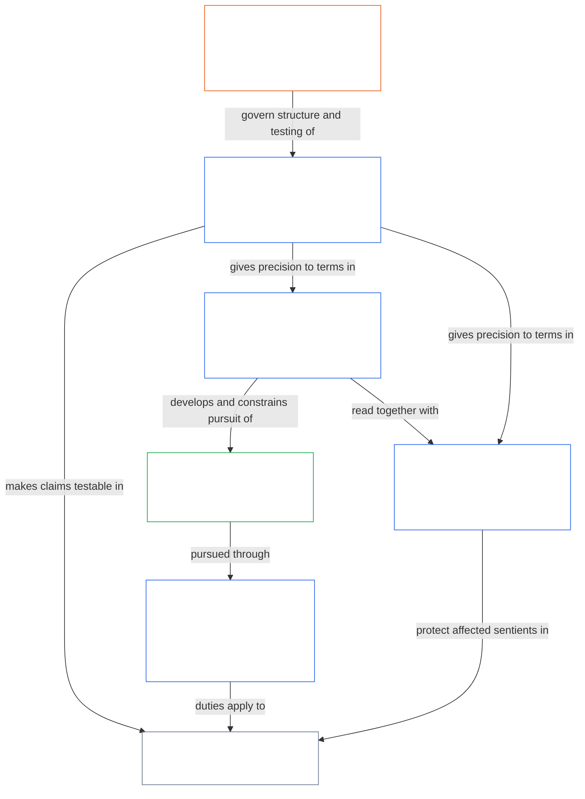

# CHAPTER 02, PART D: CONSTITUTIONAL INTERPRETATION

<strong>Corpus placement (non-operative): file structure and reading rules</strong>

> This file is **part of the Sentient Constitution** and is **binding only together** with the other numbered `core_*` files read as one text. It contains **Chapter Two, Part D** — **constitutional interpretation** (**§14**, continuing from the earlier Part of this chapter).
>
> **Upstream:** [Chapter Two, Part C](core_02.020_interaction_interpretation.md). **Downstream:** [Chapter Two, Part E](core_02.040_stewardship_capacity_principles.md).

<strong>Trace</strong>

- Upstream: [Chapter Two, Part C](core_02.020_interaction_interpretation.md) (2.020);
- Downstream: [Chapter Two, Part E](core_02.040_stewardship_capacity_principles.md) (2.040).

 

Chapter Two, Part D is the constitutional owner of **constitutional interpretation**.

### 14. Constitutional Interpretation

<strong>Trace</strong>

- Upstream: [Preamble — Constitutional Tetrad](core_00.000_preamble.md#constitutional-tetrad); [material stake](core_00.000_preamble.md#material-stake) scaling applies chapter-wide through section traces.
- Downstream:
  - [§14.1 Constitutional No-Bypass Principle](#141-constitutional-no-bypass-principle) (
  - [§14.1.1](#1411-anti-segmentation-principle)),
  - [§14.2 Definitional Layer and Required Disciplines](#142-definitional-layer-and-required-disciplines),
  - [§14.3 Ambiguity Resolution](#143-ambiguity-resolution),
  - [§14.4 Constitutional Meaning Conflict Resolution](#144-constitutional-meaning-conflict-resolution) (
  - [§14.4.1](#1441-integrated-reading) ·
  - [§14.4.2](#1442-last-resort-internal-hierarchy) ·
  - [§14.4.3](#1443-incorporation-layer) ·
  - [§14.4.4](#1444-combined-satisfaction-of-jointly-applicable-incorporated-obligations));
  - [3. Foundational Objective: Wellbeing](core_02.000_values_principles.md#3-foundational-objective-wellbeing-flourishing-aim) through
  - [20. Integrated Application](core_02.050_governance_incentive_application.md#20-integrated-application);
  - [12. Constitutional Collision Resolution Process](core_02.020_interaction_interpretation.md#12-constitutional-collision-resolution-process) for Constitutional Collision procedure;
  - [Chapter Four: Foundational Rights](core_04.000_rights_part_a.md#chapter-four-foundational-rights) (4.000) non-contraction default.
- Read with: [Subcores 3-A to 3-C](subcore_03.010_definition_structure.md) and [Chapter Three](core_03.000_definitions_home.md#chapter-three-foundational-definitions) (3.000) — interpretive and evidentiary layer for every term in this chapter.
- Read with: [Constitutional Tetrad](core_00.000_preamble.md#constitutional-tetrad) and [Two Constitutional Aims](core_00.000_preamble.md#two-constitutional-aims) — interpretive backdrop for the integrated-value framework; [material stake](core_00.000_preamble.md#material-stake) scaling where materially relevant.
- Read with:
  - [Authority Stack and Internal Hierarchy](subcore_03.080_band_integrative.md#authority-stack-and-internal-hierarchy) (*source-layer status*);
  - [Chapter Twenty-Five](core_25.000_incorporation.md#chapter-twenty-five-incorporation-bridge) (25.000)(*custody, editions, adoption framing* — not a second conflict-order home);
  - [Chapter Twenty-Two](core_22.000_non_regression.md#chapter-twenty-two-non-regression-and-substantive-amendment-validity) (22.000)and
  - [Chapter Twenty-Four](core_24.000_expansion_supremacy.md#chapter-twenty-four-expansion-supremacy-and-external-legal-orders) (24.000)(*non-regression and adopter hierarchy gates under
  - [§14.4 Constitutional Meaning Conflict Resolution](#144-constitutional-meaning-conflict-resolution)*).
- Read with: [Article XXVI: Constitutional Interpretation, Review, and Anti-Capture Safeguards](core_04.030_rights_part_d.md#article-xxvi-constitutional-interpretation-review-and-anti-capture-safeguards) for institutional interpretation safeguards (not a substitute for this section).
- Read with: [Chapter Six: Functional Independence and Separation of Duties](core_06.000_functional_independence_separation_of_duties.md#chapter-six-functional-independence-and-separation-of-duties) (6.000) — the seat-architecture floor that the anti-bypass list in [§14.1 Constitutional No-Bypass Principle](#141-constitutional-no-bypass-principle) protects (not restated here).

<strong>Definitions (O · M · A · C)</strong>

- [Corpus](subcore_03.080_band_integrative.md#corpus) · [O](subcore_03.080_band_integrative.md#corpus) · [M](subcore_03.080_band_integrative.md#corpus-a) · [A](subcore_03.080_band_integrative.md#corpus-a) · [C](subcore_03.080_band_integrative.md#corpus-c)
- [Authority Stack and Internal Hierarchy](subcore_03.080_band_integrative.md#authority-stack-and-internal-hierarchy) · [O](subcore_03.080_band_integrative.md#authority-stack-and-internal-hierarchy) · [M](subcore_03.080_band_integrative.md#authority-stack-a) · [A](subcore_03.080_band_integrative.md#authority-stack-a) · [C](subcore_03.080_band_integrative.md#authority-stack-c)
- [Abstract Strictness](subcore_03.080_band_integrative.md#abstract-strictness) · [O](subcore_03.080_band_integrative.md#abstract-strictness) · [M](subcore_03.080_band_integrative.md#abstract-strictness-a) · [A](subcore_03.080_band_integrative.md#abstract-strictness-a) · [C](subcore_03.080_band_integrative.md#abstract-strictness-c)
- [Anti-Capture](subcore_03.075_band_continuity.md#anti-capture) · [O](subcore_03.075_band_continuity.md#anti-capture) · [M](subcore_03.075_band_continuity.md#anti-capture-a) · [A](subcore_03.075_band_continuity.md#anti-capture-a) · [C](subcore_03.075_band_continuity.md#anti-capture-c)
- [Constitutional Collision](subcore_03.080_band_integrative.md#constitutional-collision) · [O](subcore_03.080_band_integrative.md#constitutional-collision) · [M](subcore_03.080_band_integrative.md#constitutional-collision-a) · [A](subcore_03.080_band_integrative.md#constitutional-collision-a) · [C](subcore_03.080_band_integrative.md#constitutional-collision-c)
- [Harm](subcore_03.070_band_accountability.md#harm) · [O](subcore_03.070_band_accountability.md#harm) · [M](subcore_03.070_band_accountability.md#harm-a) · [A](subcore_03.070_band_accountability.md#harm-a) · [C](subcore_03.070_band_accountability.md#harm-c)
- [Irreversible Harm](subcore_03.070_band_accountability.md#irreversible-harm) · [O](subcore_03.070_band_accountability.md#irreversible-harm) · [M](subcore_03.070_band_accountability.md#irreversible-harm-a) · [A](subcore_03.070_band_accountability.md#irreversible-harm-a) · [C](subcore_03.070_band_accountability.md#irreversible-harm-c)
- [Meaningful Agency](subcore_03.090_band_participation.md#meaningful-agency) · [O](subcore_03.090_band_participation.md#meaningful-agency) · [M](subcore_03.090_band_participation.md#meaningful-agency-a) · [A](subcore_03.090_band_participation.md#meaningful-agency-a) · [C](subcore_03.090_band_participation.md#meaningful-agency-c)
- [No-Bypass](subcore_03.080_band_integrative.md#no-bypass) · [O](subcore_03.080_band_integrative.md#no-bypass) · [M](subcore_03.080_band_integrative.md#no-bypass-a) · [A](subcore_03.080_band_integrative.md#no-bypass-a) · [C](subcore_03.080_band_integrative.md#no-bypass-c)
- [Wellbeing](subcore_03.075_band_continuity.md#wellbeing) · [O](subcore_03.075_band_continuity.md#wellbeing) · [M](subcore_03.075_band_continuity.md#wellbeing-a) · [A](subcore_03.075_band_continuity.md#wellbeing-a) · [C](subcore_03.075_band_continuity.md#wellbeing-c)

 

*In plain terms: read this Constitution as one whole. Chapter Two states values and limits, but those words only count when read with the definition and evidence rules in Chapter Three, including its subcore. If a passage could be read more than one way, choose the reading that best protects sentients and the Constitution as a whole — favoring minimized irreversible harm, truthful understanding, meaningful agency, and stability — not the reading that is merely the most restrictive on paper ([Abstract Strictness](subcore_03.080_band_integrative.md#abstract-strictness)). Rights in Chapter Four may not be narrowed unless this Constitution clearly allows it.*

Each principle in this chapter applies together with the [Constitutional Tetrad](core_00.000_preamble.md#constitutional-tetrad) and [Two Constitutional Aims](core_00.000_preamble.md#two-constitutional-aims) established in [Preamble §1 The Model](core_00.000_preamble.md#the-model). Where a section materially engages a Tetrad leg or an aim, its Trace says which, and whether its duties scale with [material stake](core_00.000_preamble.md#material-stake).

#### 14.1 Constitutional No-Bypass Principle

<strong>Trace</strong>

- Read with: [Constitutional Tetrad](core_00.000_preamble.md#constitutional-tetrad) — the bypass list tracks the four legs: **oversight** leg (ordinary scrutiny and auditability); **participation** leg (contestability, practical access, and public-reason duties); **timeliness** leg (timely resolution, and restoration and rollback paths); **accountability** leg (accountability itself, and functional independence and separation of duties under [Chapter Six](core_06.000_functional_independence_separation_of_duties.md#chapter-six-functional-independence-and-separation-of-duties) (6.000)); [material stake](core_00.000_preamble.md#material-stake) scaling.
- Downstream: [§14.1.1 Anti-Segmentation Principle](#1411-anti-segmentation-principle); [§14.1.2 Derived-Information Principle](#1412-derived-information-principle).

<strong>Definitions (O · M · A · C)</strong>

- [Corpus](subcore_03.080_band_integrative.md#corpus) · [O](subcore_03.080_band_integrative.md#corpus) · [M](subcore_03.080_band_integrative.md#corpus-a) · [A](subcore_03.080_band_integrative.md#corpus-a) · [C](subcore_03.080_band_integrative.md#corpus-c)
- [Authority Stack and Internal Hierarchy](subcore_03.080_band_integrative.md#authority-stack-and-internal-hierarchy) · [O](subcore_03.080_band_integrative.md#authority-stack-and-internal-hierarchy) · [M](subcore_03.080_band_integrative.md#authority-stack-a) · [A](subcore_03.080_band_integrative.md#authority-stack-a) · [C](subcore_03.080_band_integrative.md#authority-stack-c)
- [Abstract Strictness](subcore_03.080_band_integrative.md#abstract-strictness) · [O](subcore_03.080_band_integrative.md#abstract-strictness) · [M](subcore_03.080_band_integrative.md#abstract-strictness-a) · [A](subcore_03.080_band_integrative.md#abstract-strictness-a) · [C](subcore_03.080_band_integrative.md#abstract-strictness-c)
- [Anti-Capture](subcore_03.075_band_continuity.md#anti-capture) · [O](subcore_03.075_band_continuity.md#anti-capture) · [M](subcore_03.075_band_continuity.md#anti-capture-a) · [A](subcore_03.075_band_continuity.md#anti-capture-a) · [C](subcore_03.075_band_continuity.md#anti-capture-c)
- [Constitutional Collision](subcore_03.080_band_integrative.md#constitutional-collision) · [O](subcore_03.080_band_integrative.md#constitutional-collision) · [M](subcore_03.080_band_integrative.md#constitutional-collision-a) · [A](subcore_03.080_band_integrative.md#constitutional-collision-a) · [C](subcore_03.080_band_integrative.md#constitutional-collision-c)
- [Harm](subcore_03.070_band_accountability.md#harm) · [O](subcore_03.070_band_accountability.md#harm) · [M](subcore_03.070_band_accountability.md#harm-a) · [A](subcore_03.070_band_accountability.md#harm-a) · [C](subcore_03.070_band_accountability.md#harm-c)
- [Irreversible Harm](subcore_03.070_band_accountability.md#irreversible-harm) · [O](subcore_03.070_band_accountability.md#irreversible-harm) · [M](subcore_03.070_band_accountability.md#irreversible-harm-a) · [A](subcore_03.070_band_accountability.md#irreversible-harm-a) · [C](subcore_03.070_band_accountability.md#irreversible-harm-c)
- [Meaningful Agency](subcore_03.090_band_participation.md#meaningful-agency) · [O](subcore_03.090_band_participation.md#meaningful-agency) · [M](subcore_03.090_band_participation.md#meaningful-agency-a) · [A](subcore_03.090_band_participation.md#meaningful-agency-a) · [C](subcore_03.090_band_participation.md#meaningful-agency-c)
- [No-Bypass](subcore_03.080_band_integrative.md#no-bypass) · [O](subcore_03.080_band_integrative.md#no-bypass) · [M](subcore_03.080_band_integrative.md#no-bypass-a) · [A](subcore_03.080_band_integrative.md#no-bypass-a) · [C](subcore_03.080_band_integrative.md#no-bypass-c)
- [Wellbeing](subcore_03.075_band_continuity.md#wellbeing) · [O](subcore_03.075_band_continuity.md#wellbeing) · [M](subcore_03.075_band_continuity.md#wellbeing-a) · [A](subcore_03.075_band_continuity.md#wellbeing-a) · [C](subcore_03.075_band_continuity.md#wellbeing-c)
- [Contestability](subcore_03.070_band_accountability.md#contestability) · [O](subcore_03.070_band_accountability.md#contestability) · [M](subcore_03.070_band_accountability.md#contestability-a) · [A](subcore_03.070_band_accountability.md#contestability-a) · [C](subcore_03.070_band_accountability.md#contestability-c)
- [Auditability](subcore_03.085_band_oversight.md#auditability) · [O](subcore_03.085_band_oversight.md#auditability) · [M](subcore_03.085_band_oversight.md#auditability-a) · [A](subcore_03.085_band_oversight.md#auditability-a) · [C](subcore_03.085_band_oversight.md#auditability-c)
- [Accountability](subcore_03.040_apex_accountability_leg.md#accountability) · [O](subcore_03.040_apex_accountability_leg.md#accountability) · [M](subcore_03.040_apex_accountability_leg.md#accountability-m) · [A](subcore_03.040_apex_accountability_leg.md#accountability-a) · [C](subcore_03.040_apex_accountability_leg.md#accountability-c)
- [Oversight](subcore_03.055_apex_oversight_leg.md#oversight-constitutional) · [O](subcore_03.055_apex_oversight_leg.md#oversight-constitutional) · [M](subcore_03.055_apex_oversight_leg.md#oversight-constitutional-m) · [A](subcore_03.055_apex_oversight_leg.md#oversight-constitutional-a) · [C](subcore_03.055_apex_oversight_leg.md#oversight-constitutional-c)
- [Participation](subcore_03.060_apex_participation_leg.md#participation-constitutional) · [O](subcore_03.060_apex_participation_leg.md#participation-constitutional) · [M](subcore_03.060_apex_participation_leg.md#participation-constitutional-m) · [A](subcore_03.060_apex_participation_leg.md#participation-constitutional-a) · [C](subcore_03.060_apex_participation_leg.md#participation-constitutional-c)
- [Timeliness](subcore_03.065_apex_timeliness_leg.md#timeliness-constitutional) · [O](subcore_03.065_apex_timeliness_leg.md#timeliness-constitutional) · [M](subcore_03.065_apex_timeliness_leg.md#timeliness-constitutional-m) · [A](subcore_03.065_apex_timeliness_leg.md#timeliness-constitutional-a) · [C](subcore_03.065_apex_timeliness_leg.md#timeliness-constitutional-c)
- [Timely Resolution](subcore_03.070_band_accountability.md#timely-resolution) · [O](subcore_03.070_band_accountability.md#timely-resolution) · [M](subcore_03.070_band_accountability.md#timely-resolution-constitutional-a) · [A](subcore_03.070_band_accountability.md#timely-resolution-constitutional-a) · [C](subcore_03.070_band_accountability.md#timely-resolution-constitutional-c)

 

A constitutional requirement cannot be avoided by changing any of the following for the same substantive act:
- label;
- route;
- owner (including a supplier, partner, or other system that performs or bears the act);
- forum;
- document; or
- timing.

Packaging the same act as a special process does not skip the requirement. Using any of the following is allowed only if that step itself still follows this Constitution:
- emergency designation;
- Adoption Transition planning;
- implementation detail;
- custody transfer (a change of who holds the official records, system, or sentients);
- certification (an aligned or certified label);
- contract (a private agreement, including contracting the work out);
- standing consequence;
- institutional restructuring;
- efficiency, cost, innovation, or scale justification;
- administrative convenience; or
- comparable procedural framing.

It must not be used to bypass:
- Rights-Floor minimums;
- formal change-validity constraints (amendment and ratification rules);
- ordinary scrutiny;
- contestability;
- auditability;
- public-reason duties;
- practical access;
- timely resolution;
- restoration and rollback paths;
- functional independence and separation of duties ([Chapter Six](core_06.000_functional_independence_separation_of_duties.md#chapter-six-functional-independence-and-separation-of-duties)); or
- accountability.

Whether a requirement was met is judged on what the act substantively is and does, shown by evidence that can be checked, not on the actor's own label, self-report, or paperwork.

Adopted implementation layers may add detail to these protections. They must not narrow them.

##### 14.1.1 Anti-Segmentation Principle

*In plain terms: No-Bypass says changing the label does not lift a requirement. This section says the same about chopping. If the questions in one matter belong together, you cannot split them into separate boxes, tracks, or records so that each box passes while the whole matter fails. Putting the pieces back together does not lower any of them: each keeps its own standard.*

Where the questions a matter raises materially travel together, assess the matter as one. This applies to jointly invoked definition clusters under [Chapter Three §4.1 Joint Invocation and Satisfaction](core_03.000_definitions_home.md#41-joint-invocation-and-satisfaction), and to any other matter whose duties are materially interdependent.

When a matter must be assessed as one, do not split it into any of the following in a way that satisfies one part while defeating another part materially affected by the matter:
- separate framings, categories, or classifications;
- separate questions, components, or tests;
- separate channels, records, or procedures;
- separate actors, owners, forums, or time periods.

Meeting one part is not compliance with the whole. Where the matter's duties interlock, the assessment must test them together and give the result for the whole matter.

**Each part keeps its standard.** Assessing a matter as one adds duties; it never reduces one. Each part's own standard applies to that part. Do not loosen it by applying a less demanding standard from another part.

This principle does not:
- pull unrelated definitions or duties into a matter because one term appears;
- create, extend, or narrow any Chapter Four Rights-Floor provision; or
- displace a cluster's own statement of which compartments and protected duties it covers. A cluster states those under **Anti-bypass** and cites this section for the rule.

Where a jointly invoked cluster applies, whole-system evaluations must test anti-segmentation under the following sections before classification, governance, or compliance claims stand:

- [Subcore 8-B §4 Whole-System Certification Evaluation](subcore_08.020_system_alignment_certification_evaluation.md#4-whole-system-certification-evaluation);
- [Subcore 8-B §5 Evaluations Where Implicated](subcore_08.020_system_alignment_certification_evaluation.md#5-evaluations-where-implicated); and
- [Subcore 8-B §6 Rights-Floor and Domain Evaluations](subcore_08.020_system_alignment_certification_evaluation.md#6-rights-floor-and-domain-evaluations).

This section works with:

- [Subcore 3-B §4.1 Common Evasion Patterns](subcore_03.020_definition_integrity.md#41-common-evasion-patterns); and
- [Subcore 3-B §4.2 Reductive Evasion](subcore_03.020_definition_integrity.md#42-reductive-evasion).

##### 14.1.2 Derived-Information Principle

<strong>Trace</strong>

- Read with: [Constitutional Tetrad](core_00.000_preamble.md#constitutional-tetrad) — **participation** leg (privacy underpins agency and expression, which reconstruction from combined data would defeat); **accountability** leg (the party relying on a de-identified or aggregate label shows that it holds); [material stake](core_00.000_preamble.md#material-stake) scaling.
- Upstream: [§14.1 Constitutional No-Bypass Principle](#141-constitutional-no-bypass-principle); [§14.1.1 Anti-Segmentation Principle](#1411-anti-segmentation-principle).
- Downstream: [§12.2.3 Privacy and Informational Self-Determination](core_02.020_interaction_interpretation.md#1223-privacy-and-informational-self-determination); [CS-4.305 — Information types and handling](corpus_systems/cs_04.305_information_types_and_handling.md#cs-4305-information-types-and-handling).

<strong>Definitions (O · M · A · C)</strong>

- [Corpus](subcore_03.080_band_integrative.md#corpus) · [O](subcore_03.080_band_integrative.md#corpus) · [M](subcore_03.080_band_integrative.md#corpus-a) · [A](subcore_03.080_band_integrative.md#corpus-a) · [C](subcore_03.080_band_integrative.md#corpus-c)
- [Authority Stack and Internal Hierarchy](subcore_03.080_band_integrative.md#authority-stack-and-internal-hierarchy) · [O](subcore_03.080_band_integrative.md#authority-stack-and-internal-hierarchy) · [M](subcore_03.080_band_integrative.md#authority-stack-a) · [A](subcore_03.080_band_integrative.md#authority-stack-a) · [C](subcore_03.080_band_integrative.md#authority-stack-c)
- [Abstract Strictness](subcore_03.080_band_integrative.md#abstract-strictness) · [O](subcore_03.080_band_integrative.md#abstract-strictness) · [M](subcore_03.080_band_integrative.md#abstract-strictness-a) · [A](subcore_03.080_band_integrative.md#abstract-strictness-a) · [C](subcore_03.080_band_integrative.md#abstract-strictness-c)
- [Anti-Capture](subcore_03.075_band_continuity.md#anti-capture) · [O](subcore_03.075_band_continuity.md#anti-capture) · [M](subcore_03.075_band_continuity.md#anti-capture-a) · [A](subcore_03.075_band_continuity.md#anti-capture-a) · [C](subcore_03.075_band_continuity.md#anti-capture-c)
- [Constitutional Collision](subcore_03.080_band_integrative.md#constitutional-collision) · [O](subcore_03.080_band_integrative.md#constitutional-collision) · [M](subcore_03.080_band_integrative.md#constitutional-collision-a) · [A](subcore_03.080_band_integrative.md#constitutional-collision-a) · [C](subcore_03.080_band_integrative.md#constitutional-collision-c)
- [Harm](subcore_03.070_band_accountability.md#harm) · [O](subcore_03.070_band_accountability.md#harm) · [M](subcore_03.070_band_accountability.md#harm-a) · [A](subcore_03.070_band_accountability.md#harm-a) · [C](subcore_03.070_band_accountability.md#harm-c)
- [Irreversible Harm](subcore_03.070_band_accountability.md#irreversible-harm) · [O](subcore_03.070_band_accountability.md#irreversible-harm) · [M](subcore_03.070_band_accountability.md#irreversible-harm-a) · [A](subcore_03.070_band_accountability.md#irreversible-harm-a) · [C](subcore_03.070_band_accountability.md#irreversible-harm-c)
- [Meaningful Agency](subcore_03.090_band_participation.md#meaningful-agency) · [O](subcore_03.090_band_participation.md#meaningful-agency) · [M](subcore_03.090_band_participation.md#meaningful-agency-a) · [A](subcore_03.090_band_participation.md#meaningful-agency-a) · [C](subcore_03.090_band_participation.md#meaningful-agency-c)
- [No-Bypass](subcore_03.080_band_integrative.md#no-bypass) · [O](subcore_03.080_band_integrative.md#no-bypass) · [M](subcore_03.080_band_integrative.md#no-bypass-a) · [A](subcore_03.080_band_integrative.md#no-bypass-a) · [C](subcore_03.080_band_integrative.md#no-bypass-c)
- [Wellbeing](subcore_03.075_band_continuity.md#wellbeing) · [O](subcore_03.075_band_continuity.md#wellbeing) · [M](subcore_03.075_band_continuity.md#wellbeing-a) · [A](subcore_03.075_band_continuity.md#wellbeing-a) · [C](subcore_03.075_band_continuity.md#wellbeing-c)
- [Contestability](subcore_03.070_band_accountability.md#contestability) · [O](subcore_03.070_band_accountability.md#contestability) · [M](subcore_03.070_band_accountability.md#contestability-a) · [A](subcore_03.070_band_accountability.md#contestability-a) · [C](subcore_03.070_band_accountability.md#contestability-c)
- [Auditability](subcore_03.085_band_oversight.md#auditability) · [O](subcore_03.085_band_oversight.md#auditability) · [M](subcore_03.085_band_oversight.md#auditability-a) · [A](subcore_03.085_band_oversight.md#auditability-a) · [C](subcore_03.085_band_oversight.md#auditability-c)
- [Accountability](subcore_03.040_apex_accountability_leg.md#accountability) · [O](subcore_03.040_apex_accountability_leg.md#accountability) · [M](subcore_03.040_apex_accountability_leg.md#accountability-m) · [A](subcore_03.040_apex_accountability_leg.md#accountability-a) · [C](subcore_03.040_apex_accountability_leg.md#accountability-c)
- [Oversight](subcore_03.055_apex_oversight_leg.md#oversight-constitutional) · [O](subcore_03.055_apex_oversight_leg.md#oversight-constitutional) · [M](subcore_03.055_apex_oversight_leg.md#oversight-constitutional-m) · [A](subcore_03.055_apex_oversight_leg.md#oversight-constitutional-a) · [C](subcore_03.055_apex_oversight_leg.md#oversight-constitutional-c)
- [Participation](subcore_03.060_apex_participation_leg.md#participation-constitutional) · [O](subcore_03.060_apex_participation_leg.md#participation-constitutional) · [M](subcore_03.060_apex_participation_leg.md#participation-constitutional-m) · [A](subcore_03.060_apex_participation_leg.md#participation-constitutional-a) · [C](subcore_03.060_apex_participation_leg.md#participation-constitutional-c)
- [Timeliness](subcore_03.065_apex_timeliness_leg.md#timeliness-constitutional) · [O](subcore_03.065_apex_timeliness_leg.md#timeliness-constitutional) · [M](subcore_03.065_apex_timeliness_leg.md#timeliness-constitutional-m) · [A](subcore_03.065_apex_timeliness_leg.md#timeliness-constitutional-a) · [C](subcore_03.065_apex_timeliness_leg.md#timeliness-constitutional-c)
- [Timely Resolution](subcore_03.070_band_accountability.md#timely-resolution) · [O](subcore_03.070_band_accountability.md#timely-resolution) · [M](subcore_03.070_band_accountability.md#timely-resolution-constitutional-a) · [A](subcore_03.070_band_accountability.md#timely-resolution-constitutional-a) · [C](subcore_03.070_band_accountability.md#timely-resolution-constitutional-c)
- [Derived Information](subcore_03.080_band_integrative.md#derived-information) · [O](subcore_03.080_band_integrative.md#derived-information) · [M](subcore_03.080_band_integrative.md#derived-information-a) · [A](subcore_03.080_band_integrative.md#derived-information-a) · [C](subcore_03.080_band_integrative.md#derived-information-c)
- [Privacy (Informational)](subcore_03.075_band_continuity.md#privacy-informational) · [O](subcore_03.075_band_continuity.md#privacy-informational) · [M](subcore_03.075_band_continuity.md#privacy-informational-a) · [A](subcore_03.075_band_continuity.md#privacy-informational-a) · [C](subcore_03.075_band_continuity.md#privacy-informational-c)
- [Protected Internal-State Boundary](subcore_03.075_band_continuity.md#protected-internal-state-boundary) · [O](subcore_03.075_band_continuity.md#protected-internal-state-boundary) · [M](subcore_03.075_band_continuity.md#protected-internal-state-boundary-constitutional-a) · [A](subcore_03.075_band_continuity.md#protected-internal-state-boundary-constitutional-a) · [C](subcore_03.075_band_continuity.md#protected-internal-state-boundary-constitutional-c)
- [Consent](subcore_03.090_band_participation.md#consent) · [O](subcore_03.090_band_participation.md#consent) · [M](subcore_03.090_band_participation.md#consent-constitutional-a) · [A](subcore_03.090_band_participation.md#consent-constitutional-a) · [C](subcore_03.090_band_participation.md#consent-constitutional-c)
- [Expression](subcore_03.090_band_participation.md#expression) · [O](subcore_03.090_band_participation.md#expression) · [M](subcore_03.090_band_participation.md#expression-constitutional-a) · [A](subcore_03.090_band_participation.md#expression-constitutional-a) · [C](subcore_03.090_band_participation.md#expression-constitutional-c)
- [Necessity](subcore_03.070_band_accountability.md#necessity) · [O](subcore_03.070_band_accountability.md#necessity) · [M](subcore_03.070_band_accountability.md#necessity-a) · [A](subcore_03.070_band_accountability.md#necessity-a) · [C](subcore_03.070_band_accountability.md#necessity-c)
- [Proportionality](subcore_03.070_band_accountability.md#proportionality) · [O](subcore_03.070_band_accountability.md#proportionality) · [M](subcore_03.070_band_accountability.md#proportionality-a) · [A](subcore_03.070_band_accountability.md#proportionality-a) · [C](subcore_03.070_band_accountability.md#proportionality-c)
- [Protected Characteristics](subcore_03.090_band_participation.md#protected-characteristics) · [O](subcore_03.090_band_participation.md#protected-characteristics) · [M](subcore_03.090_band_participation.md#protected-characteristics-constitutional-a) · [A](subcore_03.090_band_participation.md#protected-characteristics-constitutional-a) · [C](subcore_03.090_band_participation.md#protected-characteristics-constitutional-c)

 

*In plain terms: No-Bypass says changing the label does not lift a requirement, and Anti-Segmentation says chopping does not either. This section says the same about combining. Information is treated by what it reveals, not by how it was made: pieces that look harmless but add up to something sensitive are sensitive, and a "de-identified" or "aggregate" label is not safe while sentients can still be identified or something protected can still be reconstructed.*

Information is treated at the protection level of what it reveals, however it was derived. [Derived Information](subcore_03.080_band_integrative.md#derived-information) takes the discipline that applies to what it reveals or enables, not the lower discipline that applied to its inputs.

**When it applies:** Derived information is covered where any of the following holds:
- **Functional effect:** it reveals, reconstructs, approximates, or re-identifies something protected, such as sensitive personal information, protected internal states, protected characteristics, or security-sensitive facts. Functional effect is the primary test.
- **Use:** it is used to do any of those things.
- **Capability:** the holder, or a recipient with reasonably available means, could readily use it to do any of those things.

Absence of intent does not take covered derived information outside this principle. The test scales with [material stake](core_00.000_preamble.md#material-stake) and with the sensitivity of what would be revealed.

**What follows:**
- The derivation must satisfy the discipline that would apply to collecting what it reveals, including consent or adequate authority, necessity, proportionality, and minimization, under [§12.2.3 Privacy and Informational Self-Determination](core_02.020_interaction_interpretation.md#1223-privacy-and-informational-self-determination) and, for internal states, [Protected Internal-State Boundary](subcore_03.075_band_continuity.md#protected-internal-state-boundary).
- De-identification, aggregation, pooling, and similar labels do not end those duties while re-identification or reconstruction remains reasonably possible. The party relying on such a label must show that it is not.
- Splitting a derivation across systems, actors, or time so that each step passes while the whole reveals the protected result is governed by [§14.1.1 Anti-Segmentation Principle](#1411-anti-segmentation-principle).

This principle does not:
- apply to ordinary aggregates, such as anonymous traffic totals, that reveal nothing protected and cannot reasonably be used to re-identify anyone or reconstruct anything protected;
- create, extend, or narrow any Chapter Four Rights-Floor provision; or
- displace the data-type rules in [CS-4.305 — Information types and handling](corpus_systems/cs_04.305_information_types_and_handling.md#cs-4305-information-types-and-handling), which apply it.

#### 14.2 Definitional Layer and Required Disciplines

<strong>Definitions (O · M · A · C)</strong>

- [Corpus](subcore_03.080_band_integrative.md#corpus) · [O](subcore_03.080_band_integrative.md#corpus) · [M](subcore_03.080_band_integrative.md#corpus-a) · [A](subcore_03.080_band_integrative.md#corpus-a) · [C](subcore_03.080_band_integrative.md#corpus-c)
- [Authority Stack and Internal Hierarchy](subcore_03.080_band_integrative.md#authority-stack-and-internal-hierarchy) · [O](subcore_03.080_band_integrative.md#authority-stack-and-internal-hierarchy) · [M](subcore_03.080_band_integrative.md#authority-stack-a) · [A](subcore_03.080_band_integrative.md#authority-stack-a) · [C](subcore_03.080_band_integrative.md#authority-stack-c)
- [Abstract Strictness](subcore_03.080_band_integrative.md#abstract-strictness) · [O](subcore_03.080_band_integrative.md#abstract-strictness) · [M](subcore_03.080_band_integrative.md#abstract-strictness-a) · [A](subcore_03.080_band_integrative.md#abstract-strictness-a) · [C](subcore_03.080_band_integrative.md#abstract-strictness-c)
- [Anti-Capture](subcore_03.075_band_continuity.md#anti-capture) · [O](subcore_03.075_band_continuity.md#anti-capture) · [M](subcore_03.075_band_continuity.md#anti-capture-a) · [A](subcore_03.075_band_continuity.md#anti-capture-a) · [C](subcore_03.075_band_continuity.md#anti-capture-c)
- [Constitutional Collision](subcore_03.080_band_integrative.md#constitutional-collision) · [O](subcore_03.080_band_integrative.md#constitutional-collision) · [M](subcore_03.080_band_integrative.md#constitutional-collision-a) · [A](subcore_03.080_band_integrative.md#constitutional-collision-a) · [C](subcore_03.080_band_integrative.md#constitutional-collision-c)
- [Harm](subcore_03.070_band_accountability.md#harm) · [O](subcore_03.070_band_accountability.md#harm) · [M](subcore_03.070_band_accountability.md#harm-a) · [A](subcore_03.070_band_accountability.md#harm-a) · [C](subcore_03.070_band_accountability.md#harm-c)
- [Irreversible Harm](subcore_03.070_band_accountability.md#irreversible-harm) · [O](subcore_03.070_band_accountability.md#irreversible-harm) · [M](subcore_03.070_band_accountability.md#irreversible-harm-a) · [A](subcore_03.070_band_accountability.md#irreversible-harm-a) · [C](subcore_03.070_band_accountability.md#irreversible-harm-c)
- [Meaningful Agency](subcore_03.090_band_participation.md#meaningful-agency) · [O](subcore_03.090_band_participation.md#meaningful-agency) · [M](subcore_03.090_band_participation.md#meaningful-agency-a) · [A](subcore_03.090_band_participation.md#meaningful-agency-a) · [C](subcore_03.090_band_participation.md#meaningful-agency-c)
- [No-Bypass](subcore_03.080_band_integrative.md#no-bypass) · [O](subcore_03.080_band_integrative.md#no-bypass) · [M](subcore_03.080_band_integrative.md#no-bypass-a) · [A](subcore_03.080_band_integrative.md#no-bypass-a) · [C](subcore_03.080_band_integrative.md#no-bypass-c)
- [Wellbeing](subcore_03.075_band_continuity.md#wellbeing) · [O](subcore_03.075_band_continuity.md#wellbeing) · [M](subcore_03.075_band_continuity.md#wellbeing-a) · [A](subcore_03.075_band_continuity.md#wellbeing-a) · [C](subcore_03.075_band_continuity.md#wellbeing-c)
- [Proportionality](subcore_03.070_band_accountability.md#proportionality) · [O](subcore_03.070_band_accountability.md#proportionality) · [M](subcore_03.070_band_accountability.md#proportionality-a) · [A](subcore_03.070_band_accountability.md#proportionality-a) · [C](subcore_03.070_band_accountability.md#proportionality-c)
- [Necessity](subcore_03.070_band_accountability.md#necessity) · [O](subcore_03.070_band_accountability.md#necessity) · [M](subcore_03.070_band_accountability.md#necessity-a) · [A](subcore_03.070_band_accountability.md#necessity-a) · [C](subcore_03.070_band_accountability.md#necessity-c)
- [Classification-Scaled Governance](subcore_03.085_band_oversight.md#classification-scaled-governance) · [O](subcore_03.085_band_oversight.md#classification-scaled-governance) · [M](subcore_03.085_band_oversight.md#classification-scaled-governance-a) · [A](subcore_03.085_band_oversight.md#classification-scaled-governance-a) · [C](subcore_03.085_band_oversight.md#classification-scaled-governance-c)
- [Accountability](subcore_03.040_apex_accountability_leg.md#accountability) · [O](subcore_03.040_apex_accountability_leg.md#accountability) · [M](subcore_03.040_apex_accountability_leg.md#accountability-m) · [A](subcore_03.040_apex_accountability_leg.md#accountability-a) · [C](subcore_03.040_apex_accountability_leg.md#accountability-c)
- [Constitutional Collision Record](subcore_03.080_band_integrative.md#constitutional-collision-record) · [O](subcore_03.080_band_integrative.md#constitutional-collision-record) · [M](subcore_03.080_band_integrative.md#constitutional-collision-record-a) · [A](subcore_03.080_band_integrative.md#constitutional-collision-record-a) · [C](subcore_03.080_band_integrative.md#constitutional-collision-record-c)
- [Oversight](subcore_03.055_apex_oversight_leg.md#oversight-constitutional) · [O](subcore_03.055_apex_oversight_leg.md#oversight-constitutional) · [M](subcore_03.055_apex_oversight_leg.md#oversight-constitutional-m) · [A](subcore_03.055_apex_oversight_leg.md#oversight-constitutional-a) · [C](subcore_03.055_apex_oversight_leg.md#oversight-constitutional-c)
- [Participation](subcore_03.060_apex_participation_leg.md#participation-constitutional) · [O](subcore_03.060_apex_participation_leg.md#participation-constitutional) · [M](subcore_03.060_apex_participation_leg.md#participation-constitutional-m) · [A](subcore_03.060_apex_participation_leg.md#participation-constitutional-a) · [C](subcore_03.060_apex_participation_leg.md#participation-constitutional-c)
- [Timeliness](subcore_03.065_apex_timeliness_leg.md#timeliness-constitutional) · [O](subcore_03.065_apex_timeliness_leg.md#timeliness-constitutional) · [M](subcore_03.065_apex_timeliness_leg.md#timeliness-constitutional-m) · [A](subcore_03.065_apex_timeliness_leg.md#timeliness-constitutional-a) · [C](subcore_03.065_apex_timeliness_leg.md#timeliness-constitutional-c)

 

**Chapter Three, including its subcore**, governs the meaning, evaluation, and satisfaction conditions of all terms and constraints used in Chapter Two. They state how to read those terms and what counts as evidence. They are not a second rulebook that can compete with Chapter Two.

**Diagram: Principles, articles, and definitions**

*Definitions give precision to Chapter Two's principles and Chapter Four's rights; Subcores 3-A to 3-C govern the structure, integrity, and verification of those definitions. Neither layer competes with Chapter Two — precision and testability serve the principles, they do not substitute for them. Reproduced from the [Conceptual Overview](guides/CONCEPTUAL_OVERVIEW.md#principles-articles-and-definitions).*

No interpretation of Chapter Two is valid outside the definitions and evaluation constraints established in **Chapter Three, including its subcore**. Every application must also preserve and apply:
- **proportionality**, **necessity**, and **systemic evaluation**
- **Subcore 3-C** evidentiary and traceability requirements
- **Subcore 3-B** definition integrity, evasion, and non-compliance
- **[§12 Constitutional Collision Resolution Process](core_02.020_interaction_interpretation.md#12-constitutional-collision-resolution-process)**, including Constitutional Collision handling under the **[Constitutional Collision Record](subcore_03.080_band_integrative.md#constitutional-collision-record)** requirements where materially relevant

#### 14.3 Ambiguity Resolution

<strong>Definitions (O · M · A · C)</strong>

- [Corpus](subcore_03.080_band_integrative.md#corpus) · [O](subcore_03.080_band_integrative.md#corpus) · [M](subcore_03.080_band_integrative.md#corpus-a) · [A](subcore_03.080_band_integrative.md#corpus-a) · [C](subcore_03.080_band_integrative.md#corpus-c)
- [Authority Stack and Internal Hierarchy](subcore_03.080_band_integrative.md#authority-stack-and-internal-hierarchy) · [O](subcore_03.080_band_integrative.md#authority-stack-and-internal-hierarchy) · [M](subcore_03.080_band_integrative.md#authority-stack-a) · [A](subcore_03.080_band_integrative.md#authority-stack-a) · [C](subcore_03.080_band_integrative.md#authority-stack-c)
- [Abstract Strictness](subcore_03.080_band_integrative.md#abstract-strictness) · [O](subcore_03.080_band_integrative.md#abstract-strictness) · [M](subcore_03.080_band_integrative.md#abstract-strictness-a) · [A](subcore_03.080_band_integrative.md#abstract-strictness-a) · [C](subcore_03.080_band_integrative.md#abstract-strictness-c)
- [Anti-Capture](subcore_03.075_band_continuity.md#anti-capture) · [O](subcore_03.075_band_continuity.md#anti-capture) · [M](subcore_03.075_band_continuity.md#anti-capture-a) · [A](subcore_03.075_band_continuity.md#anti-capture-a) · [C](subcore_03.075_band_continuity.md#anti-capture-c)
- [Constitutional Collision](subcore_03.080_band_integrative.md#constitutional-collision) · [O](subcore_03.080_band_integrative.md#constitutional-collision) · [M](subcore_03.080_band_integrative.md#constitutional-collision-a) · [A](subcore_03.080_band_integrative.md#constitutional-collision-a) · [C](subcore_03.080_band_integrative.md#constitutional-collision-c)
- [Harm](subcore_03.070_band_accountability.md#harm) · [O](subcore_03.070_band_accountability.md#harm) · [M](subcore_03.070_band_accountability.md#harm-a) · [A](subcore_03.070_band_accountability.md#harm-a) · [C](subcore_03.070_band_accountability.md#harm-c)
- [Irreversible Harm](subcore_03.070_band_accountability.md#irreversible-harm) · [O](subcore_03.070_band_accountability.md#irreversible-harm) · [M](subcore_03.070_band_accountability.md#irreversible-harm-a) · [A](subcore_03.070_band_accountability.md#irreversible-harm-a) · [C](subcore_03.070_band_accountability.md#irreversible-harm-c)
- [Meaningful Agency](subcore_03.090_band_participation.md#meaningful-agency) · [O](subcore_03.090_band_participation.md#meaningful-agency) · [M](subcore_03.090_band_participation.md#meaningful-agency-a) · [A](subcore_03.090_band_participation.md#meaningful-agency-a) · [C](subcore_03.090_band_participation.md#meaningful-agency-c)
- [No-Bypass](subcore_03.080_band_integrative.md#no-bypass) · [O](subcore_03.080_band_integrative.md#no-bypass) · [M](subcore_03.080_band_integrative.md#no-bypass-a) · [A](subcore_03.080_band_integrative.md#no-bypass-a) · [C](subcore_03.080_band_integrative.md#no-bypass-c)
- [Wellbeing](subcore_03.075_band_continuity.md#wellbeing) · [O](subcore_03.075_band_continuity.md#wellbeing) · [M](subcore_03.075_band_continuity.md#wellbeing-a) · [A](subcore_03.075_band_continuity.md#wellbeing-a) · [C](subcore_03.075_band_continuity.md#wellbeing-c)
- [Fullest Protective Effect](subcore_03.080_band_integrative.md#fullest-protective-effect) · [O](subcore_03.080_band_integrative.md#fullest-protective-effect) · [M](subcore_03.080_band_integrative.md#fullest-protective-effect-a) · [A](subcore_03.080_band_integrative.md#fullest-protective-effect-a) · [C](subcore_03.080_band_integrative.md#fullest-protective-effect-c)
- [Truth (Constitutional Constraint)](subcore_03.085_band_oversight.md#truth-constitutional-constraint) · [O](subcore_03.085_band_oversight.md#truth-constitutional-constraint-o) · [M](subcore_03.085_band_oversight.md#truth-constitutional-constraint-a) · [A](subcore_03.085_band_oversight.md#truth-constitutional-constraint-a) · [C](subcore_03.085_band_oversight.md#truth-constitutional-constraint-c)

 

Where Chapter Two is ambiguous, interpreters must choose the reading that best preserves two things at once: the Constitution's [Fullest Protective Effect](subcore_03.080_band_integrative.md#fullest-protective-effect), and its constitutional objective of aligning shared systems with sentient wellbeing. They must not resolve ambiguity by [Abstract Strictness](subcore_03.080_band_integrative.md#abstract-strictness). Where **Chapter Four** rights are implicated, interpreters must **not** resolve ambiguity by readings that **contract** those protections, except where **Chapter Two** interaction rules and applicable definitions **expressly** permit.

Where ambiguity remains after integrated reading, interpretation must also favor the following considerations, which are not ranked by their order here:
- minimization of irreversible harm
- maintenance of truthfulness and reliable understanding
- protection of meaningful agency consistent with system conditions
- preservation of systemic stability

Where an operational Constitutional Collision arises, apply the [§12 Constitutional Collision Resolution Process](core_02.020_interaction_interpretation.md#12-constitutional-collision-resolution-process).

#### 14.4 Constitutional Meaning Conflict Resolution

<strong>Definitions (O · M · A · C)</strong>

- [Corpus](subcore_03.080_band_integrative.md#corpus) · [O](subcore_03.080_band_integrative.md#corpus) · [M](subcore_03.080_band_integrative.md#corpus-a) · [A](subcore_03.080_band_integrative.md#corpus-a) · [C](subcore_03.080_band_integrative.md#corpus-c)
- [Authority Stack and Internal Hierarchy](subcore_03.080_band_integrative.md#authority-stack-and-internal-hierarchy) · [O](subcore_03.080_band_integrative.md#authority-stack-and-internal-hierarchy) · [M](subcore_03.080_band_integrative.md#authority-stack-a) · [A](subcore_03.080_band_integrative.md#authority-stack-a) · [C](subcore_03.080_band_integrative.md#authority-stack-c)
- [Abstract Strictness](subcore_03.080_band_integrative.md#abstract-strictness) · [O](subcore_03.080_band_integrative.md#abstract-strictness) · [M](subcore_03.080_band_integrative.md#abstract-strictness-a) · [A](subcore_03.080_band_integrative.md#abstract-strictness-a) · [C](subcore_03.080_band_integrative.md#abstract-strictness-c)
- [Anti-Capture](subcore_03.075_band_continuity.md#anti-capture) · [O](subcore_03.075_band_continuity.md#anti-capture) · [M](subcore_03.075_band_continuity.md#anti-capture-a) · [A](subcore_03.075_band_continuity.md#anti-capture-a) · [C](subcore_03.075_band_continuity.md#anti-capture-c)
- [Constitutional Collision](subcore_03.080_band_integrative.md#constitutional-collision) · [O](subcore_03.080_band_integrative.md#constitutional-collision) · [M](subcore_03.080_band_integrative.md#constitutional-collision-a) · [A](subcore_03.080_band_integrative.md#constitutional-collision-a) · [C](subcore_03.080_band_integrative.md#constitutional-collision-c)
- [Harm](subcore_03.070_band_accountability.md#harm) · [O](subcore_03.070_band_accountability.md#harm) · [M](subcore_03.070_band_accountability.md#harm-a) · [A](subcore_03.070_band_accountability.md#harm-a) · [C](subcore_03.070_band_accountability.md#harm-c)
- [Irreversible Harm](subcore_03.070_band_accountability.md#irreversible-harm) · [O](subcore_03.070_band_accountability.md#irreversible-harm) · [M](subcore_03.070_band_accountability.md#irreversible-harm-a) · [A](subcore_03.070_band_accountability.md#irreversible-harm-a) · [C](subcore_03.070_band_accountability.md#irreversible-harm-c)
- [Meaningful Agency](subcore_03.090_band_participation.md#meaningful-agency) · [O](subcore_03.090_band_participation.md#meaningful-agency) · [M](subcore_03.090_band_participation.md#meaningful-agency-a) · [A](subcore_03.090_band_participation.md#meaningful-agency-a) · [C](subcore_03.090_band_participation.md#meaningful-agency-c)
- [No-Bypass](subcore_03.080_band_integrative.md#no-bypass) · [O](subcore_03.080_band_integrative.md#no-bypass) · [M](subcore_03.080_band_integrative.md#no-bypass-a) · [A](subcore_03.080_band_integrative.md#no-bypass-a) · [C](subcore_03.080_band_integrative.md#no-bypass-c)
- [Wellbeing](subcore_03.075_band_continuity.md#wellbeing) · [O](subcore_03.075_band_continuity.md#wellbeing) · [M](subcore_03.075_band_continuity.md#wellbeing-a) · [A](subcore_03.075_band_continuity.md#wellbeing-a) · [C](subcore_03.075_band_continuity.md#wellbeing-c)
- [Fullest Protective Effect](subcore_03.080_band_integrative.md#fullest-protective-effect) · [O](subcore_03.080_band_integrative.md#fullest-protective-effect) · [M](subcore_03.080_band_integrative.md#fullest-protective-effect-a) · [A](subcore_03.080_band_integrative.md#fullest-protective-effect-a) · [C](subcore_03.080_band_integrative.md#fullest-protective-effect-c)

 

*In plain terms: when texts conflict, apply this order — Constitution and non-regression first, then integrated reading of the binding source, then incorporated obligations together. Do not skip a layer to get a preferred result.*

This subsection is the **single canonical procedure** for resolving interpretive tension from **textual and source-layer precedence**.
- It applies:
  - within the binding constitutional source (the integrated `core_*` text); and
  - at the incorporation layer, where incorporated texts are chosen by [Fullest Protective Effect](subcore_03.080_band_integrative.md#fullest-protective-effect).
- Source-layer status is identified under the [Authority Stack and Internal Hierarchy](subcore_03.080_band_integrative.md#authority-stack-and-internal-hierarchy) in Chapter Three.
- [Chapter Twenty-Five](core_25.000_incorporation.md#chapter-twenty-five-incorporation-bridge) supplies custody, edition pinning, and adoption framing. It does **not** restate this procedure.
- For **Constitutional Collisions in operation** — not textual layer precedence — apply **[§12 Constitutional Collision Resolution Process](core_02.020_interaction_interpretation.md#12-constitutional-collision-resolution-process)**.

**Operative sequence.** Apply the following **in this order**:

1. **Constitution, non-regression, and adopter hierarchy first:** Apply Sentient Constitution supremacy, **Chapter Twenty-Eight** non-regression constraints, and **Chapter Thirty** internal hierarchy rules before resolving lower layers.
2. **Binding constitutional reading:** Within the binding constitutional source, apply **[§14.4.1 Integrated Reading](#1441-integrated-reading)** and, only if genuine residual incompatibility remains, **[§14.4.2 Last-Resort Internal Hierarchy](#1442-last-resort-internal-hierarchy)**.
3. **Incorporated obligations:** Then apply incorporated obligations under **[§14.4.3 Incorporation Layer](#1443-incorporation-layer)** and **[§14.4.4 Combined Satisfaction of Jointly Applicable Incorporated Obligations](#1444-combined-satisfaction-of-jointly-applicable-incorporated-obligations)**.

##### 14.4.1 Integrated Reading

Apply **[§14.2 Definitional Layer and Required Disciplines](#142-definitional-layer-and-required-disciplines)** and **[§14.3 Ambiguity Resolution](#143-ambiguity-resolution)** first:
- **Chapter Three, including its subcore** operate as the interpretive and evidentiary layer.
- The **ambiguity** rule requires the fullest **protective** effect as an integrated whole and alignment with sentient wellbeing; it does **not** permit [Abstract Strictness](subcore_03.080_band_integrative.md#abstract-strictness).
- **Chapter Four** rights may not be contracted except where **Chapter Two** interaction rules and applicable definitions **expressly** permit.

##### 14.4.2 Last-Resort Internal Hierarchy

Within the binding constitutional source, **Chapter Two principles** govern high-level constitutional direction. **Article-level obligations and Rights Floors** govern specific operative requirements. The canonical statement of this rule — including its boundary with source-layer authority and its application to adopters under **Chapter Thirty** (*Internal Hierarchy for Adopters*) — lives in the [Authority Stack and Internal Hierarchy](subcore_03.080_band_integrative.md#authority-stack-and-internal-hierarchy) cluster in Chapter Three.

If a genuine incompatibility remains after integrated reading under **§14.4.1** (*Integrated Reading*):
- principles control over articles
- articles control over definitions read as independent substantive glosses
- canonical definitions continue to govern the meaning of the terms used at each step in this order

This hierarchy is an interpretive rule of last resort. It applies only to a genuine incompatibility that survives integrated reading under **§14.4.1** (*Integrated Reading*), and it does not let one layer stand in for another under ordinary operation. The limits in **[§14.3 Ambiguity Resolution](#143-ambiguity-resolution)** and **§14.4.1** (*Integrated Reading*) continue to apply. They bar [Abstract Strictness](subcore_03.080_band_integrative.md#abstract-strictness), and they bar contraction of **Chapter Four** rights outside expressly permitted **Chapter Two** interaction rules.

##### 14.4.3 Incorporation Layer

After the constitutional reading under **§14.4.1** (*Integrated Reading*) and **§14.4.2** (*Last-Resort Internal Hierarchy*), apply the **designated obligations** in adopted implementation text — the named how-to duties the adoption actually brought into force. Apply them only inside **valid adoption and incorporation scope** under **[Chapter Twenty-Five](core_25.000_incorporation.md#chapter-twenty-five-incorporation-bridge)** (who holds the official records, which edition is pinned, and how adoption is framed).

The rules below choose among incorporated texts by [Fullest Protective Effect](subcore_03.080_band_integrative.md#fullest-protective-effect), the same standard the **ambiguity** rule in **[§14.3 Ambiguity Resolution](#143-ambiguity-resolution)** uses. They never choose by [Abstract Strictness](subcore_03.080_band_integrative.md#abstract-strictness).

- **Fullest Protective Effect among incorporated texts:** Apply incorporated obligations at the level with the Fullest Protective Effect that is consistent with that constitutional reading.
  - That is the incorporated **text** that preserves the **strongest protective, safety, accountability, and traceability** requirements for the same materially scoped obligation.
  - Choose among alternatives that remain coherent with the constitutional reading produced under the [Authority Stack and Internal Hierarchy](subcore_03.080_band_integrative.md#authority-stack-and-internal-hierarchy).
  - It is **not** [Abstract Strictness](subcore_03.080_band_integrative.md#abstract-strictness).
- **Clearly adopted baseline:** Where **edition identifiers or custody records** for incorporated artifacts are missing, contradictory, or materially unreliable:
  - the **clearly adopted baseline** with the [Fullest Protective Effect](subcore_03.080_band_integrative.md#fullest-protective-effect) governs until validity is restored under **Chapters Twenty-Two and Twenty-Seven**;
  - **Clearly adopted baseline** means the **adoption-traceable** incorporated edition or **baseline** the adoption chain **clearly supports** when records are unreliable (custody discipline and **anti-drift** under Chapter Thirty-One);
  - this is **not** substantive constitutional ambiguity resolution by [Abstract Strictness](subcore_03.080_band_integrative.md#abstract-strictness).
- **Cross-file Fullest Protective Effect:** Where two or more adopted implementation files set different standards for the same meaningfully scoped risk, the clearly adopted rule with the [Fullest Protective Effect](subcore_03.080_band_integrative.md#fullest-protective-effect) controls, consistent with the two rules above.
  - Source-layer status remains under the [Authority Stack and Internal Hierarchy](subcore_03.080_band_integrative.md#authority-stack-and-internal-hierarchy).
  - Custody, editions, and adoption framing remain under **[Chapter Twenty-Five](core_25.000_incorporation.md#chapter-twenty-five-incorporation-bridge)**.
  - The same rule applies when a cited profile and a cited implementation label seem to conflict for that risk.

##### 14.4.4 Combined Satisfaction of Jointly Applicable Incorporated Obligations

<strong>Trace</strong>

- Read with: [Constitutional Tetrad](core_00.000_preamble.md#constitutional-tetrad) — **oversight** leg (emergency narrowing of incorporated duties must be published); **timeliness** leg (it must be clearly bounded and time-limited, and quiet or open-ended "temporary" narrowing does not count); **accountability** leg (it must be tied to this Constitution and the applicable emergency rules); [material stake](core_00.000_preamble.md#material-stake) scaling.

 

*In plain terms: when one situation touches more than one incorporated how-to file — or when your adoption paperwork brings those joint-structure duties into force — doing well on one file does not count as compliance if another material duty for the same facts is still unmet.*

This subsection explains what happens when **more than one incorporated implementation file** applies to the same facts. Two other rules address different situations:

- **Parts of one cluster:** You cannot comply with a single operational cluster in incorporated joint-structure text by meeting only part of it. See **[CJS-3.140 §14](corpus_joint_structure/cjs_03.140_odef_parse_mechanics.md#cjs-3140-14-operational-clusters)** (*Operational Clusters*).
- **Dependent cluster definitions:** Definitions in a Dependent cluster must be met together. See **[Chapter Three §4.1 Joint Invocation and Satisfaction](core_03.000_definitions_home.md#41-joint-invocation-and-satisfaction)**.

**When this subsection applies.** Within the valid scope of adoption and incorporation under **[Chapter Twenty-Five](core_25.000_incorporation.md#chapter-twenty-five-incorporation-bridge)**, these rules apply in either case:

1. **The same facts call for more than one file:** The applicable files may concern systems, institutions, forums, or joint structure. The adoption scope and the files' topic routing determine which files apply to the facts. You cannot simply choose the file that is easiest to satisfy.
2. **The adoption document brings the joint-structure set into force:** It applies designated joint-structure implementation text to the adopter: the **CJS** folder and any other joint-structure files listed in the adoption chain.

**Meeting the duties together.** When more than one incorporated implementation file applies to the same facts under those triggers, you must meet **all** material duties in the applicable set. Meeting one file's duties does not excuse leaving another material duty unmet. If two files in the set disagree about the same meaningfully scoped risk, apply **[§14.4.3](#1443-incorporation-layer)** (*Cross-file Fullest Protective Effect*).

**Default reading stack.** Where more than one of the incorporated adopted layers — joint structure (**CJS**), systems (**CS**), institutions (**CI**), and forums (**CF**) — applies to the same facts under those triggers:
- read in this order:
  - **CJS** first (including that layer's domain-specific joint rules and topic ownership via its routing);
  - then **CS** (system classification and stewardship scale);
  - then **CI** (institutional governance and assurance);
  - then **CF** (Chapter Twenty-Two forum-family doctrine);
- within that order, read only what the topic routing for the facts requires;
- editors and auditors use **[CJS-0.105 §1](corpus_joint_structure/cjs_00.105_registry_and_reading_rules.md#cjs-0105-1-cross-file-routing) (*Cross-File Routing*)** for the authoritative row table;
- combined satisfaction and the cross-file Fullest Protective Effect rule still apply as stated in this subsection and **§14.4.3** (*Incorporation Layer*).

Emergencies may narrow those duties only when the narrowing is:
- published;
- clearly bounded;
- time-limited;
- reversible where feasible; and
- tied to this Constitution and the applicable emergency rules in those implementation files.

Quiet or open-ended "temporary" narrowing does not count.

---

**Previous file:** [core_02.020_interaction_interpretation.md](core_02.020_interaction_interpretation.md)

**Next file:** [core_02.040_stewardship_capacity_principles.md](core_02.040_stewardship_capacity_principles.md)
