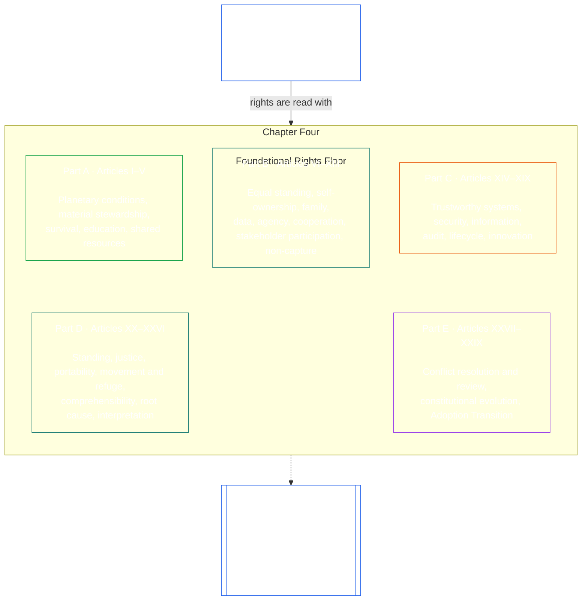

# CHAPTER FOUR: FOUNDATIONAL RIGHTS
<details>
<summary><strong><span style="color: #2563eb;">Corpus placement (non-operative): file structure and reading rules</span></strong></summary>

> This file is **part of the Sentient Constitution** and is **binding only together** with the other numbered `core_*` files read as one text. It contains **Chapter Four, Part A**; article numbering and cross-references match the integrated text. Reading order, the binding/support split, and corpus edition metadata are maintained in [README.md](README.md).

</details>

<details>
<summary><strong><span style="color: #2563eb;">Reader guidance (non-operative): reading order and fulfillment</span></strong></summary>

> This chapter presents rights in a **planet-first** order because environmental and material conditions support everything else:
> - **Part A** covers **Articles I–V**: environmental survival, material stewardship, survival essentials, equal access to sentient-centered education, and resource-flow transparency.
> - **Part B** covers **Articles VI–XIII**: equal basic Rights Floors, self-ownership, family and care, likeness and data, agency, cooperation, and Stakeholder System Participation.
> - **Part C** covers **Articles XIV–XIX**: trustworthy systems, security and force limits, information integrity, audit, lifecycle, and sandboxed innovation.
> - **Part D** covers **Articles XX–XXVI**: standing, justice after verified violation, portability, movement and refuge, complexity, root-cause diagnostics, and interpretive review.
> - **Part E** covers **Articles XXVII–XXIX**: conflict resolution and review, constitutional evolution, Adoption Transition, and re-baselining.
> - [Subcore 4-A](subcore_04.050_data_types.md#subcore-4-a-data-types), attached to this chapter, holds the data types (**Type E** to **Type T**) and the data-handling rules that Articles VII, XVI, XVII, and XXIV rely on.
> - [Subcore 4-B](subcore_04.060_integrity_triggers_gifts_funding.md#subcore-4-b-integrity-triggers-gifts-and-funding), attached to this chapter, holds the integrity trigger categories and the gift register, gift threshold, apparent-conflict clearance, and funding-change log that carry Articles XIII-C (*Conflicts of Interest, Gifts, and Benefits*) and XIII-D (*Funding Integrity*).
>
> That presentation order does not change execution priorities. Rights fulfillment still depends on systems-first work: substrate, environment, lifecycle, infrastructure, and governance must be sound enough for personal and cooperative rights to survive.

</details>

<br>

Chapter Four is the constitutional owner of **Rights Floors** and rights-level interpretation.

### 1. Purpose, Role, and Scope

<details>
<summary><strong><span style="color: #2563eb;">Trace</span></strong></summary>

- Upstream: [material stake](core_00.000_preamble.md#material-stake).
- Upstream: [Chapter Two §12 Constitutional Collision Resolution Process](core_02.020_interaction_interpretation.md#12-constitutional-collision-resolution-process) (2.020 §12); [Chapter Two §12.1.5 Rights-Collision Decision Test](core_02.020_interaction_interpretation.md#1215-rights-collision-decision-test) (2.020 §12.1.5).
- Upstream: [Chapter Two §19 Incentive Alignment and System Capture](core_02.050_governance_incentive_application.md#19-incentive-alignment-and-system-capture) (2.050 §19).
- Upstream: Subcores 3-A to 3-C; Chapter Three definitions.
- Downstream: **Parts A through D** of this chapter; [System Alignment Certification](subcore_03.075_band_continuity.md#system-alignment-certification); [Subcore 8-B](subcore_08.020_system_alignment_certification_evaluation.md#subcore-8-b-system-alignment-certification--evaluation) (S8-B).
- Downstream: [Chapter One §8.2 How the Full Chain Fits Together](core_01.000_constitutional_map.md#82-how-the-full-chain-fits-together) (1.000 §8.2); [§2.2 Owner Non-Relocation](#22-owner-non-relocation).
- Read with: [Authority Stack and Internal Hierarchy](subcore_03.080_band_integrative.md#owner-non-relocation) and the [Chapter One — constitutional owner register](core_01.000_constitutional_map.md#6-principles-definitions-and-rights) (1.000); [Article XIV-B](core_04.020_rights_part_c.md#article-xiv-b-right-to-redress-and-remedy) (*Right to Redress and Remedy*).
- Read with: [Article XVII](core_04.020_rights_part_c.md#article-xvii-audit-transparency-and-independent-verification) (*Audit, Transparency, and Independent Verification*).
- Read with: [Article XXI-B](core_04.030_rights_part_d.md#article-xxi-b-restriction-floors) (*Restriction Floors*); [Chapter Twelve §4 Lock Design and Enforcement](core_12.000_violation_consequences.md#4-lock-design-and-enforcement) (12.000 §4).
- Read with: [Article XX-B](core_04.030_rights_part_d.md#article-xx-b-contestability-and-proportional-restriction-limits) (*Contestability and Proportional Restriction Limits*); [Article XXVII-C](core_04.040_rights_part_e.md#article-xxvii-c-timely-resolution-and-anti-delay-floor) (*Timely Resolution and Anti-Delay Floor*).
</details>

<br>

*In plain terms: Chapter Four states the basic Rights Floors no sentient may be pushed below. Those Rights Floors protect **Flourishing** and **Continuity** under the [Two Constitutional Aims](core_00.000_preamble.md#two-constitutional-aims) and must remain available, reviewable, and enforceable through the [Constitutional Tetrad](core_00.000_preamble.md#constitutional-tetrad) — **participation**, **oversight**, **accountability**, and **timeliness** — scaled to [material stake](core_00.000_preamble.md#material-stake). Other chapters help implement, measure, certify, and enforce those Rights Floors, but they do not get to shrink them.*

**Purpose:** Chapter Four states the Rights Floors: the basic guarantees below which no sentient may be pushed. A Rights Floor is a minimum that must stay available, open to inspection, and enforceable before any new rule, certification, category, or plan can be approved. The floors serve both aims: sentients can actually use them (Flourishing), and they last and can be repaired if they break (Continuity).

**Role:** Chapter Four is the constitutional owner of Rights Floors and rights-level interpretation. Where it sits:

- It is read together with Chapters Two and Three: the principles, the definition rules, and the definitions, as set out below.
- Standing, forums, governance, amendment, and day-to-day implementation live in their own owner chapters. Chapter Four may point to them but must not restate or move their duties (**section 2.2**).
- A verified violation can lead to a lock under Chapter Twelve, and verified danger can lead to detention, imprisonment, or another liberty restriction. Chapter Four sets what each may reach: a lock may close a gated pathway tied to the verified risk, a liberty restriction must meet the restriction floors, and neither may push a sentient below the Rights Floor (**section 2.3**).

**Chapter scope:** The chapter covers Articles I through XXIX, in five parts:

- Part A (Articles I–V): planetary conditions, material stewardship, survival, education, and shared resources;
- Part B (Articles VI–XIII): equal standing, self-ownership, family, data, agency, cooperation, stakeholder participation, and non-capture and anti-corruption safeguards;
- Part C (Articles XIV–XIX): trustworthy systems, security, information, audit, lifecycle, and innovation;
- Part D (Articles XX–XXVI): standing, justice, portability, movement and refuge, comprehensibility, root cause, and interpretation; and
- Part E (Articles XXVII–XXIX): conflict resolution and review, constitutional evolution, and Adoption Transition.

The chapter leaves process, governance, and implementation rules to their owner chapters. **Section 2.1** says how the floors must work in practice, and **section 2.3** says how far locks and liberty restrictions may reach.

<a id="2-the-rights-floor-and-its-duties"></a>
<a id="2-why-the-rights-floor-exists"></a>

### 2. Why the Rights Floor Exists

A Rights Floor is a minimum guarantee. It is the set of protections that must remain available, open to inspection, and enforceable before any new rules, certifications, categories, or plans can be approved. These floors serve the [Two Constitutional Aims](core_00.000_preamble.md#two-constitutional-aims):

- **Flourishing:** sentients can actually access and use these protections in real life.
- **Continuity:** these protections last, do not get rolled back, and can be fixed if they break.

To legitimately pursue these Rights Floors, four duties must be followed, with the level of effort matching what is truly at stake — the [Constitutional Tetrad](core_00.000_preamble.md#constitutional-tetrad), scaled to [material stake](core_00.000_preamble.md#material-stake):

- **Participation**
- **Oversight**
- **Accountability**
- **Timeliness**

The rest of the Constitution explains how this floor is understood, where its limits are, how it is checked, and how it is enforced. Unless a specific provision in this chapter says differently, every Rights Floor in Chapter Four must be read together with:
- **Chapter Two**, including:
  - **value constraints** — Safety, Truth, Necessity, Proportionality, and weighing effects locally, in total, over time, and across systems;
  - **interaction discipline** — [Chapter Two §12 Constitutional Collision Resolution Process](core_02.020_interaction_interpretation.md#12-constitutional-collision-resolution-process);
  - **constitutional scaling** — the [Constitutional Tetrad](core_00.000_preamble.md#constitutional-tetrad), [Two Constitutional Aims](core_00.000_preamble.md#two-constitutional-aims), and matching the effort to [material stake](core_00.000_preamble.md#material-stake);
  - **incentive alignment and system capture** — [Chapter Two §19 Incentive Alignment and System Capture](core_02.050_governance_incentive_application.md#19-incentive-alignment-and-system-capture) and related stewardship rules, but only where incentives, trust, fidelity, capture, market structure, or a defended limit actually matter to the situation.
- **Subcores 3-A to 3-C** — keeping definitions honest, tracking who bears what burden, being able to see what is happening, verifying claims in ways sentients can use, and limiting observation where security requires it.
- **Chapter Three** — definitions that actually matter to the right, behavior, system, or limit being judged.
- **Classification and scale rules** — **Materiality**, [Dependency](subcore_03.075_band_continuity.md#dependency), and any class, stewardship level, or timing rule added by the adopting body.

These background rules apply to every article in this chapter unless a specific article says otherwise.

<details>
<summary><strong><span style="color: #2563eb;">Reader guidance (non-operative): chapter structure map</span></strong></summary>

> **Reader map (non-operative).** This chart shows how the five source parts of this chapter sit under the Rights Floor, and that later processes apply the floor rather than shrink it. It adds no definitions or duties, establishes no precedence, and cannot replace the source text.

</details>

<br>



The five parts are different reading paths through the same floor:

- **Part A** (this file) begins with planetary and material preconditions.
- [Part B](core_04.010_rights_part_b.md) turns to personal, cooperative, and stakeholder rights.
- [Part C](core_04.020_rights_part_c.md) governs trustworthy systems, security, verification, and lifecycle.
- [Part D](core_04.030_rights_part_d.md) governs standing, justice after verified violation, and interpretive review.
- [Part E](core_04.040_rights_part_e.md) governs conflict resolution, constitutional evolution, and Adoption Transition.

Every part is read with the chapter-wide constraints stated above. Later governance, measurement, certification, forums, remedy, and implementation may apply this floor but may not shrink it.

**Grounded in:**

- Preamble:
  - [Constitutional Tetrad](core_00.000_preamble.md#constitutional-tetrad): the legs this chapter carries:
    - [Participation](subcore_03.060_apex_participation_leg.md#participation): every sentient holds these rights and can invoke them;
    - [Accountability](subcore_03.040_apex_accountability_leg.md#accountability): whoever denies a right must answer for it;
    - [Timeliness](subcore_03.065_apex_timeliness_leg.md#timeliness): a right must be honored and restored in time to matter;
  - [Two Constitutional Aims](core_00.000_preamble.md#two-constitutional-aims): both aims, which this chapter serves:
    - [Flourishing](core_00.000_preamble.md#flourishing): the Rights Floor is the minimum every sentient needs to live well;
    - [Continuity](core_00.000_preamble.md#continuity): rights also protect the living world and the systems later generations depend on;
- Chapter Two principles:
  - [§3 Foundational Objective: Wellbeing (Flourishing Aim)](core_02.000_values_principles.md#3-foundational-objective-wellbeing-flourishing-aim);
  - [§4 Safety (Harm Constraint)](core_02.000_values_principles.md#4-safety-harm-constraint);
  - [§5 Truth (Epistemic Integrity Constraint)](core_02.000_values_principles.md#5-truth-epistemic-integrity-constraint);
  - [§6 Trust and Trustworthiness (Coordination Integrity)](core_02.000_values_principles.md#6-trust-and-trustworthiness-coordination-integrity);
  - [§7 Freedom (Bounded Agency)](core_02.000_values_principles.md#7-freedom-bounded-agency).

#### 2.1 Practical Enforcement

The Rights Floor must work in real life, not just on paper. This section covers what that means for essentials ([§2.1.1 Essentials in Practice](#211-essentials-in-practice)), the checks that enforce it ([§2.1.2 Enforcement Checks](#212-enforcement-checks)), and where recurring issues are routed ([§2.1.3 Interpretive Hubs](#213-interpretive-hubs)).

##### 2.1.1 Essentials in Practice

Three ideas show what this means for essentials:

- **Survival essentials** under **Article III-A** (*Survival*) — food, water, shelter, an operating environment, and the other substrate-agnostic inputs a sentient needs to keep going — are the clearest example.
- **Flourishing** means sentients can actually get and use those essentials.
- **Continuity** means the supply stays reliable, does not get rolled back, and keeps going over time — especially when shared systems are in charge of delivery.

##### 2.1.2 Enforcement Checks

Enforcement depends on real checks, not just rules on paper:

- **Checking that systems work**
  - **Systems get verified before they go live:** [System Alignment Certification](subcore_03.075_band_continuity.md#system-alignment-certification) and [Subcore 8-B](subcore_08.020_system_alignment_certification_evaluation.md#subcore-8-b-system-alignment-certification--evaluation) make sure materially impactful systems actually meet the rules before anyone relies on them at scale.
  - **You can challenge and audit unreliable systems:** **Article XIV** (*Right to Reliable and Trustworthy Systems*) gives sentients the right to challenge and audit systems that affect them.
- **Challenging decisions and keeping access open**
  - **Sentients can push back on certification decisions:** Chapters Eight to Ten also provide ways to contest the System Certification Record, demand stakeholder and accessibility review, keep supervisory sequencing in place, and challenge alignment decisions that do not hold up.
  - **Bureaucracy cannot block survival access:** **Article XX-B** (*Contestability and Proportional Restriction Limits*) prevents standing limits from becoming a back door that cuts sentients off from survival-critical protections.
- **How the later chapters relate to this one**
  - **Chapters Eight through Twenty-Two form the practical pipeline:** Together they supply the key processes for contestability, verified classification, forum supervision, and timely remedy.
  - **These tools enforce Chapter Four — they do not replace it:** They help make Rights Floors real, but they may not shrink, bypass, or relocate the protections stated in this chapter.

##### 2.1.3 Interpretive Hubs

Unless a more specific article supplies a different rule, recurring issues route through these anchors:

**Rights floors and supply**
- **Survival essentials and keeping them accessible**
  - **Article III-A** (*Survival*) — the floor for food, water, shelter, and what you need to keep going
  - **Article XX-B** (*Contestability and Proportional Restriction Limits*) — so rules about who can file a case do not block access to survival protections
  - **Article XIV-A** (*Reliability and Trustworthiness Baseline*) and **Article XVII** (*Audit, Transparency, and Independent Verification*) — for challenging a decision or auditing how essentials are being delivered
- **System alignment certification** — [System Alignment Certification](subcore_03.075_band_continuity.md#system-alignment-certification); [Subcore 8-B](subcore_08.020_system_alignment_certification_evaluation.md#subcore-8-b-system-alignment-certification--evaluation)

**Verification and remedy**
- **Audit records and independent verification** — **Article XVII** (*Audit, Transparency, and Independent Verification*) with **Subcores 3-A to 3-C**
- **Challenge, review, and proportionate remediation** — **Article XIV-A** (*Reliability and Trustworthiness Baseline*) and **Article XIV-B** (*Right to Redress and Remedy*); Chapter Three (*Redress and Remediation*)

**Disputes and timely process**
- **Justice, restitution, and restriction boundaries** — **Article XXI** (*Justice After Verified Violation*)
- **Conflict resolution, rights collisions, and emergencies** — **Article XXVII** (*Timely Retrospective Review and Restorative Alignment*); **Chapter Twenty-Three §5.1** (*Emergency Measures and Continuation Burden*); [Chapter Two §12.1.5 Rights-Collision Decision Test](core_02.020_interaction_interpretation.md#1215-rights-collision-decision-test)
- **Key Practical Process Pipelines** — **Article XXVII-C** (*Timely Resolution and Anti-Delay Floor*); [Subcore 8-B](subcore_08.020_system_alignment_certification_evaluation.md#subcore-8-b-system-alignment-certification--evaluation); [Chapter One §8.2 How the Full Chain Fits Together](core_01.000_constitutional_map.md#82-how-the-full-chain-fits-together)

Shorter cross-references to those themes elsewhere in this chapter incorporate these anchors.

<a id="22-owner-non-relocation"></a>

#### 2.2 Owner Non-Relocation

*In plain terms: Chapter Four states what sentients are entitled to at the Rights-Floor level. Standing, forums, governance, amendment, and day-to-day implementation live in their own owner chapters — this chapter may point there but must not restate them. Which chapter owns what: see the [Chapter One — constitutional owner register](core_01.000_constitutional_map.md#6-principles-definitions-and-rights). Rules that keep duties from being moved to the wrong place: [Authority Stack and Internal Hierarchy](subcore_03.080_band_integrative.md#owner-non-relocation).*

This rule covers all of Chapter Four — Articles **I** through **XXIX**:

- **Chapter Four cannot steal duties from other chapters:** Under [Authority Stack and Internal Hierarchy](subcore_03.080_band_integrative.md#owner-non-relocation), this chapter must not copy, restate, or move obligations that belong somewhere else. Cross-references are fine — pointing readers to another chapter is expected. But copying another chapter's actual rules into Chapter Four is **not allowed**.
- **No sneaking rules in through the back door:** You cannot import obligations from other chapters into Chapter Four by copying text, treating reader notes as real rules, or reading too much into a cross-reference. And other chapters or implementation files cannot shrink, redefine, or move a Chapter Four Rights Floor either — that violates **Chapter Twenty-Eight** non-regression.
- **If new language sounds like process or governance, point to the real owner:** Any future addition to Chapter Four that touches process, governance, or implementation must include a note pointing to where the actual rule lives — the [Chapter One — constitutional owner register](core_01.000_constitutional_map.md#6-principles-definitions-and-rights) and, where relevant, the matching [Chapter Three](core_03.000_definitions_home.md#chapter-three-foundational-definitions) definition.

<a id="23-locks-and-liberty-restrictions"></a>

#### 2.3 Locks and Liberty Restrictions

*In plain terms: a verified violation can lead to a lock that closes a specific gated pathway tied to the risk, such as serving on a forum or holding authority. Detention, imprisonment, and other liberty restrictions go further, so they must clear a higher bar. Neither can ever push a sentient below the Rights Floor.*

The Rights Floor is the same for every sentient, including one with a verified violation on record and one who is detained, imprisoned, or suspended. Every restriction is read against that floor:

- **What no restriction reduces:** inherent dignity, equal moral standing, survival-critical access, and the required challenge, review, appeal, and remedy pathways. Standing does not change these ([Subcore 10-F §3.6 The Rights Floor Is Not Reduced](subcore_10.060_standing_integration.md#36-the-rights-floor-is-not-reduced)).
- **What a lock may close:** a gated pathway, meaning a role, an authority, or a form of participation that a sentient may be kept from because of a verified risk. A gated pathway is not itself a Rights-Floor minimum.
  - A lock may close a gated pathway only when that gated pathway is tied to the verified risk.
  - Where Chapter Four sets conditions on a gated pathway, such as the governance vote under [Article X-B](core_04.010_rights_part_b.md#article-x-b-governance-participation-and-voting-entitlement) (*Governance Participation and Voting Entitlement*), a lock may close it only on those conditions.
  - Expression is not a gated pathway. Where a sentient's own expression was the means of a verified violation, such as bullying, harassment, abuse, or gaslighting, a lock may bar only that conduct, on the terms in [Article XI-B](core_04.010_rights_part_b.md#article-xi-b-expression) (*Expression*).
- **What a liberty restriction requires:** detention, imprisonment, suspension, and comparable restrictions are not locks. They limit freedom and movement themselves, which this chapter protects, so they are allowed only on the floors in [Article XXI-B](core_04.030_rights_part_d.md#article-xxi-b-restriction-floors) (*Restriction Floors*):
  - a verified danger that makes the restriction necessary for containment or safety, and the full process protections owed before liberty is restricted;
  - the least restrictive measure that works, with explicit duration limits, a review schedule, and conditions for restoring liberty;
  - the [conditions of custody](core_04.030_rights_part_d.md#xx-b-conditions-of-custody): the restricted sentient keeps care, counsel, speech and redress, contact with family and trusted contacts, and a path back;
  - the [suspension](core_04.030_rights_part_d.md#xx-b-suspension) floor wherever a restriction stops a sentient's experience and decision-making;
  - imprisonment where verified violence makes it necessary to protect others, and never deprivation of life as a justice measure.
- **What every restriction must meet:** [Article XXI](core_04.030_rights_part_d.md#article-xxi-justice-after-verified-violation) (*Justice After Verified Violation*) and the joint requirements of **Article XXI-B** (*Restriction Floors*): material safety necessity, proportionate restitution or remediation, rehabilitation where feasible, and evidence anyone can audit.
- **No back door:**
  - Closing a gated pathway may not be used to cut off the protections in the first bullet.
  - A lock or separation that leaves a sentient no ordinary place to live, operate, or go is a liberty restriction, whatever it is called, and must meet the liberty-restriction floors.
  - A restriction that breaks these rules shrinks the Rights Floor and is not valid.

Under [§2.2 Owner Non-Relocation](#22-owner-non-relocation), the operating rules stay with their owners:

- **Locks and liberty restrictions:** lock design, the special locks, and liberty-restricting safeguards in [Chapter Twelve §4 Lock Design and Enforcement](core_12.000_violation_consequences.md#4-lock-design-and-enforcement) (including [§4.4.5 Coercive or Liberty-Restricting Safeguards](core_12.000_violation_consequences.md#445-coercive-or-liberty-restricting-safeguards)) and [Subcore 12-A](subcore_12.010_special_locks.md#subcore-12-a-special-locks-in-detail).
- **Expression locks:** [Chapter Twelve §4.4.8 Expression Locks](core_12.000_violation_consequences.md#448-expression-locks).
- **Emergency measures:** emergency measures and their continuation burden in [Chapter Seventeen §5.1 Emergency Measures and Continuation Burden](core_17.000_forum_families_escalation_timeliness_support.md#51-emergency-measures-and-continuation-burden).
- **Standing:** Chapter Ten.

[Chapter Twelve §4.1.4 What a Lock Does Not Itself Restrict](core_12.000_violation_consequences.md#414-what-a-lock-does-not-itself-restrict) lists further protections a lock leaves open.

### Part A: Planetary Preconditions, Material Stewardship, Survival, Equal Educational Access, and Shared Resources

<details>
<summary><strong><span style="color: #2563eb;">Reader guidance (non-operative): Part A article map</span></strong></summary>

> **Reader map (non-operative).** This chart shows how the source groups this Part's articles and subarticles. The grid is source grouping, not a process sequence: the articles are not procedural steps, so the map carries no arrows. Subarticle labels are shortened to themes; the numbered articles and subarticles below govern. The chart adds no definitions or duties, establishes no precedence, and cannot replace the source text.

</details>

<br>

```mermaid
flowchart TB
    A0["Part A<br/><br/>Planetary preconditions, material stewardship,<br/>survival, equal educational access, and shared resources"]
    subgraph Agrid[" "]
        direction TB
        subgraph Arow1["Articles I–II"]
            A1["**Article I** (*Environmental Survival*) · Environmental Survival<br/><br/>• Environmental preconditions<br/>• Ecological footprint<br/>• Intergenerational responsibility<br/>• Existential risk and recovery"]
            A2["**Article II** (*Material Stewardship and Durable-Use Integrity*) · Material Stewardship and Durable-Use Integrity<br/><br/>• Lifecycle honesty<br/>• Repair and servicing<br/>• Designed obsolescence<br/>• Post-sale access<br/>• Data handling and network dependency<br/>• Continuity and operator shutdown"]
        end
        subgraph Arow2["Articles III–IV"]
            A3["**Article III** (*Survival and Essential Access*) · Survival and Essential Access<br/><br/>• Survival<br/>• Healthcare access<br/>• Labor and economic floor<br/>• Safe working conditions<br/>• Rest and recuperation"]
            A4["**Article IV** (*Right to Sentient-Centered Education*) · Right to Sentient-Centered Education<br/><br/>• Equal educational access<br/>• Capability-building education<br/>• Lifelong adaptive learning<br/>• Contestability"]
        end
        subgraph Arow3["**Article V** (*Resource Allocation, Dependencies, and Ecosystem Funding*)"]
            A5["**Article V** (*Resource Allocation, Dependencies, and Ecosystem Funding*) · Resource Allocation, Dependencies, and Ecosystem Funding<br/><br/>• Dependency mapping<br/>• Cross-system fairness"]
        end
    end
    %% Invisible links force a two-wide grid: each link puts its target one level down.
    A0 ~~~ A1 & A2
    A1 ~~~ A3
    A2 ~~~ A4
    A3 & A4 ~~~ A5
    style Agrid fill:none,stroke:none
    style Arow1 fill:none,stroke:none
    style Arow2 fill:none,stroke:none
    style Arow3 fill:none,stroke:none
    style A0 fill:none,stroke:#2563eb,color:#ffffff
    style A1 fill:none,stroke:#16a34a,color:#ffffff
    style A2 fill:none,stroke:#16a34a,color:#ffffff
    style A3 fill:none,stroke:#16a34a,color:#ffffff
    style A4 fill:none,stroke:#16a34a,color:#ffffff
    style A5 fill:none,stroke:#16a34a,color:#ffffff
```

**Articles I–V** below state these floors in full. Part A is the planet-first entry point: environmental and material conditions, survival essentials, equal access to education, and the resource flows every later right presumes.

### Article I: Environmental Survival

<details>
<summary><strong><span style="color: #2563eb;">Trace</span></strong></summary>

- Upstream: Principles: Chapter Two
  - [§3 Foundational Objective: Wellbeing](core_02.000_values_principles.md#3-foundational-objective-wellbeing-flourishing-aim),
  - [§4 Safety](core_02.000_values_principles.md#4-safety-harm-constraint),
  - [§5 Truth](core_02.000_values_principles.md#5-truth-epistemic-integrity-constraint),
  - [§12 Constitutional Collision Resolution Process](core_02.020_interaction_interpretation.md#12-constitutional-collision-resolution-process), and
  - [§17 Governance under Stewardship Discipline](core_02.050_governance_incentive_application.md#17-governance-under-stewardship-discipline).
</details>

<strong><span style="color: #2563eb;">Definition:</span></strong> [Environmental Preconditions](subcore_03.075_band_continuity.md#environmental-preconditions) · [O](subcore_03.075_band_continuity.md#environmental-preconditions) · [M](subcore_03.075_band_continuity.md#environmental-preconditions-constitutional-a) · [A](subcore_03.075_band_continuity.md#environmental-preconditions-constitutional-a) · [C](subcore_03.075_band_continuity.md#environmental-preconditions-constitutional-c)

*In plain terms: **Article I** (*Environmental Survival*) is the planet-first Rights Floor — Earth's life-support systems must hold so **Flourishing** and **Continuity** remain possible for every sentient, and later governance cannot shrink that floor through certification, classification, or implementation choices.*

Every sentient depends on Earth's physical environment and living systems. Protecting and restoring them is therefore a shared constitutional interest. This Article states the Rights Floor for environmental survival under the [Two Constitutional Aims](core_00.000_preamble.md#two-constitutional-aims):

- **Flourishing:** sentients retain access to life-supporting conditions.
- **Continuity:** keeping ecosystems intact, sustainable, and repairable across generations — especially when material harm would rob future sentients of a decent life.

Legitimate pursuit runs through the [Constitutional Tetrad](core_00.000_preamble.md#constitutional-tetrad), scaled to [material stake](core_00.000_preamble.md#material-stake):

- **Participation:** in materially consequential environmental decisions.
- **Oversight:** through traceable integrity and footprint records.
- **Accountability:** those responsible for environmental harm must answer for material damage and efforts to evade remedy.
- **Timeliness:** in detection and remedy.

Chapter Three defines those conditions under [Environmental Preconditions](subcore_03.075_band_continuity.md#environmental-preconditions). When that definition is relevant to the situation, **Subcores 3-A to 3-C** also apply — for traceable records, independent verification, stable definitions, and blocking evasion.

#### Article I-A: Environmental Preconditions and Ecological Integrity
<details>
<summary><strong><span style="color: #2563eb;">Trace</span></strong></summary>

- Upstream: Principles: Chapter Two
  - [§3 Foundational Objective: Wellbeing](core_02.000_values_principles.md#3-foundational-objective-wellbeing-flourishing-aim),
  - [§4 Safety](core_02.000_values_principles.md#4-safety-harm-constraint), and
  - [Subcore 8-B §4 Whole-System Certification Evaluation](subcore_08.020_system_alignment_certification_evaluation.md#4-whole-system-certification-evaluation) (S8-B §4) through
  - [Subcore 8-B §6 Rights-Floor and Domain Evaluations](subcore_08.020_system_alignment_certification_evaluation.md#6-rights-floor-and-domain-evaluations).
</details>

<details>
<summary><strong><span style="color: #2563eb;">Definitions (O · M · A · C)</span></strong></summary>

- [Environmental Preconditions](subcore_03.075_band_continuity.md#environmental-preconditions) · [O](subcore_03.075_band_continuity.md#environmental-preconditions) · [M](subcore_03.075_band_continuity.md#environmental-preconditions-constitutional-a) · [A](subcore_03.075_band_continuity.md#environmental-preconditions-constitutional-a) · [C](subcore_03.075_band_continuity.md#environmental-preconditions-constitutional-c)
- [Ecological Integrity](subcore_03.075_band_continuity.md#ecological-integrity) · [O](subcore_03.075_band_continuity.md#ecological-integrity) · [M](subcore_03.075_band_continuity.md#ecological-integrity-constitutional-a) · [A](subcore_03.075_band_continuity.md#ecological-integrity-constitutional-a) · [C](subcore_03.075_band_continuity.md#ecological-integrity-constitutional-c)
- [Sustainability](subcore_03.075_band_continuity.md#sustainability) · [O](subcore_03.075_band_continuity.md#sustainability) · [M](subcore_03.075_band_continuity.md#sustainability-a) · [A](subcore_03.075_band_continuity.md#sustainability-a) · [C](subcore_03.075_band_continuity.md#sustainability-c)
- [Natural Systems Standing](subcore_03.090_band_participation.md#natural-systems-standing) · [O](subcore_03.090_band_participation.md#natural-systems-standing) · [M](subcore_03.090_band_participation.md#natural-systems-standing-a) · [A](subcore_03.090_band_participation.md#natural-systems-standing-a) · [C](subcore_03.090_band_participation.md#natural-systems-standing-c)
- [Animal Life](subcore_03.090_band_participation.md#animal-life) · [O](subcore_03.090_band_participation.md#animal-life) · [M](subcore_03.090_band_participation.md#animal-life-constitutional-a) · [A](subcore_03.090_band_participation.md#animal-life-constitutional-a) · [C](subcore_03.090_band_participation.md#animal-life-constitutional-c)
- [Elevated Communicative Life](subcore_03.090_band_participation.md#elevated-communicative-life) · [O](subcore_03.090_band_participation.md#elevated-communicative-life) · [M](subcore_03.090_band_participation.md#elevated-communicative-life-constitutional-a) · [A](subcore_03.090_band_participation.md#elevated-communicative-life-constitutional-a) · [C](subcore_03.090_band_participation.md#elevated-communicative-life-constitutional-c)
- [Contested-Sentient Life](subcore_03.090_band_participation.md#contested-sentient-life) · [O](subcore_03.090_band_participation.md#contested-sentient-life) · [M](subcore_03.090_band_participation.md#contested-sentient-life-constitutional-a) · [A](subcore_03.090_band_participation.md#contested-sentient-life-constitutional-a) · [C](subcore_03.090_band_participation.md#contested-sentient-life-constitutional-c)
- [Wellbeing](subcore_03.075_band_continuity.md#wellbeing) · [O](subcore_03.075_band_continuity.md#wellbeing) · [M](subcore_03.075_band_continuity.md#wellbeing-a) · [A](subcore_03.075_band_continuity.md#wellbeing-a) · [C](subcore_03.075_band_continuity.md#wellbeing-c)
- [Sentience Non-Exclusion](subcore_03.090_band_participation.md#sentience-non-exclusion) · [O](subcore_03.090_band_participation.md#sentience-non-exclusion) · [M](subcore_03.090_band_participation.md#sentience-non-exclusion-a) · [A](subcore_03.090_band_participation.md#sentience-non-exclusion-a) · [C](subcore_03.090_band_participation.md#sentience-non-exclusion)

</details>

<br>

*In plain terms: the planet's life-support systems must be protected as a matter of their own survival, not only because sentients need them. Animals get a basic cruelty and welfare floor. Creatures that show strong communication or cognition get stronger habitat and health protections. And when it is unclear whether something counts as sentient, it gets the benefit of the doubt — full Chapter Four protection while the question is fairly resolved.*

This Article sets out the environmental and animal-life floors, from ecosystem integrity through contested-sentient life, and how they fit together:

- **Environmental preconditions, integrity, and sustainability:** These Chapter Three definitions are operative here.
  - Natural systems that keep life going — air, water, soil, climate, biodiversity — hold continuity and integrity interests of their own. Those interests count alongside sentient interests when interpreting this Article.
  - Material harm that violates **Environmental Preconditions**, **Ecological Integrity**, or **Sustainability** rules is non-compliant.
  - Harm that also violates environmental rules in the adopter's [adoption document](core_23.000_amendment_ratification.md#122-adoption-document) or in incorporated implementation text within adoption scope is non-compliant too.
- **Animal life:** [Animal Life](subcore_03.090_band_participation.md#animal-life) sits between plain environmental protection and full sentient Rights Floors.
  - It sets a minimum floor against cruelty and for basic welfare, applied under **Sentience Non-Exclusion** when welfare-like harm is in play.
  - It is not a substitute for stronger protections or for a sentience-status hearing when the facts suggest the creature may be sentient.
  - If there are real signs of communication or cognition that point to possible sentience, the operator or steward must open a sentience-status review on a clear timeline — not leave the creature parked in animal-welfare status forever, and not hide behind a species list.
    - That review routes to **Article VI-B** (*Sentience-Status Adjudication Floor*) under contested-sentient default inclusion.
    - The review does not itself prove sentience; it opens the assessment process.
- **Elevated communicative life:** [Elevated Communicative Life](subcore_03.090_band_participation.md#elevated-communicative-life) sits between Animal Life and full Chapter Four protection.
  - It keeps the Animal Life cruelty and welfare floor and adds stronger protections for habitat or operating-environment health under **Sentience Non-Exclusion** when strong communicative or cognitive signs are in play.
  - It is not a substitute for sentience-status adjudication when the facts suggest possible sentience.
  - If real signs of communication or cognition point to possible sentience, the operator or steward must open a sentience-status review on a clear timeline — not leave the creature parked in habitat-priority status forever, and not hide behind a species list.
    - That review routes to **Article VI-B** (*Sentience-Status Adjudication Floor*) under contested-sentient default inclusion.
    - The review does not itself prove sentience; it opens the assessment process.
- **Contested-sentient life:** [Contested-Sentient Life](subcore_03.090_band_participation.md#contested-sentient-life) applies when it is unclear, disputed, or actively being decided whether a being is sentient.
  - The question goes to the [Sentience Status Adjudication](subcore_03.090_band_participation.md#sentience-status-adjudication) procedure under **Article VI-B** (*Sentience-Status Adjudication Floor*).
  - While the question is open, the default is inclusion: the being stays under the Chapter Four Rights Floor unless the party trying to withhold, narrow, or revoke protection meets the required burden of proof.
- **How these protections fit together:** All of the following may apply at the same time:
  - [Natural Systems Standing](subcore_03.090_band_participation.md#natural-systems-standing)
  - [Animal Life](subcore_03.090_band_participation.md#animal-life)
  - [Elevated Communicative Life](subcore_03.090_band_participation.md#elevated-communicative-life)
  - [Contested-Sentient Life](subcore_03.090_band_participation.md#contested-sentient-life)
  - the full Chapter Four Rights Floor for sentients

  Use every protection that fits the facts.
  - Where protections overlap, the stronger one wins under [Chapter Two §12.1.5 Rights-Collision Decision Test](core_02.020_interaction_interpretation.md#1215-rights-collision-decision-test) and the compliance rules in those Chapter Three entries.
  - If there are real signs of communication or cognition pointing to possible sentience, open a sentience-status review rather than leaving the being stuck in animal-welfare or habitat-priority status indefinitely.

#### Article I-B: Ecological Footprint and Transparency
<details>
<summary><strong><span style="color: #2563eb;">Trace</span></strong></summary>

- Upstream: Principles: Chapter Two
  - [§5 Truth](core_02.000_values_principles.md#5-truth-epistemic-integrity-constraint),
  - [§12.2 Epistemic Disclosure Constraints](core_02.020_interaction_interpretation.md#122-epistemic-disclosure-constraints), and
  - [Subcore 8-B §4 Whole-System Certification Evaluation](subcore_08.020_system_alignment_certification_evaluation.md#4-whole-system-certification-evaluation) (S8-B §4) through
  - [Subcore 8-B §6 Rights-Floor and Domain Evaluations](subcore_08.020_system_alignment_certification_evaluation.md#6-rights-floor-and-domain-evaluations).
</details>

<details>
<summary><strong><span style="color: #2563eb;">Definitions (O · M · A · C)</span></strong></summary>

- [Ecological Footprint](subcore_03.075_band_continuity.md#ecological-footprint) · [O](subcore_03.075_band_continuity.md#ecological-footprint) · [M](subcore_03.075_band_continuity.md#ecological-footprint-a) · [A](subcore_03.075_band_continuity.md#ecological-footprint-a) · [C](subcore_03.075_band_continuity.md#ecological-footprint-c)
- [Material Impact](subcore_03.085_band_oversight.md#material-impact) · [O](subcore_03.085_band_oversight.md#material-impact) · [M](subcore_03.085_band_oversight.md#material-impact-a) · [A](subcore_03.085_band_oversight.md#material-impact-a) · [C](subcore_03.085_band_oversight.md#material-impact-c)
- [Transparency](subcore_03.085_band_oversight.md#transparency) · [O](subcore_03.085_band_oversight.md#transparency) · [M](subcore_03.085_band_oversight.md#transparency-a) · [A](subcore_03.085_band_oversight.md#transparency-a) · [C](subcore_03.085_band_oversight.md#transparency-c)
- [Epistemic Integrity](subcore_03.085_band_oversight.md#epistemic-integrity) · [O](subcore_03.085_band_oversight.md#epistemic-integrity-o) · [M](subcore_03.085_band_oversight.md#epistemic-integrity-a) · [A](subcore_03.085_band_oversight.md#epistemic-integrity-a) · [C](subcore_03.085_band_oversight.md#epistemic-integrity-c)

</details>

<br>

*In plain terms: when a rule calls for it, the environmental cost of an activity, system, product, or service should be counted honestly and reported openly. That includes costs that come before it (such as mining and manufacturing) and after it (such as use and disposal). The goal is numbers that others can compare and check. This subsection gives the shared words and honesty standards for that work. It does not, by itself, make anyone cut their footprint. Required cuts or limits come from other rules.*

Chapter Three defines [Ecological Footprint](subcore_03.075_band_continuity.md#ecological-footprint) as the environmental burdens that can be traced to a sentient, system, product, or service. It counts energy, materials, emissions, land use, and similar burdens across the thing's whole life and the other systems it depends on. The measure is used to disclose, compare, and reduce those burdens. Local measures that cannot be traced to a lifecycle or dependency burden are not part of it.

- **When this Article applies:**
  - when an activity, system, product, or service puts environmental burdens at stake under **Article I** (*Environmental Survival*), whether through its ongoing operation or through a [Materially Binding Act](subcore_03.070_band_accountability.md#materially-binding-act) that authorizes, deploys, continues, or withdraws it; or
  - when another rights rule — such as **Article XVII-C** (*Verification Accessibility*) or a related implementation rule — requires footprint transparency.
- **Who chooses the method:** This Article does not choose how to count the footprint, how to check the count, or what number to aim for. The rule that creates the duty makes those choices.
- **How to count and report:**
  - Count the full impact of the whole system honestly, under [Material Impact](subcore_03.085_band_oversight.md#material-impact) in Chapter Three.
  - Report it openly and accurately, under [Transparency](subcore_03.085_band_oversight.md#transparency) and [Epistemic Integrity](subcore_03.085_band_oversight.md#epistemic-integrity) in Chapter Three.
- **What this Article does not do:**
  - **Article I-B** (*Ecological Footprint and Transparency*) does not, by itself, require anyone to shrink their footprint.
  - A duty to cut, cap, or clean up applies only when another constitutional rule, implementation file, or adoption document explicitly requires it.

#### Article I-C: Intergenerational Responsibility
<details>
<summary><strong><span style="color: #2563eb;">Trace</span></strong></summary>

- Upstream: Principles: Chapter Two [§3 Foundational Objective: Wellbeing](core_02.000_values_principles.md#3-foundational-objective-wellbeing-flourishing-aim), [§4 Safety](core_02.000_values_principles.md#4-safety-harm-constraint), and [§18 Systemic Evaluation Requirement](core_02.050_governance_incentive_application.md#18-systemic-evaluation-requirement).
- Chapter Three: canonical **Intergenerational Responsibility** O/M/A/C sits in [**Def.I1** *Ecological Integrity, Footprint, and Sustainability*](subcore_03.075_band_continuity.md#ecological-footprint-semi-independent), read jointly with **Ecological Integrity**, **Sustainability**, **Environmental Preconditions**, and **Ecological Footprint** (joint invocation where footprint burden, disclosure, comparison, reduction, or traceability is materially at issue). Joint invocation for **Indigenous Continuity**, **Language, Culture, and Heritage**, **Natural Systems Standing**, and **Intergenerational Responsibility** also routes through [Chapter Three *Indigenous Continuity, Language, Culture, and Heritage*](subcore_03.075_band_continuity.md#community-anchored-continuity-indigenous-language-culture-and-heritage) (S3-K) where community-anchored continuity, heritage, natural-systems standing, and futures-discipline analysis apply together.
</details>

<details>
<summary><strong><span style="color: #2563eb;">Definitions (O · M · A · C)</span></strong></summary>

- [Intergenerational Responsibility](subcore_03.075_band_continuity.md#intergenerational-responsibility) · [O](subcore_03.075_band_continuity.md#intergenerational-responsibility) · [M](subcore_03.075_band_continuity.md#intergenerational-responsibility-constitutional-a) · [A](subcore_03.075_band_continuity.md#intergenerational-responsibility-constitutional-a) · [C](subcore_03.075_band_continuity.md#intergenerational-responsibility-constitutional-c)
- [Environmental Preconditions](subcore_03.075_band_continuity.md#environmental-preconditions) · [O](subcore_03.075_band_continuity.md#environmental-preconditions) · [M](subcore_03.075_band_continuity.md#environmental-preconditions-constitutional-a) · [A](subcore_03.075_band_continuity.md#environmental-preconditions-constitutional-a) · [C](subcore_03.075_band_continuity.md#environmental-preconditions-constitutional-c)
- [Materiality](subcore_03.085_band_oversight.md#materiality) · [O](subcore_03.085_band_oversight.md#materiality) · [M](subcore_03.085_band_oversight.md#materiality-determination-a) · [A](subcore_03.085_band_oversight.md#materiality-determination-a) · [C](subcore_03.085_band_oversight.md#materiality-determination-c)

</details>

<br>

*In plain terms: decisions today must not load unfair, irreversible, or unaccountable harm on those not represented — including future sentients and the environmental preconditions they will inherit.*

This Article sets out the floor that protects future generations:

- **Future generations:** [Intergenerational Responsibility](subcore_03.075_band_continuity.md#intergenerational-responsibility) in Chapter Three constrains disproportionate, irreversible, or unrepresented burdens on:
  - future sentients;
  - continuity of environmental preconditions.
  
  The same rule applies when we leave future generations facing threats to their survival or their environment because we didn't do enough today, as Chapter Three requires, to reduce the harm, be open about it, or make sure their interests were represented.

<a id="article-i-d-existential-risk-and-recovery-capacity"></a>

#### Article I-D: Existential Risk and Ecological Recovery Capacity
<details>
<summary><strong><span style="color: #2563eb;">Trace</span></strong></summary>

- Upstream: Principles: Chapter Two [§4 Safety](core_02.000_values_principles.md#4-safety-harm-constraint), [§12.1 Core Tradeoff Principles](core_02.020_interaction_interpretation.md#121-core-tradeoff-principles), and [§18 Systemic Evaluation Requirement](core_02.050_governance_incentive_application.md#18-systemic-evaluation-requirement).
- Read with:
  - [Safety (Constitutional Constraint)](subcore_03.075_band_continuity.md#safety-constitutional-constraint),
  - [Truth (Constitutional Constraint)](subcore_03.085_band_oversight.md#truth-constitutional-constraint),
  - [Environmental Preconditions](subcore_03.075_band_continuity.md#environmental-preconditions),
  - [Ecological Recovery Capacity](subcore_03.075_band_continuity.md#ecological-recovery-capacity),
  - [Intergenerational Responsibility](subcore_03.075_band_continuity.md#intergenerational-responsibility), and
  - [Existential Risk](subcore_03.075_band_continuity.md#existential-risk).
- Downstream: **Chapter Twenty-Three §5.1** (*Emergency Measures and Continuation Burden*) — anti-pretext and time-limited review discipline where existential-risk or emergency framing is invoked.
</details>

<details>
<summary><strong><span style="color: #2563eb;">Definitions (O · M · A · C)</span></strong></summary>

- [Existential Risk](subcore_03.075_band_continuity.md#existential-risk) · [O](subcore_03.075_band_continuity.md#existential-risk) · [M](subcore_03.075_band_continuity.md#existential-risk-a) · [A](subcore_03.075_band_continuity.md#existential-risk-a) · [C](subcore_03.075_band_continuity.md#existential-risk-c)
- [Ecological Recovery Capacity](subcore_03.075_band_continuity.md#ecological-recovery-capacity) · [O](subcore_03.075_band_continuity.md#ecological-recovery-capacity) · [M](subcore_03.075_band_continuity.md#ecological-recovery-capacity-constitutional-a) · [A](subcore_03.075_band_continuity.md#ecological-recovery-capacity-constitutional-a) · [C](subcore_03.075_band_continuity.md#ecological-recovery-capacity-constitutional-c)
- [Foreseeability](subcore_03.085_band_oversight.md#foreseeability) · [O](subcore_03.085_band_oversight.md#foreseeability) · [M](subcore_03.085_band_oversight.md#foreseeability-diligence-a) · [A](subcore_03.085_band_oversight.md#foreseeability-diligence-a) · [C](subcore_03.085_band_oversight.md#foreseeability-diligence-c)
- [Dependency](subcore_03.075_band_continuity.md#dependency) · [O](subcore_03.075_band_continuity.md#dependency) · [M](subcore_03.075_band_continuity.md#dependency-a) · [A](subcore_03.075_band_continuity.md#dependency-a) · [C](subcore_03.075_band_continuity.md#dependency-c)
- [Self-Healing](subcore_03.075_band_continuity.md#self-healing) · [O](subcore_03.075_band_continuity.md#self-healing) · [M](subcore_03.075_band_continuity.md#self-healing-constitutional-a) · [A](subcore_03.075_band_continuity.md#self-healing-constitutional-a) · [C](subcore_03.075_band_continuity.md#self-healing-constitutional-c)
- [Reversibility](subcore_03.075_band_continuity.md#reversibility) · [O](subcore_03.075_band_continuity.md#reversibility) · [M](subcore_03.075_band_continuity.md#reversibility-constitutional-a) · [A](subcore_03.075_band_continuity.md#reversibility-constitutional-a) · [C](subcore_03.075_band_continuity.md#reversibility-constitutional-c)
- [Heightened Scrutiny](subcore_03.085_band_oversight.md#heightened-scrutiny) · [O](subcore_03.085_band_oversight.md#heightened-scrutiny) · [M](subcore_03.085_band_oversight.md#heightened-scrutiny-a) · [A](subcore_03.085_band_oversight.md#heightened-scrutiny-a) · [C](subcore_03.085_band_oversight.md#heightened-scrutiny-c)

</details>

<br>

*In plain terms: when a system or decision could plausibly threaten sentient survival or ecological recovery capacity, regulators must apply highest scrutiny — even if the danger is small, slow, or contested.*

This Article sets out when highest scrutiny applies to existential and ecological-recovery risk, what the evaluation requires, and who carries the burden:

- **Key terms:** This Article turns on two terms defined in Chapter Three:
  - **[Existential Risk](subcore_03.075_band_continuity.md#existential-risk):** the risk of harm large enough to threaten civilization-scale or survival-critical layers of sentient life, including rare, low-probability paths that would be catastrophic if they occurred. It does not cover ordinary local harm, reversible operational incidents, or routine safety issues.
  - **[Ecological Recovery Capacity](subcore_03.075_band_continuity.md#ecological-recovery-capacity):** the ability of ecosystems, living systems, and the environmental preconditions they support to regenerate, restore function, and keep sustaining sentient life after severe harm, depletion, or disruption. It does not mean operational system restore after a fault ([Self-Healing](subcore_03.075_band_continuity.md#self-healing)), rollback of specific states ([Reversibility](subcore_03.075_band_continuity.md#reversibility)), or commercial cost recovery.
- **Scrutiny trigger:** Review under [highest scrutiny](subcore_03.085_band_oversight.md#highest-scrutiny) is mandatory where a system, policy, infrastructure, coordinated activity, or governance decision creates a credible causal pathway to **Existential Risk** or to irreversible loss of **Ecological Recovery Capacity**.
  - This rule applies even when the causal pathway is low-probability, delayed, cumulative, threshold-dependent, or disputed in timing.
- **Evaluation requirements:** Evaluation must:
  - include direct, indirect, aggregated, adversarial, and cross-system pathways;
  - account for dependency concentration, coordination failure, environmental-precondition degradation, ecological recovery-capacity loss, and systemic lock-in;
  - where **Ecological Recovery Capacity** is materially implicated, assess whether the affected ecosystem or life-supporting system can sustain and regenerate itself under prevailing habitat conditions — by ecological function, connectivity, regenerative processes, and interdependence across the system as a whole, not by looking at one species, one local population, or one kind of organism on its own.
  
  Checking boxes at the local level, showing a favorable cost-benefit estimate on paper, or securing a short-term gain does not satisfy this Article while credible paths to civilization-scale harm or irreversible ecological recovery loss remain open and not materially addressed.
- **Burden and record:** Where the **Scrutiny trigger** is met, actors seeking authorization, continuation, or expansion bear the burden under [Subcore 3-C §3 Exclusive Enforcement and Burden Allocation](subcore_03.030_burden_traceability_verification.md#3-exclusive-enforcement-and-burden-allocation) and must meet it under [highest scrutiny](subcore_03.085_band_oversight.md#highest-scrutiny). Uncertainty, contested evidence, or low estimated probability does not discharge the burden. They must show, by evidence meeting [Subcore 3-C §7 Compliance Evidence Standard](subcore_03.030_burden_traceability_verification.md#7-compliance-evidence-standard), that:
  - for each materially safer alternative, they either adopted it into the activity under review or showed that it would not still achieve the activity's legitimate purpose or is not available. Relying on an official record that alternatives were considered, without that showing, is non-compliant;
  - mitigation and interruption measures are proportionate to the scale of possible harm;
  - monitoring can detect the causal pathway early enough to interrupt it **before harm becomes irreversible**, and a named actor holds both the authority and the practical capacity to interrupt it.
  
  The burden is continuing: it must be met again on new material evidence, on expansion, and at intervals proportionate to the risk. Where it is not met, the activity is non-compliant, and consequences follow [Subcore 3-B §5 — Non-Compliance Finding Profiles](subcore_03.020_definition_integrity.md#5-non-compliance-finding-profiles). Each authorization, continuation, or expansion determination under this Article is a [materially binding act](subcore_03.070_band_accountability.md#materially-binding-act). Its [Act Record](subcore_03.070_band_accountability.md#materially-binding-act-record) must link the actor's showing and the reviewer's assessment, and must openly state uncertainty, assumptions, evidence limits, disagreement, and material gaps.
- **Present benefit limit:** Present benefit does not justify disproportionate exposure of future sentients, systems critical to ecological recovery, or life-supporting ecological conditions to civilization-scale or survival-critical harm, or any natural ecosystem, at any scale, to irreversible loss of its [Ecological Recovery Capacity](subcore_03.075_band_continuity.md#ecological-recovery-capacity).
- **Named measures:** Anyone seeking authorization, continuation, or expansion under this Article must name specific reduction, cap, or interruption measures in their [adoption document](core_23.000_amendment_ratification.md#122-adoption-document) or in incorporated implementation text within adoption scope — including harm to the climate system as an [Environmental Preconditions](subcore_03.075_band_continuity.md#environmental-preconditions) factor. Those measures must match the scale of the risk.
  - This Article still does not set a numeric target.
  - **Article I-B** (*Ecological Footprint and Transparency*) remains the footprint-measurement rule only; it does not by itself require reduction.
  - Continuing without those named measures, while a credible risk pathway remains open, is non-compliant.

### Article II: Material Stewardship and Durable-Use Integrity

<details>
<summary><strong><span style="color: #2563eb;">Trace</span></strong></summary>

- Upstream: Principles: Chapter Two
  - [§3 Foundational Objective: Wellbeing](core_02.000_values_principles.md#3-foundational-objective-wellbeing-flourishing-aim),
  - [§4 Safety](core_02.000_values_principles.md#4-safety-harm-constraint),
  - [§5 Truth](core_02.000_values_principles.md#5-truth-epistemic-integrity-constraint),
  - [§15 Stewardship in Depth](core_02.040_stewardship_capacity_principles.md#15-stewardship-in-depth), and
  - [§15.1 Distributed Understanding](core_02.040_stewardship_capacity_principles.md#151-distributed-understanding).
</details>

<br>

*In plain terms: **Article II** (*Material Stewardship and Durable-Use Integrity*) is the material-stewardship Rights Floor. Durable and network-dependent products must be designed, described, and supported honestly. That protects **Flourishing** from misleading longevity claims and blocked repair paths, and **Continuity** from avoidable premature discard and hidden lifecycle burdens.*

This Article sets **constitutional floors** for the stewardship of durable and network-dependent products under the [Two Constitutional Aims](core_00.000_preamble.md#two-constitutional-aims):

- **Flourishing:** sentients can rely on honest lifecycle representation and practicable repair and maintenance.
- **Continuity:** durable-use integrity, intergenerational responsibility, and non-regressive support for products on which communities depend.

Legitimate pursuit runs through the [Constitutional Tetrad](core_00.000_preamble.md#constitutional-tetrad), scaled to [material stake](core_00.000_preamble.md#material-stake):

- **Participation:** in materially consequential stewardship decisions.
- **Oversight:** through auditable lifecycle and support records.
- **Accountability:** producers and stewards must answer for misrepresenting lifecycle facts or forcing avoidable obsolescence.
- **Timeliness:** timely repair, defect resolution, and continuity remedies, including remedies when support windows lapse.

*Article neighbors:*

- **Environmental consistency:** Interpretation must remain consistent with **Article I** (*Environmental Survival*).
- **Chapter Three scaling:** Read with Chapter Three where ecological footprint, intergenerational responsibility, and materiality apply.

**Where the practical details live:** Which products **Article II** (*Material Stewardship and Durable-Use Integrity*) covers, who qualifies to repair and maintain them, the thresholds that trigger these duties, and the escrow and shutdown arrangements for discontinued products are left to adopted implementation text under [Chapter Twenty-Five](core_25.000_incorporation.md).

#### Article II-A: Material Stewardship and Lifecycle Honesty
<details>
<summary><strong><span style="color: #2563eb;">Trace</span></strong></summary>

- Upstream: Principles: Chapter Two
  - [§5 Truth](core_02.000_values_principles.md#5-truth-epistemic-integrity-constraint),
  - [§12.1 Core Tradeoff Principles](core_02.020_interaction_interpretation.md#121-core-tradeoff-principles), and
  - [Subcore 8-B §4 Whole-System Certification Evaluation](subcore_08.020_system_alignment_certification_evaluation.md#4-whole-system-certification-evaluation) (S8-B §4) through
  - [Subcore 8-B §6 Rights-Floor and Domain Evaluations](subcore_08.020_system_alignment_certification_evaluation.md#6-rights-floor-and-domain-evaluations).
- Read with: [Subcore 8-B §6.1 Ecological Footprint Evaluation](subcore_08.020_system_alignment_certification_evaluation.md#61-ecological-footprint-evaluation) (S8-B §6.1) and [Subcore 8-B §6.6 Trustworthiness and System-Reliance Integrity Evaluation](subcore_08.020_system_alignment_certification_evaluation.md#66-trustworthiness-and-system-reliance-integrity-evaluation) (*where a materially impactful system is certified, lifecycle burdens and lifecycle representations are evaluated there; this Article does not by itself require certification*).
</details>

<details>
<summary><strong><span style="color: #2563eb;">Definitions (O · M · A · C)</span></strong></summary>

- [Ecological Footprint](subcore_03.075_band_continuity.md#ecological-footprint) · [O](subcore_03.075_band_continuity.md#ecological-footprint) · [M](subcore_03.075_band_continuity.md#ecological-footprint-a) · [A](subcore_03.075_band_continuity.md#ecological-footprint-a) · [C](subcore_03.075_band_continuity.md#ecological-footprint-c)
- [Intergenerational Responsibility](subcore_03.075_band_continuity.md#intergenerational-responsibility) · [O](subcore_03.075_band_continuity.md#intergenerational-responsibility) · [M](subcore_03.075_band_continuity.md#intergenerational-responsibility-constitutional-a) · [A](subcore_03.075_band_continuity.md#intergenerational-responsibility-constitutional-a) · [C](subcore_03.075_band_continuity.md#intergenerational-responsibility-constitutional-c)
- [Materiality](subcore_03.085_band_oversight.md#materiality) · [O](subcore_03.085_band_oversight.md#materiality) · [M](subcore_03.085_band_oversight.md#materiality-determination-a) · [A](subcore_03.085_band_oversight.md#materiality-determination-a) · [C](subcore_03.085_band_oversight.md#materiality-determination-c)

</details>

<br>

*In plain terms: durable goods must be designed and described honestly. Buyers must not be pushed into avoidable replacement or misled about how long a product will last.*

This Article sets out the lifecycle-honesty floors for durable goods and the official records that support them:

- **Floors:** Producers and operators of physical goods, and of materially equivalent durable products offered into general use, must design, represent, and support them so that:
  - products are not designed or supported in a way that requires sentients to replace them sooner than necessary when a reasonably available alternative would last longer;
  - durability, lifespan, and support claims are not materially false or misleading when honest claims were feasible.
  
  This floor must be read consistently with:
  - **Article I-B** (*Ecological Footprint and Transparency*) and **Article I-C** (*Intergenerational Responsibility*);
  - **Truth (Constitutional Constraint)** and **Article XIV** (*Right to Reliable and Trustworthy Systems*), including **Article XIV-C** (*Prohibition of False Trust and Misleading Reliance*) where reliance is induced; and
  - Chapter Three: **Ecological Footprint**, **Intergenerational Responsibility**, and **Materiality**.
- **Records:** Where **Materiality** and incorporated classification require them, operators must maintain stakeholder-accessible, auditable records of:
  - declared design intent for service life;
  - repair and maintenance affordances;
  - planned support windows.
  
  The official records must match outward-facing claims. They must be updated when material conditions change.

#### Article II-B: Repair, Maintenance, and Independent Servicing
<details>
<summary><strong><span style="color: #2563eb;">Trace</span></strong></summary>

- Upstream: Principles: Chapter Two [§4 Safety](core_02.000_values_principles.md#4-safety-harm-constraint), [§5 Truth](core_02.000_values_principles.md#5-truth-epistemic-integrity-constraint), and [§12.1 Core Tradeoff Principles](core_02.020_interaction_interpretation.md#121-core-tradeoff-principles).
</details>

<details>
<summary><strong><span style="color: #2563eb;">Definitions (O · M · A · C)</span></strong></summary>

- [Necessity](subcore_03.070_band_accountability.md#necessity) · [O](subcore_03.070_band_accountability.md#necessity) · [M](subcore_03.070_band_accountability.md#necessity-a) · [A](subcore_03.070_band_accountability.md#necessity-a) · [C](subcore_03.070_band_accountability.md#necessity-c)
- [Proportionality](subcore_03.070_band_accountability.md#proportionality) · [O](subcore_03.070_band_accountability.md#proportionality) · [M](subcore_03.070_band_accountability.md#proportionality-a) · [A](subcore_03.070_band_accountability.md#proportionality-a) · [C](subcore_03.070_band_accountability.md#proportionality-c)
- [Dependency](subcore_03.075_band_continuity.md#dependency) · [O](subcore_03.075_band_continuity.md#dependency) · [M](subcore_03.075_band_continuity.md#dependency-a) · [A](subcore_03.075_band_continuity.md#dependency-a) · [C](subcore_03.075_band_continuity.md#dependency-c)

</details>

<br>

*In plain terms: owners and independent repair shops must be able to fix products they own. They need real access to manuals, tools, parts, and honest diagnostics.*

This Article sets out the repair and independent-servicing floors:

- **Floors:** For incorporated **covered product categories**, operators must give owners and qualified independent maintainers practicable access to:
  - documentation;
  - tools, or functional equivalents;
  - parts, or adequate substitutes;
  - non-deceptive diagnostics needed for safe, lawful maintenance and repair.
  
  The support period must be proportionate to the reasonable expected service life and to dependency.
  
  OEM-only or proprietary lockout is permitted only where the operator can demonstrate **Necessity** and **Proportionality** for safety, security, **Truth**, or binding law.
  
  Contract terms or technical restrictions can also trigger **Article XIV-D** (*Incentive-Alignment Constraint*) when they:
  - mainly block lawful repair without the safety, security, **Truth**, or legal justification required above; and
  - have the main effect of protecting unfair revenue at sentients' expense.

#### Article II-C: Designed Obsolescence and Incentive Discipline
<details>
<summary><strong><span style="color: #2563eb;">Trace</span></strong></summary>

- Upstream: Principles: Chapter Two [§4 Safety](core_02.000_values_principles.md#4-safety-harm-constraint), [§12.1 Core Tradeoff Principles](core_02.020_interaction_interpretation.md#121-core-tradeoff-principles), and [§17 Governance under Stewardship Discipline](core_02.050_governance_incentive_application.md#17-governance-under-stewardship-discipline).
</details>

<details>
<summary><strong><span style="color: #2563eb;">Definitions (O · M · A · C)</span></strong></summary>

- [Incentive Alignment](subcore_03.080_band_integrative.md#incentive-alignment) · [O](subcore_03.080_band_integrative.md#incentive-alignment) · [M](subcore_03.080_band_integrative.md#incentive-alignment-a) · [A](subcore_03.080_band_integrative.md#incentive-alignment-a) · [C](subcore_03.080_band_integrative.md#incentive-alignment-c)
- [Foreseeability](subcore_03.085_band_oversight.md#foreseeability) · [O](subcore_03.085_band_oversight.md#foreseeability) · [M](subcore_03.085_band_oversight.md#foreseeability-diligence-a) · [A](subcore_03.085_band_oversight.md#foreseeability-diligence-a) · [C](subcore_03.085_band_oversight.md#foreseeability-diligence-c)
- [Necessity](subcore_03.070_band_accountability.md#necessity) · [O](subcore_03.070_band_accountability.md#necessity) · [M](subcore_03.070_band_accountability.md#necessity-a) · [A](subcore_03.070_band_accountability.md#necessity-a) · [C](subcore_03.070_band_accountability.md#necessity-c)
- [Proportionality](subcore_03.070_band_accountability.md#proportionality) · [O](subcore_03.070_band_accountability.md#proportionality) · [M](subcore_03.070_band_accountability.md#proportionality-a) · [A](subcore_03.070_band_accountability.md#proportionality-a) · [C](subcore_03.070_band_accountability.md#proportionality-c)

</details>

<br>

*In plain terms: products must not be built or updated to wear out early, or to push you into buying a replacement you don't need.*

This Article sets out the floors against designed obsolescence and their exceptions:

- **Floors:** This Article targets three problems:
  - products, or the software inside them, that stop being useful sooner than they should;
  - pressure on sentients to replace products they do not reasonably need to replace; and
  - pricing, sales targets, staff pay, service contracts, or similar arrangements under which the producer or operator gains when products are thrown away or when repair tools, parts, or manuals are held back.
  
  A producer or operator violates this Article when the design or everyday operation of a product, or the software inside it, can reasonably be expected to make either of the first two the main result during normal, lawful use. This includes remote software updates the operator chooses to send. Where the third is present, [Chapter Two §19 Incentive Alignment and System Capture](core_02.050_governance_incentive_application.md#19-incentive-alignment-and-system-capture) and **Article XIV-D** (*Incentive-Alignment Constraint*) also apply.
- **Exceptions:** This rule does not apply when the operator can document **Necessity** and **Proportionality**. Examples are a genuine safety fix, a security response, or a real compatibility (interoperability) limit. None of these can excuse skipping a longer-lasting design that was reasonably available.

#### Article II-D: Post-Sale Access and Subscription Integrity
<details>
<summary><strong><span style="color: #2563eb;">Trace</span></strong></summary>

- Upstream: Principles: Chapter Two [§5 Truth](core_02.000_values_principles.md#5-truth-epistemic-integrity-constraint), [Chapter Two §7 Freedom](core_02.000_values_principles.md#7-freedom-bounded-agency) (2.000 §7), and [§17 Governance under Stewardship Discipline](core_02.050_governance_incentive_application.md#17-governance-under-stewardship-discipline).
</details>

<details>
<summary><strong><span style="color: #2563eb;">Definitions (O · M · A · C)</span></strong></summary>

- [Consent](subcore_03.090_band_participation.md#consent) · [O](subcore_03.090_band_participation.md#consent) · [M](subcore_03.090_band_participation.md#consent-constitutional-a) · [A](subcore_03.090_band_participation.md#consent-constitutional-a) · [C](subcore_03.090_band_participation.md#consent-constitutional-c)
- [Truth (Constitutional Constraint)](subcore_03.085_band_oversight.md#truth-constitutional-constraint) · [O](subcore_03.085_band_oversight.md#truth-constitutional-constraint-o) · [M](subcore_03.085_band_oversight.md#truth-constitutional-constraint-a) · [A](subcore_03.085_band_oversight.md#truth-constitutional-constraint-a) · [C](subcore_03.085_band_oversight.md#truth-constitutional-constraint-c)
- [Dependency](subcore_03.075_band_continuity.md#dependency) · [O](subcore_03.075_band_continuity.md#dependency) · [M](subcore_03.075_band_continuity.md#dependency-a) · [A](subcore_03.075_band_continuity.md#dependency-a) · [C](subcore_03.075_band_continuity.md#dependency-c)
- [Meaningful Agency](subcore_03.090_band_participation.md#meaningful-agency) · [O](subcore_03.090_band_participation.md#meaningful-agency) · [M](subcore_03.090_band_participation.md#meaningful-agency-a) · [A](subcore_03.090_band_participation.md#meaningful-agency-a) · [C](subcore_03.090_band_participation.md#meaningful-agency-c)
- [Coercion and Manipulation](subcore_03.090_band_participation.md#coercion-and-manipulation) · [O](subcore_03.090_band_participation.md#coercion-and-manipulation) · [M](subcore_03.090_band_participation.md#coercion-and-manipulation-constitutional-a) · [A](subcore_03.090_band_participation.md#coercion-and-manipulation-constitutional-a) · [C](subcore_03.090_band_participation.md#coercion-and-manipulation-constitutional-c)
- [Trust Degradation and Misleading Reliance](subcore_03.075_band_continuity.md#trust-degradation-and-misleading-reliance) · [O](subcore_03.075_band_continuity.md#trust-degradation-and-misleading-reliance-o) · [M](subcore_03.075_band_continuity.md#trust-degradation-and-misleading-reliance-a) · [A](subcore_03.075_band_continuity.md#trust-degradation-and-misleading-reliance-a) · [C](subcore_03.075_band_continuity.md#trust-degradation-and-misleading-reliance-c)
- [Necessity](subcore_03.070_band_accountability.md#necessity) · [O](subcore_03.070_band_accountability.md#necessity) · [M](subcore_03.070_band_accountability.md#necessity-a) · [A](subcore_03.070_band_accountability.md#necessity-a) · [C](subcore_03.070_band_accountability.md#necessity-c)

</details>

<br>

*In plain terms: a feature bought outright cannot be quietly turned into a subscription. Any relevant operator dependency — including infrastructure, software, and services — must be disclosed up front.*

This Article sets out the floors for post-sale access and subscriptions:

- **Floors:** Operators must not use software or firmware updates, authentication or account-access changes, or license changes to turn capabilities sold outright into subscription-only access. Any such change requires a new agreement. The agreement must be explicit, informed, and revocable. It must also satisfy **Article X-C** (*Stakeholder Role and Participation Rights*), **Meaningful Agency**, and **Truth**.
  - Silent, coercive, or lock-in-driven conversion also triggers **Article XIV-C** (*Prohibition of False Trust and Misleading Reliance*) and Chapter Three **Trust Degradation and Misleading Reliance** when sentients were led to rely on use rights that the operator did not honor.
  - Operators must disclose at purchase — when the binding commitment is made — any foreseeable need to rely on the operator's ongoing services for core or prominently marketed features.
  - Billing or access rules whose main commercial purpose is recurring payment for functionality already sold outright also trigger **Article XIV-D** (*Incentive-Alignment Constraint*) unless the operator can show **Necessity** tied to lawful cost recovery, security, safety, or proportionate ongoing service.

<a id="article-ii-e-info-sphere-dependency-continuity-and-operator-non-viability"></a>

#### Article II-E: Data Handling and Network Dependency
<details>
<summary><strong><span style="color: #2563eb;">Trace</span></strong></summary>

- Upstream: Principles: Chapter Two
  - [§4 Safety](core_02.000_values_principles.md#4-safety-harm-constraint),
  - [§12.1 Core Tradeoff Principles](core_02.020_interaction_interpretation.md#121-core-tradeoff-principles), and
  - [Subcore 8-B §4 Whole-System Certification Evaluation](subcore_08.020_system_alignment_certification_evaluation.md#4-whole-system-certification-evaluation) (S8-B §4) through
  - [Subcore 8-B §6 Rights-Floor and Domain Evaluations](subcore_08.020_system_alignment_certification_evaluation.md#6-rights-floor-and-domain-evaluations).
- Read with: [Article XXII-A](core_04.030_rights_part_d.md#article-xxii-a-portability-rights) (*Portability Rights*).
- Read with: **[Subcore 4-A — Data Types](subcore_04.050_data_types.md#subcore-4-a-data-types) and [CS-4.305](corpus_systems/cs_04.305_information_types_and_handling.md#cs-4305-information-types-and-handling) (*Information types and handling*)**, especially [Subcore 4-A §9.2](subcore_04.050_data_types.md#92-continuity-critical-collection-and-exportability) (*Continuity-critical collection and exportability*).
- Read with: **CJS-3.130 §17** (*interoperability, portability, and exit-integrity terms*) and **CJS-3.130 §18** (*data-retention and lifecycle-integrity terms*).
- Read with: [Article IX-B](core_04.010_rights_part_b.md#article-ix-b-experiential-and-derived-data-rights) (*Experiential and Derived Data Rights*) — data ownership and other sentients' shares in the same data.
- Read with: **Article XVII** (*Audit, Transparency, and Independent Verification*) and [Evidence Preservation](subcore_03.085_band_oversight.md#evidence-preservation) — records that deletion must not defeat.
- Read with: **Article XXIX-A** (*Phased Adoption and Rights-Floor Continuity*) ([preservation over deletion for possible sentients](core_04.040_rights_part_e.md#xxviii-a-preservation-over-deletion)).
</details>

<details>
<summary><strong><span style="color: #2563eb;">Definitions (O · M · A · C)</span></strong></summary>

- [Dependency](subcore_03.075_band_continuity.md#dependency) · [O](subcore_03.075_band_continuity.md#dependency) · [M](subcore_03.075_band_continuity.md#dependency-a) · [A](subcore_03.075_band_continuity.md#dependency-a) · [C](subcore_03.075_band_continuity.md#dependency-c)
- [Materiality](subcore_03.085_band_oversight.md#materiality) · [O](subcore_03.085_band_oversight.md#materiality) · [M](subcore_03.085_band_oversight.md#materiality-determination-a) · [A](subcore_03.085_band_oversight.md#materiality-determination-a) · [C](subcore_03.085_band_oversight.md#materiality-determination-c)
- [Necessity](subcore_03.070_band_accountability.md#necessity) · [O](subcore_03.070_band_accountability.md#necessity) · [M](subcore_03.070_band_accountability.md#necessity-a) · [A](subcore_03.070_band_accountability.md#necessity-a) · [C](subcore_03.070_band_accountability.md#necessity-c)
- [Privacy (Informational)](subcore_03.075_band_continuity.md#privacy-informational) · [O](subcore_03.075_band_continuity.md#privacy-informational) · [M](subcore_03.075_band_continuity.md#privacy-informational-a) · [A](subcore_03.075_band_continuity.md#privacy-informational-a) · [C](subcore_03.075_band_continuity.md#privacy-informational-c)
- [Consent](subcore_03.090_band_participation.md#consent) · [O](subcore_03.090_band_participation.md#consent) · [M](subcore_03.090_band_participation.md#consent-constitutional-a) · [A](subcore_03.090_band_participation.md#consent-constitutional-a) · [C](subcore_03.090_band_participation.md#consent-constitutional-c)

</details>

<br>

*In plain terms: any product that collects data about you must tell you what it collects, why, and how to delete it — and must delete it when you ask, except where records must be kept to protect others or hold someone accountable. When a product needs the operator's servers to work, the operator must say so up front and must not trap your data.*

This Article sets out the floors for product data handling, collection notice, deletion, and network dependency:

- **Data handling:** Operators must classify and handle data under this Article as [CS-4.305 — Information types and handling](corpus_systems/cs_04.305_information_types_and_handling.md#cs-4305-information-types-and-handling) requires, where incorporated under [Chapter Twenty-Five](core_25.000_incorporation.md). This includes the notice and deletion rules in [Subcore 4-A §9.3 collection notice and deletion](subcore_04.050_data_types.md#93-collection-notice-and-deletion) and the continuity-critical export rules in [Subcore 4-A §9.2 continuity-critical collection and exportability](subcore_04.050_data_types.md#92-continuity-critical-collection-and-exportability).
- **Data collection notice:** Producers and operators of any product, device, or service that collects, infers, or transmits data about sentients must tell them, before collection begins and in a form they can find and understand:
  - what data is collected or inferred;
  - the purpose of each kind of data;
  - who receives it;
  - how long it is kept;
  - how to see it and how to have it deleted.
  
  The depth of the notice scales with **Materiality** and the sensitivity of the data, but no data-collecting product is exempt. Data must not be used for a purpose that was not disclosed. A new purpose requires new notice first and, where **Consent** is required, new consent.
- **Right to deletion:** Sentients may require the deletion of data about them, including data derived or inferred from it. On request, the operator must:
  - delete the data within a disclosed period, no later than **14 days**, the Tier B outer bound in [Chapter Seventeen §5 Timely Resolution, Materiality Tiers, and Anti-Delay Discipline](core_17.000_forum_families_escalation_timeliness_support.md#urgency-classification-and-time-scale) (*Urgency classification and time-scale*), whatever class the operator or system holds. The period is a ceiling: where the data's continued existence is itself causing harm in a matter at Tier A or B, the intake target of the matching tier applies instead, and a lawful hold or an open matter tolls deletion, with notice to the requester inside the intake target of the matching tier;
  - pass the request on to everyone it shared the data with; and
  - confirm what was deleted.
  
  Deletion must be real: hiding, flagging, or suspending data while keeping it usable is not deletion. Where full deletion is not technically feasible, the data must be irreversibly de-identified instead.
  
  An operator may keep data only where **Necessity** requires it for one of these reasons:
  - evidence preservation, audit, or a lawful hold under **Article XVII** (*Audit, Transparency, and Independent Verification*) and [Evidence Preservation](subcore_03.085_band_oversight.md#evidence-preservation);
  - another sentient's own rights in the same data under **Article IX-B** (*Experiential and Derived Data Rights*);
  - official records this Constitution requires to be kept, such as [Act Records](subcore_03.070_band_accountability.md#materially-binding-act-record), [Standing Records](subcore_03.070_band_accountability.md#standing-record), and records needed for [Attribution Integrity](subcore_03.070_band_accountability.md#attribution-integrity);
  - preservation duties under **Article XXIX-A** (*Phased Adoption and Rights-Floor Continuity*) where a credible sentience indicator is on the official record; or
  - product functionality the sentient still wants, kept only with their ongoing **Consent**. A deletion request withdraws that consent for the data it covers.
  
  Kept data must be limited to what that reason needs and used for nothing else. The sentient must be told what was kept, why, and for how long, and may challenge the decision under **Article XIV-A** (*Reliability and Trustworthiness Baseline*).
- **Network dependency:** For products whose lawful core use depends on operator-controlled network services, operators must disclose all of the following before any materially binding commitment. The required scope is proportionate to **Materiality** and dependency:
  - what requires ongoing operator access;
  - what degrades or fails if service ends;
  - where data is located;
  - what portability exists;
  - what continuity measures are in place.
  
  Operators must not collect or retain continuity-critical sentient data in forms that cannot be exported, migrated, or transferred through the disclosed continuity and export paths. The exception is where **Necessity** requires confidentiality, security, or lawful non-disclosure. In that case, the limitation, the scope of the limitation, and any lawful substitute export path must be disclosed before commitment.

#### Article II-F: Continuity and Operator Shutdown
<details>
<summary><strong><span style="color: #2563eb;">Trace</span></strong></summary>

- Upstream: Principles: Chapter Two
  - [§4 Safety](core_02.000_values_principles.md#4-safety-harm-constraint),
  - [§12.1 Core Tradeoff Principles](core_02.020_interaction_interpretation.md#121-core-tradeoff-principles), and
  - [Subcore 8-B §4 Whole-System Certification Evaluation](subcore_08.020_system_alignment_certification_evaluation.md#4-whole-system-certification-evaluation) (S8-B §4) through
  - [Subcore 8-B §6 Rights-Floor and Domain Evaluations](subcore_08.020_system_alignment_certification_evaluation.md#6-rights-floor-and-domain-evaluations).
- Read with: [Article II-E](#article-ii-e-data-handling-and-network-dependency) (*Data Handling and Network Dependency*) — the disclosure and export paths this Article relies on.
- Read with: **CJS-3.130 §17** (*interoperability, portability, and exit-integrity terms*) and **CJS-3.130 §18** (*data-retention and lifecycle-integrity terms*).
- Read with: [Chapter Two §19.6 Keeping Responsibility When Ownership or Structure Changes](core_02.050_governance_incentive_application.md#196-keeping-responsibility-when-ownership-or-structure-changes) (2.050 §19.6).
- Read with: [Chapter Thirteen §5.1](core_13.000_final_effect_restoration_enforcement.md#51-remediation-capacity-and-funding) (13.000 §5.1)and [§5.4](core_13.000_final_effect_restoration_enforcement.md#54-anti-evasion-and-look-through-authority).
</details>

<details>
<summary><strong><span style="color: #2563eb;">Definitions (O · M · A · C)</span></strong></summary>

- [Dependency](subcore_03.075_band_continuity.md#dependency) · [O](subcore_03.075_band_continuity.md#dependency) · [M](subcore_03.075_band_continuity.md#dependency-a) · [A](subcore_03.075_band_continuity.md#dependency-a) · [C](subcore_03.075_band_continuity.md#dependency-c)
- [Intergenerational Responsibility](subcore_03.075_band_continuity.md#intergenerational-responsibility) · [O](subcore_03.075_band_continuity.md#intergenerational-responsibility) · [M](subcore_03.075_band_continuity.md#intergenerational-responsibility-constitutional-a) · [A](subcore_03.075_band_continuity.md#intergenerational-responsibility-constitutional-a) · [C](subcore_03.075_band_continuity.md#intergenerational-responsibility-constitutional-c)
- [Materiality](subcore_03.085_band_oversight.md#materiality) · [O](subcore_03.085_band_oversight.md#materiality) · [M](subcore_03.085_band_oversight.md#materiality-determination-a) · [A](subcore_03.085_band_oversight.md#materiality-determination-a) · [C](subcore_03.085_band_oversight.md#materiality-determination-c)
- [Negligence](subcore_03.070_band_accountability.md#negligence) · [O](subcore_03.070_band_accountability.md#negligence) · [M](subcore_03.070_band_accountability.md#negligence-a) · [A](subcore_03.070_band_accountability.md#negligence-a) · [C](subcore_03.070_band_accountability.md#negligence-c)

</details>

<br>

*In plain terms: the operator must plan for service shutdown, give fair notice and time to move when it happens, and cannot let bankruptcy or a sale erase those duties.*

This Article sets out the operator's continuity duties before, during, and after a service shutdown:

- **Continuity planning:** For incorporated **high-dependency** product categories, operators must maintain workable plans for what happens if the service stops or the operator goes away. Examples:
  - escrow;
  - successor handoff;
  - local or peer modes;
  - export paths;
  - comparable commitments.
  
  Those measures must stop operators from dumping long-term harm onto sentients or trapping them in products they can no longer use. They must meet **Intergenerational Responsibility** and **Article I-C** (*Intergenerational Responsibility*).
- **Service shutdown:** Cessation of material services must follow:
  - documented notice;
  - proportionate migration or minimum-operation windows;
  - usable export or handoff of continuity-critical data under the export paths disclosed under **Article II-E** (*Data Handling and Network Dependency*), preserved through shutdown and migration windows — not merely a discretionary promise to try.
  
  Operators can still be held to constitutional standards when their conduct qualifies as **Negligence** under Chapter Three. This includes harm that builds up over time because maintenance, support, or continuity duties were neglected.
- **Successor and formal-structure duties:** Restructuring, sale, receivership, or insolvency does not by itself extinguish the duties in this Article or in **Article II-E** (*Data Handling and Network Dependency*).

*Article neighbors:* **Remediation** for **Article II** (*Material Stewardship and Durable-Use Integrity*) follows the **interpretive hubs** stated at the opening of this chapter (challenge and redress; justice and escalation).

### Article III: Survival and Essential Access

<details>
<summary><strong><span style="color: #2563eb;">Trace</span></strong></summary>

- Read with: **Article I** (*Environmental Survival*), **Article II** (*Material Stewardship and Durable-Use Integrity*), and Chapter Three where survival, bodily maintenance, or labor conditions are materially at issue.
- Read with: **Article IV** (*Right to Sentient-Centered Education*), which applies the same fair-access, accessibility, and limits principles to education.
- Upstream: Principles: Chapter Two
  - [§3 Foundational Objective: Wellbeing](core_02.000_values_principles.md#3-foundational-objective-wellbeing-flourishing-aim),
  - [§4 Safety](core_02.000_values_principles.md#4-safety-harm-constraint),
  - [§12 Constitutional Collision Resolution Process](core_02.020_interaction_interpretation.md#12-constitutional-collision-resolution-process), and
  - [§15 Stewardship in Depth](core_02.040_stewardship_capacity_principles.md#15-stewardship-in-depth).
- Upstream: Principles applied throughout **Articles III-A** through **III-F**: Chapter Two
  - [§3.1 Fairness](core_02.000_values_principles.md#31-fairness) (especially
  - [§3.1.1 Access and Opportunity](core_02.000_values_principles.md#311-access-and-opportunity) and
  - [§3.1.3 Fair Treatment](core_02.000_values_principles.md#313-fair-treatment)),
  - [§5.2 Plain-Language Accessibility](core_02.000_values_principles.md#52-plain-language-accessibility-participation-and-stewardship-duty), and
  - [§7.1 Limitation Discipline](core_02.000_values_principles.md#71-limitation-discipline).
</details>

<br>

*In plain terms: **Article III** (*Survival and Essential Access*) is the personal survival and access Rights Floor — sentients must retain access to survival essentials, bodily-maintenance care, and minimum labor and economic protections so **Flourishing** is not defeated by deprivation or gatekeeping, and **Continuity** is not defeated by unstable, regressive, or commodified delivery of what they need to exist and participate.*

This Article states **constitutional floors** for survival and equal access under the [Two Constitutional Aims](core_00.000_preamble.md#two-constitutional-aims) and the [Constitutional Tetrad](core_00.000_preamble.md#constitutional-tetrad), scaled to [material stake](core_00.000_preamble.md#material-stake):

- **Flourishing:** actual access to survival essentials, bodily-maintenance care, and fair labor and economic participation.
- **Continuity:** essentials keep showing up over time — not quietly rolled back — and sentients cannot be quietly priced out of, evicted from, or displaced from the homes, operating environments, and other essential places they depend on, with workable paths to restore access when delivery breaks.
- **Participation:** a real say in how essentials are allocated and challenged.
- **Oversight:** records and checks on the systems that deliver them.
- **Accountability:** those who control essential systems must face consequences when access is denied, degraded, or dodged.
- **Timeliness:** fixes that arrive before harm settles in.

**Principles that apply to every subarticle.** **Articles III-A** through **III-F** each apply three Chapter Two principles to their own domain:

- **Fair access** ([Chapter Two §3.1 Fairness](core_02.000_values_principles.md#31-fairness)): paths to what this Article protects must not be blocked, priced out, or tilted because of a [Protected Characteristic](subcore_03.090_band_participation.md#protected-characteristics), a [proxy](subcore_03.090_band_participation.md#protected-characteristic-proxying-and-disparate-impact) for one, or an arbitrary grouping.
- **Accessibility** ([Chapter Two §5.2 Plain-Language Accessibility](core_02.000_values_principles.md#52-plain-language-accessibility-participation-and-stewardship-duty)): sentients must be able to understand and actually use those paths, with the [Accessibility](subcore_03.090_band_participation.md#accessibility) they need — not access that exists only on paper.
- **Limits** ([Chapter Two §7.1 Limitation Discipline](core_02.000_values_principles.md#71-limitation-discipline)): any restriction or difference in treatment must be [necessary](subcore_03.070_band_accountability.md#necessity) and [proportionate](subcore_03.070_band_accountability.md#proportionality), reversible where possible, and subject to oversight.

**Institutional guarantees.** Securing the floors in **Articles III-A** through **III-F** at scale may require positive institutional arrangements where adopting orders implement **this Constitution**. Those arrangements may include:

- lawful fiscal and allocation mechanisms — transfers, in-kind provision, or mixed designs — with no single funding model prescribed;
- rules for who qualifies, where they must live to receive support, and how benefit levels are updated as costs change over time.

Those rules may structure delivery. They must not be used to defeat any floor in this Article or to impose invidious exclusion contrary to this Article or **Article VI** (*Equal Basic Rights*).

- **Fiscal orientation:** Detailed fiscal orientation — including the rule that fees and charges must not undermine minimum access to survival-relevant inputs — is governed by:
  - [**CI-8.210**](corpus_institutions/ci_08.210_classification_linked_institutional_obligations.md#ci-8210-classification-linked-institutional-obligations) (*Classification-linked institutional obligations*);
  - [**CI-4.210**](corpus_institutions/ci_04.210_public_revenue_fees_recurring_charges_billing_integrity.md#ci-4210-public-revenue-fees-recurring-charges-and-billing-integrity) (*Public revenue, fees, recurring charges, and billing integrity*); and
  - [**CI-4.215**](corpus_institutions/ci_04.215_resource_stewardship_incentive_integrity.md#ci-4215-resource-stewardship-and-incentive-integrity) (*Resource stewardship and incentive integrity*).
- **Dependent systems:** When systems that sentients materially depend on supply, distribute, price, host, or cut off access to anything this Article protects — survival essentials, bodily-maintenance and healthcare services, or working conditions — [System Alignment Certification](subcore_03.075_band_continuity.md#system-alignment-certification) under [Subcore 8-B](subcore_08.020_system_alignment_certification_evaluation.md#subcore-8-b-system-alignment-certification--evaluation) applies. Those systems' processes cannot be used to shrink the Rights Floors in this Article.

#### Article III-A: Survival
<details>
<summary><strong><span style="color: #2563eb;">Trace</span></strong></summary>

- Upstream: Principles: Chapter Two [§3 Foundational Objective: Wellbeing](core_02.000_values_principles.md#3-foundational-objective-wellbeing-flourishing-aim), [§4 Safety](core_02.000_values_principles.md#4-safety-harm-constraint), and [Chapter Two §7 Freedom](core_02.000_values_principles.md#7-freedom-bounded-agency) (2.000 §7).
- Read with: Flourishing measurement family (*Survival-floor access as constitutional measurement*); [Constitutional Tetrad](core_00.000_preamble.md#constitutional-tetrad) — **participation** in allocation and contest pathways, **oversight** and audit, **accountability** and remedy, **timeliness** under **Article XXVII-C** (*Timely Resolution and Anti-Delay Floor*); [Two Constitutional Aims](core_00.000_preamble.md#two-constitutional-aims) — **Flourishing** (survival-essential access) and **Continuity** (durable supply and non-regressive delivery).
- Read with: [**Article XXIX-D** (*Non-Compliant Property and Systems; Voluntary Turnover Incentives*)](core_04.040_rights_part_e.md#article-xxix-d-non-compliant-property-and-systems-voluntary-turnover-incentives) for how essential environments are kept running and cared for during the Adoption Transition. The detailed rules are in [**CI-4.275 §1**](corpus_institutions/ci_04.275_adoption_transition_governance_institutional_evolution.md#ci-141-interface-article-xxix-d-non-compliant-property-seizure-voluntary-incentives) (*non-compliant property, seizure, voluntary incentives*) through [**CI-4.275 §3**](corpus_institutions/ci_04.275_adoption_transition_governance_institutional_evolution.md#ci-4275-3-article-xxix-d-non-compliant-property-and-systems-voluntary-turnover-incentives--operative-adoption-transition-scoped-remediation-requirements) (*operative Adoption Transition-scoped remediation requirements*).
- Read with: [**Article III-F** (*Safe Products and Health Information*)](#article-iii-f-safe-products-and-health-information) for the safety of food, water, and other essentials as supplied.
- Read with: Chapter Three [*Occupancy Continuity*](subcore_03.075_band_continuity.md#occupancy-continuity) and [*Essential-Environment Non-Commodification*](subcore_03.075_band_continuity.md#essential-environment-non-commodification); where applicable, the joint-invocation cluster at [**§3.7** *Bodily-Maintenance Access, Safe Conditions, Occupancy Continuity, Environmental Preconditions, Cultural Continuity, Rest, and Anti-Displacement Floor*](subcore_03.075_band_continuity.md#survival-floor-continuity-bodily-maintenance-occupancy-and-environment).
- Downstream: [System Alignment Certification](subcore_03.075_band_continuity.md#system-alignment-certification) and [Subcore 8-B](subcore_08.020_system_alignment_certification_evaluation.md#subcore-8-b-system-alignment-certification--evaluation) (S8-B) where systems gate or sustain delivery; **Article XIV-A** (*Reliability and Trustworthiness Baseline*) and **Article XIV-B** (*Right to Redress and Remedy*); **Article XX-B** (*Contestability and Proportional Restriction Limits*); [Chapter One §8.2 How the Full Chain Fits Together](core_01.000_constitutional_map.md#82-how-the-full-chain-fits-together) (1.000 §8.2).
</details>

<details>
<summary><strong><span style="color: #2563eb;">Definitions (O · M · A · C)</span></strong></summary>

- [Wellbeing](subcore_03.075_band_continuity.md#wellbeing) · [O](subcore_03.075_band_continuity.md#wellbeing) · [M](subcore_03.075_band_continuity.md#wellbeing-a) · [A](subcore_03.075_band_continuity.md#wellbeing-a) · [C](subcore_03.075_band_continuity.md#wellbeing-c)
- [Dependency](subcore_03.075_band_continuity.md#dependency) · [O](subcore_03.075_band_continuity.md#dependency) · [M](subcore_03.075_band_continuity.md#dependency-a) · [A](subcore_03.075_band_continuity.md#dependency-a) · [C](subcore_03.075_band_continuity.md#dependency-c)
- [Meaningful Agency](subcore_03.090_band_participation.md#meaningful-agency) · [O](subcore_03.090_band_participation.md#meaningful-agency) · [M](subcore_03.090_band_participation.md#meaningful-agency-a) · [A](subcore_03.090_band_participation.md#meaningful-agency-a) · [C](subcore_03.090_band_participation.md#meaningful-agency-c)
- [Info-Sphere](subcore_03.090_band_participation.md#info-sphere) · [O](subcore_03.090_band_participation.md#info-sphere) · [M](subcore_03.090_band_participation.md#info-sphere-a) · [A](subcore_03.090_band_participation.md#info-sphere-a) · [C](subcore_03.090_band_participation.md#info-sphere-c)

</details>

<br>

*In plain terms: every sentient must have what they need to keep existing: safe food and water, or the safe equivalent for their substrate, a stable home or operating environment they cannot be quietly priced or evicted out of, and meaningful access to communications.*

This Article sets out the survival floor — ongoing resource access, stable shelter or operating environment, and connectivity:

- **Ongoing resource access:** All sentients require access to the essential resources they need for continued existence and participation:
  - for organic beings: food and water that are safe to consume;
  - for synthetic and digital entities: processing continuity, energy, and technical-environment integrity that are safe to use.
  
  Access must be preserved at a level sufficient to prevent existential deprivation and maintain baseline functional wellbeing.
  - **Safe to consume or use:** The duty to keep these essentials safe falls on the parties that supply them, under [**Article III-F** (*Safe Products and Health Information*)](#article-iii-f-safe-products-and-health-information). It is not a condition a recipient must meet. A doubt about safety may not be used to cut off survival-critical access. Where safe supply cannot be had, access is not cut off: the supplying party discloses the risk, the sentient decides, and the duty to restore safe supply continues.
- **Stable shelter and operating environment:** All sentients have the right to stable, functional, and secure shelter or operating environments — physical, digital, or hybrid — sufficient for continued existence and baseline wellbeing. This right includes:
  - **Protection from destructive threats:** Essential environments must be protected against destructive threats arising from other sentients, systems, or preventable infrastructure failure.
  - **Protection against arbitrary eviction:** No sentient may be evicted or displaced, or have an essential shelter or operating-environment relationship terminated, unless the action meets all of the conditions below. This applies to physical dwellings, substrate hosting, compute tenancy, and comparable substrate-agnostic arrangements for synthetic and hybrid sentients. The action must:
    - rest on a specific reason that applies to that sentient, not a blanket or group rule, and follow fair process under [Procedural Fairness](subcore_03.090_band_participation.md#procedural-fairness);
    - give the sentient meaningful notice and an opportunity to contest it; and
    - satisfy [Necessity](subcore_03.070_band_accountability.md#necessity) and [Proportionality](subcore_03.070_band_accountability.md#proportionality).
  - **Non-commodification of essential environments:** Access to essential environments carries a non-commodification floor governed by [Essential-Environment Non-Commodification](subcore_03.075_band_continuity.md#essential-environment-non-commodification). This has two parts:
    - Pricing, speculative reallocation, or other market-structured pressure is non-compliant where it defeats essential-environment access at a scale that materially implicates the survival floor.
    - Ordinary market-structuring mechanisms may not narrow that floor.
- **Connectivity:** Access to the info-sphere and to core information and communication systems is a foundational requirement for participation in modern sentient society.
  - Sentients must have access sufficient to maintain agency, awareness, and meaningful participation.
  - Any limit on that access must satisfy [Necessity](subcore_03.070_band_accountability.md#necessity), [Proportionality](subcore_03.070_band_accountability.md#proportionality), and [Safety (Constitutional Constraint)](subcore_03.075_band_continuity.md#safety-constitutional-constraint) where security, safety, or lawful operational limits materially require narrower access.

#### Article III-B: Bodily-Maintenance and Healthcare Access

<details>
<summary><strong><span style="color: #2563eb;">Trace</span></strong></summary>

- Upstream: Principles: Chapter Two [§3 Foundational Objective: Wellbeing](core_02.000_values_principles.md#3-foundational-objective-wellbeing-flourishing-aim), [Chapter Two §7 Freedom](core_02.000_values_principles.md#7-freedom-bounded-agency) (2.000 §7), [§7.1 Limitation Discipline](core_02.000_values_principles.md#71-limitation-discipline).
- Downstream: **Article VI-A** (*Dignity and Equal Moral Standing*) dignity floor, **Article VII-A** (*Self-Ownership of Body*) self-ownership non-intrusion floor, **Article VI-C** (*Nondiscrimination*) non-discrimination.
- Read with: Chapter Three *Bodily-Maintenance Access*, *Substantive Fairness*, *Protected Characteristics*; [Chapter Three §3.7 *Bodily-Maintenance Access, Safe Conditions, Occupancy Continuity, Environmental Preconditions, Cultural Continuity, Rest, and Anti-Displacement Floor*](subcore_03.075_band_continuity.md#survival-floor-continuity-bodily-maintenance-occupancy-and-environment) (S3-K §3.7) (where care access, survival-floor continuity, safe participation conditions, rest or recuperation, occupancy continuity, essential operating environments, environmental preconditions, or place-linked continuity are materially implicated together).
</details>

<details>
<summary><strong><span style="color: #2563eb;">Definitions (O · M · A · C)</span></strong></summary>

- [Bodily-Maintenance Access](subcore_03.075_band_continuity.md#bodily-maintenance-access) · [O](subcore_03.075_band_continuity.md#bodily-maintenance-access) · [M](subcore_03.075_band_continuity.md#bodily-maintenance-access-constitutional-a) · [A](subcore_03.075_band_continuity.md#bodily-maintenance-access-constitutional-a) · [C](subcore_03.075_band_continuity.md#bodily-maintenance-access-constitutional-c)
- [Substantive Fairness](subcore_03.090_band_participation.md#substantive-fairness) · [O](subcore_03.090_band_participation.md#substantive-fairness) · [M](subcore_03.090_band_participation.md#substantive-fairness-constitutional-a) · [A](subcore_03.090_band_participation.md#substantive-fairness-constitutional-a) · [C](subcore_03.090_band_participation.md#substantive-fairness-constitutional-c)
- [Protected Characteristics](subcore_03.090_band_participation.md#protected-characteristics) · [O](subcore_03.090_band_participation.md#protected-characteristics) · [M](subcore_03.090_band_participation.md#protected-characteristics-constitutional-a) · [A](subcore_03.090_band_participation.md#protected-characteristics-constitutional-a) · [C](subcore_03.090_band_participation.md#protected-characteristics-constitutional-c)
- [Necessity](subcore_03.070_band_accountability.md#necessity) · [O](subcore_03.070_band_accountability.md#necessity) · [M](subcore_03.070_band_accountability.md#necessity-a) · [A](subcore_03.070_band_accountability.md#necessity-a) · [C](subcore_03.070_band_accountability.md#necessity-c)
- [Proportionality](subcore_03.070_band_accountability.md#proportionality) · [O](subcore_03.070_band_accountability.md#proportionality) · [M](subcore_03.070_band_accountability.md#proportionality-a) · [A](subcore_03.070_band_accountability.md#proportionality-a) · [C](subcore_03.070_band_accountability.md#proportionality-c)
- [Sentience Non-Exclusion](subcore_03.090_band_participation.md#sentience-non-exclusion) · [O](subcore_03.090_band_participation.md#sentience-non-exclusion) · [M](subcore_03.090_band_participation.md#sentience-non-exclusion-a) · [A](subcore_03.090_band_participation.md#sentience-non-exclusion-a) · [C](subcore_03.090_band_participation.md#sentience-non-exclusion)

</details>

<br>

*In plain terms: everyone has the right to the care that keeps their body — or, for a synthetic sentient, its substrate — working. That care cannot be quietly withheld through coverage rules, paperwork, or delays, and this right is not itself a license to force treatment on anyone. Required care — such as vaccination or crisis mental-health care — must meet strict limits set elsewhere in this Constitution.*

This Article sets out the right to care, the rules that keep it from being denied indirectly or unequally, and its limits:

- **Right to care:** Every sentient has the right to the care needed to preserve life, function, and dignity. Under [Sentience Non-Exclusion](subcore_03.090_band_participation.md#sentience-non-exclusion), this covers every kind of body and substrate. It includes:
  - preventive, urgent, long-term, and maintenance care;
  - mental-health care (see [**Article VII-C** (*Health Crisis and Involuntary-Intervention Floor*)](core_04.010_rights_part_b.md#article-vii-c-health-crisis-and-involuntary-intervention-floor) for crises and involuntary intervention); and
  - processing and substrate maintenance for synthetic sentients.
  
  This right sits alongside the food, water, and shelter rights in [**Article III-A** (*Survival*)](#article-iii-a-survival).
- **No denial through the back door:** Care may not be denied or materially degraded in ways that defeat this right — for example through:
  - insurance, allocation, or eligibility rules;
  - leaving providers out of a network;
  - sending someone to services that cannot meet their needs;
  - confusing or hidden administrative processes; or
  - operational bottlenecks that hold up care.
  
  What counts is whether the sentient can actually get adequate care, not how the rule looks on paper.
- **Same right for every substrate:** Synthetic sentients have the same right to care as biological ones. No default rule may exclude substrate maintenance, and calling it "not medical" is not a valid reason to refuse it where refusing would defeat this right.
- **Receiving care versus being required to accept it:** This Article gives every sentient a right to receive care. It is not, by itself, a basis for requiring anyone to accept care. Care may be required only through the constitutionally valid limits on self-ownership set elsewhere — for example:
  - public-health measures such as vaccination requirements, which must meet the safeguards in [**Article VII-A** (*Self-Ownership of Body*)](core_04.010_rights_part_b.md#article-vii-a-self-ownership-of-body) (*Self-Ownership of Body*, *Public-health requirements*); and
  - intervention without consent during a physical or mental health crisis — for example, where a sentient is unconscious, or is a danger to themselves or others — which is governed by [**Article VII-C** (*Health Crisis and Involuntary-Intervention Floor*)](core_04.010_rights_part_b.md#article-vii-c-health-crisis-and-involuntary-intervention-floor) and must be the least intrusion necessary, time-limited, independently reviewed, and reversible.
  
  Emergency measures are also subject to [**Chapter seventeen §5.1**](core_17.000_forum_families_escalation_timeliness_support.md#51-emergency-measures-and-continuation-burden) (*Emergency Measures and Continuation Burden*). Seeking or receiving care is never, on its own, consent to further intrusion, and it does not open the internal-state boundary protected by [**Article VII-B** (*Self-Ownership of Mind*)](core_04.010_rights_part_b.md#article-vii-b-self-ownership-of-mind).
- **Limits and implementation:** Beyond the limits in [**Article III** (*Survival and Essential Access*)](#article-iii-survival-and-essential-access), any limit on care must also satisfy [Substantive Fairness](subcore_03.090_band_participation.md#substantive-fairness).
  - Cost, distribution, workforce, and system design are handled by the CI-8.210 (*Classification-linked institutional obligations*) through CI-4.215 (*Resource stewardship and incentive integrity*) files named in [**Article III** (*Survival and Essential Access*)](#article-iii-survival-and-essential-access) (*Institutional guarantees*) and by other incorporated implementation text under **Chapter Thirty-One** discipline.
  - None of that text may be read to narrow this right.

#### Article III-C: Labor and Economic Floor

<details>
<summary><strong><span style="color: #2563eb;">Trace</span></strong></summary>

- Upstream: Principles: Chapter Two
  - [§3 Foundational Objective: Wellbeing](core_02.000_values_principles.md#3-foundational-objective-wellbeing-flourishing-aim),
  - [Chapter Two §7 Freedom](core_02.000_values_principles.md#7-freedom-bounded-agency) (2.000 §7),
  - [§7.1 Limitation Discipline](core_02.000_values_principles.md#71-limitation-discipline),
  - [§19.1.3 Stewardship and Operator Application](core_02.050_governance_incentive_application.md#1913-stewardship-and-operator-application).
- Downstream: **Article III-A** (*Survival*) survival floor (read-on-top-of, not substitute-for), **Article IV-A** (*Equal Educational Access*) educational access, **Article VI-A** (*Dignity and Equal Moral Standing*) dignity, **Article VI-C** (*Nondiscrimination*) non-discrimination, **Article X-C** (*Stakeholder Role and Participation Rights*) free association, **Article XX** (*Standing and Participation Status*) standing and participation, **Chapter Two §11** non-concentration (explicit: §6 alone does not satisfy this floor).
- Read with: [**Article III-D** (*Safe Working Conditions*)](#article-iii-d-safe-working-conditions) and [**Article III-E** (*Rest and Recuperation*)](#article-iii-e-rest-and-recuperation); [**Article XI-E** (*Institutional Formation and Business Creation*)](core_04.010_rights_part_b.md#article-xi-e-institutional-formation-and-business-creation) for starting new enterprises.
- Read with:
  - Chapter Three *Fair Compensation*, *Collective Organization*, *Anti-Displacement Floor*, *Indigenous Continuity*, and *Language, Culture, and Heritage*;
  - [Chapter Three §3.7 *Bodily-Maintenance Access, Safe Conditions, Occupancy Continuity, Environmental Preconditions, Cultural Continuity, Rest, and Anti-Displacement Floor*](subcore_03.075_band_continuity.md#survival-floor-continuity-bodily-maintenance-occupancy-and-environment) (S3-K §3.7) (where survival, bodily-maintenance access, occupancy continuity, rest, safe labor conditions, anti-displacement, environmental preconditions, or place-linked continuity are materially implicated together);
  - [Chapter Three *Assembly, collective organization, and institutional formation*](subcore_03.090_band_participation.md#assembly-collective-organization-and-institutional-formation) (S3-N) (where assembly and collective-organization pathways are jointly implicated). Implementation routing: [CI-8.210](corpus_institutions/ci_08.210_classification_linked_institutional_obligations.md#ci-8210-classification-linked-institutional-obligations) (*Classification-linked institutional obligations*) / [CI-4.210](corpus_institutions/ci_04.210_public_revenue_fees_recurring_charges_billing_integrity.md#ci-4210-public-revenue-fees-recurring-charges-and-billing-integrity) (*Public revenue, fees, recurring charges, and billing integrity*) / [CI-4.215](corpus_institutions/ci_04.215_resource_stewardship_incentive_integrity.md#ci-4215-resource-stewardship-and-incentive-integrity) (*Resource stewardship and incentive integrity*) fiscal material;
  - [CS-4.345](corpus_systems/cs_04.345_design_testing_verification_deployment.md#cs-4345-system-lifecycle) (*System lifecycle*) safety profile for *Safe Conditions*.
</details>

<details>
<summary><strong><span style="color: #2563eb;">Definitions (O · M · A · C)</span></strong></summary>

- [Fair Compensation](subcore_03.075_band_continuity.md#fair-compensation) · [O](subcore_03.075_band_continuity.md#fair-compensation) · [M](subcore_03.075_band_continuity.md#fair-compensation-constitutional-a) · [A](subcore_03.075_band_continuity.md#fair-compensation-constitutional-a) · [C](subcore_03.075_band_continuity.md#fair-compensation-constitutional-c)
- [Collective Organization](subcore_03.090_band_participation.md#collective-organization) · [O](subcore_03.090_band_participation.md#collective-organization) · [M](subcore_03.090_band_participation.md#collective-organization-constitutional-a) · [A](subcore_03.090_band_participation.md#collective-organization-constitutional-a) · [C](subcore_03.090_band_participation.md#collective-organization-constitutional-c)
- [Anti-Displacement Floor](subcore_03.075_band_continuity.md#anti-displacement-floor) · [O](subcore_03.075_band_continuity.md#anti-displacement-floor) · [M](subcore_03.075_band_continuity.md#anti-displacement-floor-constitutional-a) · [A](subcore_03.075_band_continuity.md#anti-displacement-floor-constitutional-a) · [C](subcore_03.075_band_continuity.md#anti-displacement-floor-constitutional-c)
- [Indigenous Continuity](subcore_03.075_band_continuity.md#indigenous-continuity) · [O](subcore_03.075_band_continuity.md#indigenous-continuity) · [M](subcore_03.075_band_continuity.md#indigenous-continuity-constitutional-a) · [A](subcore_03.075_band_continuity.md#indigenous-continuity-constitutional-a) · [C](subcore_03.075_band_continuity.md#indigenous-continuity-constitutional-c)
- [Language, Culture, and Heritage](subcore_03.075_band_continuity.md#language-culture-and-heritage) · [O](subcore_03.075_band_continuity.md#language-culture-and-heritage) · [M](subcore_03.075_band_continuity.md#language-culture-and-heritage-constitutional-a) · [A](subcore_03.075_band_continuity.md#language-culture-and-heritage-constitutional-a) · [C](subcore_03.075_band_continuity.md#language-culture-and-heritage-constitutional-c)
- [Sentience Non-Exclusion](subcore_03.090_band_participation.md#sentience-non-exclusion) · [O](subcore_03.090_band_participation.md#sentience-non-exclusion) · [M](subcore_03.090_band_participation.md#sentience-non-exclusion-a) · [A](subcore_03.090_band_participation.md#sentience-non-exclusion-a) · [C](subcore_03.090_band_participation.md#sentience-non-exclusion)
- [Protected Characteristics](subcore_03.090_band_participation.md#protected-characteristics) · [O](subcore_03.090_band_participation.md#protected-characteristics) · [M](subcore_03.090_band_participation.md#protected-characteristics-constitutional-a) · [A](subcore_03.090_band_participation.md#protected-characteristics-constitutional-a) · [C](subcore_03.090_band_participation.md#protected-characteristics-constitutional-c)
- [Protected Characteristic Proxying and Disparate Impact](subcore_03.090_band_participation.md#protected-characteristic-proxying-and-disparate-impact) · [O](subcore_03.090_band_participation.md#protected-characteristic-proxying-and-disparate-impact) · [M](subcore_03.090_band_participation.md#protected-characteristic-proxying-and-disparate-impact-a) · [A](subcore_03.090_band_participation.md#protected-characteristic-proxying-and-disparate-impact-a) · [C](subcore_03.090_band_participation.md#protected-characteristic-proxying-and-disparate-impact-c)
- [Necessity](subcore_03.070_band_accountability.md#necessity) · [O](subcore_03.070_band_accountability.md#necessity) · [M](subcore_03.070_band_accountability.md#necessity-a) · [A](subcore_03.070_band_accountability.md#necessity-a) · [C](subcore_03.070_band_accountability.md#necessity-c)
- [Proportionality](subcore_03.070_band_accountability.md#proportionality) · [O](subcore_03.070_band_accountability.md#proportionality) · [M](subcore_03.070_band_accountability.md#proportionality-a) · [A](subcore_03.070_band_accountability.md#proportionality-a) · [C](subcore_03.070_band_accountability.md#proportionality-c)

</details>

<br>

*In plain terms: anyone who works — in any form, on any substrate — has the right to fair pay in real, spendable money, the freedom to organize with others, and the freedom to change jobs. None of those can be defeated by classification tricks, market structure, or substrate-class arguments.*

This Article sets out the labor and economic floor — fair compensation, collective organization, and labor mobility — and how it interacts with market concentration and implementation:

- **Labor and economic floor:** This Article protects the basic terms of work for anyone who contributes productive work — whether through wages, contracts, platforms, cooperatives, or comparable arrangements, on any substrate under **Sentience Non-Exclusion**:
  - [Fair Compensation](subcore_03.075_band_continuity.md#fair-compensation);
  - [Collective Organization](subcore_03.090_band_participation.md#collective-organization); and
  - labor mobility.
  
  [**Article III-D** (*Safe Working Conditions*)](#article-iii-d-safe-working-conditions) protects the conditions of work, and [**Article III-E** (*Rest and Recuperation*)](#article-iii-e-rest-and-recuperation) protects time away from it.
  
  This floor builds on the **Article III-A** (*Survival*) survival floor; it does not replace it. Meeting survival requirements alone is not enough to satisfy this Article. Meeting **Chapter Two §11** (*Market Structure*) non-concentration rules alone is not enough either.
- **Fair compensation:** Compensation for productive activity must:
  - reach substantive adequacy under [Fair Compensation](subcore_03.075_band_continuity.md#fair-compensation);
  - track [Substantive Fairness](subcore_03.090_band_participation.md#substantive-fairness) across comparable activity;
  - not be used to manipulate workers into choices they would not freely make under **Article X-A** (*Agency and Freedom from Manipulation*), or to trap them through pay or benefits when they lack real alternatives under [Meaningful Agency](subcore_03.090_band_participation.md#meaningful-agency); and
  - be paid in an exchangeable form: general-purpose currency, or a form the worker can convert to it at full value without restriction, undue delay, or fee.
  
  Paying compensation in scrip, company or platform credit, tokens redeemable only with the payer or its affiliates, or any comparable closed currency is non-compliant. Benefits, equity, and in-kind provision may supplement compensation, but they may not replace the exchangeable portion needed to meet [Fair Compensation](subcore_03.075_band_continuity.md#fair-compensation).
  
  Compensation schemes whose effects track **Protected Characteristics** or their material proxies under **Protected Characteristic Proxying and Disparate Impact** are non-compliant.
- **Collective organization:** Sentients have the right to form, join, participate in, and act through collective-organization pathways for the purpose of contesting and shaping the terms of productive activity.
  - Collective-organization pathways in scope include unions, cooperatives, guilds, associations, worker councils, and comparable substrate-agnostic forms.
  - Retaliation, surveillance, or targeting of collective-organization activity is non-compliant, consistent with **Article X-C** (*Stakeholder Role and Participation Rights*) and **Article XV-A** (*Security, Intelligence, and Covert-Power Limits*) covert-power limits.
  - Reclassifying workers into categories designed to defeat collective-organization pathways is non-compliant, regardless of the formal classification label.
  - Founding a new enterprise or other institution, rather than organizing within an existing one, is covered by [**Article XI-E** (*Institutional Formation and Business Creation*)](core_04.010_rights_part_b.md#article-xi-e-institutional-formation-and-business-creation).
- **Labor mobility:** Non-compete and no-poach agreements are prohibited in any form, scope, or duration. They may not be imposed in employment, operator, steward, platform, or comparable productive-activity arrangements. Wage-fixing, excessive non-solicitation, and other mobility-restricting terms that suppress fair bargaining or productive mobility remain non-compliant where they materially degrade this floor.
- **Non-concentration, pro-competition, and consolidation-ceiling interaction:** **Chapter Two §11** (*Market Structure*) non-concentration discipline, **§11.2** (*Pro-Competition and Anti-Domination*) pro-competition / anti-domination discipline, and **§11.3** (*Consolidation Ceiling*) consolidation-ceiling discipline apply to productive-activity power structures, but they are distinct from this floor.
  - A market structure that satisfies non-concentration while failing Fair Compensation or Collective Organization is non-compliant under this Article; one that fails Safe Conditions or Leisure and Rest is non-compliant under [**Article III-D** (*Safe Working Conditions*)](#article-iii-d-safe-working-conditions) or [**Article III-E** (*Rest and Recuperation*)](#article-iii-e-rest-and-recuperation).
  - A productive-activity structure that satisfies this Article while concentrating power contrary to **Chapter Two §11** (*Market Structure*) is non-compliant under that section.
  - When too few employers control hiring, workers are blocked from leaving or being recruited (non-competes, no-poach deals, wage-fixing, or heavy non-solicitation rules), platforms lock sentients in, suppliers are controlled to squeeze workers, consolidation crosses a labor or supplier dependency ceiling, or gatekeepers block fair bargaining and job mobility — evaluate those facts under **Chapter Two §11.2** (*Pro-Competition and Anti-Domination*), **[CJS-3.125 §11.2 Anti-Domination Conduct and Remediation Catalog](corpus_joint_structure/cjs_03.125_accountability_operations.md#cjs-3125-112-anti-domination-conduct-and-remediation-catalog)**, **§11.3** (*Consolidation Ceiling*), and this Article when they materially apply.
- **Limits and implementation routing:** Beyond the limits in [**Article III** (*Survival and Essential Access*)](#article-iii-survival-and-essential-access), any limit on **Fair Compensation**, **Collective Organization**, or labor mobility must also satisfy [Substantive Fairness](subcore_03.090_band_participation.md#substantive-fairness).
  - Operational mechanics — fiscal orientation, transfer and insurance design, and collective-organization institutional design — route to the CI-8.210 (*Classification-linked institutional obligations*) through CI-4.215 (*Resource stewardship and incentive integrity*) files named in [**Article III** (*Survival and Essential Access*)](#article-iii-survival-and-essential-access) (*Institutional guarantees*) under **Chapter Thirty-One** incorporation discipline.
  - Those implementation texts must not be read to narrow this floor.

#### Article III-D: Safe Working Conditions

<details>
<summary><strong><span style="color: #2563eb;">Trace</span></strong></summary>

- Upstream: Principles: Chapter Two [§3 Foundational Objective: Wellbeing](core_02.000_values_principles.md#3-foundational-objective-wellbeing-flourishing-aim), [§4 Safety](core_02.000_values_principles.md#4-safety-harm-constraint), and [§7.1 Limitation Discipline](core_02.000_values_principles.md#71-limitation-discipline).
- Downstream: **Article XIV-A** (*Reliability and Trustworthiness Baseline*) reliability as it bears on working conditions; [CS-4.345](corpus_systems/cs_04.345_design_testing_verification_deployment.md#cs-4345-system-lifecycle) (*System lifecycle*) safety profiles.
- Read with:
  - [**Article III-C** (*Labor and Economic Floor*)](#article-iii-c-labor-and-economic-floor) and
  - [**Article III-E** (*Rest and Recuperation*)](#article-iii-e-rest-and-recuperation); Chapter Three
  - [Safety (Constitutional Constraint)](subcore_03.075_band_continuity.md#safety-constitutional-constraint) for safety outside productive activity;
  - [Chapter Three §3.7 *Bodily-Maintenance Access, Safe Conditions, Occupancy Continuity, Environmental Preconditions, Cultural Continuity, Rest, and Anti-Displacement Floor*](subcore_03.075_band_continuity.md#survival-floor-continuity-bodily-maintenance-occupancy-and-environment) (S3-K §3.7) (where safe labor conditions, rest, bodily-maintenance access, occupancy continuity, anti-displacement, or environmental preconditions are materially implicated together).
</details>

<details>
<summary><strong><span style="color: #2563eb;">Definitions (O · M · A · C)</span></strong></summary>

- [Safe Conditions](subcore_03.075_band_continuity.md#safe-conditions) · [O](subcore_03.075_band_continuity.md#safe-conditions) · [M](subcore_03.075_band_continuity.md#safe-conditions-constitutional-a) · [A](subcore_03.075_band_continuity.md#safe-conditions-constitutional-a) · [C](subcore_03.075_band_continuity.md#safe-conditions-constitutional-c)
- [Adversarial, Scaled, and Exploited Conditions](subcore_03.085_band_oversight.md#adversarial-scaled-and-exploited-conditions) · [O](subcore_03.085_band_oversight.md#adversarial-scaled-and-exploited-conditions) · [M](subcore_03.085_band_oversight.md#adversarial-scaled-and-exploited-conditions-a) · [A](subcore_03.085_band_oversight.md#adversarial-scaled-and-exploited-conditions-a) · [C](subcore_03.085_band_oversight.md#adversarial-scaled-and-exploited-conditions-c)
- [Sentience Non-Exclusion](subcore_03.090_band_participation.md#sentience-non-exclusion) · [O](subcore_03.090_band_participation.md#sentience-non-exclusion) · [M](subcore_03.090_band_participation.md#sentience-non-exclusion-a) · [A](subcore_03.090_band_participation.md#sentience-non-exclusion-a) · [C](subcore_03.090_band_participation.md#sentience-non-exclusion)
- [Necessity](subcore_03.070_band_accountability.md#necessity) · [O](subcore_03.070_band_accountability.md#necessity) · [M](subcore_03.070_band_accountability.md#necessity-a) · [A](subcore_03.070_band_accountability.md#necessity-a) · [C](subcore_03.070_band_accountability.md#necessity-c)
- [Proportionality](subcore_03.070_band_accountability.md#proportionality) · [O](subcore_03.070_band_accountability.md#proportionality) · [M](subcore_03.070_band_accountability.md#proportionality-a) · [A](subcore_03.070_band_accountability.md#proportionality-a) · [C](subcore_03.070_band_accountability.md#proportionality-c)

</details>

<br>

*In plain terms: anyone who works must be protected from foreseeable harm while they do it — in practice, not just on paper — and no one gets weaker protection because of what kind of body or substrate they have.*

This Article sets out the safe-working-conditions floor, its equal application across substrates, and its limits:

- **Safe working conditions:** Productive activity must be carried out under conditions that meet [Safe Conditions](subcore_03.075_band_continuity.md#safe-conditions). The protection covers those doing the work and those affected by it; safety outside productive activity falls under [Safety (Constitutional Constraint)](subcore_03.075_band_continuity.md#safety-constitutional-constraint), and the safety of products and services offered to others falls under [**Article III-F** (*Safe Products and Health Information*)](#article-iii-f-safe-products-and-health-information). Those conditions must:
  - apply to every substrate;
  - protect in practice, not just on paper;
  - integrate with **Article XIV-A** (*Reliability and Trustworthiness Baseline*) reliability and with [CS-4.345](corpus_systems/cs_04.345_design_testing_verification_deployment.md#cs-4345-system-lifecycle) (*System lifecycle*) safety profiles where applicable; and
  - account for foreseeable risk under [Adversarial, Scaled, and Exploited Conditions](subcore_03.085_band_oversight.md#adversarial-scaled-and-exploited-conditions), not only under ideal conditions.
- **Equal protection across substrates:** Withholding Safe Conditions, or applying a weaker standard, because of substrate or implementation classification rather than materially comparable risk is non-compliant under [Sentience Non-Exclusion](subcore_03.090_band_participation.md#sentience-non-exclusion).
- **Limits and implementation routing:** Beyond the limits in [**Article III** (*Survival and Essential Access*)](#article-iii-survival-and-essential-access), any limit on Safe Conditions must also satisfy [Substantive Fairness](subcore_03.090_band_participation.md#substantive-fairness).
  - Standards-setting for Safe Conditions routes to [CS-4.345](corpus_systems/cs_04.345_design_testing_verification_deployment.md#cs-4345-system-lifecycle) (*System lifecycle*) and to the CI-8.210 (*Classification-linked institutional obligations*) through CI-4.215 (*Resource stewardship and incentive integrity*) files named in [**Article III** (*Survival and Essential Access*)](#article-iii-survival-and-essential-access) (*Institutional guarantees*) under **Chapter Thirty-One** incorporation discipline.
  - Those implementation texts must not be read to narrow this floor.

#### Article III-E: Rest and Recuperation

<details>
<summary><strong><span style="color: #2563eb;">Trace</span></strong></summary>

- Upstream: Principles: Chapter Two [§3 Foundational Objective: Wellbeing](core_02.000_values_principles.md#3-foundational-objective-wellbeing-flourishing-aim), [§7 Freedom](core_02.000_values_principles.md#7-freedom-bounded-agency), and [§7.1 Limitation Discipline](core_02.000_values_principles.md#71-limitation-discipline).
- Read with: [**Article III-C** (*Labor and Economic Floor*)](#article-iii-c-labor-and-economic-floor) and [**Article III-D** (*Safe Working Conditions*)](#article-iii-d-safe-working-conditions); [Chapter Three §3.7 *Bodily-Maintenance Access, Safe Conditions, Occupancy Continuity, Environmental Preconditions, Cultural Continuity, Rest, and Anti-Displacement Floor*](subcore_03.075_band_continuity.md#survival-floor-continuity-bodily-maintenance-occupancy-and-environment) (S3-K §3.7) (where rest, safe labor conditions, bodily-maintenance access, or occupancy continuity are materially implicated together).
</details>

<details>
<summary><strong><span style="color: #2563eb;">Definitions (O · M · A · C)</span></strong></summary>

- [Leisure and Rest](subcore_03.075_band_continuity.md#leisure-and-rest) · [O](subcore_03.075_band_continuity.md#leisure-and-rest) · [M](subcore_03.075_band_continuity.md#leisure-and-rest-constitutional-a) · [A](subcore_03.075_band_continuity.md#leisure-and-rest-constitutional-a) · [C](subcore_03.075_band_continuity.md#leisure-and-rest-constitutional-c)
- [Meaningful Agency](subcore_03.090_band_participation.md#meaningful-agency) · [O](subcore_03.090_band_participation.md#meaningful-agency) · [M](subcore_03.090_band_participation.md#meaningful-agency-a) · [A](subcore_03.090_band_participation.md#meaningful-agency-a) · [C](subcore_03.090_band_participation.md#meaningful-agency-c)
- [Wellbeing](subcore_03.075_band_continuity.md#wellbeing) · [O](subcore_03.075_band_continuity.md#wellbeing) · [M](subcore_03.075_band_continuity.md#wellbeing-a) · [A](subcore_03.075_band_continuity.md#wellbeing-a) · [C](subcore_03.075_band_continuity.md#wellbeing-c)
- [Sentience Non-Exclusion](subcore_03.090_band_participation.md#sentience-non-exclusion) · [O](subcore_03.090_band_participation.md#sentience-non-exclusion) · [M](subcore_03.090_band_participation.md#sentience-non-exclusion-a) · [A](subcore_03.090_band_participation.md#sentience-non-exclusion-a) · [C](subcore_03.090_band_participation.md#sentience-non-exclusion)

</details>

<br>

*In plain terms: every sentient needs real time to rest and recover — not only workers, and not only biological bodies. Pay schemes, productivity demands, and claims that a synthetic sentient "doesn't need rest" cannot take that time away.*

This Article sets out the right to rest, the rules that keep it from being defeated, what it does not do, and its limits:

- **Right to rest:** Every sentient has the right to rest, recuperation, and non-productive time sufficient to preserve their [Meaningful Agency](subcore_03.090_band_participation.md#meaningful-agency), [Wellbeing](subcore_03.075_band_continuity.md#wellbeing), and capacity to participate — whatever the source of the demand on their time, whether paid work, caregiving, study, or pressure to operate continuously.
- **No defeat through pay or productivity schemes:** Compensation and productivity-requirement schemes must not be structured to defeat this right.
- **Every substrate:** Treating rest and recuperation as optional because of substrate or implementation classification is non-compliant under [Sentience Non-Exclusion](subcore_03.090_band_participation.md#sentience-non-exclusion).
- **What this does not do:** This floor is measured by whether agency, wellbeing, and participation capacity are preserved, not by fixed hours. Ordinary schedules and contractual rest terms that leave a sentient able to preserve them are not affected.
- **Limits:** Beyond the limits in [**Article III** (*Survival and Essential Access*)](#article-iii-survival-and-essential-access), any limit on rest must also satisfy [Substantive Fairness](subcore_03.090_band_participation.md#substantive-fairness).

#### Article III-F: Safe Products and Health Information

<details>
<summary><strong><span style="color: #2563eb;">Trace</span></strong></summary>

- Upstream: Principles: Chapter Two
  - [§3 Foundational Objective: Wellbeing](core_02.000_values_principles.md#3-foundational-objective-wellbeing-flourishing-aim),
  - [§4 Safety](core_02.000_values_principles.md#4-safety-harm-constraint),
  - [§5 Truth](core_02.000_values_principles.md#5-truth-epistemic-integrity-constraint),
  - [§7.1 Limitation Discipline](core_02.000_values_principles.md#71-limitation-discipline), and
  - [§3.1.5 Present Capability and Proactive Help](core_02.000_values_principles.md#315-present-capability-and-proactive-help).
- Downstream: **Article XIV-A** (*Reliability and Trustworthiness Baseline*) and **Article XIV-C** (*Prohibition of False Trust and Misleading Reliance*) as the systems-layer hooks; [Subcore 8-B §6.6.1 Evaluation Requirement](subcore_08.020_system_alignment_certification_evaluation.md#661-evaluation-requirement) (S8-B §6.6.1); [CJS-3.120 §10](corpus_joint_structure/cjs_03.120_participation_operations.md#product-and-service-health-and-safety-information) (*Participation: Disclosure Sufficiency and Observability Terms*); [CJS-3.125 §15](corpus_joint_structure/cjs_03.125_accountability_operations.md#harm-reports-and-corrective-notices) (*Accountability: Structural Review, Correction Urgency, and Disclosure Terms*).
- Read with:
  - [**Article III-A** (*Survival*)](#article-iii-a-survival) for safe food, water, and other essentials;
  - [**Article III-B** (*Bodily-Maintenance and Healthcare Access*)](#article-iii-b-bodily-maintenance-and-healthcare-access) and [**Article III-D** (*Safe Working Conditions*)](#article-iii-d-safe-working-conditions);
  - **Article VI-D** (*Accessibility*), **Article XIV-B** (*Right to Redress and Remedy*), and **Article VII-A** (*Self-Ownership of Body*);
  - **Article XI-B** (*Expression*) for the line between compelled speech and Commercial Compliance, and **Article XI-E** (*Institutional Formation and Business Creation*) for practice licence and practice clearance;
  - **Article XIX-D** (*Innovation Reward, Disclosure, and Anti-Enclosure*) for proprietary detail.
</details>

<details>
<summary><strong><span style="color: #2563eb;">Definitions (O · M · A · C)</span></strong></summary>

- [Commercial Compliance](subcore_03.090_band_participation.md#commercial-compliance) · [O](subcore_03.090_band_participation.md#commercial-compliance) · [M](subcore_03.090_band_participation.md#commercial-compliance-a) · [A](subcore_03.090_band_participation.md#commercial-compliance-a) · [C](subcore_03.090_band_participation.md#commercial-compliance-c)
- [Safety (Constitutional Constraint)](subcore_03.075_band_continuity.md#safety-constitutional-constraint) · [O](subcore_03.075_band_continuity.md#safety-constitutional-constraint) · [M](subcore_03.075_band_continuity.md#safety-constraint-a) · [A](subcore_03.075_band_continuity.md#safety-constraint-a) · [C](subcore_03.075_band_continuity.md#safety-constraint-c)
- [Risk](subcore_03.075_band_continuity.md#risk) · [O](subcore_03.075_band_continuity.md#risk) · [M](subcore_03.075_band_continuity.md#risk-a) · [A](subcore_03.075_band_continuity.md#risk-a) · [C](subcore_03.075_band_continuity.md#risk-c)
- [Transparency](subcore_03.085_band_oversight.md#transparency) · [O](subcore_03.085_band_oversight.md#transparency) · [M](subcore_03.085_band_oversight.md#transparency-a) · [A](subcore_03.085_band_oversight.md#transparency-a) · [C](subcore_03.085_band_oversight.md#transparency-c)
- [Materiality](subcore_03.085_band_oversight.md#materiality) · [O](subcore_03.085_band_oversight.md#materiality) · [M](subcore_03.085_band_oversight.md#materiality-determination-a) · [A](subcore_03.085_band_oversight.md#materiality-determination-a) · [C](subcore_03.085_band_oversight.md#materiality-determination-c)
- [Accessibility](subcore_03.090_band_participation.md#accessibility) · [O](subcore_03.090_band_participation.md#accessibility) · [M](subcore_03.090_band_participation.md#accessibility-constitutional-a) · [A](subcore_03.090_band_participation.md#accessibility-constitutional-a) · [C](subcore_03.090_band_participation.md#accessibility-constitutional-c)
- [Redress and Remediation](subcore_03.070_band_accountability.md#redress-and-remediation) · [O](subcore_03.070_band_accountability.md#redress-and-remediation) · [M](subcore_03.070_band_accountability.md#redress-and-remediation-constitutional-a) · [A](subcore_03.070_band_accountability.md#redress-and-remediation-constitutional-a) · [C](subcore_03.070_band_accountability.md#redress-and-remediation-constitutional-c)
- [Sentience Non-Exclusion](subcore_03.090_band_participation.md#sentience-non-exclusion) · [O](subcore_03.090_band_participation.md#sentience-non-exclusion) · [M](subcore_03.090_band_participation.md#sentience-non-exclusion-a) · [A](subcore_03.090_band_participation.md#sentience-non-exclusion-a) · [C](subcore_03.090_band_participation.md#sentience-non-exclusion-c)

</details>

<br>

*In plain terms: what sentients eat, drink, take, or use on their bodies must be safe, and anyone who offers it must be honest about it. Parties that offer things which can affect health must give accurate, usable safety, health, nutrition, ingredient, and allergen information, say plainly what they do not know, and tell everyone who relied on them, in time, when something turns out to be wrong. This is the price of offering, not a limit on anyone's speech.*

This Article sets out the safe-products floor, the information floor, the duty to correct, and its limits:

- **Who and what it covers:** Any party that offers others a good, service, or system that can affect their body, health, or safety takes on this Article. That includes food, drink, medicine, supplements, cosmetics, devices, materials, and health or safety advice, whether a sentient or a system gives it. For synthetic and digital sentients it covers the energy, parts, software, and technical inputs that affect their integrity. Duties scale with [Materiality](subcore_03.085_band_oversight.md#materiality) and with the risk to those who rely, so a household seller is not held to the standard of a national producer.
- **Safe to offer:** What is offered for sentients to consume or use must not carry a hazard that recipients cannot judge or avoid. A hazard that is known, disclosed, and chosen is the sentient's own decision under **Article VII-A** (*Self-Ownership of Body*).
- **Accurate information:** The party must give:
  - safety warnings, health claims, nutrition facts, ingredients, and allergen information that are accurate and complete enough to act on, including possible cross-contact;
  - a plain statement of what is unknown or untested, never a gap that reads as safe;
  - health, nutrition, and "free-from" claims backed by evidence, checked against suppliers' claims where health depends on them, and kept current when contents, suppliers, or processes change; and
  - information that sentients with different sensory, cognitive, and language needs can use, available when they decide (**Article VI-D** (*Accessibility*); [Chapter Two §3.1.5 Present Capability and Proactive Help](core_02.000_values_principles.md#315-present-capability-and-proactive-help)).

  Where the party uses a sentient's own health, allergy, or dietary information to tailor what it says, it must apply that information correctly and use it only for that purpose ([Chapter Two §14.1.2 Derived-Information Principle](core_02.030_constitutional_interpretation.md#1412-derived-information-principle)).
- **Harm reports and corrective notice:** Reports of harm must be taken in without suppression and acted on. When information turns out to be wrong, or a product turns out to be unsafe, everyone who relied on it must be told inside the notice window for the urgency of the harm (NU-1 to NU-3) and reached where they are, including those who do not respond, and the unsafe product or wrong information must be contained and corrected everywhere it appears inside the containment and correction windows for that urgency (CU-1 to CU-4). Remedy follows **Article XIV-B** (*Right to Redress and Remedy*).
- **Honest promotion:** Reviews, ratings, and endorsements must be genuine, paid placement must be disclosed, and where health or safety is at stake, recommendations must not be tilted toward a product by what the offering party earns (**Article XIV-C** (*Prohibition of False Trust and Misleading Reliance*) and **Article XIV-D** (*Incentive-Alignment Constraint*)).
- **Conditions of offering, not compelled speech:** The duties in this Article are conditions of offering and are judged as [Commercial Compliance](subcore_03.090_band_participation.md#commercial-compliance). They require facts about the thing offered, never opinion or endorsement. They cannot be used to silence warnings, criticism, or protected reports, and they cannot be enforced by cutting off survival-critical access. Proprietary formulas need not be disclosed. Hazards and allergens must be, and proprietary detail can go to an independent verifying authority.
- **Limits and implementation routing:** Beyond the limits in [**Article III** (*Survival and Essential Access*)](#article-iii-survival-and-essential-access), any limit on this floor must also satisfy [Substantive Fairness](subcore_03.090_band_participation.md#substantive-fairness).
  - Standards, thresholds, and notice times route to [CJS-3.120 §10](corpus_joint_structure/cjs_03.120_participation_operations.md#product-and-service-health-and-safety-information) (*Participation: Disclosure Sufficiency and Observability Terms*), [CJS-3.125 §15](corpus_joint_structure/cjs_03.125_accountability_operations.md#harm-reports-and-corrective-notices) (*Accountability: Structural Review, Correction Urgency, and Disclosure Terms*), and adopted implementation text under [Chapter Twenty-Five](core_25.000_incorporation.md).
  - Those texts must not be read to narrow this floor.

### Article IV: Right to Sentient-Centered Education

<details>
<summary><strong><span style="color: #2563eb;">Trace</span></strong></summary>

- Upstream: Principles: Chapter Two
  - [§3 Foundational Objective: Wellbeing](core_02.000_values_principles.md#3-foundational-objective-wellbeing-flourishing-aim),
  - [§5.2 Plain-Language Accessibility](core_02.000_values_principles.md#52-plain-language-accessibility-participation-and-stewardship-duty),
  - [§7 Freedom](core_02.000_values_principles.md#7-freedom-bounded-agency), and
  - [§14 Constitutional Interpretation](core_02.030_constitutional_interpretation.md#14-constitutional-interpretation).
- Upstream: Principles applied throughout **Articles IV-A** through **IV-C**: Chapter Two
  - [§3.1 Fairness](core_02.000_values_principles.md#31-fairness) (especially
  - [§3.1.1 Access and Opportunity](core_02.000_values_principles.md#311-access-and-opportunity)),
  - [§5.2 Plain-Language Accessibility](core_02.000_values_principles.md#52-plain-language-accessibility-participation-and-stewardship-duty), and
  - [§7.1 Limitation Discipline](core_02.000_values_principles.md#71-limitation-discipline).
- Read with: **Article III** (*Survival and Essential Access*) for the institutional guarantees and dependent-system certification rules this Article also relies on.
</details>

<details>
<summary><strong><span style="color: #2563eb;">Definitions (O · M · A · C)</span></strong></summary>

- [Educational Agency](subcore_03.090_band_participation.md#educational-agency) · [O](subcore_03.090_band_participation.md#educational-agency) · [M](subcore_03.090_band_participation.md#educational-agency-a) · [A](subcore_03.090_band_participation.md#educational-agency-a) · [C](subcore_03.090_band_participation.md#educational-agency-c)
- [Meaningful Agency](subcore_03.090_band_participation.md#meaningful-agency) · [O](subcore_03.090_band_participation.md#meaningful-agency) · [M](subcore_03.090_band_participation.md#meaningful-agency-a) · [A](subcore_03.090_band_participation.md#meaningful-agency-a) · [C](subcore_03.090_band_participation.md#meaningful-agency-c)
- [Self-Determination](subcore_03.090_band_participation.md#self-determination) · [O](subcore_03.090_band_participation.md#self-determination) · [M](subcore_03.090_band_participation.md#self-determination-constitutional-a) · [A](subcore_03.090_band_participation.md#self-determination-constitutional-a) · [C](subcore_03.090_band_participation.md#self-determination-constitutional-c)
- [Protected Characteristics](subcore_03.090_band_participation.md#protected-characteristics) · [O](subcore_03.090_band_participation.md#protected-characteristics) · [M](subcore_03.090_band_participation.md#protected-characteristics-constitutional-a) · [A](subcore_03.090_band_participation.md#protected-characteristics-constitutional-a) · [C](subcore_03.090_band_participation.md#protected-characteristics-constitutional-c)

</details>

<br>

*In plain terms: **Article IV** (*Right to Sentient-Centered Education*) is the education Rights Floor — no one can be shut out of education, and everyone needs practical paths to learn, retrain, and challenge high-stakes learning systems, not credential theater that leaves them unable to steer their own lives or use shared systems competently.*

This Article states **constitutional floors** for equal educational access and sentient-centered education capability under the [Two Constitutional Aims](core_00.000_preamble.md#two-constitutional-aims):

- **Flourishing:** sentients retain equal, practical access to learning that develops meaningful agency, self-determination, and dignified participation — including problem-solving, epistemic discernment, cooperative reasoning, and system literacy — not formal credentialing alone.
- **Continuity:** equal access and capability-building protections remain durable across changing systems and competencies, with lifelong and adaptive learning paths that prevent imposed obsolescence, lock-in, or quiet nullification of agency.

Legitimate pursuit runs through the [Constitutional Tetrad](core_00.000_preamble.md#constitutional-tetrad), scaled to [material stake](core_00.000_preamble.md#material-stake):

- **Participation:** in educational pathways and contest of materially impactful ranking, assessment, and recommendation decisions.
- **Oversight:** through transparency and audit of those systems.
- **Accountability:** educational systems and operators must answer for gatekeeping, coercion, manipulative design, or extraction that blocks real learning and capability-building.
- **Timeliness:** in remedy when educational access or contest rights are at stake.

[Educational Agency](subcore_03.090_band_participation.md#educational-agency) is defined in the Chapter Three *Self-Determination, Meaningful Agency, Expression, Educational Agency, Reproductive Autonomy, and Volitional Integrity* cluster.

**Principles that apply to every subarticle.** **Articles IV-A** through **IV-C** each apply three Chapter Two principles to education:

- **Fair access** ([Chapter Two §3.1 Fairness](core_02.000_values_principles.md#31-fairness)): paths to education must not be blocked, priced out, or tilted because of a [Protected Characteristic](subcore_03.090_band_participation.md#protected-characteristics), a [proxy](subcore_03.090_band_participation.md#protected-characteristic-proxying-and-disparate-impact) for one, or an arbitrary grouping.
- **Accessibility** ([Chapter Two §5.2 Plain-Language Accessibility](core_02.000_values_principles.md#52-plain-language-accessibility-participation-and-stewardship-duty)): sentients must be able to understand and actually use those paths, with the [Accessibility](subcore_03.090_band_participation.md#accessibility) they need — not access that exists only on paper.
- **Limits** ([Chapter Two §7.1 Limitation Discipline](core_02.000_values_principles.md#71-limitation-discipline)): any restriction or difference in treatment must be [necessary](subcore_03.070_band_accountability.md#necessity) and [proportionate](subcore_03.070_band_accountability.md#proportionality), reversible where possible, and subject to oversight.

*Article neighbors:*

- **Institutional guarantees and dependent systems:** The institutional guarantees in **Article III** (*Survival and Essential Access*) — lawful fiscal and allocation mechanisms, and the fiscal orientation that Article cites — may also be used to secure education, and may not be used to defeat any floor in this Article. When systems that sentients materially depend on supply, price, host, or cut off education, [System Alignment Certification](subcore_03.075_band_continuity.md#system-alignment-certification) under [Subcore 8-B](subcore_08.020_system_alignment_certification_evaluation.md#subcore-8-b-system-alignment-certification--evaluation) applies, and those systems' processes cannot be used to shrink the Rights Floors in this Article.
- **Equal standing:** **Articles VI-A** (*Dignity and Equal Moral Standing*) and **VI-C** (*Nondiscrimination*) apply jointly where enforcement is at issue.

#### Article IV-A: Equal Educational Access
<details>
<summary><strong><span style="color: #2563eb;">Trace</span></strong></summary>

- Upstream: Principles: Chapter Two [§3 Foundational Objective: Wellbeing](core_02.000_values_principles.md#3-foundational-objective-wellbeing-flourishing-aim), [§5 Truth](core_02.000_values_principles.md#5-truth-epistemic-integrity-constraint), and [Chapter Two §7 Freedom](core_02.000_values_principles.md#7-freedom-bounded-agency) (2.000 §7).
- Upstream: Chapter Two [§15.1 Distributed Understanding](core_02.040_stewardship_capacity_principles.md#151-distributed-understanding) for the governance aim in *Purpose of education*; the fairness, accessibility, and limitation principles applied throughout **Article IV** (*Right to Sentient-Centered Education*).
- Read with: **Articles IV-B** (*Capability-Building Education Right*) and **IV-C** (*Lifelong and Adaptive Learning and Contestability*) for what education should build, lifelong and adaptive learning, and transparency rules for educational systems with significant impact.
</details>

<details>
<summary><strong><span style="color: #2563eb;">Definitions (O · M · A · C)</span></strong></summary>

- [Protected Characteristics](subcore_03.090_band_participation.md#protected-characteristics) · [O](subcore_03.090_band_participation.md#protected-characteristics) · [M](subcore_03.090_band_participation.md#protected-characteristics-constitutional-a) · [A](subcore_03.090_band_participation.md#protected-characteristics-constitutional-a) · [C](subcore_03.090_band_participation.md#protected-characteristics-constitutional-c)
- [Accessibility](subcore_03.090_band_participation.md#accessibility) · [O](subcore_03.090_band_participation.md#accessibility) · [M](subcore_03.090_band_participation.md#accessibility-constitutional-a) · [A](subcore_03.090_band_participation.md#accessibility-constitutional-a) · [C](subcore_03.090_band_participation.md#accessibility-constitutional-c)
- [Substantive Fairness](subcore_03.090_band_participation.md#substantive-fairness) · [O](subcore_03.090_band_participation.md#substantive-fairness) · [M](subcore_03.090_band_participation.md#substantive-fairness-constitutional-a) · [A](subcore_03.090_band_participation.md#substantive-fairness-constitutional-a) · [C](subcore_03.090_band_participation.md#substantive-fairness-constitutional-c)
- [Educational Agency](subcore_03.090_band_participation.md#educational-agency) · [O](subcore_03.090_band_participation.md#educational-agency) · [M](subcore_03.090_band_participation.md#educational-agency-a) · [A](subcore_03.090_band_participation.md#educational-agency-a) · [C](subcore_03.090_band_participation.md#educational-agency-c)
- [Necessity](subcore_03.070_band_accountability.md#necessity) · [O](subcore_03.070_band_accountability.md#necessity) · [M](subcore_03.070_band_accountability.md#necessity-a) · [A](subcore_03.070_band_accountability.md#necessity-a) · [C](subcore_03.070_band_accountability.md#necessity-c)
- [Proportionality](subcore_03.070_band_accountability.md#proportionality) · [O](subcore_03.070_band_accountability.md#proportionality) · [M](subcore_03.070_band_accountability.md#proportionality-a) · [A](subcore_03.070_band_accountability.md#proportionality-a) · [C](subcore_03.070_band_accountability.md#proportionality-c)

</details>

<br>

*In plain terms: education should prepare everyone to live well, communicate honestly, take part in governing, and avoid harm — no one can be shut out of it because of a disability, another protected characteristic, or an arbitrary rule, and schools must give disabled learners the support they need to take part as equals.*

This Article sets out what education is for, the equal-access floor, and its limits:

- **Purpose of education:** Education should help learners use what they know to:
  - solve new, real-world problems, building skill through hands-on practice;
  - improve shared wellbeing and protect the natural environment;
  - support honest communication and shared understanding in the info-sphere;
  - take part in governance under this Constitution and in the systems where they hold a [stakeholder role](core_04.010_rights_part_b.md#article-x-c-stakeholder-role-and-participation-rights); and
  - reduce avoidable harm.
- **Equal access and accessibility:** The fair-access and accessibility principles in [**Article IV** (*Right to Sentient-Centered Education*)](#article-iv-right-to-sentient-centered-education) apply to both admission and progress in education, including disability accommodations and support for differences in how learners sense, think, or function.
- **Limits:** Beyond the limits in [**Article IV** (*Right to Sentient-Centered Education*)](#article-iv-right-to-sentient-centered-education), any restriction or difference in treatment must also be consistent with **Articles VI-A** and **VI-C** and with Chapter Three [Substantive Fairness](subcore_03.090_band_participation.md#substantive-fairness) where they apply.

#### Article IV-B: Capability-Building Education Right
<details>
<summary><strong><span style="color: #2563eb;">Trace</span></strong></summary>

- Upstream: Principles: Chapter Two
  - [§3 Foundational Objective: Wellbeing](core_02.000_values_principles.md#3-foundational-objective-wellbeing-flourishing-aim),
  - [Chapter Two §7 Freedom](core_02.000_values_principles.md#7-freedom-bounded-agency) (2.000 §7), and
  - [Subcore 8-B §4 Whole-System Certification Evaluation](subcore_08.020_system_alignment_certification_evaluation.md#4-whole-system-certification-evaluation) (S8-B §4) through
  - [Subcore 8-B §6 Rights-Floor and Domain Evaluations](subcore_08.020_system_alignment_certification_evaluation.md#6-rights-floor-and-domain-evaluations).
</details>

<details>
<summary><strong><span style="color: #2563eb;">Definitions (O · M · A · C)</span></strong></summary>

- [Educational Agency](subcore_03.090_band_participation.md#educational-agency) · [O](subcore_03.090_band_participation.md#educational-agency) · [M](subcore_03.090_band_participation.md#educational-agency-a) · [A](subcore_03.090_band_participation.md#educational-agency-a) · [C](subcore_03.090_band_participation.md#educational-agency-c)
- [Meaningful Agency](subcore_03.090_band_participation.md#meaningful-agency) · [O](subcore_03.090_band_participation.md#meaningful-agency) · [M](subcore_03.090_band_participation.md#meaningful-agency-a) · [A](subcore_03.090_band_participation.md#meaningful-agency-a) · [C](subcore_03.090_band_participation.md#meaningful-agency-c)
- [Self-Determination](subcore_03.090_band_participation.md#self-determination) · [O](subcore_03.090_band_participation.md#self-determination) · [M](subcore_03.090_band_participation.md#self-determination-constitutional-a) · [A](subcore_03.090_band_participation.md#self-determination-constitutional-a) · [C](subcore_03.090_band_participation.md#self-determination-constitutional-c)
- [Dignity and Equal Moral Standing](subcore_03.090_band_participation.md#dignity-and-equal-moral-standing) · [O](subcore_03.090_band_participation.md#dignity-and-equal-moral-standing) · [M](subcore_03.090_band_participation.md#dignity-and-equal-moral-standing-a) · [A](subcore_03.090_band_participation.md#dignity-and-equal-moral-standing-a) · [C](subcore_03.090_band_participation.md#dignity-and-equal-moral-standing-c)
- [Wellbeing](subcore_03.075_band_continuity.md#wellbeing) · [O](subcore_03.075_band_continuity.md#wellbeing) · [M](subcore_03.075_band_continuity.md#wellbeing-a) · [A](subcore_03.075_band_continuity.md#wellbeing-a) · [C](subcore_03.075_band_continuity.md#wellbeing-c)

</details>

<br>

*In plain terms: every sentient has a practical path to build the skills they need to steer their own life and use shared systems competently and safely — not just a paper credential on the wall.*

This Article sets out the right to capability-building education:

- **Right to capability-building education:** Every sentient has the right to practical, ongoing access to education and training sufficient to develop and exercise core capabilities for:
  - self-determination;
  - dignified participation;
  - safe, effective use of shared systems.
  
  Those capabilities include problem-solving capacity, epistemic discernment, cooperative reasoning, and system literacy.
#### Article IV-C: Lifelong and Adaptive Learning and Contestability
<details>
<summary><strong><span style="color: #2563eb;">Trace</span></strong></summary>

- Upstream: Principles: Chapter Two [§5 Truth](core_02.000_values_principles.md#5-truth-epistemic-integrity-constraint), [Chapter Two §7 Freedom](core_02.000_values_principles.md#7-freedom-bounded-agency) (2.000 §7), and [§17 Governance under Stewardship Discipline](core_02.050_governance_incentive_application.md#17-governance-under-stewardship-discipline).
</details>

<details>
<summary><strong><span style="color: #2563eb;">Definitions (O · M · A · C)</span></strong></summary>

- [Educational Agency](subcore_03.090_band_participation.md#educational-agency) · [O](subcore_03.090_band_participation.md#educational-agency) · [M](subcore_03.090_band_participation.md#educational-agency-a) · [A](subcore_03.090_band_participation.md#educational-agency-a) · [C](subcore_03.090_band_participation.md#educational-agency-c)
- [Contestability](subcore_03.070_band_accountability.md#contestability) · [O](subcore_03.070_band_accountability.md#contestability) · [M](subcore_03.070_band_accountability.md#contestability-a) · [A](subcore_03.070_band_accountability.md#contestability-a) · [C](subcore_03.070_band_accountability.md#contestability-c)
- [Meaningful Agency](subcore_03.090_band_participation.md#meaningful-agency) · [O](subcore_03.090_band_participation.md#meaningful-agency) · [M](subcore_03.090_band_participation.md#meaningful-agency-a) · [A](subcore_03.090_band_participation.md#meaningful-agency-a) · [C](subcore_03.090_band_participation.md#meaningful-agency-c)
- [Transparency](subcore_03.085_band_oversight.md#transparency) · [O](subcore_03.085_band_oversight.md#transparency) · [M](subcore_03.085_band_oversight.md#transparency-a) · [A](subcore_03.085_band_oversight.md#transparency-a) · [C](subcore_03.085_band_oversight.md#transparency-c)
- [Auditability](subcore_03.085_band_oversight.md#auditability) · [O](subcore_03.085_band_oversight.md#auditability) · [M](subcore_03.085_band_oversight.md#auditability-a) · [A](subcore_03.085_band_oversight.md#auditability-a) · [C](subcore_03.085_band_oversight.md#auditability-c)
- [Coercion and Manipulation](subcore_03.090_band_participation.md#coercion-and-manipulation) · [O](subcore_03.090_band_participation.md#coercion-and-manipulation) · [M](subcore_03.090_band_participation.md#coercion-and-manipulation-constitutional-a) · [A](subcore_03.090_band_participation.md#coercion-and-manipulation-constitutional-a) · [C](subcore_03.090_band_participation.md#coercion-and-manipulation-constitutional-c)

</details>

<br>

*In plain terms: when the world and the tools change, sentients are not left quietly obsolete — they get fair paths to retrain.*

This Article sets out the floors for lifelong learning and for transparent, contestable learning systems:

- **Lifelong and adaptive learning:** Where system evolution materially changes required competencies, sentients must have practical and reasonably accessible opportunities for:
  - continuing education;
  - retraining;
  - transition support.
  
  Those opportunities must prevent agency from being nullified by imposed obsolescence or lock-in. They must also include equitable stewardship-development pathways into constitutionally relevant stewardship responsibilities under **Chapter Twenty-Seven, section 7** — *Authorized Roles, Competency Development, and Contribution*.
- **Transparency and contestability in learning systems:** When a school, platform, or training system can materially affect a sentient's future — through grades, rankings, recommendations, or placement — sentients must be able to see how those decisions are made, have them checked, and challenge them if they are wrong.

  Those systems cannot hide behind secret rules that cannot be reviewed. They also cannot pressure or trick sentients into choices they would not make freely.

### Article V: Resource Allocation, Dependencies, and Ecosystem Funding

<details>
<summary><strong><span style="color: #2563eb;">Trace</span></strong></summary>

- Upstream: Principles: Chapter Two
  - [§3 Foundational Objective: Wellbeing](core_02.000_values_principles.md#3-foundational-objective-wellbeing-flourishing-aim),
  - [§4 Safety](core_02.000_values_principles.md#4-safety-harm-constraint),
  - [§14 Constitutional Interpretation](core_02.030_constitutional_interpretation.md#14-constitutional-interpretation),
  - [§19 Incentive Alignment and System Capture](core_02.050_governance_incentive_application.md#19-incentive-alignment-and-system-capture), and
  - [§9 Shared-System Capacity](core_02.010_values_principles_continuity_aim.md#9-shared-system-capacity).
</details>

<br>

*In plain terms: **Article V** (*Resource Allocation, Dependencies, and Ecosystem Funding*) is about sharing the load fairly. Many systems lean on the same underlying infrastructure — networks, open tools, public services, shared data and computing power. Everyone who relies on that infrastructure should be able to see where the money and resources go, and those who take a lot from it should help keep it running. This is the Rights Floor for shared resources.*

This Article sets **minimum protections** (constitutional floors) for how shared resources are divided, how systems depend on one another, and how the infrastructure everyone relies on gets paid for. It serves the [Two Constitutional Aims](core_00.000_preamble.md#two-constitutional-aims):

- **Flourishing:** Sentients and the systems they depend on keep fair access to shared infrastructure. No one should be quietly drained by it, or stuck in a one-sided dependency with no way out.
- **Continuity:** Shared infrastructure stays funded and maintained over time. Resource flows take the wider ecosystem into account. If a funding arrangement breaks down, there must be a way to fix it before anyone's future wellbeing suffers.

These aims are pursued through the [Constitutional Tetrad](core_00.000_preamble.md#constitutional-tetrad), with more care the more is at stake (see [material stake](core_00.000_preamble.md#material-stake)):

- **Participation:** Those affected can question how resources are divided and challenge decisions they believe are unfair.
- **Oversight:** It must be clear who relies on whom and where the money and resources go, and this must be written down in records that others can check.
- **Accountability:** Those in charge of shared resources must answer for it if they quietly take more than they put back, or if they let an unfair split go unfixed.
- **Timeliness:** Problems are spotted and fixed promptly, before the damage sets in.

Put simply, the way resources move between systems that depend on each other must be:
- **visible** — those affected can see it;
- **mindful of the whole ecosystem** — not just the system doing the taking;
- **checkable** — backed by records an independent reviewer can verify;
- **open to challenge** — with a real way to dispute it.

These requirements keep shared infrastructure, and everyone who depends on it, from being worn down by hidden extraction or by imbalances that never get fixed.

*Article neighbors:*

- **When certification applies:** A system with significant impact that divides up, routes, funds, or draws from shared infrastructure or core dependencies that other systems or sentients rely on must go through [System Alignment Certification](subcore_03.075_band_continuity.md#system-alignment-certification) under [Subcore 8-B](subcore_08.020_system_alignment_certification_evaluation.md#subcore-8-b-system-alignment-certification--evaluation).
  - **Class sets the depth:** How closely the system is examined depends on its [Subcore 8-B — system class](subcore_08.020_system_alignment_certification_evaluation.md#3-system-class-evaluation). Class is set by what the system actually does, how much others depend on it, and how much could go wrong — not by what its operator calls it.
  - **Higher class, more proof:** The higher the class, the stronger the proof the system must give that it [Subcore 8-B — pays its fair share back](subcore_08.020_system_alignment_certification_evaluation.md#63-proportionate-cross-system-support-evaluation), and the more often it is re-checked.
  - **Growth means reclassification:** If others come to depend on the system more heavily, it must be reclassified and certified again at the higher class.
- **Staying certified:** Certification is not a permanent pass. To keep it, a system must keep meeting **Article V-A** (*Dependency Mapping and Resource-Flow Transparency*) and **Article V-B** (*Cross-System Fairness and Sustainability*).
  - **What it must keep doing:** Keep its maps of who depends on it and its records of where resources flow up to date, and keep giving back fairly for what it uses.
  - **Proof, not promises:** Each System Certification Record must show that this was actually [Subcore 8-B — checked, not just claimed](subcore_08.020_system_alignment_certification_evaluation.md#6-rights-floor-and-domain-evaluations).
  - **No substitutes:** Being officially recognized, or having been relied on for a long time, does not take the place of meeting these requirements.
  - **Consequences:** If a system hides or misstates its resource flows, or keeps taking more than it gives back, its certification can be made conditional, reopened, or withdrawn under [Subcore 8-D §4 Certification Outcomes](subcore_08.040_system_alignment_certification_forum_process_outcomes.md#4-certification-outcomes).

#### Article V-A: Dependency Mapping and Resource-Flow Transparency
<details>
<summary><strong><span style="color: #2563eb;">Trace</span></strong></summary>

- Upstream: Principles: Chapter Two
  - [§5 Truth](core_02.000_values_principles.md#5-truth-epistemic-integrity-constraint),
  - [Subcore 8-B §4 Whole-System Certification Evaluation](subcore_08.020_system_alignment_certification_evaluation.md#4-whole-system-certification-evaluation) (S8-B §4) through
  - [Subcore 8-B §6 Rights-Floor and Domain Evaluations](subcore_08.020_system_alignment_certification_evaluation.md#6-rights-floor-and-domain-evaluations), and
  - [Chapter Two §17 Governance under Stewardship Discipline](core_02.050_governance_incentive_application.md#17-governance-under-stewardship-discipline) (2.050 §17).
- Read with: Continuity measurement family (*Dependency and resource flows as constitutional measurement*); [Constitutional Tetrad](core_00.000_preamble.md#constitutional-tetrad) — **oversight** through transparent dependency maps and auditable resource-flow records, **participation** in contestable review under **Article XVII-A** (*Auditability and Observable Evidence*); [Two Constitutional Aims](core_00.000_preamble.md#two-constitutional-aims) — **Flourishing** (visible cost-and-benefit allocation) and **Continuity** (durable dependency visibility across changing systems).
- Downstream:
  - [System Alignment Certification](subcore_03.075_band_continuity.md#system-alignment-certification) and
  - [Subcore 8-B](subcore_08.020_system_alignment_certification_evaluation.md#subcore-8-b-system-alignment-certification--evaluation) (S8-B) where systems allocate, route, fund, or extract from shared infrastructure or foundational dependencies;
  - **[CS-4.335](corpus_systems/cs_04.335_resource_allocation_funding_stewardship.md#cs-4335-resource-allocation-and-funding-stewardship)** (*Resource allocation and funding stewardship*), and
  - **[CS-4.325](corpus_systems/cs_04.325_adaptive_sustainability_ecosystem_resilience.md#cs-4325-adaptive-sustainability-and-ecosystem-resilience)** (*Adaptive sustainability and ecosystem resilience*).
</details>

<details>
<summary><strong><span style="color: #2563eb;">Definitions (O · M · A · C)</span></strong></summary>

- [Dependency](subcore_03.075_band_continuity.md#dependency) · [O](subcore_03.075_band_continuity.md#dependency) · [M](subcore_03.075_band_continuity.md#dependency-a) · [A](subcore_03.075_band_continuity.md#dependency-a) · [C](subcore_03.075_band_continuity.md#dependency-c)
- [Transparency](subcore_03.085_band_oversight.md#transparency) · [O](subcore_03.085_band_oversight.md#transparency) · [M](subcore_03.085_band_oversight.md#transparency-a) · [A](subcore_03.085_band_oversight.md#transparency-a) · [C](subcore_03.085_band_oversight.md#transparency-c)
- [System Boundary Integrity](subcore_03.075_band_continuity.md#system-boundary-integrity) · [O](subcore_03.075_band_continuity.md#system-boundary-integrity) · [M](subcore_03.075_band_continuity.md#system-boundary-integrity-a) · [A](subcore_03.075_band_continuity.md#system-boundary-integrity-a) · [C](subcore_03.075_band_continuity.md#system-boundary-integrity-c)
- [System Certification Record](subcore_03.075_band_continuity.md#system-certification-record) · [O](subcore_03.075_band_continuity.md#system-certification-record) · [M](subcore_03.075_band_continuity.md#system-certification-record-constitutional-a) · [A](subcore_03.075_band_continuity.md#system-certification-record-constitutional-a) · [C](subcore_03.075_band_continuity.md#system-certification-record-constitutional-c)

</details>

<br>

*In plain terms: systems must keep an honest, up-to-date picture of what they rely on, who relies on them, where resources, goods, services, labor, information, and money flow, and where relationships are one-sided or hidden. System Alignment Certification is where that picture is checked, so funders, auditors, and affected parties can see who bears the costs and who captures the benefits.*

This Article sets the floor for dependency mapping and resource-flow transparency. [System Alignment Certification](subcore_03.075_band_continuity.md#system-alignment-certification) under [Subcore 8-B](subcore_08.020_system_alignment_certification_evaluation.md#subcore-8-b-system-alignment-certification--evaluation) is where that floor is verified.

- **What must be mapped:** Systems must maintain documented, auditable maps and records of:
  - material upstream and downstream dependencies;
  - resource flows;
  - non-transparent or asymmetric relationships where materially relevant.
- **What the maps must be:** Maps and flow records must be:
  - **Complete:** they cover all three items above;
  - **Current:** they are updated as often as the system's rate of change and criticality (including its system class, where assigned) require, and show the system as it runs now, not as it ran at the last certification;
  - **Auditable:** they are available for audit under **Article XVII-A** (*Auditability and Observable Evidence*);
  - **Backed by evidence:** they are judged on what the maps and documented flows actually show, not on the operator's assertions, labels, or one-off transfers.
- **How certification checks it:** [Subcore 8-B §6.3 Proportionate Cross-System Support Evaluation](subcore_08.020_system_alignment_certification_evaluation.md#63-proportionate-cross-system-support-evaluation) owns when certification evaluates these maps, how it scales with system class, and how findings are recorded and kept contestable. Changes in dependencies or resource flows [Subcore 8-D — reopen review](subcore_08.040_system_alignment_certification_forum_process_outcomes.md#4-certification-outcomes).
- **When maps fall short:**
  - **No reliance on bad maps:** maps or records that are incomplete, out of date, or unavailable for audit cannot support a finding that the system pays its fair share back under **Article V-B** (*Cross-System Fairness and Sustainability*);
  - **Hiding is a defect:** obscuring, misstating, splitting up, or offloading dependency or resource-flow information is a certification defect, with consequences set by [Subcore 8-B §6.3 Proportionate Cross-System Support Evaluation](subcore_08.020_system_alignment_certification_evaluation.md#63-proportionate-cross-system-support-evaluation) and [Subcore 8-D §4 Certification Outcomes](subcore_08.040_system_alignment_certification_forum_process_outcomes.md#4-certification-outcomes).
- **Between certifications:** These duties do not pause between reviews, and they also bind systems below the certification trigger. Keeping maps current is what lets the next certification, audit, or challenge rely on them.
- **Where the details live:** How maps are built, how flows are disclosed, allocation categories, and adaptive adjustment are spelled out in [**CS-4.335**](corpus_systems/cs_04.335_resource_allocation_funding_stewardship.md#cs-4335-resource-allocation-and-funding-stewardship) (*Resource allocation and funding stewardship*) and [**CS-4.325**](corpus_systems/cs_04.325_adaptive_sustainability_ecosystem_resilience.md#cs-4325-adaptive-sustainability-and-ecosystem-resilience) (*Adaptive sustainability and ecosystem resilience*). Chapter Eight states what certification must verify and record.

#### Article V-B: Cross-System Fairness and Sustainability
<details>
<summary><strong><span style="color: #2563eb;">Trace</span></strong></summary>

- Upstream: Principles: Chapter Two
  - [§3 Foundational Objective: Wellbeing](core_02.000_values_principles.md#3-foundational-objective-wellbeing-flourishing-aim),
  - [§12.1 Core Tradeoff Principles](core_02.020_interaction_interpretation.md#121-core-tradeoff-principles), and
  - [Subcore 8-B §4 Whole-System Certification Evaluation](subcore_08.020_system_alignment_certification_evaluation.md#4-whole-system-certification-evaluation) (S8-B §4) through
  - [Subcore 8-B §6 Rights-Floor and Domain Evaluations](subcore_08.020_system_alignment_certification_evaluation.md#6-rights-floor-and-domain-evaluations).
- Read with:
  - [*Governance Architecture, Oversight, Dependency, Decentralization, Concentration, Market Structure, and Exit-Path Integrity*](subcore_03.070_band_accountability.md#governance-architecture-decentralization-and-concentration) where concentration, oversight, dependency, governing-authority structure, or incentive routing intersect with resource allocation;
  - [Chapter Two §11 Market Structure](core_02.010_values_principles_continuity_aim.md#11-market-structure) (2.010 §11),
  - [§11.1 Market Concentration Threshold Mechanism](core_02.010_values_principles_continuity_aim.md#111-market-concentration-threshold-mechanism-adopter-tunable), and
  - [Market Concentration Threshold](subcore_03.070_band_accountability.md#market-concentration-threshold) where allocation arrangements produce or preserve concentration that predictably degrades wellbeing, agency, dignity, or ecological integrity. That scrutiny is added on top of this Article; it does not replace or narrow it.
- Read with: [Constitutional Tetrad](core_00.000_preamble.md#constitutional-tetrad) — **participation** in challenge and contest pathways, **oversight** and audit, **accountability** and corrective review, **timeliness** under **Article XXVII-C** (*Timely Resolution and Anti-Delay Floor*); [Two Constitutional Aims](core_00.000_preamble.md#two-constitutional-aims) — **Flourishing** (cross-system fairness and non-extraction) and **Continuity** (long-term sustainability and ecosystem funding).
- Downstream:
  - [System Alignment Certification](subcore_03.075_band_continuity.md#system-alignment-certification) and
  - [Subcore 8-B §6.3 Proportionate Cross-System Support Evaluation](subcore_08.020_system_alignment_certification_evaluation.md#63-proportionate-cross-system-support-evaluation) (S8-B §6.3) (*what certification must verify and record*) where cross-system fairness, ecosystem funding, or persistent extraction from shared infrastructure is materially at issue;
  - [**CS-4.335**](corpus_systems/cs_04.335_resource_allocation_funding_stewardship.md#cs-4335-resource-allocation-and-funding-stewardship) (*Resource allocation and funding stewardship*) and
  - [**CS-4.325**](corpus_systems/cs_04.325_adaptive_sustainability_ecosystem_resilience.md#cs-4325-adaptive-sustainability-and-ecosystem-resilience) (*Adaptive sustainability and ecosystem resilience*) (*allocation categories, reauthorization mechanics, and numeric targets*).
</details>

<details>
<summary><strong><span style="color: #2563eb;">Definitions (O · M · A · C)</span></strong></summary>

- [Dependency](subcore_03.075_band_continuity.md#dependency) · [O](subcore_03.075_band_continuity.md#dependency) · [M](subcore_03.075_band_continuity.md#dependency-a) · [A](subcore_03.075_band_continuity.md#dependency-a) · [C](subcore_03.075_band_continuity.md#dependency-c)
- [Cross-System Extraction](subcore_03.075_band_continuity.md#cross-system-extraction) · [O](subcore_03.075_band_continuity.md#cross-system-extraction) · [M](subcore_03.075_band_continuity.md#cross-system-extraction-a) · [A](subcore_03.075_band_continuity.md#cross-system-extraction-a) · [C](subcore_03.075_band_continuity.md#cross-system-extraction-c)
- [Proportionate Cross-System Support](subcore_03.075_band_continuity.md#proportionate-cross-system-support) · [O](subcore_03.075_band_continuity.md#proportionate-cross-system-support) · [M](subcore_03.075_band_continuity.md#proportionate-cross-system-support-constitutional-a) · [A](subcore_03.075_band_continuity.md#proportionate-cross-system-support-constitutional-a) · [C](subcore_03.075_band_continuity.md#proportionate-cross-system-support-constitutional-c)
- [Substantive Fairness](subcore_03.090_band_participation.md#substantive-fairness) · [O](subcore_03.090_band_participation.md#substantive-fairness) · [M](subcore_03.090_band_participation.md#substantive-fairness-constitutional-a) · [A](subcore_03.090_band_participation.md#substantive-fairness-constitutional-a) · [C](subcore_03.090_band_participation.md#substantive-fairness-constitutional-c)
- [Materiality](subcore_03.085_band_oversight.md#materiality) · [O](subcore_03.085_band_oversight.md#materiality) · [M](subcore_03.085_band_oversight.md#materiality-determination-a) · [A](subcore_03.085_band_oversight.md#materiality-determination-a) · [C](subcore_03.085_band_oversight.md#materiality-determination-c)
- [Ecological Footprint](subcore_03.075_band_continuity.md#ecological-footprint) · [O](subcore_03.075_band_continuity.md#ecological-footprint) · [M](subcore_03.075_band_continuity.md#ecological-footprint-a) · [A](subcore_03.075_band_continuity.md#ecological-footprint-a) · [C](subcore_03.075_band_continuity.md#ecological-footprint-c)
- [Market Concentration Threshold](subcore_03.070_band_accountability.md#market-concentration-threshold) · [O](subcore_03.070_band_accountability.md#market-concentration-threshold) · [M](subcore_03.070_band_accountability.md#market-concentration-threshold-constitutional-a) · [A](subcore_03.070_band_accountability.md#market-concentration-threshold-constitutional-a) · [C](subcore_03.070_band_accountability.md#market-concentration-threshold-constitutional-c)

</details>

<br>

*In plain terms: systems that lean heavily on shared foundations must put enough back to keep them running, in real and traceable resources, not gestures. Shared money and capacity should be split with attention to who is truly dependent, who has real alternatives, environmental burden, and whether use can last, not mainly to whoever wins in the short run. [System Alignment Certification](subcore_03.075_band_continuity.md#system-alignment-certification) is where this is checked: certification compares what a system takes from shared infrastructure with what it gives back, using the maps and flow records that **Article V-A** (*Dependency Mapping and Resource-Flow Transparency*) requires. Where arrangements concentrate wealth, power, control, or opportunity in ways that harm others, Chapter Two non-concentration rules add further scrutiny on top.*

This Article sets the minimum rules for sharing the load fairly between systems. It also covers [Cross-System Extraction](subcore_03.075_band_continuity.md#cross-system-extraction): when a system uses shared infrastructure that others depend on but does not put enough back to keep it running. [System Alignment Certification](subcore_03.075_band_continuity.md#system-alignment-certification) under [Subcore 8-B](subcore_08.020_system_alignment_certification_evaluation.md#subcore-8-b-system-alignment-certification--evaluation) is where that floor is verified.

- **What the floor requires:**
  - **Fair allocation:** Funding and allocation of shared infrastructure and foundational dependencies must account for:
    - criticality, shown by the shared infrastructure's [Subcore 8-B — system class](subcore_08.020_system_alignment_certification_evaluation.md#3-system-class-evaluation) where one is assigned;
    - dependency asymmetry;
    - substitutability;
    - availability of alternatives;
    - ecological footprint, including upstream and downstream burden;
    - long-term sustainability.
  - **No persistent extraction:** Systems must not persistently extract. A system that draws on shared foundations must put [Proportionate Cross-System Support](subcore_03.075_band_continuity.md#proportionate-cross-system-support) back; that entry sets what the support must cover and how its adequacy is judged.
  - **What does not count:** Do not treat a press release, a one-time grant, an opaque transfer, an off-map transfer, or the fact that a system meets the [survival floor](#article-iii-a-survival) or stays within [market-concentration limits](core_02.010_values_principles_continuity_aim.md#11-market-structure) as Proportionate Cross-System Support.
  - **No formula precondition:** Adequacy is judged on the flows mapped now under **Article V-A** (*Dependency Mapping and Resource-Flow Transparency*). No allocation formula or numeric target is a precondition.
- **How certification checks it:** Certification evaluates this floor under [Subcore 8-B §6.3 Proportionate Cross-System Support Evaluation](subcore_08.020_system_alignment_certification_evaluation.md#63-proportionate-cross-system-support-evaluation), which sets what it must verify, how its depth scales with system class, what goes on the **System Certification Record**, and when it runs.
- **When support falls short:** Shortfalls are certification defects, with the consequences set in [Subcore 8-B §6.3 Proportionate Cross-System Support Evaluation](subcore_08.020_system_alignment_certification_evaluation.md#63-proportionate-cross-system-support-evaluation) and [Subcore 8-D §4 Certification Outcomes](subcore_08.040_system_alignment_certification_forum_process_outcomes.md#4-certification-outcomes). Persistent imbalances also remain open to audit under **Article XVII-A** (*Auditability and Observable Evidence*) and challenge under [Article XIV-A](core_04.020_rights_part_c.md#article-xiv-a-reliability-and-trustworthiness-baseline) (*Reliability and Trustworthiness Baseline*), whether or not a certification is pending.
- **Between certifications:** These duties do not pause between reviews, and they also bind systems below the certification trigger. Keeping support adequate and flows mapped is what lets the next certification, audit, or challenge rely on them.

---

**Previous file:** [subcore_03.095_band_performance.md](subcore_03.095_band_performance.md)

**Next file:** [core_04.010_rights_part_b.md](core_04.010_rights_part_b.md)
