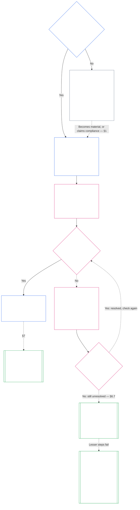

# CHAPTER SEVEN: SYSTEM AND INSTITUTIONAL CHARTERS

<strong>Corpus placement (non-operative): file structure and reading rules</strong>

> This file is **part of the Sentient Constitution** and is **binding only together** with the other numbered `core_*` files read as one text. It contains **Chapter Seven**: the requirement to publish scope documents for a system and for an institution: the System Charter and the Institutional Charter. It follows the Chapter Six Rights Floor and precedes [Chapter Eight](core_08.000_functional_independence_separation_of_duties.md#chapter-eight-functional-independence-and-separation-of-duties), which separates the seats inside any materially binding act.
>
> - **Constitutional owner:** when a system must publish a System Charter and when an institution must publish an Institutional Charter (required at Class L or higher, voluntary at Class P), the minimum each must state, how each changes and is reviewed, and the formation check on the standing and authenticity of the holders of covered offices.
> - **Definition home:** [System Charter](core_05.040_band_continuity.md#system-charter), [Institutional Charter](core_05.040_band_continuity.md#institutional-charter), [Charter Role Map](core_05.040_band_continuity.md#charter-role-map), [Chartered Party](core_05.040_band_continuity.md#chartered-party), and [Operating Party](core_05.050_band_oversight.md#operating-party) are defined in Chapter Five. This chapter applies them and does not redefine them.
> - **Implementation owner:** [CI-8.205 §6](corpus_institutions/ci_08.205_institutional_design_separation_of_powers.md#ci-8205-6-system-and-institutional-charter-contents-review-and-formation-template) (*System and Institutional Charter contents, review, and formation template*) holds the full field template, the review checklist, the formation procedure, and the formation check statement template. It may be stricter and may add fields. It may not narrow this chapter. Its text binds as incorporated implementation text only within valid adoption scope ([Chapter Nineteen §4 Adoption framing and scope of authority](core_19.000_incorporation.md#4-adoption-framing-and-scope-of-authority)); the requirements in this chapter bind as core text.
> - **Downstream consumers:** [Chapter Eight §5 Published Placement, Vacancy, and Substitution](core_08.000_functional_independence_separation_of_duties.md#5-published-placement-vacancy-and-substitution) requires the Charter Role Map. Chapter Nine reads the System Charter for scope and boundary findings, and Chapter Nine Part D tests the formation check statement for an Institution. [Chapter Eleven §3.7 Record custody and opening authority](core_11.000_standing_assessment.md#37-record-custody-and-opening-authority) applies it to standing records. [Chapter Fourteen §4.3 Institutional Forums](core_14.000_forum.md#43-institutional-forums) hears disputes about the Institutional Charter.
>
> Reading order: §1 when System and Institutional Charters are required, with the chart that maps the process → §2 the right to form and four narrow limits → §3 what they must state → §4 the Charter Role Map and standing-record custody → §5 the formation check on office-holder standing and authenticity → §6 when a holder fails the formation check → §7 amendment, review, and scope misalignment.

<strong>Trace</strong>

- Upstream:
  - [Constitutional Tetrad](core_00.000_preamble.md#constitutional-tetrad), especially **oversight** and **accountability**;
  - [material stake](core_00.000_preamble.md#material-stake);
  - [Chapter One §18.1 Governance as Authorized Structure](core_01.010_stewardship_capacity_principles.md#181-governance-as-authorized-structure) (1.010 §18.1);
  - [Article XI-E](core_06.005_rights_part_b.md#article-xi-e-institutional-formation-and-business-creation) (*Institutional Formation and Business Creation*).
- Subsections:
  - [§1](#1-when-system-and-institutional-charters-are-required);
  - [§2](#2-the-right-to-form-and-four-narrow-limits);
  - [§3](#3-what-system-and-institutional-charters-must-state);
  - [§4](#4-the-charter-role-map-and-standing-record-custody);
  - [§5](#5-formation-check-office-holder-standing-and-authenticity);
  - [§6](#6-when-a-holder-fails-the-formation-check);
  - [§7](#7-amendment-review-and-scope-misalignment).
- Downstream:
  - [Chapter Eight](core_08.000_functional_independence_separation_of_duties.md#chapter-eight-functional-independence-and-separation-of-duties) (8.000);
  - [Chapter Nine](core_09.000_system_alignment_certification_evaluation.md#chapter-nine-system-alignment-certification) (9.000);
  - [Chapter Eleven](core_11.000_standing_assessment.md#chapter-eleven-contribution-violation-and-standing-model--measurement) (11.000);
  - [Chapter Fourteen](core_14.000_forum.md#chapter-fourteen-forums-and-jurisdiction) (14.000);
  - [Chapter Fifteen](core_15.000_governance.md#chapter-fifteen-constitutional-contract-legitimacy-authorization-and-stewardship) (15.000); designated implementation text named above.
- Read with:
  - [Authority Stack and Internal Hierarchy](core_05.045_band_integrative.md#authority-stack-and-internal-hierarchy);
  - [System Boundaries](core_05.040_band_continuity.md#system-boundaries);
  - [System Boundary Integrity](core_05.040_band_continuity.md#system-boundary-integrity);
  - [System Creation](core_05.055_band_participation.md#system-creation);
  - [Business Creation](core_05.055_band_participation.md#business-creation).

 

Chapter Seven is the constitutional owner of **System Charters, Institutional Charters, and published scope**.

Three chapters work as one chain:

- **Chapter Seven (this chapter):** says what a [Chartered Party](core_05.040_band_continuity.md#chartered-party) claims to do and who may hold each seat when it acts.
- **[Chapter Eight](core_08.000_functional_independence_separation_of_duties.md#chapter-eight-functional-independence-and-separation-of-duties):** says how those seats must be kept apart.
- **[Chapter Nine](core_09.000_system_alignment_certification_evaluation.md#chapter-nine-system-alignment-certification):** certifies a system, and separately an institution, each of which is one binding act that uses the seats. It sends what it finds back to the System Charter or Institutional Charter.

Other chapters own the definitions, the seat rules, the standing locks, and the decision rules this chapter points to. **CI-8.205 §6** (*System and Institutional Charter contents, review, and formation template*) holds the field template, the formation procedure, and the review checklist.

### 1. When System and Institutional Charters Are Required

<strong>Trace</strong>

- Upstream:
  - [§2](#2-the-right-to-form-and-four-narrow-limits);
  - [material stake](core_00.000_preamble.md#material-stake);
  - [Proportionality](core_05.035_band_accountability.md#proportionality); chapter opening owner claim;
  - [Chapter One §18 Governance Under Stewardship Discipline](core_01.010_stewardship_capacity_principles.md#18-governance-under-stewardship-discipline) (1.010 §18);
  - [Oversight](core_05.020_apex_oversight_leg.md#oversight-constitutional);
  - [Accountability](core_05.005_apex_accountability_leg.md#accountability).
- Downstream: [§3](#3-what-system-and-institutional-charters-must-state); [Chapter Nine Part A §2 System Class Evaluation](core_09.000_system_alignment_certification_evaluation.md#2-system-class-evaluation) (9.000 §2) (*class and certification depth*); [Chapter Nine Part D §13.1 Institution class](core_09.015_institutional_alignment_certification.md#131-institution-class) (9.015 §13.1) (*the class of an Institution*); **CS-9.305 (*System classification machinery*) and CS-9.310** (*System impact classifications*) for the class catalog.
- Read with:
  - **CI-8.205 §6** (*System and Institutional Charter contents, review, and formation template*);
  - **CF-14.415 §5** (*Institutional and local registrars*);
  - **CI-9.210** (*Classification-linked institutional obligations*);
  - [Chapter Five System Charter](core_05.040_band_continuity.md#system-charter) (5.040);
  - [Chapter Five Institutional Charter](core_05.040_band_continuity.md#institutional-charter) (5.040);
  - [Article XI-E](core_06.005_rights_part_b.md#article-xi-e-institutional-formation-and-business-creation) (*Institutional Formation and Business Creation*).

<strong>Definitions · Assessment · Compliance</strong>

- [System Charter](core_05.040_band_continuity.md#system-charter) · [O](core_05.040_band_continuity.md#system-charter) · [M](core_05.040_band_continuity.md#system-charter-a) · [A](core_05.040_band_continuity.md#system-charter-a) · [C](core_05.040_band_continuity.md#system-charter-c)
- [Institutional Charter](core_05.040_band_continuity.md#institutional-charter) · [O](core_05.040_band_continuity.md#institutional-charter) · [M](core_05.040_band_continuity.md#institutional-charter-a) · [A](core_05.040_band_continuity.md#institutional-charter-a) · [C](core_05.040_band_continuity.md#institutional-charter-c)
- [Classification-Scaled Governance](core_05.050_band_oversight.md#classification-scaled-governance) · [O](core_05.050_band_oversight.md#classification-scaled-governance) · [M](core_05.050_band_oversight.md#classification-scaled-governance-a) · [A](core_05.050_band_oversight.md#classification-scaled-governance-a) · [C](core_05.050_band_oversight.md#classification-scaled-governance-c)

 

*In plain terms: before anyone can judge whether a system or institution stayed within its limits, the limits have to be written down where everyone can read them. A system that is material to others in any of the nine areas of [Domain-Specific Materiality](core_05.050_band_oversight.md#domain-specific-materiality) needs a published System Charter. An institution publishes the one that fits the systems it runs. Class P is voluntary: a quilting circle that gives quilts to refugees is the pattern.*

A System Charter or Institutional Charter is the published scope of a Chartered Party: what it claims authority to do, what it does not, and who holds each seat when it acts. It is the scope that the seats in Chapter Eight are placed under and that certification in Chapter Nine reads back against real operation. Whether an Operating Party has to publish one depends on its class: **required at Class L or higher, voluntary at Class P.** If it has to publish one, it also has to keep it accurate.

The five system impact classes are the frame for everything below. From most to least consequential, in one line each:

- **Class A, survival-critical, foundational, and irreplaceable:** failure within survival-relevant time, with no viable substitute, means loss of survival conditions.
- **Class B, critical, high-dependency, and systemically significant:** dependents cannot keep core function without it. Survival is not immediately lost, and substitution is still possible in time.
- **Class C, coordinated, high-dependency, and non-critical:** it shapes coordination at scale but is not an operational prerequisite for Class A or Class B function.
- **Class L, local, limited-impact, and non-critical:** its effects reach beyond a private unit but are local, replaceable, and containable.
- **Class P, personal, private-use, isolated, and experimental:** its effects stay inside a private unit, with no meaningful outside reliance.

[CS-9.310 §8](corpus_systems/cs_09.310_system_impact_classifications.md#cs-9310-8-system-impact-classifications) (*System impact classifications*) holds the full definitions. Classes A, B, C, and L must publish and Class P may, and [§1.2 Which classes are covered](#12-which-classes-are-covered) says how an Institution takes its class from the Systems it runs.

#### 1.1 Who must publish

A System of Class L or higher must publish and maintain a [System Charter](core_05.040_band_continuity.md#system-charter). An Institution of Class L or higher must publish and maintain the one of these that fits the Systems it runs:

| What the Institution operates, stewards, or materially controls | What it publishes |
| --- | --- |
| Exactly one System that needs a System Charter | That System Charter and no second document. It names the Institution as steward and serves as the [Institutional Charter](core_05.040_band_continuity.md#institutional-charter): one document covers both. |
| More than one such System | An Institutional Charter. It includes every System Charter in force for those Systems and states why the Institution runs those particular Systems ([§3 What System and Institutional Charters Must State](#3-what-system-and-institutional-charters-must-state)). |
| No such System | An Institutional Charter that states the Institution's own items from [§3 What System and Institutional Charters Must State](#3-what-system-and-institutional-charters-must-state) and has no System Charters to include. |

- **Businesses and comparable forms:** A business or other stewarded organizational form publishes whichever of the System Charter or Institutional Charter applies to it as a System, as an Institution, or as an Institution that operates a covered System. Its legal form does not change the answer.
- **Joint professional practice:** A sentient or small practice of Class L or higher may meet this section for the acts a host's documents cover by adopting a host's System Charter or Institutional Charter and Charter Role Map:
  - **What is adopted:** By reference, the System Charter or Institutional Charter and Charter Role Map of a host in a joint professional practice, which must cover the practice's acts, whether or not they need a practice licence or practice clearance.
  - **Adoption notice:** The one-page notice that **CI-15.205 §7** (*Practice licence, practice clearance, and joint professional practice*) describes.
  - **Class:** The practice stays the class its own acts give it.

#### 1.2 Which classes are covered

The class of the Chartered Party decides whether publishing is required or a choice:

- **Classes A, B, C, and L:** required. The chart in [§1.7 The process at a glance](#17-the-process-at-a-glance) shows the process they follow.
- **Class P:** a choice, until one of two events makes it required. [§1.3 What Class P is](#13-what-class-p-is) says what makes an Operating Party Class P, and [§1.4 Class P: optional charters, and when they become required](#14-class-p-optional-charters-and-when-they-become-required) sets out the choice and when it ends.
- **Class of an Institution:** An Institution takes the highest class of any System it operates, stewards, or materially controls. An Institution that runs no such System is classified by its own material impact and dependency, judged by what it actually decides and holds and not by its label or legal form, under [Chapter Nine Part D §13.1 Institution class](core_09.015_institutional_alignment_certification.md#131-institution-class).

#### 1.3 What Class P is

An Operating Party is Class P only while its activity stays below the line in every one of the nine domains of [Domain-Specific Materiality](core_05.050_band_oversight.md#domain-specific-materiality), which in practice means its acts and effects stay inside its [private unit](core_05.050_band_oversight.md#domain-specific-materiality-private-unit):

- **Crossing a line:** Crossing the line in any one domain makes it at least Class L under **CS-9.305 (*System classification machinery*) and CS-9.310** (*System impact classifications*), whatever its size or what it calls itself.
- **Staying below every line:** It stays Class P however many members it has.
- **Those inside:** Class P also depends on those inside it. Anyone inside who notices the Operating Party crossing a line has a duty to report it, and the report is protected ([Domain-Specific Materiality](core_05.050_band_oversight.md#domain-specific-materiality)).

The Four-Seat Requirement in Chapter Eight does not apply to a Class P Operating Party's acts, which stay inside its private unit, so a single sentient with a computer needs no second seat-holder. The requirement applies from the day the Operating Party takes a [Materially Binding Act](core_05.035_band_accountability.md#materially-binding-act) that others must follow or may rely on as settled, which crosses the line in the authority-over-others domain and makes it at least Class L.

#### 1.4 Class P: optional charters, and when they become required

A Class P Operating Party is encouraged to publish the [System Charter](core_05.040_band_continuity.md#system-charter) (for a single system) or [Institutional Charter](core_05.040_band_continuity.md#institutional-charter) (for more than one system, or none) that fits what it runs. It may use the content list in [§3 What System and Institutional Charters Must State](#3-what-system-and-institutional-charters-must-state) and the seat map in [§4 The Charter Role Map and Standing-Record Custody](#4-the-charter-role-map-and-standing-record-custody) as a template. Publishing one creates no duty under this chapter's process:

- no due date ([§1.5 When a System Charter or Institutional Charter is due](#15-when-a-system-charter-or-institutional-charter-is-due));
- no formation check ([§5 Formation Check: Office-Holder Standing and Authenticity](#5-formation-check-office-holder-standing-and-authenticity));
- no required [Charter Role Map](core_05.040_band_continuity.md#charter-role-map) ([§4 The Charter Role Map and Standing-Record Custody](#4-the-charter-role-map-and-standing-record-custody)), though it may keep one with its voluntary System Charter or Institutional Charter or publish it on its own; and
- no required amendment or review cycle ([§7 Amendment, Review, and Scope Misalignment](#7-amendment-review-and-scope-misalignment)).

If either of these happens, publishing stops being optional.

- the Operating Party is reclassified to Class L or higher; or
- its operator asserts constitutional compliance for the Operating Party.

The Operating Party must then publish the System Charter or Institutional Charter that fits it, on the schedule in [§1.5 When a System Charter or Institutional Charter is due](#15-when-a-system-charter-or-institutional-charter-is-due).

**Recognition does not depend on a scope document.** A group, with or without a System Charter or Institutional Charter and whatever its class, does not stand between its members and recognition. Each member may seek a contribution record as an individual claimant, for work done inside the group or outside it, and the record concerns the member's contribution and not the group's standing ([Chapter Eleven §3.7 Informal and small-scope records](core_11.000_standing_assessment.md#37-informal-and-small-scope-records)). Giving aid, goods, labor, or services that no one is required to accept is not a materially binding act, so a mutual aid circle that gives quilts to refugees needs no System Charter or Institutional Charter for its members to be recognized.

#### 1.5 When a System Charter or Institutional Charter is due

A covered System or Institution publishes its [System Charter](core_05.040_band_continuity.md#system-charter) or [Institutional Charter](core_05.040_band_continuity.md#institutional-charter) on this schedule:

- **A new System or Institution:** before it goes live or begins to exercise authority over others.
- **One that already operates:** at its next classification review or certification, or within the resolution window after a request under [§1.6 If a System Charter or Institutional Charter is missing](#16-if-a-system-charter-or-institutional-charter-is-missing), whichever comes first. It is in default until it does.
  - **Which certification:** For a System, its System Alignment Certification. For an Institution, its institutional alignment certification under [Chapter Nine Part D §12.3 No permission and no gate](core_09.015_institutional_alignment_certification.md#123-no-permission-and-no-gate). Its first-certification window, under [Chapter Nine Part D §12.4 Window for the first certification](core_09.015_institutional_alignment_certification.md#124-window-for-the-first-certification), is never a condition of publishing the Institutional Charter or of operating.
- **The formation check:** It also completes the formation check in [§5 Formation Check: Office-Holder Standing and Authenticity](#5-formation-check-office-holder-standing-and-authenticity) at the same moment.
- **Where it is lodged:** It lodges the System Charter or Institutional Charter, with its Charter Role Map and formation check statement, with the Institutional registrar, or with the local registrar where its activity and the sentients it affects are local (**CF-14.415 §5** (*Institutional and local registrars*)):
  - **What the registrar does:** It checks that nothing required is missing and gives a dated receipt.
  - **What the registrar never does:** It never grants permission and never rules on class or content.
  - **A late or missing receipt:** It never stops the Chartered Party from operating.

#### 1.6 If a System Charter or Institutional Charter is missing

Anyone who notices a Chartered Party of Class L or higher, new or newly so, that has not published its System Charter or Institutional Charter may ask its governing authority for it. The asker needs no standing, pays no fee, and need not show harm. The request names the Chartered Party and says why it appears covered.

Two windows run from the request: the response window and the resolution window. Each takes its length from the Tier with the same letter as the Chartered Party's class, so the more critical the class, the shorter the windows:

| Class and Tier | Response window (intake target) | Resolution window (outer bound) |
|---|---|---|
| Class A, Tier A | 24 hours | 7 calendar days |
| Class B, Tier B | 2 calendar days | 14 calendar days |
| Class C, Tier C | 4 calendar days | 30 calendar days |
| Class L, Tier L | 8 calendar days | 60 calendar days |

The figures come from **CF-14.445 §3.1** (*Stage targets and outer bounds*), which governs if they differ. A Chartered Party that disputes its class is counted at the Tier of the more critical of the class it holds on its System Classification Record and any class that the asker or the forum shows on a prima facie basis, until the question is settled. A Chartered Party that holds no class on record, or holds Class P while its class is in question, is counted at Tier C.

The windows work like this:

- **Response window:** The Chartered Party responds inside the response window, which is the intake target of the matching tier in **CF-14.445 §3.1** (*Stage targets and outer bounds*), counted from the request. It publishes the System Charter or Institutional Charter, or gives the date by which it will, or points to the one it has already published, or answers that it is below every line of [Domain-Specific Materiality](core_05.050_band_oversight.md#domain-specific-materiality) and gives the written showing that entry requires.
- **Resolution window:** The System Charter or Institutional Charter is due inside the resolution window, which is the outer bound of the matching tier in **CF-14.445 §3.1** (*Stage targets and outer bounds*), counted from the request, with the formation check statement that goes with it ([§5 Formation Check: Office-Holder Standing and Authenticity](#5-formation-check-office-holder-standing-and-authenticity)). A Chartered Party with no independent seat yet files the statement as a declaration with its evidence, as that section provides.
- **An Operating Party that says it is below the line:** The request is then also a classification challenge on the route in that entry's *Challenge route*:
  - **Running the window:** The resolution window keeps running while the challenge is pending.
  - **Challenge extension:** If the forum with jurisdiction judges the challenge review-worthy, the due date is extended, and a new resolution window starts when the challenge is decided. The forum decides the challenge inside the outer bound of the matching tier.
  - **What review-worthy means:** A challenge is review-worthy when it names a specific crossing in a named domain and the Operating Party's written showing leaves a real question about that crossing. The Operating Party does not judge this for itself, and a response that gives no written showing does not extend the date.
  - **If a class is found:** On that challenge or on any other, the date of the finding counts as the date of a request: the response window and the resolution window run from it, at the Tier of the class found (Class A, B, C, or L).
- **If it is missed:** No response, or no System Charter or Institutional Charter by the due date, is a defect to log and correct. The asker may take it to the forum with jurisdiction on the same route. It is never a condition of forming or operating.
- **A repeat request:** A second request about the same Chartered Party, made while its earlier response or a finding on it still stands, starts no new response or resolution window. The Chartered Party answers by pointing to that response or finding. Its own showing that it is below every line, not yet reviewed by the forum, does not count as a response that stands. The response or finding stands until one of these happens, as the reopening triggers in [Chapter Nine Part D §15.2 Reopening triggers](core_09.015_institutional_alignment_certification.md#152-reopening-triggers) describe:
  - **A material change:** The Chartered Party's activity changes materially.
  - **New evidence:** New evidence about a crossing is shown.

  A request that shows either of the above is not a repeat. It is a new request, handled separately and independently of the earlier one. It has its own response window and resolution window, counted from its own date, and the earlier response, finding, and windows neither satisfy it nor are changed by it.
- **Scope in the meantime:** A missing System Charter or Institutional Charter is not a reason to treat the Chartered Party as unbounded. Until it exists, the Chartered Party's real [System Boundaries](core_05.040_band_continuity.md#system-boundaries) and its class control, and a certification or forum may reconstruct scope from observed operation.

#### 1.7 The process at a glance

The chart follows one Operating Party from the question of whether it is material to others, through publishing its System Charter or Institutional Charter and keeping it accurate. If a problem isn't fixed inside the resolution window, the chartering process sends it to a review that is covered outside this chapter. The sections after this one explain each step in the same order.

<strong>Reader guidance (non-operative): how to read the chart</strong>

> In plain terms: nobody grants a System Charter or Institutional Charter, and nobody needs permission to form. A Chartered Party whose activity is material to others publishes what it claims authority to do and who holds each seat, and the holders of its key offices are checked. A holder who fails is replaced, or the cause is fixed, and the Chartered Party goes on. If the failure is still not fixed when the resolution window ends, a forum may review the Chartered Party, starting with the lightest step that protects others. Making the Chartered Party shrink below Class L, or dissolving it, comes only if lighter steps fail. A dissolved Chartered Party may not come back while the lock on it stands.
>
> Solid arrows are the main path. Dotted arrows are exceptions and hand-offs, labeled with the section that makes them. The boxes with double side bars belong to another chapter or to the incorporated implementation text. The chart adds no duty, seat, or field, and no step on it is a grant of permission.

 

### 2. The Right to Form, and Four Narrow Limits

<strong>Reader guidance (non-operative): how this section is laid out</strong>

- [§2.1 The right to form](#21-the-right-to-form) states the right and who it does not cover.
- [§2.2 First limit: an outstanding lock on a sentient](#22-first-limit-an-outstanding-lock-on-a-sentient) says how a lock keeps one named sentient out of one controlling office.
- [§2.3 Second limit: a short hold on specific verified facts](#23-second-limit-a-short-hold-on-specific-verified-facts) says how a short hold can keep one named sentient out of one controlling office.
- [§2.4 Third limit: a lock on the Operating Party itself](#24-third-limit-a-lock-on-the-operating-party-itself) says how a lock on an Operating Party bars it and its successors, and that a dissolved Chartered Party may not return.
- [§2.5 Fourth limit: a practice licence or clearance](#25-fourth-limit-a-practice-licence-or-clearance) says when a named high-risk act needs a licence or clearance. It is not a gate on forming.

<strong>Trace</strong>

- Upstream: [§1](#1-when-system-and-institutional-charters-are-required); [Article XI-E](core_06.005_rights_part_b.md#article-xi-e-institutional-formation-and-business-creation) (*Institutional Formation and Business Creation*).
- Downstream: [§1 When System and Institutional Charters Are Required](#1-when-system-and-institutional-charters-are-required); [§5 Formation Check: Office-Holder Standing and Authenticity](#5-formation-check-office-holder-standing-and-authenticity).
- Read with:
  - [Interim Hold](core_05.035_band_accountability.md#interim-hold);
  - [Chapter Twelve §4.2 Prevention — general standing locks](core_12.000_standing_integration.md#42-prevention--general-standing-locks) (12.000 §4.2);
  - [Chapter Twelve §5.5 Special locks](core_12.000_standing_integration.md#55-special-locks) (12.000 §5.5);
  - [Chapter Fourteen §5 Interim hold on a named sentient's pathway](core_14.000_forum.md#interim-hold-on-a-named-sentients-pathway) (14.000 §5).

 

*In plain terms: you do not need anyone's permission to form a system, institution, or business. Four narrow limits can apply. Three are gates: an unresolved lock can keep one sentient out of one controlling office, a short hold on specific verified facts can do the same, and a lock on an Operating Party itself can bar that Operating Party. The fourth can require a licence or clearance before a named high-risk act. A Chartered Party that a forum has dissolved is barred from coming back, and the bar is permanent when the dissolution rested on widespread anti-constitutional conduct, or on serious harm that can't be undone and was never put right. None stops a new Operating Party from forming or operating, and this chapter adds none.*

**Article XI-E** (*Institutional Formation and Business Creation*) allows four narrow limits:

- **The first three are the only gates** on forming an Operating Party or holding authority in it. Each attaches to a named subject:
  - **An outstanding lock** ([§2.2 First limit: an outstanding lock on a sentient](#22-first-limit-an-outstanding-lock-on-a-sentient)) attaches to a named sentient in one office that controls the Chartered Party.
  - **An Interim Hold** ([§2.3 Second limit: a short hold on specific verified facts](#23-second-limit-a-short-hold-on-specific-verified-facts)) attaches only to one named sentient in one office that controls the Chartered Party.
  - **A lock on the Operating Party itself** ([§2.4 Third limit: a lock on the Operating Party itself](#24-third-limit-a-lock-on-the-operating-party-itself)) attaches to a Chartered Party that is itself under a lock, including one that a forum has dissolved.
- **The fourth is not a gate:** It is a practice licence or clearance ([§2.5 Fourth limit: a practice licence or clearance](#25-fourth-limit-a-practice-licence-or-clearance)).

#### 2.1 The right to form

Anyone may form a new system, institution, or business. That right is set out in [Article XI-E](core_06.005_rights_part_b.md#article-xi-e-institutional-formation-and-business-creation) (*Institutional Formation and Business Creation*). This chapter adds the duty that comes next. Once what an Operating Party does is material to others in any one of the nine areas of [Domain-Specific Materiality](core_05.050_band_oversight.md#domain-specific-materiality), it must say in public, ahead of time, what it claims authority to do ([§1 When System and Institutional Charters Are Required](#1-when-system-and-institutional-charters-are-required)). Adopting a System Charter or Institutional Charter must not be read to narrow that right, or any Rights Floor protection.

**Who the right to form does not cover.** Apart from the three gates in [§2.2 First limit: an outstanding lock on a sentient](#22-first-limit-an-outstanding-lock-on-a-sentient), [§2.3 Second limit: a short hold on specific verified facts](#23-second-limit-a-short-hold-on-specific-verified-facts), and [§2.4 Third limit: a lock on the Operating Party itself](#24-third-limit-a-lock-on-the-operating-party-itself), **Article XI-E** (*Institutional Formation and Business Creation*) does not protect:

- an Operating Party designed to break a Constitutional Constraint, to undermine Safety or Truth, or to concentrate power in ways [Chapter One §11 Market Structure](core_01.000_values_principles.md#11-market-structure) rules out; or
- an Operating Party formed or run by a founder who is not authentically aligned with its stated purpose, as shown by verified conduct, control, and rewards, or who means to mislead others about its purpose, control, or interests, or to harm others.

Forums decide these cases under that Article, and the only consequences are the three gates in it: the outstanding-lock gate, the Interim Hold, and a lock on the Operating Party itself. A failed formation check is one piece of evidence the forum weighs, which means the formation check alone does not decide the case.

#### 2.2 First limit: an outstanding lock on a sentient

A [standing lock](core_12.000_standing_integration.md#42-prevention--general-standing-locks) or [special lock](core_12.000_standing_integration.md#55-special-locks), set after a verified violation and not yet lifted, bars one named sentient from authority over this kind of institution or business.

- What is barred: taking or exercising governing, controlling, or owning authority in the Operating Party.
- How far it reaches: only as far as the lock does. It ends when the lock is lifted or narrowed.
- A lock on an Operating Party itself: see [§2.4 Third limit: a lock on the Operating Party itself](#24-third-limit-a-lock-on-the-operating-party-itself).

#### 2.3 Second limit: a short hold on specific verified facts

This limit applies when a forum with jurisdiction has ordered an [Interim Hold](core_05.035_band_accountability.md#interim-hold) on specific verified facts that make it more likely than not that the holder is misaligned with the Chartered Party's stated purpose. Only that forum can order it ([Chapter Fourteen §5 Interim hold on a named sentient's pathway](core_14.000_forum.md#interim-hold-on-a-named-sentients-pathway)). The Chartered Party can't decide on its own to bar someone from an office, because that would make it the judge of its own member. The full ground is the one in [Chapter Fourteen §5 Interim hold on a named sentient's pathway](core_14.000_forum.md#interim-hold-on-a-named-sentients-pathway); this short form does not replace it.

#### 2.4 Third limit: a lock on the Operating Party itself

A lock can sit on an Operating Party and not only on a sentient. The gate then bars what the lock's named pathway names, in that Operating Party and in its successors, controlled entities, and nominee- or shell-held vehicles. It does not bar any other Operating Party.

- A lock set by a final designation: the [Anti-Constitutional Trust Lock](core_12.000_standing_integration.md#55-special-locks) does this where the final designation names an institution, successor vehicle, or controlled entity. The gate then bars what the lock's named pathway names, in the Chartered Party and in its successors, controlled entities, and nominee- or shell-held vehicles.
- A dissolved Chartered Party: a final dissolution order under **CI-12.210 §4** (*Dissolution*) sets a [Dissolution Reformation Lock](core_12.000_standing_integration.md#55-special-locks). The dissolved Chartered Party, its successors, controlled entities, nominee- or shell-held vehicles, and any Operating Party that is one operation with them may not be re-formed, revived, or run under any name or form while it stands. Where the order finds pervasive anti-constitutional conduct or unremedied Irreversible Harm ([Chapter Twelve §8 Restoration and reassessment](core_12.000_standing_integration.md#8-restoration-and-reassessment)), the lock is permanent: time, a resolved cause, or a change of holders does not lift it, and it ends only if the dissolution order is set aside on review or material new verified facts show that its finding was wrong. Otherwise it ends on an independent finding that the cause is resolved, the remedy is delivered, and a return is safer than continued exclusion. It bars no sentient from forming a different Operating Party.

None of the three gates stops a new Operating Party from forming, publishing its System Charter or Institutional Charter, or getting to work. The only party they stop is one that is itself under a lock, such as a dissolved Chartered Party trying to come back. The three gates are applied at the formation check ([§5 Formation Check: Office-Holder Standing and Authenticity](#5-formation-check-office-holder-standing-and-authenticity)).

#### 2.5 Fourth limit: a practice licence or clearance

The fourth limit works on a named act, not on forming an Operating Party:

- **Not a gate on an Operating Party:** the formation check in [§5 Formation Check: Office-Holder Standing and Authenticity](#5-formation-check-office-holder-standing-and-authenticity) does not apply it.
- **What it is:** a [Competency Clearance](core_05.035_band_accountability.md#competency-clearance) that **Article XI-E** (*Institutional Formation and Business Creation*) lets an adopter require before a named act is performed for others, on a technical forum's published risk finding.
  - **Practice licence:** required for acts that risk serious or irreversible harm if done badly.
  - **Practice clearance:** required for acts that risk real but lesser harm if done badly.
- **What it attaches to:** performing the act. It never stops an Operating Party from forming, publishing its System Charter or Institutional Charter, or operating.
- **What it does stop:** claiming or performing the act without it. A System Charter or Institutional Charter may not claim the act unless a holder performs it ([§3 What System and Institutional Charters Must State](#3-what-system-and-institutional-charters-must-state)).

### 3. What System and Institutional Charters Must State

<strong>Reader guidance (non-operative): how this section is laid out</strong>

- [§3.1 What a System Charter states](#31-what-a-system-charter-states) lists the nine items.
- [§3.2 Charter Pointers](#32-charter-pointers) says that a System Charter or Institutional Charter may refer to another published document instead of copying its text, and what makes that reference valid.
- [§3.3 What an Institutional Charter adds](#33-what-an-institutional-charter-adds) covers what an Institutional Charter holds beyond the nine items: the System Charters of the Systems the Institution runs, and why it runs them.
- [§3.4 Acts that need a practice licence or practice clearance](#34-acts-that-need-a-practice-licence-or-practice-clearance) says that a System Charter or Institutional Charter may claim such an act only if every sentient who performs it holds the licence or clearance, or works as a learner under a supervisor who does. Until then, the act is listed as out of scope (item 4 in [§3.1 What a System Charter states](#31-what-a-system-charter-states)).
- [§3.5 Scaling](#35-scaling) says what changes with class.

<strong>Trace</strong>

- Upstream: [§1](#1-when-system-and-institutional-charters-are-required); [Chapter Five System Charter](core_05.040_band_continuity.md#system-charter) (5.040); [Chapter Five Institutional Charter](core_05.040_band_continuity.md#institutional-charter) (5.040).
- Downstream:
  - [§4](#4-the-charter-role-map-and-standing-record-custody);
  - [§7](#7-amendment-review-and-scope-misalignment);
  - [Chapter Nine Part C §8.1 Minimum record contents](core_09.010_system_alignment_certification_record_recertification.md#81-minimum-record-contents) (9.010 §8.1) (*the System Charter fields a System Certification Record relies on*);
  - **CI-8.205 §6** (*System and Institutional Charter contents, review, and formation template*) for the full field list.
- Read with:
  - [Chapter Nineteen §4 Adoption framing and scope of authority](core_19.000_incorporation.md#4-adoption-framing-and-scope-of-authority) (19.000 §4) (*a scope document kept under another name*);
  - [Chapter Fifteen §4.3 Decision-resolution requirements for binding stakeholder choice](core_15.000_governance.md#43-decision-resolution-requirements-for-binding-stakeholder-choice) (15.000 §4.3);
  - **CI-6.205 §1** (*Stakeholder oversight, notification, and binding-governance pathway integrity*);
  - **CI-6.205 §2** (*Anti-concentration and participation-legitimacy safeguards*).

<strong>Definitions · Assessment · Compliance</strong>

- [System Charter](core_05.040_band_continuity.md#system-charter) · [O](core_05.040_band_continuity.md#system-charter) · [M](core_05.040_band_continuity.md#system-charter-a) · [A](core_05.040_band_continuity.md#system-charter-a) · [C](core_05.040_band_continuity.md#system-charter-c)
- [Institutional Charter](core_05.040_band_continuity.md#institutional-charter) · [O](core_05.040_band_continuity.md#institutional-charter) · [M](core_05.040_band_continuity.md#institutional-charter-a) · [A](core_05.040_band_continuity.md#institutional-charter-a) · [C](core_05.040_band_continuity.md#institutional-charter-c)
- [Charter Role Map](core_05.040_band_continuity.md#charter-role-map) · [O](core_05.040_band_continuity.md#charter-role-map) · [M](core_05.040_band_continuity.md#charter-role-map-a) · [A](core_05.040_band_continuity.md#charter-role-map-a) · [C](core_05.040_band_continuity.md#charter-role-map-c)

 

*In plain terms: a System Charter has to be specific enough to test. It says what the system is for, what the system does and does not do, who relies on the system, who can amend the System Charter, who holds each seat, and where to find the binding decision rules. The System Charter points to those rules and does not replace them. An Institutional Charter says the same about the institution, then adds the System Charters it holds and the reason the institution runs those systems.*

#### 3.1 What a System Charter states

A System Charter states, in plain language that affected sentients and auditors can read:

1. **Identity and version:** the name, the steward or governing body, the version, the effective date, and the change history.
2. **Purpose:** what the Chartered Party exists to do.
3. **In-scope activities:** the functions, services, authorities, and domains it claims.
   - **A claim, not a grant:** The document states authority the Chartered Party already holds and gives it none. Whether that authority is legitimate, including where it rests on a Constitutional Charter, is decided under [Chapter Fifteen §1 Authorization and Legitimacy of Governing Authority](core_15.000_governance.md#1-authorization-and-legitimacy-of-governing-authority).
4. **Out-of-scope limits:** the material activities, authorities, and domains it is not authorized to exercise.
5. **Affected communities and dependencies:** who relies on the Chartered Party, and which systems or infrastructure it depends on or gates, where material.
   - **Not an opt-out:** Leaving a group off this list does not take it out of scope. A sentient the Chartered Party materially affects keeps every Rights Floor protection whether or not the document names it, and a list narrower than the real reliance is read against the real reliance.
6. **Classification assumptions:** the class or stewardship level relied on, with a [Charter Pointer](core_05.040_band_continuity.md#charter-pointer) to **CS-9.305 (*System classification machinery*) and CS-9.310** (*System impact classifications*) and **CS-15.305** (*Critical system stewardship*) where they apply.
7. **Charter Role Map:** the [Charter Role Map](core_05.040_band_continuity.md#charter-role-map), or a Charter Pointer to the published document that is the Charter Role Map ([§4 The Charter Role Map and Standing-Record Custody](#4-the-charter-role-map-and-standing-record-custody)).
8. **Binding stakeholder-choice Charter Pointers:**
   - **When it applies:** when a real disagreement among affected sentients requires a binding stakeholder choice inside the system. [Def.P2 Binding Stakeholder Choice](core_05.055_band_participation.md#defp2-binding-stakeholder-choice) calls this its admission scope.
   - **What it points to:** live Charter Pointers to three published sets of rules: the decision sequence (how the choice is made), the weighting rules (who gets how much say), and the rights-collision-record rules (what the record must show when rights collide).
   - **Who carries what:** the System Charter holds only the pointers. The three sets of rules hold the actual content: how the choice is made, how weight is set, and what the record shows. The System Charter does not carry that content itself, and its own text cannot be offered in place of those rules. A dead pointer, or System Charter text offered in place of the rules, fails the System Charter duty.
9. **Amendment authority:** who may amend, what counts as a material amendment, and the notice and contest path.

#### 3.2 Charter Pointers

A System Charter or Institutional Charter may point to another published document or provision (a rule set, the Charter Role Map, a System Charter) instead of copying it. Each such reference is a [Charter Pointer](core_05.040_band_continuity.md#charter-pointer). It must resolve to a live, current, published document. A dead or stale Charter Pointer counts as a missing item.

#### 3.3 What an Institutional Charter adds

An Institutional Charter states items 1 to 9 of [§3.1 What a System Charter states](#31-what-a-system-charter-states) for the Institution itself, and also holds:

- **The System Charters:** Every System Charter in force for the Systems the Institution operates, stewards, or materially controls, included in full or by a Charter Pointer that resolves to the current published version.
- **The portfolio rationale:** Why the Institution runs those particular Systems, how they serve its stated purpose and relate to one another, and which dependencies they share. A System with no stated reason is a missing item.

**CI-8.205 §6** (*System and Institutional Charter contents, review, and formation template*) may require more and sets the formation template, but it may not drop an item above.

#### 3.4 Acts that need a practice licence or practice clearance

This subsection says what a System Charter or Institutional Charter may claim when an act needs a practice licence or practice clearance.

- **The limit:** If an act requires a practice licence or practice clearance, a System Charter or Institutional Charter can't list it as something the Chartered Party does, and the Chartered Party can't do it, unless every sentient who performs it either holds the licence or clearance or works as a learner under a supervisor who does.
- **Until then:** The System Charter or Institutional Charter lists the act under item 4 ([§3.1 What a System Charter states](#31-what-a-system-charter-states)) as out of scope.
- **If claimed without a holder:** It is a missing item to log and fix, and it does not stop the Chartered Party from forming, publishing, or carrying on its other work.
- **Where to look:** [§2 The Right to Form, and Four Narrow Limits](#2-the-right-to-form-and-four-narrow-limits) says where the requirement comes from, and **CI-15.205 §7** (*Practice licence, practice clearance, and joint professional practice*) holds the entries and the host check.

#### 3.5 Scaling

Some parts of a System Charter or Institutional Charter scale with class and some do not:

- **What scales:** The depth of the System Charter or Institutional Charter, the review cadence, and the independence of the review scale with class and [material stake](core_00.000_preamble.md#material-stake).
- **Class L:** A System Charter or Institutional Charter for a Class L system or institution can be short and can keep simpler records, where [Classification-Scaled Governance](core_05.050_band_oversight.md#classification-scaled-governance) allows. It still has to cover every required item.
- **Review cadence:** A System Charter or Institutional Charter does not decide how often it is reviewed. The class sets that.

### 4. The Charter Role Map and Standing-Record Custody

<strong>Reader guidance (non-operative): how this section is laid out</strong>

- [§4.1 What the seats are, and why they exist](#41-what-the-seats-are-and-why-they-exist) reminds the reader of the four seats and why no party may fill the pairings Chapter Eight prohibits on the same act.
- [§4.2 What makes a placement valid](#42-what-makes-a-placement-valid) says that Chapter Eight sets the tests (independence, vacancy and substitution, merged hosting), and the map only records who sits where.
- [§4.3 What a System Charter or Institutional Charter owes the map](#43-what-a-system-charter-or-institutional-charter-owes-the-map) says that the System Charter or Institutional Charter must contain the map or point to it, and that a missing map, a dead pointer, or an out-of-date map is a defect in that System Charter or Institutional Charter.
- [§4.4 Which System Charter or Institutional Charter holds which map](#44-which-system-charter-or-institutional-charter-holds-which-map) covers several Systems under one Institutional Charter, and a shared map.
- [§4.5 Changing seat rules and seat holders](#45-changing-seat-rules-and-seat-holders) says that changing who may hold a seat is an amendment, and changing who holds it now is a new dated version of the map that takes effect only after notice and a chance to contest.
- [§4.6 Standing-record custody](#46-standing-record-custody) says what the map must say for standing records, and has two parts: [§4.6.1 Operator standing records](#461-operator-standing-records) and [§4.6.2 Stakeholder standing records](#462-stakeholder-standing-records).
- [§4.7 Gaps in the map for operator standing records](#47-gaps-in-the-map-for-operator-standing-records) says what follows when a required seat is unnamed or left without a qualified holder, and has four parts: [§4.7.1 When a gap exists and how it is logged](#471-when-a-gap-exists-and-how-it-is-logged), [§4.7.2 While a gap is open](#472-while-a-gap-is-open), [§4.7.3 If events remove the last qualified substitute](#473-if-events-remove-the-last-qualified-substitute), and [§4.7.4 Certification seats](#474-certification-seats).

<strong>Trace</strong>

- Upstream: [§3](#3-what-system-and-institutional-charters-must-state); [Chapter Eight §2 Four-Seat Constitutional Requirement](core_08.000_functional_independence_separation_of_duties.md#2-four-seat-constitutional-requirement) (8.000 §2).
- Downstream:
  - [Chapter Eight §5 Published Placement, Vacancy, and Substitution](core_08.000_functional_independence_separation_of_duties.md#5-published-placement-vacancy-and-substitution) (8.000 §5);
  - [Chapter Nine Part B §6.1.1 Four seats in a certification](core_09.005_system_alignment_certification_record_process.md#611-four-seats-in-a-certification) (9.005 §6.1.1);
  - [Chapter Eleven §3.7 Record custody and opening authority](core_11.000_standing_assessment.md#37-record-custody-and-opening-authority) (11.000 §3.7);
  - **CI-8.205 §2** (*Functional separation lanes*);
  - **CI-15.205 §5** (*Authorized roles and accountability chains*);
  - **CI-15.205 §6** (*Seat catalog — process-role archetypes and operational boundaries*).
- Read with: [Material Control Line](core_05.035_band_accountability.md#material-control-line); [Standing Record](core_05.035_band_accountability.md#standing-record).

<strong>Definitions · Assessment · Compliance</strong>

- [Charter Role Map](core_05.040_band_continuity.md#charter-role-map) · [O](core_05.040_band_continuity.md#charter-role-map) · [M](core_05.040_band_continuity.md#charter-role-map-a) · [A](core_05.040_band_continuity.md#charter-role-map-a) · [C](core_05.040_band_continuity.md#charter-role-map-c)
- [System Charter](core_05.040_band_continuity.md#system-charter) · [O](core_05.040_band_continuity.md#system-charter) · [M](core_05.040_band_continuity.md#system-charter-a) · [A](core_05.040_band_continuity.md#system-charter-a) · [C](core_05.040_band_continuity.md#system-charter-c)
- [Institutional Charter](core_05.040_band_continuity.md#institutional-charter) · [O](core_05.040_band_continuity.md#institutional-charter) · [M](core_05.040_band_continuity.md#institutional-charter-a) · [A](core_05.040_band_continuity.md#institutional-charter-a) · [C](core_05.040_band_continuity.md#institutional-charter-c)

 

*In plain terms: the System Charter or Institutional Charter is where the seats get names. It carries a published list of who may hold each seat for the acts it covers, so a party can't pick its own checker. The rules for what counts as a valid seat placement stay in Chapter Eight. Keeping the standing records safe isn't a separate list: it's the same map.*

Every System Charter or Institutional Charter carries a [Charter Role Map](core_05.040_band_continuity.md#charter-role-map): a published list of who holds each seat. [Chapter Eight §5 Published Placement, Vacancy, and Substitution](core_08.000_functional_independence_separation_of_duties.md#5-published-placement-vacancy-and-substitution) requires it of every adopter that takes materially binding acts and says what it must name. This section says what the System Charter or Institutional Charter does with it.

#### 4.1 What the seats are, and why they exist

Every [Materially Binding Act](core_05.035_band_accountability.md#materially-binding-act) has four jobs, and [Chapter Eight §2 Four-Seat Constitutional Requirement](core_08.000_functional_independence_separation_of_duties.md#2-four-seat-constitutional-requirement) keeps them apart:

- **[Initiating Seat](core_05.035_band_accountability.md#initiating-seat):** begins the act by requesting, proposing, operating, or claiming it.
- **[Verify-or-Authorize Seat](core_05.035_band_accountability.md#verify-or-authorize-seat):** checks the evidence and authority, then verifies, authorizes, conditions, or declines the act.
- **[Record Seat](core_05.035_band_accountability.md#record-seat):** keeps the official record of what the Verify-or-Authorize Seat decided.
- **[Contest Seat](core_05.035_band_accountability.md#contest-seat):** hears a challenge, and corrects, limits, or routes it.

The seats exist so that no party can ask for an outcome, check its own request, control the record of that checking, and also judge the challenge to it. A seat is a job on one act, not a job title, so the same sentient, office, or system may hold different seats for different acts, but never a pairing Chapter Eight prohibits on the same act. The map is where each seat gets a named holder.

#### 4.2 What makes a placement valid

Chapter Eight sets the tests, and the map only records who sits where:

- **Material Control Line:** the real chain of power around one act. The party whose act is at issue is the one that begins the act, or whose act is being verified, challenged, or recorded. That party controls a seat when, for that act, it can direct, overrule, reward, punish, or remove the holder, or delay the holder's work. The sentients, offices, and systems that can do this make up that party's [Material Control Line](core_05.035_band_accountability.md#material-control-line) for the act.
- **Independence:** a seat that checks an act is not independent if the party whose act is at issue can control it ([Chapter Eight §3 Independence, Conflict, and Control Lines](core_08.000_functional_independence_separation_of_duties.md#3-independence-conflict-and-control-lines)). So the map must put the record seat, the contest seat, and every verify-or-authorize seat outside that party's Material Control Line. The party also can't change who holds those seats by its own decision alone ([§4.5 Changing seat rules and seat holders](#45-changing-seat-rules-and-seat-holders)).
- **Vacancy, substitutes, and delegation:** who steps in when a holder is absent or conflicted ([Chapter Eight §5 Published Placement, Vacancy, and Substitution](core_08.000_functional_independence_separation_of_duties.md#5-published-placement-vacancy-and-substitution)).
- **Merged hosting:** the only cases where a small party may put two seats in one office. The map lists each permitted arrangement and the independence safeguard that goes with it ([Chapter Eight §6 Proportional Scaling and Merged Hosting](core_08.000_functional_independence_separation_of_duties.md#6-proportional-scaling-and-merged-hosting)).

#### 4.3 What a System Charter or Institutional Charter owes the map

A System Charter or Institutional Charter either contains its Charter Role Map or points to it with a [Charter Pointer](#32-charter-pointers), so a reader who starts at the System Charter or Institutional Charter can find who holds each seat. It has a defect if:

- **The map is missing:** it neither contains the map nor points to one.
- **The pointer is dead:** it points to a map that cannot be found, or that is not a live, published document.
- **The map is out of date:** it does not show who holds each seat now. A change of holder is published as a new dated version of the map ([§4.5 Changing seat rules and seat holders](#45-changing-seat-rules-and-seat-holders)).

#### 4.4 Which System Charter or Institutional Charter holds which map

Which System Charter or Institutional Charter keeps a map depends on how the parties are arranged:

- **Several Systems:** An Institutional Charter may hold several System Charters. Each System Charter keeps the map for the acts of its own System, and the Institutional Charter keeps the map for the Institution's own acts.
- **A shared map:** A business or practice may place some of its seats with a local cooperative, association, or host ([§1 When System and Institutional Charters Are Required](#1-when-system-and-institutional-charters-are-required)). If it does, it can use that group's published map instead of writing its own, which keeps its own System Charter or Institutional Charter short. It still has to name who steps in when one of its seat-holders is absent or conflicted, and an independent route to use when no qualified substitute is available ([Chapter Eight §6 Proportional Scaling and Merged Hosting](core_08.000_functional_independence_separation_of_duties.md#6-proportional-scaling-and-merged-hosting), *Seats held in common*).

#### 4.5 Changing seat rules and seat holders

The map can change in two ways, and each has its own route:

- **Who may hold a seat:** Deciding which offices may hold a seat, act as a substitute, or share hosting is a change to the map's rules. It can be made only through the amendment process the System Charter or Institutional Charter names ([§7 Amendment, Review, and Scope Misalignment](#7-amendment-review-and-scope-misalignment)).
- **Who holds a seat now:** Changing the current holder is an update, not an amendment. It is done by publishing a new dated version of the map.
  - **Notice and a chance to contest:** For the record seat, the contest seat, and any verify-or-authorize seat the map places, the new version takes effect only after notice and a chance to contest. Notice goes at once to the subject, each claimant, and each challenger on every open record the seat touches.
  - **Where a contest goes:** A contest goes to a forum under [Chapter Eleven §3.6 Forum boundary](core_11.000_standing_assessment.md#36-forum-boundary), not only to the path the System Charter or Institutional Charter names for amendments, and a pending contest holds the change back: the current holder stays in the seat.
  - **What the new holder must show:** The Chartered Party must show that the new holder passes every test in **CI-8.205 §6** (*System and Institutional Charter contents, review, and formation template*) field 10. The tests have one objective: the seat must be held by a body that cannot be pressured by, or favor, the subject, a claimant, or a challenger, and that keeps the record safe and open to challenge. The new holder must therefore sit outside the [Material Control Line](core_05.035_band_accountability.md#material-control-line) of those parties, must not hold two seats for the same record or host in a reciprocal or circular arrangement, must keep the record and its audit trail intact, route challenges the day they arrive, charge no fee, and disclose who funds and governs it.
  - **An empty seat:** A seat that is actually empty is handled under [§4.7 Gaps in the map for operator standing records](#47-gaps-in-the-map-for-operator-standing-records), not by this bullet.

**Which version applies:** An act is judged against the map that was in force on the day it was taken. If a forum sets a holder change aside, the change is treated as never having taken effect, and the acts that holder took in the seat are open to review.

#### 4.6 Standing-record custody

What the map must say depends on the kind of [Standing Record](core_05.035_band_accountability.md#standing-record), because the two kinds face different conflicts of interest ([Chapter Eleven §3.7 Record custody and opening authority](core_11.000_standing_assessment.md#37-record-custody-and-opening-authority), *Two kinds of standing record by subject*). Chapter Eleven applies the Four-Seat Requirement to the records themselves.

##### 4.6.1 Operator standing records

Operator standing records are records about the Chartered Party, its chartered scope, and the systems it stewards. For these, the map names four things:

- who may open the record (the verifying seat);
- a separate custodian who keeps it (the record seat);
- who handles contests (the contest seat); and
- an independent route for when no qualified substitute is available, or when the named authority or custodian is itself the subject or sits inside the subject's Material Control Line, such as a forum, the independent investigative service, or a backup body named in advance.

Where the System Charter or Institutional Charter names no route (a gap under [§4.7 Gaps in the map for operator standing records](#47-gaps-in-the-map-for-operator-standing-records)), these defaults apply:

- **Record-opening authority:** The Backup Record Authority under **CF-14.415 §7** (*Backup Record Authority*) is the default.
- **Custodian:** The Backup Record Custodian under **CF-14.415 §9** (*Backup Record Custodian*) is the default. It also holds the record where the named custodian cannot act.
- **Who may be named, and the tests:** Who may be named to these seats, and the tests each holder must pass, are in **CI-8.205 §6** (*System and Institutional Charter contents, review, and formation template*) field 10.

##### 4.6.2 Stakeholder standing records

Stakeholder standing records are records about the sentients and institutions that use, rely on, or are affected by its systems. For these, the rules differ, because the Chartered Party may have a stake in the record:

- **The Chartered Party's stake:** It may be the one making a claim or an accusation in these records.
- **Its own offices:** They may hold a seat on a record only if the Chartered Party has no stake in that record. If it has a stake, the record goes to an office outside the Chartered Party's control, or to independent verification.
- **If none is named and the Chartered Party has a stake:** The record goes to the Backup Record Authority (**CF-14.415 §7** (*Backup Record Authority*)) and the Backup Record Custodian (**CF-14.415 §9** (*Backup Record Custodian*)), or to a forum, as [Chapter Eleven §3.7 Record custody and opening authority](core_11.000_standing_assessment.md#37-record-custody-and-opening-authority) (*No self-custody*) provides.
- **Naming offices is optional:** The map may name offices for these records ahead of time, but it doesn't have to, and a map that names none is still valid.

#### 4.7 Gaps in the map for operator standing records

These rules apply to a gap in the entries that [§4.6.1 Operator standing records](#461-operator-standing-records) requires. [§4.7.4 Certification seats](#474-certification-seats) applies the same clock to the certification seats.

##### 4.7.1 When a gap exists and how it is logged

A map with gaps makes the System Charter or Institutional Charter invalid. The map has to name the record-opening authority, the record custodian, the contest seat, and the independent route. A change that would leave any of them unnamed is not allowed.

- **Who can log a gap:** Anyone, without standing, by notice to a forum, a registrar, or the Backup Record Authority.
  - **What the notice says:** The notice names the seat and says why it appears unfilled.
  - **When the clocks start:** The gap is logged on the day the first notice is received, and the clocks run from then; a notice shown to be wrong starts no clock.

##### 4.7.2 While a gap is open

Until it is resolved, none of the Chartered Party's own offices can issue a valid standing record for the affected scope.

- **Where the record goes:** The record goes to the Backup Record Authority (**CF-14.415 §7** (*Backup Record Authority*)) to verify and the Backup Record Custodian (**CF-14.415 §9** (*Backup Record Custodian*)) to hold, or to a forum instead, so nobody's record waits on the Chartered Party's repair ([Chapter Eleven §3.7 Record custody and opening authority](core_11.000_standing_assessment.md#37-record-custody-and-opening-authority), *No self-custody*).
- **When custody goes back:** The Backup Record Authority and Backup Record Custodian keep handling the record until all three of these have happened. Then custody goes back to the named holders.
  - **All seats are filled:** Every seat the map requires has a named holder again.
  - **The holders pass the tests:** The Backup Record Authority or a forum confirms that each holder passes the tests in **CI-8.205 §6** (*System and Institutional Charter contents, review, and formation template*) field 10.
  - **Notice and a chance to contest have run:** The notice and chance to contest in [§4.5 Changing seat rules and seat holders](#45-changing-seat-rules-and-seat-holders) have been completed.

##### 4.7.3 If events remove the last qualified substitute

If something nobody could have foreseen leaves one of those seats without a qualified holder, the Chartered Party gets the usual response window and resolution window ([§1.6 If a System Charter or Institutional Charter is missing](#16-if-a-system-charter-or-institutional-charter-is-missing)).

- **Emergency substitution:** It is allowed only for a seat that is actually empty, and it is temporary.
- **How a substitute takes the seat:** The Chartered Party may name a substitute, but the substitute takes the seat only after the Backup Record Authority (**CF-14.415 §7** (*Backup Record Authority*)) or a forum confirms that it passes the tests in **CI-8.205 §6** (*System and Institutional Charter contents, review, and formation template*) field 10 and the independence tests in [§4.2 What makes a placement valid](#42-what-makes-a-placement-valid), and the Chartered Party carries the burden of showing that.
- **When the substitution lapses:** An emergency substitute is a stopgap. It ends when its check window ends, unless it has by then become a regular holder change under [§4.5 Changing seat rules and seat holders](#45-changing-seat-rules-and-seat-holders).
  - **Who sets the window:** The System Charter or Institutional Charter sets the length of that window, but it can't be longer than the maximum for your Tier.
  - **The maximums:** 7 days for Tier A, 14 for Tier B, 30 for Tier C, and 60 for Tier L (the resolution windows in the [§1.6 If a System Charter or Institutional Charter is missing](#16-if-a-system-charter-or-institutional-charter-is-missing) table).
  - **Tier A emergency:** In a Tier A emergency where a life or serious rights are at stake, the default check window is 3 days, the protective-step bound in [Chapter Fourteen §6 Timely resolution, materiality tiers, and anti-delay discipline](core_14.000_forum.md#time-scale-settings) (*Time-scale settings*).
  - **Until the formation check is done:** The substitute cannot take any binding action alone.

##### 4.7.4 Certification seats

The same clock applies to certification seats. If the map does not name who starts, who keeps the record of, or who handles contests for a system alignment certification or an institutional alignment certification, that is a defect to log and correct. It does not make the System Charter or Institutional Charter invalid at once.

- **What the institution can do:**
  - **Keep operating and keep certifying:** The **CI-8.205 §2** (*Functional separation lanes*) lane map places the seat in the meantime, so no certification pass stops.
  - **Fix the defect:** It places the seat by a dated amendment of the map. It has the usual response window and resolution window (**CI-12.210 §3** (*Notice, response, and resolution*), [§1.6 If a System Charter or Institutional Charter is missing](#16-if-a-system-charter-or-institutional-charter-is-missing)), counted from the logged notice of the gap.
- **What the institution cannot do:**
  - **Use the gap to stop a certification:** An unplaced certification seat is never a reason to pause, delay, or block a pass.
  - **Leave the gap open past the resolution window:** If the seat is still unplaced when that window ends, the System Charter or Institutional Charter is invalid on the same terms as for a gap in the standing-record entries ([§4.7.1 When a gap exists and how it is logged](#471-when-a-gap-exists-and-how-it-is-logged)).
- **The verify-or-authorize seat:** The map does not place this seat ([Chapter Eight §5 Published Placement, Vacancy, and Substitution](core_08.000_functional_independence_separation_of_duties.md#5-published-placement-vacancy-and-substitution)), so it is never a gap of this kind.

### 5. Formation Check: Office-Holder Standing and Authenticity

<strong>Reader guidance (non-operative): how this section is laid out</strong>

- [§5.1 What is covered](#51-what-is-covered) says which offices the formation check reaches, that other staff are not checked one by one, and that the formation check is the same whatever the substrate of the holder.
- [§5.2 Standing check](#52-standing-check) says what the Chartered Party checks and records before a sentient takes a covered office: no lock, no Interim Hold, the competency bar met, and conflicts disclosed.
- [§5.3 Authenticity check](#53-authenticity-check) says when an office is held in the holder's own right and for the stated purpose, tested on four things: control, interests and rewards, conduct, and protected voice.
- [§5.4 What the formation check may use as evidence](#54-what-the-formation-check-may-use-as-evidence) says that the formation check never asks what a sentient believes, and sets three rules: holding is not enough, labels are no shield, and control is not membership.
- [§5.5 What a holder has said](#55-what-a-holder-has-said) says how a verified statement that others deserve harm counts as conduct, and what does not count.
- [§5.6 Staff safeguards check](#56-staff-safeguards-check) says what the Chartered Party shows once about staff who hold no covered office.
- [§5.7 The formation check statement](#57-the-formation-check-statement) says what the governing authority publishes, who verifies it, and what follows a false statement.
- [§5.8 Timing and formation re-check](#58-timing-and-formation-re-check) says when the statement is published, when a new holder is checked, and what triggers a formation re-check.
- [§5.9 Proportion and burden](#59-proportion-and-burden) says how the formation check scales with class and material stake.

<strong>Trace</strong>

- Upstream:
  - [§2](#2-the-right-to-form-and-four-narrow-limits);
  - [§1.5](#15-when-a-system-charter-or-institutional-charter-is-due);
  - [§3](#3-what-system-and-institutional-charters-must-state);
  - [§4](#4-the-charter-role-map-and-standing-record-custody);
  - [Article XI-E](core_06.005_rights_part_b.md#article-xi-e-institutional-formation-and-business-creation) (*Institutional Formation and Business Creation*);
  - [What Systems Reward](core_00.000_preamble.md#what-systems-reward) and the
  - [Two Fundamental Questions](core_00.000_preamble.md#two-fundamental-questions);
  - [Chapter One §19.1.4 Role-Depth and Material-Responsibility Pathways](core_01.010_stewardship_capacity_principles.md#1914-role-depth-and-material-responsibility-pathways) (1.010 §19.1.4);
  - [Chapter One §19.4 Misalignment Correction and Capture Response](core_01.010_stewardship_capacity_principles.md#194-misalignment-correction-and-capture-response) (1.010 §19.4);
  - [Chapter Twelve §4.2 Prevention — general standing locks](core_12.000_standing_integration.md#42-prevention--general-standing-locks) (12.000 §4.2),
  - [§5.5 Special locks](core_12.000_standing_integration.md#55-special-locks), and
  - [§6.2 Competency bars and clearances](core_12.000_standing_integration.md#62-competency-bars-and-clearances).
- Downstream:
  - [§6 When a Holder Fails the Formation Check](#6-when-a-holder-fails-the-formation-check);
  - [Chapter Nine Part D §13.2 Institutional evaluation, always](core_09.015_institutional_alignment_certification.md#132-institutional-evaluation-always) (9.015 §13.2) (item 7, *the forums test the statement*);
  - [Chapter Nine Part A §3.1 Governance, Incentive, and Contestability Discipline](core_09.000_system_alignment_certification_evaluation.md#31-governance-incentive-and-contestability-discipline) (9.000 §3.1);
  - **CI-8.205 §6** (*System and Institutional Charter contents, review, and formation template*) for the statement template.
- Read with:
  - [Material Control Line](core_05.035_band_accountability.md#material-control-line);
  - [Standing Record](core_05.035_band_accountability.md#standing-record);
  - [Protected Reporting (Whistleblowing)](core_05.035_band_accountability.md#protected-reporting-whistleblowing);
  - [Chapter One §17.5 Duty to Resist](core_01.010_stewardship_capacity_principles.md#175-duty-to-resist) (1.010 §17.5);
  - **CI-15.205 §2** (*Role criteria, appointment standards, and removal pathways*);
  - **CI-8.210** (*Conflict integrity, anti-capture, and anti-corruption*).

 

*In plain terms: before a Chartered Party exercises authority over others, the sentients who hold its key offices are checked twice. Do they meet the published standard for the role, with no standing lock in the way? And do they hold the office in their own right and for the Chartered Party's stated purpose, and not as a front or a nominee? The answer comes from who directs them, what they are paid for, and what they have verifiably said and done, never from what they believe. This is a formation check and not a licence.*

This section is the **formation check**. It applies the three gates stated in [§2 The Right to Form, and Four Narrow Limits](#2-the-right-to-form-and-four-narrow-limits): the two that attach to a named sentient apply to covered offices, and the third applies to a Chartered Party that is itself under a lock. [Article XI-E](core_06.005_rights_part_b.md#article-xi-e-institutional-formation-and-business-creation) (*Institutional Formation and Business Creation*) is not narrowed by it. It applies to a Chartered Party of Class L or higher ([§1 When System and Institutional Charters Are Required](#1-when-system-and-institutional-charters-are-required)).

#### 5.1 What is covered

The formation check sets out which offices it covers, who falls outside it, and how it treats every substrate:

- **Covered offices:**
  - each office of the governing authority, including every office that holds the amendment authority named under [§3 What System and Institutional Charters Must State](#3-what-system-and-institutional-charters-must-state) (item 7);
  - each office the [Charter Role Map](core_05.040_band_continuity.md#charter-role-map) names for a seat, a substitute, or the independent route ([§4 The Charter Role Map and Standing-Record Custody](#4-the-charter-role-map-and-standing-record-custody)); and
  - any other office, delegate, or contractor whose acts materially bind others within the chartered scope or who controls the records, keys, or funds that scope depends on.
- **Other staff:** are not checked one by one. They are covered by the staff safeguards check below.
- **Any substrate:** the formation check is the same whatever the substrate of the holder. Where the holder of a covered office is a System, the formation check runs on that System's operator or steward, whose interests and control are the ones that matter, as well as on the System's own System Certification Record.

#### 5.2 Standing check

Before a sentient takes a covered office, the Chartered Party checks and records that:

- no [standing lock](core_12.000_standing_integration.md#42-prevention--general-standing-locks) or [special lock](core_12.000_standing_integration.md#55-special-locks), including the [Institutional Authority Standing Lock](core_12.000_standing_integration.md#55-special-locks), is in force that blocks the named pathway the office is (the outstanding-lock gate in **Article XI-E** (*Institutional Formation and Business Creation*));
- no [Interim Hold](core_05.035_band_accountability.md#interim-hold) (**Article XI-E** (*Institutional Formation and Business Creation*)) is in force on the sentient for that office;
- the published [competency bar](core_12.000_standing_integration.md#62-competency-bars-and-clearances) for that named pathway is met, with competency clearance where the named pathway needs it; and
- each conflict is disclosed under **CI-8.210** (*Conflict integrity, anti-capture, and anti-corruption*) and cleared by a seat independent of the holder, and any cooling-off period under **CI-15.205 §2** (*Role criteria, appointment standards, and removal pathways*) is observed.

Only verified standing records count, and only through the [Verified Inputs for Standing](core_05.035_band_accountability.md#verified-inputs-for-standing) gate. An unverified allegation, a rumor, a reputation, social prestige, or the holder's identity, background, health, or disability as such is not standing and is not considered. This section creates no lock, no hold, no bar, and no standing record.

#### 5.3 Authenticity check

A covered office is **authentic** when its holder holds it in their own right and for the purpose its System Charter or Institutional Charter states, and not as a front, a nominee, or a proxy for a purpose that document does not state. The Chartered Party finds this from evidence on four things. A forum later tests the same four ([Chapter Nine Part D §13.2 Institutional evaluation, always](core_09.015_institutional_alignment_certification.md#132-institutional-evaluation-always), item 7).

- **Control:** who can instruct, fund, replace, or reward the holder, inside or outside the published authority. A holder who acts on the instruction of an undisclosed party, or whose seat is held for another, is not authentic. Opaque routes of beneficial control are system capture ([Chapter One §19.4 Misalignment Correction and Capture Response](core_01.010_stewardship_capacity_principles.md#194-misalignment-correction-and-capture-response)).
- **Interests and rewards:** what the holder gains from the office and how it is paid.
  - The holder's pay, equity, targets, and other rewards are disclosed to the level of their materiality and put to the [Two Fundamental Questions](core_00.000_preamble.md#two-fundamental-questions): does the structure reward the stated purpose, or does it reward crossing the stated limits, hiding problems, or shifting costs onto others?
  - A holder who is rewarded for what the Chartered Party's published limits forbid does not hold the office for its stated purpose until the reward is changed.
- **Conduct:** what the holder has verifiably done in the same function, including a verified record of concealment, of retaliation against reporters, or of defeating the same kind of check, and including what the holder has verifiably said under [§5.5 What a holder has said](#55-what-a-holder-has-said).
  - A holder with no record does not have a bad record, and a first-time founder cannot fail the authenticity check for lack of history.
  - A holder with no record has no history to look at, so the formation check looks at what they commit to and do now. They agree in writing to the limits the Chartered Party has set on what it will not do. They accept checking by an independent party. And when they disagree with a finding about them, they use the route for challenging it.
- **Protected voice:** the holder has a working route to refuse an unlawful or unconstitutional instruction ([Chapter One §17.5 Duty to Resist](core_01.010_stewardship_capacity_principles.md#175-duty-to-resist)) and to make a protected report of a reasonable suspicion of constitutional non-compliance, material harm, a safety or truth failure, corruption, capture, abuse, retaliation, or obstruction of required review ([Protected Reporting (Whistleblowing)](core_05.035_band_accountability.md#protected-reporting-whistleblowing)). The Chartered Party may not penalize the holder for using either route in good faith.

#### 5.4 What the formation check may use as evidence

The formation check never asks what a sentient believes, values, or feels about the Chartered Party, never decides whether a belief is true or sincere, and gathers no new speech to find out. Alignment of purpose is shown by who directs a holder, what the holder is paid for, what the holder does, and what the holder has said or planned about others. Three rules keep this straight:

- **Holding is not enough:** Holding or professing a belief, or belonging to a faith, party, or group, does not by itself count for or against a holder. Neither does the holder's own identity, a protected characteristic, or disability. A profession of enthusiasm or a loyalty oath is never shown in a holder's favor.
- **Labels are no shield:** A verified statement, call, plan, or act that others deserve harm, or discriminatory treatment forbidden under [Article VI-C](core_06.005_rights_part_b.md#article-vi-c-nondiscrimination) (*Nondiscrimination*), counts against the holder whatever it is called. Whether it is harm or forbidden discrimination, and the rule that a religious, political, or ideological label neither adds to it nor excuses it, are set by [Chapter One §7.5 Expression and the Harm Line](core_01.000_values_principles.md#75-expression-and-the-harm-line). It is judged on what it states, calls for, or does, and not on the doctrine offered to justify it.
- **Control is not membership:** Belonging to a group is not evidence. Who can instruct, fund, replace, or reward the holder is evidence under the *Control* part above, whatever kind of group it is.

What this section does and does not decide:

- This section decides only what evidence the formation check may use, under the principle in [Chapter One §7.5 Expression and the Harm Line](core_01.000_values_principles.md#75-expression-and-the-harm-line).
- What is forbidden is set by [Article VI-C](core_06.005_rights_part_b.md#article-vi-c-nondiscrimination) (*Nondiscrimination*) and **Article XI-F** (*Non-Imposition and Consent in Association*):
  - Nothing here widens or narrows either.
  - Rules a voluntary community sets for its own members and practice, on terms its members accept, are governed by them.

#### 5.5 What a holder has said

One kind of statement is conduct and counts against the holder: a verified statement, call, or plan that others deserve harm, or discriminatory treatment forbidden under [Article VI-C](core_06.005_rights_part_b.md#article-vi-c-nondiscrimination) (*Nondiscrimination*), or that the holder will cause either.

- **Weight:**
  - It is evidence of intent to harm and of misalignment with fair treatment of those the Chartered Party or office affects.
  - It weighs more where the holder's office or the Chartered Party gives power over those others.
  - A statement alone never meets the ground for an [Interim Hold](core_05.035_band_accountability.md#interim-hold): the hold also needs independent verified facts of conduct, control, or reward.
  - Where speech is part of the ground, it is shown by clear, verified evidence, open doubt counts against the hold, and the highest scrutiny that [**Article XI-B** (*Expression*)](core_06.005_rights_part_b.md#article-xi-b-expression) applies to limits based on what is said is recorded as applying.
- **What does not count:** A view that a group, idea, or institution is wrong, harsh criticism, lawful dissent, satire, quotation, reporting, and scholarship do not count, because none of them states or calls for harm or discriminatory treatment of others. Offense or disagreement alone is not harm ([**Article XI-G** (*Collective Harm Boundary and Enforcement Interface*)](core_06.005_rights_part_b.md#article-xi-g-collective-harm-boundary-and-enforcement-interface)).
- **How it is found:** The statement must be verified and read in context. It comes from what is already public, from what was said in or about the Chartered Party or office, or from a protected report. No Chartered Party may surveil a founder's or holder's private speech or associations to look for one.
- **Answer and resolution:** The holder may answer, show the context, and show by action that the statement no longer holds. A bare retraction does not erase it.
- **Not a penalty for speech:** Using a statement as evidence is not a limit on expression ([Chapter One §7.5 Expression and the Harm Line](core_01.000_values_principles.md#75-expression-and-the-harm-line)), and the statement stays protected as speech under [**Article XI-B** (*Expression*)](core_06.005_rights_part_b.md#article-xi-b-expression). Its only effect is on who holds authority over those it concerns.

#### 5.6 Staff safeguards check

For staff who hold no covered office, the Chartered Party shows once, in the statement below, that:

- Its appointment, pay, promotion, and removal rules do not reward working against the Chartered Party's stated purpose;
- A protected reporting route exists and no staff member who used it, or who refused an unlawful or unconstitutional instruction, has been penalized; and
- The rights in [Article III-C](core_06.000_rights_part_a.md#article-iii-c-labor-and-economic-floor) (*Labor and Economic Floor*) are intact.

This checks the Chartered Party's structure. Individual staff are not screened.

#### 5.7 The formation check statement

Before a System or Institution begins to exercise authority over others, and with its System Charter or Institutional Charter, the governing authority publishes a statement that:

- names each covered office;
- gives, for each, the result of the standing check and of each of the four parts of the authenticity check, and cites the evidence;
- discloses the interests and control relationships found;
- gives the findings of the staff safeguards check; and
- names who verified what.

A holder may be identified by office and dated Role Map version where naming would endanger them. The independent verifying authority sees the name.

- **Verification:**
  - The standing facts are verified by the record-opening authority and the record custodian the Charter Role Map names ([§4 The Charter Role Map and Standing-Record Custody](#4-the-charter-role-map-and-standing-record-custody)).
  - The governing authority does not verify the authenticity of its own members, and a holder does not verify its own check: where the covered office is itself a seat in the map, the formation check is made by the Backup Record Authority (**CF-14.415 §7** (*Backup Record Authority*)) or a forum.
  - Where a Chartered Party is small and no independent seat is yet in place, the statement is a declaration with its evidence, and it is verified at the Chartered Party's first certification.
  - Being unverified for that interval is never a bar to forming or operating.
- **False statement:**
  - A statement that is false, or that hides who controls a covered office, is concealment and fraudulent evidence for the Institutional Certification Record and for the standing bridge ([Chapter Nine Part D §16 Standing Bridge and Non-Evasion](core_09.015_institutional_alignment_certification.md#16-standing-bridge-and-non-evasion); [Chapter Nine Part C §11 Relationship to Standing](core_09.010_system_alignment_certification_record_recertification.md#11-relationship-to-standing)).
  - Where a sentient knowingly made the statement, signed it, or caused it to be made, and the falsity is material and verified, it is also a ground for the Institutional Authority Standing Lock on that sentient ([Chapter Twelve §5.5 Special locks](core_12.000_standing_integration.md#55-special-locks)), whether or not it hides control. The lock attaches to the sentient who made or caused the statement, and not to the Chartered Party or to a holder who did not.
  - A statement that is wrong without the sentient's knowledge is not that ground. It is a defect to correct under [§6 When a Holder Fails the Formation Check](#6-when-a-holder-fails-the-formation-check).

#### 5.8 Timing and formation re-check

The statement is published once and then kept current:

- **Publication:** The statement is published with the System Charter or Institutional Charter ([§1.5 When a System Charter or Institutional Charter is due](#15-when-a-system-charter-or-institutional-charter-is-due) and [§1.6 If a System Charter or Institutional Charter is missing](#16-if-a-system-charter-or-institutional-charter-is-missing)).
- **New holder:** A new holder of a covered office is checked before taking the seat.
- **Emergency substitution:** The formation check is completed inside the short window that **CI-8.205 §6** (*System and Institutional Charter contents, review, and formation template*) sets, and the substitute takes no materially binding act alone before it is done.
- **Formation re-check:** The statement is re-checked at each scheduled review ([§7 Amendment, Review, and Scope Misalignment](#7-amendment-review-and-scope-misalignment)) and on a trigger:
  - a verified finding about a holder;
  - a change in who controls a covered office;
  - a change to a reward structure the statement relied on;
  - an Interim Hold issued or ended on a holder;
  - a protected report about it; or
  - a credible challenge.
- **New version, not an amendment:** A new holder or a changed fact makes a new dated version of the statement. It is not an amendment of the System Charter or Institutional Charter ([§4.5 Changing seat rules and seat holders](#45-changing-seat-rules-and-seat-holders)).

What follows a failed or late formation check is in [§6 When a Holder Fails the Formation Check](#6-when-a-holder-fails-the-formation-check).

#### 5.9 Proportion and burden

The formation check is kept in proportion to what it protects:

- The Chartered Party collects only what each of the three checks needs. Retaliation, surveillance, or targeting of founders is non-compliant under [Article XI-E](core_06.005_rights_part_b.md#article-xi-e-institutional-formation-and-business-creation) (*Institutional Formation and Business Creation*).
- The formation check scales with class and [material stake](core_00.000_preamble.md#material-stake). At Class L it is a short statement for the few covered offices, and for a sole founder it reduces to the disclosure of interests and of any outside control. More than that is [Avoidable Burden](core_05.040_band_continuity.md#avoidable-burden).

### 6. When a Holder Fails the Formation Check

<strong>Reader guidance (non-operative): how this section is laid out</strong>

- [§6.1 What a failed formation check does](#61-what-a-failed-formation-check-does) says that a failed or late formation check is a defect to log and correct, that it does not by itself stop an Operating Party from forming or operating (a lock does, as on a dissolved Chartered Party that comes back), that it enters the next certification as a finding, and that it is evidence on the right to form without settling it.
- [§6.2 When the standing check fails](#62-when-the-standing-check-fails) says that the sentient may not hold that office, and that the office is filled again or substituted by dated Role Map version.
- [§6.3 When the facts may support an Interim Hold](#63-when-the-facts-may-support-an-interim-hold) says that specific verified facts go to the forum with jurisdiction, that only that forum may issue an Interim Hold, and that the Chartered Party may not keep a sentient out of an office on its own view.
- [§6.4 When the authenticity check fails](#64-when-the-authenticity-check-fails) says that a failed authenticity finding is evidence for a forum and not a hold or a lock, that the seat is treated as unfilled, and that replacing the holder is one choice and never required.
- [§6.5 When a dissolved Chartered Party returns](#65-when-a-dissolved-chartered-party-returns) says that the Dissolution Reformation Lock follows the activity and the control and not the name or the holder, and who decides and who bears the burden.
- [§6.6 Response and resolution windows](#66-response-and-resolution-windows) says when the windows start and what the Chartered Party must do inside each.
- [§6.7 If a failure is not resolved](#67-if-a-failure-is-not-resolved) says that the miss is a finding in the next certification and, only after a reasonable chance to resolve it in good faith, a referral for structural review that only a forum decides.
- [§6.8 Fairness to the holder](#68-fairness-to-the-holder) says that a holder sees, may answer, and may contest an adverse finding, and that the formation check may not be used to remove dissenters, reporters, or worker organizers.

<strong>Trace</strong>

- Upstream:
  - [§5](#5-formation-check-office-holder-standing-and-authenticity);
  - [§2](#2-the-right-to-form-and-four-narrow-limits);
  - [§1.6](#16-if-a-system-charter-or-institutional-charter-is-missing);
  - [Article XI-E](core_06.005_rights_part_b.md#article-xi-e-institutional-formation-and-business-creation) (*Institutional Formation and Business Creation*);
  - [Chapter Fourteen §5 Interim hold on a named sentient's pathway](core_14.000_forum.md#interim-hold-on-a-named-sentients-pathway) (14.000 §5).
- Downstream:
  - [Chapter Nine Part D §14.5 Remediation readiness, denial, and revocation for an Institution](core_09.015_institutional_alignment_certification.md#145-remediation-readiness-denial-and-revocation-for-an-institution) (9.015 §14.5);
  - [Chapter Eight §3 Independence, Conflict, and Control Lines](core_08.000_functional_independence_separation_of_duties.md#3-independence-conflict-and-control-lines) (8.000 §3);
  - **CI-12.210** (*Institutional failure and dissolution*);
  - **CI-12.215** (*Institutional accountability and sanctions*);
  - **CJS-5.125 §15** (*Accountability: structural review, correction urgency, and disclosure terms*).
- Read with: [Interim Hold](core_05.035_band_accountability.md#interim-hold); [Stay](core_05.035_band_accountability.md#stay); **CI-15.205 §2** (*Role criteria, appointment standards, and removal pathways*).

 

*In plain terms: a Chartered Party that a forum has dissolved may not come back under any name while the lock on it stands. That is the one case where the Chartered Party itself is stopped, and the lock does it, not the formation check. In every other case a failed formation check lands on one office, not on the Chartered Party. The holder is replaced or the problem is resolved. The Chartered Party gets a short window to answer and a longer one to fix it, and both are shorter the more critical it is. It keeps operating throughout. Only a failure that is never resolved can lead to a review of the Chartered Party, and only a forum can order one. The formation check can keep one sentient out of one office of control only while that sentient is under an outstanding lock, or while a forum has put a short hold on the office on specific verified facts.*

#### 6.1 What a failed formation check does

A failed or late formation check is a defect to log and correct. On its own it is not a stop:

- **No block from the failure itself:** An Operating Party that is not under a lock can still form, publish its System Charter or Institutional Charter, and keep operating. An Operating Party that is under a lock, such as a dissolved Chartered Party that comes back, is stopped by the lock and not by the failed formation check ([§6.5 When a dissolved Chartered Party returns](#65-when-a-dissolved-chartered-party-returns)).
- **Certification:** It enters the Chartered Party's next certification as a finding.
- **No gate comes from the failure itself:** The formation check applies the three gates, and a failure does not create one. The gates come only from:
  - [§2.2 First limit: an outstanding lock on a sentient](#22-first-limit-an-outstanding-lock-on-a-sentient);
  - [§2.3 Second limit: a short hold on specific verified facts](#23-second-limit-a-short-hold-on-specific-verified-facts), which only a forum can order as an Interim Hold; or
  - [§2.4 Third limit: a lock on the Operating Party itself](#24-third-limit-a-lock-on-the-operating-party-itself).
- **Limits of the right to form:** A failed formation check is evidence a forum may weigh on the limits of the right to form, but it does not settle them ([§2 The Right to Form, and Four Narrow Limits](#2-the-right-to-form-and-four-narrow-limits)).

#### 6.2 When the standing check fails

When a sentient fails the standing check:

- **Out of the office:** The sentient may not hold that office. The role rules in **CI-15.205 §2** (*Role criteria, appointment standards, and removal pathways*) already say so, and where the cause is an outstanding lock or an Interim Hold, so does **Article XI-E** (*Institutional Formation and Business Creation*).
- **Filling the seat:** Someone else takes the office, or a substitute does, and the change is recorded in a new dated version of the Role Map.
- **No lawful holder:** If that leaves the Chartered Party without a lawful holder of a governing office and others depend on it, the forum with jurisdiction may name an interim steward and does not stop the Chartered Party, as [Article XI-E](core_06.005_rights_part_b.md#article-xi-e-institutional-formation-and-business-creation) (*Institutional Formation and Business Creation*) provides for the Interim Hold.

#### 6.3 When the facts may support an Interim Hold

The formation check may turn up facts that support an Interim Hold. They are handled as follows:

- **Referral:** Where those facts are specific and verified, and make it more likely than not that a holder is misaligned with the Chartered Party's stated purpose, the Chartered Party refers them to the forum with jurisdiction.
- **Who may issue a hold:** Only that forum may issue an [Interim Hold](core_05.035_band_accountability.md#interim-hold) under [Chapter Fourteen §5 Interim hold on a named sentient's pathway](core_14.000_forum.md#interim-hold-on-a-named-sentients-pathway), and it may do so for a holder of a covered office at any time and not only at formation.
- **Not the Chartered Party's call:** The Chartered Party can't decide on its own to keep someone out of an office, because it would be judging its own member.
- **What the forum needs:** The forum can issue a hold only if the facts are specific and verified, the risk is more likely real than not, the facts show a risk of serious harm to others, or of defeating the oversight of a body, a forum, or a certification, that can't wait, and a narrower safeguard would not be enough. The full test is in [Chapter Fourteen §5 Interim hold on a named sentient's pathway](core_14.000_forum.md#interim-hold-on-a-named-sentients-pathway).

#### 6.4 When the authenticity check fails

When a covered office fails the authenticity check:

- **Evidence, not a hold or a lock:** A failed authenticity finding is not itself an Interim Hold or an Institutional Authority Standing Lock. It is evidence that a forum may weigh when deciding whether to issue an Interim Hold or, if a violation is verified, the Institutional Authority Standing Lock.
- **The seat:** The office is treated as unfilled for the seat it carries, because a seat held through a nominee or proxy is not an independent placement under [Chapter Eight §3 Independence, Conflict, and Control Lines](core_08.000_functional_independence_separation_of_duties.md#3-independence-conflict-and-control-lines).
- **How it is resolved:** The Chartered Party resolves the defect by:
  - ending the undisclosed control;
  - changing the reward; or
  - disclosing the interest and having it cleared.
- **Replacing the holder:** Replacing the holder is one choice the Chartered Party may make, and a finding never requires it: anything aimed at the named sentient goes through the Interim Hold or a lock on a verified finding.

#### 6.5 When a dissolved Chartered Party returns

A dissolved Chartered Party that comes back is handled as follows:

- **When the lock applies:** The Dissolution Reformation Lock under [Chapter Twelve §5.5 Special locks](core_12.000_standing_integration.md#55-special-locks) applies to a Chartered Party that the formation check, the verifying authority, or a forum finds is any of these:
  - the dissolved Chartered Party, re-formed;
  - its successor;
  - a controlled entity of it;
  - a vehicle held through a nominee or a shell; or
  - one operation with it.
- **Changing the holder:** Changing the holder of an office does not resolve it, because the lock follows the activity and the control and not the name or the holder ([Chapter Twelve §9.4 Anti-evasion and look-through authority](core_12.000_standing_integration.md#94-anti-evasion-and-look-through-authority)).
- **Who decides:** The forum with jurisdiction decides whether the lock reaches the vehicle, on verified facts, and the party that says it does bears the burden.
- **Own statement:** The Chartered Party's own statement that it is new does not decide it.
- **Other Operating Parties:** The lock does not reach a different Operating Party, unless it is in fact one operation with the dissolved one.
- **Deliberate evasion:** Re-forming, reviving, or running a dissolved Chartered Party under another name, or through a successor, controlled entity, or nominee- or shell-held vehicle, in order to get around the lock is a form of anti-constitutional misconduct. A forum may designate it under [Chapter Thirteen Part A](core_13.000_misconduct_designation.md#chapter-thirteen-part-a-anti-constitutional-misconduct--designation) on verified facts.

#### 6.6 Response and resolution windows

When the standing check or the authenticity check finds that the holder of a covered office has failed, the Chartered Party gets the same two windows as for a request for a missing System Charter or Institutional Charter: a response window to answer and a resolution window to fix it. Each window's length comes from the Tier with the same letter as the Chartered Party's class (Class A uses Tier A, and so on), so the more critical the class, the shorter the windows. The lengths are in the table in [§1.6 If a System Charter or Institutional Charter is missing](#16-if-a-system-charter-or-institutional-charter-is-missing).

- **When it starts:** The windows start the day the failure is found by the Chartered Party, by its verifying authority, or by a forum, or is reported by anyone and not shown to be wrong. If the holder contests the finding through the contest seat before it takes effect, the windows start when the contest is decided, and a good-faith contest is not delay.
- **Response window:** Inside the response window the Chartered Party states in writing which office failed and what it will do: change the holder, end the undisclosed control, change the reward, or disclose the interest and have it cleared. Or it shows that the finding is wrong.
- **Resolution window:** Inside the resolution window the problem is resolved and a new dated version of the statement is published, with the verifying authority's confirmation.
  - **Emergency substitution:** An emergency substitution keeps its own shorter check window, which the System Charter or Institutional Charter sets and which can't be longer than the Tier maximum (default 3 days, the protective-step bound for a Tier A emergency), as set out in **CI-8.205 §6** (*System and Institutional Charter contents, review, and formation template*) and under *When the substitution lapses* in [§4.7 Gaps in the map for operator standing records](#47-gaps-in-the-map-for-operator-standing-records).

#### 6.7 If a failure is not resolved

If a failure is still not resolved when the resolution window ends:

- **Not stopped:** The Chartered Party is not stopped, and the miss is a finding in its next certification.
- **Referral:** Where the failure still stands after the resolution window and a reasonable chance to resolve it in good faith, the lead forum refers it as realignment resistance, which opens structural review under **CI-12.210** (*Institutional failure and dissolution*) and **CJS-5.125 §15** (*Accountability: structural review, correction urgency, and disclosure terms*).
- **The ladder:** That review follows the ladder in **CI-12.210** (*Institutional failure and dissolution*) and **CI-12.215** (*Institutional accountability and sanctions*), each step only where the lighter measures cannot protect the Constitution's obligations:
  - directed correction;
  - constrained authority;
  - a contraction order that returns the Chartered Party to below Class L;
  - supervised operation;
  - receivership or structural separation; and
  - as a last step, dissolution.
- **The forum decides:** Only the forum with jurisdiction decides which step to take, if any. No step follows automatically from a missed window or a failed finding. Whichever step is taken, the continuity safeguards keep services, records, and challenge rights in place.
- **Dissolution:** A dissolution carries a Dissolution Reformation Lock, so the dissolved Chartered Party and its successor vehicles may not be re-formed, and the lock is permanent where the order finds pervasive anti-constitutional conduct or unremedied Irreversible Harm ([§2 The Right to Form, and Four Narrow Limits](#2-the-right-to-form-and-four-narrow-limits)).
- **Not a substitute:** Dissolution never replaces anti-constitutional-misconduct designation under Chapter Thirteen or the accountability of the responsible sentients.

#### 6.8 Fairness to the holder

A holder who receives an adverse finding is protected as follows:

- A holder sees any adverse finding and the evidence for it, may answer it, and may contest it through the contest seat before it takes effect, except where urgent protection is needed. A holder under a lock or an Interim Hold contests it by the route that lock or hold states.
- Removing, moving, or refusing a holder who made a protected report or refused an unlawful or unconstitutional instruction is presumed retaliatory, and a forum may [Stay](core_05.035_band_accountability.md#stay) the action while the review is pending. The formation check may not be used to remove dissenters, reporters, or worker organizers.

### 7. Amendment, Review, and Scope Misalignment

<strong>Reader guidance (non-operative): how this section is laid out</strong>

- [§7.1 Changing the document](#71-changing-the-document) says who may amend a System Charter or Institutional Charter, that the change needs notice and a way to contest it, and that the authority and date are recorded.
- [§7.2 No quiet widening of scope](#72-no-quiet-widening-of-scope) says that going beyond the stated scope without an amendment is a failure, that offering the document as permission for work outside it is the main one, and that writing a narrower scope does not shrink what the Chartered Party is held to.
- [§7.3 Regular review](#73-regular-review) says how often the document is reviewed, what sets off an earlier review, and what each review checks.
- [§7.4 Adding, retiring, or merging Systems](#74-adding-retiring-or-merging-systems) says that a change to an Institution's Systems is a material amendment of its Institutional Charter.
- [§7.5 When the document and the practice disagree](#75-when-the-document-and-the-practice-disagree) says how a material mismatch is closed, that it also sets off a new forum review of the certification, without waiting for the next scheduled one, and which forums hear disputes about an Institutional Charter.
- [§7.6 Keeping old versions](#76-keeping-old-versions) says that every version is dated and kept so that acts are judged against the version in force at the time.

<strong>Trace</strong>

- Upstream: [§3](#3-what-system-and-institutional-charters-must-state); [Chapter One §18.4 Ongoing Justification](core_01.010_stewardship_capacity_principles.md#184-ongoing-justification) (1.010 §18.4).
- Downstream: [Chapter Nine Part C §9 Recertification and Reopening](core_09.010_system_alignment_certification_record_recertification.md#9-recertification-and-reopening) (9.010 §9) (*System Charter amendment and mismatch as reopening triggers*); [Chapter Fourteen §4.3 Institutional Forums](core_14.000_forum.md#43-institutional-forums) (14.000 §4.3).
- Read with: [System Boundary Integrity](core_05.040_band_continuity.md#system-boundary-integrity); **CI-8.205 §1** (*Non-delegable governing duties*); **CI-8.205 §6** (*System and Institutional Charter contents, review, and formation template*).

<strong>Definitions · Assessment · Compliance</strong>

- [System Charter](core_05.040_band_continuity.md#system-charter) · [O](core_05.040_band_continuity.md#system-charter) · [M](core_05.040_band_continuity.md#system-charter-a) · [A](core_05.040_band_continuity.md#system-charter-a) · [C](core_05.040_band_continuity.md#system-charter-c)
- [Institutional Charter](core_05.040_band_continuity.md#institutional-charter) · [O](core_05.040_band_continuity.md#institutional-charter) · [M](core_05.040_band_continuity.md#institutional-charter-a) · [A](core_05.040_band_continuity.md#institutional-charter-a) · [C](core_05.040_band_continuity.md#institutional-charter-c)
- [Governance](core_05.035_band_accountability.md#governance) · [O](core_05.035_band_accountability.md#governance) · [M](core_05.035_band_accountability.md#governance-a) · [A](core_05.035_band_accountability.md#governance-a) · [C](core_05.035_band_accountability.md#governance-c)

 

*In plain terms: scope can change, but not quietly. A change to what the Chartered Party may do is made by the sentients its System Charter or Institutional Charter names as able to make it, with notice and a way to contest it. The document is re-checked on a schedule and sooner when something goes wrong, and when the paper and the practice disagree, one of them is fixed in the open.*

A System Charter or Institutional Charter has to stay true over time. That takes six things, each set out below.

#### 7.1 Changing the document

A material change is an amendment, and an amendment follows set rules:

- **Who decides:** Only the amendment authority named in the System Charter or Institutional Charter can make a material amendment. That authority cannot pass the job to anyone below it.
- **Notice and a way to contest:** The change is announced beforehand, and there is a way to contest it.
- **The record:** The deciding authority and the date are written down.

#### 7.2 No quiet widening of scope

A Chartered Party stays inside the scope its System Charter or Institutional Charter states. To go beyond it, the document must be amended first:

- **What counts as a failure:** Operating materially outside the chartered scope is a failure of the System Charter or Institutional Charter. So is widening the scope by habit, by delegation, or by reading the words differently, without an amendment.
- **The worst version:** Pointing to the System Charter or Institutional Charter as current permission for work that lies outside it is the main failure.
- **A narrow document is no shelter:** Writing a narrow scope does not reduce what the Chartered Party is held to. Its class, its boundary, and its duties follow what it really does and what depends on it ([System Boundary Integrity](core_05.040_band_continuity.md#system-boundary-integrity)), and a document that claims less is read against them.

#### 7.3 Regular review

The Chartered Party reviews its System Charter or Institutional Charter on a schedule, and sooner when something goes wrong:

- **How often:** On the cadence its class sets in [Chapter Fourteen §6 Timely resolution, materiality tiers, and anti-delay discipline](core_14.000_forum.md#review-cadence) (*Review cadence*).
- **Sooner when:**
  - a material incident happens, meaning an event, or a connected series of events, whose harm (actual or likely) is big enough to change which duties apply ([Materiality](core_05.050_band_oversight.md#materiality));
  - dependencies grow;
  - the class changes;
  - there is a credible challenge; or
  - the Chartered Party is seen operating outside its stated scope.
- **What every review checks:**
  - whether the stated purpose and limits still match what the Chartered Party actually does, and its [System Boundaries](core_05.040_band_continuity.md#system-boundaries);
  - whether the classification assumptions are honest;
  - whether the amendment and contest paths work in practice;
  - whether every Charter Pointer still leads somewhere; and
  - whether the Charter Role Map still leads to live offices and their current holders.
- **Extra checks for an Institutional Charter:**
  - whether the portfolio rationale still explains every System the Institution runs; and
  - whether every included System Charter is current.
- **Extra check where the formation check applies:** Where [§5 Formation Check: Office-Holder Standing and Authenticity](#5-formation-check-office-holder-standing-and-authenticity) applies, the review also confirms that the published formation check statement is still true. It checks that:
  - each covered office is still held by the sentient the statement names;
  - the sentients who can instruct, fund, replace, or reward each holder are still the ones the statement describes;
  - each holder's pay and other rewards still match what the statement describes; and
  - each holder still has a working way to refuse an unlawful or unconstitutional instruction ([Chapter One §17.5 Duty to Resist](core_01.010_stewardship_capacity_principles.md#175-duty-to-resist)) and to make a protected report of a reasonable suspicion of constitutional non-compliance, material harm, a safety or truth failure, corruption, capture, abuse, retaliation, or obstruction of required review ([Protected Reporting (Whistleblowing)](core_05.035_band_accountability.md#protected-reporting-whistleblowing)).

#### 7.4 Adding, retiring, or merging Systems

Changing which Systems an Institution runs is a major step, and it is handled as one:

- **It is an amendment:** Adding, retiring, or merging a System is a material amendment of the Institutional Charter. The portfolio rationale is changed in the same step.
- **A new System:** Its System Charter is published before it goes live ([§1 When System and Institutional Charters Are Required](#1-when-system-and-institutional-charters-are-required)).
- **Growing past one System:** An Institution that goes from one System to more than one publishes its Institutional Charter at that point.

#### 7.5 When the document and the practice disagree

When a System Charter or Institutional Charter and what the Chartered Party actually does differ in a material way, the gap is closed in the open:

- **Ways to close it:** Amend the document, fix the practice (remediation), recertify, or cut back the scope to fit the document.
- **Ways that do not count:** Quietly widening the scope, or leaving the paper as it is.
- **Certification review:** A material mismatch also sets off a new forum review of that System's or Institution's certification. The review does not wait for the next scheduled one. For a System, see [Chapter Nine Part C §9.2 Reopening triggers](core_09.010_system_alignment_certification_record_recertification.md#92-reopening-triggers). For an Institution, see [Chapter Nine Part D §15.2 Reopening triggers](core_09.015_institutional_alignment_certification.md#152-reopening-triggers). Certification reads the stated scope and compares it with the real boundaries. It does not rewrite the document, and an institutional certification cites each included System Certification Record without redoing it ([Chapter Nine Part D](core_09.015_institutional_alignment_certification.md#chapter-nine-part-d-institutional-alignment-certification)).
- **Where a dispute goes:** Institutional Forums hear disputes about Institutional Charter scope, Institutional Charter amendment authority, a mismatch between an Institutional Charter and behavior, and operation outside chartered scope ([Chapter Fourteen §4.3 Institutional Forums](core_14.000_forum.md#43-institutional-forums)).

#### 7.6 Keeping old versions

Every version of a System Charter or Institutional Charter is dated and kept. That way an act, a certification, or a record is judged against the version in force when it happened, not against a later one.

---

**Previous file:** [core_05.060_band_performance.md](core_05.060_band_performance.md)

**Next file:** [core_08.000_functional_independence_separation_of_duties.md](core_08.000_functional_independence_separation_of_duties.md)
