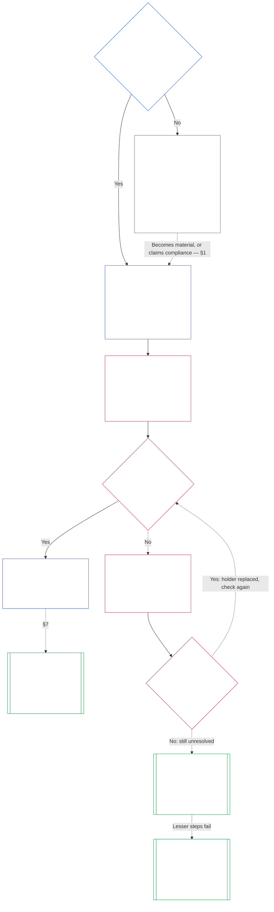

# CHAPTER SEVEN: SYSTEM AND INSTITUTIONAL CHARTERS

<strong>Corpus placement (non-operative): file structure and reading rules</strong>

> This file is **part of the Sentient Constitution** and is **binding only together** with the other numbered `core_*` files read as one text. It contains **Chapter Seven**: the floor for the published scope documents of a system and of an institution: the System Charter and the Institutional Charter. It follows the Chapter Six Rights Floor and precedes [Chapter Eight](core_08_functional_independence_segregation_of_duties.md#chapter-eight-functional-independence-and-segregation-of-duties), which separates the seats inside any materially binding act.
>
> - **Constitutional owner:** when a system must publish a System Charter and when an institution must publish an Institutional Charter (required at Class L or higher, voluntary at Class P), the minimum each must state, how each changes and is reviewed, and what neither can do, and the formation check on the standing and authenticity of the holders of covered offices.
> - **Definition home:** [System Charter](core_05_band_continuity.md#system-charter), [Institutional Charter](core_05_band_continuity.md#institutional-charter), [Charter Role Map](core_05_band_continuity.md#charter-role-map), [Chartered Party](core_05_band_continuity.md#chartered-party), and [Operating Party](core_05_band_oversight.md#operating-party) are defined in Chapter Five. This chapter applies them and does not redefine them.
> - **Implementation owner:** [CI-3.6](corpus_institutions/ci_03_institutional_design_separation_of_powers.md#ci-36-system-and-institutional-charter-contents-review-and-formation-template) (*System and Institutional Charter contents, review, and formation template*) holds the full field template, the review checklist, the formation procedure, and the formation check statement template. It may be stricter and may add fields. It may not narrow this chapter.
> - **Downstream consumers:** [Chapter Eight §5 Published Placement, Vacancy, and Substitution](core_08_functional_independence_segregation_of_duties.md#5-published-placement-vacancy-and-substitution) requires the Charter Role Map. Chapter Nine reads the System Charter for scope and boundary findings, and Chapter Nine Part D tests the formation check statement for an Institution. [Chapter Ten §3.7 Record custody and opening authority](core_10_standing_assessment.md#37-record-custody-and-opening-authority) applies it to standing records. [Chapter Thirteen §4.3 Institutional forums](core_13_forum.md#43-institutional-forums) hears disputes about the Institutional Charter.
>
> Reading order: §1 when System and Institutional Charters are required, with the chart that maps the process → §2 the right to form and three narrow limits → §3 what they must state → §4 the Charter Role Map and standing-record custody → §5 the formation check on office-holder standing and authenticity → §6 when a holder fails the check → §7 amendment, review, and scope misalignment → §8 what they cannot do → §9 relationship to other chapters.

<strong>Trace</strong>

- Upstream: [Constitutional Tetrad](core_00_preamble.md#constitutional-tetrad), especially **oversight** and **accountability**; [material stake](core_00_preamble.md#material-stake); [Chapter One §18.1 Governance as Authorized Structure](core_01_c_stewardship_capacity_principles.md#181-governance-as-authorized-structure); [Article XI-E](core_06_rights_part_b.md#article-xi-e-institutional-formation-and-business-creation) (*Institutional Formation and Business Creation*).
- Subsections: [§1](#1-when-system-and-institutional-charters-are-required); [§2](#2-the-right-to-form-and-three-narrow-limits); [§3](#3-what-system-and-institutional-charters-must-state); [§4](#4-the-charter-role-map-and-standing-record-custody); [§5](#5-formation-check-office-holder-standing-and-authenticity); [§6](#6-when-a-holder-fails-the-check); [§7](#7-amendment-review-and-scope-misalignment); [§8](#8-what-system-and-institutional-charters-cannot-do); [§9](#9-relationship-to-other-chapters).
- Downstream: [Chapter Eight](core_08_functional_independence_segregation_of_duties.md#chapter-eight-functional-independence-and-segregation-of-duties); [Chapter Nine](core_09_system_alignment_certification.md#chapter-nine-system-alignment-certification-reading-index); [Chapter Ten](core_10_standing_assessment.md#chapter-ten-contribution-violation-and-standing-model--measurement); [Chapter Thirteen](core_13_forum.md#chapter-thirteen-forums-and-jurisdiction); [Chapter Fourteen](core_14_governance.md#chapter-fourteen-constitutional-contract-legitimacy-authorization-and-stewardship); designated implementation text named above.
- Read with: [Authority Stack and Internal Hierarchy](core_05_band_integrative.md#authority-stack-and-internal-hierarchy); [System Boundaries](core_05_band_continuity.md#system-boundaries); [System Boundary Integrity](core_05_band_continuity.md#system-boundary-integrity); [System Creation](core_05_band_participation.md#system-creation); [Business Creation](core_05_band_participation.md#business-creation).

 

Chapter Seven is the constitutional owner of **System Charters, Institutional Charters, and published scope**.

Three chapters work as one chain:

- **Chapter Seven (this chapter):** says what a [Chartered Party](core_05_band_continuity.md#chartered-party) claims to do and who may hold each seat when it acts.
- **[Chapter Eight](core_08_functional_independence_segregation_of_duties.md#chapter-eight-functional-independence-and-segregation-of-duties):** says how those seats must be kept apart.
- **[Chapter Nine](core_09_system_alignment_certification.md#chapter-nine-system-alignment-certification-reading-index):** certifies a system, and separately an institution, each of which is one binding act that uses the seats. It sends what it finds back to the System Charter or Institutional Charter.

Other chapters own the definitions, the seat rules, the standing locks, and the decision rules this chapter points to. [§9 Relationship to Other Chapters](#9-relationship-to-other-chapters) says which is which. **CI-3.6** (*System and Institutional Charter contents, review, and formation template*) holds the field template, the formation procedure, and the review checklist.

### 1. When System and Institutional Charters Are Required

<strong>Trace</strong>

- Upstream: [§2](#2-the-right-to-form-and-three-narrow-limits); [material stake](core_00_preamble.md#material-stake); [Proportionality](core_05_band_accountability.md#proportionality); chapter opening owner claim; [Chapter One §18 Governance Under Stewardship Discipline](core_01_c_stewardship_capacity_principles.md#18-governance-under-stewardship-discipline); [Oversight](core_05_apex_oversight_leg.md#oversight-constitutional); [Accountability](core_05_apex_accountability_leg.md#accountability).
- Downstream: [§3](#3-what-system-and-institutional-charters-must-state); [Chapter Nine Part A §2 System Class Evaluation](core_09_a_system_alignment_certification_evaluation.md#2-system-class-evaluation) (*class and certification depth*); [Chapter Nine Part D §12.1 Institution class](core_09_d_institutional_alignment_certification.md#121-institution-class) (*the class of an Institution*); **CS-3** (*System classification machinery*) for the class catalog.
- Read with: **CI-3.6** (*System and Institutional Charter contents, review, and formation template*); **CF-5.5** (*Institutional and local registrars*); **CI-9** (*Classification-linked institutional obligations*); [Chapter Five System Charter](core_05_band_continuity.md#system-charter); [Chapter Five Institutional Charter](core_05_band_continuity.md#institutional-charter); [Article XI-E](core_06_rights_part_b.md#article-xi-e-institutional-formation-and-business-creation) (*Institutional Formation and Business Creation*).

<strong>Definitions · Assessment · Compliance</strong>

- [System Charter](core_05_band_continuity.md#system-charter) · [O](core_05_band_continuity.md#system-charter) · [M](core_05_band_continuity.md#system-charter-a) · [A](core_05_band_continuity.md#system-charter-a) · [C](core_05_band_continuity.md#system-charter-c)
- [Institutional Charter](core_05_band_continuity.md#institutional-charter) · [O](core_05_band_continuity.md#institutional-charter) · [M](core_05_band_continuity.md#institutional-charter-a) · [A](core_05_band_continuity.md#institutional-charter-a) · [C](core_05_band_continuity.md#institutional-charter-c)
- [Classification-Scaled Governance](core_05_band_oversight.md#classification-scaled-governance) · [O](core_05_band_oversight.md#classification-scaled-governance) · [M](core_05_band_oversight.md#classification-scaled-governance-a) · [A](core_05_band_oversight.md#classification-scaled-governance-a) · [C](core_05_band_oversight.md#classification-scaled-governance-c)

 

*In plain terms: before anyone can judge whether a system or institution stayed within its limits, the limits have to be written down where everyone can read them. A system that is material to others in any of the nine areas of [Domain-Specific Materiality](core_05_band_oversight.md#domain-specific-materiality) needs a published System Charter. An institution publishes the one that fits the systems it runs. Class P is voluntary: a quilting circle that gives quilts to refugees is the pattern.*

A System Charter or Institutional Charter is the published scope of a Chartered Party: what it claims authority to do, what it does not, and who holds each seat when it acts. It is the scope that the seats in Chapter Eight are placed under and that certification in Chapter Nine reads back against real operation. Whether an Operating Party has to publish one depends on its class: **required at Class L or higher, voluntary at Class P.** If it has to publish one, it also has to keep it accurate.

The five system impact classes are the frame for everything below. From most to least consequential, in one line each:

- **Class A, survival-critical, foundational, and irreplaceable:** failure within survival-relevant time, with no viable substitute, means loss of survival conditions.
- **Class B, critical, high-dependency, and systemically significant:** dependents cannot keep core function without it. Survival is not immediately lost, and substitution is still possible in time.
- **Class C, coordinated, high-dependency, and non-critical:** it shapes coordination at scale but is not an operational prerequisite for Class A or Class B function.
- **Class L, local, limited-impact, and non-critical:** its effects reach beyond a private unit but are local, replaceable, and containable.
- **Class P, personal, private-use, isolated, and experimental:** its effects stay inside a private unit, with no meaningful outside reliance.

[CS-3.8](corpus_systems/cs_03_b_system_impact_classifications.md#cs-38-system-impact-classifications) (*System impact classifications*) holds the full definitions. Classes A, B, C, and L must publish and Class P may, and [§1.2 Which classes are covered](#12-which-classes-are-covered) says how an Institution takes its class from the Systems it runs.

#### 1.1 Who must publish

A System of Class L or higher must publish and maintain a [System Charter](core_05_band_continuity.md#system-charter). An Institution of Class L or higher must publish and maintain the one of these that fits the Systems it runs:

| What the Institution operates, stewards, or materially controls | What it publishes |
| --- | --- |
| Exactly one System that needs a System Charter | That System Charter and no second document. It names the Institution as steward and serves as the [Institutional Charter](core_05_band_continuity.md#institutional-charter): one document covers both. |
| More than one such System | An Institutional Charter. It includes every System Charter in force for those Systems and states why the Institution runs those particular Systems ([§3 What System and Institutional Charters Must State](#3-what-system-and-institutional-charters-must-state)). |
| No such System | An Institutional Charter that states the Institution's own items from [§3 What System and Institutional Charters Must State](#3-what-system-and-institutional-charters-must-state) and has no System Charters to include. |

- **Businesses and comparable forms:** A business or other stewarded organizational form publishes whichever of the System Charter or Institutional Charter applies to it as a System, as an Institution, or as an Institution that operates a covered System. Its legal form does not change the answer.
- **Joint professional practice:** A sentient or small practice of Class L or higher that performs an act listed for a practice licence or practice clearance may meet this section for those acts by adopting a host's System Charter or Institutional Charter and Charter Role Map:
  - **What is adopted:** By reference, the System Charter or Institutional Charter and Charter Role Map of a host in a joint professional practice, which must cover those acts.
  - **Adoption notice:** The one-page notice that **CI-4.7** (*Practice licence, practice clearance, and joint professional practice*) describes.
  - **Class:** The practice stays the class its own acts give it.

#### 1.2 Which classes are covered

The class of the Chartered Party decides whether publishing is required or a choice:

- **Classes A, B, C, and L:** required. The chart in [§1.7 The process at a glance](#17-the-process-at-a-glance) shows the process they follow.
- **Class P:** a choice, until one of two events makes it required. [§1.3 What Class P is](#13-what-class-p-is) says what makes an Operating Party Class P, and [§1.4 Class P: optional charters, and when they become required](#14-class-p-optional-charters-and-when-they-become-required) sets out the choice and when it ends.
- **Class of an Institution:** An Institution takes the highest class of any System it operates, stewards, or materially controls. An Institution that runs no such System is classified by its own material impact and dependency, judged by what it actually decides and holds and not by its label or legal form, under [Chapter Nine Part D §12.1 Institution class](core_09_d_institutional_alignment_certification.md#121-institution-class).

#### 1.3 What Class P is

An Operating Party is Class P only while its activity stays below the line in every one of the nine domains of [Domain-Specific Materiality](core_05_band_oversight.md#domain-specific-materiality), which in practice means its acts and effects stay inside its [private unit](core_05_band_oversight.md#domain-specific-materiality-private-unit):

- **Crossing a line:** Crossing the line in any one domain makes it at least Class L under **CS-3** (*System classification machinery*), whatever its size or what it calls itself.
- **Staying below every line:** It stays Class P however many members it has.
- **Those inside:** Class P also depends on those inside it. Anyone inside who notices the Operating Party crossing a line has a duty to report it, and the report is protected ([Domain-Specific Materiality](core_05_band_oversight.md#domain-specific-materiality)).

The four-seat floor in Chapter Eight does not apply to a Class P Operating Party's acts, which stay inside its private unit, so a single sentient with a computer needs no second seat-holder. The floor applies from the day the Operating Party takes a [Materially Binding Act](core_05_band_accountability.md#materially-binding-act) that others must follow or may rely on as settled, which crosses the line in the authority-over-others domain and makes it at least Class L.

#### 1.4 Class P: optional charters, and when they become required

A Class P Operating Party is encouraged to publish the [System Charter](core_05_band_continuity.md#system-charter) (for a single system) or [Institutional Charter](core_05_band_continuity.md#institutional-charter) (for more than one system, or none) that fits what it runs. It may use the content list in [§3 What System and Institutional Charters Must State](#3-what-system-and-institutional-charters-must-state) and the seat map in [§4 The Charter Role Map and Standing-Record Custody](#4-the-charter-role-map-and-standing-record-custody) as a template. Publishing one creates no duty under this chapter's process:

- no due date ([§1.5 When a System Charter or Institutional Charter is due](#15-when-a-system-charter-or-institutional-charter-is-due));
- no formation check ([§5 Formation Check: Office-Holder Standing and Authenticity](#5-formation-check-office-holder-standing-and-authenticity));
- no required [Charter Role Map](core_05_band_continuity.md#charter-role-map) ([§4 The Charter Role Map and Standing-Record Custody](#4-the-charter-role-map-and-standing-record-custody)), though it may keep one with its voluntary System Charter or Institutional Charter or publish it on its own; and
- no required amendment or review cycle ([§7 Amendment, Review, and Scope Misalignment](#7-amendment-review-and-scope-misalignment)).

If either of these happens, publishing stops being optional.

- the Operating Party is reclassified to Class L or higher; or
- its operator asserts constitutional compliance for the Operating Party.

The Operating Party must then publish the System Charter or Institutional Charter that fits it, on the schedule in [§1.5 When a System Charter or Institutional Charter is due](#15-when-a-system-charter-or-institutional-charter-is-due).

#### 1.5 When a System Charter or Institutional Charter is due

A covered System or Institution publishes its [System Charter](core_05_band_continuity.md#system-charter) or [Institutional Charter](core_05_band_continuity.md#institutional-charter) on this schedule:

- **A new System or Institution:** before it goes live or begins to exercise authority over others.
- **One that already operates:** at its next classification review or certification, or within the resolution window after a request under [§1.6 If a System Charter or Institutional Charter is missing](#16-if-a-system-charter-or-institutional-charter-is-missing), whichever comes first. It is in default until it does.
  - **Which certification:** For a System, its System Alignment Certification. For an Institution, its institutional alignment certification under [Chapter Nine Part D §11.3 No permission and no gate](core_09_d_institutional_alignment_certification.md#113-no-permission-and-no-gate), whose first-certification window is never a condition of publishing the Institutional Charter or of operating.
- **The formation check:** It also completes the formation check in [§5 Formation Check: Office-Holder Standing and Authenticity](#5-formation-check-office-holder-standing-and-authenticity) at the same moment.
- **Where it is lodged:** It lodges the System Charter or Institutional Charter, with its Charter Role Map and formation check statement, with the Institutional registrar, or with the local registrar where its activity and the sentients it affects are local (**CF-5.5** (*Institutional and local registrars*)):
  - **What the registrar does:** It checks that nothing required is missing and gives a dated receipt.
  - **What the registrar never does:** It never grants permission and never rules on class or content.
  - **A late or missing receipt:** It never stops the Chartered Party from operating.

#### 1.6 If a System Charter or Institutional Charter is missing

Anyone who notices a Chartered Party of Class L or higher, new or newly so, that has not published its System Charter or Institutional Charter may ask its governing authority for it. The asker needs no standing, pays no fee, and need not show harm. The request names the Chartered Party and says why it appears covered.

Two windows run from the request: the response window and the resolution window. Each takes its length from the Tier with the same letter as the Chartered Party's class, so the more critical the class, the shorter the windows:

| Class and Tier | Response window (intake target) | Resolution window (outer bound) |
|---|---|---|
| Class A, Tier A | 24 hours | 7 calendar days |
| Class B, Tier B | 2 calendar days | 14 calendar days |
| Class C, Tier C | 4 calendar days | 30 calendar days |
| Class L, Tier L | 8 calendar days | 60 calendar days |

The figures come from **CF-11.3.1** (*Stage targets and timing floors*), which governs if they differ. A Chartered Party that disputes its class is counted at Tier L until the question is settled.

The windows work like this:

- **Response window:** The Chartered Party responds inside the response window, which is the intake target of the matching tier in **CF-11.3.1** (*Stage targets and timing floors*), counted from the request. It publishes the System Charter or Institutional Charter, or gives the date by which it will, or points to the one it has already published, or answers that it is below every line of [Domain-Specific Materiality](core_05_band_oversight.md#domain-specific-materiality) and gives the written showing that entry requires.
- **Resolution window:** The System Charter or Institutional Charter is due inside the resolution window, which is the outer bound of the matching tier in **CF-11.3.1** (*Stage targets and timing floors*), counted from the request, with the formation check statement that goes with it ([§5 Formation Check: Office-Holder Standing and Authenticity](#5-formation-check-office-holder-standing-and-authenticity)). A Chartered Party with no independent seat yet files the statement as a declaration with its evidence, as that section provides.
- **An Operating Party that says it is below the line:** The request is then also a classification challenge on the route in that entry's *Challenge route*:
  - **Running the window:** The resolution window keeps running while the challenge is pending.
  - **Challenge extension:** If the forum with jurisdiction judges the challenge review-worthy, the due date is extended, and a new resolution window starts when the challenge is decided.
  - **What review-worthy means:** A challenge is review-worthy when it names a specific crossing in a named domain and the Operating Party's written showing leaves a real question about that crossing. The Operating Party does not judge this for itself, and a response that gives no written showing does not extend the date.
  - **If it is found Class L:** On that challenge or on any other, the date of the finding counts as the date of a request: the response window and the resolution window run from it, at Tier L.
- **If it is missed:** No response, or no System Charter or Institutional Charter by the due date, is a defect to log and correct. The asker may take it to the forum with jurisdiction on the same route. It is never a condition of forming or operating.
- **A repeat request:** A second request about the same Chartered Party, made while its earlier response or a finding on it still stands, starts no new response or resolution window. The Chartered Party answers by pointing to that response or finding. The response or finding stands until one of these happens, as the reopening triggers in [Chapter Nine Part D §14.2 Reopening triggers](core_09_d_institutional_alignment_certification.md#142-reopening-triggers) describe:
  - **A material change:** The Chartered Party's activity changes materially.
  - **New evidence:** New evidence about a crossing is shown.

  A request that shows either of the above is not a repeat. It is a new request, handled separately and independently of the earlier one. It has its own response window and resolution window, counted from its own date, and the earlier response, finding, and windows neither satisfy it nor are changed by it.
- **Scope in the meantime:** A missing System Charter or Institutional Charter is not a reason to treat the Chartered Party as unbounded. Until it exists, the Chartered Party's real [System Boundaries](core_05_band_continuity.md#system-boundaries) and its class control, and a certification or forum may reconstruct scope from observed operation.

#### 1.7 The process at a glance

The chart follows one Operating Party from the question of whether it is material to others, through publishing its System Charter or Institutional Charter and keeping it accurate. If a problem isn't fixed inside the resolution window, the chartering process sends it to a review that is covered outside this chapter. The sections after this one explain each step in the same order.

<strong>Reader guidance (non-operative): how to read the chart</strong>

> In plain terms: nobody grants a System Charter or Institutional Charter, and nobody needs permission to form. A Chartered Party whose activity is material to others publishes what it claims authority to do and who holds each seat, and the holders of its key offices are checked. A holder who fails is replaced and the Chartered Party goes on. If the failure is still not fixed when the resolution window ends, a forum may review the Chartered Party, starting with the lightest step that protects others. Making the Chartered Party shrink below Class L, or dissolving it, comes only if lighter steps fail. A dissolved Chartered Party may not come back while the lock on it stands.
>
> Solid arrows are the main path. Dotted arrows are exceptions and hand-offs, labeled with the section that makes them. The boxes with double side bars belong to another chapter or to the incorporated implementation text. The chart adds no duty, seat, or field, and no step on it is a grant of permission.

 

### 2. The Right to Form, and Three Narrow Limits

<strong>Trace</strong>

- Upstream: [§1](#1-when-system-and-institutional-charters-are-required); [Article XI-E](core_06_rights_part_b.md#article-xi-e-institutional-formation-and-business-creation) (*Institutional Formation and Business Creation*).
- Downstream: [§1 When System and Institutional Charters Are Required](#1-when-system-and-institutional-charters-are-required); [§5 Formation Check: Office-Holder Standing and Authenticity](#5-formation-check-office-holder-standing-and-authenticity).
- Read with: [Interim Hold](core_05_band_accountability.md#interim-hold); [Chapter Eleven §4.2 Prevention — general standing locks](core_11_standing_integration.md#42-prevention--general-standing-locks); [Chapter Eleven §5.5 Special locks](core_11_standing_integration.md#55-special-locks); [Chapter Thirteen §5 Interim hold on a named sentient's pathway](core_13_forum.md#interim-hold-on-a-named-sentients-pathway).

 

*In plain terms: you do not need anyone's permission to form a system, institution, or business. Three narrow limits can apply: two can keep one sentient out of one controlling office, and one can require a licence or clearance before a named high-risk act. The first of these can also apply to a Chartered Party that is itself under a lock. A Chartered Party that a forum has dissolved is barred from coming back, and the bar is permanent when the dissolution rested on widespread anti-constitutional conduct, or on serious harm that can't be undone and was never put right. None stops a new Operating Party from forming or operating, and this chapter adds none.*

**Article XI-E** (*Institutional Formation and Business Creation*) allows three narrow limits:

- **The first two are the only gates** on forming an Operating Party or holding authority in it. Each attaches to a named subject:
  - **An outstanding lock** ([§2.2 First limit: an outstanding lock](#22-first-limit-an-outstanding-lock)) attaches to a named sentient in one office that controls the Chartered Party. It also attaches to a Chartered Party that is itself under a lock, including one that a forum has dissolved.
  - **A probable-cause hold** ([§2.3 Second limit: a short hold on probable cause](#23-second-limit-a-short-hold-on-probable-cause)) attaches only to one named sentient in one office that controls the Chartered Party.
- **The third is not a gate:** It is a practice licence or clearance ([§2.4 Third limit: a practice licence or clearance](#24-third-limit-a-practice-licence-or-clearance)).
- **How this section is laid out:** [§2.1 The right to form](#21-the-right-to-form) comes first, then one subsection for each limit.

#### 2.1 The right to form

Anyone may form a new system, institution, or business. That right is set out in [Article XI-E](core_06_rights_part_b.md#article-xi-e-institutional-formation-and-business-creation) (*Institutional Formation and Business Creation*). This chapter adds the duty that comes next. Once what an Operating Party does is material to others in any one of the nine areas of [Domain-Specific Materiality](core_05_band_oversight.md#domain-specific-materiality), it must say in public, ahead of time, what it claims authority to do ([§1 When System and Institutional Charters Are Required](#1-when-system-and-institutional-charters-are-required)).

**Who the right to form does not cover.** Apart from the two gates in [§2.2 First limit: an outstanding lock](#22-first-limit-an-outstanding-lock) and [§2.3 Second limit: a short hold on probable cause](#23-second-limit-a-short-hold-on-probable-cause), **Article XI-E** (*Institutional Formation and Business Creation*) does not protect:

- an Operating Party designed to break a Constitutional Constraint, to undermine Safety or Truth, or to concentrate power in ways [Chapter One §11 Market Structure](core_01_a_values_principles.md#11-market-structure) rules out; or
- an Operating Party formed or run by a founder who is not authentically aligned with its stated purpose (genuinely committed to it), or who means to mislead others about its purpose, control, or interests, or to harm others.

Forums decide these cases under that Article. A failed formation check is one piece of evidence the forum weighs, which means the check alone does not decide the case.

#### 2.2 First limit: an outstanding lock

A [standing lock](core_11_standing_integration.md#42-prevention--general-standing-locks) or [special lock](core_11_standing_integration.md#55-special-locks), set after a verified violation and not yet lifted, bars one named sentient from authority over this kind of institution or business.

- What is barred: taking or exercising governing, controlling, or owning authority in the Operating Party.
- How far it reaches: only as far as the lock does. It ends when the lock is lifted or narrowed.
- A lock on the Chartered Party itself: a lock can also sit on the Chartered Party, as the [Anti-Constitutional Trust Lock](core_11_standing_integration.md#55-special-locks) does where the final designation names an institution, successor vehicle, or controlled entity. The gate then bars what the lock's named pathway names, in the Chartered Party and in its successors, controlled entities, and nominee- or shell-held vehicles.
- A dissolved Chartered Party: a final dissolution order under **CI-13.7** (*Dissolution*) sets a [Dissolution Reformation Lock](core_11_standing_integration.md#55-special-locks). The dissolved Chartered Party, its successors, controlled entities, nominee- or shell-held vehicles, and any Operating Party that is one operation with them may not be re-formed, revived, or run under any name or form while it stands. Where the order finds pervasive anti-constitutional conduct or unremedied Irreversible Harm ([Chapter Eleven §8 Restoration and reassessment](core_11_standing_integration.md#8-restoration-and-reassessment)), the lock is permanent: time, a resolved cause, or a change of holders does not lift it, and it ends only if the dissolution order is set aside on review or material new verified facts show that its finding was wrong. Otherwise it ends on an independent finding that the cause is resolved, the remedy is delivered, and a return is safer than continued exclusion. It bars no sentient from forming a different Operating Party.

#### 2.3 Second limit: a short hold on probable cause

This limit applies when a forum with jurisdiction has ordered an [Interim Hold](core_05_band_accountability.md#interim-hold) on specific verified facts that make it more likely than not that the holder is misaligned with the Chartered Party's stated purpose. Only that forum can order it ([Chapter Thirteen §5 Interim hold on a named sentient's pathway](core_13_forum.md#interim-hold-on-a-named-sentients-pathway)). The Chartered Party can't decide on its own to bar someone from an office, because that would make it the judge of its own member.

Neither limit stops a new Operating Party from forming, publishing its System Charter or Institutional Charter, or getting to work. The only party they stop is one that is itself under a lock, such as a dissolved Chartered Party trying to come back. Both limits are applied at the formation check ([§5 Formation Check: Office-Holder Standing and Authenticity](#5-formation-check-office-holder-standing-and-authenticity)).

#### 2.4 Third limit: a practice licence or clearance

The third limit works on a named act, not on forming an Operating Party:

- **Not a gate on an Operating Party:** the formation check in [§5 Formation Check: Office-Holder Standing and Authenticity](#5-formation-check-office-holder-standing-and-authenticity) does not apply it.
- **What it is:** a [Competency Clearance](core_05_band_accountability.md#competency-clearance) that **Article XI-E** (*Institutional Formation and Business Creation*) lets an adopter require before a named act is performed for others, on a technical forum's published risk finding.
  - **Practice licence:** required for acts that risk serious or irreversible harm if done badly.
  - **Practice clearance:** required for acts that risk real but lesser harm if done badly.
- **What it attaches to:** performing the act. It never stops an Operating Party from forming, publishing its System Charter or Institutional Charter, or operating.
- **What it does stop:** claiming or performing the act without it. A System Charter or Institutional Charter may not claim the act unless a holder performs it ([§3 What System and Institutional Charters Must State](#3-what-system-and-institutional-charters-must-state)).

### 3. What System and Institutional Charters Must State

<strong>Trace</strong>

- Upstream: [§1](#1-when-system-and-institutional-charters-are-required); [Chapter Five System Charter](core_05_band_continuity.md#system-charter); [Chapter Five Institutional Charter](core_05_band_continuity.md#institutional-charter).
- Downstream: [§4](#4-the-charter-role-map-and-standing-record-custody); [§7](#7-amendment-review-and-scope-misalignment); [Chapter Nine Part B §8.1 Minimum record contents](core_09_b_system_alignment_certification_record_process.md#81-minimum-record-contents) (*the System Charter fields a certification record relies on*); **CI-3.6** (*System and Institutional Charter contents, review, and formation template*) for the full field list.
- Read with: [Chapter Eighteen §4 Adoption framing and scope of authority](core_18_incorporation.md#4-adoption-framing-and-scope-of-authority) (*a scope document kept under another name*); [Chapter Fourteen §4.3 Decision-resolution requirements for binding stakeholder choice](core_14_governance.md#43-decision-resolution-requirements-for-binding-stakeholder-choice); **CI-8.1** (*Stakeholder oversight, notification, and binding-governance pathway integrity*); **CI-8.2** (*Anti-concentration and participation-legitimacy safeguards*).

<strong>Definitions · Assessment · Compliance</strong>

- [System Charter](core_05_band_continuity.md#system-charter) · [O](core_05_band_continuity.md#system-charter) · [M](core_05_band_continuity.md#system-charter-a) · [A](core_05_band_continuity.md#system-charter-a) · [C](core_05_band_continuity.md#system-charter-c)
- [Institutional Charter](core_05_band_continuity.md#institutional-charter) · [O](core_05_band_continuity.md#institutional-charter) · [M](core_05_band_continuity.md#institutional-charter-a) · [A](core_05_band_continuity.md#institutional-charter-a) · [C](core_05_band_continuity.md#institutional-charter-c)
- [Charter Role Map](core_05_band_continuity.md#charter-role-map) · [O](core_05_band_continuity.md#charter-role-map) · [M](core_05_band_continuity.md#charter-role-map-a) · [A](core_05_band_continuity.md#charter-role-map-a) · [C](core_05_band_continuity.md#charter-role-map-c)

 

*In plain terms: a System Charter has to be specific enough to test. It says what the system is for, what the system does and does not do, who relies on the system, who can amend the System Charter, who holds each seat, and where to find the binding decision rules. The System Charter points to those rules and does not replace them. An Institutional Charter says the same about the institution, then adds the System Charters it holds and the reason the institution runs those systems.*

**How this section is laid out:**

- [§3.1 What a System Charter states](#31-what-a-system-charter-states) lists the nine items.
- [§3.2 Charter Pointers](#32-charter-pointers) says that a System Charter or Institutional Charter may refer to another published document instead of copying its text, and what makes that reference valid.
- [§3.3 What an Institutional Charter adds](#33-what-an-institutional-charter-adds) covers what an Institutional Charter holds beyond the nine items: the System Charters of the Systems the Institution runs, and why it runs them.
- [§3.4 Acts that need a practice licence or practice clearance](#34-acts-that-need-a-practice-licence-or-practice-clearance) says that a System Charter or Institutional Charter may claim such an act only if every sentient who performs it holds the licence or clearance, or works as a learner under a supervisor who does. Until then, the act is listed as out of scope (item 4 in [§3.1 What a System Charter states](#31-what-a-system-charter-states)).
- [§3.5 Scaling](#35-scaling) says what changes with class.

#### 3.1 What a System Charter states

A System Charter states, in plain language that affected sentients and auditors can read:

1. **Identity and version:** the name, the steward or governing body, the version, the effective date, and the change history.
2. **Purpose:** what the Chartered Party exists to do.
3. **In-scope activities:** the functions, services, authorities, and domains it claims.
4. **Out-of-scope limits:** the material activities, authorities, and domains it is not authorized to exercise.
5. **Affected communities and dependencies:** who relies on the Chartered Party, and which systems or infrastructure it depends on or gates, where material.
6. **Classification assumptions:** the class or stewardship tier relied on, with a [Charter Pointer](core_05_band_continuity.md#charter-pointer) to **CS-3** (*System classification machinery*) and **CS-4** (*Critical system stewardship*) where they apply.
7. **Charter Role Map:** the [Charter Role Map](core_05_band_continuity.md#charter-role-map), or a Charter Pointer to the published document that is the Charter Role Map ([§4 The Charter Role Map and Standing-Record Custody](#4-the-charter-role-map-and-standing-record-custody)).
8. **Binding stakeholder-choice Charter Pointers:**
   - **When it applies:** when a real disagreement among affected sentients requires a binding stakeholder choice inside the system. [Def.P2 Binding Stakeholder Choice](core_05_band_participation.md#defp2-binding-stakeholder-choice) calls this its admission scope.
   - **What it points to:** live Charter Pointers to three published sets of rules: the decision sequence (how the choice is made), the weighting rules (who gets how much say), and the rights-collision-record rules (what the record must show when rights collide).
   - **Who carries what:** the System Charter holds only the pointers. The three sets of rules hold the actual content: how the choice is made, how weight is set, and what the record shows. The System Charter does not carry that content itself, and its own text cannot be offered in place of those rules. A dead pointer, or System Charter text offered in place of the rules, fails the System Charter duty.
9. **Amendment authority:** who may amend, what counts as a material amendment, and the notice and contest path.

#### 3.2 Charter Pointers

A System Charter or Institutional Charter may point to another published document or provision (a rule set, the Charter Role Map, a System Charter) instead of copying it. Each such reference is a [Charter Pointer](core_05_band_continuity.md#charter-pointer). It must resolve to a live, current, published document. A dead or stale Charter Pointer counts as a missing item.

#### 3.3 What an Institutional Charter adds

An Institutional Charter states items 1 to 9 of [§3.1 What a System Charter states](#31-what-a-system-charter-states) for the Institution itself, and also holds:

- **The System Charters:** Every System Charter in force for the Systems the Institution operates, stewards, or materially controls, included in full or by a Charter Pointer that resolves to the current published version.
- **The portfolio rationale:** Why the Institution runs those particular Systems, how they serve its stated purpose and relate to one another, and which dependencies they share. A System with no stated reason is a missing item.

**CI-3.6** (*System and Institutional Charter contents, review, and formation template*) may require more and sets the formation template, but it may not drop an item above.

#### 3.4 Acts that need a practice licence or practice clearance

This subsection says what a System Charter or Institutional Charter may claim when an act needs a practice licence or practice clearance.

- **The limit:** If an act requires a practice licence or practice clearance, a System Charter or Institutional Charter can't list it as something the Chartered Party does, and the Chartered Party can't do it, unless every sentient who performs it either holds the licence or clearance or works as a learner under a supervisor who does.
- **Until then:** The System Charter or Institutional Charter lists the act under item 4 ([§3.1 What a System Charter states](#31-what-a-system-charter-states)) as out of scope.
- **If claimed without a holder:** It is a missing item to log and fix, and it does not stop the Chartered Party from forming, publishing, or carrying on its other work.
- **Where to look:** [§2 The Right to Form, and Three Narrow Limits](#2-the-right-to-form-and-three-narrow-limits) says where the requirement comes from, and **CI-4.7** (*Practice licence, practice clearance, and joint professional practice*) holds the entries and the host check.

#### 3.5 Scaling

Some parts of a System Charter or Institutional Charter scale with class and some do not:

- **What scales:** The depth of the System Charter or Institutional Charter, the review cadence, and the independence of the review scale with class and [material stake](core_00_preamble.md#material-stake).
- **Class L:** A System Charter or Institutional Charter for a Class L system or institution can be short and can keep simpler records, where [Classification-Scaled Governance](core_05_band_oversight.md#classification-scaled-governance) allows. It still has to cover every required item.
- **Review cadence:** A System Charter or Institutional Charter does not decide how often it is reviewed. The class sets that.

### 4. The Charter Role Map and Standing-Record Custody

<strong>Trace</strong>

- Upstream: [§3](#3-what-system-and-institutional-charters-must-state); [Chapter Eight §2 Four-Seat Constitutional Floor](core_08_functional_independence_segregation_of_duties.md#2-four-seat-constitutional-floor).
- Downstream: [Chapter Eight §5 Published Placement, Vacancy, and Substitution](core_08_functional_independence_segregation_of_duties.md#5-published-placement-vacancy-and-substitution); [Chapter Nine Part B §6.1.1 Four seats in a certification](core_09_b_system_alignment_certification_record_process.md#611-four-seats-in-a-certification); [Chapter Ten §3.7 Record custody and opening authority](core_10_standing_assessment.md#37-record-custody-and-opening-authority); **CI-3.2** (*Functional separation lanes*); **CI-4.5** (*Authorized roles and accountability chains*); **CI-4.6** (*Seat catalog — process-role archetypes and operational boundaries*).
- Read with: [Material Control Line](core_05_band_accountability.md#material-control-line); [Standing Record](core_05_band_accountability.md#standing-record).

<strong>Definitions · Assessment · Compliance</strong>

- [Charter Role Map](core_05_band_continuity.md#charter-role-map) · [O](core_05_band_continuity.md#charter-role-map) · [M](core_05_band_continuity.md#charter-role-map-a) · [A](core_05_band_continuity.md#charter-role-map-a) · [C](core_05_band_continuity.md#charter-role-map-c)
- [System Charter](core_05_band_continuity.md#system-charter) · [O](core_05_band_continuity.md#system-charter) · [M](core_05_band_continuity.md#system-charter-a) · [A](core_05_band_continuity.md#system-charter-a) · [C](core_05_band_continuity.md#system-charter-c)
- [Institutional Charter](core_05_band_continuity.md#institutional-charter) · [O](core_05_band_continuity.md#institutional-charter) · [M](core_05_band_continuity.md#institutional-charter-a) · [A](core_05_band_continuity.md#institutional-charter-a) · [C](core_05_band_continuity.md#institutional-charter-c)

 

*In plain terms: the System Charter or Institutional Charter is where the seats get names. It carries a published list of who may hold each seat for the acts it covers, so a party can't pick its own checker. The rules for what counts as a valid seat placement stay in Chapter Eight. Keeping the standing records safe isn't a separate list: it's the same map.*

Every System Charter or Institutional Charter carries a [Charter Role Map](core_05_band_continuity.md#charter-role-map): a published list of who holds each seat. [Chapter Eight §5 Published Placement, Vacancy, and Substitution](core_08_functional_independence_segregation_of_duties.md#5-published-placement-vacancy-and-substitution) requires it of every adopter that takes materially binding acts and says what it must name. This section says what the System Charter or Institutional Charter does with it.

**How this section is laid out:**

- [§4.1 What a System Charter or Institutional Charter owes the map](#41-what-a-system-charter-or-institutional-charter-owes-the-map) says that the System Charter or Institutional Charter holds the map, or points to it, and that a missing, dead, or out-of-date map is a defect in that System Charter or Institutional Charter.
- [§4.2 Where the seat rules are](#42-where-the-seat-rules-are) says that Chapter Eight sets the four seats and the tests for a valid placement, and the map only records who sits where.
- [§4.3 Independence from the party whose act is at issue](#43-independence-from-the-party-whose-act-is-at-issue) says that the record, contest, and verify-or-authorize seats must sit outside that party's Material Control Line.
- [§4.4 Which System Charter or Institutional Charter holds which map](#44-which-system-charter-or-institutional-charter-holds-which-map) covers several Systems under one Institutional Charter, and a shared map.
- [§4.5 Two kinds of change](#45-two-kinds-of-change) says that changing who may hold a seat is an amendment, and changing who holds it now is a new dated version of the map.
- [§4.6 Standing-record custody](#46-standing-record-custody) says what the map must say for operator standing records and for stakeholder standing records.
- [§4.7 Gaps in the map for operator standing records](#47-gaps-in-the-map-for-operator-standing-records) says what follows when a required seat is unnamed or left without a qualified holder.

#### 4.1 What a System Charter or Institutional Charter owes the map

It holds the map, or points to it, so a reader who starts there can find who holds each seat. A missing, dead, or out-of-date map is a defect in that System Charter or Institutional Charter.

#### 4.2 Where the seat rules are

Chapter Eight sets the rules, and the map only records who sits where.

- **The four seats:** Every [Materially Binding Act](core_05_band_accountability.md#materially-binding-act) has four seats: initiating, verify-or-authorize, record, and contest ([Chapter Eight §2 Four-Seat Constitutional Floor](core_08_functional_independence_segregation_of_duties.md#2-four-seat-constitutional-floor)).
- **What makes a placement valid:** Chapter Eight also sets the tests for whether a seat has been placed properly:
  - independence, meaning the checker can't be directed or overruled by the party being checked ([Chapter Eight §3 Independence, Conflict, and Control Lines](core_08_functional_independence_segregation_of_duties.md#3-independence-conflict-and-control-lines));
  - vacancy, substitutes, and delegation, meaning who steps in when a holder is absent or conflicted ([Chapter Eight §5 Published Placement, Vacancy, and Substitution](core_08_functional_independence_segregation_of_duties.md#5-published-placement-vacancy-and-substitution)); and
  - merged hosting, meaning the only cases where a small party may put two seats in one office. The map lists each permitted arrangement and the independence safeguard that goes with it ([Chapter Eight §6 Proportional Scaling and Merged Hosting](core_08_functional_independence_segregation_of_duties.md#6-proportional-scaling-and-merged-hosting)).

#### 4.3 Independence from the party whose act is at issue

The record and contest seats the map names, and every verify-or-authorize seat it places, must sit outside the [Material Control Line](core_05_band_accountability.md#material-control-line) of the party whose act is at issue. That party can't change those entries on its own.

#### 4.4 Which System Charter or Institutional Charter holds which map

Which System Charter or Institutional Charter keeps a map depends on how the parties are arranged:

- **Several Systems:** An Institutional Charter may hold several System Charters. Each System Charter keeps the map for the acts of its own System, and the Institutional Charter keeps the map for the Institution's own acts.
- **A shared map:** A business or practice may place some of its seats with a local cooperative, association, or host ([§1 When System and Institutional Charters Are Required](#1-when-system-and-institutional-charters-are-required)). If it does, it can use that group's published map instead of writing its own, which keeps its own System Charter or Institutional Charter short. It still has to name who steps in when one of its seat-holders is absent or conflicted, and an independent route to use when no qualified substitute is available ([Chapter Eight §6 Proportional Scaling and Merged Hosting](core_08_functional_independence_segregation_of_duties.md#6-proportional-scaling-and-merged-hosting), *Seats held in common*).

#### 4.5 Two kinds of change

Changing the map is one of two things, and the version in force decides which map an act is judged against:

- **Who may hold a seat:** Deciding which offices may hold a seat, act as a substitute, or share hosting is a change to the map's rules. It can be made only through the amendment process the System Charter or Institutional Charter names ([§7 Amendment, Review, and Scope Misalignment](#7-amendment-review-and-scope-misalignment)).
- **Who holds a seat now:** Changing the current holder is an update, not an amendment. It is done by publishing a new dated version of the map.
- **Which version applies:** An act is judged against the map that was in force on the day it was taken.

#### 4.6 Standing-record custody

What the map must say depends on the kind of [Standing Record](core_05_band_accountability.md#standing-record), because the two kinds face different conflicts of interest ([Chapter Ten §3.7 Record custody and opening authority](core_10_standing_assessment.md#37-record-custody-and-opening-authority), *Two kinds of standing record by subject*).

- **Operator standing records** are records about the Chartered Party, its chartered scope, and the systems it stewards. For these, the map names four things:
  - who may open the record (the verifying seat);
  - a separate custodian who keeps it (the record seat);
  - who handles contests (the contest seat); and
  - an independent route for when the Chartered Party is itself the subject.
- **Stakeholder standing records** are records about the sentients and institutions that use, rely on, or are affected by its systems.
  - **The Chartered Party's stake:** It may be the one making a claim or an accusation in these records.
  - **Its own offices:** They may hold a seat on a record only if the Chartered Party has no stake in that record. If it has a stake, the record goes to an office outside the Chartered Party's control, or to independent verification.
  - **Naming offices is optional:** The map may name offices for these records ahead of time, but it doesn't have to, and a map that names none is still valid.

#### 4.7 Gaps in the map for operator standing records

These rules apply to a gap in the entries that [§4.6 Standing-record custody](#46-standing-record-custody) requires for operator standing records. The last bullet puts the same clock on the certification seats:

- **A map with gaps makes the System Charter or Institutional Charter invalid:** The map has to name the record-opening authority, the record custodian, the contest seat, and the independent route. A change that would leave any of them unnamed is not allowed.
- **If events remove the last qualified substitute:** If something nobody could have foreseen leaves one of those seats without a qualified holder, the Chartered Party gets the usual response window and resolution window ([§1.6 If a System Charter or Institutional Charter is missing](#16-if-a-system-charter-or-institutional-charter-is-missing)). An emergency substitution keeps the shorter window that **CI-3.6** (*System and Institutional Charter contents, review, and formation template*) sets.
- **Until it is resolved:** None of the Chartered Party's own offices can issue a valid standing record for the affected scope. The record goes to the Backup Record Authority (**CF-5.7** (*Backup Record Authority*)) or a forum instead, so nobody's record waits on the Chartered Party's repair ([Chapter Ten §3.7 Record custody and opening authority](core_10_standing_assessment.md#37-record-custody-and-opening-authority), *No self-custody*).
- **Certification seats run on the same clock:** If the map is silent on the initiating, record, or contest seat of a system alignment certification or an institutional alignment certification, that is a defect to log and correct, and the System Charter or Institutional Charter is not invalid at once. The **CI-3.2** (*Functional separation lanes*) lane map places the seat meanwhile, so no pass stops. The Chartered Party has the usual response window and resolution window (**CI-13.3** (*Notice, response, and resolution*), [§1.6 If a System Charter or Institutional Charter is missing](#16-if-a-system-charter-or-institutional-charter-is-missing)), counted from the logged notice of the gap, to place the seat by a dated amendment of the map. If the seat is still unplaced when the resolution window ends, the System Charter or Institutional Charter is invalid on the same terms as for a gap in the standing-record entries above. The verify-or-authorize seat is not placed by the map ([Chapter Eight §5 Published Placement, Vacancy, and Substitution](core_08_functional_independence_segregation_of_duties.md#5-published-placement-vacancy-and-substitution)), so it is never a gap of this kind.

### 5. Formation Check: Office-Holder Standing and Authenticity

<strong>Trace</strong>

- Upstream: [§2](#2-the-right-to-form-and-three-narrow-limits); [§1.5](#15-when-a-system-charter-or-institutional-charter-is-due); [§3](#3-what-system-and-institutional-charters-must-state); [§4](#4-the-charter-role-map-and-standing-record-custody); [Article XI-E](core_06_rights_part_b.md#article-xi-e-institutional-formation-and-business-creation) (*Institutional Formation and Business Creation*); [What Systems Reward](core_00_preamble.md#what-systems-reward) and the [Two Fundamental Questions](core_00_preamble.md#two-fundamental-questions); [Chapter One §19.1.4 Role-Depth and Material-Responsibility Pathways](core_01_c_stewardship_capacity_principles.md#1914-role-depth-and-material-responsibility-pathways); [Chapter One §19.4 Misalignment Correction and Capture Response](core_01_c_stewardship_capacity_principles.md#194-misalignment-correction-and-capture-response); [Chapter Eleven §4.2 Prevention — general standing locks](core_11_standing_integration.md#42-prevention--general-standing-locks), [§5.5 Special locks](core_11_standing_integration.md#55-special-locks), and [§6.2 Competency bars and clearances](core_11_standing_integration.md#62-competency-bars-and-clearances).
- Downstream: [§6 When a Holder Fails the Check](#6-when-a-holder-fails-the-check); [Chapter Nine Part D §12.2 Institutional evaluation, always](core_09_d_institutional_alignment_certification.md#122-institutional-evaluation-always) (item 7, *the forums test the statement*); [Chapter Nine Part A §3.3 Governance, Incentive, and Contestability Discipline](core_09_a_system_alignment_certification_evaluation.md#33-governance-incentive-and-contestability-discipline); **CI-3.6** (*System and Institutional Charter contents, review, and formation template*) for the statement template.
- Read with: [Material Control Line](core_05_band_accountability.md#material-control-line); [Standing Record](core_05_band_accountability.md#standing-record); [Protected Reporting (Whistleblowing)](core_05_band_accountability.md#protected-reporting-whistleblowing); [Chapter One §17.5 Duty to Resist](core_01_c_stewardship_capacity_principles.md#175-duty-to-resist); **CI-4.2** (*Role criteria, appointment standards, and removal pathways*); **CI-5** (*Conflict integrity, anti-capture, and anti-corruption*).

 

*In plain terms: before a Chartered Party exercises authority over others, the sentients who hold its key offices are checked twice. Do they meet the published standard for the role, with no standing lock in the way? And do they hold the office in their own right and for the Chartered Party's stated purpose, and not as a front or a nominee? The answer comes from who directs them, what they are paid for, and what they have verifiably said and done, never from what they believe. This is a check and not a licence.*

This section is the **formation check**. It applies the two gates stated in [§2 The Right to Form, and Three Narrow Limits](#2-the-right-to-form-and-three-narrow-limits) to covered offices. [Article XI-E](core_06_rights_part_b.md#article-xi-e-institutional-formation-and-business-creation) (*Institutional Formation and Business Creation*) is not narrowed by it. It applies to a Chartered Party of Class L or higher ([§1 When System and Institutional Charters Are Required](#1-when-system-and-institutional-charters-are-required)).

**What is covered:**

- **Covered offices:** each office of the governing authority, including every office that holds the amendment authority named under [§3 What System and Institutional Charters Must State](#3-what-system-and-institutional-charters-must-state) (item 7); each office the [Charter Role Map](core_05_band_continuity.md#charter-role-map) names for a seat, a substitute, or the independent route ([§4 The Charter Role Map and Standing-Record Custody](#4-the-charter-role-map-and-standing-record-custody)); and any other office, delegate, or contractor whose acts materially bind others within the chartered scope or who controls the records, keys, or funds that scope depends on.
- **Other staff:** are not checked one by one. They are covered by the structural limb below.
- **Any substrate:** the check is the same whatever the substrate of the holder. Where the holder of a covered office is a System, the check runs on that System's operator or steward, whose interests and control are the ones that matter, as well as on the System's own System Certification Record.

**Limb one: standing.** Before a sentient takes a covered office, the Chartered Party checks and records that:

- no [standing lock](core_11_standing_integration.md#42-prevention--general-standing-locks) or [special lock](core_11_standing_integration.md#55-special-locks), including the [Institutional Authority Standing Lock](core_11_standing_integration.md#55-special-locks), is in force that blocks the named pathway the office is (the outstanding-lock gate in **Article XI-E** (*Institutional Formation and Business Creation*));
- no [Interim Hold](core_05_band_accountability.md#interim-hold) (**Article XI-E** (*Institutional Formation and Business Creation*)) is in force on the sentient for that office;
- the published [competency bar](core_11_standing_integration.md#62-competency-bars-and-clearances) for that named pathway is met, with competency clearance where the named pathway needs it; and
- each conflict is disclosed under **CI-5** (*Conflict integrity, anti-capture, and anti-corruption*) and cleared by a seat independent of the holder, and any cooling-off period under **CI-4.2** (*Role criteria, appointment standards, and removal pathways*) is observed.

Only verified standing records count, and only through the [Verified Inputs for Standing](core_05_band_accountability.md#verified-inputs-for-standing) gate. An unverified allegation, a rumor, a reputation, social prestige, or the holder's identity, background, health, or disability as such is not standing and is not considered. This section creates no lock, no hold, no bar, and no standing record.

**Limb two: authenticity.** A covered office is **authentic** when its holder holds it in their own right and for the purpose its System Charter or Institutional Charter states, and not as a front, a nominee, or a proxy for a purpose that document does not state. The Chartered Party finds this from evidence on four things. A forum later tests the same four ([Chapter Nine Part D §12.2 Institutional evaluation, always](core_09_d_institutional_alignment_certification.md#122-institutional-evaluation-always), item 7).

- **Control:** who can instruct, fund, replace, or reward the holder, inside or outside the published authority. A holder who acts on the instruction of an undisclosed party, or whose seat is held for another, is not authentic. Opaque routes of beneficial control are system capture ([Chapter One §19.4 Misalignment Correction and Capture Response](core_01_c_stewardship_capacity_principles.md#194-misalignment-correction-and-capture-response)).
- **Interests and rewards:** what the holder gains from the office and how it is paid. The holder's pay, equity, targets, and other rewards are disclosed to the level of their materiality and put to the [Two Fundamental Questions](core_00_preamble.md#two-fundamental-questions): does the structure reward the stated purpose, or does it reward crossing the stated limits, hiding problems, or shifting costs onto others? A holder who is rewarded for what the Chartered Party's published limits forbid does not hold the office for its stated purpose until the reward is changed.
- **Conduct:** what the holder has verifiably done in the same function, including a verified record of concealment, of retaliation against reporters, or of defeating the same kind of check, and including what the holder has verifiably said under *What a holder has said* below. A holder with no record does not have a bad record, and a first-time founder cannot fail this limb for lack of history. For a holder with no record the evidence is commitment shown in action: accepting the Chartered Party's out-of-scope limits in writing, accepting independent verification, and using the contest path when it applies.
- **Protected voice:** the holder has a working route to refuse a wrongful instruction ([Chapter One §17.5 Duty to Resist](core_01_c_stewardship_capacity_principles.md#175-duty-to-resist)) and to report a problem ([Protected Reporting (Whistleblowing)](core_05_band_accountability.md#protected-reporting-whistleblowing)), and the Chartered Party does not penalize either.

The check never asks what a sentient believes, values, or feels about the Chartered Party, never decides whether a belief is true or sincere, and gathers no new speech to find out. Alignment of purpose is shown by who directs a holder, what the holder is paid for, what the holder does, and what the holder has said or planned about others. Three rules keep this straight:

- **Holding is not enough:** Holding or professing a belief, or belonging to a faith, party, or group, does not by itself count for or against a holder. Neither does the holder's own identity, a protected characteristic, or disability. A profession of enthusiasm or a loyalty oath is never shown in a holder's favor.
- **Labels are no shield:** A verified statement, call, plan, or act that others deserve harm, or discriminatory treatment forbidden under [Article VI-C](core_06_rights_part_b.md#article-vi-c-nondiscrimination) (*Nondiscrimination*), counts against the holder whatever it is called. Whether it is harm or forbidden discrimination, and the rule that a religious, political, or ideological label neither adds to it nor excuses it, are set by [Chapter One §7.5 Expression and the Harm Line](core_01_a_values_principles.md#75-expression-and-the-harm-line). It is judged on what it states, calls for, or does, and not on the doctrine offered to justify it.
- **Control is not membership:** Belonging to a group is not evidence. Who can instruct, fund, replace, or reward the holder is evidence under the *Control* part above, whatever kind of group it is.

This section decides only what evidence the check may use, under the principle in [Chapter One §7.5 Expression and the Harm Line](core_01_a_values_principles.md#75-expression-and-the-harm-line). What is forbidden is set by [Article VI-C](core_06_rights_part_b.md#article-vi-c-nondiscrimination) (*Nondiscrimination*) and **Article XI-F** (*Non-Imposition and Consent in Association*), and nothing here widens or narrows either. Rules a voluntary community sets for its own members and practice, on terms its members accept, are governed by those Articles.

**What a holder has said.** One kind of statement is conduct and counts against the holder: a verified statement, call, or plan that others deserve harm, or discriminatory treatment forbidden under [Article VI-C](core_06_rights_part_b.md#article-vi-c-nondiscrimination) (*Nondiscrimination*), or that the holder will cause either.

- **Weight:** It is evidence of intent to harm and of misalignment with fair treatment of those the Chartered Party or office affects. It weighs more where the holder's office or the Chartered Party gives power over those others. Where it is specific and concerns sentients the Chartered Party or the office would affect, it may support probable cause for an [Interim Hold](core_05_band_accountability.md#interim-hold) on its own.
- **What does not count:** A view that a group, idea, or institution is wrong, harsh criticism, lawful dissent, satire, quotation, reporting, and scholarship do not count, because none of them states or calls for harm or discriminatory treatment of others. Offense or disagreement alone is not harm ([**Article XI-G** (*Collective Harm Boundary and Enforcement Interface*)](core_06_rights_part_b.md#article-xi-g-collective-harm-boundary-and-enforcement-interface)).
- **How it is found:** The statement must be verified and read in context. It comes from what is already public, from what was said in or about the Chartered Party or office, or from a protected report. No Chartered Party may surveil a founder's or holder's private speech or associations to look for one.
- **Answer and resolution:** The holder may answer, show the context, and show by action that the statement no longer holds. A bare retraction does not erase it.
- **Not a penalty for speech:** Using a statement as evidence is not a limit on expression ([Chapter One §7.5 Expression and the Harm Line](core_01_a_values_principles.md#75-expression-and-the-harm-line)), and the statement stays protected as speech under [**Article XI-B** (*Expression*)](core_06_rights_part_b.md#article-xi-b-expression). Its only effect is on who holds authority over those it concerns.

**Structural limb for other staff.** For staff who hold no covered office, the Chartered Party shows once, in the statement below, that its appointment, pay, promotion, and removal rules do not reward working against the Chartered Party's stated purpose; that a protected reporting route exists and no staff member who used it, or who refused a wrongful instruction, has been penalized; and that the rights in [Article III-C](core_06_rights_part_a.md#article-iii-c-labor-and-economic-floor) (*Labor and Economic Floor*) are intact. This checks the Chartered Party's structure. Individual staff are not screened.

**The formation check statement.** Before a System or Institution begins to exercise authority over others, and with its System Charter or Institutional Charter, the governing authority publishes a statement that:

- names each covered office;
- gives, for each, the result of the standing limb and of each of the four parts of the authenticity limb, and cites the evidence;
- discloses the interests and control relationships found;
- gives the findings of the structural limb for other staff; and
- names who verified what.

A holder may be identified by office and dated Role Map version where naming would endanger them. The independent verifying authority sees the name.

- **Verification:** The standing facts are verified by the record-opening authority and the record custodian the Charter Role Map names ([§4 The Charter Role Map and Standing-Record Custody](#4-the-charter-role-map-and-standing-record-custody)). The governing authority does not verify the authenticity of its own members. Where a Chartered Party is small and no independent seat is yet in place, the statement is a declaration with its evidence, and it is verified at the Chartered Party's first certification. Being unverified for that interval is never a bar to forming or operating.
- **False statement:** A statement that is false, or that hides who controls a covered office, is concealment and fraudulent evidence for the certification record and for the standing bridge ([Chapter Nine Part D §15 Standing Bridge and Non-Evasion](core_09_d_institutional_alignment_certification.md#15-standing-bridge-and-non-evasion); [Chapter Nine Part B §10 Relationship to Standing](core_09_b_system_alignment_certification_record_process.md#10-relationship-to-standing)).

**Timing and re-check.** The statement is published with the System Charter or Institutional Charter ([§1.5 When a System Charter or Institutional Charter is due](#15-when-a-system-charter-or-institutional-charter-is-due) and [§1.6 If a System Charter or Institutional Charter is missing](#16-if-a-system-charter-or-institutional-charter-is-missing)). A new holder of a covered office is checked before taking the seat. In an emergency substitution the check is completed inside the short window that **CI-3.6** (*System and Institutional Charter contents, review, and formation template*) sets, and the substitute takes no materially binding act alone before it is done. The statement is re-checked at each periodic review ([§7 Amendment, Review, and Scope Misalignment](#7-amendment-review-and-scope-misalignment)) and on a trigger: a verified finding about a holder, a change in who controls a covered office, a change to a reward structure the statement relied on, an Interim Hold issued or ended on a holder, a protected report about it, or a credible challenge. A new holder or a changed fact makes a new dated version of the statement. It is not an amendment of the System Charter or Institutional Charter ([§4 The Charter Role Map and Standing-Record Custody](#4-the-charter-role-map-and-standing-record-custody), *Two kinds of change*).

What follows a failed or late check is in [§6 When a Holder Fails the Check](#6-when-a-holder-fails-the-check).

**Proportion and burden:**

- The Chartered Party collects only what each limb needs. Retaliation, surveillance, or targeting of founders is non-compliant under [Article XI-E](core_06_rights_part_b.md#article-xi-e-institutional-formation-and-business-creation) (*Institutional Formation and Business Creation*).
- The check scales with class and [material stake](core_00_preamble.md#material-stake). At Class L it is a short statement for the few covered offices, and for a sole founder it reduces to the disclosure of interests and of any outside control. More than that is [Avoidable Burden](core_05_band_continuity.md#avoidable-burden).

**What this section does not do.** It does not create standing records, locks, holds, or competency bars. It does not replace **CI-4.2** or Chapter Eight. It does not make any member of staff a test of belief. It does not make certification a licence.

### 6. When a Holder Fails the Check

<strong>Trace</strong>

- Upstream: [§5](#5-formation-check-office-holder-standing-and-authenticity); [§2](#2-the-right-to-form-and-three-narrow-limits); [§1.6](#16-if-a-system-charter-or-institutional-charter-is-missing); [Article XI-E](core_06_rights_part_b.md#article-xi-e-institutional-formation-and-business-creation) (*Institutional Formation and Business Creation*); [Chapter Thirteen §5 Interim hold on a named sentient's pathway](core_13_forum.md#interim-hold-on-a-named-sentients-pathway).
- Downstream: [Chapter Nine Part D §13.5 Remediation readiness, denial, and revocation for an Institution](core_09_d_institutional_alignment_certification.md#135-remediation-readiness-denial-and-revocation-for-an-institution); [Chapter Eight §3 Independence, Conflict, and Control Lines](core_08_functional_independence_segregation_of_duties.md#3-independence-conflict-and-control-lines); **CI-13** (*Institutional failure, sanctions, dissolution, and accountability*); **CJS-3.15** (*Accountability: structural review, correction urgency, and disclosure terms*).
- Read with: [Interim Hold](core_05_band_accountability.md#interim-hold); [Stay](core_05_band_accountability.md#stay); **CI-4.2** (*Role criteria, appointment standards, and removal pathways*).

 

*In plain terms: a failed check lands on one office, not on the Chartered Party. The holder is replaced or the problem is resolved. The Chartered Party gets a short window to answer and a longer one to fix it, and both are shorter the more critical it is. It keeps operating throughout. Only a failure that is never resolved can lead to a review of the Chartered Party, and only a forum can order one. The check can keep one sentient out of one office of control only while that sentient is under an outstanding lock, or while a forum has put a short hold on the office for probable cause. A Chartered Party that a forum has dissolved is the one exception: it may not come back under any name while the lock on it stands.*

A failed or late check is a defect to log and correct. It does not stop an Operating Party from forming, publishing its System Charter or Institutional Charter, or operating. It enters the Chartered Party's next certification as a finding. The two gates it applies attach to a named sentient, and to the Chartered Party only where a lock sits on it, as one does on a dissolved Chartered Party, and the limits of the right to form are stated in [§2 The Right to Form, and Three Narrow Limits](#2-the-right-to-form-and-three-narrow-limits).

**What follows:**

- **Standing fails:** the sentient may not hold that office, as **CI-4.2** (*Role criteria, appointment standards, and removal pathways*) already provides and as the outstanding-lock gate and the Interim Hold in **Article XI-E** (*Institutional Formation and Business Creation*) provide. The office is filled again or substituted by dated Role Map version. If that leaves the Chartered Party without a lawful holder of a governing office and others depend on it, the forum with jurisdiction may name an interim steward and does not stop the Chartered Party, as [Article XI-E](core_06_rights_part_b.md#article-xi-e-institutional-formation-and-business-creation) (*Institutional Formation and Business Creation*) provides for the Interim Hold.
- **Probable cause:** where the check turns up specific verified facts that make it more likely than not that a holder is misaligned with the Chartered Party's stated purpose, the Chartered Party refers those facts to the forum with jurisdiction. Only that forum may issue an [Interim Hold](core_05_band_accountability.md#interim-hold) under [Chapter Thirteen §5 Interim hold on a named sentient's pathway](core_13_forum.md#interim-hold-on-a-named-sentients-pathway), and it may do so for a holder of a covered office at any time and not only at formation. The Chartered Party may not keep a sentient out of an office on its own view of probable cause, because it would then be judging its own member.
- **Authenticity fails:** the failed finding is evidence the forum may weigh for an Interim Hold or, if a violation is verified, for the Institutional Authority Standing Lock. It is neither of them. The office is treated as unfilled for the seat it carries, because a seat held through a nominee or proxy is not an independent placement under [Chapter Eight §3 Independence, Conflict, and Control Lines](core_08_functional_independence_segregation_of_duties.md#3-independence-conflict-and-control-lines). The Chartered Party resolves the defect by changing who holds the office, ending the undisclosed control, changing the reward, or disclosing the interest and having it cleared.
- **A dissolved Chartered Party returns:** where the check, the verifying authority, or a forum finds that the Chartered Party is a dissolved Chartered Party re-formed, or its successor, controlled entity, nominee- or shell-held vehicle, or one operation with it, the Dissolution Reformation Lock under [Chapter Eleven §5.5 Special locks](core_11_standing_integration.md#55-special-locks) stands against it. Changing the holder of an office does not resolve it, because the lock follows the activity and the control and not the name or the holder ([Chapter Eleven §9.4 Anti-evasion and look-through authority](core_11_standing_integration.md#94-anti-evasion-and-look-through-authority)). The forum with jurisdiction decides whether the lock reaches the vehicle, on verified facts, and the party that says it does bears the burden. The Chartered Party's own statement that it is new does not decide it. A different Operating Party that is not one operation with the dissolved one is not caught.
- **Resolution window:** A failed finding on a covered office runs on the same response and resolution windows as a request for a System Charter or Institutional Charter ([§1.6 If a System Charter or Institutional Charter is missing](#16-if-a-system-charter-or-institutional-charter-is-missing)), taken at the Tier that matches the Chartered Party's class.
  - **When it starts:** The windows start the day the failure is found by the Chartered Party, by its verifying authority, or by a forum, or is reported by anyone and not shown to be wrong. If the holder contests the finding through the contest seat before it takes effect, the windows start when the contest is decided, and a good-faith contest is not delay.
  - **Response window:** Inside the response window the Chartered Party states in writing which office failed and what it will do: change the holder, end the undisclosed control, change the reward, or disclose the interest and have it cleared. Or it shows that the finding is wrong.
  - **Resolution window:** Inside the resolution window the problem is resolved and a new dated version of the statement is published, with the verifying authority's confirmation. An emergency substitution keeps the shorter window that **CI-3.6** (*System and Institutional Charter contents, review, and formation template*) sets.
  - **If it is not resolved:** The Chartered Party is not stopped, and the miss is a finding in its next certification. Where the failure still stands after the resolution window and a reasonable chance to resolve it in good faith, the lead forum refers it as realignment resistance, which opens structural review under **CI-13** (*Institutional failure, sanctions, dissolution, and accountability*) and **CJS-3.15** (*Accountability: structural review, correction urgency, and disclosure terms*). That review follows the ladder in **CI-13** (*Institutional failure, sanctions, dissolution, and accountability*), **CI-13.1** (*Opening a consequence matter*) through **CI-13.10** (*Review, fairness, and enforcement*): directed correction, constrained authority, a contraction order that returns the Chartered Party to below Class L, supervised operation, receivership or structural separation, and as a last step dissolution, each only where the lighter measures cannot protect the Constitution's obligations. The forum alone decides, nothing here is automatic, and the continuity safeguards keep services, records, and challenge rights in place. A dissolution carries a Dissolution Reformation Lock, so the dissolved Chartered Party and its successor vehicles may not be re-formed, and the lock is permanent where the order finds pervasive anti-constitutional conduct or unremedied Irreversible Harm ([§2 The Right to Form, and Three Narrow Limits](#2-the-right-to-form-and-three-narrow-limits)). Dissolution never replaces anti-constitutional-misconduct designation under Chapter Twelve or the accountability of the responsible sentients.
- **Reaching the Chartered Party:** The only consequence that can reach the Chartered Party is the review in *Resolution window* above, and it follows a failure to resolve and never the failure alone. A lock that a final order has already set on the Chartered Party, such as the Dissolution Reformation Lock on a dissolved Chartered Party that returns, is not a consequence of the check and does not wait for it. A failed check is also evidence on the limits of the right to form and does not settle them.

**Fairness to the holder:**

- A holder sees any adverse finding and the evidence for it, may answer it, and may contest it through the contest seat before it takes effect, except where urgent protection is needed. A holder under a lock or an Interim Hold contests it by the route that lock or hold states.
- Removing, moving, or refusing a holder who made a protected report or refused a wrongful instruction is presumed retaliatory, and a forum may [Stay](core_05_band_accountability.md#stay) the action while the review is pending. The check may not be used to remove dissenters, reporters, or worker organizers.

### 7. Amendment, Review, and Scope Misalignment

<strong>Trace</strong>

- Upstream: [§3](#3-what-system-and-institutional-charters-must-state); [Chapter One §18.4 Ongoing Justification](core_01_c_stewardship_capacity_principles.md#184-ongoing-justification).
- Downstream: [Chapter Nine Part B §9 Recertification and Reopening](core_09_b_system_alignment_certification_record_process.md#9-recertification-and-reopening) (*System Charter amendment and mismatch as reopening triggers*); [Chapter Thirteen §4.3 Institutional forums](core_13_forum.md#43-institutional-forums).
- Read with: [System Boundary Integrity](core_05_band_continuity.md#system-boundary-integrity); **CI-3.1** (*Non-delegable governing duties*); **CI-3.6** (*System and Institutional Charter contents, review, and formation template*).

<strong>Definitions · Assessment · Compliance</strong>

- [System Charter](core_05_band_continuity.md#system-charter) · [O](core_05_band_continuity.md#system-charter) · [M](core_05_band_continuity.md#system-charter-a) · [A](core_05_band_continuity.md#system-charter-a) · [C](core_05_band_continuity.md#system-charter-c)
- [Institutional Charter](core_05_band_continuity.md#institutional-charter) · [O](core_05_band_continuity.md#institutional-charter) · [M](core_05_band_continuity.md#institutional-charter-a) · [A](core_05_band_continuity.md#institutional-charter-a) · [C](core_05_band_continuity.md#institutional-charter-c)
- [Governance](core_05_band_accountability.md#governance) · [O](core_05_band_accountability.md#governance) · [M](core_05_band_accountability.md#governance-a) · [A](core_05_band_accountability.md#governance-a) · [C](core_05_band_accountability.md#governance-c)

 

*In plain terms: scope can change, but not quietly. A change to what the Chartered Party may do is made by the sentients its System Charter or Institutional Charter names as able to make it, with notice and a way to contest it. The document is re-checked on a schedule and sooner when something goes wrong, and when the paper and the practice disagree, one of them is fixed in the open.*

A System Charter or Institutional Charter changes, and is kept true to practice, in these ways:

- **Amendment:** A material amendment is made only by the amendment authority the System Charter or Institutional Charter names, on notice, with a contest path, and with the authority and date recorded. Material amendment is not delegable below that authority.
- **No silent expansion:** Operating materially outside chartered scope, or widening scope by practice, delegation, or reinterpretation without amendment, is a failure of the System Charter or Institutional Charter. Offering that System Charter or Institutional Charter as current authorization for operation outside it is the primary failure.
- **Periodic review:** The Chartered Party reviews its System Charter or Institutional Charter on the cadence its class sets in [Chapter Thirteen §6 Timely resolution, materiality tiers, and anti-delay discipline](core_13_forum.md#review-cadence) (*Review cadence*), and sooner after a material incident, dependency growth, class change, credible challenge, or observed operation outside stated scope. The review tests whether purpose and limits still match observed operation and [System Boundaries](core_05_band_continuity.md#system-boundaries), whether classification assumptions are honest, whether the amendment and contest paths work in practice, whether every Charter Pointer still resolves, and whether the Charter Role Map still resolves to live offices and current holders. A review of an Institutional Charter also tests whether the portfolio rationale still explains every System the Institution runs and whether every included System Charter is current. Where [§5 Formation Check: Office-Holder Standing and Authenticity](#5-formation-check-office-holder-standing-and-authenticity) applies, the review also tests whether the formation check statement still matches the holders of the covered offices and the controls, rewards, and protected routes it describes.
- **Portfolio change:** Adding, retiring, or merging a System is a material amendment of the Institutional Charter. The System Charter of a new System is published before it goes live ([§1 When System and Institutional Charters Are Required](#1-when-system-and-institutional-charters-are-required)), and the portfolio rationale is amended in the same step. An Institution that grows from one System to more than one publishes its Institutional Charter at that point.
- **Mismatch:** A material mismatch between the System Charter or Institutional Charter and behavior is corrected by amendment, remediation, recertification, or scope contraction. It is not corrected by quiet expansion or by leaving the paper unchanged. It reopens the certification it bears on ([Chapter Nine Part B §9 Recertification and Reopening](core_09_b_system_alignment_certification_record_process.md#9-recertification-and-reopening) for a System, and [Chapter Nine Part D §14.2 Reopening triggers](core_09_d_institutional_alignment_certification.md#142-reopening-triggers) for an Institution).
- **Versions:** Each version is dated and kept, so that an act, a certification, or a record can be judged against the version in force when it happened.

### 8. What System and Institutional Charters Cannot Do

<strong>Trace</strong>

- Upstream: [§3](#3-what-system-and-institutional-charters-must-state); [Chapter Four](core_04_burden_traceability_verification.md#chapter-four-burden-of-proof-traceability-and-verification).
- Downstream: [Chapter Nine](core_09_system_alignment_certification.md#chapter-nine-system-alignment-certification-reading-index).
- Read with: [System Boundary Integrity](core_05_band_continuity.md#system-boundary-integrity); [System Alignment Certification](core_05_band_continuity.md#system-alignment-certification).

 

*In plain terms: a System Charter or Institutional Charter describes a Chartered Party's limits. It does not make the Chartered Party safe, does not choose its class, and does not give it power. Writing a narrow one does not shrink what the Chartered Party really does.*

A System Charter or Institutional Charter does not:

- **Establish classification:** Its text is not proof of class, and it does not understate class. Class follows real impact and dependency under **CS-3** (*System classification machinery*).
- **Define the boundary:** Its text does not defeat [System Boundary Integrity](core_05_band_continuity.md#system-boundary-integrity). The boundary is set by [Material Impact](core_05_band_oversight.md#material-impact) and [Dependency](core_05_band_continuity.md#dependency), and a document that claims less is read against the boundary.
- **Substitute for certification:** Where [System Alignment Certification](core_05_band_continuity.md#system-alignment-certification) is required, a System Charter, an Institutional Charter, a vendor attestation, or a self-description is evidence for it, not a replacement.
- **Carry the decision rules:** Neither holds the binding stakeholder-choice decision sequence, weighting model, or rights-collision record. Each points to the published rules that do ([§3 What System and Institutional Charters Must State](#3-what-system-and-institutional-charters-must-state), item 10).
- **Narrow a creation right or a Rights Floor:** Neither may be used to shrink [System Creation](core_05_band_participation.md#system-creation), [Business Creation](core_05_band_participation.md#business-creation), or any Rights Floor, or to exclude affected sentients from the scope it governs.
- **Grant authority:** Each states the scope of authority the Chartered Party already holds. Whether that authority is legitimate is decided under [Chapter Fourteen §1 Authorization and Legitimacy of Governing Authority](core_14_governance.md#1-authorization-and-legitimacy-of-governing-authority).

### 9. Relationship to Other Chapters

<strong>Trace</strong>

- Upstream: [§1](#1-when-system-and-institutional-charters-are-required) through [§8](#8-what-system-and-institutional-charters-cannot-do).
- Downstream: [Chapter Eight](core_08_functional_independence_segregation_of_duties.md#chapter-eight-functional-independence-and-segregation-of-duties); [Chapter Nine](core_09_system_alignment_certification.md#chapter-nine-system-alignment-certification-reading-index); [Chapter Ten](core_10_standing_assessment.md#chapter-ten-contribution-violation-and-standing-model--measurement); [Chapter Thirteen](core_13_forum.md#chapter-thirteen-forums-and-jurisdiction); [Chapter Fourteen](core_14_governance.md#chapter-fourteen-constitutional-contract-legitimacy-authorization-and-stewardship); [Chapter Eighteen](core_18_incorporation.md#chapter-eighteen-incorporation-bridge).
- Read with: [Preamble](core_00_preamble.md#preamble--foundational-requirements) owner register, sections 4 through 9.

 

*In plain terms: later chapters read the System Charter and the Institutional Charter. They do not rewrite them, and they do not need to repeat them.*

Each later chapter relates to the System Charter and the Institutional Charter as follows:

- **Chapter Six:** [Article XI-E](core_06_rights_part_b.md#article-xi-e-institutional-formation-and-business-creation) (*Institutional Formation and Business Creation*) is the right to form. This chapter is the duty to state scope once what the Chartered Party does is material to others under [Domain-Specific Materiality](core_05_band_oversight.md#domain-specific-materiality). Adopting a System Charter or Institutional Charter must not be read to narrow the right.
- **Chapter Eight:** Chapter Eight takes the Charter Role Map as the place where seats are published ([§4 The Charter Role Map and Standing-Record Custody](#4-the-charter-role-map-and-standing-record-custody)).
- **Chapter Nine:** An institutional alignment certification consumes the Institutional Charter in the same way, tests it against the Institution's observed operation, and cites each included System Certification Record without redoing it ([Chapter Nine Part D](core_09_d_institutional_alignment_certification.md#chapter-nine-part-d-institutional-alignment-certification)). A system alignment certification consumes the System Charter's stated scope, compares it with the system's real boundaries, and treats a System Charter amendment, a mismatch between the System Charter and behavior, operation outside chartered scope, or an overdue review as grounds to reopen. It does not redefine the System Charter. An institutional alignment certification also tests the formation check statement against observed operation ([Chapter Nine Part D §12.2 Institutional evaluation, always](core_09_d_institutional_alignment_certification.md#122-institutional-evaluation-always), item 7).
- **Chapter Ten:** Standing-record custody is carried by the Charter Role Map ([§4 The Charter Role Map and Standing-Record Custody](#4-the-charter-role-map-and-standing-record-custody)); Chapter Ten applies the four-seat floor to the records themselves.
  - **Recognition of contribution does not depend on a scope document:** A group, with or without a System Charter or Institutional Charter and whatever its class, does not stand between its members and recognition.
    - Each member may seek a contribution record as an individual claimant, for work done inside the group or outside it, and the record concerns the member's contribution and not the group's standing ([Chapter Ten §3.7 Informal and small-scope records](core_10_standing_assessment.md#37-informal-and-small-scope-records)).
    - Giving aid, goods, labor, or services that no one is required to accept is not a materially binding act. A mutual aid circle that gives quilts to refugees needs no System Charter or Institutional Charter for its members to be recognized.
- **Chapter Eleven:** Standing locks, competency bars, and clearances decide the standing limb of the formation check in [§5 Formation Check: Office-Holder Standing and Authenticity](#5-formation-check-office-holder-standing-and-authenticity). This chapter creates none of them.
- **Chapter Thirteen:** Institutional forums hear disputes about Institutional Charter scope, Institutional Charter amendment authority, a mismatch between an Institutional Charter and behavior, and operation outside chartered scope.
- **Chapter Fourteen:** Authorization and legitimacy of governing authority, including by Constitutional Charter, and the binding stakeholder-choice decision rules a System Charter or Institutional Charter points to, stay in Chapter Fourteen.
- **Chapter Eighteen:** System Charter and Institutional Charter text and its implementation template bind as incorporated implementation text only within valid adoption scope. The floor in this chapter binds as core text.

---

**Previous file:** [core_05_band_performance.md](core_05_band_performance.md)

**Next file:** [core_08_functional_independence_segregation_of_duties.md](core_08_functional_independence_segregation_of_duties.md)
