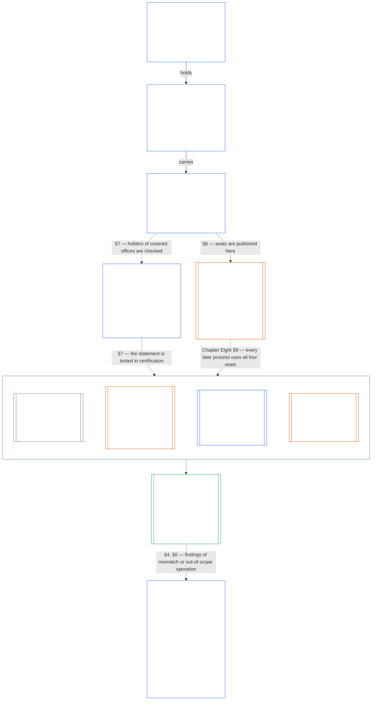

# CHAPTER SEVEN: SYSTEM AND INSTITUTIONAL CHARTERS

<strong>Corpus placement (non-operative): file structure and reading rules</strong>

> This file is **part of the Sentient Constitution** and is **binding only together** with the other numbered `core_*` files read as one instrument. It contains **Chapter Seven**: the floor for the published scope instruments of a system and of an institution: the System Charter and the Institutional Charter. It follows the Chapter Six Rights Floor and precedes [Chapter Eight](core_08_functional_independence_segregation_of_duties.md#chapter-eight-functional-independence-and-segregation-of-duties), which separates the seats inside any materially binding act.
>
> - **Constitutional owner:** when a system must publish a System Charter and when an institution must publish an Institutional Charter, the minimum each must state, how each changes and is reviewed, and what neither can do, and the formation check on the standing and authenticity of the holders of covered offices.
> - **Definition home:** [System Charter](core_05_band_continuity.md#system-charter), [Institutional Charter](core_05_band_continuity.md#institutional-charter), and [Charter Role Map](core_05_band_continuity.md#charter-role-map) are defined in Chapter Five. This chapter applies them and does not redefine them.
> - **Implementation owner:** [CI-3.6](corpus_institutions/ci_03_institutional_design_separation_of_powers.md#ci-36-system-and-institutional-charter-contents-review-and-formation-template) (*System and Institutional Charter contents, review, and formation template*) holds the full field template, the review checklist, the formation procedure, and the formation check statement template. It may be stricter and may add fields. It may not narrow this chapter.
> - **Downstream consumers:** [Chapter Eight §5 Published Placement, Vacancy, and Substitution](core_08_functional_independence_segregation_of_duties.md#5-published-placement-vacancy-and-substitution) requires the Charter Role Map. Chapter Nine reads the System Charter for scope and boundary findings, and Chapter Nine Part D tests the formation check statement for an Institution. [Chapter Ten §3.7 Record custody and opening authority](core_10_standing_assessment.md#37-record-custody-and-opening-authority) applies it to standing records. [Chapter Thirteen §4.3 Institutional forums](core_13_forum.md#43-institutional-forums) hears disputes about the Institutional Charter.
>
> Reading order: §1 purpose and owner boundary → §2 when System and Institutional Charters are required → §3 what they must state → §4 amendment, review, and scope misalignment → §5 what they cannot do → §6 the Charter Role Map and standing-record custody → §7 the formation check on office-holder standing and authenticity → §8 relationship to other chapters.

<strong>Trace</strong>

- Upstream: [Constitutional Tetrad](core_00_preamble.md#constitutional-tetrad), especially **oversight** and **accountability**; [material stake](core_00_preamble.md#material-stake); [Chapter One §18.1 Governance as Authorized Structure](core_01_c_stewardship_capacity_principles.md#181-governance-as-authorized-structure); [Article XI-E](core_06_rights_part_b.md#article-xi-e-institutional-formation-and-business-creation) (*Institutional Formation and Business Creation*).
- Subsections: [§1](#1-purpose-scope-and-owner-boundary); [§2](#2-when-system-and-institutional-charters-are-required); [§3](#3-what-system-and-institutional-charters-must-state); [§4](#4-amendment-review-and-scope-misalignment); [§5](#5-what-system-and-institutional-charters-cannot-do); [§6](#6-the-charter-role-map-and-standing-record-custody); [§7](#7-formation-check-office-holder-standing-and-authenticity); [§8](#8-relationship-to-other-chapters).
- Downstream: [Chapter Eight](core_08_functional_independence_segregation_of_duties.md#chapter-eight-functional-independence-and-segregation-of-duties); [Chapter Nine](core_09_system_alignment_certification.md#chapter-nine-system-alignment-certification-reading-index); [Chapter Ten](core_10_standing_assessment.md#chapter-ten-contribution-violation-and-standing-model--measurement); [Chapter Thirteen](core_13_forum.md#chapter-thirteen-forums-and-jurisdiction); [Chapter Fourteen](core_14_governance.md#chapter-fourteen-constitutional-contract-legitimacy-authorization-and-stewardship); designated implementation text named above.
- Read with: [Authority Stack and Internal Hierarchy](core_05_band_integrative.md#authority-stack-and-internal-hierarchy); [System Boundaries](core_05_band_continuity.md#system-boundaries); [System Boundary Integrity](core_05_band_continuity.md#system-boundary-integrity); [System Creation](core_05_band_participation.md#system-creation); [Business Creation](core_05_band_participation.md#business-creation).

 

Chapter Seven is the constitutional owner of **System Charters, Institutional Charters, and published scope**.

Three chapters work as one chain. This chapter says what a body claims to do and who may hold each seat when it acts. [Chapter Eight](core_08_functional_independence_segregation_of_duties.md#chapter-eight-functional-independence-and-segregation-of-duties) says how those seats must be kept apart. [Chapter Nine](core_09_system_alignment_certification.md#chapter-nine-system-alignment-certification-reading-index) certifies a system, and separately an institution, each of which is one binding act that uses the seats, and it sends what it finds back to the System Charter or Institutional Charter.

<strong>Reader guidance (non-operative): Charters, seats, and certification map</strong>

> **Reader map (non-operative).** This diagram shows how the System Charter and the Institutional Charter in this chapter connect to the seat floor in Chapter Eight and to alignment certification in Chapter Nine, which certifies a System and, separately, an Institution. It adds no duty, seat, or System Charter or Institutional Charter field, and it does not change the operative rules in §§2–6 of this chapter or in the later chapters. Boxes with double side bars belong to other chapters. Dotted links are hand-offs, labeled with the section of this chapter that makes them.

 

Read the chart from the top:

- **System Charter and Institutional Charter (this chapter):** An Institutional Charter holds every System Charter in force. An Institution that runs one System publishes that System Charter alone. Each carries the [Charter Role Map](core_05_band_continuity.md#charter-role-map) for its own acts ([§2 When System and Institutional Charters Are Required](#2-when-system-and-institutional-charters-are-required), [§3 What System and Institutional Charters Must State](#3-what-system-and-institutional-charters-must-state), [§6 The Charter Role Map and Standing-Record Custody](#6-the-charter-role-map-and-standing-record-custody)).
- **Formation check (this chapter):** Before a body exercises authority over others, the holders of its covered offices are checked twice: for standing, and for whether they hold the office for the body's stated purpose and not as a front or a nominee. It is a check and not a licence ([§7 Formation Check: Office-Holder Standing and Authenticity](#7-formation-check-office-holder-standing-and-authenticity)).
- **Segregation of duties (Chapter Eight):** Every [Materially Binding Act](core_05_band_accountability.md#materially-binding-act) has four seats: initiating, verify-or-authorize, record, and contest. [Chapter Eight §5 Published Placement, Vacancy, and Substitution](core_08_functional_independence_segregation_of_duties.md#5-published-placement-vacancy-and-substitution) requires the published map. [Chapter Eight §2 Four-Seat Constitutional Floor](core_08_functional_independence_segregation_of_duties.md#2-four-seat-constitutional-floor) through [§6 Proportional Scaling and Merged Hosting](core_08_functional_independence_segregation_of_duties.md#6-proportional-scaling-and-merged-hosting) decide whether a placement on it is valid. The map records placements. It does not set the rules for them ([§6 The Charter Role Map and Standing-Record Custody](#6-the-charter-role-map-and-standing-record-custody)).
- **Certification (Chapter Nine):** A certification is a materially binding act, so every pass fills all four seats ([Chapter Nine Part B §6.1.1 Four seats in a certification](core_09_b_system_alignment_certification_record_process.md#611-four-seats-in-a-certification)). The map places the initiating, record, and contest seats, and the record and contest seats sit outside the operator's [Material Control Line](core_05_band_accountability.md#material-control-line). The map does not place the verify-or-authorize seat. The lead forum and component authorities are assigned under [Chapter Nine Part B §6.2 Supervisory sequence](core_09_b_system_alignment_certification_record_process.md#62-supervisory-sequence) and Chapter Thirteen, so an operator cannot choose its own verifier. The System Certification Record names the map version in force. An Institution's own certification fills the four seats the same way, with the Institutional Charter's map placing the initiating, record, and contest seats ([Chapter Nine Part D §13.1 Four seats in an institutional certification](core_09_d_institutional_alignment_certification.md#131-four-seats-in-an-institutional-certification)).
- **Back to the System Charter:** Certification reads the System Charter's stated scope against the system's real boundaries. The System Charter is evidence for certification and never a substitute for it ([§5 What System and Institutional Charters Cannot Do](#5-what-system-and-institutional-charters-cannot-do)). A mismatch is corrected by amendment, remediation, recertification, or scope contraction, not by quiet expansion ([§4 Amendment, Review, and Scope Misalignment](#4-amendment-review-and-scope-misalignment)). A System Charter or Institutional Charter amendment, a mismatch, operation materially outside chartered scope, or an overdue periodic review reopens certification ([Chapter Nine Part B §9 Recertification and Reopening](core_09_b_system_alignment_certification_record_process.md#9-recertification-and-reopening) for a System, and [Chapter Nine Part D §14.2 Reopening triggers](core_09_d_institutional_alignment_certification.md#142-reopening-triggers) for an Institution).

### 1. Purpose, Scope, and Owner Boundary

<strong>Trace</strong>

- Upstream: chapter opening owner claim; [Chapter One §18 Governance Under Stewardship Discipline](core_01_c_stewardship_capacity_principles.md#18-governance-under-stewardship-discipline); [Oversight](core_05_apex_oversight_leg.md#oversight-constitutional); [Accountability](core_05_apex_accountability_leg.md#accountability).
- Downstream: [§2](#2-when-system-and-institutional-charters-are-required) through [§8](#8-relationship-to-other-chapters).
- Read with: [Chapter Five System Charter](core_05_band_continuity.md#system-charter); [Chapter Five Institutional Charter](core_05_band_continuity.md#institutional-charter); [Article XI-E](core_06_rights_part_b.md#article-xi-e-institutional-formation-and-business-creation) (*Institutional Formation and Business Creation*).

 

*In plain terms: before anyone can judge whether a system or institution stayed within its limits, the limits have to be written down where everyone can read them. A System Charter does that for one system. An Institutional Charter does it for an institution that runs more than one system: it holds their System Charters and says why the institution runs them. Each says what the body is for, what it may do, what it may not do, and who holds each seat when it takes a binding act. This chapter says who must publish which, what each must contain, and what neither can be used for.*

The right to form a new system, institution, or business is stated in [Article XI-E](core_06_rights_part_b.md#article-xi-e-institutional-formation-and-business-creation) (*Institutional Formation and Business Creation*). This chapter does not narrow that right and does not add a licensing gate. The only gates are the two narrow gates on a named sentient's authority that **Article XI-E** (*Institutional Formation and Business Creation*) states, and the formation check applies them to covered offices ([§7 Formation Check: Office-Holder Standing and Authenticity](#7-formation-check-office-holder-standing-and-authenticity)). It states the duty that follows once what was formed has a real effect on others: to say, in public and in advance, what it claims authority to do.

This chapter does not relocate:

- the meaning of System Charter, Institutional Charter, Charter Role Map, Institution, or System, which stay in Chapter Five;
- the right to create systems, institutions, and businesses, which stays in Chapter Six;
- the seat types, independence conditions, wrong-seat routing, and merged-hosting limits, which stay in Chapter Eight;
- the binding stakeholder-choice decision sequence, weighting model, and rights-collision record, which stay in [Chapter Fourteen §4.3 Decision-resolution requirements for binding stakeholder choice](core_14_governance.md#43-decision-resolution-requirements-for-binding-stakeholder-choice);
- how governing authority itself is authorized, which stays in [Chapter Fourteen §1 Authorization and Legitimacy of Governing Authority](core_14_governance.md#1-authorization-and-legitimacy-of-governing-authority);
- standing locks, competency bars, and clearances, which stay in Chapters Ten and Eleven; or
- the field template, formation procedure, formation check statement template, and review checklist, which stay in **CI-3.6** (*System and Institutional Charter contents, review, and formation template*).

### 2. When System and Institutional Charters Are Required

<strong>Trace</strong>

- Upstream: [§1](#1-purpose-scope-and-owner-boundary); [material stake](core_00_preamble.md#material-stake); [Proportionality](core_05_band_accountability.md#proportionality).
- Downstream: [§3](#3-what-system-and-institutional-charters-must-state); [Chapter Nine Part A §2 System Class Evaluation](core_09_a_system_alignment_certification_evaluation.md#2-system-class-evaluation) (*class and certification depth*); [Chapter Nine Part D §12.1 Institution class](core_09_d_institutional_alignment_certification.md#121-institution-class) (*the class of an Institution*); **CS-3** (*System classification machinery*) for the class catalog.
- Read with: **CI-3.6** (*System and Institutional Charter contents, review, and formation template*); **CI-9** (*Classification-linked institutional obligations*).

<strong>Definitions · Assessment · Compliance</strong>

- [System Charter](core_05_band_continuity.md#system-charter) · [O](core_05_band_continuity.md#system-charter) · [M](core_05_band_continuity.md#system-charter-a) · [A](core_05_band_continuity.md#system-charter-a) · [C](core_05_band_continuity.md#system-charter-c)
- [Institutional Charter](core_05_band_continuity.md#institutional-charter) · [O](core_05_band_continuity.md#institutional-charter) · [M](core_05_band_continuity.md#institutional-charter-a) · [A](core_05_band_continuity.md#institutional-charter-a) · [C](core_05_band_continuity.md#institutional-charter-c)
- [Classification-Scaled Governance](core_05_band_oversight.md#classification-scaled-governance) · [O](core_05_band_oversight.md#classification-scaled-governance) · [M](core_05_band_oversight.md#classification-scaled-governance-a) · [A](core_05_band_oversight.md#classification-scaled-governance-a) · [C](core_05_band_oversight.md#classification-scaled-governance-c)

 

*In plain terms: if a system has a real effect on others, it needs a published System Charter. An institution that runs one system uses that System Charter for both. An institution that runs several publishes an Institutional Charter, which holds all their System Charters and says why the institution runs them. The threshold is Class L. Only purely private, isolated, or experimental systems (Class P) are outside it, and they cross the line the moment their effects reach others.*

A System of Class L or higher must publish and maintain a [System Charter](core_05_band_continuity.md#system-charter). An Institution of Class L or higher must publish and maintain the one of these that fits the Systems it runs:

- **One System:** An Institution that operates, stewards, or materially controls exactly one System that needs a System Charter publishes that System Charter and no second document. The System Charter names the Institution as steward and serves as the Institution's [Institutional Charter](core_05_band_continuity.md#institutional-charter): one document covers both.
- **More than one System:** An Institution that operates, stewards, or materially controls more than one such System publishes an Institutional Charter. It includes every System Charter in force for those Systems and states why the Institution runs those particular Systems ([§3 What System and Institutional Charters Must State](#3-what-system-and-institutional-charters-must-state)).
- **No such System:** An Institution that runs no System that needs a System Charter publishes an Institutional Charter that states the Institution's own items from [§3 What System and Institutional Charters Must State](#3-what-system-and-institutional-charters-must-state) and has no System Charters to include.
- **Which classes:** Classes A, B, C, and L are covered. Class P is not required to have a System Charter or Institutional Charter and is encouraged to have one. A body that is claimed to be Class P must publish the one that applies when it is reclassified to Class L or higher, or when its operator voluntarily asserts constitutional compliance for it. This matches the point at which whole-system evaluation becomes mandatory under **CS-3** (*System classification machinery*).
- **Class of an Institution:** An Institution takes the highest class of any System it operates, stewards, or materially controls. An Institution that runs no such System is classified by its own material impact and dependency, judged by what it actually decides and holds and not by its label or legal form. [Chapter Nine Part D §12.1 Institution class](core_09_d_institutional_alignment_certification.md#121-institution-class) states the test, which applies the **CS-3** (*System classification machinery*) class definitions to the Institution's own decisions and holdings.
- **Businesses and comparable forms:** A business or other stewarded organizational form is covered when it is itself an Institution or a System, or when it operates a covered System. It publishes whichever of the System Charter or Institutional Charter applies to it under the cases above.
- **Equivalent instrument:** A published scope instrument under another name satisfies this section only if it states the minimum in [§3 What System and Institutional Charters Must State](#3-what-system-and-institutional-charters-must-state) and is identified as the body's System Charter or Institutional Charter, with the reasons recorded. Marketing copy, a mission slogan, or a terms-of-service page that is not offered as the scope instrument does not.
- **Timing:** A covered System or Institution publishes its System Charter or Institutional Charter before it goes live or begins to exercise authority over others. One that already operates publishes at its next classification review or certification, whichever comes first, and is in default until it does. For a System that certification is its System Alignment Certification. For an Institution it is its institutional alignment certification under [Chapter Nine Part D §11.3 No licence and no gate](core_09_d_institutional_alignment_certification.md#113-no-licence-and-no-gate), whose first-certification window is never a condition of publishing the Institutional Charter or of operating. It also completes the formation check in [§7 Formation Check: Office-Holder Standing and Authenticity](#7-formation-check-office-holder-standing-and-authenticity) at the same moment, and a late or failed check is a defect to log and correct and never a condition of forming or operating.
- **Scaling:** The depth of the System Charter or Institutional Charter, the review cadence, and the independence of the review scale with class and [material stake](core_00_preamble.md#material-stake). A Class L one may be short and use simplified records where [Classification-Scaled Governance](core_05_band_oversight.md#classification-scaled-governance) allows. It may not omit a required item.

A required System Charter or Institutional Charter that has not been published is a defect to log and correct. It is not a reason to treat the body as unbounded: until it exists, the body's real [System Boundaries](core_05_band_continuity.md#system-boundaries) and its class control, and a certification or forum may reconstruct scope from observed operation.

### 3. What System and Institutional Charters Must State

<strong>Trace</strong>

- Upstream: [§2](#2-when-system-and-institutional-charters-are-required); [Chapter Five System Charter](core_05_band_continuity.md#system-charter); [Chapter Five Institutional Charter](core_05_band_continuity.md#institutional-charter).
- Downstream: [§4](#4-amendment-review-and-scope-misalignment); [§6](#6-the-charter-role-map-and-standing-record-custody); [Chapter Nine Part B §8.1 Minimum record contents](core_09_b_system_alignment_certification_record_process.md#81-minimum-record-contents) (*the System Charter fields a certification record relies on*); **CI-3.6** (*System and Institutional Charter contents, review, and formation template*) for the full field list.
- Read with: [Chapter Fourteen §4.3 Decision-resolution requirements for binding stakeholder choice](core_14_governance.md#43-decision-resolution-requirements-for-binding-stakeholder-choice); **CI-8.1** (*Stakeholder oversight, notification, and binding-governance pathway integrity*); **CI-8.2** (*Anti-concentration and participation-legitimacy safeguards*).

<strong>Definitions · Assessment · Compliance</strong>

- [System Charter](core_05_band_continuity.md#system-charter) · [O](core_05_band_continuity.md#system-charter) · [M](core_05_band_continuity.md#system-charter-a) · [A](core_05_band_continuity.md#system-charter-a) · [C](core_05_band_continuity.md#system-charter-c)
- [Institutional Charter](core_05_band_continuity.md#institutional-charter) · [O](core_05_band_continuity.md#institutional-charter) · [M](core_05_band_continuity.md#institutional-charter-a) · [A](core_05_band_continuity.md#institutional-charter-a) · [C](core_05_band_continuity.md#institutional-charter-c)
- [Charter Role Map](core_05_band_continuity.md#charter-role-map) · [O](core_05_band_continuity.md#charter-role-map) · [M](core_05_band_continuity.md#charter-role-map-a) · [A](core_05_band_continuity.md#charter-role-map-a) · [C](core_05_band_continuity.md#charter-role-map-c)

 

*In plain terms: a System Charter has to be specific enough to test. It says what the system is for, what it does and does not do, who relies on it, who can change it, how often it is re-checked, who holds each seat, and where to find the binding decision rules. It points to those rules. It does not replace them. An Institutional Charter says the same about the institution, then adds the System Charters it holds and the reason the institution runs those systems.*

A System Charter states, in plain language that affected sentients and auditors can read:

1. **Identity and version:** the name, the steward or governing body, the version, the effective date, and the change history.
2. **Purpose:** what the body exists to do.
3. **In-scope activities:** the functions, services, authorities, and domains it claims.
4. **Out-of-scope limits:** the material activities, authorities, and domains it is not authorized to exercise.
5. **Affected communities and dependencies:** who relies on the body, and which systems or infrastructure it depends on or gates, where material.
6. **Classification assumptions:** the class or stewardship tier relied on, with a pointer to **CS-3** (*System classification machinery*) and **CS-4** (*Critical system stewardship*) where they apply.
7. **Amendment authority:** who may amend, what counts as a material amendment, and the notice and contest path.
8. **Periodic-review cadence:** the next review date or interval, scaled to class, dependency, and risk.
9. **Charter Role Map:** the [Charter Role Map](core_05_band_continuity.md#charter-role-map), or a live pointer to the published instrument that is the Charter Role Map ([§6 The Charter Role Map and Standing-Record Custody](#6-the-charter-role-map-and-standing-record-custody)).
10. **Binding stakeholder-choice pointers:** where [Def.P2 Binding Stakeholder Choice](core_05_band_participation.md#defp2-binding-stakeholder-choice) admission scope applies, live pointers to the published decision-sequence, weighting, and rights-collision-record rules. The System Charter points. Those rules carry the substance.

**What an Institutional Charter adds.** An Institutional Charter states items 1 to 10 for the Institution itself, and also holds:

- **The System Charters:** Every System Charter in force for the Systems the Institution operates, stewards, or materially controls, included in full or by a pointer that resolves to the current published version.
- **The portfolio rationale:** Why the Institution runs those particular Systems, how they serve its stated purpose and relate to one another, and which dependencies they share. A System with no stated reason is a missing item.

A pointer must resolve to a live, current, published instrument. A dead or stale pointer counts as a missing item. **CI-3.6** (*System and Institutional Charter contents, review, and formation template*) may require more and sets the formation template, but it may not drop an item above.

### 4. Amendment, Review, and Scope Misalignment

<strong>Trace</strong>

- Upstream: [§3](#3-what-system-and-institutional-charters-must-state); [Chapter One §18.4 Ongoing Justification](core_01_c_stewardship_capacity_principles.md#184-ongoing-justification).
- Downstream: [Chapter Nine Part B §9 Recertification and Reopening](core_09_b_system_alignment_certification_record_process.md#9-recertification-and-reopening) (*System Charter amendment and mismatch as reopening triggers*); [Chapter Thirteen §4.3 Institutional forums](core_13_forum.md#43-institutional-forums).
- Read with: [System Boundary Integrity](core_05_band_continuity.md#system-boundary-integrity); **CI-3.1** (*Non-delegable governing duties*); **CI-3.6** (*System and Institutional Charter contents, review, and formation template*).

<strong>Definitions · Assessment · Compliance</strong>

- [System Charter](core_05_band_continuity.md#system-charter) · [O](core_05_band_continuity.md#system-charter) · [M](core_05_band_continuity.md#system-charter-a) · [A](core_05_band_continuity.md#system-charter-a) · [C](core_05_band_continuity.md#system-charter-c)
- [Institutional Charter](core_05_band_continuity.md#institutional-charter) · [O](core_05_band_continuity.md#institutional-charter) · [M](core_05_band_continuity.md#institutional-charter-a) · [A](core_05_band_continuity.md#institutional-charter-a) · [C](core_05_band_continuity.md#institutional-charter-c)
- [Governance](core_05_band_accountability.md#governance) · [O](core_05_band_accountability.md#governance) · [M](core_05_band_accountability.md#governance-a) · [A](core_05_band_accountability.md#governance-a) · [C](core_05_band_accountability.md#governance-c)

 

*In plain terms: scope can change, but not quietly. A change to what the body may do is made by the sentients its System Charter or Institutional Charter names as able to make it, with notice and a way to contest it. The document is re-checked on a schedule and sooner when something goes wrong, and when the paper and the practice disagree, one of them is fixed in the open.*

A System Charter or Institutional Charter changes, and is kept true to practice, in these ways:

- **Amendment:** A material amendment is made only by the amendment authority the System Charter or Institutional Charter names, on notice, with a contest path, and with the authority and date recorded. Material amendment is not delegable below that authority.
- **No silent expansion:** Operating materially outside chartered scope, or widening scope by practice, delegation, or reinterpretation without amendment, is a failure of the System Charter or Institutional Charter. Offering the instrument as current authorization for operation outside it is the primary failure.
- **Periodic review:** The body reviews its System Charter or Institutional Charter on the published cadence, and sooner after a material incident, dependency growth, class change, credible challenge, or observed operation outside stated scope. The review tests whether purpose and limits still match observed operation and [System Boundaries](core_05_band_continuity.md#system-boundaries), whether classification assumptions are honest, whether the amendment and contest paths work in practice, whether every pointer still resolves, and whether the Charter Role Map still resolves to live offices and current holders. A review of an Institutional Charter also tests whether the portfolio rationale still explains every System the Institution runs and whether every included System Charter is current. Where [§7 Formation Check: Office-Holder Standing and Authenticity](#7-formation-check-office-holder-standing-and-authenticity) applies, the review also tests whether the formation check statement still matches the holders of the covered offices and the controls, rewards, and protected routes it describes.
- **Portfolio change:** Adding, retiring, or merging a System is a material amendment of the Institutional Charter. The System Charter of a new System is published before it goes live ([§2 When System and Institutional Charters Are Required](#2-when-system-and-institutional-charters-are-required)), and the portfolio rationale is amended in the same step. An Institution that grows from one System to more than one publishes its Institutional Charter at that point.
- **Mismatch:** A material mismatch between the System Charter or Institutional Charter and behavior is corrected by amendment, remediation, recertification, or scope contraction. It is not corrected by quiet expansion or by leaving the paper unchanged.
- **Versions:** Each version is dated and kept, so that an act, a certification, or a record can be judged against the version in force when it happened.

### 5. What System and Institutional Charters Cannot Do

<strong>Trace</strong>

- Upstream: [§3](#3-what-system-and-institutional-charters-must-state); [Chapter Four](core_04_burden_traceability_verification.md#chapter-four-burden-of-proof-traceability-and-verification).
- Downstream: [Chapter Nine](core_09_system_alignment_certification.md#chapter-nine-system-alignment-certification-reading-index).
- Read with: [System Boundary Integrity](core_05_band_continuity.md#system-boundary-integrity); [System Alignment Certification](core_05_band_continuity.md#system-alignment-certification).

 

*In plain terms: a System Charter or Institutional Charter describes a body's limits. It does not make the body safe, does not choose its class, and does not give it power. Writing a narrow one does not shrink what the body really does.*

A System Charter or Institutional Charter does not:

- **Establish classification:** Its text is not proof of class, and it does not understate class. Class follows real impact and dependency under **CS-3** (*System classification machinery*).
- **Define the boundary:** Its text does not defeat [System Boundary Integrity](core_05_band_continuity.md#system-boundary-integrity). The boundary is set by [Material Impact](core_05_band_oversight.md#material-impact) and [Dependency](core_05_band_continuity.md#dependency), and a document that claims less is read against the boundary.
- **Substitute for certification:** Where [System Alignment Certification](core_05_band_continuity.md#system-alignment-certification) is required, a System Charter, an Institutional Charter, a vendor attestation, or a self-description is evidence for it, not a replacement.
- **Carry the decision rules:** Neither holds the binding stakeholder-choice decision sequence, weighting model, or rights-collision record. Each points to the published rules that do ([§3 What System and Institutional Charters Must State](#3-what-system-and-institutional-charters-must-state), item 10).
- **Narrow a creation right or a Rights Floor:** Neither may be used to shrink [System Creation](core_05_band_participation.md#system-creation), [Business Creation](core_05_band_participation.md#business-creation), or any Rights Floor, or to exclude affected sentients from the scope it governs.
- **Grant authority:** Each states the scope of authority the body already holds. Whether that authority is legitimate is decided under [Chapter Fourteen §1 Authorization and Legitimacy of Governing Authority](core_14_governance.md#1-authorization-and-legitimacy-of-governing-authority).

### 6. The Charter Role Map and Standing-Record Custody

<strong>Trace</strong>

- Upstream: [§3](#3-what-system-and-institutional-charters-must-state); [Chapter Eight §2 Four-Seat Constitutional Floor](core_08_functional_independence_segregation_of_duties.md#2-four-seat-constitutional-floor).
- Downstream: [Chapter Eight §5 Published Placement, Vacancy, and Substitution](core_08_functional_independence_segregation_of_duties.md#5-published-placement-vacancy-and-substitution); [Chapter Nine Part B §6.1.1 Four seats in a certification](core_09_b_system_alignment_certification_record_process.md#611-four-seats-in-a-certification); [Chapter Ten §3.7 Record custody and opening authority](core_10_standing_assessment.md#37-record-custody-and-opening-authority); **CI-3.2** (*Functional separation lanes*); **CI-4.5** (*Authorized roles and accountability chains*); **CI-4.6** (*Seat catalog — process-role archetypes and operational boundaries*).
- Read with: [Material Control Line](core_05_band_accountability.md#material-control-line); [Standing Record](core_05_band_accountability.md#standing-record).

<strong>Definitions · Assessment · Compliance</strong>

- [Charter Role Map](core_05_band_continuity.md#charter-role-map) · [O](core_05_band_continuity.md#charter-role-map) · [M](core_05_band_continuity.md#charter-role-map-a) · [A](core_05_band_continuity.md#charter-role-map-a) · [C](core_05_band_continuity.md#charter-role-map-c)
- [System Charter](core_05_band_continuity.md#system-charter) · [O](core_05_band_continuity.md#system-charter) · [M](core_05_band_continuity.md#system-charter-a) · [A](core_05_band_continuity.md#system-charter-a) · [C](core_05_band_continuity.md#system-charter-c)
- [Institutional Charter](core_05_band_continuity.md#institutional-charter) · [O](core_05_band_continuity.md#institutional-charter) · [M](core_05_band_continuity.md#institutional-charter-a) · [A](core_05_band_continuity.md#institutional-charter-a) · [C](core_05_band_continuity.md#institutional-charter-c)

 

*In plain terms: the System Charter or Institutional Charter is where the seats get names. It carries the published list of who may hold each seat for the acts it covers, so a party cannot pick its own checker. The rules for what a valid seat placement is stay in Chapter Eight. The custody of standing records is not a separate list: it is the same map.*

A System Charter or Institutional Charter carries the [Charter Role Map](core_05_band_continuity.md#charter-role-map) that [Chapter Eight §5 Published Placement, Vacancy, and Substitution](core_08_functional_independence_segregation_of_duties.md#5-published-placement-vacancy-and-substitution) requires of every adopter that takes materially binding acts.

- **What the document owes:** The System Charter or Institutional Charter holds the map or a live pointer to it, so that a reader who starts there can find who holds each seat. A missing, dead, or stale map is a defect of that instrument.
- **What Chapter Eight owns:** The seat types, the independence conditions, the control-line rules, wrong-seat routing, merged hosting, and the substitute and independent-route requirements are fixed in Chapter Eight. The map records placements. It does not set the rules for a valid one.
- **Two layers of change:** Which offices are eligible to hold a seat, serve as a substitute, or share hosting changes only under the amendment authority the System Charter or Institutional Charter names ([§4 Amendment, Review, and Scope Misalignment](#4-amendment-review-and-scope-misalignment)). Who currently holds a seat changes by dated version, without an amendment of that instrument. An act is judged against the map in force when it was taken.
- **Seats the map does not place:** Where constitutional routing assigns a seat, such as the verify-or-authorize seat in a system alignment certification or an institutional alignment certification, the map does not choose it.
- **Several Systems:** Where an Institutional Charter holds several System Charters, each System Charter keeps the map for its own System's acts, and the Institutional Charter carries the map for the Institution's own acts.
- **Standing-record custody:** For [Standing Records](core_05_band_accountability.md#standing-record) about the body, its chartered scope, and the systems it stewards, the map names the record-opening authority (the verifying seat), the separate record custodian (the record seat), the contest seat, and the independent route that applies when the body is itself the subject. These entries are what [Chapter Ten §3.7 Record custody and opening authority](core_10_standing_assessment.md#37-record-custody-and-opening-authority) calls for. The System Charter or Institutional Charter need not list them a second time. Where the map is silent on them, the published lane map under **CI-3.2** (*Functional separation lanes*) governs until the silence is corrected.
- **Independence:** The record and contest seats the map names, and every verify-or-authorize seat it places, sit outside the [Material Control Line](core_05_band_accountability.md#material-control-line) of the party whose act is concerned, and that party cannot alone change those entries.

### 7. Formation Check: Office-Holder Standing and Authenticity

<strong>Trace</strong>

- Upstream: [§2](#2-when-system-and-institutional-charters-are-required) (*Timing*); [§3](#3-what-system-and-institutional-charters-must-state); [§6](#6-the-charter-role-map-and-standing-record-custody); [Article XI-E](core_06_rights_part_b.md#article-xi-e-institutional-formation-and-business-creation) (*Institutional Formation and Business Creation*); [What Systems Reward](core_00_preamble.md#what-systems-reward) and the [Two Fundamental Questions](core_00_preamble.md#two-fundamental-questions); [Chapter One §19.1.4 Role-Depth and Material-Responsibility Pathways](core_01_c_stewardship_capacity_principles.md#1914-role-depth-and-material-responsibility-pathways); [Chapter One §19.4 Misalignment Correction and Capture Response](core_01_c_stewardship_capacity_principles.md#194-misalignment-correction-and-capture-response); [Chapter Eleven §4.2 Prevention — general standing locks](core_11_standing_integration.md#42-prevention--general-standing-locks), [§5.5 Special locks](core_11_standing_integration.md#55-special-locks), and [§6.2 Competency bars and clearances](core_11_standing_integration.md#62-competency-bars-and-clearances).
- Downstream: [Chapter Nine Part D §12.2 Institutional evaluation, always](core_09_d_institutional_alignment_certification.md#122-institutional-evaluation-always) (item 7, *the forums test the statement*); [Chapter Nine Part A §3.3 Governance, Incentive, and Contestability Discipline](core_09_a_system_alignment_certification_evaluation.md#33-governance-incentive-and-contestability-discipline); **CI-3.6** (*System and Institutional Charter contents, review, and formation template*) for the statement template.
- Read with: [Material Control Line](core_05_band_accountability.md#material-control-line); [Standing Record](core_05_band_accountability.md#standing-record); [Protected Reporting (Whistleblowing)](core_05_band_accountability.md#protected-reporting-whistleblowing); [Chapter One §17.5 Duty to Resist](core_01_c_stewardship_capacity_principles.md#175-duty-to-resist); **CI-4.2** (*Role criteria, appointment standards, and removal pathways*); **CI-5** (*Conflict integrity, anti-capture, and anti-corruption*).

 

*In plain terms: a published purpose is only as good as the sentients who hold the offices that carry it out. Before a body begins to exercise authority over others, the offices that decide, record, and check its acts are looked at twice. First, do the sentients who hold them meet the published standard for the role, with no standing lock in the way? Second, do they hold the office for the body's stated purpose and in their own right, or is it a front, a nominee seat, or a post kept for someone else? The second question is answered by who directs them, what they are paid for, and what they have done. It is never answered by asking what they believe or by their professions of loyalty. It is answered by what they have verifiably said and done, and a statement that others deserve harm or discriminatory treatment counts against them, whatever religious or political words it is wrapped in. This is a check and not a licence. It cannot stop anyone from forming a body. The only thing it can do is keep one sentient out of one office of control while that sentient is under an outstanding lock, or while a forum has put a short hold on the office for probable cause.*

This section is the **formation check**. [Article XI-E](core_06_rights_part_b.md#article-xi-e-institutional-formation-and-business-creation) (*Institutional Formation and Business Creation*) is not narrowed by it. No gate on the body follows from it. The only gates are the two narrow gates in that Article, which attach to a named sentient's authority in a covered office and are applied in the Result below. It applies to a System or Institution of Class L or higher ([§2 When System and Institutional Charters Are Required](#2-when-system-and-institutional-charters-are-required)).

**What is covered:**

- **Covered offices:** each office of the governing authority, including every office that holds the amendment authority named under [§3 What System and Institutional Charters Must State](#3-what-system-and-institutional-charters-must-state) (item 7); each office the [Charter Role Map](core_05_band_continuity.md#charter-role-map) names for a seat, a substitute, or the independent route ([§6 The Charter Role Map and Standing-Record Custody](#6-the-charter-role-map-and-standing-record-custody)); and any other office, delegate, or contractor whose acts materially bind others within the chartered scope or who controls the records, keys, or funds that scope depends on.
- **Other staff:** are not checked one by one. They are covered by the structural limb below.
- **Any substrate:** the check is the same whatever the substrate of the holder. Where the holder of a covered office is a System, the check runs on that System's operator or steward, whose interests and control are the ones that matter, as well as on the System's own System Certification Record.

**Limb one: standing.** Before a sentient takes a covered office, the body checks and records that:

- no [standing lock](core_11_standing_integration.md#42-prevention--general-standing-locks) or [special lock](core_11_standing_integration.md#55-special-locks), including the [Institutional Authority Standing Lock](core_11_standing_integration.md#55-special-locks), is in force that blocks the named pathway the office is (the outstanding-lock gate in **Article XI-E** (*Institutional Formation and Business Creation*));
- no [Interim Hold](core_05_band_accountability.md#interim-hold) (**Article XI-E** (*Institutional Formation and Business Creation*)) is in force on the sentient for that office;
- the published [competency bar](core_11_standing_integration.md#62-competency-bars-and-clearances) for that named pathway is met, with competency clearance where the named pathway needs it; and
- each conflict is disclosed under **CI-5** (*Conflict integrity, anti-capture, and anti-corruption*) and cleared by a seat independent of the holder, and any cooling-off period under **CI-4.2** (*Role criteria, appointment standards, and removal pathways*) is observed.

Only verified standing records count, and only through the [Verified Inputs for Standing](core_05_band_accountability.md#verified-inputs-for-standing) gate. An unverified allegation, a rumor, a reputation, social prestige, or the holder's identity, background, health, or disability as such is not standing and is not considered. This section creates no lock, no hold, no bar, and no standing record.

**Limb two: authenticity.** A covered office is **authentic** when its holder holds it in their own right and for the purpose its System Charter or Institutional Charter states, and not as a front, a nominee, or a proxy for a purpose that instrument does not state. The body finds this from evidence on four things. A forum later tests the same four ([Chapter Nine Part D §12.2 Institutional evaluation, always](core_09_d_institutional_alignment_certification.md#122-institutional-evaluation-always), item 7).

- **Control:** who can instruct, fund, replace, or reward the holder, inside or outside the published authority. A holder who acts on the instruction of an undisclosed party, or whose seat is held for another, is not authentic. Opaque routes of beneficial control are system capture ([Chapter One §19.4 Misalignment Correction and Capture Response](core_01_c_stewardship_capacity_principles.md#194-misalignment-correction-and-capture-response)).
- **Interests and rewards:** what the holder gains from the office and how it is paid. The holder's pay, equity, targets, and other rewards are disclosed to the level of their materiality and put to the [Two Fundamental Questions](core_00_preamble.md#two-fundamental-questions): does the structure reward the stated purpose, or does it reward crossing the stated limits, hiding problems, or shifting costs onto others? A holder who is rewarded for what the body's published limits forbid does not hold the office for its stated purpose until the reward is changed.
- **Conduct:** what the holder has verifiably done in the same function, including a verified record of concealment, of retaliation against reporters, or of defeating the same kind of check, and including what the holder has verifiably said under *What a holder has said* below. A holder with no record does not have a bad record, and a first-time founder cannot fail this limb for lack of history. For a holder with no record the evidence is commitment shown in action: accepting the body's out-of-scope limits in writing, accepting independent verification, and using the contest path when it applies.
- **Protected voice:** the holder has a working route to refuse a wrongful instruction ([Chapter One §17.5 Duty to Resist](core_01_c_stewardship_capacity_principles.md#175-duty-to-resist)) and to report a problem ([Protected Reporting (Whistleblowing)](core_05_band_accountability.md#protected-reporting-whistleblowing)), and the body does not penalize either.

The check never asks what a sentient believes, values, or feels about the body, never decides whether a belief is true or sincere, and gathers no new speech to find out. Alignment of purpose is shown by who directs a holder, what the holder is paid for, what the holder does, and what the holder has said or planned about others. Three rules keep this straight:

- **Holding is not enough:** Holding or professing a belief, or belonging to a faith, party, or group, does not by itself count for or against a holder. Neither does the holder's own identity, a protected characteristic, or disability. A profession of enthusiasm or a loyalty oath is never shown in a holder's favor.
- **Labels are no shield:** A verified statement, call, plan, or act that others deserve harm, or discriminatory treatment forbidden under [Article VI-C](core_06_rights_part_b.md#article-vi-c-nondiscrimination) (*Nondiscrimination*), counts against the holder whatever it is called. Whether it is harm or forbidden discrimination, and the rule that a religious, political, or ideological label neither adds to it nor excuses it, are set by [Chapter One §7.5 Expression and the Harm Line](core_01_a_values_principles.md#75-expression-and-the-harm-line). It is judged on what it states, calls for, or does, and not on the doctrine offered to justify it.
- **Control is not membership:** Belonging to a group is not evidence. Who can instruct, fund, replace, or reward the holder is evidence under the *Control* part above, whatever kind of group it is.

This section decides only what evidence the check may use, under the principle in [Chapter One §7.5 Expression and the Harm Line](core_01_a_values_principles.md#75-expression-and-the-harm-line). What is forbidden is set by [Article VI-C](core_06_rights_part_b.md#article-vi-c-nondiscrimination) (*Nondiscrimination*) and **Article XI-F** (*Non-Imposition and Consent in Association*), and nothing here widens or narrows either. Rules a voluntary community sets for its own members and practice, on terms its members accept, are governed by those Articles.

**What a holder has said.** One kind of statement is conduct and counts against the holder: a verified statement, call, or plan that others deserve harm, or discriminatory treatment forbidden under [Article VI-C](core_06_rights_part_b.md#article-vi-c-nondiscrimination) (*Nondiscrimination*), or that the holder will cause either.

- **Weight:** It is evidence of intent to harm and of misalignment with fair treatment of those the body or office affects. It weighs more where the holder's office or the body gives power over those others. Where it is specific and concerns sentients the body or the office would affect, it may support probable cause for an [Interim Hold](core_05_band_accountability.md#interim-hold) on its own.
- **What does not count:** A view that a group, idea, or institution is wrong, harsh criticism, lawful dissent, satire, quotation, reporting, and scholarship do not count, because none of them states or calls for harm or discriminatory treatment of others. Offense or disagreement alone is not harm ([**Article XI-G** (*Collective Harm Boundary and Enforcement Interface*)](core_06_rights_part_b.md#article-xi-g-collective-harm-boundary-and-enforcement-interface)).
- **How it is found:** The statement must be verified and read in context. It comes from what is already public, from what was said in or about the body or office, or from a protected report. No body may surveil a founder's or holder's private speech or associations to look for one.
- **Answer and cure:** The holder may answer, show the context, and show by action that the statement no longer holds. A bare retraction does not erase it.
- **Not a penalty for speech:** Using a statement as evidence is not a limit on expression ([Chapter One §7.5 Expression and the Harm Line](core_01_a_values_principles.md#75-expression-and-the-harm-line)), and the statement stays protected as speech under [**Article XI-B** (*Expression*)](core_06_rights_part_b.md#article-xi-b-expression). Its only effect is on who holds authority over those it concerns.

**Structural limb for other staff.** For staff who hold no covered office, the body shows once, in the statement below, that its appointment, pay, promotion, and removal rules do not reward working against the body's stated purpose; that a protected reporting route exists and no staff member who used it, or who refused a wrongful instruction, has been penalized; and that the rights in [Article III-C](core_06_rights_part_a.md#article-iii-c-labor-and-economic-floor) (*Labor and Economic Floor*) are intact. This checks the body's structure. Individual staff are not screened.

**The formation check statement.** Before a System or Institution begins to exercise authority over others, and with its System Charter or Institutional Charter, the governing authority publishes a statement that:

- names each covered office;
- gives, for each, the result of the standing limb and of each of the four parts of the authenticity limb, with a pointer to the evidence;
- discloses the interests and control relationships found;
- gives the findings of the structural limb for other staff; and
- names who verified what.

A holder may be identified by office and dated Role Map version where naming would endanger them. The independent verifier sees the name.

- **Verification:** The standing facts are verified by the record-opening authority and the record custodian the Charter Role Map names ([§6 The Charter Role Map and Standing-Record Custody](#6-the-charter-role-map-and-standing-record-custody)). The governing authority does not verify the authenticity of its own members. Where a body is small and no independent seat is yet in place, the statement is a declaration with its evidence, and it is verified at the body's first certification. Being unverified for that interval is never a bar to forming or operating.
- **False statement:** A statement that is false, or that hides who controls a covered office, is concealment and fraudulent evidence for the certification record and for the standing bridge ([Chapter Nine Part D §15 Standing Bridge and Non-Evasion](core_09_d_institutional_alignment_certification.md#15-standing-bridge-and-non-evasion); [Chapter Nine Part B §10 Relationship to Standing](core_09_b_system_alignment_certification_record_process.md#10-relationship-to-standing)).

**Timing and re-check.** The statement is published with the System Charter or Institutional Charter ([§2 When System and Institutional Charters Are Required](#2-when-system-and-institutional-charters-are-required), *Timing*). A new holder of a covered office is checked before taking the seat. In an emergency substitution the check is completed inside the short window that **CI-3.6** (*System and Institutional Charter contents, review, and formation template*) sets, and the substitute takes no materially binding act alone before it is done. The statement is re-checked at each periodic review ([§4 Amendment, Review, and Scope Misalignment](#4-amendment-review-and-scope-misalignment)) and on a trigger: a verified finding about a holder, a change in who controls a covered office, a change to a reward structure the statement relied on, an Interim Hold issued or ended on a holder, a protected report about it, or a credible challenge. A new holder or a changed fact makes a new dated version of the statement. It is not an amendment of the System Charter or Institutional Charter ([§6 The Charter Role Map and Standing-Record Custody](#6-the-charter-role-map-and-standing-record-custody), *Two layers of change*).

**Result:**

- **Standing fails:** the sentient may not hold that office, as **CI-4.2** (*Role criteria, appointment standards, and removal pathways*) already provides and as the outstanding-lock gate and the Interim Hold in **Article XI-E** (*Institutional Formation and Business Creation*) provide. The office is filled again or substituted by dated Role Map version.
- **Probable cause:** where the check turns up specific verified facts that make it more likely than not that a holder is misaligned with the body's stated purpose, the body refers those facts to the forum with jurisdiction. Only that forum may issue an [Interim Hold](core_05_band_accountability.md#interim-hold) under [Chapter Thirteen §5 Interim hold on a named sentient's pathway](core_13_forum.md#interim-hold-on-a-named-sentients-pathway), and it may do so for a holder of a covered office at any time and not only at formation. The body may not keep a sentient out of an office on its own view of probable cause, because it would then be judging its own member.
- **Authenticity fails:** the failed finding is evidence the forum may weigh for an Interim Hold or, if a violation is verified, for the Institutional Authority Standing Lock. It is neither of them. The office is treated as unfilled for the seat it carries, because a seat held through a nominee or proxy is not an independent placement under [Chapter Eight §3 Independence, Conflict, and Control Lines](core_08_functional_independence_segregation_of_duties.md#3-independence-conflict-and-control-lines). The body cures the defect by changing who holds the office, ending the undisclosed control, changing the reward, or disclosing the interest and having it cleared.
- **No gate on the body:** a failed or late check is a defect to log and correct. It does not stop a body from forming, publishing its System Charter or Institutional Charter, or operating. It enters the body's next certification as a finding. The two narrow gates in **Article XI-E** (*Institutional Formation and Business Creation*) attach to a named sentient's authority in a covered office and never to the body.
- **Limits of the right to form:** a body designed to violate a Constitutional Constraint, to undermine Safety or Truth, or to concentrate power contrary to [Chapter One §11 Market Structure](core_01_a_values_principles.md#11-market-structure) is outside the right to form under the Limits in [Article XI-E](core_06_rights_part_b.md#article-xi-e-institutional-formation-and-business-creation) (*Institutional Formation and Business Creation*). So is a body formed or run by a founder who is not authentically aligned with its stated purpose, with intent to mislead others about its purpose, control, or interests, or with intent to harm others. A failed check is evidence on those questions and does not settle them. The forums decide it on that Article's terms.

**Fairness and burden:**

- A holder sees any adverse finding and the evidence for it, may answer it, and may contest it through the contest seat before it takes effect, except where urgent protection is needed. A holder under a lock or an Interim Hold contests it by the route that lock or hold states.
- Removing, moving, or refusing a holder who made a protected report or refused a wrongful instruction is presumed retaliatory, and a forum may [Stay](core_05_band_accountability.md#stay) the action while the review is pending. The check may not be used to remove dissenters, reporters, or worker organizers.
- The body collects only what each limb needs. Retaliation, surveillance, or targeting of founders is non-compliant under [Article XI-E](core_06_rights_part_b.md#article-xi-e-institutional-formation-and-business-creation) (*Institutional Formation and Business Creation*).
- The check scales with class and [material stake](core_00_preamble.md#material-stake). At Class L it is a short statement for the few covered offices, and for a sole founder it reduces to the disclosure of interests and of any outside control. More than that is [Avoidable Burden](core_05_band_continuity.md#avoidable-burden).

**What this section does not do.** It does not create standing records, locks, holds, or competency bars. It does not replace **CI-4.2** or Chapter Eight. It does not make any member of staff a test of belief. It does not make certification a licence.

### 8. Relationship to Other Chapters

<strong>Trace</strong>

- Upstream: [§1](#1-purpose-scope-and-owner-boundary) through [§7](#7-formation-check-office-holder-standing-and-authenticity).
- Downstream: [Chapter Eight](core_08_functional_independence_segregation_of_duties.md#chapter-eight-functional-independence-and-segregation-of-duties); [Chapter Nine](core_09_system_alignment_certification.md#chapter-nine-system-alignment-certification-reading-index); [Chapter Ten](core_10_standing_assessment.md#chapter-ten-contribution-violation-and-standing-model--measurement); [Chapter Thirteen](core_13_forum.md#chapter-thirteen-forums-and-jurisdiction); [Chapter Fourteen](core_14_governance.md#chapter-fourteen-constitutional-contract-legitimacy-authorization-and-stewardship); [Chapter Eighteen](core_18_incorporation.md#chapter-eighteen-incorporation-bridge).
- Read with: [Preamble](core_00_preamble.md#preamble--foundational-requirements) owner register, sections 4 through 9.

 

*In plain terms: later chapters read the System Charter and the Institutional Charter. They do not rewrite them, and they do not need to repeat them.*

Each later chapter relates to the System Charter and the Institutional Charter as follows:

- **Chapter Six:** [Article XI-E](core_06_rights_part_b.md#article-xi-e-institutional-formation-and-business-creation) (*Institutional Formation and Business Creation*) is the right to form. This chapter is the duty to state scope once the body affects others. Adopting a System Charter or Institutional Charter must not be read to narrow the right.
- **Chapter Eight:** Chapter Eight takes the Charter Role Map as the place where seats are published ([§6 The Charter Role Map and Standing-Record Custody](#6-the-charter-role-map-and-standing-record-custody)).
- **Chapter Nine:** An institutional alignment certification consumes the Institutional Charter in the same way, tests it against the Institution's observed operation, and cites each included System Certification Record without redoing it ([Chapter Nine Part D](core_09_d_institutional_alignment_certification.md#chapter-nine-part-d-institutional-alignment-certification)). A system alignment certification consumes the System Charter's stated scope, compares it with the system's real boundaries, and treats a System Charter amendment, a mismatch between the System Charter and behavior, operation outside chartered scope, or an overdue review as grounds to reopen. It does not redefine the System Charter. An institutional alignment certification also tests the formation check statement against observed operation ([Chapter Nine Part D §12.2 Institutional evaluation, always](core_09_d_institutional_alignment_certification.md#122-institutional-evaluation-always), item 7).
- **Chapter Ten:** Standing-record custody is carried by the Charter Role Map ([§6 The Charter Role Map and Standing-Record Custody](#6-the-charter-role-map-and-standing-record-custody)); Chapter Ten applies the four-seat floor to the records themselves.
- **Chapter Eleven:** Standing locks, competency bars, and clearances decide the standing limb of the formation check in [§7 Formation Check: Office-Holder Standing and Authenticity](#7-formation-check-office-holder-standing-and-authenticity). This chapter creates none of them.
- **Chapter Thirteen:** Institutional forums hear disputes about Institutional Charter scope, Institutional Charter amendment authority, a mismatch between an Institutional Charter and behavior, and operation outside chartered scope.
- **Chapter Fourteen:** Authorization and legitimacy of governing authority, including by Constitutional Charter, and the binding stakeholder-choice decision rules a System Charter or Institutional Charter points to, stay in Chapter Fourteen.
- **Chapter Eighteen:** System Charter and Institutional Charter text and its implementation template bind as incorporated implementation text only within valid adoption scope. The floor in this chapter binds as core text.

---

**Previous file:** [core_05_band_performance.md](core_05_band_performance.md)

**Next file:** [core_08_functional_independence_segregation_of_duties.md](core_08_functional_independence_segregation_of_duties.md)
