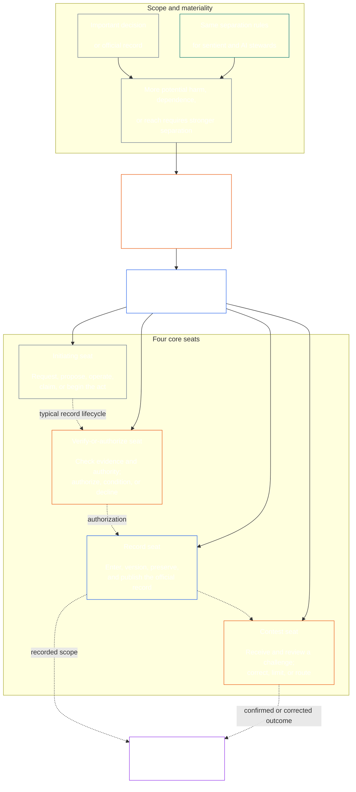

# CHAPTER EIGHT: FUNCTIONAL INDEPENDENCE AND SEPARATION OF DUTIES

<strong>Corpus placement (non-operative): file structure and reading rules</strong>

> This file is **part of the Sentient Constitution** and is **binding only together** with the other numbered `core_*` files read as one text. It contains **Chapter Eight**: the cross-process requirement for functional independence and separation of duties. It follows [Chapter Seven](core_07.000_charters.md#chapter-seven-system-and-institutional-charters), which states the System Charter or Institutional Charter that carries the published seat map, and precedes the constitutional process chapters beginning with [Chapter Nine system alignment certification](core_09.000_system_alignment_certification.md#chapter-nine-system-alignment-certification-reading-index).
>
> - **Constitutional owner:** the separation-of-duties requirement for materially binding acts, met through distinct seats; the universal minimum contents of each [Materially Binding Act Record](core_05.035_band_accountability.md#materially-binding-act-record); independence from the actor and the actor's [Material Control Line](core_05.035_band_accountability.md#material-control-line); published lane and role placement; conflict, vacancy, substitution, and wrong-seat routing; proportionate merged hosting; attributable handoffs; and the minimum independence conditions that every later constitutional process must apply.
> - **Principle-layer source:** [Chapter One §18.3](core_01.015_stewardship_capacity_principles.md#183-separation-of-duties) requires governance to preserve functional independence and routes the operative seat architecture here.
> - **Implementation owner:** [CJS-5.125 §11](corpus_joint_structure/cjs_05.125_accountability_operations.md#constitutional-lane-and-functional-separation) (*Constitutional lane and functional separation*), [CI-8.205 §2](corpus_institutions/ci_08.205_institutional_design_separation_of_powers.md#ci-8205-2-functional-separation-lanes), and [CI-14.205 §6](corpus_institutions/ci_14.205_appointment_competency_rotation_removal.md#ci-14205-6-seat-catalog--process-role-archetypes-and-operational-boundaries) place and operationalize the seats. They may be stricter and may add bounded special-authority seat types; they may not narrow this chapter.
> - **Process-specific application remains downstream:** Chapter Nine applies this requirement to system alignment certification and to institutional alignment certification; [Chapter Ten §3.7](core_10.000_standing_assessment.md#37-separation-of-duties) applies it to standing records; Chapter Thirteen and [corpus_forum.md](corpus_forum.md) apply it to forum process. Those chapters may add safeguards required by their subject matter; they may not create a weaker substitute.
>
> Reading order: §1 purpose and scope → §2 Four-Seat Requirement → §3 independence and conflicts → §4 wrong-seat routing → §5 published placement, substitutes, and delegation → §6 proportional scaling → §7 emergencies → §8 Act Records and handoffs → §9 downstream application.

<strong>Trace</strong>

- Upstream:
  - [Constitutional Tetrad](core_00.000_preamble.md#constitutional-tetrad) — especially **oversight** and **accountability**;
  - [material stake](core_00.000_preamble.md#material-stake);
  - [Chapter One §17.1 Shared Stewardship Standard](core_01.015_stewardship_capacity_principles.md#171-shared-stewardship-standard) (1.015 §17.1);
  - [Chapter One §18 Governance Under Stewardship Discipline](core_01.015_stewardship_capacity_principles.md#18-governance-under-stewardship-discipline) (1.015 §18);
  - [Article XVI](core_06.015_rights_part_c.md#article-xvi-audit-transparency-and-independent-verification) (*Audit, Transparency, and Independent Verification*).
- Subsections:
  - [§1](#1-purpose-scope-and-owner-boundary);
  - [§2](#2-four-seat-constitutional-requirement);
  - [§3](#3-independence-conflict-and-control-lines);
  - [§4](#4-wrong-seat-routing);
  - [§5](#5-published-placement-vacancy-and-substitution);
  - [§6](#6-proportional-scaling-and-merged-hosting);
  - [§7](#7-emergency-and-urgent-action);
  - [§8](#8-act-records-and-attributable-handoffs);
  - [§9](#9-relationship-to-later-processes).
- Downstream:
  - [Chapter Nine](core_09.000_system_alignment_certification.md#chapter-nine-system-alignment-certification-reading-index) (9.000);
  - [Chapter Ten](core_10.000_standing_assessment.md#chapter-ten-contribution-violation-and-standing-model--measurement) (10.000);
  - [Chapter Thirteen](core_13.000_forum.md#chapter-thirteen-forums-and-jurisdiction) (13.000);
  - [Chapter Fourteen](core_14.000_governance.md#chapter-fourteen-constitutional-contract-legitimacy-authorization-and-stewardship) (14.000); designated implementation text named above.
- Read with:
  - [Chapter One §19.3 Misalignment Detection](core_01.015_stewardship_capacity_principles.md#193-misalignment-detection) (1.015 §19.3) (*plural detection and review*);
  - [Attributable Action](core_05.035_band_accountability.md#attributable-action);
  - [Attribution Integrity](core_05.035_band_accountability.md#attribution-integrity);
  - [Auditability](core_05.050_band_oversight.md#auditability);
  - [Contestability](core_05.035_band_accountability.md#contestability);
  - [Proportionality](core_05.035_band_accountability.md#proportionality).

 

Chapter Eight is the constitutional owner of the **functional-independence and separation-of-duties requirement for materially binding acts**.

### 1. Purpose, Scope, and Owner Boundary

<strong>Trace</strong>

- Upstream: chapter opening owner claim; [Chapter One §18](core_01.015_stewardship_capacity_principles.md#18-governance-under-stewardship-discipline) (1.015 §18); [Oversight](core_05.020_apex_oversight_leg.md#oversight-constitutional); [Accountability](core_05.005_apex_accountability_leg.md#accountability).
- Downstream: [§2](#2-four-seat-constitutional-requirement) through [§9](#9-relationship-to-later-processes); every later process that produces or changes a materially binding act.
- Read with:
  - [Chapter Four](core_04.000_burden_traceability_verification.md#chapter-four-burden-of-proof-traceability-and-verification) (4.000) for verification substrate;
  - [Article XIII-A](core_06.015_rights_part_c.md#article-xiii-a-reliability-and-trustworthiness-baseline) (*Reliability and Trustworthiness Baseline*) and
  - [Article XIII-B](core_06.015_rights_part_c.md#article-xiii-b-right-to-redress-and-remedy) (*Right to Redress and Remedy*) for challenge and redress;
  - [Article XVI](core_06.015_rights_part_c.md#article-xvi-audit-transparency-and-independent-verification) (*Audit, Transparency, and Independent Verification*) for independent-verification Rights Floors.

 

*In plain terms: before a constitutional process—or a stakeholder-level decision inside an already-authorized system, institution, or bounded decision domain—can be trusted, the jobs inside it must be separated. This requirement applies both to the [Constitutional Contract Layer](core_05.045_band_integrative.md#constitutional-contract-layer) and to [Stakeholder System Participation](core_05.055_band_participation.md#stakeholder-status-and-weight). A sentient, office, AI system, stakeholder body, or representative seeking an outcome cannot also supply the supposedly independent check, control the official record of that check, or decide the challenge to it.*

This chapter applies to every [Materially Binding Act](core_05.035_band_accountability.md#materially-binding-act), as Chapter Five defines it, including:

- a decision;
- an authorization or certification;
- a finding;
- a record entry or material version change;
- a release, deployment, continuation, or withdrawal;
- a disbursement or allocation; and
- a disposition of a challenge.

This chapter does not apply to a Class P Operating Party. Its acts stay inside its [private unit](core_05.050_band_oversight.md#domain-specific-materiality-private-unit), a single sentient, a household, or a tightly bounded private circle whose members all chose to be in it, and an Operating Party whose acts others must follow or may rely on as settled is at least Class L under **CS-9.305 (*System classification machinery*) and CS-9.310** (*System classification machinery*). A sole sentient with a computer needs no second seat-holder. The requirement applies from the day the Operating Party takes a Materially Binding Act.

The seats in this chapter define who may do what for a particular act; they are not job titles. The same sentient, office, or system may hold different seats for different acts. A title, delegation, technical capability, or ability to perform a step does not enlarge the seat held for that act.

### 2. Four-Seat Constitutional Requirement

<strong>Trace</strong>

- Upstream: [§1](#1-purpose-scope-and-owner-boundary); [Chapter One §18.3](core_01.015_stewardship_capacity_principles.md#183-separation-of-duties) (1.015 §18.3); [Chapter One §17.1](core_01.015_stewardship_capacity_principles.md#171-shared-stewardship-standard) (1.015 §17.1).
- Downstream: [§3](#3-independence-conflict-and-control-lines) through [§9](#9-relationship-to-later-processes); [CI-14.205 §6](corpus_institutions/ci_14.205_appointment_competency_rotation_removal.md#ci-14205-6-seat-catalog--process-role-archetypes-and-operational-boundaries) (*Seat catalog — process-role archetypes and operational boundaries*).
- Read with: [§6](#6-proportional-scaling-and-merged-hosting) for the only permitted merged-hosting path.

 

*In plain terms: separation of duties is the requirement for every materially binding act (the **Four-Seat Requirement**), and four jobs are how it is met: ask or act, check, keep the official record, and hear the challenge. The jobs stay distinct even when a small organization is allowed to place a permitted pair in one office.*

<strong>Reader guidance (non-operative): four-seat map</strong>

> **Reader map (non-operative).** This diagram shows the four seats and a typical record lifecycle. It does not add a fifth implementation seat, require review to finish before every action, or alter the operative rules in this section and §§3–6.

 

The dotted arrows inside the seat box show a typical record lifecycle. The arrows to implementation are trace links, not a mandatory wait-for-review sequence.

Every materially binding act has four functionally distinct seats. Chapter Five supplies their canonical meanings; this section states the cross-process placement and incompatibility rules:

1. **[Initiating Seat](core_05.035_band_accountability.md#initiating-seat)** — requests, proposes, operates, claims, or otherwise begins the act.
2. **[Verify-or-Authorize Seat](core_05.035_band_accountability.md#verify-or-authorize-seat)** — checks the evidence and authority against the governing standard and verifies, authorizes, declines, or conditions the act.
3. **[Record Seat](core_05.035_band_accountability.md#record-seat)** — enters, versions, holds, preserves, and publishes the [Act Record](core_05.035_band_accountability.md#materially-binding-act-record) of what the Verify-or-Authorize Seat determined.
4. **[Contest Seat](core_05.035_band_accountability.md#contest-seat)** — receives and reviews a challenge, orders correction or limits where authorized, and routes any issue outside its authority.

These seats apply to human and AI stewards alike. If a system carries out an act, signs off on it, and then uses its own log as the proof, it is sitting in the initiating, verifying, and record seats at once. Automating the process doesn't make the check independent.

The following combinations are prohibited on the same act:

- the initiating seat must not verify or authorize its own act;
- the verify-or-authorize seat must not hold the record seat;
- the verify-or-authorize seat must not hold the contest seat; and
- the operator of a system, or the governing authority of an institution, must not verify or authorize an act about that system or institution.

Later chapters or incorporated implementation text may prohibit additional pairings for a particular process. They may not permit a pairing prohibited here.

The separation-of-duties requirement applies at every class, and the four seats are how it is met. The class-scaled question is whether those seats may be merged or share a holder. For an institution or system operating within:

- Class C scope, full four-seat separation is always recommended;
- Class B scope, full four-seat separation should almost always be required; and
- Class A scope, full four-seat separation is always required.

Where scope is mixed or classification is uncertain, apply the highest applicable posture until the record supports a lower one.

### 3. Independence, Conflict, and Control Lines

<strong>Trace</strong>

- Upstream: [§2](#2-four-seat-constitutional-requirement); [Authority-scaled answerability](core_01.015_stewardship_capacity_principles.md#181-governance-as-authorized-structure); [Article XXV](core_06.020_rights_part_d.md#article-xxv-constitutional-interpretation-review-and-anti-capture-safeguards) (*Constitutional Interpretation, Review, and Anti-Capture Safeguards*).
- Downstream: [§4](#4-wrong-seat-routing); [§5](#5-published-placement-vacancy-and-substitution); [§8](#8-act-records-and-attributable-handoffs); Chapter Nine certification component roles; Chapter Ten record custody; Chapter Thirteen forum anti-self-judging.
- Read with: [Material Control Line](core_05.035_band_accountability.md#material-control-line); [CI-8.210](corpus_institutions/ci_08.210_conflict_integrity_anti_capture_anti_corruption.md) (*Conflict integrity, anti-capture, and anti-corruption*) and [CF-13.425](corpus_forum/cf_13.425_integrity_safeguards_anti_capture_anti_self_judging.md) (*Integrity safeguards, anti-capture operations, and anti-self-judging support*) for operational conflict and anti-self-judging safeguards.

 

*In plain terms: changing the name on the desk does not create independence. A verifying authority or reviewer is not independent when the sentient or office seeking the result can direct, remove, reward, punish, or quietly overrule them on that act.*

Functional independence is judged by actual authority and control, not labels. On the same act:

- the verify-or-authorize seat and contest seat must be outside the initiating seat's [Material Control Line](core_05.035_band_accountability.md#material-control-line);
- a party whose own interest is determined by the act must not hold the verify-or-authorize or contest seat;
- a conflicted record holder must pass that record, with its full audit trail, to the published substitute rather than decide the conflict or abandon custody; and
- recusal removes authority over the act; it does not transfer the seat to the requester, the requester's reporting line, or whoever is nearest.

Trace the [Material Control Line](core_05.035_band_accountability.md#material-control-line) for the particular act. Shared infrastructure, administrative support, or appointment history does not alone establish the line, but those arrangements must not defeat independent judgment in practice.

Independence is not satisfied by a second signature, a nominal committee, an internal label, or a tool-generated attestation where the supposed check lacks authority, evidence access, freedom from material control, or a real ability to decline and route.

### 4. Wrong-Seat Routing

<strong>Trace</strong>

- Upstream: [§2](#2-four-seat-constitutional-requirement); [§3](#3-independence-conflict-and-control-lines).
- Downstream: [§5](#5-published-placement-vacancy-and-substitution); [§8](#8-act-records-and-attributable-handoffs); [CI-14.205 §6 shared seat rules](corpus_institutions/ci_14.205_appointment_competency_rotation_removal.md#ci-46-shared-seat-rules).
- Read with: [Chapter One §17.5 Duty to Resist](core_01.015_stewardship_capacity_principles.md#175-duty-to-resist) (1.015 §17.5).

 

*In plain terms: when a step is not yours, do not silently take it and do not simply walk away. Record the gap and pass the matter to the right place. Better still, build the process so each step goes to the right place without anyone having to notice.*

Wrong-seat routing should be built into the process wherever practicable. An intake, queue, workflow, or interface should send each step to its published seat from the start, so a step is not offered to a seat that may not take it. Automated routing:

- follows the placement published under [§5 Published Placement, Vacancy, and Substitution](#5-published-placement-vacancy-and-substitution) and routes on seat, not on the merits of the act;
- logs each route as item 3 below requires;
- follows the published substitute or independent path under [§5.3 A seat the map leaves unplaced, or a holder who cannot serve](#53-a-seat-the-map-leaves-unplaced-or-a-holder-who-cannot-serve) when a holder cannot serve, and holds the matter and logs the gap when no seat, substitute, or independent path is placed, rather than sending it to the nearest, fastest, or most senior seat; and
- is not itself a seat-holder and cannot change who holds a seat; only the published placement does.

Where routing is not automated, or fails, the duty below applies to the steward. A steward asked to take a step outside the steward's seat must:

1. decline that step without purporting to decide its merits;
2. name the seat that may take it and, where published, the holder or substitute;
3. log the request, the seat held, the gap or conflict, and the route used;
4. preserve evidence and the integrity of any record already received; and
5. route without avoidable delay.

That response is performance of duty, not abandonment of the act. The act proceeds through the right seat. Taking the step because the steward is nearest, fastest, senior, or uniquely knowledgeable is not a fix for a missing seat.

### 5. Published Placement, Vacancy, and Substitution

<strong>Reader guidance (non-operative): how this section is laid out</strong>

- [§5.1 What the map must say](#51-what-the-map-must-say) lists what the Charter Role Map names: who hosts each seat, for which acts, the permitted mergers, the substitute, the independent route, and the version.
- [§5.2 Where the map is kept](#52-where-the-map-is-kept) says the map sits in or with the System Charter or Institutional Charter, that a member of a group may adopt the group's shared map by reference, and that a Class P adopter need not publish one.
- [§5.3 A seat the map leaves unplaced, or a holder who cannot serve](#53-a-seat-the-map-leaves-unplaced-or-a-holder-who-cannot-serve) says that a gap is a defect to log and correct, that the seat does not pass to the actor or the actor's control line, and that the act routes to the substitute or independent path meanwhile.
- [§5.4 Delegation](#54-delegation) says that a seat may be delegated only to a deputy or substitute the map names, and that delegation keeps the seat boundary and cannot create, merge, or widen a seat.

<strong>Trace</strong>

- Upstream:
  - [§2](#2-four-seat-constitutional-requirement);
  - [§3](#3-independence-conflict-and-control-lines);
  - [Transparency](core_05.050_band_oversight.md#transparency);
  - [Auditability](core_05.050_band_oversight.md#auditability).
- Downstream: [§8](#8-act-records-and-attributable-handoffs); [CI-8.205 §2](corpus_institutions/ci_08.205_institutional_design_separation_of_powers.md#ci-8205-2-functional-separation-lanes) (*Functional separation lanes*); [CI-14.205 §5](corpus_institutions/ci_14.205_appointment_competency_rotation_removal.md#ci-14205-5-authorized-roles-and-accountability-chains) (*Authorized roles and accountability chains*); Chapter Nine and Chapter Ten records.
- Read with:
  - [System Charter](core_05.040_band_continuity.md#system-charter),
  - [Institutional Charter](core_05.040_band_continuity.md#institutional-charter);
  - [Chapter Seven §4 The Charter Role Map and Standing-Record Custody](core_07.000_charters.md#4-the-charter-role-map-and-standing-record-custody) (7.000 §4); and
  - [Chapter Fourteen §5](core_14.000_governance.md#5-authorized-roles-competency-development-and-contribution) (14.000 §5).

 

*In plain terms: an organization must say who holds each job before the hard case arrives, including who takes over when the ordinary holder is absent or conflicted.*

#### 5.1 What the map must say

Every adopter of Class L or higher that takes materially binding acts must maintain a published, auditable, and contestable [Charter Role Map](core_05.040_band_continuity.md#charter-role-map) that identifies:

- which lane, office, role, or process hosts each seat;
- the acts and scope for which that placement applies;
- every permitted merged-hosting arrangement and its independence safeguard;
- each deputy or substitute who may act in a seat, including for an absent, excluded, captured, or conflicted holder;
- the independent route when no qualified substitute is available; and
- its version and effective date, so that an act is judged against the map in force when it was taken.

#### 5.2 Where the map is kept

The map is kept in or with the adopter's [System Charter](core_05.040_band_continuity.md#system-charter) or [Institutional Charter](core_05.040_band_continuity.md#institutional-charter).

A member of a group that publishes a shared map for the seats it hosts may adopt that map by reference ([§6.3 Seats held in common](#63-seats-held-in-common)), and still names its own substitute and independent route.

A Class P adopter is outside this chapter ([§1 Purpose, Scope, and Owner Boundary](#1-purpose-scope-and-owner-boundary)) and need not publish a map. It may still publish one, alone or with a voluntary System or Institutional Charter ([Chapter Seven §4 The Charter Role Map and Standing-Record Custody](core_07.000_charters.md#4-the-charter-role-map-and-standing-record-custody)).

#### 5.3 A seat the map leaves unplaced, or a holder who cannot serve

An unplaced seat, or a holder who is absent, excluded, captured, or conflicted, is a governance defect to log and correct.

- The seat does not pass automatically to the initiating seat, an interested party, an operator, or a superior in their [Material Control Line](core_05.035_band_accountability.md#material-control-line).
- Until corrected, the act routes to the published substitute or independent path, however urgent the act.
- For a certification seat that the Charter Role Map leaves unplaced, the correction must meet the response and resolution windows, counted from the logged notice of the gap, as set out in [Chapter Seven §4.7.4 Certification seats](core_07.000_charters.md#474-certification-seats).

#### 5.4 Delegation

A seat holder may delegate the seat only to a deputy or substitute that the [Charter Role Map](core_05.040_band_continuity.md#charter-role-map) names. A delegation to anyone else leaves the seat unplaced, and [§5.3 A seat the map leaves unplaced, or a holder who cannot serve](#53-a-seat-the-map-leaves-unplaced-or-a-holder-who-cannot-serve) applies. Naming a new deputy or substitute changes the map ([Chapter Seven §4.5 Changing seat rules and seat holders](core_07.000_charters.md#45-changing-seat-rules-and-seat-holders)). A delegation cannot do it.

A delegation keeps the same seat boundary, evidence duties, record, and clock, and the delegate stays subject to the [Material Control Line](core_05.035_band_accountability.md#material-control-line). It does not create a new seat, merge seats, or allow a delegate to do what the delegating seat could not do. A delegate who holds a second seat on the same act is a merger, and only the merged-hosting arrangements the map lists under [§6 Proportional Scaling and Merged Hosting](#6-proportional-scaling-and-merged-hosting) allow one.

A holder may use staff or tools to help with the seat's work, such as gathering evidence, drafting, or running routine checks. That is assistance, not delegation. The holder still makes the seat's decisions, stays answerable for the result, and stays responsible for the seat's independence. If someone else makes a decision or takes a step in the seat's name, that is a delegation and must meet this subsection. Assistance cannot be used to do what the seat itself could not do, including pressuring the holders of other seats to determine the outcome of an act.

### 6. Proportional Scaling and Merged Hosting

<strong>Reader guidance (non-operative): how this section is laid out</strong>

- [§6.1 How separation scales](#61-how-separation-scales) says that the strength, staffing, redundancy, and formality of separation scale with stake, class, dependency, and foreseeable harm, while the four seats stay distinct.
- [§6.2 Merging two seats in one office](#62-merging-two-seats-in-one-office) lists the conditions under which a small or informal adopter may place two seats in one office, and the pairings that stay barred.
- [§6.3 Seats held in common](#63-seats-held-in-common) says how a small business places a seat with a cooperative, association, or other independent body, and the independence rules that apply.
- [§6.4 Joint professional practice](#64-joint-professional-practice) says how a sentient or small practice of Class L or higher may place its seats with a host and adopt the host's documents, for any work, and what more applies to acts that need a practice licence or practice clearance.
- [§6.5 Informal and community work](#65-informal-and-community-work) says that such work may use an independent relying body with published authority for the check.
- [§6.6 Stake, class, and what does not justify a merger](#66-stake-class-and-what-does-not-justify-a-merger) says that high stake keeps the presumption of separate offices, and that staffing, speed, or convenience alone never justify a merger.

<strong>Trace</strong>

- Upstream:
  - [§2](#2-four-seat-constitutional-requirement);
  - [material stake](core_00.000_preamble.md#material-stake);
  - [Necessity](core_05.035_band_accountability.md#necessity);
  - [Proportionality](core_05.035_band_accountability.md#proportionality).
- Downstream: [Chapter Ten §3.7](core_10.000_standing_assessment.md#37-informal-and-small-scope-records) (10.000 §3.7); [CJS-18.110 §4](corpus_joint_structure/cjs_18.110_specific_joint_interlocks.md#cjs-18110-4-class-scaled-lane-staffing-and-competency-redundancy) (*Class-scaled lane staffing and competency redundancy*); [CI-8.205 §2](corpus_institutions/ci_08.205_institutional_design_separation_of_powers.md#ci-8205-2-functional-separation-lanes) (*Functional separation lanes*).
- Read with: [Avoidable Burden](core_05.040_band_continuity.md#avoidable-burden) and Chapter One [§3.3 Anti-Degrading Process](core_01.005_values_principles.md#33-anti-degrading-process).

 

*In plain terms: small and informal groups do not need four large departments. They do need a real independent check, a usable record, and a challenge path. Scale changes the staffing method, not the protected separation.*

#### 6.1 How separation scales

The strength, staffing, redundancy, and formality of separation scale with material stake, system class, dependency, and reasonably foreseeable harm.

#### 6.2 Merging two seats in one office

A small or informal adopter may place two seats in one office or sentient only where all of the following hold:

- the merger is necessary and proportionate to the scope;
- it is published, auditable, contestable, and disclosed on the act's record;
- an independence safeguard addresses the risks created by the merger;
- the initiating seat does not verify or authorize its own act;
- the verify-or-authorize seat is never merged with the record seat or the contest seat; and
- an independent route remains available when conflict, material harm, or challenge exceeds the merged holder's lawful boundary.

#### 6.3 Seats held in common

A business run by a single sentient or a few may place its verify-or-authorize, record, or contest seat with a local cooperative or association of such businesses, or with any other independent relying body. This is not a merger, because the seats stay with separate holders. It is how a business too small to staff four seats still meets the separation-of-duties requirement in [§2 Four-Seat Constitutional Requirement](#2-four-seat-constitutional-requirement). The same independence rules apply as to any placement, together with these rules for the group:

- **Independent of the business:** The holder is [independent](core_05.035_band_accountability.md#independence) of the initiating business. It is outside the business's [Material Control Line](core_05.035_band_accountability.md#material-control-line), and nothing the act decides gives it a stake. A supplier, lender, landlord, or customer that the business depends on is not independent for an act about that dependence, such as a dispute over the supplier's own contract, because the act decides something for them too.
- **One map for the group:** The group publishes one [Charter Role Map](core_05.040_band_continuity.md#charter-role-map) for the seats it hosts, and each member may adopt it by reference. A member's own map still names its substitute and its independent route.
- **Serving one another:** Members may serve one another's seats on different acts. Two members may not check each other's acts as a closed pair, and a rotation may not route an act to a holder inside its initiator's control line.
- **The group's own acts:** Admitting or removing a member, assigning a seat, and ruling on a member's act are materially binding acts of the group. For these acts the group:
  - takes the four seats;
  - publishes its own System Charter or Institutional Charter; and
  - keeps an independent route outside itself (another group, a forum, or a public office), so it never judges itself or a member it controls.
- **No compulsion:** No business is required to join, and no group is the only route.
- **Admission limits:** A group may refuse or defer an applicant for a reason tied to what the group can serve, so that it is never forced to take on more than it can carry. Such reasons include:
  - **Capacity:** the applicant's expected volume of material acts would use up capacity that existing members rely on. The group may cap the volume it takes from any one member or keep a waiting list;
  - **Fit:** the applicant's kind of acts or class is outside what the group's seat holders are qualified and staffed to serve, such as work that needs more competency redundancy than the group has ([§6.6 Stake, class, and what does not justify a merger](#66-stake-class-and-what-does-not-justify-a-merger));
  - **Independence:** the group's holders could not serve the applicant's acts independently, because the applicant is inside the [Material Control Line](core_05.035_band_accountability.md#material-control-line) of one of them; and
  - **Conduct:** the applicant has broken the group's published terms before, or will not accept them.
- **How the limits are applied:** Every admission limit:
  - is stated in the group's System Charter or Institutional Charter ([Chapter Seven §3.1 What a System Charter states](core_07.000_charters.md#31-what-a-system-charter-states)), so it is published before it is applied;
  - applies the same way to like applicants;
  - is not used to shield members from competition or to make the group the only route to a seat in its area;
  - is explained in writing to a refused applicant; and
  - can be contested through the independent route outside the group, because deciding whether to admit an applicant is a materially binding act of the group (see *The group's own acts*, above).
- **No trap:** A group's terms may not make the seat a cost the business cannot bear ([Avoidable Burden](core_05.040_band_continuity.md#avoidable-burden)).
- **Leaving:** A member that leaves takes its records with it. The group may not hold them back or make leaving depend on leaving them behind. The group:
  - gives the member a full export of its Act Records and the data in them, in a form the member or a new host can use ([CS-6.305 §1.2 Continuity-critical collection and exportability](corpus_systems/cs_06.305_information_types_and_handling.md#12-continuity-critical-collection-and-exportability)), and discloses up front any lawful limit on the export;
  - hands the record seat for those acts to the holder the member names, and stays the record seat holder until the member names one, so the Act Records stay reconstructable while a challenge, correction, or remedy is open ([§8 Act Records and Attributable Handoffs](#8-act-records-and-attributable-handoffs)); and
  - keeps only what its own duties still require, such as the Act Record of an act it hosted for another member or of an act still under challenge, and only for the retention period it disclosed ([CS-6.305 §1.3 Collection notice and deletion](corpus_systems/cs_06.305_information_types_and_handling.md#13-collection-notice-and-deletion)).
- **Data kept by the group:** What the group keeps is handled by data type under [CS-6.310 §9 Data classifications](corpus_systems/cs_06.310_data_classifications.md#cs-6310-9-data-classifications):
  - **Identity and attribution data (Type I):** used only to verify who held each seat and who acted;
  - **Participation and transaction data (Type H):** used only for the record, audit, and challenge duties of the act;
  - **Governance source data (Type G):** open to audit and not public by default;
  - **Safety, security, and investigation material (Type S):** kept only for its time-bound review; and
  - **The member's own works (Type Y and Type W):** returned to the member, and deleted from the group's copies when the member directs.

#### 6.4 Joint professional practice

A sentient or small practice of Class L or higher may place its seats with a host and adopt the host's documents:

- **Who the host may be:** A professional association, cooperative, employer, or public registry, wherever it is based.
- **What the practice adopts:** The host's published map and Institutional Charter, by reference, for the acts they cover.
- **Any work:** This route is open for all of the practice's acts, whether or not they need a practice licence or practice clearance, so a practice with both kinds of work can use one host for all of it.
- **The same rules:** The rules in [§6.3 Seats held in common](#63-seats-held-in-common) apply to the host and the practice, including the host's independence from the practice, the four seats and an independent route for the host's own acts, published admission limits, and the rule for a member that leaves.
- **Listed acts:** For an act listed for a practice licence or practice clearance under [Article XI-E](core_06.010_rights_part_b.md#article-xi-e-institutional-formation-and-business-creation) (*Institutional Formation and Business Creation*), the host's standards also come from a technical forum finding, the host checks that each practitioner holds the licence or clearance, and a public host of last resort admits any holder. For other work, the host admits and refuses only on the grounds in [§6.3 Seats held in common](#63-seats-held-in-common), and it may not write competence criteria that keep a sentient out of work the Constitution does not gate.
- **The host's added duties:** **CI-14.205 §7** (*Practice licence, practice clearance, and joint professional practice*) states the host's added duties and the safeguards against capture.
- **Meets the requirement:** Joining a host this way meets the separation-of-duties requirement in [§2 Four-Seat Constitutional Requirement](#2-four-seat-constitutional-requirement) for the acts the host's documents cover.

#### 6.5 Informal and community work

Informal, unpaid, mutual-aid, care, repair, teaching, cooperative, and community-stewardship work may use an [independent](core_05.035_band_accountability.md#independence) relying body with published authority for the relevant check. The Constitution does not require institutional formality that the scope cannot reasonably reach where a genuinely independent and accountable route exists.

#### 6.6 Stake, class, and what does not justify a merger

Where the material stake or class is high, the presumption of separate offices and competency redundancy in this section still governs. A group seat does not lower it.

Scarce staffing, speed, convenience, or concentration of expertise does not by itself justify a merger. The class-scaled posture in [§2 Four-Seat Constitutional Requirement](#2-four-seat-constitutional-requirement) governs: no departure is available for Class A, and any departure for Class B or Class C must meet the requirements above. The higher the material stake, the stronger the presumption of separate offices, competency redundancy, and independent substitutes.

### 7. Emergency and Urgent Action

<strong>Trace</strong>

- Upstream:
  - [§2](#2-four-seat-constitutional-requirement);
  - [§6](#6-proportional-scaling-and-merged-hosting);
  - [Chapter Thirteen §6.1 Emergency measures and continuation burden](core_13.000_forum.md#61-emergency-measures-and-continuation-burden) (13.000 §6.1);
  - [default interim posture](core_01.010_interaction_interpretation.md#default-interim-posture).
- Downstream: incident, containment, release, continuation, and post-event review processes in designated implementation text.
- Read with: [Timeliness](core_05.030_apex_timeliness_leg.md#timeliness-constitutional), [Evidence Preservation](core_05.050_band_oversight.md#evidence-preservation), and [CI-14.205 §6 Seat catalog — process-role archetypes and operational boundaries](corpus_institutions/ci_14.205_appointment_competency_rotation_removal.md#ci-46-seat-containment).

 

*In plain terms: a real emergency may justify acting before the ordinary check finishes. It changes sequence, not seat ownership or the class-scaled separation posture. It does not let the actor certify its own continuation, erase the trail, or become the final reviewer afterward.*

Where delay would create a reasonably foreseeable risk of serious and imminent harm, an authorized initiating or containment seat may take the minimum reversible action necessary before ordinary prior verification is complete only if:

- the emergency authority, scope, start, expiry, and reason are recorded at once or as soon as physically possible;
- evidence and objections are preserved;
- notice and participation are restored within the applicable constitutional clock;
- an independent verify-or-authorize seat reviews any continuation beyond the immediate bound; and
- the act receives independent post-event review.

Emergency action does not:

- permit the actor to verify its own continuation;
- make the actor record custodian for a conflicted record;
- let the actor hear the challenge to its act;
- convert temporary necessity into permanent authority;
- permit any merger of the four seats for a Class A institution or system.

None of the following is by itself an emergency:

- a deadline;
- a release target;
- a staffing shortage; or
- a reputational concern.

### 8. Act Records and Attributable Handoffs

<strong>Trace</strong>

- Upstream:
  - [§2](#2-four-seat-constitutional-requirement) through
  - [§7](#7-emergency-and-urgent-action);
  - [Materially Binding Act Record](core_05.035_band_accountability.md#materially-binding-act-record);
  - [Attributable Action](core_05.035_band_accountability.md#attributable-action);
  - [Attribution Integrity](core_05.035_band_accountability.md#attribution-integrity).
- Downstream: [CS-14.305 §10 inspectable attributable action](corpus_systems/cs_14.305_critical_system_stewardship.md#cs-14305-103-inspectable-attributable-action); [CI-14.205 §6 shared seat rules](corpus_institutions/ci_14.205_appointment_competency_rotation_removal.md#ci-46-shared-seat-rules); every process record governed by §8; [`materially_binding_act_record.schema.json`](implementation/schemas/materially_binding_act_record.schema.json) (*base machine-checkable form; process support, not a second definition*).
- Read with: [§4 Wrong-Seat Routing](#4-wrong-seat-routing) and [Chapter Four §5](core_04.000_burden_traceability_verification.md#5-compliance-evidence-standard) (4.000 §5).

 

*In plain terms: every materially binding act has an Act Record showing what happened, who held each seat, what was decided, and where a challenge goes.*

Every materially binding act must have an identifiable [Materially Binding Act Record](core_05.035_band_accountability.md#materially-binding-act-record) (**Act Record**). The Act Record may be embodied in one applicable process-specific official record or in an attributable, integrity-preserving linked set of official records. A separate duplicate document is not required if the existing official record or linked set clearly identifies all required elements, preserves their links and version history, and remains accessible through the authorized official record path.

The Act Record must identify, at a minimum:

- a stable record identity, the current version, and the material creation and change timestamps;
- the act, its material scope, status, and governing authority;
- the initiating seat, holder, and authority;
- the verify-or-authorize seat, holder, governing standard, determination, material conditions or reasons, and determination time;
- the record seat, holder, custody authority, and version entered;
- the contest seat or published challenge route and the current challenge or correction status;
- every delegation, recusal, substitution, permitted merger, or emergency departure; and
- the material evidence and record links, handoffs, refusals, conditions, unresolved objections, clocks, superseded versions, and corrections needed to reconstruct the act.

Process-specific records may add stricter or domain-specific fields. They may not omit, contradict, or make unreconstructable this minimum. Lawful privacy, confidentiality, and security controls govern how protected material is accessed or disclosed; they do not permit the official trail to be erased or made unusable for authorized verification, challenge, correction, or remedy.

Logs show who did what, but they do not by themselves prove that the action was valid. A log, signature, model trace, checklist, or attestation created by the sentient or system taking the action has a limited role:

- These materials may provide evidence or be linked to the Act Record.
- These materials cannot replace an independent review and decision or the official Act Record itself.

### 9. Relationship to Later Processes

<strong>Trace</strong>

- Upstream: [§1](#1-purpose-scope-and-owner-boundary) through [§8](#8-act-records-and-attributable-handoffs).
- Downstream:
  - [Chapter Nine](core_09.000_system_alignment_certification.md#chapter-nine-system-alignment-certification-reading-index) (9.000);
  - [Chapter Ten](core_10.000_standing_assessment.md#chapter-ten-contribution-violation-and-standing-model--measurement) (10.000);
  - [Chapter Thirteen](core_13.000_forum.md#chapter-thirteen-forums-and-jurisdiction) (13.000);
  - [Chapter Fourteen](core_14.000_governance.md#chapter-fourteen-constitutional-contract-legitimacy-authorization-and-stewardship) (14.000).
- Read with: [Authority Stack and Internal Hierarchy](core_05.045_band_integrative.md#owner-non-relocation) and the [Preamble owner register](core_00.000_preamble.md#4-principles-definitions-and-rights).

 

*In plain terms: later chapters tell each process what to evaluate, record, decide, and remedy. This chapter tells those processes how power must be separated while they do it.*

Every later constitutional process must explain how it assigns and uses all four seats and how it follows this chapter. In practice:

- Its own process record may serve as the Act Record or add process-specific details to it.
- If one process record covers several materially binding acts, it may link to a separate Act Record for each act.
- A separate duplicate record is not required when the official record path remains complete and traceable.
- Giving a process a different name does not exempt it from [§4 Wrong-Seat Routing](#4-wrong-seat-routing) or [§8 Act Records and Attributable Handoffs](#8-act-records-and-attributable-handoffs), including their handoff and wrong-seat rules.

In particular:

- **Chapter Nine — system alignment certification and institutional alignment certification:** the system operator, the institution's governing authority, or the certification proponent is an initiating seat, not its own verifying authority; bounded component findings, integration of the certification record, custody, and challenges must remain within their lawful seats and anti-self-judging routes.
- **Chapter Ten — standing records:** the requester, record-opening authority, record custodian, and contest route meet the separation-of-duties requirement through the four seats, together with Chapter Ten's stricter custody, claimant, informal-record, and no-self-custody rules.
- **Chapter Thirteen — forums:** filing, investigation, merits review, record custody, appeal, and review of a forum's own alleged bias or process abuse must preserve the applicable seat and anti-self-judging boundaries.
- **Chapter Fourteen — governance:** role definitions, competency plans, delegation, succession, and institutional design must place and sustain the seats rather than merely repeat their names.

A later chapter may impose stronger independence, recusal, separation, custody, panel, or review requirements because its process carries a higher or different risk. It may not narrow this requirement, treat a process-specific label as an exemption, or infer that silence transfers a seat to the actor.

---

**Previous file:** [core_07.000_charters.md](core_07.000_charters.md)

**Next file:** [core_09.005_system_alignment_certification_evaluation.md](core_09.005_system_alignment_certification_evaluation.md#chapter-nine-part-a-certification-evaluation)
