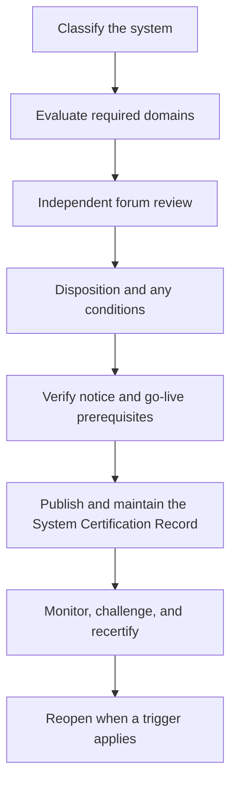

# CHAPTER EIGHT: SYSTEM ALIGNMENT CERTIFICATION

<strong>Corpus placement (non-operative): file structure and reading rules</strong>

> This file is **part of the Sentient Constitution** and is **binding only together** with the other numbered `core_*` files read as one text. It states the system alignment certification process. The detailed rules in Subcores 8-A through 8-F bind with this chapter.

 

Chapter Eight is the constitutional owner of **system alignment certification**: classification, evaluation, forum review, outcomes, go-live conditions, records, challenge, monitoring, recertification, and reopening.

### 1. Purpose, Role, and Scope

**Purpose:** Determine whether a materially impactful system is aligned before operation and while it remains in use.

**Role:** This chapter governs system alignment certification, together with its equally binding detail subcores.

**Chapter scope:** Certification depth, record burden, review intervals, stakeholder review, and contest paths scale with material stake. A system's impact class sets the depth of assurance; it does not waive a required evaluation. Classification is in [Subcore 8-A](subcore_08.010_system_classification.md)(subcore_08.010_system_classification.md), and evaluation is in [Subcore 8-B](subcore_08.020_system_alignment_certification_evaluation.md).

### 2. Why Certification Uses Independent, Scaled Review

**Grounded in:**
- The certification is a forum-supervised, multi-domain audit and status process.
- It tests observed and reasonably foreseeable impact, dependency, risk, Rights-Floor protections, and applicable domains.
- It requires a reasoned disposition and a System Certification Record.

The detailed evaluation and domain tests are in [Subcore 8-B](subcore_08.020_system_alignment_certification_evaluation.md); forum seats and sequence are in [Subcore 8-C](subcore_08.030_certification_seats_forum_roles_sequence.md); forum process and outcomes are in [Subcore 8-D](subcore_08.040_system_alignment_certification_forum_process_outcomes.md).

### 3. Certification Sequence

The disposition may be full, provisional, or not certified under the applicable standards. Certification conditions required before go-live must be completed and independently verified. The forum procedure, outcomes, and go-live rules are in [Subcore 8-D](subcore_08.040_system_alignment_certification_forum_process_outcomes.md).

### 4. Records and Continuing Review

The System Certification Record carries the classification, evaluation, disposition, conditions, and review material required by the detailed rules. Its contents are in [Subcore 8-E](subcore_08.050_system_certification_record_contents.md). Publication, monitoring, challenge, recertification, and reopening are governed by [Subcore 8-F](subcore_08.060_system_alignment_certification_records_recertification.md). Worked illustrations are in [CS-8.320 — System Alignment Certification Illustrations](corpus_systems/cs_08.320_system_alignment_certification_illustrations.md#cs-8320-system-alignment-certification-illustrations).

### 5. Relationship to Standing

Certification findings and system operation may supply facts to Standing Records only through the verified-input rules. Certification does not replace the separate standing questions in Chapter Ten.

---

**Previous file:** [subcore_07.040_public_information_office.md](subcore_07.040_public_information_office.md)

**Next file:** [subcore_08.010_system_classification.md](subcore_08.010_system_classification.md)
