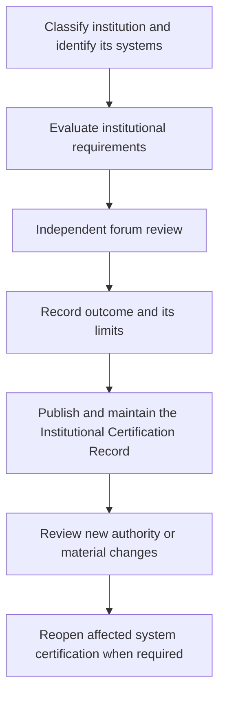

# CHAPTER NINE: INSTITUTIONAL ALIGNMENT CERTIFICATION

<strong>Corpus placement (non-operative): file structure and reading rules</strong>

> This file is **part of the Sentient Constitution** and is **binding only together** with the other numbered `core_*` files read as one text. It states the institutional alignment certification process. The detailed rules in Subcores 9-A through 9-F bind with this chapter.

 

Chapter Nine is the constitutional owner of **institutional alignment certification**: institutional classification, evaluation, forum review, outcomes, records, continuing review, and new material authority.

### 1. Purpose, Role, and Scope

**Purpose:** Assess an institution under the applicable institutional tests and state the limits of its certification outcome.

**Role:** This chapter governs institutional alignment certification, together with its equally binding detail subcores.

**Chapter scope:** **An institution may form and continue operating without certification.** System certification has its own go-live rules; an institutional outcome does not replace them. Institutional classification and evaluation items are in [Subcore 9-A](subcore_09.010_institution_class_evaluation_items.md) and [Subcore 9-B](subcore_09.020_institutional_alignment_certification_evaluation.md).

### 2. Why Institutional Review Has Its Own Tests and Limits

**Grounded in:**
- The process follows the same broad order as system certification while applying institution-specific tests.
- The applicable case depends on whether the institution operates one system, several systems, or no system.
- Institutional outcomes have defined limits and interact with system findings under the detail rules.

Forum seats, roles, and sequence are in [Subcore 9-C](subcore_09.030_institutional_certification_seats_sequence_readiness.md); forum process and outcomes are in [Subcore 9-D](subcore_09.040_institutional_alignment_certification_forum_process_outcomes.md).

### 3. Certification Sequence

The institution's status, the scope of any certified authority, and the interaction with system certification follow the specific outcome rules; this chapter does not make institutional certification a precondition to formation or continued operation.

### 4. Records, Reopening, and New Authority

The Institutional Certification Record and continuing review follow [Subcore 9-E](subcore_09.050_new_material_authority_system_reopening.md) and [Subcore 9-F](subcore_09.060_institutional_alignment_certification_records_recertification.md). New material authority is governed by its defined wait and qualifications, and may require the affected systems to be reopened under the detailed rules.

### 5. Relationship to System Certification

Institutional findings do not certify a system or displace a system's own go-live gate. Where an institutional event affects a system, the applicable system review and reopening rules remain controlling.

---

**Previous file:** [subcore_08.060_system_alignment_certification_records_recertification.md](subcore_08.060_system_alignment_certification_records_recertification.md)

**Next file:** [subcore_09.010_institution_class_evaluation_items.md](subcore_09.010_institution_class_evaluation_items.md)
