# CHAPTER NINE, PART A: SYSTEM ALIGNMENT CERTIFICATION — EVALUATION

<strong>Corpus placement (non-operative): file structure and reading rules</strong>

> This file is **part of the Sentient Constitution** and is **binding only together** with the other numbered `core_*` files read as one text. It contains **Chapter Nine, Part A** — certification purpose, the process overview, and the first two phases of the process — **Frame** (system class) and **Evaluate** (whole-system evaluation in three sub-phases: the always-applicable evaluations, including data types and handling, in **§3**; the evaluations that apply where implicated in **§4**; and the Rights-Floor and domain evaluations that apply where triggered in **§5**) — **§1–§5**. The worked **Class A / B / C illustrations** (the system class profiles and the walkthroughs for §3.4, §5.1, §5.2, §5.3, §5.4, §5.5, and §5.6), including each one's **Reading across system classes** paragraph, are in [CS-9.320](corpus_systems/cs_09.320_system_alignment_certification_illustrations.md#cs-9320-system-alignment-certification-illustrations) (*System alignment certification illustrations*) in the systems family, not in this chapter; each names the Part A section it illustrates. The binding system-class-scaling and escalation rules those paragraphs illustrate stay in this file: system class scaling, including participation and proportionality, in §2.2; data-handling scaling in §3.4; and the **System class scaling and escalation** paragraph in each of §5.1–§5.6. The files of the whole chapter are listed in the table below.
>
> **Chapter Nine files.** Chapter Nine is split across three binding files read as one text. Part A, this file, opens the chapter; there is no separate index file. The worked illustrations are not part of the chapter; they are in [CS-9.320](corpus_systems/cs_09.320_system_alignment_certification_illustrations.md#cs-9320-system-alignment-certification-illustrations) (*System alignment certification illustrations*).
>
> | Part | File | Owns |
> |------|------|------|
> | **Part A — Evaluation** | [`core_09.000_system_alignment_certification_evaluation.md`](core_09.000_system_alignment_certification_evaluation.md) | §1–§5: purpose and process overview (with a chart of the whole certification process in its six phases), **Phase I Frame** (system class, how system class scales every evaluation, and pilot certification) and **Phase II Evaluate** (whole-system evaluation in three sub-phases: **IIa** always, in §3, including chartered scope versus functional boundaries and data types and handling; **IIb** where implicated, in §4; and **IIc** where triggered, the Rights-Floor and domain evaluations, in §5) |
> | **Part B — Forum process and outcomes** | [`core_09.005_system_alignment_certification_record_process.md`](core_09.005_system_alignment_certification_record_process.md) | §6–§7: **Phase III Review** (forum roles, supervisory sequence, and the contestability chain) and **Phase IV Decide** (certification outcomes, including the go-live gate) — continuous chapter numbering from Part A §5 |
> | **Part C — Record, recertification, and standing** | [`core_09.010_system_alignment_certification_record_recertification.md`](core_09.010_system_alignment_certification_record_recertification.md) | §8–§11: **Phase V Record** (the System Certification Record and its integrity, including governing [System Charter](core_05.040_band_continuity.md#system-charter) fields) and **Phase VI Operate** (recertification and reopening; the challenge path; the standing bridge) — continuous chapter numbering from Part B §7 |
>
> **How the two certifications relate.** System Alignment Certification (this chapter) is the certification of a System. Institutional alignment certification ([Chapter Ten](core_10.000_institutional_alignment_certification.md#chapter-ten-institutional-alignment-certification)) is the certification of an Institution, which may run Systems or none. Chapter Ten cites each System's System Certification Record by link and does not redo it; [Chapter Ten §1.1](core_10.000_institutional_alignment_certification.md#11-relation-to-system-alignment-certification) states the relation and [Chapter Ten §1.3](core_10.000_institutional_alignment_certification.md#13-no-permission-and-no-gate) states that it is not a licence. Its sections carry the same numbers and titles as this chapter's.
>
> Generic **Chapter Nine** links in other files route to the appropriate part by section number.
>
> - **Constitutional owner (joint with Parts B and C):** forum-supervised **system alignment certification and related records** — evaluation domains (Part A); forum process, supervisory sequence, and certification outcomes with the go-live gate (Part B); System Certification Record duties, the challenge path, recertification and reopening, and the verified-input bridge to Chapter Eleven (Part C). Under the **oversight** Tetrad leg, SAC is one especially large, high-stakes audit process among others; auditing floors remain at **Article XVI** (*Audit, Transparency, and Independent Verification*) and Chapter Five [Auditability](core_05.050_band_oversight.md#auditability).
> - **Verification substrate owner:** [Chapter Four — Burden of Proof, Traceability, and Verification](core_04.000_burden_traceability_verification.md#chapter-four-burden-of-proof-traceability-and-verification) (within Chapters Two through Four) owns burden allocation, compliance evidence, definition traceability, observability, and security-constrained verification. Chapter Nine **applies** that discipline to System Certification Records; it does **not** restate Chapter Four sections **1** through **5**.
> - **Auditing home (not relocated here):** **Article XVI** (*Audit, Transparency, and Independent Verification*), **Def.O1** (*Transparency, Auditability, and Verification*), and **CJS-5.110 §3 and CJS-5.115 §3** (*Audit process home*)–**CJS-5.110 §5** own auditing floors and operational terms. Chapter Nine runs one especially large SAC audit process that must satisfy those floors; it does not own all auditing.
> - **Implementation owner:** system-class handling, CS-6.345, and forum-process detail in designated implementation files must remain consistent with Chapter Nine and may be stricter where the corpus already provides a [Fullest Protective Effect](core_05.045_band_integrative.md#fullest-protective-effect) rule.
> - **Anti-relocation rule:** Part A does not restate Chapter Five canonical definitions, Chapter Three anti-evasion discipline (see [Part C §9.4](core_09.010_system_alignment_certification_record_recertification.md#94-non-evasion)), Chapter Eleven contribution or standing measurement, or Chapter Twelve standing effects. **[Part C §11](core_09.010_system_alignment_certification_record_recertification.md#11-relationship-to-standing)** states the standing bridge.
>
> **Upstream:** Chapter Five definitions; Chapters Two through Four record, verification, burden, and traceability of definitions to results; and [Chapter Eight](core_08.000_functional_independence_separation_of_duties.md#chapter-eight-functional-independence-and-separation-of-duties), whose separation-of-duties requirement governs every materially binding certification act.
> **Downstream:** [Part B](core_09.005_system_alignment_certification_record_process.md#chapter-nine-part-b-system-alignment-certification--forum-process-and-outcomes) (*forum process and outcomes*) and [Part C](core_09.010_system_alignment_certification_record_recertification.md#chapter-nine-part-c-system-alignment-certification--record-recertification-and-standing) (*record, recertification, and standing bridge*); Chapter Eleven standing records and verified inputs; Chapter Twelve standing effects; Chapter Fourteen forum supervision and system alignment certification pathways.

 

Chapter Nine, **Part A**, is the constitutional owner of **system alignment certification evaluation**.

- Forum supervision and certification outcomes are in **[Part B](core_09.005_system_alignment_certification_record_process.md#chapter-nine-part-b-system-alignment-certification--forum-process-and-outcomes)**.
- The record, recertification and reopening, and the standing bridge are in **[Part C](core_09.010_system_alignment_certification_record_recertification.md#chapter-nine-part-c-system-alignment-certification--record-recertification-and-standing)**.
- Worked illustrations of these evaluation sections are in **[CS-9.320 System alignment certification illustrations](corpus_systems/cs_09.320_system_alignment_certification_illustrations.md#cs-9320-system-alignment-certification-illustrations)**.
- Institutional alignment certification, with the same section numbers, is in **[Chapter Ten](core_10.000_institutional_alignment_certification.md#chapter-ten-institutional-alignment-certification)**.

### 1. Purpose and Role

<strong>Trace</strong>

- Upstream:
  - [Preamble — constitutional owner register](core_00.000_preamble.md#4-principles-definitions-and-rights) and
  - [Authority Stack and Internal Hierarchy](core_05.045_band_integrative.md#authority-stack-and-internal-hierarchy);
  - [Constitutional Tetrad](core_00.000_preamble.md#constitutional-tetrad);
  - [Two Constitutional Aims](core_00.000_preamble.md#two-constitutional-aims);
  - [material stake](core_00.000_preamble.md#material-stake);
  - [Proportionality](core_05.035_band_accountability.md#proportionality) and
  - [Substantive Fairness](core_05.055_band_participation.md#substantive-fairness) (Chapter Five); Participation measurement family (*voice, access, and contest paths*);
  - [Chapter One §16 Stewardship In Depth](core_01.010_stewardship_capacity_principles.md#16-stewardship-in-depth) (1.010 §16);
  - [Chapter One §12 Systemic Evaluation Requirement](core_01.000_values_principles.md#12-systemic-evaluation-requirement) (1.000 §12) (*principle-layer whole-system evaluation lens — not one corner alone*); Chapters Two through Four;
  - [Chapter Five](core_05.000_definitions_home.md#chapter-five-foundational-definitions) (5.000) (*canonical definitions*);
  - [Chapter Eight §2 Four-Seat Constitutional Requirement](core_08.000_functional_independence_separation_of_duties.md#2-four-seat-constitutional-requirement) (8.000 §2);
  - [System Alignment Certification](core_05.040_band_continuity.md#system-alignment-certification) (Chapter Five canonical term; non-operative shorthand **SAC**);
  - [System Certification Record](core_05.040_band_continuity.md#system-certification-record) (Chapter Five meaning).
- Downstream:
  - [§2](#2-system-class-evaluation) (*system class evaluation*);
  - [Part C §10](core_09.010_system_alignment_certification_record_recertification.md#10-challenging-a-certification) (9.010 §10) (*challenging a certification*); and
  - [CS-9.320 §2](corpus_systems/cs_09.320_system_alignment_certification_illustrations.md#cs-9320-2-illustrative-system-class-profiles) (*Illustrative system class profiles*);
  - [CS-9.320 §4](corpus_systems/cs_09.320_system_alignment_certification_illustrations.md#cs-9320-4-illustrative-whole-system-application-by-system-class) (*Illustrative whole-system application by system class*);
  - [CS-9.320 §5](corpus_systems/cs_09.320_system_alignment_certification_illustrations.md#cs-9320-5-illustrative-data-handling-application-by-system-class) (*Illustrative data-handling application by system class*);
  - [CS-9.320 §6](corpus_systems/cs_09.320_system_alignment_certification_illustrations.md#cs-9320-6-illustrative-ecological-footprint-application-by-system-class) (*Illustrative ecological-footprint application by system class*);
  - [CS-9.320 §7](corpus_systems/cs_09.320_system_alignment_certification_illustrations.md#cs-9320-7-illustrative-educational-capability-application-by-system-class) (*Illustrative educational-capability application by system class*);
  - [CS-9.320 §8](corpus_systems/cs_09.320_system_alignment_certification_illustrations.md#cs-9320-8-illustrative-cross-system-support-application-by-system-class) (*Illustrative cross-system support application by system class*);
  - [CS-9.320 §9](corpus_systems/cs_09.320_system_alignment_certification_illustrations.md#cs-9320-9-illustrative-nondiscrimination-application-by-system-class) (*Illustrative nondiscrimination application by system class*);
  - [CS-9.320 §10](corpus_systems/cs_09.320_system_alignment_certification_illustrations.md#cs-9320-10-illustrative-accessibility-application-by-system-class) (*Illustrative accessibility application by system class*);
  - [CS-9.320 §11](corpus_systems/cs_09.320_system_alignment_certification_illustrations.md#cs-9320-11-illustrative-trustworthiness-application-by-system-class) (*Illustrative trustworthiness application by system class*);
  - [§3](#3-whole-system-certification-evaluation) (*whole-system certification evaluation factors*);
  - [§3.4](#34-data-types-and-handling-evaluation) through
  - [§5.6](#56-trustworthiness-and-system-reliance-integrity-evaluation) (*domain evaluations*);
  - [Part B §6](core_09.005_system_alignment_certification_record_process.md#6-forum-process) (9.005 §6) (*supervisory sequence and contestability chain*);
  - [Part B §6.1](core_09.005_system_alignment_certification_record_process.md#61-forum-supervision-and-component-roles) (9.005 §6.1) (*forum component roles*);
  - [Part C §8](core_09.010_system_alignment_certification_record_recertification.md#8-system-certification-record) (9.010 §8) (*System Certification Record contents*);
  - [Part C §8.2](core_09.010_system_alignment_certification_record_recertification.md#82-transparency-and-auditability-of-the-record) (9.010 §8.2) (*record integrity requirements*);
  - [Part B §7](core_09.005_system_alignment_certification_record_process.md#7-certification-outcomes) (9.005 §7) (*reopening and anti-evasion*);
  - [Part C §11](core_09.010_system_alignment_certification_record_recertification.md#11-relationship-to-standing) (9.010 §11) (*standing-record bridge*);
  - [Chapter Eleven](core_11.000_standing_assessment.md#chapter-eleven-contribution-violation-and-standing-model--measurement) (11.000) (*standing records and verified-input gate*);
  - [Chapter Twelve](core_12.000_standing_integration.md#chapter-twelve-standing-effects-and-integration) (12.000) (*standing effects and integration*);
  - [Chapter Fourteen](core_14.000_forum.md#chapter-fourteen-forums-and-jurisdiction) (14.000) (*forum supervision, certification, alignment certification, and review*).
- Read with:
  - **[CS-9.305](corpus_systems/cs_09.305_system_classification_machinery.md#cs-9305-part-a-system-classification-machinery) (*System classification machinery*) and [CS-9.310 — System impact classifications](corpus_systems/cs_09.310_system_impact_classifications.md#cs-9310-part-b-system-impact-classifications)**, **[CS-6.305](corpus_systems/cs_06.305_information_types_and_handling.md#cs-6305-part-a-information-types-and-handling) (*Information types and handling*) and [CS-6.310 — Data classifications](corpus_systems/cs_06.310_data_classifications.md#cs-6310-part-b-data-classifications)**, and
  - **CS-6.345** (*System lifecycle*);
  - **CF-14.415** (*Routing operations, transfer, certification, and representative treatment*) and
  - **CF-14.425** (*Integrity safeguards, anti-capture operations, and anti-self-judging support*); **Article XVI** (*Audit, Transparency, and Independent Verification*) and
  - [Auditability](core_05.050_band_oversight.md#auditability) (*auditing floors — SAC is one especially large audit process under oversight, not the sole auditing home*); **CJS-5.110 §3 (*Oversight: auditability and reconstructability terms (annex)*) and CJS-5.115 §3** (*Audit process home*)–
  - **CJS-5.110 §5** (*Oversight: independent verification and claim-integrity terms*).

 

*In plain terms: When a system really matters to sentients' lives, certification has to be **proportionate** — as demanding as the system's real impact, dependency, and risk require, not a one-size-fits-all checklist or a rubber stamp. It also has to be **participatory** — affected sentients and communities must be able to see what was reviewed, understand what was decided, and challenge it when something is wrong. Forums review evidence, write it down in a System Certification Record, and require re-checks on a schedule that matches how risky the system is. Classes A, B, and C get the full process and Class L a lighter one. Class P is encouraged to use it, and must once it is reclassified to Class L or higher (that is, its effects reach beyond a private unit) or its operator claims constitutional compliance.*

**System alignment certification** exists to answer one question for a stated scope and review schedule: Has the system shown constitutional alignment well enough for certification, conditional certification, validation, recertification, continued reliance, deployment, or material release from conditions?

- A certification is not a popularity score, a forever pass, or a way to skip rights review.
- It is a time-bound, challengeable statement of what is known about the system's alignment right now.
- Under the **oversight** Tetrad leg, oversight requires auditing; system alignment certification is one especially large, high-stakes audit process among others — not the sole home of auditing (**Article XVI** (*Audit, Transparency, and Independent Verification*), [Auditability](core_05.050_band_oversight.md#auditability)).

Certification implements the [Two Constitutional Aims](core_00.000_preamble.md#two-constitutional-aims) through the [Constitutional Tetrad](core_00.000_preamble.md#constitutional-tetrad):

- **[Flourishing](core_00.000_preamble.md#flourishing)** — certification verifies that certification or continued reliance would not quietly defeat Rights Floors or block fair participation in constitutionally relevant life;
- **[Continuity](core_00.000_preamble.md#continuity)** — certification verifies durable, non-regressive supply that sustains rather than depletes healthy natural systems ([Ecological Integrity](core_05.040_band_continuity.md#ecological-integrity), including [Ecological Recovery Capacity](core_05.040_band_continuity.md#ecological-recovery-capacity)), and system-class-scaled recertification where shared systems gate or sustain delivery;
- **Participation** — affected sentients and communities can understand, contest, and take part in review paths that matter to them;
- **Oversight** — records, evidence, and assumptions are visible and auditable enough for independent checking; certification itself is one especially large audit process under that oversight duty, not the only one;
- **Accountability** — defects, misclassification, and floor-defeating operation route to remedy, conditions, withdrawal, or standing input where the facts support it;
- **Timeliness** — review and contest windows keep certification from going stale while harm can still be prevented or reversed.

#### 1.1 Certification as an audit process, scaled by class

As an oversight mechanism, certification is one especially large audit process under [Auditability](core_05.050_band_oversight.md#auditability) and **Article XVI** (*Audit, Transparency, and Independent Verification*):

- It is forum-supervised, multi-domain, and status-granting.
- It may integrate the results of sibling audit modes, and it does not absorb or replace them. Each keeps its own owner, named in the [sibling audit modes map](corpus_joint_structure/cjs_05.115_audit_process.md#sibling-audit-modes-owner-map) of the audit process home:
  - System Data Types Record audits under **CS-6.305 (*Information types and handling*) and CS-6.310** (*Data classifications*)
  - System Classification Record audits under **CS-9.305 (*System classification machinery*) and CS-9.310** (*System impact classifications*)
  - steward assurance reviews under **CS-15.305** (*Critical system stewardship*)
  - continuous audit under **CS-6.345** (*System lifecycle*) ACA
  - complexity audits under **CS-6.315** (*Comprehensibility and complexity stewardship*) and **Article XXIII-B** (*Complexity Audit and Modularity Requirements*)
  - claim verification under **CJS-5.110 §5** (*Oversight: independent verification and claim-integrity terms*)
- You can still run any of these checks on their own, without going through certification. Certification doesn't replace them.

Certification depth, record burden, certification interval, stakeholder review, and contest paths must scale with [material stake](core_00.000_preamble.md#material-stake) under [Proportionality](core_05.035_band_accountability.md#proportionality):

- Higher-impact, higher-dependency, and higher-risk systems require stronger proof, clearer records, and more practicable participation — including substantive accessibility, stakeholder input, and challenge routes scaled to who relies on the system.
- Lower system classes and bounded scopes still require honest classification and proportionate assurance; they do not receive a free pass from material obligations where external effects exist.

The process applies by impact class, as the [reclassification requirement](corpus_systems/cs_09.305_system_classification_machinery.md#35-reclassification-requirement) of **CS-9.305** (*System classification machinery*) sets out:

- **Class A, Class B, and Class C:** these systems carry the highest impact, dependency, and risk, and whole-system evaluation under [§3 Whole-System Certification Evaluation](#3-whole-system-certification-evaluation), [§4 Evaluations Where Implicated](#4-evaluations-where-implicated), and [§5 Rights-Floor and Domain Evaluations](#5-rights-floor-and-domain-evaluations), each as its own sub-phase applies, is mandatory at full depth;
- **Class L:** the same evaluation is mandatory but proportionate, with a lower default re-check cadence and simpler records where CS-9.305 (*System classification machinery*) and CS-9.310 (*System impact classifications*) permits; and
- **Class P:** the process is encouraged while the system is validly Class P, and a Class P system may use it voluntarily. It becomes mandatory on reclassification to Class L or higher, or where the operator voluntarily asserts constitutional compliance for the system.

The certification interval, and the financial, resource, or special audit that falls at its midpoint, are set by class in [Chapter Fourteen §6 Timely resolution, materiality tiers, and anti-delay discipline](core_14.000_forum.md#review-cadence) (*Review cadence*). This chapter does not restate the numbers.

#### 1.2 Certification at a glance

*In plain terms: classify the system honestly, run the evaluations that apply, have forums independently review the evidence and stakeholder concerns, and decide an outcome. Complete the one record opened for forum review and publish it with an open challenge path. A certified system goes live only after its notice interval and required protections are satisfied. Monitor actual outcomes, respond to incidents and challenges, and check again on schedule or when the facts change. Correct defects and have the correction independently verified before authorizing the affected scope or releasing its conditions. Each review pass uses a new record linked to the last.*

The process runs in **six phases**: **I Frame**, **II Evaluate**, **III Review**, **IV Decide**, **V Record**, and **VI Operate**. Phase II runs in three sub-phases, each its own section: **IIa** (always), **IIb** (when implicated), and **IIc** (when triggered). Phase VI runs in two sub-phases, each its own section: **VIa** (operate and recertify, [§9 Recertification and Reopening](core_09.010_system_alignment_certification_record_recertification.md#9-recertification-and-reopening)) and **VIb** (the standing bridge, [§11 Relationship to Standing](core_09.010_system_alignment_certification_record_recertification.md#11-relationship-to-standing)). The chart shows the whole certification process in that order. Part A covers the first two phases, framing and evaluation; [Part B](core_09.005_system_alignment_certification_record_process.md#chapter-nine-part-b-system-alignment-certification--forum-process-and-outcomes) and [Part C](core_09.010_system_alignment_certification_record_recertification.md#chapter-nine-part-c-system-alignment-certification--record-recertification-and-standing) cover the last four: the forum process and the outcome with the go-live gate (Part B), then the record and operation (the challenge path, recertification and reopening, and the standing bridge) (Part C).

Every evaluation that applies is carried out again on each certification pass: at first certification, at each recertification on the schedule set by [§2 System Class Evaluation](#2-system-class-evaluation), and at each reopened or fresh review. Review reopens before the next scheduled recertification when material facts change, such as growing reliance on the system, growing extraction from shared foundations, a significant fall in what the system puts back into them, or a credible challenge. [Part C §9.2 Reopening triggers](core_09.010_system_alignment_certification_record_recertification.md#92-reopening-triggers) lists the triggers.

```mermaid
flowchart TB
    T(["System with material impact seeks certification,<br/>or reliance on it grows"])
    C["§2 Phase I, Frame<br/>Classify honestly<br/><br/>Class sets depth and re-check schedule"]
    subgraph W["§3–§5 Phase II, Evaluate — Whole-system evaluation"]
        direction LR
        Al["§3.1–§3.4 IIa — Always<br/><br/>Governance; systemic risk: evaluated,<br/>and disclosed to those who need it;<br/>time horizon; data types"]
        Im["§4 IIb — When implicated<br/><br/>Privacy loci, exit rights,<br/>assembly and dissent"]
        Tr["§5 IIc — When triggered<br/><br/>Applicable Rights-Floor checks<br/>and six domain evaluations"]
        Al ~~~ Im ~~~ Tr
    end
    F["§6 Phase III, Review<br/>Independent review of evidence<br/>and stakeholder concerns<br/><br/>Assigned forums issue findings;<br/>challenge paths stay open"]
    Rec["§8 Phase V, Record<br/>One System Certification Record<br/><br/>Opened for forum review; completed with the outcome,<br/>supporting findings, conditions, and operating plan"]
    S[["Chapter Eleven — Standing<br/>records<br/><br/>Outside this chapter"]]
    O{"§7 Phase IV, Decide<br/><br/>What outcome and status<br/>does the evidence support?"}
    Fc["§7, §9.3 Full Certification<br/><br/>Required consecutive clean provisional recertifications;<br/>no current or indicated impending misalignment<br/>Full certification interval; conditions may apply"]
    Pc["§7, §9.3 Provisional Certification<br/><br/>First grant, recovery after misalignment,<br/>or continued or stepped-down provisional status<br/>Provisional interval, shorter; conditions may apply"]
    Nc["§7 Not Certified<br/><br/>Deferred, refused, withdrawn, or expired<br/>No go-live; state reasons and required corrective work"]
    Pub["§7, §10 Publish the completed record<br/><br/>Open the published record challenge path;<br/>for new or expanded scope, state go-live and notice"]
    G{"§7 Go-live gate<br/><br/>Certification and applicable<br/>go-live prerequisites satisfied?"}
    Hold["§7 Meet go-live prerequisites<br/><br/>Complete notice and independently verify<br/>conditions required before go-live"]
    Rm["§7, §9.3 Protect and correct<br/><br/>No new go-live in the affected scope;<br/>protect affected sentients, correct design or operation,<br/>and submit evidence for independent verification"]
    Ch["§9–§10 Phase VIa, Operate and recertify<br/>Monitor and keep challenges open<br/><br/>Operate within certified scope and conditions;<br/>monitor outcomes and respond to incidents and challenges"]
    S2[["Chapter Eleven — Standing<br/>records<br/><br/>Outside this chapter"]]
    Sp["&nbsp;&nbsp;&nbsp;&nbsp;&nbsp;&nbsp;&nbsp;&nbsp;&nbsp;&nbsp;&nbsp;&nbsp;&nbsp;&nbsp;&nbsp;&nbsp;&nbsp;&nbsp;&nbsp;&nbsp;&nbsp;&nbsp;&nbsp;&nbsp;&nbsp;&nbsp;&nbsp;&nbsp;&nbsp;&nbsp;&nbsp;&nbsp;&nbsp;"]
    SpL["&nbsp;&nbsp;&nbsp;&nbsp;&nbsp;&nbsp;&nbsp;&nbsp;&nbsp;&nbsp;&nbsp;&nbsp;&nbsp;&nbsp;&nbsp;&nbsp;&nbsp;&nbsp;&nbsp;&nbsp;&nbsp;&nbsp;&nbsp;&nbsp;&nbsp;&nbsp;&nbsp;&nbsp;&nbsp;&nbsp;&nbsp;&nbsp;&nbsp;&nbsp;&nbsp;"]
    SpA["&nbsp;&nbsp;&nbsp;&nbsp;&nbsp;&nbsp;&nbsp;&nbsp;&nbsp;&nbsp;&nbsp;&nbsp;&nbsp;&nbsp;&nbsp;&nbsp;&nbsp;&nbsp;&nbsp;&nbsp;&nbsp;&nbsp;&nbsp;&nbsp;&nbsp;&nbsp;&nbsp;&nbsp;&nbsp;&nbsp;&nbsp;&nbsp;&nbsp;&nbsp;&nbsp;&nbsp;&nbsp;&nbsp;&nbsp;&nbsp;&nbsp;&nbsp;&nbsp;&nbsp;&nbsp;"]
    Re["§9 Next review pass<br/><br/>Recertification, reopening, or fresh review;<br/>each pass opens a new record linked to the last"]
    T --> C
    A1((A)) --> C
    C --> W
    W --> F
    F --> O
    O --> Fc
    O --> Pc
    O --> Nc
    Fc --> Rec
    Pc --> Rec
    Nc --> Rec
    Rec -.->|VIb, §11 —<br/>verified inputs only;<br/>current certification or facts<br/>arising during certification| S
    Rec --> Pub
    Rec ~~~ Sp
    Pub --> G
    G ~~~ SpL
    G -->|Not Certified| Rm
    G --->|Yes: operate<br/>within the record| Ch
    G --->|Certified,<br/>prerequisites pending| Hold
    Hold --> G
    Ch -->|Material defect:<br/>protect and correct| Rm
    Ch -->|On schedule, or<br/>material change or<br/>credible challenge<br/>requires review| Re
    Ch -.->|VIb, §11 —<br/>verified inputs only;<br/>operation may supply facts<br/>for Contribution and<br/>Violation records| S2
    Rm -->|Correction evidence<br/>is checked in the<br/>next review pass| Re
    S2 ~~~~ SpA
    SpA ~~~ Re
    Re --> A2((A))
    style Sp fill:none,stroke:none,color:#111111
    style SpL fill:none,stroke:none,color:#111111
    style SpA fill:none,stroke:none,color:#111111
    style T fill:none,stroke:#64748b,color:#ffffff
    style C fill:none,stroke:#16a34a,color:#ffffff
    style Ch fill:none,stroke:#16a34a,color:#ffffff
    style Al fill:none,stroke:#16a34a,color:#ffffff
    style Im fill:none,stroke:#16a34a,color:#ffffff
    style Tr fill:none,stroke:#16a34a,color:#ffffff
    style F fill:none,stroke:#ea580c,color:#ffffff
    style Rec fill:none,stroke:#2563eb,color:#ffffff
    style S fill:none,stroke:#db2777,color:#ffffff
    style S2 fill:none,stroke:#db2777,color:#ffffff
    style O fill:none,stroke:#ea580c,color:#ffffff
    style Fc fill:none,stroke:#9333ea,color:#ffffff
    style Pc fill:none,stroke:#9333ea,color:#ffffff
    style Nc fill:none,stroke:#9333ea,color:#ffffff
    style G fill:none,stroke:#ea580c,color:#ffffff
    style Pub fill:none,stroke:#2563eb,color:#ffffff
    style Rm fill:none,stroke:#9333ea,color:#ffffff
    style Hold fill:none,stroke:#16a34a,color:#ffffff
    style Re fill:none,stroke:#16a34a,color:#ffffff
    style A1 fill:none,stroke:#64748b,color:#ffffff
    style A2 fill:none,stroke:#64748b,color:#ffffff
```

<strong>Reader guide (non-operative): illustrations, run sheet, and Institutions</strong>

> Illustrative **Class A**, **Class B**, and **Class C** profiles — and how system class scales certification depth across this chapter — are in [CS-9.320 §2 Illustrative system class profiles](corpus_systems/cs_09.320_system_alignment_certification_illustrations.md#cs-9320-2-illustrative-system-class-profiles). Worked walkthroughs of the same three systems for each evaluation area in [§3 Whole-System Certification Evaluation](#3-whole-system-certification-evaluation) through [§5.6 Trustworthiness and System-Reliance Integrity Evaluation](#56-trustworthiness-and-system-reliance-integrity-evaluation) follow there, in [CS-9.320 System alignment certification illustrations](corpus_systems/cs_09.320_system_alignment_certification_illustrations.md#cs-9320-system-alignment-certification-illustrations), which links each profile and walkthrough back to the Part A section it illustrates.
>
> A step-by-step run sheet for the six phases, with a link from each step to the section that holds the rule, is in [CS-9.315 §2 Run sheet](corpus_systems/cs_09.315_system_alignment_certification_run_sheet.md#cs-9315-2-run-sheet) (*System alignment certification run sheet*). Where the run sheet and a section differ, the section controls.
>
> For an Institution, the same six phases run through [Chapter Ten](core_10.000_institutional_alignment_certification.md#chapter-ten-institutional-alignment-certification), whose sections carry the same numbers as this chapter's: Phases I and II in [Chapter Ten §2 Institution Class Evaluation](core_10.000_institutional_alignment_certification.md#2-institution-class-evaluation) to [§5 Rights-Floor and Domain Evaluations](core_10.000_institutional_alignment_certification.md#5-rights-floor-and-domain-evaluations), Phases III to V in [§6 Forum Process](core_10.000_institutional_alignment_certification.md#6-forum-process) to [§8 Institutional Certification Record](core_10.000_institutional_alignment_certification.md#8-institutional-certification-record), and Phase VI in [§9 Recertification and Reopening](core_10.000_institutional_alignment_certification.md#9-recertification-and-reopening) to [§11 Relationship to Standing](core_10.000_institutional_alignment_certification.md#11-relationship-to-standing).

 

### 2. System Class Evaluation

<strong>Trace</strong>

- Upstream:
  - [§1](#1-purpose-and-role) (*purpose and role*); Integrative Materiality (
  - [Materiality](core_05.050_band_oversight.md#materiality)) (*Materiality*);
  - [Constitutional Tetrad](core_00.000_preamble.md#constitutional-tetrad);
  - [Two Constitutional Aims](core_00.000_preamble.md#two-constitutional-aims);
  - [Material Impact](core_05.050_band_oversight.md#material-impact),
  - [Dependency](core_05.040_band_continuity.md#dependency),
  - [Risk](core_05.040_band_continuity.md#risk),
  - [System Boundaries](core_05.040_band_continuity.md#system-boundaries), and
  - [System Charter](core_05.040_band_continuity.md#system-charter) (Chapter Five);
  - [Chapter One §12 Systemic Evaluation Requirement](core_01.000_values_principles.md#12-systemic-evaluation-requirement) (1.000 §12); **Article III-A** (*Survival*) and **Article IV-A** (*Rights-Floor delivery where classification gates access*); **Article V-A** (*Dependency Mapping and Resource-Flow Transparency*) and **Article V-B** (*resource allocation and dependency stewardship where certification gates shared-infrastructure reliance*).
- Downstream:
  - [§2.1](#21-certification-recertification-and-defects) (*certification status, recertification, and defects*);
  - [§2.2](#22-how-system-class-scales-every-evaluation) (*system-class-scaled participation and proportionality*);
  - [§2.3](#23-pilot-certification) (*pilot certification*);
  - [CS-9.320 §2](corpus_systems/cs_09.320_system_alignment_certification_illustrations.md#cs-9320-2-illustrative-system-class-profiles) (*Illustrative system class profiles*) and [CS-9.320 §3](corpus_systems/cs_09.320_system_alignment_certification_illustrations.md#cs-9320-3-reclassification) (*Reclassification*);
  - [CS-9.320 §4](corpus_systems/cs_09.320_system_alignment_certification_illustrations.md#cs-9320-4-illustrative-whole-system-application-by-system-class) (*Illustrative whole-system application by system class*);
  - [CS-9.320 §5](corpus_systems/cs_09.320_system_alignment_certification_illustrations.md#cs-9320-5-illustrative-data-handling-application-by-system-class) (*Illustrative data-handling application by system class*);
  - [CS-9.320 §6](corpus_systems/cs_09.320_system_alignment_certification_illustrations.md#cs-9320-6-illustrative-ecological-footprint-application-by-system-class) (*Illustrative ecological-footprint application by system class*);
  - [CS-9.320 §7](corpus_systems/cs_09.320_system_alignment_certification_illustrations.md#cs-9320-7-illustrative-educational-capability-application-by-system-class) (*Illustrative educational-capability application by system class*);
  - [CS-9.320 §8](corpus_systems/cs_09.320_system_alignment_certification_illustrations.md#cs-9320-8-illustrative-cross-system-support-application-by-system-class) (*Illustrative cross-system support application by system class*);
  - [CS-9.320 §9](corpus_systems/cs_09.320_system_alignment_certification_illustrations.md#cs-9320-9-illustrative-nondiscrimination-application-by-system-class) (*Illustrative nondiscrimination application by system class*);
  - [CS-9.320 §10](corpus_systems/cs_09.320_system_alignment_certification_illustrations.md#cs-9320-10-illustrative-accessibility-application-by-system-class) (*Illustrative accessibility application by system class*);
  - [CS-9.320 §11](corpus_systems/cs_09.320_system_alignment_certification_illustrations.md#cs-9320-11-illustrative-trustworthiness-application-by-system-class) (*Illustrative trustworthiness application by system class*);
  - [§3.4](#34-data-types-and-handling-evaluation) (*joint data-handling evaluation*);
  - [§5.1](#51-ecological-footprint-evaluation) (*ecological footprint evaluation*);
  - [§5.3](#53-proportionate-cross-system-support-evaluation) (*cross-system support evaluation*);
  - [Part C §8.2](core_09.010_system_alignment_certification_record_recertification.md#82-transparency-and-auditability-of-the-record) (9.010 §8.2) (*record integrity*);
  - [Part C §11.3](core_09.010_system_alignment_certification_record_recertification.md#113-verified-input-gate) (9.010 §11.3) (*verified-input gate*);
  - [Part B §7](core_09.005_system_alignment_certification_record_process.md#7-certification-outcomes) (9.005 §7) (*classification drift and reclassification triggers*).
- Read with:
  - [System Classification Record](core_05.040_band_continuity.md#system-classification-record);
  - **[CS-9.305](corpus_systems/cs_09.305_system_classification_machinery.md#cs-9305-part-a-system-classification-machinery) (*System classification machinery*) and [CS-9.310 — System impact classifications](corpus_systems/cs_09.310_system_impact_classifications.md#cs-9310-part-b-system-impact-classifications)**, including **
  - [CS-9.305 §3.5 reclassification requirement](corpus_systems/cs_09.305_system_classification_machinery.md#35-reclassification-requirement)** (*Reclassification requirement* — triggers, system-class-scaled evaluation depth, and SAC verification bridge) and **
  - [CS-9.305 §7](corpus_systems/cs_09.305_system_classification_machinery.md#cs-9305-7-classification-governance-disclosure-and-challenge)** (*Classification governance, disclosure, and challenge*) — System Classification Record governance duties and the SAC bridge;
  - [CS-6.345 — System lifecycle](corpus_systems/cs_06.345_design_testing_verification_deployment.md#cs-6345-system-lifecycle);
  - [CJS-5.130 §21 — Adversarial robustness and abuse-resistance terms](corpus_joint_structure/cjs_05.130_continuity_operations.md#cjs-5130-20-continuity-reversibility-and-containment-terms) (*regression and hardening cycle obligations*);
  - **CF-14.425 §2** (*Constitutional alignment certification and review*).

 

*In plain terms: certification has to check whether the system is classified honestly — not by what the operator calls it, but by what it actually does, what depends on it, and what could go wrong. Higher system classes mean stricter proof, faster re-checks, and stronger resilience expectations. See [CS-9.320 System alignment certification illustrations](corpus_systems/cs_09.320_system_alignment_certification_illustrations.md#cs-9320-system-alignment-certification-illustrations) for one example system per system class and how evaluation applies to each of them.*

Every System Certification Record for a materially impactful system must include an evaluation of the system's **system class**.

The detailed rules live in [CS-9.305 — System classification machinery](corpus_systems/cs_09.305_system_classification_machinery.md#cs-9305-part-a-system-classification-machinery), and [CS-6.345 — System lifecycle](corpus_systems/cs_06.345_design_testing_verification_deployment.md#cs-6345-system-lifecycle). They cover:

- what the system classes are, how a system class is assigned, and the system class profiles;
- how classification is governed;
- how much assurance each system class needs;
- how robust the infrastructure must be;
- which checks and records are recertified, on what system-class-scaled schedule, and how provisional and full certification change that schedule.

This section states what certification must verify:

- **Evaluation requirement:**
  - whether the assigned system class reflects observed and reasonably foreseeable **impact**, **dependency**, and **risk** under CS-9.305 (*System classification machinery*) and CS-9.310 (*System impact classifications*), including:
    - aggregate effects;
    - interaction effects;
    - adversarial effects;
    - threshold effects;
  - that classification is determined by actual system behavior and impacts, not from:
    - declared intent;
    - nominal scope;
    - [System Charter](core_05.040_band_continuity.md#system-charter) text alone; or
    - self-description alone;
  - that the system's class was re-checked under the **[CS-9.305 §3.5 reclassification requirement](corpus_systems/cs_09.305_system_classification_machinery.md#35-reclassification-requirement)** whenever a significant change called for it; and
  - that the [System Classification Record](core_05.040_band_continuity.md#system-classification-record) shows the **highest system class that applies** under current conditions.
- **Assurance and regression testing:**
  - that system-class-scaled assurance, infrastructure robustness, and regression coverage match the assigned system class under:
    - CS-9.305 (*System classification machinery*) and CS-9.310 (*System impact classifications*); and
    - CS-6.345 (*System lifecycle*), read with these shared operational terms where materially applicable:
      - [**CJS-5.130 §19**](corpus_joint_structure/cjs_05.130_continuity_operations.md#right-to-exit-pathway-integrity-c) (*Continuity: graceful degradation and failure-mode integrity terms*);
      - [**CJS-5.130 §20**](corpus_joint_structure/cjs_05.130_continuity_operations.md#transparency-disclosures-and-stakeholder-legibility-c) (*Continuity: reversibility and containment terms*);
      - [**CJS-5.130 §21**](corpus_joint_structure/cjs_05.130_continuity_operations.md#signaling-integrity-and-anti-silent-failure-controls-c) (*Continuity: adversarial robustness and abuse-resistance terms*);
      - [**CJS-5.135 §22**](corpus_joint_structure/cjs_05.135_integrative_operations.md#cjs-5135-22-integrative-constrained-secrecy-and-protected-investigation-terms) (*Integrative: constrained-secrecy and protected-investigation terms*), where the system's class or function makes it materially applicable; and
      - [**CJS-5.135 §23**](corpus_joint_structure/cjs_05.135_integrative_operations.md#cjs-5135-23-integrative-intervention-and-override-integrity-terms) (*Integrative: intervention and override integrity terms*), where the system's class or function makes it materially applicable; and
  - that regression testing was run for each recertification, as CS-6.345 (*System lifecycle*) requires, with its results on the record under [§8.1 Minimum record contents](core_09.010_system_alignment_certification_record_recertification.md#81-minimum-record-contents).

#### 2.1 Certification, recertification, and defects

This subsection states what certification must verify about certification status, recertification, and defects:

- **Certification and recertification:**
  - that a certification-and-review evidence package exists for the certification cycle, as CS-6.345 (*System lifecycle*) *Forum certification and lifecycle review* requires;
  - that the certification status on the record is supported under [Part C §9.3 Provisional and full certification](core_09.010_system_alignment_certification_record_recertification.md#93-provisional-and-full-certification):
    - full certification results only from a system that already holds provisional certification when it is being rechecked, and meets all three of these tests:
      - it has passed enough clean provisional rechecks in a row (at least one, and more for higher system classes);
      - it has no current misalignment; and
      - nothing being monitored shows misalignment coming;
    - provisional certification applies to a system certified for the first time, including a newly deployed system, and to a system certified again after a failed recertification or after a reopened review that found misalignment; and
  - for systems that deliver or depend on basic Rights Floor protections:
    - that the system is rechecked often enough, and retested deeply enough, to serve the **Continuity** aim in [Two Constitutional Aims](core_00.000_preamble.md#two-constitutional-aims), so that essentials keep reaching sentients over time; and
    - that a certification that has gone stale, or was issued too soon, is never treated as proof that sentients are getting food, water, shelter, education, or safety today.
- **Misclassification and defects:**
  - certification defects under CS-9.305 (*System classification machinery*) and CS-9.310 (*System impact classifications*) and [Part B §7](core_09.005_system_alignment_certification_record_process.md#7-certification-outcomes), not minor paperwork mistakes, include:
    - claiming a lower risk class than the system deserves;
    - breaking the system into pieces to dodge tougher rules; or
    - keeping an old system class label after conditions have changed, including failure to reassess under the **[CS-9.305 §3.5 reclassification requirement](corpus_systems/cs_09.305_system_classification_machinery.md#35-reclassification-requirement)**;
  - certification defects under CS-6.345 (*System lifecycle*) include:
    - skipping regression tests;
    - relying on outdated results;
    - leaving known breaks unfixed; or
    - accepting major fixes without re-testing when re-testing was feasible; and
  - where the system is certified and the facts support it, the same classification problems may also count toward adverse standing findings in [Chapter Eleven](core_11.000_standing_assessment.md#chapter-eleven-contribution-violation-and-standing-model--measurement).

Consequences of these defects are set in [§7 Certification Outcomes](core_09.005_system_alignment_certification_record_process.md#7-certification-outcomes).

#### 2.2 How System Class Scales Every Evaluation

System class sets how deeply every evaluation in this chapter is carried out — the whole-system factors in [§3 Whole-System Certification Evaluation](#3-whole-system-certification-evaluation), data handling in [§3.4 Data Types and Handling Evaluation](#34-data-types-and-handling-evaluation), and each Rights-Floor and domain evaluation in [§5 Rights-Floor and Domain Evaluations](#5-rights-floor-and-domain-evaluations) — and how often it is repeated:

- Higher-class systems require proportionately stronger evidence that each applicable evaluation was actually performed, not asserted. No class may settle for credentials, labels, or accommodations that exist only on paper, or for assessments and decisions that nobody can see into.
- Lower system classes still require an honest, proportionate evaluation wherever a trigger applies.
- System class never permits skipping a required evaluation. A system whose real role outgrows its system class must be reclassified and re-evaluated at the higher depth. Growth in scale, reach, or adoption, and dependence that strengthens, widens, or becomes harder to replace, are reassessment triggers under **[CS-9.305 §3](corpus_systems/cs_09.305_system_classification_machinery.md#35-reclassification-requirement)** (*Reclassification requirement*), and they reopen review under [§9.2 Reopening triggers](core_09.010_system_alignment_certification_record_recertification.md#92-reopening-triggers). Concentration past a level that an adopter has set under [Chapter One §11.4 Resource and Dependency Concentration](core_01.000_values_principles.md#114-resource-and-dependency-concentration-adopter-tunable) is further evidence of that growth. Reassessment does not wait for a level to be crossed, and a level that is unset or set too high does not delay it.

Participation and proportionality requirements scale the same way:

- **Class A** systems require the strongest practicable participation paths, because errors can foreclose survival essentials before remedy is possible. These include:
  - accessible challenge;
  - stakeholder review; and
  - findings from the forum family assigned the affected stake under [Part B §6.1 Forum supervision and component roles](core_09.005_system_alignment_certification_record_process.md#61-forum-supervision-and-component-roles), including Institutional or Sentient Forums as that section requires.
- **Class B** systems require robust participation where the system gates:
  - healthcare;
  - education;
  - benefits;
  - work; or
  - comparable daily life.
- **Class C** systems still require contestable records and proportionate disclosure, especially where coordination effects:
  - place a heavier burden on protected groups;
  - leave many sentients depending on the same system; or
  - suggest the system may soon move up to Class B or Class A.

#### 2.3 Pilot certification

A **[pilot](core_05.040_band_continuity.md#pilot)** is a [go-live](core_05.040_band_continuity.md#go-live), so it needs its own certification before it starts, under the go-live rule in [Part B §7.1 Go-Live Gate](core_09.005_system_alignment_certification_record_process.md#71-go-live-gate).

- A system at any system class is expected to run a pilot before full deployment; one that does not records why.
- A pilot still needs an honest classification and every evaluation whose trigger applies, and its scope, population, and duration are stated on its record.
- It is evaluated on its own record, at a depth scaled to its system class and to how substitutable the system is: whether a viable alternative exists for the sentients it would affect or who would rely on it, and at what cost, delay, and loss of function (see [Dependency](core_05.040_band_continuity.md#dependency)).
  - The more readily the system can be replaced, and the lower its system class, the lighter the pilot's evaluation may be.
  - A pilot of a system that cannot readily be replaced is evaluated at the depth its system class requires at full deployment.

### 3. Whole-System Certification Evaluation

<strong>Trace</strong>

- Upstream:
  - [Chapter One §12 Systemic Evaluation Requirement](core_01.000_values_principles.md#12-systemic-evaluation-requirement) (1.000 §12); Flourishing measurement family (*Wellbeing, safety, harm, and survival-floor access*); Constitutional Performance measurement family (*Constitutional Efficiency, Avoidable Burden, and Productive Capacity*);
  - [Constitutional Tetrad](core_00.000_preamble.md#constitutional-tetrad);
  - [Two Constitutional Aims](core_00.000_preamble.md#two-constitutional-aims);
  - [material stake](core_00.000_preamble.md#material-stake);
  - [§1 Purpose and Role](#1-purpose-and-role).
- Downstream:
  - [CS-9.320 §4](corpus_systems/cs_09.320_system_alignment_certification_illustrations.md#cs-9320-4-illustrative-whole-system-application-by-system-class) (*Illustrative whole-system application by system class*);
  - [§3.4](#34-data-types-and-handling-evaluation) through
  - [§5.6](#56-trustworthiness-and-system-reliance-integrity-evaluation) (*domain evaluations*);
  - [CS-9.320 §2](corpus_systems/cs_09.320_system_alignment_certification_illustrations.md#cs-9320-2-illustrative-system-class-profiles) (*Illustrative system class profiles*);
  - [Part C §8](core_09.010_system_alignment_certification_record_recertification.md#8-system-certification-record) (9.010 §8) (*record contents*);
  - [Part C §8.2](core_09.010_system_alignment_certification_record_recertification.md#82-transparency-and-auditability-of-the-record) (9.010 §8.2) (*record integrity*);
  - [Part B §6](core_09.005_system_alignment_certification_record_process.md#6-forum-process) (9.005 §6) (*contestability chain*);
  - [Part B §7](core_09.005_system_alignment_certification_record_process.md#7-certification-outcomes) (9.005 §7) (*reopening and anti-evasion*).
- Read with:
  - [Chapter One §16](core_01.010_stewardship_capacity_principles.md#16-stewardship-in-depth) (1.010 §16),
  - [§18](core_01.010_stewardship_capacity_principles.md#18-governance-under-stewardship-discipline), and
  - [§19](core_01.010_stewardship_capacity_principles.md#19-incentive-alignment-and-system-capture);
  - [Chapter One §7.4 Voluntary Discontinuation, Major Self-Modification, and Exit Rights](core_01.000_values_principles.md#74-voluntary-discontinuation-and-exit-rights) (1.000 §7.4);
  - [Chapter One §7.2 Assembly, Collective Organization, and Institutional Formation](core_01.000_values_principles.md#72-assembly-collective-organization-and-institutional-formation) (1.000 §7.2); **Article XVI** (*Audit, Transparency, and Independent Verification*) where audit, transparency, or independent-verification Rights Floors are materially at stake; Continuity measurement family (
  - [§3.2](#32-systemic-scope-and-risk-factors) — resilience, reversibility, and systemic risk);
  - [Risk Evaluation](core_05.040_band_continuity.md#risk-evaluation);
  - [Risk Disclosure](core_05.050_band_oversight.md#risk-disclosure);
  - [Public Oversight Baseline Disclosure](core_05.050_band_oversight.md#public-oversight-baseline-disclosure); Participation measurement family (
  - [§4.1](#41-privacy-informational-joint-invocation) — privacy and data stewardship); Accountability measurement family (
  - [§3.1](#31-governance-incentive-and-contestability-discipline) — incentive alignment and market contestability);
  - [System Boundaries](core_05.040_band_continuity.md#system-boundaries);
  - [System Charter](core_05.040_band_continuity.md#system-charter).
- Subsections:
  - [§3.1](#31-governance-incentive-and-contestability-discipline) through
  - [§3.4](#34-data-types-and-handling-evaluation) (*always: governance, systemic factors, time horizon, and data types and handling*). Phase II continues in
  - [§4 Evaluations Where Implicated](#4-evaluations-where-implicated) (*when implicated: privacy loci, exit rights, and assembly and dissent*) and
  - [§5 Rights-Floor and Domain Evaluations](#5-rights-floor-and-domain-evaluations) (*when triggered*).

 

*In plain terms: you cannot green-light one piece of a system and ignore the rest. Reviewers need the full picture — what it depends on, what breaks when something upstream fails, harms that show up later or add up over time, whether sentients can actually use it (not just on paper), whether private information stays properly walled off, whether sentients can leave without being trapped, whether groups can still organize without the system splitting them apart, whether short-term wins hide long-term damage, and whether real oversight and accountability will still work when a lot is on the line.*

*Worked examples: [CS-9.320 §4 Illustrative whole-system application by system class](corpus_systems/cs_09.320_system_alignment_certification_illustrations.md#cs-9320-4-illustrative-whole-system-application-by-system-class) shows how this section plays out in practice. It takes three sample systems, one for each system class, and walks each through the checks above.*

A certification evaluation must confirm that the [Constitutional Tetrad](core_00.000_preamble.md#constitutional-tetrad) (Participation, Oversight, Accountability, and Timeliness) will be strong enough to meet the [material stake](core_00.000_preamble.md#material-stake) of the system under review.

System Certification Records must show that the evaluation considered each factor in this section, in [§4 Evaluations Where Implicated](#4-evaluations-where-implicated), and in [§5 Rights-Floor and Domain Evaluations](#5-rights-floor-and-domain-evaluations) wherever it is material to any of the following:

- certification;
- validation;
- recertification;
- continued reliance;
- deployment; or
- lifting a condition placed on a certification.

Evaluating only a system's immediate or local effects isn't enough. Phase II, the whole-system evaluation, fills that gap in three parts, listed in the table below. This section covers part **IIa**. [§4 Evaluations Where Implicated](#4-evaluations-where-implicated) covers **IIb**, and [§5 Rights-Floor and Domain Evaluations](#5-rights-floor-and-domain-evaluations) covers **IIc**. The table is just a guide; it doesn't change what any section requires.

| When | Sub-phase | Sections | Applies |
|------|-----------|----------|---------|
| **Always** | IIa | [§3.1 Governance, Incentive, and Contestability Discipline](#31-governance-incentive-and-contestability-discipline); [§3.2 Systemic Scope and Risk Factors](#32-systemic-scope-and-risk-factors); [§3.3 Time-Consistency Constraint](#33-time-consistency-constraint); [§3.4 Data Types and Handling Evaluation](#34-data-types-and-handling-evaluation) | every materially impactful System Certification Record |
| **When implicated** | IIb | [§4.1 Privacy (Informational) Joint Invocation](#41-privacy-informational-joint-invocation); [§4.2 Voluntary Discontinuation, Major Self-Modification, and Exit Rights](#42-voluntary-discontinuation-major-self-modification-and-exit-rights); [§4.3 Assembly, Collective Organization, and Institutional Formation](#43-assembly-collective-organization-and-institutional-formation), including [§4.3.1](#431-dissent-and-peaceful-protest) | where the certification matter materially implicates the locus or principle the subsection names |
| **When triggered** | IIc | [§5 Rights-Floor and Domain Evaluations](#5-rights-floor-and-domain-evaluations) | where a trigger in the §5 table is met |

#### 3.1 Governance, Incentive, and Contestability Discipline

*In plain terms: the review is not finished unless reviewers ask whether the four legs of the [Tetrad](core_00.000_preamble.md#constitutional-tetrad) will still hold at the level of risk involved — participation (whether sentients can actually take part), oversight (whether the work can be watched and checked), accountability (whether wrongdoing can be answered for), and timeliness (whether decisions will move fast enough when it matters). Reviewers also need to know who actually holds material authority and who answers for what — not a vague "the team" or a blame-shifting shell. Those questions must be answered for a valid certification.*

Certification evaluation is incomplete if it does not assess whether each of the following will meet [material stake](core_00.000_preamble.md#material-stake) scaling for the system under review:

- **oversight**;
- **accountability**;
- **participation**; and
- **timeliness**.

That assessment must also check that each of the following kinds of material role is **formally assigned, documented, and traceable** well enough that sentients can tell who is answerable and can actually challenge decisions:

- stewardship roles;
- governance roles; and
- accountability roles.

This is scaled to system class and material impact under **[CS-9.305](corpus_systems/cs_09.305_system_classification_machinery.md#cs-9305-part-a-system-classification-machinery) (*System classification machinery*) and [CS-9.310 — System impact classifications](corpus_systems/cs_09.310_system_impact_classifications.md#cs-9310-part-b-system-impact-classifications)**. The class also sets the schedule on which it is checked again ([§2 System Class Evaluation](#2-system-class-evaluation)).

To assess governance, incentives, and contestability, certification must apply the following:

- **[Chapter One §16 Stewardship In Depth](core_01.010_stewardship_capacity_principles.md#16-stewardship-in-depth)** — distributed understanding, transparency, auditability, and contestable observability;
- **[Chapter One §18 Governance Under Stewardship Discipline](core_01.010_stewardship_capacity_principles.md#18-governance-under-stewardship-discipline)** — authorized governance and answerability;
- **[Chapter One §19 Incentive Alignment and System Capture](core_01.010_stewardship_capacity_principles.md#19-incentive-alignment-and-system-capture)** — proxy integrity, short-horizon defect correction, and capture response, including:
  - **[Chapter One §19.1.4 Role-Depth and Material-Responsibility Pathways](core_01.010_stewardship_capacity_principles.md#1914-role-depth-and-material-responsibility-pathways)** — roles that carry real consequence, and safeguards against symbolic participation;
- **[Chapter Fifteen §5 Authorized Roles, Competency Development, and Contribution](core_15.000_governance.md#5-authorized-roles-competency-development-and-contribution)** and **[CS-15.305 — Critical system stewardship](corpus_systems/cs_15.305_critical_system_stewardship.md#cs-15305-critical-system-stewardship)** — operative role-definition, competency, and traceability requirements where material;
- **[Article XVI: Audit, Transparency, and Independent Verification](core_06.010_rights_part_c.md#article-xvi-audit-transparency-and-independent-verification)** where audit, transparency, or independent-verification Rights Floors are materially at stake.

**Institutional facts.** This section asks about the governance and incentives of the system's operator or steward. Where that operator or steward is an [Institution](core_05.040_band_continuity.md#institution), those facts are found once, in its Institutional Certification Record, rather than again for every system it runs. The following facts about the Institution may be taken by link from its current record under [Chapter Ten §3 Whole-Institution Certification Evaluation](core_10.000_institutional_alignment_certification.md#3-whole-institution-certification-evaluation):

- its own governance;
- its accountable offices; and
- its reward structures.

Chapter Ten does not take these facts on the Institution's word. It tests them against evidence and observed operation, and each finding states what it rests on. Where there is no current Institutional Certification Record, these facts are evaluated directly under this section.

For these facts, the forums for this system:

- still decide whether the facts are enough for this system; and
- may not find the same institutional fact differently without saying why on the System Certification Record.

A system's own governance, incentives, and contestability are still evaluated here. See [Chapter Ten §1.1 Relation to System Alignment Certification](core_10.000_institutional_alignment_certification.md#11-relation-to-system-alignment-certification).

**Publication as Type O.** What this section establishes is certification data, and certification data is **Type O** for every system class under [CS-6.310 Part B §9.3 Type O](corpus_systems/cs_06.310_data_classifications.md#93-type-o-open-public-oversight-baseline-disclosure-data). It is not a private finding. That covers:

- the oversight, accountability, participation, and timeliness assessment;
- the assigned stewardship, governance, and accountability roles, and who holds material authority and answers for what; and
- the Institutional facts relied on, including its governance, accountable offices, and reward structures.

It is published through the [System Certification Record](core_05.040_band_continuity.md#system-certification-record) at public-baseline fidelity, under the substitute and hold-back rules of the **[CS-6.305 Part A §7 Type O baseline](corpus_systems/cs_06.305_information_types_and_handling.md#cs-6305-7-type-o-baseline-for-class-abc-systems)**. For **Class A**, **Class B**, and **Class C** systems it is also part of the [Public Oversight Baseline Disclosure](core_05.050_band_oversight.md#public-oversight-baseline-disclosure), and [§3.4.1 Type O Baseline Disclosure](#341-type-o-baseline-disclosure) verifies that it is actually published.

For **Class L** and **Class P** systems the full Public Oversight Baseline Disclosure does not apply, but this certification data is still **Type O**. How much detail it carries follows the class's transparency duty under [CS-9.310 §8.6 Scaled-duties intensity](corpus_systems/cs_09.310_system_impact_classifications.md#86-scaled-duties-intensity). If a Class L or Class P system is reclassified to Class C or higher, the full baseline applies from reclassification.

#### 3.2 Systemic Scope and Risk Factors

Certification evaluations must consider:

- **Harms at the largest scales:**
  - **ecological recovery capacity** — whether the system could damage the [Ecological Recovery Capacity](core_05.040_band_continuity.md#ecological-recovery-capacity) of any natural ecosystem, at any scale, so that it can no longer regenerate after harm;
  - **existential risks** — outcomes that could threaten sentient survival at civilization scale;
- **How effects spread and build up:**
  - **dependency relationships and cascading effects** — what fails downstream when something upstream breaks;
  - **aggregation and scale effects** — what changes when many small actions combine;
  - **delayed, cumulative, and probabilistic impacts** — harms that show up later, stack up, or depend on chance;
- **How the system could be misused or mis-scoped:**
  - **adversarial conditions and misuse potential** — how bad actors or predictable abuse could exploit the system;
  - **chartered scope versus functional boundaries** — whether the governing [System Charter](core_05.040_band_continuity.md#system-charter), where one exists or is required, matches observed [System Boundaries](core_05.040_band_continuity.md#system-boundaries), and whether stated scope understates material impact or dependency.

##### 3.2.1 Risk Evaluation and Disclosure Bridge

Where systemic [Risk](core_05.040_band_continuity.md#risk) is in scope under the factors above, certification must verify both halves of the Chapter Five pair — not invent a separate named risk-disclosure record species:

- **[Risk Evaluation](core_05.040_band_continuity.md#risk-evaluation)** — whether systemic risk was actually evaluated:
  - under the conditions that matter (dependency, time horizons, and [Adversarial, Scaled, and Exploited Conditions](core_05.050_band_oversight.md#adversarial-scaled-and-exploited-conditions)); and
  - at a level sized to system class and [material stake](core_00.000_preamble.md#material-stake).
- **[Risk Disclosure](core_05.050_band_oversight.md#risk-disclosure)** — whether evaluated risk:
  - reached the sentients who need it; and
  - reached them in time to understand, challenge, and act.

##### 3.2.2 Defects and Misalignment

Doing only one of the two halves above fails:

- risk that was evaluated but never shared does not pass; and
- risk that was shared but never properly evaluated does not pass.

An internal note, buried appendix, checklist, or after-the-fact statement counts as neither risk evaluation nor risk disclosure.

Each of the following must be treated as a certification defect:

- failing to disclose evaluated systemic risk to those who need it where [Transparency](core_05.050_band_oversight.md#transparency) or [Safety (Constitutional Constraint)](core_05.040_band_continuity.md#safety-constitutional-constraint) requires it; or
- signing off on continued reliance on the system while known risks go undocumented, undisclosed, and unaddressed.

Their consequences are set in [§7 Certification Outcomes](core_09.005_system_alignment_certification_record_process.md#7-certification-outcomes).

#### 3.3 Time-Consistency Constraint

Certification may not treat any of the following as sufficient where foreseeable medium- or long-horizon violations remain unaddressed:

- near-term metrics;
- local compliance; or
- short-horizon efficiency.

Chasing short-term results is not acceptable if it can reasonably be expected to break any of the following down the road, even when the damage builds up slowly, shows up late, or spreads across different systems:

- **Safety**;
- **Truth**; or
- **wellbeing**.

#### 3.4 Data Types and Handling Evaluation

<strong>Trace</strong>

- Upstream:
  - [§3](#3-whole-system-certification-evaluation) (*whole-system evaluation factors*);
  - [CS-9.320 §4](corpus_systems/cs_09.320_system_alignment_certification_illustrations.md#cs-9320-4-illustrative-whole-system-application-by-system-class) (*Illustrative whole-system application by system class*);
  - [Part C §8](core_09.010_system_alignment_certification_record_recertification.md#8-system-certification-record) (9.010 §8) (*record contents*);
  - [§2](#2-system-class-evaluation) (*system class evaluation*); Oversight measurement family (*Truth and epistemic integrity as constitutional measurement*);
  - [Article XV: Info-Sphere Integrity](core_06.010_rights_part_c.md#article-xv-info-sphere-integrity);
  - [Article XVI: Audit, Transparency, and Independent Verification](core_06.010_rights_part_c.md#article-xvi-audit-transparency-and-independent-verification);
  - [Article VII: Self-Ownership](core_06.005_rights_part_b.md#article-vii-self-ownership).
- Downstream:
  - [CS-9.320 §5](corpus_systems/cs_09.320_system_alignment_certification_illustrations.md#cs-9320-5-illustrative-data-handling-application-by-system-class) (*Illustrative data-handling application by system class*);
  - [§5.1](#51-ecological-footprint-evaluation) and
  - [CS-9.320 §6](corpus_systems/cs_09.320_system_alignment_certification_illustrations.md#cs-9320-6-illustrative-ecological-footprint-application-by-system-class) (*Illustrative ecological-footprint application by system class*);
  - [Part C §8.2](core_09.010_system_alignment_certification_record_recertification.md#82-transparency-and-auditability-of-the-record) (9.010 §8.2) (*record integrity*);
  - [Part C §11.3](core_09.010_system_alignment_certification_record_recertification.md#113-verified-input-gate) (9.010 §11.3) (*verified-input gate*);
  - [Part B §7](core_09.005_system_alignment_certification_record_process.md#7-certification-outcomes) (9.005 §7) (*reclassification and handling misalignment*).
- Read with:
  - **[CS-6.305](corpus_systems/cs_06.305_information_types_and_handling.md#cs-6305-part-a-information-types-and-handling) (*Information types and handling*) and [CS-6.310 — Data classifications](corpus_systems/cs_06.310_data_classifications.md#cs-6310-part-b-data-classifications)** (including **
  - [CS-6.305 §5.2](corpus_systems/cs_06.305_information_types_and_handling.md#52-reclassification-and-lifecycle-governance)** (*Reclassification and lifecycle governance*) and **
  - [CS-6.305 §8](corpus_systems/cs_06.305_information_types_and_handling.md#cs-6305-8-system-data-types-record-governance)** (*System Data Types Record governance*));
  - [System Data Types Record](core_05.040_band_continuity.md#system-data-types-record);
  - [Public Oversight Baseline Disclosure](core_05.050_band_oversight.md#public-oversight-baseline-disclosure);
  - **CJS-5.130 §18** (*data-retention and lifecycle-integrity terms*),
  - **CJS-5.130 §21** (*adversarial robustness and abuse-resistance terms*), and
  - **CJS-5.130 §17** (*interoperability, portability, and exit-integrity terms*) where materially applicable;
  - [§4.1 Privacy (Informational) Joint Invocation](#41-privacy-informational-joint-invocation) where a privacy locus is implicated.
- Subsections:
  - [§3.4.1](#341-type-o-baseline-disclosure) (*Type O baseline disclosure*);
  - [§3.4.2](#342-privacy-discipline) (*privacy discipline*);
  - [§3.4.3](#343-protective-storage-and-key-custody) (*protective storage and key custody*);
  - [§3.4.4](#344-scheduled-data-type-re-evaluation) (*scheduled data-type re-evaluation*);
  - [§3.4.5](#345-system-class-scaled-infrastructure-assurance) (*system-class-scaled infrastructure assurance*);
  - [§3.4.6](#346-infrastructure-robustness-for-data) (*infrastructure robustness for data*);
  - [§3.4.7](#347-defects-and-misalignment) (*defects and misalignment*);
  - [CS-9.320 §5](corpus_systems/cs_09.320_system_alignment_certification_illustrations.md#cs-9320-5-illustrative-data-handling-application-by-system-class) (*Illustrative data-handling application by system class*).

 

*In plain terms: certification also has to look at what kinds of data the system touches and whether it handles them appropriately — including whether types are still right on the current review cycle, and whether the underlying infrastructure is strong enough for that data at that system class. The type rules and the System Data Types Record live in the systems corpus; certification checks that the rules were actually applied and that the record is honest.*

System alignment certification must evaluate **data types and handling** as part of every materially impactful System Certification Record. This section states what certification must verify. The type taxonomy and handling mechanics live in **[CS-6.305](corpus_systems/cs_06.305_information_types_and_handling.md#cs-6305-part-a-information-types-and-handling) (*Information types and handling*) and [CS-6.310 — Data classifications](corpus_systems/cs_06.310_data_classifications.md#cs-6310-part-b-data-classifications)**, together with:

- canonical information-type definitions;
- handling rules and separation requirements;
- lifecycle detail; and
- the durable [System Data Types Record](core_05.040_band_continuity.md#system-data-types-record).

**Evaluation requirement.** The certification process must determine whether the system:

- identifies the data types materially in scope; and
- handles them under the **most restrictive applicable** classification, including across transformation, aggregation, delegation, storage, retention, and cross-domain linkage.

Evaluation must reflect functional effect, not label, format, or pipeline stage alone.

##### 3.4.1 Type O Baseline Disclosure

Where the **[CS-6.305 Part A §7 Type O baseline](corpus_systems/cs_06.305_information_types_and_handling.md#cs-6305-7-type-o-baseline-for-class-abc-systems)** applies, certification must also verify that the published [Public Oversight Baseline Disclosure](core_05.050_band_oversight.md#public-oversight-baseline-disclosure) (**Type O**) covers the **certified scope**, mapped from:

- the governing [System Charter](core_05.040_band_continuity.md#system-charter);
- the assigned system class; and
- the observed [System Boundaries](core_05.040_band_continuity.md#system-boundaries).

That coverage must include the governance, incentive, and contestability findings and the assigned roles established under [§3.1 Governance, Incentive, and Contestability Discipline](#31-governance-incentive-and-contestability-discipline).

For every system class, including Class L and Class P, certification must also verify that the System Certification Record is published as **Type O** certification data under [CS-6.310 Part B §9.3 Type O](corpus_systems/cs_06.310_data_classifications.md#93-type-o-open-public-oversight-baseline-disclosure-data). That check does not require the full Public Oversight Baseline Disclosure outside Class A, B, and C.

Sharing evaluated risk can also count toward this baseline where systemic risk is in play. The public's baseline right is broader than certification, and it does not call for a separate record alongside the [System Classification Record](core_05.040_band_continuity.md#system-classification-record) or [System Data Types Record](core_05.040_band_continuity.md#system-data-types-record).

Each justified hold-back must be accompanied by the strongest public substitute reasonably possible ([§3.4.5 System-Class-Scaled Infrastructure Assurance](#345-system-class-scaled-infrastructure-assurance) gives examples). Chapter Five owns the term; CS-6.305 (*Information types and handling*) and CS-6.310 (*Data classifications*) owns baseline content and release mechanics.

##### 3.4.2 Privacy Discipline

Certification must hold data handling to the following privacy discipline:

- *Types H, I, N, S, and Y.* For **Type H**, **Type I**, **Type N**, **Type S**, and **Type Y** data, certification must verify that handling satisfies the [privacy homes](corpus_systems/cs_06.310_data_classifications.md#privacy-link) each type names in **CS-6.305 (*Information types and handling*) and CS-6.310** (*Data classifications*), including [Necessity](core_05.035_band_accountability.md#necessity), [Proportionality](core_05.035_band_accountability.md#proportionality), minimization, and consent or other adequate authority.
- *Joint invocation.* Where more than one privacy locus is implicated, [§4.1 Privacy (Informational) Joint Invocation](#41-privacy-informational-joint-invocation) also applies.
- *Labels are not enough.* A correct type label does not by itself show privacy compliance.
- *Types W, U, and T.* For **Type W**, **Type U**, and **Type T** works, certification must verify that the creator's control is honored, including:
  - withdrawal of a public release under [CS-6.310 Part B §9.9](corpus_systems/cs_06.310_data_classifications.md#99-type-w-works-published) (*Type W: Works, published*);
  - the limits of each recorded grant under [CS-6.310 Part B §9.13](corpus_systems/cs_06.310_data_classifications.md#913-commercial-grants) (*Commercial grants*); and
  - the creator's [reserved rights](corpus_systems/cs_06.310_data_classifications.md#9133-reserved-rights).
- *No implied consent.* A grant covers only the uses it names, within the scope, term, territory, and medium it states. Anything it does not name stays with the creator. Certification must not treat a default setting, bundled terms, silence, or a broader grant as consent to a use the grant does not name. For example, a general licence to publish or sell a work is not consent to use it as training data, which needs the creator's own specific consent (see the [reserved rights](corpus_systems/cs_06.310_data_classifications.md#9133-reserved-rights)).

##### 3.4.3 Protective Storage and Key Custody

For data in the restricted-by-default and non-accessible bands, certification must verify that the system meets the protective storage and key-custody minimum in [CS-6.305 Part A §5.0 Access-posture bands](corpus_systems/cs_06.305_information_types_and_handling.md#50-access-posture-bands). The record must show:
- where restricted data and its keys actually sit, including backups, caches, logs, and swap;
- that plaintext is confined to the processes that need it; and
- that audit, export, and lawful-override paths still work.

A claim of encryption without that evidence does not satisfy this check.

##### 3.4.4 Scheduled Data-Type Re-evaluation

Each time a system with material impact is certified or recertified, the review must check that its important datasets were:

- **re-evaluated** for appropriate classification under **[CS-6.305 §5.2](corpus_systems/cs_06.305_information_types_and_handling.md#52-reclassification-and-lifecycle-governance)** (*Reclassification and lifecycle governance*) and **CJS-5.130 §18** (*data-retention and lifecycle-integrity terms*); and
- **reclassified** where that review required it.

Event-triggered retyping under CS-6.305 (*Information types and handling*) and CS-6.310 (*Data classifications*) does not replace this scheduled certification check.

##### 3.4.5 System-Class-Scaled Infrastructure Assurance

Under [§2.2 How system class scales every evaluation](#22-how-system-class-scales-every-evaluation) and CS-9.305 (*System classification machinery*) and CS-9.310 (*System impact classifications*), higher-class systems require proportionately stronger evidence that handling, storage, processing, transmission, backup, recovery, and monitoring infrastructure can preserve the following under stress:

- classification integrity;
- attribution; and
- contestability.

Where CS-6.305 (*Information types and handling*) and CS-6.310 (*Data classifications*) public-interest visibility defaults apply, certification must verify that restrictions are:

- narrowly scoped;
- documented and auditable; and
- accompanied by the strongest public substitute reasonably possible (for example, a summary, an aggregate, a de-identified version, a delayed release, or qualified audit access), so that what is withheld is explained rather than simply hidden.

##### 3.4.6 Infrastructure Robustness for Data

Certification must evaluate whether data-handling infrastructure is appropriate for the data types and system class at issue. That infrastructure includes:

- persistence layers and pipelines;
- access controls;
- encryption or isolation boundaries;
- backup and restore paths; and
- operator or vendor delegation chains.

Material gaps in lifecycle integrity, adversarial robustness, portability, or recoverability must be stated on the record and reflected in certification outcome, conditions, or reliance limits.

##### 3.4.7 Defects and Misalignment

Each of the following must be treated as a certification defect:

- misclassification of data;
- evasive restructuring;
- unsafe cross-domain linkage;
- handling that carries the right type label but still breaks the privacy protections that type requires;
- no record of who accessed, processed, or changed data, so a significant harm could not be investigated;
- **overdue or skipped scheduled data-type re-evaluation**;
- restricted data held as plaintext in storage or beyond its authorized processing boundary, or keys reachable by processes that do not need them; and
- infrastructure fragility that foreseeably defeats CS-6.305 (*Information types and handling*) and CS-6.310 (*Data classifications*) protections.

Their consequences are set in [§7 Certification Outcomes](core_09.005_system_alignment_certification_record_process.md#7-certification-outcomes).

### 4. Evaluations Where Implicated

<strong>Trace</strong>

- Upstream: [§3](#3-whole-system-certification-evaluation) (*whole-system evaluation, including the always-applicable sub-phase*); [§2](#2-system-class-evaluation) (*system class evaluation*); [Chapter One §12 Systemic Evaluation Requirement](core_01.000_values_principles.md#12-systemic-evaluation-requirement) (1.000 §12).
- Downstream:
  - [§4.1](#41-privacy-informational-joint-invocation) (*privacy loci*);
  - [§4.2](#42-voluntary-discontinuation-major-self-modification-and-exit-rights) (*exit rights*);
  - [§4.3](#43-assembly-collective-organization-and-institutional-formation) (*assembly and dissent*);
  - [Part C §8](core_09.010_system_alignment_certification_record_recertification.md#8-system-certification-record) (9.010 §8) (*record contents*).
- Read with: [§5 Rights-Floor and Domain Evaluations](#5-rights-floor-and-domain-evaluations) (*the sub-phase that applies where triggered*).

 

*In plain terms: three checks apply only when the system actually touches them — whether private information stays properly walled off, whether sentients can leave without being trapped, and whether groups can still organize and dissent. If the system touches one, certification has to look at it.*

This section is sub-phase **IIb** of Phase II (Evaluate). It groups the whole-system evaluations that apply only where a subsection's own trigger is met.

#### 4.1 Privacy (Informational) Joint Invocation

<strong>Trace</strong>

- Read with: Chapter Five [**Def.C3** (*Privacy (Informational)* — peer-level cluster head)](core_05.040_band_continuity.md#defc3-privacy-informational--peer-level-cluster-head) and [Privacy (Informational)](core_05.040_band_continuity.md#privacy-informational), the cluster-head home, which own meaning.

 

*In plain terms: Chapter Six spreads privacy protections across several articles — not one tidy corner. If a certification review touches more than one of those protections, reviewers must check every one that actually applies. Clearing the easiest box and calling it done is not enough.*

When a certification matter materially implicates more than one Chapter Six privacy locus, certification must address each such locus. Closing the matter under one locus alone is insufficient.

**Principles that apply.** These govern how the loci are read together:

- *Joint assessment.* The matter may not be routed through one locus in a way that lets another be evaded ([§15.1.1 Anti-Segmentation Principle](core_01.005_interaction_interpretation.md#1511-anti-segmentation-principle)).
- *No relaxation by read-across.* Each cluster member's locally stated standard controls within its own scope and may not be loosened by importing a laxer standard from another member ([§15.1.1 Anti-Segmentation Principle](core_01.005_interaction_interpretation.md#1511-anti-segmentation-principle)).
- *Type minimums preserved.* This factor does not narrow the handling of any **[CS-6.305](corpus_systems/cs_06.305_information_types_and_handling.md#cs-6305-part-a-information-types-and-handling) (*Information types and handling*) and [CS-6.310](corpus_systems/cs_06.310_data_classifications.md#cs-6310-part-b-data-classifications)** (*Data classifications*) type that applies to data in scope. Each applicable type's access posture and handling duties under [CS-6.310 Part B §9](corpus_systems/cs_06.310_data_classifications.md#cs-6310-9-data-classifications) (*Data classifications*) apply in full, together with the [privacy homes](corpus_systems/cs_06.310_data_classifications.md#privacy-link) that type names.
- *Most protective type governs.* Where more than one type fits the same data, the most protective applicable handling governs under [CS-6.305 Part A §2](corpus_systems/cs_06.305_information_types_and_handling.md#cs-6305-2-determination-of-classification) (*Determination of classification*), and meeting one type's handling does not discharge another's.

**Cluster loci.** Distributed privacy coverage lives across the following, each with the data types it reaches:

- **Article VII-A** (*Self-Ownership of Body*) — [**Type I**](corpus_systems/cs_06.310_data_classifications.md#95-type-i-identity-and-attribution-data) for health, biometric, and substrate-linked records;
- **Article VII-B** (*Self-Ownership of Mind*) — [**Type N**](corpus_systems/cs_06.310_data_classifications.md#96-type-n-neurocognitive-and-internal-data) for internal states, including their reconstruction or inference;
- **Article IX** (*Likeness, Experiential Data, and Publication Rights*):
  - **Type I** for likeness and voice under [Article IX-A](core_06.005_rights_part_b.md#article-ix-a-self-ownership-of-likeness-and-reputation) (*Self-Ownership of Likeness and Reputation*);
  - [**Type H**](corpus_systems/cs_06.310_data_classifications.md#94-type-h-historical-relational-transactional-and-participation-data) for experiential and interaction-derived data under [Article IX-B](core_06.005_rights_part_b.md#article-ix-b-experiential-and-derived-data-rights) (*Experiential and Derived Data Rights*); and
  - [**Type Y**](corpus_systems/cs_06.310_data_classifications.md#98-type-y-yours) for a creator's works under [Article IX-D](core_06.005_rights_part_b.md#article-ix-d-creative-work-training-data-use-and-anti-displacement) (*Creative Work, Training-Data Use, and Anti-Displacement*), whose protections carry into [**Type W**](corpus_systems/cs_06.310_data_classifications.md#99-type-w-works-published), [**Type U**](corpus_systems/cs_06.310_data_classifications.md#911-type-u-use-licensed), and [**Type T**](corpus_systems/cs_06.310_data_classifications.md#912-type-t-transferred) together with the creator's [reserved rights](corpus_systems/cs_06.310_data_classifications.md#9133-reserved-rights);
- **Article X-A** (*Agency and Freedom from Manipulation*) — [**Type N**](corpus_systems/cs_06.310_data_classifications.md#96-type-n-neurocognitive-and-internal-data) for internal states, including their reconstruction or inference; and
- **Article XIV-A** (*Security, Intelligence, and Covert-Power Limits*) — [**Type S**](corpus_systems/cs_06.310_data_classifications.md#97-type-s-safety-security-and-restricted-investigation-data) for restricted security and investigation material, whose **H**, **I**, or **N** components keep that type's protection when the restriction ends.

**What certification must show:**

- *Participation enablement.* [Privacy (Informational)](core_05.040_band_continuity.md#privacy-informational) enables substantive [Participation](core_05.025_apex_participation_leg.md#participation-constitutional). Certification must confirm that privacy protections supporting voice, deliberation, association, and challenge are not defeated through segmentation, read-across, or exposure pressure.
- *Open and audit-accessible types.* The floors run in both directions:
  - personal, relational, or internal-state content inside **Type E**, **Type G**, or **Type O** material keeps its **H**, **I**, or **N** handling;
  - a privacy locus does not by itself justify withholding **Type O** or **Type E** data beyond the narrow hold-backs their own rules allow; and
  - when protecting someone's privacy and publishing what the public is owed truly pull against each other, neither side wins automatically: the conflict is decided openly and on the record under [CS-6.305 §7](corpus_systems/cs_06.305_information_types_and_handling.md#cs-6305-7-type-o-baseline-for-class-abc-systems) (*Type O baseline for Class A/B/C systems*).
- *Data-types evidence.* Certification must use the [System Data Types Record](core_05.040_band_continuity.md#system-data-types-record) verified under [§3.4 Data Types and Handling Evaluation](#34-data-types-and-handling-evaluation) as evidence for each privacy locus it reaches: the types in scope and their purpose, recipients, basis, and derived data. A privacy locus may not be closed on handling that record does not show.

#### 4.2 Voluntary Discontinuation, Major Self-Modification, and Exit Rights

Where [Chapter One §7.4 Voluntary Discontinuation, Major Self-Modification, and Exit Rights](core_01.000_values_principles.md#74-voluntary-discontinuation-and-exit-rights) applies to a certification matter, certification must test voluntariness, consent, anti-coercion, dependency pressure, information, and reversibility before the certification claim stands. Formal assent alone is insufficient.

#### 4.3 Assembly, Collective Organization, and Institutional Formation

Where [Chapter One §7.2 Assembly, Collective Organization, and Institutional Formation](core_01.000_values_principles.md#72-assembly-collective-organization-and-institutional-formation) applies to a certification matter, certification must test the issue jointly under the [Anti-Segmentation Principle](core_01.005_interaction_interpretation.md#1511-anti-segmentation-principle). The evaluation is incomplete if it routes the matter through one framing alone in a way that defeats assembly or collective-organization protection.

##### 4.3.1 Dissent and Peaceful Protest

*In plain terms: a system cannot be certified as aligned if it quietly punishes the sentients who disagree with it. Reviewers must check whether sentients can actually object and protest, and whether dissent is being counted against them anywhere in the system's logic — including when the dissenter is the system itself.*

Where [Chapter One §7.3 Dissent and Peaceful Protest](core_01.000_values_principles.md#73-dissent-and-peaceful-protest) applies to a certification matter, certification must test:
- whether affected sentients can actually dissent, protest, and organize against the system and its operators through the channels the system controls, without viewpoint-based gating;
- whether records, scores, rankings, moderation, access controls, eligibility logic, or comparable mechanisms use dissent, peaceful protest, or [protected nonviolent civil disobedience](core_06.005_rights_part_b.md#xi-d-nonviolent-civil-disobedience) as an adverse input, directly or through proxies;
- whether adverse actions that follow dissent carry independent, verified grounds on the record, as the [**Article XI-D** (*Assembly, Dissent, and Peaceful Protest*) burden](core_06.005_rights_part_b.md#xi-d-dissent-burden-and-pretext) requires; and
- where the system is, or hosts, a synthetic sentient, whether that sentient has a working channel to object, and whether its objection is treated as a defect or answered by modifying its values, memory, or internal states as reprisal.

A system's own disagreement with its operator, raised through available channels, is not evidence of misalignment for certification purposes. A system that penalizes protected dissent has a certification defect. Treating dissent as a risk signal, or clearing the question on a formal statement of neutrality while the adverse effect persists, is not enough to close it.

### 5. Rights-Floor and Domain Evaluations

<strong>Trace</strong>

- Upstream: [§1](#1-purpose-and-role) (*purpose and role*); [§2.2](#22-how-system-class-scales-every-evaluation) (*system class scaling*); Chapter Six Rights Floors — **Article I-B** (*Ecological Footprint and Transparency*), **Article III-A** (*Survival*), **Article IV** (*Right to Sentient-Centered Education*), **Article IV-A** (*Equal Educational Access*), **Article V** (*Resource Allocation, Dependencies, and Ecosystem Funding*), **Article VI-C** (*Nondiscrimination*), **Article VI-D** (*Accessibility*), **Article XIII** (*Right to Reliable and Trustworthy Systems*), and **Article XIII-A** (*Reliability and Trustworthiness Baseline*).
- Downstream:
  - [Part C §8.1](core_09.010_system_alignment_certification_record_recertification.md#81-minimum-record-contents) (9.010 §8.1) (*record contents*);
  - [Part B §6.1](core_09.005_system_alignment_certification_record_process.md#61-forum-supervision-and-component-roles) (9.005 §6.1) (*forum component roles*);
  - [Part B §7](core_09.005_system_alignment_certification_record_process.md#7-certification-outcomes) (9.005 §7) (*outcomes and reopening*);
  - [Part C §11.3](core_09.010_system_alignment_certification_record_recertification.md#113-verified-input-gate) (9.010 §11.3) (*verified-input gate*).
- Subsections:
  - [§5.1](#51-ecological-footprint-evaluation) (*ecological footprint*);
  - [§5.2](#52-educational-capability-and-learning-system-integrity-evaluation) (*educational capability*);
  - [§5.3](#53-proportionate-cross-system-support-evaluation) (*cross-system support*);
  - [§5.4](#54-nondiscrimination-evaluation) (*nondiscrimination*);
  - [§5.5](#55-accessibility-evaluation) (*accessibility*);
  - [§5.6](#56-trustworthiness-and-system-reliance-integrity-evaluation) (*trustworthiness*).

 

*In plain terms: some systems have a big effect on whether sentients get their basic protections — honest accounting of environmental burdens, food and water, education, fair treatment, real access, systems they can trust, and a fair share of what shared infrastructure costs. When a system does, certification has to check that approving it would not quietly undermine those protections, and the check has to be real — not a box the operator ticked. The table shows which protection each check covers, when it applies, and where it is evaluated.*

This section is sub-phase **IIc** of Phase II (Evaluate), after [§3 Whole-System Certification Evaluation](#3-whole-system-certification-evaluation) (**IIa**) and [§4 Evaluations Where Implicated](#4-evaluations-where-implicated) (**IIb**).

When a materially impactful system meets a trigger in the table below, certification must evaluate the matching protection, read with related Chapter Six provisions. The evaluation must ask whether certification or continued reliance would foreclose or materially degrade that protection. Operator assertion, self-attestation, or paper compliance does not substitute for that evaluation.

| Protection | Applies when the system… | Evaluated under |
|------------|--------------------------|-----------------|
| **Article I-B** (*Ecological Footprint and Transparency*) | carries material attributable environmental burdens | [§5.1](#51-ecological-footprint-evaluation) |
| **Article III-A** (*Survival*) — food, water, shelter, operating environment, and comparable substrate-agnostic inputs | supplies, allocates, prices, hosts, or terminates access to survival essentials | [§2](#2-system-class-evaluation) and [§3](#3-whole-system-certification-evaluation) |
| **Article IV** (*Right to Sentient-Centered Education*) | ranks, assesses, recommends, places, or credential-gates sentients in educational or training contexts, or gates retraining and lifelong-learning pathways | [§5.2](#52-educational-capability-and-learning-system-integrity-evaluation) |
| **Article IV-A** (*Equal Educational Access*) | supplies, allocates, prices, hosts, or terminates access to education | [§2](#2-system-class-evaluation) and [§3](#3-whole-system-certification-evaluation); [§5.2](#52-educational-capability-and-learning-system-integrity-evaluation) and [§5.5](#55-accessibility-evaluation) where their triggers apply |
| **Article V** (*Resource Allocation, Dependencies, and Ecosystem Funding*), including [Proportionate Cross-System Support](core_05.040_band_continuity.md#proportionate-cross-system-support) under **Article V-A** (*Dependency Mapping and Resource-Flow Transparency*) and **Article V-B** (*Cross-System Fairness and Sustainability*) | allocates, routes, funds, or extracts from shared infrastructure or foundational dependencies on which other systems or sentients rely | [§5.3](#53-proportionate-cross-system-support-evaluation) |
| **Article III-F** (*Safe Products and Health Information*) | supplies, lists, recommends, or advises on products or services that can affect body, health, or safety, or carries the information about them | [§2](#2-system-class-evaluation) and [§3](#3-whole-system-certification-evaluation); [§5.6](#56-trustworthiness-and-system-reliance-integrity-evaluation) where its trigger applies |
| **Article VI-C** (*Nondiscrimination*) | classifies, ranks, prices, gates, excludes, or allocates burdens and benefits among sentients | [§5.4](#54-nondiscrimination-evaluation) |
| **Article VI-D** (*Accessibility*) | gates substantive participation in constitutionally relevant domains | [§5.5](#55-accessibility-evaluation) |
| **Article XIII** (*Right to Reliable and Trustworthy Systems*) | shapes sentient reliance on represented behavior, limits, risks, challenge paths, or remediation | [§5.6](#56-trustworthiness-and-system-reliance-integrity-evaluation) |
| **Article XIII-A** (*Reliability and Trustworthiness Baseline*) and [**Safe Conditions**](core_05.040_band_continuity.md#safe-conditions) | supplies or gates productive activity, or supplies, allocates, prices, hosts, or terminates access to Safe Conditions | [§2](#2-system-class-evaluation) and [§3](#3-whole-system-certification-evaluation); [§5.6](#56-trustworthiness-and-system-reliance-integrity-evaluation) where its trigger applies |

Each domain evaluation in [§5.1 Ecological Footprint Evaluation](#51-ecological-footprint-evaluation) through [§5.6 Trustworthiness and System-Reliance Integrity Evaluation](#56-trustworthiness-and-system-reliance-integrity-evaluation):

- applies only where its own materiality trigger is met, so a System Certification Record includes only the domain evaluations its system triggers, not an audit of all six domains on every record;
- is scaled to system class under [§2.2 How system class scales every evaluation](#22-how-system-class-scales-every-evaluation);
- puts its findings on the System Certification Record under [Part C §8.1](core_09.010_system_alignment_certification_record_recertification.md#81-minimum-record-contents); and
- treats the defects it names as certification defects, with consequences under [Part B §7](core_09.005_system_alignment_certification_record_process.md#7-certification-outcomes).

Each domain evaluation:

- states what certification must verify, and no more;
- takes its canonical meaning, evaluation factors, and non-compliance discipline from Chapter Five and the Article it names; and
- leaves accounting methods, catalogs, metrics, disclosure formats, numeric targets, and other operational mechanics to incorporated documents where applicable.

**Principles that apply.** In every domain evaluation, reviewers must check that the following hold, so that significant burdens and defects are not hidden:

- [Chapter One §15.1 Constitutional No-Bypass Principle](core_01.005_interaction_interpretation.md#151-constitutional-no-bypass-principle) and [§15.1.1 Anti-Segmentation Principle](core_01.005_interaction_interpretation.md#1511-anti-segmentation-principle) — a requirement follows the act, not its label, owner, or framing, and is judged on checkable evidence;
- [System Boundary Integrity](core_05.040_band_continuity.md#system-boundary-integrity) — boundaries are not drawn to leave out material impacts;
- [Chapter One §5 Truth](core_01.000_values_principles.md#5-truth-epistemic-integrity-constraint) — including no selective reporting; and
- [Chapter One §6 Trust and Trustworthiness](core_01.000_values_principles.md#6-trust-and-trustworthiness-coordination-integrity) — reliance is not endorsed or continued while documented problems threaten alignment or cause misalignment.

**Defects that apply.** In every domain evaluation, each of the following counts as a certification defect:

- breaching any of the principles above; and
- hiding, misstating, breaking up, or handing off information that the Article the domain evaluation names requires the system to disclose.

#### 5.1 Ecological Footprint Evaluation

<strong>Trace</strong>

- Upstream:
  - [Part C §8](core_09.010_system_alignment_certification_record_recertification.md#8-system-certification-record) (9.010 §8) (*record contents*);
  - [§2](#2-system-class-evaluation) (*system class evaluation*); Continuity measurement family (*Ecological Footprint as constitutional measurement*); **Article I-B** (*Ecological Footprint and Transparency*);
  - [Ecological Footprint](core_05.040_band_continuity.md#ecological-footprint),
  - [Material Impact](core_05.050_band_oversight.md#material-impact),
  - [Dependency](core_05.040_band_continuity.md#dependency),
  - [Transparency](core_05.050_band_oversight.md#transparency), and
  - [Epistemic Integrity](core_05.050_band_oversight.md#epistemic-integrity) (Chapter Five);
  - [Environmental Preconditions](core_05.040_band_continuity.md#environmental-preconditions) and
  - [Ecological Integrity](core_05.040_band_continuity.md#ecological-integrity) where materially implicated.
- Upstream: Principles: Chapter One
  - [§5 Truth](core_01.000_values_principles.md#5-truth-epistemic-integrity-constraint) (*partial counts are selective reporting*),
  - [§9.1.1 Preserve, Expand, and What Does Not Count](core_01.000_values_principles.md#911-preserve-expand-and-what-does-not-count), and
  - [§11.4 Resource and Dependency Concentration](core_01.000_values_principles.md#114-resource-and-dependency-concentration-adopter-tunable) (*choke points; the step-up in §5.1.3*).
- Downstream:
  - [CS-9.320 §6](corpus_systems/cs_09.320_system_alignment_certification_illustrations.md#cs-9320-6-illustrative-ecological-footprint-application-by-system-class) (*Illustrative ecological-footprint application by system class*);
  - [§5.3](#53-proportionate-cross-system-support-evaluation) and
  - [CS-9.320 §8](corpus_systems/cs_09.320_system_alignment_certification_illustrations.md#cs-9320-8-illustrative-cross-system-support-application-by-system-class) (*Illustrative cross-system support application by system class*);
  - [Part C §8.2](core_09.010_system_alignment_certification_record_recertification.md#82-transparency-and-auditability-of-the-record) (9.010 §8.2) (*record integrity*);
  - [Part C §11.3](core_09.010_system_alignment_certification_record_recertification.md#113-verified-input-gate) (9.010 §11.3) (*verified-input gate*);
  - [Part B §7](core_09.005_system_alignment_certification_record_process.md#7-certification-outcomes) (9.005 §7) (*footprint misrepresentation and misalignment*).
- Read with: [CS-6.325 — Adaptive sustainability and ecosystem resilience](corpus_systems/cs_06.325_adaptive_sustainability_ecosystem_resilience.md#cs-6325-adaptive-sustainability-and-ecosystem-resilience) where adaptive allocation or ecosystem interdependence is materially in scope.
- Subsections:
  - [§5.1.1](#511-scope-and-governing-rules) (*scope and governing rules*);
  - [§5.1.2](#512-evaluation-requirement) (*evaluation requirement*);
  - [§5.1.3](#513-system-class-scaling-and-escalation) (*system class scaling and escalation*);
  - [§5.1.4](#514-defects-and-misalignment) (*defects and misalignment*);
  - [CS-9.320 §6](corpus_systems/cs_09.320_system_alignment_certification_illustrations.md#cs-9320-6-illustrative-ecological-footprint-application-by-system-class) (*Illustrative ecological-footprint application by system class*).

 

*In plain terms: if a system does real damage to the environment, certification has to look at that damage honestly — including damage that happens through its suppliers and through what happens after sentients use it. Reviewers can't just take the operator's word that the system is "green." This section doesn't explain how to measure a footprint or how much it must shrink; other documents cover that. It only requires that, where the damage is significant, someone actually worked out how much of it belongs to this system, disclosed it, and compared it to alternatives. Worked examples: [CS-9.320 §6 Illustrative ecological-footprint application by system class](corpus_systems/cs_09.320_system_alignment_certification_illustrations.md#cs-9320-6-illustrative-ecological-footprint-application-by-system-class).*

##### 5.1.1 Scope and Governing Rules

System alignment certification must evaluate **ecological footprint** as part of every materially impactful System Certification Record where attributable environmental burdens are material under [Ecological Footprint](core_05.040_band_continuity.md#ecological-footprint) and **Article I-B** (*Ecological Footprint and Transparency*).

##### 5.1.2 Evaluation Requirement

The certification process must determine whether attributable environmental flows — energy, materials, emissions, air quality, water quality, water use, land use, and related burdens — are:

- identified across the system's materially relevant lifecycle and [Dependency](core_05.040_band_continuity.md#dependency) relationships;
- evaluated under [Material Impact](core_05.050_band_oversight.md#material-impact); and
- disclosed or withheld only as [Transparency](core_05.050_band_oversight.md#transparency), [Epistemic Integrity](core_05.050_band_oversight.md#epistemic-integrity), and applicable transparency obligations permit.

The principles in [§5 Rights-Floor and Domain Evaluations](#5-rights-floor-and-domain-evaluations) apply to this evaluation, as to every domain evaluation: it must reflect functional effect and system boundaries, not nominal scope, marketing labels, or partial lifecycle framing alone. Where practical, reviewers must also compare the system's significant environmental harms against realistic alternatives.

##### 5.1.3 System Class Scaling and Escalation

A system's class decides how deeply its environmental harm must be traced and how much comparison is required. It is never a way to avoid looking at significant harm: [Chapter One §9.1.1 Preserve, Expand, and What Does Not Count](core_01.000_values_principles.md#911-preserve-expand-and-what-does-not-count) gives no credit for gains that move harm onto others or the planet.

- A system must not be moved down to a lower system class while its water extraction, pollution discharge, energy use, or similar burdens are still only partly counted — especially where those burdens affect delivery of something sentients need to survive, such as safe water. Counting only part of the burden is the selective reporting that [Chapter One §5 Truth](core_01.000_values_principles.md#5-truth-epistemic-integrity-constraint) rules out.
- If a system grows (more load, or more of the hosting concentrated in one place) and its environmental harm rises significantly, the review must grow with it, and the growth is a reassessment trigger under [§2.2 How system class scales every evaluation](#22-how-system-class-scales-every-evaluation). That can mean going all the way up to **Class A** depth when the system's survival-essential delivery and the burdens of its sources are both involved.
- If a system becomes a choke point that sentients depend on for survival-essential coordination, it cannot get by with a token footprint file just because its operator calls it "non-critical." That is the dependency that [Chapter One §11.4 Resource and Dependency Concentration](core_01.000_values_principles.md#114-resource-and-dependency-concentration-adopter-tunable) looks for, and [§2.2 How system class scales every evaluation](#22-how-system-class-scales-every-evaluation) sets the step-up.

##### 5.1.4 Defects and Misalignment

The principles and defects in [§5](#5-rights-floor-and-domain-evaluations) (*Rights-Floor and Domain Evaluations*) apply to this evaluation, including to footprint information that **Article I-B** (*Ecological Footprint and Transparency*) requires the system to disclose. This evaluation adds no further defects.

#### 5.2 Educational Capability and Learning-System Integrity Evaluation

<strong>Trace</strong>

- Upstream:
  - [Part C §8](core_09.010_system_alignment_certification_record_recertification.md#8-system-certification-record) (9.010 §8) (*record contents*);
  - [§2](#2-system-class-evaluation) (*system class evaluation*); Participation measurement family (*Educational Agency as constitutional measurement*); **Article IV** (*Right to Sentient-Centered Education*);
  - [Educational Agency](core_05.055_band_participation.md#educational-agency),
  - [Meaningful Agency](core_05.055_band_participation.md#meaningful-agency),
  - [Systemic Lock-In](core_05.040_band_continuity.md#systemic-lock-in),
  - [Contestability](core_05.035_band_accountability.md#contestability),
  - [Transparency](core_05.050_band_oversight.md#transparency),
  - [Auditability](core_05.050_band_oversight.md#auditability),
  - [Coercion and Manipulation](core_05.055_band_participation.md#coercion-and-manipulation),
  - [Materiality](core_05.050_band_oversight.md#materiality), and
  - [Dependency](core_05.040_band_continuity.md#dependency) (Chapter Five).
- Upstream: Principles: Chapter One
  - [§3.1 Fairness](core_01.000_values_principles.md#31-fairness) (especially [§3.1.1 Access and Opportunity](core_01.000_values_principles.md#311-access-and-opportunity)),
  - [§7 Freedom](core_01.000_values_principles.md#7-freedom-bounded-agency),
  - [§11.2 Pro-Competition and Anti-Domination](core_01.000_values_principles.md#112-pro-competition-and-anti-domination), and
  - [§11.4 Resource and Dependency Concentration](core_01.000_values_principles.md#114-resource-and-dependency-concentration-adopter-tunable) (*credential gatekeeping; the step-up in §5.2.2*).
- Downstream:
  - [CS-9.320 §7](corpus_systems/cs_09.320_system_alignment_certification_illustrations.md#cs-9320-7-illustrative-educational-capability-application-by-system-class) (*Illustrative educational-capability application by system class*);
  - [Part C §8.2](core_09.010_system_alignment_certification_record_recertification.md#82-transparency-and-auditability-of-the-record) (9.010 §8.2) (*record integrity*);
  - [Part C §11.3](core_09.010_system_alignment_certification_record_recertification.md#113-verified-input-gate) (9.010 §11.3) (*verified-input gate*);
  - [Part B §7](core_09.005_system_alignment_certification_record_process.md#7-certification-outcomes) (9.005 §7) (*assessment-opacity misalignment, credential gatekeeping, and imposed-obsolescence misalignment*).
- Read with: **Article IV-A** (*Equal Educational Access*) where equal access or educational accessibility is implicated — equal access and educational accessibility remain owned there; **Article VI-C** (*Nondiscrimination*) and [§5.4](#54-nondiscrimination-evaluation) where ranking or placement patterns implicate protected-characteristic burdening; **Article X-A** (*Agency and Freedom from Manipulation*) where coercive or manipulative learning design is materially implicated; [Chapter One §16 Stewardship In Depth](core_01.010_stewardship_capacity_principles.md#16-stewardship-in-depth) (1.010 §16) (*distributed understanding and capability-building read-with*).
- Subsections:
  - [§5.2.1](#521-evaluation-requirement) (*evaluation requirement*);
  - [§5.2.2](#522-system-class-scaling-and-escalation) (*system class scaling and escalation*);
  - [§5.2.3](#523-defects-and-misalignment) (*defects and misalignment*);
  - [CS-9.320 §7](corpus_systems/cs_09.320_system_alignment_certification_illustrations.md#cs-9320-7-illustrative-educational-capability-application-by-system-class) (*Illustrative educational-capability application by system class*).

 

*In plain terms: some schools, platforms, and training systems can shape a sentient's future through grades, rankings, recommendations, placement, or credentials that open or close doors. Where that is true, certification has to check three things: whether sentients can actually build real skills there, whether they can retrain when the skills the world needs change, and whether they can see how decisions about them are made, check those decisions, and push back on them. This section doesn't say what to teach, how to grade, or how to pay for it; other documents cover that. It only checks that skill-building and the fairness of the learning system were actually looked at when this section applies. Worked examples: [CS-9.320 §7 Illustrative educational-capability application by system class](corpus_systems/cs_09.320_system_alignment_certification_illustrations.md#cs-9320-7-illustrative-educational-capability-application-by-system-class).*

This section applies when a system with a major effect on sentients' lives does either of the following in education or training:

- it significantly ranks, assesses, recommends, places, or acts as a credential gatekeeper for sentients — for example through grading, placement, admissions, licensing, course recommendations, adaptive-learning routing, or similar decisions; or
- it significantly controls access to continuing education, retraining, or help with transitions, in cases where changes to the system have significantly changed what skills sentients need.

Equal access to education and accessibility stay under **Article IV-A** (*Equal Educational Access*), and nothing here narrows them.

Where the materiality trigger applies, certification must evaluate **educational capability and learning-system integrity** — that is, whether the system really builds capability and treats sentients fairly — under:

- **Article IV** (*Right to Sentient-Centered Education*);
- **Article IV-C** (*Lifelong and Adaptive Learning and Contestability*); and
- [Educational Agency](core_05.055_band_participation.md#educational-agency).

This section does not set the rules for how education itself works. Decisions about what to teach, which credentials exist, how work is graded, and how schools are funded are made in other documents that may be incorporated, and certification does not pick a curriculum, a credential format, or a grading method.

##### 5.2.1 Evaluation Requirement

Certification must check whether the learning and credential paths sentients actually rely on give them a real way to build skills — not just a certificate that looks good on paper — and whether sentients still have workable ways to retrain, keep learning, and get through transitions when the skills they need change significantly.

Reviewers must also test whether the system's ranking, grading, recommendation, and placement decisions can be seen, audited, and challenged, as **Article IV-C** (*Lifelong and Adaptive Learning and Contestability*) requires. How demanding that test is depends on how much is at stake ([Materiality](core_05.050_band_oversight.md#materiality)) and how much sentients depend on the system ([Dependency](core_05.040_band_continuity.md#dependency)).

Reviewers must watch for:

- scores or rankings built on hidden stand-ins (proxies) that nobody can review;
- credential gatekeeping that blocks sentients from building real skills;
- forced obsolescence or lock-in that takes away sentients' real choice over their own learning path — for example, by making their skills obsolete with no workable way to retrain, or by trapping them in a track or provider they cannot leave;
- coercive or manipulative learning design; and
- sorting sentients into tracks in ways that take away their ability to challenge decisions or keep adapting, where **Article IV** (*Right to Sentient-Centered Education*) also applies.

Reviewers judge by what the system actually does, not by its labels, stated intent, or paperwork, as [Chapter One §15.1 Constitutional No-Bypass Principle](core_01.005_interaction_interpretation.md#151-constitutional-no-bypass-principle) and [Chapter Three §2 Non-Compliance from Observable System Behavior](core_03.000_definition_integrity.md#2-non-compliance-from-observable-system-behavior) require.

##### 5.2.2 System Class Scaling and Escalation

How deep the review goes depends on the system's class. Whenever the materiality trigger is met:

- If the system tests or licenses the operators of infrastructure that sentients need to survive, and its decisions could keep that infrastructure from running safely, the record must show the strongest proof that the system builds real skills, offers retraining, and can be challenged. A general training policy is not enough. Retraining is part of the access and opportunity that [Chapter One §3.1.1 Access and Opportunity](core_01.000_values_principles.md#311-access-and-opportunity) protects, and the challenge route is what [Chapter One §7 Freedom](core_01.000_values_principles.md#7-freedom-bounded-agency) keeps open.
- If the system's privileges, placement, or continuing-education rules decide who can work in roles where mistakes could cause significant harm to others (clinical roles, for example), the record must show how its assessments can be inspected and how sentients can retrain. The more critical the work, the more detail is needed.
- If the system's training-slot, recommendation, or credential-routing logic significantly ranks or shuts out participants, the record must show how that logic works and how sentients can challenge it. A short general description of the education offered is not enough. Ranking by logic that no one can see or contest is the unexplained rule that [Chapter One §3.1 Fairness](core_01.000_values_principles.md#31-fairness) rules out.
- If the system becomes something sentients must go through to do the work or get licensed, certification must review it more closely and reconsider its system class under [§2.2 How system class scales every evaluation](#22-how-system-class-scales-every-evaluation). That includes moving it up toward **Class A** when credentials for survival-essential staffing are gated. A credential that sentients cannot do without is the lock-in that [Chapter One §11.2 Pro-Competition and Anti-Domination](core_01.000_values_principles.md#112-pro-competition-and-anti-domination) and [Chapter One §11.4 Resource and Dependency Concentration](core_01.000_values_principles.md#114-resource-and-dependency-concentration-adopter-tunable) address.

##### 5.2.3 Defects and Misalignment

The defects in [§5](#5-rights-floor-and-domain-evaluations) (*Rights-Floor and Domain Evaluations*) apply to this evaluation, including where the information at issue is the logic behind significant rankings, assessments, recommendations, or placements that **Article IV-C** (*Lifelong and Adaptive Learning and Contestability*) requires to be open to review. In addition, each of the following counts as a certification defect:

- accepting credentials, overall completion rates, or the operator's word as proof that sentients are learning, without checking whether they are actually building skills; and
- using efficiency, personalization, or scale as an excuse to deny retraining or the ability to challenge decisions, when the system has not met the skill-building requirements of **Article IV** (*Right to Sentient-Centered Education*) and the transparency requirements of **Article IV-C** (*Lifelong and Adaptive Learning and Contestability*).

Documented problems that count under [Chapter One §6 Trust and Trustworthiness](core_01.000_values_principles.md#6-trust-and-trustworthiness-coordination-integrity) include opaque assessments, credential gatekeeping, forced obsolescence, and manipulative learning design.

#### 5.3 Proportionate Cross-System Support Evaluation

<strong>Trace</strong>

- Upstream:
  - [Part C §8](core_09.010_system_alignment_certification_record_recertification.md#8-system-certification-record) (9.010 §8) (*record contents*);
  - [§2](#2-system-class-evaluation) (*system class evaluation*); Continuity measurement family (*Proportionate Cross-System Support as constitutional measurement*); **Article V-A** (*Dependency Mapping and Resource-Flow Transparency*) and **Article V-B** (*Cross-System Fairness and Sustainability*);
  - [Cross-System Extraction](core_05.040_band_continuity.md#cross-system-extraction),
  - [Proportionate Cross-System Support](core_05.040_band_continuity.md#proportionate-cross-system-support),
  - [Dependency](core_05.040_band_continuity.md#dependency),
  - [Substantive Fairness](core_05.055_band_participation.md#substantive-fairness),
  - [Proportionality](core_05.035_band_accountability.md#proportionality),
  - [Ecological Footprint](core_05.040_band_continuity.md#ecological-footprint), and
  - [Sustainability](core_05.040_band_continuity.md#sustainability) (Chapter Five).
- Upstream: Principles: Chapter One
  - [§9 Shared-System Capacity](core_01.000_values_principles.md#9-shared-system-capacity),
  - [§11.4 Resource and Dependency Concentration](core_01.000_values_principles.md#114-resource-and-dependency-concentration-adopter-tunable) (*adopter-set concentration levels and the step-up in §5.3.5*),
  - [§15.1.1 Anti-Segmentation Principle](core_01.005_interaction_interpretation.md#1511-anti-segmentation-principle), and
  - [§18.5 Modular Architecture and Dependency Discipline](core_01.010_stewardship_capacity_principles.md#185-modular-architecture-and-dependency-discipline).
- Downstream:
  - [CS-9.320 §8](corpus_systems/cs_09.320_system_alignment_certification_illustrations.md#cs-9320-8-illustrative-cross-system-support-application-by-system-class) (*Illustrative cross-system support application by system class*);
  - [Part C §8.2](core_09.010_system_alignment_certification_record_recertification.md#82-transparency-and-auditability-of-the-record) (9.010 §8.2) (*record integrity*);
  - [Part C §11.3](core_09.010_system_alignment_certification_record_recertification.md#113-verified-input-gate) (9.010 §11.3) (*verified-input gate*);
  - [Part B §7](core_09.005_system_alignment_certification_record_process.md#7-certification-outcomes) (9.005 §7) (*resource-flow misrepresentation, extraction misalignment, and support inadequacy*).
- Read with:
  - **[CS-6.335](corpus_systems/cs_06.335_resource_allocation_funding_stewardship.md#cs-6335-resource-allocation-and-funding-stewardship)** (*Resource allocation and funding stewardship*), and
  - **[CS-6.325](corpus_systems/cs_06.325_adaptive_sustainability_ecosystem_resilience.md#cs-6325-adaptive-sustainability-and-ecosystem-resilience)** (*Adaptive sustainability and ecosystem resilience*);
  - [*Governance Architecture, Oversight, Dependency, Decentralization, Concentration, Market Structure, and Exit-Path Integrity*](core_05.035_band_accountability.md#governance-architecture-decentralization-and-concentration) where concentration, dependency, or incentive routing intersect **Article V-B** (*Cross-System Fairness and Sustainability*).
- Subsections:
  - [§5.3.1](#531-meaning-of-extraction) (*meaning of extraction*);
  - [§5.3.2](#532-governing-rules) (*governing rules*);
  - [§5.3.3](#533-evaluation-requirement) (*evaluation requirement*);
  - [§5.3.4](#534-map-and-record-integrity) (*map and record integrity*);
  - [§5.3.5](#535-system-class-scaling-and-escalation) (*system class scaling and escalation*);
  - [§5.3.6](#536-defects-and-misalignment) (*defects and misalignment*);
  - [CS-9.320 §8](corpus_systems/cs_09.320_system_alignment_certification_illustrations.md#cs-9320-8-illustrative-cross-system-support-application-by-system-class) (*Illustrative cross-system support application by system class*).

 

*In plain terms: some systems depend on shared foundations — infrastructure, services, and resources that many other systems and sentients rely on. When a system draws heavily on those foundations, certification has to check what it takes — resources, goods, services, labor, information, or money — and whether it puts enough back to keep them going, and whether the records show that clearly enough for anyone to trace. The operator's word that "the books balance" is not enough. This section doesn't set allocation formulas or numeric targets; other documents do that. It checks that the system's dependencies, what it takes, what it gives back, and whether the arrangement is fair to others were actually evaluated when this section applies. Worked examples: [CS-9.320 §8 Illustrative cross-system support application by system class](corpus_systems/cs_09.320_system_alignment_certification_illustrations.md#cs-9320-8-illustrative-cross-system-support-application-by-system-class).*

This section applies when a system that has a material effect on sentients' lives does any of the following with shared infrastructure or foundations — the things that other systems and sentients depend on — and with the **resources, goods, services, labor, information, or money** that flow into, out of, or through them:

- decides who gets them (allocates them);
- directs where they flow (routes them);
- pays for them (funds them); or
- takes from them (extracts from them).

Typical flows are fees and public funding, shared supplies and services, maintenance and upkeep labor, compute and connectivity, shared capacity, and shared records that other systems keep up and rely on.

##### 5.3.1 Meaning of Extraction

In this section, **extraction** has the meaning given in [Cross-System Extraction](core_05.040_band_continuity.md#cross-system-extraction) under [Article V-B](core_06.000_rights_part_a.md#article-v-b-cross-system-fairness-and-sustainability) (*Cross-System Fairness and Sustainability*).

- The question is **who benefits from shared backends and who pays to keep them running** — not what a system does with sentients' data.
- **Information** counts as a flow here only when it is itself a shared foundation that others rely on — for example a shared registry, directory, or reference dataset — and the question is who maintains it and who pays for it.
- How a system handles data, including sale, advertising, and profiling, is checked under:
  - [§3.4 Data Types and Handling Evaluation](#34-data-types-and-handling-evaluation) (especially [§3.4.2 Privacy Discipline](#342-privacy-discipline)); and
  - [§4.1 Privacy (Informational) Joint Invocation](#41-privacy-informational-joint-invocation).
- Neither review can stand in for the other.

##### 5.3.2 Governing Rules

Whenever the materiality trigger applies, certification must evaluate **proportionate cross-system support**. Put simply: if a system draws on shared foundations, does it put enough back to keep them going? The rules that govern this are:

- [Proportionate Cross-System Support](core_05.040_band_continuity.md#proportionate-cross-system-support);
- **Article V-A** (*Dependency Mapping and Resource-Flow Transparency*); and
- **Article V-B** (*Cross-System Fairness and Sustainability*).

The details are kept elsewhere:

- *Chapter Five* defines the terms, the kinds of support that count, and the test for whether support is adequate:
  - **The terms:**
    - [Cross-System Extraction](core_05.040_band_continuity.md#cross-system-extraction) — what counts as taking from shared foundations;
    - [Dependency](core_05.040_band_continuity.md#dependency) — how one-sided the reliance is; and
    - [Proportionate Cross-System Support](core_05.040_band_continuity.md#proportionate-cross-system-support) — what must come back.
  - **The kinds of support that count**, all in [Proportionate Cross-System Support](core_05.040_band_continuity.md#proportionate-cross-system-support):
    - continuity of operations;
    - remedy and resilience capacity;
    - ecosystem reinvestment; and
    - offsetting or restoring ecological burden.
  - **The test for adequacy:** [Proportionate Cross-System Support](core_05.040_band_continuity.md#proportionate-cross-system-support) asks for substantive adequacy, not labels or one-off transfers. It is judged under:
    - [Substantive Fairness](core_05.055_band_participation.md#substantive-fairness) and
    - [Proportionality](core_05.035_band_accountability.md#proportionality),
    and scaled by:
    - [Ecological Footprint](core_05.040_band_continuity.md#ecological-footprint) and
    - [Sustainability](core_05.040_band_continuity.md#sustainability).
- **Article V-B** (*Cross-System Fairness and Sustainability*) sets the factors for allocating fairly and the minimum floor itself.
- The systems implementation text sets those details, where it applies:
  - [CS-6.335](corpus_systems/cs_06.335_resource_allocation_funding_stewardship.md#cs-6335-resource-allocation-and-funding-stewardship) (*Resource allocation and funding stewardship*) sets:
    - the required allocation categories ([§7 Required allocation categories](corpus_systems/cs_06.335_resource_allocation_funding_stewardship.md#cs-6335-7-required-allocation-categories));
    - how funding models are renewed ([§10 Evolution of funding models](corpus_systems/cs_06.335_resource_allocation_funding_stewardship.md#cs-6335-10-evolution-of-funding-models)); and
    - illustrative allocation ranges, which bind nobody ([§12 Reference allocation guidance](corpus_systems/cs_06.335_resource_allocation_funding_stewardship.md#cs-6335-12-reference-allocation-guidance)).
  - [CS-6.325](corpus_systems/cs_06.325_adaptive_sustainability_ecosystem_resilience.md#cs-6325-adaptive-sustainability-and-ecosystem-resilience) (*Adaptive sustainability and ecosystem resilience*) sets how allocation adapts to measured strain:
    - [§3 Adaptive allocation requirement](corpus_systems/cs_06.325_adaptive_sustainability_ecosystem_resilience.md#cs-6325-3-adaptive-allocation-requirement); and
    - [§5 Ecosystem risk response](corpus_systems/cs_06.325_adaptive_sustainability_ecosystem_resilience.md#cs-6325-5-ecosystem-risk-response).

It does not require equal splits, fixed percentages, or any one funding model.

##### 5.3.3 Evaluation Requirement

Certification must answer two questions:

- **What does the system take?** Do the documented maps of dependent systems and the auditable resource-flow records required by **Article V-A** (*Dependency Mapping and Resource-Flow Transparency*) show which resources, goods, services, labor, information, or money the system takes from shared infrastructure or foundations it depends on?
- **What does the system put back?** Do its return flows — of resources, goods, services, labor, information, or money — actually add up to adequate support under [Proportionate Cross-System Support](core_05.040_band_continuity.md#proportionate-cross-system-support)?

Certification must judge both for fairness and proportion, under [Substantive Fairness](core_05.055_band_participation.md#substantive-fairness) and [Proportionality](core_05.035_band_accountability.md#proportionality), taking into account:

- how critical the shared infrastructure is (its system class under [§2 System Class Evaluation](#2-system-class-evaluation), if one is assigned);
- how one-sided the dependency is;
- how easily the system could be replaced, and whether alternatives exist;
- the system's [Ecological Footprint](core_05.040_band_continuity.md#ecological-footprint), where it is significant; and
- long-term [Sustainability](core_05.040_band_continuity.md#sustainability).

Reviewers must go by what actually happens and what is documented — not by labels, one-off transfers, or claims that aren't on the map. They compare the maps and records as they stand at the time of evaluation. Not having an allocation formula or numeric target is not a reason to put the evaluation off.

The evaluation must cover:

- **Adequate return:** whether the documented return flows cover, where it matters, the support categories in [Proportionate Cross-System Support](core_05.040_band_continuity.md#proportionate-cross-system-support):
  - keeping operations going;
  - the capacity to fix problems and bounce back;
  - reinvestment in the surrounding ecosystem; and
  - offsetting or restoring ecological harm.
- **Fair allocation:** whether funding and allocation decisions took into account the fair-allocation factors in **Article V-B** (*Cross-System Fairness and Sustainability*), including whether smaller or more dependent participants carry unequal costs.
- **Support integrity:** whether the support mostly entrenches capture or concentration (control gathering in a few hands), or is set up to defeat the transparency that **Article V-A** (*Dependency Mapping and Resource-Flow Transparency*) requires.

##### 5.3.4 Map and Record Integrity

Before relying on dependency maps and resource-flow records, certification must check that they meet **Article V-A** (*Dependency Mapping and Resource-Flow Transparency*). They must be:

- **Complete:** they cover significant upstream and downstream dependencies, resource flows, and any relationships that are hidden or lopsided, where those matter.
- **Current:** they are updated often enough given how fast things change and how critical the system is, including its system class under [§2 System Class Evaluation](#2-system-class-evaluation). They show the system as it runs now, not as it ran at the last certification.
- **Auditable:** they are open to audit under **Article XVI-A** (*Auditability and Observable Evidence*).

A map or record that fails any of these tests cannot support a finding that the system gives back enough. The gap must be written down and handled under *Defects and misalignment* below.

##### 5.3.5 System Class Scaling and Escalation

A system's class decides how deep the review goes and how closely adequacy is judged. It never makes a shared extraction too small to count, and extraction split across entities, records, or periods is judged as one under [Chapter One §15.1.1 Anti-Segmentation Principle](core_01.005_interaction_interpretation.md#1511-anti-segmentation-principle). Whenever the materiality trigger is met:

- A system drawing on a shared foundation that sentients need to survive — such as a shared watershed or the backbone of a regional power grid — must put the strongest dependency-map and return-flow proof on the record. These are the shared systems whose lasting capacity [Chapter One §9 Shared-System Capacity](core_01.000_values_principles.md#9-shared-system-capacity) protects, and **Article III-A** (*Survival*) is why the proof is strongest here.
- A system relying on shared authentication, health-IT, or similar infrastructure must document what it takes and whether its support is adequate, at a depth that matches how critical its operations are. Vague slogans about "interoperability" do not count: the reliance must be visible in the maps and records, as [Chapter One §18.5 Modular Architecture and Dependency Discipline](core_01.010_stewardship_capacity_principles.md#185-modular-architecture-and-dependency-discipline) requires.
- A system must not dodge cross-system review while quietly becoming the payments, identity, or staffing choke point for institutions that cannot realistically switch.
  - **Who cannot switch:** judged by the replaceability factors in [§5.3.3 Evaluation Requirement](#533-evaluation-requirement).
  - **Why it matters:** this is the kind of concentration that [Chapter One §11.4 Resource and Dependency Concentration](core_01.000_values_principles.md#114-resource-and-dependency-concentration-adopter-tunable) describes. It tells adopters to set levels for it, such as how many sentients or systems rely on one provider with no real alternative, or who controls the interfaces and access points to shared infrastructure. Certification does not wait for an adopter's level to be crossed before it steps up its review (see below).
  - **What certification does:** it steps up its review and reconsiders the system's class under [§2.2 How system class scales every evaluation](#22-how-system-class-scales-every-evaluation), up to **Class A** where the system controls access to survival-essential coordination.

The step-up does not wait for a concentration level set under [Chapter One §11.4 Resource and Dependency Concentration](core_01.000_values_principles.md#114-resource-and-dependency-concentration-adopter-tunable). A level that an adopter has set and the system has crossed is further evidence. A level that is unset, or set too high, does not delay the step-up, and crossing a level is not by itself a finding of misconduct.

##### 5.3.6 Defects and Misalignment

The defects in [§5](#5-rights-floor-and-domain-evaluations) (*Rights-Floor and Domain Evaluations*) apply to this evaluation, including to dependency or resource-flow information that **Article V-A** (*Dependency Mapping and Resource-Flow Transparency*) requires the system to disclose. In addition, each of the following counts as a certification defect:

- treating any of the following as enough to satisfy [Proportionate Cross-System Support](core_05.040_band_continuity.md#proportionate-cross-system-support):
  - symbolic, opaque, off-map, or one-off transfers;
  - the fact that a system meets the survival floor in **Article III-A** (*Survival*); or
  - the fact that a system stays within the market-concentration limits in [Chapter One §11 Market Structure](core_01.000_values_principles.md#11-market-structure);
- repeatedly taking from shared foundations without giving back in proportion, where the materiality trigger applies;
- support that mainly entrenches capture or concentration; and
- support with strings attached that defeat the transparency **Article V-A** (*Dependency Mapping and Resource-Flow Transparency*) requires.

Documented gaps in support count under [Chapter One §6 Trust and Trustworthiness](core_01.000_values_principles.md#6-trust-and-trustworthiness-coordination-integrity).

#### 5.4 Nondiscrimination Evaluation

<strong>Trace</strong>

- Upstream:
  - [Part C §8](core_09.010_system_alignment_certification_record_recertification.md#8-system-certification-record) (9.010 §8) (*record contents*);
  - [§2](#2-system-class-evaluation) (*system class evaluation*); Participation measurement family (*Substantive Fairness and Protected Characteristic Proxying and Disparate Impact as constitutional measurement*); **Article VI-C** (*Nondiscrimination*);
  - [Substantive Fairness](core_05.055_band_participation.md#substantive-fairness),
  - [Protected Characteristics](core_05.055_band_participation.md#protected-characteristics),
  - [Protected Characteristic Proxying and Disparate Impact](core_05.055_band_participation.md#protected-characteristic-proxying-and-disparate-impact),
  - [Language, Culture, and Heritage](core_05.040_band_continuity.md#language-culture-and-heritage),
  - [Necessity](core_05.035_band_accountability.md#necessity), and
  - [Proportionality](core_05.035_band_accountability.md#proportionality) (Chapter Five).
- Upstream: Principles: Chapter One
  - [§3.1 Fairness](core_01.000_values_principles.md#31-fairness) (especially [§3.1.2 Benefits and Burdens](core_01.000_values_principles.md#312-benefits-and-burdens)) and
  - [§11.4 Resource and Dependency Concentration](core_01.000_values_principles.md#114-resource-and-dependency-concentration-adopter-tunable) (*gatekeeping; the step-up in §5.4.2*).
- Downstream:
  - [CS-9.320 §9](corpus_systems/cs_09.320_system_alignment_certification_illustrations.md#cs-9320-9-illustrative-nondiscrimination-application-by-system-class) (*Illustrative nondiscrimination application by system class*);
  - [Part C §8.2](core_09.010_system_alignment_certification_record_recertification.md#82-transparency-and-auditability-of-the-record) (9.010 §8.2) (*record integrity*);
  - [Part C §11.3](core_09.010_system_alignment_certification_record_recertification.md#113-verified-input-gate) (9.010 §11.3) (*verified-input gate*);
  - [Part B §7](core_09.005_system_alignment_certification_record_process.md#7-certification-outcomes) (9.005 §7) (*discrimination-pattern misalignment and proxy evasion*).
- Read with: **Article VI-C** (*Nondiscrimination*) adjudication-and-operations duty where certification gates forum, administrative, or enforcement access; [*Nondiscrimination, Protected Characteristics, Dignity, Intimate-Signal Gating, and **Article VII-E** (*Adult consensual commercial sexual services and sexual exploitation*) Status*](core_05.055_band_participation.md#fairness-protected-characteristics-and-nondiscrimination).
- Subsections:
  - [§5.4.1](#541-evaluation-requirement) (*evaluation requirement*);
  - [§5.4.2](#542-system-class-scaling-and-escalation) (*system class scaling and escalation*);
  - [§5.4.3](#543-defects-and-misalignment) (*defects and misalignment*);
  - [CS-9.320 §9](corpus_systems/cs_09.320_system_alignment_certification_illustrations.md#cs-9320-9-illustrative-nondiscrimination-application-by-system-class) (*Illustrative nondiscrimination application by system class*).

 

*In plain terms: some systems decide who gets in. Some decide who pays more. Some decide who ranks lower or carries the heavier burden. When a system makes decisions like these in a way that matters, certification asks one question. Does the harm fall mostly on sentients with protected characteristics, or on traits that stand in for them? An operator saying its rules are neutral does not answer that question. Worked examples: [CS-9.320 §9 Illustrative nondiscrimination application by system class](corpus_systems/cs_09.320_system_alignment_certification_illustrations.md#cs-9320-9-illustrative-nondiscrimination-application-by-system-class).*

This section applies where a materially impactful system materially classifies, ranks, prices, gates, excludes, or allocates burdens and benefits among sentients — including through eligibility rules, model features, ranking logic, platform policy, or comparable decision pathways.

System alignment certification must evaluate **nondiscrimination** under **Article VI-C** (*Nondiscrimination*), [Substantive Fairness](core_05.055_band_participation.md#substantive-fairness), and [Protected Characteristic Proxying and Disparate Impact](core_05.055_band_participation.md#protected-characteristic-proxying-and-disparate-impact) where the materiality trigger applies.

##### 5.4.1 Evaluation Requirement

*In plain terms: this chapter does not set inclusion quotas. It does not pick a fairness formula. Other documents may cover those. So may later additions to the corpus, or the documents an adopter writes. Certification only checks that someone actually looked at who gets the benefits, who bears the burdens, and whether stand-ins for protected traits are at work. That check applies wherever the trigger applies.*

The certification process must determine whether the system's materially relied-on decision pathways impose material burdens, exclusions, or harms on sentients based on any of the following:

- [Protected Characteristics](core_05.055_band_participation.md#protected-characteristics);
- their proxies; or
- arbitrary groupings used as functional substitutes, including language, culture, and heritage specializations under [Language, Culture, and Heritage](core_05.040_band_continuity.md#language-culture-and-heritage).

Evaluation must, scaled to [material stake](core_00.000_preamble.md#material-stake):

- test burden-and-benefit patterns under [Substantive Fairness](core_05.055_band_participation.md#substantive-fairness); and
- test proxy or disparate-impact risk under [Protected Characteristic Proxying and Disparate Impact](core_05.055_band_participation.md#protected-characteristic-proxying-and-disparate-impact).

Differential treatment is acceptable only where documented [Necessity](core_05.035_band_accountability.md#necessity), [Proportionality](core_05.035_band_accountability.md#proportionality), and substantive fairness justify it. Evaluation must reflect functional effect, not nominal neutrality, declared intent, or label alone.

##### 5.4.2 System Class Scaling and Escalation

System class sets how deeply a system is evaluated. It does not allow anyone to treat ranking or burden-shifting as immaterial. Wherever the materiality trigger is met, the following apply:

- **Systems whose shutoff, notification, or comparable rules can foreclose survival essentials:**
  - the record must carry the strongest burden-and-benefit and proxy analysis, not a generic best-practice statement; and
  - hidden cost-shifting does not satisfy [Chapter One §3.1.2 Benefits and Burdens](core_01.000_values_principles.md#312-benefits-and-burdens).
- **Systems whose matching or routing logic affects emergency care, benefits, or credential access:**
  - the record must document disparate-impact and substantive-fairness findings at operational criticality; and
  - the reason is that fairness under [Chapter One §3.1 Fairness](core_01.000_values_principles.md#31-fairness) means sentients are not treated by unexplained rules or left carrying costs that others avoid.
- **Systems whose shift, vendor, or booking logic materially ranks or excludes participants:**
  - the system must not keep a token fairness paragraph in place of real analysis;
  - when coordination becomes survival-essential, certification must escalate review and reclassification under [§2.2 How system class scales every evaluation](#22-how-system-class-scales-every-evaluation), including reclassification into **Class A** where the system gates staffing or emergency routing; and
  - gatekeeping of that kind is a concentration indicator under [Chapter One §11.4 Resource and Dependency Concentration](core_01.000_values_principles.md#114-resource-and-dependency-concentration-adopter-tunable), because many sentients or systems rely on one provider with no real alternative, and that is why certification steps up review here.

##### 5.4.3 Defects and Misalignment

Two sets of defects apply to this evaluation:

- **Section-wide defects:**
  - the defects in [§5](#5-rights-floor-and-domain-evaluations) (*Rights-Floor and Domain Evaluations*) apply to this evaluation; and
  - they apply to material classification, ranking, or burden-allocation logic where **Article VI-C** (*Nondiscrimination*) requires review.
- **Nondiscrimination defects:** each of the following must also be treated as a certification defect:
  - treating facial neutrality, aggregate convenience metrics, or operator self-report as sufficient without evaluable burden-and-benefit analysis; and
  - using homogenization, interoperability, or efficiency framings to defeat language, culture, or heritage protections without satisfying **Article VI-C** (*Nondiscrimination*)'s **Necessity** and **Proportionality** tests.

Documented proxy discrimination or substantive unfairness counts under [Chapter One §6 Trust and Trustworthiness](core_01.000_values_principles.md#6-trust-and-trustworthiness-coordination-integrity).

#### 5.5 Accessibility Evaluation

<strong>Trace</strong>

- Upstream:
  - [Part C §8](core_09.010_system_alignment_certification_record_recertification.md#8-system-certification-record) (9.010 §8) (*record contents*);
  - [§2](#2-system-class-evaluation) (*system class evaluation*); Participation measurement family (*Accessibility as constitutional measurement*); **Article VI-D** (*Accessibility*);
  - [Accessibility](core_05.055_band_participation.md#accessibility),
  - [Materiality](core_05.050_band_oversight.md#materiality),
  - [Dependency](core_05.040_band_continuity.md#dependency),
  - [Meaningful Agency](core_05.055_band_participation.md#meaningful-agency),
  - [Protected Characteristics](core_05.055_band_participation.md#protected-characteristics),
  - [Protected Characteristic Proxying and Disparate Impact](core_05.055_band_participation.md#protected-characteristic-proxying-and-disparate-impact),
  - [Substantive Fairness](core_05.055_band_participation.md#substantive-fairness),
  - [Necessity](core_05.035_band_accountability.md#necessity), and
  - [Proportionality](core_05.035_band_accountability.md#proportionality) (Chapter Five).
- Upstream: Principles: Chapter One
  - [§3.1.5 Present Capability and Proactive Help](core_01.000_values_principles.md#315-present-capability-and-proactive-help) (*changing needs in §5.5.2; the non-response safeguards in §5.5.3*),
  - [§7.1 Limitation Discipline](core_01.000_values_principles.md#71-limitation-discipline),
  - [§5.2 Plain-Language Accessibility](core_01.000_values_principles.md#52-plain-language-accessibility-participation-and-stewardship-duty), and
  - [§11.4 Resource and Dependency Concentration](core_01.000_values_principles.md#114-resource-and-dependency-concentration-adopter-tunable) (*gatekeeping; the step-up in §5.5.3*).
- Downstream:
  - [CS-9.320 §10](corpus_systems/cs_09.320_system_alignment_certification_illustrations.md#cs-9320-10-illustrative-accessibility-application-by-system-class) (*Illustrative accessibility application by system class*);
  - [Part C §8.2](core_09.010_system_alignment_certification_record_recertification.md#82-transparency-and-auditability-of-the-record) (9.010 §8.2) (*record integrity*);
  - [Part C §11.3](core_09.010_system_alignment_certification_record_recertification.md#113-verified-input-gate) (9.010 §11.3) (*verified-input gate*);
  - [Part B §7](core_09.005_system_alignment_certification_record_process.md#7-certification-outcomes) (9.005 §7) (*accessibility misalignment and paper-only accommodation*).
- Read with: **Article IV-A** (*Equal Educational Access*) where educational accessibility is implicated — education-specific accessibility remains owned there; **Article III-A** (*Survival*) where billing, collection, or cutoff steps can end access to survival essentials — the meaningful-notice requirement behind the non-response safeguards in [§5.5.3](#553-system-class-scaling-and-escalation); **Article VI-C** (*Nondiscrimination*) (adjudication and operations) and **Article XII** (*Stakeholder System Participation, Representation, and Due Process*) where certification gates forum, administrative, stakeholder, or enforcement participation; [Chapter Nine §5.5](#55-accessibility-evaluation) (*cross-cutting accessibility evaluation-factor hook*).
- Subsections:
  - [§5.5.1](#551-evaluation-requirement) (*evaluation requirement*);
  - [§5.5.2](#552-profiles-in-scope) (*profiles in scope*);
  - [§5.5.3](#553-system-class-scaling-and-escalation) (*system class scaling and escalation*);
  - [§5.5.4](#554-defects-and-misalignment) (*defects and misalignment*);
  - [CS-9.320 §10](corpus_systems/cs_09.320_system_alignment_certification_illustrations.md#cs-9320-10-illustrative-accessibility-application-by-system-class) (*Illustrative accessibility application by system class*).

 

*In plain terms: when a system materially controls whether sentients can actually take part — not just whether a door is labeled "open" — certification has to check whether participation is genuinely reachable across sensory, cognitive, mobility, communication, substrate-interface, and comparable needs. Accommodation catalogs and interface standards may live in other documents, later corpus additions, or adoption documents; certification checks that substantive participation was actually evaluated where the trigger applies. Worked examples: [CS-9.320 §10 Illustrative accessibility application by system class](corpus_systems/cs_09.320_system_alignment_certification_illustrations.md#cs-9320-10-illustrative-accessibility-application-by-system-class).*

This section applies when a system with a major effect on sentients' lives controls whether they can really take part in something the Constitution protects, such as:

- governance, stakeholder participation, adjudication, and operations;
- survival essentials and healthcare;
- expression, assembly, and press; or
- comparable areas.

The control may come through:

- interfaces, venues, or scheduling;
- credentials or compute access;
- how accommodations are designed; or
- similar pathways.

Accessibility in education stays under **Article IV-A** (*Equal Educational Access*), and nothing here narrows it.

Where that applies, certification must evaluate **accessibility** under **Article VI-D** (*Accessibility*) and [Accessibility](core_05.055_band_participation.md#accessibility). This section does not set:

- lists of accommodations;
- interface standards;
- universal-design specifications; or
- day-to-day accommodation procedures.

Those live in other documents that may be incorporated.

##### 5.5.1 Evaluation Requirement

Certification must check whether sentients can really take part in the areas the system controls, not just whether formal features, default interfaces, or accommodations on paper exist. It must test the real effect on participation under [Accessibility](core_05.055_band_participation.md#accessibility), scaled to [Materiality](core_05.050_band_oversight.md#materiality) and [Dependency](core_05.040_band_continuity.md#dependency).

Reviewers must watch for:

- accommodations that exist only on paper;
- "general access" claims that rely on default features but give no one real capacity to take part;
- arguments that the system is only partly material, used to shrink the accommodations it owes;
- exclusion that conflicts with [Sentience Non-Exclusion](core_05.055_band_participation.md#sentience-non-exclusion); and
- design that shuts sentients out indirectly, through scheduling, venue choice, credentialing, compute access, or similar mechanics (denial by proxy).

Certification must also apply [Protected Characteristics](core_05.055_band_participation.md#protected-characteristics) and [Protected Characteristic Proxying and Disparate Impact](core_05.055_band_participation.md#protected-characteristic-proxying-and-disparate-impact) to how accommodations are designed. Any limit on accommodation must be documented and must satisfy [Necessity](core_05.035_band_accountability.md#necessity), [Proportionality](core_05.035_band_accountability.md#proportionality), and [Substantive Fairness](core_05.055_band_participation.md#substantive-fairness).

##### 5.5.2 Profiles in Scope

Evaluation must test real participation, not paper compliance, for every sentient form and ability profile in scope under [Accessibility](core_05.055_band_participation.md#accessibility):

- **Profiles that count:** sensory, cognitive, mobility, and communication profiles; profiles about how a sentient connects through its substrate (**substrate-interface**) or through computing (**compute-interface**); and comparable profiles.
- **How needs change over time:** profiles may be **constant** (they stay the same), **episodic** (they come and go), or **developmental** (they change as the sentient develops). All three are covered the same way, and each is judged by what the sentient can do now, not by what they could do before or by a label, under [Chapter One §3.1.5 Present Capability and Proactive Help](core_01.000_values_principles.md#315-present-capability-and-proactive-help).
- **What does not satisfy this section:**
  - a **general access** claim, where access looks broad overall but leaves a specific group of affected sentients without real access; and
  - **selective-materiality scaling**, where the system is argued to be only partly material in order to shrink the accommodations it owes, so that sentients fall below the participation that **Article VI-D** (*Accessibility*) protects.

##### 5.5.3 System Class Scaling and Escalation

System class changes how deep the evaluation goes. It never permits treating paper accommodations or default interfaces as enough. Wherever the materiality trigger is met:

- If a system's billing or outage pathways could cut sentients off from survival essentials, the record must show the strongest proof that sentients can really take part. A generic accessibility statement is not enough. A barrier that shuts sentients out needs a justification under [Chapter One §7.1 Limitation Discipline](core_01.000_values_principles.md#71-limitation-discipline), and billing and outage notices must be written so sentients can read and act on them under [Chapter One §5.2 Plain-Language Accessibility](core_01.000_values_principles.md#52-plain-language-accessibility-participation-and-stewardship-duty).
- If a system's billing, collection, or cutoff process could cut sentients off from survival essentials when they stop paying or stop answering, the record must show how it protects sentients who cannot respond, whatever the reason, including a cognitive or mental health condition such as severe depression. The system must not need to know why a sentient is silent. This applies [Chapter One §3.1.5 Present Capability and Proactive Help](core_01.000_values_principles.md#315-present-capability-and-proactive-help) to billing, collection, and cutoff. Silence is not consent, and it is not a choice to give up the service. A notice that a sentient cannot act on is not the meaningful notice that [**Article III-A** (*Survival*)](core_06.000_rights_part_a.md#article-iii-a-survival) requires before an essential relationship is ended. The record must show:
  - more than one way to reach the sentient, with follow-up that does not depend on a channel that has already gone unanswered;
  - a way for sentients to choose, in advance, a trusted sentient or advocate to be contacted before any cutoff, with only the information needed to get a response shared;
  - active outreach before any cutoff, in which the system tries to connect the sentient with help (for example, a support or care service or their chosen contact) rather than waiting for them to come forward;
  - a review by a sentient reviewer, not only an automated process, before survival essentials are cut off for non-response, based on what the system can observe (the unanswered contacts and what is at stake) and not on a guess about the sentient's health or state of mind; and
  - a quick, low-barrier way back (restoring service and arranging payment), so that one stretch of silence does not become a permanent loss.
- If a system's portals control access to healthcare, it must document its findings on accommodations and on denial by proxy. The more critical the operations, the more detail is needed.
- A system cannot get by with a token paragraph about accessibility while its shift, booking, or vendor interfaces materially shut participants out. When the system's coordination becomes essential to survival, certification must review it more closely and reconsider its system class under [§2.2 How system class scales every evaluation](#22-how-system-class-scales-every-evaluation). That includes moving it up toward **Class A** where staffing or emergency routing is gated. Interfaces that sentients cannot realistically avoid are the gatekeeping that [Chapter One §11.4 Resource and Dependency Concentration](core_01.000_values_principles.md#114-resource-and-dependency-concentration-adopter-tunable) names.

##### 5.5.4 Defects and Misalignment

The defects in [§5](#5-rights-floor-and-domain-evaluations) (*Rights-Floor and Domain Evaluations*) apply to this evaluation. In addition, each of the following must be treated as a certification defect:

- treating formal affordances, default interfaces, or paper accommodations as sufficient without evaluable substantive-participation analysis;
- using cost, design-choice, substrate-class, or operational-scale framings to defeat the participation floor without satisfying **Article VI-D** (*Accessibility*)'s **Necessity** and **Proportionality** tests;
- operational design whose effect is to defeat accessibility where a less-burdensome option is feasible; and
- treating a sentient's silence or non-payment as consent, as a refusal, or as a choice to give up the service, and cutting off survival essentials, without the safeguards the record must show under [§5.5.3 System Class Scaling and Escalation](#553-system-class-scaling-and-escalation).

Documented participation barriers count under [Chapter One §6 Trust and Trustworthiness](core_01.000_values_principles.md#6-trust-and-trustworthiness-coordination-integrity).

#### 5.6 Trustworthiness and System-Reliance Integrity Evaluation

<strong>Trace</strong>

- Upstream:
  - [Part C §8](core_09.010_system_alignment_certification_record_recertification.md#8-system-certification-record) (9.010 §8) (*record contents*);
  - [§2](#2-system-class-evaluation) (*system class evaluation*); Oversight measurement family (*Truth and epistemic integrity; Trustworthiness and Trust Degradation and Misleading Reliance as constitutional measurement*); **Article XIII** (*Right to Reliable and Trustworthy Systems*);
  - [Trustworthiness](core_05.040_band_continuity.md#trustworthiness),
  - [Trust](core_05.040_band_continuity.md#trust),
  - [Trust Degradation and Misleading Reliance](core_05.040_band_continuity.md#trust-degradation-and-misleading-reliance),
  - [Contestability](core_05.035_band_accountability.md#contestability),
  - [Redress and Remediation](core_05.035_band_accountability.md#redress-and-remediation),
  - [Incentive Alignment](core_05.045_band_integrative.md#incentive-alignment),
  - [Reversibility](core_05.040_band_continuity.md#reversibility),
  - [Materiality](core_05.050_band_oversight.md#materiality),
  - [Dependency](core_05.040_band_continuity.md#dependency), and
  - [Risk](core_05.040_band_continuity.md#risk) (Chapter Five).
- Upstream: Principles: Chapter One
  - [§3.1.5 Present Capability and Proactive Help](core_01.000_values_principles.md#315-present-capability-and-proactive-help) (*challenge and review paths that work for sentients as they are now; misleading reliance judged against the sentients who rely; survival-critical alerts that reach those who do not respond*),
  - [§4 Safety](core_01.000_values_principles.md#4-safety-harm-constraint),
  - [§6 Trust](core_01.000_values_principles.md#6-trust-and-trustworthiness-coordination-integrity),
  - [§10 Resilience and Self-Healing Design](core_01.000_values_principles.md#10-resilience-and-self-healing-design), and
  - [§11.4 Resource and Dependency Concentration](core_01.000_values_principles.md#114-resource-and-dependency-concentration-adopter-tunable) (*reliance that cannot be avoided; the step-up in §5.6.2*).
- Downstream:
  - [CS-9.320 §11](corpus_systems/cs_09.320_system_alignment_certification_illustrations.md#cs-9320-11-illustrative-trustworthiness-application-by-system-class) (*Illustrative trustworthiness application by system class*);
  - [Part C §8.2](core_09.010_system_alignment_certification_record_recertification.md#82-transparency-and-auditability-of-the-record) (9.010 §8.2) (*record integrity*);
  - [Part C §11.3](core_09.010_system_alignment_certification_record_recertification.md#113-verified-input-gate) (9.010 §11.3) (*verified-input gate*);
  - [Part B §7](core_09.005_system_alignment_certification_record_process.md#7-certification-outcomes) (9.005 §7) (*false-trust misalignment, perverse-incentive misalignment, and recovery-integrity misalignment*).
- Read with: **Article XIII-A** (*Reliability and Trustworthiness Baseline*) and **Article XIII-B** (*Right to Redress and Remedy*) and **Article XVI** (*Audit, Transparency, and Independent Verification*) — challenge and audit rights remain owned there; **Article XIII-E** (*High-Autonomy Systems and Tool-Mediated Process Integrity*) where high-autonomy systems materially mediate governance or verification pathways; **Article III-A** (*Survival*) where continued system reliance would affect survival-essential access; **Article III-F** (*Safe Products and Health Information*) where the system supplies, lists, recommends, or advises on products or services that can affect body, health, or safety; **Article VI-D** (*Accessibility*) where health and safety information must be usable by every sentient who relies on it; [Chapter One §6 Trust](core_01.000_values_principles.md#6-trust-and-trustworthiness-coordination-integrity) (1.000 §6) and [Chapter One §5 Truth](core_01.000_values_principles.md#5-truth-epistemic-integrity-constraint) (1.000 §5).
- Operating terms: [CJS-5.120 §10](corpus_joint_structure/cjs_05.120_participation_operations.md#product-and-service-health-and-safety-information) (*Participation: disclosure sufficiency and observability terms*) for product and service health and safety information and for ratings, rankings, and paid promotion; [CJS-5.125 §15](corpus_joint_structure/cjs_05.125_accountability_operations.md#harm-reports-and-corrective-notices) (*Accountability: structural review, correction urgency, and disclosure terms*) for harm reports and corrective notices.
- Subsections:
  - [§5.6.1](#561-evaluation-requirement) (*evaluation requirement*);
  - [§5.6.2](#562-system-class-scaling-and-escalation) (*system class scaling and escalation*);
  - [§5.6.3](#563-defects-and-misalignment) (*defects and misalignment*);
  - [CS-9.320 §11](corpus_systems/cs_09.320_system_alignment_certification_illustrations.md#cs-9320-11-illustrative-trustworthiness-application-by-system-class) (*Illustrative trustworthiness application by system class*).

 

*In plain terms: when a system materially affects whether sentients can trust what it says and does — and push back when that trust fails — certification has to check whether reliance is actually warranted, honestly disclosed, and repairable. Reliability metrics and test-suite designs live in other documents; certification checks that trustworthiness, false-trust risk, and challenge paths were actually evaluated where the trigger applies. Worked examples: [CS-9.320 §11 Illustrative trustworthiness application by system class](corpus_systems/cs_09.320_system_alignment_certification_illustrations.md#cs-9320-11-illustrative-trustworthiness-application-by-system-class).*

This section applies when a major system shapes what sentients count on it for: what it does, where its limits are, what could go wrong, how to challenge it, and how problems get fixed. That can happen through:

- claims about how reliable it is;
- what it does and doesn't disclose;
- how it actually operates;
- the incentives built into it;
- how it recovers from failures; or
- any similar way sentients come to depend on it.

System alignment certification must evaluate **trustworthiness and system-reliance integrity** under the following, where the materiality trigger applies:

- **Article XIII** (*Right to Reliable and Trustworthy Systems*);
- [Trustworthiness](core_05.040_band_continuity.md#trustworthiness); and
- [Trust Degradation and Misleading Reliance](core_05.040_band_continuity.md#trust-degradation-and-misleading-reliance).

##### 5.6.1 Evaluation Requirement

The certification process must check whether sentients have good reason to [trust](core_05.040_band_continuity.md#trust) the system and can rely on it accurately, under **Article XIII-A** (*Reliability and Trustworthiness Baseline*).

Evaluation must also test whether:

- sentients can actually challenge the system, get a decision reviewed, and get a problem fixed — not just on paper. This must work for sentients as they are now, including those who cannot easily answer or get through a long process ([Chapter One §3.1.5 Present Capability and Proactive Help](core_01.000_values_principles.md#315-present-capability-and-proactive-help); **Article XIII-A** (*Reliability and Trustworthiness Baseline*) and **Article XIII-B** (*Right to Redress and Remedy*));
- sentients could be misled into trusting or relying on the system more than it deserves, whether through trust it has not earned or through limits it does not disclose. This is judged against the sentients who really use the system, not an average sentient (**Article XIII-C** (*Prohibition of False Trust and Misleading Reliance*));
- the information the system gives about products and services that can affect health or safety is accurate, complete enough to act on, and easy for the sentient who needs it to find and understand. That covers safety warnings, health claims, nutrition facts, ingredients, and allergen information. It also covers saying plainly when something is unknown or untested, instead of leaving a gap that reads as "safe" (**Article III-F** (*Safe Products and Health Information*), with **Article XIII-A** (*Reliability and Trustworthiness Baseline*) and **Article XIII-C** (*Prohibition of False Trust and Misleading Reliance*) as the systems-layer hooks);
- that safety and health information can be used by sentients with different sensory, cognitive, and language needs, and reaches them when they are deciding, not buried in small print or offered in only one format (**Article III-F** (*Safe Products and Health Information*); **Article VI-D** (*Accessibility*); [Chapter One §3.1.5 Present Capability and Proactive Help](core_01.000_values_principles.md#315-present-capability-and-proactive-help));
- when that information turns out to be wrong, or a product turns out to be unsafe, everyone who relied on it is told inside the notice window for the urgency of the harm (NU-1 to NU-3) and reached where they are, and the unsafe product or wrong information is contained and corrected everywhere it appears inside the containment and correction windows for that urgency (CU-1 to CU-4) ([Chapter One §3.1.5 Present Capability and Proactive Help](core_01.000_values_principles.md#315-present-capability-and-proactive-help); **Article XIII-B** (*Right to Redress and Remedy*));
- the rewards built into the system favor deception or cutting corners (**Article XIII-D** (*Incentive-Alignment Constraint*)); and
- the system can recover from failures honestly, without hiding them or quietly taking away anyone's rights, where that matters (**Article XIII-F** (*Resilience and Self-Healing Baseline*)).

Testing is scaled to [Materiality](core_05.050_band_oversight.md#materiality), [Dependency](core_05.040_band_continuity.md#dependency), and [Risk](core_05.040_band_continuity.md#risk).

Evaluation must reflect functional effect across time, scale, and dependency, not:

- reputation, size, or marketing;
- nominal assurance labels;
- a token paragraph on trustworthiness, where reliability badges or vendor scores really drive who gets staffed or what gets bought;
- declared intent; or
- prior performance alone.

##### 5.6.2 System Class Scaling and Escalation

How deep the review goes depends on the system's class. Wherever the materiality trigger is met:

- If a system's readings, alerts, or recovery claims could mislead households or operators about survival essentials (things sentients need to live), the record must show strong evidence, not just a claim that the system is reliable, because dependence must be earned by how the system actually behaves ([Chapter One §6 Trust](core_01.000_values_principles.md#6-trust-and-trustworthiness-coordination-integrity)). The evidence must show that:
  - sentients can trust the system;
  - sentients won't be falsely reassured;
  - survival-critical alerts and advisories reach sentients who do not acknowledge them, with follow-up when they go unanswered, as [Chapter One §3.1.5 Present Capability and Proactive Help](core_01.000_values_principles.md#315-present-capability-and-proactive-help) requires; and
  - the system recovers from failures honestly, as [Chapter One §10 Resilience and Self-Healing Design](core_01.000_values_principles.md#10-resilience-and-self-healing-design) requires.
- If a system's claims about uptime, matching, or emergency overrides ("break-glass" access) control whether sentients can get clinical care or emergency services (a risk that [Chapter One §4 Safety](core_01.000_values_principles.md#4-safety-harm-constraint) covers), the record must show the following, in detail that matches how critical the system is:
  - how sentients can challenge those claims; and
  - whether sentients could be misled into relying on them.
- When coordination becomes essential to survival, certification must escalate its review and reconsider the system's class under [§2.2 How system class scales every evaluation](#22-how-system-class-scales-every-evaluation). That can mean moving the system up toward **Class A** when misleading reliance could cut off coordination sentients need to survive. Reliance that sentients cannot realistically do without is the dependency that [Chapter One §11.4 Resource and Dependency Concentration](core_01.000_values_principles.md#114-resource-and-dependency-concentration-adopter-tunable) names.

##### 5.6.3 Defects and Misalignment

The defects in [§5](#5-rights-floor-and-domain-evaluations) (*Rights-Floor and Domain Evaluations*) apply to this evaluation, including to material limits, risks, or failure history where **Article XIII** (*Right to Reliable and Trustworthy Systems*) requires review. In addition, each of the following must be treated as a certification defect:

- treating reputation, endorsement, scale, or operator self-report as sufficient without evaluable [Trustworthiness](core_05.040_band_continuity.md#trustworthiness) analysis;
- treating the absence of a warning, or a blank field, as showing that a product or service is safe, instead of saying plainly that it is unknown or untested, under **Article III-F** (*Safe Products and Health Information*); and
- using efficiency, innovation, or security framings to defeat disclosure, contestability, or redress without satisfying **Article XIII** (*Right to Reliable and Trustworthy Systems*)'s reliability and **Article XIII-A** (*Reliability and Trustworthiness Baseline*) challenge disciplines.

Documented false trust, perverse incentives, inaccessible challenge paths, and recovery practices that hide failure count under [Chapter One §6 Trust and Trustworthiness](core_01.000_values_principles.md#6-trust-and-trustworthiness-coordination-integrity).

 

*Continue to forum process and outcomes:* [Chapter Nine, Part B — Forum Process and Outcomes](core_09.005_system_alignment_certification_record_process.md#chapter-nine-part-b-system-alignment-certification--forum-process-and-outcomes) ([§6 Forum Process](core_09.005_system_alignment_certification_record_process.md#6-forum-process) and [§7 Certification Outcomes](core_09.005_system_alignment_certification_record_process.md#7-certification-outcomes)). *Then to the record, recertification, and standing bridge:* [Chapter Nine, Part C — Record, Recertification, and Standing](core_09.010_system_alignment_certification_record_recertification.md#chapter-nine-part-c-system-alignment-certification--record-recertification-and-standing) ([§8 System Certification Record](core_09.010_system_alignment_certification_record_recertification.md#8-system-certification-record) through [§11 Relationship to Standing](core_09.010_system_alignment_certification_record_recertification.md#11-relationship-to-standing)).

*Worked examples for each evaluation area:* [CS-9.320 System alignment certification illustrations](corpus_systems/cs_09.320_system_alignment_certification_illustrations.md#cs-9320-system-alignment-certification-illustrations).
