# CHAPTER NINE, PART B: SYSTEM ALIGNMENT CERTIFICATION — FORUM PROCESS AND OUTCOMES

<strong>Corpus placement (non-operative): file structure and reading rules</strong>

> This file is **part of the Sentient Constitution** and is **binding only together** with the other numbered `core_*` files read as one text. It contains **Chapter Nine, Part B** — the **forum process** (component roles, supervisory sequence, and the contestability chain) and the certification **outcomes** with the go-live gate (**§6–§7**, continuing from Part A §1–§5). **Part A** — purpose, framing (system class), and evaluation requirements — is in [`core_09.000_system_alignment_certification_evaluation.md`](core_09.000_system_alignment_certification_evaluation.md). **Part C** — the certification **record** and its integrity, **recertification and reopening**, the **challenge path**, and the **standing bridge** (**§8–§11**) — is in [`core_09.010_system_alignment_certification_record_recertification.md`](core_09.010_system_alignment_certification_record_recertification.md).
>
> - **Constitutional owner (joint with Parts A and C):** forum-supervised **system alignment certification and related records**. Under the **oversight** Tetrad leg, SAC is one especially large, high-stakes audit process among others; auditing floors remain at **Article XVI** (*Audit, Transparency, and Independent Verification*) and Chapter Five [Auditability](core_05.050_band_oversight.md#auditability).
> - **Evaluation inputs:** [Part A §2](core_09.000_system_alignment_certification_evaluation.md#2-system-class-evaluation) through [§5](core_09.000_system_alignment_certification_evaluation.md#5-rights-floor-and-domain-evaluations) supply evaluation outputs that the forums review and that the outcome rests on.
> - **Anti-relocation rule:** Part B does not restate Part A evaluation mechanics, Chapter Five canonical definitions, Chapter Ten standing measurement, or Chapter Eleven standing effects. The standing bridge boundary is stated in [Part C §11](core_09.010_system_alignment_certification_record_recertification.md#11-relationship-to-standing). Part B also does not relocate auditing ownership from **Article XVI** (*Audit, Transparency, and Independent Verification*) / **Def.O1** / **CJS-5.110 §3 and CJS-5.115 §3** (*Audit process home*)–**CJS-5.110 §5**.
>
> **Upstream:** [Part A](core_09.000_system_alignment_certification_evaluation.md#chapter-nine-part-a-system-alignment-certification--evaluation); [Chapter Eight](core_08.000_functional_independence_separation_of_duties.md#chapter-eight-functional-independence-and-separation-of-duties) functional independence and separation of duties; Chapter Thirteen forum supervision; Chapters Two through Four verification discipline.
> **Downstream:** [Part C](core_09.010_system_alignment_certification_record_recertification.md#chapter-nine-part-c-system-alignment-certification--record-recertification-and-standing); Chapter Ten standing records and verified inputs; Chapter Eleven standing effects.

<strong>Trace</strong>

- Upstream:
  - [Part A §1](core_09.000_system_alignment_certification_evaluation.md#1-purpose-and-role) (9.000 §1) (*certification purpose and process overview*);
  - [Part A §2](core_09.000_system_alignment_certification_evaluation.md#2-system-class-evaluation) (9.000 §2) through
  - [§5](core_09.000_system_alignment_certification_evaluation.md#5-rights-floor-and-domain-evaluations) (*evaluation outputs for the record*);
  - [Chapter Eight §2 Four-Seat Constitutional Requirement](core_08.000_functional_independence_separation_of_duties.md#2-four-seat-constitutional-requirement) (8.000 §2);
  - [Constitutional Tetrad](core_00.000_preamble.md#constitutional-tetrad);
  - [Two Constitutional Aims](core_00.000_preamble.md#two-constitutional-aims).
- Downstream:
  - [§6](#6-forum-process) and
  - [§7](#7-certification-outcomes);
  - [Part C §8](core_09.010_system_alignment_certification_record_recertification.md#8-system-certification-record) through
  - [§11](core_09.010_system_alignment_certification_record_recertification.md#11-relationship-to-standing) (*record, recertification, and standing bridge*);
  - [Chapter Ten](core_10.000_standing_assessment.md#chapter-ten-contribution-violation-and-standing-model--measurement) (10.000);
  - [Chapter Thirteen](core_13.000_forum.md#chapter-thirteen-forums-and-jurisdiction) (13.000).
- Read with: **[CF-13.415](corpus_forum/cf_13.415_routing_operations_transfer_certification_representative_treatment.md#cf-13415-routing-operations-transfer-certification-and-representative-treatment)** (*Routing operations, transfer, certification, and representative treatment*) and **[CF-13.425](corpus_forum/cf_13.425_integrity_safeguards_anti_capture_anti_self_judging.md#cf-13425-integrity-safeguards-anti-capture-operations-and-anti-self-judging-support)** (*Integrity safeguards, anti-capture operations, and anti-self-judging support*).

 

Chapter Nine, **Part B**, is the constitutional owner of these parts of system alignment certification:

- **Phase III, Review:** the **forum-supervised process** ([§6 Forum Process](#6-forum-process)); and
- **Phase IV, Decide:** the **outcomes** ([§7 Certification Outcomes](#7-certification-outcomes)).

**Part C** continues with **Phase V, Record**, **Phase VI, Operate** (recertification and reopening, the challenge path, and the standing bridge): [Part C §8 System Certification Record](core_09.010_system_alignment_certification_record_recertification.md#8-system-certification-record), [§9 Recertification and Reopening](core_09.010_system_alignment_certification_record_recertification.md#9-recertification-and-reopening), [§10 Challenging a Certification](core_09.010_system_alignment_certification_record_recertification.md#10-challenging-a-certification), and [§11 Relationship to Standing](core_09.010_system_alignment_certification_record_recertification.md#11-relationship-to-standing).

Evaluation requirements are in **[Part A](core_09.000_system_alignment_certification_evaluation.md#chapter-nine-part-a-system-alignment-certification--evaluation)** (**Phase I, Frame**, and **Phase II, Evaluate**), which ends at [§5 Rights-Floor and Domain Evaluations](core_09.000_system_alignment_certification_evaluation.md#5-rights-floor-and-domain-evaluations). This Part continues the chapter at **§6** (*Forum Process*), and Part C continues it at **§8** (*System Certification Record*). [Part A §1.2 Certification at a glance](core_09.000_system_alignment_certification_evaluation.md#12-certification-at-a-glance) charts the whole process.

*In plain terms: Part A explains how to **frame** and **evaluate** a system. Part B explains what happens next. Forums review the findings and reach an **outcome**, and nothing goes live until the system is certified. Part C covers what follows the decision: the **record**, the **challenge** path, keeping the certification current, and the link to **standing**.*

Certification under this Part:

- is supervised by forums and open to challenge under [§6 Forum Process](#6-forum-process), and the published record challenge path opens under [Part C §10 Challenging a Certification](core_09.010_system_alignment_certification_record_recertification.md#10-challenging-a-certification); and
- ends in a stated outcome under [§7 Certification Outcomes](#7-certification-outcomes), and no system goes live before it is certified.

The outcome goes on one bounded **System Certification Record** under [Part C §8 System Certification Record](core_09.010_system_alignment_certification_record_recertification.md#8-system-certification-record), is kept current under [Part C §9 Recertification and Reopening](core_09.010_system_alignment_certification_record_recertification.md#9-recertification-and-reopening), and may supply verified inputs to Chapter Ten only through [Part C §11 Relationship to Standing](core_09.010_system_alignment_certification_record_recertification.md#11-relationship-to-standing).

The chart below is the Part B and Part C portion of the process chart in [Part A §1.2 Certification at a glance](core_09.000_system_alignment_certification_evaluation.md#12-certification-at-a-glance): **Phase III Review** through **Phase VI Operate** ([§6 Forum Process](#6-forum-process) to [Part C §11 Relationship to Standing](core_09.010_system_alignment_certification_record_recertification.md#11-relationship-to-standing)). Part B owns the review and decision nodes ([§6 Forum Process](#6-forum-process) and [§7 Certification Outcomes](#7-certification-outcomes)). Part C owns the record, recertification, and standing-bridge nodes ([§8 System Certification Record](core_09.010_system_alignment_certification_record_recertification.md#8-system-certification-record) to [§11 Relationship to Standing](core_09.010_system_alignment_certification_record_recertification.md#11-relationship-to-standing)). The chart starts from the framing and evaluation work in Part A, and each new review pass returns there at connector A.

```mermaid
flowchart TB
    PA["§2–§5 Part A — Phases I–II<br/><br/>System classified and evaluated;<br/>evaluation findings carried forward"]
    F["§6 Phase III, Review<br/>Independent review of evidence<br/>and stakeholder concerns<br/><br/>Assigned forums issue findings;<br/>challenge paths stay open"]
    Rec["§8 Phase V, Record<br/>One System Certification Record<br/><br/>Opened for forum review; completed with the outcome,<br/>supporting findings, conditions, and operating plan"]
    S[["Chapter Ten — Standing<br/>records<br/><br/>Outside this chapter"]]
    O{"§7 Phase IV, Decide<br/><br/>What outcome and status<br/>does the evidence support?"}
    Fc["§7, §9.3 Full Certification<br/><br/>Required consecutive clean provisional recertifications;<br/>no current or indicated impending misalignment<br/>Full certification interval; conditions may apply"]
    Pc["§7, §9.3 Provisional Certification<br/><br/>First grant, recovery after misalignment,<br/>or continued or stepped-down provisional status<br/>Provisional interval, shorter; conditions may apply"]
    Nc["§7 Not Certified<br/><br/>Deferred, refused, withdrawn, or expired<br/>No go-live; state reasons and required corrective work"]
    Pub["§7, §10 Publish the completed record<br/><br/>Open the published record challenge path;<br/>for new or expanded scope, state go-live and notice"]
    G{"§7 Go-live gate<br/><br/>Certification and applicable<br/>go-live prerequisites satisfied?"}
    Hold["§7 Meet go-live prerequisites<br/><br/>Complete notice and independently verify<br/>conditions required before go-live"]
    Rm["§7, §9.3 Protect and correct<br/><br/>No new go-live in the affected scope;<br/>protect affected sentients, correct design or operation,<br/>and submit evidence for independent verification"]
    Ch["§9–§10 Phase VIa, Operate and recertify<br/>Monitor and keep challenges open<br/><br/>Operate within certified scope and conditions;<br/>monitor outcomes and respond to incidents and challenges"]
    S2[["Chapter Ten — Standing<br/>records<br/><br/>Outside this chapter"]]
    Re["§9 Next review pass<br/><br/>Recertification, reopening, or fresh review;<br/>each pass opens a new record linked to the last"]
    Sp["&nbsp;&nbsp;&nbsp;&nbsp;&nbsp;&nbsp;&nbsp;&nbsp;&nbsp;&nbsp;&nbsp;&nbsp;&nbsp;&nbsp;&nbsp;&nbsp;&nbsp;&nbsp;&nbsp;&nbsp;&nbsp;&nbsp;&nbsp;&nbsp;&nbsp;&nbsp;&nbsp;&nbsp;&nbsp;&nbsp;&nbsp;&nbsp;&nbsp;"]
    SpL["&nbsp;&nbsp;&nbsp;&nbsp;&nbsp;&nbsp;&nbsp;&nbsp;&nbsp;&nbsp;&nbsp;&nbsp;&nbsp;&nbsp;&nbsp;&nbsp;&nbsp;&nbsp;&nbsp;&nbsp;&nbsp;&nbsp;&nbsp;&nbsp;&nbsp;&nbsp;&nbsp;&nbsp;&nbsp;&nbsp;&nbsp;&nbsp;&nbsp;&nbsp;&nbsp;"]
    SpA["&nbsp;&nbsp;&nbsp;&nbsp;&nbsp;&nbsp;&nbsp;&nbsp;&nbsp;&nbsp;&nbsp;&nbsp;&nbsp;&nbsp;&nbsp;&nbsp;&nbsp;&nbsp;&nbsp;&nbsp;&nbsp;&nbsp;&nbsp;&nbsp;&nbsp;&nbsp;&nbsp;&nbsp;&nbsp;&nbsp;&nbsp;&nbsp;&nbsp;&nbsp;&nbsp;&nbsp;&nbsp;&nbsp;&nbsp;&nbsp;&nbsp;&nbsp;&nbsp;&nbsp;&nbsp;"]
    A1((A)) --> PA
    PA --> F
    F --> O
    O --> Fc
    O --> Pc
    O --> Nc
    Fc --> Rec
    Pc --> Rec
    Nc --> Rec
    Rec -.->|VIb, §11 —<br/>verified inputs only;<br/>current certification or facts<br/>arising during certification| S
    Rec --> Pub
    Rec ~~~ Sp
    Pub --> G
    G ~~~ SpL
    G -->|Not Certified| Rm
    G --->|Yes: operate<br/>within the record| Ch
    G --->|Certified,<br/>prerequisites pending| Hold
    Hold --> G
    Ch -->|Material defect:<br/>protect and correct| Rm
    Ch -->|On schedule, or<br/>material change or<br/>credible challenge<br/>requires review| Re
    Ch -.->|VIb, §11 —<br/>verified inputs only;<br/>operation may supply facts<br/>for Contribution and<br/>Violation records| S2
    Rm -->|Correction evidence<br/>is checked in the<br/>next review pass| Re
    S2 ~~~~ SpA
    SpA ~~~ Re
    Re --> A2((A))
    style Sp fill:none,stroke:none,color:#111111
    style SpL fill:none,stroke:none,color:#111111
    style SpA fill:none,stroke:none,color:#111111
    style PA fill:none,stroke:#16a34a,color:#ffffff
    style Ch fill:none,stroke:#16a34a,color:#ffffff
    style F fill:none,stroke:#ea580c,color:#ffffff
    style Rec fill:none,stroke:#2563eb,color:#ffffff
    style S fill:none,stroke:#db2777,color:#ffffff
    style S2 fill:none,stroke:#db2777,color:#ffffff
    style O fill:none,stroke:#ea580c,color:#ffffff
    style Fc fill:none,stroke:#9333ea,color:#ffffff
    style Pc fill:none,stroke:#9333ea,color:#ffffff
    style Nc fill:none,stroke:#9333ea,color:#ffffff
    style G fill:none,stroke:#ea580c,color:#ffffff
    style Pub fill:none,stroke:#2563eb,color:#ffffff
    style Rm fill:none,stroke:#9333ea,color:#ffffff
    style Hold fill:none,stroke:#16a34a,color:#ffffff
    style Re fill:none,stroke:#16a34a,color:#ffffff
    style A1 fill:none,stroke:#64748b,color:#ffffff
    style A2 fill:none,stroke:#64748b,color:#ffffff
```

### 6. Forum Process

<strong>Trace</strong>

- Upstream:
  - [Part A §3 Whole-System Certification Evaluation](core_09.000_system_alignment_certification_evaluation.md#3-whole-system-certification-evaluation) (9.000 §3),
  - [§4 Evaluations Where Implicated](core_09.000_system_alignment_certification_evaluation.md#4-evaluations-where-implicated), and
  - [§5 Rights-Floor and Domain Evaluations](core_09.000_system_alignment_certification_evaluation.md#5-rights-floor-and-domain-evaluations) (*evaluation findings the forums review*);
  - [Chapter Eight §2 Four-Seat Constitutional Requirement](core_08.000_functional_independence_separation_of_duties.md#2-four-seat-constitutional-requirement) (8.000 §2) and
  - [§9 Relationship to Later Processes](core_08.000_functional_independence_separation_of_duties.md#9-relationship-to-later-processes) (*the four seats, and the duty to say how certification uses them; applied in
  - [§6.1.1](#611-four-seats-in-a-certification)*);
  - [Charter Role Map](core_05.040_band_continuity.md#charter-role-map) (*where the seats for a certification are placed*);
  - [Chapter Thirteen §4](core_13.000_forum.md#4-forum-family-definitions--accountability-through-adjudication) (13.000 §4) (*forum families, Integrity-led alignment certification, component referral, and validation*);
  - [Chapter Thirteen §3](core_13.000_forum.md#3-transfer-consolidation-and-coordination--continuity-and-anti-capture) (13.000 §3) (*Integrity-led alignment coordination and anti-self-judging*); Timeliness measurement family (*Timely Resolution and anti-delay discipline*);
  - [Constitutional Tetrad](core_00.000_preamble.md#constitutional-tetrad) — **participation**, **oversight**, **accountability**, and **timeliness**;
  - [Contestability](core_05.035_band_accountability.md#contestability).
- Downstream:
  - [§7](#7-certification-outcomes) (*outcomes and the go-live gate*);
  - [Part C §8](core_09.010_system_alignment_certification_record_recertification.md#8-system-certification-record) (*record contents and integrity*);
  - [Part C §9](core_09.010_system_alignment_certification_record_recertification.md#9-recertification-and-reopening) (*recertification and reopening*);
  - [Part C §10](core_09.010_system_alignment_certification_record_recertification.md#10-challenging-a-certification) (*the challenge path*);
  - [Part C §11](core_09.010_system_alignment_certification_record_recertification.md#11-relationship-to-standing) (*verified-input gate*);
  - [Chapter Thirteen §5](core_13.000_forum.md#5-escalation-and-certification) (13.000 §5) (*family-to-family escalation and constitutional certification*).
- Read with:
  - [Dispute sequencing](core_13.000_forum.md#dispute-sequencing) under Chapter Thirteen §1;
  - [Preamble §3.3](core_00.000_preamble.md#33-governance-layers);
  - **CF-13.415** (*Routing operations, transfer, certification, and representative treatment*),
  - **CF-13.425** (*Integrity safeguards, anti-capture operations, and anti-self-judging support*), and
  - **CF-13.440** (*Technical specialist forums and specialist chambers*);
  - [Article XIII-A](core_06.010_rights_part_c.md#article-xiii-a-reliability-and-trustworthiness-baseline) (*Reliability and Trustworthiness Baseline*) and
  - [Article XIII-B](core_06.010_rights_part_c.md#article-xiii-b-right-to-redress-and-remedy) (*Right to Redress and Remedy*).
- Subsections:
  - [§6.1](#61-forum-supervision-and-component-roles) (*forum component roles*, with
  - [§6.1.1 Four seats in a certification](#611-four-seats-in-a-certification) and
  - [§6.1.2 Technical Forums](#612-technical-forums) through
  - [§6.1.7 Constitutional and other regular forum families](#617-constitutional-and-other-regular-forum-families), one for each forum family);
  - [§6.2](#62-supervisory-sequence) (*supervisory sequence*, with
  - [§6.2.1 Challenge path first](#621-challenge-path-first),
  - [§6.2.2 Default sequence](#622-default-sequence),
  - [§6.2.3 Urgent protection](#623-urgent-protection), and
  - [§6.2.4 Participation during review](#624-participation-during-review));
  - [§6.3](#63-contestability-chain) (*contestability chain*);
  - [§6.4](#64-anti-bypass) (*anti-bypass*); read with
  - [Part C §10](core_09.010_system_alignment_certification_record_recertification.md#10-challenging-a-certification) (*challenging a certification*),
  - [Part C §10.1](core_09.010_system_alignment_certification_record_recertification.md#101-when-the-path-opens) (*when the path opens*), and
  - [Part C §10.2](core_09.010_system_alignment_certification_record_recertification.md#102-contestability-paths) (*contestability paths*).

 

*In plain terms: certification is not a pile of opinions from different corners. The evaluation work can run side by side, but from here the record moves in order: review, then decision, then the published record. Each kind of forum handles a defined piece of the review, and one lead forum brings the pieces together. Affected parties can challenge at the level where the dispute lives, without getting lost in internal bureaucracy or bounced between forums.*

This section is **Phase III, Review**. It sets out the constitutional **supervisory sequence** (the order in which forums supervise a certification record) and the **contestability chain** (the routes for challenging it, matched to where a dispute arises).

For materially impactful systems, a forum-supervised process under Chapter Thirteen is required wherever a forum acts on a certification. That work falls in these phases:

- **Phase III, Review** (this section): independent review of the evidence and stakeholder concerns, on every pass;
- **Phase IV, Decide** ([§7 Certification Outcomes](#7-certification-outcomes)): the outcome. That is official constitutional alignment **certification** (provisional or full, with or without conditions), deferral, **non-certification**, **withdrawal**, or release from conditions;
- **Phase V, Record** ([Part C §8 System Certification Record](core_09.010_system_alignment_certification_record_recertification.md#8-system-certification-record)): completing and publishing the one System Certification Record; and
- **Phase VIa, Operate and recertify** ([Part C §9 Recertification and Reopening](core_09.010_system_alignment_certification_record_recertification.md#9-recertification-and-reopening)): **recertification**, **validation** of an existing system, and reopened or fresh review. Each starts a new pass that returns to Phase I. The challenge path that stays open during operation is in [Part C §10 Challenging a Certification](core_09.010_system_alignment_certification_record_recertification.md#10-challenging-a-certification).

Expiration ends a certification by the clock. It needs no forum act, but it is still stated on the record under [Part C §8 System Certification Record](core_09.010_system_alignment_certification_record_recertification.md#8-system-certification-record).

Under the [Constitutional Tetrad](core_00.000_preamble.md#constitutional-tetrad):

- the supervisory sequence puts **oversight** and **accountability** into practice across forum families; and
- the contestability chain puts **participation** and **timeliness** into practice, so affected sentients can challenge a certification before their reliance becomes irreversible on systems that gate survival essentials, education, or safety.

Detailed forum process stays with the **Forums and jurisdiction** owner layer ([Chapter Thirteen](core_13.000_forum.md#chapter-thirteen-forums-and-jurisdiction)). Operational detail is routed under **[CS-9.315](corpus_systems/cs_09.315_system_alignment_certification_run_sheet.md#cs-9315-system-alignment-certification-run-sheet)** (*System alignment certification run sheet*) and the systems rules it points to, per the [Preamble — constitutional owner register](core_00.000_preamble.md#4-principles-definitions-and-rights) and [Authority Stack and Internal Hierarchy](core_05.045_band_integrative.md#owner-non-relocation).

#### 6.1 Forum supervision and component roles

*In plain terms: certifying that a system meets constitutional alignment requires an independent look at the evidence and at stakeholders' concerns. Different kinds of forums each handle an assigned piece of that work. Affected sentients can add evidence and challenge the review before the outcome is published, through the component and integrity challenge routes. No single specialty can run the whole process alone, not even technical review or Integrity coordination.*

This section gives each forum family its **component role** in system alignment certification. That covers every pass of certification, validation, or recertification, including a pass that ends in withdrawal or non-certification, and the related records under [Part C §8 System Certification Record](core_09.010_system_alignment_certification_record_recertification.md#8-system-certification-record). Those roles feed the supervisory sequence in [§6.2 Supervisory sequence](#62-supervisory-sequence). Full forum definitions and routing detail stay in [Chapter Thirteen](core_13.000_forum.md#chapter-thirteen-forums-and-jurisdiction) and [CF-13.405](corpus_forum/cf_13.405_forum_formation_chamber_structure.md#cf-13405-forum-formation-forum-structure-mapping-and-chamber-structure) (*Forum formation, forum-structure mapping, and chamber structure*) and [CF-13.415](corpus_forum/cf_13.415_routing_operations_transfer_certification_representative_treatment.md#cf-13415-routing-operations-transfer-certification-and-representative-treatment) (*Routing operations, transfer, certification, and representative treatment*). Here, each family gets only its bounded role in producing, supervising, or challenging a certification record, and no family absorbs work that belongs to another.

##### 6.1.1 Four seats in a certification

This subsection is how Chapter Nine applies the [Chapter Eight §2 Four-Seat Constitutional Requirement](core_08.000_functional_independence_separation_of_duties.md#2-four-seat-constitutional-requirement). [Chapter Eight §9 Relationship to Later Processes](core_08.000_functional_independence_separation_of_duties.md#9-relationship-to-later-processes) requires every later process to say how it assigns and uses all four seats, and this subsection is that statement for certification. A certification is a [Materially Binding Act](core_05.035_band_accountability.md#materially-binding-act), so every pass has the four seats Chapter Eight defines, under the names Chapter Eight gives them. This subsection adds no seat and relaxes no rule of Chapter Eight. Other rules in this chapter may be stricter, never weaker.

For the certification act, the seats are held as follows:

- **[Initiating Seat](core_05.035_band_accountability.md#initiating-seat):** the system operator, steward, vendor, or other proponent seeking certification. It requests, operates, or claims alignment.
- **[Verify-or-Authorize Seat](core_05.035_band_accountability.md#verify-or-authorize-seat):** the forum or bounded component authority that checks the evidence and authority against the governing standard and issues its finding, within that authority.
- **[Record Seat](core_05.035_band_accountability.md#record-seat):** the office that opens, enters, amends, preserves, and publishes the coordinated System Certification Record. That record is the Act Record for the certification act (see [Part C §8.1 Minimum record contents](core_09.010_system_alignment_certification_record_recertification.md#81-minimum-record-contents)).
- **[Contest Seat](core_05.035_band_accountability.md#contest-seat):** the published record challenge path, together with the competent review or backup forum, for the challenged act (see [Part C §10.2 Contestability paths](core_09.010_system_alignment_certification_record_recertification.md#102-contestability-paths)).

**Where the seats are placed:**

- The system's [Charter Role Map](core_05.040_band_continuity.md#charter-role-map) places the initiating, record, and contest seats for a certification. For each, it lists the eligible offices, the stewards now authorized to hold them, and the substitute.
- The record and contest seats it names sit outside the [Material Control Line](core_05.035_band_accountability.md#material-control-line) of the operator and proponent.
- The map does not place the verify-or-authorize seat. The lead forum and the component authorities are assigned under [§6.2 Supervisory sequence](#62-supervisory-sequence) and Chapter Thirteen, so the operator cannot choose its own verifying authority.
- The System Certification Record names the Charter Role Map version in force for each pass (see [Part C §8.1 Minimum record contents](core_09.010_system_alignment_certification_record_recertification.md#81-minimum-record-contents)).
- A seat the map leaves unplaced is a System Charter defect to log and correct, and the pass routes as [Chapter Eight §5 Published Placement, Vacancy, and Substitution](core_08.000_functional_independence_separation_of_duties.md#5-published-placement-vacancy-and-substitution) provides.

**Outside the operator.** Everyone who holds a verify-or-authorize seat in a certification must be outside the [Material Control Line](core_05.035_band_accountability.md#material-control-line) of the operator and the proponent, and must have no interest that the outcome decides. In particular:

- The operator, steward, vendor, or other proponent cannot choose, appoint, fund through a channel it controls, or remove the forum or component authority that checks it.
- No one who works for it, is owned by it, or answers to it may hold the seat for its certification.
- A sentient who cannot meet this must step aside from that pass (recusal under Chapter Thirteen).
- A placement that fails this is not valid, whatever any Charter Role Map says ([Chapter Eight §3 Independence, Conflict, and Control Lines](core_08.000_functional_independence_separation_of_duties.md#3-independence-conflict-and-control-lines)).

A forum family may hold different seats on different acts. It may not use its family label to merge seats prohibited by [Chapter Eight §2 Four-Seat Constitutional Requirement](core_08.000_functional_independence_separation_of_duties.md#2-four-seat-constitutional-requirement) on the same act.

**Lead forum and record holder:**

- The lead forum holds the verify-or-authorize seat for the outcome, and each forum or authority that gives a component finding holds it for that finding.
- The lead forum directs the sequence, but it does not hold the record seat on the same act.
- The record holder named in the Charter Role Map opens, amends, preserves, and publishes the record. It enters what the deciding forums determined and does not decide anything itself.
- The "one coordinated record" duty in Chapter Thirteen is a duty of the lead forum to coordinate the record, not to keep it.

##### 6.1.2 Technical Forums

**The technical piece:**

- Maintain and apply technical specifications, measurement methods, testing protocols, expert-evidence standards, methods for reducing uncertainty, and technical adequacy findings, within their lawful scope;
- Supply **component findings** for the certification record. These include findings on system-class-scaled assurance and data-handling infrastructure under [§2 System Class Evaluation](core_09.000_system_alignment_certification_evaluation.md#2-system-class-evaluation) and [§3.4 Data Types and Handling Evaluation](core_09.000_system_alignment_certification_evaluation.md#34-data-types-and-handling-evaluation);
- Answer the technical questions the lead forum certifies to them for the certification record, as [Chapter Thirteen §4.2 Technical Forum Domains](core_13.000_forum.md#42-technical-forum-domains) allows;
- Supply component findings on health and safety information where the system supplies, lists, recommends, or advises on products or services that can affect body, health, or safety. [§5.6 Trustworthiness and System-Reliance Integrity Evaluation](core_09.000_system_alignment_certification_evaluation.md#56-trustworthiness-and-system-reliance-integrity-evaluation) tests this under **Article III-F** (*Safe Products and Health Information*). The technical finding is whether warnings, health claims, nutrition facts, ingredients, and allergen information are accurate, backed by evidence, and kept current, and whether they say plainly what is unknown or untested; and
- Hold the [Sentience Status Adjudication](core_05.055_band_participation.md#sentience-status-adjudication) component role (indicator evaluation, expert evidence, and bounded uncertainty):
  - This applies where certification materially affects who counts as a **sentient** for rights, standing, or protection purposes, consistent with [Article VI-B](core_06.005_rights_part_b.md#article-vi-b-sentience-status-adjudication-floor) (*Sentience-Status Adjudication Floor*).
  - Technical Forums are the default lead under [Chapter Thirteen §4.2 Technical Forum Domains](core_13.000_forum.md#42-technical-forum-domains) and [Chapter Thirteen §5 Escalation and certification](core_13.000_forum.md#5-escalation-and-certification) (*Sentience-status adjudication* hook).
  - Where Chapter Thirteen so requires, they refer the matter to Integrity, Institutional, or Constitutional special routes under that hook.

##### 6.1.3 Integrity Forums

**Default lead coordination:**

- Lead official constitutional alignment certification and ongoing alignment validation, unless Chapter Thirteen assigns a different primary stake;
- Use technical-forum standards where they materially apply; and
- Refer, certify, or [stay](core_05.035_band_accountability.md#stay) (pause) component questions that belong to other forum families, as [§6.2 Supervisory sequence](#62-supervisory-sequence) requires.

##### 6.1.4 Environment Forums

**Environmental alignment when ecology matters:**

- Hold the environmental-alignment component role where there is material ecological exposure, dependency on environmental preconditions, lifecycle burden, restoration duty, or reasonably foreseeable ecological risk; and
- Include [Ecological Footprint](core_05.040_band_continuity.md#ecological-footprint) attribution, disclosure, and comparison under [§5.1 Ecological Footprint Evaluation](core_09.000_system_alignment_certification_evaluation.md#51-ecological-footprint-evaluation) where attributable environmental burdens are material.

##### 6.1.5 Sentient Forums

Where a system materially affects how a community governs itself, Sentient Forums:

- Supply **community-governance findings** on whether the system's decisions follow the communities' published processes, let affected members be heard and contest, and meet the Part A tests that apply ([§4.3 Assembly, Collective Organization, and Institutional Formation](core_09.000_system_alignment_certification_evaluation.md#43-assembly-collective-organization-and-institutional-formation), [§5.3 Proportionate Cross-System Support Evaluation](core_09.000_system_alignment_certification_evaluation.md#53-proportionate-cross-system-support-evaluation), and [§5.4 Nondiscrimination Evaluation](core_09.000_system_alignment_certification_evaluation.md#54-nondiscrimination-evaluation)). This covers membership, exclusion, moderation, access to shared community process, participatory inputs, and commons use, whoever operates the system ([Chapter Thirteen §4.1 Sentient Forums](core_13.000_forum.md#41-sentient-forums) describes these matters);
- Hold the Rights Floor component for community-level stakes, such as exclusion, access to shared community process, or commons use. Institutional Forums hold the broader Rights Floor questions under [§6.1.6 Institutional Forums](#616-institutional-forums). Where no family holds the component, the Integrity lead applies the Rights Floors, using the other component findings;
- Yield to the Institutional Forum if their Rights Floor findings conflict, since the Institutional Forum has the final say in that pass. Both findings stay on the record under [§6.2 Supervisory sequence](#62-supervisory-sequence), and the conflict stays open to challenge under [§6.3 Contestability chain](#63-contestability-chain);
- Hear challenges confined to a community-governance finding (the component forum path under [§6.3 Contestability chain](#63-contestability-chain)), and receive community-level evidence and concerns from affected members during review, as part of the participation duty of the assigned forums under [§6.2 Supervisory sequence](#62-supervisory-sequence); and
- Take up remedy and restoration among sentients after a pass finds harm to community members, under [Chapter Thirteen §4.1 Sentient Forums](core_13.000_forum.md#41-sentient-forums). This follows the pass and creates no second merits track.

##### 6.1.6 Institutional Forums

Where an institution is involved, Institutional Forums:

- Supply the component findings on what the institution is allowed and charged to do, the scope it is supervised under, how it is classified, and whether it is meeting its duties, when those questions arise in a certification; and
- Decide whether certification would preserve or defeat constitutionally protected floors. This applies when those floors are materially involved and any of these is true: an institution is a necessary party; the operator or steward is institutional; or institutional mandate or supervised compliance is the primary stake. The floors are the Chapter Six Rights Floors in the [Part A §5 Rights-Floor and Domain Evaluations](core_09.000_system_alignment_certification_evaluation.md#5-rights-floor-and-domain-evaluations) table. The decision includes evaluation under the matching domain section there, where its trigger applies. The floors are:
  - **Article III-A** (*Survival*);
  - **Article IV-A** (*Equal Educational Access*);
  - **Article IV** (*Right to Sentient-Centered Education*);
  - **Article V** (*Resource Allocation, Dependencies, and Ecosystem Funding*);
  - **Article VI-C** (*Nondiscrimination*);
  - **Article VI-D** (*Accessibility*);
  - **Article XIII** (*Right to Reliable and Trustworthy Systems*); and
  - **Article XIII-A** (*Reliability and Trustworthiness Baseline*), with [**Safe Conditions**](core_05.040_band_continuity.md#safe-conditions).

##### 6.1.7 Constitutional and other regular forum families

**Constitutional and residual stakes:**

- Keep the questions Chapter Thirteen gives them: whether constitutional text is valid, what it means, and whether a class-wide fix must restructure governance, along with any other question whose main stake Chapter Thirteen gives to a family not named above;
- Answer the constitutional questions the lead forum certifies to them under [Chapter Thirteen §5 Escalation and certification](core_13.000_forum.md#5-escalation-and-certification): a question of validity, a structural question about restructuring governance, or a conflict among lower panels on a constitutional point. Until they answer, the lead forum cannot treat that point as finally resolved ([§6.2 Supervisory sequence](#62-supervisory-sequence), step 5); and
- Technical expertise and Integrity coordination must not take those questions over.

#### 6.2 Supervisory sequence

*In plain terms: a **stay** is a temporary pause. It holds off final approval, reliance, or the next review step until the right forum finishes its review. A stay is not a final yes or no.*

##### 6.2.1 Challenge path first

Before any forum signs off on a certification record, the record must name the [published record challenge path](core_09.010_system_alignment_certification_record_recertification.md#102-contestability-paths) under [Part C §10 Challenging a Certification](core_09.010_system_alignment_certification_record_recertification.md#10-challenging-a-certification). That means saying who receives challenges, how to file them, and what the windows are. The path opens when the outcome is published. Where the system is already operating, it is already open (see [Part C §10.1 When the path opens](core_09.010_system_alignment_certification_record_recertification.md#101-when-the-path-opens)). A record that does not name the path cannot be signed off. A system with stakeholders cannot hold certification while it has no open, contestable path, whatever the component findings say.

##### 6.2.2 Default sequence

The **supervisory sequence** is the step-by-step order in which forums supervise a certification record. Chapter Thirteen may require a different lawful order when primary stakes, anti-self-judging protection, or certification routing applies. Otherwise, the default sequence is:

1. **Lead coordination:** An **Integrity** forum leads each pass of official constitutional alignment certification, validation, or recertification, including a pass that ends in withdrawal or non-certification. It directs the record seat holder (see [§6.1 Forum supervision and component roles](#61-forum-supervision-and-component-roles)) to open the one coordinated certification record for that pass, and the record seat holder maintains it. The record opened here is completed in Phase V (see step 6). The exception is where Chapter Thirteen assigns a different lawful lead for the primary stake.
2. **Component findings:** Technical, Environment, Institutional, Sentient, Constitutional, and other assigned forum families each produce bounded component findings within their lawful jurisdiction:
   - **Technical Forums** supply specifications, methods, tests, and technical adequacy findings. That includes [Sentience Status Adjudication](core_05.055_band_participation.md#sentience-status-adjudication) component findings where [§6.1 Forum Supervision and Component Roles](#61-forum-supervision-and-component-roles) assigns that stake;
   - **Environment Forums** supply required environmental-alignment component findings where there is material ecological exposure. That includes [Ecological Footprint](core_05.040_band_continuity.md#ecological-footprint) evaluation under [§5.1 Ecological Footprint Evaluation](core_09.000_system_alignment_certification_evaluation.md#51-ecological-footprint-evaluation) where attributable environmental burdens are material;
   - **Institutional Forums** supply required institutional-mandate and Rights Floor component findings where [§6.1 Forum Supervision and Component Roles](#61-forum-supervision-and-component-roles) assigns those stakes;
   - **Sentient Forums** supply community-governance findings where the system materially affects how a community governs itself, and the Rights Floor component for community-level stakes, with Institutional Forums having the final say where the two conflict ([§6.1.5 Sentient Forums](#615-sentient-forums)); and
   - **Constitutional** and other assigned forum families supply component findings for stakes that Chapter Thirteen assigns to them.
3. **Referral, certification, and stay:** The lead forum must refer, certify, or [stay](core_05.035_band_accountability.md#stay) any component question that belongs mainly to another forum family. Until the required component work behind an authorization is finished, the lead forum cannot authorize the affected scope, and it cannot remove or significantly loosen the scope's conditions. Required component work includes:
   - any finding a component forum is required to give;
   - a decision on any material objection (one that could affect the outcome);
   - verification that any condition required before authorization has been met; and
   - the answer to any question sent to another forum (a certified question), if the authorization depends on that answer.

   Two rules keep this from being bypassed or from stalling the process:
   - **Limited operation needs a completed finding:** A component authority may issue a completed finding that supports operation within set limits, under stated continuing conditions or corrective work (see [§7.1 Go-Live Gate](#71-go-live-gate)). The finding must say why the permitted scope still protects the applicable Rights Floors, and what remains to be verified.
   - **Silence is not approval:** An unanswered objection, a missing finding, or a component's silence never counts as authorization.
4. **Integration for decision:** The lead forum integrates the component findings for decision. The record seat holder enters them in the one certification record opened at step 1. The record then states, as things stand when the decision is made: which forum or authority gave each component finding, what each finding says, every unresolved item, every condition, and every limit on reliance.
5. **Constitutional disposition:** If constitutional meaning, validity, or class-wide structural remedy is materially at issue, the lead forum must certify or escalate under Chapter Thirteen before treating the matter as finally resolved on that point.
6. **Hand-off to Phase IV and Phase V:** The lead forum states the outcome under [§7 Certification Outcomes](#7-certification-outcomes) (Phase IV, Decide). The record seat holder then completes the record under [Part C §8 System Certification Record](core_09.010_system_alignment_certification_record_recertification.md#8-system-certification-record) (Phase V, Record) by entering the outcome and the concerns raised in reaching it. No second record is opened for the decision.

##### 6.2.3 Urgent protection

Urgent protection does not wait for the sequence. A stay, interim protection, or reliance limit may be ordered before the sequence finishes, including before a withdrawal is decided. These sections govern such measures:

- [§7 Certification Outcomes](#7-certification-outcomes);
- [§6.3 Contestability chain](#63-contestability-chain);
- Chapter Thirteen [Interim protection](core_13.000_forum.md#interim-protection); and
- Chapter Thirteen [§6.1 Emergency measures and continuation burden](core_13.000_forum.md#61-emergency-measures-and-continuation-burden).

The sequence still runs, and the measure is entered on the record.

##### 6.2.4 Participation during review

The assigned forums must give affected sentients practicable, accessible ways to submit evidence and concerns during evaluation and forum review, scaled to system class and material impact.

- Evaluation identifies affected sentients through actual and reasonably foreseeable effects and dependency, including before deployment. A system that is not yet operating does not show that no one is affected.
- The component, lead-integrity, and escalation paths under [§6.3 Contestability chain](#63-contestability-chain) stay available throughout review.
- Opening the ordinary published record challenge path with the outcome does not postpone these participation and review paths.

Every submission made during review goes into one **review submissions log**, kept by the record seat holder as part of the System Certification Record. The log works this way:

- **Where to send a submission:** to the record seat holder or to any assigned forum. A forum that receives one passes it to the record seat holder inside the intake target of the Tier that matches the system's class ([CF-13.445 §3.1](corpus_forum/cf_13.445_performance_backlog_publication_accessibility.md#cf-13445-31-stage-targets-and-outer-bounds) (*Stage targets and outer bounds*)).
- **What the record seat holder does:** it logs the submission with its date, its source, and the forum it bears on. It tells the submitter it was received, sends it to that forum, and later enters what the forum did with it.
- **No gatekeeping:** the record seat holder does not judge a submission's relevance or weight, and may not refuse, drop, or delay it.
- **Anonymous and confidential submissions:** a submitter may ask to stay anonymous or confidential. Until the lead forum decides, the submitter's identity, and anything in the submission that would reveal it, is withheld from everyone, the operator included. If the lead forum finds confidentiality warranted, in the way [Protected Reporting (Whistleblowing)](core_05.035_band_accountability.md#protected-reporting-whistleblowing) protects a reporter, the identity stays withheld and the submission is still logged and sent on. If it finds confidentiality not warranted, it tells the submitter before anything is disclosed, and the submitter may withdraw the submission. Retaliation against a submitter, or interference with submitting, is [Protected Reporting Retaliation and Access Interference](core_05.035_band_accountability.md#protected-reporting-retaliation-and-access-interference).
- **Who can see the log:** anyone. The log is published with the record, and the disclosure rules in [Part C §8.2 Transparency and auditability of the record](core_09.010_system_alignment_certification_record_recertification.md#82-transparency-and-auditability-of-the-record) apply, so only a limit justified by safety or security may keep an entry from view.

#### 6.3 Contestability chain

The **contestability chain** is how affected parties can challenge a certification record.

- **Two directions:** It mirrors the supervisory sequence: oversight checks the record from above, and challenges let affected parties push back from below.
- **Right level:** A challenge goes to the level where the dispute actually lives.
- **Ordinary first step:** [Dispute sequencing](core_13.000_forum.md#dispute-sequencing) under Chapter Thirteen §1 (*Purpose and role — participation architecture*) explains the ordinary first step and when a forum (a formal body that hears disputes) takes over.
- **Emergency exits:** The larger Chapter Thirteen tools remain available when needed: transfer, certification, backup routing, and escalation from one forum family to another. Don't start with these. Start with the ordinary first step above, and use these only when it can't resolve the dispute.

There are four paths, which [Part C §10.2 Contestability paths](core_09.010_system_alignment_certification_record_recertification.md#102-contestability-paths) names for the record. The paths are:

1. **Published record challenge path:** Affected parties may challenge a certification record's content, scope, classification assumptions, evidence reliance, outcome, reliance limits, or supervisory integrity. See [Part C §10 Challenging a Certification](core_09.010_system_alignment_certification_record_recertification.md#10-challenging-a-certification). For a system not yet operating, this step opens with the outcome (see [Part C §10.1 When the path opens](core_09.010_system_alignment_certification_record_recertification.md#101-when-the-path-opens)).
2. **Component forum path:** A challenge confined to one component finding goes to the forum family with jurisdiction over that component. The lead forum may [stay](core_05.035_band_accountability.md#stay) reliance on the challenged component while timely review is pending.
3. **Lead-integrity path:** A challenge about how the lead forum ran the process goes under the integrity and anti-self-judging rules of [Chapter Thirteen](core_13.000_forum.md#chapter-thirteen-forums-and-jurisdiction). That includes:
   - capture;
   - hidden information;
   - self-review;
   - abusive step-ordering;
   - calling certification finished too soon; and
   - other lead-forum integrity problems.

   When the challenge is about the lead forum's own bias, capture, conflict, or process abuse, Chapter Thirteen's backup routing rules apply. Those rules can send the challenge to an independent backup forum family or an external review path, so review is not left to that same lead forum alone.
4. **Escalation path:** Challenge routing continues through Chapter Thirteen transfer, certification, backup routing, and family-to-family escalation where any of these requires it: primary stakes, constitutional validity, structural remedy, family deadlock, or anti-self-judging protection.

**How the paths fit together:**

- **Start with path 1:** Begin with the published record challenge path.
- **When path 1 falls short:** If the record challenge path is still contested, is missing, has been captured, or cannot grant the needed relief, Chapter Thirteen routes the challenge by primary stake.
- **Pick the path that fits:** Paths 2 to 4 each fit a particular kind of problem, and they stay open for the whole time the review is under way.
- **Shortcut when delay is dangerous:** You may go straight to a forum path, under [Part C §10.2 Contestability paths](core_09.010_system_alignment_certification_record_recertification.md#102-contestability-paths), if waiting would materially endanger rights, evidence, independence, or the practical ability to put things right.

**Reliance limits during contest.** A material and timely challenge may limit or pause reliance on the certification record, to the extent necessary to:

- prevent foreseeable harm;
- preserve evidence; or
- prevent irreversible dependence on a contested finding.

Review begins inside the **prompt-review window** ([Chapter Thirteen §6 Timely resolution, materiality tiers, and anti-delay discipline](core_13.000_forum.md#prompt-review) (*Prompt review*)) under [Article XXVI-C](core_06.020_rights_part_e.md#article-xxvi-c-timely-resolution-and-anti-delay-floor) (*Timely Resolution and Anti-Delay Floor*).

#### 6.4 Anti-bypass

Actors must not defeat the supervisory sequence or contestability chain by:

- splitting one certification across hidden sub-records;
- routing challenges only to captured internal bodies;
- letting a challenge end at the lowest administrative layer; or
- treating component silence as final approval where a required component finding was never lawfully issued.

When a forum-supervised challenge is required, internal operator review, vendor attestation, or technical sign-off cannot substitute for it. Affected parties must still have a real forum path under [Dispute sequencing](core_13.000_forum.md#dispute-sequencing) and the named [contestability paths](core_09.010_system_alignment_certification_record_recertification.md#102-contestability-paths).

### 7. Certification Outcomes

<strong>Trace</strong>

- Upstream:
  - [§6](#6-forum-process) (*forum process and credible challenge*);
  - [Part A §2](core_09.000_system_alignment_certification_evaluation.md#2-system-class-evaluation) (9.000 §2) through
  - [§5](core_09.000_system_alignment_certification_evaluation.md#5-rights-floor-and-domain-evaluations) (*misclassification, misalignment, and defects found in evaluation*);
  - [Two Constitutional Aims](core_00.000_preamble.md#two-constitutional-aims);
  - [Chapter Three §1](core_03.000_definition_integrity.md#1-definition-integrity-and-anti-evasion-constraints) (3.000 §1) and
  - [§2](core_03.000_definition_integrity.md#2-non-compliance-from-observable-system-behavior) (*definition integrity and evasion*);
  - [Chapter Three §2.1 Common Evasion Patterns](core_03.000_definition_integrity.md#21-common-evasion-patterns) (3.000 §2.1) (*scope-and-boundary evasion*);
  - [System Charter](core_05.040_band_continuity.md#system-charter) (*System Charter–behavior mismatch and overdue review*).
- Downstream:
  - [Part C §8](core_09.010_system_alignment_certification_record_recertification.md#8-system-certification-record) (*the outcome is stated on the record*);
  - [Part C §10](core_09.010_system_alignment_certification_record_recertification.md#10-challenging-a-certification) (*the challenge path opens with the outcome*);
  - [Part C §9](core_09.010_system_alignment_certification_record_recertification.md#9-recertification-and-reopening) (*recertification and reopening*);
  - [Part C §11](core_09.010_system_alignment_certification_record_recertification.md#11-relationship-to-standing) (*verified-input gate where facts support adverse findings*);
  - [Chapter Thirteen](core_13.000_forum.md#chapter-thirteen-forums-and-jurisdiction) (13.000) (*forum supervision*);
  - [Chapter Ten](core_10.000_standing_assessment.md#chapter-ten-contribution-violation-and-standing-model--measurement) (10.000).
- Read with: **[CS-6.305 §5](corpus_systems/cs_06.305_information_types_and_handling.md#52-reclassification-and-lifecycle-governance)** (*Reclassification and lifecycle governance*) for scheduled data-type re-evaluation, and **[CS-9.305 §3](corpus_systems/cs_09.305_system_classification_machinery.md#35-reclassification-requirement)** (*Reclassification requirement*) for system-class reassess triggers and SAC verification.
- Subsections:
  - [§7.1](#71-go-live-gate) (*go-live gate*, with
  - [§7.1.1 Systems already operating](#711-systems-already-operating) and
  - [§7.1.2 Pilots](#712-pilots));
  - [§7.2](#72-certification-defects-and-correction) (*certification defects and correction*);
  - [§7.3](#73-remediation-readiness-willingness-and-capacity-to-correct) (*remediation readiness: willingness and capacity to correct*, with
  - [§7.3.1 Willingness](#731-willingness),
  - [§7.3.2 Capacity](#732-capacity),
  - [§7.3.3 Proof step](#733-proof-step),
  - [§7.3.4 Findings](#734-findings), and
  - [§7.3.5 Same terms for every operator](#735-same-terms-for-every-operator));
  - [§7.4](#74-denial-and-revocation) (*denial and revocation*, with
  - [§7.4.1 What denial and revocation are](#741-what-denial-and-revocation-are),
  - [§7.4.2 When denial or revocation is required](#742-when-denial-or-revocation-is-required),
  - [§7.4.3 Protection first](#743-protection-first),
  - [§7.4.4 Process](#744-process),
  - [§7.4.5 Effect](#745-effect), and
  - [§7.4.6 Not a permanent bar](#746-not-a-permanent-bar)).

 

*In plain terms: every certification review ends in a stated outcome, backed by evidence and by the concerns raised along the way. Nothing goes live until it is certified, the published outcome has given affected sentients a practicable chance to challenge it, and the protections required before go-live have been checked.*

This section is **Phase IV, Decide**, after [§6 Forum Process](#6-forum-process) (**Phase III, Review**). It covers the outcome the forums reach. [§7.1 Go-Live Gate](#71-go-live-gate) states the go-live gate, and [§7.2 Certification Defects and Correction](#72-certification-defects-and-correction) states what follows when a defect is found.

A certification decision must state its outcome on the record under [Part C §8.1 Minimum record contents](core_09.010_system_alignment_certification_record_recertification.md#81-minimum-record-contents), together with the concerns raised in reaching it. The outcome is one of:

- provisional certification;
- full certification;
- conditional certification;
- deferred certification;
- non-certification;
- withdrawal;
- expiration; or
- release from conditions.

A system that holds neither provisional nor full certification is **Not Certified**. That is the case when certification is:

- deferred;
- refused;
- withdrawn; or
- expired.

Provisional certification and full certification are the two **statuses** of certification. [Part C §9.3 Provisional and full certification](core_09.010_system_alignment_certification_record_recertification.md#93-provisional-and-full-certification) explains how a system earns, keeps, and loses each. Conditions under conditional certification may attach to either status.

#### 7.1 Go-Live Gate

*In plain terms: going live is a permission, not a separate stage of work. It is granted when the system is certified, the notice interval has run, and the conditions required before go-live have been independently verified. Conditions say what must be done before operation, what must hold during operation, and what corrective work may follow within a bounded scope.*

**No [go-live](core_05.040_band_continuity.md#go-live) before certification.** A system that would materially affect sentients, or that sentients would materially rely on, does not go live until all of these are true:

- **Certified:** its System Certification Record carries provisional or full certification, with or without conditions;
- **Published, with the challenge path open:** the completed outcome has been accessibly published, and the published record challenge path under [Part C §10 Challenging a Certification](core_09.010_system_alignment_certification_record_recertification.md#10-challenging-a-certification) is open. Go-live follows the outcome. So the path opens when the outcome is published, in time for a challenge to be filed, and reliance stayed, before the system goes live;
- **Notice interval elapsed:** the notice interval set on the record, as explained below, has run;
- **Conditions verified:** every condition required before go-live has been independently verified; and
- **No bar from a stay or limit:** any applicable stay or reliance limit is satisfied.

A system that is Not Certified, including one whose certification is deferred or refused, may not go live.

**Publication and opportunity for challenge.** Before a first go-live or a material expansion, the deciding forum must set two things on the record:

- the earliest permitted go-live; and
- a notice interval between accessible publication of the completed outcome and that time.

These rules apply to the notice interval.

- The interval must scale to system class, material impact, and dependency. It must also scale to the time affected sentients reasonably need to understand the outcome, file a challenge, and seek interim protection before reliance becomes irreversible.
- The forum must state its reasons for the interval. It must identify the receiving authority and the authority able to stay or limit reliance inside the **prompt-review window** ([Chapter Thirteen §6 Timely resolution, materiality tiers, and anti-delay discipline](core_13.000_forum.md#prompt-review) (*Prompt review*)). It must also state the applicable tier windows under [§6.3 Contestability chain](#63-contestability-chain).
- Filing a challenge does not itself impose an automatic stay. Interim protection is decided under the applicable forum process.
- The notice interval does not extend challenge-response or review deadlines under [Article XXVI-C](core_06.020_rights_part_e.md#article-xxvi-c-timely-resolution-and-anti-delay-floor) (*Timely Resolution and Anti-Delay Floor*).

**Conditions and bounded authorization.** A conditional certification must distinguish three kinds of requirement:

- **Conditions before go-live:** findings, corrective measures, and protections that must be independently verified before the affected scope operates;
- **Continuing operating conditions:** limits and safeguards that must hold throughout permitted operation, with monitoring and a stated response to a breach; and
- **Corrective work after authorization:** work that may follow while the system operates, but only within an expressly bounded scope whose protections have been verified. The assigned component authority must state why that scope preserves the applicable Rights Floors while the correction is pending.

For every condition or corrective task, the record must name:

- the responsible owner;
- the completion deadline or continuing cadence;
- the evidence required;
- the independent verifying authority; and
- the consequence of non-completion or breach.

A condition cannot defer a protection that the authorized scope needs in order to preserve a Rights Floor. Releasing a condition requires independent verification of the evidence supporting release, under [Chapter Eight](core_08.000_functional_independence_separation_of_duties.md#2-four-seat-constitutional-requirement) and [§6.2 Supervisory sequence](#62-supervisory-sequence).

##### 7.1.1 Systems already operating

If a system was already running when an organization adopted this constitution, it doesn't break the "certify before going live" rule while its published grace period lasts.

- [Article XXVIII-A](core_06.020_rights_part_e.md#xxviii-a-existing-instantiations-adoption-transition-window) (*Phased Adoption and Rights-Floor Continuity*) sets that Adoption Transition window, scaled to the system's class, to bring the system within this chapter.
- The restraint duties in that Article apply from the effective date. The grace period only delays the building work, like getting certified. It does not delay the "must not" rules, and it does not delay the ban on deleting or destroying a possibly sentient system.
- The exception covers the Adoption Transition period only.
- A new system, or a material expansion of an operating one, gets no grace period. It must be certified before it goes live, like any other new system (the Go-Live Gate above).
- If a system's Adoption Transition window ends and it still has neither provisional nor full certification, it has missed its deadline. Unless it has a documented reauthorization showing under [Article XXVIII-B](core_06.020_rights_part_e.md#article-xxviii-b-adoption-transition-authority-limits-and-reauthorization) (*Adoption Transition Authority Limits and Reauthorization*), that is an Adoption Transition milestone failure, and the ordinary compliance and violation path in [Chapter Ten](core_10.000_standing_assessment.md#chapter-ten-contribution-violation-and-standing-model--measurement) opens. The gap does not become the new normal by lasting.

##### 7.1.2 Pilots

The go-live rule applies to a [pilot](core_05.040_band_continuity.md#pilot) as it does to full deployment. A pilot is certified on its own record, scaled under [Part A §2.3 Pilot certification](core_09.000_system_alignment_certification_evaluation.md#23-pilot-certification). Its certification covers only the scope, population, and duration stated on that record. Full deployment needs its own certification, which may draw on the pilot's record.

#### 7.2 Certification Defects and Correction

*In plain terms: defects can lead to conditions, deferral, refusal, withdrawal, or a fresh review. Correction must be independently verified before it supports authorization or release from conditions. Whether the operator is willing and able to correct decides which of these the forum must choose ([§7.3 Remediation Readiness: Willingness and Capacity to Correct](#73-remediation-readiness-willingness-and-capacity-to-correct), [§7.4 Denial and Revocation](#74-denial-and-revocation)).*

Certification defects found under any Part A evaluation are not minor paperwork mistakes. They include:

- misclassification under [§2 System Class Evaluation](core_09.000_system_alignment_certification_evaluation.md#2-system-class-evaluation);
- risk-evaluation and risk-disclosure defects under [§3.2.2 Defects and Misalignment](core_09.000_system_alignment_certification_evaluation.md#322-defects-and-misalignment);
- data-handling defects under [§3.4 Data Types and Handling Evaluation](core_09.000_system_alignment_certification_evaluation.md#34-data-types-and-handling-evaluation); and
- the domain defects named in [§5.1 Ecological Footprint Evaluation](core_09.000_system_alignment_certification_evaluation.md#51-ecological-footprint-evaluation) through [§5.6 Trustworthiness and System-Reliance Integrity Evaluation](core_09.000_system_alignment_certification_evaluation.md#56-trustworthiness-and-system-reliance-integrity-evaluation).

Where such a defect is found, forums may:

- certify subject to conditions;
- defer certification;
- refuse certification;
- withdraw certification;
- change the certification interval; or
- reopen review under [Part C §9 Recertification and Reopening](core_09.010_system_alignment_certification_record_recertification.md#9-recertification-and-reopening) or order a fresh review.

Which of these the forum chooses turns on whether the operator or steward is willing and able to correct the defect. [§7.3 Remediation Readiness: Willingness and Capacity to Correct](#73-remediation-readiness-willingness-and-capacity-to-correct) states that check, and [§7.4 Denial and Revocation](#74-denial-and-revocation) states when refusal or withdrawal is required.

**Protection, correction, and verification.** Where a defect is found, the forum must state:

- the affected scope;
- interim protection and reliance limits; and
- the corrective work required.

It uses the cause finding and tier windows in [Part C §9.3 Provisional and full certification](core_09.010_system_alignment_certification_record_recertification.md#93-provisional-and-full-certification).

The operator or steward supplies evidence of correction. The assigned authority independently verifies it before it supports authorization of that scope or release from its conditions. Correction must:

- address the defect and its identified cause; and
- show that the affected safeguards hold, including regression confirmation where [CS-6.345 §10 Recertification, regression testing, and certification defects](corpus_systems/cs_06.345_design_testing_verification_deployment.md#cs-6345-10-recertification-regression-testing-and-certification-defects) requires it.

A promise of correction, or an operator's declaration that the work is complete, is not enough. The operator must produce verified evidence that each correction directly addresses the specific problem identified. Evidence that the operator did work, or that the system now runs, does not satisfy this unless it shows the identified problem is actually resolved.

A system that is Not Certified cannot begin new operation. If an operating system keeps being relied on in the meantime, that is decided separately under the applicable forum process and the survival-essential protection in [Part C §9.3.5 Class A reliance](core_09.010_system_alignment_certification_record_recertification.md#935-class-a-reliance).

#### 7.3 Remediation Readiness: Willingness and Capacity to Correct

*In plain terms: when a review finds that something is misaligned, the next question is whether the operator will and can put it right. A promise is not an answer. The forums look at what the operator has actually done since it was told, whether it is changing what caused the problem, and whether it has the authority, skill, money, and time to do the work. If the honest answer is no, the outcome is denial or revocation. It is not a longer list of conditions.*

This is the **remediation readiness check**. It happens in Phase IV, Decide, once the Phase III component findings are in. It runs whenever an evaluation, a recertification, or a reopened or fresh review finds misalignment or a certification defect, and only after the cause has been found, or marked "not yet determined," under [Part C §9.3.3 Cause of misalignment](core_09.010_system_alignment_certification_record_recertification.md#933-cause-of-misalignment). It asks one question: **is the operator or steward both willing and able to correct this inside the tier window?** It answers from conduct and evidence, and never from professed intent.

Who does what:

- **Operator or steward:** the proponent. It supplies the evidence. It does not judge its own readiness ([§6.1.1 Four seats in a certification](#611-four-seats-in-a-certification)).
- **Lead forum:** decides the finding.
- **Technical Forums:** hold the capacity evidence.
- **Institutional Forums:** hold the governance and incentive evidence where the cause lies there. For an Institution, the check runs as [Part E §14.5 Remediation readiness, denial, and revocation for an Institution](core_09.020_institutional_alignment_certification.md#145-remediation-readiness-denial-and-revocation-for-an-institution) states.
- **Affected sentients:** may submit evidence through the route in [§6.2 Supervisory sequence](#62-supervisory-sequence).

##### 7.3.1 Willingness

The forum finds from the record:

- **Conduct since notice:** whether the operator stopped or contained the harm, put interim protection in place, preserved the evidence, and told affected sentients, inside the windows in [Part C §9.3.4 Tier windows](core_09.010_system_alignment_certification_record_recertification.md#934-tier-windows), or instead delayed, minimized, or concealed.
- **Fit between the fix and the cause:** whether the proposed correction addresses the cause finding, or only a symptom, a metric, or the appearance of a fix ([Proxy Divergence](core_05.050_band_oversight.md#proxy-divergence)).
- **Incentives:** whether the reward structure that produced the misalignment is being changed or still pays for it. A fix that costs the operator something its own structure rewards, and that leaves the structure alone, is not credible ([Two Fundamental Questions](core_00.000_preamble.md#two-fundamental-questions)).
- **History:** whether earlier findings on this system, or on others under common control, were corrected and verified or came back.
- **Cooperation:** whether the operator accepts independent verification, produces records when asked, and keeps the challenge path open, and whether anyone who reported the problem has been penalized.

A good-faith dispute is not unwillingness. An operator that contests a finding through the published path, and keeps the interim protection in place while it does, is protected ([§6.3 Contestability chain](#63-contestability-chain)).

##### 7.3.2 Capacity

The forum finds whether:

- **Authority:** the owners named for the correction control the cause, whether that is the design, the data, the funding, the deployment, or the governing decision. An owner who cannot change the cause is not a plan.
- **Skill:** qualified sentients hold the work, with backup, so that correction does not rest on one head ([Chapter One §17.6 Portable Competence](core_01.010_stewardship_capacity_principles.md#176-portable-competence); **CI-14.205 §1** (*Shared staffing and competency requirement*)).
- **Resources:** the work is funded and scheduled, and its cost is not pushed onto affected sentients ([Chapter Eleven §9.1 Remediation capacity and funding](core_11.000_standing_integration.md#91-remediation-capacity-and-funding); **CI-11.205** (*Remedy systems and institutional redress capacity*)).
- **Dependencies:** where the cause sits with a third party, such as a vendor, an upstream system, or a parent institution, someone can compel or replace it, and by when.
- **Verifiability:** an independent verifying authority can test the fix with the access and the time given. A correction nobody can verify is not capacity.
- **Time:** the plan fits the tier window in [Part C §9.3.4 Tier windows](core_09.010_system_alignment_certification_record_recertification.md#934-tier-windows).

##### 7.3.3 Proof step

Readiness is shown by a **proof step**: a first piece of correction or interim protection that has been done and independently verified inside a window the forum sets from the tier in [Part C §9.3.4 Tier windows](core_09.010_system_alignment_certification_record_recertification.md#934-tier-windows). How far a plan can count depends on the system class:

- **Class A and Class B systems:** no finding of ready rests on a plan alone.
- **Class C and Class L systems:** the forum may accept a dated plan whose first verifiable step falls inside its window.

##### 7.3.4 Findings

The forum states one of:

- **Ready:** willing and able. Conditions and bounded authorization proceed as [§7.1 Go-Live Gate](#71-go-live-gate) states.
- **Ready with support:** willing, but short in one capacity that outside support can close. The conditions name the support, who gives it, and by when.
- **Willing, not able:** willing, but the correction cannot be done inside the clock or at all, because the cause is outside the operator's control or the means are not there. This is not misconduct and supplies no violation input. The forum considers scope contraction, handover to a capable steward, or step-down before it reaches [§7.4 Denial and Revocation](#74-denial-and-revocation).
- **Able, not willing:** capable, but declines, delays, or works against the correction.
- **Neither willing nor able:** the operator will not and cannot.
- **Not yet shown:** the evidence does not yet decide it. The forum may defer once, for a bounded period set by class, with interim protection in force. The matter then returns to [§7.4 Denial and Revocation](#74-denial-and-revocation).

A conditional certification may not rest on a plan that the check did not find ready or ready with support.

##### 7.3.5 Same terms for every operator

The readiness check measures the correction needed. It does not measure the size, age, or wealth of the operator. So:

- **Small, new, or competing operators:** the check may not be used to refuse one that is willing and can be supported ([Article XI-E](core_06.005_rights_part_b.md#article-xi-e-institutional-formation-and-business-creation) (*Institutional Formation and Business Creation*)).
- **Incumbents:** the check applies to them on the same terms.

#### 7.4 Denial and Revocation

*In plain terms: denial and revocation are real outcomes and not threats. If a system is not yet certified and its operator will not or cannot put the problem right, certification is refused. If a system holds certification and its operator will not or cannot put the problem right, certification is taken back. In both cases affected sentients are told, reliance is limited, and no one is cut off from survival essentials before there is a substitute.*

##### 7.4.1 What denial and revocation are

**Denial** ([Certification Denial](core_05.040_band_continuity.md#certification-denial)) is the outcome non-certification ([§7 Certification Outcomes](#7-certification-outcomes)), reached by refusing certification. **Revocation** ([Certification Revocation](core_05.040_band_continuity.md#certification-revocation)) is the outcome withdrawal, reached by taking back a certification already held. These are plain names for outcomes already listed in [§7 Certification Outcomes](#7-certification-outcomes).

##### 7.4.2 When denial or revocation is required

**Denial is required** at a first certification, a fresh review, or a pass on a system that holds no status, when:

1. the check finds the operator able and not willing, or neither willing nor able;
2. the check finds it willing and not able, and no scope contraction, support, or handover closes the gap inside the longest window the class allows; or
3. the one deferral under [§7.3 Remediation Readiness: Willingness and Capacity to Correct](#73-remediation-readiness-willingness-and-capacity-to-correct) has run and the finding is still not yet shown.

**Revocation is required** for a system that holds certification, at a recertification or a reopened review, when:

1. the check finds the operator able and not willing, or neither willing nor able, after notice and the chance to answer;
2. a condition's deadline has passed unmet twice, or a continuing condition has been materially violated, and the operator cannot show a verified cause outside its control;
3. evidence offered for readiness, for correction, or for release from a condition is shown to be false, fabricated, or concealed;
4. a proof step the forum required was not done inside its window while the misalignment is current; or
5. the check finds the operator willing and not able, and the gap is not closed inside the window the forum set after interim protection took effect.

The forum may not meet any of these by certifying, or by continuing certification, subject to conditions.

##### 7.4.3 Protection first

Denial and revocation act on the certification status. They do not by themselves shut a system down.

- **Before either takes effect:** the forum states the interim protection and the reliance limits ([§7.2 Certification Defects and Correction](#72-certification-defects-and-correction), *Protection, correction, and verification*).
- **Class A system whose interruption would cut off survival essentials before substitutes exist:** the status changes at once. Operation continues only as separately authorized interim reliance under [Part C §9.3.5](core_09.010_system_alignment_certification_record_recertification.md#935-class-a-reliance) (*Class A reliance*), with a dated plan for substitutes or a capable steward.

##### 7.4.4 Process

Before a denial or revocation the operator is given:

- notice of the finding and the evidence;
- a stated short window to answer or to show the proof step (set from the tier in [Part C §9.3.4 Tier windows](core_09.010_system_alignment_certification_record_recertification.md#934-tier-windows)); and
- the chance to contest the finding through the [contestability chain](#63-contestability-chain), the paths for challenging a certification record.

The decision states its reasons on the record, including the willingness and capacity findings ([Part C §8.1 Minimum record contents](core_09.010_system_alignment_certification_record_recertification.md#81-minimum-record-contents)). Urgent protection does not wait for any of this ([§6.2 Supervisory sequence](#62-supervisory-sequence)).

##### 7.4.5 Effect

A denial or revocation has these effects:

- **Status:** the system is Not Certified. It may not go live or materially expand, and it may not describe itself as certified.
- **Notice:** those who rely on the system, and each Institution that operates or stewards it, are told.
- **Operation:** continued reliance is decided separately under the survival-essential protection in [Part C §9.3.5 Class A reliance](core_09.010_system_alignment_certification_record_recertification.md#935-class-a-reliance).
- **Institution:** a revocation of a certification that an Institution cites is a withdrawn certification for the cascade in [Part E §15.3 Cascade from System certifications](core_09.020_institutional_alignment_certification.md#153-cascade-from-system-certifications).
- **Standing:** a denial or revocation does not itself change anyone's standing. [Chapter Ten](core_10.000_standing_assessment.md#chapter-ten-contribution-violation-and-standing-model--measurement) and [Chapter Eleven](core_11.000_standing_integration.md#chapter-eleven-standing-effects-and-integration) alone decide that. The facts behind it can feed a violation standing record, but only through [Part C §11 Relationship to Standing](core_09.010_system_alignment_certification_record_recertification.md#11-relationship-to-standing) and its verified-input gate:
  - Revocation for concealment, fraudulent evidence, a material condition violation, or operation outside certified scope may supply that input.
  - A finding of willing and not able supplies none.
  - A denial of a system that never held certification supplies none through this chapter.

##### 7.4.6 Not a permanent bar

A denied or revoked operator may apply again.

- **What the new application must show:** what changed.
  - a new readiness showing, with the proof step already done and verified; and
  - where the cause was governance or incentive, the changed structure in operation.
- **What is not new:** a successor, renamed, split, or transferred vehicle that carries the same operator, control, or system ([Part C §9.4 Non-evasion](core_09.010_system_alignment_certification_record_recertification.md#94-non-evasion); [Chapter Three §2.1 Common Evasion Patterns](core_03.000_definition_integrity.md#21-common-evasion-patterns)).
- **Waiting periods:** a forum may not set a waiting period for its own sake.

---

**Previous file:** [core_09.000_system_alignment_certification_evaluation.md](core_09.000_system_alignment_certification_evaluation.md#chapter-nine-part-a-certification-evaluation)

**Next file:** [core_09.010_system_alignment_certification_record_recertification.md](core_09.010_system_alignment_certification_record_recertification.md#chapter-nine-part-c-certification-record-recertification-and-standing)
