# CHAPTER NINE, PART B: SYSTEM ALIGNMENT CERTIFICATION — RECORD AND PROCESS

<strong>Corpus placement (non-operative): file structure and reading rules</strong>

> This file is **part of the Sentient Constitution** and is **binding only together** with the other numbered `core_*` files read as one text. It contains **Chapter Nine, Part B** — the **forum process** (component roles, supervisory sequence, and the contestability chain), the certification **outcomes** and the go-live gate, the certification **record** and its integrity, the **challenge path** with **recertification and reopening**, and the **standing bridge** (**§6–§10**, continuing from Part A §1–§5). **Part A** — purpose, framing (system class), and evaluation requirements — is in [`core_09_a_system_alignment_certification_evaluation.md`](core_09_a_system_alignment_certification_evaluation.md).
>
> - **Constitutional owner (joint with Part A):** forum-supervised **system alignment certification and related records**. Under the **oversight** Tetrad leg, SAC is one especially large, high-stakes audit process among others; auditing floors remain at **Article XVI** (*Audit, Transparency, and Independent Verification*) and Chapter Five [Auditability](core_05_band_oversight.md#auditability).
> - **Evaluation inputs:** [Part A §2](core_09_a_system_alignment_certification_evaluation.md#2-system-class-evaluation) through [§5](core_09_a_system_alignment_certification_evaluation.md#5-rights-floor-and-domain-evaluations) supply evaluation outputs reflected on the certification record.
> - **Anti-relocation rule:** Part B does not restate Part A evaluation mechanics, Chapter Five canonical definitions, Chapter Ten standing measurement, or Chapter Eleven standing effects. **§10** states the standing bridge boundary explicitly. Part B also does not relocate auditing ownership from **Article XVI** (*Audit, Transparency, and Independent Verification*) / **Def.O1** / **CJS-3.3** (*auditability and reconstructability terms*)–**CJS-3.5**.
>
> **Upstream:** [Part A](core_09_a_system_alignment_certification_evaluation.md#chapter-nine-part-a-system-alignment-certification--evaluation); [Chapter Eight](core_08_functional_independence_segregation_of_duties.md#chapter-eight-functional-independence-and-segregation-of-duties) functional independence and segregation of duties; Chapter Thirteen forum supervision; Chapters Two through Four verification discipline.
> **Downstream:** Chapter Ten standing records and verified inputs; Chapter Eleven standing effects.

<strong>Trace</strong>

- Upstream: [Part A §1](core_09_a_system_alignment_certification_evaluation.md#1-purpose-and-role) (*certification purpose and process overview*); [Part A §2](core_09_a_system_alignment_certification_evaluation.md#2-system-class-evaluation) through [§5](core_09_a_system_alignment_certification_evaluation.md#5-rights-floor-and-domain-evaluations) (*evaluation outputs for the record*); [Chapter Eight §2 Four-Seat Constitutional Floor](core_08_functional_independence_segregation_of_duties.md#2-four-seat-constitutional-floor); [Constitutional Tetrad](core_00_preamble.md#constitutional-tetrad); [Two Constitutional Aims](core_00_preamble.md#two-constitutional-aims).
- Downstream: [§6](#6-forum-process) through [§10](#10-relationship-to-standing); [Chapter Ten](core_10_standing_assessment.md#chapter-ten-contribution-violation-and-standing-model--measurement); [Chapter Thirteen](core_13_forum.md#chapter-thirteen-forums-and-jurisdiction).
- Read with: [corpus_forum.md](corpus_forum.md), **CF-5** (*Routing operations, transfer, certification, and representative treatment*) and **CF-7** (*Integrity safeguards, anti-capture operations, and anti-self-judging support*).

 

Chapter Nine, **Part B**, is the constitutional owner of these parts of system alignment certification:

- **Phase III, Review:** the **forum-supervised process** ([§6 Forum Process](#6-forum-process));
- **Phase IV, Decide:** the **outcomes** ([§7 Certification Outcomes](#7-certification-outcomes));
- **Phase V, Record:** the **certification record** ([§8 System Certification Record](#8-system-certification-record));
- **Phase VIa, Operate and recertify:** **recertification and reopening** ([§9 Recertification and Reopening](#9-recertification-and-reopening)); and
- **Phase VIb, Standing bridge:** the **standing bridge** ([§10 Relationship to Standing](#10-relationship-to-standing)).

Evaluation requirements are in **[Part A](core_09_a_system_alignment_certification_evaluation.md#chapter-nine-part-a-system-alignment-certification--evaluation)** (**Phase I, Frame**, and **Phase II, Evaluate**), which ends at [§5 Rights-Floor and Domain Evaluations](core_09_a_system_alignment_certification_evaluation.md#5-rights-floor-and-domain-evaluations). This Part continues the chapter at **§6** (*Forum Process*). [Part A §1.1 Certification at a glance](core_09_a_system_alignment_certification_evaluation.md#11-certification-at-a-glance) charts the whole process.

*In plain terms: Part A explains how to **frame** and **evaluate** a system. Part B explains what happens next. Forums review the findings and reach an **outcome**, and nothing goes live until the system is certified. The findings and the decision go on the **record**. Sentients (the beings the Constitution covers) can **challenge** the outcome. The certification is kept current, and review **reopens** when it needs to. Certification can also feed **standing**, but it never replaces standing measurement or standing effects.*

Certification under this Part:

- is supervised by forums and open to challenge under [§6 Forum Process](#6-forum-process), and the published record challenge path opens under [§9.1 Challenging a Certification](#91-challenging-a-certification);
- ends in a stated outcome under [§7 Certification Outcomes](#7-certification-outcomes), and no system goes live before it is certified;
- must produce one bounded **System Certification Record** under [§8 System Certification Record](#8-system-certification-record); and
- is kept current under [§9 Recertification and Reopening](#9-recertification-and-reopening).

It may supply verified inputs to Chapter Ten only through [§10 Relationship to Standing](#10-relationship-to-standing).

The chart below is the Part B portion of the process chart in [Part A §1.1 Certification at a glance](core_09_a_system_alignment_certification_evaluation.md#11-certification-at-a-glance): **Phase III Review** through **Phase VI Operate** ([§6 Forum Process](#6-forum-process) to [§10 Relationship to Standing](#10-relationship-to-standing)). It starts from the framing and evaluation work in Part A, and each new review pass returns there at connector A.

```mermaid
flowchart TB
    PA["§2–§5 Part A — Phases I–II<br/><br/>System classified and evaluated;<br/>evaluation findings carried forward"]
    F["§6 Phase III, Review<br/>Independent review of evidence<br/>and stakeholder concerns<br/><br/>Assigned forums issue findings;<br/>review challenge paths remain available"]
    Rec["§8 Phase V, Record<br/>One System Certification Record<br/><br/>Opened for forum review; completed with the outcome,<br/>supporting findings, conditions, and operating plan"]
    S[["Chapter Ten — Standing<br/>records<br/><br/>Outside this chapter"]]
    O{"§7 Phase IV, Decide<br/><br/>What outcome and status<br/>does the evidence support?"}
    Fc["§7, §9.2 Full Certification<br/><br/>Required consecutive clean provisional recertifications;<br/>no current or indicated impending misalignment<br/>Full certification interval; conditions may apply"]
    Pc["§7, §9.2 Provisional Certification<br/><br/>First grant, recovery after misalignment,<br/>or continued or stepped-down provisional status<br/>Provisional interval, shorter; conditions may apply"]
    Nc["§7 Not Certified<br/><br/>Deferred, refused, withdrawn, or expired<br/>No go-live; state reasons and required corrective work"]
    Pub["§7, §9.1 Publish the completed record<br/><br/>Open the published record challenge path;<br/>for new or expanded scope, state go-live and notice"]
    G{"§7 Go-live gate<br/><br/>Certification and applicable<br/>go-live prerequisites satisfied?"}
    Hold["§7 Meet go-live prerequisites<br/><br/>Complete notice and independently verify<br/>conditions required before go-live"]
    Rm["§7, §9.2 Protect and correct<br/><br/>No new go-live in the affected scope;<br/>protect affected sentients, correct design or operation,<br/>and submit evidence for independent verification"]
    Ch["§9–§9.2 Phase VIa, Operate and recertify<br/>Monitor and keep challenges open<br/><br/>Operate within certified scope and conditions;<br/>monitor outcomes and respond to incidents and challenges"]
    S2[["Chapter Ten — Standing<br/>records<br/><br/>Outside this chapter"]]
    Re["§9 Next review pass<br/><br/>Recertification, reopening, or fresh review;<br/>each pass opens a new record linked to the last"]
    Sp["&nbsp;&nbsp;&nbsp;&nbsp;&nbsp;&nbsp;&nbsp;&nbsp;&nbsp;&nbsp;&nbsp;&nbsp;&nbsp;&nbsp;&nbsp;&nbsp;&nbsp;&nbsp;&nbsp;&nbsp;&nbsp;&nbsp;&nbsp;&nbsp;&nbsp;&nbsp;&nbsp;&nbsp;&nbsp;&nbsp;&nbsp;&nbsp;&nbsp;"]
    SpL["&nbsp;&nbsp;&nbsp;&nbsp;&nbsp;&nbsp;&nbsp;&nbsp;&nbsp;&nbsp;&nbsp;&nbsp;&nbsp;&nbsp;&nbsp;&nbsp;&nbsp;&nbsp;&nbsp;&nbsp;&nbsp;&nbsp;&nbsp;&nbsp;&nbsp;&nbsp;&nbsp;&nbsp;&nbsp;&nbsp;&nbsp;&nbsp;&nbsp;&nbsp;&nbsp;"]
    SpA["&nbsp;&nbsp;&nbsp;&nbsp;&nbsp;&nbsp;&nbsp;&nbsp;&nbsp;&nbsp;&nbsp;&nbsp;&nbsp;&nbsp;&nbsp;&nbsp;&nbsp;&nbsp;&nbsp;&nbsp;&nbsp;&nbsp;&nbsp;&nbsp;&nbsp;&nbsp;&nbsp;&nbsp;&nbsp;&nbsp;&nbsp;&nbsp;&nbsp;&nbsp;&nbsp;&nbsp;&nbsp;&nbsp;&nbsp;&nbsp;&nbsp;&nbsp;&nbsp;&nbsp;&nbsp;"]
    A1((A)) --> PA
    PA --> F
    F --> O
    O --> Fc
    O --> Pc
    O --> Nc
    Fc --> Rec
    Pc --> Rec
    Nc --> Rec
    Rec -.->|VIb, §10 —<br/>verified inputs only;<br/>current certification or facts<br/>arising during certification| S
    Rec --> Pub
    Rec ~~~ Sp
    Pub --> G
    G ~~~ SpL
    G -->|Not Certified| Rm
    G --->|Yes: operate<br/>within the record| Ch
    G --->|Certified,<br/>prerequisites pending| Hold
    Hold --> G
    Ch -->|Material defect:<br/>protect and correct| Rm
    Ch -->|On schedule, or<br/>material change or<br/>credible challenge<br/>requires review| Re
    Ch -.->|VIb, §10 —<br/>verified inputs only;<br/>operation may supply facts<br/>for Contribution and<br/>Violation records| S2
    Rm -->|Correction evidence<br/>is checked in the<br/>next review pass| Re
    S2 ~~~~ SpA
    SpA ~~~ Re
    Re --> A2((A))
    style Sp fill:none,stroke:none,color:#111111
    style SpL fill:none,stroke:none,color:#111111
    style SpA fill:none,stroke:none,color:#111111
    style PA fill:none,stroke:#16a34a,color:#ffffff
    style Ch fill:none,stroke:#16a34a,color:#ffffff
    style F fill:none,stroke:#ea580c,color:#ffffff
    style Rec fill:none,stroke:#2563eb,color:#ffffff
    style S fill:none,stroke:#db2777,color:#ffffff
    style S2 fill:none,stroke:#db2777,color:#ffffff
    style O fill:none,stroke:#ea580c,color:#ffffff
    style Fc fill:none,stroke:#9333ea,color:#ffffff
    style Pc fill:none,stroke:#9333ea,color:#ffffff
    style Nc fill:none,stroke:#9333ea,color:#ffffff
    style G fill:none,stroke:#ea580c,color:#ffffff
    style Pub fill:none,stroke:#2563eb,color:#ffffff
    style Rm fill:none,stroke:#9333ea,color:#ffffff
    style Hold fill:none,stroke:#16a34a,color:#ffffff
    style Re fill:none,stroke:#16a34a,color:#ffffff
    style A1 fill:none,stroke:#64748b,color:#ffffff
    style A2 fill:none,stroke:#64748b,color:#ffffff
```

### 6. Forum Process

<strong>Trace</strong>

- Upstream: [Part A §3 Whole-System Certification Evaluation](core_09_a_system_alignment_certification_evaluation.md#3-whole-system-certification-evaluation), [§4 Evaluations Where Implicated](core_09_a_system_alignment_certification_evaluation.md#4-evaluations-where-implicated), and [§5 Rights-Floor and Domain Evaluations](core_09_a_system_alignment_certification_evaluation.md#5-rights-floor-and-domain-evaluations) (*evaluation findings the forums review*); [Chapter Eight §2 Four-Seat Constitutional Floor](core_08_functional_independence_segregation_of_duties.md#2-four-seat-constitutional-floor) and [§9 Relationship to Later Processes](core_08_functional_independence_segregation_of_duties.md#9-relationship-to-later-processes) (*the four seats, and the duty to say how certification uses them; applied in [§6.1.1](#611-four-seats-in-a-certification)*); [Charter Role Map](core_05_band_continuity.md#charter-role-map) (*where the seats for a certification are placed*); [Chapter Thirteen §4](core_13_forum.md#4-forum-family-definitions--accountability-through-adjudication) (*forum families, Integrity-led alignment certification, component referral, and validation*); [Chapter Thirteen §3](core_13_forum.md#3-transfer-consolidation-and-coordination--continuity-and-anti-capture) (*Integrity-led alignment coordination and anti-self-judging*); Timeliness measurement family (*Timely Resolution and anti-delay discipline*); [Constitutional Tetrad](core_00_preamble.md#constitutional-tetrad) — **participation**, **oversight**, **accountability**, and **timeliness**; [Contestability](core_05_band_accountability.md#contestability).
- Downstream: [§7](#7-certification-outcomes) (*outcomes and the go-live gate*); [§8](#8-system-certification-record) (*record contents and integrity*); [§9](#9-recertification-and-reopening) (*recertification, reopening, and the challenge path*); [§10](#10-relationship-to-standing) (*verified-input gate*); [Chapter Thirteen §5](core_13_forum.md#5-escalation-and-certification) (*family-to-family escalation and constitutional certification*).
- Read with: [Dispute sequencing](core_13_forum.md#dispute-sequencing) under Chapter Thirteen §1; [Preamble §3.3](core_00_preamble.md#33-governance-layers); [corpus_forum.md](corpus_forum.md), **CF-5** (*Routing operations, transfer, certification, and representative treatment*), **CF-7** (*Integrity safeguards, anti-capture operations, and anti-self-judging support*), and **CF-10** (*Technical specialist forums and specialist chambers*); [Article XIII-A](core_06_rights_part_c.md#article-xiii-a-reliability-and-trustworthiness-baseline) (*Reliability and Trustworthiness Baseline*) and [Article XIII-B](core_06_rights_part_c.md#article-xiii-b-right-to-redress-and-remedy) (*Right to Redress and Remedy*).
- Subsections: [§6.1](#61-forum-supervision-and-component-roles) (*forum component roles*, with [§6.1.1 Four seats in a certification](#611-four-seats-in-a-certification) and [§6.1.2 Technical forums](#612-technical-forums) through [§6.1.7 Constitutional and other regular forum families](#617-constitutional-and-other-regular-forum-families), one for each forum family); [§6.2](#62-supervisory-sequence) (*supervisory sequence*); [§6.3](#63-contestability-chain) (*contestability chain*); [§6.4](#64-anti-bypass) (*anti-bypass*); read with [§9.1](#91-challenging-a-certification) (*challenging a certification*) and [§9.1.1](#911-contestability-paths) (*contestability paths*).

 

*In plain terms: certification is not a pile of opinions from different corners. Each kind of forum handles a defined piece of the work. One lawful review order decides what counts and in what order. A matching set of challenge routes lets affected parties push back at each step, without getting lost in internal bureaucracy or bounced between forums.*

This section is **Phase III, Review**. It sets out the constitutional **supervisory sequence** (the order in which forums supervise a certification record) and the **contestability chain** (the matching routes for challenging it).

For materially impactful systems, a forum-supervised process under Chapter Thirteen is required wherever a forum acts on a certification. That work falls in these phases:

- **Phase III, Review** (this section): independent review of the evidence and stakeholder concerns, on every pass;
- **Phase IV, Decide** ([§7 Certification Outcomes](#7-certification-outcomes)): the outcome. That is official constitutional alignment **certification** (provisional or full, with or without conditions), deferral, **non-certification**, **withdrawal**, or release from conditions;
- **Phase V, Record** ([§8 System Certification Record](#8-system-certification-record)): completing and publishing the one System Certification Record; and
- **Phase VIa, Operate and recertify** ([§9 Recertification and Reopening](#9-recertification-and-reopening)): **recertification**, **validation** of an existing system, and reopened or fresh review. Each starts a new pass that returns to Phase I.

Expiration ends a certification by the clock. It needs no forum act, but it is still stated on the record under [§8 System Certification Record](#8-system-certification-record).

Under the [Constitutional Tetrad](core_00_preamble.md#constitutional-tetrad):

- the supervisory sequence puts **oversight** and **accountability** into practice across forum families; and
- the contestability chain puts **participation** and **timeliness** into practice, so affected sentients can challenge a certification before their reliance becomes irreversible on systems that gate survival essentials, education, or safety.

Detailed forum process stays with the **Forums and jurisdiction** owner layer ([Chapter Thirteen](core_13_forum.md#chapter-thirteen-forums-and-jurisdiction)). Operational detail is routed under [corpus_systems.md](corpus_systems.md), per the [Preamble — constitutional owner register](core_00_preamble.md#4-principles-definitions-and-rights) and [Authority Stack and Internal Hierarchy](core_05_band_integrative.md#owner-non-relocation).

#### 6.1 Forum supervision and component roles

*In plain terms: certifying that a system meets constitutional alignment requires an independent look at the evidence and at stakeholders' concerns. Different kinds of forums each handle an assigned piece of that work. Affected sentients can add evidence and challenge the review before the outcome is published, through the component and integrity challenge routes. No single specialty can run the whole process alone, not even technical review or Integrity coordination.*

This section gives each forum family its **component role** in system alignment certification. That covers every pass of certification, validation, or recertification, including a pass that ends in withdrawal or non-certification, and the related records under [§8 System Certification Record](#8-system-certification-record). Those roles feed the supervisory sequence in [§6.2 Supervisory sequence](#62-supervisory-sequence). Full forum definitions and routing detail stay in [Chapter Thirteen](core_13_forum.md#chapter-thirteen-forums-and-jurisdiction) and [corpus_forum.md](corpus_forum.md). Here, each family gets only its bounded role in producing, supervising, or challenging a certification record.

- **What this section does:**
  - Names which forum family owns which piece of the certification job;
  - Keeps each family's authority limited to its lawful scope; and
  - Prevents any one forum from absorbing work that belongs elsewhere.
- **What this section does not do:**
  - Redefine forum families or routing rules. Those remain in [Chapter Thirteen](core_13_forum.md#chapter-thirteen-forums-and-jurisdiction) and [corpus_forum.md](corpus_forum.md).

##### 6.1.1 Four seats in a certification

This subsection is how Chapter Nine applies the [Chapter Eight §2 Four-Seat Constitutional Floor](core_08_functional_independence_segregation_of_duties.md#2-four-seat-constitutional-floor). [Chapter Eight §9 Relationship to Later Processes](core_08_functional_independence_segregation_of_duties.md#9-relationship-to-later-processes) requires every later process to say how it assigns and uses all four seats, and this subsection is that statement for certification. A certification is a [Materially Binding Act](core_05_band_accountability.md#materially-binding-act), so every pass has the four seats Chapter Eight defines, under the names Chapter Eight gives them. This subsection adds no seat and relaxes no rule of Chapter Eight. Other rules in this chapter may be stricter, never weaker.

For the certification act, the seats are held as follows:

- **[Initiating Seat](core_05_band_accountability.md#initiating-seat):** the system operator, steward, vendor, or other proponent seeking certification. It requests, operates, or claims alignment.
- **[Verify-or-Authorize Seat](core_05_band_accountability.md#verify-or-authorize-seat):** the forum or bounded component authority that checks the evidence and authority against the governing standard and issues its finding, within that authority.
- **[Record Seat](core_05_band_accountability.md#record-seat):** the office that opens, enters, versions, preserves, and publishes the coordinated System Certification Record. That record is the Act Record for the certification act (see [§8.1 Minimum record contents](#81-minimum-record-contents)).
- **[Contest Seat](core_05_band_accountability.md#contest-seat):** the published record challenge path, together with the competent review or backup forum, for the challenged act (see [§9.1.1 Contestability paths](#911-contestability-paths)).

**Where the seats are placed.** The system's [Charter Role Map](core_05_band_continuity.md#charter-role-map) places the initiating, record, and contest seats for a certification. For each, it lists the eligible offices, the stewards now authorized to hold them, and the substitute. The record and contest seats it names sit outside the [Material Control Line](core_05_band_accountability.md#material-control-line) of the operator and proponent. The map does not place the verify-or-authorize seat. The lead forum and the component authorities are assigned under [§6.2 Supervisory sequence](#62-supervisory-sequence) and Chapter Thirteen, so the operator cannot choose its own verifying authority. The System Certification Record names the Charter Role Map version in force for each pass (see [§8.1 Minimum record contents](#81-minimum-record-contents)). A seat the map leaves unplaced is a System Charter defect to log and correct, and the pass routes as [Chapter Eight §5 Published Placement, Vacancy, and Substitution](core_08_functional_independence_segregation_of_duties.md#5-published-placement-vacancy-and-substitution) provides.

**Outside the operator.** Everyone who holds a verify-or-authorize seat in a certification must be outside the [Material Control Line](core_05_band_accountability.md#material-control-line) of the operator and the proponent, and must have no interest that the outcome decides. The operator, steward, vendor, or other proponent cannot choose, appoint, fund through a channel it controls, or remove the forum or component authority that checks it. No one who works for it, is owned by it, or answers to it may hold the seat for its certification. A sentient who cannot meet this must step aside from that pass (recusal under Chapter Thirteen). A placement that fails this is not valid, whatever any Charter Role Map says ([Chapter Eight §3 Independence, Conflict, and Control Lines](core_08_functional_independence_segregation_of_duties.md#3-independence-conflict-and-control-lines)).

A forum family may hold different seats on different acts. It may not use its family label to merge seats prohibited by [Chapter Eight §2 Four-Seat Constitutional Floor](core_08_functional_independence_segregation_of_duties.md#2-four-seat-constitutional-floor) on the same act.

**Lead forum and record holder.** The lead forum holds the verify-or-authorize seat for the outcome, and each component authority holds it for its own finding. The lead forum directs the sequence, but it does not hold the record seat on the same act. The record holder named in the Charter Role Map opens, versions, preserves, and publishes the record. It enters what the deciding forums determined and does not decide anything itself. The "one coordinated record" duty in Chapter Thirteen is a duty of the lead forum to coordinate the record, not to keep it.

##### 6.1.2 Technical forums

**The technical piece:**

- Maintain and apply technical specifications, measurement methods, testing protocols, expert-evidence standards, methods for reducing uncertainty, and technical adequacy findings, within their lawful scope;
- Supply **component findings** for the certification record. These include findings on system-class-scaled assurance and data-handling infrastructure under [§2 System Class Evaluation](core_09_a_system_alignment_certification_evaluation.md#2-system-class-evaluation) and [§3.4 Data Types and Handling Evaluation](core_09_a_system_alignment_certification_evaluation.md#34-data-types-and-handling-evaluation); and
- Hold the [Sentience Status Adjudication](core_05_band_participation.md#sentience-status-adjudication) component role (indicator evaluation, expert evidence, and bounded uncertainty). This applies where certification materially affects who counts as a **sentient** for rights, standing, or protection purposes, consistent with [Article VI-B](core_06_rights_part_b.md#article-vi-b-sentience-status-adjudication-floor) (*Sentience-Status Adjudication Floor*). Technical forums are the default lead under [Chapter Thirteen §4.2 Technical Forum Domains](core_13_forum.md#42-technical-forum-domains) and [Chapter Thirteen §5 Escalation and certification](core_13_forum.md#5-escalation-and-certification) (*Sentience-status adjudication* hook). Where Chapter Thirteen so requires, they refer the matter to Integrity, Institutional, or Constitutional special routes under that hook.

##### 6.1.3 Integrity forums

**Default lead coordination:**

- Lead official constitutional alignment certification and ongoing alignment validation, unless Chapter Thirteen assigns a different primary stake;
- Use technical-forum standards where they materially apply; and
- Refer, certify, or [stay](core_05_band_accountability.md#stay) (pause) component questions that belong to other forum families, as [§6.2 Supervisory sequence](#62-supervisory-sequence) requires.

##### 6.1.4 Environment forums

**Environmental alignment when ecology matters:**

- Hold the environmental-alignment component role where there is material ecological exposure, dependency on environmental preconditions, lifecycle burden, restoration duty, or reasonably foreseeable ecological risk; and
- Include [Ecological Footprint](core_05_band_continuity.md#ecological-footprint) attribution, disclosure, and comparison under [§5.1 Ecological Footprint Evaluation](core_09_a_system_alignment_certification_evaluation.md#51-ecological-footprint-evaluation) where attributable environmental burdens are material.

##### 6.1.5 Sentient forums

**Non-institutional stakeholder questions:**

- Hold stakeholder-impact and community-obligation component roles only where Chapter Thirteen primary-stakes routing keeps the matter in Sentient forums — typically sentient-to-sentient or community-governance questions where **no institution is a necessary party**;
- May assist or receive referral on affected-stakeholder participation where [Sentience Status Adjudication](core_05_band_participation.md#sentience-status-adjudication) runs under Technical default lead, but do **not** hold that adjudication component role as default; and
- Do **not** hold the default Rights Floor component role for system alignment when an institution, institutional operator, or institutional mandate is a necessary party or the primary stake — those questions route under [§6.1.6 Institutional forums](#616-institutional-forums).

##### 6.1.6 Institutional forums

**Institutional mandate and Rights Floor questions when institutions are involved:**

- Hold component authority for institutional mandate, supervised scope, classification, and institutional-duty compliance where those stakes arise in certification; and
- Decide whether certification would preserve or defeat constitutionally protected floors. This applies when those floors are materially involved and any of these is true: an institution is a necessary party; the operator or steward is institutional; or institutional mandate or supervised compliance is the primary stake. The floors are the Chapter Six Rights Floors in the [Part A §5 Rights-Floor and Domain Evaluations](core_09_a_system_alignment_certification_evaluation.md#5-rights-floor-and-domain-evaluations) table. The decision includes evaluation under the matching domain section there, where its trigger applies. The floors are:
  - **Article III-A** (*Survival*);
  - **Article IV-A** (*Equal Educational Access*);
  - **Article IV** (*Right to Sentient-Centered Education*);
  - **Article V** (*Resource Allocation, Dependencies, and Ecosystem Funding*);
  - **Article VI-C** (*Nondiscrimination*);
  - **Article VI-D** (*Accessibility*);
  - **Article XIII** (*Right to Reliable and Trustworthy Systems*); and
  - **Article XIII-A** (*Reliability and Trustworthiness Baseline*), with [**Safe Conditions**](core_05_band_continuity.md#safe-conditions).

##### 6.1.7 Constitutional and other regular forum families

**Constitutional and residual stakes:**

- Keep assigned component authority for constitutional validity, meaning, class-wide structural remedy, and any other primary-stakes question that Chapter Thirteen assigns outside the families above; and
- The certification process must not let technical expertise or Integrity coordination displace those assigned merits roles.

#### 6.2 Supervisory sequence

*In plain terms: a **stay** is a temporary pause. It holds off final approval, reliance, or the next review step until the right forum finishes its review. A stay is not a final yes or no.*

**Challenge path first.** Before any forum signs off on a certification record, the record must name the [published record challenge path](#911-contestability-paths) under [§9.1 Challenging a Certification](#91-challenging-a-certification). That means saying who receives challenges, how to file them, and what the windows are. The path opens when the outcome is published. Where the system is already operating, it is already open (see [§9.1.1 Contestability paths](#911-contestability-paths)). A record that does not name the path cannot be signed off. A system with stakeholders cannot hold certification while it has no open, contestable path, whatever the component findings say.

The **supervisory sequence** is the step-by-step order in which forums supervise a certification record. Chapter Thirteen may require a different lawful order when primary stakes, anti-self-judging protection, or certification routing applies. Otherwise, the default sequence is:

1. **Lead coordination:** An **Integrity** forum leads each pass of official constitutional alignment certification, validation, or recertification, including a pass that ends in withdrawal or non-certification. It directs the record seat holder (see [§6.1 Forum supervision and component roles](#61-forum-supervision-and-component-roles)) to open the one coordinated certification record for that pass, and the record seat holder maintains it. The record opened here is completed in Phase V (see step 6). The exception is where Chapter Thirteen assigns a different lawful lead for the primary stake.
2. **Component findings:** Technical, Environment, Institutional, Sentient, Constitutional, and other assigned forum families each produce bounded component findings within their lawful merits authority:
   - **Technical forums** supply specifications, methods, tests, and technical adequacy findings. That includes [Sentience Status Adjudication](core_05_band_participation.md#sentience-status-adjudication) component findings where [§6.1 Forum Supervision and Component Roles](#61-forum-supervision-and-component-roles) assigns that stake;
   - **Environment forums** supply required environmental-alignment component findings where there is material ecological exposure. That includes [Ecological Footprint](core_05_band_continuity.md#ecological-footprint) evaluation under [§5.1 Ecological Footprint Evaluation](core_09_a_system_alignment_certification_evaluation.md#51-ecological-footprint-evaluation) where attributable environmental burdens are material;
   - **Institutional forums** supply required institutional-mandate and Rights Floor component findings where [§6.1 Forum Supervision and Component Roles](#61-forum-supervision-and-component-roles) assigns those stakes;
   - **Sentient forums** supply non-institutional stakeholder-impact findings where Chapter Thirteen keeps those stakes in Sentient forums; and
   - **Constitutional** and other assigned forum families supply component findings for stakes that Chapter Thirteen assigns to them.
3. **Referral, certification, and stay:** The lead forum must refer, certify, or [stay](core_05_band_accountability.md#stay) any component question that belongs primarily in another forum family. It cannot authorize the affected scope or substantially lift its conditions while required component work supporting that authorization remains unfinished. A component authority may instead issue a completed finding that supports bounded operation under specified continuing conditions or corrective work (see [§7 Certification Outcomes](#7-certification-outcomes)). Such a finding must state why the permitted scope preserves the applicable Rights Floors and what remains to be verified. Unanswered objections, missing findings, and component silence do not supply that authorization. Required component work here includes:
   - a required finding;
   - the disposition of a material objection;
   - verification of a condition required before authorization; and
   - a certified question whose resolution that authorization needs.
4. **Integration for decision:** The lead forum integrates the component findings for decision. The record seat holder enters them in the one certification record opened at step 1. The record then states each component authority, finding, unresolved item, condition, and limit on reliance, as they stand when the decision is made.
5. **Constitutional disposition:** If constitutional meaning, validity, or class-wide structural remedy is materially at issue, the lead forum must certify or escalate under Chapter Thirteen before treating the matter as finally resolved on that point.
6. **Hand-off to Phase IV and Phase V:** The lead forum states the outcome under [§7 Certification Outcomes](#7-certification-outcomes) (Phase IV, Decide). The record seat holder then completes the record under [§8 System Certification Record](#8-system-certification-record) (Phase V, Record) by entering the outcome and the concerns raised in reaching it. No second record is opened for the decision.

**Urgent protection does not wait for the sequence.** A stay, interim protection, or reliance limit may be ordered before the sequence finishes, including before a withdrawal is decided. [§7 Certification Outcomes](#7-certification-outcomes), [§6.3 Contestability chain](#63-contestability-chain), and Chapter Thirteen [Interim protection](core_13_forum.md#interim-protection) and [§6.1 Emergency measures and continuation burden](core_13_forum.md#61-emergency-measures-and-continuation-burden) govern those measures. The sequence still runs, and the measure is entered on the record.

**Participation during review.** The assigned forums must give affected sentients practicable, accessible ways to submit evidence and concerns during evaluation and forum review, scaled to system class and material impact.

- Evaluation identifies affected sentients through actual and reasonably foreseeable effects and dependency, including before deployment. A system that is not yet operating does not show that no one is affected.
- The component, lead-integrity, and escalation paths under [§6.3 Contestability chain](#63-contestability-chain) stay available throughout review.
- Opening the ordinary published record challenge path with the outcome does not postpone these participation and review paths.

#### 6.3 Contestability chain

The **contestability chain** is the lawful mirror of the supervisory sequence. It must let affected parties challenge a certification record at the level where the dispute actually lives. [Dispute sequencing](core_13_forum.md#dispute-sequencing) under Chapter Thirteen §1 (*Purpose and role — participation architecture*) governs the ordinary first step and when forum routing takes over. Chapter Thirteen transfer, certification, backup routing, and family-to-family escalation remain available when required. They are an escape hatch, not the ordinary first step.

The contestability chain has four paths, which [§9.1.1 Contestability paths](#911-contestability-paths) names for the record. They run as a ladder: the published record challenge path is the ordinary first step, and the others take over as the dispute requires. Paths 2 to 4 are available throughout review. Direct access to a forum path stays open under §9.1.1 Contestability paths when delay would materially endanger rights, evidence, independence, or practical restoration. The paths are:

1. **Published record challenge path:** Affected parties may challenge a certification record's content, scope, classification assumptions, evidence reliance, outcome, reliance limits, or supervisory integrity. See [§9.1 Challenging a Certification](#91-challenging-a-certification). For a system not yet operating, this step opens with the outcome (see [§9.1.1 Contestability paths](#911-contestability-paths)). Paths 2 to 4 are available throughout review. If the record challenge path is still contested, is missing, has been captured, or cannot grant the needed relief, Chapter Thirteen routes the challenge by primary stake.
2. **Component forum path:** A challenge confined to one component finding goes to the forum family with merits authority over that component. The lead forum may [stay](core_05_band_accountability.md#stay) reliance on the challenged component while timely review is pending.
3. **Lead-integrity path:** A challenge about how the lead forum ran the process goes under the integrity and anti-self-judging rules of [Chapter Thirteen](core_13_forum.md#chapter-thirteen-forums-and-jurisdiction). That includes capture, hidden information, self-review, abusive step-ordering, calling certification finished too soon, and other lead-forum integrity problems. When the challenge targets that lead forum's own bias, capture, conflict, or process abuse, backup routing under those rules applies, so review is not confined to the same lead forum.
4. **Escalation path:** Challenge routing continues through Chapter Thirteen transfer, certification, backup routing, and family-to-family escalation where any of these requires it: primary stakes, constitutional validity, structural remedy, family deadlock, or anti-self-judging protection.

**Reliance limits during contest.** A material and timely challenge may limit or pause reliance on the certification record. It may do so to the extent necessary to prevent foreseeable harm, preserve evidence, or prevent irreversible dependence on a contested finding. Review begins inside the **prompt-review window** ([Chapter Thirteen §6 Timely resolution, materiality tiers, and anti-delay discipline](core_13_forum.md#prompt-review) (*Prompt review*)) under [Article XXVI-C](core_06_rights_part_e.md#article-xxvi-c-timely-resolution-and-anti-delay-floor) (*Timely Resolution and Anti-Delay Floor*).

#### 6.4 Anti-bypass

Actors must not defeat the supervisory sequence or contestability chain by:

- splitting one certification across hidden sub-records;
- routing challenges only to captured internal bodies;
- letting a challenge end at the lowest administrative layer; or
- treating component silence as final approval where a required component finding was never lawfully issued.

When a forum-supervised challenge is required, internal operator review, vendor attestation, or technical sign-off cannot substitute for it. Affected parties must still have a real forum path under [Dispute sequencing](core_13_forum.md#dispute-sequencing) and the named [contestability paths](#911-contestability-paths).

### 7. Certification Outcomes

<strong>Trace</strong>

- Upstream: [§6](#6-forum-process) (*forum process and credible challenge*); [Part A §2](core_09_a_system_alignment_certification_evaluation.md#2-system-class-evaluation) through [§5](core_09_a_system_alignment_certification_evaluation.md#5-rights-floor-and-domain-evaluations) (*misclassification, misalignment, and defects found in evaluation*); [Two Constitutional Aims](core_00_preamble.md#two-constitutional-aims); [Chapter Three §1](core_03_definition_integrity.md#1-definition-integrity-and-anti-evasion-constraints) and [§2](core_03_definition_integrity.md#2-non-compliance-from-observable-system-behavior) (*definition integrity and evasion*); [Chapter Three §2.1 Common Evasion Patterns](core_03_definition_integrity.md#21-common-evasion-patterns) (*scope-and-boundary evasion*); [System Charter](core_05_band_continuity.md#system-charter) (*System Charter–behavior mismatch and overdue review*).
- Downstream: [§8](#8-system-certification-record) (*the outcome is stated on the record*); [§9.1](#91-challenging-a-certification) (*the challenge path opens with the outcome*); [§9](#9-recertification-and-reopening) (*recertification and reopening*); [§10](#10-relationship-to-standing) (*verified-input gate where facts support adverse findings*); [Chapter Thirteen](core_13_forum.md#chapter-thirteen-forums-and-jurisdiction) (*forum supervision*); [Chapter Ten](core_10_standing_assessment.md#chapter-ten-contribution-violation-and-standing-model--measurement).
- Read with: [corpus_systems.md](corpus_systems.md) (*incorporated system implementation duties*), including **[CS-2 §5.2](corpus_systems/cs_02_a_information_types_and_handling.md#52-reclassification-and-lifecycle-governance)** (*Reclassification and lifecycle governance*) for periodic data-type re-evaluation, and **[CS-3 §3.5](corpus_systems/cs_03_a_system_classification_machinery.md#35-reclassification-requirement)** (*Reclassification requirement*) for system-class reassess triggers and SAC verification.
- Subsections: [§7.1](#71-remediation-readiness-willingness-and-capacity-to-correct) (*remediation readiness: willingness and capacity to correct*); [§7.2](#72-denial-and-revocation) (*denial and revocation*).

 

*In plain terms: every certification review ends in a stated outcome, backed by evidence and by the concerns raised along the way. Nothing goes live until it is certified, the published outcome has given affected sentients a practicable chance to challenge it, and the protections required before go-live have been checked.*

*Going live is a permission, not a separate stage of work. It is granted when the system is certified, the notice interval has run, and the conditions required before go-live have been independently verified. Conditions say what must be done before operation, what must hold during operation, and what corrective work may follow within a bounded scope.*

*Defects can lead to conditions, deferral, refusal, withdrawal, or a fresh review. Correction must be independently verified before it supports authorization or release from conditions. Whether the operator is willing and able to correct decides which of these the forum must choose ([§7.1 Remediation Readiness: Willingness and Capacity to Correct](#71-remediation-readiness-willingness-and-capacity-to-correct), [§7.2 Denial and Revocation](#72-denial-and-revocation)).*

This section is **Phase IV, Decide**, after [§6 Forum Process](#6-forum-process) (**Phase III, Review**). It covers the outcome the forums reach and the go-live gate.

A certification decision must state its outcome on the record under [§8.1 Minimum record contents](#81-minimum-record-contents), together with the concerns raised in reaching it. The outcome is one of:

- provisional certification;
- full certification;
- conditional certification;
- deferred certification;
- non-certification;
- withdrawal;
- expiration; or
- release from conditions.

Provisional certification and full certification are the two **statuses** of certification. [§9.2 Provisional and full certification](#92-provisional-and-full-certification) explains how a system earns, keeps, and loses each. Conditions under conditional certification may attach to either status. A system that holds neither status is **Not Certified**. That is the case when certification is deferred or refused, or has been withdrawn or has expired.

**No [go-live](core_05_band_continuity.md#go-live) before certification.** A system that would materially affect sentients, or that sentients would materially rely on, does not go live until all of these are true:

- **Certified:** its System Certification Record carries provisional or full certification, with or without conditions;
- **Published, with the challenge path open:** the completed outcome has been accessibly published, and the published record challenge path under [§9.1 Challenging a Certification](#91-challenging-a-certification) is open. Go-live follows the outcome. So the path opens when the outcome is published, in time for a challenge to be filed, and reliance stayed, before the system goes live;
- **Notice interval elapsed:** the notice interval set on the record, as explained below, has run;
- **Conditions verified:** every condition required before go-live has been independently verified; and
- **No bar from a stay or limit:** any applicable stay or reliance limit is satisfied.

A system that is Not Certified, including one whose certification is deferred or refused, may not go live.

The rule applies to a [pilot](core_05_band_continuity.md#pilot) as it does to full deployment. A pilot is certified on its own record, scaled under [Part A §2.2 Pilot certification](core_09_a_system_alignment_certification_evaluation.md#22-pilot-certification). Its certification covers only the scope, population, and duration stated on that record. Full deployment needs its own certification, which may draw on the pilot's record.

**Publication and opportunity for challenge.** Before a first go-live or a material expansion, the deciding forum must set two things on the record:

- the earliest permitted go-live; and
- a notice interval between accessible publication of the completed outcome and that time.

These rules apply to the notice interval.

- The interval must scale to system class, material impact, and dependency. It must also scale to the time affected sentients reasonably need to understand the outcome, file a challenge, and seek interim protection before reliance becomes irreversible.
- The forum must state its reasons for the interval. It must identify the receiving authority and the authority able to stay or limit reliance inside the **prompt-review window** ([Chapter Thirteen §6 Timely resolution, materiality tiers, and anti-delay discipline](core_13_forum.md#prompt-review) (*Prompt review*)). It must also state the applicable tier windows under [§6.3 Contestability chain](#63-contestability-chain).
- Filing a challenge does not itself impose an automatic stay. Interim protection is decided under the applicable forum process.
- The notice interval does not extend challenge-response or review deadlines under [Article XXVI-C](core_06_rights_part_e.md#article-xxvi-c-timely-resolution-and-anti-delay-floor) (*Timely Resolution and Anti-Delay Floor*).

**Conditions and bounded authorization.** A conditional certification must distinguish three kinds of requirement:

- **Conditions before go-live:** findings, corrective measures, and protections that must be independently verified before the affected scope operates;
- **Continuing operating conditions:** limits and safeguards that must hold throughout permitted operation, with monitoring and a stated response to a breach; and
- **Corrective work after authorization:** work that may follow while the system operates, but only within an expressly bounded scope whose protections have been verified. The assigned component authority must state why that scope preserves the applicable Rights Floors while the correction is pending.

For every condition or corrective task, the record must name:

- the responsible owner;
- the completion deadline or continuing cadence;
- the evidence required;
- the independent verifying authority; and
- the consequence of non-completion or breach.

A condition cannot defer a protection that the authorized scope needs in order to preserve a Rights Floor. Releasing a condition requires independent verification of the evidence supporting release, under [Chapter Eight](core_08_functional_independence_segregation_of_duties.md#2-four-seat-constitutional-floor) and [§6.2 Supervisory sequence](#62-supervisory-sequence).

**Systems already operating.** A system that is already operating when an adopter's adopting document takes effect is not barred by this rule while the transition window published for it runs.

- [Article XXVIII-A](core_06_rights_part_e.md#xxviii-a-existing-instantiations-transition-window) (*Phased Adoption and Rights-Floor Continuity*) sets that transition window, scaled to the system's class, to bring the system within this chapter.
- The restraint duties in that Article apply from the effective date. The transition window defers delivery work, not restraint or preservation.
- The exception covers the transition period only.
- A new system, or a material expansion of an operating one, is new conduct and must meet the rule above.
- A system that reaches the end of its transition window without provisional or full certification is handled as that Article states.

Certification defects found under any Part A evaluation are not minor paperwork mistakes. They include:

- misclassification under [§2 System Class Evaluation](core_09_a_system_alignment_certification_evaluation.md#2-system-class-evaluation);
- risk-evaluation and risk-disclosure defects under [§3.1 Systemic Scope and Risk Factors](core_09_a_system_alignment_certification_evaluation.md#31-systemic-scope-and-risk-factors);
- data-handling defects under [§3.4 Data Types and Handling Evaluation](core_09_a_system_alignment_certification_evaluation.md#34-data-types-and-handling-evaluation); and
- the domain defects named in [§5.1 Ecological Footprint Evaluation](core_09_a_system_alignment_certification_evaluation.md#51-ecological-footprint-evaluation) through [§5.6 Trustworthiness and System-Reliance Integrity Evaluation](core_09_a_system_alignment_certification_evaluation.md#56-trustworthiness-and-system-reliance-integrity-evaluation).

Where such a defect is found, forums may:

- certify subject to conditions;
- defer certification;
- refuse certification;
- withdraw certification;
- change the certification interval; or
- reopen review under [§9 Recertification and Reopening](#9-recertification-and-reopening) or order a fresh review.

Which of these the forum chooses turns on whether the operator or steward is willing and able to correct the defect. [§7.1 Remediation Readiness: Willingness and Capacity to Correct](#71-remediation-readiness-willingness-and-capacity-to-correct) states that check, and [§7.2 Denial and Revocation](#72-denial-and-revocation) states when refusal or withdrawal is required.

**Protection, correction, and verification.** Where a defect is found, the forum must state:

- the affected scope;
- interim protection and reliance limits; and
- the corrective work required.

It uses the cause finding and tier windows in [§9.2 Provisional and full certification](#92-provisional-and-full-certification).

The operator or steward supplies evidence of correction. The assigned authority independently verifies it before it supports authorization of that scope or release from its conditions. Correction must:

- address the defect and its identified cause; and
- show that the affected safeguards hold, including regression confirmation where [CS-5 §10 Recertification, regression testing, and certification defects](corpus_systems/cs_05_design_testing_verification_deployment.md#cs-510-recertification-regression-testing-and-certification-defects) requires it.

A promise of correction, or an operator's declaration that the work is complete, is not enough.

A system that is Not Certified cannot begin new operation. If an operating system keeps being relied on in the meantime, that is decided separately under the applicable forum process and the survival-essential protection in [§9.2 Provisional and full certification](#92-provisional-and-full-certification).

#### 7.1 Remediation Readiness: Willingness and Capacity to Correct

*In plain terms: when a review finds that something is misaligned, the next question is whether the operator will and can put it right. A promise is not an answer. The forums look at what the operator has actually done since it was told, whether it is changing what caused the problem, and whether it has the authority, skill, money, and time to do the work. If the honest answer is no, the outcome is denial or revocation. It is not a longer list of conditions.*

This is the **remediation readiness check**. It runs in Phase IV, Decide, on the component findings of Phase III, whenever an evaluation, a recertification, or a reopened or fresh review finds misalignment or a certification defect, and once the cause finding under [§9.2 Provisional and full certification](#92-provisional-and-full-certification) has been made or marked not yet determined. It asks one question: **is the operator or steward both willing and able to correct this inside the tier window?** It answers from conduct and evidence, and never from professed intent.

The operator or steward is the proponent and supplies the evidence. It does not judge its own readiness ([§6.1.1 Four seats in a certification](#611-four-seats-in-a-certification)). The lead forum decides the finding. Technical forums hold the capacity evidence. Institutional forums hold the governance and incentive evidence where the cause lies there, and for an Institution the check runs as [Part D §13.5 Remediation readiness, denial, and revocation for an Institution](core_09_d_institutional_alignment_certification.md#135-remediation-readiness-denial-and-revocation-for-an-institution) states. Affected sentients may submit evidence through the route in [§6.2 Supervisory sequence](#62-supervisory-sequence).

**Willingness.** The forum finds from the record:

- **Conduct since notice:** whether the operator stopped or contained the harm, put interim protection in place, preserved the evidence, and told affected sentients, inside the windows in [§9.2 Provisional and full certification](#92-provisional-and-full-certification), or instead delayed, minimized, or concealed.
- **Fit between the fix and the cause:** whether the proposed correction addresses the cause finding, or only a symptom, a metric, or the appearance of a fix ([Proxy Divergence](core_05_band_oversight.md#proxy-divergence)).
- **Incentives:** whether the reward structure that produced the misalignment is being changed or still pays for it. A fix that costs the operator something its own structure rewards, and that leaves the structure alone, is not credible ([Two Fundamental Questions](core_00_preamble.md#two-fundamental-questions)).
- **History:** whether earlier findings on this system, or on others under common control, were corrected and verified or came back.
- **Cooperation:** whether the operator accepts independent verification, produces records when asked, and keeps the challenge path open, and whether anyone who reported the problem has been penalized.

A good-faith dispute is not unwillingness. An operator that contests a finding through the published path, and keeps the interim protection in place while it does, is protected ([§6.3 Contestability chain](#63-contestability-chain)).

**Capacity.** The forum finds whether:

- **Authority:** the owners named for the correction control the cause, whether that is the design, the data, the funding, the deployment, or the governing decision. An owner who cannot change the cause is not a plan.
- **Skill:** qualified sentients hold the work, with backup, so that correction does not rest on one head ([Chapter One §17.6 Portable Competence](core_01_c_stewardship_capacity_principles.md#176-portable-competence); **CI-4.1** (*Shared staffing and competency floor*)).
- **Resources:** the work is funded and scheduled, and its cost is not pushed onto affected sentients ([Chapter Eleven §9.1 Remediation capacity and funding](core_11_standing_integration.md#91-remediation-capacity-and-funding); **CI-27** (*Remedy systems and institutional redress capacity*)).
- **Dependencies:** where the cause sits with a third party, such as a vendor, an upstream system, or a parent institution, someone can compel or replace it, and by when.
- **Verifiability:** an independent verifying authority can test the fix with the access and the time given. A correction nobody can verify is not capacity.
- **Time:** the plan fits the tier window in [§9.2 Provisional and full certification](#92-provisional-and-full-certification).

**Proof step.** Readiness is shown by a **proof step**: a first piece of correction or interim protection that has been done and independently verified inside a window the forum sets from the tier in [§9.2 Provisional and full certification](#92-provisional-and-full-certification). For Class A and Class B systems, no finding of ready rests on a plan alone. For Class C and Class L systems the forum may accept a dated plan whose first verifiable step falls inside its window.

**Findings.** The forum states one of:

- **Ready:** willing and able. Conditions and bounded authorization proceed as [§7 Certification Outcomes](#7-certification-outcomes) states.
- **Ready with support:** willing, but short in one capacity that outside support can close. The conditions name the support, who gives it, and by when.
- **Willing, not able:** willing, but the correction cannot be done inside the clock or at all, because the cause is outside the operator's control or the means are not there. This is not misconduct and supplies no violation input. The forum considers scope contraction, handover to a capable steward, or step-down before it reaches [§7.2 Denial and Revocation](#72-denial-and-revocation).
- **Able, not willing:** capable, but declines, delays, or works against the correction.
- **Neither willing nor able:** the operator will not and cannot.
- **Not yet shown:** the evidence does not yet decide it. The forum may defer once, for a bounded period set by class, with interim protection in force. The matter then returns to [§7.2 Denial and Revocation](#72-denial-and-revocation).

A conditional certification may not rest on a plan that the check did not find ready or ready with support.

#### 7.2 Denial and Revocation

*In plain terms: denial and revocation are real outcomes and not threats. If a system is not yet certified and its operator will not or cannot put the problem right, certification is refused. If a system holds certification and its operator will not or cannot put the problem right, certification is taken back. In both cases affected sentients are told, reliance is limited, and no one is cut off from survival essentials before there is a substitute.*

**Denial** is the outcome non-certification ([§7 Certification Outcomes](#7-certification-outcomes)), reached by refusing certification. **Revocation** is the outcome withdrawal, reached by taking back a certification already held. These are plain names for outcomes already listed in [§7 Certification Outcomes](#7-certification-outcomes). They add no new outcome.

**Denial is required** at a first certification, a fresh review, or a pass on a system that holds no status, when:

1. the check finds the operator able and not willing, or neither willing nor able;
2. the check finds it willing and not able, and no scope contraction, support, or handover closes the gap inside the longest window the class allows; or
3. the one deferral under [§7.1 Remediation Readiness: Willingness and Capacity to Correct](#71-remediation-readiness-willingness-and-capacity-to-correct) has run and the finding is still not yet shown.

**Revocation is required** for a system that holds certification, at a recertification or a reopened review, when:

1. the check finds the operator able and not willing, or neither willing nor able, after notice and the chance to answer;
2. a condition's deadline has passed unmet twice, or a continuing condition has been materially violated, and the operator cannot show a verified cause outside its control;
3. evidence offered for readiness, for correction, or for release from a condition is shown to be false, fabricated, or concealed;
4. a proof step the forum required was not done inside its window while the misalignment is current; or
5. the check finds the operator willing and not able, and the gap is not closed inside the window the forum set after interim protection took effect.

The forum may not meet any of these by certifying, or by continuing certification, subject to conditions.

**Protection first.** Denial and revocation act on the certification status. They do not by themselves shut a system down. Before either takes effect the forum states the interim protection and the reliance limits ([§7 Certification Outcomes](#7-certification-outcomes), *Protection, correction, and verification*). For a Class A system whose interruption would cut off survival essentials before substitutes exist, the status changes at once, and operation continues only as separately authorized interim reliance under [§9.2 Provisional and full certification](#92-provisional-and-full-certification) (*Class A reliance*), with a dated plan for substitutes or a capable steward.

**Process.** Before a denial or revocation the operator is given notice of the finding and the evidence, a stated short window to answer or to show the proof step (set from the tier in [§9.2 Provisional and full certification](#92-provisional-and-full-certification)), and the contestability chain in [§6.3 Contestability chain](#63-contestability-chain). The decision states its reasons on the record, including the willingness and capacity findings ([§8.1 Minimum record contents](#81-minimum-record-contents)). Urgent protection does not wait for any of this ([§6.2 Supervisory sequence](#62-supervisory-sequence)).

**Effect:**

- **Status:** the system is Not Certified. It may not go live or materially expand, and it may not describe itself as certified.
- **Notice:** those who rely on the system, and each Institution that operates or stewards it, are told.
- **Operation:** continued reliance is decided separately under the survival-essential protection in [§9.2 Provisional and full certification](#92-provisional-and-full-certification).
- **Institution:** a revocation of a certification that an Institution cites is a withdrawn certification for the cascade in [Part D §14.3 Cascade from System certifications](core_09_d_institutional_alignment_certification.md#143-cascade-from-system-certifications).
- **Standing:** only through [§10 Relationship to Standing](#10-relationship-to-standing) and the verified-input gate. Revocation for concealment, fraudulent evidence, a material condition violation, or operation outside certified scope may supply violation input. A finding of willing and not able supplies none.

**Not a permanent bar.** A denied or revoked operator may apply again. The new application must show what changed: a new readiness showing, with the proof step already done and verified and, where the cause was governance or incentive, the changed structure in operation. A successor, renamed, split, or transferred vehicle that carries the same operator, control, or system is not new ([§9.3 Non-evasion](#93-non-evasion); [Chapter Three §2.1 Common Evasion Patterns](core_03_definition_integrity.md#21-common-evasion-patterns)). A forum may not set a waiting period for its own sake.

**Not a licence.** The readiness check measures the correction needed. It does not measure the size, age, or wealth of the operator. It may not be used to refuse a small, new, or competing operator that is willing and can be supported ([Article XI-E](core_06_rights_part_b.md#article-xi-e-institutional-formation-and-business-creation) (*Institutional Formation and Business Creation*)), and it applies to incumbents on the same terms. An operator that is short on means is offered support under **CI-27** (*Remedy systems and institutional redress capacity*), scope contraction, or handover before it is refused.

### 8. System Certification Record

<strong>Trace</strong>

- Upstream: [§6](#6-forum-process) (*forum component findings integrated into the record*); [§7](#7-certification-outcomes) (*the outcome and the concerns raised in reaching it*); [Part A §1](core_09_a_system_alignment_certification_evaluation.md#1-purpose-and-role) (*certification purpose*); [Part A §2](core_09_a_system_alignment_certification_evaluation.md#2-system-class-evaluation) through [§5](core_09_a_system_alignment_certification_evaluation.md#5-rights-floor-and-domain-evaluations) (*evaluation outputs reflected on the record*); [Chapters Two through Four](core_04_burden_traceability_verification.md#chapter-four-burden-of-proof-traceability-and-verification) (*definition, burden, traceability, and verification substrate*); [System Certification Record](core_05_band_continuity.md#system-certification-record) (*Chapter Five meaning*); [Materially Binding Act Record](core_05_band_accountability.md#materially-binding-act-record); [Chapter Eight §8 Act Records and Attributable Handoffs](core_08_functional_independence_segregation_of_duties.md#8-act-records-and-attributable-handoffs); Oversight measurement family (*Truth and epistemic integrity as constitutional measurement*); [**Def.O1** *Transparency, Auditability, and Verification*](core_05_band_oversight.md#defo1-transparency-auditability-and-verification).
- Downstream: [§9](#9-recertification-and-reopening) (*recertification and reopening*); [§10](#10-relationship-to-standing) (*verified-input gate*); [Chapter Thirteen §2.3](core_13_forum.md#23-forum-case-records-standing-records-and-contests) (*forum case records, standing-record contests*).
- Read with: [Article XVI: Audit, Transparency, and Independent Verification](core_06_rights_part_c.md#article-xvi-audit-transparency-and-independent-verification); [Evidence Preservation](core_05_band_oversight.md#evidence-preservation); [corpus_systems.md](corpus_systems.md), **CS-2 — Information types and handling**, **CS-3 — System classification and handling**, and **CS-5** (*System lifecycle*); **CJS-3.4** (*tiered transparency and audit-access terms*).
- Subsections: [§8.1](#81-minimum-record-contents) (*minimum record contents*); [§8.2](#82-record-integrity-transparency-and-auditability) (*record integrity: transparency and auditability*).

 

*In plain terms: a certification record is the auditable case file for one system under review. It shows who runs the system, what was checked, what was found, what was decided, and how to challenge the decision. It is not a marketing packet or a one-line approval stamp. How much detail a record carries, how much it discloses, and how heavy the challenge burden is all scale with system class, as [Illustrative System Class Profiles (Non-Exhaustive)](core_09_c_system_alignment_certification_illustrations.md#illustrative-system-class-profiles-non-exhaustive) shows. A **Class A** survival-critical system needs a fuller, more contestable file than a **Class C** coordination layer. Both must state their system class honestly and reflect the evaluations required.*

This section is **Phase V, Record**, after [§7 Certification Outcomes](#7-certification-outcomes) (**Phase IV, Decide**). The record is opened for forum review in Phase III and completed here with the outcome.

A **System Certification Record** is a bounded, reviewable record about one particular system, version, operator or steward, scope, record span, material-impact profile, and decision context. It is scope-bound, time-bound, and contestable, as the Chapter Five meaning in [System Certification Record](core_05_band_continuity.md#system-certification-record) says.

This section is the single home for what goes on the record. The evaluations in Part A say what must be checked, and the findings they produce are recorded here. The record is the one opened at [§6.2 Supervisory sequence](#62-supervisory-sequence) step 1 and kept through review and decision. This section completes it, and no separate record is made for the decision. A later recertification, or a reopened or fresh review, opens a new record under [§9 Recertification and Reopening](#9-recertification-and-reopening).

#### 8.1 Minimum record contents

For the materially binding certification act, the System Certification Record satisfies and extends the requirements of the [Materially Binding Act Record](core_05_band_accountability.md#materially-binding-act-record) and [Chapter Eight §8 Act Records and Attributable Handoffs](core_08_functional_independence_segregation_of_duties.md#8-act-records-and-attributable-handoffs). It may carry those elements directly, or keep attributable, integrity-protected links to them. It does not need a duplicate parallel record.

The record must identify, at minimum:

- **System identity, scope, and status:**
  - the system, its version, its operator or steward, and its scope;
  - the governing [System Charter](core_05_band_continuity.md#system-charter) (or the reasoned absence of one, where that is immaterial);
  - affected communities and dependencies; and
  - review status, including whether the certified scope matches the System Charter's stated scope where a System Charter exists;
  - where the operator or steward is an [Institution](core_05_band_continuity.md#institution) that holds an Institutional Certification Record, a link to it by version, so that the institutional facts relied on are traceable ([Part D §11.1 Relation to System Alignment Certification](core_09_d_institutional_alignment_certification.md#111-relation-to-system-alignment-certification));
- **Prior record:** for a recertification, or a reopened or fresh review, an attributable, integrity-protected link to the completed record it follows, and what has changed since;
- **System Classification Record:** the [System Classification Record](core_05_band_continuity.md#system-classification-record), or its required contents under CS-3 (*System classification machinery*), reflecting the evaluation under [Part A §2 System Class Evaluation](core_09_a_system_alignment_certification_evaluation.md#2-system-class-evaluation), stating:
  - the assigned system class;
  - the classification rationale;
  - key assumptions, including material-impact assumptions;
  - the dependency types present;
  - the operational-criticality assessment, where material;
  - uncertainty;
  - the certification interval scaled to system class, stated for each certification status; and
  - where classification is uncertain or contested, the precautionary system class relied on and any conditions pending resolution;
- **Whole-system evaluation findings:** the material findings under [Part A §3 Whole-System Certification Evaluation](core_09_a_system_alignment_certification_evaluation.md#3-whole-system-certification-evaluation) and [§4 Evaluations Where Implicated](core_09_a_system_alignment_certification_evaluation.md#4-evaluations-where-implicated), including findings on systemic scope, privacy joint-invocation, exit, assembly and dissent, time-consistency, governance, incentive, and contestability where implicated. Where systemic risk is in scope under [§3.1 Systemic Scope and Risk Factors](core_09_a_system_alignment_certification_evaluation.md#31-systemic-scope-and-risk-factors), these findings must include:
  - [Risk Evaluation](core_05_band_continuity.md#risk-evaluation) findings and the assumptions relied on;
  - [Risk Disclosure](core_05_band_oversight.md#risk-disclosure) posture: who the disclosure is meant for or how it is routed, its timing relative to material decisions, and any justified hold-backs paired with usable substitutes; and
  - defects or conditions where evaluation or disclosure remains incomplete.

  These risk findings live on this record. They are not a separate named risk-disclosure record or a fifth mandatory named component record;
- **System Data Types Record:** the [System Data Types Record](core_05_band_continuity.md#system-data-types-record), or its required contents under CS-2 (*Information types and handling*), produced or verified under [Part A §3.4 Data Types and Handling Evaluation](core_09_a_system_alignment_certification_evaluation.md#34-data-types-and-handling-evaluation), stating:
  - the data types materially in scope;
  - the classification rationale for ambiguous or multi-type data;
  - the separation and cross-domain-linkage controls relied on;
  - the handling, retention, lifecycle, and infrastructure-assurance posture;
  - enough attribution capability to support [Attributable Action](core_05_band_accountability.md#attributable-action) and [Attribution Integrity](core_05_band_accountability.md#attribution-integrity);
  - the most recent periodic data-type re-evaluation, under **[CS-2 §5.2 reclassification and lifecycle governance](corpus_systems/cs_02_a_information_types_and_handling.md#52-reclassification-and-lifecycle-governance)** and **[CS-2 §8 System Data Types Record governance](corpus_systems/cs_02_a_information_types_and_handling.md#cs-28-system-data-types-record-governance)**:
    - its date or cycle identifier;
    - its cadence (scaled to system class and impact); and
    - any material retypes;
  - any justified restrictions on disclosure or audit access, with their public substitutes where CS-2 (*Information types and handling*) requires them; and
  - where the Type O baseline applies, how [Public Oversight Baseline Disclosure](core_05_band_oversight.md#public-oversight-baseline-disclosure) covers the certified scope: the System Charter fields relied on, boundary findings, and any coverage gaps or conditions;
- **Rights-Floor and domain findings:** for each protection in the [Part A §5 Rights-Floor and Domain Evaluations](core_09_a_system_alignment_certification_evaluation.md#5-rights-floor-and-domain-evaluations) table whose trigger applies:
  - the materiality trigger relied on and the evaluation scope;
  - the findings for that protection:
    - **survival essentials, educational access, and Safe Conditions** — whether certification or continued reliance would shut out or materially weaken those floors;
    - **ecological footprint** ([§5.1 Ecological Footprint Evaluation](core_09_a_system_alignment_certification_evaluation.md#51-ecological-footprint-evaluation)) — the attribution assumptions; the lifecycle and dependency boundaries relied on; the material burdens found; the disclosure posture; and Environment-forum component findings where required;
    - **cross-system support** ([§5.3 Proportionate Cross-System Support Evaluation](core_09_a_system_alignment_certification_evaluation.md#53-proportionate-cross-system-support-evaluation)):
      - the scope of the dependent-systems map and resource flows;
      - findings on the integrity of the map and record (completeness, currency, and audit availability);
      - findings on extraction and return flows;
      - support-adequacy findings under [Proportionate Cross-System Support](core_05_band_continuity.md#proportionate-cross-system-support); and
      - allocation-fairness findings;
    - **nondiscrimination** ([§5.4 Nondiscrimination Evaluation](core_09_a_system_alignment_certification_evaluation.md#54-nondiscrimination-evaluation)) — burden-and-benefit pattern findings; protected-characteristic and proxy-discrimination findings; and substantive-fairness findings;
    - **accessibility** ([§5.5 Accessibility Evaluation](core_09_a_system_alignment_certification_evaluation.md#55-accessibility-evaluation)) — substantive-participation, accommodation, and anti-denial-by-proxy findings;
    - **educational capability** ([§5.2 Educational Capability and Learning-System Integrity Evaluation](core_09_a_system_alignment_certification_evaluation.md#52-educational-capability-and-learning-system-integrity-evaluation)) — capability-building and retraining findings; assessment-transparency and contestability findings; and anti-proxy and anti-manipulation findings where material;
    - **trustworthiness** ([§5.6 Trustworthiness and System-Reliance Integrity Evaluation](core_09_a_system_alignment_certification_evaluation.md#56-trustworthiness-and-system-reliance-integrity-evaluation)) — trustworthiness and false-trust findings; and perverse-incentive, challenge-path, and recovery-integrity findings where material;
  - uncertainty;
  - Sentient-forum or other assigned component findings where required;
  - any justified limits on disclosure, with their public substitutes where applicable transparency rules require them; and
  - any conditions, reliance limits, or reopening triggers tied to persistent harm the evaluation found;
- **Technical evidence and assurance:** the technical standards, tests, measurements, uncertainty, safety margins, failure modes, security-test results, and evidence basis materially relied on, together with:
  - the regression-testing results for each recertification, as CS-5 (*System lifecycle*) requires: regression scope; standard and custom test suites run; results; known failures; remediations; and accepted residual risk with justification; and
  - the certification-and-review evidence package for the certification cycle, as CS-5 (*System lifecycle*) *Forum certification and lifecycle review* requires, covering:
    - scope;
    - classification;
    - testing;
    - residual risk;
    - remediation readiness;
    - monitoring; and
    - where recertification applies, material changes since the prior record;
- **Stakeholder, environmental, and integrity review:**
  - stakeholder, Rights-Floor, accessibility, dependency, and participation considerations;
  - ecological exposure, [Ecological Footprint](core_05_band_continuity.md#ecological-footprint) attribution, environmental-precondition dependency, lifecycle burden, restoration duty, and environmental-alignment component review where material; and
  - risks of capture, self-review, misaligned incentives, evidence control, and obstructed challenge;
- **Forum supervision:** the forum family or authority that issued, adopted, referred, certified, stayed, or reviewed each component, and the supervisory sequence (who oversees what, and in what order) under [§6.2 Supervisory sequence](#62-supervisory-sequence);
- **Functional-independence record:**
  - the four seats required by [Chapter Eight](core_08_functional_independence_segregation_of_duties.md#2-four-seat-constitutional-floor) (initiating, verify-or-authorize, record, and contest), including each holder and authority, and the [Charter Role Map](core_05_band_continuity.md#charter-role-map) version in force when each seat was held;
  - every recusal, delegation, substitute, permitted merger, or emergency departure; and
  - enough control-line information to show that the operator or proponent did not verify its own certification claim or control the challenge to it;
- **Challenge paths:** the named [contestability paths](#911-contestability-paths) under [§9.1 Challenging a Certification](#91-challenging-a-certification) and the contestability chain under [§6.3 Contestability chain](#63-contestability-chain), showing how affected parties can challenge at each step;
- **Concerns raised in review and decision:** every objection, dissent, concern, and challenge raised during forum review or in reaching the outcome. It does not matter whether it came from a forum component, a member of the deciding body, a steward or operator, or an affected party through a challenge path. For each, the record states:
  - who raised it and what was raised;
  - how it was resolved, or why it remains open; and
  - any condition, reliance limit, or reopening trigger it produced;
- **Cause finding:** where the review, a recertification, or a reopened review found misalignment or a defect (see [§9.2 Provisional and full certification](#92-provisional-and-full-certification)):
  - whether its cause is design, operation, or not yet determined; and
  - the evidence relied on;
- **Remediation readiness:** where misalignment or a defect was found ([§7.1 Remediation Readiness: Willingness and Capacity to Correct](#71-remediation-readiness-willingness-and-capacity-to-correct)):
  - the willingness and capacity findings and the evidence for each;
  - the proof step required, its window, and its independent verification;
  - the finding stated under that subsection; and
  - where the outcome is denial or revocation, the reasons, the interim protection, and the reliance limits under [§7.2 Denial and Revocation](#72-denial-and-revocation);
- **Outcome and reliance limits:**
  - the certification outcome under [§7 Certification Outcomes](#7-certification-outcomes);
  - whether the system holds provisional or full certification under [§9.2 Provisional and full certification](#92-provisional-and-full-certification) or is Not Certified;
  - the certification interval where applicable;
  - reopening triggers; and
  - limits on reliance.

The record must also contain a concise **operating plan**, scaled to system class and material impact. The plan summarizes requirements on the same record, and no separate document is required. It must state:

- the scope, population, and duration of any authorized operation;
- where the system is certified, the certification expiry and the next recertification due date;
- for a first go-live or material expansion, the earliest permitted go-live, the notice interval, and its justification under [§7 Certification Outcomes](#7-certification-outcomes);
- each condition's timing, responsible owner, evidence of completion or continuing compliance, independent verifying authority, and consequence of breach under [§7 Certification Outcomes](#7-certification-outcomes);
- who monitors actual outcomes and safeguards, what evidence and indicators they use, how often they check, and which material findings or thresholds require action or reopened review;
- who responds to incidents, challenges, and unmet conditions, the applicable tier windows, and the authority for interim protection, containment, rollback, or limits on reliance where required; and
- for defects found, the corrective work, the verification criteria and findings, any remaining uncertainty, and any permitted interim reliance.

For a system that is Not Certified, the operating plan states the prohibited go-live, any separately authorized interim continued reliance, the corrective requirements, and the conditions for fresh review. It must not imply certified operating permission.

Operating evidence and later findings that conditions were completed are preserved through attributable, integrity-protected links. They do not edit a completed certification record in place. Detailed testing and monitoring methods remain with their incorporated owners, including [CS-5 — System lifecycle](corpus_systems/cs_05_design_testing_verification_deployment.md).

**Completeness.** A certification record is incomplete if it omits the findings of any evaluation that applied:

- [Part A §2](core_09_a_system_alignment_certification_evaluation.md#2-system-class-evaluation), [§3 Whole-System Certification Evaluation](core_09_a_system_alignment_certification_evaluation.md#3-whole-system-certification-evaluation), and [§3.4 Data Types and Handling Evaluation](core_09_a_system_alignment_certification_evaluation.md#34-data-types-and-handling-evaluation), for every materially impactful system;
- each [§4 Evaluations Where Implicated](core_09_a_system_alignment_certification_evaluation.md#4-evaluations-where-implicated) subsection whose locus or principle is implicated; and
- each [§5 Rights-Floor and Domain Evaluations](core_09_a_system_alignment_certification_evaluation.md#5-rights-floor-and-domain-evaluations) domain whose trigger is met.

Those findings must reflect what the evaluation actually found, not section titles or the operator's own attestation. A record is also incomplete if it omits a concern, objection, or dissent raised in review or in reaching the outcome, including one that did not change the outcome.

#### 8.2 Record integrity: transparency and auditability

<strong>Definitions · Assessment · Compliance</strong>

- [Transparency](core_05_band_oversight.md#transparency) · [O](core_05_band_oversight.md#transparency) · [M](core_05_band_oversight.md#transparency-a) · [A](core_05_band_oversight.md#transparency-a) · [C](core_05_band_oversight.md#transparency-c)
- [Auditability](core_05_band_oversight.md#auditability) · [O](core_05_band_oversight.md#auditability) · [M](core_05_band_oversight.md#auditability-a) · [A](core_05_band_oversight.md#auditability-a) · [C](core_05_band_oversight.md#auditability-c)

 

*In plain terms: a certification record only works if sentients can read it and check it. This section puts transparency and auditability on the record itself, as concrete requirements rather than abstract ideals. Under the **oversight** Tetrad leg, oversight requires auditing. System alignment certification is one especially large audit process, and it must meet those floors here. It does not own or replace [Article XVI](core_06_rights_part_c.md#article-xvi-audit-transparency-and-independent-verification) (*Audit, Transparency, and Independent Verification*) or the other audit modes. The third requirement, that sentients can push back, is in [§9.1 Challenging a Certification](#91-challenging-a-certification).*

This section applies [Transparency](core_05_band_oversight.md#transparency) and [Auditability](core_05_band_oversight.md#auditability) to system alignment certification records. Canonical term homes and owner boundaries are in the [Preamble — constitutional owner register](core_00_preamble.md#4-principles-definitions-and-rights) and [Authority Stack and Internal Hierarchy](core_05_band_integrative.md#owner-non-relocation). Under the [Constitutional Tetrad](core_00_preamble.md#constitutional-tetrad):

- **Transparency** and **auditability** put **oversight** into practice; and
- Record clarity under [Article XXVI-C](core_06_rights_part_e.md#article-xxvi-c-timely-resolution-and-anti-delay-floor) (*Timely Resolution and Anti-Delay Floor*) puts **timeliness** into practice, scaled to system class and [material stake](core_00_preamble.md#material-stake).

**Transparency** — sentients must be able to see what matters:

- A certification record must disclose decision-relevant facts, at a level proportionate to system class and material impact under **[corpus_systems.md](corpus_systems.md), CS-3 — System classification and handling**, including what [§8 System Certification Record](#8-system-certification-record) requires:
  - scope;
  - assumptions;
  - evidence basis;
  - uncertainty;
  - conditions;
  - outcomes; and
  - limits on reliance;
- Limits on disclosure justified by safety or security are permitted only where they are consistent with [Epistemic Integrity](core_05_band_oversight.md#epistemic-integrity) and Chapter One disclosure constraints;
- Volume, formatting, or technical obscurity must not stand in for decision-relevant clarity; and
- The online-publication baseline, the paywall prohibition for [Public Oversight Baseline Disclosure](core_05_band_oversight.md#public-oversight-baseline-disclosure), and the maximum-feasible public-substitute discipline are governed by [Transparency](core_05_band_oversight.md#transparency) and Public Oversight Baseline Disclosure, and implemented as **Type O** data under **[corpus_systems.md](corpus_systems.md), CS-2 — Information types and handling**, read with **CJS-3.4** (*tiered transparency and audit-access terms*).

**Auditability** — sentients must be able to reconstruct and check the record:

- A certification record must be attributable, reconstructable, and independently reviewable under Chapters Two through Four and [Evidence Preservation](core_05_band_oversight.md#evidence-preservation);
- It must identify:
  - who issued, adopted, referred, certified, [stayed](core_05_band_accountability.md#stay), or reviewed each material component;
  - what evidence was materially relied on; and
  - what changed between versions of the open record and, for a new record, since the completed record it follows;
- Audit scope must be enough to test whether the recorded outcome follows from the recorded evidence and assumptions; and
- Operators, stewards, and forums must not fragment, relabel, or conceal certification-relevant behavior in a way that defeats practical reconstructability.

**Joint requirement.** Transparency, auditability, and [contestability](#91-challenging-a-certification) must all be met on the same certification record. Meeting one while defeating another does not comply.

### 9. Recertification and Reopening

<strong>Trace</strong>

- Upstream: [§7](#7-certification-outcomes) (*the outcome in force*); [§8](#8-system-certification-record) (*the completed record that each recertification or reopened review follows*); [Part A §2](core_09_a_system_alignment_certification_evaluation.md#2-system-class-evaluation) through [§5](core_09_a_system_alignment_certification_evaluation.md#5-rights-floor-and-domain-evaluations) (*misclassification, misalignment, and defects found in evaluation*); [§9.1](#91-challenging-a-certification) (*credible challenge*); [Two Constitutional Aims](core_00_preamble.md#two-constitutional-aims); [Chapter Three §1](core_03_definition_integrity.md#1-definition-integrity-and-anti-evasion-constraints) and [§2](core_03_definition_integrity.md#2-non-compliance-from-observable-system-behavior) (*definition integrity and evasion*); [System Charter](core_05_band_continuity.md#system-charter) (*System Charter–behavior mismatch and overdue review*).
- Downstream: [§10](#10-relationship-to-standing) (*verified-input gate where facts support adverse findings*); [Chapter Thirteen](core_13_forum.md#chapter-thirteen-forums-and-jurisdiction) (*reopened forum supervision*); [Chapter Ten](core_10_standing_assessment.md#chapter-ten-contribution-violation-and-standing-model--measurement).
- Read with: [corpus_systems.md](corpus_systems.md) (*incorporated system implementation duties*), including **[CS-2 §5.2](corpus_systems/cs_02_a_information_types_and_handling.md#52-reclassification-and-lifecycle-governance)** (*Reclassification and lifecycle governance*) and **[CS-3 §3.5](corpus_systems/cs_03_a_system_classification_machinery.md#35-reclassification-requirement)** (*Reclassification requirement*).
- Subsections: [§9.1](#91-challenging-a-certification) (*challenging a certification*, with [§9.1.1](#911-contestability-paths) *contestability paths*); [§9.2](#92-provisional-and-full-certification) (*provisional and full certification*); [§9.3](#93-non-evasion) (*non-evasion*).

 

*In plain terms: no outcome lasts forever. While a system operates, named owners monitor actual outcomes and safeguards, respond to incidents and challenges, and meet the conditions on the record. A certified system is checked again on schedule. Review reopens when material facts change or a credible challenge requires it. Defects lead to protection, correction, and independent verification. Each review pass starts a new record linked to the last, and a new record does not erase the earlier one or the challenges to it. An old approval cannot stand in for current Rights-Floor compliance.*

This section is sub-phase **VIa** of Phase VI (Operate), operate and recertify. It covers operating the certified system, keeping it current, and reopening review.

**Validation.** Chapter Thirteen calls the forum review of an existing system *ongoing alignment validation*. In this chapter, validation is not a separate process. It is a pass on a system that is already operating: a recertification, or a reopened or fresh review. It runs through [§6 Forum Process](#6-forum-process) like any other pass and ends in an outcome under [§7 Certification Outcomes](#7-certification-outcomes).

**Monitoring and response.** Operators and stewards must carry out the operating plan on the record under [§8.1 Minimum record contents](#81-minimum-record-contents). Named owners must:

- preserve monitoring evidence;
- investigate material incidents and indicators;
- route challenges to the assigned authority; and
- carry out required interim protection and corrective work.

An incident, unmet condition, missed proof step under [§7.1 Remediation Readiness: Willingness and Capacity to Correct](#71-remediation-readiness-willingness-and-capacity-to-correct), false readiness evidence, or credible challenge that materially calls alignment into question requires timely forum review under this section and must not wait for the next scheduled recertification. Correction and release of conditions follow the independent-verification requirements in [§7 Certification Outcomes](#7-certification-outcomes).

A **System Certification Record** is **scope-bound** and **time-bound**. It must be recertified on the cadence set for its system class in [Chapter Thirteen §6 Timely resolution, materiality tiers, and anti-delay discipline](core_13_forum.md#review-cadence) (*Review cadence*), and audited at the midpoint of that cadence. Review also reopens under Chapter Thirteen and incorporated system implementation duties when any of the following is material:

- **General triggers:**
  - a material change in the system, its use, or its operating context;
  - concealed behavior;
  - dependency growth, including growing reliance on the system and growing extraction from shared foundations;
  - a significant fall in the system's return flows (what it puts back into those foundations), under [Proportionate Cross-System Support](core_05_band_continuity.md#proportionate-cross-system-support);
  - new risk;
  - incident history;
  - stakeholder evidence;
  - a credible challenge under [§9.1 Challenging a Certification](#91-challenging-a-certification);
  - an ecological objection;
  - system-class misalignment, or overdue reassessment, under **[CS-3 §3.5 reclassification requirement](corpus_systems/cs_03_a_system_classification_machinery.md#35-reclassification-requirement)**;
  - data-type or handling misalignment, or an overdue or skipped periodic data-type re-evaluation, under **[CS-2 §5.2 reclassification and lifecycle governance](corpus_systems/cs_02_a_information_types_and_handling.md#52-reclassification-and-lifecycle-governance)**;
  - classification misalignment;
  - a [System Charter](core_05_band_continuity.md#system-charter) amendment, a mismatch between the System Charter and behavior, operation materially outside chartered scope, or an overdue periodic System Charter review; and
  - a failed or withdrawn Institutional Certification Record of the operator or steward, where the finding bears on this system ([Part D §14.2 Reopening triggers](core_09_d_institutional_alignment_certification.md#142-reopening-triggers)).
- **Evaluation misalignment:** misalignment or a defect reflected on the certification record under any Part A evaluation that applied, from [§2 System Class Evaluation](core_09_a_system_alignment_certification_evaluation.md#2-system-class-evaluation) through [§5 Rights-Floor and Domain Evaluations](core_09_a_system_alignment_certification_evaluation.md#5-rights-floor-and-domain-evaluations). That includes risk-evaluation or risk-disclosure defects under [§3.1 Systemic Scope and Risk Factors](core_09_a_system_alignment_certification_evaluation.md#31-systemic-scope-and-risk-factors).

**Why reopening matters.** Reopening on misalignment, dependency growth, or credible challenge protects the **Continuity** aim under [Two Constitutional Aims](core_00_preamble.md#two-constitutional-aims). This matters where shared systems gate the durable supply of survival essentials, educational access, capability-building pathways, trustworthy reliance, or safety. An out-of-date certification must not substitute for current Rights-Floor compliance.

**New record for each pass.** Each recertification, and each reopened or fresh review, opens a new System Certification Record. The new record:

- links to the completed record it follows;
- states what has changed since; and
- runs through [§6.2 Supervisory sequence](#62-supervisory-sequence) from step 1, as a first certification does.

The completed record is preserved as it stood and is not edited in place. It remains the record for the period it covers, and it stays open to challenge under [§6.3 Contestability chain](#63-contestability-chain). Certification status, the count of clean recertifications, and monitoring indicators carry forward through the link. They are verified on the new record under [§9.2 Provisional and full certification](#92-provisional-and-full-certification).

#### 9.1 Challenging a Certification

<strong>Definitions · Assessment · Compliance</strong>

- [Contestability](core_05_band_accountability.md#contestability) · [O](core_05_band_accountability.md#contestability) · [M](core_05_band_accountability.md#contestability-a) · [A](core_05_band_accountability.md#contestability-a) · [C](core_05_band_accountability.md#contestability-c)

 

*In plain terms: a certification record only works if sentients can push back when it is wrong. A challenge has to be real: able to reopen review, pause reliance, and reach the forum with authority over the point in dispute. A complaints box that changes nothing does not count.*

Under the [Constitutional Tetrad](core_00_preamble.md#constitutional-tetrad), [Contestability](core_05_band_accountability.md#contestability) puts **accountability** into practice and keeps **participation** open in challenge paths. Contest windows under [Article XXVI-C](core_06_rights_part_e.md#article-xxvi-c-timely-resolution-and-anti-delay-floor) (*Timely Resolution and Anti-Delay Floor*) put **timeliness** into practice.

Affected parties must have real ways to challenge the record:

- A certification record must state the [contestability paths](#911-contestability-paths) defined in §9.1.1 Contestability paths. They must be enough for affected parties to contest:
  - record content;
  - scope;
  - classification assumptions;
  - evidence reliance;
  - supervisory integrity;
  - outcome; or
  - continued reliance;
- Contest mechanisms must be functional and accessible, not ceremonial;
- A challenge must be able to:
  - reopen review;
  - [stay](core_05_band_accountability.md#stay) or limit reliance where material error or integrity risk is credibly shown; and
  - route to the forum family with lawful merits authority over the challenged point;
- Contestability obligations scale with system class and material impact; and
- They do not disappear because a system is labeled experimental, internal, personal, isolated, or technical-only, where material impact is present.

##### 9.1.1 Contestability paths

**When the path opens:**

- For a system that is not yet operating, the published record challenge path opens when the system's first certification outcome is published, whatever the outcome. That lets a challenge be filed, and reliance stayed, before the system goes live under [§7 Certification Outcomes](#7-certification-outcomes).
- A system that is already operating already has stakeholders. So its path is already open, or it opens when the system's record opens. That covers a system under an [Article XXVIII-A](core_06_rights_part_e.md#xxviii-a-existing-instantiations-transition-window) (*Phased Adoption and Rights-Floor Continuity*) transition window, a recertification, and a reopened or fresh review.
- **Stakeholders** are sentients the system materially affects or who materially rely on it, as found in evaluation and not as identified by the operator.
- Until the path opens for a system not yet operating, the record still names it ([§6.2 Supervisory sequence](#62-supervisory-sequence)). The component, lead-integrity, and escalation paths below are available throughout review.
- The path stays open while the system has stakeholders. A system that gains stakeholders after certification reopens review under [§9 Recertification and Reopening](#9-recertification-and-reopening).
- An aligned claim is not supported while a system with stakeholders has no open, contestable path.

A System Certification Record must name these challenge paths. They put Dispute sequencing into practice for certification records. They are not a forum family and do not replace Chapter Thirteen routing. The order they run in is in [§6.3 Contestability chain](#63-contestability-chain).

- **Published record challenge path** — the ordinary first step for an ordinary dispute about the certification record. The record names the [Stakeholder System Participation](core_05_band_participation.md#stakeholder-status-and-weight) contest seat:
  - who receives the challenge;
  - how to file it; and
  - that windows under [Article XXVI-C](core_06_rights_part_e.md#article-xxvi-c-timely-resolution-and-anti-delay-floor) (*Timely Resolution and Anti-Delay Floor*) run from receipt.

  Internal operator review, vendor attestation, or technical sign-off is not this path.
- **Component forum path** — the Chapter Thirteen forum family with merits authority over a challenged component finding.
- **Lead-integrity path** — Integrity routing and anti-self-judging backup, when the challenge is about how the lead forum ran the process. That includes capture, hidden information, self-review, or calling certification finished too soon.
- **Escalation path** — Chapter Thirteen transfer, certification, backup routing, and family-to-family escalation, when primary stakes, constitutional validity, structural remedy, family deadlock, or anti-self-judging protection requires it.

Direct access to a forum path remains available when delay would materially endanger rights, evidence, independence, or practical restoration. Unfinished use of the published record challenge path must not stall those forum paths or use up [Article XXVI-C](core_06_rights_part_e.md#article-xxvi-c-timely-resolution-and-anti-delay-floor) (*Timely Resolution and Anti-Delay Floor*) windows.

#### 9.2 Provisional and full certification

*In plain terms: a system earns trust in steps. New systems, and systems that have failed a check, start on a short leash and are re-checked often. Only a system with nothing wrong now, and nothing heading that way, graduates to full certification and a longer interval. Failing a check sends it back to the short leash.*

Certification is held in one of two statuses. Each has its own certification interval, stated on the record under [§8.1 Minimum record contents](#81-minimum-record-contents):

- **[Provisional certification](core_05_band_continuity.md#provisional-certification)** is the status of:
  - a system's first certification, including a newly deployed system; and
  - a system certified after a failed recertification, or after a reopened review that found misalignment.

  Provisional certification runs on a provisional interval, shorter than the full certification interval for the same system class. Limits on reliance are stated on the record.
- **[Full certification](core_05_band_continuity.md#full-certification)** is earned only at a recertification of a system holding provisional certification, and only where all three of these hold:
  1. the system has completed the required number of consecutive clean provisional recertifications: at least one, and more for higher system classes, as the adopted document sets;
  2. no misalignment is current: the record shows no open misalignment, unremedied defect, overdue check, or failed regression testing; and
  3. no monitoring indicator points to impending misalignment: the monitoring triggers and trend metrics stated on the record show no threshold crossed and no trend toward one.

Full certification runs on the system-class-scaled certification interval. It remains time-bound and is not a permanent approval.

A recertification is **clean** when it meets conditions 2 and 3.

**Failure and step-down:**

- A recertification that finds current misalignment is a **failed** recertification. The consequences in [§7 Certification Outcomes](#7-certification-outcomes) apply. The next certification the system can earn is provisional certification, however clean the next check is. Its count of clean recertifications restarts at zero.
- A recertification that finds no current misalignment but shows an indicator of impending misalignment is not a failure, and it is not clean. A system holding provisional certification stays provisional, and its count does not advance. A system holding full certification steps down to provisional certification.
- A reopened review under [§9 Recertification and Reopening](#9-recertification-and-reopening) that finds misalignment has the same effect as a failed recertification.

**Cause of misalignment.** Where an evaluation, a recertification, or a reopened review finds misalignment, the record states its cause as one of:

- **design:** the system or its process is built so that it produces misaligned results even when run as intended;
- **operating:** the design is sound on its face, but the way the system is run, fed, or maintained makes its results misaligned; or
- **not yet determined:** the remedies for design and for operation both stay open until the forum finds the cause.

Persistent misaligned results are misalignment, whatever the design says. A design that would produce misaligned results is misalignment before any such result appears. The cause finding sets the remedy sought and the scope of any reopened review. It never decides whether the system is misaligned.

Where the cause is design, the count of clean recertifications stays at zero until the redesign is in place and has been verified. The forum that found the cause, or the next forum assigned under [§6.2 Supervisory sequence](#62-supervisory-sequence), verifies the redesign inside the intake target of the Tier that matches the system's class, and may do so at the first provisional recertification. A check run before the redesign is verified does not count toward the clean total, however clean it is. A change to how the system is run does not meet this step. This adds to the step-down bullets above and does not replace them. The operator or any affected sentient may ask the forum to review the cause finding, and if the cause is changed, this sentence stops applying.

**Tier windows.** Where an initial evaluation, a recertification, or a reopened review finds misalignment, the matter is classified under the materiality tiers of [Chapter Thirteen §6 Timely resolution, materiality tiers, and anti-delay discipline](core_13_forum.md#6-timely-resolution-materiality-tiers-and-anti-delay-discipline). It is presumptively placed in the tier that matches the system's class. For example, a misaligned Class A system is presumptively Tier A. Intake, evidence preservation, interim protection, and the decision run on that tier's windows and outer bounds. An overrun is reviewed as that section requires.

**Class A reliance.** Provisional certification changes the scrutiny, the cadence, and the limits on reliance. By itself, it does not require interrupting a system whose interruption would cut off survival essentials before substitutes arrive. Interim protection and conditions under [§7 Certification Outcomes](#7-certification-outcomes) handle that case. The same holds while the count is held after a design-cause finding: the hold on the count never by itself interrupts a system that sentients depend on, and the forum states the interim protection, the conditions on reliance, and the notice to dependents for as long as the hold lasts.

**Verification, not assertion.** Status, clean-recertification counts, and monitoring indicators must be verified and independently reviewable. Indicators may not be chosen or set so that misalignment cannot show. A redesign is verified the same way: on evidence that others can check. Full certification does not suspend any reopening trigger in [§9 Recertification and Reopening](#9-recertification-and-reopening). Evasion is treated under [§9.3 Non-evasion](#93-non-evasion).

#### 9.3 Non-evasion

Evasion of this chapter's obligations is governed by Chapter Three — this chapter does not restate that discipline:

- [Chapter Three §1 — Definition Integrity and Anti-Evasion Constraints](core_03_definition_integrity.md#1-definition-integrity-and-anti-evasion-constraints);
- [Chapter Three §2 — Non-Compliance from Observable System Behavior](core_03_definition_integrity.md#2-non-compliance-from-observable-system-behavior);
- including scope-and-boundary evasion under [Chapter Three §2.1 Common Evasion Patterns](core_03_definition_integrity.md#21-common-evasion-patterns).

### 10. Relationship to Standing

<strong>Trace</strong>

- Upstream: [§6](#6-forum-process) through [§7](#7-certification-outcomes) (*forum process, certification record, and outcomes*); [Constitutional Tetrad](core_00_preamble.md#constitutional-tetrad); [Two Constitutional Aims](core_00_preamble.md#two-constitutional-aims); [Verified Inputs for Standing](core_05_band_accountability.md#verified-inputs-for-standing).
- Downstream: [Chapter Ten](core_10_standing_assessment.md#chapter-ten-contribution-violation-and-standing-model--measurement) (*standing records and verified-input gate*); [Chapter Eleven](core_11_standing_integration.md#chapter-eleven-standing-effects-and-integration) (*standing effects and integration*).
- Read with: **Article III-A** (*survival-essential access where certification gates delivery*).

 

*In plain terms: certification can feed standing, but it is not standing. The record of a certified system, good or bad, may supply verified facts to Chapter Ten, but only through a strict gate. Chapters Ten and Eleven alone decide standing records and their effects.*

This section is sub-phase **VIb** of Phase VI (Operate), after [§9 Recertification and Reopening](#9-recertification-and-reopening) (**VIa**). It is the standing bridge.

**What certification may supply.** Only the record of a certified system may supply input, under the [Two Constitutional Aims](core_00_preamble.md#two-constitutional-aims) and only through Chapter Ten's verified-input gate below:

- Records that verify Rights-Floor-compatible alignment may supply verified **Flourishing**-side input.
- Records documenting misclassification, concealed defects, or floor-defeating operation may supply verified **Accountability**-side input.

**Certified systems only.** A system supplies standing input from its certification record only in one of two cases:

- it holds certification (provisional or full, with or without conditions); or
- the facts arose while it held certification.

A system that has never held certification supplies none through this chapter's certification-record bridge. Withdrawal, expiration, or any other loss of certification does not exclude verified facts that arose during the period it held certification. All such inputs remain subject to the verified-input gate below.

**Verified-input gate.** A certification record may feed Chapter Ten standing only when it is bounded, traceable, contestable, and verified under:

- [Part A §2 System Class Evaluation](core_09_a_system_alignment_certification_evaluation.md#2-system-class-evaluation) (*system class*) and [§3.4 Data Types and Handling Evaluation](core_09_a_system_alignment_certification_evaluation.md#34-data-types-and-handling-evaluation) (*data types and handling*);
- each [Part A §5](core_09_a_system_alignment_certification_evaluation.md#5-rights-floor-and-domain-evaluations) domain evaluation whose materiality trigger applies;
- [§8.2 Record integrity](#82-record-integrity-transparency-and-auditability) and [§6 Forum Process](#6-forum-process); and
- Chapters Two through Four, and the applicable Chapter Thirteen process.

**Contribution standing record.** Positive certification, validation, recertification, remediation completion, or condition release may supply verified input for a **contribution standing record** where it demonstrates:

- constitutional benefit;
- competent stewardship;
- safe delegation readiness;
- system optimization;
- diligence; or
- constitutional alignment.

**Violation standing record.** These items, in the record of a certified system, may supply verified input for a **violation standing record** where the facts support adverse classification and actor-specific attribution:

- withdrawal of certification;
- concealed misclassification;
- failed recertification;
- failed or missing regression testing on recertification, where required;
- fraudulent certification evidence;
- material condition violation;
- verified operation outside certified scope;
- infrastructure fragility inappropriate for the system class; and
- a material defect found under a Part A evaluation that was required, including:
  - a data-handling defect under [§3.4 Data Types and Handling Evaluation](core_09_a_system_alignment_certification_evaluation.md#34-data-types-and-handling-evaluation);
  - a risk-evaluation or risk-disclosure defect where systemic risk was in scope under [§3.1 Systemic Scope and Risk Factors](core_09_a_system_alignment_certification_evaluation.md#31-systemic-scope-and-risk-factors);
  - footprint misrepresentation where disclosure was required under [§5.1 Ecological Footprint Evaluation](core_09_a_system_alignment_certification_evaluation.md#51-ecological-footprint-evaluation);
  - a nondiscrimination or proxy-discrimination defect under [§5.4 Nondiscrimination Evaluation](core_09_a_system_alignment_certification_evaluation.md#54-nondiscrimination-evaluation);
  - an accessibility or substantive-participation defect under [§5.5 Accessibility Evaluation](core_09_a_system_alignment_certification_evaluation.md#55-accessibility-evaluation);
  - an educational-capability, assessment-opacity, credential-gatekeeping, or imposed-obsolescence defect under [§5.2 Educational Capability and Learning-System Integrity Evaluation](core_09_a_system_alignment_certification_evaluation.md#52-educational-capability-and-learning-system-integrity-evaluation); or
  - a trustworthiness, false-trust, perverse-incentive, inaccessible-challenge, or recovery-integrity defect under [§5.6 Trustworthiness and System-Reliance Integrity Evaluation](core_09_a_system_alignment_certification_evaluation.md#56-trustworthiness-and-system-reliance-integrity-evaluation).

**Boundary** — certification is not standing:

- A certification record does **not** apply standing effects;
- This chapter owns **system alignment certification and related records** only. See the [Preamble — constitutional owner register](core_00_preamble.md#4-principles-definitions-and-rights), read with [Authority Stack and Internal Hierarchy](core_05_band_integrative.md#authority-stack-and-internal-hierarchy);
- [Chapter Ten](core_10_standing_assessment.md#chapter-ten-contribution-violation-and-standing-model--measurement) owns standing records and axis-pure measurement;
- [Chapter Eleven](core_11_standing_integration.md#chapter-eleven-standing-effects-and-integration) owns standing integration and effects;
- This chapter may supply verified inputs only through the gate above; and
- It must not absorb, restate, or relocate Chapter Ten or Chapter Eleven owner obligations.

A certification record is not a sentience-status determination. It cannot grant, withhold, narrow, or revoke Chapter Six protection that depends on sentience status.

*Closing note:* No single step in this Part B process is new or radical. Records, disclosure, review, challenge, forum roles, reopening, and standing inputs are all familiar governance tools. What is different is the **consistency**, **oversight**, and **accountability** that drive them together under the [Constitutional Tetrad](core_00_preamble.md#constitutional-tetrad). The same discipline applies across system classes and forum families. The work stays visible and reconstructable. And actors remain answerable when certification is wrong, stale, or evasive.

---

**Previous file:** [core_09_a_system_alignment_certification_evaluation.md](core_09_a_system_alignment_certification_evaluation.md#chapter-nine-part-a-certification-evaluation)

**Next file:** [core_09_c_system_alignment_certification_illustrations.md](core_09_c_system_alignment_certification_illustrations.md#chapter-nine-part-c-certification-illustrations)
