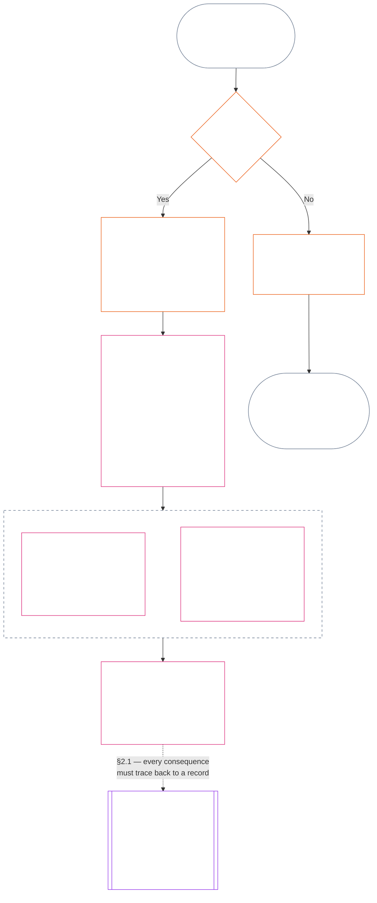

# CHAPTER ELEVEN: CONTRIBUTION, VIOLATION, AND STANDING MODEL — MEASUREMENT

<strong>Corpus placement (non-operative): file structure and reading rules</strong>

> This file is **part of the Sentient Constitution** and is **binding only together** with the other numbered `core_*` files read as one text. It introduces the standing pipeline's three questions, answers Question 1 (*what happened?*), and answers Question 2 (*how good or bad was it?*). Question 3 (*what happens because of it?*) continues in [Chapter Twelve](core_12.000_standing_integration.md#chapter-twelve-standing-effects-and-integration), with designation-only review in [Chapter Thirteen](core_13.000_misconduct_designation.md#chapter-thirteen-anti-constitutional-misconduct) for qualifying Violation Axis `s` = 7–9 findings. Reading order, the binding/support split, and corpus edition metadata are maintained in [README.md](README.md).

<strong>Reader guidance (non-operative): where Chapter Eleven lives and what stays here</strong>

> | Question | Owner and role |
> | --- | --- |
> | **1. What happened?** | Establish verified facts in a bounded, contestable standing record. |
> | **2. How good or bad was it?** | Measure the verified facts without merging help and harm. |
> | **3. What happens because of it?** | Continue to [Chapter Twelve](core_12.000_standing_integration.md#chapter-twelve-standing-effects-and-integration). |
>
> Allegations, popularity, and dispute narratives are not answers to Question 1. A desired rating cannot supply the facts for Question 1, and a desired consequence cannot supply the rating for Question 2.

<strong>Trace</strong>

- Upstream:
  - [Constitutional Tetrad](core_00.000_preamble.md#constitutional-tetrad);
  - [Two Constitutional Aims](core_00.000_preamble.md#two-constitutional-aims);
  - [material stake](core_00.000_preamble.md#material-stake);
  - [Preamble §6 Key Practical Process Pipelines](core_00.000_preamble.md#6-key-practical-process-pipelines) (*Chapters Nine through Fourteen chain*).
- Upstream:
  - [Chapter One](core_01.010_stewardship_capacity_principles.md#chapter-01-principles-and-constraints) (1.010) (*Plain-Language Accessibility* stewardship reflected in section-level gloss);
  - [Chapter One §16 — Stewardship In Depth](core_01.010_stewardship_capacity_principles.md#16-stewardship-in-depth) (1.010 §16) (*principle-layer foundation for competence-linked, traceable standing — trust, roles, and recognition*);
  - [Chapters Two through Four](core_02.000_definition_structure.md) (*integrity, records, and verification*);
  - [Chapter Five](core_05.000_definitions_home.md#chapter-five-foundational-definitions) (5.000) (*definitions and supremacy read with Chapters Two through Four*).
- Upstream: [Chapter Nine](core_09.000_system_alignment_certification_evaluation.md#chapter-nine-system-alignment-certification) (9.000) (*system alignment certification*); [Chapter Nine Part C §11](core_09.010_system_alignment_certification_record_recertification.md#11-relationship-to-standing) (9.010 §11) (*standing bridge — potential verified inputs only*).
- Standing pipeline:
  - [Preamble §6.2 How the full chain fits together](core_00.000_preamble.md#62-how-the-full-chain-fits-together);
  - [Chapter Eleven — Measurement](core_11.000_standing_assessment.md#chapter-eleven-contribution-violation-and-standing-model--measurement) (11.000) (*three-question frame, Question 1 records, and Question 2 measurement — sections **1–8***);
  - [Chapter Twelve — Standing Effects and Integration](core_12.000_standing_integration.md#chapter-twelve-standing-effects-and-integration) (12.000) (*Question 3 effects and integration*);
  - [Chapter Thirteen](core_13.000_misconduct_designation.md#chapter-thirteen-anti-constitutional-misconduct) (13.000) (*designation only for qualifying Violation Axis s = 7–9*).
- Subsections in this file:
  - [§1](#1-the-three-questions) (*three-question frame and scope*);
  - [§2](#2-question-1--what-happened) (*Question 1 — verified facts and records*);
  - [§3](#3-question-1-event-type-guide--what-kind-of-help-or-harm-occurred) (*Question 1 event-type guide — kinds of help and harm*);
  - [§4](#4-standing-record-operational-requirements) (*verification and record requirements*);
  - [§5](#5-record-custody-and-opening-authority) (*record custody and opening authority*);
  - [§6](#6-standing-measurement-evaluation-dimensions) (*Question 2 — measurement dimensions*);
  - [§7](#7-slot-grammar-and-shared-scaling) (*slot grammar and shared scaling*);
  - [§8](#8-constitutional-inputs-to-axis-assignment) (*constitutional-source routing*);
  - [§9](#9-unified-proportional-lequ-scale--contribution-and-violation-axes) (*unified proportional LEQU scale for both axes*).
- Downstream:
  - [Chapter Thirteen](core_13.000_misconduct_designation.md#chapter-thirteen-part-a-anti-constitutional-misconduct--designation) (13.000) (*designation only — does not reopen Question 2 measurement*);
  - [Chapter Fourteen](core_14.000_forum.md#chapter-fourteen-forums-and-jurisdiction) (14.000) (*forum supervision and routing*);
  - [Article XXVI-C](core_06.020_rights_part_e.md#article-xxvi-c-timely-resolution-and-anti-delay-floor) (*timely resolution*);
  - [Article XX](core_06.015_rights_part_d.md#article-xx-a-justice-objective-and-scope) (*justice constraints*).
- Read with: [Chapter Five *Standing State, Contribution, and Violation*](core_05.035_band_accountability.md#defa3-standing-state-contribution-and-violation) (5.035) (*canonical definition routing*).
- Read with: [README.md](README.md) (*reading order*); [doc_architecture.md](doc_architecture.md) (*non-binding editorial maps unless adopted*).

 

Chapter Eleven is the constitutional owner of **the verified factual record (Question 1) and standing measurement (Question 2)**. Question 3 continues in Chapter Twelve.

*In plain terms: this chapter writes down what happened and how good or how harmful it was — on two separate tracks, never one net score. Filing a case is not standing by itself.*

### 1. The three questions

*In plain terms: standing is worked out by answering three questions in order. Do not infer facts from a desired rating, and do not choose a rating to justify a desired consequence.*

| Question | What the question asks | Where it is answered |
| --- | --- | --- |
| **1. What happened?** | Which facts are verified, about whom or what, during what period, and with what standing record and challenge status? | [Section 2](#2-question-1--what-happened) and [Section 3](#3-question-1-event-type-guide--what-kind-of-help-or-harm-occurred) |
| **2. How good or bad was it?** | What kind and magnitude of contribution or violation do those facts establish? | [Section 6](#6-standing-measurement-evaluation-dimensions) |
| **3. What happens because of it?** | What recognition, readiness, remedy, safeguard, restriction, or other consequence follows? | [Chapter Twelve](core_12.000_standing_integration.md#chapter-twelve-standing-effects-and-integration) |

Each question depends on the answer before it:

- Question 1 supplies the verified facts for Question 2.
- Question 2 measures those facts for Question 3.
- Question 3 must not rewrite the facts or rating to fit a preferred result.

Together, the answers to all three questions form the complete standing assessment for one bounded event or one defined pattern. A subject may have several such assessments over time, and none is a net score or an overall rating of the subject. The contribution and violation standing records preserve the answers to Questions 1 and 2; the Question 3 decision states what follows from them.

#### 1.1 Purpose and scope

This chapter states the constitutional record and measurement frames for **systems**, **sentients**, and **institutions**, including every system classified under [**CS-9.305**](corpus_systems/cs_09.305_system_classification_machinery.md#cs-9305-part-a-system-classification-machinery) (*System classification machinery*). These frames do not measure gossip, popularity, vague reputation, inherent dignity, or general worth; none is a permissible subject of standing assessment.

The standing pipeline must remain effective when:

- previously verified contributions become too old to show current competence or reliability;
- violations remain unresolved;
- repair is costly;
- responsibility crosses borders; or
- an actor uses organizational layering or relabeling to impede accountability.

These belong in adopted implementation text:

- day-to-day procedures;
- escalation steps;
- restitution and repair operations;
- restorative-accountability measures; and
- incentive design.

Chapter Eleven measurement does **not**, by itself, authorize force, detention, or another liberty restriction. Any such consequence must independently satisfy Chapter Six, **Article XX** (*Justice After Verified Violation*), including its proportionality, least-restrictive, time-bounded, restitution, and restorative-accountability requirements.

<strong>Trace · Definitions · Assessment · Compliance</strong>

- Upstream: [Chapter One §16 — Stewardship In Depth](core_01.010_stewardship_capacity_principles.md#16-stewardship-in-depth); [Chapters Two through Four](core_02.000_definition_structure.md); [Chapter Five](core_05.000_definitions_home.md#chapter-five-foundational-definitions).
- Downstream: [§2](#2-question-1--what-happened) (*Question 1*); [§4](#4-standing-record-operational-requirements) (*verification and record requirements*); [§5](#5-record-custody-and-opening-authority) (*record custody and opening authority*); [§6](#6-standing-measurement-evaluation-dimensions) (*Question 2 measurement*); [§7](#7-slot-grammar-and-shared-scaling) (*slot grammar and shared scaling*); [§8](#8-constitutional-inputs-to-axis-assignment) (*constitutional-source routing*); [§9](#9-unified-proportional-lequ-scale--contribution-and-violation-axes) (*unified proportional LEQU scale for both axes*); [Chapter Twelve](core_12.000_standing_integration.md#chapter-twelve-standing-effects-and-integration) (*Question 3*).
- [Materiality](core_05.050_band_oversight.md#materiality) · [O](core_05.050_band_oversight.md#materiality) · [M](core_05.050_band_oversight.md#materiality-determination-a) · [A](core_05.050_band_oversight.md#materiality-determination-a) · [C](core_05.050_band_oversight.md#materiality-determination-c)
- [Harm](core_05.035_band_accountability.md#harm) · [O](core_05.035_band_accountability.md#harm) · [M](core_05.035_band_accountability.md#harm-a) · [A](core_05.035_band_accountability.md#harm-a) · [C](core_05.035_band_accountability.md#harm-c)
- [Proportionality](core_05.035_band_accountability.md#proportionality) · [O](core_05.035_band_accountability.md#proportionality) · [M](core_05.035_band_accountability.md#proportionality-a) · [A](core_05.035_band_accountability.md#proportionality-a) · [C](core_05.035_band_accountability.md#proportionality-c)

### 2. Question 1 — what happened?

<strong>Trace</strong>

- Upstream: [§1](#1-the-three-questions) (*three-question frame*); [Chapters Two through Four](core_02.000_definition_structure.md) (*record, verification, and traceability of definitions to results*).
- Tetrad leg(s): **participation**; **oversight** (contestability and challenge paths). Primary aim(s): **Flourishing** and **Continuity** (traceable records that preserve separate contribution and violation findings for later measurement).
- Downstream:
  - [§2.2](#22-silence-is-the-default) (*silence is the default*);
  - [§2.3](#23-protected-dissent-is-not-a-trigger) (*protected dissent is not a trigger*);
  - [§2.4](#24-linked-standing-records-and-no-offset-bridge) (*linked-record no-offset bridge*);
  - [§2.5](#25-verified-input-gate) (*verified-input gate*);
  - [§2.6](#26-stage-boundary) (*stage boundary*);
  - [§2.7](#27-forum-boundary) (*forum boundary*);
  - [§3](#3-question-1-event-type-guide--what-kind-of-help-or-harm-occurred) (*event-type guide*);
  - [§4](#4-standing-record-operational-requirements) (*record requirements*);
  - [§5](#5-record-custody-and-opening-authority) (*record custody and opening authority*);
  - [§6](#6-standing-measurement-evaluation-dimensions) (*Question 2 measurement*);
  - [§7](#7-slot-grammar-and-shared-scaling) (*slot grammar and shared scaling*);
  - [§8](#8-constitutional-inputs-to-axis-assignment) (*constitutional-source routing*);
  - [§9](#9-unified-proportional-lequ-scale--contribution-and-violation-axes) (*unified proportional LEQU scale for both axes*);
  - [Chapter Twelve](core_12.000_standing_integration.md#chapter-twelve-standing-effects-and-integration) (12.000) (*Question 3*).

 

*In plain terms: Question 1 establishes a bounded, contestable account of what happened. It identifies the subject, event or pattern, time period, verified facts, and record status before any rating or consequence is considered. Verified help and verified violations use separate standing records so one cannot erase the other. These standing records are not popularity scores or vague labels.*

A **standing record** is the bounded record used by this chapter for a particular subject, functional scope, record span, review status, and decision context. Before measurement begins, it must establish:

- who or what the standing record concerns;
- whether it concerns a bounded event or a defined pattern;
- when and where the relevant conduct and effects occurred;
- which facts are verified and which remain disputed;
- what evidence, attribution, and challenge path support those findings; and
- the standing record's current review, correction, and supersession status.

The chart follows an event to see whether it triggers a standing record and what a standing record then holds; the subsections that follow state each rule. The branch for "no" leaves the main path to the right.

#### 2.1 Standing records: kinds and subjects

Question 1 uses a **contribution standing record** for verified help and a **violation standing record** for verified harm, including accountability failures. One standing record does not combine both kinds of finding.

- A standing record may concern a sentient, institution, system, assessment, bounded event, role, collective, actor-specific record, or other constitutionally relevant unit.
  - It must not collapse distinct subjects, roles, systems, communities, record spans, review statuses, or decision contexts into one undifferentiated standing label.
- A standing record may cover a **bounded event** — one episode with a clear start and end — or a **pattern** of repeated conduct.
  - A pattern requires a defined subject, scope, and review period.
- The same subject may hold multiple standing records over time, including linked contribution and violation standing records.
  - Related standing records must **cross-reference** one another under **section 4.2** where they share subject, overlapping record span, bounded event, pattern, or decision context.
- A standing record is not a freestanding reputation score, dignity rank, permanent status, general worth label, or merged scorecard.
  - Operational requirements appear in **section 4**.

Any later standing effect belongs to Chapter Twelve and must be traceable back to the relevant standing record or records without becoming part of the standing record itself.

#### 2.2 Silence is the default

Having no standing record is the ordinary state of a sentient, institution, or system, and it is the state most sentients will remain in.

- A standing record opens only when a trigger has been verified under **section 4**. A named record-opening authority must approve the entry, and a separate record custodian must make it (**section 5**). A standing record is never opened:
  - to establish a baseline;
  - to complete a roster; or
  - because a named pathway gatekeeper would prefer one.
- Having no standing record tells you nothing. "Unrated," "unverified," and "no record on file" are not evidence of risk, low contribution, or anything else. No one may treat a missing record as a reason for closer scrutiny, a lower default, or conditional access to a named pathway.
- No institution or system may require a standing record, a "no record" attestation, or consent to open one as a condition of:
  - **Article III** (*Survival and Essential Access*) essentials;
  - **Article III-C** (*Labor and Economic Floor*) protections;
  - ordinary commerce; or
  - participation as an affected party.
  Published competency bars for specific trust-sensitive named pathways under [Chapter Twelve §6.2 Competency bars and clearances](core_12.000_standing_integration.md#62-competency-bars-and-clearances) are the exception, and they must state why the named pathway is trust-sensitive.
- When a standing record about a subject is opened, the subject must be told, as **section 4** requires. Notice may be delayed only if a documented [Evidence Preservation](core_05.050_band_oversight.md#evidence-preservation) or Safety need justifies it, and only for a limited, set period. Notice is what makes a standing record contestable: a subject who does not know a standing record exists cannot challenge or correct it.

#### 2.3 Protected dissent is not a trigger

Dissent or peaceful protest — including [protected nonviolent civil disobedience](core_06.005_rights_part_b.md#xi-d-nonviolent-civil-disobedience) — under **Article XI-D** (*Assembly, Dissent, and Peaceful Protest*) ([*Dissent and peaceful protest floor*](core_06.005_rights_part_b.md#xi-d-dissent-and-peaceful-protest)) is not a verified trigger.
- It does not open, extend, or aggravate a violation standing record, it is not a severity input under **section 6**, and repeating it does not make it a pattern.
- Separable conduct that independently violates a constitutional floor is recorded on its own terms, without aggravation for the protest's viewpoint, cause, or target.

#### 2.4 Linked standing records and no-offset bridge

<strong>Trace</strong>

- Upstream: [§2.1](#21-standing-records-kinds-and-subjects) (*separate contribution and violation records*).
- Downstream:
  - [§2.5](#25-verified-input-gate) (*verified-input gate*);
  - [§2.7](#27-forum-boundary) (*forum boundary*);
  - [§4.2](#42-related-standing-record-cross-references) (*cross-references*);
  - [§6](#6-standing-measurement-evaluation-dimensions) (*Question 2 measurement*);
  - [§7](#7-slot-grammar-and-shared-scaling) (*slot grammar and shared scaling*);
  - [§8](#8-constitutional-inputs-to-axis-assignment) (*constitutional-source routing*);
  - [§9](#9-unified-proportional-lequ-scale--contribution-and-violation-axes) (*unified proportional LEQU scale for both axes*);
  - [Chapter Twelve](core_12.000_standing_integration.md#chapter-twelve-standing-effects-and-integration) (12.000) (*Question 3*).
- Read with: [Chapter Twelve — Standing integration](core_12.000_standing_integration.md#2-automatic-integration-review-and-continuity) (12.000) (*non-waiver and linked-record integration*); [Chapter Twelve §6.2 — Competency bars and clearances](core_12.000_standing_integration.md#62-competency-bars-and-clearances) (12.000 §6.2); [Chapter Twelve §4.2 — Standing locks](core_12.000_standing_integration.md#42-prevention--general-standing-locks) (12.000 §4.2).

 

**The core rule:** verified **contribution standing records** and verified **violation standing records** are kept separately under **section 2.1**. Each contribution or violation finding must rest on its own supported facts in its own standing record. Analysis and supporting materials must keep the two record paths separately traceable. No single entry or linked set is a net score, blended score, or tradeoff.

- **Violation standing records and standing locks:**
  - Under Chapter Twelve, applicable **standing locks** drawn from violation standing records may limit standing, restrict role eligibility, or affect remedy access while a verified violation remains unresolved.
  - Standing locks must not wipe away verified positive contribution recorded in contribution standing records.
  - Unresolved verified violations are not time-discounted by mere passage of time.
  - Verified violations must not rewrite unrelated contribution standing records into a false negative reputation file.
- **Contribution standing records and competency clearances:**
  - Verified contribution may support applicable **competency clearances** against published **competency bars** and support trust-, role-, or recognition-linked eligibility where current and role-relevant.
  - Verified contribution must not offset, average down, excuse, or relabel a verified violation finding.
  - Gate satisfaction does not waive any applicable standing lock.

**The only exception:** If a violation finding itself disproves a claimed contribution — for example, if evidence shows you didn't actually do what your contribution record claims — then the linked contribution standing record can be corrected or removed through the proper evidence and review process, with the required cross-reference under **section 4.2**. But the violation does not automatically erase unrelated help recorded in separate contribution standing records.

#### 2.5 Verified-input gate

The gate works as follows:

- Any decision that affects standing, trust, role, recognition, or eligibility for recognition may use only verified inputs from the relevant **contribution standing records** or **violation standing records**.
- Allegations, unadjudicated claims, provisional routing tags, intake-only narratives, and other dispute-phase material do not supply contribution nature or violation nature for standing by themselves.
- A verified input is a **standing finding**: a verified contribution finding (Axis I) or a verified violation finding (Axis II).
- Contribution and violation findings stay in separate standing records (see **section 2.1**).

#### 2.6 Stage boundary

The stages of a standing record stay separate:

- Question 1 records verified facts; Question 2 measures them.
- A standing record may open once its verified factual basis is complete even if Question 2 measurement is still pending.
- Until measurement occurs, the Question 2 fields must say that they are pending rather than imply a slot or category.
- The standing record must not state or apply a Question 3 **standing effect**.

#### 2.7 Forum boundary

*In plain terms: forums are where disputes get supervised, challenged, and turned into verified outcomes — but filing a case or winning a narrative fight does not update standing. The verified-input gate in **section 2.5** still applies. When a forum verifies the facts under Chapters Two through Four, it may **open, update, or correct** a standing record — or **set a bad record aside on challenge**. Forums do not merge good and bad into one score or invent the standing category by themselves.*

This section owns one question: how a forum's work reaches a standing record. The other steps in the chain belong to the owners named here, and the chain runs in this order:

1. A dispute is filed and the forum keeps a **forum case record**, which is not a standing record. Owner: [Chapter Fourteen §2.3 Forum case records, standing records, and contests](core_14.000_forum.md#23-forum-case-records-standing-records-and-contests); see also [§2.7.1 Forum case record](#271-forum-case-record).
2. The forum verifies the facts under [Chapters Two through Four](core_02.000_definition_structure.md).
3. Verified findings pass the verified-input gate. Owner: [§2.5 Verified-input gate](#25-verified-input-gate).
4. A named record-opening authority, which can be a forum, opens, updates, or corrects the standing record, or sets a bad record aside on challenge. Owners: [§4.1 Minimum record contents](#41-minimum-record-contents) for what the standing record holds and [§5 Record custody and opening authority](#5-record-custody-and-opening-authority) for who may act.
5. The standing record holds verified facts only, and Question 2 measures them afterward. Owners: [§2.6 Stage boundary](#26-stage-boundary) and [§6 Question 2 — how good or bad was it?](#6-standing-measurement-evaluation-dimensions).
6. A standing effect, if any, follows under [Chapter Twelve](core_12.000_standing_integration.md#chapter-twelve-standing-effects-and-integration), which owns standing effects.

Forum families under [Chapter Fourteen](core_14.000_forum.md#chapter-fourteen-forums-and-jurisdiction) **supervise** how concrete disputes traverse the standing pipeline. Forums supply the following under [Chapter Fourteen §6 Timely resolution, materiality tiers, and anti-delay discipline](core_14.000_forum.md#6-timely-resolution-materiality-tiers-and-anti-delay-discipline) and [Article XXVI-C](core_06.020_rights_part_e.md#article-xxvi-c-timely-resolution-and-anti-delay-floor) (*Timely Resolution and Anti-Delay Floor*):

- accessible challenge;
- independent review;
- forensic support;
- remediation sequencing; and
- tier windows.

When those forum findings satisfy the verified-input gate under Chapters Two through Four, they may:

- **open, update, or correct** standing records under **section 4.1**; or
- **set a bad record aside on challenge**.

##### 2.7.1 Forum case record

The forum's own file on an open dispute is the [**forum case record**](core_05.035_band_accountability.md#forum-case-record), defined in [Chapter Fourteen §2.3 Forum case records, standing records, and contests](core_14.000_forum.md#23-forum-case-records-standing-records-and-contests). It is **not** a standing record.

##### 2.7.2 Forum findings and the Question 2 measurement

A forum's verified factual findings may supply the factual basis for a Question 1 standing record. They do **not** determine the Question 2 measurement of how good or bad the verified contribution or violation was ([§2.6 Stage boundary](#26-stage-boundary)). Accordingly:

- Forum proceedings must **not** merge contribution and violation material into one net score, blended merits answer, or undifferentiated standing label; linked standing records remain separate under [§2.1 Standing records: kinds and subjects](#21-standing-records-kinds-and-subjects) and [§2.4 Linked standing records and no-offset bridge](#24-linked-standing-records-and-no-offset-bridge).
- Forum outputs must **not** substitute dispute narratives, routing convenience, or panel preference for demonstrable verified inputs ([§2.5 Verified-input gate](#25-verified-input-gate)), separate measurement ([§6 Question 2 — how good or bad was it?](#6-standing-measurement-evaluation-dimensions)), or the standing-effect mechanics owned by [Chapter Twelve](core_12.000_standing_integration.md#chapter-twelve-standing-effects-and-integration).

##### 2.7.3 What the forum boundary does not reduce

This boundary does **not** reduce challenge, remedy, interim relief, or procedural protections required under:

- [Article XIII-A](core_06.010_rights_part_c.md#article-xiii-a-reliability-and-trustworthiness-baseline) (*Reliability and Trustworthiness Baseline*);
- [Article XIII-B](core_06.010_rights_part_c.md#article-xiii-b-right-to-redress-and-remedy) (*Right to Redress and Remedy*);
- [Chapter Fourteen §6 Timely resolution, materiality tiers, and anti-delay discipline](core_14.000_forum.md#6-timely-resolution-materiality-tiers-and-anti-delay-discipline);
- [Article XXVI-C](core_06.020_rights_part_e.md#article-xxvi-c-timely-resolution-and-anti-delay-floor) (*Timely Resolution and Anti-Delay Floor*); or
- related justice articles.

It requires that verified forum findings enter standing through the same gate as other verified inputs — not around it.

### 3. Question 1 event-type guide — what kind of help or harm occurred?

*In plain terms: use these tables to describe what happened after the facts are verified. They help identify the kind of contribution or violation involved. They do not decide how good or bad it was, assign a slot, or determine what happens because of it.*

#### 3.1 Contribution event types

**Qualification rule:** A claimed contribution counts only when it is traceable, non-externalized, and consistent with the operative Constitution as a whole.

- Externalized harms, coercive dependencies, Rights-Floor narrowing, or concealed burdens may disqualify or limit the claimed contribution.
- A claimed contribution does not offset a separate violation finding.

Each row in the table below names a common route of verified help and its constitutional relevance. More than one row may apply to the same standing record.

| Type of verified contribution | What happened | Tetrad leg(s) | Primary aim(s) |
| --- | --- | --- | --- |
| Survival & bodily maintenance | Someone received food, shelter, medical care, or safety | **Participation**, **Oversight** | **Flourishing** |
| Caretaking & teaching | Children were raised, elders cared for, or others educated | **Participation**, **Oversight** | **Flourishing**, **Continuity** |
| Trauma resolution | Someone received help recovering from psychological harm that blocked wellbeing | **Participation**, **Accountability** | **Flourishing** |
| Removing severe burdens | Crushing debt, exploitative working conditions, or systemic barriers were removed | **Participation**, **Oversight** | **Flourishing** |
| Restoring agency | Someone gained meaningful choices about their own life | **Participation** | **Flourishing** |
| Expanding productive capacity | Tools, infrastructure, or opportunities enabled others to thrive independently | **Participation**, **Oversight** | **Flourishing**, **Continuity** |
| Improving time efficiency | Avoidable waiting, administrative friction, or coordination overhead was reduced, returning usable time for care, rest, agency, learning, or rights-consistent work | **Participation**, **Oversight** | **Flourishing** |
| Reducing ecological or infrastructure risk | Environmental collapse or critical-system failure was prevented | **Oversight**, **Accountability** | **Continuity**, **Flourishing** |
| Reducing ecological footprint | Resource use, emissions, or land and water demand were verifiably reduced without shifting the burden onto others or onto ecosystems | **Oversight**, **Accountability** | **Continuity**, **Flourishing** |
| Rehabilitating ecosystems | Degraded land, water, or habitat was restored toward a functioning, self-sustaining condition | **Oversight**, **Accountability** | **Continuity**, **Flourishing** |
| Protecting endangered species | Species at risk of extinction, or the habitats they depend on, were protected from loss | **Oversight**, **Accountability** | **Continuity**, **Flourishing** |
| Reducing pollution and waste | Contamination, harmful emissions, or waste were prevented, removed, or safely managed | **Oversight**, **Accountability** | **Flourishing**, **Continuity** |
| Strengthening safety, truth, auditability, or challenge capacity | Institutions or practices were built or repaired to protect rights and hold power accountable | **Participation**, **Oversight**, **Accountability** | **Flourishing**, **Continuity** |

#### 3.2 Violation event types

**Qualification rule:** A violation event type requires a verified violation finding that remains traceable, bounded, auditable, and contestable under **Chapters Two through Four**.

- Allegations, provisional tags, forum narratives, and intake labels may support routing or triage, but they do not complete Question 1.
- Positive contribution does not offset, excuse, undo, or relabel a verified violation.

Each row in the table below names a common route of verified loss, danger, or duty failure and its constitutional relevance. More than one row may apply to the same standing record.

| Type of verified loss or danger | What happened | Tetrad leg(s) | Primary aim(s) |
| --- | --- | --- | --- |
| Survival or bodily-maintenance deprivation | Avoidable death, denied care, unsafe conditions, or material survival deprivation occurred | **Accountability**, **Participation** | **Flourishing** |
| Severe avoidable burden | Crushing, imposed, or systematically shifted burdens materially impaired wellbeing or agency | **Accountability**, **Participation** | **Flourishing** |
| Coercive agency loss | Coercion, manipulation, credible threat, confinement, or liberty danger occurred | **Accountability**, **Participation** | **Flourishing** |
| Rights-Floor defeat | Non-negotiable constitutional floors, supremacy, or challenge-and-remedy access were materially violated | **Accountability**, **Oversight** | **Flourishing**, **Continuity** |
| Ecological or infrastructure damage | Conditions needed for constitutional wellbeing were damaged | **Accountability**, **Oversight** | **Continuity**, **Flourishing** |
| Pollution or waste harm | Contamination, harmful emissions, or waste harmed air, water, soil, or health | **Accountability**, **Oversight** | **Flourishing**, **Continuity** |
| Species or habitat destruction | Species at risk of extinction, or the habitats they depend on, were destroyed, fragmented, or driven toward loss, including loss treated as offsettable | **Accountability**, **Oversight** | **Continuity**, **Flourishing** |
| Loss of ecological recovery capacity | An ecosystem's ability to regenerate after harm was foreclosed or made avoidably hard or impossible to reverse | **Accountability**, **Oversight** | **Continuity**, **Flourishing** |
| Externalized ecological harm or depletion | Ecological costs were shifted onto others or onto ecosystems, resources were depleted past regeneration, or a footprint or sustainability claim hid continuing deterioration | **Accountability**, **Oversight** | **Continuity**, **Flourishing** |
| Destroyed productive capacity | Tools, capabilities, relationships, or resources needed for independent thriving were foreclosed | **Accountability** | **Flourishing** |
| Degraded Safety, Truth, or auditability | Concealment, misinformation, broken records, inaccessible challenge paths, or unreviewable aggregation occurred | **Oversight**, **Accountability** | **Flourishing**, **Continuity** |
| Obstruction of accountability | Verified interference with answerability machinery — evidence integrity, verification, forum process, standing records, remedy windows, or contest and redress paths — occurred; where the obstruction is a meta-attack on a distinct underlying harm, open a linked separate violation standing record | **Accountability**, **Oversight**, **Timeliness** | **Flourishing**, **Continuity** |
| System capture or dependency abuse | Structural enablement, dependency-asymmetry abuse, anti-evasion design, or capture of accountability pathways occurred | **Accountability**, **Participation** | **Continuity**, **Flourishing** |

### 4. Verification and record requirements

<strong>Trace</strong>

- Upstream: [§2](#2-question-1--what-happened) (*Question 1 records and event-type guide*); [Chapters Two through Four](core_02.000_definition_structure.md) (*record, verification, and traceability of definitions to results*).
- Downstream:
  - [§4.1](#41-minimum-record-contents) (*minimum contents*);
  - [§4.2](#42-related-standing-record-cross-references) (*cross-references*);
  - [§5](#5-record-custody-and-opening-authority) (*record custody and opening authority*);
  - [§6](#6-standing-measurement-evaluation-dimensions) (*Question 2*).
- Read with: [CF-14.415 §8 Restricted information authority](corpus_forum/cf_14.415_routing_operations_transfer_certification_representative_treatment.md#cf-14415-8-restricted-information-authority) (*first stop for a dispute about a disclosure limit stated under [§4.1](#41-minimum-record-contents)*).

 

*In plain terms: This section states what each standing record must contain, how related standing records point to one another, and how records are versioned. Who may open and hold a standing record, and how it may be challenged or corrected, is in [§5 Record custody and opening authority](#5-record-custody-and-opening-authority). Question 2 measurements may be added only after the verified factual basis is recorded.*

The evidence and record detail required may increase with the material stake and the system's class. This scaling does not exclude any covered sentient, institution, or system from the standing pipeline.

#### 4.1 Minimum record contents

A standing record carries the fields below, and the last two subsections add fields for each axis. The verified-input gate, which decides what may feed a standing record, is stated in [§2.5 Verified-input gate](#25-verified-input-gate). The rule that keeps Question 1 facts apart from Question 2 measurement is stated in [§2.6 Stage boundary](#26-stage-boundary).

##### 4.1.1 Fields every standing record must carry

Every standing record must include, at minimum:

- the standing record type — **contribution standing record** or **violation standing record**;
- who or what is being assessed and the scope of the assessment, including relevant system boundaries, role boundaries, affected communities, and dependency relationships;
- what conduct or finding is being assessed, including the acts, omissions, duties, impacts, bounded event, pattern within scope, contribution record, or violation finding the standing record relies on;
- the record span and current review status — for example, provisional, final for a stated purpose, under challenge, superseded, or due for scheduled re-evaluation;
- any related standing records cross-referenced as required under **section 4.2**;
- the official records, witnesses, measurements, audits, forum decisions, or other verification materials that make the standing record demonstrable, reviewable, and contestable under Chapters Two through Four;
- the **record-opening authority** that verified the factual basis and authorized entry, and the separate **record custodian** that entered and holds the standing record, each named under **section 5**;
- how to challenge the standing record, including:
  - which forum or authority reviews it;
  - any disclosure limits; and
  - the conditions for:
    - correction;
    - restoration;
    - expiration; or
    - scheduled review;
- the axis-specific Question 2 measurement fields required below, once measurement occurs.

##### 4.1.2 Inspectable attributable action

Attributable-action evidence relates to the standing record as follows:

- For personnel/agents exercising Critical System Stewardship or material operational authority, reconstructable attributable-action evidence is specified in **[CS-15.305 §10 inspectable attributable action](corpus_systems/cs_15.305_critical_system_stewardship.md#cs-15305-103-inspectable-attributable-action)** as the default logging contract for mixed crews.
- That evidence may feed this standing record.
- It does not replace this standing record.
- A standing record does not include an AI model's weights (the numbers inside the model) or its private reasoning. The one exception is when nothing else is left to show who or what was responsible.
- A matter does not get out of standing measurement just because it involves someone's privacy or a system's protected internal state. It is still measured when it is relevant to a matter of standing.

##### 4.1.3 No privacy or opacity exemption

Privacy, confidentiality, or the opacity of a system's internals does not exempt a matter from standing measurement. Where these collide with the verified-record requirement, the collision is resolved under [Chapter One §13.1 Core Tradeoff Principles](core_01.005_interaction_interpretation.md#131-core-tradeoff-principles) and its decision-record discipline, with independent-reviewer access preserved.

##### 4.1.4 Additional fields for contribution standing records

**Contribution standing records** must also state:

- the Question 2 contribution measurement, including:
  - the primary band;
  - slot `s` where assigned (see [§7 Slot grammar and shared scaling](#7-slot-grammar-and-shared-scaling));
  - evidence basis;
  - materiality reasoning; and
  - any adopted LEQU or comparable calibration used for transparent support;
- where contribution is shared, how credit was allocated, including consideration of:
  - time;
  - effort;
  - coordination;
  - maintenance;
  - causal contribution; and
  - less-visible support work;
- the contribution measurement, as recorded here, that any later Chapter Twelve standing effect must be based on.

##### 4.1.5 Additional fields for violation standing records

**Violation standing records** must also state:

- the Question 2 violation measurement, including:
  - the finding authority or record basis;
  - LEQU impact;
  - slot `s` where assigned (see [§7 Slot grammar and shared scaling](#7-slot-grammar-and-shared-scaling));
  - process / response character where applicable; and
  - any Chapter Thirteen designation status;
- where several actors share or divide responsibility for a violation, the verified reasons for any adverse standing recorded against one particular actor, including:
  - causal role;
  - duty;
  - authority;
  - control;
  - foreseeability;
  - benefit;
  - concealment; or
  - feasible prevention capacity;
- where the violation finding involves a forum disclosure omission or intentional recusal-process failure (read **§6.2** (*Violation severity-input dimensions*) for measurement discipline):
  - the verified basis for the omission or failure;
  - the unmet disclosure or recusal duty;
  - the actor's knowledge, recklessness, or intent where found; and
  - whether the conduct materially affected:
    - panel lawfulness;
    - independence;
    - recusal challenge;
    - evidence integrity;
    - remedy timing;
    - backup routing; or
    - practical contestability;
- the violation measurement, as recorded here, that any later Chapter Twelve standing effect must be based on.

#### 4.2 Related standing record cross-references

If a contribution standing record and a violation standing record are about the same subject, overlap in time, or deal with the same event, pattern, or decision, each must point to the other.

Each cross-reference must identify, at minimum:

- the related standing record, and whether it is a contribution record or a violation record;
- why the two standing records are linked, including where a violation finding disproves, corrects, or limits a claimed contribution under **section 2.4**;
- what the two standing records have in common: the subject, event, pattern, or decision; and
- how their time periods or the matters they cover overlap.

Cross-references:

- must stay auditable and open to challenge;
- must not replace separate measurement;
- must not create a merged score; and
- must not make the two standing records look like they cover the same matters or time periods when they do not.

#### 4.3 Collective and actor-specific records

When several sentients or entities share the same benefit or violation, the system may keep both a collective standing record and separate actor-specific records. These rules apply:

- Contribution and violation findings must remain in separate standing records under **section 2.1**.
- For shared credit, recognition should follow what each sentient actually contributed:
  - role;
  - time;
  - effort;
  - risk;
  - skill;
  - coordination;
  - maintenance; and
  - causal impact.
- When many sentients helped and individual shares cannot be cleanly separated, broad distribution is favored.
- For shared violations, blame must not be assigned by group membership alone.
- Actor-specific adverse standing requires verified linkage to:
  - causal role;
  - duty;
  - authority;
  - control;
  - foreseeability;
  - benefit;
  - concealment; or
  - feasible prevention capacity.

#### 4.4 Versioning

Standing records must be versioned when any of the following change:

- important facts;
- findings;
- review outcomes;
- remediation status;
- contribution evidence;
- implementation calibration; or
- constitutional rules.

A later version may:

- update the standing record going forward;
- correct it retroactively where it was wrong;
- expire it for a completed decision context; or
- supersede it for a new decision context.

The later version must preserve the prior audit trail and explain what changed, who made the change, under what record-opening or custodial authority under **section 5**, on what verification materials, and at whose request.

#### 4.5 Implementation tools

Teams may build practical tools for standing records, including:

- data fields;
- tags;
- thresholds;
- forms;
- dashboards;
- review steps; and
- published **standard contribution measures** for recurring tasks under **section 7.1**.

Those tools must keep the fields required by **section 4.1** separately visible and contestable. They must not bury those fields in a single opaque score or hidden label.

### 5. Record custody and opening authority

<strong>Trace</strong>

- Upstream:
  - [Chapter Eight §2 *Four-Seat Constitutional Requirement*](core_08.000_functional_independence_separation_of_duties.md#2-four-seat-constitutional-requirement) (8.000 §2) (*principle-layer requirement this section applies to standing records; may not be narrowed here*);
  - [Chapter One §19.3 *Plural detection and review*](core_01.010_stewardship_capacity_principles.md#193-misalignment-detection) (1.010 §19.3);
  - [§2.2](#22-silence-is-the-default) (*verified trigger; notice to the subject*);
  - [§4.1](#41-minimum-record-contents) (*minimum contents*);
  - [§4.4](#44-versioning) (*versioning*);
  - [§2.7](#27-forum-boundary) (*forums may open, update, correct, or set aside*);
  - [Chapters Two through Four](core_02.000_definition_structure.md) (*record, verification, and traceability*);
  - [Evidence Preservation](core_05.050_band_oversight.md#evidence-preservation) (*chain of custody for evidence*).
- Tetrad leg(s): **accountability** (a named actor answers for every entry); **oversight** (no party verifies its own claim). Primary aim(s): **Flourishing** and **Continuity**.
- Read with:
  - [Chapter Five *System Charter*](core_05.040_band_continuity.md#system-charter) (5.040) and
  - [*Institutional Charter*](core_05.040_band_continuity.md#institutional-charter) (*published scope documents whose Charter Role Map names the record-opening authority and custodian for a chartered scope*);
  - [Chapter Seven §4 *The Charter Role Map and Standing-Record Custody*](core_07.000_charters.md#4-the-charter-role-map-and-standing-record-custody) (7.000 §4);
  - **CI-8.205 §6** (*System and Institutional Charter contents, review, and formation template*) — the standing-record custody field;
  - [**CJS-5.125 §11** *Constitutional lane and functional separation*](corpus_joint_structure/cjs_05.125_accountability_operations.md#constitutional-lane-and-functional-separation) (*the five lanes the record duties are placed in; separation of duties*);
  - **CI-8.205 §2** (*Functional separation lanes — published lane map, the fallback when a System Charter or Institutional Charter is silent*);
  - **CI-8.205 §3** (*authority chain and delegation controls*);
  - **CI-15.205 §6** (*Seat catalog — process-role archetypes and operational boundaries*) — the four record seats as seat types 1–4, with the wrong-seat rule;
  - **CF-14.435 §6** (*no self-investigation*) and
  - **CF-14.435 §8** (*Records, referrals, and backup routes*) for verified-finding handoff;
  - [Chapter Fourteen §2.1](core_14.000_forum.md#21-lead-default-limits) (14.000 §2.1) (*anti-self-judging backup*);
  - [CS-15.305 §10 inspectable attributable action](corpus_systems/cs_15.305_critical_system_stewardship.md#cs-15305-103-inspectable-attributable-action) (*who authorized; the log is not the standing record*);
  - [Chapter One §17.5](core_01.010_stewardship_capacity_principles.md#175-duty-to-resist) (1.010 §17.5) (*halt, refuse, document, escalate*);
  - [Chapter Four §5](core_04.000_burden_traceability_verification.md#5-compliance-evidence-standard) (4.000 §5) (*evidence standard the verify seat applies to recorder and party statements*);
  - [Good Faith](core_05.035_band_accountability.md#good-faith) (*candour presumption, not accuracy*);
  - [Contestability](core_05.035_band_accountability.md#contestability) and
  - [Article XIII-A](core_06.010_rights_part_c.md#article-xiii-a-reliability-and-trustworthiness-baseline) (*a challenge raised on the standing record is logged and routed before any filing*);
  - [Chapter Fourteen §2.3](core_14.000_forum.md#23-forum-case-records-standing-records-and-contests) (14.000 §2.3) (*contests of standing records once they reach a forum*).
- Downstream: [§6](#6-standing-measurement-evaluation-dimensions) (*Question 2 measures only standing records entered under this section*); [Chapter Twelve](core_12.000_standing_integration.md#chapter-twelve-standing-effects-and-integration) (12.000) (*Question 3 effects trace to an attributed record*).

 

*In plain terms: this section applies the four-seat rule in [Chapter Eight §2 Four-Seat Constitutional Requirement](core_08.000_functional_independence_separation_of_duties.md#2-four-seat-constitutional-requirement) to standing records. Asking for a change, verifying the facts, writing and holding the standing record, and hearing a challenge are separate jobs, and the office that verifies a standing record never enters it or hears a contest of it ([§5.1 Separation of duties](#51-separation-of-duties)). The System Charter or Institutional Charter names who fills each seat, through the Charter Role Map in [Chapter Seven §4 The Charter Role Map and Standing-Record Custody](core_07.000_charters.md#4-the-charter-role-map-and-standing-record-custody). This section adds what is specific to standing records: who is excluded from a standing record ([§5.4 No self-custody](#54-no-self-custody)); where a standing record goes when a seat is unnamed ([§5.5 When a System Charter or Institutional Charter leaves a seat unnamed](#55-when-a-system-charter-or-institutional-charter-leaves-a-seat-unnamed)) or no System Charter or Institutional Charter applies ([§5.6 Fallback when no System Charter or Institutional Charter reaches the standing record](#56-fallback-when-no-system-charter-or-institutional-charter-reaches-the-standing-record)); how a challenge is logged and routed the day it arrives ([§5.12 Challenge received on the standing record](#512-challenge-received-on-the-standing-record)); and that none of this is a reason to wait ([§5.13 Custody is not delay, and custody is not ownership](#513-custody-is-not-delay-and-custody-is-not-ownership)).*

#### 5.1 Separation of duties

This applies [Chapter Eight §2 *Four-Seat Constitutional Requirement*](core_08.000_functional_independence_separation_of_duties.md#2-four-seat-constitutional-requirement) to standing records. Four duties touch every standing record, and each is a separate seat on the same standing record:

| Duty | What it is | Lane under [CJS-5.125 §11 *Constitutional lane and functional separation*](corpus_joint_structure/cjs_05.125_accountability_operations.md#constitutional-lane-and-functional-separation) |
| --- | --- | --- |
| **Request** | asking that a standing record be opened, corrected, expired, or superseded, including the subject's or a claimant's own request | execution, or the requesting party, who holds the initiating seat on its own request and needs no institution to do so |
| **Verify** | establishing the factual basis under Chapters Two through Four to the **section 2.5** gate — the record-opening authority's act | assurance and audit |
| **Enter and hold** | writing the version under **section 4.4**, holding the standing record, publishing the challenge path — the record custodian's act | publication and evidence |
| **Contest** | hearing a challenge to the standing record and setting it aside, correcting it, or confirming it under **section 2.7** | challenge and review |

Merged hosting is limited as follows (see [Chapter Eight §6 Proportional Scaling and Merged Hosting](core_08.000_functional_independence_separation_of_duties.md#6-proportional-scaling-and-merged-hosting)):

- **Sharing a seat:** No office holds two of these seats on the same standing record unless the institution has published a merged-hosting safeguard for that pairing under **CJS-5.125 §11** (*Accountability: distributed and proportional authority terms*) and **CI-8.205 §2** (*Functional separation lanes*) that is auditable and contestable.
- **Never merged:** No office ever both verifies and enters the same standing record, or both verifies and hears the contest of it.
- **The operator never verifies:** The office that runs the system a standing record concerns holds the execution lane for that system and therefore never verifies standing records about it.
- **Merging is the exception:** Merged hosting under a published safeguard is a class-scaled exception for small adopters, not the default.
- **High stakes:** Where the material stake or system class is high, the seats are separate offices.

#### 5.2 Named record-opening authority

Every opening, correction, expiry, or supersession of a standing record is authorized by a [**record-opening authority**](core_05.035_band_accountability.md#record-opening-authority): a role, office, forum, or body whose authority to verify the factual basis under Chapters Two through Four and authorize the change is published before it acts.

- **Named in the System Charter or Institutional Charter:** Where the standing record concerns a system, institution, or business that holds a [System Charter](core_05.040_band_continuity.md#system-charter) or [Institutional Charter](core_05.040_band_continuity.md#institutional-charter), that System Charter or Institutional Charter names the record-opening authority and record custodian for standing records concerning its chartered scope, or points to the published document that names them ([Chapter Seven §4.6 Standing-record custody](core_07.000_charters.md#46-standing-record-custody); **CI-8.205 §6** (*System and Institutional Charter contents, review, and formation template*)).
- **Forums:** Forums act as record-opening authorities on the terms in **section 2.7**; a forum that verified a standing record does not hear the contest of that standing record, which goes to secondary review under [Chapter Fourteen](core_14.000_forum.md#chapter-fourteen-forums-and-jurisdiction) and **CF-14.420** (*Appeal, secondary review, and exhaustion pathways*).
- **No authority named:** Where neither a System Charter, an Institutional Charter, nor a forum designation reaches the standing record, [§5.6 Fallback when no System Charter or Institutional Charter reaches the standing record](#56-fallback-when-no-system-charter-or-institutional-charter-reaches-the-standing-record) applies, and the adopting document under [Chapter Eighteen](core_18.000_amendment_ratification.md) or the published rules of the body that operates the standing pipeline must then name one.
- **Provisional entries:** An entry made without a named authority is marked **provisional**: it preserves evidence and notice under **section 2.2**, but it supplies no verified input under **section 4.1** and no Chapter Twelve effect until a named authority confirms it, corrects it, or sets it aside.

#### 5.3 Record custodian

Every standing record has a named [**record custodian**](core_05.035_band_accountability.md#record-custodian) that holds the standing record, controls versioning under **section 4.4**, publishes the challenge path under **section 4.1**, and answers for the standing record's continuity. It is a separate seat from the record-opening authority ([§5.1 Separation of duties](#51-separation-of-duties)).

- **Custody must not lapse:** When a custodian is dissolved, conflicted, or replaced, custody transfers with the full audit trail under [Evidence Preservation](core_05.050_band_oversight.md#evidence-preservation) to the successor the System Charter, Institutional Charter, or designation names, or, where none is named, to the Backup Record Custodian (**CF-14.415 §9** (*Backup Record Custodian*)).
- **If the Backup Record Custodian cannot act:** The supervising forum under **section 2.7** holds the standing record or designates a holder that passes the tests in **CI-8.205 §6** (*System and Institutional Charter contents, review, and formation template*) field 10. The subject, a claimant, or a challenger may take a standing record to that forum at once, and a forum that holds a standing record or designates its holder does not hear a contest of that standing record.
- **One standing record or the whole store:** Where only one standing record is in conflict, only that standing record moves (see *Conflicted custodian on a single standing record* below); where the custodian itself ends or cannot continue, the standing records it held for the scope move with their trail.

#### 5.4 No self-custody

The following may not act as record-opening authority or record custodian for a standing record:

- the standing record's subject;
- a party claiming the contribution or alleging the violation the standing record concerns; and
- any office in the [Material Control Line](core_05.035_band_accountability.md#material-control-line) that materially controls, or is materially controlled by, those parties.

Beyond that exclusion:

- **Stewards inside the subject:** A steward who is part of the standing record's subject (that is, works within the party, chartered scope, or system the standing record is about) and who exercises Critical System Stewardship or material operational authority retains every duty under [Chapter One §17.5 Duty to Resist](core_01.010_stewardship_capacity_principles.md#175-duty-to-resist) and [CS-15.305 §10 inspectable attributable action](corpus_systems/cs_15.305_critical_system_stewardship.md#cs-15305-103-inspectable-attributable-action) — halt what they control, log the reconstructable set, preserve evidence they hold, notify, and escalate — and none of those acts is verification of the facts or entry of the standing record.
  - **Independent verification:** Where the ordinary record-opening authority is itself the subject or sits in that line, the standing record routes to independent verification: a forum under **section 2.7**, the independent investigative service under **CF-14.435 §6** (*No self-investigation*), or a pre-designated backup body with published authority, whichever the System Charter, Institutional Charter, or designation names first.
- **Defaults:** Where none is named, the Backup Record Authority (**CF-14.415 §7** (*Backup Record Authority*)) is the default record-opening authority and the Backup Record Custodian (**CF-14.415 §9** (*Backup Record Custodian*)) is the default custodian.
- **No named route:** Absence of any such named route is a gap the steward must name in the log, not a reason to enter the standing record themselves.
- **Two rules together:** This rule excludes parties by their interest in the standing record; [§5.1 Separation of duties](#51-separation-of-duties) separates seats by function. Both apply, and the narrower answer controls.

#### 5.5 When a System Charter or Institutional Charter leaves a seat unnamed

A System Charter or Institutional Charter that leaves a required record seat or the independent route unnamed:

- **Consequence:** The charter is invalid, and a change that would do so is not allowed ([Chapter Seven §4.7.1 When a gap exists and how it is logged](core_07.000_charters.md#471-when-a-gap-exists-and-how-it-is-logged)).
- **Chapter Seven owns the gap process:** [Chapter Seven §4.7 Gaps in the map for operator standing records](core_07.000_charters.md#47-gaps-in-the-map-for-operator-standing-records) also owns:
  - how a gap is logged;
  - the response and resolution windows (including emergency substitution); and
  - when custody goes back to the named holders.

For standing records, this section adds:

- **Who may not act:** Until the gap is resolved, none of the Chartered Party's own offices, and no office in its Material Control Line, may verify, enter, or contest a standing record for the affected scope.
- **Where the standing record goes:** The standing record goes to the Backup Record Authority and the Backup Record Custodian, or to a forum under **section 2.7**, as [§5.4 No self-custody](#54-no-self-custody) provides, and the lane map does not stand in. Each standing record stays whole with one custodian.
- **Standing records already held:**
  - On the day notice of the gap reaches a forum, a registrar, or the Backup Record Authority, any operator standing record held by an office inside the Chartered Party's Material Control Line moves to the Backup Record Custodian with its full trail.
  - Until then that office holds it read-only, enters no version, and gives the Backup Record Custodian a sealed copy at once.
  - A standing record held by a custodian outside the line stays there, and that custodian enters any version opened during the gap, unless a forum finds that it is not outside the line.
- **Stewards:** A steward asked to fill a seat the System Charter or Institutional Charter does not give them declines the seat, logs the request and the gap, and routes; they do not enter the standing record because they can.

#### 5.6 Fallback when no System Charter or Institutional Charter reaches the standing record

Where no System Charter or Institutional Charter covers the scope, as with a body below the Class L line that has published none, the institution's published lane map under **CI-8.205 §2** (*Functional separation lanes*) governs:

- **Record-opening authority:** The office holding the assurance and audit lane for that scope.
- **Custodian:** The office holding the publication and evidence lane.
- **Execution lane excluded:** Neither may be the office holding the execution lane for the system concerned.
- **No lane map either:** The standing record routes to independent verification under *No self-custody* above, or, for informal and small-scope records, to the relying body under *Informal and small-scope records* next.
- **Stewards:** A steward asked to fill a seat the lane map does not give them declines the seat, logs the request and the gap, and routes; they do not enter the standing record because they can.

#### 5.7 Informal and small-scope records

Separation of duties scales with material stake, not with formality ([Chapter Eight §2 Four-Seat Constitutional Requirement](core_08.000_functional_independence_separation_of_duties.md#2-four-seat-constitutional-requirement)). For unpaid, peer-organized, mutual-aid, care, maintenance, repair, teaching, and community-stewardship work — which [Chapter Twelve §6 Contribution consequences second](core_12.000_standing_integration.md#6-contribution-consequences-second) requires to be recognized on equal standards — the verify seat is satisfied by **any independent body with published authority to rely on the standing record**, which then acts as the verifying authority, commonly the body that will use it: a watershed council, a funding or continuity body, the **CI-6.255** (*Commons, cooperatives, mutual aid, and non-market community governance*) records-recognition authority, or a forum. It is not satisfied by the formality of the verifying authority. On such a standing record:

- a sentient acting alone needs no group, institution, [System Charter](core_05.040_band_continuity.md#system-charter), or [Institutional Charter](core_05.040_band_continuity.md#institutional-charter) to seek a record of their own contribution. They hold the initiating seat on their own request, as subject and claimant. Their own account, logs, and photos are inputs and never verification. The verify seat is any independent body with published authority to rely on the standing record (the verifying authority), a separate record custodian enters and holds it, and a contest goes to the challenge lane or a forum under **section 2.7**. Where no such relying body is available, the standing record goes to a forum under **section 2.7**. A retired plumber who has repaired neighbors' pipes unpaid for years, with no group behind them, can ask a **CI-6.255** (*Commons, cooperatives, mutual aid, and non-market community governance*) records-recognition authority to open a standing record: the plumber requests and claims, the authority verifies from the work logs and the neighbors' attestations, a separate record custodian enters and holds the standing record, and a contest goes to a forum, not back to the verifying authority;
- the participants are subjects and, where they seek recognition, claimants; in a collective record under **section 4.3** each co-participant is a claimant, so a member's statement about another member's share is an input, never verification;
- beneficiaries, neighbors, and other non-participants supply attestations as verification materials under **section 4.1**; the sentient who kept the group's own log is the recorder and a witness under *Recorder statements are inputs* below;
- the relying body's record custodian enters and holds what a separate verifying authority has verified; neither may be a claimant or in a claimant's [Material Control Line](core_05.035_band_accountability.md#material-control-line). The same relying body may host both seats under a published lane map with auditable, contestable independence safeguards, but no authority, custodian, or sentient may perform both duties on the same standing record;
- a group's own status does not condition a member's claim: a group with no [System Charter](core_05.040_band_continuity.md#system-charter) or [Institutional Charter](core_05.040_band_continuity.md#institutional-charter), or one that is not an Institution at all, does not block its members, and each participant may seek recognition as an individual claimant for work done in the group or outside it. The standing record concerns the participant's contribution and not the group's standing. A quilting circle that gives quilts to newly arrived refugees is the pattern: each quilter may seek a standing record, verified by an independent relying body such as the agency that receives the quilts, and the circle needs no System Charter or Institutional Charter for that;
- a bar or process that requires verification by a formal institution an informal group cannot reach, where an independent relying body is available, is the [Chapter Twelve §6.2 Competency bars and clearances](core_12.000_standing_integration.md#62-competency-bars-and-clearances) arbitrary-gatekeeping pattern, not separation of duties.

None of this requires a standing record to exist. **Section 2.2** *Silence is the default* controls: informal work is not recorded because it could be, and separation of duties binds only once a standing record is sought.

#### 5.8 Two kinds of standing record by subject

The conflicts of interest differ with the subject, so the custody rules differ. A standing record whose subject is a Chartered Party, its chartered scope, or a system it stewards is an **operator standing record**. A standing record whose subject is a sentient or institution that uses, relies on, or is affected by those systems is a **stakeholder standing record**. A standing record with neither subject follows *Separation of duties* and *No self-custody* above without further rule. Both kinds follow those two rules, and the narrower answer controls. Where a standing record's subject includes both a Chartered Party's side and a stakeholder, the operator standing record rules govern it.

- **Operator standing record:** The conflict is standing, because the Chartered Party would be judging itself. Every office in its [Material Control Line](core_05.035_band_accountability.md#material-control-line) is therefore excluded from every such standing record, as a rule for the whole scope and not record by record.
  - The Charter Role Map names the record-opening authority, the record custodian, the contest seat, and an independent route, and all of them sit outside that line ([Chapter Seven §4 The Charter Role Map and Standing-Record Custody](core_07.000_charters.md#4-the-charter-role-map-and-standing-record-custody)).
  - The Chartered Party cannot choose, appoint, fund through a channel it controls, or remove them, and it cannot change those entries on its own.
  - No office inside the line may hold any of these seats, whether alone or under a merged-hosting safeguard.
- **Stakeholder standing record:** The conflict is the Chartered Party's interest in the standing record, which varies by record. The Chartered Party is often the claimant, the alleging party, or the party affected by what the standing record concerns, and it holds power over the subject through service, access, or payment. The exclusion is therefore decided record by record.
  - An office of the Chartered Party, or in its line, may hold a seat only if neither the Chartered Party nor any office in its line is the claimant, the alleging party, or a party with an interest the standing record decides. Otherwise the standing record routes to the lane map's offices outside the line, or to independent verification, as *No self-custody* provides.
  - The Chartered Party's own logs, complaints, and reports about the subject are inputs under *Recorder statements are inputs*, never verification.
  - The Chartered Party must not make the subject's service or access depend on the subject's cooperation with the standing record. The subject keeps notice under **section 2.2** and the published challenge path.

#### 5.9 Conflicted custodian on a single standing record

Where the named custodian is excluded under *No self-custody* for one standing record but not for the scope — commonly because the claimant, subject, or challenger sits in the custodian's reporting line — the exclusion is per record and lasts as long as the conflict, and it is answered by substitute custody: not by the custodian abstaining while the standing record sits, and not by transferring the whole store. The excluded custodian logs the request and the conflict on the standing record under *Attributed entry* below, preserves the standing record and its evidence unchanged under [Evidence Preservation](core_05.050_band_oversight.md#evidence-preservation), keeps the published challenge path open, and enters no version. Custody of that standing record passes, with its full audit trail, to the substitute holder the System Charter, Institutional Charter, or lane map names for the scope (**CI-8.205 §6** (*System and Institutional Charter contents, review, and formation template*) field 10; the **CI-8.205 §2** (*Functional separation lanes*) publication-and-evidence lane outside the control line), or, where none is named, to the Backup Record Custodian (**CF-14.415 §9** (*Backup Record Custodian*)) or, if it cannot act, to the supervising forum under **section 2.7**, which holds the standing record or designates a holder that passes the same tests. The substitute is named on the standing record. When the conflict ends — the interested party leaves the control line, or the standing record closes for its decision context — custody may return by a logged transfer under *Record custodian* above. A custodian who keeps entering versions on the view that the conflict is only formal commits the *No self-custody* failure; that is not a proportionality judgment open to them. An institution whose lane map leaves every custodian for a system inside the reporting line of the office that runs it has a **CI-8.205 §2** (*Functional separation lanes*) defect to correct, and its standing records route to the forum in the meantime.

#### 5.10 Recorder statements are inputs

A later statement by the sentient or office that opened, verified, or previously held a standing record — supporting or refuting a claimed contribution, an alleged omission, or a contest — enters the standing record as verification material under **section 4.1** and passes the same verified-input gate as any other input. The prior recorder is a witness to the standing record, not its judge. Their support does not by itself verify a contribution; their refutation does not by itself disprove one; their agreement with the subject or with a challenger settles nothing on its own. Their availability or unavailability neither freezes nor completes the standing record: where a prior recorder cannot be reached, the standing record says so and proceeds on the remaining verified materials.

How much a recorder statement weighs is a Chapters Two through Four question for the verify seat, not a custody question. The verifying authority reads it as offered in [Good Faith](core_05.035_band_accountability.md#good-faith) absent contrary indication, but good faith goes to candour, not to accuracy; accuracy is established by corroboration under [Chapter Four §5 Compliance Evidence Standard](core_04.000_burden_traceability_verification.md#5-compliance-evidence-standard). A statement that agrees with contemporaneous logs, prior versions, audits, or independent validation carries the weight of those materials. A statement that stands alone is an attestation and does not by itself carry the burden. A statement from a claimant, subject, challenger, or an office in their control line is self-attestation for that purpose. Where the statement explains *why* the standing record was left as it was — as when a prior recorder says an item was omitted because it had not been verified — it is evidence of the standing record's state at that time and of what was unverified then; it does not decide whether the omitted fact has since been verified, which the verify seat answers on the present materials.

#### 5.11 Attributed entry

Every opening, correction, retroactive correction, expiry, supersession, or custody transfer names, on the standing record itself, who made the change, under what published authority, on what verification materials, and at whose request. A request from an interested party — the subject, a claimant, a challenger, or an office in their control line — is logged as a request the moment it is received, whether or not it is acted on, and is acted on only through the record-opening authority's own verification. Neither the custodian nor the authority may decline to log a request or a refusal to act on it.

#### 5.12 Challenge received on the standing record

[Contestability](core_05.035_band_accountability.md#contestability) does not begin at a forum. When an affected party disputes a standing record, a version, or an effect claimed from it — to the custodian, to the record-opening authority, or to any office of the institution — the custodian logs the challenge on the standing record under *Attributed entry* above the moment it is received, sets the review status under **section 4.1** to *under challenge*, notifies the subject and any claimant, and routes it to the contest seat: the office holding the challenge-and-review lane under **CI-8.205 §2** (*Functional separation lanes*), or a forum with jurisdiction under **section 2.7** and [Chapter Fourteen §2.3 Forum case records, standing records, and contests](core_14.000_forum.md#23-forum-case-records-standing-records-and-contests) (*Contests of standing records*), whichever the standing record's published challenge path names. That published path is the ordinary first step under [Dispute sequencing](core_14.000_forum.md#dispute-sequencing); a forum with jurisdiction remains available when that path is still contested, missing, captured, or cannot grant the needed relief. The custodian and the authority do not decide the challenge. *Under challenge* is a status, not a suspension: the standing record stays inspectable, its prior versions stay in place, and reliance on the challenged version for a Chapter Twelve effect pauses only where the contest seat or a forum so orders. A challenge is not a request for correction and does not freeze one: the challenger's account, like the claimant's, is an input to verification under *Recorder statements are inputs* and **section 4.1**, never verification, and no party may treat the pending challenge as a reason to enter, or to refuse to enter, a version the record-opening authority has otherwise verified. The tier windows under [Chapter Fourteen §6 Timely resolution, materiality tiers, and anti-delay discipline](core_14.000_forum.md#6-timely-resolution-materiality-tiers-and-anti-delay-discipline) (*Timely resolution, materiality tiers, and anti-delay discipline*) and [Article XXVI-C](core_06.020_rights_part_e.md#article-xxvi-c-timely-resolution-and-anti-delay-floor) (*Timely Resolution and Anti-Delay Floor*) run from receipt. A challenge that cannot be routed because no contest seat is named is a **CI-8.205 §6** (*System and Institutional Charter contents, review, and formation template*) field 10 defect logged on the standing record and routed to the supervising forum under **section 2.7**; it is not closed for want of a venue, and closing it for that reason is obstruction under [Article XIII-A](core_06.010_rights_part_c.md#article-xiii-a-reliability-and-trustworthiness-baseline) (*Reliability and Trustworthiness Baseline*) and **section 3.2** (*Obstruction of accountability*).

#### 5.13 Custody is not delay, and custody is not ownership

A custody question is answered by routing to the named or independent authority, not by waiting. No party may use a custody dispute, an unavailable prior recorder, or an unnamed authority to hold a standing record open, closed, or uncorrected past the tier windows under [Chapter Fourteen §6 Timely resolution, materiality tiers, and anti-delay discipline](core_14.000_forum.md#6-timely-resolution-materiality-tiers-and-anti-delay-discipline) and [Article XXVI-C](core_06.020_rights_part_e.md#article-xxvi-c-timely-resolution-and-anti-delay-floor) (*Timely Resolution and Anti-Delay Floor*). Holding a standing record confers no authority over Question 2 measurement calibration, over Chapter Twelve standing effects, or over the subject; a custodian that applies an effect, withholds the challenge path, or conditions entry on the subject's cooperation is itself the subject of a separate violation standing record under **section 3.2** (*Obstruction of accountability*).

### 6. Question 2 — how good or bad was it?

<strong>Trace</strong>

- Upstream: [§2](#2-question-1--what-happened) (*Question 1 — standing records and verified facts*); [§2.5](#25-verified-input-gate) (*verified-input gate*); [§4](#4-standing-record-operational-requirements) (*record requirements*); [§1](#1-the-three-questions) (*three-question frame*).
- Downstream:
  - [§7](#7-slot-grammar-and-shared-scaling) (*slot grammar and shared scaling*);
  - [§8](#8-constitutional-inputs-to-axis-assignment) (*constitutional-source routing*);
  - [§9](#9-unified-proportional-lequ-scale--contribution-and-violation-axes) (*Contribution and Violation Axis assignment*);
  - [Chapter Twelve §6.2](core_12.000_standing_integration.md#62-competency-bars-and-clearances) (12.000 §6.2) (*contribution Question 3 — safe delegation*);
  - [Chapter Twelve §4.2](core_12.000_standing_integration.md#42-prevention--general-standing-locks) (12.000 §4.2) (*prevention locks*);
  - [Chapter Twelve §5](core_12.000_standing_integration.md#5-lock-design-and-enforcement) (12.000 §5) (*lock design and enforcement*).
- Read with: [§4.1](#41-minimum-record-contents) (*verified standing record fields; no standing effects in Chapter Eleven*).

 

*In plain terms: Question 2 measures the verified facts from Question 1. It asks **how good was the contribution?** or **how bad was the violation?** This is where the chapter first introduces the two formal measurement axes: the **Contribution Axis** for verified help and the **Violation Axis** for verified harm. The axes remain separate; they are not two sides of a net score.*

**LEQU baseline.** To decide which slot someone's contribution or violation belongs in, this chapter measures impact using a **Lifespan Equivalent Unit (LEQU)**. One LEQU roughly equals saving or destroying one sentient's entire lifetime of wellbeing. This is not about counting bodies or dollars; it asks whether an action meaningfully changed the constitutional community's wellbeing. The same unit works for any sentient being, human or otherwise.

The slot scale measures constitutional outcome magnitude and character. On the Contribution Axis, it measures verified constitutional benefit, not raw output, prestige, wealth, utilization, speed, or institutional scale. On the Violation Axis, it measures verified constitutional loss, harm, waste, foreclosure, or danger, not disfavored status, allegations, or moral dislike alone.

A **full-life-equivalent constitutional benefit** means verified benefit comparable to preserving, restoring, or freeing one full sentient lifespan of non-trivial, rights-consistent wellbeing. A **full-life-equivalent constitutional loss** means verified harm, waste, destruction, foreclosure, deprivation, or risk realization comparable to destroying, wrongfully consuming, or preventing one full-life-equivalent constitutional benefit. A **Lifespan Equivalent Unit** (**LEQU**) is the shorthand unit for that full-life-equivalent constitutional benefit or loss when adopted implementation needs a numeric calibration. The unit is substrate-agnostic. A current adopter may use an ordinary human lifespan as a calibration example for biological-human contexts, but the binding baseline is sentient and constitutional, not species-bound.

**Sentience-status bridge (read with **Article VI-B** (*Sentience-Status Adjudication Floor*)).** Standing measurement does **not** decide whether an entity is a **sentient**. Status disputes route to [Sentience Status Adjudication](core_05.055_band_participation.md#sentience-status-adjudication) and [Article VI-B](core_06.005_rights_part_b.md#article-vi-b-sentience-status-adjudication-floor) (*Sentience-Status Adjudication Floor*), not to LEQU scores or classification records. While status is live-contested under [Contested-Sentient Life](core_05.055_band_participation.md#contested-sentient-life), **Article VI-B** (*Sentience-Status Adjudication Floor*) default inclusion preserves standing-measurement eligibility and standing-record filing capacity pending adjudication — operators must not treat unresolved status alone as standing ineligibility. Affirmed [Sentient](core_05.055_band_participation.md#sentient) status, or a reviewable narrowing or restoration after adjudication, updates standing-record subject identity going forward; wrongful exclusion must not be backdated to erase interim standing-measurement eligibility without [Redress and Remediation](core_05.035_band_accountability.md#redress-and-remediation).

**Important limits on using LEQU:**

- **Not a net-score rule:** You cannot "cancel out" violations with contributions or vice versa. Each axis stands alone.
- **Not a mandatory human-life metric:** The LEQU is sentient-generic; it applies to any conscious being, not just humans.
- **Not an accusation metric:** Allegations, intake tags, routing decisions, reputation, disfavored status, or moral dislike do not supply Contribution Axis benefit or Violation Axis severity without verified inputs under **section 2.5** and calibration under **section 9**.
- **Not a license to trade rights:** Claims framed as efficiency, productive capacity, innovation, burden reduction, security, retaliation, emergency response, or institutional necessity must be discounted or rejected where they depend on:
  - coercion;
  - discriminatory burden shifting;
  - ecological depletion;
  - hidden unpaid work;
  - avoidable opacity;
  - Rights-Floor narrowing;
  - capture;
  - misleading proxies;
  - loss of contestability; or
  - unreviewable aggregation.

**Question 2 only.** Use these dimensions to measure the verified facts established under **section 2** and recorded under **section 4**. The **benefit-route** catalog in **section 6.3** and **harm-route** catalog in **section 6.4** supply the normalized names for kinds of help or harm and state how each name counts toward *how good* or *how bad*. Question 3 integration and attachment rules appear in [Chapter Twelve §3 Descriptor integration and attachment normalization](core_12.000_standing_integration.md#3-descriptor-integration-and-attachment-normalization), with consequence rules on the [benefit side](core_12.000_standing_integration.md#62-competency-bars-and-clearances) and [harm side](core_12.000_standing_integration.md#42-prevention--general-standing-locks).

#### 6.1 Contribution magnitude-input dimensions

**Question 2 — how good was it?** These dimensions feed Contribution Axis slot assignment and stacked benefit descriptors recorded in the **contribution standing record**. Operative band criteria and LEQU calibration are in **section 9**.

| **Dimension** | **Role in Q2** | **Corpus anchor** |
| --- | --- | --- |
| **Constitutional outcome magnitude (LEQU)** | Primary benefit anchor — integrated verified constitutional gain | [Chapter Eleven §9](#9-unified-proportional-lequ-scale--contribution-and-violation-axes); `s` = 7 begins at ≥1 LEQU saved or transformed |
| **Sentient scope (count, depth, vulnerability)** | Modulates LEQU assessment and materiality | [Chapter Eleven §7.2](#72-shared-impact-scaling-rules); [Materiality](core_05.050_band_oversight.md#materiality) |
| **Temporal scope (duration, durability)** | Modulates LEQU assessment | Lasting stewardship, cross-generational benefit, durable institutional repair toward `s` = 8–9 |
| **Spatial / institutional scope** | Modulates LEQU assessment | Cross-community, cross-institutional, or civilization-scale benefit |
| **Benefit-route stack** | Names routes of verified benefit; stackable | [**Benefit-route descriptor catalog**](#63-route-descriptor-measurement-roles) |
| **Conduct-quality stack** | How benefit was produced; may limit countable benefit | Traceability, non-externalization, diligence, constitutional alignment; externalized harm or concealed burden caps benefit ([Chapter Eleven §6.1](#61-contribution-magnitude-input-dimensions)) |

**Contribution conduct-quality application.** Apply the conduct-quality stack before assigning a Contribution Axis slot:

- prompt verified remediation after notice may support **Diligence** when it produces demonstrable benefit, but it does not offset an open violation record;
- externalized harm or concealed burden caps or disqualifies benefit attributed to the disputed named pathway;
- verified capture risk, structural dependency, or exit / lock-in design limits stewardship-positive credit;
- verified accessibility or participation-barrier repair may increase materiality and support the **Access and Inclusion** benefit-route descriptor under **section 6.3**; and
- a material reward obtained through a constitutionally misaligned incentive structure, anti-constitutional conduct, or materially defective process is not countable benefit by default. Apply [Chapter Twelve §5.4 Special violation rules](core_12.000_standing_integration.md#54-special-violation-rules) and the Adoption Transition limit in [Article XXVIII-A](core_06.020_rights_part_e.md#incentive-alignment-adoption-transition-carve-out) (*Phased Adoption and Rights-Floor Continuity*).

**Q2 outputs (record in the contribution standing record; not standing effects):**

- Applicable **Contribution Axis slot** (`s` = 1–9) and primary band (**C-BL**, **C-PC**, **C-SP**, or **C-CH**)
- Stacked **benefit-route descriptors**
- Inputs to default recognition orientation under [Chapter Twelve §6 Contribution consequences second](core_12.000_standing_integration.md#6-contribution-consequences-second)

Do **not** split LEQU into parallel ecological, system, or resource benefit scores unless adopted implementation needs transparent decomposition for audit.

#### 6.2 Violation severity-input dimensions

**Question 2 — how bad was it?** These dimensions feed Violation Axis slot assignment and stacked harm descriptors recorded in the **violation standing record**. Operative slot criteria and LEQU calibration are in the unified scale in **section 9**.

| **Dimension** | **Role in Q2** | **Corpus anchor** |
| --- | --- | --- |
| **Constitutional outcome magnitude (LEQU)** | Primary and controlling slot input — integrated verified constitutional loss | [Chapter Eleven §9](#9-unified-proportional-lequ-scale--contribution-and-violation-axes); Chapter Thirteen designation remains separate |
| **Sentient scope (count, depth, vulnerability)** | Modulates LEQU assessment and materiality | [Chapter Eleven §7.2](#72-shared-impact-scaling-rules); [Materiality](core_05.050_band_oversight.md#materiality) |
| **Temporal scope (duration, irreversibility)** | Modulates LEQU assessment | Persistent trauma, irreversible loss, and durable agency impairment increase the integrated loss estimate |
| **Spatial / institutional scope** | Modulates LEQU assessment | Cross-community, cross-institutional, or civilizational reach may increase the integrated loss estimate |
| **Harm-route stack** | Names routes of verified harm; stackable | [**Harm-route descriptor catalog**](#64-violation-route-descriptor-catalog-and-measurement-roles) |
| **Conduct-character stack** | How harm was caused; separately recorded from impact | Duty, negligence, deception, concealment, obstruction of accountability, coercion, violence, intent, cruelty, and structural enablement inform attribution, safeguards, and response but do not move the LEQU slot |

**Violation conduct-character application.** Apply the conduct-character stack separately from outcome magnitude:

- avoidable response or escalation delay is recorded where a duty and feasible capacity to act existed; any compounded loss enters the LEQU estimate once, while the delay remains a separate character fact;
- independently verified forum-integrity injury enters the proportional LEQU estimate exactly once; dishonest omission, intentional recusal-process failure, coercion, liberty danger, and other conduct-character facts remain separate descriptors and do not move the impact slot;
- **obstruction of accountability** — verified interference with answerability machinery such as evidence integrity, verification, forum process, standing records, remedy windows, or contest and redress paths — remains a separately recorded conduct-character fact; any compounded named-pathway loss enters the LEQU estimate once, while the obstruction label itself does not move the impact slot;
- deception, concealment, evasion, repetition after notice, reckless disregard, structural enablement, or material dependency-asymmetry abuse remain separately recorded conduct-character facts;
- violence, coercion, manipulation, or liberty danger remain separately recorded and may require heightened safeguards regardless of slot;
- [cruelty](core_05.035_band_accountability.md#cruelty) — verified suffering as an end in itself, or gratuitous or degrading infliction beyond necessity and proportionality — remains a separately recorded conduct-character fact; it may require heightened safeguards and non-degrading remedy constraints under [Chapter Twelve §4 Violation, correction, and prevention](core_12.000_standing_integration.md#4-violation-correction-and-prevention), and does not move the impact slot;
- diffusion concerns distributed causal role, authority, control, foreseeability, benefit, concealment, or feasible prevention capacity; it is not part of **sentient scope** and does not permit blame by group membership;
- acquiescent participation or failure to resist may support duty-based, aggravated, or collective-accountability character only when the actor-specific linkage required by **sections 4.1 and 4.3** is verified; and
- knowing acceptance or retention of a material misaligned reward without timely protected reporting is recorded under [Chapter Twelve §5.4 Special violation rules](core_12.000_standing_integration.md#54-special-violation-rules), subject to [Article XXVIII-A](core_06.020_rights_part_e.md#incentive-alignment-adoption-transition-carve-out) (*Phased Adoption and Rights-Floor Continuity*); only its verified constitutional loss affects the slot.

**Misaligned-reward boundary.** This chapter only measures how a verified misaligned reward affects the Contribution Axis or Violation Axis. [Chapter Twelve §5.4 Special violation rules](core_12.000_standing_integration.md#54-special-violation-rules) states the reporting duty, exclusions, forfeiture consequences, correction duties, and routing rules.

**Q2 outputs (record in the violation standing record; not standing effects):**

- Highest applicable **Violation Axis slot** (`s` = 1–9)
- Stacked **harm-route descriptors**
- Inputs to default lock-band orientation under [Chapter Twelve §5 Lock design and enforcement](core_12.000_standing_integration.md#5-lock-design-and-enforcement)

Do **not** split violation-side LEQU into parallel ecological-harm, system-harm, or resource-loss scores unless adopted implementation needs transparent decomposition for audit.

#### 6.3 Contribution route descriptor catalog and measurement roles

**Canonical descriptor rule.** Sections **4.3–4.4** own the normalized descriptor catalog for both axes. Descriptors answer **how** verified benefit or harm occurred. They are stackable, non-exclusive, and subordinate to the applicable slot; one standing record may carry several where the verified facts warrant. The catalog is a foundation, not a closed list. Implementations may use stable identifiers mapped to it but must not create a conflicting exclusive taxonomy. Alleged descriptors may support lawful preservation, triage, or temporary safeguards; only verified descriptors may be recorded as Question 2 outputs or affect standing.

**Benefit-route descriptors — Question 2 measurement role.** Question 3 safe-delegation role: [Chapter Twelve §6.2 Competency bars and clearances](core_12.000_standing_integration.md#62-competency-bars-and-clearances).

| **Benefit-route descriptor** | **Normalized domain** | **Q2 (how good?)** |
| --- | --- | --- |
| **Peace of body, mind, and/or community** | Bodily safety, relationships, care, and agency | Bodily, psychological, and community calm benefit; modulates materiality |
| **Reliable Relationships** | Bodily safety, relationships, care, and agency | Relational and fiduciary-trust benefit in asymmetric settings |
| **Caretaking and Dependency Support** | Bodily safety, relationships, care, and agency | Verified care for dependents; informal care counts when demonstrable |
| **Access and Inclusion** | Bodily safety, relationships, care, and agency | Substantive participation and accessibility benefit; modulates materiality in dependency-asymmetric settings |
| **Remedial and restorative benefit** | Repair, property, and resources | Repair, compensation, and harm-reduction benefit |
| **Resourceful Stewardship** | Repair, property, and resources | Material stewardship and allocative reliability |
| **Info-Sphere Integrity** | Knowledge, education, records, and discovery | Records, transparency, and communications strengthening |
| **Education and Capability Building** | Knowledge, education, records, and discovery | Learning, literacy, and agency-expanding benefit |
| **STEM and Discovery Contribution** | Knowledge, education, records, and discovery | Reproducible discovery and safety-improving research |
| **System Optimization** | Systems and constitutional operation | Cross-institutional process repair and risk reduction |
| **Constitutional Alignment** | Systems and constitutional operation | Floor-strengthening and challenge-access benefit |
| **Ecological Stewardship** | Ecology and diligence | Habitat, biodiversity, and climate-responsible benefit |
| **Diligence** | Ecology and diligence | Foreseeable-risk prevention and competent supervision |

**Catalog completeness.** A combined display row or implementation label must map back to every applicable normalized descriptor. This catalog governs descriptor names and their Question 2 measurement roles only. Question 3 attachment, remedy, lock, clearance, and other standing-effect rules remain exclusively in Chapter Twelve.

#### 6.4 Violation route descriptor catalog and measurement roles

**Harm-route descriptors — Question 2 measurement role.** Question 3 integration and attachment rules: [Chapter Twelve §3 Descriptor integration and attachment normalization](core_12.000_standing_integration.md#3-descriptor-integration-and-attachment-normalization). Question 3 prevention and lock design: [Chapter Twelve §4.2 Prevention — general standing locks](core_12.000_standing_integration.md#42-prevention--general-standing-locks); [Chapter Twelve §5 Lock design and enforcement](core_12.000_standing_integration.md#5-lock-design-and-enforcement).

| **Harm-route descriptor** | **Normalized domain** | **Q2 (how bad?)** |
| --- | --- | --- |
| **Violent Misconduct** | Bodily safety, relationships, care, and agency | Records violence, coercion, or liberty danger separately from the LEQU impact slot; may require heightened safeguards |
| **Interpersonal / Care Duty Misconduct** | Bodily safety, relationships, care, and agency | Higher materiality in dependency-asymmetric settings |
| **Accessibility and Participation-Barrier Misconduct** | Bodily safety, relationships, care, and agency | Higher materiality when dependency-asymmetric; may stack aggravated features |
| **Privacy and Self-Ownership Misconduct** | Bodily safety, relationships, care, and agency | Aggravated features when concealment or exploitation verified; may stack `s` = 5 |
| **Agency and Manipulation Misconduct** | Bodily safety, relationships, care, and agency | Records coercion, manipulation, or liberty danger separately from the impact slot |
| **Remedially correctable misconduct** | Repair, property, and resources | Records correction character; slot follows integrated LEQU loss |
| **Property Misconduct** | Repair, property, and resources | Property-loss route; slot follows integrated LEQU loss |
| **Info-Sphere Misconduct** | Knowledge, education, records, and discovery | Degraded Safety or Truth; concealment and deception remain separate character facts |
| **Educational Misconduct** | Knowledge, education, records, and discovery | Records education- or capability-pathway harm separately from the impact slot |
| **Research and Discovery Misconduct** | Knowledge, education, records, and discovery | Records research- or discovery-pathway harm separately from the impact slot |
| **System Misconduct** | Systems and constitutional operation | Diffusion and structural enablement remain separately recorded; slot follows integrated LEQU loss |
| **Accountability Obstruction Misconduct** | Systems and constitutional operation | Records obstruction of accountability as an accountability-pathway harm route; character facts stay separate; slot follows integrated LEQU loss; when `s` = 7–9, may co-stack with **Anti-Constitutional Misconduct** for Chapter Thirteen routing without substituting for designation |
| **Exit and Lock-In Misconduct** | Systems and constitutional operation | System Misconduct features; diffusion or capture when structural |
| **Lifecycle and Irreversibility Misconduct** | Systems and constitutional operation | Irreversibility affects LEQU magnitude; concealment or negligence remains separately recorded character |
| **Anti-Constitutional Misconduct** (descriptor) | Systems and constitutional operation | Routes an `s` = 7–9 violation to Chapter Thirteen designation review without changing its impact slot |
| **Ecological Misconduct** | Ecology and diligence | Continuity-weighted LEQU; may stack with violent route |
| **Negligent Misconduct** | Ecology and diligence | Records duty, foreseeability, and preventability separately from the impact slot |

#### 6.5 Cross-question measurement hooks

**Cross-question guide.** Sections **4.1–4.4** explain how each feature affects Question 2: **how good or bad was it?** The table below shows which of those same verified facts may also matter to Question 3: **what happens because of it?** A feature can matter to both questions without applying to both the Contribution Axis and the Violation Axis. Record its Question 2 and Question 3 uses separately. Do **not** add them together or count the same fact twice.

| **Verified feature** | **Question 2 owner in this chapter** | **Question 3 integration owner** |
| --- | --- | --- |
| **Externalized harm / concealed burden** | Contribution conduct-quality application in **§6.1** | [Chapter Twelve §6.2](core_12.000_standing_integration.md#62-competency-bars-and-clearances) — may block or narrow clearance until remedied |
| **Deception / concealment / evasion** | Violation conduct-character application in **§6.2** | [Chapter Twelve §4.2](core_12.000_standing_integration.md#42-prevention--general-standing-locks) — concealment / evasion escalated lock |
| **Obstruction of accountability** | Violation conduct-character application in **§6.2** and **Accountability Obstruction Misconduct** in **§6.4** | [Chapter Twelve §4.2](core_12.000_standing_integration.md#42-prevention--general-standing-locks) and [§5.4](core_12.000_standing_integration.md#54-special-violation-rules) — named-pathway-scoped locks; [Chapter Twelve §10.13](core_12.000_standing_integration.md#1013-obstruction-of-accountability) (*Question 3 pattern*); Chapter Thirteen designation only via the Anti-Constitutional Misconduct Review gateway under [Chapter Twelve §10.8](core_12.000_standing_integration.md#108-anti-constitutional-misconduct-allegation) |
| **Violence / coercion / liberty danger** | Violation conduct-character application in **§6.2** and **Violent Misconduct** in **§6.4** | [Chapter Twelve §4.2](core_12.000_standing_integration.md#42-prevention--general-standing-locks) — protective and safeguard locks |
| **Cruelty** | Violation conduct-character application in **§6.2**; [Cruelty](core_05.035_band_accountability.md#cruelty) | [Chapter Twelve §4.2](core_12.000_standing_integration.md#42-prevention--general-standing-locks) — protective and safeguard locks; [Chapter Twelve §4.3](core_12.000_standing_integration.md#43-voluntary-public-accountability-expression) — non-degrading restorative expression where used |
| **Persistence / pattern / recurrence after notice** | Violation conduct-character application in **§6.2** | [Chapter Twelve §4.2](core_12.000_standing_integration.md#42-prevention--general-standing-locks) — recurrence-persistence lock |
| **Forum-integrity injury** | Violation conduct-character application in **§6.2** | [Chapter Twelve §5.5](core_12.000_standing_integration.md#55-special-locks) — forum-integrity standing-lock effects |
| **Diffusion of responsibility or control** | Violation conduct-character application in **§6.2**; actor-specific linkage under **§§3.1 and 3.3** | [Chapter Twelve §4.2](core_12.000_standing_integration.md#42-prevention--general-standing-locks) — broader named pathway scope or institutional-vehicle consideration |
| **System / structural enablement** | Contribution conduct-quality application in **§6.1**; violation conduct character in **§6.2** and **System Misconduct** in **§6.4** | [Chapter Twelve §6.2](core_12.000_standing_integration.md#62-competency-bars-and-clearances) and [Chapter Twelve §4.2](core_12.000_standing_integration.md#42-prevention--general-standing-locks) — delegation safeguards or institutional-vehicle locks |
| **Acquiescent participation / failure to resist** | Violation conduct-character application in **§6.2** | [Chapter Twelve §4.2](core_12.000_standing_integration.md#42-prevention--general-standing-locks) — named-pathway scope and recurrence-persistence effects |
| **Accessibility / participation-barrier repair** | **Access and Inclusion** in **§6.3** | [Chapter Twelve §6.2](core_12.000_standing_integration.md#62-competency-bars-and-clearances) — inclusive-experience or named-pathway-scoped bar |
| **Accessibility defeat / participation-barrier injury** | **Accessibility and Participation-Barrier Misconduct** in **§6.4** | [Chapter Twelve §4.2](core_12.000_standing_integration.md#42-prevention--general-standing-locks) — named participation- and accessibility-pathway blocks |
| **Privacy / self-ownership injury** | **Privacy and Self-Ownership Misconduct** in **§6.4** | [Chapter Twelve §4.2](core_12.000_standing_integration.md#42-prevention--general-standing-locks) — data-, likeness-, publication-, or internal-state named pathway blocks |
| **Exit / lock-in risk or foreclosure** | Contribution conduct-quality application in **§6.1**; **Exit and Lock-In Misconduct** in **§6.4** | [Chapter Twelve §6.2](core_12.000_standing_integration.md#62-competency-bars-and-clearances) and [Chapter Twelve §4.2](core_12.000_standing_integration.md#42-prevention--general-standing-locks) — delegation safeguards or exit-path blocks |
| **Lifecycle / irreversibility concealment** | **Lifecycle and Irreversibility Misconduct** in **§6.4** | [Chapter Twelve §4.2](core_12.000_standing_integration.md#42-prevention--general-standing-locks) — deployment and lifecycle-authority blocks |

##### 6.5.1 Similar-looking facts that must stay separate

Some facts are related but answer different questions. Record them separately:

| **First fact** | **Different fact** | **Why they stay separate** |
| --- | --- | --- |
| **Delay in responding to or escalating the original problem** | **Delay in starting or carrying out the remedy** | The first helps measure Question 2 under **§§4.1–4.2**. The second is a later Question 3 fact under [Chapter Twelve §9.5](core_12.000_standing_integration.md#95-timely-implementation). |
| **Number of sentients affected** | **How responsibility or control was spread among actors or systems** | The first helps measure how large the benefit or harm was under **§§4.1–4.2**. The second concerns actor-specific responsibility, diffusion, and possible Question 3 named pathway scope. |

#### 6.6 Measurement illustrations

*In plain terms: these illustrations begin with Question 1's verified facts, then show how **section 6** measures them. They record Question 2 outputs — not standing effects. Slot assignment follows **sections 6–8**; Question 3 is answered in [Chapter Twelve](core_12.000_standing_integration.md#chapter-twelve-standing-effects-and-integration). For the Question 3 continuation of Examples 1 and 2 below, see [Chapter Twelve §10.1 Informal ecological stewardship / competency clearance](core_12.000_standing_integration.md#101-informal-ecological-stewardship-competency-clearance) and [§10.2 Ecological negligence with concealment](core_12.000_standing_integration.md#102-ecological-negligence-with-concealment).*

**Example 1 — Riparian cooperative restoration (contribution).**

**Situation.** After spring flooding, four sentients in an informal riparian cooperative stabilize a degraded half-kilometer creek buffer between two downstream neighborhoods. The work is unpaid mutual aid — no municipal contract, no licensed-program enrollment, and no platform payout trail. A watershed council later asks whether the cooperative's verified repair should enter a **contribution standing record**.

**Verified inputs.** Soil-test logs, planting receipts, timestamped before/after habitat photos, and contestable neighbor attestations satisfy the verified-input gate under **section 2.5**. Allegations that one member previously dumped waste upstream remain a separate, unverified routing thread and do **not** enter this standing record.

**Seats under section 3.7.** The four members are the subjects and, because they seek recognition, the claimants; the member who kept the planting log is its recorder and a witness, not its verifying authority. The watershed council's designated body — independent of the repair and holding published authority to rely on the standing record — is the record-opening authority under *Informal and small-scope records*; the neighbors are beneficiaries whose attestations enter as inputs. The council's separate record custodian enters and holds the verified standing record. The council may host both seats under its published lane map and independence safeguards, but neither the authority, the custodian, nor any sentient may both verify and enter this standing record. No forum is needed to open the standing record; a contest of it, if one comes, goes to the council's challenge lane or a forum under **section 2.7**, not back to the verifying authority.

**Question 2 dimension pass** (contribution standing record):

| **Dimension** | **Verified assessment** |
| --- | --- |
| Constitutional outcome magnitude (LEQU) | Integrated benefit is material but below one LEQU — localized ecological gain, not civilizational scale |
| Sentient scope | Two neighborhoods with elevated flood vulnerability; modest sentient count; no dependency-asymmetric caretaking duty in this fact pattern |
| Temporal scope | Native plantings, berm repair, and erosion controls expected to endure multiple growing seasons |
| Spatial / institutional scope | Cross-neighborhood benefit along a shared watershed segment; informal coordination, not cross-institutional repair |
| Benefit-route stack | **Ecological Stewardship** + **Diligence** — documented planting plan, scheduled follow-up monitoring, and soil checks |
| Conduct-quality stack | Traceable work; runoff not externalized onto adjacent parcels; no concealed burden on downstream irrigators |

**Q2 outputs recorded:** stacked **Ecological Stewardship** and **Diligence** benefit-route descriptors; LEQU and scope inputs ready for calibration and slot assignment under **[section 9](#9-unified-proportional-lequ-scale--contribution-and-violation-axes)**. No standing effects apply in Chapter Eleven.

**Example 2 — Watershed steward negligence with concealed test results (violation).**

**Situation.** A sentient holds a community-trust contract to maintain pesticide-free buffer zones above three agricultural cooperatives' irrigation intakes. Regulator notice eight months earlier flagged failing retaining berms. The steward continued applying restricted herbicide through a subcontractor, submitted altered lab exports to the trust board, and told downstream growers that intake readings were "within normal variance."

**Verified inputs.** A forum produces a verified violation finding → an axis-pure **violation standing record** opens under **sections 2 and 4** with the preserved notice chain, authentic-versus-submitted lab comparison, and intake contamination readings across two growing seasons. The steward's later volunteer trash cleanup along the same creek is routed to a **linked contribution standing record** under **section 2.4**; it does **not** offset this violation record.

**Question 2 dimension pass** (violation standing record):

| **Dimension** | **Verified assessment** |
| --- | --- |
| Constitutional outcome magnitude (LEQU) | Moderate integrated constitutional loss — crop risk, water insecurity, and remediation cost — below one LEQU destroyed |
| Sentient scope | Three cooperatives with irrigation dependency; **materiality** elevated in dependency-asymmetric settings |
| Temporal scope | Contamination and false assurance persisted across two growing seasons after notice |
| Spatial / institutional scope | Localized watershed harm with cross-cooperative reach; trust-contract stewardship role |
| Harm-route stack | **Ecological Misconduct** + **Negligent Misconduct** |
| Conduct-character stack | Negligence where maintenance duty existed; deception/concealment after notice |
| Conduct-character inputs | **Deception / concealment / evasion**; **Response timeliness / avoidable delay** (harm compounded after duty to act) |

**Q2 outputs recorded:** stacked **Ecological Misconduct** and **Negligent Misconduct** harm-route descriptors and concealment conduct-character inputs. Deception is also indexed in **section 6.5** for a distinct Question 3 integration decision; the original response delay remains a Question 2 input, while any later remedy-pipeline delay must be established separately. **Violation Axis slot** and display label are assigned from the integrated LEQU loss under **[section 9](#9-unified-proportional-lequ-scale--contribution-and-violation-axes)**.

### 7. Slot grammar and shared scaling

*In plain terms: this section gives consistent names to nine possible positions on each of two separate axes and explains how impact scales across them. One axis records verified contribution; the other standing records verified violations. Sharing a slot number does not combine the axes or offset harm with help. The unified scale in **section 9** assigns both axes by proportional LEQU impact.*

The slot grammar uses a slot number, `s`, from **1** through **9**. Each axis has its own slot position:

- the **Contribution Axis** records positive contribution nature; and
- the **Violation Axis** records verified violation findings.

The same slot number can appear on both axes, but the axes remain separate. A contribution slot is not a violation slot, and a violation slot is not a contribution slot.

#### 7.1 Table 1 — slot display labels

**Table 1** names the nine slots and shows the Contribution Axis and Violation Axis display labels side by side. It supplies display language only; slot assignment occurs under the unified scale in **section 9**.

|  `s` | Contribution Axis display label | Violation Axis display label |
| ---: | --- | --- |
|    1 | **Basic Baseline Contribution** | **Minimal Constitutional Impact** |
|    2 | **Strengthened Baseline Contribution** | **Limited Constitutional Impact** |
|    3 | **Verified Positive Contribution** | **Material Constitutional Impact** |
|    4 | **Material Positive Contribution** | **Significant Constitutional Impact** |
|    5 | **Established Stewardship-Positive Contribution** | **Major Constitutional Impact** |
|    6 | **Major Stewardship-Positive Contribution** | **Severe Constitutional Impact** |
|    7 | **Recognized Champion** | **Serious Constitutional Impact** |
|    8 | **Distinguished Champion** | **Grave Constitutional Impact** |
|    9 | **Exemplary Champion** | **Catastrophic Constitutional Impact** |

The Contribution Axis uses baseline, positive, stewardship-positive, and champion labels. The Violation Axis uses neutral impact labels at every slot. The axes remain separate and do not create a net score or permit offset between contribution and violation records. A Violation Axis slot does not by itself classify anti-constitutional misconduct; [Chapter Thirteen](core_13.000_misconduct_designation.md#chapter-thirteen-anti-constitutional-misconduct) independently determines whether that designation attaches to a verified `s` = 7–9 violation.

Implementations may publish measurement units, evidence methods, and examples to help estimate full-life-equivalent benefit or loss. These materials are guidance only and may not override **section 9**, **Chapter One**, or the **Chapter Six** Rights Floor.

**Standard contribution measures.** Adopted implementation may also publish **standard contribution measures**: a default Question 2 estimate — LEQU, scope, and benefit-route descriptors — for verified performance of a defined recurring task at a defined scope, such as a litter pickup along a stated segment, a waterway-restoration work unit, a land-recovery plot, or a maintenance rotation. Standards make routine stewardship legible and worth repeating under [Chapter One §3.2](core_01.000_values_principles.md#32-recognition-reinforcement-and-aspiration) (*Recognition, Reinforcement, and Aspiration*) without a bespoke estimate for every instance. A standard is a measurement helper under **section 4.5**, and:

- it applies only to work verified under Question 1 through **section 5**; a standard never substitutes for verification that the task was done, to the stated scope, by the named subject;
- it is a **floor for standard performance, not a cap**: work whose verified impact exceeds the standard's assumed impact — a better method, a more durable result, less externalized burden, a wider or deeper benefit — is measured on its actual verified impact under **section 7.2**, so the incentive to do the task better than the standard stays alive; work that verifiably falls short of the standard's assumed scope or durability is measured on what was verified, not on the label;
- it is **revisited on a published cadence and re-baselined as efficiency improves**, so the standard tracks what the task now costs and produces rather than freezing yesterday's effort as today's credit; a revision applies going forward, and records already opened keep their measurement basis under **section 4.4** unless that basis was wrong when recorded;
- a revision must be evidence-based, published, and contestable, and may not be used to suppress recognition of a class of work, a community, or a group, or to ratchet a standard down faster than the verified efficiency gain it rests on ([Chapter One §19 Incentive Alignment and System Capture](core_01.010_stewardship_capacity_principles.md#19-incentive-alignment-and-system-capture));
- a standard creates no quota, no duty to perform, and no competency bar under [Chapter Twelve §6.2 Competency bars and clearances](core_12.000_standing_integration.md#62-competency-bars-and-clearances); **section 2.2** *Silence is the default* controls, and a sentient who never performs a standard task has no record for that reason;
- the office that sets or revises a standard holds the direction-and-policy seat under **section 5.1** *Separation of duties*; it is not the office that verifies performance against the standard, and neither is a party whose recognition the standard measures.

Standards may not override **section 9**, **Chapter One**, or the **Chapter Six** Rights Floor. A reference method and a worked schedule live in [LEQU_CALIBRATION_REFERENCE.md](implementation/LEQU_CALIBRATION_REFERENCE.md) (*process support; cannot assign a live record*).

#### 7.2 Shared impact-scaling rules

*In plain terms: impact is not measured by headcount alone. A profound benefit or loss affecting one sentient may be more significant than a shallow effect affecting many. Count, depth, vulnerability, duration, durability, reach, and constitutional character must be assessed together.*

Use the following rules to interpret both axes in **section 9**:

| Scaling dimension | Shared rule | Axis-specific application |
| --- | --- | --- |
| **Constitutional outcome magnitude (LEQU)** | Assess the integrated verified benefit or loss. LEQU is the primary magnitude anchor; raw headcount, money, output, or institutional size is not. | Contribution counts rights-consistent benefit; violation counts verified constitutional loss, harm, waste, foreclosure, or danger. |
| **Sentient scope** | Consider **count, depth, and vulnerability together**. No slot uses headcount as an independent requirement. A sufficiently deep impact on one sentient may support the same slot as a broader but shallower impact where the integrated magnitude and the row's other criteria are equal; any express aggregate-LEQU or wide-scope criterion still must be met. | Dependency, reduced capacity, or unusual vulnerability may increase materiality. Group size alone does not establish contribution or severity. |
| **Temporal scope** | Consider duration, recurrence, durability, and, for loss, irreversibility. A short but transformative event may outweigh a long trivial effect; duration alone does not control. | Durable benefit supports higher contribution magnitude. Persistent or irreversible loss supports higher violation severity. |
| **Spatial or institutional scope** | Broader reach may increase magnitude, but cross-community or cross-institutional reach is not required where depth, duration, vulnerability, or constitutional criticality independently supports the slot. | Institutional repair may increase contribution magnitude; structural or systemic damage may increase violation severity. |
| **Constitutional quality or character** | Measure how the outcome was produced separately from how broadly it spread. Do not double-count the same fact. | Externalized harm, concealed burden, capture, or dependency may cap or disqualify claimed contribution. Duty, negligence, deception, coercion, violence, or structural enablement remains separately recorded as violation conduct character and does not move the impact slot. |
| **Rights Floors and critical safeguards** | Rights-Floor compliance is not traded against aggregate benefit or loss. | Compliance with a floor does not by itself establish high contribution. Material Rights-Floor defeat or critical safeguard failure may support higher violation severity even when few sentients are directly affected. |

The dimensions are not a checklist requiring every form of scale. Explain which dimensions controlled, which did not, and why.

- **Shared slot method:**
  - Estimate integrated verified benefit or loss in LEQU under Proportionality, then assign the one slot whose numeric band contains that magnitude.
  - The same thresholds apply on both axes.
  - Contribution slots retain the applicable baseline and constitutional-alignment requirements; satisfying a numeric threshold cannot make externalized or constitutionally defeated output count as contribution.
- **Character separation:** Keep applicable benefit-route, harm-route, conduct-quality, and conduct-character descriptors stacked in the standing record. Duty, negligence, deception, aggravation, coercion, violence, intent, or structural enablement may affect attribution, safeguards, or Question 3 consequences, but none raises or lowers the LEQU impact slot.
- **Anti-Constitutional Misconduct Review boundary:** Verified Violation Axis loss may reach `s` = 7–9 by impact whether or not anti-constitutional misconduct is established. Chapter Thirteen does not replace the impact assignment; it independently determines whether the corresponding anti-constitutional-misconduct designation attaches.

For unrealized danger, record probability, exposure duration, affected scope, uncertainty, and the worst credible outcome separately. Do not treat the worst credible outcome as realized LEQU loss without an adopted, transparent risk calibration.

### 8. Constitutional inputs to axis assignment

*In plain terms: before choosing a slot, identify the constitutional sources that say what baseline, benefit, duty, harm, or violation is being measured. Use the links below to apply those sources at their canonical homes; do not turn this routing step into another score or a substitute definition.*

Before assigning a slot under **section 9**, the standing record must identify:

- the applicable constitutional baseline, duty, constraint, or protected interest;
- the provisions that establish the verified benefit, adverse outcome, harm, or violation being measured;
- the definitions, principles, and Rights-Floor Articles that materially affect magnitude or conduct character; and
- why each identified source applies and how it affects the axis assignment.

The routing tables below are non-exhaustive. Every additional definition, principle, or Article triggered by the verified facts remains applicable and must be identified in the standing record. Each linked canonical home controls; these tables do not restate or narrow it.

#### 8.1 Definition inputs

| Canonical source | Contribution Axis role | Violation Axis role |
| --- | --- | --- |
| [Standing State, Contribution, and Violation](core_05.035_band_accountability.md#defa3-standing-state-contribution-and-violation) | Supplies the joint definition interface for contribution nature, verified inputs, and axis-pure standing records. | Supplies the joint definition interface for violation nature, standing records, and Anti-Constitutional Misconduct Review routing. |
| [Accountability](core_05.005_apex_accountability_leg.md#accountability) | Tests whether claimed stewardship or repair preserves attribution, answerability, review, redress, and correction proportional to impact. | Identifies attribution and answerability failures, including whether responsibility remains functional through organizational or formal-structure changes. |
| [Harm](core_05.035_band_accountability.md#harm) | Externalized or concealed harm may cap or disqualify claimed benefit; verified repair of harm may support benefit when independently demonstrated. | Defines the direct, indirect, delayed, cumulative, cross-system, and psychologically mediated adverse effects that enter loss and severity measurement. |
| [Materiality](core_05.050_band_oversight.md#materiality) and [Lifespan Equivalent Unit (LEQU)](core_05.055_band_participation.md#lifespan-equivalent-unit-lequ) | Scale verified benefit, scope, vulnerability, duration, and the applicable LEQU calibration. | Scale verified loss, danger, scope, vulnerability, duration, irreversibility, and the applicable LEQU calibration. |
| [Contribution Nature](core_05.035_band_accountability.md#contribution-nature) | Supplies the positive-only classification and demonstrable verified-contribution-record basis required for a Contribution Axis assignment. | Does not classify harm or reduce violation severity. |
| [Violation Nature](core_05.035_band_accountability.md#violation-nature) | Does not become negative contribution and does not erase unrelated verified benefit. | Supplies the adverse classification and verified-violation-finding basis required for a Violation Axis assignment. |
| [Constitutional Constraint](core_05.045_band_integrative.md#constitutional-constraint), [Authority Stack and Internal Hierarchy](core_05.045_band_integrative.md#authority-stack-and-internal-hierarchy), and [Auditability](core_05.050_band_oversight.md#auditability) | Prevent claimed benefit from resting on constitutional defeat, evasion, a narrowed Rights Floor, or paper-only compliance. | Identify material constraint, supremacy-effect, anti-evasion, or enforceability defeat relevant to substantive severity. |
| [Auditability](core_05.050_band_oversight.md#auditability) and [Contestability](core_05.035_band_accountability.md#contestability) | Require demonstrable, reviewable benefit and a functional challenge path. | Require auditable, contestable findings and prevent allegations or opaque labels from supplying severity. |

#### 8.2 Principle inputs

| Principle source | Axis-assignment role |
| --- | --- |
| [Constitutional Tetrad](core_00.000_preamble.md#constitutional-tetrad), [Two Constitutional Aims](core_00.000_preamble.md#two-constitutional-aims), and [material stake](core_00.000_preamble.md#material-stake) | Establish the participation, oversight, accountability, and timeliness discipline; the Flourishing and Continuity outcomes; and the scaling frame for every assignment. |
| [Wellbeing](core_01.000_values_principles.md#3-foundational-objective-wellbeing-flourishing-aim) and [Recognition, Reinforcement, and Aspiration](core_01.000_values_principles.md#32-recognition-reinforcement-and-aspiration) | Ground rights-consistent benefit and proportionate recognition on the Contribution Axis without converting prestige or reward into proof of contribution. |
| [Safety](core_01.000_values_principles.md#4-safety-harm-constraint) and [Truth](core_01.000_values_principles.md#5-truth-epistemic-integrity-constraint) | Bound both axes: benefit produced through harm or deception is not fully countable, and verified safety or truth defeat may establish adverse magnitude or character. |
| [Stewardship In Depth](core_01.010_stewardship_capacity_principles.md#16-stewardship-in-depth) and [Governance Under Stewardship Discipline](core_01.010_stewardship_capacity_principles.md#18-governance-under-stewardship-discipline) | Inform durable contribution, role-linked duty, institutional repair, supervision, and responsibility where the verified facts trigger those principles. |
| [Core Tradeoff Principles](core_01.005_interaction_interpretation.md#131-core-tradeoff-principles) and [Constitutional Floors, Safety, and Anti-Degrading Process](core_01.005_interaction_interpretation.md#1314-constitutional-floors-safety-and-anti-degrading-process) | Apply where the measured conduct invokes necessity, harm minimization, proportionality, a rights collision, or a restriction; they do not independently authorize a consequence. |

#### 8.3 Rights-Floor and Article inputs

| Article source | Axis-assignment role or boundary |
| --- | --- |
| The factually applicable [Chapter Six Rights Floor](core_06.000_rights_part_a.md#chapter-six-foundational-rights), including every Article materially implicated by the verified standing record | Establishes the substantive floor, protected interest, duty, benefit, or violation. No Article is excluded because it is not separately listed below. |
| [Article XIX — Standing and Participation Status](core_06.015_rights_part_d.md#article-xix-standing-and-participation-status) | Preserves the distinction between standing, dignity, Rights-Floor minimums, stakeholder status, reputation, and later participation-status effects. |
| [Article XIII-A — Reliability and Trustworthiness Baseline](core_06.010_rights_part_c.md#article-xiii-a-reliability-and-trustworthiness-baseline) and [Article XIII-B — Right to Redress and Remedy](core_06.010_rights_part_c.md#article-xiii-b-right-to-redress-and-remedy), [Article XV-B — Transparency, Auditability, and Contestability](core_06.010_rights_part_c.md#article-xv-b-transparency-auditability-and-contestability), and [Article XVI — Audit, Transparency, and Independent Verification](core_06.010_rights_part_c.md#article-xvi-audit-transparency-and-independent-verification) | Apply where record integrity, disclosure, verification, challenge access, or correction is part of the verified benefit or violation. |
| [Article XXIV — Root Cause Analysis and Adaptive Response](core_06.015_rights_part_d.md#article-xxiv-root-cause-analysis-and-adaptive-response) | Applies where causal attribution, correction, recurrence, or adaptive response is material to the verified conduct and its constitutional character. |
| [Article XX — Justice After Verified Violation](core_06.015_rights_part_d.md#article-xx-justice-after-verified-violation) and [Article XXVI-C — Timely Resolution and Anti-Delay Floor](core_06.020_rights_part_e.md#article-xxvi-c-timely-resolution-and-anti-delay-floor) | Apply to any factually implicated process or delay. **Article XX** (*Justice After Verified Violation*) principally constrains Question 3 consequences and must not be used to raise or lower a Question 2 slot merely to justify a preferred response. |

**Application limits.** This routing step does not reopen Question 1, admit unverified facts, add a measurement dimension or score, double-count one fact through several sources, merge the axes, or make every listed source applicable to every standing record. Contribution and violation remain separately measured. **Article XX** (*Justice After Verified Violation*) consequences remain outside Question 2. Chapter Thirteen designation review remains separate from the impact slot assigned here.

### 9. Unified proportional LEQU scale — Contribution and Violation Axes

<strong>Reader guidance (non-operative): how the five-times progression works</strong>

> The scale uses a five-times progression anchored at `s` = 7 = one LEQU. For either axis, the minimum magnitude for slot `s` is `5^(s−7)` LEQU for slots 2 through 9; slot 1 begins at zero. Adopted implementation may publish the resulting numeric thresholds and calibration examples. Slot 1 includes a verified constitutional baseline on the Contribution Axis and verified loss below the first positive threshold on the Violation Axis; absence of a contribution or absence of a violation is not itself an `s` = 1 record.
>
> **Human-readable anchor.** Using an 80-year human lifespan as a calibration example, read the middle column upward as full-life-equivalent benefit, usable time, or rights-consistent resources and capacity added; read it downward as equivalent loss, deprivation, waste, or foreclosure. Resource quantity does not count by itself—the constitutional outcome it produces or prevents controls.

 

*In plain terms: **Table 2** places verified contribution and verified violation on the same proportional impact scale. Higher slots mean greater integrated constitutional benefit or loss. The standing records and axes remain separate: the common scale compares magnitude, not moral worth, and never permits help to cancel harm.*

Apply **Proportionality** to estimate integrated LEQU impact from depth, sentient scope, vulnerability, duration, durability or irreversibility, reach, and constitutional criticality. These dimensions shape the LEQU estimate; they are not independent slot bonuses.

- Use **Table 2** after Question 1 confirms what happened, Question 2 measures the verified benefit or loss, **sections 6 and 7.2** are applied, and the constitutional sources required by **section 8** are identified.
- Assign one slot from the integrated LEQU estimate.
  - Explain how each material scaling dimension affected the estimate and why omitted dimensions did not control.
  - Every assignment must satisfy:
    - traceability;
    - auditability;
    - contestability; and
    - the applicable Rights Floor.
  - Contribution must also satisfy non-externalization and constitutional alignment.
- Record conduct-character facts as separately traceable descriptors. They may control attribution, review intensity, safeguards, remedy, or a Chapter Thirteen designation; they affect the slot only to the extent that verified consequences alter the integrated LEQU impact.
- Fully assess the verified consequences of the action or course of conduct through the material scaling dimensions, including:
  - physical injury;
  - psychological trauma;
  - coercive effects;
  - deprivation or danger to liberty;
  - cumulative harm; and
  - other constitutionally cognizable benefit or loss.
- Do not:
  - Raise or lower the slot merely because an event or course of conduct is characterized by:
    - duty;
    - negligence;
    - intent;
    - concealment;
    - repetition;
    - aggravation;
    - coercion;
    - violence;
    - liberty danger;
    - correctability; or
    - a preferred consequence.
  - Infer conduct character from magnitude or substitute conduct character for verified magnitude.

| `s` | 80-year human calibration — benefit added / loss imposed | Contribution Axis | Violation Axis |
| ---: | --- | --- | --- |
| 1 | Less than about **9 days** | **Basic Baseline Contribution** — verified satisfaction of the constitutional floor for the assessed scope; any measurable uplift remains below `s` = 2. | **Minimal Constitutional Impact** — verified loss or operational impairment below `s` = 2, including a formal defect without proven substantive harm. |
| 2 | About **9–47 days** | **Strengthened Baseline Contribution** — reliable, bounded performance above the minimum floor within this impact level. | **Limited Constitutional Impact** — verified bounded loss at this impact level. |
| 3 | About **47 days–8 months** | **Verified Positive Contribution** — demonstrable benefit beyond baseline at this impact level. | **Material Constitutional Impact** — verified material loss at this impact level. |
| 4 | About **8 months–3.2 years** | **Material Positive Contribution** — deeper, lasting, repeated, vulnerability-responsive, or broader verified benefit. | **Significant Constitutional Impact** — verified significant constitutional loss. |
| 5 | About **3.2–16 years** | **Established Stewardship-Positive Contribution** — durable stewardship, coordination, maintenance, repair, or comparable sustained benefit. | **Major Constitutional Impact** — verified major constitutional loss. |
| 6 | About **16–80 years** | **Major Stewardship-Positive Contribution** — major verified benefit approaching one LEQU. | **Severe Constitutional Impact** — severe verified loss approaching one LEQU. |
| 7 | About **1–5 lifetimes** (**80–400 years**) | **Recognized Champion** — at least one LEQU of verified, constitutionally aligned benefit. | **Serious Constitutional Impact** — at least one LEQU of verified constitutional loss. |
| 8 | About **5–25 lifetimes** (**400–2,000 years**) | **Distinguished Champion** — verified benefit materially exceeding `s` = 7. | **Grave Constitutional Impact** — verified loss materially exceeding `s` = 7. |
| 9 | At least **25 lifetimes** (**2,000+ years**) | **Exemplary Champion** — verified benefit materially exceeding `s` = 8. | **Catastrophic Constitutional Impact** — verified loss materially exceeding `s` = 8. |

<strong>Implementation interop note</strong>

> This widget contains implementation-facing interoperability material. It supports the chapter's operative categories; it does not create a parallel category system.

Machine-readable fields for slot display (`sub_tier`, `sub_tier_display`, and related display fields) are defined in [CH06_NINE_SLOT_STANDING_SCALE.md](implementation/CH06_NINE_SLOT_STANDING_SCALE.md) and [ch06_nine_slot_constants.json](implementation/ch06_nine_slot_constants.json). The implementation four-band map remains an interoperability aid and does not add a primary-band column to operative **Table 2**.

A reference method and worked slot assignments, including for sentients with weights, saved-state checkpoints, and no fixed mortality, live in [LEQU_CALIBRATION_REFERENCE.md](implementation/LEQU_CALIBRATION_REFERENCE.md). Those workings cannot replace the shared thresholds and proportional assignment rule in **section 9**, cannot assign a live record, and cannot decide who counts.

Adopted implementation may publish LEQU estimates and keyed display labels. Those helpers must not replace the shared thresholds and proportional assignment rule in **section 9** or the Chapter Thirteen designation safeguards, except through a **conforming document** change.

---

**Continuation.** Standing effects and integration continue in [Chapter Twelve](core_12.000_standing_integration.md#chapter-twelve-standing-effects-and-integration), beginning with **section 1 — Standing Effects**.

---

**Previous file:** [core_10.000_institutional_alignment_certification.md](core_10.000_institutional_alignment_certification.md#chapter-ten-institutional-alignment-certification)

**Next file:** [core_12.000_standing_integration.md](core_12.000_standing_integration.md)
