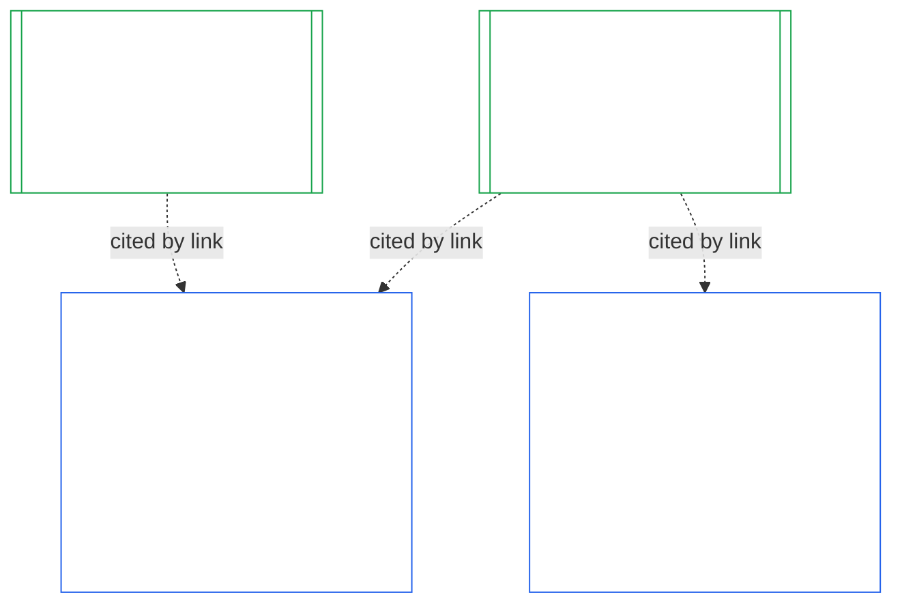

# CHAPTER TWELVE: INSTITUTIONAL ALIGNMENT CERTIFICATION — EVALUATION

<strong>Corpus placement (non-operative): file structure and reading rules</strong>

> This file is **part of the Sentient Constitution** and is **binding only together** with the other numbered `core_*` files read as one text. It contains **Chapter Twelve** — **institutional alignment certification**: how an [Institution](core_05.040_band_continuity.md#institution), as distinct from any System it runs, is classified, evaluated, reviewed, decided, recorded, kept current, and reopened (**§1–Chapter Fourteen §5**). Chapter Twelve is the institutional counterpart of [Chapter Nine](core_09.000_system_alignment_certification_evaluation.md#chapter-nine-system-alignment-certification--evaluation) (*System Alignment Certification*), and **its sections carry the same numbers**: §N here answers §N there. [CS-9.320](corpus_systems/cs_09.320_system_alignment_certification_illustrations.md#cs-9320-system-alignment-certification-illustrations) (*System alignment certification illustrations*) holds the worked illustrations for Systems and, in its [§12 Illustrative Institution Walkthroughs](corpus_systems/cs_09.320_system_alignment_certification_illustrations.md#cs-9320-12-illustrative-institution-walkthroughs), three Institution walkthroughs. This Chapter does not repeat them.
>
> | § | Chapter Nine (System) | Chapter Twelve (Institution) |
> |---|------------------------|----------------------------|
> | 1 | Purpose and Role | relation to the System certification, who is certified, no permission and no gate on forming or running, the wait for new material authority, the first-certification window |
> | 2 | System Class Evaluation | institution class; scaling by class |
> | 3 | Whole-System Certification Evaluation | the eight institutional items, always |
> | 4 | Evaluations Where Implicated | pointer to Chapter Nine §4 |
> | 5 | Rights-Floor and Domain Evaluations | pointer to Chapter Nine §5 |
> | 6 | Forum Process | four seats; forum roles and sequence; forums, certifiers, and record offices as institutions |
> | 7 | Certification Outcomes | go-live for an Institution and for its Systems, certification conditions, and the other effects of an outcome; pointer for defects; remediation readiness; denial and revocation |
> | 8 | System Certification Record | the Institutional Certification Record |
> | 9 | Recertification and Reopening | monitoring; reopening triggers; provisional and full certification; non-evasion; the cascade from System certifications; reopening its Systems on a governance violation |
> | 10 | Challenging a Certification | the challenge path |
> | 11 | Relationship to Standing | the standing bridge |
>
> - **Constitutional owner (joint with Chapter Nine):** forum-supervised alignment certification and related System Certification Records and Institutional Certification Records. Chapter Twelve adds the institutional subject. It adds no new forum family, no new seat, and no new outcome word.
> - **Reuse, not repetition:** Phases III to VI run as [Chapter Ten §2](core_10.000_system_alignment_certification_forum_process_outcomes.md#2-forum-process) to [Chapter Eleven §5](core_11.000_system_alignment_certification_records_recertification.md#5-relationship-to-standing) provide. Chapter Twelve states only what changes when the subject is an Institution.
> - **Anti-relocation rule:** Chapter Twelve does not restate Chapter Nine evaluation mechanics for a System, the Chapter Seven System Charter and Institutional Charter fields, the Chapter Eight Four-Seat Requirement, the institutional duties in [corpus_institutions](corpus_institutions.md), Chapter Sixteen standing measurement, or Chapter Seventeen standing effects.
>
> **Upstream:** [Chapter Seven](core_07.000_charters.md#chapter-seven-system-and-institutional-charters) Charters; [Chapter Eight](core_08.000_functional_independence_separation_of_duties.md#chapter-eight-functional-independence-and-separation-of-duties) functional independence; [Chapter Nine](core_09.000_system_alignment_certification_evaluation.md#chapter-nine-system-alignment-certification--evaluation) (Parts [A](core_09.000_system_alignment_certification_evaluation.md#chapter-nine-system-alignment-certification--evaluation), [B](core_10.000_system_alignment_certification_forum_process_outcomes.md#chapter-ten-system-alignment-certification--forum-process-and-outcomes), and [C](core_11.000_system_alignment_certification_records_recertification.md#chapter-eleven-system-alignment-certification--records-recertification-challenge-and-standing)); Chapter Twenty-Three forum supervision.
> **Downstream:** Chapter Fifteen standing records and verified inputs; Chapter Seventeen standing effects.

<strong>Trace</strong>

- Upstream:
  - [Chapter Seven §2 When System and Institutional Charters Are Required](core_07.000_charters.md#2-when-system-and-institutional-charters-are-required) (7.000 §2) (*which Institutions publish a System Charter or an Institutional Charter, and the class of an Institution*);
  - [Chapter Seven §8 Amendment and Review](core_07.000_charters.md#8-amendment-review-and-scope-misalignment) (7.000 §8) (*what an Institutional Charter review tests*);
  - [Chapter Seven §5 The Charter Role Map and Standing-Record Custody](core_07.000_charters.md#5-the-charter-role-map-and-standing-record-custody) (7.000 §5) (*where the seats are placed*);
  - [Chapter Eight §2 Four-Seat Constitutional Requirement](core_08.000_functional_independence_separation_of_duties.md#2-four-seat-constitutional-requirement) (8.000 §2) and [§9 Relationship to Later Processes](core_08.000_functional_independence_separation_of_duties.md#9-relationship-to-later-processes);
  - [Chapter Nine](core_09.000_system_alignment_certification_evaluation.md#chapter-nine-system-alignment-certification--evaluation) (9.000 to 9.010) (*the System Alignment Certification process this Chapter reuses*);
  - [Two Fundamental Questions](core_00.000_preamble.md#two-fundamental-questions);
  - [Constitutional Tetrad](core_00.000_preamble.md#constitutional-tetrad);
  - [Article XI-E](core_06.010_rights_part_b.md#article-xi-e-institutional-formation-and-business-creation) (*Institutional Formation and Business Creation*).
- Downstream: [§1](#1-purpose-and-role) through [§5](core_14.000_institutional_alignment_certification_records_recertification.md#5-relationship-to-standing); Chapter Fifteen ([12.000](core_15.000_standing_assessment.md#chapter-fifteen-standing-records--question-1-what-happened)); [Chapter Twenty-Three](core_23.000_forum.md#chapter-twenty-three-forums-and-jurisdiction) (23.000).
- Read with:
  - [Institutional Alignment Certification](core_05.040_band_continuity.md#institutional-alignment-certification) and
  - [Institutional Certification Record](core_05.040_band_continuity.md#institutional-certification-record) (*Chapter Five meanings*);
  - **CI-8.205 §6** (*System and Institutional Charter Contents, Review, and Formation Template*);
  - **CF-23.425** (*Integrity safeguards, anti-capture operations, and anti-self-judging support*).
- Worked examples (they add no rule): [CS-9.320 §12 Illustrative Institution Walkthroughs](corpus_systems/cs_09.320_system_alignment_certification_illustrations.md#cs-9320-12-illustrative-institution-walkthroughs) (*three invented Institutions walked through this chapter*).

 

Chapter Twelve is the constitutional owner of **institutional alignment certification**. It extends the process of [Chapter Nine](core_09.000_system_alignment_certification_evaluation.md#chapter-nine-system-alignment-certification--evaluation) from a System to an Institution:

- **Phase I, Frame:** the institution class and how it scales the evaluation ([§2 Institution Class Evaluation](#2-institution-class-evaluation));
- **Phase II, Evaluate:** the institutional evaluation, including the evaluations that apply where implicated and the Rights-Floor and domain evaluations ([§3 Whole-Institution Certification Evaluation](#3-whole-institution-certification-evaluation) to [§5 Rights-Floor and Domain Evaluations](#5-rights-floor-and-domain-evaluations));
- **Phase III, Review:** the forum roles and sequence ([§2 Forum Process](core_13.000_institutional_alignment_certification_forum_process_outcomes.md#2-forum-process));
- **Phase IV, Decide:** the outcome, remediation readiness, and denial and revocation ([§3 Certification Outcomes](core_13.000_institutional_alignment_certification_forum_process_outcomes.md#3-certification-outcomes));
- **Phase V, Record:** the Institutional Certification Record ([§2 Institutional Certification Record](core_14.000_institutional_alignment_certification_records_recertification.md#2-institutional-certification-record)); and
- **Phase VI, Operate:** recertification, reopening, the cascade from System certifications, the reopening of its Systems, the challenge path, and the standing bridge ([§3 Recertification and Reopening](core_14.000_institutional_alignment_certification_records_recertification.md#3-recertification-and-reopening) to [§5 Relationship to Standing](core_14.000_institutional_alignment_certification_records_recertification.md#5-relationship-to-standing)).

*In plain terms: Chapter Nine asks whether a **system** is aligned. Chapter Twelve asks the same of the **institution** that runs systems, or that holds authority without running one. An institution can be aligned while one of its systems is not, and the reverse. So the institution is checked on what only it controls: whether it does what its Institutional Charter says, who answers for its authority, what it rewards in its own members, and whether the independent checks on it can actually be used. It relies on each system's certification and does not redo it. It is not a licence: nobody needs its permission to start or run an institution.*

### 1. Purpose and Role

<strong>Trace</strong>

- Upstream:
  - [Chapter Seven §2 When System and Institutional Charters Are Required](core_07.000_charters.md#2-when-system-and-institutional-charters-are-required) (7.000 §2);
  - [Chapter Nine §1 Purpose and Role](core_09.000_system_alignment_certification_evaluation.md#1-purpose-and-role) (9.000 §1);
  - [Article XI-E](core_06.010_rights_part_b.md#article-xi-e-institutional-formation-and-business-creation) (*Institutional Formation and Business Creation*);
  - [Article XXVIII-A](core_06.040_rights_part_e.md#xxviii-a-existing-instantiations-adoption-transition-window) (*Phased Adoption and Rights-Floor Continuity*).
- Downstream: [§2](#2-institution-class-evaluation); [§2](core_13.000_institutional_alignment_certification_forum_process_outcomes.md#2-forum-process); [§3](core_13.000_institutional_alignment_certification_forum_process_outcomes.md#3-certification-outcomes); [§3](core_14.000_institutional_alignment_certification_records_recertification.md#3-recertification-and-reopening).
- Read with:
  - [Institution](core_05.040_band_continuity.md#institution);
  - [Institutional Charter](core_05.040_band_continuity.md#institutional-charter);
  - [System Charter](core_05.040_band_continuity.md#system-charter);
  - [Business Creation](core_05.055_band_participation.md#business-creation).

 

*In plain terms: a system's certification belongs to the system. An institution's certification cites those certifications and adds what only the institution can answer for. One system can appear under several institutions, or under none. Nothing here lets a certification stand in the way of starting an institution.*

Institutional alignment certification and System Alignment Certification are two certifications joined by a link. The relation is **composition by link**, not containment. In the figure, an arrow runs from a System Certification Record to each Institutional Certification Record that cites it. A System under no Institution has no arrow and needs none, and an Institution that runs no System has an Institutional Certification Record alone.

Composition by link has two sides, the Institution's first.

On the Institution's side:

- **An Institutional Certification Record cites a System's and does not redo it:** It cites the System Certification Record by link and names its version. This Chapter never re-runs a System evaluation, never re-decides a System's class, and never changes a System's outcome, status, or certification conditions.
- **The Institution's certification cannot lift a System's:** A System that is Not Certified stays Not Certified whatever the Institution's status. A System that holds certification gains no protection from an Institution's finding.
- **Institutional facts are found once:** Where [Chapter Nine §3.1 Governance, Incentive, and Contestability Discipline](core_09.000_system_alignment_certification_evaluation.md#31-governance-incentive-and-contestability-discipline) asks about the operator's governance and incentives, a current Institutional Certification Record for the operator may supply those facts by link. The System's forums still decide whether those facts are enough for that System. They may not find the same institutional fact differently without saying why on the System Certification Record.

On the System's side:

- **The System Certification Record belongs to the System:** It is the System's own System Certification Record under [Chapter Nine](core_09.000_system_alignment_certification_evaluation.md#chapter-nine-system-alignment-certification--evaluation).
- **One System Certification Record may be cited by several Institutions:** A System can be operated, stewarded, or materially controlled by more than one Institution under [Chapter Seven §2 When System and Institutional Charters Are Required](core_07.000_charters.md#2-when-system-and-institutional-charters-are-required). Each cites the same System Certification Record.
- **A System need not sit under any Institution:** A single sentient is not an Institution, so a System may have none. A System with no Institution is certified under [Chapter Nine](core_09.000_system_alignment_certification_evaluation.md#chapter-nine-system-alignment-certification--evaluation) alone and needs nothing from this Chapter. A System that does sit under an Institution is certified the same way: this Chapter adds a separate record for the Institution and is not a step in the System's own certification.

#### 1.1 Who Is Certified

An Institution of Class L or higher is within this Chapter, with the class decided under [§2.1 Institution Class](#21-institution-class). That includes an Institution that runs no System at all: it has no System Certification Record to cite, and its class comes from its own impact. An Institution's **portfolio** is the set of Systems it operates, stewards, or materially controls ([Portfolio](core_05.040_band_continuity.md#portfolio)).

- **Class A, B, C, and L:** the process applies, scaled by class under [§2.2 Scaling by Class](#22-scaling-by-class).
- **Class P:** the process is encouraged and may be used voluntarily. It becomes mandatory on reclassification to Class L or higher, or where the Institution voluntarily asserts constitutional compliance. A Class P Institution that decides to take on new material authority is reclassified to at least Class L when it gives the notice in [§3.2.2 Recertification for New Material Authority](core_14.000_institutional_alignment_certification_records_recertification.md#322-recertification-for-new-material-authority), because that authority is material by definition ([§3.2.1 What Counts as New Material Authority](core_14.000_institutional_alignment_certification_records_recertification.md#321-what-counts-as-new-material-authority)) and an Institution that is material in any domain is at least Class L ([§2.1 Institution Class](#21-institution-class), item 2). The reclassification lasts from the notice until the notice is withdrawn before clearance, or the authority is not cleared, provided nothing under it has been exercised. The Institution then returns to Class P and the limited first certification ends. A new notice starts it again, and exercising the authority without clearance stays a finding under [§3.2.2 Recertification for New Material Authority](core_14.000_institutional_alignment_certification_records_recertification.md#322-recertification-for-new-material-authority) (*Without notice, or before it is cleared*). This mirrors [Chapter Nine §1 Purpose and Role](core_09.000_system_alignment_certification_evaluation.md#1-purpose-and-role).
- **One System:** an Institution that runs exactly one System that needs a System Charter has one certification pass and one System Certification Record, which this Chapter calls the **one-System evaluation**. The System Certification Record carries an *institutional findings block* with the items in [§2 Institutional Certification Record](core_14.000_institutional_alignment_certification_records_recertification.md#2-institutional-certification-record), and it serves as the Institutional Certification Record. Forums, seats, and clocks are those of the System's own certification pass, with the institutional items added. Its outcomes follow their own denial and revocation grounds, as [§3.4 Denial and Revocation for an Institution](core_13.000_institutional_alignment_certification_forum_process_outcomes.md#34-denial-and-revocation-for-an-institution) states. The cascade in [§3.5 Cascade from System Certifications](core_14.000_institutional_alignment_certification_records_recertification.md#35-cascade-from-system-certifications) does not apply as a cascade, since the System is the whole portfolio, but [§3.4 Denial and Revocation for an Institution](core_13.000_institutional_alignment_certification_forum_process_outcomes.md#34-denial-and-revocation-for-an-institution) applies its rules 1 and 2 (the indicator and the test of where the cause lies).
- **Several Systems:** one Institutional Certification Record for the Institution, which links to the System Certification Record of each System it runs. Each System keeps its own pass and its own System Certification Record.
- **No System:** one Institutional Certification Record on its own. It has no System Certification Record to link to, because the Institution runs no System.

#### 1.2 No Permission and No Gate on Forming or Running

Institutional alignment certification is an independent check on how an Institution actually uses its authority. Forums independent of the Institution make it, and it ends in an Institutional Certification Record of what they found.

- **Starting and operating:** An Institution forms, publishes its Institutional Charter, begins to exercise authority, and keeps operating without first holding it, and no outcome grants or withholds that right.
- **Effect of an outcome:** An outcome has only the effects in [§3.1 Go-Live for an Institution](core_13.000_institutional_alignment_certification_forum_process_outcomes.md#31-go-live-for-an-institution).
- **The only gates in this area:** There are three narrow gates, all in **Article XI-E** (*Institutional Formation and Business Creation*):
  - an outstanding lock on a named sentient, which attaches to that sentient's authority;
  - an Interim Hold on specific verified facts of misalignment, which also attaches to a named sentient's authority;
  - a lock on an Operating Party itself, which attaches to an Institution only where a lock sits on that Institution, as one does on a dissolved Institution under **CI-19.210 §4** (*Dissolution*).

  A certification finding can be referred to the forum that decides one of these gates, as evidence under [§3.5 Effects of Denial and Revocation for an Institution](core_13.000_institutional_alignment_certification_forum_process_outcomes.md#35-effects-of-denial-and-revocation-for-an-institution). A certification outcome is not itself a gate and does not open or close one.
- **Waiting for new material authority:** An Institution that decides to take on new material authority waits for its recertification to clear that authority before it exercises it, on the terms of [§3.2.2 Recertification for New Material Authority](core_14.000_institutional_alignment_certification_records_recertification.md#322-recertification-for-new-material-authority). **Article XI-E** (*Institutional Formation and Business Creation*) states this wait. It is not one of the three narrow gates, and it is not a gate on forming or running. It attaches only to the new authority, and everything else the Institution does continues. The figure in [§3.2.2 Recertification for New Material Authority](core_14.000_institutional_alignment_certification_records_recertification.md#322-recertification-for-new-material-authority) summarizes the steps.
- **No back door:** Nothing in this Chapter may be used, by a forum, an adopter, or an incumbent, as an authorization threshold that shuts out founders or protects incumbents. That would defeat [Article XI-E](core_06.010_rights_part_b.md#article-xi-e-institutional-formation-and-business-creation) (*Institutional Formation and Business Creation*).
  - [Avoidable Burden](core_05.040_band_continuity.md#avoidable-burden) applies to the cost of the process.
  - [Classification-Scaled Governance](core_05.050_band_oversight.md#classification-scaled-governance) applies to its depth.
  - The wait for new material authority applies on the same terms to every Institution of its class, and only to authority that is already material to others.

The go-live gate for Systems is separate and stays with them. Under [Chapter Ten §3.1 Go-Live Gate](core_10.000_system_alignment_certification_forum_process_outcomes.md#31-go-live-gate), a new System, or a material expansion of one, goes live only through its own certification, whatever the Institution's status.

#### 1.3 Window for the First Certification

A first Institutional Certification Record is due within a window the adopting document sets for the Institution's class.

- **A new Institution:** The window runs from the day it first has a material impact on others, as [Domain-Specific Materiality](core_05.050_band_oversight.md#domain-specific-materiality) judges it, and its first certification is provisional.
- **A Class P Institution reclassified on notice:** The window runs from the day it gives the notice under [§3.2.2 Recertification for New Material Authority](core_14.000_institutional_alignment_certification_records_recertification.md#322-recertification-for-new-material-authority), as for a new Institution, and never from an Adoption Transition window that has already ended.
- **One already operating:** The window is the Adoption Transition window under [Article XXVIII-A](core_06.040_rights_part_e.md#xxviii-a-existing-instantiations-adoption-transition-window) (*Phased Adoption and Rights-Floor Continuity*), consistent with the default in [Chapter Seven §2.5 When a System Charter or Institutional Charter Is Due](core_07.000_charters.md#25-when-a-system-charter-or-institutional-charter-is-due).
- **A missed window:** An Institution that lets the window run out without a first pass, and is not excused below, has a defect to log and correct, and the missed window opens that pass. An Institution of Class L or higher that is already operating also has the milestone failure below. The Institution is not stopped or barred from operating, since there is no gate ([§1.2 No Permission and No Gate on Forming or Running](#12-no-permission-and-no-gate-on-forming-or-running)).
  - **An Institution already operating:** This is this Chapter's own rule for Institutions of Class L or higher, set by analogy to [Article XXVIII-A](core_06.040_rights_part_e.md#xxviii-a-existing-instantiations-adoption-transition-window) (*Phased Adoption and Rights-Floor Continuity*), which names Systems and derived entities. If its Adoption Transition window ends and no first certification pass is complete (no provisional or full certification and no decided outcome under [§3 Certification Outcomes](core_13.000_institutional_alignment_certification_forum_process_outcomes.md#3-certification-outcomes)), it has missed its deadline. An Institution that filed and cooperated inside the window has not missed it where the certification pass is incomplete because a forum overran its own time ([Chapter Twenty-Three §6 Timely Resolution, Materiality Tiers, and Anti-Delay Discipline](core_23.000_forum.md#6-timely-resolution-materiality-tiers-and-anti-delay-discipline), *Overrun review*; [Chapter Eleven §3.3.4 Tier Windows](core_11.000_system_alignment_certification_records_recertification.md#334-tier-windows)) or because the one deferral under [§3.3 Remediation Readiness for an Institution](core_13.000_institutional_alignment_certification_forum_process_outcomes.md#33-remediation-readiness-for-an-institution) is running. Unless it has a documented reauthorization showing under [Article XXVIII-B](core_06.040_rights_part_e.md#article-xxviii-b-adoption-transition-authority-limits-and-reauthorization) (*Adoption Transition Authority Limits and Reauthorization*), that is an Adoption Transition milestone failure, and the ordinary compliance and violation path in [Chapter Fifteen](core_15.000_standing_assessment.md#chapter-fifteen-standing-records--question-1-what-happened) opens. The restraint duties in that Article apply from the effective date, and the gap does not become the new normal by lasting. This mirrors [Chapter Ten §3.1.1 Systems Already Operating](core_10.000_system_alignment_certification_forum_process_outcomes.md#311-systems-already-operating). It is not a gate.
  - **The certification pass:** It is decided like any other. It can end in any outcome in [§3 Certification Outcomes](core_13.000_institutional_alignment_certification_forum_process_outcomes.md#3-certification-outcomes), including Not Certified, with the effects in [§3.5 Effects of Denial and Revocation for an Institution](core_13.000_institutional_alignment_certification_forum_process_outcomes.md#35-effects-of-denial-and-revocation-for-an-institution).
  - **Sanctions and dissolution:** This Chapter creates none. Suspension, receivership, structural separation, and dissolution stay with the forum with jurisdiction under **CI-19.210** (*Institutional failure and dissolution*) and **CI-19.215** (*Institutional accountability and sanctions*). That forum receives a referral only on the referral grounds in [§3.5 Effects of Denial and Revocation for an Institution](core_13.000_institutional_alignment_certification_forum_process_outcomes.md#35-effects-of-denial-and-revocation-for-an-institution) (item 5, *Referral*).

### 2. Institution Class Evaluation

<strong>Trace</strong>

- Upstream:
  - [Chapter Seven §2 When System and Institutional Charters Are Required](core_07.000_charters.md#2-when-system-and-institutional-charters-are-required) (7.000 §2);
  - [Chapter Nine §2 System Class Evaluation](core_09.000_system_alignment_certification_evaluation.md#2-system-class-evaluation) (9.000 §2) and [§2.2 How system class scales every evaluation](core_09.000_system_alignment_certification_evaluation.md#22-how-system-class-scales-every-evaluation);
  - [Chapter Three §3.1 Common Evasion Patterns](core_03.000_definition_integrity.md#31-common-evasion-patterns) (3.000 §3.1).
- Downstream: [§3](#3-whole-institution-certification-evaluation) (*the items the class scales*); [§2](core_14.000_institutional_alignment_certification_records_recertification.md#2-institutional-certification-record) (*the class is stated on the Institutional Certification Record*); [§3.2](core_14.000_institutional_alignment_certification_records_recertification.md#32-reopening-triggers) (*the triggers that reassess it*).
- Read with:
  - **CS-9.305 (*System classification machinery*) and CS-9.310** (*System Impact Classifications*) and [corpus_systems/cs_09.310_system_impact_classifications.md](corpus_systems/cs_09.310_system_impact_classifications.md) (*the class catalog*);
  - **CI-9.210** (*Classification-linked institutional obligations*);
  - **CI-8.205 §6** (*System and Institutional Charter Contents, Review, and Formation Template*).

 

*In plain terms: first sort the institution into a class by how much it matters to others. Judge that by what it actually decides and holds, not by what it calls itself. The class then sets how thorough the evaluation is: the higher the class, the stricter the proof, the more independent the review, and the sooner it is checked again.*

This section is **Phase I, Frame** for an Institution.

#### 2.1 Institution Class

**Institution class** is decided by the greatest material impact the Institution has, whether that impact comes through a System it runs or outside any System. It is judged by what the Institution actually decides, holds, and controls, and not by its label, legal form, or the list in its Institutional Charter. The class governs the depth of the evaluation and the clocks, as [Chapter Nine §2.2 How system class scales every evaluation](core_09.000_system_alignment_certification_evaluation.md#22-how-system-class-scales-every-evaluation) does for a System. It is the class used in this Chapter and in [Chapter Seven §2.2 Which Classes Are Covered](core_07.000_charters.md#22-which-classes-are-covered).

1. **Impact through Systems:** An Institution's class is at least the highest class of any System in its portfolio ([Chapter Seven §2 When System and Institutional Charters Are Required](core_07.000_charters.md#2-when-system-and-institutional-charters-are-required)). The Systems are found from observed operation. A System missing from the Institutional Charter still counts.
2. **Impact outside any System:** An Institution's own material impact and dependency count whether or not it runs a System. The class definitions of **CS-9.305 (*System classification machinery*) and CS-9.310** (*System Impact Classifications*) are applied to the Institution's own decisions and holdings, using these factors:
   - **What it decides and holds:**
     - what it decides about other sentients' access to survival essentials, education, safety, livelihood, rights, or standing; and
     - what it holds, such as funds, records, memberships, custody of standing records, or the function of a forum, certifier, or record office.
   - **Whether it is material:**
     - whether its own activity is material in any domain of [Domain-Specific Materiality](core_05.050_band_oversight.md#domain-specific-materiality), including taking [Materially Binding Acts](core_05.035_band_accountability.md#materially-binding-act) that others must follow or may rely on as settled;
     - an Institution that is material in any one domain is at least Class L under **CS-9.305 (*System classification machinery*) and CS-9.310** (*System Impact Classifications*); and
     - giving aid, goods, labor, or services that others are free to take or leave, and that do not control anyone's access to what they need, binds no one. It is conduct and not a Materially Binding Act, and it counts only through the other factors.
   - **How much depends on it:**
     - how many sentients depend on it, and how substitutable it is;
     - how concentrated its authority is, within the meaning of the Material Control Line; and
     - how reversible its decisions are.
3. **Common control:** Operating Parties that are one operation under the aggregation rule of [Domain-Specific Materiality](core_05.050_band_oversight.md#domain-specific-materiality) (common practical control within a [Material Control Line](core_05.035_band_accountability.md#material-control-line); funding alone does not count) are classified together where they act as one Institution in practice. Dividing an Operating Party, its portfolio, or its authority so that no part reaches Class L is a scope-and-boundary evasion under [Chapter Three §3.1 Common Evasion Patterns](core_03.000_definition_integrity.md#31-common-evasion-patterns).
4. **Reclassification:** The class is reassessed on the triggers in [§3.2 Reopening Triggers](core_14.000_institutional_alignment_certification_records_recertification.md#32-reopening-triggers). The classification is stated on the Institutional Certification Record with its reasons.

#### 2.2 Scaling by Class

The institution class scales the depth of evidence, the independence of the review, the default certification interval, and the disclosure on the Institutional Certification Record, in the way [Chapter Nine §2.2 How system class scales every evaluation](core_09.000_system_alignment_certification_evaluation.md#22-how-system-class-scales-every-evaluation) does. The certification intervals are in [Chapter Twenty-Three §6 Timely Resolution, Materiality Tiers, and Anti-Delay Discipline](core_23.000_forum.md#review-cadence) (*Review cadence*); the adopting document may set shorter intervals and sets the number of clean provisional recertifications.

- **Class A, B, and C:** all eight items in [§3 Whole-Institution Certification Evaluation](#3-whole-institution-certification-evaluation), with evidence and independence in proportion to the class.
- **Class L:** the same eight items, simplified, with simpler records and a longer default certification interval where [Classification-Scaled Governance](core_05.050_band_oversight.md#classification-scaled-governance) allows. The core of a Class L pass is the Institutional Charter against practice, the Role Map, the formation check statement, and the currency of the cited System certifications. No item may be omitted, and an item with nothing to find is stated in a line.
- **Class P:** voluntary, as [§1.1 Who Is Certified](#11-who-is-certified) states.

**A host in a joint professional practice.** Where an Institution is a host ([**CI-24.205 §7**](corpus_institutions/ci_24.205_appointment_competency_rotation_removal.md#ci-46-seat-advisory) (*Practice Licence, Practice Clearance, and Joint Professional Practice*)), its certification also samples members' acts against the seats the host carries and reads the members' adoption notices against what the host does. A finding about one member's act is a finding about that member, and it reaches the host only where a seat the host carries failed.

### 3. Whole-Institution Certification Evaluation

<strong>Trace</strong>

- Upstream:
  - [Chapter Nine §3 Whole-System Certification Evaluation](core_09.000_system_alignment_certification_evaluation.md#3-whole-system-certification-evaluation) (9.000 §3);
  - [Chapter Seven §4 What System and Institutional Charters Must State](core_07.000_charters.md#4-what-system-and-institutional-charters-must-state) (7.000 §4);
  - [Chapter Seven §6 Formation Check: Office-Holder Standing and Authenticity](core_07.000_charters.md#6-formation-check-office-holder-standing-and-authenticity) (7.000 §6);
  - [Chapter Seven §8 Amendment and Review](core_07.000_charters.md#8-amendment-review-and-scope-misalignment) (7.000 §8);
  - [Two Fundamental Questions](core_00.000_preamble.md#two-fundamental-questions);
  - [Chapter One §19.6 Keeping Responsibility When Ownership or Structure Changes](core_01.050_governance_incentive_application.md#196-keeping-responsibility-when-ownership-or-structure-changes) (1.050 §19.6).
- Downstream: [§2](core_13.000_institutional_alignment_certification_forum_process_outcomes.md#2-forum-process) (*the findings the forums review*); [§3](core_14.000_institutional_alignment_certification_records_recertification.md#3-recertification-and-reopening) (*the triggers that reopen them*); [§5](core_14.000_institutional_alignment_certification_records_recertification.md#5-relationship-to-standing) (*the verified-input gate for findings on a named sentient*).
- Read with:
  - **CI-8.205 §3** (*Authority Chain and Delegation Controls*) and **CI-8.205 §6** (*System and Institutional Charter Contents, Review, and Formation Template*);
  - **CI-6.215** (*Resource stewardship and incentive integrity*);
  - **CI-8.210** (*Conflict integrity, anti-capture, and anti-corruption*), **CI-6.205** (*Transparency, participation, and accessible challenge and service pathways*), and **CI-20.205** (*Remedy systems and institutional redress capacity*), for item 8.

 

*In plain terms: check the things that belong to the institution and not to any one of its systems: whether it keeps to its Institutional Charter, who answers for its authority, what it rewards, and whether the independent checks on it work.*

This section is **Phase II, Evaluate** for an Institution.

Every certification pass evaluates these eight items, which are the institutional counterpart of [Chapter Nine §3 Whole-System Certification Evaluation](core_09.000_system_alignment_certification_evaluation.md#3-whole-system-certification-evaluation). Each finding states its evidence and the Institutional Charter text or observed operation it rests on.

1. **Institutional Charter against practice:**
   - The Institutional Charter is tested against observed operation, using the review list in [Chapter Seven §8 Amendment and Review](core_07.000_charters.md#8-amendment-review-and-scope-misalignment).
   - Practice outside the Institutional Charter, or an Institutional Charter that no longer describes practice, is a finding whichever is wrong.
2. **Portfolio and aggregate effect:**
   - The portfolio rationale is tested: each System traces to the Institution's stated purpose, and a System with no stated reason is a finding.
   - The evaluation also looks across the Systems for what none of their certifications can show alone:
     - shared dependencies;
     - aggregate reliance;
     - cumulative extraction from shared foundations; and
     - any arrangement that splits one function into parts so that each part escapes a class or a duty.
3. **Accountable authority:**
   - Each authority the Institution exercises over others is attributable to an accountable office that can be named, and that office is answerable under the rules of [Chapter Eight](core_08.000_functional_independence_separation_of_duties.md#chapter-eight-functional-independence-and-separation-of-duties) and **CI-8.205 §3** (*authority chain and delegation controls*).
   - A change of ownership, control, or structure does not release responsibility ([Chapter One §19.6 Keeping Responsibility When Ownership or Structure Changes](core_01.050_governance_incentive_application.md#196-keeping-responsibility-when-ownership-or-structure-changes)).
4. **Rewards and incentives:**
   - The Institution's own pay, promotion, targets, and rewards are put to the [Two Fundamental Questions](core_00.000_preamble.md#two-fundamental-questions): what the structure actually rewards, and whether that points toward the Constitution's two aims or away from them.
   - A reward structure that pays for misalignment, or for hiding it, is a finding even where every System is individually certified.
   - The [Chapter Nine §3.3 Time-Consistency Constraint](core_09.000_system_alignment_certification_evaluation.md#33-time-consistency-constraint) applies. Near-term metrics, local compliance, and short-horizon efficiency are not enough where foreseeable medium- or long-horizon damage to Safety, Truth, or wellbeing remains unaddressed, and a reward structure that pays for short-horizon results at that cost is a finding.
   - The institutional duties on incentive integrity stay with **CI-6.215** (*Resource stewardship and incentive integrity*) and are cited, not restated.
5. **Role Map and custody:**
   - The [Charter Role Map](core_05.040_band_continuity.md#charter-role-map) names offices that exist, are filled or substituted as it says, and are [independent](core_05.035_band_accountability.md#independence) of the Institution for any Institutional Certification Record in which the Institution is the subject.
   - The independent route can be used in fact.
   - A seat left unplaced, a dead office, or a record custodian inside the Institution's own line is a finding.
6. **Currency of each cited System certification:**
   - For each System the Institution runs, the evaluation checks that a System Certification Record is in force or inside its Adoption Transition window, and that the Institution has done what that System Certification Record's certification conditions require of the Institution.
   - An expired, withdrawn, failed, or missing certification with no recorded reason is a finding that [§3.5 Cascade from System Certifications](core_14.000_institutional_alignment_certification_records_recertification.md#35-cascade-from-system-certifications) then carries to the Institution.
7. **Office-holder standing and authenticity:**
   - The formation check statement published under [Chapter Seven §6 Formation Check: Office-Holder Standing and Authenticity](core_07.000_charters.md#6-formation-check-office-holder-standing-and-authenticity) is tested against observed operation and is not taken on attestation.
   - For each covered office the forums check the standing facts against verified standing records, and find authenticity from evidence on control, interests and rewards, conduct, and protected voice. That means:
     - who actually directs the holder;
     - what the holder is paid and promoted for;
     - what the holder has verifiably done in the function; and
     - whether anyone, the holder included, who made a [protected report](core_05.035_band_accountability.md#protected-reporting-whistleblowing) or refused an unlawful or unconstitutional instruction ([Chapter One §17.5 Duty to Resist](core_01.040_stewardship_capacity_principles.md#175-duty-to-resist)) was penalized for it.
   - Staff who hold no covered office are not checked one by one. The staff safeguards check ([Chapter Seven §6.6 Staff Safeguards Check](core_07.000_charters.md#66-staff-safeguards-check)) covers them, and the forums test it against observed operation in the same way. It asks whether:
     - the Institution's appointment, pay, promotion, and removal rules do not reward working against its stated purpose;
     - a protected reporting route exists, and no staff member who used it, or who refused an unlawful or unconstitutional instruction, has been penalized; and
     - the rights in [Article III-C](core_06.000_rights_part_a.md#article-iii-c-labor-and-economic-floor) (*Labor and Economic Floor*) are intact.
   - Each of these is a finding:
     - a holder who is a nominee for an undisclosed controller;
     - a covered office that exists only on paper: the Institutional Charter or Charter Role Map names it, but no one actually holds it and does its work;
     - a reward structure that pays holders for doing what the Institutional Charter's published limits forbid; and
     - a statement that is false or incomplete.
   - Findings are about the office and the structure. They attach to a named sentient only through the verified-input gate in [§5 Relationship to Standing](core_14.000_institutional_alignment_certification_records_recertification.md#5-relationship-to-standing).
   - The formation check is not a test of belief, although a verified statement that others deserve harm or discriminatory treatment is conduct and counts against the holder, as [Chapter One §7.5 Expression and the Harm Line](core_01.000_values_principles.md#75-expression-and-the-harm-line) sets out.
   - Items 3, 4, and 5 are read with this one, and a fact found under one of them is not found again under another.
8. **The Institution's own institutional duties:**
   - The Institution's compliance with the institutional duties that adopted institutional text places on it is tested against observed operation, and not taken on attestation. Those duties are **CI-8.210** (*Conflict integrity, anti-capture, and anti-corruption*), **CI-6.205** (*Transparency, participation, and accessible challenge and service pathways*), **CI-6.215** (*Resource stewardship and incentive integrity*), and **CI-20.205** (*Remedy systems and institutional redress capacity*).
   - The test asks whether the Institution's oversight, accountability, participation, and timeliness routes exist, can be used in fact, and answer inside the times the Institution itself states. Those times may not be longer than the floor timing for the Institution's class ([Article XXVI-C](core_06.040_rights_part_e.md#article-xxvi-c-timely-resolution-and-anti-delay-floor) (*Timely Resolution and Anti-Delay Floor*) and the matching tier's targets in [CF-23.445 §3.1 Stage Targets and Outer Bounds](corpus_forum/cf_23.445_performance_backlog_publication_accessibility.md#cf-23445-31-stage-targets-and-outer-bounds)), and a stated time that is longer is itself a finding.
   - A route that exists only on paper, one that cannot be reached, and one that is not answered in time are each a finding.
   - The duties stay with those texts and are cited, not restated. A fact found under items 3 to 5 is not found again under this one.

**Two more parts of Chapter Nine §3 Whole-System Certification Evaluation.** [Chapter Nine §3 Whole-System Certification Evaluation](core_09.000_system_alignment_certification_evaluation.md#3-whole-system-certification-evaluation) also asks two things of a System that apply to an Institution's own conduct. They are part of the Institution's evaluation, each only where its own trigger is met:

- **Systemic scope and risk factors:**
  - **Applies when:** the Institution's own conduct puts systemic Risk in scope under the factors of [Chapter Nine §3.2 Systemic Scope and Risk Factors](core_09.000_system_alignment_certification_evaluation.md#32-systemic-scope-and-risk-factors): harms at the largest scales, how effects spread and build up (including what fails downstream when the Institution's own service fails), and how the Institution's activity could be misused or mis-scoped.
  - **Evaluated under:** [Chapter Nine §3.2 Systemic Scope and Risk Factors](core_09.000_system_alignment_certification_evaluation.md#32-systemic-scope-and-risk-factors), including the risk evaluation and disclosure bridge in [§3.2.1 Risk Evaluation and Disclosure Bridge](core_09.000_system_alignment_certification_evaluation.md#321-risk-evaluation-and-disclosure-bridge) and the defects in [§3.2.2 Defects and Misalignment](core_09.000_system_alignment_certification_evaluation.md#322-defects-and-misalignment).
- **Data types and handling:**
  - **Applies when:** the Institution's own conduct handles data types that are materially in scope, as [Chapter Nine §3.4 Data Types and Handling Evaluation](core_09.000_system_alignment_certification_evaluation.md#34-data-types-and-handling-evaluation) requires of every materially impactful certification record.
  - **Evaluated under:** [Chapter Nine §3.4 Data Types and Handling Evaluation](core_09.000_system_alignment_certification_evaluation.md#34-data-types-and-handling-evaluation), with the infrastructure assurance in it scaled to the institution class.
  - **Recorded in:** the data types section of the Institutional Certification Record ([§2.1 Minimum Record Contents](core_14.000_institutional_alignment_certification_records_recertification.md#21-minimum-record-contents)), for data the Institution handles outside any System. Data handled inside a System is found once, in that System's record, and cited.

The rule in [§4 Evaluations Where Implicated](#4-evaluations-where-implicated) against repeating an evaluation already made on a cited System Certification Record applies to both.

### 4. Evaluations Where Implicated

<strong>Trace</strong>

- Upstream:
  - [Chapter Nine §4 Evaluations Where Implicated](core_09.000_system_alignment_certification_evaluation.md#4-evaluations-where-implicated) (9.000 §4).
- Downstream: [§2](core_13.000_institutional_alignment_certification_forum_process_outcomes.md#2-forum-process); [§2](core_14.000_institutional_alignment_certification_records_recertification.md#2-institutional-certification-record).
- Read with:
  - **CI-8.210** (*Conflict integrity, anti-capture, and anti-corruption*);
  - **CI-6.205** (*Transparency, participation, and accessible challenge and service pathways*);
  - **CI-6.215** (*Resource stewardship and incentive integrity*);
  - **CI-20.205** (*Remedy systems and institutional redress capacity*).

 

*In plain terms: where the institution's own conduct touches one of the areas a system is checked on when it is implicated, the same evaluation is made on the institution, once.*

Where an Institution's own conduct implicates a matter covered by [Chapter Nine §4 Evaluations Where Implicated](core_09.000_system_alignment_certification_evaluation.md#4-evaluations-where-implicated), the matching evaluation runs on the Institution's own conduct, with the same triggers. Each applies only where its own trigger is met:

- **Privacy (Informational):** where the Institution's conduct materially implicates more than one Chapter Six privacy locus, each locus is addressed, and closing the matter under one alone is not enough ([Chapter Nine §4.1 Privacy (Informational) Joint Invocation](core_09.000_system_alignment_certification_evaluation.md#41-privacy-informational-joint-invocation)).
- **Voluntary discontinuation, major self-modification, and exit rights:** voluntariness, consent, anti-coercion, dependency pressure, information, and reversibility are tested before the certification claim stands, and formal assent alone is not enough ([Chapter Nine §4.2 Voluntary Discontinuation, Major Self-Modification, and Exit Rights](core_09.000_system_alignment_certification_evaluation.md#42-voluntary-discontinuation-major-self-modification-and-exit-rights)).
- **Assembly, collective organization, and institutional formation:** the matter is tested jointly under the Anti-Segmentation Principle, and not through one framing alone ([Chapter Nine §4.3 Assembly, Collective Organization, and Institutional Formation](core_09.000_system_alignment_certification_evaluation.md#43-assembly-collective-organization-and-institutional-formation)).
- **Dissent and peaceful protest:** the Institution may not use dissent or protected nonviolent civil disobedience as an adverse input, directly or through proxies ([Chapter Nine §4.3.1 Dissent and Peaceful Protest](core_09.000_system_alignment_certification_evaluation.md#431-dissent-and-peaceful-protest)).

The institutional duties themselves are owned by adopted institutional text, including:

- **CI-8.210** (*Conflict integrity, anti-capture, and anti-corruption*);
- **CI-6.205** (*Transparency, participation, and accessible challenge and service pathways*);
- **CI-6.215** (*Resource stewardship and incentive integrity*); and
- **CI-20.205** (*Remedy systems and institutional redress capacity*).

This Chapter cites them and does not restate them. Whether the Institution keeps them in fact is tested under [§3 Whole-Institution Certification Evaluation](#3-whole-institution-certification-evaluation) (item 8). An evaluation already made on a cited System Certification Record is not made again.

### 5. Rights-Floor and Domain Evaluations

<strong>Trace</strong>

- Upstream:
  - [Chapter Nine §5 Rights-Floor and Domain Evaluations](core_09.000_system_alignment_certification_evaluation.md#5-rights-floor-and-domain-evaluations) (9.000 §5).
- Downstream: [§2](core_13.000_institutional_alignment_certification_forum_process_outcomes.md#2-forum-process); [§2](core_14.000_institutional_alignment_certification_records_recertification.md#2-institutional-certification-record).
- Read with:
  - [§4](#4-evaluations-where-implicated) (*the institutional duties and the rule against repeating an evaluation*).

 

*In plain terms: the same rule as in the section before: a Rights-Floor or domain check runs on the institution's own conduct where it is triggered, and is not repeated where a cited system certification already made it.*

Where an Institution's own conduct implicates a Rights Floor or a domain covered by [Chapter Nine §5 Rights-Floor and Domain Evaluations](core_09.000_system_alignment_certification_evaluation.md#5-rights-floor-and-domain-evaluations), the matching evaluation runs on the Institution's own conduct, with the same triggers. Each applies only where its own trigger is met, so an Institutional Certification Record carries only the evaluations the Institution triggers. The protections, and where each is evaluated, are:

- **Article I-B** (*Ecological Footprint and Transparency*):
  - **Applies when:** the Institution carries material attributable environmental burdens.
  - **Evaluated under:** [Chapter Nine §5.1 Ecological Footprint Evaluation](core_09.000_system_alignment_certification_evaluation.md#51-ecological-footprint-evaluation).
- **Article III-A** (*Survival*):
  - **Applies when:** the Institution supplies, allocates, prices, hosts, or terminates access to survival essentials.
  - **Evaluated under:** [§2 Institution Class Evaluation](#2-institution-class-evaluation) and [§3 Whole-Institution Certification Evaluation](#3-whole-institution-certification-evaluation).
- **Article IV** (*Right to Sentient-Centered Education*):
  - **Applies when:** the Institution ranks, assesses, recommends, places, or credential-gates sentients in educational or training contexts, or gates retraining and lifelong-learning pathways.
  - **Evaluated under:** [Chapter Nine §5.2 Educational Capability and Learning-System Integrity Evaluation](core_09.000_system_alignment_certification_evaluation.md#52-educational-capability-and-learning-system-integrity-evaluation).
- **Article IV-A** (*Equal Educational Access*):
  - **Applies when:** the Institution supplies, allocates, prices, hosts, or terminates access to education.
  - **Evaluated under:** [§2 Institution Class Evaluation](#2-institution-class-evaluation) and [§3 Whole-Institution Certification Evaluation](#3-whole-institution-certification-evaluation), and under [Chapter Nine §5.2 Educational Capability and Learning-System Integrity Evaluation](core_09.000_system_alignment_certification_evaluation.md#52-educational-capability-and-learning-system-integrity-evaluation) and [Chapter Nine §5.5 Accessibility Evaluation](core_09.000_system_alignment_certification_evaluation.md#55-accessibility-evaluation) where their triggers apply.
- **Article V** (*Resource Allocation, Dependencies, and Ecosystem Funding*), including **Article V-A** (*Dependency Mapping and Resource-Flow Transparency*) and **Article V-B** (*Cross-System Fairness and Sustainability*):
  - **Applies when:** the Institution allocates, routes, funds, or extracts from shared infrastructure or foundational dependencies on which other systems or sentients rely.
  - **Evaluated under:** [Chapter Nine §5.3 Proportionate Cross-System Support Evaluation](core_09.000_system_alignment_certification_evaluation.md#53-proportionate-cross-system-support-evaluation).
- **Article III-F** (*Safe Products and Health Information*):
  - **Applies when:** the Institution supplies, lists, recommends, or advises on products or services that can affect body, health, or safety, or carries the information about them.
  - **Evaluated under:** [§2 Institution Class Evaluation](#2-institution-class-evaluation) and [§3 Whole-Institution Certification Evaluation](#3-whole-institution-certification-evaluation), and under [Chapter Nine §5.6 Trustworthiness and System-Reliance Integrity Evaluation](core_09.000_system_alignment_certification_evaluation.md#56-trustworthiness-and-system-reliance-integrity-evaluation) where its trigger applies.
- **Article VI-C** (*Nondiscrimination*):
  - **Applies when:** the Institution classifies, ranks, prices, gates, excludes, or allocates burdens and benefits among sentients.
  - **Evaluated under:** [Chapter Nine §5.4 Nondiscrimination Evaluation](core_09.000_system_alignment_certification_evaluation.md#54-nondiscrimination-evaluation).
- **Article VI-D** (*Accessibility*):
  - **Applies when:** the Institution gates substantive participation in constitutionally relevant domains.
  - **Evaluated under:** [Chapter Nine §5.5 Accessibility Evaluation](core_09.000_system_alignment_certification_evaluation.md#55-accessibility-evaluation).
- **Article XIII** (*Right to Reliable and Trustworthy Systems*):
  - **Applies when:** the Institution shapes sentient reliance on represented behavior, limits, risks, challenge paths, or remediation.
  - **Evaluated under:** [Chapter Nine §5.6 Trustworthiness and System-Reliance Integrity Evaluation](core_09.000_system_alignment_certification_evaluation.md#56-trustworthiness-and-system-reliance-integrity-evaluation).
- **Article XIII-A** (*Reliability and Trustworthiness Baseline*) and **Safe Conditions**:
  - **Applies when:** the Institution supplies or gates productive activity, or supplies, allocates, prices, hosts, or terminates access to Safe Conditions.
  - **Evaluated under:** [§2 Institution Class Evaluation](#2-institution-class-evaluation) and [§3 Whole-Institution Certification Evaluation](#3-whole-institution-certification-evaluation), and under [Chapter Nine §5.6 Trustworthiness and System-Reliance Integrity Evaluation](core_09.000_system_alignment_certification_evaluation.md#56-trustworthiness-and-system-reliance-integrity-evaluation) where its trigger applies.

The institutional duties and the rule against repeating an evaluation already made on a cited System Certification Record are those stated in [§4 Evaluations Where Implicated](#4-evaluations-where-implicated). The principles and defects that [Chapter Nine §5 Rights-Floor and Domain Evaluations](core_09.000_system_alignment_certification_evaluation.md#5-rights-floor-and-domain-evaluations) states for every domain evaluation apply to the matching evaluation of the Institution's own conduct.

---

*Worked examples (they add no rule):* [CS-9.320 §12 Illustrative Institution Walkthroughs](corpus_systems/cs_09.320_system_alignment_certification_illustrations.md#cs-9320-12-illustrative-institution-walkthroughs) (*three invented Institutions walked through this chapter*).

**Previous file:** [core_11.000_system_alignment_certification_records_recertification.md](core_11.000_system_alignment_certification_records_recertification.md)

**Next file:** [core_13.000_institutional_alignment_certification_forum_process_outcomes.md](core_13.000_institutional_alignment_certification_forum_process_outcomes.md)
