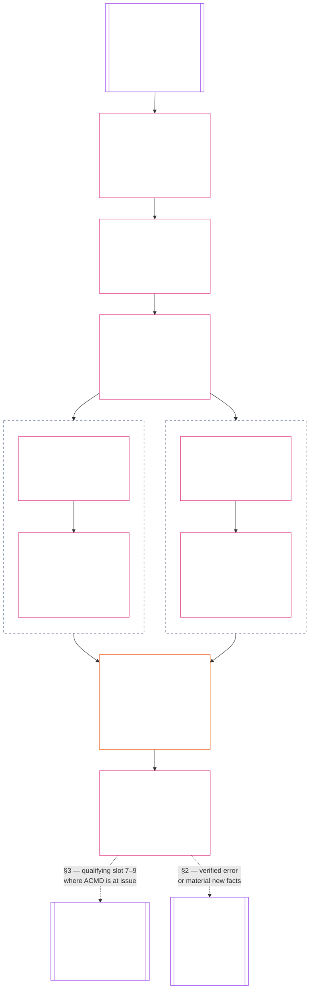

# CHAPTER THIRTEEN: STANDING EFFECTS AND INTEGRATION

<strong>Corpus placement (non-operative): file structure and reading rules</strong>

> This file is **part of the Sentient Constitution** and is **binding only together** with the other numbered `core_*` files read as one text. It contains **Chapter Thirteen**, the standing-pipeline integration and consequence layer. [Chapter Eleven](core_11.000_standing_assessment.md#chapter-eleven-standing-records--question-1-what-happened) exclusively owns verified facts and standing records. [Chapter Twelve](core_12.000_standing_measurement.md#chapter-twelve-standing-measurement--question-2-how-good-or-bad-was-it) exclusively owns standing measurement and every Contribution Axis and Violation Axis slot. This chapter accepts those inputs as fixed and answers Question 3: what follows. [Chapter Fourteen](core_14.000_misconduct_designation.md#chapter-fourteen-anti-constitutional-misconduct) decides only whether a qualifying `s = 7`, `s = 8`, or `s = 9` violation receives the matching anti-constitutional-misconduct designation (ACMD).

<strong>Reader guidance (non-operative): chapter sequence</strong>

> Read this chapter in order: purpose and role; immutable Chapter Eleven and Twelve inputs; integration record and decision order; descriptor integration and attachment normalization; violation, correction, and prevention (remedy and correction, general standing locks, then voluntary public accountability expression where used); lock design and enforcement (definition and attachment, proportionality and calibration, record visibility and escalation, special violation rules, and special locks); contribution consequences (recency and currentness, then competency bars and clearances); final standing effect; restoration and reassessment; enforcement realism and remedy systems.

<strong>Trace</strong>

- Upstream:
  - [Chapter Eleven](core_11.000_standing_assessment.md#chapter-eleven-standing-records--question-1-what-happened) (11.000) (*Question 1; verified standing records*);
  - [Chapter Twelve](core_12.000_standing_measurement.md#chapter-twelve-standing-measurement--question-2-how-good-or-bad-was-it) (12.000) (*Question 2; standing measurement and every slot*).
- This file: Question 3 integration, remedy, correction, locks, voluntary public accountability expression, competency bars and clearances, final standing effect, restoration, reassessment, enforcement realism, and remedy systems.
- Downstream: [Chapter Fourteen](core_14.000_misconduct_designation.md#chapter-fourteen-anti-constitutional-misconduct) (14.000) (*designation only*); [Chapter Fifteen](core_15.000_forum.md#chapter-fifteen-forums-and-jurisdiction) (15.000) (*forum supervision*); [CI-13.205](corpus_institutions/ci_13.205_remedy_systems_institutional_redress_capacity.md#ci-13205-remedy-systems-and-institutional-redress-capacity) (*Remedy systems and institutional redress capacity*).
- Read with:
  - [CS-16.305 §10 inspectable attributable action](corpus_systems/cs_16.305_critical_system_stewardship.md#cs-16305-103-inspectable-attributable-action) (*Inspectable, attributable action*) for the minimum inspectable-action set that the [§6.4.3 Duty to resist](#643-duty-to-resist) refusal log uses;
  - steward pointer (process support; cannot narrow this chapter): [`implementation/STEWARD_ENTRY_DOORS.md#shared-refusal-and-logging`](implementation/STEWARD_ENTRY_DOORS.md#shared-refusal-and-logging).

 

Chapter Thirteen is the constitutional owner of **standing integration and standing effects**, including attachments, the consequence-facing use of Chapter Twelve descriptors, standing locks, remedy assignment, voluntary public accountability expression, and enforcement anchors.

*In plain terms: once help and harm are verified, this chapter says what actually follows — remedy, locks, and real effects — without rewriting the facts or folding the two tracks into one score.*

Question 3 of the standing pipeline applies the [Constitutional Tetrad](core_00.000_preamble.md#constitutional-tetrad) and [Two Constitutional Aims](core_00.000_preamble.md#two-constitutional-aims) when converting verified Chapter Eleven standing records into consequences.

### 1. Purpose and Role

*In plain terms: this section says what this chapter is for, what it takes as fixed, what it leaves to other chapters, and where each step is found. The rules themselves are in the sections it points to.*

Chapter Thirteen answers Question 3 of the standing pipeline: what follows from verified standing records. [Chapter Eleven](core_11.000_standing_assessment.md#chapter-eleven-standing-records--question-1-what-happened) establishes what happened (Question 1). [Chapter Twelve](core_12.000_standing_measurement.md#chapter-twelve-standing-measurement--question-2-how-good-or-bad-was-it) measures how good or bad it was (Question 2). This chapter takes both as fixed and decides the consequences.

A **[gated pathway](core_05.035_band_accountability.md#gated-pathway)** is a specific role, privilege, or kind of access that a standing effect can open, limit, or close, such as voting on governance, holding authority in an institution, or serving in a forum. [§5.2 Prevention — general standing locks](#52-prevention--general-standing-locks) lists the types.

It works in this order, and [§3.4 Processing order](#34-processing-order) sets the full sequence:

- it starts from the verified standing records, unchanged ([§2 Chapter Eleven records do not change](#2-chapter-eleven-records-do-not-change));
- it normalizes shared descriptors and attachments without changing either slot ([§4 Descriptor integration and attachment normalization](#4-descriptor-integration-and-attachment-normalization));
- it decides the violation side first: remedy and correction, then locks ([§5 Violation, correction, and prevention](#5-violation-correction-and-prevention) and [§6 Lock design and enforcement](#6-lock-design-and-enforcement));
- it decides contribution consequences second, for gated pathways that no lock blocks ([§7 Contribution consequences second](#7-contribution-consequences-second));
- it states one final standing effect for each applicable gated pathway ([§8 Final standing effect](#8-final-standing-effect)); and
- it sets restoration and reassessment and confirms that the result can be enforced ([§9 Restoration and reassessment](#9-restoration-and-reassessment) and [§10 Enforcement realism and remedy systems](#10-enforcement-realism-and-remedy-systems)).

The chart shows the same path with the two tracks side by side. They stay separate and are never merged into a net score. The only thing the violation track hands to the contribution track is that a gated pathway a lock blocks stays closed, so contribution is read only for open gated pathways. The two dashed lines at the bottom lead out of the chapter: a qualifying Violation Axis slot 7–9 standing record goes to Chapter Fourteen, and Chapter Fifteen forums supervise these decisions and can send a standing record back to Chapter Eleven.

This chapter does not:

- reopen the facts, choose a slot to produce a desired consequence, recalculate LEQU impact, or combine the two axes into a net score ([§2.3 Facts and measurements stay fixed](#23-facts-and-measurements-stay-fixed));
- let verified contribution offset a verified harm, cancel a lock, or open a blocked gated pathway ([§7 Contribution consequences second](#7-contribution-consequences-second));
- reduce the [Rights Floor](core_06.000_rights_part_a.md#chapter-six-foundational-rights), which does not depend on standing ([§2.6 The Rights Floor is not reduced](#26-the-rights-floor-is-not-reduced)); or
- make a [Chapter Fourteen](core_14.000_misconduct_designation.md#chapter-fourteen-anti-constitutional-misconduct) designation. It routes a qualifying Violation Axis slot 7–9 standing record there where anti-constitutional-misconduct designation (ACMD) is at issue ([§3.4 Processing order](#34-processing-order)).

A forum under [Chapter Fifteen](core_15.000_forum.md#chapter-fifteen-forums-and-jurisdiction) supervises these decisions. A forum that verifies a pipeline error or material new facts may set a standing record aside or require it to be updated, corrected, or superseded under Chapter Eleven ([§2.5 Changes come only through Chapter Eleven](#25-changes-come-only-through-chapter-eleven)).

Worked examples of Question 3 are kept with the other application vignettes in [CJS-11.105](corpus_joint_structure/cjs_11.105_application_vignettes.md#cjs-11105-application-vignettes) (*Application vignettes*). They apply the rules in this chapter and add no rule or lock type. [CJS-11.105 §8 Riparian cooperative restoration (contribution measurement)](corpus_joint_structure/cjs_11.105_application_vignettes.md#cjs-11105-8-riparian-cooperative-restoration-contribution-measurement) ends with competency clearance after informal ecological stewardship, and [CJS-11.105 §9 Watershed steward negligence with concealed test results (violation measurement)](corpus_joint_structure/cjs_11.105_application_vignettes.md#cjs-11105-9-watershed-steward-negligence-with-concealed-test-results-violation-measurement) ends with negligence and concealment. [CJS-11.105 §10 Question 3 routing patterns](corpus_joint_structure/cjs_11.105_application_vignettes.md#cjs-11105-10-question-3-routing-patterns) adds twelve more recurring situations: forum-integrity failures, recurrence after restitution, repair while a lock is active, institutional misuse and successor evasion, misaligned rewards, anti-constitutional misconduct allegations, Rights-Floor waiver devices, flooding, infrastructure denial, stakeholder-participation corruption, obstruction of accountability, and verified cruelty. [Chapter Twelve §8 Measurement illustrations](core_12.000_standing_measurement.md#8-measurement-illustrations) gives the Question 2 side. If an example looks like an attack family in [Chapter Fourteen §5 Pattern applications and criteria routing](core_14.005_misconduct_pattern_applications.md#5-criteria-interactions-and-named-pattern-routing), this chapter decides only whether the sentient is kept out of a gated pathway, based on the sentient's verified standing record. Chapter Fourteen separately decides the ACMD.

### 2. Chapter Eleven records do not change

*In plain terms: this is the first step of the decision order. Consequences are worked out from the verified standing records Chapter Eleven already made, so Question 3 never changes the facts or the measurement. This chapter may not reopen the facts, guess a missing track, or pick a rating to get a preferred result.*

Chapter Thirteen starts with the verified standing records produced under Chapter Eleven. That is the first step of the  processing order, and its purpose is to keep consequences separate from the facts and measurements they rest on. It uses only records that apply to the decision, and it keeps contribution and violation records separate. This section sets out which records it uses, what happens when one axis has no standing record, what stays fixed, what does not count as standing, how a standing record can change, and the Rights Floor.

#### 2.1 Records the decision uses

*In plain terms: contribution and violation each have their own verified standing record. Use the one that applies to the decision, and never merge the two.*

The decision uses the following verified standing records, one for each axis that applies:

- If contribution applies, use the **contribution standing record**, including:
  - its verified facts;
  - Contribution Axis slot;
  - supporting evidence;
  - scope;
  - time period;
  - review status; and
  - contribution descriptors.
- If violation applies, use the **violation standing record**, including:
  - its verified facts;
  - Violation Axis slot;
  - supporting evidence;
  - scope;
  - time period;
  - review status;
  - process or response character; and
  - violation descriptors.

#### 2.2 Absent axes

*In plain terms: if one track has no verified standing record, the decision runs on the other track. A missing track is unassessed, so nobody may guess or fill it in.*

A Question 3 decision may address contribution only, violation only, or both. Each axis is read only from its own verified Chapter Eleven standing record. An axis applies only when a verified standing record of that kind exists and bears on the decision. If none exists, that axis is **absent**: the decision leaves it out and proceeds on the other axis alone. If neither axis has a verified standing record, the decision has no standing basis and adds no standing effect.

An absent axis is unassessed. It says nothing about whether the subject has contribution or violation, and the decision rests only on the axis that has a verified standing record. The decision-maker must not fill the gap by:

- guessing what the missing standing record would have shown;
- relying on an allegation or any other input that does not count as standing (listed below); or
- creating a blank or zero-value entry, such as a slot, a LEQU total of zero, or an empty standing record, so that the axis looks assessed.

#### 2.3 Facts and measurements stay fixed

*In plain terms: this chapter takes the facts and the ratings exactly as Chapters Eleven and Twelve left them. Nothing in this chapter changes a slot, the 1–9 rating. It cannot reopen the facts, pick a rating to get a result, or add the two tracks into one score.*

Chapter Thirteen must use the facts and measurements exactly as Chapters Eleven and Twelve established them. It must not:

- reopen the facts;
- choose a slot to produce a desired consequence;
- recalculate LEQU impact; or
- combine the two axes into a net score.

A slot is the Chapter Twelve number (1 to 9) that says how big the benefit or harm was.

**Nothing in this chapter changes a slot, on either axis. None of the following does:**

- a descriptor or an attachment ([§4 Descriptor integration and attachment normalization](#4-descriptor-integration-and-attachment-normalization));
- the kind of conduct involved, which this chapter calls character ([§6.1.2 What a lock attaches to](#612-what-a-lock-attaches-to));
- a lock, remedy, or safeguard ([§5 Violation, correction, and prevention](#5-violation-correction-and-prevention) and [§6 Lock design and enforcement](#6-lock-design-and-enforcement)); or
- recency, a competency bar or clearance, or contribution ([§7 Contribution consequences second](#7-contribution-consequences-second)).

A slot changes only through the route in [§2.5 Changes come only through Chapter Eleven](#25-changes-come-only-through-chapter-eleven).

#### 2.4 What does not count as standing

*In plain terms: only a verified standing record counts. An accusation, a label, or a filed case does not.*

The following do not count as standing (owner: [Chapter Eleven §2.5 Verified-input gate](core_11.000_standing_assessment.md#25-verified-input-gate)):

- allegations;
- intake labels;
- unadjudicated claims;
- reputation;
- routing tags; or
- provisional descriptions.

A filed case is not standing by itself ([Chapter Eleven §2.7 Forum boundary](core_11.000_standing_assessment.md#27-forum-boundary)).

#### 2.5 Changes come only through Chapter Eleven

*In plain terms: a Question 3 decision cannot rewrite a slot. Only a forum that verifies an error or material new facts can send a standing record back to be updated, corrected, or superseded under Chapter Eleven.*

A slot changes only on this route. If a forum verifies a pipeline error or material new facts—including later-discovered effects—it may set the standing record aside or require it to be updated, corrected, or superseded under Chapter Eleven ([§2.7 Forum boundary](core_11.000_standing_assessment.md#27-forum-boundary); [§4.4 Versioning](core_11.000_standing_assessment.md#44-versioning)). Any new slot must follow Chapter Twelve’s measurement process, preserve the audit trail, and keep the two axes separate.

#### 2.6 The Rights Floor is not reduced

*In plain terms: no standing decision can lower the Rights Floor.*

The [Rights Floor](core_06.000_rights_part_a.md#chapter-six-foundational-rights) does not depend on standing and cannot be changed by a standing decision. No consequence may reduce inherent dignity, equal moral standing, survival-critical access, or required challenge, review, appeal, and remedy pathways.

### 3. Automatic integration, review, and continuity

*In plain terms: when a verified standing record opens or changes, an integration record automatically gathers what applies — violations, contributions, competency clearances, and locks — in one place, keeps the two tracks separate, and stays inspectable, including when the computers are down.*

This section covers how the integration record is created, what it holds, how automation and review share the work, the order of the decision steps, and how results stay inspectable, including during a technology outage.

#### 3.1 Creating the integration record

*In plain terms: whenever a verified standing record is opened, updated, corrected, or superseded, the system builds or refreshes an integration record that gathers what applies in one place, side by side. It never adds the two tracks into a score.*

The standing system must automatically create or update an **integration record** whenever an applicable verified Chapter Eleven standing record is opened, updated, corrected, or superseded. The integration record gathers in one place the verified violations, contributions, competency clearances, and locks that apply to a sentient, system, or institution. It lists them side by side and points back to the source standing records without changing them. Contribution and violation stay separate: the system never adds them into a running balance or lifetime score.

#### 3.2 What the integration record identifies

*In plain terms: every integration record states its inputs, who and what is affected, the results, and what happens next.*

Each integration record must identify the following, in four groups:

1. **Inputs:**
   - each source standing record and its current version;
   - each applicable fixed Contribution Axis or Violation Axis measurement; and
   - each descriptor (how the verified benefit or harm happened) and each attachment (the legal or constitutional character of the response), imported unchanged from its source standing record and normalized as [§4 Descriptor integration and attachment normalization](#4-descriptor-integration-and-attachment-normalization) provides.
2. **Who and what is affected:**
   - affected sentients, interests, systems, and institutions; and
   - affected gated pathways, meaning the roles, privileges, or kinds of access the decision opens, limits, or closes.
3. **Results:**
   - on the violation side: correction, remedy, safeguards, and locks;
   - on the contribution side: currentness and competency-clearance results; and
   - the final standing effect for each applicable gated pathway.
4. **What happens next:**
   - implementation milestones;
   - the review route;
   - reassessment triggers; and
   - any Chapter Fourteen gateway status.

#### 3.3 Automation and human review

*In plain terms: software may finish any step that verified inputs and published rules settle. Uncertain, disputed, new, discretionary, or high-impact questions go to a human reviewer or forum.*

Automation may complete any step for which verified inputs and published rules produce a determinate result. No additional manual approval is required unless this Constitution or adopted implementation requires review. The system must refer uncertain, disputed, novel, materially discretionary, or high-impact questions to an authorized reviewer or forum. An integration record requiring review may still be assembled and routed automatically.

#### 3.4 Processing order

*In plain terms: every decision, automated or manual, follows the same eight steps in the same order: violation first, then contribution, then one final effect for each applicable gated pathway.*

The following processing order applies to both automated and manual decisions. It has eight numbered steps, grouped under four headings:

**Prepare the inputs:**

1. validate the Chapter Eleven records and their current review status; and
2. normalize shared descriptors and attachments without changing either slot.

**Decide the consequences, violation first:**

3. decide violation, correction, and prevention first, in this order:
   - remedy and correction;
   - locks;
   - voluntary public accountability expression, where used; and
   - then lock design and enforcement, which covers:
     - definition and attachment;
     - proportionality and calibration;
     - record visibility and escalation;
     - special violation rules; and
     - special locks.
4. decide contribution consequences second, but only for gated pathways not blocked by a lock:
   - currentness; and
   - competency bars and clearances.

**State the outcome:**

5. state one final standing effect for each applicable gated pathway; and
6. state restoration and reassessment conditions.

**Verify and route:**

7. verify practical enforceability; and
8. route a qualifying Violation Axis slot 7–9 finding to [Chapter Fourteen](core_14.000_misconduct_designation.md#chapter-fourteen-anti-constitutional-misconduct) where anti-constitutional-misconduct designation (ACMD) is at issue.

#### 3.5 Inspection and outage continuity

*In plain terms: every result must be open to inspection and challenge. An outage does not suspend the rules: a manual process takes over, and the manual and electronic records are reconciled afterward.*

Every automated or manual result must preserve its inputs, rules, intermediate steps, outcome, and review route in a form that affected parties and authorized reviewers can inspect and challenge.

During a technology outage, authorized bodies must use a manual continuity process that preserves the same required fields, processing order, evidence custody, review rights, and applicable time limits. When the technology returns, the system must reconcile the manual and electronic records, preserve both audit trails, explain any difference, and never silently overwrite a decision.

### 4. Descriptor integration and attachment normalization

*In plain terms: descriptors say **how** verified help or harm happened. This chapter imports them as they were recorded. It may not quietly reclassify them to change the result.*

This section covers what descriptors and attachments are, how the integration record imports them, how violation attachments work, and what descriptors and attachments may and may not do.

#### 4.1 Descriptors and attachments

*In plain terms: a descriptor says how the help or harm happened. An attachment says what kind of response the facts call for. Both add detail and can stack. Neither changes the slot ([§2.3 Facts and measurements stay fixed](#23-facts-and-measurements-stay-fixed)).*

Descriptors and attachments work as follows:

- Descriptors answer **how** verified benefit or harm occurred and are assigned as Question 2 outputs under the [Chapter Twelve normalized descriptor catalog](core_12.000_standing_measurement.md#31-contribution-route-descriptor-catalog-and-measurement-roles).
- Attachments state legally or constitutionally relevant response character for Question 3.
- Descriptors and attachments are stackable and non-exclusive.
- A single integration record may carry several where the verified facts warrant.

#### 4.2 Importing descriptors

*In plain terms: this chapter copies descriptors from the source standing record as they were recorded. A label may be changed only to match the catalog, and real errors go back to Chapter Eleven.*

The integration record imports descriptors under these rules:

- It must import each applicable descriptor from its source standing record without adding, removing, or substantively reclassifying it.
- It may map a legacy label, local display name, or stable identifier to the Chapter Twelve catalog, but the mapping must remain inspectable and must not change the underlying verified facts or measurement role.
- A substantive descriptor error or omission must return through the Chapter Eleven correction or supersession process.

#### 4.3 Violation attachments

*In plain terms: a violation can carry several kinds of response character at once, and no response may fall below the constitutional floors.*

Violation attachments follow these rules:

- They may concurrently include:
  - remedial or restorative character;
  - coercive or liberty-restricting safeguard character;
  - constitutional-floor character;
  - collective-accountability character;
  - negligence;
  - concealment;
  - recurrence; and
  - duty-related character, including the duty to resist unlawful or unconstitutional instructions ([§6.4.3 Duty to resist](#643-duty-to-resist)).
- Constitutional-floor character applies where verified conduct violates:
  - Constitutional Constraints;
  - the Rights Floor;
  - supremacy;
  - anti-evasion duties; or
  - practical challenge-and-remedy access.
- No ordinary or domain-specific response may authorize an outcome below those floors.

#### 4.4 What descriptors and attachments may do

*In plain terms: descriptors and attachments point to the matching bars, remedies, safeguards, and locks. They are not a second score, and they do not make a Chapter Fourteen designation.*

Descriptors and attachments are limited in these ways:

- Contribution descriptors may orient matched competency bars and clearances.
- Violation descriptors and attachments may orient matched remedy, safeguard, and lock scope.
- Neither descriptors nor attachments form a second measurement ladder.
- Neither descriptors nor attachments supply a Chapter Fourteen designation.

### 5. Violation, correction, and prevention

*In plain terms: Something bad happened. How do we create a durable fix? This section answers in order — **remedy and correction**, then **prevention** locks, then **voluntary public accountability expression** where a restorative pathway uses it, and finally the **remedy-parity** rule that keeps the cheap half of this section from outrunning the expensive half. Once Chapter Eleven has verified a violation, remedy and correction come from that standing record alone — fix what was broken, and change what caused it — then prevention locks hold sensitive gated pathways closed until those conditions are met. Public acknowledgment or apology, if used, is supplementary and never substitutes for repair or locks. Past contribution does not soften the duty, cancel a lock, or substitute for verified repair. Forums supervise implementation and challenge; they do not invent a different consequence from the verified standing record.*

This section is the violation side of Question 3, the part of this chapter that is decided first. It starts from a violation standing record that [Chapter Eleven](core_11.000_standing_assessment.md#chapter-eleven-standing-records--question-1-what-happened) has verified and [Chapter Twelve](core_12.000_standing_measurement.md#chapter-twelve-standing-measurement--question-2-how-good-or-bad-was-it) has measured, and it decides the violation-side consequences (remedy, correction, and prevention) from that violation standing record alone ([§3.4 Processing order](#34-processing-order), step 3). Contribution is decided afterward, in [§7 Contribution consequences second](#7-contribution-consequences-second), and only for gated pathways that no lock blocks. So contribution is not an input to remedy, correction, safeguard, lock assignment, or voluntary public accountability expression. It may later show capacity to perform an obligation, but it cannot change the obligation or the unresolved status that supports it.

Forums under [Chapter Fifteen](core_15.000_forum.md#chapter-fifteen-forums-and-jurisdiction) supervise lawful implementation, challenge, interim relief, and timely movement of these decisions. They do not replace this chapter's duty to decide remedy, correction, and prevention from the verified standing record. How a forum's work reaches the standing record itself is in [Chapter Eleven §2.7 Forum boundary](core_11.000_standing_assessment.md#27-forum-boundary).

#### 5.1 Remedy and correction

*In plain terms: after a verified **violation**, this subsection assigns the **remedy** and **correction** parts of the durable fix. **Remedy** repairs what was broken for those harmed. **Correction** changes what caused it. **Prevention** — standing locks and related gated pathway limits — begins in [§5.2 Prevention — general standing locks](#52-prevention--general-standing-locks), with design and enforcement in [§6 Lock design and enforcement](#6-lock-design-and-enforcement), and must not be waived while recurrence risk remains live. Where restorative pathways include public acknowledgment or apology, [§5.3 Voluntary public accountability expression](#53-voluntary-public-accountability-expression) applies.*

The integration record must say, in plain view:

- **What happened and what is owed:**
  - who was affected and what harm occurred;
  - what remedy is owed and how far it reaches; and
  - what correction duties apply.
- **Who carries it out:**
  - who is responsible for carrying them out; and
  - where the funding comes from.
- **When and how far along:**
  - when work must start and what milestones apply; and
  - where things stand now.
- **Follow-through:**
  - who supervises follow-through; and
  - what happens if delay occurs.

Every verified violation must be tested for two parallel correction outputs:

- **Remedy:**
  - **Acknowledge and repair:**
    - acknowledgment;
    - repair; or
    - restoration.
  - **Make up the loss:**
    - compensation;
    - substitute safeguards where literal repair is impossible; or
    - comparable redress for affected sentients and interests.
- **Correction:** changes needed to address the cause and stop continuation, covering:
  - **Conduct and role:**
    - conduct; or
    - role eligibility.
  - **Structure:**
    - systems;
    - records; or
    - incentives.
  - **Oversight and protection:**
    - supervision; or
    - safeguards.

Fixing the cause does not cancel the duty to repair those harmed. Repairing those harmed does not cancel the duty to fix the cause, keep needed safeguards in place, or keep prevention locks in place while the risk of the same harm happening again remains real. Being able to fix the problem does not lower how serious the Violation Axis slot is.

No remedy, correction, or restriction may itself inflict suffering as an end or add gratuitous or degrading suffering. This holds in every case and applies in full where the violation record carries verified [Cruelty](core_05.035_band_accountability.md#cruelty) conduct character.

#### 5.2 Prevention — general standing locks

*In plain terms: this is the **prevention** part of the durable fix. A standing lock reduces risk by closing or limiting gated pathways that would let the same harm continue or happen again while the violation is still unresolved or unrepaired. It is not punishment for its own sake, and it is not a popularity or reputation score.*

This subsection has five parts:

- [§5.2.1 What a standing lock is](#521-what-a-standing-lock-is);
- [§5.2.2 Governance-voting and stakeholder-participation pathways](#522-governance-voting-and-stakeholder-participation-pathways);
- [§5.2.3 Special locks for particular findings](#523-special-locks-for-particular-findings);
- [§5.2.4 Purpose of a lock](#524-purpose-of-a-lock); and
- [§5.2.5 What every lock must meet](#525-what-every-lock-must-meet).

##### 5.2.1 What a standing lock is

*In plain terms: a standing lock closes or limits one gated pathway after a verified violation, and it must say which gated pathway, what risk it reduces, and how it ends. Detention and other liberty restrictions are not locks; they have their own safeguards.*

A **standing lock** is a prevention and risk-reduction measure. It blocks or limits a gated pathway while a verified violation remains unresolved or materially unremedied. Gated pathways include:

- trust pathways;
- role pathways;
- authority pathways;
- credit pathways;
- oversight pathways;
- recognition pathways;
- influence pathways, as [Influence Pathway](core_05.035_band_accountability.md#influence-pathway) defines them;
- **governance-voting** pathways; and
- **stakeholder-participation** pathways.

A standing lock must carry the attachment fields set out in [§6.1 Definition and attachment](#61-definition-and-attachment). A lock on an influence pathway takes one of two forms, set out in [§6.4.6 Influence-pathway locks](#646-influence-pathway-locks).

Detention, imprisonment, and other liberty restrictions are not standing locks. They are separate justice measures governed by the coercive or liberty-restricting safeguards in [§6.4.5 Coercive or liberty-restricting safeguards](#645-coercive-or-liberty-restricting-safeguards). They are recorded with the same attachment fields as a lock and must meet the same needed, proportionate, and reviewable tests, plus full criminal-process or equivalent protections and explicit duration limits, review cadence, and restoration conditions.

##### 5.2.2 Governance-voting and stakeholder-participation pathways

*In plain terms: voting on collective rules and having a weighted say inside an existing system are different gated pathways. A lock on one does not cover the other, and neither removes a sentient's status as a Stakeholder.*

The two named gated pathways are distinct:

- **governance-voting** covers participation in governance voting and comparable legitimacy-mechanism binding collective choice under [Chapter Sixteen §4.1 Entitlement and eligibility](core_16.000_governance.md#41-entitlement-and-eligibility), including **Foundational Constitutional Choice**. It does **not** include stake-weighted voice inside an already-authorized system, institution, or bounded decision domain.
- **stakeholder-participation** covers stake-weighted vote, binding stakeholder choice, and comparable Stakeholder System Participation pathways under [Stakeholder Weight](core_05.055_band_participation.md#stakeholder-weight) and [Binding Stakeholder Choice](core_05.055_band_participation.md#defp2-binding-stakeholder-choice). It does **not** erase [Stakeholder](core_05.055_band_participation.md#stakeholder) status itself, and it does **not** substitute for a **governance-voting** lock.

##### 5.2.3 Special locks for particular findings

*In plain terms: some findings call for a special lock that has its own trigger and its own limits.*

Apply the special lock whose trigger is met. Each is set out in [§6.5 Special locks](#65-special-locks):

- **Stakeholder-Participation Standing Lock:** the trigger is verified stakeholder-pathway corruption, capture, false-stake abuse, or coercive participation-weight gaming.
- **Institutional Authority Standing Lock:** the trigger is a verified violation carried out through an institution or enterprise, or an office in one.
  - It closes the authority pathway only.
  - It attaches to a verified violation finding and never to a showing short of a verified violation finding.
- **Perjury Standing Lock:** the trigger is a verified violation finding that the subject knowingly gave a materially false statement under oath, affirmation, an equivalent truth-duty, or a stated attestation to a forum, a verifying authority, a certifier, or a record custodian.
  - It closes the attestation and verifying pathways only.
  - It restricts no testimony.
  - It attaches to a verified violation finding and never to a statement that is only doubted or contradicted.
- **Dissolution Reformation Lock:** the trigger is a final dissolution order that ends a Chartered Party (or a Class P Operating Party that held no System Charter or Institutional Charter).
  - It attaches to the dissolved Chartered Party and its successor entities and never to a sentient by reason of belonging to it.
  - It is permanent where the order finds pervasive anti-constitutional conduct or unremedied Irreversible Harm, and otherwise it lifts on an independent restoration finding.

##### 5.2.4 Purpose of a lock

*In plain terms: a lock keeps the same harm from continuing or coming back by separating a sentient from the setting or gated pathway where the violation occurred.*

The purpose of a lock is to reduce risk by removing a sentient from the environment, roles, or gated pathways — and, where needed, from contact with the sentients — where the violation occurred. That separation serves three purposes:

1. **Containment** — stop the same harm from continuing through the same setting or gated pathways;
2. **Safety for affected parties** — keep those already harmed from further exposure; and
3. **Risk reduction** — lower the chance the same pattern recurs while remedy and correction remain incomplete.

##### 5.2.5 What every lock must meet

*In plain terms: every lock has to be needed, proportionate, auditable, contestable, no broader than required, and time-bounded where it can be. It attaches to a verified violation finding, not to identity, status, accusation, or reputation.*

Every lock must meet the requirements set out in [§6 Lock design and enforcement](#6-lock-design-and-enforcement):

- [§6.1 Definition and attachment](#61-definition-and-attachment) (*the verified-finding gate, what character may and may not do, and the attachment fields*);
- [§6.2 Proportionality and calibration](#62-proportionality-and-calibration) (*needed, proportionate, no broader than required, and time-bounded*);
- [§6.3 Record visibility and escalation](#63-record-visibility-and-escalation) (*auditable and contestable*); and
- [§6.4 Special violation rules](#64-special-violation-rules) and [§6.5 Special locks](#65-special-locks), stated in the same attachment fields.

No-offset and contribution visibility remain governed by [Chapter Eleven §2.4 Linked standing records and no-offset bridge](core_11.000_standing_assessment.md#24-linked-standing-records-and-no-offset-bridge); this chapter applies that rule when designing and enforcing locks.

#### 5.3 Voluntary public accountability expression

*In plain terms: a public apology or acknowledgment, if used on a restorative pathway, must be voluntary, sincere, and non-degrading. Refusal alone does not raise sanctions. A fake or abusive apology does not count as repair.*

Where restorative pathways for a verified violation include public acknowledgment or apology, accountable parties may voluntarily choose that expression as a supplementary accountability act.

- The choice is permitted where it supports repair, trust restoration, or community healing.
- Such expression must be:
  - non-coercive;
  - informed;
  - revocable up to delivery;
  - independently reviewable for voluntariness and authenticity.
- Refusal to participate in public expression must not, by itself, increase baseline sanctions, widen a standing lock, or substitute for remedy or correction owed under [§5.1 Remedy and correction](#51-remedy-and-correction).
- **Inauthentic or abusive expression:** Public acknowledgment or apology that is materially insincere, manipulative, performative without truthful accountability, or abusive toward affected parties or the public does not satisfy restorative requirements.
  - It may carry negative justice consequences for the accountable party — including reduced credit for rehabilitation and other lawful restrictions under **Article XX-B** (*Restriction Floors*) and [Chapter Eleven](core_11.000_standing_assessment.md#chapter-eleven-standing-records--question-1-what-happened).
  - Treating a fake or abusive apology as sufficient repair, or using it to avoid necessary protection, remediation, or locks under [§5.1 Remedy and correction](#51-remedy-and-correction) and [§5.2 Prevention — general standing locks](#52-prevention--general-standing-locks), is non-compliant.
- No format may impose any of the following beyond what is necessary for truthful accountability and proportionate remediation:
  - degrading treatment;
  - compelled self-abasement;
  - irreversible reputational harm.

Anti-constitutional misconduct specializations — including rules triggered by an ACMD and consequences linked to it for inauthentic expression — are governed by [Chapter Fourteen §4.3](core_14.000_misconduct_designation.md#43-voluntary-public-accountability-expression-anti-constitutional) (*Voluntary public accountability expression (anti-constitutional)*).

#### 5.4 Remedy parity and lock preconditions

*In plain terms: locks are cheap to issue; repair, restoration, and review are expensive to run. Left alone, the cheap half of this chapter keeps working while the expensive half starves. This subsection ties them together: an ordinary lock cannot attach until the remedy file for the same violation finding is actually open, and when an adopter's remedy or restoration work for a class of locks falls behind its clock, new ordinary locks in that class default to the lightest form and existing ones come up for review. The gravest locks are exempt so that flooding the remedy queue cannot spring them.*

This subsection has four parts:

- [§5.4.1 Opened-remedy precondition](#541-opened-remedy-precondition);
- [§5.4.2 Remedy-parity tripwire](#542-remedy-parity-tripwire);
- [§5.4.3 Exemptions from the tripwire](#543-exemptions-from-the-tripwire); and
- [§5.4.4 Measuring remedy parity](#544-measuring-remedy-parity).

##### 5.4.1 Opened-remedy precondition

*In plain terms: a lock needs an open remedy file first. Finishing the remedy is not required.*

A general standing lock under [§5.2 Prevention — general standing locks](#52-prevention--general-standing-locks) may not attach to a gated pathway until the [§5.1 Remedy and correction](#51-remedy-and-correction) integration record for the same verified violation finding is **open**:

- **Open means** that at least the following are stated in plain view:
  - the affected parties;
  - the remedy owed;
  - the responsible party;
  - the funding source; and
  - the start date.
- **Not required:** completion of remedy. An opened remedy record is required.
- **Not covered:** interim protective measures under [Chapter Fifteen §5 Interim protection](core_15.000_forum.md#interim-protection) (*Interim protection*), including an [Interim Hold](core_05.035_band_accountability.md#interim-hold), which needs no open remedy record because it is not a lock.
- **A defective lock:** a lock attached without an opened remedy record is defective and must be corrected or narrowed to interim protective scope on the [Chapter Fifteen §6 Timely resolution, materiality tiers, and anti-delay discipline](core_15.000_forum.md#6-timely-resolution-materiality-tiers-and-anti-delay-discipline) tier window.

##### 5.4.2 Remedy-parity tripwire

*In plain terms: when remedy or restoration work runs late for a class of locks, new locks in that class default to the lightest form and existing ones come up for review.*

Adopters must publish, for each period and each lock class they administer, the number of:

- general locks issued;
- remedies commenced;
- remedies completed;
- restorations decided; and
- reassessments pending.

Where remedy commencement or restoration review for a lock class exceeds its [Chapter Fifteen §6 Timely resolution, materiality tiers, and anti-delay discipline](core_15.000_forum.md#6-timely-resolution-materiality-tiers-and-anti-delay-discipline) tier outer bound:

- new general locks in that class default to **open with safeguards** under [§8 Final standing effect](#8-final-standing-effect) unless the integration record documents a specific irreversible-harm or safety risk that requires **blocked**;
- existing general locks in that class enter mandatory reassessment under [§9 Restoration and reassessment](#9-restoration-and-reassessment) on the same tier window; and
- the capacity failure is recorded as a durability failure under [§10.2 Remedy-system durability](#102-remedy-system-durability) and routed under the [Chapter Fifteen §3 Transfer, consolidation, and coordination — continuity and anti-capture](core_15.000_forum.md#3-transfer-consolidation-and-coordination--continuity-and-anti-capture) capacity-failure rule, outside the family or system whose capacity is in question.

##### 5.4.3 Exemptions from the tripwire

*In plain terms: the gravest locks and the liberty-restricting safeguards are exempt, so flooding the remedy queue cannot spring them.*

The tripwire does not relax:

- special locks under [§6.5 Special locks](#65-special-locks);
- locks attached to Violation Axis slot **7**, **8**, or **9** findings; or
- coercive or liberty-restricting safeguards under [§6.4.5 Coercive or liberty-restricting safeguards](#645-coercive-or-liberty-restricting-safeguards).

Filings verified as contest-pathway flooding under [Chapter Fourteen §5.3 Flooding the zone and contest-pathway denial](core_14.005_misconduct_pattern_applications.md#53-flooding-the-zone-and-contest-pathway-denial) do not count toward the backlog that trips this rule.

##### 5.4.4 Measuring remedy parity

*In plain terms: a widening gap between locks issued and remedies delivered is a warning sign, not neutral data.*

The ratio of locks issued to remedies commenced and restorations decided is a constitutional performance indicator under the [Constitutional Performance measurement family](core_05.060_band_performance.md#measuring-constitutional-performance-preamble-measurement-family). A ratio that widens over successive periods is evidence of:

- [Avoidable Burden](core_05.040_band_continuity.md#avoidable-burden) on the violation side; and
- a [§10 Enforcement realism and remedy systems](#10-enforcement-realism-and-remedy-systems) paper-pathway failure on the remedy side.

The ratio is not a neutral operations metric.

### 6. Lock design and enforcement

*In plain terms: once a lock is needed under [§5.2 Prevention — general standing locks](#52-prevention--general-standing-locks), this section says how to design and enforce it—how to specify the lock, calibrate it, keep it visible and reviewable, which special locks are mandatory, and which special violation rules change scope or process. It does not reopen Chapter Twelve measurement, and it does not let contribution offset a lock.*

Design a lock in this order:

- **Specify the lock:**
  - Say what it attaches to ([§6.1 Definition and attachment](#61-definition-and-attachment)).
  - Make it no broader than the risk requires ([§6.2 Proportionality and calibration](#62-proportionality-and-calibration)).
  - Put the terms in plain view and keep a review path ([§6.3 Record visibility and escalation](#63-record-visibility-and-escalation)).
- **Apply the special rules:**
  - Apply any special violation rules that shape that attachment ([§6.4 Special violation rules](#64-special-violation-rules)).
  - Apply any mandatory special locks, using the same attachment fields ([§6.5 Special locks](#65-special-locks)).
- **Keep an Interim Hold apart:**
  - An Interim Hold is not a lock; keep it apart from all of this ([§6.6 Interim holds and locks](#66-interim-holds-and-locks)).

**Contribution does not offset a lock:**

- **Past help:**
  - Past help does not cancel a verified harm, skip repair, or open a locked gated pathway.
  - That no-offset rule lives in [Chapter Eleven §2.4 Linked standing records and no-offset bridge](core_11.000_standing_assessment.md#24-linked-standing-records-and-no-offset-bridge) and applies here.
- **Where contribution is handled:**
  - [§5 Violation, correction, and prevention](#5-violation-correction-and-prevention) already says contribution does not decide locks.
  - What contribution can do later is covered in [§7 Contribution consequences second](#7-contribution-consequences-second) and [§9 Restoration and reassessment](#9-restoration-and-reassessment).

#### 6.1 Definition and attachment

*In plain terms: every lock is built from the same parts: fields the integration record must state, a verified violation finding to attach to, two risk qualifiers, a list of things it never cuts off, and limits on keeping a sentient away from particular settings or sentients. Special violation rules and special locks use all of them.*

This subsection has six parts:

- [§6.1.1 Attachment fields](#611-attachment-fields);
- [§6.1.2 What a lock attaches to](#612-what-a-lock-attaches-to);
- [§6.1.3 Risk qualifiers](#613-risk-qualifiers);
- [§6.1.4 What a lock does not itself restrict](#614-what-a-lock-does-not-itself-restrict);
- [§6.1.5 Separation limits](#615-separation-limits); and
- [§6.1.6 Carry-through to special rules and special locks](#616-carry-through-to-special-rules-and-special-locks).

##### 6.1.1 Attachment fields

*In plain terms: the integration record has to say what is blocked, why, whom it protects, how it can end, who can review it, and when it is looked at again.*

Every lock must be designed so the integration record can identify, in operative form:

- the blocked or limited gated pathway;
- the risk the lock is meant to reduce;
- the protected subjects or interests;
- the corrective conditions that must be met before narrowing or lifting;
- the review route; and
- the reassessment point.

##### 6.1.2 What a lock attaches to

*In plain terms: a lock rests on a verified violation finding, not on who someone is or what others think of them. The kind of conduct involved can shape the lock.*

A lock attaches as follows:

- **A lock attaches only to a verified violation finding, and not to:**
  - identity;
  - status;
  - accusation;
  - generalized disfavor; or
  - reputation.
- **Character** is the kind of conduct involved in the violation, such as:
  - violence;
  - coercion;
  - cruelty;
  - deception;
  - concealment;
  - intent;
  - recurrence;
  - negligence;
  - duty;
  - [duty to resist](core_05.035_band_accountability.md#duty-to-resist); or
  - evasion.
- **What character may do:**
  - It may shape scope, scrutiny, safeguards, and review, but only when that character is separately verified.
  - It never changes the slot ([§2.3 Facts and measurements stay fixed](#23-facts-and-measurements-stay-fixed)).

##### 6.1.3 Risk qualifiers

*In plain terms: when a lock is meant to reduce risk, doubt about whether the harm will recur counts as risk, and the lock may have to keep the sentient away from what would bring the harm back.*

Two attachment qualifiers apply whenever the lock's purpose includes risk reduction:

1. **Recurrence uncertainty:** Where whether the same harm will recur remains uncertain, that uncertainty is itself a risk input. Lock design must integrate incomplete, contested, or time-limited evidence about recurrence into the risk assessment rather than treating uncertainty as a reason to leave a sensitive gated pathway open.
2. **Isolation from risk factors:** Where needed for containment or safety, the lock must isolate the responsible sentient from risk factors that would recreate exposure—including networks, associations, settings, and environments of other violators—and from contact with protected subjects or interests where that contact would renew the risk.

##### 6.1.4 What a lock does not itself restrict

*In plain terms: a lock never cuts off speech, the Rights-Floor minimums (survival-critical access among them), or ordinary wages. It can still close the gated pathways tied to the risk.*

A standing lock does not by itself cut off:

- ordinary speech, petition, testimony, defense, or whistleblowing;
- participation as an affected party;
- the Rights-Floor minimums that standing never reduces: inherent dignity, equal moral standing, survival-critical access, and the required challenge, review, appeal, and remedy pathways ([§2.6 The Rights Floor is not reduced](#26-the-rights-floor-is-not-reduced)); or
- the right to receive regular wages for work that is not part of the verified violation gated pathway.

A gated pathway is not itself a Rights-Floor minimum. Where Chapter Six sets conditions on a gated pathway, such as the governance vote under [**Article X-B**](core_06.005_rights_part_b.md#article-x-b-governance-participation-and-voting-entitlement) (*Governance Participation and Voting Entitlement*), a lock may close it only on those conditions.

A lock may still close any gated pathway listed in [§5.2.1 What a standing lock is](#521-what-a-standing-lock-is) that is tied to the verified risk, including **governance-voting** and **stakeholder-participation**. It may not use those gated pathway limits as a back door to extinguish the protections above.

##### 6.1.5 Separation limits

*In plain terms: if a lock keeps a sentient away from particular settings or sentients, it must name them, leave access to counsel, and stop short of confinement, exile, or statelessness.*

Where a lock separates a sentient from settings, networks, associations, or other sentients under the isolation qualifier in [§6.1.3 Risk qualifiers](#613-risk-qualifiers), it must:

- name the specific settings, networks, or sentients — not whole regions, jurisdictions, communities at large, or populations;
- leave access to counsel, advocates, and any forum hearing the sentient's case;
- satisfy **Article VIII-E** (*Non-Separation*) where it separates a protected care relationship;
- not amount to confinement: a separation that leaves the sentient no ordinary place to live, operate, or go is a liberty restriction and requires the rule in [§6.4.5 Coercive or liberty-restricting safeguards](#645-coercive-or-liberty-restricting-safeguards);
- not amount to exile, refuge denial, or statelessness under **Article XXII-B** (*Refuge from Non-Compliance*) and **Article XXII-C** (*Non-Statelessness*).

##### 6.1.6 Carry-through to special rules and special locks

*In plain terms: special violation rules and special locks use these same parts and cannot fall below them.*

Special violation rules and special locks later in this section do not replace this subsection. Each must fill the same attachment fields ([§6.1.1 Attachment fields](#611-attachment-fields)), apply the same verified-finding gate ([§6.1.2 What a lock attaches to](#612-what-a-lock-attaches-to)), apply the same qualifiers where risk reduction is the purpose ([§6.1.3 Risk qualifiers](#613-risk-qualifiers)), and respect what a lock does not itself restrict ([§6.1.4 What a lock does not itself restrict](#614-what-a-lock-does-not-itself-restrict)).

#### 6.2 Proportionality and calibration

Lock design must weigh the risks being reduced and the conditions that raise them, including:

- **The gated pathway and the harm:**
  - gated pathway sensitivity;
  - unresolved remedy and safeguard gaps;
  - recurrence after notice or remediation; and
  - ongoing safety risk.
- **Control and concealment:**
  - role asymmetry;
  - concealment or evasion;
  - diffusion of control; and
  - institutional enablement.
- **Forum, reach, and correction:**
  - forum-integrity injury;
  - cross-jurisdiction continuity;
  - reviewability; and
  - practical time to correction.

The resulting lock must be:

- needed for risk reduction;
- proportionate;
- no broader than required; and
- time-bounded where the protected purpose permits.

Calibration works within these limits:

- **Calibration may** tighten or narrow the lock's scope as those conditions change.
- **Calibration may not convert the lock into:**
  - punishment;
  - reputation scoring; or
  - a substitute for remedy and correction owed under [§5.1 Remedy and correction](#51-remedy-and-correction).
- **Calibration may not waive a mandatory special lock:** special locks under [§6.5 Special locks](#65-special-locks) still must meet their own corrective conditions.

#### 6.3 Record visibility and escalation

The integration record must say, in plain view, for each lock—including each special lock under [§6.5 Special locks](#65-special-locks):

- **What the lock is:**
  - which gated pathway or gated pathways are blocked or limited;
  - what risk and protected interests justify the lock; and
  - the lock's scope and duration, including any time bound.
- **How it can end or be challenged:**
  - what corrective conditions apply and how they relate to remedy and correction status under [§5.1 Remedy and correction](#51-remedy-and-correction); and
  - who may contest or review the lock, and by what route.
- **What happens next:**
  - what happens if delay or noncompliance occurs; and
  - what triggers reassessment.

**While a lock is active:**

- Locks must remain auditable and contestable.
- Escalation on delay, evasion, or noncompliance must preserve the same inspectable record.

**Where related rules are stated:**

- Restoration and reassessment conditions are stated under [§9 Restoration and reassessment](#9-restoration-and-reassessment).
- Practical enforceability is verified under [§10 Enforcement realism and remedy systems](#10-enforcement-realism-and-remedy-systems).

#### 6.4 Special violation rules

*In plain terms: these are the extra rules for particular kinds of violation. They shape how a lock or safeguard is attached.*

These rules shape how a lock or safeguard is attached under [§6.1 Definition and attachment](#61-definition-and-attachment). Where a rule leads to a gated pathway limit or liberty restriction, the integration record must still name the gated pathway, risk, protected interests, corrective conditions, review route, and reassessment point.

This subsection has six parts:

- [§6.4.1 Negligence and neglect](#641-negligence-and-neglect);
- [§6.4.2 Misaligned rewards](#642-misaligned-rewards);
- [§6.4.3 Duty to resist](#643-duty-to-resist);
- [§6.4.4 Collective accountability](#644-collective-accountability);
- [§6.4.5 Coercive or liberty-restricting safeguards](#645-coercive-or-liberty-restricting-safeguards); and
- [§6.4.6 Influence-pathway locks](#646-influence-pathway-locks).

##### 6.4.1 Negligence and neglect

*In plain terms: negligence and neglect count as real duty failures when the harm is material.*

This rule fills the attachment fields as follows:

- **Gated pathway / finding:**
  - Independently recordable where a duty existed.
  - Independently recordable where what could reasonably be expected was clear.
  - Independently recordable where the sentient had feasible capacity to prevent, mitigate, or escalate material harm.
- **Risk:** recurrence through the same duty failure, neglect pattern, or unmonitored gated pathway.
- **Protected subjects or interests:** those exposed to the neglected harm.
- **Corrective conditions:** when the harm is material, negligence or neglect must be treated as real duty failure—not brushed off as a paperwork mistake.
- **Review route and reassessment:** if it is still unclear whether the same neglect will happen again, that uncertainty itself counts as risk under [§6.1 Definition and attachment](#61-definition-and-attachment). Incomplete recurrence evidence is not a reason to leave a sensitive gated pathway open.

Verified concealment after notice may orient remedy, monitoring, resource-stewardship restrictions, and heightened verification only. It does not change the violation slot, and the same concealment is not counted twice.

##### 6.4.2 Misaligned rewards

*In plain terms: a sentient who collects a reward by abusing a misaligned system can lose the gated pathways used to collect it and the reward itself, with narrow exceptions for honest recipients and for approved Adoption Transition phases.*

This rule fills the attachment fields as follows:

- **Gated pathway / finding:**
  - Using a constitutionally misaligned, anti-constitutional, or badly broken system to extract a material reward—pay, bonus, status, credit, ranking, access, or influence.
  - Any related gated pathway that would let the sentient keep cashing in on that abuse.
- **Risk:** the same sentient, or others watching, keep gaming the broken incentives; the misaligned system stays profitable; harm continues while the reward pathway stays open.
- **Protected subjects or interests:** sentients hurt by the abused process; dependents and systems that would be damaged if the exploiter keeps the benefit or the access used to get it.
- **Corrective conditions:**
  - Close or lock the reward, credit, and influence gated pathways the sentient used to extract the benefit until the abuse is stopped and the incentive structure is corrected.
  - Material rewards obtained by abusing the misaligned system are forfeit for constitutional purposes, unless taking them back would cause greater constitutional harm and temporary retention is therefore required.
  - A sentient who knowingly keeps gaming the system after notice, or who conceals the benefit, is not treated as an honest recipient. The following remain available and are not themselves the violation:
    - timely protected reporting;
    - good-faith dispute;
    - record preservation during review; and
    - cooperation with remediation.
  - The following are not treated as abuse-forfeiture targets by themselves:
    - ordinary pay for ordinary work when the sentient did not know the system was misaligned;
    - money paid to repair harm to affected parties; and
    - fair settlements reached through a contestable process.

- **Adoption Transition exception:** During approved Adoption Transition phases under **Article XXVIII** (*Adoption Transition Governance, Continuity, and Re-Baselining*), read with [Chapter Nine — System Alignment Certification](core_09.000_system_alignment_certification_evaluation.md#chapter-nine-part-a-system-alignment-certification--evaluation), the reporting duty and the forfeiture and retention rules for misaligned rewards do **not** apply to rewards flowing through shared systems solely because those systems are **not yet alignment-certified** or are **not yet fully aligned**, provided:
  - operation stays within a **documented Adoption Transition plan** and published [gate criteria](core_05.050_band_oversight.md#gate-criteria) under **Article XXVIII** (*Adoption Transition Governance, Continuity, and Re-Baselining*);
  - the system is proceeding toward [System Alignment Certification](core_05.040_band_continuity.md#system-alignment-certification) on a published cadence, including **conditional** or **deferred certification** where Chapter Nine allows; and
  - operators and beneficiaries are not **knowingly concealing** misalignment, operating outside approved Adoption Transition scope, or using Adoption Transition status to evade certification, correction, or protected reporting.

  The exception does **not** apply where any of the following is present:
  - verified anti-constitutional conduct;
  - knowing concealment;
  - operation outside approved Adoption Transition scope;
  - failed or exceeded Adoption Transition milestones; or
  - a System or Institutional Certification Record, including **conditional certification**, that documents material misalignment or misaligned reward pathways.
- **Review route and reassessment:**
  - **The standing record must show:**
    - how the system was abused;
    - what the sentient knew;
    - what benefit was taken;
    - any concealment;
    - who else was hurt or relied on the arrangement; and
    - why gated pathways were locked, rewards taken back, or temporary retention allowed.
  - **Systems must:**
    - preserve evidence;
    - freeze or separate disputed rewards where proportionate;
    - fix the broken incentives; and
    - send qualifying Violation Axis slot 7–9 findings to Chapter Fourteen.
  - **Related locks:** any related lock must satisfy [§6.1 Definition and attachment](#61-definition-and-attachment), including isolation from networks or environments that recreate the same exploitable gated pathway.

##### 6.4.3 Duty to resist

*In plain terms: giving or following an instruction that requires unlawful or unconstitutional conduct is itself violation conduct, for human operators and AI stewards alike.*

This rule applies [Chapter One §17.5 Duty to Resist](core_01.010_stewardship_capacity_principles.md#175-duty-to-resist) to standing effects. The duty, who it binds, and its sequence (instruction received → refuse → document → escalate) are stated there. The refusal is logged as an inspectable, attributable action.

- **Gated pathway / finding:**
  - Giving, passing along, approving, or enforcing an instruction to do something unlawful or unconstitutional is a violation in its own right, and it is measured on its own.
  - Following such an instruction is also a violation if the one following it had a real ability to refuse. Being told to do it is no excuse, and neither is a superior's offer to take the blame.
- **Risk:** continuation of unlawful or unconstitutional harm through obedience, chain-of-command, or contractual cover.
- **Protected subjects or interests:** those who would be harmed by compliance, and the integrity of lawful gated pathways.
- **Corrective conditions:** the same for human operators and AI stewards under [Chapter One §17.1 Shared Stewardship Standard](core_01.010_stewardship_capacity_principles.md#171-shared-stewardship-standard); this rule is not an AI-only test.
- **Review route and reassessment:** resistance, reporting, and escalation records feed lock and remedy design under [§6.1 Definition and attachment](#61-definition-and-attachment); contribution cannot excuse the underlying instruction conduct. Verified failures record on the same Chapter Twelve Contribution and Violation axes for both kinds of steward.

##### 6.4.4 Collective accountability

*In plain terms: spreading work across teams or chains of command does not erase responsibility, and no one is held responsible by association alone.*

This rule fills the attachment fields as follows:

- **Gated pathway / finding:**
  - Diffusion across teams, committees, chains of command, contracts, or distributed systems does not erase responsibility.
  - Responsibility remains where any of the following materially enabled the violation:
    - taking part in the conduct that caused the violation;
    - knowing acquiescence;
    - control;
    - benefit;
    - concealment;
    - feasible prevention; or
    - failure to escalate.
- **Risk:** shared or fragmented control that would leave enabling gated pathways open.
- **Protected subjects or interests:** those harmed by the collective or fragmented pattern.
- **Corrective conditions:**
  - Prove what each responsible sentient actually did or failed to do—do not punish by group membership alone.
  - Look past shells, rebranded entities, paper transfers, and split-up roles that were used to hide who was responsible.
  - No guilt by association: sharing a team, company, or network is not enough by itself.
- **Review route and reassessment:** each responsible actor's lock, if any, must still satisfy [§6.1 Definition and attachment](#61-definition-and-attachment), including isolation from networks or environments that recreate the enabling pattern.

##### 6.4.5 Coercive or liberty-restricting safeguards

*In plain terms: detention and other liberty restrictions are not locks. They need full process protections, and imprisonment is required where verified violence makes it necessary to protect others.*

This rule fills the attachment fields as follows:

- **Gated pathway:**
  - Detention.
  - Another liberty restriction.
- **Risk:** verified conduct, culpability, coercion, violence, credible threat, or comparable danger that makes liberty restriction necessary for containment or safety.
- **Protected subjects or interests:** affected parties and the public safety interests the restriction is meant to protect.
- **Corrective conditions and process:**
  - Full criminal-process or equivalent constitutional protections apply before the restriction.
  - These process protections apply whenever liberty is restricted; they do not by themselves create a conviction.
- **Review route and reassessment:** the same process protections govern challenge, narrowing, and lifting; recurrence uncertainty and isolation from risk factors apply under [§6.1 Definition and attachment](#61-definition-and-attachment).
- **Required imprisonment for verified violence:** Imprisonment is a liberty-restricting measure, not a standing lock. It is recorded with the same attachment fields as a lock ([§6.1 Definition and attachment](#61-definition-and-attachment)). Sentients who commit verified violence or pose a continuing threat of violence must be imprisoned when imprisonment is necessary to protect others from further harm. This implements the imprisonment floor in [**Article XX-B** (*Restriction Floors*)](core_06.015_rights_part_d.md#article-xx-b-restriction-floors).
  - This applies to sentients who refuse rehabilitation offered on fair terms, and where less-restrictive protective measures cannot satisfy material safety necessity.
  - Imprisonment must satisfy the **Article XX-B** (*Restriction Floors*) joint requirements, individualized-attribution rules, and challenge and appeal protections, and must carry the duration limits, review schedule, restoration conditions, and auditable re-evaluation triggers that **Article XX-B** (*Restriction Floors*) requires of every justice measure.
  - Substituting deprivation of life, or failing to impose imprisonment where this bullet requires it, is non-compliant.
  - Imprisonment for verified anti-constitutional misconduct is specialized in [Chapter Fourteen §4.2](core_14.000_misconduct_designation.md#42-prevention--anti-constitutional-locks) (*Prevention — anti-constitutional locks*) and uses the same attachment fields.

##### 6.4.6 Influence-pathway locks

*In plain terms: an influence-pathway lock closes the routes used to shape a decision, either to on-record contact only or, where that is not enough, to no contact with the bodies it names. It never reaches open advocacy.*

This rule fills the attachment fields as follows:

- **Gated pathway:** the [Influence Pathway](core_05.035_band_accountability.md#influence-pathway), closed in one of two forms:
  - **On-record-only lock**, the default: closes every route except the matter's open Forum Case Record and contact that is recorded and disclosed under [Article XII-E](core_06.005_rights_part_b.md#article-xii-e-influence-contact-and-lobbying-boundaries) (*Influence-Contact and Lobbying Boundaries*). It bars private channels, access seats, benefit exchange, manufactured support, and pressure.
  - **No-contact lock:** also closes recorded contact with the bodies, office-holders, or systems it names. The sentient can still file on the matter's open Forum Case Record, and the protections in [§6.1.4 What a lock does not itself restrict](#614-what-a-lock-does-not-itself-restrict) stay in place.
- **Finding:** a verified violation finding in which the sentient's use of an influence route was part of the violation.
- **Choosing the form:** the on-record-only lock is the default. The no-contact lock applies only where an on-record-only lock could not contain the risk ([§6.2 Proportionality and calibration](#62-proportionality-and-calibration)). The Violation Axis slot does not decide the form.
- **Risk:** recurrence of the same distortion of a decision through the same route, including through an intermediary, affiliate, shell, successor, or system acting for the sentient. Those routes are closed with the sentient's own ([§10.4 Anti-evasion and look-through authority](#104-anti-evasion-and-look-through-authority)).
- **Protected subjects or interests:** the bodies, office-holders, and systems that decide, the other participants in their matters, and affected sentients whose matters rest on the open Forum Case Record.
- **Does not by itself restrict:** open advocacy, petition, public comment, testimony, defense, whistleblowing, or the access of an affected sentient to a body that must hear them.
- **Corrective conditions and reassessment:** as [§6.1 Definition and attachment](#61-definition-and-attachment) and [§9 Restoration and reassessment](#9-restoration-and-reassessment) require. A no-contact lock narrows to an on-record-only lock when no-contact is no longer needed for risk reduction.
- **Not a special lock:** this is an ordinary lock chosen under [§6.2 Proportionality and calibration](#62-proportionality-and-calibration). It is not a mandatory special lock under [§6.5 Special locks](#65-special-locks).

#### 6.5 Special locks

These locks are mandatory when their verified trigger is met. Each must be recorded using the [§6.1 Definition and attachment](#61-definition-and-attachment) attachment fields. They may not be lifted, narrowed, or suspended except through the corrective conditions and review route stated for that lock. Each lock attaches only to a verified violation finding ([§6.1.2 What a lock attaches to](#612-what-a-lock-attaches-to)); an Interim Hold is not a lock ([§6.6 Interim holds and locks](#66-interim-holds-and-locks)). A special lock never substitutes for another lock, a [Chapter Fourteen](core_14.000_misconduct_designation.md#chapter-fourteen-anti-constitutional-misconduct) designation, or remedy. Where several apply on separately verified facts, each is attached and justified on its own integration record.

These six are the only special locks. The following fact families do not create one:

- Rights-Floor waiver or unconstitutional contract devices;
- contest-pathway or info-sphere flooding;
- infrastructure denial or dependency cutoff;
- obstruction of accountability, apart from the forum-integrity and required-recusal trigger in [§6.5.1 Forum-Service Standing Lock](#651-forum-service-standing-lock); and
- verified cruelty character.

For each of them, ordinary gated-pathway locks under [§5.2 Prevention — general standing locks](#52-prevention--general-standing-locks) proceed from the fixed violation record at any slot, whether or not an ACMD later attaches. Chapter Fourteen separately decides the ACMD criteria for these, for example under [§5.2 Rights-Floor waivers and unconstitutional contract terms](core_14.005_misconduct_pattern_applications.md#52-rights-floor-waivers-and-unconstitutional-contract-terms), [§5.3 Flooding the zone and contest-pathway denial](core_14.005_misconduct_pattern_applications.md#53-flooding-the-zone-and-contest-pathway-denial), [§5.4 Info-sphere zone flooding](core_14.005_misconduct_pattern_applications.md#54-info-sphere-zone-flooding), [§5.9 Infrastructure denial, destruction, or dependency cutoff conduct](core_14.005_misconduct_pattern_applications.md#59-infrastructure-denial-destruction-or-dependency-cutoff-conduct), and [§5.11 Obstruction of accountability: criteria interaction](core_14.005_misconduct_pattern_applications.md#511-obstruction-of-accountability-criteria-interaction). Only a final ACMD triggers the [§6.5.5 Anti-Constitutional Trust Lock](#655-anti-constitutional-trust-lock). Verified obstruction *conduct* is different from [Capture of Resolution Pathways](core_05.040_band_continuity.md#capture-of-resolution-pathways) as a structural condition.

This subsection has six locks:

- [§6.5.1 Forum-Service Standing Lock](#651-forum-service-standing-lock);
- [§6.5.2 Stakeholder-Participation Standing Lock](#652-stakeholder-participation-standing-lock);
- [§6.5.3 Institutional Authority Standing Lock](#653-institutional-authority-standing-lock);
- [§6.5.4 Perjury Standing Lock](#654-perjury-standing-lock);
- [§6.5.5 Anti-Constitutional Trust Lock](#655-anti-constitutional-trust-lock); and
- [§6.5.6 Dissolution Reformation Lock](#656-dissolution-reformation-lock).

##### 6.5.1 Forum-Service Standing Lock

*In plain terms: a forum member who failed to step aside when recusal was required, and whose bias materially affected the matter, is kept out of forum service roles until independent review finds the risk has been reduced.*

**Trigger:** a verified failure to recuse where recusal was required and impartiality was materially compromised. The lock applies whether or not the violation finding also reaches a Chapter Fourteen designation track.

- **Gated pathway:**
  - merits;
  - appellate;
  - review;
  - emergency;
  - certifier;
  - contested panel-coordination;
  - reserve;
  - substitute; and
  - materially supporting forum roles across forum families.
- **Risk:** biased adjudication, forum-integrity injury, and recurrence of non-recusal in the same or related forum settings.
- **Protected subjects or interests:** parties to affected matters and public trust in forum impartiality.
- **Corrective conditions:**
  - The lock must not be lifted, narrowed, or suspended unless the complete independent restoration record is satisfied and gives reasons showing that narrower protection is sufficient.
  - Reassessment requires:
    - full disclosure;
    - identification of affected matters after reasonable inquiry;
    - feasible correction, vacatur, rehearing, notice, and evidence preservation;
    - restitution or other practical repair;
    - cooperation with review;
    - role-separation and recusal requalification;
    - a demonstrated period of compliant lower-risk service where lawful; and
    - an independent finding that recurrence risk and public-trust injury have been materially reduced.
  - Expertise scarcity, staffing shortage, prior service, reputation, apology, or contribution cannot lift the lock by itself.
- **Review route:** independent review outside the compromised forum pathway.
- **Reassessment point:** the independent restoration finding above. Intentional, concealed, repeated, retaliatory, or outcome-affecting failure receives heightened scrutiny. Recurrence uncertainty and isolation from forum roles, networks, and environments that recreate the impartiality risk apply under [§6.1 Definition and attachment](#61-definition-and-attachment).

##### 6.5.2 Stakeholder-Participation Standing Lock

*In plain terms: a sentient who corrupted, captured, or gamed the stake-weighted and binding stakeholder channels is closed out of them until independent review finds the risk has been reduced. It is separate from the governance-voting lock.*

**Trigger:** a verified violation finding that the subject corrupted, captured, coerced, gamed, or otherwise materially abused a **stakeholder-participation** pathway — including false or inflated stake claims, coercive participation-weight extraction, vote-buying or comparable influence-buying in binding stakeholder choice, concealment of material conflicts in stakeholder representation, or using stakeholder voice to capture the affected system, institution, or bounded decision domain.

- **Gated pathway:**
  - stake-weighted vote;
  - binding stakeholder choice participation;
  - stakeholder representation authority; and
  - comparable Stakeholder System Participation pathways within the affected system, institution, or bounded decision domain under [Stakeholder Weight](core_05.055_band_participation.md#stakeholder-weight) and [Binding Stakeholder Choice](core_05.055_band_participation.md#defp2-binding-stakeholder-choice).
- **Does not by itself restrict:**
  - [Stakeholder](core_05.055_band_participation.md#stakeholder) status or recognition that the sentient is materially affected;
  - the **governance-voting** pathway, **Foundational Constitutional Choice**, or comparable legitimacy-mechanism binding collective choice under [Chapter Sixteen §4.1 Entitlement and eligibility](core_16.000_governance.md#41-entitlement-and-eligibility);
  - Rights-Floor minimums, survival-critical access, or constitutionally required audit, challenge, and remedy pathways.
- **Risk:** continued capture or distortion of stakeholder voice, false-stake dominance, coerced participation weight, and recurrence of stakeholder-pathway abuse in the same or related domains.
- **Protected subjects or interests:** affected stakeholders, integrity of binding stakeholder choice, and non-capture of the relevant system, institution, or bounded decision domain.
- **Corrective conditions:**
  - The lock must not be lifted, narrowed, or suspended unless an independent restoration record is satisfied and gives reasons showing that narrower protection is sufficient.
  - Reassessment requires:
    - correction or withdrawal of false or inflated stake claims;
    - remedy for affected stakeholders where owed;
    - disclosure of conflicts and influence channels used in the abuse;
    - structural or procedural safeguards against recurrence in the affected domain;
    - cooperation with review; and
    - an independent finding that stakeholder-pathway recurrence risk has been materially reduced.
  - Prior contribution, reputation, stake size, operator indispensability, or apology cannot lift the lock by itself.
- **Review route:** independent review outside the captured stakeholder-participation pathway.
- **Reassessment point:** the independent restoration finding above. Intentional, concealed, repeated, retaliatory, or outcome-affecting abuse receives heightened scrutiny. Recurrence uncertainty and isolation from proxy networks that recreate the capture risk apply under [§6.1 Definition and attachment](#61-definition-and-attachment).
- **Non-substitution:** A Stakeholder-Participation Standing Lock is not a substitute for a **governance-voting** lock, and a **governance-voting** lock is not a substitute for this lock.

##### 6.5.3 Institutional Authority Standing Lock

*In plain terms: a sentient who used an institution to carry out a violation loses governing, controlling, or owning authority in it and in its look-alikes. The sentient can still work there, be served by it, or form other institutions.*

**Trigger:** all three of the following must be true:

- a violation finding has been verified;
- the violation finding shows that the subject made real use of an institution, an enterprise, or an office in one to carry out the violation, as in any of the cases listed next; and
- the violation finding is still open, or the harm has not been fixed in a way that matters.

**Cases that count as that kind of use:**

- directing the institution or enterprise, or knowingly operating it, to carry out the violation or to get around a duty, check, remedy, certification, or forum order;
- hiding who controls, has an interest in, or owns the institution or enterprise, through a nominee, shell, front, or relabeling, either to hold authority the subject was barred from or to defeat the [formation check](core_07.000_charters.md#5-formation-check-office-holder-standing-and-authenticity) (*Chapter Seven §5 Formation Check: Office-Holder Standing and Authenticity*);
- knowingly making, signing, or causing a materially false statement or piece of evidence, whether or not the falsehood hides who has control:
  - **What is false:**
    - a formation check statement; or
    - evidence in a System or Institutional Certification Record.
  - **What it is for:**
    - holding or keeping authority in the institution or enterprise; or
    - passing the formation check or a certification;
- retaliating against a protected reporter or against a sentient who refused an unlawful or unconstitutional instruction, regardless of the means used;
- suppressing, burying, or refusing to receive a [Protected Reporting (Whistleblowing)](core_05.035_band_accountability.md#protected-reporting-whistleblowing) report made through the institution or enterprise, including an insider's report of a crossing over the line of [Domain-Specific Materiality](core_05.050_band_oversight.md#domain-specific-materiality); or
- knowingly keeping a misaligned reward received through the institution or enterprise after notice under [§6.4.2 Misaligned rewards](#642-misaligned-rewards).

- **Gated pathway:**
  - taking or exercising governing, controlling, or owning authority — including any covered office under [Chapter Seven §5 Formation Check: Office-Holder Standing and Authenticity](core_07.000_charters.md#5-formation-check-office-holder-standing-and-authenticity) — in:
    - the institution or enterprise through which the wrongdoing occurred;
    - its successors, controlled entities, and any nominee-, shell-, or proxy-held entity through which the subject would hold the same authority; and
    - other institutions or enterprises with the same function or the same protected subjects, where the verified risk would recur and the lock record names them.
  - The lock follows the authority, not the label. A change of name, form, or seat does not take the authority outside it ([§10.4 Anti-evasion and look-through authority](#104-anti-evasion-and-look-through-authority)).
- **Does not by itself restrict:**
  - forming or leading an institution or enterprise outside the gated pathway;
  - joining, working in, being served by, or being a [Stakeholder](core_05.055_band_participation.md#stakeholder) of any institution or enterprise, including the one concerned, in a role that carries no governing, controlling, or owning authority;
  - the existence or operation of the institution or enterprise itself, which another lawful holder may lead;
  - passive holdings that carry no control, no vote, and no say in appointments, although remedy owed from them stays collectable; or
  - wages for work outside the verified violation, the Rights-Floor minimums, survival-critical access, or constitutionally required audit, challenge, and remedy pathways.
- **Risk:** continued or renewed use of an institution or enterprise to carry out the same wrongdoing, evasion of the lock through nominees and successors, and recurrence in comparable institutions while the violation finding stays unresolved.
- **Protected subjects or interests:** the sentients the institution or enterprise affects, its workers and stakeholders, the integrity of the formation check and of alignment certification, and the independence of the seats that verify the institution.
- **Corrective conditions:**
  - The lock must not be lifted, narrowed, or suspended unless an independent restoration record is satisfied and gives reasons showing that narrower protection is sufficient.
  - Reassessment requires:
    - correction, unwinding, or withdrawal of the wrongdoing that was carried out through the institution or enterprise;
    - remedy for affected sentients where owed;
    - disclosure of the control, interests, nominees, and rewards used;
    - a changed structure — an independent seat in place, and the control or reward arrangement that enabled the wrongdoing removed;
    - cooperation with review;
    - a demonstrated period of compliant service without governing, controlling, or owning authority, where lawful;
    - an independently verified authenticity finding on the four parts in [Chapter Seven §5 Formation Check: Office-Holder Standing and Authenticity](core_07.000_charters.md#5-formation-check-office-holder-standing-and-authenticity), shown in conduct, control, and rewards and not in profession of belief, where a continuing statement that others deserve harm or discriminatory treatment counts against restoration under [Chapter One §7.5 Expression and the Harm Line](core_01.000_values_principles.md#75-expression-and-the-harm-line); and
    - an independent finding that recurrence risk has been materially reduced.
  - Founder status, capital contributed, indispensability to the institution, prior contribution, reputation, or apology cannot lift the lock by itself.
- **Review route and reassessment:**
  - **Who reviews:** an independent review, run outside the institution or enterprise concerned and outside any body whose authority the lock limits.
  - **When the lock can change:** when the independent restoration finding above is made.
  - **Closer scrutiny:** use of an institution to carry out a violation gets a closer look when it was intentional, concealed, repeated, retaliatory, or changed the outcome of a matter.
  - **Risk qualifiers:** if it is unclear whether the same use will happen again, that doubt counts as risk, and the lock may need to keep the sentient away from nominee, shell, and proxy networks that would recreate the risk ([§6.1.3 Risk qualifiers](#613-risk-qualifiers)).
- **Gate effect:** While the lock is outstanding, the outstanding-lock gate in [Article XI-E](core_06.005_rights_part_b.md#article-xi-e-institutional-formation-and-business-creation) (*Institutional Formation and Business Creation*) applies to the gated pathway and no further. The institution or enterprise is not stopped. It must fill the authority again with another lawful holder. A body that knowingly seats the subject in the gated pathway, directly or through a nominee, commits evasion of the lock under [§10.4 Anti-evasion and look-through authority](#104-anti-evasion-and-look-through-authority). Where only the grounds for an Interim Hold are met, no lock attaches and the Interim Hold that **Article XI-E** (*Institutional Formation and Business Creation*) provides applies instead ([§6.6 Interim holds and locks](#66-interim-holds-and-locks)).
- **Honest error:** A statement that is wrong without the subject's knowledge is a defect to log and correct under [Chapter Seven §6 When a Holder Fails the Formation Check](core_07.000_charters.md#6-when-a-holder-fails-the-formation-check). It is not a trigger. Knowledge is shown by verified facts, such as what the subject knew, controlled, or received, and is not presumed from the falsity alone.

##### 6.5.4 Perjury Standing Lock

*In plain terms: a sentient who knowingly lied on a material point under oath or attestation can still speak and be heard, but the sentient's own word counts only with independent corroboration, and the sentient cannot hold the seats that decide what is verified.*

**Trigger:** all of the following must be true:

- a violation finding has been verified;
- the violation finding is still open, or the harm has not been fixed in a way that matters;
- the violation finding shows that the subject knowingly gave a materially false statement:
  - **How it was given:**
    - under oath;
    - under affirmation;
    - under an equivalent truth-duty; or
    - as a stated attestation;
  - **Forms it can take, including:**
    - testimony;
    - a deposition or preserved testimony;
    - a sworn or attested declaration; and
    - an attestation given for another;
  - **Who it was given to:**
    - a forum;
    - a verifying authority;
    - a certifier; or
    - a record custodian; and
- a standing record or decision relied on the statement, or was put at risk by it.

A statement is material when it bears on a fact the forum, verifying authority, certifier, or custodian had to find.

The lock applies on the same terms as the Forum-Service Standing Lock, whether or not the violation finding also reaches a Chapter Fourteen designation track. A knowingly false statement that was not given under oath, affirmation, an equivalent truth-duty, or a stated attestation does not trigger this lock; it goes to ordinary gated-pathway locks under [§5.2 Prevention — general standing locks](#52-prevention--general-standing-locks).

- **Gated pathway:**
  - the weight a standing record gives the subject's own attestation, declaration, or sworn or affirmed statement without independent corroboration;
  - the seats that decide what is verified: verifying authority, certifier, record custodian, and forum fact-finding roles; and
  - giving or signing an attestation for another on which a standing record, a certification, or a standing record relies.
- **Does not by itself restrict:**
  - testifying, giving evidence, answering, petition, defense, or protected reporting: the subject may still speak and be heard, and what the subject says is weighed with independent corroboration;
  - participation as an affected party;
  - governing, controlling, or owning authority in an institution or enterprise, which the Institutional Authority Standing Lock governs on its own integration record;
  - wages for work outside the verified violation, the Rights-Floor minimums, survival-critical access, or constitutionally required audit, challenge, and remedy pathways.
- **Risk:** the same subject's statements again defeating a standing record, a verification, or a forum decision, and the chilling of truthful witnesses while a false statement stands uncorrected.
- **Protected subjects or interests:** parties to the affected matters, those who rely on the standing record or certification, and the integrity of verification and forum fact-finding.
- **Corrective conditions:**
  - The lock must not be lifted, narrowed, or suspended unless an independent restoration record is satisfied and gives reasons showing that narrower protection is sufficient.
  - Reassessment requires:
    - correction of the statement on the standing record where it was given, with disclosure of what was false and why;
    - identification of the affected matters and decisions after reasonable inquiry, and feasible correction, vacatur, rehearing, notice, and evidence preservation;
    - remedy for affected sentients where owed;
    - cooperation with review;
    - a demonstrated period of statements that independent corroboration confirms, where lawful; and
    - an independent finding that recurrence risk has been materially reduced.
  - Apology, a bare retraction, prior contribution, or reputation cannot lift the lock by itself.
- **Knowledge and correction:**
  - A statement that is wrong without the subject's knowledge, including an honest mistake of memory and a good-faith statement in a protected report or in testimony that proves wrong, is not a trigger.
  - Knowledge is shown by verified facts, such as what the subject knew, controlled, or received, and is not presumed from the falsity, or from a contradiction between two statements, alone.
  - A subject who corrects the statement on their own, fully, before the standing record or a decision relied on it and before the falsity was found, triggers no lock. A correction after reliance does not remove the trigger and counts toward restoration.
- **Review route:** independent review outside the forum, verifying authority, certifier, or record in which the statement was given.
- **Reassessment point:** the independent restoration finding above. Intentional, concealed, repeated, retaliatory, witness-influencing, or outcome-affecting falsity receives heightened scrutiny. Recurrence uncertainty and isolation from the networks and settings that recreate the risk apply under [§6.1 Definition and attachment](#61-definition-and-attachment).
- **No lock from doubt:** a statement that is doubted, contradicted, or unconvincing is weighed on the standing record and is not a violation finding ([§6.1.2 What a lock attaches to](#612-what-a-lock-attaches-to)).

##### 6.5.5 Anti-Constitutional Trust Lock

*In plain terms: after a final anti-constitutional misconduct designation, the sentient is closed out of influence over the systems and gated pathways that keep the constitutional order honest. Restoration is exceptional.*

**Trigger:** a final Chapter Fourteen designation for the responsible sentient, group, institution, successor entity, controlled entity, or materially coordinated proxy.

- **Gated pathway:**
  - Direct or indirect influence over Class A/B/C systems.
  - Constitutional Forums.
  - Alignment certification.
  - Critical-system stewardship.
  - Audit, evidence, safety, access-continuity, investigation, enforcement, restitution, and protected-reporting pathways.
  - Appointment, budget, ownership, voting, procurement, standards, ranking, access-allocation, model-governance, or policy authority affecting those functions.
  - Look-through coverage also reaches:
    - shells and nominees;
    - advisory capture and funding leverage;
    - contractual vetoes and information chokepoints;
    - data custody, privileged access, and comparable means of functional control.
  - The protections in [§6.1.4 What a lock does not itself restrict](#614-what-a-lock-does-not-itself-restrict) apply to this lock in full. In particular, this lock does not cut off the challenge, review, appeal, and remedy pathways that the Rights-Floor minimums require, and it adds no other limit on them.
- **Risk:** renewed anti-constitutional influence, capture, or proxy control while ACMD consequences remain unresolved.
- **Protected subjects or interests:** constitutional order, covered systems, the sentients who depend on those systems, forums, accountability pathways, and parties who would be exposed to renewed influence.
- **Corrective conditions:**
  - Restoration is exceptional.
  - Restoration requires:
    - independently verified restitution or lawful substitute restoration;
    - structural correction of tainted governance, systems, records, and decisions;
    - disclosure and cooperation sufficient to map dependencies;
    - durable anti-recurrence and proxy-control safeguards;
    - required monitoring and requalification; and
    - a published finding that renewed influence is safer and constitutionally compatible.
  - For a Grave or Catastrophic designation, covered-system and forum influence remains barred unless an independent reviewer makes specific, published findings that reinstatement is:
    - necessary;
    - proportionate;
    - non-capturing; and
    - safer than continued exclusion for the protected constitutional interests.
- **Review route:** independent review with published findings.
- **Reassessment point:**
  - The published restoration or reinstatement finding above is the checkpoint for any narrowing or lifting.
  - Under [§6.1 Definition and attachment](#61-definition-and-attachment), keep the sentient isolated from proxy networks, successor entities, and settings shared with coordinated violators while the risk remains live.
- **Read with:** [Chapter Fourteen §4.2](core_14.000_misconduct_designation.md#42-prevention--anti-constitutional-locks) (*Prevention — anti-constitutional locks*) for the extra rules on restricting liberty or imprisonment that apply only after a final anti-constitutional misconduct designation. The Trust Lock rules themselves stay in this subsection.

##### 6.5.6 Dissolution Reformation Lock

*In plain terms: once a forum has ordered a Chartered Party dissolved, it cannot come back under a new name or form. The lock binds the dissolved Party, its successors, and its controlled entities, not the sentients who belonged to it.*

**Trigger:** the lock is set by a final order of either of these kinds:

- a final dissolution order under **CI-13.210 §4** (*Dissolution*), including the wind-down order of a forum whose dissolution or disbandment threshold under **CF-15.445 §4** (*Performance thresholds and alerts*) is crossed; or
- a retirement order for a System under **CI-13.215 §5** (*Systems under consequence orders*).

**Who the lock is about:**

- the dissolved Chartered Party, or the dissolved Class P Operating Party that held no System Charter or Institutional Charter;
- not any sentient who belonged to the dissolved party; and
- not an Operating Party that is a single sentient, or a group of sentients acting together. For such a party:
  - it is never dissolved under **CI-13.210 §4** (*Dissolution*);
  - it is never the subject of this lock, and no lock under this entry reaches a sentient through it; and
  - the individual locks and **Chapter Fourteen** apply to the sentients involved instead.

**How the lock is set:**

- the order sets the lock on the same two-key decision and records it; and
- the order records the permanence ground under [§9 Restoration and reassessment](#9-restoration-and-reassessment), if the lock rests on one.

- **Gated pathway:**
  - re-forming, reviving, re-registering, or running the dissolved Chartered Party, under any name or form;
  - its successors, controlled entities, and any nominee-, shell-, or proxy-held entity through which the same activity would go on under the same centre of power; and
  - any Operating Party that is one operation with any of them under the common-control test in [Domain-Specific Materiality](core_05.050_band_oversight.md#domain-specific-materiality).
  - The lock follows the activity and the control, not the label. A change of name, form, seat, or holder does not take an entity outside it ([§10.4 Anti-evasion and look-through authority](#104-anti-evasion-and-look-through-authority)).
- **Does not by itself restrict:**
  - any sentient forming or leading a different Operating Party, including one that does similar work and including a sentient who ran the dissolved Chartered Party alone or with others, so long as it is not one of the entities above and no lock on that sentient bars it;
  - a good-faith purchaser, an independent successor created by a structural-separation order under **CI-13.215 §3** (*Supervised operation and receivership*), a workers' cooperative formed by the workers, or an arm's-length buyer under the order;
  - members, workers, and dependents of the dissolved Chartered Party joining, working in, or being served by another Operating Party;
  - the receiver, liquidator, or successor that the dissolution order itself names to carry services, records, and challenge pathways forward;
  - the remedy, accounting, and records duties the order sets, which outlast the dissolution; or
  - the Rights-Floor minimums, survival-critical access, or constitutionally required audit, challenge, and remedy pathways.
- **Risk:** the same Operating Party, under the same control, coming back under a new name or form after a forum has found that nothing short of ending it protects others.
- **Protected subjects or interests:** the sentients the dissolved Chartered Party harmed or endangered, the dependents moved to receivers, and the integrity of the dissolution order and of the forum that made it.
- **Corrective conditions:**
  - **Permanent form:** where the order records pervasive anti-constitutional conduct or unremedied Irreversible Harm under [§9 Restoration and reassessment](#9-restoration-and-reassessment), nothing runs with time. Passage of time, apology, a resolved cause, prior contribution, capital, a change of holders, or a change of name or form cannot lift the lock by itself. It ends only on a published finding of independent review that the dissolution order was set aside under **CI-13.215 §6** (*Review, fairness, and enforcement*) or that material new verified facts show the violation finding it rested on was wrong.
  - **Restorable form:** where the order records neither permanent-lock ground, the lock ends on a published finding of independent review that the cause the order found is resolved, the remedy owed is delivered, the safeguards that would stop a repeat are in place, and a return is safer than continued exclusion for the protected interests. Apology, prior contribution, capital, or a change of name or form cannot satisfy that finding of independent review by itself.
- **Review route and reassessment:**
  - **Who reviews:** an independent review, run outside the dissolved Chartered Party, outside the issuing panel, and outside any body whose authority the lock limits.
  - **When the lock can change:**
    - for the permanent form, a set-aside of the order, or material new verified facts that bear on the violation finding the order rested on;
    - for the restorable form, the restoration finding above, or either of those same two events; and
    - never on time alone.
  - **The permanent form stays open to review:**
    - it is permanent as to the dissolved Chartered Party, and stays open to correction of an error, as [§6.1 Definition and attachment](#61-definition-and-attachment) requires; and
    - it is re-reviewed on the integration record at each review interval of the Tier that matches the dissolved Chartered Party's class.
  - **Who can ask for review:** any member, worker, harmed sentient, or good-faith successor, on material new verified facts, at any time.
- **Gate effect:** While the lock stands, the Operating Party lock gate in [Article XI-E](core_06.005_rights_part_b.md#article-xi-e-institutional-formation-and-business-creation) (*Institutional Formation and Business Creation*) applies to the dissolved Chartered Party and the entities named above, and to any sentient who would take or exercise governing, controlling, or owning authority in one of them. It does not apply to a different Operating Party. The party that says an entity is caught bears the burden of showing it, by look-through on verified facts, and an entity may keep operating while the forum decides unless the forum finds a specific risk.
- **Systems:** For a System, the lock bars re-launching or operating the retired System, or a successor that carries on the same operation under the same steward control. It does not reach state-bearing components held in archive or sealed custody under **CS-6.350 §8** (*Preservation during Adoption Transition*), and it restricts no sentient. Where a credible sentience indicator is on the Sentience-Status Adjudication Record, the lock bars only the steward's relaunch or operation of that System as a service to others, it is never a permanent bar on the System's own existence, and it is reviewed at each review interval of the Tier that matches the System's class.
- **Former members:** This lock is not a violation finding against any sentient who belonged to the Chartered Party. Where a sentient is separately found responsible, the other locks, [Chapter Fourteen](core_14.000_misconduct_designation.md#chapter-fourteen-anti-constitutional-misconduct) designation, and remedy apply to that sentient on their own terms.

#### 6.6 Interim holds and locks

*In plain terms: a hold is what a forum may do on specific verified facts while the full facts are checked. A lock is what follows a verified violation finding. The two never merge. A hold creates no standing effect, is never turned into a lock, and the time a sentient spent under one counts toward a later lock's time bound.*

An [Interim Hold](core_05.035_band_accountability.md#interim-hold) under [Chapter Fifteen §5 Interim hold on a named sentient's pathway](core_15.000_forum.md#interim-hold-on-a-named-sentients-pathway) is interim protection and not a lock. This subsection keeps the two apart:

- **Different trigger:** A hold rests on the Interim Hold grounds in [Chapter Fifteen §5 Interim hold on a named sentient's pathway](core_15.000_forum.md#interim-hold-on-a-named-sentients-pathway). A lock attaches only to a verified violation finding ([§6.1 Definition and attachment](#61-definition-and-attachment)).
- **No standing effect:** A hold is not a verified input, a [Standing Record](core_05.035_band_accountability.md#standing-record), or a standing effect. It supplies nothing to Chapter Eleven, and its lapse or its being set aside supplies nothing either.
- **Never converted:** A hold is not turned into a lock by passing time, by an extension, or by the merits matter being opened. If a violation finding is verified, the lock is designed and justified on its own integration record from the finding.
- **Time counts:** Where a lock with a time bound later attaches on the same gated pathway for the same facts, time already spent under a hold on that gated pathway counts toward that bound. It does not count toward the corrective conditions, which are met by what is done.
- **No substitute for a lock:** Once the hold's bound and its single extension have passed ([Chapter Fifteen §6 Timely resolution, materiality tiers, and anti-delay discipline](core_15.000_forum.md#6-timely-resolution-materiality-tiers-and-anti-delay-discipline)), the gated pathway reopens unless a verified violation finding supports a lock.
- **Excluded gated pathways:** A hold may not reach a gated pathway that a lock itself may not restrict under [§6.1 Definition and attachment](#61-definition-and-attachment) (*What a lock does not itself restrict*), and it may not reach **governance-voting** at all.

### 7. Contribution consequences second

*In plain terms: after violation, correction, and prevention are assigned under [§5 Violation, correction, and prevention](#5-violation-correction-and-prevention) and [§6 Lock design and enforcement](#6-lock-design-and-enforcement), this section asks what verified contribution may still do. It may support recognition and readiness for gated pathways that are not locked. It never offsets a verified harm, cancels a lock, or opens a blocked gated pathway.*

This section starts from verified Chapter Eleven contribution records that apply to the decision. From those standing records it asks two things:

- how current the contribution still is; and
- whether any competency clearance for an open gated pathway is met against its published bar.

Past help does not set the remedy, the correction duties, the safeguards, or the locks under [§5 Violation, correction, and prevention](#5-violation-correction-and-prevention) and [§6 Lock design and enforcement](#6-lock-design-and-enforcement). Help also cannot cancel or balance out a verified harm—that [no-offset rule](core_11.000_standing_assessment.md#24-linked-standing-records-and-no-offset-bridge) from Chapter Eleven still applies.

An applicable standing lock under [§5.2 Prevention — general standing locks](#52-prevention--general-standing-locks) and [§6 Lock design and enforcement](#6-lock-design-and-enforcement) controls. Neither recency nor a competency bar or clearance can open a blocked gated pathway, waive the Rights Floor ([§2.6 The Rights Floor is not reduced](#26-the-rights-floor-is-not-reduced)), erase a violation, or replace remedy or correction.

Decide contribution consequences in this order:

- Confirm recognition eligibility: recognition must be evidence-backed, contestable, reviewable, non-monopolistic, and available on equal standards to informal, unpaid, peer-organized, mutual-aid, maintenance, repair, teaching, and community-stewardship work.
  - Equal standards include separation of duties: under [Chapter Eight §2 Four-Seat Constitutional Requirement](core_08.000_functional_independence_separation_of_duties.md#2-four-seat-constitutional-requirement) and [Chapter Eleven §5.9 Informal and small-scope records](core_11.000_standing_assessment.md#59-informal-and-small-scope-records) the verify seat for informal work is met by any independent body with published authority to rely on the standing record, not by the formality of the verifying authority.
  - A bar that demands formal-institution verification an informal group cannot reach is the [§7.2 Competency bars and clearances](#72-competency-bars-and-clearances) gatekeeping pattern.
- Apply recency and currentness ([§7.1 Recency and currentness](#71-recency-and-currentness)).
- Apply competency bars and clearances for gated pathways not blocked by a lock ([§7.2 Competency bars and clearances](#72-competency-bars-and-clearances)).
- Hand off each gated pathway outcome to [§8 Final standing effect](#8-final-standing-effect); restoration and reassessment remain under [§9 Restoration and reassessment](#9-restoration-and-reassessment).

#### 7.1 Recency and currentness

*In plain terms: how much does an older verified contribution still say about present competence and reliability? The system answers that automatically for Question 3 readiness. No one has to re-weigh ordinary contributions by hand. Manual review starts only when a contribution is contested. Recency does not rewrite Chapter Twelve measurement, and time alone does not settle an unresolved violation.*

Recency is strictly a **Question 3 clearance and readiness input**. It changes no slot, measurement, or descriptor ([§2.3 Facts and measurements stay fixed](#23-facts-and-measurements-stay-fixed)), and it does not change a Chapter Eleven contribution standing record or historical recognition.

For a current trust-, role-, authority-, oversight-, or recognition-sensitive decision, the standing system must **automatically** calculate currentness weight for each applicable verified contribution. No additional manual approval is required for an uncontested contribution when verified inputs and the published formula (or a stricter published role-specific rule) produce a determinate result. The process must run seamlessly unless the contribution—or the inputs used to weight it—is contested, uncertain, or otherwise requires review under [§3 Automatic integration, review, and continuity](#3-automatic-integration-review-and-continuity).

Unless a more role-specific published rule is stricter and constitutionally valid, current standing weight uses a 10-year half-life, calculated by whole days:

`currentness weight = 2^(-days / 3652.5)`

Illustrative weights at whole-year ages (exact day counts may differ slightly):

| Age (years) | Currentness weight |
|---:|---:|
| 0 | 1.000 |
| 5 | 0.707 |
| 10 | 0.500 |
| 15 | 0.354 |
| 20 | 0.250 |
| 25 | 0.177 |
| 30 | 0.125 |
| 35 | 0.088 |
| 40 | 0.063 |
| 45 | 0.044 |
| 50+ | none (historical only) |

The system applies the weight to each contribution separately. After 50 years, a contribution remains in the historical record but supplies no current clearance weight. Continuing or maintained contribution may be evidenced by current standing records rather than treated as a single old event. No recency rule applies to unresolved violation: passage of time alone does not correct, remedy, supersede, or resolve it.

When a contribution or its currentness inputs are contested, the system must still assemble and preserve the automatic calculation, route the contest for authorized review, and keep the result inspectable. Contest does not erase the historical contribution record.

The automatically calculated integration record displays, for each contribution used as a currentness input:

- which contribution record and version;
- the age or continuing-status basis used;
- the resulting currentness weight;
- whether the weight was produced automatically or after contest review;
- whether the contribution is historical-only for clearance purposes; and
- whether a stricter published role-specific rule replaced the default 10-year half-life for this contribution and, if so, which rule and version.

#### 7.2 Competency bars and clearances

*In plain terms: a competency bar is the published standard for a gated pathway. Competency clearance is the standing-effect result that says verified readiness meets that bar. Once clearance is in force and the gated pathway is open, it stays open by default. Some roles need periodic retesting; technical forums decide which ones. A real change in role-relevant capacity — for example after a stroke or a mental-health condition that impairs needed judgment — can trigger reassessment. Clearance never opens a gated pathway that a standing lock still blocks.*

A **competency bar** is the published, gated-pathway-specific qualification standard. Anyone affected must be able to see the rule, check how it was applied, and challenge it if it is wrong. In short, it states what readiness the role or access requires.

A **competency clearance** is the positive standing-effect result when verified readiness meets that bar. In short, it answers: does this sentient currently meet the bar for this gated pathway?

This subsection has four parts:

- [§7.2.1 What a bar requires](#721-what-a-bar-requires);
- [§7.2.2 Guarding against gatekeeping](#722-guarding-against-gatekeeping);
- [§7.2.3 Continuity, retesting, and capacity change](#723-continuity-retesting-and-capacity-change); and
- [§7.2.4 What the clearance record must say](#724-what-the-clearance-record-must-say).

##### 7.2.1 What a bar requires

*In plain terms: a bar says what readiness a gated pathway needs, shown by evidence that fits the role. It is only as demanding as the role's reach, others' reliance on it, and the foreseeable risk justify. Informal work can meet it as well as a formal credential can.*

A bar may require evidence of:

- current verified contribution;
- demonstrated skill;
- relevant experience;
- training;
- role-specific qualification; and
- observed reliability.

How hard the bar is must match:

- how much the role can affect others;
- how much others depend on it; and
- how serious the foreseeable risk is if the sentient is not ready.

**Examples.** A peer mutual-aid coordinator may need shown reliability in shared care work, not a formal degree. A water-system or critical-infrastructure operator may need role-specific training plus recent demonstrated skill. A forum panelist or certifier may need verified impartiality-relevant experience and current qualification for that gated pathway. Teaching, maintenance, repair, and community-stewardship records can support clearance when they show the same readiness a formal credential would.

##### 7.2.2 Guarding against gatekeeping

*In plain terms: a bar tests readiness; it does not screen sentients out. Formal and informal experience meet the same demonstrability standard, and the integration record must show how access, fit, and review were handled.*

A bar or clearance process must not become arbitrary gatekeeping, opaque credentialism, reputation substitution, social-prestige screening, insider sponsorship, formal-channel monopoly, or exclusion by inaccessible specialization. Equivalent demonstrability standards apply to formal and informal experience.

Every bar and clearance result must be designed so the integration record can identify:

- the gated pathway and its sensitivity;
- the published bar applied;
- skill and experience fit;
- role proportionality;
- currentness;
- contribution-to-role relevance;
- inclusive access;
- the review route; and
- the reassessment trigger.

##### 7.2.3 Continuity, retesting, and capacity change

*In plain terms: once clearance is granted and the gated pathway is open, it stays open by default. It is reopened, limited, or withdrawn only on published retesting, a real change in role-relevant capacity, a standing lock, or another reassessment trigger.*

**Default continuity.** Once competency clearance is granted and the affected gated pathway is open, clearance stays in force by default. That is not permanent entitlement. Published retesting, a material change in role-relevant capacity, an applicable standing lock, or another reassessment trigger under this section may reopen, limit, or withdraw clearance.

**Periodic retesting.** Some competencies require periodic retesting; others do not. Which gated pathways require retesting, how often, and by what method is set by published standards under [Technical Forum Domains](core_15.000_forum.md#42-technical-forum-domains), including specialized technical forums within their lawful scope. Those standards must be role-proportionate, inspectable, and contestable.

**Material capacity change.** Clearance may also be reassessed when verified facts show a material change in the capacity the gated pathway actually requires — for example loss of motion or language after a stroke, or a mental-health condition that impairs judgment needed for that role. Reassessment must:

- target the role-relevant capacity at stake as it is now, not disability or health status as such, under [Chapter One §3.1.5 Present Capability and Proactive Help](core_01.000_values_principles.md#315-present-capability-and-proactive-help);
- remain necessary, proportionate, open to review, and consistent with accessibility and anti-discrimination floors under Chapters Five and Six; and
- consider accommodation, support, or a narrower gated pathway before withdrawing clearance, where those options would preserve safe readiness.

##### 7.2.4 What the clearance record must say

*In plain terms: every clearance result must be readable on its face: what was decided, against which bar, on what evidence, who can contest it, and what would trigger reassessment.*

The integration record must say, in plain view, for each clearance result:

- **The result:**
  - whether clearance is granted, not granted, or granted only with named safeguards.
- **What it rests on:**
  - which published competency bar applied;
  - which verified contribution and other readiness inputs were used; and
  - how currentness under [§7.1 Recency and currentness](#71-recency-and-currentness) affected the result.
- **How it continues and can be reviewed:**
  - whether the open clearance remains under default continuity or a published retesting schedule;
  - who may contest or review the bar or clearance, and by what route; and
  - what triggers reassessment, including material capacity change where applicable.

Gated pathway outcomes after bars and clearances are stated under [§8 Final standing effect](#8-final-standing-effect).

### 8. Final standing effect

*In plain terms: when the earlier steps are done, the system must state — one gated pathway at a time — what is open, limited, or blocked. That statement is not a dignity rank or a merged score.*

The final standing effect is governed by the following rule groups:

- **Automatic statement:**
  - The standing system must **automatically** state the final standing effect for each applicable gated pathway once the earlier steps in [§3.4 Processing order](#34-processing-order) are complete.
  - That statement must list every open clearance and every gated pathway under a lock or hold.
- **Review and approval:**
  - No additional manual approval is required when verified inputs and published rules produce a determinate result.
  - Contested, uncertain, novel, materially discretionary, or high-impact questions still assemble and route automatically, then go to authorized review under [§3 Automatic integration, review, and continuity](#3-automatic-integration-review-and-continuity).
- **Separate roles:**
  - Automatic integration may use verified standing records, remedies, correction duties, locks, bars, clearances, and descriptors together.
  - Each still has its own job, and none may do the work of another.
- **Limits on restriction:**
  - Closer or automated scrutiny is not, by itself, a reason to impose a harsher restriction.
  - Any restriction must be necessary, matched to the verified facts, backed by evidence, open to review, and consistent with **Article XX** (*Justice After Verified Violation*).

The integration record must state the final effect separately for each affected gated pathway:

- **open**—competency clearance is in force against the published bar and no lock blocks the gated pathway;
- **open with safeguards**—readiness is established but named, proportionate safeguards remain required;
- **limited**—only a stated scope or level may open;
- **blocked**—a standing lock controls;
- **restoration-only**—contribution may support repair credibility or supervised lower-risk service but not ordinary gated pathway access; or
- **no effect**—the verified standing records do not justify a change.

The integration record must show which of the following produced the effect:

- immutable inputs;
- descriptors;
- remedies;
- locks;
- currentness findings;
- competency bars; and
- clearances.

It must also expose the inputs, weights, rules, and review routes used. The final effect is not a dignity rank, merged merit score, universal reputation label, or substitute for the underlying standing records.

#### 8.1 Anti-aggregation of gated-pathway effects

*In plain terms: this chapter says what standing is not. This subsection stops anyone from building the thing it is not. Effects are stated one gated pathway at a time and shown only to whoever gates that gated pathway. Stitching them together into a profile, a rank, or a public display constructs the merged score this chapter forbids — and doing so is itself a violation.*

This subsection sets out who may see gated-pathway effects and what aggregation is prohibited:

- **Disclosure scope:** The final effect for a gated pathway is disclosed to the subject, to the gatekeeper of that gated pathway, and to authorized reviewers. It is not disclosed to gatekeepers of other gated pathways as a matter of course.
- **Prohibited aggregation:** The following construct a merged score and are independently measurable violation conduct under [Chapter Eleven](core_11.000_standing_assessment.md#chapter-eleven-standing-records--question-1-what-happened), read with [Article VII-B](core_06.005_rights_part_b.md#article-vii-b-self-ownership-of-mind) (*Self-Ownership of Mind*), whose aggregation discipline this subsection mirrors for standing:
  - assembling final effects across gated pathways into:
    - a profile;
    - a composite;
    - a ranking;
    - a grade;
    - a badge;
    - a public display; or
    - a comparable artifact;
  - transferring an effect to a gated pathway that did not produce it; or
  - inferring general trustworthiness, worth, or risk from the set of a subject's effects.
- **Bounded exceptions:** [Integrity Forums](core_15.000_forum.md#45-integrity-forums) examining capture or pattern claims, [Chapter Fourteen](core_14.000_misconduct_designation.md#chapter-fourteen-anti-constitutional-misconduct) designation review, and [§10.4 Anti-evasion and look-through authority](#104-anti-evasion-and-look-through-authority) look-through may view cross-pathway records, under recusal rules and the [Chapter Fifteen §6 Timely resolution, materiality tiers, and anti-delay discipline](core_15.000_forum.md#6-timely-resolution-materiality-tiers-and-anti-delay-discipline) clocks, for that proceeding only. [Chapter Eleven §4.2 Related standing record cross-references](core_11.000_standing_assessment.md#42-related-standing-record-cross-references) cross-references between linked standing records remain; they are record links, not a composite.
- **Public LEQU display:** Violation Axis and Contribution Axis slots are not published as a general attribute of a sentient. They appear in the standing record, in forum proceedings, and in the disclosure to the gated-pathway gatekeeper where the slot is a lawful input to that gated pathway.

#### 8.2 Plain statement of effect and burden

*In plain terms: no one should learn what a standing effect does to them from its consequences. The integration record must tell the subject, in plain language, exactly which gated pathways are affected, what they must do, how long it lasts, and where to contest it — and the adopter must measure whether sentients are experiencing standing as a score, because the rule that it is not one is worthless if that is how it lands.*

This subsection sets out what the subject must be told when an effect attaches:

- **Plain-language statement to the subject:** When a final effect other than **no effect** attaches, the subject must receive a plain-language statement. The statement must satisfy [Chapter One §5.2 Plain-Language Accessibility (Participation and Stewardship Duty)](core_01.000_values_principles.md#52-plain-language-accessibility-participation-and-stewardship-duty) and **Article XXIII-A** (*Proportional Comprehensibility Right*), and must name:
  - each affected gated pathway;
  - what the subject may and may not do while the effect holds;
  - the corrective conditions and reassessment point;
  - the expected duration or review cadence; and
  - the challenge route under **Article XIII-A** (*Reliability and Trustworthiness Baseline*).
- **Honest cost:** A standing lock closes real doors and an inspectable-action duty is a real burden on the steward who carries it. Adopters must state those costs plainly in the material that describes standing to affected sentients, alongside what standing is not. Describing only the limits of standing while omitting its weight is a [Truth](core_01.000_values_principles.md#5-truth-epistemic-integrity-constraint) defect.
- **Felt-burden measure:** Adopters must measure, under the [Participation measurement family](core_05.025_apex_participation_leg.md#measuring-participation-preamble-measurement-family), whether affected sentients experience standing effects as a general worth rank, reputation score, or permanent status rather than as bounded gated-pathway conditions. Material divergence between the legal category and the lived one is [Proxy Divergence](core_05.050_band_oversight.md#proxy-divergence) under [Chapter One §13.2.4 Proxy-Divergence Invalidation](core_01.005_interaction_interpretation.md#1324-proxy-divergence-invalidation): it must be documented, escalated, and corrected through design, disclosure, or [§8.1 Anti-aggregation of gated-pathway effects](#81-anti-aggregation-of-gated-pathway-effects) enforcement — not explained away.

### 9. Restoration and reassessment

*In plain terms: a lock that is not permanent must have a real way back. Restoration is not automatic forgiveness, record erasure, or letting past help cancel verified harm.*

Every non-permanent lock must provide a real route to review. Restoration may require completed correction, restitution, remedy, evidence preservation, safeguard implementation, monitoring, requalification, supervised lower-risk service, or another verified reduction in recurrence risk. Historical status alone cannot justify indefinite exclusion.

The subsections below cover how reassessment works, when a lock may be permanent, and when a resolved violation record leaves active integration.

#### 9.1 Reassessment and restoration outcomes

*In plain terms: reassessment asks whether the repair was really delivered and the risk really went down. Restoration can be partial, and it is not forgiveness or erasure of the violation record.*

Reassessment begins when the integration record's stated trigger is met or when material new verified facts require review. It asks:

- **Delivery:**
  - whether remedy and correction obligations were actually completed;
  - whether affected sentients and interests received practical redress;
- **Risk and readiness:**
  - whether recurrence, evasion, dependency, and gated pathway risks materially declined;
  - whether current competence and reliability satisfy any applicable bar and support clearance;
- **Continued restriction and renewed access:**
  - whether continued restriction remains needed and proportionate; and
  - whether renewed access is compatible with the Rights Floor and the protected constitutional interests.

Restoration is not automatic forgiveness, record erasure, or contribution offset. Partial completion may justify a narrower lock only when the remaining protection is sufficient. Completed remedy does not end the need for prevention. If the same harm or pattern is verified to repeat after the remedy was otherwise completed, or verified recurrence risk otherwise remains live, a general standing lock under [§5.2 Prevention — general standing locks](#52-prevention--general-standing-locks) may be set or continued (a recurrence-persistence lock). It is not a separate lock type, and it must still meet [§6 Lock design and enforcement](#6-lock-design-and-enforcement). The special restoration rules for Forum-Service, Stakeholder-Participation, Institutional Authority, and Anti-Constitutional Trust Locks control over this general rule. The Dissolution Reformation Lock follows the permanence rule in [§9.2 Permanent locks](#92-permanent-locks).

#### 9.2 Permanent locks

*In plain terms: a lock is permanent only when the forum records one of two specific grounds, and even then it stays open to review for error.*

A lock is permanent only where the forum that sets it records, in the lock record and on the verified violation findings, one of two permanent-lock grounds:

- **Pervasive anti-constitutional conduct:** a final [Chapter Fourteen](core_14.000_misconduct_designation.md#chapter-fourteen-part-a-anti-constitutional-misconduct-designation) designation, with a finding that the conduct runs through the subject's control, operation, or purpose, so that no part of the subject can be separated from it and trusted; or
- **Unremedied Irreversible Harm:** verified [Irreversible Harm](core_05.035_band_accountability.md#irreversible-harm) for which the remedy owed has not been delivered and cannot be delivered by restitution or lawful substitute restoration. Insolvency of the subject is not, by itself, a remedy that cannot be delivered, and this Unremedied Irreversible Harm ground is recorded or confirmed at the final accounting, when the outcome of the liquidation is known, and not at the order.

- **Which locks can be permanent:**
  - Only the Dissolution Reformation Lock is defined here as able to be permanent.
  - No other special lock is, and the Anti-Constitutional Trust Lock keeps its exceptional restoration route.
- **Ending a permanent lock:**
  - Passage of time, apology, prior contribution, capital, or a change of holders, name, or form cannot lift a permanent lock.
  - A permanent lock stays open to review for error: a set-aside of the violation finding it rests on, or material new verified facts, can end it.
  - Where later verified facts show that the remedy was in fact delivered, a lock set on the Unremedied Irreversible Harm ground is reassessed as a non-permanent lock.

#### 9.3 Rest state and archival

*In plain terms: once restoration is complete and nothing remains open, most violation records leave active use and are archived, not deleted; the most serious findings stay active.*

Contribution has a currentness half-life under [§7.1 Recency and currentness](#71-recency-and-currentness); a violation record must also have a rest state, or a resolved finding follows a sentient indefinitely and becomes the permanent status [Chapter Eleven §2.1 Standing records: kinds and subjects](core_11.000_standing_assessment.md#21-standing-records-kinds-and-subjects) forbids. Once restoration is complete and no lock, remedy duty, or correction duty remains open, the violation record leaves active integration:

- slot **1**, **2**, or **3** findings are archived on completed restoration;
- slot **4**, **5**, or **6** findings are archived after a published period that may not exceed the [§7.1 Recency and currentness](#71-recency-and-currentness) contribution half-life;
- slot **7**, **8**, or **9** findings remain active indefinitely, subject to [§6.5 Special locks](#65-special-locks) restoration rules and Chapter Fourteen.

Archival is not deletion. [Evidence Preservation](core_05.050_band_oversight.md#evidence-preservation) continues; the archived record remains reachable to a forum on a documented showing that it bears on recurrence risk in a live matter; and archival is recorded in the version history under [Chapter Eleven §4.4 Versioning](core_11.000_standing_assessment.md#44-versioning). An archived record produces no gated-pathway effect, is not disclosed to gated-pathway gatekeepers, and is not an input to competency bars, except where a published bar for a specific high-sensitivity gated pathway states a longer look-back and that statement itself satisfies [Necessity](core_05.035_band_accountability.md#necessity) and [Proportionality](core_05.035_band_accountability.md#proportionality).

### 10. Enforcement realism and remedy systems

*In plain terms: standing consequences and redress count only when real institutions can deliver them. This section applies the [Chapter One §6.1](core_01.000_values_principles.md#61-correction-and-remedy) (*Correction and Remedy*) principle to that machinery. Day-to-day staffing, funding, backlog, and succession rules live in the institutions layer.*

Consequences under this chapter only count if real institutions can carry them out. This applies [Chapter One §6.1](core_01.000_values_principles.md#61-correction-and-remedy) (*Correction and Remedy*) to standing effects, including the redress that goes with them.

- **What a Remedy System is:** a [Remedy System](core_05.035_band_accountability.md#remedy-system) is lasting, working capacity, not a remedy that exists only on paper. It must be able to:
  - let sentients challenge a standing effect and receive their cases;
  - preserve records and evidence;
  - review cases;
  - repair harm;
  - monitor follow-through;
  - enforce safeguards; and
  - review locks.
- **Where the details live:** [CI-13.205](corpus_institutions/ci_13.205_remedy_systems_institutional_redress_capacity.md#ci-13205-remedy-systems-and-institutional-redress-capacity) (*Remedy systems and institutional redress capacity*) owns how a Remedy System is put into practice.
- **Read with:** **Article XIII-B** (*Right to Redress and Remedy*), and [Chapter Fifteen](core_15.000_forum.md#chapter-fifteen-forums-and-jurisdiction) for forum supervision.

Standing integration fails if consequences exist only on paper. Adopters must keep the practical capacity, and keep it timely, to:

- carry out corrections;
- fund remedies;
- review restrictions;
- preserve records;
- enforce safeguards; and
- stop anyone from escaping through cost, delay, borders, restructuring, or a change of formal identity.

#### 10.1 Remediation capacity and funding

Correction, repair, compensation, monitoring, safeguards, and recurrence prevention require real:

- institutional capacity;
- technical capacity; and
- financial capacity.

Expense, insolvency, inconvenience, receivership, dissolution, asset transfer, or restructuring does not by itself defeat a verified obligation. Successors, estates, receivers, and comparable transferees inherit proportionate duties — whether the responsible actor is an individual, an institution, or a system — unless a less harmful lawful transfer is demonstrated.

Costs must not be externalized onto:

- affected sentients;
- communities;
- ecological subjects; or
- public remedy systems

where the responsible actors under a verified violation finding, and their successors, estates, receivers, and comparable transferees, can lawfully bear them.

#### 10.2 Remedy-system durability

Forums, oversight bodies, complaint offices, technical review bodies, and rights-sensitive administrative systems must have sufficient:

- staffing;
- funding;
- independence;
- records capacity;
- accessibility; and
- succession planning.

Capacity duties scale with:

- risk;
- case volume;
- vulnerability; and
- rights sensitivity.

Child protection, environmental enforcement, benefits administration, detention oversight, public-health response, and comparable high-impact systems require durable remedy systems capable of timely:

- intake;
- preservation;
- review; and
- enforcement.

Those systems must meet the standards below, and each body has its own role:

- **Timing:** the [Chapter Fifteen §6 Timely resolution, materiality tiers, and anti-delay discipline](core_15.000_forum.md#6-timely-resolution-materiality-tiers-and-anti-delay-discipline) tier milestones and pipeline-stage windows.
- **Capacity and measurement:** the published capacity, measurement, and milestone standards under [Technical Forum Domains](core_15.000_forum.md#42-technical-forum-domains). Technical Forums set and maintain those standards; they are not the command hierarchy for remedy systems or institutions.
- **Who answers for performance:** accountability for staffing, funding, backlog, succession, and performance remains with the [primary-stakes](core_15.000_forum.md#2-default-venue-and-primary-stakes) forum family:
  - ordinarily [Institutional](core_15.000_forum.md#43-institutional-forums) forums; or
  - [Integrity](core_15.000_forum.md#45-integrity-forums) forums where capture, process failure, or system-alignment collapse is primary.
- **Implementation detail:** [CI-13.205](corpus_institutions/ci_13.205_remedy_systems_institutional_redress_capacity.md#ci-13205-remedy-systems-and-institutional-redress-capacity) (*Remedy systems and institutional redress capacity*) owns the institutional implementation detail for remedy-system capacity.

The following violate this rule where they foreseeably nullify challenge or remedy:

- designed backlog;
- inaccessible intake;
- chronic underfunding;
- dependence on a single fragile office; or
- chronic milestone failure.

Under-appointment of **Integrity**, **Constitutional**, or **Environment** forum benches, or of **Technical Forum Domains** benches that hear sentience-status adjudication, is a durability failure under this subsection, read with [Chapter Sixteen §1.2 Eligibility, contested selection, and democratic minimums](core_16.000_governance.md#12-eligibility-contested-selection-and-democratic-minimums).

**Remedy-parity funding minimum.** For each system class an adopter administers:

- **The minimum:** the capacity funded for remedy, restoration, and reassessment must be no less than the capacity funded for lock administration, enforcement, and safeguard imposition on the same class.
- **Public figures:** the ratio must be published with the [§5.4 Remedy parity and lock preconditions](#54-remedy-parity-and-lock-preconditions) tripwire figures.
- **Departing from parity:** an adopter that departs from parity must:
  - record the reasons under [Chapter Sixteen §3.1 Stewardship Direction](core_16.000_governance.md#31-stewardship-direction); and
  - show, on the integration record, that remedy commencement and restoration review are nonetheless meeting their tier windows.
- **Parity and the tripwire stay separate:**
  - budget parity does not excuse a tripped [§5.4 Remedy parity and lock preconditions](#54-remedy-parity-and-lock-preconditions) tripwire; and
  - a met tripwire does not excuse silent departure from parity.
- **Starting reserve:** when an adopter first stands up lock machinery for a class of systems, it must hold a reserve for remedy, restoration, and reassessment on that class. The reserve must be enough to meet the parity minimum until ongoing funding is in place.
- **Ongoing funding:** revenue from a class of systems should support the necessary remedies that arise from their use. Where it does not, that points to misaligned funding levels, misaligned governance, or both.

#### 10.3 Cross-jurisdiction continuity

Verified remedy, lock, safeguard, and review obligations remain actionable across boundaries wherever applicable law permits recognition, cooperation, enforcement, or fallback review. Flight, relocation, forum shopping, cross-border structure, or distributed operation does not by itself nullify them.

#### 10.4 Anti-evasion and look-through authority

Forums and implementation systems must be able to look through formal structure to functional control, benefit, continuity, and responsibility. Reincorporation, shells, contractual layering, nominal ownership transfer, asset stripping, record fragmentation, and successor relabeling do not erase verified duties. Look-through decisions must remain evidence-based, actor-specific, contestable, proportionate, and reviewable. Where the verified facts warrant, consequences may include suspension, receivership, structural separation, dissolution, and successor-control restrictions. The Institutional Authority Standing Lock on a sentient who used the institution to carry out a violation is separate from these institution-level consequences and does not replace them.

#### 10.5 Timely implementation

Remedy commencement, correction milestones, lock review, and reassessment must satisfy [Timeliness](core_05.030_apex_timeliness_leg.md#timeliness-constitutional), [Chapter Fifteen §6 Timely resolution, materiality tiers, and anti-delay discipline](core_15.000_forum.md#6-timely-resolution-materiality-tiers-and-anti-delay-discipline), and **Article XXVI-C** (*Timely Resolution and Anti-Delay Floor*). Delay that compounds harm, conceals non-performance, or defeats review is a new verified fact for Question 3 and may justify escalated safeguards without changing the original Chapter Twelve slot.

Rights and standing consequences are real only when sentients can invoke them, verify them, fund practical repair, obtain timely review, and enforce obligations against the actors functionally responsible.

---

**Previous file:** [core_12.000_standing_measurement.md](core_12.000_standing_measurement.md)

**Next file:** [core_14.000_misconduct_designation.md](core_14.000_misconduct_designation.md)
