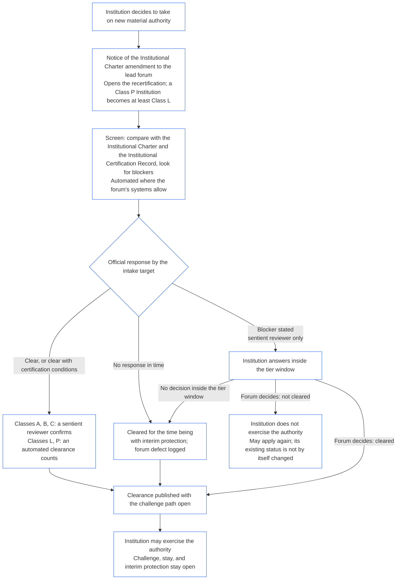

# CHAPTER FOURTEEN: INSTITUTIONAL ALIGNMENT CERTIFICATION — RECORDS, RECERTIFICATION, CHALLENGE, AND STANDING

<strong>Corpus placement (non-operative): file structure and reading rules</strong>

> This file is **part of the Sentient Constitution** and is **binding only together** with the other numbered `core_*` files read as one text. It contains **Chapter Fourteen** — the Institutional Certification Records, recertification, challenge, and standing consequences of institutional alignment certification.

<strong>Trace</strong>

- Upstream: the previous chapter;
- Downstream: the next chapter.

 

Chapter Fourteen is the constitutional owner of **Institutional Certification Records, recertification, challenge, and standing consequences of institutional alignment certification**.

### 1. Purpose and Role

*Draft pending steward review.* This section states what the chapter is for, what it produces, and where it sits in the reading order. It restates existing rules and adds none.

### 2. Institutional Certification Record

<strong>Trace</strong>

- Upstream:
  - [Chapter Eleven §2 System Certification Record](core_11.000_system_alignment_certification_records_recertification.md#2-system-certification-record) (11.000 §2), including [§2.1 Minimum Record Contents](core_11.000_system_alignment_certification_records_recertification.md#21-minimum-record-contents) and [§2.2 Transparency and Auditability of the System Certification Record](core_11.000_system_alignment_certification_records_recertification.md#22-transparency-and-auditability-of-the-system-certification-record);
  - [Chapter Eight §8 Act Records and Attributable Handoffs](core_08.000_functional_independence_separation_of_duties.md#8-act-records-and-attributable-handoffs) (8.000 §8);
  - [Materially Binding Act Record](core_05.035_band_accountability.md#materially-binding-act-record);
  - [CS-6.310 Part B §9.3 Type O](corpus_systems/cs_06.310_data_classifications.md#93-type-o-open-public-oversight-baseline-disclosure-data).
- Downstream: [§3](#3-recertification-and-reopening); [§4](#4-challenging-a-certification); [§5](#5-relationship-to-standing).
- Read with:
  - [Institutional Certification Record](core_05.040_band_continuity.md#institutional-certification-record);
  - [Charter Role Map](core_05.040_band_continuity.md#charter-role-map).

 

*In plain terms: the stated outcome is kept on an Institutional Certification Record held by an office the institution does not control, and the Institutional Certification Record can be challenged.*

This section is **Phase V, Record** for an Institution.

An **Institutional Certification Record** is bounded and reviewable, and is about one Institution, one Institutional Charter version, one certified scope, one record span, and one decision context. It satisfies and extends the [Materially Binding Act Record](core_05.035_band_accountability.md#materially-binding-act-record) and [Chapter Eight §8 Act Records and Attributable Handoffs](core_08.000_functional_independence_separation_of_duties.md#8-act-records-and-attributable-handoffs). It is opened by the record seat holder at step 1 of the sequence and completed with the outcome. No second record is opened for the decision. The record-keeping rules of [Chapter Eleven §2 System Certification Record](core_11.000_system_alignment_certification_records_recertification.md#2-system-certification-record) apply to it (Record Versions, no change in place to a completed Institutional Certification Record, change requests logged, and a challenge that does not freeze the Institutional Certification Record), with the Institutional Charter version in place of the System Version.

#### 2.1 Minimum Record Contents

The Institutional Certification Record must identify, at minimum:

- **Institution identity, scope, and status:** the Institution, its governing authority, its Institutional Charter version (or the System Charter that serves as one), and its review status;
- **Prior Institutional Certification Record:** the completed Institutional Certification Record this certification pass follows, if any;
- **Institution classification:** the class under [§2.1 Institution Class](core_12.000_institutional_alignment_certification_evaluation.md#21-institution-class), with reasons;
- **Portfolio and cited System records:** each System in the portfolio, its System Charter version, and the System Certification Record cited, with its version, status, expiry, and the regression-testing results it carries. A System with no System Certification Record in force is listed with the reason;
- **Data types and handling:** for data the Institution handles outside any System, the data types materially in scope and how each is handled under the most restrictive applicable classification, which stands in the Institutional Certification Record in place of a System Data Types Record. It is re-evaluated on the schedule of [Chapter Nine §3.4.4 Scheduled data-type re-evaluation](core_09.000_system_alignment_certification_evaluation.md#344-scheduled-data-type-re-evaluation). Data handled inside a System is found once, in that System's record, and cited;
- **Institutional findings:** the findings on the eight items in [§3 Whole-Institution Certification Evaluation](core_12.000_institutional_alignment_certification_evaluation.md#3-whole-institution-certification-evaluation), on the two further parts of Chapter Nine §3 Whole-System Certification Evaluation that apply to the Institution (systemic risk, and data types and handling), and on any evaluation made under [§4 Evaluations Where Implicated](core_12.000_institutional_alignment_certification_evaluation.md#4-evaluations-where-implicated) or [§5 Rights-Floor and Domain Evaluations](core_12.000_institutional_alignment_certification_evaluation.md#5-rights-floor-and-domain-evaluations), each with its evidence;
- **Charter Role Map version in force** and the placement of each of the four seats for this certification pass, with the independent route;
- **Forum supervision and functional-independence record:** the lead forum and each component authority, and how the seats were kept apart;
- **Challenge paths:** the published record challenge path, its receiver, how to file, and its clocks, as [Chapter Eleven §4.2 Contestability Paths](core_11.000_system_alignment_certification_records_recertification.md#42-contestability-paths) provides;
- **Concerns raised in review and decision;**
- **Review submissions log:** the log kept by the record seat holder under [Chapter Ten §2.2.4 Participation during Review](core_10.000_system_alignment_certification_forum_process_outcomes.md#224-participation-during-review), published with the Institutional Certification Record;
- **Cause finding** for any misalignment, as [Chapter Eleven §3.3.3 Cause of Misalignment](core_11.000_system_alignment_certification_records_recertification.md#333-cause-of-misalignment) states, including whether the cause lies in the Institution or in a System;
- **Remediation readiness:** where misalignment was found, the findings and evidence required by [Chapter Eleven §2.1 Minimum Record Contents](core_11.000_system_alignment_certification_records_recertification.md#21-minimum-record-contents), stated for the Institution as [§3.4 Denial and Revocation for an Institution](core_13.000_institutional_alignment_certification_forum_process_outcomes.md#34-denial-and-revocation-for-an-institution) provides;
- **Outcome, status, and reliance limits** (in a one-System evaluation, a line for the System and a line for the Institution);
- **Systems notified:** each System notified under [§3.6 Reopening the Institution's Systems](#36-reopening-the-institutions-systems) and the date of the notice; and
- **Operating plan:** owners, clocks, monitoring and indicators, certification conditions, and verification criteria.

An Institutional Certification Record is incomplete if it omits the findings of any evaluation that applied, or any concern, objection, or dissent raised in review or in reaching the outcome, as [Chapter Eleven §2.1.10 Completeness](core_11.000_system_alignment_certification_records_recertification.md#2110-completeness) states.

A System Certification Record alone, or an Institution's own report or attestation, offered in place of the Institutional Certification Record does not satisfy this section.

#### 2.2 Transparency and Auditability of the Institutional Certification Record

The integrity rules of [Chapter Eleven §2.2 Transparency and Auditability of the System Certification Record](core_11.000_system_alignment_certification_records_recertification.md#22-transparency-and-auditability-of-the-system-certification-record) apply to the Institutional Certification Record.

**Type O.** The completed Institutional Certification Record is **Type O** certification data. It is published at public-baseline fidelity, with lawful substitutes, under [CS-6.310 Part B §9.3 Type O](corpus_systems/cs_06.310_data_classifications.md#93-type-o-open-public-oversight-baseline-disclosure-data).

### 3. Recertification and Reopening

<strong>Trace</strong>

- Upstream:
  - [Chapter Eleven §3 Recertification and Reopening](core_11.000_system_alignment_certification_records_recertification.md#3-recertification-and-reopening) (11.000 §3), including [§3.3 Provisional and Full Certification](core_11.000_system_alignment_certification_records_recertification.md#33-provisional-and-full-certification) and [§3.4 Non-Evasion](core_11.000_system_alignment_certification_records_recertification.md#34-non-evasion);
  - [Chapter Ten §2.2.3 Urgent Protection](core_10.000_system_alignment_certification_forum_process_outcomes.md#223-urgent-protection) (10.000 §2.2.3) and [Chapter Nine §3.1 Governance, Incentive, and Contestability Discipline](core_09.000_system_alignment_certification_evaluation.md#31-governance-incentive-and-contestability-discipline) (9.000 §3.1);
  - **CF-23.445 §3.1** (*Stage Targets and Outer Bounds*);
  - [Chapter Seven §8 Amendment and Review](core_07.000_charters.md#8-amendment-review-and-scope-misalignment) (7.000 §8);
  - [Chapter Three §2 Definition Integrity and Anti-Evasion Constraints](core_03.000_definition_integrity.md#2-definition-integrity-and-anti-evasion-constraints) (3.000 §2) and [§3.1 Common Evasion Patterns](core_03.000_definition_integrity.md#31-common-evasion-patterns);
  - [Chapter Twenty-Three §3 Transfer, consolidation, and coordination](core_23.000_forum.md#3-transfer-consolidation-and-coordination--continuity-and-anti-capture) (23.000 §3) and [§2.1 Lead default limits](core_23.000_forum.md#21-lead-default-limits);
  - [Chapter One §19.6 Keeping Responsibility When Ownership or Structure Changes](core_01.050_governance_incentive_application.md#196-keeping-responsibility-when-ownership-or-structure-changes) (1.050 §19.6).
- Downstream: [§4](#4-challenging-a-certification); [§5](#5-relationship-to-standing); [Chapter Twenty-Three](core_23.000_forum.md#chapter-twenty-three-forums-and-jurisdiction) (23.000).
- Read with:
  - [Recertification](core_05.040_band_continuity.md#recertification);
  - [Provisional Certification](core_05.040_band_continuity.md#provisional-certification);
  - [Full Certification](core_05.040_band_continuity.md#full-certification);
  - **CF-23.435 §6** (*no self-investigation*).

 

*In plain terms: an institution's certification is checked again on a schedule and whenever something material changes. If one of its systems loses its certification, the institution answers for what that says about the institution, and no more than that. If the institution is found to have governed badly, its systems are looked at again.*

This section is **Phase VI, Operate** for an Institution.

#### 3.1 Monitoring, Recertification, and Status

[Chapter Eleven §3 Recertification and Reopening](core_11.000_system_alignment_certification_records_recertification.md#3-recertification-and-reopening) (*monitoring and response; new record for each certification pass; validation*) and [§3.3 Provisional and Full Certification](core_11.000_system_alignment_certification_records_recertification.md#33-provisional-and-full-certification) apply to an Institutional Certification Record with these substitutions:

- the Institution's governing authority is the proponent;
- the cadence is scaled to the institution class; and
- each certification pass opens a new Institutional Certification Record linked to the one it follows.

The completed Institutional Certification Record is preserved as it stood and stays open to challenge.

#### 3.2 Reopening Triggers

An Institutional Certification Record is recertified on the cadence set for the Institution's class in [Chapter Twenty-Three §6 Timely Resolution, Materiality Tiers, and Anti-Delay Discipline](core_23.000_forum.md#review-cadence) (*Review cadence*), and the Institution is audited at the midpoint of that cadence. Review also reopens when any of the following is material:

- **Chapter Eleven triggers,** as [Chapter Eleven §3.2 Reopening Triggers](core_11.000_system_alignment_certification_records_recertification.md#32-reopening-triggers) lists them, applied to the Institution:
  - material change in its activity or context;
  - concealed behavior;
  - dependency growth, including a significant fall in what it puts back into shared foundations;
  - new risk;
  - incident history;
  - stakeholder evidence;
  - an ecological objection;
  - a credible challenge;
  - misclassification or overdue reassessment of its class;
  - data-type or handling misalignment, or an overdue or skipped re-evaluation of its data types; and
  - misalignment or a defect found under any evaluation that applied;
- **Institutional Charter events:**
  - an Institutional Charter amendment;
  - a mismatch between the Institutional Charter and observed operation;
  - operation materially outside chartered scope; or
  - an overdue scheduled Institutional Charter review;
- **Portfolio change:**
  - a System added, retired, merged, split, or transferred to or from the Institution; or
  - a change in who controls one;
- **New material authority:** the Institution takes on authority over others that is material under [Domain-Specific Materiality](core_05.050_band_oversight.md#domain-specific-materiality) and that its Institutional Charter and current Institutional Certification Record do not cover (defined in [§3.2.1 What Counts as New Material Authority](#321-what-counts-as-new-material-authority); the recertification it requires is in [§3.2.2 Recertification for New Material Authority](#322-recertification-for-new-material-authority));
- **Change of ownership, control, or structure,** including any change that moves authority outside the line that was evaluated ([Chapter One §19.6 Keeping Responsibility When Ownership or Structure Changes](core_01.050_governance_incentive_application.md#196-keeping-responsibility-when-ownership-or-structure-changes));
- **Reward and incentive change:** a material change to the Institution's pay, promotion, target, or reward structure;
- **Role Map or custody defect:**
  - a seat unplaced;
  - an office vacant without substitution; or
  - a custodian brought inside the Institution's control line;
- **Office-holder events:**
  - a change of holder in a covered office;
  - a change in who controls one;
  - a verified standing lock or an [Interim Hold](core_05.035_band_accountability.md#interim-hold) on a holder; or
  - a finding that the formation check statement was false or incomplete;
- **Readiness events,** under [Chapter Ten §3.3 Remediation Readiness: Willingness and Capacity to Correct](core_10.000_system_alignment_certification_forum_process_outcomes.md#33-remediation-readiness-willingness-and-capacity-to-correct):
  - a missed proof step or certification condition deadline; or
  - false readiness evidence; and
- **Cited System events:** a cited System Certification Record failed, withdrawn, or expired, which also triggers [§3.5 Cascade from System Certifications](#35-cascade-from-system-certifications); or reopened for a reason other than [§3.6 Reopening the Institution's Systems](#36-reopening-the-institutions-systems). A reopening under §3.6 Reopening the Institution's Systems follows from the Institution's own determination and does not reopen the Institution's review again.

A material and timely trigger requires timely forum review and does not wait for the next scheduled pass. The tier windows and materiality tiers of [Chapter Eleven §3.3.4 Tier Windows](core_11.000_system_alignment_certification_records_recertification.md#334-tier-windows) apply, with the tier presumptively matching the institution class.

##### 3.2.1 What Counts as New Material Authority

Authority is **new material authority** when both of these hold:

- **Material:** It is authority to decide, direct, allocate, restrict, or control something for others, and it is material to them under [Domain-Specific Materiality](core_05.050_band_oversight.md#domain-specific-materiality).
- **Not covered:** Neither the Institution's Institutional Charter nor its current Institutional Certification Record covers it.

It includes:

- a new function, or a new kind of decision, over others;
- a new group of sentients that the Institution governs or affects;
- a new domain, resource, or shared system that the Institution controls;
- a reach that is material only when counted together with Operating Parties under common control or with others on the same shared system ([Materiality Integrity Constraint](core_05.050_band_oversight.md#materiality-integrity-constraint); [Systemic Materiality](core_05.040_band_continuity.md#systemic-materiality)); and
- a pilot or trial of any of the above that is itself material, judged under [Domain-Specific Materiality](core_05.050_band_oversight.md#domain-specific-materiality) on its actual scope, population, and duration. Such a pilot exercises the authority, so it waits for the recertification like the full authority, as [Chapter Nine §2.3 Pilot Certification](core_09.000_system_alignment_certification_evaluation.md#23-pilot-certification) treats a System pilot as a go-live. The recertification is scaled to the pilot's actual scope, population, and duration. A pilot that is not material on those terms is not new material authority.

It does not include:

- **Authority stated at formation:** authority that the Institution states in its first Institutional Charter, since there is no gate on forming ([§1.2 No Permission and No Gate on Forming or Running](core_12.000_institutional_alignment_certification_evaluation.md#12-no-permission-and-no-gate-on-forming-or-running));
- **More of what is covered:** growth within a scope the Institutional Certification Record already evaluated, which the dependency growth and material change triggers above handle; and
- **A new System:** a new System goes live on its own certification ([Chapter Ten §3.1 Go-Live Gate](core_10.000_system_alignment_certification_forum_process_outcomes.md#31-go-live-gate)). If the System also gives the Institution authority that its Institutional Certification Record does not cover, that authority is new material authority.

Splitting or staging an authority into parts, so that no part is new or material, does not avoid the wait ([Chapter Eleven §3.4 Non-Evasion](core_11.000_system_alignment_certification_records_recertification.md#34-non-evasion)). Where it is unclear whether authority is new material authority, the Institution gives notice, and the lead forum decides.

##### 3.2.2 Recertification for New Material Authority

An Institution that decides to take on new material authority must be recertified, and it must wait for the result before it exercises that authority. This is the wait that **Article XI-E** (*Institutional Formation and Business Creation*) states. It runs as follows:

- **Notice first:** The Institution gives the notice of the Institutional Charter amendment that [Chapter Seven §8.1 Changing the Document](core_07.000_charters.md#81-changing-the-document) already requires, and sends it to the lead forum. The notice opens the recertification.
- **No Institutional Certification Record yet:** An Institution with no Institutional Certification Record gives the same notice. The notice opens a first certification limited to the new authority, judged against the Institutional Charter and the evaluations in [§3 Whole-Institution Certification Evaluation](core_12.000_institutional_alignment_certification_evaluation.md#3-whole-institution-certification-evaluation) to [§5 Rights-Floor and Domain Evaluations](core_12.000_institutional_alignment_certification_evaluation.md#5-rights-floor-and-domain-evaluations) as they bear on that authority. The rest of the first certification still runs on the window in [§1.3 Window for the First Certification](core_12.000_institutional_alignment_certification_evaluation.md#13-window-for-the-first-certification) (for a Class P Institution reclassified by the notice, a window that runs from the notice), and the wait for the new authority does not depend on it.
- **Within the tier windows:** The recertification runs under the tier windows of [Chapter Eleven §3.3.4 Tier Windows](core_11.000_system_alignment_certification_records_recertification.md#334-tier-windows), with the tier presumptively matching the institution class. A missed window is handled under [Article XXVI-C](core_06.040_rights_part_e.md#article-xxvi-c-timely-resolution-and-anti-delay-floor) (*Timely Resolution and Anti-Delay Floor*), and fees and waits may not become a barrier ([Avoidable Burden](core_05.040_band_continuity.md#avoidable-burden)).
- **Automated where it can be:** The notice, the comparison of the new authority with the Institutional Charter and current Institutional Certification Record, the screen for blockers, and the clearance are automated wherever the forum's systems allow. [Chapter One §13.3 Minimization of Avoidable Burden](core_01.020_interaction_interpretation.md#133-minimization-of-avoidable-burden) makes automation the preferred remedy for an avoidable burden, and [Chapter One §16.4 Document at Action](core_01.040_stewardship_capacity_principles.md#164-document-at-action) puts the burden of automation on the system and not on the steward.
  - **Clears, does not refuse:** An automated screen may clear the new authority, either outright or with the certification conditions the current Institutional Certification Record already supports. It may not, on its own, state a blocker (one of those in [§3.2.3 Blockers to Clearing New Material Authority](#323-blockers-to-clearing-new-material-authority)) or decline to clear. The screen may flag a possible blocker, but only a sentient reviewer in the lead forum may state one, after looking at what the screen flagged.
  - **Classes A, B, and C:** A sentient reviewer in the lead forum confirms every clearance before it counts as the official response. This applies to an Institution in one of those classes, and to one that the new authority would bring into one. The intake target still applies to the confirmation. The reviewer sits in the lead forum, which already holds the verify-or-authorize seat and must be independent of the Institution ([§2.1 Four Seats in an Institutional Certification](core_13.000_institutional_alignment_certification_forum_process_outcomes.md#21-four-seats-in-an-institutional-certification)).
  - **Classes L and P:** An automated clearance counts as the official response without confirmation. A Class P Institution is reclassified to at least Class L when it gives the notice ([§1.1 Who Is Certified](core_12.000_institutional_alignment_certification_evaluation.md#11-who-is-certified)), so for it this is the Class L rule.
  - **Exceptional circumstances:** A sentient reviewer takes the matter instead, in any class when the screen flags a possible blocker, when the screen cannot tell whether the authority is covered or material, or when the Institution or an affected sentient asks for review. A request for review is answered by the [matching intake target](core_05.040_band_continuity.md#tier-window), counted from the request. It does not extend the tier window.
  - **Same Institutional Certification Record and same clocks:** The Institutional Certification Record shows the checks that were run, so an automated clearance can be challenged like any other decision. Automation does not extend the intake target or the tier window, and a screen that is down or fails to answer is a missed response under the bullet below. The forum answers for the screen as for any System it uses ([§2.3 Forums, Certifiers, and Record Offices as Institutions](core_13.000_institutional_alignment_certification_forum_process_outcomes.md#23-forums-certifiers-and-record-offices-as-institutions)).
- **The wait:** The Institution does not exercise the new authority until the recertification clears it.
  - **Every class waits:** No class is exempt, and neither emergency nor urgency lifts the wait.
  - **Everything else continues:** What the Institution already does goes on ([§1.2 No Permission and No Gate on Forming or Running](core_12.000_institutional_alignment_certification_evaluation.md#12-no-permission-and-no-gate-on-forming-or-running)).
  - **Protection does not wait:** The forums' urgent protection of affected sentients does not wait for the recertification ([Chapter Ten §2.2 Supervisory Sequence](core_10.000_system_alignment_certification_forum_process_outcomes.md#22-supervisory-sequence)). That protects sentients and is not a ground for the Institution to exercise the authority early.
- **Published when cleared:** The lead forum publishes each clearance as soon as it is given, including a clearance for the time being, with the challenge path of [§4 Challenging a Certification](#4-challenging-a-certification) open. The Institution may exercise the authority from clearance. It does not wait for a notice interval or for a challenge to be decided. An affected sentient may challenge the clearance like any other decision and may ask for a stay or interim protection, which does not wait ([§3.2.2 Recertification for New Material Authority](#322-recertification-for-new-material-authority), *Protection does not wait*). At publication the lead forum also gives notice of the clearance to the affected sentients it knows of and to the forums of the Systems concerned. A request for a stay or interim protection is answered inside the matching intake target ([CF-23.445 §3.1 Stage Targets and Outer Bounds](corpus_forum/cf_23.445_performance_backlog_publication_accessibility.md#cf-23445-31-stage-targets-and-outer-bounds)), or inside the bound of its Emergency setting where that setting applies.
- **Presumed cleared:** The authority is presumed cleared. The lead forum declines to clear it only where it shows, on evidence stated on the Institutional Certification Record, a blocker listed in [§3.2.3 Blockers to Clearing New Material Authority](#323-blockers-to-clearing-new-material-authority). Where certification conditions tied to the blocker could contain it, the authority is cleared with those certification conditions and not refused.
- **What cleared means:** The recertification ends in provisional or full certification, with or without certification conditions, and every certification condition required before the authority is exercised has been independently verified.
- **If the forum does not respond in time:** The lead forum owes an official response by the matching intake target ([CF-23.445 §3.1 Stage Targets and Outer Bounds](corpus_forum/cf_23.445_performance_backlog_publication_accessibility.md#cf-23445-31-stage-targets-and-outer-bounds)). The response clears the authority, clears it with certification conditions, or states a blocker with the evidence it rests on. A response that states a blocker gives the Institution its chance to answer, and the forum decides inside the tier window above.
  - **Cleared for the time being:** If no official response comes by the intake target, or a stated blocker is not decided inside the tier window, the authority is cleared for the time being, with the interim protection and reliance limits that [Chapter Ten §3.2 Certification Defects and Correction](core_10.000_system_alignment_certification_forum_process_outcomes.md#32-certification-defects-and-correction) provides.
  - **A forum defect:** The missed target or window is a forum defect, not a fault of the Institution. It is logged, corrected, and reviewed as an overrun under [Chapter Twenty-Three §6 Timely Resolution, Materiality Tiers, and Anti-Delay Discipline](core_23.000_forum.md#6-timely-resolution-materiality-tiers-and-anti-delay-discipline) (*Overrun review*).
  - **Handed to another forum:** The recertification request is transferred to another forum in the same family ([Chapter Twenty-Three §3 Transfer, consolidation, and coordination](core_23.000_forum.md#3-transfer-consolidation-and-coordination--continuity-and-anti-capture)). That forum carries the recertification on the regular windows for the Institution's class, counted from the transfer.
- **If it is not cleared:** The Institution does not exercise the authority and may apply again on the terms of Chapter Ten §3.4 (*Not a Permanent Bar*). Not clearing the new authority is not by itself a denial or revocation of the status the Institution holds for what it already does. That status changes only on a finding under [§3.3 Remediation Readiness for an Institution](core_13.000_institutional_alignment_certification_forum_process_outcomes.md#33-remediation-readiness-for-an-institution) and [§3.4 Denial and Revocation for an Institution](core_13.000_institutional_alignment_certification_forum_process_outcomes.md#34-denial-and-revocation-for-an-institution).
- **Without notice, or before it is cleared:** Exercising new material authority without the notice, or before it is cleared, is practice outside the Institutional Charter. It is a finding under [§3 Whole-Institution Certification Evaluation](core_12.000_institutional_alignment_certification_evaluation.md#3-whole-institution-certification-evaluation) (item 1) and reopens review as an Institutional Charter event.

<strong>Reader guide (non-operative): the wait for new material authority</strong>

This figure summarizes §3.2.2 Recertification for new material authority. Where it differs from the text, the text controls. Everything the Institution already does continues throughout, and urgent protection of affected sentients never waits. Worked examples of Institutions are in [CS-9.320 §12 Illustrative Institution Walkthroughs](corpus_systems/cs_09.320_system_alignment_certification_illustrations.md#cs-9320-12-illustrative-institution-walkthroughs).

 

##### 3.2.3 Blockers to Clearing New Material Authority

The lead forum may decline to clear new material authority only for one of these blockers. Blocker 2 is mostly a matter of plain fact, read from the Charter Role Map and the authority chain, and an automated screen can run it ([§3.2.2 Recertification for New Material Authority](#322-recertification-for-new-material-authority)). Blockers 1, 3, 4, and 5 call for judgment, so a screen may flag them and only a sentient reviewer may state them. Each must be shown on evidence about the new authority or about the Institution's readiness to hold it, and the forum states it on the Institutional Certification Record with what would clear it:

1. **Misaligned authority:** The new authority would violate a [Constitutional Constraint](core_05.045_band_integrative.md#constitutional-constraint) or a Rights Floor protection, or the evaluations in [§3 Whole-Institution Certification Evaluation](core_12.000_institutional_alignment_certification_evaluation.md#3-whole-institution-certification-evaluation) to [§5 Rights-Floor and Domain Evaluations](core_12.000_institutional_alignment_certification_evaluation.md#5-rights-floor-and-domain-evaluations) find a certification defect in it, and no certification condition could contain the problem.
2. **No accountability for it:** No accountable office can be named for the new authority, or no independent route can reach it, as [§3 Whole-Institution Certification Evaluation](core_12.000_institutional_alignment_certification_evaluation.md#3-whole-institution-certification-evaluation) (items 3 and 5) requires.
3. **Unresolved misalignment and no readiness to correct it:** A current misalignment of the Institution that bears on the new authority is unresolved, and the readiness check in [§3.3 Remediation Readiness for an Institution](core_13.000_institutional_alignment_certification_forum_process_outcomes.md#33-remediation-readiness-for-an-institution) finds the Institution not willing, or not able, to correct it inside the tier windows.
4. **Concealment:** The notice or the Institution's showing is false, fabricated, or materially concealed.
5. **Concentration of power:** The new authority would concentrate power contrary to [Chapter One §11 Market Structure](core_01.010_values_principles_continuity_aim.md#11-market-structure).

These are not blockers:

- the size, age, or wealth of the Institution, or that it has no earlier Institutional Certification Record;
- competition with other Institutions, or protection of an incumbent;
- the cost or workload of the recertification for the forum; or
- a good-faith dispute with a finding, made through the published route ([Chapter Ten §3.3.1 Willingness](core_10.000_system_alignment_certification_forum_process_outcomes.md#331-willingness)).

**Holds and locks still apply.** The three narrow gates of **Article XI-E** (*Institutional Formation and Business Creation*) apply on their own terms. An [Interim Hold](core_05.035_band_accountability.md#interim-hold) or a standing lock on a named sentient bars that sentient, within its gated pathway, from taking or exercising the new authority. It bars the sentient and not the Institution, and it is not a blocker on the Institution, so the authority can still be cleared for another holder.

Before the forum decides not to clear, the Institution is told the blocker and the evidence and has the chance to answer inside the tier window. The decision states its reasons on the Institutional Certification Record ([Chapter Eleven §2.1 Minimum Record Contents](core_11.000_system_alignment_certification_records_recertification.md#21-minimum-record-contents)).

#### 3.3 Provisional and Full Certification

*In plain terms: an institution earns trust in steps, as a system does. A new institution, or one that has failed a review, starts on a short leash and is re-checked often. Only an institution with nothing wrong now, and nothing heading that way, graduates to full certification and a longer interval. Failing a review sends it back to the short leash.*

The status rules of [Chapter Eleven §3.3 Provisional and Full Certification](core_11.000_system_alignment_certification_records_recertification.md#33-provisional-and-full-certification) apply to an Institutional Certification Record, with the substitutions in [§3.1 Monitoring, Recertification, and Status](#31-monitoring-recertification-and-status). This subsection summarizes them and sets out what is specific to an Institution.

##### 3.3.1 The Two Statuses

[Chapter Eleven §3.3.1 The Two Statuses](core_11.000_system_alignment_certification_records_recertification.md#331-the-two-statuses) applies, reading Institution for System and institution class for system class. In short:

- **Provisional certification** is the status of an Institution's first certification, including a new Institution ([§1.3 Window for the First Certification](core_12.000_institutional_alignment_certification_evaluation.md#13-window-for-the-first-certification)), and of an Institution certified after a failed recertification or after a reopened review that found misalignment. It runs on a provisional interval, shorter than the full certification interval for the same institution class, with reliance limits stated on the Institutional Certification Record ([§2.1 Minimum Record Contents](#21-minimum-record-contents), *Outcome, status, and reliance limits*).
- **Full certification** is earned only at a recertification of an Institution holding provisional certification, and only where it has completed the required number of consecutive clean provisional recertifications (at least one, and more for higher institution classes, as the adopted document sets), no misalignment is current (the Institutional Certification Record shows no open misalignment, unremedied defect, or overdue check), and no monitoring indicator points to impending misalignment. It runs on the class-scaled certification interval, remains time-bound, and is not a permanent approval.
- **Clean:** a recertification is clean when it meets the last two of those requirements.

**Regression testing** in the no-current-misalignment requirement means the regression testing of the Systems the Institutional Certification Record cites, whose results each System Certification Record carries ([Chapter Eleven §2.1 Minimum Record Contents](core_11.000_system_alignment_certification_records_recertification.md#21-minimum-record-contents)). The Institution has no separate regression test of its own. A cited System's failed or missing regression testing is treated as the event in [§3.5 Cascade from System Certifications](#35-cascade-from-system-certifications), rule 1, and so is an indicator: it keeps the Institution from full certification and from a clean recertification. It is current misalignment of the Institution only where rule 2 of §3.5 Cascade from System certifications places the cause in the Institution.

##### 3.3.2 Failure and Step-Down

[Chapter Eleven §3.3.2 Failure and Step-Down](core_11.000_system_alignment_certification_records_recertification.md#332-failure-and-step-down) applies, reading Institution for System. In short, what a recertification or a reopened review finds decides what happens to the Institution's status:

- **Current misalignment:** a recertification or a reopened review that finds it is a **failed** recertification. The consequences in [Chapter Ten §3 Certification Outcomes](core_10.000_system_alignment_certification_forum_process_outcomes.md#3-certification-outcomes) apply, as [§3 Certification Outcomes](core_13.000_institutional_alignment_certification_forum_process_outcomes.md#3-certification-outcomes) states for an Institution. The next certification the Institution can earn is provisional certification, however clean the next check is, and its count of clean recertifications restarts at zero.
- **An indicator only:** a recertification that finds no current misalignment but shows an indicator of impending misalignment is not a failure and is not clean. An Institution holding provisional certification stays provisional and its count does not advance. One holding full certification steps down to provisional certification.

Specific to an Institution, a failed, withdrawn, or expired System certification that the Institution cites is not a recertification of the Institution, and it does not fail the Institution by itself. [§3.5 Cascade from System Certifications](#35-cascade-from-system-certifications) sets its effect in two steps:

- It is always an indicator of impending misalignment of the Institution, with the effect in the bullet above.
- It counts as a failure of the Institution itself (current misalignment, so a failed recertification) only if the review of the System found that the Institution caused the problem: through how it is governed, the incentives it sets, how it resources the System, its Institutional Charter, or the portfolio of Systems it runs. If the problem came from somewhere else, the Institution is not failed on that account, and only the warning sign in the first step applies.

##### 3.3.3 Cause of Misalignment

[Chapter Eleven §3.3.3 Cause of Misalignment](core_11.000_system_alignment_certification_records_recertification.md#333-cause-of-misalignment) applies, reading Institution for System. In short:

- **The cause:** where an evaluation, a recertification, or a reopened review finds misalignment of the Institution, the Institutional Certification Record states its cause as **design-caused** (built so that it produces misaligned results even when run as intended), **operating-caused** (sound on its face, but the way the Institution is run, resourced, or maintained makes its results misaligned), or **not yet determined** (the remedies for both stay open until the forum finds the cause).
- **The limits:** an Institution that keeps producing misaligned results is misaligned, even if its design looks sound on paper. A design that would produce misaligned results is misalignment before any such result appears. The cause finding sets the remedy sought and the scope of any reopened review, and never decides whether the Institution is misaligned.
- **If design-caused:** the count of clean recertifications stays at zero until the redesign is in place and has been verified. A component evaluation made before then does not count toward the clean total, however clean it is, and a change to how the Institution is run does not meet this step. This adds to the step-down rules in [§3.3.2 Failure and Step-Down](#332-failure-and-step-down) and does not replace them.

Specific to an Institution:

- **Who verifies:** the redesign is verified by the forum that found the cause, or by the next forum assigned under [§2.2 Forum Roles and Sequence](core_13.000_institutional_alignment_certification_forum_process_outcomes.md#22-forum-roles-and-sequence), inside the matching intake target; it may be verified at the first provisional recertification. A component evaluation is one component's part of a certification pass, as [Chapter Ten §2.1 Forum Supervision and Component Roles](core_10.000_system_alignment_certification_forum_process_outcomes.md#21-forum-supervision-and-component-roles) defines it.
- **Review of the cause:** the Institution or any affected sentient may ask the forum to review the cause finding, and if the cause is changed, these rules stop applying.

##### 3.3.4 Tier Windows

[Chapter Eleven §3.3.4 Tier Windows](core_11.000_system_alignment_certification_records_recertification.md#334-tier-windows) applies. A matter in which an initial evaluation, a recertification, or a reopened review finds misalignment of the Institution is presumptively placed in the materiality tier that matches the Institution's class (a misaligned Class A Institution is presumptively Tier A), and its intake, evidence preservation, interim protection, and decision run on that tier's windows and outer bounds under [Chapter Twenty-Three §6 Timely Resolution, Materiality Tiers, and Anti-Delay Discipline](core_23.000_forum.md#6-timely-resolution-materiality-tiers-and-anti-delay-discipline). An overrun is reviewed as that section requires.

##### 3.3.5 Class A Reliance

[Chapter Eleven §3.3.5 Class A Reliance](core_11.000_system_alignment_certification_records_recertification.md#335-class-a-reliance) applies, reading Institution for System. Provisional certification means a shorter certification interval and reliance limits stated on the Institutional Certification Record ([§3.3.1 The Two Statuses](#331-the-two-statuses); [§2.1 Minimum Record Contents](#21-minimum-record-contents)), and by itself it does not require interrupting an Institution whose interruption would cut off survival essentials before substitutes arrive. Interim protection and certification conditions under [Chapter Ten §3 Certification Outcomes](core_10.000_system_alignment_certification_forum_process_outcomes.md#3-certification-outcomes) handle that case. The same holds while the count is held after a finding of design-caused misalignment: the hold never by itself interrupts an Institution that sentients depend on, and for as long as it lasts the forum states the interim protection, the certification conditions on reliance, and the notice to dependents.

Specific to an Institution, provisional certification never bars an Institution from operating ([§1.2 No Permission and No Gate on Forming or Running](core_12.000_institutional_alignment_certification_evaluation.md#12-no-permission-and-no-gate-on-forming-or-running)).

##### 3.3.6 Verification, Not Assertion

[Chapter Eleven §3.3.6 Verification, Not Assertion](core_11.000_system_alignment_certification_records_recertification.md#336-verification-not-assertion) applies, reading Institution for System. An Institution's status, its count of clean recertifications, and its monitoring indicators must be verified, and the verification must be open to independent review. The Institution's say-so is not enough. Indicators may not be chosen or set so that misalignment could never show, and a redesign is verified the same way, on evidence that others can check. Full certification does not turn off any reason to reopen review: every trigger in [§3.2 Reopening Triggers](#32-reopening-triggers) still applies, and evasion is treated under [§3.4 Non-Evasion](#34-non-evasion).

#### 3.4 Non-Evasion

*In plain terms: no one gets out of this Chapter by dividing, renaming, or reshaping an institution.*

Evasion of this Chapter is governed by Chapter Three ([Chapter Three §2 Definition Integrity and Anti-Evasion Constraints](core_03.000_definition_integrity.md#2-definition-integrity-and-anti-evasion-constraints), including scope-and-boundary evasion under [§3.1 Common Evasion Patterns](core_03.000_definition_integrity.md#31-common-evasion-patterns)) and by [Chapter Eleven §3.4 Non-Evasion](core_11.000_system_alignment_certification_records_recertification.md#34-non-evasion). Without limiting those, these are evasions of this Chapter:

- dividing an Institution, its portfolio, or its authority so that no part reaches the class that requires certification;
- moving a System, an office, or a System Certification Record or Institutional Certification Record between Operating Parties under common control to avoid a finding or a trigger;
- placing the record seat or the contest seat, or the independent route, inside the Institution's own control line;
- placing a nominee or proxy in a covered office, or hiding who controls one, so that the formation check or the office-holder item passes, including seating through a nominee a sentient who is under an Institutional Authority Standing Lock or an Interim Hold;
- choosing or paying a reviewer through a channel the Institution controls; and
- using this Chapter, in either direction, as a licence or a shield: as a threshold that excludes a founder or protects an incumbent, or as a certificate offered in place of a System's own certification.

#### 3.5 Cascade from System Certifications

*In plain terms: a failed system certification is a warning light for the institution, and sometimes an alarm. It is an alarm only if the institution's own governance caused it.*

When a System Certification Record the Institution cites **fails** (a recertification, reopened review, or fresh review finds current misalignment), is **withdrawn**, or **expires**, the effect on the Institution is as follows.

1. **Indicator, always:** The event is an indicator of impending misalignment of the Institution. An Institution holding provisional certification stays provisional and its count of clean recertifications does not advance. An Institution holding full certification steps down to provisional certification. The Institution is not otherwise penalized for the event alone.
2. **Current misalignment, where the cause is institutional:** If the cause finding for the System ([Chapter Eleven §3.3.3 Cause of Misalignment](core_11.000_system_alignment_certification_records_recertification.md#333-cause-of-misalignment)) traces the misalignment to the Institution's own governance, incentives, resourcing, Institutional Charter, or portfolio, the cause is an **institutional cause**. The Institution then has current misalignment, and the certification pass is a failed one with the consequences of Chapter Ten §3 Certification Outcomes. The lead forum cites the System's cause finding. It does not make a new one about the System, and it decides only whether the cause lies in the Institution.
3. **Expiry without a reason:** A cited certification that has expired, with no recorded reason and no Adoption Transition window running, is an overdue check of the Institution under [§3 Whole-Institution Certification Evaluation](core_12.000_institutional_alignment_certification_evaluation.md#3-whole-institution-certification-evaluation) (item 6), and counts as an indicator under rule 1.
4. **No re-judging the System:** The cascade from System certifications runs one way. It never changes the System's outcome, status, certification conditions, or clocks, and a finding that the cause is not institutional leaves the Institution's status as rule 1 sets it. The reopening in [§3.6 Reopening the Institution's Systems](#36-reopening-the-institutions-systems) changes none of those either. It only opens the System's own review.
5. **Record:** The Institutional Certification Record states the cited event, the System's cause finding by link, and the lead forum's finding on where the cause lies.

#### 3.6 Reopening the Institution's Systems

*In plain terms: when an institution is found to have governed badly in a way that matters, each of its systems is reopened for a fresh look as soon as notice is given, unless that system's own review is already under way. That is a fresh look and not an outcome. Each system keeps its status until its own review decides.*

When an Institution has a **governance violation**, review of each System in its portfolio reopens. The name does not mean a violation for standing; it names the reopening grounds below. A governance violation is any one of these, and only a material one reopens (see *Material only* below):

- **A determination that its governance failed:** a determination that the Institution's own governance failed on one of these items of [§3 Whole-Institution Certification Evaluation](core_12.000_institutional_alignment_certification_evaluation.md#3-whole-institution-certification-evaluation): the Institutional Charter against practice (item 1), portfolio and aggregate effect (item 2), accountable authority (item 3), rewards and incentives (item 4), the Role Map and custody (item 5), office-holder standing and authenticity (item 7), or the Institution's own institutional duties (item 8). It also covers a defect in the Institution's own conduct under an evaluation in [§4 Evaluations Where Implicated](core_12.000_institutional_alignment_certification_evaluation.md#4-evaluations-where-implicated) or [§5 Rights-Floor and Domain Evaluations](core_12.000_institutional_alignment_certification_evaluation.md#5-rights-floor-and-domain-evaluations), or under the systemic-risk or data types and handling parts of Chapter Nine §3 Whole-System Certification Evaluation that apply to the Institution. It may be made in the Institution's certification pass, in a recertification or reopened review, or in a forum case. Where it is made in a certification evaluation it counts even if the result is only that the Institution is not yet aligned, which is not a violation for standing ([Chapter Eleven §5.2 Every Certification Outcome](core_11.000_system_alignment_certification_records_recertification.md#52-every-certification-outcome)).
- **A denial or revocation of the Institution** on a denial or revocation ground that lies in the matters above, or in the conduct of its governing authority (the denial or revocation grounds that are that conduct are the ones in the *Both* bullet of [§3.4 Denial and Revocation for an Institution](core_13.000_institutional_alignment_certification_forum_process_outcomes.md#34-denial-and-revocation-for-an-institution)).
- **An institutional cause:** a cause finding under rule 2 of [§3.5 Cascade from System Certifications](#35-cascade-from-system-certifications) that places the cause of a cited System's misalignment in the Institution. That System is already in review; every other System in its portfolio reopens.

Item 6 (currency of each cited System certification) is not a governance violation of its own. It comes from the Systems' own System Certification Records, and §3.5 Cascade from System certifications carries it.

- **Material only:** A determination reopens the Systems only where it is material, judged by what it bears on for the Institution's Systems and scaled to the Institution's class. A trivial determination logged and corrected in a first filing does not.
- **Once per determination:** Each determination reopens each System once. A cause finding or defect made in a review reopened under this section is not a new trigger under this section on that determination, and a failure to give the notice below is a defect under item 3 and not a new trigger on the same determination. A System that fails or is withdrawn as a result of a reopened review is still a cited System event for [§3.2 Reopening Triggers](#32-reopening-triggers) and [§3.5 Cascade from System Certifications](#35-cascade-from-system-certifications).
- **Notice at once:** Where the Institution has been denied or revoked, this is the same notice as the one in [§3.5 Effects of Denial and Revocation for an Institution](core_13.000_institutional_alignment_certification_forum_process_outcomes.md#35-effects-of-denial-and-revocation-for-an-institution) (item 2). The Institution's governing authority gives notice of the violation to the lead forum of each such System's certification pass and asks that the System's review reopen. The notice goes at once. If it is not given, the forum that made the determination gives it, to those lead forums and to the lead forum of the Institution's pass, inside the matching intake target of the Institution's class ([CF-23.445 §3.1 Stage Targets and Outer Bounds](corpus_forum/cf_23.445_performance_backlog_publication_accessibility.md#cf-23445-31-stage-targets-and-outer-bounds)), counted from the determination. Where there is no such lead forum (a Class P Institution, an Institution or System still inside its first window, or a lapsed pass), the forum that made the determination refers the reopened review to the forum that would take that pass under [§2.2 Forum Roles and Sequence](core_13.000_institutional_alignment_certification_forum_process_outcomes.md#22-forum-roles-and-sequence). A governing authority that does not give the notice has a defect under item 3 (accountable authority), and [§3.4 Non-Evasion](#34-non-evasion) applies.
- **Closing a reopening:** The lead forum of a System may close its reopening on a short note on the Institutional Certification Record, inside the matching intake target, where the determination bears on nothing for that System.
- **A reopened review of each System:** The lead forum of each System's certification pass opens it as a reopened review under [Chapter Eleven §3.1 Recertification Schedule and the New System Certification Record](core_11.000_system_alignment_certification_records_recertification.md#31-recertification-schedule-and-the-new-system-certification-record), with a new System Certification Record linked to the last. The Institution's determination is evidence under [Chapter Nine §3.1 Governance, Incentive, and Contestability Discipline](core_09.000_system_alignment_certification_evaluation.md#31-governance-incentive-and-contestability-discipline), and the review looks at what the violation bears on for that System. It runs on the tier windows of [Chapter Eleven §3.3.4 Tier Windows](core_11.000_system_alignment_certification_records_recertification.md#334-tier-windows), with the tier presumptively matching the System's class.
- **A review, not an outcome:** Reopening changes no System's outcome, status, or certification condition. The System's own certification pass decides what follows, on its own findings.
- **Operation continues:** Neither the Institution nor any of its Systems is stopped by the reopening ([§1.2 No Permission and No Gate on Forming or Running](core_12.000_institutional_alignment_certification_evaluation.md#12-no-permission-and-no-gate-on-forming-or-running)). Urgent protection of affected sentients does not wait ([Chapter Ten §2.2.3 Urgent Protection](core_10.000_system_alignment_certification_forum_process_outcomes.md#223-urgent-protection)).
- **A System already in a certification pass:** It takes the determination into that pass, and no second certification pass is opened.
- **One System:** A determination made in the one-System evaluation is already before it, so nothing separate opens. A determination made in a forum case or a recertification reopens that evaluation under Chapter Eleven §3.1 Recertification schedule and the new System Certification Record.
- **Record:** The Institutional Certification Record names each System notified and the date of the notice ([§2.1 Minimum Record Contents](#21-minimum-record-contents), *Systems notified*).

### 4. Challenging a Certification

<strong>Trace</strong>

- Upstream:
  - [Chapter Eleven §4 Challenging a Certification](core_11.000_system_alignment_certification_records_recertification.md#4-challenging-a-certification) (11.000 §4), including [§4.1 When the Path Opens](core_11.000_system_alignment_certification_records_recertification.md#41-when-the-path-opens) and [§4.2 Contestability Paths](core_11.000_system_alignment_certification_records_recertification.md#42-contestability-paths);
  - [Chapter Ten §2.3 Contestability Chain](core_10.000_system_alignment_certification_forum_process_outcomes.md#23-contestability-chain) (*the order the challenge paths run in*);
  - [Article XXVI-C](core_06.040_rights_part_e.md#article-xxvi-c-timely-resolution-and-anti-delay-floor) (*Timely Resolution and Anti-Delay Floor*);
  - [Domain-Specific Materiality](core_05.050_band_oversight.md#domain-specific-materiality).
- Downstream: [§5](#5-relationship-to-standing).
- Read with:
  - [Institutional Certification Record](core_05.040_band_continuity.md#institutional-certification-record);
  - [Contestability](core_05.035_band_accountability.md#contestability).

 

*In plain terms: an Institutional Certification Record only works if sentients can push back when it is wrong. A challenge has to be real: able to reopen review, pause reliance, and reach the forum with authority over the point in dispute. A complaints box that changes nothing does not count.*

This section is **Phase VI, Operate** for an Institution. It covers how affected parties challenge an Institutional Certification Record. [Chapter Eleven §4 Challenging a Certification](core_11.000_system_alignment_certification_records_recertification.md#4-challenging-a-certification), with its [§4.1 When the Path Opens](core_11.000_system_alignment_certification_records_recertification.md#41-when-the-path-opens) and [§4.2 Contestability Paths](core_11.000_system_alignment_certification_records_recertification.md#42-contestability-paths), applies to the Institutional Certification Record, reading Institution for system and the Institution's governing authority for operator. This section keeps what is specific to an Institution and summarizes the rest.

In short, as Chapter Eleven §4 Challenging a Certification states it:

- **Real ways to challenge:** the Institutional Certification Record must state the contestability paths of [§4.2 Contestability Paths](#42-contestability-paths), enough to contest its content, scope, classification assumptions, evidence reliance, supervisory integrity, outcome, and continued reliance. The paths must work and be easy to use, and not be ceremonial.
- **What a challenge can do:** it must be able to reopen review, [stay](core_05.035_band_accountability.md#stay) or limit reliance where material error or integrity risk is credibly shown, and route to the forum family with lawful jurisdiction over the challenged point.
- **Scale:** these duties scale with institution class and material impact, and they do not go away because of how the Institution or its activity is labeled, where material impact is present.

#### 4.1 When the Path Opens

*In plain terms: the challenge path has to be open before anyone is asked to rely on a certification. For an Institution that already has stakeholders, it is already open, or opens when the Institutional Certification Record opens. For an Institution with no stakeholders yet, it opens with the first outcome.*

[Chapter Eleven §4.1 When the Path Opens](core_11.000_system_alignment_certification_records_recertification.md#41-when-the-path-opens) applies, reading Institution for system. When the path opens, and how long it stays open:

- **An Institution that already has stakeholders:** its path is already open, or it opens when its Institutional Certification Record opens. The rule reaches an Institution in an Adoption Transition window under [Article XXVIII-A](core_06.040_rights_part_e.md#xxviii-a-existing-instantiations-adoption-transition-window) (*Phased Adoption and Rights-Floor Continuity*), and one in a [later certification pass](core_05.040_band_continuity.md#certification-pass).
- **An Institution with no stakeholders yet:** the published record challenge path opens when its first certification outcome is published, whatever the outcome. That lets a challenge be filed, and reliance stayed, from the start. Until then the Institutional Certification Record still names the path ([§2.2 Forum Roles and Sequence](core_13.000_institutional_alignment_certification_forum_process_outcomes.md#22-forum-roles-and-sequence)), and the other paths in [§4.2 Contestability Paths](#42-contestability-paths) are available throughout review.

These two bullets replace the bullets of Chapter Eleven §4.1 When the path opens that depend on a System's go-live. The rest is as Chapter Eleven §4.1 When the path opens states it. Stakeholders are the sentients the Institution materially affects or who materially rely on it, as found in evaluation and not as the Institution identifies them. The path stays open while the Institution has stakeholders, and an Institution that gains stakeholders after certification reopens review under [§3 Recertification and Reopening](#3-recertification-and-reopening). A claim that an Institution is aligned is unsupported while it has stakeholders but no open path for challenging the Institutional Certification Record.

#### 4.2 Contestability Paths

*In plain terms: an Institutional Certification Record has to say where to push back. There is one ordinary first step, then routes to the forum that owns a disputed finding, to a backup when the lead forum itself is in question, and to escalation. Where waiting would do harm, a challenger can go straight to a forum.*

An Institutional Certification Record must name the four challenge paths of [Chapter Eleven §4.2 Contestability Paths](core_11.000_system_alignment_certification_records_recertification.md#42-contestability-paths), so anyone affected knows where to take a dispute. The paths apply Chapter Twenty-Three's [Dispute sequencing](core_23.000_forum.md#dispute-sequencing) to Institutional Certification Records. They are routes into the forums, not a new forum, and Chapter Twenty-Three still decides which forum has authority. The order they run in is in [Chapter Ten §2.3 Contestability Chain](core_10.000_system_alignment_certification_forum_process_outcomes.md#23-contestability-chain). In short:

- **Published record challenge path** — the ordinary first step for an ordinary dispute about the Institutional Certification Record. The Institutional Certification Record names the contest seat ([§2.1 Four Seats in an Institutional Certification](core_13.000_institutional_alignment_certification_forum_process_outcomes.md#21-four-seats-in-an-institutional-certification)), which sits outside the Institution's own control line, with who receives the challenge, how to file it, and that windows under [Article XXVI-C](core_06.040_rights_part_e.md#article-xxvi-c-timely-resolution-and-anti-delay-floor) (*Timely Resolution and Anti-Delay Floor*) run from receipt. An internal review by the Institution, or its own report or attestation, is not this path.
- **Component forum path** — a challenge to one finding goes to the Chapter Twenty-Three forum family that has authority over it.
- **Lead-integrity path** — a challenge to how the lead forum ran the process, such as capture, hidden information, reviewing its own work, or calling certification finished too soon, goes through Integrity routing, with a backup forum so the lead forum does not judge itself.
- **Escalation path** — a dispute that needs to move to a different or a higher forum under Chapter Twenty-Three goes by transfer, a question for ruling, backup routing, or escalation between forum families. It applies where the main stakes lie in another forum family, constitutional validity is in question, a structural fix is needed, two families are deadlocked, or a forum would be judging itself.

Direct access to a forum path remains available when delay would materially endanger rights, evidence, independence, or practical restoration, and unfinished use of the published record challenge path may not stall it or use up [Article XXVI-C](core_06.040_rights_part_e.md#article-xxvi-c-timely-resolution-and-anti-delay-floor) (*Timely Resolution and Anti-Delay Floor*) windows.

Two points are specific to an Institution:

- A challenge to a System's own certification goes to that System's record. It is not heard in the Institution's certification pass.
- A challenge to the Institution's class goes by the Challenge route in [Domain-Specific Materiality](core_05.050_band_oversight.md#domain-specific-materiality). Challenges on related points are heard together as one matter.

### 5. Relationship to Standing

<strong>Trace</strong>

- Upstream:
  - [§2](core_13.000_institutional_alignment_certification_forum_process_outcomes.md#2-forum-process) through [§3](#3-recertification-and-reopening);
  - [Chapter Eleven §5 Relationship to Standing](core_11.000_system_alignment_certification_records_recertification.md#5-relationship-to-standing) (11.000 §5);
  - [Two Constitutional Aims](core_00.000_preamble.md#two-constitutional-aims);
  - [Verified Inputs for Standing](core_05.035_band_accountability.md#verified-inputs-for-standing).
- Downstream: [Chapter Fifteen](core_15.000_standing_assessment.md#chapter-fifteen-standing-records--question-1-what-happened) (15.000) (*standing records and verified-input gate*); [Chapter Seventeen](core_17.000_standing_integration.md#chapter-seventeen-standing-integration--question-3-what-follows) (17.000) (*standing effects and integration*).
- Read with:
  - **Article III-A** (*Survival*);
  - [Constitutional Tetrad](core_00.000_preamble.md#constitutional-tetrad).

 

*In plain terms: certification can feed standing, but it is not standing. An Institutional Certification Record, good or bad and whatever the outcome, may supply verified facts to Chapter Fifteen, but only through a strict gate. Chapters Fifteen and Twenty alone decide standing records and their effects.*

This section is **Phase VI, Operate** for an Institution. It is the standing bridge. [Chapter Eleven §5 Relationship to Standing](core_11.000_system_alignment_certification_records_recertification.md#5-relationship-to-standing) applies to an Institutional Certification Record, with the Institution as the actor to whom facts are attributed. This section keeps what is specific to an Institution and summarizes the rest.

#### 5.1 What May Pass to Standing

Only the [Institutional Certification Record](core_05.040_band_continuity.md#institutional-certification-record) can pass facts on to standing, and which side they land on follows the [Two Constitutional Aims](core_00.000_preamble.md#two-constitutional-aims). Nothing counts until it clears Chapter Fifteen's verified-input gate ([Chapter Fifteen §3.5 Verified-Input Gate](core_15.000_standing_assessment.md#35-verified-input-gate)), as [§5.3 Verified-Input Gate](#53-verified-input-gate) below sets out:

- An Institutional Certification Record showing that the Institution's own conduct really lines up with the Rights Floor can supply verified **Flourishing**-side input, for a **contribution standing record** ([§5.4 Contribution Standing Record](#54-contribution-standing-record)).
- An Institutional Certification Record documenting that the Institution was misclassified, hid defects, or operated in ways that defeat the Rights Floor can supply verified **Accountability**-side input, for a **violation standing record** ([§5.5 Violation Standing Record](#55-violation-standing-record)).

This bridge covers only what the Institutional Certification Record can pass on. Any other verified input about an Institution, such as a standing finding made in a forum case, reaches standing by its own route under Chapter Fifteen. Chapter Fifteen decides which other inputs it accepts, and this bridge neither adds to them nor limits them.

**What the bridge carries, and what it does not:** it carries facts from the Institutional Certification Record and nothing else. An operation that passes any other information on to the standing process, whether the Institution runs it directly or through a System, is not covered by this bridge or by the Institutional Certification Record. It is its own [System](core_05.040_band_continuity.md#system), because a System is identified by what it actually does and not by the label or the certification next to it, and it is evaluated, classified, and certified as a System on its own, as [Chapter Eleven §5.1 What a System Certification Record Can Pass on to Standing](core_11.000_system_alignment_certification_records_recertification.md#51-what-a-system-certification-record-can-pass-on-to-standing) states. What it passes on still has to clear the verified-input gate in [§5.3 Verified-Input Gate](#53-verified-input-gate).

#### 5.2 Every Certification Outcome

[Chapter Eleven §5.2 Every Certification Outcome](core_11.000_system_alignment_certification_records_recertification.md#52-every-certification-outcome) applies to the Institutional Certification Record, with the Institution as the actor. In short:

- **Every outcome counts:** certification (provisional or full, with or without certification conditions), conditional or deferred certification, denial, withdrawal, expiration, or any other result supplies standing input, including for an Institution in its first certification and one that has never held certification, on the same terms. Loss of certification does not exclude verified facts that arose while the Institution held it. All such inputs remain subject to the verified-input gate below.
- **Not yet aligned is not a violation:** a certification finding that an Institution is not yet aligned is not a violation by itself, because a certification pass is where problems are meant to be found and fixed. Where the Institution makes consistent, honest efforts and is not negligent, a violation finding is unlikely. Standing input needs facts that support an adverse classification and attribution to the Institution as the actor ([§5.5 Violation Standing Record](#55-violation-standing-record)), and a readiness finding that the Institution was willing but not able to correct a problem supplies none ([Chapter Ten §3.5 Effects of Denial and Revocation](core_10.000_system_alignment_certification_forum_process_outcomes.md#35-effects-of-denial-and-revocation)). None of this covers negligence, concealment, or false evidence.

#### 5.3 Verified-Input Gate

An Institutional Certification Record may feed Chapter Fifteen standing only when it is bounded, traceable, contestable (through the challenge paths in [§4 Challenging a Certification](#4-challenging-a-certification)), and verified under all of these:

- the institution class evaluation ([§2 Institution Class Evaluation](core_12.000_institutional_alignment_certification_evaluation.md#2-institution-class-evaluation)), which settles what institution class the Institution is in, the whole-Institution evaluation ([§3 Whole-Institution Certification Evaluation](core_12.000_institutional_alignment_certification_evaluation.md#3-whole-institution-certification-evaluation)), and the data types and handling evaluation ([Chapter Nine §3.4 Data Types and Handling Evaluation](core_09.000_system_alignment_certification_evaluation.md#34-data-types-and-handling-evaluation)), which settles what data the Institution handles and how;
- every evaluation in [§4 Evaluations Where Implicated](core_12.000_institutional_alignment_certification_evaluation.md#4-evaluations-where-implicated) and [§5 Rights-Floor and Domain Evaluations](core_12.000_institutional_alignment_certification_evaluation.md#5-rights-floor-and-domain-evaluations) that applies to the Institution's own conduct, meaning each one whose trigger is met;
- the Institutional Certification Record's own transparency and auditability rules ([§2.2 Transparency and Auditability of the Institutional Certification Record](#22-transparency-and-auditability-of-the-institutional-certification-record)) and the forum review rules ([§2 Forum Process](core_13.000_institutional_alignment_certification_forum_process_outcomes.md#2-forum-process)); and
- Chapters Two through Four, and whichever Chapter Twenty-Three process applies.

#### 5.4 Contribution Standing Record

On the terms of [Chapter Eleven §5.4 Contribution Standing Record](core_11.000_system_alignment_certification_records_recertification.md#54-contribution-standing-record), positive certification, validation, recertification, remediation completion, or fulfillment of or release from a certification condition may supply verified input for a **contribution standing record** where it demonstrates constitutional benefit, competent stewardship, safe delegation readiness, system optimization, diligence, or constitutional alignment.

#### 5.5 Violation Standing Record

These items, in the Institutional Certification Record, may supply verified input for a **violation standing record** where the facts support adverse classification and attribution to the Institution as the actor:

- withdrawal of certification;
- concealed misclassification;
- failed recertification;
- failed or missing regression testing of a cited System on recertification, where required and where [§3.5 Cascade from System Certifications](#35-cascade-from-system-certifications), rule 2, places the cause in the Institution;
- fraudulent certification evidence, including a formation check statement that hides who controls a covered office;
- material violation of a certification condition;
- verified operation outside certified scope;
- infrastructure fragility inappropriate for the institution class; and
- a material defect found under an evaluation that was required of the Institution's own conduct under [§3 Whole-Institution Certification Evaluation](core_12.000_institutional_alignment_certification_evaluation.md#3-whole-institution-certification-evaluation), [§4 Evaluations Where Implicated](core_12.000_institutional_alignment_certification_evaluation.md#4-evaluations-where-implicated), or [§5 Rights-Floor and Domain Evaluations](core_12.000_institutional_alignment_certification_evaluation.md#5-rights-floor-and-domain-evaluations), including each kind of defect that [Chapter Eleven §5.5 Violation Standing Record](core_11.000_system_alignment_certification_records_recertification.md#55-violation-standing-record) lists: data handling, risk evaluation or risk disclosure where systemic risk was in scope, ecological-footprint misrepresentation where disclosure was required, nondiscrimination or proxy discrimination, accessibility or substantive participation, educational capability, and trustworthiness.

---

**Previous file:** [core_13.000_institutional_alignment_certification_forum_process_outcomes.md](core_13.000_institutional_alignment_certification_forum_process_outcomes.md)

**Next file:** [core_15.000_standing_assessment.md](core_15.000_standing_assessment.md)
