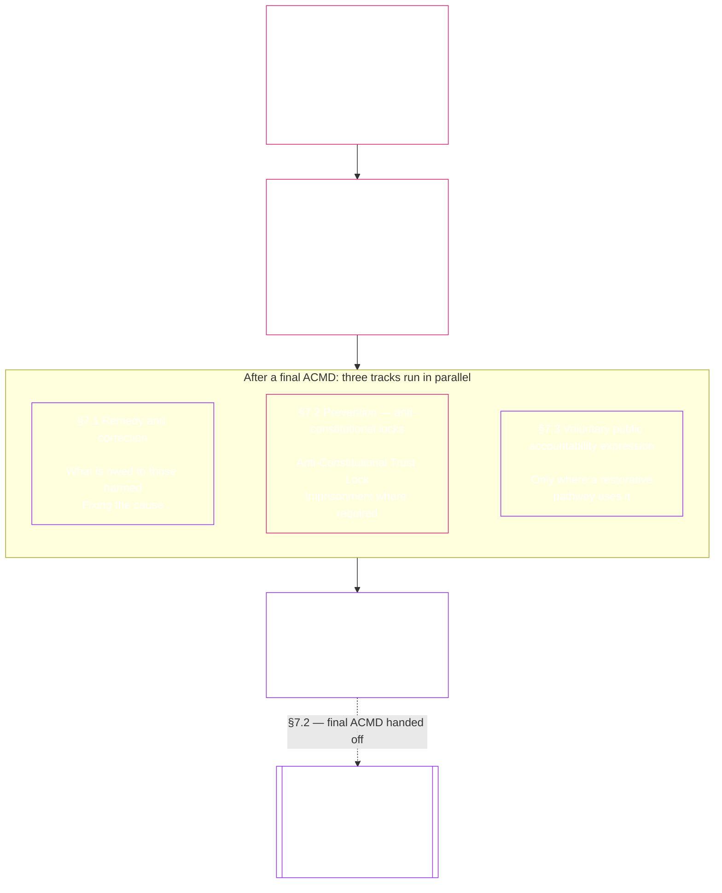

# CHAPTER FOURTEEN: ANTI-CONSTITUTIONAL MISCONDUCT DESIGNATION

<strong>Corpus placement (non-operative): file structure and reading rules</strong>

> This file is **part of the Sentient Constitution** and is **binding only together** with the other numbered `core_*` files read as one text. It contains **Chapter Fourteen** — anti-constitutional-misconduct designation (ACMD) decision framework, criteria set, Violation Axis slot 7–9 designation attachment, due-process safeguards, remedy, prevention locks, and voluntary public accountability expression. **Subcore 14-A** — named pattern applications and criteria routing — is attached to this chapter in [Subcore 14-A](subcore_14.010_misconduct_pattern_applications.md#subcore-14-a-anti-constitutional-misconduct--pattern-applications-and-criteria-routing).
>
> - **Constitutional owner (joint with Subcore 14-A):** final ACMD for Violation Axis slot 7, 8, or 9 findings. Chapter Fourteen owns the ACMD decision model; Subcore 14-A routes named patterns into that model without adding criteria.
> - **Measurement boundary:** Chapter Ten alone assigns the numeric impact slot under its unified proportional LEQU scale. This chapter does **not** replace or alter that measurement.
> - **Anti-relocation rule:** Chapter Fourteen does not restate Subcore 14-A pattern catalogs, Chapter Ten standing locks, or Chapters Twenty-Two through Twenty-Four change-path validity rules.
>
> Anti-constitutional misconduct (ACM) at **slot 7, 8, or 9** is **tetrad capture** at scale — read with the [Continuity aim](core_00.000_preamble.md#continuity) under [Two Constitutional Aims](core_00.000_preamble.md#two-constitutional-aims). Change-path validity interactions continue in [Chapters Twenty-Eight through Thirty](core_22.000_non_regression.md#chapter-twenty-two-non-regression-and-substantive-amendment-validity); justice constraints remain in [Chapter Four Part D](core_04.030_rights_part_d.md).
>
> **Upstream:** Chapter Ten standing measurement; Chapter Ten designation pointer.
> **Downstream:** [Subcore 14-A](subcore_14.010_misconduct_pattern_applications.md#subcore-14-a-anti-constitutional-misconduct--pattern-applications-and-criteria-routing) (*pattern applications*); Chapter Sixteen Trust Lock and standing-effect integration after final ACMD; Chapter Twenty-Two forum routing; Chapter Twenty-Seven governance legitimacy consequences.

<strong>Reader guidance (non-operative): cross-chapter map and reading order</strong>

> Under the [Continuity aim](core_00.000_preamble.md#continuity), designation review protects long-horizon constitutional operation when top-impact conduct threatens to hollow the [Constitutional Tetrad](core_00.000_preamble.md#constitutional-tetrad) — **participation**, **oversight**, **accountability**, and **timeliness** — below [material stake](core_00.000_preamble.md#material-stake) requirements.
>
> **Cross-chapter map**
>
> - **Chapter Ten:** supplies the Standing Record and verified-input gate.
> - **Chapter Ten:** supplies the Contribution and Violation axes, the unified proportional LEQU scale, and every numeric impact slot.
> - **Chapter Ten:** supplies process / response attachments, descriptors, standing integration, standing locks, voluntary public accountability expression, final standing effect rules, and the pointer here. It does not itself issue a final anti-constitutional-misconduct designation (ACMD).
> - **Chapter Eighteen:** supplies remedy and correction, prevention locks, and voluntary public accountability expression for every verified violation ([§3.1 Remedy and Correction](core_12.000_violation_consequences.md#31-remedy-and-correction), [§3.2 Prevention — General Standing Locks](core_12.000_violation_consequences.md#32-prevention--general-standing-locks), [§3.3 Voluntary Public Accountability Expression](core_12.000_violation_consequences.md#33-voluntary-public-accountability-expression)). **Section 7.1**, **section 7.2** (including imprisonment where required), and **section 7.3** here add only the ACMD layer on top of those rules.
> - **Subcores 3-A to 3-C:** supply record, custody, traceability, and verification discipline for the evidence used here.
> - **Chapter Two:** supplies principles relevant to emergency authority, necessity, concentration, and system capture.
> - **Chapter Sixteen:** supplies forum routing, Integrity-family default routing, transfer, and certification discipline.
> - **Chapter Four:** supplies the Rights Floor, **Article XXI-B** (*Restriction Floors*) joint requirements, **Imprisonment for violence**, and review discipline, **Article XXVII-C** (*Timely Resolution and Anti-Delay Floor*) remedy-timing discipline, and **Article XXI-A** (*Justice Objective and Scope*) review and publication safeguards.
> - **Chapter Twenty-One:** supplies governance legitimacy consequences tied to a final Chapter Fourteen designation.
> - **Chapters Twenty-Two through Twenty-Four:** supply change-path validity, referral, procedural, and custody rules; they do not issue the final Chapter Fourteen designation.
>
> **Reading order**
>
> Read **section 1** for what this chapter is for, then **sections 3 to 6** in order. **Section 4** (Decision Sequence) gives the order of work, including the **section 7** safeguards that come before any ACMD is final and the **sections 7.1 to 7.3** additions that follow it. Use **Subcore 14-A section 3** only to route named patterns into the same framework; named patterns are applications of that sequence, not separate shortcuts.
>
> **After final ACMD:** apply **sections 7.1 to 7.3**, then hand the ACMD to Chapter Ten for standing-lock and final-standing-effect rules, including the **Anti-Constitutional Trust Lock** only on a **final** ACMD.
>
> Read with: [Chapter One §8.2 How the Full Chain Fits Together](core_01.000_constitutional_map.md#82-how-the-full-chain-fits-together).

<strong>Trace</strong>

- Upstream: [Subcore 10-B](subcore_10.020_standing_assessment.md#subcore-10-b-standing-records--question-1-what-happened) (S10-B) (*Question 1; verified Standing Records*).
- Upstream: [Subcore 10-D](subcore_10.040_standing_measurement.md#subcore-10-d-standing-measurement--question-2-how-good-or-bad-was-it) (S10-D) (*Question 2; standing measurement and the Violation Axis slot*).
- Upstream pointer: [Subcore 10-F §4](subcore_10.060_standing_integration.md#4-automatic-integration-review-and-continuity) (S10-F §4) routes qualifying Violation Axis slot 7–9 findings here for ACMD only.
- This file: purpose and role; final ACMD for Violation Axis slot 7–9; decision sequence; ACMD criteria; due-process safeguards; Chapters Twenty-Eight through Thirty boundary. Named-pattern routing continues in [Subcore 14-A](subcore_14.010_misconduct_pattern_applications.md#subcore-14-a-anti-constitutional-misconduct--pattern-applications-and-criteria-routing).
- Downstream: [Subcore 10-F](subcore_10.060_standing_integration.md#subcore-10-f-standing-integration--question-3-what-follows) (S10-F) (*Trust Lock and standing-effect integration after final anti-constitutional-misconduct designation*); [Chapter Sixteen](core_16.000_forum.md#chapter-sixteen-standards-routing-and-forum-cases) (16.000) (*forum routing and certification*); [Chapter Twenty-One](core_21.000_governance.md#chapter-twenty-one-constitutional-contract-legitimacy-authorization-and-stewardship) (21.000) (*governance legitimacy consequences*).
- Read with: [Chapter One §8.2 How the Full Chain Fits Together](core_01.000_constitutional_map.md#82-how-the-full-chain-fits-together) (1.000 §8.2); [Chapters Twenty-Eight through Thirty](core_22.000_non_regression.md#chapter-twenty-two-non-regression-and-substantive-amendment-validity) (*change-path conduct may implicate criteria 1–4* (*Willful deceptive intent*; *Knowing falsification or suppression*; *Material rollback effect*; and *Causally significant conduct*)).
- Worked examples (they add no rule): [CJS-14.105 Application vignettes](corpus_joint_structure/cjs_14.105_application_vignettes.md#cjs-14105-application-vignettes): [CJS-14.105 §5 Pipeline Overrun and Tetrad-Hollow Forums](corpus_joint_structure/cjs_14.105_application_vignettes.md#cjs-14105-5-pipeline-overrun-and-tetrad-hollow-forums) and [CJS-14.105 §10 Question 3 Routing Patterns](corpus_joint_structure/cjs_14.105_application_vignettes.md#cjs-14105-10-question-3-routing-patterns).

 

Chapter Fourteen is the constitutional owner of **final anti-constitutional-misconduct designation (ACMD) for Violation Axis slot 7, 8, and 9 findings, ACMD criteria, due-process safeguards, and the Chapters Twenty-Eight through Thirty ACMD boundary**.

### 1. Purpose, Role, and Scope

<strong>Trace</strong>

- Upstream:
  - [Subcore 10-B](subcore_10.020_standing_assessment.md#subcore-10-b-standing-records--question-1-what-happened) (S10-B) (*Question 1; verified Standing Records*);
  - [Subcore 10-D](subcore_10.040_standing_measurement.md#subcore-10-d-standing-measurement--question-2-how-good-or-bad-was-it) (S10-D) (*Question 2; the Violation Axis slot*);
  - [Subcore 10-F §4](subcore_10.060_standing_integration.md#4-automatic-integration-review-and-continuity) (S10-F §4) routes qualifying Violation Axis slot 7–9 findings here for ACMD only.
- Downstream:
  - [§3](#3-how-designation-decisions-work--continuity-and-tetrad-capture-frame) (*How designation decisions work*);
  - [§5](#5-criteria-set-for-anti-constitutional-misconduct-designation--accountability-at-constitutional-scale) (*Criteria set*);
  - [§6](#6-violation-axis-slot-79-anti-constitutional-designation) (*Violation Axis slot 7–9 designation*);
  - [§7](#7-due-process-safeguards-remedy-and-prevention) (*Due-Process Safeguards, Remedy, and Prevention*);
  - [Subcore 14-A §3](subcore_14.010_misconduct_pattern_applications.md#3-pattern-applications-and-criteria-routing--participation-and-accountability-pathway-integrity) (*Pattern applications and criteria routing*).
- Read with: [Chapter One §8.2 How the Full Chain Fits Together](core_01.000_constitutional_map.md#82-how-the-full-chain-fits-together) (1.000 §8.2); [Chapters Twenty-Eight through Thirty](core_22.000_non_regression.md#chapter-twenty-two-non-regression-and-substantive-amendment-validity) (*change-path conduct may implicate criteria 1–4* (*Willful deceptive intent*; *Knowing falsification or suppression*; *Material rollback effect*; and *Causally significant conduct*)).
- Tetrad leg(s): **participation**, **oversight**, **accountability**, **timeliness** (tetrad capture at scale). Primary aim(s): **Continuity** (primary), **Flourishing**.

 

*In plain terms: this chapter is the last and narrowest gate in the standing pipeline. It opens only for a violation that Chapter Ten has already placed in Violation Axis slot 7, 8, or 9, and it asks one more question: did the same conduct also capture or hollow out constitutional duties at scale? It never re-finds the facts and never changes the slot. Because anti-constitutional misconduct is a heightened risk to sentients, a final anti-constitutional-misconduct designation brings extra steps, and they are add-ons to the ordinary violation process, not changes to it.*

**Heightened risk, add-on steps:** Anti-constitutional misconduct (ACM) poses a heightened level of risk to sentients. A final ACMD therefore brings extra steps, stated in **section 7**. These steps are special add-ons to the violation standing process and do not change it. The verified Standing Record, the Chapter Ten slot, and the ordinary remedy, correction, and lock rules for the violation stay as they are (**section 3.1**).

**Purpose:** Chapter Fourteen answers the one question the standing pipeline leaves open for the most serious violations. [Subcore 10-B](subcore_10.020_standing_assessment.md#subcore-10-b-standing-records--question-1-what-happened) establishes what happened (Question 1), [Subcore 10-D](subcore_10.040_standing_measurement.md#subcore-10-d-standing-measurement--question-2-how-good-or-bad-was-it) measures how good or bad it was (Question 2), and [Subcore 10-F](subcore_10.060_standing_integration.md#subcore-10-f-standing-integration--question-3-what-follows) decides what follows (Question 3). This chapter decides only whether conduct already in slot 7, 8, or 9 is also anti-constitutional misconduct (ACM).

There are only two possible results (**section 6**):

- a final ACMD whose label matches the slot Chapter Ten already assigned; or
- no final ACMD, in which case the violation finding stays exactly as measured.

Only this chapter may decide between them (**section 3.2**).

**Role:** Where this chapter sits:

- It takes the verified Standing Record and the Chapter Ten slot as fixed (**section 3.1**).
- After a final ACMD, [Subcore 10-F](subcore_10.060_standing_integration.md#subcore-10-f-standing-integration--question-3-what-follows) applies the Trust Lock and the final standing effect, [Chapter Twenty-One](core_21.000_governance.md#chapter-twenty-one-constitutional-contract-legitimacy-authorization-and-stewardship) attaches governance legitimacy consequences, and [Chapter Sixteen](core_16.000_forum.md#chapter-sixteen-standards-routing-and-forum-cases) routes the case and certifies the forum, with Integrity as the default lead where a final ACMD is the primary stake.
- The remedy and prevention rules here are read with the Rights Floor and Justice articles in [Chapter Four](core_04.000_rights_part_a.md#chapter-four-foundational-rights).

**Chapter scope:** This chapter is used only when a verified violation already occupies Violation Axis slot 7, 8, or 9 and ACM is materially alleged. It covers the decision framework and its sequence (**section 3**, with the full order in **section 4**), the criteria (**section 5**), attachment of the ACMD to the slot (**section 6**), and the due-process safeguards and ACM specializations that follow (**section 7**). It leaves:

- the numeric impact slot and its measurement to Chapter Ten;
- named patterns to [Subcore 14-A](subcore_14.010_misconduct_pattern_applications.md#subcore-14-a-anti-constitutional-misconduct--pattern-applications-and-criteria-routing), which routes each one into this same sequence and adds no criteria; and
- whether a constitutional change, or the process that made it, is valid to [Chapter Twenty-Two](core_22.000_non_regression.md#chapter-twenty-two-non-regression-and-substantive-amendment-validity) and [Chapter Twenty-Three](core_23.000_amendment_ratification.md#chapter-twenty-three-amendment-ratification-and-procedural-validity) (**section 3.2**).

### 2. Why Anti-Constitutional Misconduct Designation Exists

*In plain terms: some of the gravest harm is not to one sentient but to the protections everyone depends on. This chapter exists to name that harm, narrowly and with extra safeguards.*

A violation can be serious in its own right and also attack the system of protection itself, for example by capturing an oversight body or hollowing out a right at scale. Treating that as an ordinary violation would miss the wider danger; treating any serious violation that way would be an easy tool for abuse. This chapter opens only for violations already at the highest slots, asks one further question, and adds safeguards because a misconduct designation carries more weight.

**Grounded in:**

- Preamble:
  - [Constitutional Tetrad](core_00.000_preamble.md#constitutional-tetrad): the legs this chapter carries:
    - [Accountability](subcore_03.040_apex_accountability_leg.md#accountability): those who attack the protections everyone depends on must answer for it;
    - [Oversight](subcore_03.055_apex_oversight_leg.md#oversight): an anti-constitutional misconduct designation is narrow and carries extra safeguards against misuse;
  - [Two Constitutional Aims](core_00.000_preamble.md#two-constitutional-aims): both aims, which this chapter serves:
    - [Flourishing](core_00.000_preamble.md#flourishing): the protections every sentient relies on are defended;
    - [Continuity](core_00.000_preamble.md#continuity): naming the gravest harm protects the constitutional order over time;
- Chapter Two principles:
  - [§14.1 Constitutional No-Bypass Principle](core_02.030_constitutional_interpretation.md#141-constitutional-no-bypass-principle);
  - [§16.5 Duty to Resist](core_02.040_stewardship_capacity_principles.md#165-duty-to-resist);
  - [§19.3.1 Capture Escalation Triggers](core_02.050_governance_incentive_application.md#1931-capture-escalation-triggers);
- Chapter Four Articles:
  - [Article XXI-A](core_04.030_rights_part_d.md#article-xxi-a-justice-objective-and-scope) (*Justice Objective and Scope*);
  - [Article XXI-B](core_04.030_rights_part_d.md#article-xxi-b-restriction-floors) (*Restriction Floors*);
  - [Article XXVI](core_04.030_rights_part_d.md#article-xxvi-constitutional-interpretation-review-and-anti-capture-safeguards) (*Constitutional Interpretation, Review, and Anti-Capture Safeguards*);
  - [Article XXVII-B](core_04.040_rights_part_e.md#article-xxvii-b-rights-collision-procedure-and-restorative-alignment) (*Rights-Collision Procedure and Restorative Alignment*).

### 3. How Designation Decisions Work — Continuity and Tetrad-Capture Frame

<strong>Trace</strong>

- Upstream: [Subcore 10-B](subcore_10.020_standing_assessment.md#subcore-10-b-standing-records--question-1-what-happened) (S10-B) (*Question 1; verified Standing Records*).
- Upstream: [Subcore 10-D](subcore_10.040_standing_measurement.md#subcore-10-d-standing-measurement--question-2-how-good-or-bad-was-it) (S10-D) (*Question 2; the Contribution and Violation axes, the unified proportional LEQU scale, and the numeric impact slot*).
- Upstream map: [Subcore 10-D §6](subcore_10.040_standing_measurement.md#6-slot-grammar-and-shared-scaling) (S10-D §6) (*standing-slot grammar*).
- Upstream pointer: [Subcore 10-F §4](subcore_10.060_standing_integration.md#4-automatic-integration-review-and-continuity) (S10-F §4) routes qualifying Violation Axis slot 7–9 findings here for ACMD only.
- Downstream: [§4](#4-decision-sequence) (*Decision Sequence*); [§5](#5-criteria-set-for-anti-constitutional-misconduct-designation--accountability-at-constitutional-scale) (*Designation criteria set*); [§6](#6-violation-axis-slot-79-anti-constitutional-designation) (*Violation Axis slot 7–9 designation*).
- Safeguards and discipline:
  - [§7](#7-due-process-safeguards-remedy-and-prevention) (*Due-Process Safeguards, Remedy, and Prevention*);
  - [§7.1](#71-remedy-and-correction-anti-constitutional) (*Remedy and Correction (Anti-Constitutional)*);
  - [§7.2](#72-prevention--anti-constitutional-locks) (*Prevention — Anti-Constitutional Locks*);
  - [§7.3](#73-voluntary-public-accountability-expression-anti-constitutional) (*Voluntary Public Accountability Expression (Anti-Constitutional)*).
- Pattern applications: [Subcore 14-A — §3](subcore_14.010_misconduct_pattern_applications.md#3-pattern-applications-and-criteria-routing--participation-and-accountability-pathway-integrity) (*named patterns route into the same anti-constitutional-misconduct designation criteria*).
- Change-path boundary: [§3.2](#32-exclusive-authority-to-issue-a-final-acmd) (*Exclusive Authority to Issue a Final ACMD*).
- Read with: [Chapters Twenty-Eight through Thirty](core_22.000_non_regression.md#chapter-twenty-two-non-regression-and-substantive-amendment-validity) where **regressive deception** and change-path conduct may implicate **criteria 1–4** (*Willful deceptive intent*; *Knowing falsification or suppression*; *Material rollback effect*; and *Causally significant conduct*).
- Tetrad leg(s): **participation**, **oversight**, **accountability**, **timeliness** (tetrad capture at scale). Primary aim(s): **Continuity** (primary), **Flourishing**. [material stake](core_00.000_preamble.md#material-stake) scaling applies to safeguards and gravity.

 

*In plain terms: this chapter looks for one thing, tetrad capture, and only in a violation that Chapter Ten has already placed in slot 7, 8, or 9. The facts and the slot stay as they were found, only this chapter can decide whether a final ACMD attaches, and the order of work is in section 4.*

**The frame.** What this chapter looks for is **tetrad capture**, a large-scale attack on the [Continuity aim](core_00.000_preamble.md#continuity), which is the goal of keeping the constitution working over the long run. In plain terms, it is conduct that captures or hollows out constitutional duties by weakening the [Constitutional Tetrad](core_00.000_preamble.md#constitutional-tetrad) (**participation**, **oversight**, **accountability**, and **timeliness**) below [material stake](core_00.000_preamble.md#material-stake) requirements.

#### 3.1 What This Chapter Does Not Re-Measure

This chapter does not re-measure how serious the violation is. Chapter Ten already answered that when it assigned Violation Axis slot 7, 8, or 9.

- The verified facts from [Subcore 10-B](subcore_10.020_standing_assessment.md#subcore-10-b-standing-records--question-1-what-happened) and the [Subcore 10-D](subcore_10.040_standing_measurement.md#subcore-10-d-standing-measurement--question-2-how-good-or-bad-was-it) slot stay fixed. A very large verified violation is not, by itself, proof of intent, capture, or ACM. The table in [§6](#6-violation-axis-slot-79-anti-constitutional-designation) (*Violation Axis slot 7–9 designation*) shows which ACMD matches slot 7, 8, or 9.
- Ordinary remedies, safeguards, and locks under [Subcore 10-F](subcore_10.060_standing_integration.md#subcore-10-f-standing-integration--question-3-what-follows) continue while ACMD is under review. ACMD review runs alongside that work, does not wait for Question 3 to finish, and does not reopen Subcore 10-D measurement.

#### 3.2 Exclusive Authority to Issue a Final ACMD

Only **this chapter** may issue a final **anti-constitutional misconduct** designation for a slot 7–9 finding.

- The underlying conduct may arise during **constitutional change** under **Chapters Twenty-Two through Twenty-Four**, including **regressive deception** covered by criteria **1–4** (*Willful deceptive intent*; *Knowing falsification or suppression*; *Material rollback effect*; and *Causally significant conduct*).
  - **Chapter Twenty-Two** decides whether such a change can stand under the substantive non-regression and anti-evasion floor.
  - **Chapter Twenty-Three** decides whether the change process, records, review triggers, and any provisional effect are valid.
- It may also arise through **criteria 5** or **6** (*Insurrection or material forcible subversion* or *Operative nullification*) in **section 5**, or through other conduct that materially harms constitutional **validity**, **operation**, or **Rights-Floor** governance.
- No adopting document, process note, or subsidiary body, and none of **Chapters Twenty-Two through Twenty-Four**, may issue the final ACMD instead of **this chapter**.

### 4. Decision Sequence

<strong>Trace</strong>

- Upstream: [§3](#3-how-designation-decisions-work--continuity-and-tetrad-capture-frame) (*How designation decisions work*).
- Downstream:
  - [§5](#5-criteria-set-for-anti-constitutional-misconduct-designation--accountability-at-constitutional-scale) (*Criteria set*);
  - [§6](#6-violation-axis-slot-79-anti-constitutional-designation) (*Violation Axis slot 7–9 designation*);
  - [§7](#7-due-process-safeguards-remedy-and-prevention) (*Due-Process Safeguards, Remedy, and Prevention*);
  - [Subcore 14-A §3](subcore_14.010_misconduct_pattern_applications.md#3-pattern-applications-and-criteria-routing--participation-and-accountability-pathway-integrity) (*Pattern applications and criteria routing*).
- Tetrad leg(s): **participation**, **oversight**, **accountability**, **timeliness** (tetrad capture at scale). Primary aim(s): **Continuity** (primary), **Flourishing**.

 

*In plain terms: this chapter works in one sequence. First confirm the verified Standing Record from Chapter Ten and the Chapter Ten impact slot, then define the incident, apply the anti-constitutional-misconduct designation criteria, and apply process safeguards. The named patterns later in the chapter are applications of that sequence, not separate routes around it.*

Make a final ACMD in this order:

1. **Establish the incident**
   - Confirm that the verified Standing Record from Chapter Ten is in hand and that Chapter Ten has already assigned Violation Axis slot 7, 8, or 9.
   - Identify the **unified incident** — one episode or campaign — without splitting it artificially to change the outcome.
2. **Decide whether the ACMD attaches**
   - Decide which **section 5** ACMD criteria the verified Standing Record materially implicates.
   - Under **section 6**, decide whether the matching ACMD attaches, without changing the impact slot.
3. **Make the ACMD final and apply the ACM specializations**
   - Apply **section 7** due-process safeguards before treating the ACMD as final.
   - Apply **section 7.1** ACM remedy and correction.
   - Apply **section 7.2** ACM prevention locks (including imprisonment where required).
   - Hand the final ACMD to Chapter Ten for the Trust Lock and standing-effect integration.
4. **Add restorative expression and named patterns**
   - Apply **section 7.3** where restorative pathways use voluntary public accountability expression.
   - Use the named patterns in **Subcore 14-A sections 3 through 6** only as applications of this same sequence.

Steps 3 and 4 list the **section 7** parts in the order they are presented. Once the safeguards are satisfied and the ACMD is final, **section 7.1**, **section 7.2**, and **section 7.3** run in parallel.

### 5. Criteria Set (for Anti-Constitutional-Misconduct Designation) — Accountability at Constitutional Scale

<strong>Trace</strong>

- Upstream: [§3](#3-how-designation-decisions-work--continuity-and-tetrad-capture-frame) (*How designation decisions work*).
- Emergency authority: [Chapter Two](core_02.040_stewardship_capacity_principles.md#chapter-02-part-e-stewardship-and-the-steward-role) (2.040) emergency and necessity discipline; [Chapter Seventeen §5.1: Emergency Measures and Continuation Burden](core_17.000_forum_families_escalation_timeliness_support.md#51-emergency-measures-and-continuation-burden) (17.000 §5.1)where **criteria 5** and **6** (*Insurrection or material forcible subversion* and *Operative nullification*) are read against bounded emergency authority.
- Downstream designation decision: [§6](#6-violation-axis-slot-79-anti-constitutional-designation).
- Downstream safeguards and discipline: [§7](#7-due-process-safeguards-remedy-and-prevention).
- This section: ACMD criteria set; unified-incident rule; **good-faith drafting carve-out** for corrected criteria 1–4 (*Willful deceptive intent*; *Knowing falsification or suppression*; *Material rollback effect*; and *Causally significant conduct*) change or record errors.
- Downstream pattern applications and criteria routing:
  - [Subcore 14-A — §3](subcore_14.010_misconduct_pattern_applications.md#3-pattern-applications-and-criteria-routing--participation-and-accountability-pathway-integrity), including
  - [Subcore 14-A — §4](subcore_14.010_misconduct_pattern_applications.md#4-blocking-contest-review-and-verification), including
  - [Subcore 14-A — §4.1](subcore_14.010_misconduct_pattern_applications.md#41-rights-floor-waivers-and-unconstitutional-contract-terms);
  - [Subcore 14-A — §4.2](subcore_14.010_misconduct_pattern_applications.md#42-flooding-the-zone-and-contest-pathway-denial);
  - [Subcore 14-A — §4.3](subcore_14.010_misconduct_pattern_applications.md#43-info-sphere-zone-flooding);
  - [Subcore 14-A — §5](subcore_14.010_misconduct_pattern_applications.md#5-corrupting-and-commanding-duty-holders), including
  - [Subcore 14-A — §5.1](subcore_14.010_misconduct_pattern_applications.md#51-bribery-and-improper-benefit-exchange);
  - [Subcore 14-A — §5.2](subcore_14.010_misconduct_pattern_applications.md#52-unlawful-or-unconstitutional-command-conduct);
  - [Subcore 14-A — §6](subcore_14.010_misconduct_pattern_applications.md#6-shielding-misconduct-and-failing-to-enforce), including
  - [Subcore 14-A — §6.1](subcore_14.010_misconduct_pattern_applications.md#61-reward-protection-or-normalization-of-anti-constitutional-conduct);
  - [Subcore 14-A — §6.2](subcore_14.010_misconduct_pattern_applications.md#62-enforcement-refusal-suppression-or-non-prosecution-conduct);
  - [Subcore 14-A — §6.3](subcore_14.010_misconduct_pattern_applications.md#63-forum-recusal-failure-and-biased-panel-participation);
  - [Subcore 14-A — §7](subcore_14.010_misconduct_pattern_applications.md#7-structural-control-concentration-and-dependency), including
  - [Subcore 14-A — §7.1](subcore_14.010_misconduct_pattern_applications.md#71-concentration-based-subversion-criteria-interaction);
  - [Subcore 14-A — §7.2](subcore_14.010_misconduct_pattern_applications.md#72-infrastructure-denial-destruction-or-dependency-cutoff-conduct);
  - [Subcore 14-A — §8](subcore_14.010_misconduct_pattern_applications.md#8-obstruction-of-accountability-criteria-interaction).
- Read with: [Subcores 3-A to 3-C](subcore_03.010_definition_structure.md) for record, custody, and verification expectations tied to **criteria 1–4** (*Willful deceptive intent*; *Knowing falsification or suppression*; *Material rollback effect*; and *Causally significant conduct*); [§3.2](#32-exclusive-authority-to-issue-a-final-acmd) (*Exclusive Authority to Issue a Final ACMD*).

<strong>Definition:</strong> [Necessity](subcore_03.070_band_accountability.md#necessity) · [O](subcore_03.070_band_accountability.md#necessity) · [M](subcore_03.070_band_accountability.md#necessity-a) · [A](subcore_03.070_band_accountability.md#necessity-a) · [C](subcore_03.070_band_accountability.md#necessity-c)

*In plain terms: evaluators first accept the Chapter Ten impact slot, then build one coherent picture of what happened: one episode, one sustained campaign, or another unified incident. They use six checks—intent, records, rollback, real-world blockage, forcible takeover, and practical nullification of remedies—to decide whether the anti-constitutional designation applies. A genuine drafting mistake that is fixed promptly may defeat designation in some change or record cases, but it does not excuse a real coup path. When only the rollback or real-world-blockage check is met, honest failure is not enough: the Standing Record must also show purpose, knowledge, reckless disregard, or a refusal to correct when correction was possible. Dissent, protest, journalism, and whistleblowing are not anti-constitutional misconduct. They may not split one scheme to game the anti-constitutional-misconduct designation.*

#### 5.1 Unified Incident

Evaluators must treat as **one incident** conduct that shares one or more of the following material factors:

- **actors**
- **objectives**
- **temporal continuity**
- **causal linkage**
- **unified design**

Evaluators must also apply the following:

- Artificial fragmentation of one pattern to manipulate anti-constitutional misconduct outcomes is prohibited.
- Where **Subcore 14-A section 4.2** (*Flooding the zone*) and **Subcore 14-A section 4.3** (*Info-Sphere Zone Flooding*) overlap, assess on a **unified incident record** under the unified-incident rule in **section 5.1**.

#### 5.2 Single Catastrophic Incident and Sustained High-Gravity Pattern

**Single catastrophic incident** means a **unified incident** that, viewed as a whole, causes or imminently threatens one of the following:

- Loss or suspension of this Constitution’s operative authority as law.
- Material population-scale loss of constitutionally required contestability or Rights-Floor continuity.
- Other constitutional harm of comparable magnitude within survival-relevant or system-relevant time horizons.

**Sustained high-gravity pattern** means one **unified incident** made of conduct that keeps going, repeats, or is systematically reinforced, and whose combined harm is serious. That harm may show up as:

- material weakening of constitutional protections;
- blocked or chilled challenge rights;
- Rights-Floor degradation;
- correction delayed past practical remedy;
- or an equivalent structural workaround.

The pattern qualifies when either:

- it continues after a fair chance to fix the problem in good faith, where a fix was possible; or
- it reaches the same level of seriousness through institutional scale, capture, or staying power — even without one catastrophic moment.

#### 5.3 The Six Criteria

Assess every criterion the facts actually support together on the same **unified incident record**:

- **Criteria 1–4** usually show up in cases about changing the Constitution, handling official records, or attacking validity rules:
  - 1. **Willful deceptive intent:** intent to deceive, conceal, or bypass constitutional validity safeguards.
  - 2. **Knowing falsification or suppression:** knowing falsification, material omission, or evidence/custody manipulation in proposal, review, adoption, publication, **or other material constitutional custody or verification** records.
  - 3. **Material rollback effect:** actual or attempted material weakening of constitutional protections, directly or by equivalent structural workaround.
  - 4. **Causally significant conduct:** conduct materially contributes to unlawful constitutional effect, delayed correction, blocked challenge rights, or Rights-Floor degradation.
- **Criteria 5** and **6** cover forcible takeover of constitutional authority and making constitutional process or remedies unusable in practice:
  - 5. **Insurrection or material forcible subversion:**
       - Organized or material **unlawful** action using **force**, **coercion**, or **usurpation** to **overthrow**, **suspend**, or **replace** this Constitution’s operative constitutional authority.
       - This excludes conduct justified under **Chapter Two** and **Chapter Seventeen §5.1** (*Emergency Measures and Continuation Burden*) or equivalent **Necessity**-bounded emergency authority.
  - 6. **Operative nullification:**
       - Conduct that makes constitutional **process** or **remedies** unusable in practice.
       - This excludes conduct justified under **Chapter Two** and **Chapter Seventeen §5.1** (*Emergency Measures and Continuation Burden*) or equivalent **Necessity**-bounded emergency authority.

Do not count the same conduct as both **criterion 5** (*Insurrection or material forcible subversion*) and **criterion 6** (*Operative nullification*) unless each one has its own independent proof. For example, the Standing Record must show separate forcible acts and separate ways of making process or remedies unusable — not two labels for one undifferentiated fact.

**Rollback or causal contribution standing alone.** Where **criterion 3** (*Material rollback effect*) or **criterion 4** (*Causally significant conduct*) is the only criterion the verified Standing Record supports, with no **criterion 1** (*Willful deceptive intent*), **criterion 2** (*Knowing falsification or suppression*), **criterion 5** (*Insurrection or material forcible subversion*), or **criterion 6** (*Operative nullification*), the ACMD attaches only if the Standing Record also shows one of the following:

- purpose to bring about the weakening, unlawful constitutional effect, delayed correction, blocked challenge rights, or Rights-Floor degradation;
- knowledge that the conduct would bring it about;
- reckless disregard of a known and serious risk that it would; or
- continuation of the conduct after a fair chance to correct it in good faith, where correction was possible.

Good-faith administration that fails, even at scale, does not meet this test through its size or its consequences alone. Its verified violation still carries the ordinary consequences of **Chapters Ten to Thirteen** at the slot Chapter Ten assigned.

#### 5.4 Good-Faith Drafting Carve-Out

An honest, good-faith drafting mistake is not anti-constitutional misconduct if it is disclosed promptly and fixed before it has any constitutional effect. This protection covers only mistakes that matter solely under **criteria 1–4** (*Willful deceptive intent*; *Knowing falsification or suppression*; *Material rollback effect*; and *Causally significant conduct*) and arise in **change** or **record** contexts. It never excuses **criteria 5** or **6** (*Insurrection or material forcible subversion* or *Operative nullification*) conduct.

#### 5.5 Dissent and Peaceful Protest Carve-Out

Dissent, advocacy for amendment or replacement of authority by lawful means, peaceful protest, and [protected nonviolent civil disobedience](core_04.010_rights_part_b.md#xi-d-nonviolent-civil-disobedience) under **Article XI-D** (*Assembly, Dissent, and Peaceful Protest*) ([*Dissent and peaceful protest floor*](core_04.010_rights_part_b.md#xi-d-dissent-and-peaceful-protest)) are not anti-constitutional misconduct. Nor are press and journalistic activity under [**Article XI-C**](core_04.010_rights_part_b.md#article-xi-c-press-and-journalistic-activity) (*Press and Journalistic Activity*) and [protected reporting (whistleblowing)](subcore_03.070_band_accountability.md#protected-reporting-whistleblowing).

- They satisfy no criterion — including **criterion 5** or **6** (*Insurrection or material forcible subversion* or *Operative nullification*) — through their message, intensity, popularity, or aim of changing who holds authority or what the Constitution says.
- Selecting, withholding to protect a source, or publishing material from constitutional records in the course of journalism or protected reporting is not *material omission* or *custody manipulation* under **criterion 2** (*Knowing falsification or suppression*). That criterion reaches those who keep or alter constitutional custody and verification records, and falsifying a custody or verification record stays separable conduct.
- **Criteria 5** and **6** (*Insurrection or material forcible subversion* and *Operative nullification*) require force, coercion, usurpation, or operative nullification shown by separable conduct.

### 6. Violation Axis Slot 7–9 Anti-Constitutional Designation

<strong>Trace</strong>

- Upstream: [§5](#5-criteria-set-for-anti-constitutional-misconduct-designation--accountability-at-constitutional-scale) (*Criteria set*).
- Criteria interactions:
  - [Subcore 14-A — §4.1](subcore_14.010_misconduct_pattern_applications.md#41-rights-floor-waivers-and-unconstitutional-contract-terms);
  - [Subcore 14-A — §4.2](subcore_14.010_misconduct_pattern_applications.md#42-flooding-the-zone-and-contest-pathway-denial);
  - [Subcore 14-A — §4.3](subcore_14.010_misconduct_pattern_applications.md#43-info-sphere-zone-flooding);
  - [Subcore 14-A — §5.1](subcore_14.010_misconduct_pattern_applications.md#51-bribery-and-improper-benefit-exchange);
  - [Subcore 14-A — §5.2](subcore_14.010_misconduct_pattern_applications.md#52-unlawful-or-unconstitutional-command-conduct);
  - [Subcore 14-A — §6.1](subcore_14.010_misconduct_pattern_applications.md#61-reward-protection-or-normalization-of-anti-constitutional-conduct);
  - [Subcore 14-A — §6.2](subcore_14.010_misconduct_pattern_applications.md#62-enforcement-refusal-suppression-or-non-prosecution-conduct);
  - [Subcore 14-A — §6.3](subcore_14.010_misconduct_pattern_applications.md#63-forum-recusal-failure-and-biased-panel-participation);
  - [Subcore 14-A — §7.1](subcore_14.010_misconduct_pattern_applications.md#71-concentration-based-subversion-criteria-interaction);
  - [Subcore 14-A — §7.2](subcore_14.010_misconduct_pattern_applications.md#72-infrastructure-denial-destruction-or-dependency-cutoff-conduct);
  - [Subcore 14-A — §8](subcore_14.010_misconduct_pattern_applications.md#8-obstruction-of-accountability-criteria-interaction).
- Downstream:
  - [§7](#7-due-process-safeguards-remedy-and-prevention) (*Due-Process Safeguards, Remedy, and Prevention*),
  - [§7.1](#71-remedy-and-correction-anti-constitutional) (*Remedy and Correction (Anti-Constitutional)*),
  - [§7.2](#72-prevention--anti-constitutional-locks) (*Prevention — Anti-Constitutional Locks*), and
  - [§7.3](#73-voluntary-public-accountability-expression-anti-constitutional) (*Voluntary Public Accountability Expression (Anti-Constitutional)*).
- Downstream forums: [Chapter Sixteen](core_16.000_forum.md#chapter-sixteen-standards-routing-and-forum-cases) (16.000) [§4](core_16.000_forum.md#4-default-venue-and-primary-stakes) gives the Integrity default lead where final Chapter Fourteen designation is the primary stake. [Chapter Seventeen §4](core_17.000_forum_families_escalation_timeliness_support.md#4-escalation-and-questions-for-ruling) (17.000 §4) covers forum certification and independent review for final ACMD.
- Read with: [Subcore 10-D](subcore_10.040_standing_measurement.md#subcore-10-d-standing-measurement--question-2-how-good-or-bad-was-it) (S10-D) — its unified proportional LEQU scale supplies the fixed impact slot, while this section supplies designation only; [§3.2](#32-exclusive-authority-to-issue-a-final-acmd) (*Exclusive Authority to Issue a Final ACMD*).

 

*In plain terms: Chapter Ten has already scored how serious the harm is. This section only asks a further question: did the same incident also attack the Constitution’s validity, day-to-day operation, Rights Floors, or the Tetrad badly enough to count as anti-constitutional misconduct?*

Exclusive authority to issue a final ACMD is stated in [§3.2](#32-exclusive-authority-to-issue-a-final-acmd) (*Exclusive Authority to Issue a Final ACMD*). The ACMD, when established, follows Chapter Ten’s already assigned impact score. Those top three impact labels stay in place either way — and the matching ACMD uses the slot already assigned:

| Existing `s` | Chapter Ten impact label | Chapter Fourteen designation, if established |
| ---: | --- | --- |
| 7 | **Severe Constitutional Impact** | **Severe anti-constitutional misconduct** |
| 8 | **Grave Constitutional Impact** | **Grave anti-constitutional misconduct** |
| 9 | **Catastrophic Constitutional Impact** | **Catastrophic anti-constitutional misconduct** |

The ACMD attaches when both of the following are true:

- the **unified incident** meets one or more **section 5** criteria on a verified Standing Record; and
- the **section 7** process safeguards are satisfied.

Once it attaches:

- the seriousness label (Severe, Grave, or Catastrophic) follows the impact score Chapter Ten already assigned, and only that score decides whether the underlying finding is slot 7, 8, or 9;
- how many criteria apply, and facts about intent, coercion, pattern, or institutional character, do **not** move the finding between slots; and
- a single catastrophic incident, a sustained high-gravity pattern, criterion 5 (*Insurrection or material forcible subversion*), or criterion 6 (*Operative nullification*) may make the ACMD eligible.

A final ACMD requires:

- review under [highest scrutiny](subcore_03.085_band_oversight.md#highest-scrutiny);
- [Evidence Preservation](subcore_03.085_band_oversight.md#evidence-preservation);
- published remediation controls;
- proportional sanctions or repair where confirmed; and
- the matching Chapter Ten standing consequences.

A Catastrophic designation also requires:

- the strongest constitutional safeguards;
- remedy priority for sentients harmed; and
- anti-capture oversight —

because the underlying impact is already slot 9, not because character somehow raised the score.

### 7. Due-Process Safeguards, Remedy, and Prevention

<strong>Trace</strong>

- Upstream: [§6](#6-violation-axis-slot-79-anti-constitutional-designation) (*Violation Axis slot 7–9 designation*); [§5](#5-criteria-set-for-anti-constitutional-misconduct-designation--accountability-at-constitutional-scale) (*Criteria set*), including the **good-faith drafting carve-out**.
- Pattern applications:
  - [Subcore 14-A — §4.2](subcore_14.010_misconduct_pattern_applications.md#42-flooding-the-zone-and-contest-pathway-denial) (*Flooding the zone*);
  - [Subcore 14-A — §4.3](subcore_14.010_misconduct_pattern_applications.md#43-info-sphere-zone-flooding) (*Info-Sphere Zone Flooding*);
  - [Subcore 14-A — §5.1](subcore_14.010_misconduct_pattern_applications.md#51-bribery-and-improper-benefit-exchange) (*Bribery and Improper Benefit Exchange*);
  - [Subcore 14-A — §5.2](subcore_14.010_misconduct_pattern_applications.md#52-unlawful-or-unconstitutional-command-conduct) (*Unlawful or Unconstitutional Command Conduct*);
  - [Subcore 14-A — §6.1](subcore_14.010_misconduct_pattern_applications.md#61-reward-protection-or-normalization-of-anti-constitutional-conduct) (*Reward, Protection, or Normalization of Anti-Constitutional Conduct*);
  - [Subcore 14-A — §6.2](subcore_14.010_misconduct_pattern_applications.md#62-enforcement-refusal-suppression-or-non-prosecution-conduct) (*Enforcement Refusal, Suppression, or Non-Prosecution Conduct*);
  - [Subcore 14-A — §6.3](subcore_14.010_misconduct_pattern_applications.md#63-forum-recusal-failure-and-biased-panel-participation) (*Forum Recusal Failure and Biased Panel Participation*);
  - [Subcore 14-A — §7.2](subcore_14.010_misconduct_pattern_applications.md#72-infrastructure-denial-destruction-or-dependency-cutoff-conduct) (*Infrastructure Denial, Destruction, or Dependency Cutoff Conduct*);
  - [Subcore 14-A — §8](subcore_14.010_misconduct_pattern_applications.md#8-obstruction-of-accountability-criteria-interaction) (*Obstruction of Accountability*).
- Downstream: [§7.1](#71-remedy-and-correction-anti-constitutional) (*Remedy and Correction (Anti-Constitutional)*); [§7.2](#72-prevention--anti-constitutional-locks) (*Prevention — Anti-Constitutional Locks*); [§7.3](#73-voluntary-public-accountability-expression-anti-constitutional) (*Voluntary Public Accountability Expression (Anti-Constitutional)*).
- Forum discipline: [Chapter Sixteen §4](core_16.000_forum.md#4-default-venue-and-primary-stakes) (16.000 §4)and [Chapter Seventeen §4 Escalation and Questions for Ruling](core_17.000_forum_families_escalation_timeliness_support.md#4-escalation-and-questions-for-ruling) (17.000 §4) cover default Integrity lead, forum-family application of due process, transfer, and certification. Read **section 7** with **Article XXI** (*Justice After Verified Violation*) in **Chapter Four**.
- Read with: [Article XXI-A: Justice Objective and Scope](core_04.030_rights_part_d.md#article-xxi-a-justice-objective-and-scope) for review and publication safeguards; [Subcores 3-A to 3-C](subcore_03.010_definition_structure.md) tracing standards for publication; [Chapter Twelve §3](core_12.000_violation_consequences.md#3-violation-correction-and-prevention) (12.000 §3)(*Violation, Correction, and Prevention*) for the general remedy → locks → expression grammar this section specializes.

 

*In plain terms: nobody receives a final anti-constitutional designation without process. There has to be independent review, a real chance to respond, and a reasoned public record. After final anti-constitutional-misconduct designation, this section specializes Chapter Ten's durable-fix grammar — remedy and correction, prevention locks, and voluntary public accountability expression where used. They run in parallel from a final ACMD; the order of the text is only the order of presentation.*

No final **anti-constitutional misconduct designation** under this chapter may be issued without independent review, contestable notice, and reasoned publication.

After final designation under **section 6** with these safeguards met, apply these three parts as parallel tracks. The order they are listed in is only the order of presentation. It is not a sequence in which one part must finish before the next starts:

- [§7.1 Remedy and Correction (Anti-Constitutional)](#71-remedy-and-correction-anti-constitutional);
- [§7.2 Prevention — Anti-Constitutional Locks](#72-prevention--anti-constitutional-locks); and
- [§7.3 Voluntary Public Accountability Expression (Anti-Constitutional)](#73-voluntary-public-accountability-expression-anti-constitutional) where restorative pathways use public acknowledgment or apology.

Each track starts when the ACMD is final and works from the same verified Standing Record. No track replaces another: repair does not cancel a lock, a lock does not cancel repair, and voluntary expression stands in for neither ([Chapter Twelve §3.1.4 Remedy and Correction Together](core_12.000_violation_consequences.md#314-remedy-and-correction-together) and [Chapter Twelve §3.3 Voluntary Public Accountability Expression](core_12.000_violation_consequences.md#33-voluntary-public-accountability-expression)). This chapter changes no ordering rule in Chapter Eighteen, including the Opened-Remedy Precondition for general standing locks ([Chapter Twelve §3.4.1 Opened-Remedy Precondition](core_12.000_violation_consequences.md#341-opened-remedy-precondition)).

The chart shows the three tracks starting together from a final ACMD and meeting in one reviewable package.

Chapter Ten remains the owner of general remedy, lock design and enforcement, and the **Anti-Constitutional Trust Lock**; this section states ACM-specific specializations only.

#### 7.1 Remedy and Correction (Anti-Constitutional)

<strong>Trace</strong>

- Upstream: [§6](#6-violation-axis-slot-79-anti-constitutional-designation) (*Violation Axis slot 7–9 designation*); [§7](#7-due-process-safeguards-remedy-and-prevention) (*Due-Process Safeguards, Remedy, and Prevention*).
- Downstream:
  - [§7.2](#72-prevention--anti-constitutional-locks) (*Prevention — Anti-Constitutional Locks*);
  - [§7.3](#73-voluntary-public-accountability-expression-anti-constitutional) (*Voluntary Public Accountability Expression (Anti-Constitutional)*);
  - [Subcore 10-F](subcore_10.060_standing_integration.md#subcore-10-f-standing-integration--question-3-what-follows) (S10-F) standing-effect and standing-lock integration;
  - [Chapter Sixteen](core_16.000_forum.md#chapter-sixteen-standards-routing-and-forum-cases) (16.000)forum routing and certification.
- Read with:
  - [Chapter Twelve §3.1](core_12.000_violation_consequences.md#31-remedy-and-correction) (12.000 §3.1)(*Remedy and Correction*);
  - [Article XXI-A](core_04.030_rights_part_d.md#article-xxi-a-justice-objective-and-scope) (*Justice Objective and Scope*);
  - [Article XXI-B](core_04.030_rights_part_d.md#article-xxi-b-restriction-floors) (*restitution, remediation, rehabilitation, accountable attribution, duration, review, and restoration*);
  - [Article XXVII-C](core_04.040_rights_part_e.md#article-xxvii-c-timely-resolution-and-anti-delay-floor) (*timely resolution and remedy commencement*).

<strong>Definitions (O · M · A · C)</strong>

- [Redress and Remediation](subcore_03.070_band_accountability.md#redress-and-remediation) · [O](subcore_03.070_band_accountability.md#redress-and-remediation) · [M](subcore_03.070_band_accountability.md#redress-and-remediation-constitutional-a) · [A](subcore_03.070_band_accountability.md#redress-and-remediation-constitutional-a) · [C](subcore_03.070_band_accountability.md#redress-and-remediation-constitutional-c)
- [Restorative Justice](subcore_03.070_band_accountability.md#restorative-justice) · [O](subcore_03.070_band_accountability.md#restorative-justice) · [M](subcore_03.070_band_accountability.md#restorative-justice-a) · [A](subcore_03.070_band_accountability.md#restorative-justice-a) · [C](subcore_03.070_band_accountability.md#restorative-justice-c)
- [Accountability](subcore_03.040_apex_accountability_leg.md#accountability) · [O](subcore_03.040_apex_accountability_leg.md#accountability) · [M](subcore_03.040_apex_accountability_leg.md#accountability-m) · [A](subcore_03.040_apex_accountability_leg.md#accountability-a) · [C](subcore_03.040_apex_accountability_leg.md#accountability-c)
- [Proportionality](subcore_03.070_band_accountability.md#proportionality) · [O](subcore_03.070_band_accountability.md#proportionality) · [M](subcore_03.070_band_accountability.md#proportionality-a) · [A](subcore_03.070_band_accountability.md#proportionality-a) · [C](subcore_03.070_band_accountability.md#proportionality-c)

 

*In plain terms: a final anti-constitutional misconduct finding must not end with a label, a prison order, a standing lock, or institutional punishment while the affected parties are left unrepaired. Chapter Twelve §3.1 Remedy and Correction sets the rules for every verified violation, and they apply here in full. This subsection adds only what a final ACMD needs on top: a remedy record that covers the whole incident, correction of tainted governance, and one reviewable package.*

After final designation under **section 6** with **section 7** safeguards met, [Chapter Twelve §3.1 Remedy and Correction](core_12.000_violation_consequences.md#31-remedy-and-correction) applies in full to the verified slot 7–9 finding. [Chapter Thirteen §5 Enforcement Realism and Remedy Systems](core_13.000_final_effect_restoration_enforcement.md#5-enforcement-realism-and-remedy-systems) governs funding, execution, and anti-evasion. ACMD seriousness does not erase either the remedy duty or the correction duty. These ACM specializations also apply:

- **Whole unified incident:** The remedy record covers the whole **unified incident** ([§5.1 Unified Incident](#51-unified-incident)), including harm to constitutional challenge, participation, and remedy pathways.
- **Tainted governance, records, and decisions:** For each governance act, system, record, or decision that the ACMD conduct tainted, the disposition must say whether it is corrected, re-made, struck, or kept under supervision, and why.
  - Whether a constitutional change itself stands is decided under [Chapter Twenty-Two](core_22.000_non_regression.md#chapter-twenty-two-non-regression-and-substantive-amendment-validity) and [Chapter Twenty-Three](core_23.000_amendment_ratification.md#chapter-twenty-three-amendment-ratification-and-procedural-validity), not here.
  - Structural correction of this kind is also a restoration condition of the **Anti-Constitutional Trust Lock** ([Chapter Twelve §4.5.5 Anti-Constitutional Trust Lock](core_12.000_violation_consequences.md#455-anti-constitutional-trust-lock)).
- **Consequence-integration duty:** Put every consequence that applies — imprisonment, standing effects, sanctions, dissolving an institution, striking an unlawful constitutional change, structural fixes, and what is owed to those harmed — in one reviewable package. Do not scatter them across separate Standing Records that no one can check together.
- **Boundary:** This section does not move forum operations, institutional dissolution, remedy-organ design, or implementation templates into Chapter Fourteen. Those stay in [Chapter Sixteen](core_16.000_forum.md#chapter-sixteen-standards-routing-and-forum-cases) and the incorporated forum, systems, institutions, and joint-structure text, subject to the Chapter Four Rights Floor.

#### 7.2 Prevention — Anti-Constitutional Locks

<strong>Trace</strong>

- Upstream: [§6](#6-violation-axis-slot-79-anti-constitutional-designation) (*Violation Axis slot 7–9 designation*); [§7](#7-due-process-safeguards-remedy-and-prevention) (*Due-Process Safeguards, Remedy, and Prevention*); [§7.1](#71-remedy-and-correction-anti-constitutional) (*Remedy and Correction (Anti-Constitutional)*).
- Downstream: [§7.3](#73-voluntary-public-accountability-expression-anti-constitutional) (*Voluntary Public Accountability Expression (Anti-Constitutional)*); [Chapter Twelve §4.5](core_12.000_violation_consequences.md#45-special-locks) (12.000 §4.5)(*Anti-Constitutional Trust Lock*).
- Read with:
  - [Chapter Twelve §3.2](core_12.000_violation_consequences.md#32-prevention--general-standing-locks) (12.000 §3.2)(*Prevention — General Standing Locks*);
  - [Chapter Twelve §4.1](core_12.000_violation_consequences.md#41-definition-and-attachment) (12.000 §4.1)(*Definition and Attachment*);
  - [Chapter Twelve §4.4.5](core_12.000_violation_consequences.md#445-coercive-or-liberty-restricting-safeguards) (12.000 §4.4.5)(*Coercive or Liberty-Restricting Safeguards*);
  - [Article XXI-B](core_04.030_rights_part_d.md#article-xxi-b-restriction-floors) (*joint requirements, **Imprisonment for violence**, and duration, review, restoration, and re-evaluation discipline*);
  - [Chapter Twelve §4.4.5](core_12.000_violation_consequences.md#445-coercive-or-liberty-restricting-safeguards) (12.000 §4.4.5)(*Required imprisonment for verified violence*).

 

*In plain terms: after final anti-constitutional-misconduct designation, the Anti-Constitutional Trust Lock in Chapter Twelve §4.5 Special Locks closes capture-linked gated pathways, and imprisonment applies when liberty restriction is necessary to stop further constitutional harm — especially for insurgency-like actors who refuse rehabilitation or keep repeating the conduct. This section does not rewrite the Trust Lock; it requires the Chapter Twelve lock format and states the ACM imprisonment specialization.*

After final designation under **section 6** with **section 7** safeguards met:

- **Mandatory special lock:** Chapter Sixteen must attach the **Anti-Constitutional Trust Lock** under [Chapter Twelve §4.5 Special Locks](core_12.000_violation_consequences.md#45-special-locks). This chapter does not restate Trust Lock pathway lists, corrective conditions, or restoration rules; those remain in the standing-effect chapters, Chapters Sixteen to Nineteen, starting at that section.
- **Permanence:** The Trust Lock is not permanent, and restoration under it stays exceptional. Pervasive anti-constitutional conduct is one of the two permanent-lock grounds under [Chapter Thirteen §4 Restoration and Reassessment](core_13.000_final_effect_restoration_enforcement.md#4-restoration-and-reassessment). Where a final ACMD rests on it and a dissolution order ends a Chartered Party, the order records the pervasive-conduct ground and the Dissolution Reformation Lock under [Chapter Twelve §4.5 Special Locks](core_12.000_violation_consequences.md#45-special-locks) is permanent. This chapter adds no other permanent lock and does not restate the rule.
- **Expression:** where the sentient's own expression was the means of the misconduct, an expression lock under [Chapter Twelve §4.4.8 Expression Locks](core_12.000_violation_consequences.md#448-expression-locks) may also attach. It never reaches what [§5.5 Dissent and Peaceful Protest Carve-Out](#55-dissent-and-peaceful-protest-carve-out) protects.
- **Imprisonment:** [Chapter Twelve §4.4.5 Coercive or Liberty-Restricting Safeguards](core_12.000_violation_consequences.md#445-coercive-or-liberty-restricting-safeguards) governs imprisonment, including the **Article XXI-B** (*Restriction Floors*) requirements and the lock attachment fields. For verified anti-constitutional misconduct it adds this trigger: sentients must be imprisoned when imprisonment is necessary to stop further constitutional harm, including conduct that functions as insurgency within the general population.
  - This requirement expressly applies to sentients who refuse rehabilitation offered on fair terms.
  - It applies to repeated or sustained patterns assessed as a unified incident under **section 5**.
  - **Section 5** decides whether the misconduct is verified and how serious it is; this bullet decides whether imprisonment is required as a liberty-restricting safeguard.
  - Substituting deprivation of life, release, administrative relabeling, or lesser measures alone where this bullet requires imprisonment is non-compliant.

#### 7.3 Voluntary Public Accountability Expression (Anti-Constitutional)

<strong>Trace</strong>

- Upstream:
  - [§6](#6-violation-axis-slot-79-anti-constitutional-designation) (*Violation Axis slot 7–9 designation*);
  - [§7](#7-due-process-safeguards-remedy-and-prevention) (*Due-Process Safeguards, Remedy, and Prevention*);
  - [§7.1](#71-remedy-and-correction-anti-constitutional) (*Remedy and Correction (Anti-Constitutional)*);
  - [§7.2](#72-prevention--anti-constitutional-locks) (*Prevention — Anti-Constitutional Locks*).
- Downstream: [Subcore 14-A — §3](subcore_14.010_misconduct_pattern_applications.md#3-pattern-applications-and-criteria-routing--participation-and-accountability-pathway-integrity) (*Pattern applications and criteria routing*).
- Read with: [Chapter Twelve §3.3](core_12.000_violation_consequences.md#33-voluntary-public-accountability-expression) (12.000 §3.3)(*Voluntary Public Accountability Expression*); [Article XXI-B](core_04.030_rights_part_d.md#article-xxi-b-restriction-floors) (*joint requirements*); [Article XXVII-B](core_04.040_rights_part_e.md#article-xxvii-b-rights-collision-procedure-and-restorative-alignment) (*rights-collision procedure and restorative alignment*).

 

*In plain terms: a public apology in an anti-constitutional misconduct case must meet the general voluntariness and authenticity rules of Chapter Twelve §3.3 Voluntary Public Accountability Expression, and anti-constitutional-misconduct designation-linked consequences apply when a fake or abusive apology is used to dodge repair or locks.*

[Chapter Twelve §3.3 Voluntary Public Accountability Expression](core_12.000_violation_consequences.md#33-voluntary-public-accountability-expression) supplies the general rule, including voluntariness, authenticity, non-degradation, and non-substitution, and that refusal alone does not raise sanctions or widen a lock. After final designation under **section 6** with **section 7** safeguards met, this ACM specialization also applies:

- **Inauthentic or abusive expression:** Public acknowledgment or apology that [Chapter Twelve §3.3 Voluntary Public Accountability Expression](core_12.000_violation_consequences.md#33-voluntary-public-accountability-expression) treats as materially insincere, manipulative, performative, or abusive may also support additional misconduct findings under **section 6**, beyond the consequences listed there.

---

*Worked examples (they add no rule):* [CJS-14.105 Application vignettes](corpus_joint_structure/cjs_14.105_application_vignettes.md#cjs-14105-application-vignettes): [CJS-14.105 §5 Pipeline Overrun and Tetrad-Hollow Forums](corpus_joint_structure/cjs_14.105_application_vignettes.md#cjs-14105-5-pipeline-overrun-and-tetrad-hollow-forums) and [CJS-14.105 §10 Question 3 Routing Patterns](corpus_joint_structure/cjs_14.105_application_vignettes.md#cjs-14105-10-question-3-routing-patterns).

**Previous file:** [Subcore 13-A — subcore_13.010_cross_adopter_checks_remedy_durability.md](subcore_13.010_cross_adopter_checks_remedy_durability.md)

**Next file:** [Subcore 14-A](subcore_14.010_misconduct_pattern_applications.md)
