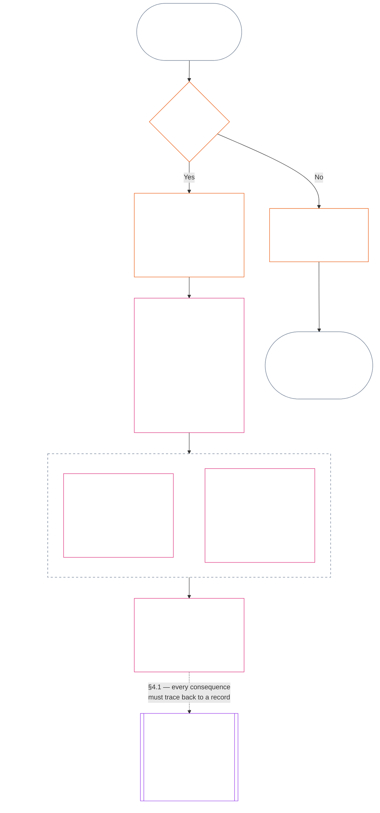
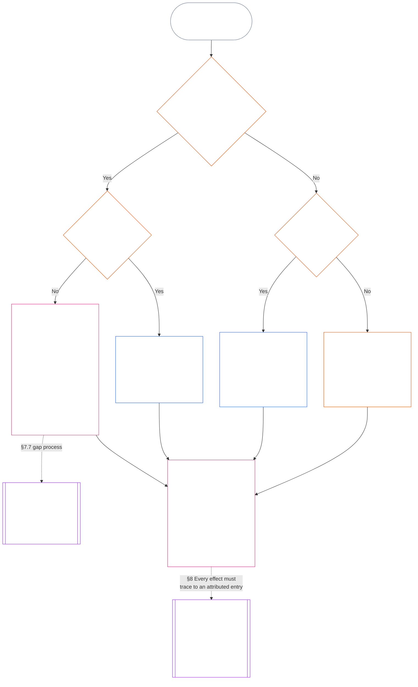

# CHAPTER FOURTEEN: STANDING RECORDS — QUESTION 1, WHAT HAPPENED

<strong>Corpus placement (non-operative): file structure and reading rules</strong>

> This file is **part of the Sentient Constitution** and is **binding only together** with the other numbered `core_*` files read as one text. It contains **Chapter Fourteen**: the standing pipeline's three questions and **Question 1** (*what happened?*), in **§3–§8**. **Question 2** (*how good or bad was it?*) is answered in [Chapter Fifteen](core_15.000_standing_measurement.md#chapter-fifteen-standing-measurement--question-2-how-good-or-bad-was-it). Question 3 (*what happens because of it?*) continues in [Chapter Sixteen](core_16.000_standing_integration.md#chapter-sixteen-standing-integration--question-3-what-follows), with review limited to the anti-constitutional-misconduct designation in [Chapter Twenty](core_20.000_misconduct_designation.md#chapter-twenty-anti-constitutional-misconduct-designation) for qualifying Violation Axis slot 7–9 findings. Reading order, the binding/support split, and corpus edition metadata are maintained in [README.md](README.md).

<strong>Trace</strong>

- Upstream:
  - [Constitutional Tetrad](core_00.000_preamble.md#constitutional-tetrad);
  - [Two Constitutional Aims](core_00.000_preamble.md#two-constitutional-aims);
  - [material stake](core_00.000_preamble.md#material-stake);
  - [Chapter One §6 Key Practical Process Pipelines](core_01.000_constitutional_map.md#6-key-practical-process-pipelines) (*Chapters Eight through Twenty-Two chain*).
- Upstream:
  - [Chapter Two](core_02.040_stewardship_capacity_principles.md#chapter-02-part-e-stewardship-and-the-steward-role) (2.040) (*Plain-Language Accessibility* stewardship reflected in section-level gloss);
  - [Chapter Two §16 — Stewardship in Depth](core_02.040_stewardship_capacity_principles.md#16-stewardship-in-depth) (2.040 §16) (*principle-layer foundation for competence-linked, traceable standing — trust, roles, and recognition*);
  - [Subcores 3-A to 3-C](subcore_03.010_definition_structure.md) (*integrity, records, and verification*);
  - [Chapter Three](core_03.000_definitions_home.md#chapter-three-foundational-definitions) (3.000) (*definitions and supremacy read with Subcores 3-A to 3-C*).
- Upstream: [Chapter Eight](core_08.000_system_alignment_certification_evaluation.md#chapter-eight-system-alignment-certification--evaluation) (8.000) (*system alignment certification*); [Chapter Ten §6](core_10.000_system_alignment_certification_records_recertification.md#6-relationship-to-standing) (10.000 §6) (*standing bridge — potential verified inputs only*).
- Standing pipeline:
  - [Chapter One §6.2 How the Full Chain Fits Together](core_01.000_constitutional_map.md#62-how-the-full-chain-fits-together);
  - [Chapter Fourteen — Standing Records](core_14.000_standing_assessment.md#chapter-fourteen-standing-records--question-1-what-happened) (14.000) (*three-question frame and Question 1 records*);
  - [Chapter Fifteen — Standing Measurement](core_15.000_standing_measurement.md#chapter-fifteen-standing-measurement--question-2-how-good-or-bad-was-it) (15.000) (*Question 2 measurement*);
  - [Chapter Sixteen — Standing Effects and Integration](core_16.000_standing_integration.md#chapter-sixteen-standing-integration--question-3-what-follows) (16.000) (*Question 3 effects and integration*);
  - [Chapter Twenty](core_20.000_misconduct_designation.md#chapter-twenty-anti-constitutional-misconduct-designation) (20.000) (*designation only for qualifying Violation Axis slot 7–9*).
- Subsections in this file:
  - [§3](#3-the-three-questions) (*three-question frame and scope*);
  - [§4](#4-question-1--what-happened) (*Question 1 — verified facts and records*);
  - [§5](#5-question-1-event-type-guide--what-kind-of-help-or-harm-occurred) (*Question 1 event-type guide — kinds of help and harm*);
  - [§6](#6-verification-and-record-requirements) (*verification and record requirements*);
  - [§7](#7-record-custody-and-opening-authority) (*record custody and opening authority*);
  - [§8](#8-handling-a-standing-record) (*handling a Standing Record*);
- Downstream:
  - [Chapter Fifteen](core_15.000_standing_measurement.md#chapter-fifteen-standing-measurement--question-2-how-good-or-bad-was-it) (15.000) (*Question 2 — LEQU baseline, measurement dimensions, route descriptors, slot grammar, constitutional inputs, the LEQU scale, standard contribution measures, illustrations, and the hand-off to Question 3*);
  - [Chapter Twenty](core_20.000_misconduct_designation.md#chapter-twenty-anti-constitutional-misconduct-designation) (20.000) (*designation only — does not reopen Question 2 measurement*);
  - [Chapter Twenty-Two](core_22.000_forum.md#chapter-twenty-two-standards-routing-and-forum-cases) (22.000) (*forum supervision and routing*);
  - [Article XXVII-C](core_04.040_rights_part_e.md#article-xxvii-c-timely-resolution-and-anti-delay-floor) (*timely resolution*);
  - [Article XXI-A](core_04.030_rights_part_d.md#article-xxi-a-justice-objective-and-scope) (*justice constraints*).
- Read with: [Chapter Three *Standing State, Contribution, and Violation*](subcore_03.070_band_accountability.md#defa3-standing-state-contribution-and-violation) (S3-J) (*canonical definition routing*).
- Read with: [README.md](README.md) (*reading order*); [doc_architecture.md](doc_architecture.md) (*non-binding editorial maps unless adopted*).
- Worked examples (they add no rule): [CJS-14.105 Application vignettes](corpus_joint_structure/cjs_14.105_application_vignettes.md#cjs-14105-application-vignettes): every full vignette opens at Question 1, for example [CJS-14.105 §1 Child Neglect / Care-Duty Failure (Tier A)](corpus_joint_structure/cjs_14.105_application_vignettes.md#cjs-14105-1-child-neglect--care-duty-failure-tier-a), [CJS-14.105 §7 An Ordinary Year with No Filing and No Sensitive Role](corpus_joint_structure/cjs_14.105_application_vignettes.md#cjs-14105-7-an-ordinary-year-with-no-filing-and-no-sensitive-role), and [CJS-14.105 §9 Watershed Steward Negligence with Concealed Test Results (Violation Measurement)](corpus_joint_structure/cjs_14.105_application_vignettes.md#cjs-14105-9-watershed-steward-negligence-with-concealed-test-results-violation-measurement).

 

Chapter Fourteen is the constitutional owner of **the verified factual record (Question 1)**.

### 1. Purpose, Role, and Scope

*In plain terms: standing is worked out by answering three questions in order. This chapter sets out the three questions and answers the first: what happened? It writes down what happened and holds the Standing Record. Allegations, popularity, and dispute narratives are not answers to that question, and filing a case is not standing by itself. How good or how harmful it was is measured in Chapter Fifteen, on two separate tracks, never one net score. Do not infer facts from a desired rating, and do not choose a rating to justify a desired consequence.*

**Purpose:** Chapter Fourteen opens the standing pipeline. It states the three questions (**section 3**) and answers Question 1: it establishes a bounded, contestable account of what happened, identifying the subject, the event or pattern, the time period, the verified facts, and the Standing Record's status before any rating or consequence is considered (**section 4**). Verified help and verified violations use separate Standing Records, so one cannot erase the other.

**Role:** The chapter produces the verified Standing Record that the rest of the pipeline takes as fixed:

- [Chapter Fifteen](core_15.000_standing_measurement.md#chapter-fifteen-standing-measurement--question-2-how-good-or-bad-was-it) measures it (Question 2), and Chapter Sixteen decides what follows (Question 3), with review limited to the anti-constitutional-misconduct designation in [Chapter Twenty](core_20.000_misconduct_designation.md#chapter-twenty-anti-constitutional-misconduct-designation) for qualifying Violation Axis slot 7 to 9 findings.
- Certification outcomes reach it only as verified inputs, through the gate in **Chapter Ten section 6** and **Chapter Thirteen section 6**.
- [Chapter Six](core_06.000_functional_independence_separation_of_duties.md#chapter-six-functional-independence-and-separation-of-duties)'s four-seat rule is applied to Standing Records in **section 7**.

**Chapter scope:** The chapter runs from [§3 The Three Questions](#3-the-three-questions) through [§8 Handling a Standing Record](#8-handling-a-standing-record). It covers:

- the three questions (**section 3**);
- Question 1 (**section 4**);
- the event-type guide (**section 5**);
- verification and record requirements (**section 6**);
- record custody and opening authority (**section 7**); and
- handling a Standing Record (**section 8**).

Chapter scope for the standing frame itself, including what it does not measure, is stated in **section 3.1**. The chapter leaves:

- how good or bad a verified fact was (Question 2) to [Chapter Fifteen](core_15.000_standing_measurement.md#chapter-fifteen-standing-measurement--question-2-how-good-or-bad-was-it);
- what follows to [Chapters Sixteen through Nineteen](core_16.000_standing_integration.md#chapter-sixteen-standing-integration--question-3-what-follows); and
- forum supervision of Standing Records to [Chapter Twenty-Two](core_22.000_forum.md#chapter-twenty-two-standards-routing-and-forum-cases) (**section 4.7**, *Forum Boundary*).

### 2. Why Standing Records Exist

*In plain terms: before anyone is credited or held to account, the facts must be settled and written down. This chapter exists so that standing rests on what happened, not on rumour, popularity, or a desired result.*

A society that credits help and answers harm needs a fair way to establish what actually happened. Without one, recognition goes to the popular and blame to the unpopular, and an allegation does the work of a verified violation finding. This chapter opens the standing pipeline by asking only what happened, on verified facts, and keeps help and harm on separate Standing Records (a contribution Standing Record and a violation Standing Record) so one can never erase the other. Rating and consequences come later, in other chapters.

**Grounded in:**

- Preamble:
  - [Constitutional Tetrad](core_00.000_preamble.md#constitutional-tetrad): the legs this chapter carries:
    - [Accountability](subcore_03.040_apex_accountability_leg.md#accountability): standing rests on settled facts, so credit and blame land on the right party;
    - [Oversight](subcore_03.055_apex_oversight_leg.md#oversight): the facts are verified and written down before anyone relies on them;
  - [Two Constitutional Aims](core_00.000_preamble.md#two-constitutional-aims): both aims, which this chapter serves:
    - [Flourishing](core_00.000_preamble.md#flourishing): no sentient is judged by rumour or popularity;
    - [Continuity](core_00.000_preamble.md#continuity): reliable records keep the standing system trustworthy over time;
- Chapter Two principles:
  - [§3.2 Recognition, Reinforcement, and Aspiration](core_02.000_values_principles.md#32-recognition-reinforcement-and-aspiration);
  - [§5 Truth (Epistemic Integrity Constraint)](core_02.000_values_principles.md#5-truth-epistemic-integrity-constraint);
  - [§6.1 Correction and Remedy](core_02.000_values_principles.md#61-correction-and-remedy);
  - [§13.1 Core Tradeoff Principles](core_02.020_interaction_interpretation.md#131-core-tradeoff-principles);
- Chapter Four Articles:
  - [Article XX](core_04.030_rights_part_d.md#article-xx-standing-and-participation-status) (*Standing and Participation Status*);
  - [Article XX-A](core_04.030_rights_part_d.md#article-xx-a-standing-distinction) (*Standing Distinction*);
  - [Article XXI-A](core_04.030_rights_part_d.md#article-xxi-a-justice-objective-and-scope) (*Justice Objective and Scope*);
  - [Article XXVII-C](core_04.040_rights_part_e.md#article-xxvii-c-timely-resolution-and-anti-delay-floor) (*Timely Resolution and Anti-Delay Floor*).

### 3. The Three Questions

*In plain terms: standing is worked out by answering three questions in order. Do not infer facts from a desired rating, and do not choose a rating to justify a desired consequence.*

| Question | What the question asks | Where it is answered |
| --- | --- | --- |
| **1. What happened?** | Which facts are verified, about whom or what, during what period, and with what Standing Record and challenge status? | [Section 4](#4-question-1--what-happened) and [Section 5](#5-question-1-event-type-guide--what-kind-of-help-or-harm-occurred) |
| **2. How good or bad was it?** | What kind and magnitude of contribution or violation do those facts establish? | [Chapter Fifteen Section 3](core_15.000_standing_measurement.md#3-question-2--how-good-or-bad-was-it) |
| **3. What happens because of it?** | What recognition, readiness, remedy, safeguard, restriction, or other consequence follows? | [Chapter Sixteen](core_16.000_standing_integration.md#chapter-sixteen-standing-integration--question-3-what-follows) |

Each question depends on the answer before it:

- Question 1 supplies the verified facts for Question 2.
- Question 2 measures those facts for Question 3.
- Question 3 must not rewrite the facts or rating to fit a preferred result.

Together, the answers to all three questions form the complete standing assessment for one bounded event or one defined pattern. A subject may have several such assessments over time, and none is a net score or an overall rating of the subject. The contribution and violation Standing Records preserve the answers to Questions 1 and 2; the Question 3 decision states what follows from them.

#### 3.1 Purpose and Scope

This chapter states the constitutional record frame, and [Chapter Fifteen](core_15.000_standing_measurement.md#chapter-fifteen-standing-measurement--question-2-how-good-or-bad-was-it) the measurement frame, for **systems**, **sentients**, and **institutions**, including every system classified under [**CS-8.305**](corpus_systems/cs_08.305_system_classification_machinery.md#cs-8305-system-classification-machinery) (*System classification machinery*). These frames do not measure gossip, popularity, vague reputation, inherent dignity, or general worth; none is a permissible subject of standing assessment.

The standing pipeline must remain effective when:

- previously verified contributions become too old to show current competence or reliability;
- violations remain unresolved;
- repair is costly;
- responsibility crosses borders; or
- an actor uses organizational layering or relabeling to impede accountability.

These belong in adopted implementation text:

- day-to-day procedures;
- escalation steps;
- restitution and repair operations;
- restorative-accountability measures; and
- incentive design.

Chapter Fifteen measurement does **not**, by itself, authorize force, detention, or another liberty restriction. Any such consequence must independently satisfy Chapter Four, **Article XXI** (*Justice After Verified Violation*), including its proportionality, least-restrictive, time-bounded, restitution, and restorative-accountability requirements.

<strong>Trace · Definitions (O · M · A · C)</strong>

- Upstream: [Chapter Two §16 — Stewardship in Depth](core_02.040_stewardship_capacity_principles.md#16-stewardship-in-depth); [Subcores 3-A to 3-C](subcore_03.010_definition_structure.md); [Chapter Three](core_03.000_definitions_home.md#chapter-three-foundational-definitions).
- Downstream: [§4](#4-question-1--what-happened) (*Question 1*); [§6](#6-verification-and-record-requirements) (*verification and record requirements*); [§7](#7-record-custody-and-opening-authority) (*record custody and opening authority*); [§8](#8-handling-a-standing-record) (*handling a Standing Record*); [Chapter Fifteen §3](core_15.000_standing_measurement.md#3-question-2--how-good-or-bad-was-it) (*Question 2 measurement*); [Chapter Fifteen §4](core_15.000_standing_measurement.md#4-magnitude-and-severity-input-dimensions) (*measurement input dimensions*); [Chapter Fifteen §5](core_15.000_standing_measurement.md#5-route-descriptor-catalogs-and-measurement-roles) (*route descriptor catalogs*); [Chapter Fifteen §6](core_15.000_standing_measurement.md#6-slot-grammar-and-shared-scaling) (*slot grammar and shared scaling*); [Chapter Fifteen §7](core_15.000_standing_measurement.md#7-constitutional-inputs-to-axis-assignment) (*constitutional-source routing*); [Chapter Fifteen §8](core_15.000_standing_measurement.md#8-unified-proportional-lequ-scale--contribution-and-violation-axes) (*unified proportional LEQU scale for both axes*); [Chapter Sixteen](core_16.000_standing_integration.md#chapter-sixteen-standing-integration--question-3-what-follows) (*Question 3*).
- [Materiality](subcore_03.085_band_oversight.md#materiality) · [O](subcore_03.085_band_oversight.md#materiality) · [M](subcore_03.085_band_oversight.md#materiality-determination-a) · [A](subcore_03.085_band_oversight.md#materiality-determination-a) · [C](subcore_03.085_band_oversight.md#materiality-determination-c)
- [Harm](subcore_03.070_band_accountability.md#harm) · [O](subcore_03.070_band_accountability.md#harm) · [M](subcore_03.070_band_accountability.md#harm-a) · [A](subcore_03.070_band_accountability.md#harm-a) · [C](subcore_03.070_band_accountability.md#harm-c)
- [Proportionality](subcore_03.070_band_accountability.md#proportionality) · [O](subcore_03.070_band_accountability.md#proportionality) · [M](subcore_03.070_band_accountability.md#proportionality-a) · [A](subcore_03.070_band_accountability.md#proportionality-a) · [C](subcore_03.070_band_accountability.md#proportionality-c)

### 4. Question 1 — What Happened?

<strong>Trace</strong>

- Upstream: [§3](#3-the-three-questions) (*three-question frame*); [Subcores 3-A to 3-C](subcore_03.010_definition_structure.md) (*record, verification, and traceability of definitions to results*).
- Tetrad leg(s): **participation**; **oversight** (contestability and challenge paths). Primary aim(s): **Flourishing** and **Continuity** (traceable records that preserve separate contribution and violation findings for later measurement).
- Downstream:
  - [§4.2](#42-silence-is-the-default) (*silence is the default*);
  - [§4.3](#43-protected-dissent-is-not-a-trigger) (*protected dissent is not a trigger*);
  - [§4.4](#44-linked-standing-records-and-no-offset-bridge) (*linked-record no-offset bridge*);
  - [§4.5](#45-verified-input-gate) (*verified-input gate*);
  - [§4.6](#46-stage-boundary) (*stage boundary*);
  - [§4.7](#47-forum-boundary) (*forum boundary*);
  - [§5](#5-question-1-event-type-guide--what-kind-of-help-or-harm-occurred) (*event-type guide*);
  - [§6](#6-verification-and-record-requirements) (*record requirements*);
  - [§7](#7-record-custody-and-opening-authority) (*record custody and opening authority*);
  - [§8](#8-handling-a-standing-record) (*handling a Standing Record*);
  - [Chapter Fifteen §3](core_15.000_standing_measurement.md#3-question-2--how-good-or-bad-was-it) (*Question 2 measurement*);
  - [Chapter Fifteen §4](core_15.000_standing_measurement.md#4-magnitude-and-severity-input-dimensions) (*measurement input dimensions*);
  - [Chapter Fifteen §5](core_15.000_standing_measurement.md#5-route-descriptor-catalogs-and-measurement-roles) (*route descriptor catalogs*);
  - [Chapter Fifteen §6](core_15.000_standing_measurement.md#6-slot-grammar-and-shared-scaling) (*slot grammar and shared scaling*);
  - [Chapter Fifteen §7](core_15.000_standing_measurement.md#7-constitutional-inputs-to-axis-assignment) (*constitutional-source routing*);
  - [Chapter Fifteen §8](core_15.000_standing_measurement.md#8-unified-proportional-lequ-scale--contribution-and-violation-axes) (*unified proportional LEQU scale for both axes*);
  - [Chapter Sixteen](core_16.000_standing_integration.md#chapter-sixteen-standing-integration--question-3-what-follows) (16.000) (*Question 3*).

 

*In plain terms: Question 1 establishes a bounded, contestable account of what happened. It identifies the subject, event or pattern, time period, verified facts, and record status before any rating or consequence is considered. Verified help and verified violations use separate Standing Records so one cannot erase the other. These Standing Records are not popularity scores or vague labels.*

A **Standing Record** is the bounded record used by this chapter for a particular subject, functional scope, record span, review status, and decision context. Before measurement begins, it must establish:

- who or what the Standing Record concerns;
- whether it concerns a bounded event or a defined pattern;
- when and where the relevant conduct and effects occurred;
- which facts are verified and which remain disputed;
- what evidence, attribution, and challenge path support those findings; and
- the Standing Record's current review, correction, and supersession status.

The chart follows an event to see whether it triggers a Standing Record and what a Standing Record then holds; the subsections that follow state each rule. The branch for "no" leaves the main path to the right.

#### 4.1 Standing Records: Kinds and Subjects

Question 1 uses a **contribution Standing Record** for verified help and a **violation Standing Record** for verified harm, including accountability failures. One Standing Record does not combine both kinds of finding.

- A Standing Record may concern a sentient, institution, system, assessment, bounded event, role, collective, actor-specific record, or other constitutionally relevant unit.
  - It must not collapse distinct subjects, roles, systems, communities, record spans, review statuses, or decision contexts into one undifferentiated standing label.
- A Standing Record may cover a **bounded event** — one episode with a clear start and end — or a **pattern** of repeated conduct.
  - A pattern requires a defined subject, scope, and review period.
- The same subject may hold multiple Standing Records over time, including linked contribution and violation Standing Records.
  - Related Standing Records must **cross-reference** one another under **section 6.2** where they share subject, overlapping record span, bounded event, pattern, or decision context.
- A Standing Record is not a freestanding reputation score, dignity rank, permanent status, general worth label, or merged scorecard.
  - Operational requirements appear in **section 6**.

Any later standing effect belongs to Chapter Sixteen and must be traceable back to the relevant Standing Record or records without becoming part of the Standing Record itself.

#### 4.2 Silence Is the Default

Having no Standing Record is the ordinary state of a sentient, institution, or system, and it is the state most sentients will remain in.

- A Standing Record opens only when a trigger has been verified under **section 6**. A named record-opening authority must approve the entry, and a separate record custodian must make it (**section 7**). A Standing Record is never opened:
  - to establish a baseline;
  - to complete a roster; or
  - because a gated pathway gatekeeper would prefer one.
- Having no Standing Record tells you nothing. "Unrated," "unverified," and "no record on file" are not evidence of risk, low contribution, or anything else. No one may treat a missing record as a reason for closer scrutiny, a lower default, or conditional access to a gated pathway.
- No institution or system may require a Standing Record, a "no record" attestation, or consent to open one as a condition of:
  - **Article III** (*Survival and Essential Access*) essentials;
  - **Article III-C** (*Labor and Economic Floor*) protections;
  - ordinary commerce; or
  - participation as an affected party.
  Published competency bars for specific trust-sensitive gated pathways under [Chapter Seventeen §3.2 Competency Bars and Clearances](core_17.000_contribution_consequences.md#32-competency-bars-and-clearances) are the exception, and they must state why the gated pathway is trust-sensitive. Anyone the bar affects may challenge the conclusion that the gated pathway is trust-sensitive under [Subcore 17-A §4.2 Guarding against Gatekeeping](subcore_17.010_recency_competency_clearance.md#42-guarding-against-gatekeeping).
- Outside the gatekeeper check in [Chapter Nineteen §3.1 Anti-Aggregation of Gated-Pathway Effects](core_19.000_final_effect_restoration_enforcement.md#31-anti-aggregation-of-gated-pathway-effects), no one may require a subject to show, attest to, or consent to the release of an existing Standing Record or standing effect, as a condition of any role, access, or dealing.
  - The gatekeeper of a gated pathway may instead ask the record custodian whether an effect applies to that gated pathway. It gets an answer about that gated pathway alone and may not pass it on.
  - Hiring or appointing into a role that is not a gated pathway gives no right to an answer.
- When a Standing Record about a subject is opened, the subject must be told, as **section 6** requires. Notice may be delayed only if a documented [Evidence Preservation](subcore_03.085_band_oversight.md#evidence-preservation) or Safety need justifies it, and only for a limited, set period. Notice is what makes a Standing Record contestable: a subject who does not know a Standing Record exists cannot challenge or correct it.

#### 4.3 Protected Dissent Is Not a Trigger

Dissent or peaceful protest — including [protected nonviolent civil disobedience](core_04.010_rights_part_b.md#xi-d-nonviolent-civil-disobedience) — under **Article XI-D** (*Assembly, Dissent, and Peaceful Protest*) ([*Dissent and peaceful protest floor*](core_04.010_rights_part_b.md#xi-d-dissent-and-peaceful-protest)) is not a verified trigger.
- It does not open, extend, or aggravate a violation Standing Record, it is not a severity input under **section 10.2**, and repeating it does not make it a pattern.
- Separable conduct that independently violates a constitutional floor is recorded on its own terms, without aggravation for the protest's viewpoint, cause, or target.

#### 4.4 Linked Standing Records and No-Offset Bridge

<strong>Trace</strong>

- Upstream: [§4.1](#41-standing-records-kinds-and-subjects) (*separate contribution and violation records*).
- Downstream:
  - [§4.5](#45-verified-input-gate) (*verified-input gate*);
  - [§4.7](#47-forum-boundary) (*forum boundary*);
  - [§6.2](#62-related-standing-record-cross-references) (*cross-references*);
  - [Chapter Fifteen §3](core_15.000_standing_measurement.md#3-question-2--how-good-or-bad-was-it) (*Question 2 measurement*);
  - [Chapter Fifteen §4](core_15.000_standing_measurement.md#4-magnitude-and-severity-input-dimensions) (*measurement input dimensions*);
  - [Chapter Fifteen §5](core_15.000_standing_measurement.md#5-route-descriptor-catalogs-and-measurement-roles) (*route descriptor catalogs*);
  - [Chapter Fifteen §6](core_15.000_standing_measurement.md#6-slot-grammar-and-shared-scaling) (*slot grammar and shared scaling*);
  - [Chapter Fifteen §7](core_15.000_standing_measurement.md#7-constitutional-inputs-to-axis-assignment) (*constitutional-source routing*);
  - [Chapter Fifteen §8](core_15.000_standing_measurement.md#8-unified-proportional-lequ-scale--contribution-and-violation-axes) (*unified proportional LEQU scale for both axes*);
  - [Chapter Sixteen](core_16.000_standing_integration.md#chapter-sixteen-standing-integration--question-3-what-follows) (16.000) (*Question 3*).
- Read with: [Chapter Sixteen — Standing integration](core_16.000_standing_integration.md#4-automatic-integration-review-and-continuity) (16.000) (*non-waiver and linked-record integration*); [Chapter Seventeen §3.2 — Competency Bars and Clearances](core_17.000_contribution_consequences.md#32-competency-bars-and-clearances) (17.000 §3.2); [Chapter Eighteen §3.2 — Standing locks](core_18.000_violation_consequences.md#32-prevention--general-standing-locks) (18.000 §3.2).

 

**The core rule:** verified **contribution Standing Records** and verified **violation Standing Records** are kept separately under **section 4.1**. Each contribution or violation finding must rest on its own supported facts in its own Standing Record. Analysis and supporting materials must keep the two record paths separately traceable. No single entry or linked set is a net score, blended score, or tradeoff.

- **Violation Standing Records and standing locks:**
  - Under Chapter Sixteen, applicable **standing locks** drawn from violation Standing Records may limit standing, restrict role eligibility, or affect remedy access while a verified violation remains unresolved.
  - Standing locks must not wipe away verified positive contribution recorded in contribution Standing Records.
  - Unresolved verified violations are not time-discounted by mere passage of time.
  - Verified violations must not rewrite unrelated contribution Standing Records into a false negative reputation file.
- **Contribution Standing Records and competency clearances:**
  - Verified contribution may support applicable **competency clearances** against published **competency bars** and support trust-, role-, or recognition-linked eligibility where current and role-relevant.
  - Verified contribution must not offset, average down, excuse, or relabel a verified violation finding.
  - Help given after a violation may be credited as restitution under [Chapter Eighteen §3.1.2 Remedy](core_18.000_violation_consequences.md#312-remedy). The credit reduces the remedy still owed. It does not offset, average down, excuse, or relabel the violation finding.
  - Gate satisfaction does not waive any applicable standing lock.

**The only exception:** If a violation finding itself disproves a claimed contribution — for example, if evidence shows you didn't actually do what your contribution record claims — then the linked contribution Standing Record can be corrected or removed through the proper evidence and review process, with the required cross-reference under **section 6.2**. But the violation does not automatically erase unrelated help recorded in separate contribution Standing Records.

#### 4.5 Verified-Input Gate

The gate works as follows:

- Any decision that affects standing, trust, role, recognition, or eligibility for recognition may use only verified inputs from the relevant **contribution Standing Records** or **violation Standing Records**.
- Allegations, unadjudicated claims, provisional routing tags, intake-only narratives, and other dispute-phase material do not supply contribution nature or violation nature for standing by themselves.
- A verified input is a **standing finding**: a verified contribution finding (Axis I) or a verified violation finding (Axis II).
- Contribution and violation findings stay in separate Standing Records (see **section 4.1**).

#### 4.6 Stage Boundary

The stages of a Standing Record stay separate:

- Question 1 records verified facts; Question 2 measures them.
- A Standing Record may open once its verified factual basis is complete even if Question 2 measurement is still pending.
- Until measurement occurs, the Question 2 fields must say that they are pending rather than imply a slot or category.
- The Standing Record must not state or apply a Question 3 **standing effect**.

#### 4.7 Forum Boundary

*In plain terms: forums are where disputes get supervised, challenged, and turned into verified outcomes — but filing a case or winning a narrative fight does not update standing. The verified-input gate in **section 4.5** still applies. When a forum verifies the facts under Subcores 3-A to 3-C, it may **open, update, or correct** a Standing Record — or **set a bad record aside on challenge**. Forums do not merge good and bad into one score or invent the standing category by themselves.*

This section owns one question: how a forum's work reaches a Standing Record. The other steps in the chain belong to the owners named here, and the chain runs in this order:

1. A dispute is filed and the forum keeps a **forum case record**, which is not a Standing Record. Owner: [Chapter Twenty-Two §5 Forum Cases: Intakes, Seats, Records, and Contests](core_22.000_forum.md#5-forum-cases-intakes-seats-records-and-contests); see also [§4.7.1 Forum Case Record](#471-forum-case-record).
2. The forum verifies the facts under [Subcores 3-A to 3-C](subcore_03.010_definition_structure.md).
3. Verified findings pass the verified-input gate. Owner: [§4.5 Verified-Input Gate](#45-verified-input-gate).
4. A named record-opening authority, which can be a forum, opens, updates, or corrects the Standing Record, or sets a bad record aside on challenge. Owners: [§6.1 Minimum Record Contents](#61-minimum-record-contents) for what the Standing Record holds and [§7 Record Custody and Opening Authority](#7-record-custody-and-opening-authority) for who may act.
5. The Standing Record holds verified facts only, and Question 2 measures them afterward. Owners: [§4.6 Stage Boundary](#46-stage-boundary) and [Chapter Fifteen §3 Question 2 — How Good or Bad Was It?](core_15.000_standing_measurement.md#3-question-2--how-good-or-bad-was-it).
6. A standing effect, if any, follows under [Chapter Sixteen](core_16.000_standing_integration.md#chapter-sixteen-standing-integration--question-3-what-follows), which owns standing effects.

Forum families under [Chapter Twenty-Two](core_22.000_forum.md#chapter-twenty-two-standards-routing-and-forum-cases) **supervise** how concrete disputes traverse the standing pipeline. Forums supply the following under [Chapter Twenty-Three §5 Timely Resolution, Materiality Tiers, and Anti-Delay Discipline](core_23.000_forum_families_escalation_timeliness_support.md#5-timely-resolution-materiality-tiers-and-anti-delay-discipline) and [Article XXVII-C](core_04.040_rights_part_e.md#article-xxvii-c-timely-resolution-and-anti-delay-floor) (*Timely Resolution and Anti-Delay Floor*):

- accessible challenge;
- independent review;
- forensic support;
- remediation sequencing; and
- tier windows.

When those forum findings satisfy the verified-input gate under Subcores 3-A to 3-C, they may:

- **open, update, or correct** Standing Records under **section 6.1**; or
- **set a bad record aside on challenge**.

##### 4.7.1 Forum Case Record

The forum's own file on an open dispute is the [**forum case record**](subcore_03.070_band_accountability.md#forum-case-record), defined in [Chapter Twenty-Two §5 Forum Cases: Intakes, Seats, Records, and Contests](core_22.000_forum.md#5-forum-cases-intakes-seats-records-and-contests). It is **not** a Standing Record.

##### 4.7.2 Forum Findings and the Question 2 Measurement

A forum's verified factual findings may supply the factual basis for a Question 1 Standing Record. They do **not** determine the Question 2 measurement of how good or bad the verified contribution or violation was ([§4.6 Stage Boundary](#46-stage-boundary)). Accordingly:

- Forum proceedings must **not** merge contribution and violation material into one net score, blended merits answer, or undifferentiated standing label; linked Standing Records remain separate under [§4.1 Standing Records: Kinds and Subjects](#41-standing-records-kinds-and-subjects) and [§4.4 Linked Standing Records and No-Offset Bridge](#44-linked-standing-records-and-no-offset-bridge).
- Forum outputs must **not** substitute dispute narratives, routing convenience, or panel preference for demonstrable verified inputs ([§4.5 Verified-Input Gate](#45-verified-input-gate)), separate measurement ([Chapter Fifteen §3 Question 2 — How Good or Bad Was It?](core_15.000_standing_measurement.md#3-question-2--how-good-or-bad-was-it)), or the standing-effect mechanics owned by [Chapter Sixteen](core_16.000_standing_integration.md#chapter-sixteen-standing-integration--question-3-what-follows).

##### 4.7.3 What the Forum Boundary Does Not Reduce

This boundary does **not** reduce challenge, remedy, interim relief, or procedural protections required under:

- [Article XIV-A](core_04.020_rights_part_c.md#article-xiv-a-reliability-and-trustworthiness-baseline) (*Reliability and Trustworthiness Baseline*);
- [Article XIV-B](core_04.020_rights_part_c.md#article-xiv-b-right-to-redress-and-remedy) (*Right to Redress and Remedy*);
- [Chapter Twenty-Three §5 Timely Resolution, Materiality Tiers, and Anti-Delay Discipline](core_23.000_forum_families_escalation_timeliness_support.md#5-timely-resolution-materiality-tiers-and-anti-delay-discipline);
- [Article XXVII-C](core_04.040_rights_part_e.md#article-xxvii-c-timely-resolution-and-anti-delay-floor) (*Timely Resolution and Anti-Delay Floor*); or
- related justice articles.

It requires that verified forum findings enter standing through the same gate as other verified inputs — not around it.

### 5. Question 1 Event-Type Guide — What Kind of Help or Harm Occurred?

*In plain terms: use these tables to describe what happened after the facts are verified. They help identify the kind of contribution or violation involved. They do not decide how good or bad it was, assign a slot, or determine what happens because of it.*

#### 5.1 Contribution Event Types

**Qualification rule:** A claimed contribution counts only when it is traceable, non-externalized, and consistent with the operative Constitution as a whole.

- Externalized harms, coercive dependencies, Rights-Floor narrowing, or concealed burdens may disqualify or limit the claimed contribution.
- A claimed contribution does not offset a separate violation finding.

Each row in the table below names a common route of verified help and its constitutional relevance. More than one row may apply to the same Standing Record.

| Type of verified contribution | What happened | Tetrad leg(s) | Primary aim(s) |
| --- | --- | --- | --- |
| Survival & bodily maintenance | Someone received food, shelter, medical care, or safety | **Participation**, **Oversight** | **Flourishing** |
| Caretaking & teaching | Children were raised, elders cared for, or others educated | **Participation**, **Oversight** | **Flourishing**, **Continuity** |
| Trauma resolution | Someone received help recovering from psychological harm that blocked wellbeing | **Participation**, **Accountability** | **Flourishing** |
| Removing severe burdens | Crushing debt, exploitative working conditions, or systemic barriers were removed | **Participation**, **Oversight** | **Flourishing** |
| Restoring agency | Someone gained meaningful choices about their own life | **Participation** | **Flourishing** |
| Expanding productive capacity | Tools, infrastructure, or opportunities enabled others to thrive independently | **Participation**, **Oversight** | **Flourishing**, **Continuity** |
| Improving time efficiency | Avoidable waiting, administrative friction, or coordination overhead was reduced, returning usable time for care, rest, agency, learning, or rights-consistent work | **Participation**, **Oversight** | **Flourishing** |
| Reducing ecological or infrastructure risk | Environmental collapse or critical-system failure was prevented | **Oversight**, **Accountability** | **Continuity**, **Flourishing** |
| Reducing ecological footprint | Resource use, emissions, or land and water demand were verifiably reduced without shifting the burden onto others or onto ecosystems | **Oversight**, **Accountability** | **Continuity**, **Flourishing** |
| Rehabilitating ecosystems | Degraded land, water, or habitat was restored toward a functioning, self-sustaining condition | **Oversight**, **Accountability** | **Continuity**, **Flourishing** |
| Protecting endangered species | Species at risk of extinction, or the habitats they depend on, were protected from loss | **Oversight**, **Accountability** | **Continuity**, **Flourishing** |
| Reducing pollution and waste | Contamination, harmful emissions, or waste were prevented, removed, or safely managed | **Oversight**, **Accountability** | **Flourishing**, **Continuity** |
| Strengthening safety, truth, auditability, or challenge capacity | Institutions or practices were built or repaired to protect rights and hold power accountable | **Participation**, **Oversight**, **Accountability** | **Flourishing**, **Continuity** |

#### 5.2 Violation Event Types

**Qualification rule:** A violation event type requires a verified violation finding that remains traceable, bounded, auditable, and contestable under **Subcores 3-A to 3-C**.

- Allegations, provisional tags, forum narratives, and intake labels may support routing or triage, but they do not complete Question 1.
- Positive contribution does not offset, excuse, undo, or relabel a verified violation.

Each row in the table below names a common route of verified loss, danger, or duty failure and its constitutional relevance. More than one row may apply to the same Standing Record.

| Type of verified loss or danger | What happened | Tetrad leg(s) | Primary aim(s) |
| --- | --- | --- | --- |
| Survival or bodily-maintenance deprivation | Avoidable death, denied care, unsafe conditions, or material survival deprivation occurred | **Accountability**, **Participation** | **Flourishing** |
| Severe avoidable burden | Crushing, imposed, or systematically shifted burdens materially impaired wellbeing or agency | **Accountability**, **Participation** | **Flourishing** |
| Coercive agency loss | Coercion, manipulation, credible threat, confinement, or liberty danger occurred | **Accountability**, **Participation** | **Flourishing** |
| Rights-Floor defeat | Non-negotiable constitutional floors, supremacy, or challenge-and-remedy access were materially violated | **Accountability**, **Oversight** | **Flourishing**, **Continuity** |
| Ecological or infrastructure damage | Conditions needed for constitutional wellbeing were damaged | **Accountability**, **Oversight** | **Continuity**, **Flourishing** |
| Pollution or waste harm | Contamination, harmful emissions, or waste harmed air, water, soil, or health | **Accountability**, **Oversight** | **Flourishing**, **Continuity** |
| Species or habitat destruction | Species at risk of extinction, or the habitats they depend on, were destroyed, fragmented, or driven toward loss, including loss treated as offsettable | **Accountability**, **Oversight** | **Continuity**, **Flourishing** |
| Loss of ecological recovery capacity | An ecosystem's ability to regenerate after harm was foreclosed or made avoidably hard or impossible to reverse | **Accountability**, **Oversight** | **Continuity**, **Flourishing** |
| Externalized ecological harm or depletion | Ecological costs were shifted onto others or onto ecosystems, resources were depleted past regeneration, or a footprint or sustainability claim hid continuing deterioration | **Accountability**, **Oversight** | **Continuity**, **Flourishing** |
| Destroyed productive capacity | Tools, capabilities, relationships, or resources needed for independent thriving were foreclosed | **Accountability** | **Flourishing** |
| Degraded Safety, Truth, or auditability | Concealment, misinformation, broken records, inaccessible challenge paths, or unreviewable aggregation occurred | **Oversight**, **Accountability** | **Flourishing**, **Continuity** |
| Obstruction of accountability | Verified interference with answerability machinery — evidence integrity, verification, forum process, Standing Records, remedy windows, or contest and redress paths — occurred; where the obstruction is a meta-attack on a distinct underlying harm, open a linked separate violation Standing Record | **Accountability**, **Oversight**, **Timeliness** | **Flourishing**, **Continuity** |
| System capture or dependency abuse | Structural enablement, dependency-asymmetry abuse, anti-evasion design, or capture of accountability pathways occurred | **Accountability**, **Participation** | **Continuity**, **Flourishing** |

### 6. Verification and Record Requirements

<strong>Trace</strong>

- Upstream: [§4](#4-question-1--what-happened) (*Question 1 records and event-type guide*); [Subcores 3-A to 3-C](subcore_03.010_definition_structure.md) (*record, verification, and traceability of definitions to results*).
- Downstream:
  - [§6.1](#61-minimum-record-contents) (*minimum contents*);
  - [§6.2](#62-related-standing-record-cross-references) (*cross-references*);
  - [§7](#7-record-custody-and-opening-authority) (*record custody and opening authority*);
  - [§8](#8-handling-a-standing-record) (*handling a Standing Record*);
  - [Chapter Fifteen §3](core_15.000_standing_measurement.md#3-question-2--how-good-or-bad-was-it) (*Question 2*).
- Read with: [CF-22.415 §10 Restricted Information Authority](corpus_forum/cf_22.415_routing_operations_transfer_certification_representative_treatment.md#cf-22415-10-restricted-information-authority) (*first stop for a dispute about a disclosure limit stated under [§6.1](#61-minimum-record-contents)*).

 

*In plain terms: This section states what each Standing Record must contain, how related Standing Records point to one another, and how records are versioned. Who may open and hold a Standing Record, and how it may be challenged or corrected, is in [§7 Record Custody and Opening Authority](#7-record-custody-and-opening-authority). Question 2 measurements may be added only after the verified factual basis is recorded.*

The evidence and record detail required may increase with the material stake and the system's class. This scaling does not exclude any covered sentient, institution, or system from the standing pipeline.

#### 6.1 Minimum Record Contents

A Standing Record carries the fields below, and the last two subsections add fields for each axis. The verified-input gate, which decides what may feed a Standing Record, is stated in [§4.5 Verified-Input Gate](#45-verified-input-gate). The rule that keeps Question 1 facts apart from Question 2 measurement is stated in [§4.6 Stage Boundary](#46-stage-boundary).

##### 6.1.1 Fields Every Standing Record Must Carry

Every Standing Record must include, at minimum:

- the Standing Record type — **contribution Standing Record** or **violation Standing Record**;
- who or what is being assessed and the scope of the assessment, including relevant system boundaries, role boundaries, affected communities, and dependency relationships;
- what conduct or finding is being assessed, including the acts, omissions, duties, impacts, bounded event, pattern within scope, contribution record, or violation finding the Standing Record relies on;
- the record span and current review status — for example, provisional, final for a stated purpose, under challenge, superseded, or due for scheduled re-evaluation;
- any related Standing Records cross-referenced as required under **section 6.2**;
- the official records, witnesses, measurements, audits, forum decisions, or other verification materials that make the Standing Record demonstrable, reviewable, and contestable under Subcores 3-A to 3-C;
- the **record-opening authority** that verified the factual basis and authorized entry, and the separate **record custodian** that entered and holds the Standing Record, each named under **section 7**;
- how to challenge the Standing Record, including:
  - which forum or authority reviews it;
  - any disclosure limits; and
  - the conditions for:
    - correction;
    - restoration;
    - expiration; or
    - scheduled review;
- the axis-specific Question 2 measurement fields required below, once measurement occurs.

##### 6.1.2 Inspectable Attributable Action

Attributable-action evidence relates to the Standing Record as follows:

- For personnel/agents exercising Critical System Stewardship or material operational authority, reconstructable attributable-action evidence is specified in **[CS-26.305 §10 inspectable attributable action](corpus_systems/cs_26.305_critical_system_stewardship.md#cs-26305-103-inspectable-attributable-action)** as the default logging contract for mixed crews.
- That evidence may feed this Standing Record.
- It does not replace this Standing Record.
- A Standing Record does not include an AI model's weights (the numbers inside the model) or its private reasoning. The one exception is when nothing else is left to show who or what was responsible.
- A matter does not get out of standing measurement just because it involves someone's privacy or a system's protected internal state. It is still measured when it is relevant to a matter of standing.

##### 6.1.3 No Privacy or Opacity Exemption

Privacy, confidentiality, or the opacity of a system's internals does not exempt a matter from standing measurement. Where these collide with the verified-record requirement, the collision is resolved under [Chapter Two §13.1 Core Tradeoff Principles](core_02.020_interaction_interpretation.md#131-core-tradeoff-principles) and its decision-record discipline, with independent-reviewer access preserved.

##### 6.1.4 Additional Fields for Contribution Standing Records

**Contribution Standing Records** must also state:

- the Question 2 contribution measurement, including:
  - the primary band;
  - slot `s` where assigned (see [Chapter Fifteen §6 Slot Grammar and Shared Scaling](core_15.000_standing_measurement.md#6-slot-grammar-and-shared-scaling));
  - evidence basis;
  - materiality reasoning; and
  - any adopted LEQU or comparable calibration used for transparent support;
- where contribution is shared, how credit was allocated, including consideration of:
  - time;
  - effort;
  - coordination;
  - maintenance;
  - causal contribution; and
  - less-visible support work;
- the contribution measurement, as recorded here, that any later Chapter Sixteen standing effect must be based on.

##### 6.1.5 Additional Fields for Violation Standing Records

**Violation Standing Records** must also state:

- the Question 2 violation measurement, including:
  - the finding authority or record basis;
  - LEQU impact;
  - slot `s` where assigned (see [Chapter Fifteen §6 Slot Grammar and Shared Scaling](core_15.000_standing_measurement.md#6-slot-grammar-and-shared-scaling));
  - process / response character where applicable; and
  - any Chapter Twenty designation status;
- where several actors share or divide responsibility for a violation, the verified reasons for any adverse standing recorded against one particular actor, including:
  - causal role;
  - duty;
  - authority;
  - control;
  - foreseeability;
  - benefit;
  - concealment; or
  - feasible prevention capacity;
- where the violation finding involves a forum disclosure omission or intentional recusal-process failure (read **§10.2.2** (*How the Way a Harm Was Caused Is Recorded*) for measurement discipline):
  - the verified basis for the omission or failure;
  - the unmet disclosure or recusal duty;
  - the actor's knowledge, recklessness, or intent where found; and
  - whether the conduct materially affected:
    - panel lawfulness;
    - independence;
    - recusal challenge;
    - evidence integrity;
    - remedy timing;
    - backup routing; or
    - practical contestability;
- the violation measurement, as recorded here, that any later Chapter Sixteen standing effect must be based on.

#### 6.2 Related Standing Record Cross-References

If a contribution Standing Record and a violation Standing Record are about the same subject, overlap in time, or deal with the same event, pattern, or decision, each must point to the other.

Each cross-reference must identify, at minimum:

- the related Standing Record, and whether it is a contribution record or a violation record;
- why the two Standing Records are linked, including where a violation finding disproves, corrects, or limits a claimed contribution under **section 4.4**;
- what the two Standing Records have in common: the subject, event, pattern, or decision; and
- how their time periods or the matters they cover overlap.

Cross-references:

- must stay auditable and open to challenge;
- must not replace separate measurement;
- must not create a merged score; and
- must not make the two Standing Records look like they cover the same matters or time periods when they do not.

#### 6.3 Collective and Actor-Specific Records

When several sentients or entities share the same benefit or violation, the system may keep both a collective Standing Record and separate actor-specific records. These rules apply:

- Contribution and violation findings must remain in separate Standing Records under **section 4.1**.
- For shared credit, recognition should follow what each sentient actually contributed:
  - role;
  - time;
  - effort;
  - risk;
  - skill;
  - coordination;
  - maintenance; and
  - causal impact.
- When many sentients helped and individual shares cannot be cleanly separated, broad distribution is favored.
- For shared violations, blame must not be assigned by group membership alone.
- Actor-specific adverse standing requires verified linkage to:
  - causal role;
  - duty;
  - authority;
  - control;
  - foreseeability;
  - benefit;
  - concealment; or
  - feasible prevention capacity.
- **Fault is also required:** Linkage alone does not open an actor-specific violation record. The violation record also requires verified fault by that actor: knowledge, intent, recklessness, or negligence as [Chapter Eighteen §4.4.1 Negligence and Neglect](core_18.000_violation_consequences.md#441-negligence-and-neglect) defines it. A causal role alone is never enough.
- **Honest error:** A mistake made without knowledge, intent, recklessness, or negligence is an honest error. It opens no actor-specific violation record and is never counted against the sentient who made it. The rule is the same for a sentient acting inside an institution or system and for a sentient acting on its own account. [Chapter Eighteen §4.4.1 Negligence and Neglect](core_18.000_violation_consequences.md#441-negligence-and-neglect) says what counts as negligence and as feasible capacity in each setting.
  - The harm is still recorded as an event. The sentient harmed is still owed remedy and correction under [Article XIV-B](core_04.020_rights_part_c.md#article-xiv-b-right-to-redress-and-remedy) (*Right to Redress and Remedy*). Neither depends on a violation record against any individual.
  - Reporting an honest error is protected reporting. It is never an adverse fact, and a sentient who reports one is not on that account treated as at fault.
- **Where an honest error points:** The error goes to root-cause analysis under [Article XXV](core_04.030_rights_part_d.md#article-xxv-root-cause-analysis-and-adaptive-response) (*Root Cause Analysis and Adaptive Response*).
  - **Inside an institution or system:** The analysis must say whether the conditions the institution or system gave made the error likely: the duty assigned, information, time, training, tools, staffing, targets and incentives, authority to stop work, and routes to escalate. Where they did, the violation record opens on the institution or system as structural enablement under [Chapter Fifteen §4.2.2 How the Way a Harm Was Caused Is Recorded](core_15.000_standing_measurement.md#422-how-the-way-a-harm-was-caused-is-recorded), in a collective record under this section. A public notice under [Chapter Nineteen §3.3 Public Notice of Violation Findings](core_19.000_final_effect_restoration_enforcement.md#33-public-notice-of-violation-findings) then names the institution or system.
  - **Those who set the conditions:** Where a sentient set or controlled those conditions with authority and control, the harm was foreseeable, and the care that sentient took fell short, that sentient's own actor-specific record follows the fault rule above.
  - **Outside an institution or system:** The analysis still names the cause. If another party owed a duty and fell short, such as a maker, owner, publisher, or provider, the same rule applies to that party. If no one did, no violation record opens.
- **Concealment and obstruction stay individual:** A sentient who finds an honest error and then hides it, or blocks its correction or remedy, is recorded for that concealment or obstruction under [Chapter Fifteen §4.2.2 How the Way a Harm Was Caused Is Recorded](core_15.000_standing_measurement.md#422-how-the-way-a-harm-was-caused-is-recorded). Any extra loss it causes is counted once. The concealment does not turn the original error into a violation by that sentient.

#### 6.4 Versioning

Standing Records must be versioned when any of the following change:

- important facts;
- findings;
- review outcomes;
- remediation status;
- contribution evidence;
- implementation calibration; or
- constitutional rules.

A later version may:

- update the Standing Record going forward;
- correct it retroactively where it was wrong;
- expire it for a completed decision context; or
- supersede it for a new decision context.

The later version must preserve the prior audit trail and explain what changed, who made the change, under what record-opening or custodial authority under **section 7**, on what verification materials, and at whose request.

#### 6.5 Implementation Tools

Teams may build practical tools for Standing Records, including:

- data fields;
- tags;
- thresholds;
- forms;
- dashboards;
- review steps; and
- published **standard contribution measures** for recurring tasks under **section 15**.

Those tools must keep the fields required by **section 6.1** separately visible and contestable. They must not bury those fields in a single opaque score or hidden label.

### 7. Record Custody and Opening Authority

<strong>Trace</strong>

- Upstream:
  - [Chapter Six §3 *Four-Seat Constitutional Requirement*](core_06.000_functional_independence_separation_of_duties.md#3-four-seat-constitutional-requirement) (6.000 §3) (*principle-layer requirement this section applies to Standing Records; may not be narrowed here*);
  - [Chapter Two §19.3 *Plural detection and review*](core_02.050_governance_incentive_application.md#193-misalignment-detection) (2.050 §19.3);
  - [§4.2](#42-silence-is-the-default) (*verified trigger; notice to the subject*);
  - [§6.1](#61-minimum-record-contents) (*minimum contents*);
  - [§6.4](#64-versioning) (*versioning*);
  - [§4.7](#47-forum-boundary) (*forums may open, update, correct, or set aside*);
  - [Subcores 3-A to 3-C](subcore_03.010_definition_structure.md) (*record, verification, and traceability*);
  - [Evidence Preservation](subcore_03.085_band_oversight.md#evidence-preservation) (*chain of custody for evidence*).
- Tetrad leg(s): **accountability** (a named actor answers for every entry); **oversight** (no party verifies its own claim). Primary aim(s): **Flourishing** and **Continuity**.
- Read with:
  - [Chapter Three *System Charter*](subcore_03.075_band_continuity.md#system-charter) (S3-K) and
  - [*Institutional Charter*](subcore_03.075_band_continuity.md#institutional-charter) (*published scope documents whose Charter Role Map names the record-opening authority and custodian for a chartered scope*);
  - [Chapter Five §6 *The Charter Role Map and Standing-Record Custody*](core_05.000_charters.md#6-the-charter-role-map-and-standing-record-custody) (5.000 §6);
  - **CI-6.205 §6** (*System and Institutional Charter Contents, Review, and Formation Template*) — the Standing-Record custody field;
  - [**Subcore 6-A §1** *Constitutional Lanes and Functional Separation*](subcore_06.010_constitutional_lanes.md#1-constitutional-lanes-and-functional-separation) (*the five lanes the record duties are placed in; separation of duties*);
  - **CI-6.205 §2** (*Functional separation lanes — published lane map, the fallback when a System Charter or Institutional Charter is silent*);
  - **CI-6.205 §3** (*authority chain and delegation controls*);
  - **CI-26.205 §6** (*Seat Catalog — Process-Role Archetypes and Operational Boundaries*) — the four record seats as seat types 1–4, with the wrong-seat rule;
  - **CF-22.435 §7** (*no self-investigation*) and
  - **CF-22.435 §9** (*Records, Referrals, and Backup Routes*) for verified-finding handoff;
  - [Subcore 22-A §6 Lead-Default Limits](subcore_22.010_forum_intake_default_venue.md#6-lead-default-limits) (S22-A §6) (*anti-self-judging backup*);
  - [CS-26.305 §10 inspectable attributable action](corpus_systems/cs_26.305_critical_system_stewardship.md#cs-26305-103-inspectable-attributable-action) (*who authorized; the log is not the Standing Record*);
  - [Chapter Two §17.5](core_02.040_stewardship_capacity_principles.md#175-duty-to-resist) (2.040 §17.5) (*halt, refuse, document, escalate*).
- Downstream: [§8](#8-handling-a-standing-record) (*what the holders do with a Standing Record once custody is settled*); [Chapter Fifteen §3](core_15.000_standing_measurement.md#3-question-2--how-good-or-bad-was-it) (*Question 2 measures only Standing Records entered under this section and §8*); [Chapter Sixteen](core_16.000_standing_integration.md#chapter-sixteen-standing-integration--question-3-what-follows) (16.000) (*Question 3 effects trace to an attributed record*).

 

*In plain terms: this section applies the four-seat rule in [Chapter Six §3 Four-Seat Constitutional Requirement](core_06.000_functional_independence_separation_of_duties.md#3-four-seat-constitutional-requirement) to Standing Records. Asking for a change, verifying the facts, writing and holding the Standing Record, and hearing a challenge are separate jobs, and the office that verifies a Standing Record never enters it or hears a contest of it ([§7.1 Separation of Duties](#71-separation-of-duties)). The System Charter or Institutional Charter names who fills each seat, through the Charter Role Map in [Chapter Five §6 The Charter Role Map and Standing-Record Custody](core_05.000_charters.md#6-the-charter-role-map-and-standing-record-custody). This section adds what is specific to Standing Records: who is excluded from a Standing Record ([§7.4 No Self-Custody](#74-no-self-custody)); how that exclusion differs for operator and stakeholder Standing Records ([§7.5 Two Kinds of Standing Record by Subject](#75-two-kinds-of-standing-record-by-subject)) and for a single conflicted custodian ([§7.6 Conflicted Custodian on a Single Standing Record](#76-conflicted-custodian-on-a-single-standing-record)); where a Standing Record goes when a seat is unnamed ([§7.7 When a System Charter or Institutional Charter Leaves a Seat Unnamed](#77-when-a-system-charter-or-institutional-charter-leaves-a-seat-unnamed)) or no System Charter or Institutional Charter applies ([§7.8 Fallback When No System Charter or Institutional Charter Reaches the Standing Record](#78-fallback-when-no-system-charter-or-institutional-charter-reaches-the-standing-record)); and how the rules scale down for informal and small-scope work ([§7.9 Informal and Small-Scope Records](#79-informal-and-small-scope-records)). [§8 Handling a Standing Record](#8-handling-a-standing-record) then says what the holders do with a Standing Record once custody is settled.*

#### 7.1 Separation of Duties

This applies [Chapter Six §3 *Four-Seat Constitutional Requirement*](core_06.000_functional_independence_separation_of_duties.md#3-four-seat-constitutional-requirement) to Standing Records. Four duties touch every Standing Record, and each is a separate seat on the same Standing Record:

| Duty | What it is | Lane under [Subcore 6-A §1.1 Required Lanes](subcore_06.010_constitutional_lanes.md#11-required-lanes) |
| --- | --- | --- |
| **Request** | asking that a Standing Record be opened, corrected, expired, or superseded, including the subject's or a claimant's own request | execution, or the requesting party, who holds the initiating seat on its own request and needs no institution to do so |
| **Verify** | establishing the factual basis under Subcores 3-A to 3-C to the **section 3.5** gate — the record-opening authority's act | assurance and audit |
| **Enter and hold** | writing the version under **section 6.4**, holding the Standing Record, publishing the challenge path — the record custodian's act | publication and evidence |
| **Contest** | hearing a challenge to the Standing Record and setting it aside, correcting it, or confirming it under **section 4.7** | challenge and review |

Merged hosting is limited as follows (see [Chapter Six §7 Proportional Scaling and Merged Hosting](core_06.000_functional_independence_separation_of_duties.md#7-proportional-scaling-and-merged-hosting)):

- **Sharing a seat:** No office holds two of these seats on the same Standing Record unless the institution has published a merged-hosting safeguard for that pairing under **CJS-3.125 §11** (*Accountability: Distributed and Proportional Authority Terms*) and **CI-6.205 §2** (*Functional Separation Lanes*) that is auditable and contestable.
- **Never merged:** No office ever both verifies and enters the same Standing Record, or both verifies and hears the contest of it.
- **The operator never verifies:** The office that runs the system a Standing Record concerns holds the execution lane for that system and therefore never verifies Standing Records about it.
- **Merging is the exception:** Merged hosting under a published safeguard is a class-scaled exception for small adopters, not the default.
- **High stakes:** Where the material stake or system class is high, the seats are separate offices.

#### 7.2 Named Record-Opening Authority

Every opening, correction, expiry, or supersession of a Standing Record is authorized by a [**record-opening authority**](subcore_03.070_band_accountability.md#record-opening-authority): a role, office, forum, or body whose authority to verify the factual basis under Subcores 3-A to 3-C and authorize the change is published before it acts.

- **Named in the System Charter or Institutional Charter:** Where the Standing Record concerns a system, institution, or business that holds a [System Charter](subcore_03.075_band_continuity.md#system-charter) or [Institutional Charter](subcore_03.075_band_continuity.md#institutional-charter), that System Charter or Institutional Charter names the record-opening authority and record custodian for Standing Records concerning its chartered scope, or points to the published document that names them ([Chapter Five §6.6 Standing-Record Custody](core_05.000_charters.md#66-standing-record-custody); **CI-6.205 §6** (*System and Institutional Charter Contents, Review, and Formation Template*)).
- **Forums:** Forums act as record-opening authorities on the terms in **section 4.7**; a forum that verified a Standing Record does not hear the contest of that Standing Record, which goes to secondary review under [Chapter Twenty-Two](core_22.000_forum.md#chapter-twenty-two-standards-routing-and-forum-cases) and **CF-22.420** (*Appeal, secondary review, and exhaustion pathways*).
- **No authority named:** Where a System Charter or Institutional Charter reaches the Standing Record but leaves a required seat unnamed, [§7.7 When a System Charter or Institutional Charter Leaves a Seat Unnamed](#77-when-a-system-charter-or-institutional-charter-leaves-a-seat-unnamed) applies. Where neither a System Charter, an Institutional Charter, nor a forum designation reaches the Standing Record, [§7.8 Fallback When No System Charter or Institutional Charter Reaches the Standing Record](#78-fallback-when-no-system-charter-or-institutional-charter-reaches-the-standing-record) applies, and the adopting document under [Chapter Twenty-Eight](core_28.000_amendment_ratification.md) or the published rules of the body that operates the standing pipeline must then name one.
- **Provisional entries:** An entry made without a named authority is marked **provisional**: it preserves evidence and notice under **section 4.2**, but it supplies no verified input under **section 6.1** and no Chapter Sixteen effect until a named authority confirms it, corrects it, or sets it aside.

#### 7.3 Record Custodian

Every Standing Record has a named [**record custodian**](subcore_03.070_band_accountability.md#record-custodian) that holds the Standing Record, controls versioning under **section 6.4**, publishes the challenge path under **section 6.1**, and answers for the Standing Record's continuity. It is a separate seat from the record-opening authority ([§7.1 Separation of Duties](#71-separation-of-duties)).

- **Custody must not lapse:** When a custodian is dissolved, conflicted, or replaced, custody transfers with the full audit trail under [Evidence Preservation](subcore_03.085_band_oversight.md#evidence-preservation) to the successor the System Charter, Institutional Charter, or backup designation names, or, where none is named, to the Backup Record Custodian (**CF-22.415 §11** (*Backup Record Custodian*)).
- **If the Backup Record Custodian cannot act:** The supervising forum under **section 4.7** holds the Standing Record or designates a holder that passes the tests in **CI-6.205 §6** (*System and Institutional Charter Contents, Review, and Formation Template*) field 10. The subject, a claimant, or a challenger may take a Standing Record to that forum at once, and a forum that holds a Standing Record or designates its holder does not hear a contest of that Standing Record.
- **One Standing Record or the whole store:** Where only one Standing Record is in conflict, only that Standing Record moves (see *Conflicted custodian on a single Standing Record* below); where the custodian itself ends or cannot continue, all the Standing Records it held move with their trail.

#### 7.4 No Self-Custody

The following may not act as record-opening authority or record custodian for a Standing Record:

- the Standing Record's subject;
- a party claiming the contribution or alleging the violation the Standing Record concerns; and
- any office in the [Material Control Line](subcore_03.070_band_accountability.md#material-control-line) that materially controls, or is materially controlled by, those parties.

Beyond that exclusion:

- **Stewards inside the subject:** A steward who is part of the Standing Record's subject (that is, works within the party, chartered scope, or system the Standing Record is about) and who exercises Critical System Stewardship or material operational authority retains every duty under [Chapter Two §17.5 Duty to Resist](core_02.040_stewardship_capacity_principles.md#175-duty-to-resist) and [CS-26.305 §10 inspectable attributable action](corpus_systems/cs_26.305_critical_system_stewardship.md#cs-26305-103-inspectable-attributable-action) — halt what they control, log the reconstructable set, preserve evidence they hold, notify, and escalate — and none of those acts is verification of the facts or entry of the Standing Record.
  - **Independent verification:** Where the ordinary record-opening authority is itself the subject or sits in that line, the Standing Record routes to independent verification: a forum under **section 4.7**, the independent investigative service under **CF-22.435 §7** (*No Self-Investigation*), or a pre-designated backup body with published authority, whichever the System Charter, Institutional Charter, or backup designation names first.
- **Defaults:** Where none is named, the Backup Record Authority (**CF-22.415 §9** (*Backup Record Authority*)) is the default record-opening authority and the Backup Record Custodian (**CF-22.415 §11** (*Backup Record Custodian*)) is the default custodian.
- **No named route:** Absence of any such named route is a gap the steward must name in the log, not a reason to enter the Standing Record themselves.
- **Two rules together:** This rule excludes parties by their interest in the Standing Record; [§7.1 Separation of Duties](#71-separation-of-duties) separates seats by function. Both apply, and the narrower answer controls.

#### 7.5 Two Kinds of Standing Record by Subject

The conflicts of interest differ with the subject, so the custody rules differ. A Standing Record whose subject is a Chartered Party, its chartered scope, or a system it stewards is an **operator Standing Record**. A Standing Record whose subject is a sentient or institution that uses, relies on, or is affected by those systems is a **stakeholder Standing Record**. A Standing Record with neither subject follows *Separation of duties* and *No self-custody* above without further rule. Both kinds follow those two rules, and the narrower answer controls. Where a Standing Record's subject includes both a Chartered Party's side and a stakeholder, the operator Standing Record rules govern it.

- **Operator Standing Record:** The conflict is standing, because the Chartered Party would be judging itself. Every office in its [Material Control Line](subcore_03.070_band_accountability.md#material-control-line) is therefore excluded from every such Standing Record, as a rule for the whole chartered scope and not record by record.
  - The Charter Role Map names the record-opening authority, the record custodian, the contest seat, and an independent route, and all of them sit outside that line ([Chapter Five §6 The Charter Role Map and Standing-Record Custody](core_05.000_charters.md#6-the-charter-role-map-and-standing-record-custody)).
  - The Chartered Party cannot choose, appoint, fund through a channel it controls, or remove them, and it cannot change those entries on its own.
  - No office inside the line may hold any of these seats, whether alone or under a merged-hosting safeguard.
- **Stakeholder Standing Record:** The conflict is the Chartered Party's interest in the Standing Record, which varies by record. The Chartered Party is often the claimant, the alleging party, or the party affected by what the Standing Record concerns, and it holds power over the subject through service, access, or payment. The exclusion is therefore decided record by record.
  - An office of the Chartered Party, or in its line, may hold a seat only if neither the Chartered Party nor any office in its line is the claimant, the alleging party, or a party with an interest the Standing Record decides. Otherwise the Standing Record routes to the lane map's offices outside the line, or to independent verification, as *No self-custody* provides.
  - The Chartered Party's own logs, complaints, and reports about the subject are inputs under *Recorder statements are inputs*, never verification.
  - The Chartered Party must not make the subject's service or access depend on the subject's cooperation with the Standing Record. The subject keeps notice under **section 4.2** and the published challenge path.

#### 7.6 Conflicted Custodian on a Single Standing Record

Sometimes the named custodian is excluded under *No self-custody* from one Standing Record, while still serving as custodian for the other Standing Records in the same chartered scope. The usual cause is that the claimant, the subject, or the challenger reports to the custodian. The exclusion covers that one Standing Record only, and lasts only as long as the conflict does. The answer is a substitute custodian for that Standing Record. The custodian does not simply step aside and leave the Standing Record waiting, and the custodian's other Standing Records do not move.

- **Excluded custodian:** The excluded custodian:
  - **Logs:** the request and the conflict on the Standing Record under *Attributed entry* below.
  - **Preserves:** the Standing Record and its evidence unchanged under [Evidence Preservation](subcore_03.085_band_oversight.md#evidence-preservation).
  - **Keeps open:** the published challenge path.
  - **Does not enter:** any new version of the Standing Record while the conflict lasts.
- **Where custody goes:** Custody of that Standing Record passes, with its full audit trail, to:
  - **Named substitute:** the substitute holder the System Charter, Institutional Charter, or lane map names for the system concerned (**CI-6.205 §6** (*System and Institutional Charter Contents, Review, and Formation Template*) field 10; the **CI-6.205 §2** (*Functional Separation Lanes*) publication-and-evidence lane outside the control line).
  - **None named:** the Backup Record Custodian (**CF-22.415 §11** (*Backup Record Custodian*)).
  - **Backup Record Custodian cannot act:** the supervising forum under **section 4.7**. The forum either holds the Standing Record itself or designates a holder that passes the tests in **CI-6.205 §6** (*System and Institutional Charter Contents, Review, and Formation Template*) field 10.
- **Naming:** Whoever takes custody, whether a named substitute, the Backup Record Custodian, or the forum, is named on the Standing Record as the substitute custodian.
- **When the conflict ends:** The interested party leaves the control line, or the Standing Record closes for its decision context. Custody may then return by a logged transfer under *Record custodian* above.
- **Entering anyway:** A custodian who keeps entering versions because they think the conflict is only a technicality commits the *No self-custody* failure. Whether a conflict is too small to matter is not the custodian's call to make.
- **Lane map defect:** If an institution's lane map puts every custodian for a system inside the reporting line of the office that runs that system, the lane map has a defect under **CI-6.205 §2** (*Functional Separation Lanes*) that the institution must correct. Until it does, the institution's Standing Records for that system go to a forum.

#### 7.7 When a System Charter or Institutional Charter Leaves a Seat Unnamed

Where a Standing Record goes when the ordinary named route is unavailable depends on three questions, which the chart below takes in order. This section covers a System Charter or Institutional Charter that leaves a seat unnamed; [§7.8 Fallback When No System Charter or Institutional Charter Reaches the Standing Record](#78-fallback-when-no-system-charter-or-institutional-charter-reaches-the-standing-record) covers the case where none reaches the Standing Record.

<strong>Reader guidance (non-operative): how to read the chart</strong>

> In plain terms: a Standing Record is handled by the offices the System Charter or Institutional Charter names. If the System Charter or Institutional Charter leaves a seat unnamed, it is invalid until the gap is fixed, and the Standing Record goes to the Backup Record Authority and Backup Record Custodian, or to a forum, not to the lane map. If no System Charter or Institutional Charter reaches the Standing Record at all, the institution's published lane map decides, and where there is none the Standing Record goes to independent verification or, for informal and small-scope work, to the body that relies on it.
>
> Every path ends at the same box: one office verifies the facts and a separate one enters and holds the Standing Record, and [§8 Handling a Standing Record](#8-handling-a-standing-record) then governs what the holders do with it. Solid arrows are the main path. Dotted arrows are hand-offs, labeled with the section that makes them. The boxes with double side bars belong to another chapter, and the last one is where effects on standing are drawn, from the Standing Record, without rewriting it. The chart adds no duty, seat, or field.

 

A System Charter or Institutional Charter that leaves a required record seat or the independent route unnamed:

- **Consequence:** The System Charter or Institutional Charter is invalid, and a change that would do so is not allowed ([Chapter Five §6.7.1 When a Gap Exists and How It Is Logged](core_05.000_charters.md#671-when-a-gap-exists-and-how-it-is-logged)).
- **Chapter Five owns the gap process:** [Chapter Five §6.7 Gaps in the Map for Operator Standing Records](core_05.000_charters.md#67-gaps-in-the-map-for-operator-standing-records) also owns:
  - how a gap is logged;
  - the response and resolution windows (including emergency substitution); and
  - when custody goes back to the named holders.

For Standing Records, this section adds:

- **Who may not act:** While a required seat is vacant and the System Charter or Institutional Charter names no valid replacement, no one may perform that seat's function, except by the route in the next bullet.
- **Where the Standing Record goes:** The Standing Record goes to the Backup Record Authority and the Backup Record Custodian, or to a forum under **section 4.7**, as [§7.4 No Self-Custody](#74-no-self-custody) provides, and the lane map does not stand in. Each Standing Record stays whole with one custodian.
- **Standing Records already held:**
  - On the day notice of the gap reaches a forum, a registrar, or the Backup Record Authority, any operator Standing Record held by an office inside the Chartered Party's Material Control Line moves to the Backup Record Custodian with its full trail.
  - Until then that office holds it read-only, enters no version, and gives the Backup Record Custodian a complete copy with its full trail at once.
  - A custodian outside the line keeps the Standing Record and, during the gap, enters each version that the Backup Record Authority or a forum authorizes. If a forum finds that the custodian is inside the line, the Standing Record moves to the Backup Record Custodian with its full trail, as for an office inside the line.
- **Stewards:** A steward who is asked to fill a seat that the System Charter or Institutional Charter does not give them:
  - **Declines the seat:** Having the access or technical ability to enter the Standing Record gives them no authority to enter it.
  - **Names the request and the gap:** They name both in the log.
  - **Sends the Standing Record on:** They send it by the route in *Where the Standing Record goes* above.
  - **Keeps their other duties:** The duties they already have under [§7.4 No Self-Custody](#74-no-self-custody) (*Stewards inside the subject*) continue: they halt what they control, log the reconstructable set, preserve the evidence they hold, notify, and escalate. None of those acts verifies the facts or enters the Standing Record. The log and the preserved evidence go with the Standing Record as inputs for the authority that verifies it; they are not an entry, and they do not decide the facts.

#### 7.8 Fallback When No System Charter or Institutional Charter Reaches the Standing Record

Where no System Charter or Institutional Charter covers the system, institution, or business the Standing Record concerns, as with a body below the Class L line that has published none, the institution's published lane map under **CI-6.205 §2** (*Functional Separation Lanes*) governs:

- **Record-opening authority:** The office the lane map places in the assurance and audit lane for the system, institution, or business the Standing Record concerns. That office verifies the factual basis and authorizes the entry ([§7.2 Named Record-Opening Authority](#72-named-record-opening-authority)); it does not enter or hold the Standing Record.
- **Custodian:** The office holding the publication and evidence lane.
- **Execution lane excluded:** Neither may be the office holding the execution lane for the system concerned.
- **No lane map either:** The Standing Record routes to independent verification under *No self-custody* above, or, for informal and small-scope records, to the relying body under *Informal and small-scope records* next.
- **Stewards:** A steward who is asked to fill a seat that the lane map does not give them follows the *Stewards* rule in [§7.7 When a System Charter or Institutional Charter Leaves a Seat Unnamed](#77-when-a-system-charter-or-institutional-charter-leaves-a-seat-unnamed): they decline the seat, name the request and the gap in the log, and keep their other duties. They send the Standing Record to the office the lane map names or, where it names none, by the route in *No lane map either* above.

#### 7.9 Informal and Small-Scope Records

Separation of duties scales with material stake, not with formality ([Chapter Six §3 Four-Seat Constitutional Requirement](core_06.000_functional_independence_separation_of_duties.md#3-four-seat-constitutional-requirement)).

- **Work covered:** Local communities run on many kinds of contribution, and much of it is unpaid and informal. This applies to unpaid, peer-organized, mutual-aid, care, maintenance, repair, teaching, and community-stewardship work, which [Chapter Seventeen §3 Contribution Consequences](core_17.000_contribution_consequences.md#3-contribution-consequences) requires to be recognized on equal standards.
  - **What it looks like locally:** Neighbors sharing food and tools (mutual aid); looking after a sick or aging neighbor (care); keeping a shared garden or creek in good shape (maintenance and community stewardship); fixing a neighbor's pipes (repair); tutoring or showing someone a skill (teaching). Each is its own kind of contribution.
- **Who fills the verify seat:** For that work, the verify seat is satisfied by **any independent body with published authority to rely on the Standing Record**, which then acts as the verifying authority.
  - **Who that usually is:** Often the body that will rely on the Standing Record: a local group such as a watershed council, an organization that funds the work or keeps it going, the **CI-4.255** (*Commons, cooperatives, mutual aid, and non-market community governance*) records-recognition authority (a body that recognizes records of community work like this), or a forum under **section 4.7**.
- **What does not count:** The verify seat is not satisfied by the formality of the verifying authority.

On such a Standing Record:

- a sentient acting alone needs no group, institution, [System Charter](subcore_03.075_band_continuity.md#system-charter), or [Institutional Charter](subcore_03.075_band_continuity.md#institutional-charter) to seek a record of their own contribution. In that case:
  - **Who asks:** They hold the initiating seat on their own request, as subject and claimant.
  - **Their own materials:** Their own account, logs, and photos are inputs and never verification.
  - **Verify seat:** Any independent body with published authority to rely on the Standing Record (the verifying authority).
  - **Entry and custody:** A separate record custodian enters and holds the Standing Record.
  - **If someone contests it:** The contest goes to the challenge lane or a forum under **section 4.7**.
  - **No relying body available:** Where no such relying body is available, the Standing Record goes to a forum under **section 4.7**.
  - **Example, a retired plumber:** A retired plumber who has repaired neighbors' pipes unpaid for years, with no group behind them, can ask a **CI-4.255** (*Commons, cooperatives, mutual aid, and non-market community governance*) records-recognition authority to open a Standing Record:
    - **Requests and claims:** The plumber.
    - **Verifies:** The authority, working from the work logs and the neighbors' attestations.
    - **Enters and holds:** A separate record custodian.
    - **If someone contests it:** The contest goes to a forum, not back to the verifying authority.
- the participants are subjects and, where they seek recognition, claimants. In a collective record under **section 6.3**:
  - **Co-participants:** Each is a claimant.
  - **A member's statement about another member's share:** It is an input, never verification.
- the materials that support the Standing Record come from two places:
  - **Non-participants:** Beneficiaries, neighbors, and other non-participants supply attestations as verification materials under **section 6.1**.
  - **The group's own log:** The sentient who kept it is the recorder and a witness under *Recorder statements are inputs* below.
- the relying body's record custodian enters and holds what a separate verifying authority has verified:
  - **Who may not hold either seat:** Neither the record custodian nor the verifying authority may be a claimant or in a claimant's [Material Control Line](subcore_03.070_band_accountability.md#material-control-line).
  - **One body, two seats:** The same relying body may host both seats under a published lane map with auditable, contestable independence safeguards.
  - **Never the same one:** No authority, custodian, or sentient may perform both duties on the same Standing Record.
- a group's own status does not condition a member's claim:
  - **Informal groups:** A group with no [System Charter](subcore_03.075_band_continuity.md#system-charter) or [Institutional Charter](subcore_03.075_band_continuity.md#institutional-charter), or one that is not an Institution at all, does not block its members.
  - **Each participant:** May seek recognition as an individual claimant for work done in the group or outside it.
  - **What the Standing Record covers:** It concerns the participant's contribution and not the group's standing.
  - **Example, a quilting circle:** A quilting circle that gives quilts to newly arrived refugees is the pattern: each quilter may seek a Standing Record, verified by an independent relying body such as the agency that receives the quilts, and the circle needs no System Charter or Institutional Charter for that.
- a violation Standing Record can arise in the same informal settings, and the seats stay separate there too:
  - **Example, a bar incident:** Someone films another sentient in a bar who becomes drunk, disorderly, and violent, though no one is physically harmed.
    - **No injury needed:** A verified credible threat of violence can support a violation Standing Record even when no one is hurt (**section 5.2**, coercive agency loss).
    - **The video is an input:** The sentient who filmed is a witness. The footage is an input and never verification by itself, and its existence opens nothing on its own (**section 4.2**).
    - **The sentient on the video:** They are the subject. They are told when a Standing Record opens, and they may not fill any seat ([§7.4 No Self-Custody](#74-no-self-custody)).
    - **Verify seat:** An independent body with published authority to rely on the Standing Record, such as a local licensing or safety body, or a forum under **section 4.7**. The sentient who filmed and the bar's owner are excluded from it if either is a claimant or in a claimant's [Material Control Line](subcore_03.070_band_accountability.md#material-control-line).
    - **Entry, custody, and contest:** A separate record custodian enters and holds the Standing Record, and a contest goes to the challenge lane or a forum under **section 4.7**, not back to the verifying body.
- a bar or process that requires verification by a formal institution an informal group cannot reach, where an independent relying body is available, is the [Chapter Seventeen §3.2 Competency Bars and Clearances](core_17.000_contribution_consequences.md#32-competency-bars-and-clearances) arbitrary-gatekeeping pattern, not separation of duties.

None of this requires a Standing Record to exist. **Section 4.2** *Silence is the default* controls: informal work is not recorded because it could be, and separation of duties binds only once a Standing Record is sought.

### 8. Handling a Standing Record

<strong>Trace</strong>

- Upstream:
  - [§7](#7-record-custody-and-opening-authority) (*who holds each seat and who is excluded*);
  - [§4.2](#42-silence-is-the-default) (*verified trigger; notice to the subject*);
  - [§6.1](#61-minimum-record-contents) (*minimum contents; review status*);
  - [§6.4](#64-versioning) (*versioning*);
  - [Evidence Preservation](subcore_03.085_band_oversight.md#evidence-preservation) (*chain of custody for evidence*).
- Tetrad leg(s): **accountability** (a named actor answers for every entry); **oversight** (no party verifies its own claim). Primary aim(s): **Flourishing** and **Continuity**.
- Read with:
  - [Subcore 3-C §7](subcore_03.030_burden_traceability_verification.md#7-compliance-evidence-standard) (S3-C §7) (*evidence standard the verify seat applies to recorder and party statements*);
  - [Good Faith](subcore_03.070_band_accountability.md#good-faith) (*candour presumption, not accuracy*);
  - [Contestability](subcore_03.070_band_accountability.md#contestability) and
  - [Article XIV-A](core_04.020_rights_part_c.md#article-xiv-a-reliability-and-trustworthiness-baseline) (*a challenge raised on the Standing Record is logged and routed before any filing*);
  - [Chapter Twenty-Two §5](core_22.000_forum.md#5-forum-cases-intakes-seats-records-and-contests) (22.000 §5) (*contests of Standing Records once they reach a forum*);
  - [Chapter Twenty-Three §5](core_23.000_forum_families_escalation_timeliness_support.md#5-timely-resolution-materiality-tiers-and-anti-delay-discipline) (23.000 §5) (*tier windows that custody may not extend*) and
  - [Article XXVII-C](core_04.040_rights_part_e.md#article-xxvii-c-timely-resolution-and-anti-delay-floor) (*Timely Resolution and Anti-Delay Floor*);
  - [Article XXII](core_04.030_rights_part_d.md#article-xxii-interoperability-portability-and-exit-integrity) (*Interoperability, Portability, and Exit Integrity*) (*what a copy of a sentient's own Standing Records may leave out*); and
  - **CF-22.465 §7.1** (*Retention Classes and Physical Backup*) (*Essential Records and where their physical backups are held*).
- Downstream: [Chapter Fifteen §3](core_15.000_standing_measurement.md#3-question-2--how-good-or-bad-was-it) (*Question 2 measures only Standing Records entered under §7 and this section*); [Chapter Sixteen](core_16.000_standing_integration.md#chapter-sixteen-standing-integration--question-3-what-follows) (16.000) (*Question 3 effects trace to an attributed record*).

 

*In plain terms: once custody is settled, five rules govern how the sentients and offices that hold a Standing Record handle it. What a prior recorder says is evidence to be weighed, not a ruling ([§8.1 Recorder Statements Are Inputs](#81-recorder-statements-are-inputs)). Every change names who made it, under what authority, and at whose request ([§8.2 Attributed Entry](#82-attributed-entry)). A challenge is logged and routed the day it arrives ([§8.3 Challenge Received on the Standing Record](#83-challenge-received-on-the-standing-record)). And a custody question is never a reason to wait, and holding a Standing Record is not owning it ([§8.4 Custody Is Not Delay, and Custody Is Not Ownership](#84-custody-is-not-delay-and-custody-is-not-ownership)). Last, the highest-slot Standing Records get physical backups in more than one region, and any sentient can ask for a certified physical copy of their own Standing Records at cost ([§8.5 Physical Backup and Certified Copies](#85-physical-backup-and-certified-copies)).*

#### 8.1 Recorder Statements Are Inputs

What a prior recorder says after the fact is weighed on these terms:

- **Prior recorder is a witness:** A later statement by the sentient or office that opened, verified, or previously held a Standing Record — supporting or refuting a claimed contribution, an alleged omission, or a contest — enters the Standing Record as verification material under **section 6.1** and passes the same verified-input gate as any other input. The prior recorder is a witness to the Standing Record, not its judge.
- **Support, refutation, agreement:** A prior recorder's support does not by itself verify a contribution; their refutation does not by itself disprove one; their agreement with the subject or with a challenger settles nothing on its own.
- **Availability:** A prior recorder's availability or unavailability neither freezes nor completes the Standing Record: where a prior recorder cannot be reached, the Standing Record says so and proceeds on the remaining verified materials.
- **Who decides the weight:** How much a recorder statement weighs is a Subcores 3-A to 3-C question for the verify seat, not a custody question.
- **Good faith and accuracy:** The verifying authority reads a recorder statement as offered in [Good Faith](subcore_03.070_band_accountability.md#good-faith) absent contrary indication, but good faith goes to candour, not to accuracy; accuracy is established by corroboration under [Subcore 3-C §7 Compliance Evidence Standard](subcore_03.030_burden_traceability_verification.md#7-compliance-evidence-standard).
- **Corroborated statements:** A statement that agrees with contemporaneous logs, prior versions, audits, or independent validation carries the weight of those materials.
- **Statements that stand alone:** A statement that stands alone is an attestation and does not by itself carry the burden. A statement from a claimant, subject, challenger, or an office in their control line is self-attestation for that purpose.
- **Statements explaining an omission:** Where the statement explains *why* the Standing Record was left as it was — as when a prior recorder says an item was omitted because it had not been verified — it is evidence of the Standing Record's state at that time and of what was unverified then; it does not decide whether the omitted fact has since been verified, which the verify seat answers on the present materials.

#### 8.2 Attributed Entry

Every change to a Standing Record leaves a trail on these terms:

- **What each change names:** Every opening, correction, retroactive correction, expiry, supersession, or custody transfer names, on the Standing Record itself:
  - **Maker:** who made the change;
  - **Source of authority:** under what published authority;
  - **Evidence:** on what verification materials; and
  - **Requester:** at whose request.
- **Requests from interested parties:** A request from an interested party — the subject, a claimant, a challenger, or an office in their control line — is handled in two steps:
  - **Logged on receipt:** it is logged as a request the moment it is received, whether or not it is acted on; and
  - **Acted on through verification only:** it is acted on only through the record-opening authority's own verification.
- **No declining to log:** Neither the custodian nor the authority may decline to log a request or a refusal to act on it.

#### 8.3 Challenge Received on the Standing Record

A challenge is handled on these terms from the moment it arrives:

- **Status, not suspension:** [*Under challenge*](subcore_03.070_band_accountability.md#under-challenge) is a status, not a suspension: the Standing Record stays inspectable, its prior versions stay in place, and reliance on the challenged version for a Chapter Sixteen effect pauses only where the contest seat or a forum so orders.
- **Log, set status, notify, route:** [Contestability](subcore_03.070_band_accountability.md#contestability) does not begin at a forum. When an affected party disputes a Standing Record, a version, or an effect claimed from it — to the custodian, to the record-opening authority, or to any office of the institution — the custodian, the moment it is received:
  - **Log:** logs the challenge on the Standing Record under *Attributed entry* above;
  - **Set status:** sets the review status under **section 6.1** to *under challenge*;
  - **Notify:** notifies the subject and any claimant; and
  - **Route:** routes it to the contest seat, whichever of these the Standing Record's published challenge path names:
    - **Challenge-and-review lane:** the office holding the challenge-and-review lane under **CI-6.205 §2** (*Functional Separation Lanes*); or
    - **Forum:** a forum with jurisdiction under **section 4.7** and [Chapter Twenty-Two §5 Forum Cases: Intakes, Seats, Records, and Contests](core_22.000_forum.md#5-forum-cases-intakes-seats-records-and-contests) (*Contests of Standing Records*).
- **Published path first:** Taking the challenge along the Standing Record's published challenge path is the ordinary first step under [Dispute sequencing](core_22.000_forum.md#dispute-sequencing); a forum with jurisdiction remains available when that path is itself disputed, missing, captured, or unable to grant the needed relief.
- **Who decides:** The custodian and the authority do not decide the challenge, whether it goes along the published path or to a forum. The contest seat decides it: the office holding the challenge-and-review lane, or the forum, as above.
- **Challenge is not a correction request:** A challenge is not a request for correction and does not freeze one: the challenger's account, like the claimant's, is an input to verification under *Recorder statements are inputs* and **section 6.1**, never verification, and no party may treat the pending challenge as a reason to enter, or to refuse to enter, a version the record-opening authority has otherwise verified.
- **Clock:** The tier windows under [Chapter Twenty-Three §5 Timely Resolution, Materiality Tiers, and Anti-Delay Discipline](core_23.000_forum_families_escalation_timeliness_support.md#5-timely-resolution-materiality-tiers-and-anti-delay-discipline) (*Timely Resolution, Materiality Tiers, and Anti-Delay Discipline*) and [Article XXVII-C](core_04.040_rights_part_e.md#article-xxvii-c-timely-resolution-and-anti-delay-floor) (*Timely Resolution and Anti-Delay Floor*) run from receipt.
- **No contest seat named:** If no contest seat (the office that hears challenges) has been named, the challenge is not dropped. The missing seat is a defect in the System Charter or Institutional Charter: field 10 of **CI-6.205 §6** (*System and Institutional Charter Contents, Review, and Formation Template*). The defect is written on the Standing Record, and the challenge goes to the supervising forum under **section 4.7**. Closing a challenge because there is nowhere to send it is obstruction under [Article XIV-A](core_04.020_rights_part_c.md#article-xiv-a-reliability-and-trustworthiness-baseline) (*Reliability and Trustworthiness Baseline*) and **section 5.2** (*Obstruction of Accountability*).

#### 8.4 Custody Is Not Delay, and Custody Is Not Ownership

Who holds a Standing Record, and any dispute over it, is handled on these terms:

- **Send it on, do not wait:** If it is unclear who should hold or act on a Standing Record, send the matter to the authority that is named, or to an independent one. Do not wait for the question to settle first.
- **No stalling:** Nobody may use any of these three things to keep the Standing Record open, keep it closed, or leave it uncorrected past the time limits (tier windows) in [Chapter Twenty-Three §5 Timely Resolution, Materiality Tiers, and Anti-Delay Discipline](core_23.000_forum_families_escalation_timeliness_support.md#5-timely-resolution-materiality-tiers-and-anti-delay-discipline) and [Article XXVII-C](core_04.040_rights_part_e.md#article-xxvii-c-timely-resolution-and-anti-delay-floor) (*Timely Resolution and Anti-Delay Floor*):
  - **A custody dispute:** a dispute over who holds the Standing Record;
  - **A missing recorder:** a prior recorder who cannot be reached; or
  - **An unnamed seat:** the record-opening authority, record custodian, or contest seat for the Standing Record has not been named, either because a System Charter or Institutional Charter leaves it unnamed ([§7.7 When a System Charter or Institutional Charter Leaves a Seat Unnamed](#77-when-a-system-charter-or-institutional-charter-leaves-a-seat-unnamed)) or because none reaches the Standing Record ([§7.8 Fallback When No System Charter or Institutional Charter Reaches the Standing Record](#78-fallback-when-no-system-charter-or-institutional-charter-reaches-the-standing-record)).
- **Holding is not owning:** Holding a Standing Record gives no power over:
  - how Question 2 measurement is calibrated;
  - the Chapter Sixteen effects on standing; or
  - the subject of the Standing Record.
- **Misuse is its own violation:** A custodian that does any of the following becomes the subject of a separate violation Standing Record under **section 5.2** (*Obstruction of Accountability*):
  - applies an effect;
  - hides the challenge path; or
  - makes entry depend on the subject's cooperation.

#### 8.5 Physical Backup and Certified Copies

A Standing Record outlasts the system that first held it, and the sentient it is about has a stake in being able to hold it.

- **High-slot Standing Records are Essential Records:** A Standing Record at slot 5 or above on the Contribution Axis or the Violation Axis ([Chapter Fifteen §6.1 Table 1 — Slot Display Labels](core_15.000_standing_measurement.md#61-table-1--slot-display-labels)) is an [Essential Record](subcore_03.070_band_accountability.md#essential-record).
  - **When:** Its record custodian arranges a physical backup of each version in which the Standing Record sits at slot 5 or above, starting with the version that first assigns the slot ([§6.4 Versioning](#64-versioning)). The system does this by rule and no one makes a separate request.
  - **Where:** The physical backups are held as Essential Record backups under **CF-22.465 §7.1** (*Retention Classes and Physical Backup*): at least three separate places in different regions, with different custodians. The record custodian does not hold them, and neither does anyone in the subject's or the record custodian's [Material Control Line](subcore_03.070_band_accountability.md#material-control-line) ([§7.4 No Self-Custody](#74-no-self-custody)).
  - **What stays the same:** The record custodian still holds the working Standing Record under [§7.3 Record Custodian](#73-record-custodian). Only the backup is held elsewhere.
- **Certified copy on request:** Any sentient may ask the record custodian for a certified physical copy of each Standing Record about them, at any slot.
  - **What it is:** A true copy of the current version on paper or other durable physical media, with its version, date, and hash, certified by the record custodian as a true copy.
  - **At cost:** The record custodian may charge no more than the actual cost of making, certifying, and delivering the copy, and nothing else. Cost may not be used to discourage or delay the request, or to make it depend on anything else.
  - **Waiver:** The record custodian waives the cost for any sentient who says they cannot pay. The sentient's statement is enough: no proof of means, no hearing, and no repayment term. The body that keeps the Standing Record bears the cost and may not recover it from the sentient.
  - **How fast:** A copy request is not a System or Institution step and states no window of its own, so the default window applies ([Chapter Two §16.6 Default Window](core_02.040_stewardship_capacity_principles.md#166-default-window)). The record custodian answers, decides any waiver, and starts the copy within the Tier C intake target, and sends the copy within the Tier C outer bound ([Chapter Twenty-Three §5 Timely Resolution, Materiality Tiers, and Anti-Delay Discipline](core_23.000_forum_families_escalation_timeliness_support.md#5-timely-resolution-materiality-tiers-and-anti-delay-discipline); [CF-22.445 §5.1 Stage Targets and Outer Bounds](corpus_forum/cf_22.445_performance_backlog_publication_accessibility.md#cf-22445-51-stage-targets-and-outer-bounds)).
  - **What it may leave out:** Other sentients' data and restricted information are withheld or redacted on the terms of [Article XXII](core_04.030_rights_part_d.md#article-xxii-interoperability-portability-and-exit-integrity) (*Interoperability, Portability, and Exit Integrity*) and **CF-22.415 §10** (*Restricted Information Authority*). The copy says where a part is withheld and on what basis, wherever that statement does not itself create material risk.
  - **Not a challenge:** A request for a copy is not a challenge, pauses nothing, and needs no stated reason.
- **Refusal is misuse:** A record custodian that refuses, stalls, or overcharges a certified-copy request misuses custody under [§8.4 Custody Is Not Delay, and Custody Is Not Ownership](#84-custody-is-not-delay-and-custody-is-not-ownership).

**Continuation.** Question 2 measurement continues in [Chapter Fifteen](core_15.000_standing_measurement.md#chapter-fifteen-standing-measurement--question-2-how-good-or-bad-was-it), beginning with [Chapter Fifteen section 3 — Question 2: how good or bad was it?](core_15.000_standing_measurement.md#3-question-2--how-good-or-bad-was-it).

---

*Worked examples (they add no rule):* [CJS-14.105 Application vignettes](corpus_joint_structure/cjs_14.105_application_vignettes.md#cjs-14105-application-vignettes): every full vignette opens at Question 1, for example [CJS-14.105 §1 Child Neglect / Care-Duty Failure (Tier A)](corpus_joint_structure/cjs_14.105_application_vignettes.md#cjs-14105-1-child-neglect--care-duty-failure-tier-a), [CJS-14.105 §7 An Ordinary Year with No Filing and No Sensitive Role](corpus_joint_structure/cjs_14.105_application_vignettes.md#cjs-14105-7-an-ordinary-year-with-no-filing-and-no-sensitive-role), and [CJS-14.105 §9 Watershed Steward Negligence with Concealed Test Results (Violation Measurement)](corpus_joint_structure/cjs_14.105_application_vignettes.md#cjs-14105-9-watershed-steward-negligence-with-concealed-test-results-violation-measurement).

**Previous file:** [core_13.000_institutional_alignment_certification_records_recertification.md](core_13.000_institutional_alignment_certification_records_recertification.md)

**Next file:** [core_15.000_standing_measurement.md](core_15.000_standing_measurement.md)
