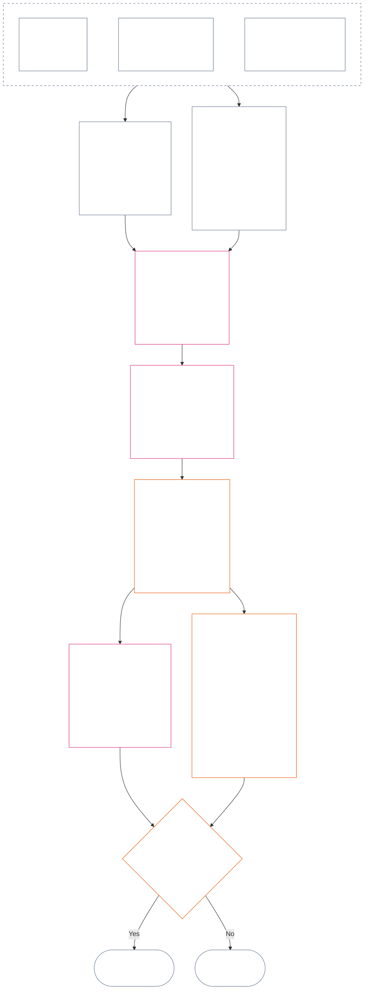

# CHAPTER FIFTEEN: STANDING MEASUREMENT — QUESTION 2, HOW GOOD OR BAD WAS IT?

<strong>Corpus placement (non-operative): file structure and reading rules</strong>

> This file is **part of the Sentient Constitution** and is **binding only together** with the other numbered `core_*` files read as one text. It contains **Chapter Fifteen** — **Question 2** (*how good or bad was it?*): the LEQU baseline and its limits, the measurement input dimensions, route descriptor catalogs, slot grammar and shared scaling, constitutional inputs to axis assignment, the unified proportional LEQU scale, standard contribution measures, worked illustrations, and the hand-off to Question 3 (**§3–§11**). The three-question frame and **Question 1** (*what happened?*) — verified facts, event types, record requirements, record custody, and handling — are in [Chapter Fourteen](core_14.000_standing_assessment.md#chapter-fourteen-standing-records--question-1-what-happened). Question 3 (*what happens because of it?*) continues in [Chapter Sixteen](core_16.000_standing_integration.md#chapter-sixteen-standing-integration--question-3-what-follows), with review limited to the anti-constitutional-misconduct designation in [Chapter Twenty](core_20.000_misconduct_designation.md#chapter-twenty-anti-constitutional-misconduct-designation) for qualifying Violation Axis slot 7–9 findings. Reading order, the binding/support split, and corpus edition metadata are maintained in [README.md](README.md).

<strong>Trace</strong>

- Upstream:
  - [Chapter Fourteen §3](core_14.000_standing_assessment.md#3-the-three-questions) (*three-question frame*);
  - [Chapter Fourteen §4](core_14.000_standing_assessment.md#4-question-1--what-happened) through [Chapter Fourteen §8](core_14.000_standing_assessment.md#8-handling-a-standing-record) (*Question 1 — verified facts, Standing Records, custody, and handling*);
  - [Chapter One §6 Key Practical Process Pipelines](core_01.000_constitutional_map.md#6-key-practical-process-pipelines) (*Chapters Eight through Twenty-Two chain*).
- Subsections in this file:
  - [§3](#3-question-2--how-good-or-bad-was-it) (*Question 2 — LEQU baseline, status bridge, limits, and scope*);
  - [§4](#4-magnitude-and-severity-input-dimensions) (*measurement input dimensions for both axes*);
  - [§5](#5-route-descriptor-catalogs-and-measurement-roles) (*route descriptor catalogs*);
  - [§6](#6-slot-grammar-and-shared-scaling) (*slot grammar and shared scaling*);
  - [§7](#7-constitutional-inputs-to-axis-assignment) (*constitutional-source routing*);
  - [§8](#8-unified-proportional-lequ-scale--contribution-and-violation-axes) (*unified proportional LEQU scale for both axes*);
  - [§9](#9-standard-contribution-measures) (*adopter-published standard contribution measures*);
  - [§10](#10-measurement-illustrations) (*worked measurement examples*);
  - [§11](#11-hand-off-to-question-3--cross-question-measurement-hooks) (*hand-off to Question 3*).
- Downstream:
  - [Chapter Sixteen](core_16.000_standing_integration.md#chapter-sixteen-standing-integration--question-3-what-follows) (16.000) (*Question 3 effects and integration*);
  - [Chapter Twenty](core_20.000_misconduct_designation.md#chapter-twenty-anti-constitutional-misconduct-designation) (20.000) (*designation only — does not reopen Question 2 measurement*).
- Read with: [Chapter Three *Standing State, Contribution, and Violation*](subcore_03.070_band_accountability.md#defa3-standing-state-contribution-and-violation) (S3-J) (*canonical definition routing*).
- Worked examples (they add no rule), within the [CJS-14.105 Application vignettes](corpus_joint_structure/cjs_14.105_application_vignettes.md#cjs-14105-application-vignettes) (see [§10 Measurement Illustrations](#10-measurement-illustrations)):
  - [CJS-14.105 §8 Riparian Cooperative Restoration (Contribution Measurement)](corpus_joint_structure/cjs_14.105_application_vignettes.md#cjs-14105-8-riparian-cooperative-restoration-contribution-measurement) measures a verified contribution; and
  - [CJS-14.105 §9 Watershed Steward Negligence with Concealed Test Results (Violation Measurement)](corpus_joint_structure/cjs_14.105_application_vignettes.md#cjs-14105-9-watershed-steward-negligence-with-concealed-test-results-violation-measurement) measures a verified violation.

 

Chapter Fifteen is the constitutional owner of **Question 2**, which measures the facts [Chapter Fourteen](core_14.000_standing_assessment.md#chapter-fourteen-standing-records--question-1-what-happened) verified.

### 1. Purpose, Role, and Scope

*In plain terms: Chapter Fourteen settles what happened and who holds the Standing Record. Question 2 measures those verified facts. It asks how good the contribution was or how bad the violation was. The Contribution Axis and the Violation Axis stay separate; they are not two sides of a net score. What follows from the measurement is Chapter Sixteen.*

**Purpose:** Chapter Fifteen answers Question 2: how good a verified contribution was, or how bad a verified violation was. It measures each on its own axis, on one common scale, the LEQU scale. For each applicable axis it writes a slot from 1 to 9, the route descriptors that apply, the inputs handed to Question 3, and one LEQU total (**section 4.1**).

**Role:** The chapter sits in the middle of the standing pipeline:

- It takes the facts already verified under **Chapter Fourteen section 4** and written into the Standing Record under **Chapter Fourteen section 6** as fixed.
- It hands the slot and descriptors to Chapter Sixteen, starting at **section 5** (*Descriptor Integration and Attachment Normalization*).
- Chapter Fifteen alone assigns the numeric slot. [Chapter Twenty](core_20.000_misconduct_designation.md#chapter-twenty-anti-constitutional-misconduct-designation) adds an anti-constitutional-misconduct designation to a qualifying slot and does not move it.
- The common scale compares magnitude, not moral worth, and never lets help cancel harm.

**Chapter scope:** The chapter begins at [§3 Question 2 — How Good or Bad Was It?](#3-question-2--how-good-or-bad-was-it). It covers:

- Question 2, with the LEQU baseline and its limits (**section 3**), and its chapter scope and routing to the harm side and the benefit side (**section 3.3**);
- the magnitude and severity input dimensions (**section 4**);
- the route descriptor catalogs (**section 5**);
- slot grammar and shared scaling (**section 6**);
- the constitutional inputs to axis assignment (**section 7**);
- the unified proportional LEQU scale (**section 8**);
- standard contribution measures (**section 9**);
- measurement illustrations (**section 10**); and
- the hand-off to Question 3 (**section 11**).

The chapter leaves:

- what happened, the three-question frame, and the Standing Record to [Chapter Fourteen](core_14.000_standing_assessment.md#chapter-fourteen-standing-records--question-1-what-happened);
- what follows from a measurement to [Chapters Sixteen through Nineteen](core_16.000_standing_integration.md#chapter-sixteen-standing-integration--question-3-what-follows); and
- the anti-constitutional-misconduct designation to Chapter Twenty.

### 2. Why Standing Measurement Exists

*In plain terms: once the facts are settled, how good or how harmful they were has to be measured the same way for everyone. This chapter exists so like cases get like measures.*

Without a shared scale, the same harm could be called minor in one place and grave in another, and the same help ignored or celebrated depending on who gave it. This chapter measures verified contribution and verified violation on separate axes of one common scale, never netted into a single score. That keeps measurement consistent and stops a sentient's good work from being used to excuse harm, or their past harm from erasing their good work.

**Grounded in:**

- Preamble:
  - [Constitutional Tetrad](core_00.000_preamble.md#constitutional-tetrad): the legs this chapter carries:
    - [Accountability](subcore_03.040_apex_accountability_leg.md#accountability): help and harm are measured the same way for everyone;
    - [Oversight](subcore_03.055_apex_oversight_leg.md#oversight): a shared scale lets anyone see whether a measure was applied fairly;
  - [Two Constitutional Aims](core_00.000_preamble.md#two-constitutional-aims): both aims, which this chapter serves:
    - [Flourishing](core_00.000_preamble.md#flourishing): like cases get like measures, which is a basis of fair treatment;
    - [Continuity](core_00.000_preamble.md#continuity): a stable scale keeps measures comparable from year to year;
- Chapter Two principles:
  - [§3.2 Recognition, Reinforcement, and Aspiration](core_02.000_values_principles.md#32-recognition-reinforcement-and-aspiration);
  - [§4 Safety (Harm Constraint)](core_02.000_values_principles.md#4-safety-harm-constraint);
  - [§13.1 Core Tradeoff Principles](core_02.020_interaction_interpretation.md#131-core-tradeoff-principles);
  - [§19.2 Convenient Proxies and Proxy Divergence](core_02.050_governance_incentive_application.md#192-convenient-proxies-and-proxy-divergence);
- Chapter Four Articles:
  - [Article XX-A](core_04.030_rights_part_d.md#article-xx-a-standing-distinction) (*Standing Distinction*);
  - [Article XXI](core_04.030_rights_part_d.md#article-xxi-justice-after-verified-violation) (*Justice After Verified Violation*);
  - [Article XXV](core_04.030_rights_part_d.md#article-xxv-root-cause-analysis-and-adaptive-response) (*Root Cause Analysis and Adaptive Response*).

### 3. Question 2 — How Good or Bad Was It?

<strong>Trace</strong>

- Upstream:
  - [Chapter Fourteen §4](core_14.000_standing_assessment.md#4-question-1--what-happened) (*Question 1 — Standing Records and verified facts*);
  - [Chapter Fourteen §4.5](core_14.000_standing_assessment.md#45-verified-input-gate) (*verified-input gate*);
  - [Chapter Fourteen §6](core_14.000_standing_assessment.md#6-verification-and-record-requirements) (*record requirements*);
  - [Chapter Fourteen §3](core_14.000_standing_assessment.md#3-the-three-questions) (*three-question frame*).
- Downstream:
  - [§4](#4-magnitude-and-severity-input-dimensions) (*measurement input dimensions for both axes*);
  - [§5](#5-route-descriptor-catalogs-and-measurement-roles) (*route descriptor catalogs*);
  - [§6](#6-slot-grammar-and-shared-scaling) (*slot grammar and shared scaling*);
  - [§7](#7-constitutional-inputs-to-axis-assignment) (*constitutional-source routing*);
  - [§8](#8-unified-proportional-lequ-scale--contribution-and-violation-axes) (*Contribution and Violation Axis assignment*);
  - [§9](#9-standard-contribution-measures) (*adopter-published standard contribution measures*);
  - [§10](#10-measurement-illustrations) (*worked measurement examples*);
  - [§11](#11-hand-off-to-question-3--cross-question-measurement-hooks) (*hand-off to Question 3*);
  - [Chapter Seventeen §3.2](core_17.000_contribution_consequences.md#32-competency-bars-and-clearances) (17.000 §3.2) (*contribution Question 3 — safe delegation*);
  - [Chapter Eighteen §3.2](core_18.000_violation_consequences.md#32-prevention--general-standing-locks) (18.000 §3.2) (*prevention locks*);
  - [Chapter Eighteen §4](core_18.000_violation_consequences.md#4-lock-design-and-enforcement) (18.000 §4) (*lock design and enforcement*).
- Read with: [Chapter Fourteen §6.1](core_14.000_standing_assessment.md#61-minimum-record-contents) (*verified Standing Record fields; no standing effects in Chapter Fourteen*).

 

*In plain terms: Question 2 measures the verified facts from Question 1. It asks **how good was the contribution?** or **how bad was the violation?** This is where the chapter first introduces the two formal measurement axes: the **Contribution Axis** for verified help and the **Violation Axis** for verified harm. The axes remain separate; they are not two sides of a net score.*

To decide which slot someone's contribution or violation belongs in, this chapter measures impact using a **Lifespan Equivalent Unit (LEQU)**. One LEQU roughly equals saving or destroying one sentient's entire lifetime of wellbeing. This is not about counting bodies or dollars; it asks whether an action meaningfully changed the constitutional community's wellbeing. The same unit works for any sentient being, human or otherwise.

#### 3.1 LEQU Baseline

A **Lifespan Equivalent Unit** (**LEQU**) is the shorthand unit for that full-life-equivalent constitutional benefit or loss when adopted implementation needs a numeric calibration.

- The unit is substrate-agnostic.
- A current adopter may use an ordinary human lifespan as a calibration example for biological-human contexts, but the binding baseline is sentient and constitutional, not species-bound.

A **full-life-equivalent constitutional benefit** means verified benefit comparable to preserving, restoring, or freeing one full sentient lifespan of non-trivial, rights-consistent wellbeing. A **full-life-equivalent constitutional loss** means verified harm, waste, destruction, foreclosure, deprivation, or risk realization comparable to destroying, wrongfully consuming, or preventing one full-life-equivalent constitutional benefit.

#### 3.2 Limits on Using LEQU

The following limits apply whenever LEQU is used.

- **Not a net-score rule:** You cannot "cancel out" violations with contributions or vice versa. Each axis stands alone.
- **Not a mandatory human-life metric:** The LEQU is sentient-generic; it applies to any conscious being, not just humans.
- **Not an accusation metric:** Allegations, intake tags, routing decisions, reputation, disfavored status, or moral dislike do not supply Contribution Axis benefit or Violation Axis severity without verified inputs under **Chapter Fourteen section 4.5** and calibration under **section 8**.
- **Not a license to trade rights:** Claims framed as efficiency, productive capacity, innovation, burden reduction, security, retaliation, emergency response, or institutional necessity must be discounted or rejected where they depend on:
  - coercion;
  - discriminatory burden shifting;
  - ecological depletion;
  - hidden unpaid work;
  - avoidable opacity;
  - Rights-Floor narrowing;
  - capture;
  - misleading proxies;
  - loss of contestability; or
  - unreviewable aggregation.

#### 3.3 Question 2 Only — Scope and Routing

This part covers Question 2 only, the measuring step. It takes facts that are already verified (Question 1) and asks how good a contribution was or how bad a violation was.

- Start from the facts already verified under **Chapter Fourteen section 4** and written into the Standing Record under **Chapter Fourteen section 6**, and measure them using the dimensions in **section 4**.
- Then give each kind of help or harm its standard name from the catalogs: the **benefit-route** catalog for help (**section 5.1**) and the **harm-route** catalog for harm (**section 5.2**).
- Each name also tells you how much that kind of help or harm counts toward *how good* or *how bad*.
- The rules for what follows from a benefit are on the [benefit side](core_17.000_contribution_consequences.md#32-competency-bars-and-clearances), and the rules for what follows from a harm are on the [harm side](core_18.000_violation_consequences.md#32-prevention--general-standing-locks).
- Question 3 decides what happens next. Start with [Chapter Sixteen §5 Descriptor Integration and Attachment Normalization](core_16.000_standing_integration.md#5-descriptor-integration-and-attachment-normalization).

#### 3.4 Sentience-Status Bridge

Measuring standing does **not** decide whether an entity is a **sentient**.

- Disputes about status go to [Sentience Status Adjudication](subcore_03.090_band_participation.md#sentience-status-adjudication) and [Article VI-B](core_04.010_rights_part_b.md#article-vi-b-sentience-status-adjudication-floor) (*Sentience-Status Adjudication Floor*). They do not go to LEQU scores or classification records.
- While a status dispute is open under [Contested-Sentient Life](subcore_03.090_band_participation.md#contested-sentient-life), **Article VI-B** (*Sentience-Status Adjudication Floor*) includes the entity by default: it can still be measured and can still file a Standing Record until the dispute is decided, and operators must not treat the open dispute alone as a reason to deny it standing.
- If the entity is found to be a [Sentient](subcore_03.090_band_participation.md#sentient), or its status is narrowed or restored after adjudication in a decision that can itself be reviewed:
  - the Standing Record's subject is updated from that point on, and
  - a wrongful exclusion must not be backdated to erase the entity's eligibility to be measured in the meantime, except through [Redress and Remediation](subcore_03.070_band_accountability.md#redress-and-remediation).

### 4. Magnitude and Severity Input Dimensions

*In plain terms: this section says what Question 2 produces (**section 4.1**), then lists what to examine when measuring a verified contribution or a verified violation (**section 4.2**). Each axis is measured on its own. The shared scaling rules are in **section 6.2**, and the slot comes from the scale in **section 8**.*

The slot scale measures how big a constitutional outcome is and what kind of outcome it is. It counts only outcomes that have been verified.

**What the scale counts, and how that ties to the Constitution's core tests:**

- **[Two Constitutional Aims](core_00.000_preamble.md#two-constitutional-aims):** both axes measure effect on **Flourishing** and **Continuity**. The Contribution Axis moves them forward. The Violation Axis moves them backward.
- **[Two Fundamental Questions](core_00.000_preamble.md#two-fundamental-questions):** each axis supplies the verified facts for one question. Answering one does not answer the other, so the two axes are never netted against each other.
  - **First question:** the Contribution Axis supplies the verified facts. Does the system reward conduct that helps sentients flourish and endure, tells the truth, and repairs harm?
    - **Counts:** verified constitutional benefit, including verified risk reduction.
    - **Does not count:** raw output, prestige, wealth, how much something is used, speed, or how big the institution is.
  - **Second question:** the Violation Axis supplies the verified facts. Does the system reward conduct that unjustifiably harms, misleads, excludes, delays, wastes, or shifts costs onto others?
    - **Counts:** verified constitutional loss, harm, waste, lost options (foreclosure), danger, or risk escalation.
    - **Does not count, on their own:** a disfavored status, allegations, or moral dislike.
- **[Constitutional Tetrad](core_00.000_preamble.md#constitutional-tetrad):**
  - **Oversight and accountability:** "verified" means a named actor answers for the finding, and no party verifies its own claim.
  - **Timeliness:** avoidable delay is noted as its own fact, not folded into the size of the loss.

#### 4.1 What Question 2 Produces

Question 2 writes these in the Standing Record for each axis. They are measurements, not standing effects (the consequences that Question 3 decides):

| **What is produced** | **Contribution Axis** | **Violation Axis** |
| --- | --- | --- |
| **Where it is written** | The contribution Standing Record. | The violation Standing Record. |
| **Slot** | The highest applicable **Contribution Axis slot** (`s` = 1–9). | The highest applicable **Violation Axis slot** (`s` = 1–9). |
| **Route descriptors** | The **benefit-route descriptors** that apply, stacked together. | The **harm-route descriptors** that apply, stacked together. |
| **Inputs handed to Question 3** | The inputs that set the starting point for how the contribution is recognized, under [Chapter Seventeen §3 Contribution Consequences](core_17.000_contribution_consequences.md#3-contribution-consequences). | The inputs that set the default lock band (the starting point for how strict a lock is), under [Chapter Eighteen §4 Lock Design and Enforcement](core_18.000_violation_consequences.md#4-lock-design-and-enforcement). |
| **LEQU total** | Assess each relevant kind of benefit (ecological, system, or resource) separately, then enter one LEQU total for the whole contribution. | Assess each relevant kind of harm (ecological harm, system harm, or resource loss) separately, then enter one LEQU total for the whole violation. |

Reminder: none of this cancels out an open violation record. The no-offset rule is in [Chapter Fourteen §4.4 Linked Standing Records and No-Offset Bridge](core_14.000_standing_assessment.md#44-linked-standing-records-and-no-offset-bridge).

#### 4.2 Contribution Magnitude-Input and Violation Severity-Input Dimensions

**Question 2 — how good or how bad was it?** To decide where a contribution lands on the Contribution Axis, or where a violation lands on the Violation Axis (its **slot**, from 1 to 9), and which benefit or harm descriptors apply, work through three parts. Several descriptors can apply at once, and they stack. Write the results in the Standing Record for the axis, as **section 4.1** lists. **Section 8** has the unified scale for part 2, and it is the same scale for benefit and for harm. It explains how to estimate the total benefit or loss in LEQU (a Lifespan Equivalent Unit, roughly the wellbeing of one whole life) and which slot each amount belongs in. On the Contribution Axis, the slots are grouped into four bands.

**1. Check how it was produced.** The two axes treat this differently:

- **Contribution (conduct quality):** this may add to or limit how much benefit counts: was it traceable, did it avoid pushing costs onto others, was it done with care, and does it fit the Constitution? The five checks are in [§4.2.1 How the Way a Benefit Was Produced Affects What Counts](#421-how-the-way-a-benefit-was-produced-affects-what-counts).
- **Violation (conduct character):** this is recorded separately from how big the impact is. Duty, negligence, deception, concealment, obstruction of accountability, coercion, violence, intent, cruelty, and structural enablement shape who is responsible, what safeguards are needed, and how to respond. The rule that none of them moves the slot, and the rules for recording each, are in [§4.2.2 How the Way a Harm Was Caused Is Recorded](#422-how-the-way-a-harm-was-caused-is-recorded).

**2. Size it: how big is the benefit or loss?** This is what sets the slot.

| **What to look at** | **What it does** | **Where they are set out** |
| --- | --- | --- |
| **How big it is overall (LEQU)** | The main measure, and the one that controls the slot. For a contribution, it is the total verified good that was done, counted in LEQU. For a violation, it is the total verified constitutional loss. Chapter Twenty's misconduct designation is decided separately. | [§8 Unified proportional LEQU scale](#8-unified-proportional-lequ-scale--contribution-and-violation-axes) |
| **Who it reaches (how many, how deeply, how vulnerable)** | Adjusts the LEQU estimate and how much the benefit or harm matters (its materiality). | [§6.2 Shared Impact-Scaling Rules](#62-shared-impact-scaling-rules); [Materiality](subcore_03.085_band_oversight.md#materiality) |
| **How long it lasts (duration; durability of a benefit, irreversibility of a harm)** | Adjusts the LEQU estimate. For a contribution, lasting stewardship, benefit across generations, or lasting repair of an institution point toward the top slots. For a violation, lasting trauma, loss that cannot be undone, and lasting damage to sentients' ability to act for themselves raise the estimate of the total loss. | [§6.2 Shared Impact-Scaling Rules](#62-shared-impact-scaling-rules) |
| **How far it reaches (across places or institutions)** | Adjusts the LEQU estimate. For a contribution, for example benefit across communities or institutions, or at the scale of a civilization. For a violation, harm that spreads across communities or institutions, or across a civilization, may raise the estimate of the total loss. | [§6.2 Shared Impact-Scaling Rules](#62-shared-impact-scaling-rules) |

**3. Name the kinds of benefit or harm (routes).** Name the ways the verified benefit or harm happened. More than one can apply, and they stack. The lists are in the [**Benefit-route descriptor catalog**](#51-contribution-route-descriptor-catalog-and-measurement-roles) and the [**Harm-route descriptor catalog**](#52-violation-route-descriptor-catalog-and-measurement-roles).

##### 4.2.1 How the Way a Benefit Was Produced Affects What Counts

Check this before you pick a Contribution Axis slot:

| **What you find** | **What it does to the benefit** |
| --- | --- |
| Prompt, verified fixing of a problem after being told about it | May count as **Diligence** (careful, responsible conduct) when it produces real, demonstrable benefit. |
| Harm pushed onto others, or a burden that was hidden | Caps the benefit credited to the disputed pathway (the specific route the benefit is credited to), or rules it out. |
| Verified capture risk (the arrangement could be taken over by narrow interests), structural dependency (sentients are built into relying on it), or exit and lock-in design (it is hard to leave) | Limits the credit for good stewardship. |
| Verified repair of an accessibility or participation barrier | May raise how much the benefit matters (its materiality) and support the **Access and Inclusion** benefit-route descriptor under **section 5.1**. |
| A significant reward that came from an incentive setup that works against the Constitution, from anti-constitutional conduct, or from a materially flawed process | Does not count as benefit by default. In that case, apply [Chapter Eighteen §4.4.2 Misaligned Rewards](core_18.000_violation_consequences.md#442-misaligned-rewards) and the Adoption Transition limit in [Article XXIX-A](core_04.040_rights_part_e.md#incentive-alignment-adoption-transition-carve-out) (*Phased Adoption and Rights-Floor Continuity*). |

##### 4.2.2 How the Way a Harm Was Caused Is Recorded

The size of a harm (its LEQU total, from part 2 above) sets the slot. How the harm was caused does not, so each kind of conduct below is recorded on its own.

This subsection is where Chapter Fifteen states the rule once. **Do not raise or lower the slot merely because an event or course of conduct is characterized by any of the following:**

- duty;
- negligence;
- intent;
- concealment;
- repetition;
- aggravation;
- coercion;
- violence;
- liberty danger;
- correctability; or
- a preferred consequence.

Conduct-character facts are recorded as separately traceable descriptors. They may control attribution, review intensity, safeguards, remedy, or a Chapter Twenty designation. They reach the slot only through verified consequences: when the conduct adds loss, that loss is counted once in the LEQU total, and the slot follows the total.

**Conduct that adds loss, counted once in the size:**

| **What you find** | **How to record it** |
| --- | --- |
| Avoidable delay in responding or escalating, where there was a duty to act and the capacity to do so | Recorded as a separate fact about conduct. Any extra loss the delay caused is counted in the LEQU estimate once. |
| An independently verified injury to a forum's integrity (damage to the fairness of the forum) | Counted in the LEQU estimate exactly once. Dishonest omission, deliberately failing the recusal process, coercion, danger to liberty, and other conduct facts stay separate descriptors. |
| **Obstruction of accountability** (verified interference with the machinery that lets anyone responsible be held answerable, such as evidence integrity, verification, forum process, Standing Records, remedy windows, or contest and redress paths) | Stays a separately recorded conduct fact. Any extra loss it caused on the gated pathway is counted in the LEQU estimate once. |

**Conduct facts recorded apart from the size of the harm:**

| **What you find** | **How to record it** |
| --- | --- |
| Deception, concealment, evasion, repeating the conduct after notice, reckless disregard, structural enablement (setting things up so harm is easy or likely), or abuse of a major dependency imbalance (exploiting someone who relies heavily on you) | Each stays a separately recorded conduct fact. |
| Violence, coercion, manipulation, or danger to liberty | Stays separately recorded and may require stronger safeguards whatever the slot. |
| [Cruelty](subcore_03.070_band_accountability.md#cruelty) (verified suffering as an end in itself, or gratuitous or degrading harm beyond what was necessary and proportionate) | Stays a separately recorded conduct fact. It may require stronger safeguards and limits on degrading remedies under [Chapter Eighteen §3 Violation, Correction, and Prevention](core_18.000_violation_consequences.md#3-violation-correction-and-prevention). |

**Responsibility and attribution:**

| **What you find** | **How to record it** |
| --- | --- |
| Diffusion (how responsibility is spread out: who played which causal role, held which authority or control, could foresee the harm, benefited, concealed it, or could have prevented it) | It is not part of **sentient scope**, and it does not permit blaming anyone for belonging to a group. |
| Going along with a harm or failing to resist it | May support a finding of duty-based, aggravated, or collective-accountability character only when the link to that specific actor required by **Chapter Fourteen sections 6.1 and 6.3** is verified. |
| A mistake made without knowledge, intent, recklessness, or negligence (an honest error) | Opens no actor-specific violation record. The harm is still recorded as an event and remedy is still owed. The root cause is analyzed under **Article XXV** (*Root Cause Analysis and Adaptive Response*), and where the conditions an institution or system gave made the error likely, the violation record opens on that institution or system as structural enablement. See **Chapter Fourteen section 6.3** and [Chapter Eighteen §4.4.1 Negligence and Neglect](core_18.000_violation_consequences.md#441-negligence-and-neglect). |

**Misaligned rewards:**

| **What you find** | **How to record it** |
| --- | --- |
| Knowingly accepting or keeping a significant reward that works against the Constitution, without timely protected reporting (reporting that is shielded from retaliation) | Recorded under [Chapter Eighteen §4.4.2 Misaligned Rewards](core_18.000_violation_consequences.md#442-misaligned-rewards), subject to [Article XXIX-A](core_04.040_rights_part_e.md#incentive-alignment-adoption-transition-carve-out) (*Phased Adoption and Rights-Floor Continuity*). Only the verified constitutional loss it causes affects the slot. |

**Misaligned-reward boundary.** This chapter only measures how a verified misaligned reward (a reward that works against the Constitution) affects the Contribution Axis or the Violation Axis. [Chapter Eighteen §4.4.2 Misaligned Rewards](core_18.000_violation_consequences.md#442-misaligned-rewards) sets out the reporting duty, the exclusions, the consequences of giving up the reward (forfeiture), the correction duties, and the routing rules.

### 5. Route Descriptor Catalogs and Measurement Roles

*In plain terms: the two catalogs below name the kinds of verified help (**section 5.1**) and harm (**section 5.2**) a Standing Record can carry. A descriptor says how the benefit or harm occurred; descriptors are stackable and subordinate to the slot.*

**Descriptor rule.** The two catalogs below, [§5.1 Contribution Route Descriptor Catalog and Measurement Roles](#51-contribution-route-descriptor-catalog-and-measurement-roles) and [§5.2 Violation Route Descriptor Catalog and Measurement Roles](#52-violation-route-descriptor-catalog-and-measurement-roles), are the official list of descriptors for both axes. A descriptor says **how** the verified benefit or harm happened. These rules apply:

- Descriptors stack, and no descriptor excludes another: one Standing Record may carry several where the verified facts warrant.
- They rank below the slot: the slot says how big the benefit or harm was, and descriptors add detail about how it happened but never replace it.
- The listed descriptors are a base, not the full set; the catalog does not rule out other kinds of benefit or harm.
- Implementations may use stable identifiers (fixed IDs of their own) mapped to the catalog, but must not create a conflicting taxonomy whose categories are exclusive, so that a Standing Record can carry only one.
- Before the facts are verified, an alleged descriptor may support lawful evidence preservation, sorting the case, or temporary safeguards.
- Only a verified descriptor may be recorded as a Question 2 output or affect standing.

#### 5.1 Contribution Route Descriptor Catalog and Measurement Roles

These are the benefit-route descriptors and what each one measures in Question 2 (how good was it?). They are sorted into five domains, and the Violation catalog in [§5.2 Violation Route Descriptor Catalog and Measurement Roles](#52-violation-route-descriptor-catalog-and-measurement-roles) uses the same five domains in the same order. Their Question 3 role, safe delegation, is in [Chapter Seventeen §3.2 Competency Bars and Clearances](core_17.000_contribution_consequences.md#32-competency-bars-and-clearances).

**Catalog completeness.** If an implementation shows several descriptors in one row or under one label, that row or label must map back to every descriptor that applies. This catalog sets only the descriptor names and what each one measures in Question 2. The Question 3 rules (attachment, remedies, locks, clearances, and other standing effects) are found only in Chapter Sixteen.

The descriptors, one table for each of the five domains (*Bodily Safety, Relationships, Care, and Agency*, *Repair, Property, and Resources*, *Knowledge, Education, Records, and Discovery*, *Systems and Constitutional Operation*, and *Ecology and Diligence*), are in [Subcore 15-A §3 Contribution Route Descriptors](subcore_15.010_route_descriptor_constitutional_input_tables.md#3-contribution-route-descriptors).

#### 5.2 Violation Route Descriptor Catalog and Measurement Roles

These are the harm-route descriptors and what each one measures in Question 2 (how bad was it?). They are sorted into the same five domains in the same order as [§5.1 Contribution Route Descriptor Catalog and Measurement Roles](#51-contribution-route-descriptor-catalog-and-measurement-roles). For Question 3, the integration and attachment rules are in [Chapter Sixteen §5 Descriptor Integration and Attachment Normalization](core_16.000_standing_integration.md#5-descriptor-integration-and-attachment-normalization), and prevention and lock design are in [Chapter Eighteen §3.2 Prevention — General Standing Locks](core_18.000_violation_consequences.md#32-prevention--general-standing-locks) and [Chapter Eighteen §4 Lock Design and Enforcement](core_18.000_violation_consequences.md#4-lock-design-and-enforcement).

**Catalog completeness.** If an implementation shows several descriptors in one row or under one label, that row or label must map back to every descriptor that applies. This catalog sets only the descriptor names and what each one measures in Question 2. The Question 3 rules (attachment, remedies, locks, clearances, and other standing effects) are found only in Chapter Sixteen.

The descriptors, one table for each of the same five domains, are in [Subcore 15-A §4 Violation Route Descriptors](subcore_15.010_route_descriptor_constitutional_input_tables.md#4-violation-route-descriptors).

### 6. Slot Grammar and Shared Scaling

*In plain terms: this section gives consistent names to nine possible positions on each of two separate axes and explains how impact scales across them. One axis records verified contribution; the other Standing Records verified violations. Sharing a slot number does not combine the axes or offset harm with help. The unified scale in **section 8** assigns both axes by proportional LEQU impact.*

The slot grammar uses a slot number, `s`, from **1** through **9**. Each axis has its own slot position:

- the **Contribution Axis** records positive contribution nature; and
- the **Violation Axis** records verified violation findings.

The same slot number can appear on both axes, but the axes remain separate. A contribution slot is not a violation slot, and a violation slot is not a contribution slot.

#### 6.1 Table 1 — Slot Display Labels

**Table 1** names the nine slots and shows the Contribution Axis and Violation Axis display labels side by side. It supplies display language only; slot assignment occurs under the unified scale in **section 8**.

|  `s` | Contribution Axis display label | Violation Axis display label |
| ---: | --- | --- |
|    1 | **Minor Baseline Contribution** | **Minor Constitutional Impact** |
|    2 | **Small Baseline Contribution** | **Small Constitutional Impact** |
|    3 | **Substantial Positive Contribution** | **Substantial Constitutional Impact** |
|    4 | **Significant Positive Contribution** | **Significant Constitutional Impact** |
|    5 | **Serious Stewardship-Positive Contribution** | **Serious Constitutional Impact** |
|    6 | **Major Stewardship-Positive Contribution** | **Major Constitutional Impact** |
|    7 | **Recognized Champion** | **Severe Constitutional Impact** |
|    8 | **Distinguished Champion** | **Grave Constitutional Impact** |
|    9 | **Exemplary Champion** | **Catastrophic Constitutional Impact** |

The Contribution Axis uses baseline, positive, stewardship-positive, and champion labels. The Violation Axis uses neutral impact labels at every slot. The axes remain separate and do not create a net score or permit offset between contribution and violation records. A Violation Axis slot does not by itself classify anti-constitutional misconduct; [Chapter Twenty](core_20.000_misconduct_designation.md#chapter-twenty-anti-constitutional-misconduct-designation) independently determines whether that anti-constitutional-misconduct designation (ACMD) attaches to a verified slot 7–9 violation.

Implementations may publish measurement units, evidence methods, and examples to help estimate full-life-equivalent benefit or loss. These materials are guidance only and may not override **section 8**, **Chapter Two**, or the **Chapter Four** Rights Floor.

#### 6.2 Shared Impact-Scaling Rules

*In plain terms: impact is not measured by headcount alone. A profound benefit or loss affecting one sentient may be more significant than a shallow effect affecting many. Count, depth, vulnerability, duration, durability, reach, and constitutional character must be assessed together.*

Use the following rules to interpret both axes in **section 8**:

| Scaling dimension | Shared rule | Axis-specific application |
| --- | --- | --- |
| **Constitutional outcome magnitude (LEQU)** | Assess the integrated verified benefit or loss. LEQU is the primary magnitude anchor; raw headcount, money, output, or institutional size is not. | Contribution counts rights-consistent benefit; violation counts verified constitutional loss, harm, waste, foreclosure, or danger. |
| **Sentient scope** | Consider **count, depth, and vulnerability together**. No slot uses headcount as an independent requirement. A sufficiently deep impact on one sentient may support the same slot as a broader but shallower impact where the integrated magnitude and the row's other criteria are equal; any express aggregate-LEQU or wide-scope criterion still must be met. | Dependency, reduced capacity, or unusual vulnerability may increase materiality. Group size alone does not establish contribution or severity. |
| **Temporal scope** | Consider duration, recurrence, durability, and, for loss, irreversibility. A short but transformative event may outweigh a long trivial effect; duration alone does not control. | Durable benefit supports higher contribution magnitude. Persistent or irreversible loss supports higher violation severity. |
| **Spatial or institutional scope** | Broader reach may increase magnitude, but cross-community or cross-institutional reach is not required where depth, duration, vulnerability, or constitutional criticality independently supports the slot. | Institutional repair may increase contribution magnitude; structural or systemic damage may increase violation severity. |
| **Constitutional quality or character** | Measure how the outcome was produced separately from how broadly it spread. Do not double-count the same fact. | Externalized harm, concealed burden, capture, or dependency may cap or disqualify claimed contribution. Duty, negligence, deception, coercion, violence, or structural enablement remains separately recorded as violation conduct character. |
| **Rights Floors and critical safeguards** | Rights-Floor compliance is not traded against aggregate benefit or loss. | Compliance with a floor does not by itself establish high contribution. Material Rights-Floor defeat or critical safeguard failure may support higher violation severity even when few sentients are directly affected. |

The dimensions are not a checklist requiring every form of scale. Explain which dimensions controlled, which did not, and why.

- **Shared slot method:**
  - Estimate integrated verified benefit or loss in LEQU under Proportionality, then assign the one slot whose numeric band contains that magnitude.
  - The same thresholds apply on both axes.
  - If independent estimates of one verified benefit or loss fall on both sides of a slot boundary, assign the lower slot unless the higher one is shown on the Standing Record by the applicable evidence standard. Record the spread of estimates and the reasons with the slot.
  - Contribution slots retain the applicable baseline and constitutional-alignment requirements; satisfying a numeric threshold cannot make externalized or constitutionally defeated output count as contribution.
- **Character separation:** Keep applicable benefit-route, harm-route, conduct-quality, and conduct-character descriptors stacked in the Standing Record. Duty, negligence, deception, aggravation, coercion, violence, intent, or structural enablement may affect attribution, safeguards, or Question 3 consequences, but none raises or lowers the LEQU impact slot.
- **Anti-Constitutional Misconduct Review boundary:** Verified Violation Axis loss may reach slot 7–9 by impact whether or not anti-constitutional misconduct is established. Chapter Twenty does not replace the impact assignment; it independently determines whether the corresponding ACMD attaches.

If a danger has not actually happened yet, record each of these separately:

- how likely it is;
- how long sentients would be exposed to it;
- how far it could reach;
- how uncertain the estimate is; and
- the worst outcome that is still believable.

Do not count that worst outcome as harm that has already happened (LEQU loss) unless adopted implementation has set a risk calibration (a method for converting risk into LEQU) that anyone can inspect.

### 7. Constitutional Inputs to Axis Assignment

*In plain terms: before choosing a slot, identify the constitutional sources that say what baseline, benefit, duty, harm, or violation is being measured. Use the links below to apply those sources at their canonical homes; do not turn this routing step into another score or a substitute definition.*

Before assigning a slot under **section 8**, the Standing Record must identify:

- the applicable constitutional baseline, duty, constraint, or protected interest;
- the provisions that establish the verified benefit, adverse outcome, harm, or violation being measured;
- the definitions, principles, and Rights-Floor Articles that materially affect magnitude or conduct character; and
- why each identified source applies and how it affects the axis assignment.

The routing tables below are non-exhaustive. Every additional definition, principle, or Article triggered by the verified facts remains applicable and must be identified in the Standing Record. Each linked canonical home controls; these tables do not restate or narrow it.

#### 7.1 Definition Inputs

The definitions to identify, and what each does on the Contribution Axis and the Violation Axis, are tabled in [Subcore 15-A §5.1 Definition Inputs](subcore_15.010_route_descriptor_constitutional_input_tables.md#51-definition-inputs).

#### 7.2 Principle Inputs

The principles to identify, and the role each plays in axis assignment, are tabled in [Subcore 15-A §5.2 Principle Inputs](subcore_15.010_route_descriptor_constitutional_input_tables.md#52-principle-inputs).

#### 7.3 Rights-Floor and Article Inputs

The Chapter Four Rights Floor applies in full, with every Article the verified facts materially implicate, and no Article is left out because a table does not name it. The Articles that most often bear on axis assignment, and their roles or boundaries, are tabled in [Subcore 15-A §5.3 Rights-Floor and Article Inputs](subcore_15.010_route_descriptor_constitutional_input_tables.md#53-rights-floor-and-article-inputs).

**Application limits.** This step only points to the right sources.

- It does not:
  - reopen Question 1;
  - let in facts that haven't been verified;
  - add a new measure or score;
  - count one fact twice through different sources;
  - merge the two axes; or
  - make every listed source apply to every Standing Record.
- Contribution and violation are still measured separately.
- **Article XXI** (*Justice After Verified Violation*) consequences stay outside Question 2.
- Chapter Twenty designation review stays separate from the impact slot assigned here.

### 8. Unified Proportional LEQU Scale — Contribution and Violation Axes

<strong>Reader guidance (non-operative): how the five-times progression works</strong>

> The scale uses a five-times progression anchored at `s` = 7 = one LEQU. For either axis, the minimum magnitude for slot `s` is `5^(s−7)` LEQU for slots 2 through 9; slot 1 begins at zero. Adopted implementation may publish the resulting numeric thresholds and calibration examples. Slot 1 includes a verified constitutional baseline on the Contribution Axis and verified loss below the first positive threshold on the Violation Axis; absence of a contribution or absence of a violation is not itself an `s` = 1 record.
>
> **Human-readable anchor.** Using an 80-year human lifespan as a calibration example, read the middle column upward as full-life-equivalent benefit, usable time, or rights-consistent resources and capacity added; read it downward as equivalent loss, deprivation, waste, or foreclosure. Resource quantity does not count by itself—the constitutional outcome it produces or prevents controls.

 

*In plain terms: **Table 2** places verified contribution and verified violation on the same proportional impact scale. Higher slots mean greater integrated constitutional benefit or loss. The Standing Records and axes remain separate: the common scale compares magnitude, not moral worth, and never permits help to cancel harm.*

The chart follows one slot assignment from start to finish. It shows the order the steps are worked in, which is not the order of the bullets below; the bullets state each rule.

Apply **Proportionality** to estimate integrated LEQU impact from depth, sentient scope, vulnerability, duration, durability or irreversibility, reach, and constitutional criticality. These dimensions shape the LEQU estimate; they are not independent slot bonuses.

- Use **Table 2** after Question 1 confirms what happened, Question 2 measures the verified benefit or loss, **sections 3–5 and 6.2** are applied, and the constitutional sources required by **section 7** are identified.
- Assign one slot from the integrated LEQU estimate.
  - Explain how each material scaling dimension affected the estimate and why omitted dimensions did not control.
  - Every assignment must satisfy:
    - traceability;
    - auditability;
    - contestability; and
    - the applicable Rights Floor.
  - Contribution must also satisfy non-externalization and constitutional alignment.
- Record conduct-character facts as separately traceable descriptors, and never as slot changes (the rule is in [§4.2.2 How the Way a Harm Was Caused Is Recorded](#422-how-the-way-a-harm-was-caused-is-recorded)).
- Fully assess the verified consequences of the action or course of conduct through the material scaling dimensions, including:
  - physical injury;
  - psychological trauma;
  - coercive effects;
  - deprivation or danger to liberty;
  - cumulative harm; and
  - other constitutionally cognizable benefit or loss.
- Do not infer conduct character from magnitude or substitute conduct character for verified magnitude.

**Table 2** lists the nine slots in order. Each row gives the slot number `s`, how much benefit added or loss imposed reaches that slot (with an 80-year human lifespan as the calibration example), and the slot's name on each axis. The same thresholds apply on both axes, but the two names stay separate: a Contribution Axis slot and a Violation Axis slot are different records and never offset.

| `s` | 80-year human calibration — benefit added / loss imposed | Contribution Axis | Violation Axis |
| ---: | --- | --- | --- |
| 1 | Less than about **9 days** | **Minor Baseline Contribution** — verified satisfaction of the constitutional floor for the assessed scope; any measurable uplift remains below `s` = 2. | **Minor Constitutional Impact** — verified loss or operational impairment below `s` = 2, including a formal defect without proven substantive harm. |
| 2 | About **9–47 days** | **Small Baseline Contribution** — reliable, bounded performance above the minimum floor within this impact level. | **Small Constitutional Impact** — verified bounded loss at this impact level. |
| 3 | About **47 days–8 months** | **Substantial Positive Contribution** — demonstrable benefit beyond baseline at this impact level. | **Substantial Constitutional Impact** — verified substantial loss at this impact level. |
| 4 | About **8 months–3.2 years** | **Significant Positive Contribution** — deeper, lasting, repeated, vulnerability-responsive, or broader verified benefit. | **Significant Constitutional Impact** — verified significant constitutional loss. |
| 5 | About **3.2–16 years** | **Serious Stewardship-Positive Contribution** — durable stewardship, coordination, maintenance, repair, or comparable sustained benefit. | **Serious Constitutional Impact** — verified serious constitutional loss. |
| 6 | About **16–80 years** | **Major Stewardship-Positive Contribution** — major verified benefit approaching one LEQU. | **Major Constitutional Impact** — major verified loss approaching one LEQU. |
| 7 | About **1–5 lifetimes** (**80–400 years**) | **Recognized Champion** — at least one LEQU of verified, constitutionally aligned benefit. | **Severe Constitutional Impact** — at least one LEQU of verified constitutional loss. |
| 8 | About **5–25 lifetimes** (**400–2,000 years**) | **Distinguished Champion** — verified benefit materially exceeding `s` = 7. | **Grave Constitutional Impact** — verified loss materially exceeding `s` = 7. |
| 9 | At least **25 lifetimes** (**2,000+ years**) | **Exemplary Champion** — verified benefit materially exceeding `s` = 8. | **Catastrophic Constitutional Impact** — verified loss materially exceeding `s` = 8. |

<strong>Implementation interop note</strong>

> This widget contains implementation-facing interoperability material. It supports the chapter's operative categories; it does not create a parallel category system.

Machine-readable fields for slot display (`sub_tier`, `sub_tier_display`, and related display fields) are defined in [CH06_NINE_SLOT_STANDING_SCALE.md](implementation/CH06_NINE_SLOT_STANDING_SCALE.md) and [ch06_nine_slot_constants.json](implementation/ch06_nine_slot_constants.json). The implementation four-band map remains an interoperability aid and does not add a primary-band column to operative **Table 2**.

A reference method and worked slot assignments, including for sentients with weights, saved-state checkpoints, and no fixed mortality, live in [LEQU_CALIBRATION_REFERENCE.md](implementation/LEQU_CALIBRATION_REFERENCE.md). Those workings cannot replace the shared thresholds and proportional assignment rule in **section 8**, cannot assign a live record, and cannot decide who counts.

Adopted implementation may publish LEQU estimates and keyed display labels. Those helpers must not replace the shared thresholds and proportional assignment rule in **section 8** or the Chapter Twenty designation safeguards, except through a **conforming document** change.

### 9. Standard Contribution Measures

*In plain terms: for tasks sentients do again and again, such as a litter pickup or a creek-restoration work unit, an adopter may publish a default Question 2 measurement so each verified instance does not need its own estimate. The default is a floor, not a cap: work that verifiably does more is measured on what it did, and work that falls short is measured on what was verified. Defaults are updated on a published schedule, can be contested, and never create a duty to do the task.*

Adopted implementation may publish **standard contribution measures**: a default Question 2 estimate — LEQU, scope, and benefit-route descriptors — for verified performance of a defined recurring task at a defined scope, such as a litter pickup along a stated segment, a waterway-restoration work unit, a land-recovery plot, or a maintenance rotation. Standards make routine stewardship legible and worth repeating under [Chapter Two §3.2](core_02.000_values_principles.md#32-recognition-reinforcement-and-aspiration) (*Recognition, Reinforcement, and Aspiration*) without a bespoke estimate for every instance. A standard is a measurement helper under **Chapter Fourteen section 6.5**, and:

- **How a standard applies**
  - It applies only to work verified under Question 1 through **Chapter Fourteen section 7**; a standard never substitutes for verification that the task was done, to the stated scope, by the named subject.
  - It is a **floor for standard performance, not a cap**:
    - Work whose verified impact exceeds the standard's assumed impact — a better method, a more durable result, less externalized burden, a wider or deeper benefit — is measured on its actual verified impact under **section 6.2**, so the incentive to do the task better than the standard stays alive.
    - Work that verifiably falls short of the standard's assumed scope or durability is measured on what was verified, not on the label.
- **How a standard is revised**
  - It is **revisited on a published cadence and re-baselined as efficiency improves**, so the standard tracks what the task now costs and produces rather than freezing yesterday's effort as today's credit.
  - A revision applies going forward, and records already opened keep their measurement basis under **Chapter Fourteen section 6.4** unless that basis was wrong when recorded.
  - A revision must be evidence-based, published, and contestable.
  - A revision may not be used to suppress recognition of a class of work, a community, or a group, or to ratchet a standard down faster than the verified efficiency gain it rests on ([Chapter Two §19 Incentive Alignment and System Capture](core_02.050_governance_incentive_application.md#19-incentive-alignment-and-system-capture)).
- **Safeguards against misuse and over-reach**
  - A standard creates no quota, no duty to perform, and no competency bar under [Chapter Seventeen §3.2 Competency Bars and Clearances](core_17.000_contribution_consequences.md#32-competency-bars-and-clearances); **Chapter Fourteen section 4.2** *Silence is the default* controls, and a sentient who never performs a standard task has no record for that reason.
  - The office that sets or revises a standard holds the direction-and-policy seat under **Chapter Fourteen section 7.1** *Separation of duties*; it is not the office that verifies performance against the standard, and neither is a party whose recognition the standard measures.

Standards may not override **section 8**, **Chapter Two**, or the **Chapter Four** Rights Floor. A reference method and a worked schedule live in [LEQU_CALIBRATION_REFERENCE.md](implementation/LEQU_CALIBRATION_REFERENCE.md) (*process support; cannot assign a live record*).

### 10. Measurement Illustrations

*In plain terms: two worked examples, **vignettes 8 and 9**, measure a verified contribution and a verified violation. They live with the other worked examples and add no rule.*

The worked examples are in the [Chapters Fourteen–Twenty-Two application vignettes](corpus_joint_structure/cjs_14.105_application_vignettes.md#cjs-14105-application-vignettes), which illustrate this chapter and own no rule:

- [Vignette 8: Riparian Cooperative Restoration (Contribution Measurement)](corpus_joint_structure/cjs_14.105_application_vignettes.md#cjs-14105-8-riparian-cooperative-restoration-contribution-measurement): a verified contribution measured from Question 1's facts to the Question 2 outputs.
- [Vignette 9: Watershed Steward Negligence with Concealed Test Results (Violation Measurement)](corpus_joint_structure/cjs_14.105_application_vignettes.md#cjs-14105-9-watershed-steward-negligence-with-concealed-test-results-violation-measurement): a verified violation measured the same way, with a linked contribution that does not offset it.

### 11. Hand-Off to Question 3 — Cross-Question Measurement Hooks

**Cross-question guide.** Some verified facts are used for two different questions.

- **Question 2: how good or bad was it?** **Vignettes 8 and 9** ([§10 Measurement Illustrations](#10-measurement-illustrations)) show how each fact affects it. A Contribution record and a Violation record are always measured separately, and one never offsets the other ([Chapter Fourteen §4.4 Linked Standing Records and No-Offset Bridge](core_14.000_standing_assessment.md#44-linked-standing-records-and-no-offset-bridge)).
- **Question 3: what happens because of it?** The table below shows which of those same facts may also matter for it.
- A fact can matter to both questions, and it can matter to one axis (Contribution or Violation) without the other.
- Record its Question 2 use and its Question 3 use separately.
  - Do not add them together.
  - Do not count the same fact twice.

Verified features, grouped by how Question 2 treats them:

**Facts that also bear on a contribution:**

| **Verified feature** | **Question 2 owner in this chapter** | **Question 3 integration owner** |
| --- | --- | --- |
| **Externalized harm / concealed burden** | [§4.2.1 How the Way a Benefit Was Produced Affects What Counts](#421-how-the-way-a-benefit-was-produced-affects-what-counts) | [Chapter Seventeen §3.2 Competency Bars and Clearances](core_17.000_contribution_consequences.md#32-competency-bars-and-clearances) — may block or narrow clearance until remedied |
| **System / structural enablement** | [§4.2.1 How the Way a Benefit Was Produced Affects What Counts](#421-how-the-way-a-benefit-was-produced-affects-what-counts); [§4.2.2 How the Way a Harm Was Caused Is Recorded](#422-how-the-way-a-harm-was-caused-is-recorded) and **System Misconduct** in [§5.2 Violation Route Descriptor Catalog and Measurement Roles](#52-violation-route-descriptor-catalog-and-measurement-roles) | [Chapter Seventeen §3.2 Competency Bars and Clearances](core_17.000_contribution_consequences.md#32-competency-bars-and-clearances) and [Chapter Eighteen §3.2 Prevention — General Standing Locks](core_18.000_violation_consequences.md#32-prevention--general-standing-locks) — delegation safeguards or locks on authority in an institution |
| **Exit / lock-in risk or foreclosure** | [§4.2.1 How the Way a Benefit Was Produced Affects What Counts](#421-how-the-way-a-benefit-was-produced-affects-what-counts); **Exit and Lock-In Misconduct** in [§5.2 Violation Route Descriptor Catalog and Measurement Roles](#52-violation-route-descriptor-catalog-and-measurement-roles) | [Chapter Seventeen §3.2 Competency Bars and Clearances](core_17.000_contribution_consequences.md#32-competency-bars-and-clearances) and [Chapter Eighteen §3.2 Prevention — General Standing Locks](core_18.000_violation_consequences.md#32-prevention--general-standing-locks) — delegation safeguards or exit-path blocks |
| **Accessibility / participation-barrier repair** | **Access and Inclusion** in [§5.1 Contribution Route Descriptor Catalog and Measurement Roles](#51-contribution-route-descriptor-catalog-and-measurement-roles) | [Chapter Seventeen §3.2 Competency Bars and Clearances](core_17.000_contribution_consequences.md#32-competency-bars-and-clearances) — inclusive-experience or gated-pathway-scoped bar |

**How a harm was caused:**

For every row in this table, the Question 2 default owner is [§4.2.2 How the Way a Harm Was Caused Is Recorded](#422-how-the-way-a-harm-was-caused-is-recorded). A cell that says *Default owner* has no other Question 2 owner; a cell that adds one names it after the default.

| **Verified feature** | **Question 2 owner in this chapter** | **Question 3 integration owner** |
| --- | --- | --- |
| **Obstruction of accountability** | Default owner, plus **Accountability Obstruction Misconduct** in [§5.2 Violation Route Descriptor Catalog and Measurement Roles](#52-violation-route-descriptor-catalog-and-measurement-roles) | [Chapter Eighteen §3.2 Prevention — General Standing Locks](core_18.000_violation_consequences.md#32-prevention--general-standing-locks) and [§4.4 Special Violation Rules](core_18.000_violation_consequences.md#44-special-violation-rules) — gated-pathway-scoped locks; [Chapter Eighteen §4.5 Special Locks](core_18.000_violation_consequences.md#45-special-locks) (*no special lock for this fact family*); Chapter Twenty designation only via the Anti-Constitutional Misconduct Review gateway under [Chapter Sixteen §4.4 Processing Order](core_16.000_standing_integration.md#44-processing-order) |
| **Forum-integrity injury** | Default owner | [Chapter Eighteen §4.5 Special Locks](core_18.000_violation_consequences.md#45-special-locks) — forum-integrity standing-lock effects |
| **Deception / concealment / evasion** | Default owner | [Chapter Eighteen §3.2 Prevention — General Standing Locks](core_18.000_violation_consequences.md#32-prevention--general-standing-locks) — concealment / evasion escalated lock |
| **Persistence / pattern / recurrence after notice** | Default owner | [Chapter Eighteen §3.2 Prevention — General Standing Locks](core_18.000_violation_consequences.md#32-prevention--general-standing-locks) — recurrence-persistence lock |
| **Violence / coercion / liberty danger** | Default owner, plus **Violent Misconduct** in [§5.2 Violation Route Descriptor Catalog and Measurement Roles](#52-violation-route-descriptor-catalog-and-measurement-roles) | [Chapter Eighteen §3.2 Prevention — General Standing Locks](core_18.000_violation_consequences.md#32-prevention--general-standing-locks) — protective and safeguard locks |
| **Cruelty** | Default owner, plus [Cruelty](subcore_03.070_band_accountability.md#cruelty) | [Chapter Eighteen §3.2 Prevention — General Standing Locks](core_18.000_violation_consequences.md#32-prevention--general-standing-locks) — protective and safeguard locks; [Chapter Eighteen §3.3 Voluntary Public Accountability Expression](core_18.000_violation_consequences.md#33-voluntary-public-accountability-expression) — non-degrading restorative expression where used |
| **Diffusion of responsibility or control** | Default owner, plus actor-specific linkage under [Chapter Fourteen §6.1 Minimum Record Contents](core_14.000_standing_assessment.md#61-minimum-record-contents) and [Chapter Fourteen §6.3 Collective and Actor-Specific Records](core_14.000_standing_assessment.md#63-collective-and-actor-specific-records) | [Chapter Eighteen §3.2 Prevention — General Standing Locks](core_18.000_violation_consequences.md#32-prevention--general-standing-locks) — broader gated pathway scope or consideration of misuse of an institution |
| **Acquiescent participation / failure to resist** | Default owner | [Chapter Eighteen §3.2 Prevention — General Standing Locks](core_18.000_violation_consequences.md#32-prevention--general-standing-locks) — gated-pathway scope and recurrence-persistence effects |

**Kinds of harm with their own violation descriptor:**

| **Verified feature** | **Question 2 owner in this chapter** | **Question 3 integration owner** |
| --- | --- | --- |
| **Accessibility defeat / participation-barrier injury** | **Accessibility and Participation-Barrier Misconduct** in [§5.2 Violation Route Descriptor Catalog and Measurement Roles](#52-violation-route-descriptor-catalog-and-measurement-roles) | [Chapter Eighteen §3.2 Prevention — General Standing Locks](core_18.000_violation_consequences.md#32-prevention--general-standing-locks) — named participation- and accessibility-pathway blocks |
| **Privacy / self-ownership injury** | **Privacy and Self-Ownership Misconduct** in [§5.2 Violation Route Descriptor Catalog and Measurement Roles](#52-violation-route-descriptor-catalog-and-measurement-roles) | [Chapter Eighteen §3.2 Prevention — General Standing Locks](core_18.000_violation_consequences.md#32-prevention--general-standing-locks) — data-, likeness-, publication-, or internal-state gated pathway blocks |
| **Lifecycle / irreversibility concealment** | **Lifecycle and Irreversibility Misconduct** in [§5.2 Violation Route Descriptor Catalog and Measurement Roles](#52-violation-route-descriptor-catalog-and-measurement-roles) | [Chapter Eighteen §3.2 Prevention — General Standing Locks](core_18.000_violation_consequences.md#32-prevention--general-standing-locks) — deployment and lifecycle-authority blocks |

#### 11.1 Similar-Looking Facts That Must Stay Separate

Some facts are related but answer different questions. Record them separately:

| **First fact** | **Different fact** | **Why they stay separate** |
| --- | --- | --- |
| **Delay in responding to or escalating the original problem** | **Delay in starting or carrying out the remedy** | The first helps measure Question 2 under [§4.2 Contribution Magnitude-Input and Violation Severity-Input Dimensions](#42-contribution-magnitude-input-and-violation-severity-input-dimensions). The second is a later Question 3 fact under [Chapter Nineteen §5.5 Timely Implementation](core_19.000_final_effect_restoration_enforcement.md#55-timely-implementation). |
| **Number of sentients affected** | **How responsibility or control was spread among actors or systems** | The first helps measure how large the benefit or harm was under [§4.2 Contribution Magnitude-Input and Violation Severity-Input Dimensions](#42-contribution-magnitude-input-and-violation-severity-input-dimensions). The second concerns actor-specific responsibility, diffusion, and possible Question 3 gated pathway scope. |

---

**Continuation.** Standing effects and integration continue in [Chapter Sixteen](core_16.000_standing_integration.md#chapter-sixteen-standing-integration--question-3-what-follows), beginning with **section 3 — Standing Effects**.

---

*Worked examples (they add no rule):* [CJS-14.105 §8 Riparian Cooperative Restoration (Contribution Measurement)](corpus_joint_structure/cjs_14.105_application_vignettes.md#cjs-14105-8-riparian-cooperative-restoration-contribution-measurement) measures a verified contribution and [CJS-14.105 §9 Watershed Steward Negligence with Concealed Test Results (Violation Measurement)](corpus_joint_structure/cjs_14.105_application_vignettes.md#cjs-14105-9-watershed-steward-negligence-with-concealed-test-results-violation-measurement) a verified violation (see [§10 Measurement Illustrations](#10-measurement-illustrations)), within the [CJS-14.105 Application vignettes](corpus_joint_structure/cjs_14.105_application_vignettes.md#cjs-14105-application-vignettes).

**Previous file:** [subcore_14.010_standing_record_event_types_fields_custody.md](subcore_14.010_standing_record_event_types_fields_custody.md)

**Next file:** [subcore_15.010_route_descriptor_constitutional_input_tables.md](subcore_15.010_route_descriptor_constitutional_input_tables.md)
