# CHAPTER SIXTEEN: STANDING INTEGRATION — QUESTION 3, WHAT FOLLOWS?

<strong>Corpus placement (non-operative): file structure and reading rules</strong>

> This file is **part of the Sentient Constitution** and is **binding only together** with the other numbered `core_*` files read as one text. It contains **Chapter Sixteen** — the standing-pipeline integration layer: purpose and role, the fixed Chapter Fourteen and Chapter Fifteen inputs, the integration record and decision order, and descriptor and attachment normalization (§§1–5). The consequences follow in three more files, read in order: [Chapter Seventeen](core_17.000_contribution_consequences.md#chapter-seventeen-contribution-consequences) — contribution consequences (Chapter Seventeen §3); [Chapter Eighteen](core_18.000_violation_consequences.md#chapter-eighteen-violation-consequences--remedy-correction-and-locks) — violation consequences: remedy and correction, general standing locks, and lock design and enforcement (Chapter Eighteen §§3–4); and [Chapter Nineteen](core_19.000_final_effect_restoration_enforcement.md#chapter-nineteen-final-standing-effect-restoration-and-enforcement) — final standing effect, restoration and reassessment, and enforcement realism (Chapter Nineteen §§3–5). Each chapter numbers its own sections, and §§1–2 of each give its purpose and why it exists. [Chapter Fourteen](core_14.000_standing_assessment.md#chapter-fourteen-standing-records--question-1-what-happened) exclusively owns verified facts and Standing Records. [Chapter Fifteen](core_15.000_standing_measurement.md#chapter-fifteen-standing-measurement--question-2-how-good-or-bad-was-it) exclusively owns standing measurement and every Contribution Axis and Violation Axis slot. This chapter accepts those inputs as fixed and answers Question 3: what follows. [Chapter Twenty](core_20.000_misconduct_designation.md#chapter-twenty-anti-constitutional-misconduct-designation) decides only whether a qualifying slot 7, 8, or 9 violation receives the matching anti-constitutional-misconduct designation (ACMD).

<strong>Reader guidance (non-operative): chapter sequence</strong>

> Read the four chapters in order. **Chapter Sixteen** (this file): purpose and role; immutable Chapter Fourteen and Fifteen inputs; integration record and decision order; descriptor integration and attachment normalization. **Chapter Seventeen**: contribution consequences (recency and currentness, then competency bars and clearances). **Chapter Eighteen**: violation consequences (remedy and correction; general standing locks, then voluntary public accountability expression where used and remedy parity; then lock design and enforcement: definition and attachment, proportionality and calibration, record visibility and escalation, special violation rules, special locks, and interim holds). **Chapter Nineteen**: final standing effect; restoration and reassessment; enforcement realism and remedy systems.

<strong>Trace</strong>

- Upstream:
  - [Chapter Fourteen](core_14.000_standing_assessment.md#chapter-fourteen-standing-records--question-1-what-happened) (14.000) (*Question 1; verified Standing Records*);
  - [Chapter Fifteen](core_15.000_standing_measurement.md#chapter-fifteen-standing-measurement--question-2-how-good-or-bad-was-it) (15.000) (*Question 2; standing measurement and every slot*).
- This file (Chapter Sixteen): Question 3 purpose and role, fixed inputs, the integration record and decision order, and descriptor and attachment normalization.
- Continues in: [Chapter Seventeen](core_17.000_contribution_consequences.md#chapter-seventeen-contribution-consequences) (*contribution consequences*); [Chapter Eighteen](core_18.000_violation_consequences.md#chapter-eighteen-violation-consequences--remedy-correction-and-locks) (*remedy, correction, and locks*); [Chapter Nineteen](core_19.000_final_effect_restoration_enforcement.md#chapter-nineteen-final-standing-effect-restoration-and-enforcement) (*final standing effect, restoration, and enforcement realism*).
- Downstream: [Chapter Twenty](core_20.000_misconduct_designation.md#chapter-twenty-anti-constitutional-misconduct-designation) (20.000) (*designation only*); [Chapter Twenty-Two](core_22.000_forum.md#chapter-twenty-two-standards-routing-and-forum-cases) (22.000) (*forum supervision*); [CI-25.210](corpus_institutions/ci_25.210_remedy_systems_institutional_redress_capacity.md#ci-25210-remedy-systems-and-institutional-redress-capacity) (*Remedy systems and institutional redress capacity*).
- Worked examples (they add no rule): [CJS-14.105 Application vignettes](corpus_joint_structure/cjs_14.105_application_vignettes.md#cjs-14105-application-vignettes): [CJS-14.105 §10 Question 3 Routing Patterns](corpus_joint_structure/cjs_14.105_application_vignettes.md#cjs-14105-10-question-3-routing-patterns) and the Question 3 continuations of [CJS-14.105 §8 Riparian cooperative restoration](corpus_joint_structure/cjs_14.105_application_vignettes.md#cjs-14105-8-riparian-cooperative-restoration-contribution-measurement) and [CJS-14.105 §9 Watershed steward negligence](corpus_joint_structure/cjs_14.105_application_vignettes.md#cjs-14105-9-watershed-steward-negligence-with-concealed-test-results-violation-measurement).

 

Chapter Sixteen (Chapters Sixteen–Nineteen) is the constitutional owner of **standing integration and standing effects**, including attachments, the consequence-facing use of Chapter Fifteen descriptors, standing locks, remedy assignment, voluntary public accountability expression, and enforcement anchors.

### 1. Purpose, Role, and Scope

*In plain terms: once help and harm are verified, this chapter says what actually follows — remedy, locks, and real effects — without rewriting the facts or folding the two tracks into one score. This section says what the chapter is for, what it takes as fixed, what it leaves to other chapters, and where each step is found. The rules themselves are in the sections it points to.*

**Purpose:** Chapter Sixteen answers Question 3 of the standing pipeline: what follows from verified Standing Records. [Chapter Fourteen](core_14.000_standing_assessment.md#chapter-fourteen-standing-records--question-1-what-happened) establishes what happened (Question 1). [Chapter Fifteen](core_15.000_standing_measurement.md#chapter-fifteen-standing-measurement--question-2-how-good-or-bad-was-it) measures how good or bad it was (Question 2). This chapter takes both as fixed. It converts the verified Standing Records into consequences, applying the [Constitutional Tetrad](core_00.000_preamble.md#constitutional-tetrad) and [Two Constitutional Aims](core_00.000_preamble.md#two-constitutional-aims).

A **[gated pathway](subcore_03.070_band_accountability.md#gated-pathway)** is a specific role, privilege, or kind of access that a standing effect can open, limit, or close, such as voting on governance, holding authority in an institution, or serving in a forum. [§3.2 Prevention — General Standing Locks](core_18.000_violation_consequences.md#32-prevention--general-standing-locks) lists the types.

**Role:** Where this chapter sits:

- [Chapter Fourteen](core_14.000_standing_assessment.md#chapter-fourteen-standing-records--question-1-what-happened) and [Chapter Fifteen](core_15.000_standing_measurement.md#chapter-fifteen-standing-measurement--question-2-how-good-or-bad-was-it) come first. This chapter takes their Standing Records and slots as fixed.
- Chapters Sixteen through Nineteen together own standing integration and standing effects:
  - this chapter opens the group. It fixes the Standing Records the group starts from ([§3 Chapter Fourteen Records Do Not Change](#3-chapter-fourteen-records-do-not-change)) and sets the eight-step order every decision follows ([§4.4 Processing Order](#44-processing-order));
  - [Chapter Seventeen](core_17.000_contribution_consequences.md#chapter-seventeen-contribution-consequences) holds the contribution consequences;
  - [Chapter Eighteen](core_18.000_violation_consequences.md#chapter-eighteen-violation-consequences--remedy-correction-and-locks) holds the violation consequences; and
  - [Chapter Nineteen](core_19.000_final_effect_restoration_enforcement.md#chapter-nineteen-final-standing-effect-restoration-and-enforcement) holds the final standing effect, restoration, and enforcement.
- A qualifying Violation Axis slot 7–9 Standing Record goes to [Chapter Twenty](core_20.000_misconduct_designation.md#chapter-twenty-anti-constitutional-misconduct-designation), which decides only the anti-constitutional-misconduct designation (ACMD).
  - Where a case looks like an attack family in [Chapter Twenty-One §3 Pattern applications and criteria routing](core_21.000_misconduct_pattern_applications.md#3-pattern-applications-and-criteria-routing--participation-and-accountability-pathway-integrity), this chapter decides only whether the sentient is kept out of a gated pathway, based on the sentient's verified Standing Record. Chapter Twenty separately decides the ACMD.
- [Chapter Twenty-Two](core_22.000_forum.md#chapter-twenty-two-standards-routing-and-forum-cases) forums supervise these decisions. A forum that verifies a pipeline error or material new facts may set a Standing Record aside or require it to be updated, corrected, or superseded under Chapter Fourteen ([§3.5 Changes Come Only through Chapter Fourteen](#35-changes-come-only-through-chapter-fourteen)).

**Chapter scope:** The chapter works in this order, and [§4.4 Processing Order](#44-processing-order) sets the full sequence:

- it starts from the verified Standing Records, unchanged ([§3 Chapter Sixteen Records Do Not Change](#3-chapter-fourteen-records-do-not-change));
- it normalizes shared descriptors and attachments without changing either slot ([§5 Descriptor Integration and Attachment Normalization](#5-descriptor-integration-and-attachment-normalization));
- it decides contribution consequences from the contribution Standing Record: currentness, then competency bars and clearances ([§3 Contribution Consequences](core_17.000_contribution_consequences.md#3-contribution-consequences));
- it decides violation consequences from the violation Standing Record alone: remedy and correction, then locks ([§3 Violation, Correction, and Prevention](core_18.000_violation_consequences.md#3-violation-correction-and-prevention) and [§4 Lock Design and Enforcement](core_18.000_violation_consequences.md#4-lock-design-and-enforcement)). The two tracks do not wait for each other, and a lock controls: no contribution result opens a blocked gated pathway ([§4.4 Processing Order](#44-processing-order));
- it states one final standing effect for each applicable gated pathway ([§3 Final Standing Effect](core_19.000_final_effect_restoration_enforcement.md#3-final-standing-effect)); and
- it sets restoration and reassessment and confirms that the result can be enforced ([§4 Restoration and Reassessment](core_19.000_final_effect_restoration_enforcement.md#4-restoration-and-reassessment) and [§5 Enforcement Realism and Remedy Systems](core_19.000_final_effect_restoration_enforcement.md#5-enforcement-realism-and-remedy-systems)).

This chapter does not:

- reopen the facts, choose a slot to produce a desired consequence, recalculate LEQU impact, or combine the two axes into a net score ([§3.3 Facts and Measurements Stay Fixed](#33-facts-and-measurements-stay-fixed));
- let verified contribution offset a verified harm, cancel a lock, or open a blocked gated pathway ([§3 Contribution Consequences](core_17.000_contribution_consequences.md#3-contribution-consequences));
- reduce the [Rights Floor](core_04.000_rights_part_a.md#chapter-four-foundational-rights), which does not depend on standing ([§3.6 The Rights Floor Is Not Reduced](#36-the-rights-floor-is-not-reduced)); or
- make a [Chapter Twenty](core_20.000_misconduct_designation.md#chapter-twenty-anti-constitutional-misconduct-designation) designation. It routes a qualifying Violation Axis slot 7–9 Standing Record there where anti-constitutional-misconduct designation (ACMD) is at issue ([§4.4 Processing Order](#44-processing-order)).

Worked examples of Question 3 are kept with the other application vignettes in [CJS-14.105](corpus_joint_structure/cjs_14.105_application_vignettes.md#cjs-14105-application-vignettes) (*Application vignettes*). They apply the rules in this chapter and add no rule or lock type.

### 2. Why Standing Integration Exists

*In plain terms: measuring help and harm only matters if something follows from it. This chapter exists so that what follows is fair, ordered, and never a merged score.*

Chapters Fourteen and Fifteen settle what happened and how much it mattered. Something still has to decide what follows, and in what order, or the results slide into informal reputation that no one can contest. This chapter takes those violation findings and contribution findings as fixed and sends them on in a set order: violation, correction, and prevention first, then contribution. Help and harm stay on separate tracks, and nothing here rewrites the facts.

**Grounded in:**

- Preamble:
  - [Constitutional Tetrad](core_00.000_preamble.md#constitutional-tetrad): the legs this chapter carries:
    - [Accountability](subcore_03.040_apex_accountability_leg.md#accountability): what follows from a measure is fair, ordered, and traceable to it;
    - [Timeliness](subcore_03.065_apex_timeliness_leg.md#timeliness): consequences follow in a set order, without open-ended delay;
  - [Two Constitutional Aims](core_00.000_preamble.md#two-constitutional-aims): both aims, which this chapter serves:
    - [Flourishing](core_00.000_preamble.md#flourishing): help and harm stay separate, so no one can hide harm behind credit;
    - [Continuity](core_00.000_preamble.md#continuity): a predictable order keeps standing from drifting over time;
- Chapter Two principles:
  - [§3.2 Recognition, Reinforcement, and Aspiration](core_02.000_values_principles.md#32-recognition-reinforcement-and-aspiration);
  - [§6.1 Correction and Remedy](core_02.000_values_principles.md#61-correction-and-remedy);
  - [§19.1.2 What Incentives Must Not Do](core_02.050_governance_incentive_application.md#1912-what-incentives-must-not-do);
- Chapter Four Articles:
  - [Article XX](core_04.030_rights_part_d.md#article-xx-standing-and-participation-status) (*Standing and Participation Status*);
  - [Article XX-D](core_04.030_rights_part_d.md#article-xx-d-violations-and-standing-locks) (*Violations and Standing Locks*);
  - [Article XXI-A](core_04.030_rights_part_d.md#article-xxi-a-justice-objective-and-scope) (*Justice Objective and Scope*).

### 3. Chapter Fourteen Records Do Not Change

*In plain terms: this is the first step of the decision order. Consequences are worked out from the verified Standing Records Chapter Fourteen already made, so Question 3 never changes the facts or the measurement. This chapter may not reopen the facts, guess a missing track, or pick a rating to get a preferred result.*

The chart shows the same path as [§1 Purpose, Role, and Scope](#1-purpose-role-and-scope), with the two tracks side by side. They stay separate and are never merged into a net score. Neither track waits for the other. They meet only at the final standing effect, where a lock controls: a gated pathway a lock blocks stays closed, whatever the contribution track found. The two dashed lines at the bottom lead out of the chapter: a qualifying Violation Axis slot 7–9 Standing Record goes to Chapter Twenty, and Chapter Twenty-Two forums supervise these decisions and can send a Standing Record back to Chapter Fourteen.

```mermaid
flowchart TB
    I[["Chapters Fourteen and Fifteen<br/><br/>Outside this chapter<br/><br/>Verified Standing Records and slots<br/>(Questions 1 and 2)"]]
    S2["§3 Chapter Fourteen records do not change<br/><br/>Use only the Standing Records that apply<br/>Contribution and violation stay separate"]
    S3["§4 Automatic integration, review, and continuity<br/><br/>An integration record follows automatically<br/>The decision order is fixed"]
    S4["§5 Descriptor integration and attachment normalization<br/><br/>Shared descriptors and attachments are normalized<br/>Neither slot changes"]
    subgraph C["Contribution track"]
        direction TB
        S51["Chapter Seventeen §3.1 Recency and currentness<br/><br/>How current the verified<br/>contribution still is"]
        S52["Chapter Seventeen §3.2 Competency bars and clearances<br/><br/>A lock controls:<br/>never opens a blocked<br/>gated pathway<br/>Never offsets a verified<br/>harm or cancels a lock"]
        S51 --> S52
    end
    subgraph V["Violation track"]
        direction TB
        S6["Chapter Eighteen §3 Violation, correction, and prevention<br/><br/>Remedy and correction,<br/>then general standing locks"]
        S7["Chapter Eighteen §4 Lock design and enforcement<br/><br/>Definition, proportionality,<br/>special violation rules,<br/>special locks, and<br/>interim holds"]
        S6 --> S7
    end
    S8["Chapter Nineteen §3 Final standing effect<br/><br/>One effect for each applicable gated pathway:<br/>open, open with safeguards, limited,<br/>blocked, restoration-only, or no effect"]
    S9["Chapter Nineteen §4–Chapter Nineteen §5 After the effect is stated<br/><br/>Chapter Nineteen §4 Restoration and reassessment<br/>Chapter Nineteen §5 Enforcement realism and remedy systems"]
    X14[["Chapter Twenty<br/><br/>Outside this chapter<br/><br/>Decides only the anti-constitutional-misconduct<br/>designation (ACMD)"]]
    X15[["Chapter Twenty-Two<br/><br/>Outside this chapter<br/><br/>Forum supervision<br/>Set aside, update,<br/>correct, or supersede<br/>a Standing Record"]]
    I --> S2
    S2 --> S3
    S3 --> S4
    S4 --> C
    S4 --> V
    C --> S8
    V --> S8
    S8 --> S9
    S9 -.->|"§4 — qualifying slot 7–9<br/>where ACMD is at issue"| X14
    S9 -.->|"§3 — verified error<br/>or material new facts"| X15
    style I fill:none,stroke:#9333ea,color:#ffffff
    style X14 fill:none,stroke:#9333ea,color:#ffffff
    style X15 fill:none,stroke:#9333ea,color:#ffffff
    style S2 fill:none,stroke:#db2777,color:#ffffff
    style S3 fill:none,stroke:#db2777,color:#ffffff
    style S4 fill:none,stroke:#db2777,color:#ffffff
    style S6 fill:none,stroke:#db2777,color:#ffffff
    style S7 fill:none,stroke:#db2777,color:#ffffff
    style S51 fill:none,stroke:#db2777,color:#ffffff
    style S52 fill:none,stroke:#db2777,color:#ffffff
    style S8 fill:none,stroke:#ea580c,color:#ffffff
    style S9 fill:none,stroke:#db2777,color:#ffffff
    style V fill:none,stroke:#64748b,color:#ffffff,stroke-dasharray: 5 5
    style C fill:none,stroke:#64748b,color:#ffffff,stroke-dasharray: 5 5
```

Chapter Sixteen starts with the verified Standing Records produced under Chapter Fourteen. That is the first step of the  processing order, and its purpose is to keep consequences separate from the facts and measurements they rest on. It uses only records that apply to the decision, and it keeps contribution and violation records separate. This section sets out which records it uses, what happens when one axis has no Standing Record, what stays fixed, what does not count as standing, how a Standing Record can change, and the Rights Floor.

#### 3.1 Records the Decision Uses

*In plain terms: contribution and violation each have their own verified Standing Record. Use the one that applies to the decision, and never merge the two.*

The decision uses the verified Standing Record for each axis that applies: the **contribution Standing Record** where contribution applies, and the **violation Standing Record** where violation applies. Each brings its verified facts, its slot, its evidence, and its descriptors, as listed in [Subcore 16-A §3 Contents of the Standing Records Used](subcore_16.010_integration_record_processing_order.md#3-contents-of-the-standing-records-used). The two are never merged.

#### 3.2 Absent Axes

*In plain terms: if one track has no verified Standing Record, the decision runs on the other track. A missing track is unassessed, so nobody may guess or fill it in.*

A Question 3 decision may address contribution only, violation only, or both. Each axis is read only from its own verified Chapter Fourteen Standing Record. An axis applies only when a verified Standing Record of that kind exists and bears on the decision. If none exists, that axis is **absent**: the decision leaves it out and proceeds on the other axis alone. If neither axis has a verified Standing Record, the decision has no standing basis and adds no standing effect.

An absent axis is unassessed. It says nothing about whether the subject has contribution or violation, and the decision rests only on the axis that has a verified Standing Record. The decision-maker must not fill the gap by:

- guessing what the missing Standing Record would have shown;
- relying on an allegation or any other input that does not count as standing (listed below); or
- creating a blank or zero-value entry, such as a slot, a LEQU total of zero, or an empty Standing Record, so that the axis looks assessed.

#### 3.3 Facts and Measurements Stay Fixed

*In plain terms: this chapter takes the facts and the ratings exactly as Chapters Fourteen and Fifteen left them. Nothing in this chapter changes a slot, the 1–9 rating. It cannot reopen the facts, pick a rating to get a result, or add the two tracks into one score.*

Chapter Sixteen must use the facts and measurements exactly as Chapters Fourteen and Fifteen established them. It must not:

- reopen the facts;
- choose a slot to produce a desired consequence;
- recalculate LEQU impact; or
- combine the two axes into a net score.

A slot is the Chapter Fifteen number (1 to 9) that says how big the benefit or harm was.

**Nothing in this chapter changes a slot, on either axis. None of the following does:**

- a descriptor or an attachment ([§5 Descriptor Integration and Attachment Normalization](#5-descriptor-integration-and-attachment-normalization));
- the kind of conduct involved, which this chapter calls character ([§4.1.2 What a Lock Attaches To](core_18.000_violation_consequences.md#412-what-a-lock-attaches-to));
- a lock, remedy, or safeguard ([§3 Violation, Correction, and Prevention](core_18.000_violation_consequences.md#3-violation-correction-and-prevention) and [§4 Lock Design and Enforcement](core_18.000_violation_consequences.md#4-lock-design-and-enforcement)); or
- recency, a competency bar or clearance, or contribution ([§3 Contribution Consequences](core_17.000_contribution_consequences.md#3-contribution-consequences)).

A slot changes only through the route in [§3.5 Changes Come Only through Chapter Sixteen](#35-changes-come-only-through-chapter-fourteen).

#### 3.4 What Does Not Count as Standing

*In plain terms: only a verified Standing Record counts. An accusation, a label, or a filed case does not.*

The following do not count as standing (owner: [Chapter Fourteen §4.5 Verified-Input Gate](core_14.000_standing_assessment.md#45-verified-input-gate)):

- allegations;
- intake labels;
- unadjudicated claims;
- reputation;
- routing tags; or
- provisional descriptions.

A filed case is not standing by itself ([Chapter Fourteen §4.7 Forum Boundary](core_14.000_standing_assessment.md#47-forum-boundary)).

#### 3.5 Changes Come Only through Chapter Fourteen

*In plain terms: a Question 3 decision cannot rewrite a slot. Only a forum that verifies an error or material new facts can send a Standing Record back to be updated, corrected, or superseded under Chapter Fourteen.*

A slot changes only on this route. If a forum verifies a pipeline error or material new facts—including later-discovered effects—it may set the Standing Record aside or require it to be updated, corrected, or superseded under Chapter Fourteen ([§4.7 Forum Boundary](core_14.000_standing_assessment.md#47-forum-boundary); [§6.4 Versioning](core_14.000_standing_assessment.md#64-versioning)). Any new slot must follow Chapter Fifteen’s measurement process, preserve the audit trail, and keep the two axes separate.

#### 3.6 The Rights Floor Is Not Reduced

*In plain terms: no standing decision can lower the Rights Floor.*

The [Rights Floor](core_04.000_rights_part_a.md#chapter-four-foundational-rights) does not depend on standing and cannot be changed by a standing decision. No consequence may reduce inherent dignity, equal moral standing, survival-critical access, or required challenge, review, appeal, and remedy pathways.

### 4. Automatic Integration, Review, and Continuity

*In plain terms: when a verified Standing Record opens or changes, an integration record automatically gathers what applies — violations, contributions, competency clearances, and locks — in one place, keeps the two tracks separate, and stays inspectable, including when the computers are down.*

This section covers how the integration record is created, what it holds, how automation and review share the work, the order of the decision steps, and how results stay inspectable, including during a technology outage.

#### 4.1 Creating the Integration Record

*In plain terms: whenever a verified Standing Record is opened, updated, corrected, or superseded, the system builds or refreshes an integration record that gathers what applies in one place, side by side. It never adds the two tracks into a score.*

The standing system must automatically create or update an **integration record** whenever an applicable verified Chapter Fourteen Standing Record is opened, updated, corrected, or superseded. The integration record gathers in one place the verified violations, contributions, competency clearances, and locks that apply to a sentient, system, or institution. It lists them side by side and points back to the source Standing Records without changing them. Contribution and violation stay separate: the system never adds them into a running balance or lifetime score.

#### 4.2 What the Integration Record Identifies

*In plain terms: every integration record states its inputs, who and what is affected, the results, and what happens next.*

Each integration record identifies its inputs, who and what is affected, the results on each track with the final standing effect for each applicable gated pathway, and what happens next, including the review route and reassessment triggers. The full list is in [Subcore 16-A §4 What the Integration Record Identifies](subcore_16.010_integration_record_processing_order.md#4-what-the-integration-record-identifies).

#### 4.3 Automation and Human Review

*In plain terms: software may finish any step that verified inputs and published rules settle. Uncertain, disputed, new, discretionary, or high-impact questions go to a human reviewer or forum.*

Automation may complete any step for which verified inputs and published rules produce a determinate result. No additional manual approval is required unless this Constitution or adopted implementation requires review. The system must refer uncertain, disputed, novel, materially discretionary, or high-impact questions to an authorized reviewer or forum. An integration record requiring review may still be assembled and routed automatically.

#### 4.4 Processing Order

*In plain terms: every decision, automated or manual, follows the same eight steps. The contribution track and the violation track are each decided from their own Standing Record and do not wait for each other. They meet only at the final standing effect, where a lock controls.*

Every decision follows one fixed processing order of eight steps, set out in [Subcore 16-A §5 Processing Order](subcore_16.010_integration_record_processing_order.md#5-processing-order): prepare the inputs, decide the consequences on each track, state the outcome, then verify and route. Its guarantees are:

- **One order for all:** the same order binds automated and manual decisions.
- **Slots stay fixed:** descriptors and attachments are normalized without changing either slot.
- **Tracks do not wait:** the contribution track and the violation track are decided from their own Standing Records, in either order or together, and both finish before the final standing effect is stated.
- **Independence:** remedy, correction, safeguards, and locks come from the violation Standing Record alone, and contribution is not an input to them ([§3 Violation, Correction, and Prevention](core_18.000_violation_consequences.md#3-violation-correction-and-prevention)). The one exception is help given after the violation, which can count as restitution under [§3.1.2 Remedy](core_18.000_violation_consequences.md#312-remedy).
- **Lock precedence:** an applicable standing lock controls the gated pathway it attaches to, and no contribution result opens a blocked gated pathway ([§3 Contribution Consequences](core_17.000_contribution_consequences.md#3-contribution-consequences)).
- **Enforceable, and routed only when it qualifies:** practical enforceability is verified before the decision stands, and only a qualifying Violation Axis slot 7–9 finding goes to [Chapter Twenty](core_20.000_misconduct_designation.md#chapter-twenty-anti-constitutional-misconduct-designation), where anti-constitutional-misconduct designation (ACMD) is at issue.

#### 4.5 Inspection and Outage Continuity

*In plain terms: every result must be open to inspection and challenge. An outage does not suspend the rules: a manual process takes over, and the manual and electronic records are reconciled afterward.*

Every automated or manual result must preserve its inputs, rules, intermediate steps, outcome, and review route in a form that affected parties and authorized reviewers can inspect and challenge.

**Outages:** a technology outage does not suspend the rules. A manual continuity process keeps the same required fields, order, evidence custody, review rights, and time limits, and when the technology returns the manual and electronic records are reconciled without silently overwriting a decision ([Subcore 16-A §6 Outage Continuity](subcore_16.010_integration_record_processing_order.md#6-outage-continuity)).

### 5. Descriptor Integration and Attachment Normalization

*In plain terms: descriptors say **how** verified help or harm happened. This chapter imports them as they were recorded. It may not quietly reclassify them to change the result.*

This section covers what descriptors and attachments are, how the integration record imports them, how violation attachments work, and what descriptors and attachments may and may not do.

#### 5.1 Descriptors and Attachments

*In plain terms: a descriptor says how the help or harm happened. An attachment says what kind of response the facts call for. Both add detail and can stack. Neither changes the slot ([§3.3 Facts and Measurements Stay Fixed](#33-facts-and-measurements-stay-fixed)).*

Descriptors and attachments work as follows:

- Descriptors answer **how** verified benefit or harm occurred and are assigned as Question 2 outputs under the [Chapter Fifteen normalized descriptor catalog](core_15.000_standing_measurement.md#51-contribution-route-descriptor-catalog-and-measurement-roles).
- Attachments state legally or constitutionally relevant response character for Question 3.
- Descriptors and attachments are stackable and non-exclusive.
- A single integration record may carry several where the verified facts warrant.

#### 5.2 Importing Descriptors

*In plain terms: this chapter copies descriptors from the source Standing Record as they were recorded. A label may be changed only to match the catalog, and real errors go back to Chapter Fourteen.*

The integration record imports descriptors under these rules:

- It must import each applicable descriptor from its source Standing Record without adding, removing, or substantively reclassifying it.
- It may map a legacy label, local display name, or stable identifier to the Chapter Fifteen catalog, but the mapping must remain inspectable and must not change the underlying verified facts or measurement role.
- A substantive descriptor error or omission must return through the Chapter Fourteen correction or supersession process.

#### 5.3 Violation Attachments

*In plain terms: a violation can carry several kinds of response character at once, and no response may fall below the constitutional floors.*

Violation attachments follow these rules:

- They may concurrently include:
  - remedial or restorative character;
  - coercive or liberty-restricting safeguard character;
  - constitutional-floor character;
  - collective-accountability character;
  - negligence;
  - concealment;
  - recurrence; and
  - duty-related character, including the duty to resist unlawful or unconstitutional instructions ([§4.4.3 Duty to Resist](core_18.000_violation_consequences.md#443-duty-to-resist)).
- Constitutional-floor character applies where verified conduct violates:
  - Constitutional Constraints;
  - the Rights Floor;
  - supremacy;
  - anti-evasion duties; or
  - practical challenge-and-remedy access.
- No ordinary or domain-specific response may authorize an outcome below those floors.

#### 5.4 What Descriptors and Attachments May Do

*In plain terms: descriptors and attachments point to the matching bars, remedies, safeguards, and locks. They are not a second score, and they do not make a Chapter Twenty designation.*

Descriptors and attachments are limited in these ways:

- Contribution descriptors may orient matched competency bars and clearances.
- Violation descriptors and attachments may orient matched remedy, safeguard, and lock scope.
- Neither descriptors nor attachments form a second measurement ladder.
- Neither descriptors nor attachments supply a Chapter Twenty designation.

---

*Worked examples (they add no rule):* [CJS-14.105 Application vignettes](corpus_joint_structure/cjs_14.105_application_vignettes.md#cjs-14105-application-vignettes): [CJS-14.105 §10 Question 3 Routing Patterns](corpus_joint_structure/cjs_14.105_application_vignettes.md#cjs-14105-10-question-3-routing-patterns) and the Question 3 continuations of [CJS-14.105 §8 Riparian cooperative restoration](corpus_joint_structure/cjs_14.105_application_vignettes.md#cjs-14105-8-riparian-cooperative-restoration-contribution-measurement) and [CJS-14.105 §9 Watershed steward negligence](corpus_joint_structure/cjs_14.105_application_vignettes.md#cjs-14105-9-watershed-steward-negligence-with-concealed-test-results-violation-measurement).

**Previous file:** [subcore_15.010_route_descriptor_constitutional_input_tables.md](subcore_15.010_route_descriptor_constitutional_input_tables.md)

**Next file:** [subcore_16.010_integration_record_processing_order.md](subcore_16.010_integration_record_processing_order.md)
