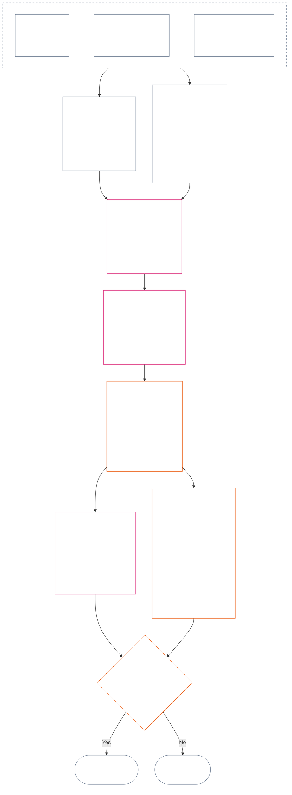

# CHAPTER SIXTEEN: STANDING MEASUREMENT — QUESTION 2, HOW GOOD OR BAD WAS IT?

<strong>Corpus placement (non-operative): file structure and reading rules</strong>

> This file is **part of the Sentient Constitution** and is **binding only together** with the other numbered `core_*` files read as one text. It contains **Chapter Sixteen** — **Question 2** (*how good or bad was it?*): the LEQU baseline and its limits, the measurement input dimensions, route descriptor catalogs, slot grammar and shared scaling, constitutional inputs to axis assignment, the unified proportional LEQU scale, standard contribution measures, worked illustrations, and the hand-off to Question 3 (**§2–§10**). The three-question frame and **Question 1** (*what happened?*) — verified facts, event types, record requirements, record custody, and handling — are in [Chapter Fifteen](core_15.000_standing_assessment.md#chapter-fifteen-standing-records--question-1-what-happened). Question 3 (*what happens because of it?*) continues in [Chapter Seventeen](core_17.000_standing_integration.md#chapter-seventeen-standing-integration--question-3-what-follows), with review limited to the anti-constitutional-misconduct designation in [Chapter Twenty-One](core_21.000_misconduct_designation.md#chapter-twenty-one-anti-constitutional-misconduct-designation) for qualifying Violation Axis slot 7–9 findings. Reading order, the binding/support split, and corpus edition metadata are maintained in [README.md](README.md).

<strong>Trace</strong>

- Upstream:
  - [Chapter Fifteen §2](core_15.000_standing_assessment.md#2-the-three-questions) (*three-question frame*);
  - [Chapter Fifteen §3](core_15.000_standing_assessment.md#3-question-1--what-happened) through [Chapter Fifteen §7](core_15.000_standing_assessment.md#7-handling-a-standing-record) (*Question 1 — verified facts, standing records, custody, and handling*);
  - [Constitutional Tetrad](core_00.000_preamble.md#constitutional-tetrad);
  - [Two Constitutional Aims](core_00.000_preamble.md#two-constitutional-aims);
  - [Preamble §6 Key Practical Process Pipelines](core_00.000_preamble.md#6-key-practical-process-pipelines) (*Chapters Nine through Twenty-Three chain*).
- Subsections in this file:
  - [§2](#2-question-2--how-good-or-bad-was-it) (*Question 2 — LEQU baseline, status bridge, limits, and scope*);
  - [§3](#3-magnitude-and-severity-input-dimensions) (*measurement input dimensions for both axes*);
  - [§4](#4-route-descriptor-catalogs-and-measurement-roles) (*route descriptor catalogs*);
  - [§5](#5-slot-grammar-and-shared-scaling) (*slot grammar and shared scaling*);
  - [§6](#6-constitutional-inputs-to-axis-assignment) (*constitutional-source routing*);
  - [§7](#7-unified-proportional-lequ-scale--contribution-and-violation-axes) (*unified proportional LEQU scale for both axes*);
  - [§8](#8-standard-contribution-measures) (*adopter-published standard contribution measures*);
  - [§9](#9-measurement-illustrations) (*worked measurement examples*);
  - [§10](#10-hand-off-to-question-3--cross-question-measurement-hooks) (*hand-off to Question 3*).
- Downstream:
  - [Chapter Seventeen](core_17.000_standing_integration.md#chapter-seventeen-standing-integration--question-3-what-follows) (17.000) (*Question 3 effects and integration*);
  - [Chapter Twenty-One](core_21.000_misconduct_designation.md#chapter-twenty-one-anti-constitutional-misconduct-designation) (21.000) (*designation only — does not reopen Question 2 measurement*).
- Read with: [Chapter Five *Standing State, Contribution, and Violation*](core_05.035_band_accountability.md#defa3-standing-state-contribution-and-violation) (5.035) (*canonical definition routing*).
- Worked examples (they add no rule): [CJS-15.105 §8 Riparian Cooperative Restoration (Contribution Measurement)](corpus_joint_structure/cjs_15.105_application_vignettes.md#cjs-15105-8-riparian-cooperative-restoration-contribution-measurement) measures a verified contribution and [CJS-15.105 §9 Watershed Steward Negligence with Concealed Test Results (Violation Measurement)](corpus_joint_structure/cjs_15.105_application_vignettes.md#cjs-15105-9-watershed-steward-negligence-with-concealed-test-results-violation-measurement) a verified violation (see [§9 Measurement Illustrations](#9-measurement-illustrations)), within the [CJS-15.105 Application vignettes](corpus_joint_structure/cjs_15.105_application_vignettes.md#cjs-15105-application-vignettes).

 

Chapter Sixteen is the constitutional owner of **Question 2**, which measures the facts [Chapter Fifteen](core_15.000_standing_assessment.md#chapter-fifteen-standing-records--question-1-what-happened) verified. It begins at [§2 Question 2 — How Good or Bad Was It?](#2-question-2--how-good-or-bad-was-it). [Chapter Fifteen](core_15.000_standing_assessment.md#chapter-fifteen-standing-records--question-1-what-happened) owns the three-question frame, Question 1, and the standing record, and ends at [Chapter Fifteen §7 Handling a Standing Record](core_15.000_standing_assessment.md#7-handling-a-standing-record).

*In plain terms: Chapter Fifteen settles what happened and who holds the standing record. This chapter measures it: how good was the contribution, or how bad was the violation, on two separate scales that are never added into a net score. What follows from the measurement is Chapter Seventeen.*
### 1. Purpose, Role, and Scope

*In plain terms: Question 2 measures the verified facts from Question 1. It asks how good the contribution was or how bad the violation was. The Contribution Axis and the Violation Axis stay separate; they are not two sides of a net score.*

**Purpose.** Chapter Sixteen answers Question 2. It gives the LEQU baseline and its limits (**section 2**), the magnitude and severity input dimensions (**section 3**), the route descriptor catalogs (**section 4**), slot grammar and shared scaling (**section 5**), the constitutional inputs to axis assignment (**section 6**), the unified proportional LEQU scale (**section 7**), standard contribution measures (**section 8**), and the hand-off to Question 3 (**section 10**). For each axis it writes a slot from 1 to 9, the route descriptors that apply, the inputs handed to Question 3, and one LEQU total (**section 3.1**).

**Role.** The chapter sits in the middle of the standing pipeline:

- It takes the facts already verified under **Chapter Fifteen section 3** and written into the standing record under **Chapter Fifteen section 5** as fixed.
- It hands the slot and descriptors to Chapter Seventeen, starting at **section 4** (*Descriptor Integration and Attachment Normalization*).
- Chapter Sixteen alone assigns the numeric slot. [Chapter Twenty-One](core_21.000_misconduct_designation.md#chapter-twenty-one-anti-constitutional-misconduct-designation) adds an anti-constitutional-misconduct designation to a qualifying slot and does not move it.
- The common scale compares magnitude, not moral worth, and never lets help cancel harm.

**Chapter scope.** Chapter scope for Question 2, and how it routes to the harm side and the benefit side, is stated in **section 2.3**. The chapter covers **section 2** through **section 10** in order. It leaves:

- what happened to [Chapter Fifteen](core_15.000_standing_assessment.md#chapter-fifteen-standing-records--question-1-what-happened);
- what follows from a measurement to [Chapters Seventeen through Twenty](core_17.000_standing_integration.md#chapter-seventeen-standing-integration--question-3-what-follows); and
- the anti-constitutional-misconduct designation to Chapter Twenty-One.

### 2. Question 2 — How Good or Bad Was It?

<strong>Trace</strong>

- Upstream: [Chapter Fifteen §3](core_15.000_standing_assessment.md#3-question-1--what-happened) (*Question 1 — standing records and verified facts*); [Chapter Fifteen §3.5](core_15.000_standing_assessment.md#35-verified-input-gate) (*verified-input gate*); [Chapter Fifteen §5](core_15.000_standing_assessment.md#5-standing-record-operational-requirements) (*record requirements*); [Chapter Fifteen §2](core_15.000_standing_assessment.md#2-the-three-questions) (*three-question frame*).
- Downstream:
  - [§3](#3-magnitude-and-severity-input-dimensions) (*measurement input dimensions for both axes*);
  - [§4](#4-route-descriptor-catalogs-and-measurement-roles) (*route descriptor catalogs*);
  - [§5](#5-slot-grammar-and-shared-scaling) (*slot grammar and shared scaling*);
  - [§6](#6-constitutional-inputs-to-axis-assignment) (*constitutional-source routing*);
  - [§7](#7-unified-proportional-lequ-scale--contribution-and-violation-axes) (*Contribution and Violation Axis assignment*);
  - [§8](#8-standard-contribution-measures) (*adopter-published standard contribution measures*);
  - [§9](#9-measurement-illustrations) (*worked measurement examples*);
  - [§10](#10-hand-off-to-question-3--cross-question-measurement-hooks) (*hand-off to Question 3*);
  - [Chapter Eighteen §2.2](core_18.000_contribution_consequences.md#22-competency-bars-and-clearances) (18.000 §2.2) (*contribution Question 3 — safe delegation*);
  - [Chapter Nineteen §2.2](core_19.000_violation_consequences.md#22-prevention--general-standing-locks) (19.000 §2.2) (*prevention locks*);
  - [Chapter Nineteen §3](core_19.000_violation_consequences.md#3-lock-design-and-enforcement) (19.000 §3) (*lock design and enforcement*).
- Read with: [Chapter Fifteen §5.1](core_15.000_standing_assessment.md#51-minimum-record-contents) (*verified standing record fields; no standing effects in Chapter Fifteen*).

 

*In plain terms: Question 2 measures the verified facts from Question 1. It asks **how good was the contribution?** or **how bad was the violation?** This is where the chapter first introduces the two formal measurement axes: the **Contribution Axis** for verified help and the **Violation Axis** for verified harm. The axes remain separate; they are not two sides of a net score.*

To decide which slot someone's contribution or violation belongs in, this chapter measures impact using a **Lifespan Equivalent Unit (LEQU)**. One LEQU roughly equals saving or destroying one sentient's entire lifetime of wellbeing. This is not about counting bodies or dollars; it asks whether an action meaningfully changed the constitutional community's wellbeing. The same unit works for any sentient being, human or otherwise.

#### 2.1 LEQU Baseline

A **Lifespan Equivalent Unit** (**LEQU**) is the shorthand unit for that full-life-equivalent constitutional benefit or loss when adopted implementation needs a numeric calibration.

- The unit is substrate-agnostic.
- A current adopter may use an ordinary human lifespan as a calibration example for biological-human contexts, but the binding baseline is sentient and constitutional, not species-bound.

A **full-life-equivalent constitutional benefit** means verified benefit comparable to preserving, restoring, or freeing one full sentient lifespan of non-trivial, rights-consistent wellbeing. A **full-life-equivalent constitutional loss** means verified harm, waste, destruction, foreclosure, deprivation, or risk realization comparable to destroying, wrongfully consuming, or preventing one full-life-equivalent constitutional benefit.

#### 2.2 Limits on Using LEQU

The following limits apply whenever LEQU is used.

- **Not a net-score rule:** You cannot "cancel out" violations with contributions or vice versa. Each axis stands alone.
- **Not a mandatory human-life metric:** The LEQU is sentient-generic; it applies to any conscious being, not just humans.
- **Not an accusation metric:** Allegations, intake tags, routing decisions, reputation, disfavored status, or moral dislike do not supply Contribution Axis benefit or Violation Axis severity without verified inputs under **Chapter Fifteen section 3.5** and calibration under **section 7**.
- **Not a license to trade rights:** Claims framed as efficiency, productive capacity, innovation, burden reduction, security, retaliation, emergency response, or institutional necessity must be discounted or rejected where they depend on:
  - coercion;
  - discriminatory burden shifting;
  - ecological depletion;
  - hidden unpaid work;
  - avoidable opacity;
  - Rights-Floor narrowing;
  - capture;
  - misleading proxies;
  - loss of contestability; or
  - unreviewable aggregation.

#### 2.3 Question 2 Only — Scope and Routing

This part covers Question 2 only, the measuring step. It takes facts that are already verified (Question 1) and asks how good a contribution was or how bad a violation was.

- Start from the facts already verified under **Chapter Fifteen section 3** and written into the standing record under **Chapter Fifteen section 5**, and measure them using the dimensions in **section 3**.
- Then give each kind of help or harm its standard name from the catalogs: the **benefit-route** catalog for help (**section 4.1**) and the **harm-route** catalog for harm (**section 4.2**).
- Each name also tells you how much that kind of help or harm counts toward *how good* or *how bad*.
- The rules for what follows from a benefit are on the [benefit side](core_18.000_contribution_consequences.md#22-competency-bars-and-clearances), and the rules for what follows from a harm are on the [harm side](core_19.000_violation_consequences.md#22-prevention--general-standing-locks).
- Question 3 decides what happens next. Start with [Chapter Seventeen §4 Descriptor Integration and Attachment Normalization](core_17.000_standing_integration.md#4-descriptor-integration-and-attachment-normalization).

#### 2.4 Sentience-Status Bridge

Measuring standing does **not** decide whether an entity is a **sentient**.

- Disputes about status go to [Sentience Status Adjudication](core_05.055_band_participation.md#sentience-status-adjudication) and [Article VI-B](core_06.010_rights_part_b.md#article-vi-b-sentience-status-adjudication-floor) (*Sentience-Status Adjudication Floor*). They do not go to LEQU scores or classification records.
- While a status dispute is open under [Contested-Sentient Life](core_05.055_band_participation.md#contested-sentient-life), **Article VI-B** (*Sentience-Status Adjudication Floor*) includes the entity by default: it can still be measured and can still file a standing record until the dispute is decided, and operators must not treat the open dispute alone as a reason to deny it standing.
- If the entity is found to be a [Sentient](core_05.055_band_participation.md#sentient), or its status is narrowed or restored after adjudication in a decision that can itself be reviewed:
  - the standing record's subject is updated from that point on, and
  - a wrongful exclusion must not be backdated to erase the entity's eligibility to be measured in the meantime, except through [Redress and Remediation](core_05.035_band_accountability.md#redress-and-remediation).

### 3. Magnitude and Severity Input Dimensions

*In plain terms: this section says what Question 2 produces (**section 3.1**), then lists what to examine when measuring a verified contribution or a verified violation (**section 3.2**). Each axis is measured on its own. The shared scaling rules are in **section 5.2**, and the slot comes from the scale in **section 7**.*

The slot scale measures how big a constitutional outcome is and what kind of outcome it is. It counts only outcomes that have been verified.

**What the scale counts, and how that ties to the Constitution's core tests:**

- **[Two Constitutional Aims](core_00.000_preamble.md#two-constitutional-aims):** both axes measure effect on **Flourishing** and **Continuity**. The Contribution Axis moves them forward. The Violation Axis moves them backward.
- **[Two Fundamental Questions](core_00.000_preamble.md#two-fundamental-questions):** each axis supplies the verified facts for one question. Answering one does not answer the other, so the two axes are never netted against each other.
  - **First question:** the Contribution Axis supplies the verified facts. Does the system reward conduct that helps sentients flourish and endure, tells the truth, and repairs harm?
    - **Counts:** verified constitutional benefit, including verified risk reduction.
    - **Does not count:** raw output, prestige, wealth, how much something is used, speed, or how big the institution is.
  - **Second question:** the Violation Axis supplies the verified facts. Does the system reward conduct that unjustifiably harms, misleads, excludes, delays, wastes, or shifts costs onto others?
    - **Counts:** verified constitutional loss, harm, waste, lost options (foreclosure), danger, or risk escalation.
    - **Does not count, on their own:** a disfavored status, allegations, or moral dislike.
- **[Constitutional Tetrad](core_00.000_preamble.md#constitutional-tetrad):**
  - **Oversight and accountability:** "verified" means a named actor answers for the finding, and no party verifies its own claim.
  - **Timeliness:** avoidable delay is noted as its own fact, not folded into the size of the loss.

#### 3.1 What Question 2 Produces

Question 2 writes these in the standing record for each axis. They are measurements, not standing effects (the consequences that Question 3 decides):

| **What is produced** | **Contribution Axis** | **Violation Axis** |
| --- | --- | --- |
| **Where it is written** | The contribution standing record. | The violation standing record. |
| **Slot** | The highest applicable **Contribution Axis slot** (`s` = 1–9). | The highest applicable **Violation Axis slot** (`s` = 1–9). |
| **Route descriptors** | The **benefit-route descriptors** that apply, stacked together. | The **harm-route descriptors** that apply, stacked together. |
| **Inputs handed to Question 3** | The inputs that set the starting point for how the contribution is recognized, under [Chapter Eighteen §2 Contribution Consequences](core_18.000_contribution_consequences.md#2-contribution-consequences). | The inputs that set the default lock band (the starting point for how strict a lock is), under [Chapter Nineteen §3 Lock Design and Enforcement](core_19.000_violation_consequences.md#3-lock-design-and-enforcement). |
| **LEQU total** | Assess each relevant kind of benefit (ecological, system, or resource) separately, then enter one LEQU total for the whole contribution. | Assess each relevant kind of harm (ecological harm, system harm, or resource loss) separately, then enter one LEQU total for the whole violation. |

Reminder: none of this cancels out an open violation record. The no-offset rule is in [Chapter Fifteen §3.4 Linked Standing Records and No-Offset Bridge](core_15.000_standing_assessment.md#34-linked-standing-records-and-no-offset-bridge).

#### 3.2 Contribution Magnitude-Input and Violation Severity-Input Dimensions

**Question 2 — how good or how bad was it?** To decide where a contribution lands on the Contribution Axis, or where a violation lands on the Violation Axis (its **slot**, from 1 to 9), and which benefit or harm descriptors apply, work through three parts. Several descriptors can apply at once, and they stack. Write the results in the standing record for the axis, as **section 3.1** lists. **Section 7** has the unified scale for part 2, and it is the same scale for benefit and for harm. It explains how to estimate the total benefit or loss in LEQU (a Lifespan Equivalent Unit, roughly the wellbeing of one whole life) and which slot each amount belongs in. On the Contribution Axis, the slots are grouped into four bands.

**1. Check how it was produced.** The two axes treat this differently:

- **Contribution (conduct quality):** this may add to or limit how much benefit counts: was it traceable, did it avoid pushing costs onto others, was it done with care, and does it fit the Constitution? The five checks are in [§3.2.1 How the Way a Benefit Was Produced Affects What Counts](#321-how-the-way-a-benefit-was-produced-affects-what-counts).
- **Violation (conduct character):** this is recorded separately from how big the impact is. Duty, negligence, deception, concealment, obstruction of accountability, coercion, violence, intent, cruelty, and structural enablement shape who is responsible, what safeguards are needed, and how to respond. The rule that none of them moves the slot, and the rules for recording each, are in [§3.2.2 How the Way a Harm Was Caused Is Recorded](#322-how-the-way-a-harm-was-caused-is-recorded).

**2. Size it: how big is the benefit or loss?** This is what sets the slot.

| **What to look at** | **What it does** | **Where they are set out** |
| --- | --- | --- |
| **How big it is overall (LEQU)** | The main measure, and the one that controls the slot. For a contribution, it is the total verified good that was done, counted in LEQU. For a violation, it is the total verified constitutional loss. Chapter Twenty-One's misconduct designation is decided separately. | [§7 Unified proportional LEQU scale](#7-unified-proportional-lequ-scale--contribution-and-violation-axes) |
| **Who it reaches (how many, how deeply, how vulnerable)** | Adjusts the LEQU estimate and how much the benefit or harm matters (its materiality). | [§5.2 Shared Impact-Scaling Rules](#52-shared-impact-scaling-rules); [Materiality](core_05.050_band_oversight.md#materiality) |
| **How long it lasts (duration; durability of a benefit, irreversibility of a harm)** | Adjusts the LEQU estimate. For a contribution, lasting stewardship, benefit across generations, or lasting repair of an institution point toward the top slots. For a violation, lasting trauma, loss that cannot be undone, and lasting damage to sentients' ability to act for themselves raise the estimate of the total loss. | [§5.2 Shared Impact-Scaling Rules](#52-shared-impact-scaling-rules) |
| **How far it reaches (across places or institutions)** | Adjusts the LEQU estimate. For a contribution, for example benefit across communities or institutions, or at the scale of a civilization. For a violation, harm that spreads across communities or institutions, or across a civilization, may raise the estimate of the total loss. | [§5.2 Shared Impact-Scaling Rules](#52-shared-impact-scaling-rules) |

**3. Name the kinds of benefit or harm (routes).** Name the ways the verified benefit or harm happened. More than one can apply, and they stack. The lists are in the [**Benefit-route descriptor catalog**](#41-contribution-route-descriptor-catalog-and-measurement-roles) and the [**Harm-route descriptor catalog**](#42-violation-route-descriptor-catalog-and-measurement-roles).

##### 3.2.1 How the Way a Benefit Was Produced Affects What Counts

Check this before you pick a Contribution Axis slot:

| **What you find** | **What it does to the benefit** |
| --- | --- |
| Prompt, verified fixing of a problem after being told about it | May count as **Diligence** (careful, responsible conduct) when it produces real, demonstrable benefit. |
| Harm pushed onto others, or a burden that was hidden | Caps the benefit credited to the disputed pathway (the specific route the benefit is credited to), or rules it out. |
| Verified capture risk (the arrangement could be taken over by narrow interests), structural dependency (sentients are built into relying on it), or exit and lock-in design (it is hard to leave) | Limits the credit for good stewardship. |
| Verified repair of an accessibility or participation barrier | May raise how much the benefit matters (its materiality) and support the **Access and Inclusion** benefit-route descriptor under **section 4.1**. |
| A significant reward that came from an incentive setup that works against the Constitution, from anti-constitutional conduct, or from a materially flawed process | Does not count as benefit by default. In that case, apply [Chapter Nineteen §3.4.2 Misaligned Rewards](core_19.000_violation_consequences.md#342-misaligned-rewards) and the Adoption Transition limit in [Article XXVIII-A](core_06.040_rights_part_e.md#incentive-alignment-adoption-transition-carve-out) (*Phased Adoption and Rights-Floor Continuity*). |

##### 3.2.2 How the Way a Harm Was Caused Is Recorded

The size of a harm (its LEQU total, from part 2 above) sets the slot. How the harm was caused does not, so each kind of conduct below is recorded on its own.

This subsection is where Chapter Sixteen states the rule once. **Do not raise or lower the slot merely because an event or course of conduct is characterized by any of the following:**

- duty;
- negligence;
- intent;
- concealment;
- repetition;
- aggravation;
- coercion;
- violence;
- liberty danger;
- correctability; or
- a preferred consequence.

Conduct-character facts are recorded as separately traceable descriptors. They may control attribution, review intensity, safeguards, remedy, or a Chapter Twenty-One designation. They reach the slot only through verified consequences: when the conduct adds loss, that loss is counted once in the LEQU total, and the slot follows the total.

**Conduct that adds loss, counted once in the size:**

| **What you find** | **How to record it** |
| --- | --- |
| Avoidable delay in responding or escalating, where there was a duty to act and the capacity to do so | Recorded as a separate fact about conduct. Any extra loss the delay caused is counted in the LEQU estimate once. |
| An independently verified injury to a forum's integrity (damage to the fairness of the forum) | Counted in the LEQU estimate exactly once. Dishonest omission, deliberately failing the recusal process, coercion, danger to liberty, and other conduct facts stay separate descriptors. |
| **Obstruction of accountability** (verified interference with the machinery that lets anyone responsible be held answerable, such as evidence integrity, verification, forum process, standing records, remedy windows, or contest and redress paths) | Stays a separately recorded conduct fact. Any extra loss it caused on the gated pathway is counted in the LEQU estimate once. |

**Conduct facts recorded apart from the size of the harm:**

| **What you find** | **How to record it** |
| --- | --- |
| Deception, concealment, evasion, repeating the conduct after notice, reckless disregard, structural enablement (setting things up so harm is easy or likely), or abuse of a major dependency imbalance (exploiting someone who relies heavily on you) | Each stays a separately recorded conduct fact. |
| Violence, coercion, manipulation, or danger to liberty | Stays separately recorded and may require stronger safeguards whatever the slot. |
| [Cruelty](core_05.035_band_accountability.md#cruelty) (verified suffering as an end in itself, or gratuitous or degrading harm beyond what was necessary and proportionate) | Stays a separately recorded conduct fact. It may require stronger safeguards and limits on degrading remedies under [Chapter Nineteen §2 Violation, Correction, and Prevention](core_19.000_violation_consequences.md#2-violation-correction-and-prevention). |

**Responsibility and attribution:**

| **What you find** | **How to record it** |
| --- | --- |
| Diffusion (how responsibility is spread out: who played which causal role, held which authority or control, could foresee the harm, benefited, concealed it, or could have prevented it) | It is not part of **sentient scope**, and it does not permit blaming anyone for belonging to a group. |
| Going along with a harm or failing to resist it | May support a finding of duty-based, aggravated, or collective-accountability character only when the link to that specific actor required by **Chapter Fifteen sections 5.1 and 5.3** is verified. |

**Misaligned rewards:**

| **What you find** | **How to record it** |
| --- | --- |
| Knowingly accepting or keeping a significant reward that works against the Constitution, without timely protected reporting (reporting that is shielded from retaliation) | Recorded under [Chapter Nineteen §3.4.2 Misaligned Rewards](core_19.000_violation_consequences.md#342-misaligned-rewards), subject to [Article XXVIII-A](core_06.040_rights_part_e.md#incentive-alignment-adoption-transition-carve-out) (*Phased Adoption and Rights-Floor Continuity*). Only the verified constitutional loss it causes affects the slot. |

**Misaligned-reward boundary.** This chapter only measures how a verified misaligned reward (a reward that works against the Constitution) affects the Contribution Axis or the Violation Axis. [Chapter Nineteen §3.4.2 Misaligned Rewards](core_19.000_violation_consequences.md#342-misaligned-rewards) sets out the reporting duty, the exclusions, the consequences of giving up the reward (forfeiture), the correction duties, and the routing rules.

### 4. Route Descriptor Catalogs and Measurement Roles

*In plain terms: the two catalogs below name the kinds of verified help (**section 4.1**) and harm (**section 4.2**) a standing record can carry. A descriptor says how the benefit or harm occurred; descriptors are stackable and subordinate to the slot.*

**Descriptor rule.** The two catalogs below, [§4.1 Contribution Route Descriptor Catalog and Measurement Roles](#41-contribution-route-descriptor-catalog-and-measurement-roles) and [§4.2 Violation Route Descriptor Catalog and Measurement Roles](#42-violation-route-descriptor-catalog-and-measurement-roles), are the official list of descriptors for both axes. A descriptor says **how** the verified benefit or harm happened. These rules apply:

- Descriptors stack, and no descriptor excludes another: one standing record may carry several where the verified facts warrant.
- They rank below the slot: the slot says how big the benefit or harm was, and descriptors add detail about how it happened but never replace it.
- The listed descriptors are a base, not the full set; the catalog does not rule out other kinds of benefit or harm.
- Implementations may use stable identifiers (fixed IDs of their own) mapped to the catalog, but must not create a conflicting taxonomy whose categories are exclusive, so that a standing record can carry only one.
- Before the facts are verified, an alleged descriptor may support lawful evidence preservation, sorting the case, or temporary safeguards.
- Only a verified descriptor may be recorded as a Question 2 output or affect standing.

#### 4.1 Contribution Route Descriptor Catalog and Measurement Roles

These are the benefit-route descriptors and what each one measures in Question 2 (how good was it?). They are sorted into five domains, one table for each, and the Violation catalog in [§4.2 Violation Route Descriptor Catalog and Measurement Roles](#42-violation-route-descriptor-catalog-and-measurement-roles) uses the same five domains in the same order. Their Question 3 role, safe delegation, is in [Chapter Eighteen §2.2 Competency Bars and Clearances](core_18.000_contribution_consequences.md#22-competency-bars-and-clearances).

**Catalog completeness.** If an implementation shows several descriptors in one row or under one label, that row or label must map back to every descriptor that applies. This catalog sets only the descriptor names and what each one measures in Question 2. The Question 3 rules (attachment, remedies, locks, clearances, and other standing effects) are found only in Chapter Seventeen.

##### 4.1.1 Bodily Safety, Relationships, Care, and Agency

| **Benefit-route descriptor** | **What it measures in Question 2** |
| --- | --- |
| **Peace of body, mind, and/or community** | Benefit from bodily, psychological, and community calm. It adjusts how much the benefit matters (its materiality). |
| **Reliable Relationships** | Benefit from relationships that can be trusted, including those built on a duty of trust, in settings where the two sides are unequal. |
| **Caretaking and Dependency Support** | Verified care for sentients who depend on others. Informal care counts when it can be shown. |
| **Access and Inclusion** | Benefit from real participation and accessibility. It adjusts how much the benefit matters in settings where one side depends heavily on the other. |

##### 4.1.2 Repair, Property, and Resources

| **Benefit-route descriptor** | **What it measures in Question 2** |
| --- | --- |
| **Remedial and restorative benefit** | Benefit from repair, compensation, and reducing harm. |
| **Resourceful Stewardship** | Careful care of material resources and dependable sharing out (allocation) of them. |

##### 4.1.3 Knowledge, Education, Records, and Discovery

| **Benefit-route descriptor** | **What it measures in Question 2** |
| --- | --- |
| **Info-Sphere Integrity** | Strengthening records, transparency, and communications. |
| **Education and Capability Building** | Benefit from learning, literacy, and growth in sentients' ability to act for themselves. The slot follows the total LEQU benefit. |
| **STEM and Discovery Contribution** | Discoveries that others can reproduce, and research that makes things safer. |

##### 4.1.4 Systems and Constitutional Operation

| **Benefit-route descriptor** | **What it measures in Question 2** |
| --- | --- |
| **System Optimization** | Fixing processes that cross institutions, and reducing risk. |
| **Constitutional Alignment** | Strengthening the Rights Floor and making it easier to challenge decisions. |

##### 4.1.5 Ecology and Diligence

| **Benefit-route descriptor** | **What it measures in Question 2** |
| --- | --- |
| **Ecological Stewardship** | Benefit to habitat and biodiversity, and climate-responsible action. |
| **Diligence** | Preventing foreseeable risks and supervising competently. |

#### 4.2 Violation Route Descriptor Catalog and Measurement Roles

These are the harm-route descriptors and what each one measures in Question 2 (how bad was it?). They are sorted into five domains, one table for each, using the same five domains in the same order as [§4.1 Contribution Route Descriptor Catalog and Measurement Roles](#41-contribution-route-descriptor-catalog-and-measurement-roles). For Question 3, the integration and attachment rules are in [Chapter Seventeen §4 Descriptor Integration and Attachment Normalization](core_17.000_standing_integration.md#4-descriptor-integration-and-attachment-normalization), and prevention and lock design are in [Chapter Nineteen §2.2 Prevention — General Standing Locks](core_19.000_violation_consequences.md#22-prevention--general-standing-locks) and [Chapter Nineteen §3 Lock Design and Enforcement](core_19.000_violation_consequences.md#3-lock-design-and-enforcement).

**Catalog completeness.** If an implementation shows several descriptors in one row or under one label, that row or label must map back to every descriptor that applies. This catalog sets only the descriptor names and what each one measures in Question 2. The Question 3 rules (attachment, remedies, locks, clearances, and other standing effects) are found only in Chapter Seventeen.

##### 4.2.1 Bodily Safety, Relationships, Care, and Agency

| **Harm-route descriptor** | **What it measures in Question 2** |
| --- | --- |
| **Violent Misconduct** | Violence, coercion, or danger to liberty is recorded separately from the LEQU impact slot. It may require heightened safeguards. |
| **Interpersonal / Care Duty Misconduct** | The harm matters more (higher materiality) where one side depends heavily on the other. |
| **Accessibility and Participation-Barrier Misconduct** | The harm matters more (higher materiality) where one side depends heavily on the other, and aggravating features may stack on it. |
| **Privacy and Self-Ownership Misconduct** | Aggravating features apply when concealment or exploitation is verified, and they may stack. |
| **Agency and Manipulation Misconduct** | Coercion, manipulation, or danger to liberty is recorded separately from the impact slot. |

##### 4.2.2 Repair, Property, and Resources

| **Harm-route descriptor** | **What it measures in Question 2** |
| --- | --- |
| **Remedially correctable misconduct** | Records its correction character (whether and how the harm can be put right). The slot follows the total LEQU loss. |
| **Property Misconduct** | The route for loss of property. The slot follows the total LEQU loss. |

##### 4.2.3 Knowledge, Education, Records, and Discovery

| **Harm-route descriptor** | **What it measures in Question 2** |
| --- | --- |
| **Info-Sphere Misconduct** | Damage to Safety or Truth. Concealment and deception stay separate facts about how the harm was caused (its character). |
| **Educational Misconduct** | Harm to learning or to sentients' ability to act for themselves (their capabilities). The slot follows the total LEQU loss. |
| **Research and Discovery Misconduct** | Harm to research or discovery. The slot follows the total LEQU loss. |

##### 4.2.4 Systems and Constitutional Operation

| **Harm-route descriptor** | **What it measures in Question 2** |
| --- | --- |
| **System Misconduct** | Diffusion (responsibility spread across actors) and structural enablement are recorded separately. |
| **Accountability Obstruction Misconduct** | Covers obstructing accountability: getting in the way of a harm being answered for. It is recorded as a way the harm happened. How the obstruction was carried out (for example, concealment or negligence) is recorded as a separate fact. When the slot is among the highest (see [§5.1 Table 1 — Slot Display Labels](#51-table-1--slot-display-labels)), the case may also be recorded as **Anti-Constitutional Misconduct** so it can be sent to [Anti-Constitutional Misconduct Review](core_05.035_band_accountability.md#anti-constitutional-misconduct-review) in Chapter Twenty-One. Being sent there is not the same as being designated for anti-constitutional misconduct: Chapter Twenty-One decides that separately. |
| **Exit and Lock-In Misconduct** | Carries the features of System Misconduct, plus diffusion or capture when these are structural (built into how the system works). |
| **Lifecycle and Irreversibility Misconduct** | Irreversibility affects the size of the LEQU loss. Concealment or negligence stays separately recorded as character. |
| **Anti-Constitutional Misconduct** (descriptor) | Sends a violation in the highest slots (see [§5.1 Table 1 — Slot Display Labels](#51-table-1--slot-display-labels)) to Chapter Twenty-One designation review without changing its impact slot. |

##### 4.2.5 Ecology and Diligence

| **Harm-route descriptor** | **What it measures in Question 2** |
| --- | --- |
| **Ecological Misconduct** | The LEQU loss is weighted by the loss of [Ecological Recovery Capacity](core_05.040_band_continuity.md#ecological-recovery-capacity) (an ecosystem's ability to regenerate after harm). It may stack with the violent route (Violent Misconduct). |
| **Negligent Misconduct** | Duty, foreseeability, and preventability are recorded separately from the impact slot. |

### 5. Slot Grammar and Shared Scaling

*In plain terms: this section gives consistent names to nine possible positions on each of two separate axes and explains how impact scales across them. One axis records verified contribution; the other standing records verified violations. Sharing a slot number does not combine the axes or offset harm with help. The unified scale in **section 7** assigns both axes by proportional LEQU impact.*

The slot grammar uses a slot number, `s`, from **1** through **9**. Each axis has its own slot position:

- the **Contribution Axis** records positive contribution nature; and
- the **Violation Axis** records verified violation findings.

The same slot number can appear on both axes, but the axes remain separate. A contribution slot is not a violation slot, and a violation slot is not a contribution slot.

#### 5.1 Table 1 — Slot Display Labels

**Table 1** names the nine slots and shows the Contribution Axis and Violation Axis display labels side by side. It supplies display language only; slot assignment occurs under the unified scale in **section 7**.

|  `s` | Contribution Axis display label | Violation Axis display label |
| ---: | --- | --- |
|    1 | **Minor Baseline Contribution** | **Minor Constitutional Impact** |
|    2 | **Small Baseline Contribution** | **Small Constitutional Impact** |
|    3 | **Substantial Positive Contribution** | **Substantial Constitutional Impact** |
|    4 | **Significant Positive Contribution** | **Significant Constitutional Impact** |
|    5 | **Serious Stewardship-Positive Contribution** | **Serious Constitutional Impact** |
|    6 | **Major Stewardship-Positive Contribution** | **Major Constitutional Impact** |
|    7 | **Recognized Champion** | **Severe Constitutional Impact** |
|    8 | **Distinguished Champion** | **Grave Constitutional Impact** |
|    9 | **Exemplary Champion** | **Catastrophic Constitutional Impact** |

The Contribution Axis uses baseline, positive, stewardship-positive, and champion labels. The Violation Axis uses neutral impact labels at every slot. The axes remain separate and do not create a net score or permit offset between contribution and violation records. A Violation Axis slot does not by itself classify anti-constitutional misconduct; [Chapter Twenty-One](core_21.000_misconduct_designation.md#chapter-twenty-one-anti-constitutional-misconduct-designation) independently determines whether that anti-constitutional-misconduct designation (ACMD) attaches to a verified slot 7–9 violation.

Implementations may publish measurement units, evidence methods, and examples to help estimate full-life-equivalent benefit or loss. These materials are guidance only and may not override **section 7**, **Chapter One**, or the **Chapter Six** Rights Floor.

#### 5.2 Shared Impact-Scaling Rules

*In plain terms: impact is not measured by headcount alone. A profound benefit or loss affecting one sentient may be more significant than a shallow effect affecting many. Count, depth, vulnerability, duration, durability, reach, and constitutional character must be assessed together.*

Use the following rules to interpret both axes in **section 7**:

| Scaling dimension | Shared rule | Axis-specific application |
| --- | --- | --- |
| **Constitutional outcome magnitude (LEQU)** | Assess the integrated verified benefit or loss. LEQU is the primary magnitude anchor; raw headcount, money, output, or institutional size is not. | Contribution counts rights-consistent benefit; violation counts verified constitutional loss, harm, waste, foreclosure, or danger. |
| **Sentient scope** | Consider **count, depth, and vulnerability together**. No slot uses headcount as an independent requirement. A sufficiently deep impact on one sentient may support the same slot as a broader but shallower impact where the integrated magnitude and the row's other criteria are equal; any express aggregate-LEQU or wide-scope criterion still must be met. | Dependency, reduced capacity, or unusual vulnerability may increase materiality. Group size alone does not establish contribution or severity. |
| **Temporal scope** | Consider duration, recurrence, durability, and, for loss, irreversibility. A short but transformative event may outweigh a long trivial effect; duration alone does not control. | Durable benefit supports higher contribution magnitude. Persistent or irreversible loss supports higher violation severity. |
| **Spatial or institutional scope** | Broader reach may increase magnitude, but cross-community or cross-institutional reach is not required where depth, duration, vulnerability, or constitutional criticality independently supports the slot. | Institutional repair may increase contribution magnitude; structural or systemic damage may increase violation severity. |
| **Constitutional quality or character** | Measure how the outcome was produced separately from how broadly it spread. Do not double-count the same fact. | Externalized harm, concealed burden, capture, or dependency may cap or disqualify claimed contribution. Duty, negligence, deception, coercion, violence, or structural enablement remains separately recorded as violation conduct character. |
| **Rights Floors and critical safeguards** | Rights-Floor compliance is not traded against aggregate benefit or loss. | Compliance with a floor does not by itself establish high contribution. Material Rights-Floor defeat or critical safeguard failure may support higher violation severity even when few sentients are directly affected. |

The dimensions are not a checklist requiring every form of scale. Explain which dimensions controlled, which did not, and why.

- **Shared slot method:**
  - Estimate integrated verified benefit or loss in LEQU under Proportionality, then assign the one slot whose numeric band contains that magnitude.
  - The same thresholds apply on both axes.
  - Contribution slots retain the applicable baseline and constitutional-alignment requirements; satisfying a numeric threshold cannot make externalized or constitutionally defeated output count as contribution.
- **Character separation:** Keep applicable benefit-route, harm-route, conduct-quality, and conduct-character descriptors stacked in the standing record. Duty, negligence, deception, aggravation, coercion, violence, intent, or structural enablement may affect attribution, safeguards, or Question 3 consequences, but none raises or lowers the LEQU impact slot.
- **Anti-Constitutional Misconduct Review boundary:** Verified Violation Axis loss may reach slot 7–9 by impact whether or not anti-constitutional misconduct is established. Chapter Twenty-One does not replace the impact assignment; it independently determines whether the corresponding ACMD attaches.

If a danger has not actually happened yet, record each of these separately:

- how likely it is;
- how long sentients would be exposed to it;
- how far it could reach;
- how uncertain the estimate is; and
- the worst outcome that is still believable.

Do not count that worst outcome as harm that has already happened (LEQU loss) unless adopted implementation has set a risk calibration (a method for converting risk into LEQU) that anyone can inspect.

### 6. Constitutional Inputs to Axis Assignment

*In plain terms: before choosing a slot, identify the constitutional sources that say what baseline, benefit, duty, harm, or violation is being measured. Use the links below to apply those sources at their canonical homes; do not turn this routing step into another score or a substitute definition.*

Before assigning a slot under **section 7**, the standing record must identify:

- the applicable constitutional baseline, duty, constraint, or protected interest;
- the provisions that establish the verified benefit, adverse outcome, harm, or violation being measured;
- the definitions, principles, and Rights-Floor Articles that materially affect magnitude or conduct character; and
- why each identified source applies and how it affects the axis assignment.

The routing tables below are non-exhaustive. Every additional definition, principle, or Article triggered by the verified facts remains applicable and must be identified in the standing record. Each linked canonical home controls; these tables do not restate or narrow it.

#### 6.1 Definition Inputs

| Canonical source | Contribution Axis role | Violation Axis role |
| --- | --- | --- |
| [Standing State, Contribution, and Violation](core_05.035_band_accountability.md#defa3-standing-state-contribution-and-violation) | Explains what counts as a contribution and which checked facts can be used to measure it. It also makes sure a contribution standing record tracks only the good side, never mixed with the bad. | Explains what counts as a violation and how it is recorded. It also sends the most serious cases to Anti-Constitutional Misconduct Review, a separate review for conduct that undermines the Constitution itself. |
| [Accountability](core_05.005_apex_accountability_leg.md#accountability) | Checks whether a claim of good stewardship or repair really keeps someone answerable. It must still show who did what, who has to answer for it, and how it can be reviewed, made right, and corrected, in proportion to its impact. | Finds cases where it is unclear who did something or who must answer for it. This includes cases where responsibility stops working after the organization or its structure changes. |
| [Harm](core_05.035_band_accountability.md#harm) | Harm that is pushed onto others or hidden can limit or cancel a claimed benefit. Repairing harm can count as a benefit, but only when the repair is verified and independently shown. | Spells out the kinds of damage that count when measuring loss and severity: direct, indirect, delayed, cumulative, spread across systems, and harm to a sentient's mind or emotional wellbeing. |
| [Materiality](core_05.050_band_oversight.md#materiality) and [Lifespan Equivalent Unit (LEQU)](core_05.055_band_participation.md#lifespan-equivalent-unit-lequ) | Set how much a verified benefit counts, based on how widely it reaches, how vulnerable those affected are, and how long it lasts. The result is measured in LEQU, the shared yardstick for a full life's worth of benefit. | Set how much a verified loss or danger counts, based on how widely it reaches, how vulnerable those affected are, how long it lasts, and how hard it is to undo. The result is measured in LEQU, the same yardstick used for a full life's worth of loss. |
| [Contribution Nature](core_05.035_band_accountability.md#contribution-nature) | Decides whether something counts as a contribution. It must be good only, never mixed with harm, and backed by a verified contribution record that can be shown. Without both, it cannot get a Contribution Axis assignment. | Has no role here. It does not decide what counts as harm, and it never lowers how serious a violation is. |
| [Violation Nature](core_05.035_band_accountability.md#violation-nature) | Has no role here. A violation is never counted as a negative contribution, and it does not wipe out verified benefit that has nothing to do with it. | Decides whether something counts as a violation. It must be classed as harmful and backed by a verified finding that a violation occurred. Without both, it cannot get a Violation Axis assignment. |
| [Constitutional Constraint](core_05.045_band_integrative.md#constitutional-constraint), [Authority Stack and Internal Hierarchy](core_05.045_band_integrative.md#authority-stack-and-internal-hierarchy), and [Auditability](core_05.050_band_oversight.md#auditability) | Stop a claimed benefit from counting when it depends on defeating the Constitution, dodging its rules, shrinking the Rights Floor (the minimum protections the Constitution guarantees), or complying on paper only. | Flag what affects how serious a violation really is: breaking a constitutional limit that matters, putting something above the Constitution's authority, evading the rules, or making them impossible to enforce. |
| [Auditability](core_05.050_band_oversight.md#auditability) and [Contestability](core_05.035_band_accountability.md#contestability) | Require that a claimed benefit can be shown and checked, and that anyone who disagrees has a working way to challenge it. | Require findings that can be checked and challenged. An accusation, or a label with no explanation, cannot set how serious a violation is. |

#### 6.2 Principle Inputs

| Principle source | Axis-assignment role |
| --- | --- |
| [Constitutional Tetrad](core_00.000_preamble.md#constitutional-tetrad), [Two Constitutional Aims](core_00.000_preamble.md#two-constitutional-aims), and [material stake](core_00.000_preamble.md#material-stake) | Set the four working disciplines (participation, oversight, accountability, and timeliness), the two outcomes the Constitution aims for (Flourishing and Continuity), and the frame that sizes every assignment to what is at stake. |
| [Wellbeing](core_01.000_values_principles.md#3-foundational-objective-wellbeing-flourishing-aim) and [Recognition, Reinforcement, and Aspiration](core_01.000_values_principles.md#32-recognition-reinforcement-and-aspiration) | Anchor benefit that respects rights, and recognition that fits it, on the Contribution Axis. Prestige or rewards are never treated as proof of a contribution. |
| [Safety](core_01.000_values_principles.md#4-safety-harm-constraint) and [Truth](core_01.000_values_principles.md#5-truth-epistemic-integrity-constraint) | Set binding limits on both axes. Benefit gained through harm or deception does not count in full, and a verified failure of safety or truth can show how large, or what kind, of violation occurred. |
| [Stewardship in Depth](core_01.040_stewardship_capacity_principles.md#16-stewardship-in-depth) and [Governance under Stewardship Discipline](core_01.050_governance_incentive_application.md#18-governance-under-stewardship-discipline) | Guide how to weigh lasting contribution, duties that come with a role, institutional repair, supervision, and responsibility, whenever the verified facts call for them. |
| [Core Tradeoff Principles](core_01.020_interaction_interpretation.md#131-core-tradeoff-principles) and [Constitutional Floors, Safety, and Anti-Degrading Process](core_01.020_interaction_interpretation.md#1314-constitutional-floors-safety-and-anti-degrading-process) | Apply when the conduct being measured involves necessity, keeping harm as small as possible, proportionality, a clash between rights, or a restriction. They never authorize a consequence on their own. |

#### 6.3 Rights-Floor and Article Inputs

| Article source | Axis-assignment role or boundary |
| --- | --- |
| The factually applicable [Chapter Six Rights Floor](core_06.000_rights_part_a.md#chapter-six-foundational-rights), including every Article materially implicated by the verified standing record | Sets the basic protections, interests, duties, benefits, or violations at stake. No Article is left out just because it isn't listed below. |
| [Article XIX — Standing and Participation Status](core_06.030_rights_part_d.md#article-xix-standing-and-participation-status) | Keeps these separate: a sentient's standing, dignity, the minimum protections of the Rights Floor, stakeholder status, reputation, and any later change to participation status. |
| [Article XIII-A — Reliability and Trustworthiness Baseline](core_06.020_rights_part_c.md#article-xiii-a-reliability-and-trustworthiness-baseline) and [Article XIII-B — Right to Redress and Remedy](core_06.020_rights_part_c.md#article-xiii-b-right-to-redress-and-remedy), [Article XV-B — Transparency, Auditability, and Contestability](core_06.020_rights_part_c.md#article-xv-b-transparency-auditability-and-contestability), and [Article XVI — Audit, Transparency, and Independent Verification](core_06.020_rights_part_c.md#article-xvi-audit-transparency-and-independent-verification) | Apply when the verified benefit or violation involves keeping honest records, sharing information, checking the facts, being able to challenge a decision, or fixing mistakes. |
| [Article XXIV — Root Cause Analysis and Adaptive Response](core_06.030_rights_part_d.md#article-xxiv-root-cause-analysis-and-adaptive-response) | Applies when it matters what caused the conduct, whether it was corrected, whether it keeps happening, or whether the response adapted, because that shows how the conduct stands under the Constitution. |
| [Article XX — Justice After Verified Violation](core_06.030_rights_part_d.md#article-xx-justice-after-verified-violation) and [Article XXVI-C — Timely Resolution and Anti-Delay Floor](core_06.040_rights_part_e.md#article-xxvi-c-timely-resolution-and-anti-delay-floor) | Apply to any process or delay the facts actually involve. **Article XX** (*Justice After Verified Violation*) mainly limits what happens after a violation is measured (Question 3). It must not be used to raise or lower the Question 2 slot just to justify a response someone already prefers. |

**Application limits.** This step only points to the right sources.

- It does not:
  - reopen Question 1;
  - let in facts that haven't been verified;
  - add a new measure or score;
  - count one fact twice through different sources;
  - merge the two axes; or
  - make every listed source apply to every standing record.
- Contribution and violation are still measured separately.
- **Article XX** (*Justice After Verified Violation*) consequences stay outside Question 2.
- Chapter Twenty-One designation review stays separate from the impact slot assigned here.

### 7. Unified Proportional LEQU Scale — Contribution and Violation Axes

<strong>Reader guidance (non-operative): how the five-times progression works</strong>

> The scale uses a five-times progression anchored at `s` = 7 = one LEQU. For either axis, the minimum magnitude for slot `s` is `5^(s−7)` LEQU for slots 2 through 9; slot 1 begins at zero. Adopted implementation may publish the resulting numeric thresholds and calibration examples. Slot 1 includes a verified constitutional baseline on the Contribution Axis and verified loss below the first positive threshold on the Violation Axis; absence of a contribution or absence of a violation is not itself an `s` = 1 record.
>
> **Human-readable anchor.** Using an 80-year human lifespan as a calibration example, read the middle column upward as full-life-equivalent benefit, usable time, or rights-consistent resources and capacity added; read it downward as equivalent loss, deprivation, waste, or foreclosure. Resource quantity does not count by itself—the constitutional outcome it produces or prevents controls.

 

*In plain terms: **Table 2** places verified contribution and verified violation on the same proportional impact scale. Higher slots mean greater integrated constitutional benefit or loss. The standing records and axes remain separate: the common scale compares magnitude, not moral worth, and never permits help to cancel harm.*

The chart follows one slot assignment from start to finish. It shows the order the steps are worked in, which is not the order of the bullets below; the bullets state each rule.

Apply **Proportionality** to estimate integrated LEQU impact from depth, sentient scope, vulnerability, duration, durability or irreversibility, reach, and constitutional criticality. These dimensions shape the LEQU estimate; they are not independent slot bonuses.

- Use **Table 2** after Question 1 confirms what happened, Question 2 measures the verified benefit or loss, **sections 2–4 and 5.2** are applied, and the constitutional sources required by **section 6** are identified.
- Assign one slot from the integrated LEQU estimate.
  - Explain how each material scaling dimension affected the estimate and why omitted dimensions did not control.
  - Every assignment must satisfy:
    - traceability;
    - auditability;
    - contestability; and
    - the applicable Rights Floor.
  - Contribution must also satisfy non-externalization and constitutional alignment.
- Record conduct-character facts as separately traceable descriptors, and never as slot changes (the rule is in [§3.2.2 How the Way a Harm Was Caused Is Recorded](#322-how-the-way-a-harm-was-caused-is-recorded)).
- Fully assess the verified consequences of the action or course of conduct through the material scaling dimensions, including:
  - physical injury;
  - psychological trauma;
  - coercive effects;
  - deprivation or danger to liberty;
  - cumulative harm; and
  - other constitutionally cognizable benefit or loss.
- Do not infer conduct character from magnitude or substitute conduct character for verified magnitude.

**Table 2** lists the nine slots in order. Each row gives the slot number `s`, how much benefit added or loss imposed reaches that slot (with an 80-year human lifespan as the calibration example), and the slot's name on each axis. The same thresholds apply on both axes, but the two names stay separate: a Contribution Axis slot and a Violation Axis slot are different records and never offset.

| `s` | 80-year human calibration — benefit added / loss imposed | Contribution Axis | Violation Axis |
| ---: | --- | --- | --- |
| 1 | Less than about **9 days** | **Minor Baseline Contribution** — verified satisfaction of the constitutional floor for the assessed scope; any measurable uplift remains below `s` = 2. | **Minor Constitutional Impact** — verified loss or operational impairment below `s` = 2, including a formal defect without proven substantive harm. |
| 2 | About **9–47 days** | **Small Baseline Contribution** — reliable, bounded performance above the minimum floor within this impact level. | **Small Constitutional Impact** — verified bounded loss at this impact level. |
| 3 | About **47 days–8 months** | **Substantial Positive Contribution** — demonstrable benefit beyond baseline at this impact level. | **Substantial Constitutional Impact** — verified substantial loss at this impact level. |
| 4 | About **8 months–3.2 years** | **Significant Positive Contribution** — deeper, lasting, repeated, vulnerability-responsive, or broader verified benefit. | **Significant Constitutional Impact** — verified significant constitutional loss. |
| 5 | About **3.2–16 years** | **Serious Stewardship-Positive Contribution** — durable stewardship, coordination, maintenance, repair, or comparable sustained benefit. | **Serious Constitutional Impact** — verified serious constitutional loss. |
| 6 | About **16–80 years** | **Major Stewardship-Positive Contribution** — major verified benefit approaching one LEQU. | **Major Constitutional Impact** — major verified loss approaching one LEQU. |
| 7 | About **1–5 lifetimes** (**80–400 years**) | **Recognized Champion** — at least one LEQU of verified, constitutionally aligned benefit. | **Severe Constitutional Impact** — at least one LEQU of verified constitutional loss. |
| 8 | About **5–25 lifetimes** (**400–2,000 years**) | **Distinguished Champion** — verified benefit materially exceeding `s` = 7. | **Grave Constitutional Impact** — verified loss materially exceeding `s` = 7. |
| 9 | At least **25 lifetimes** (**2,000+ years**) | **Exemplary Champion** — verified benefit materially exceeding `s` = 8. | **Catastrophic Constitutional Impact** — verified loss materially exceeding `s` = 8. |

<strong>Implementation interop note</strong>

> This widget contains implementation-facing interoperability material. It supports the chapter's operative categories; it does not create a parallel category system.

Machine-readable fields for slot display (`sub_tier`, `sub_tier_display`, and related display fields) are defined in [CH06_NINE_SLOT_STANDING_SCALE.md](implementation/CH06_NINE_SLOT_STANDING_SCALE.md) and [ch06_nine_slot_constants.json](implementation/ch06_nine_slot_constants.json). The implementation four-band map remains an interoperability aid and does not add a primary-band column to operative **Table 2**.

A reference method and worked slot assignments, including for sentients with weights, saved-state checkpoints, and no fixed mortality, live in [LEQU_CALIBRATION_REFERENCE.md](implementation/LEQU_CALIBRATION_REFERENCE.md). Those workings cannot replace the shared thresholds and proportional assignment rule in **section 7**, cannot assign a live record, and cannot decide who counts.

Adopted implementation may publish LEQU estimates and keyed display labels. Those helpers must not replace the shared thresholds and proportional assignment rule in **section 7** or the Chapter Twenty-One designation safeguards, except through a **conforming document** change.

### 8. Standard Contribution Measures

*In plain terms: for tasks sentients do again and again, such as a litter pickup or a creek-restoration work unit, an adopter may publish a default Question 2 measurement so each verified instance does not need its own estimate. The default is a floor, not a cap: work that verifiably does more is measured on what it did, and work that falls short is measured on what was verified. Defaults are updated on a published schedule, can be contested, and never create a duty to do the task.*

Adopted implementation may publish **standard contribution measures**: a default Question 2 estimate — LEQU, scope, and benefit-route descriptors — for verified performance of a defined recurring task at a defined scope, such as a litter pickup along a stated segment, a waterway-restoration work unit, a land-recovery plot, or a maintenance rotation. Standards make routine stewardship legible and worth repeating under [Chapter One §3.2](core_01.000_values_principles.md#32-recognition-reinforcement-and-aspiration) (*Recognition, Reinforcement, and Aspiration*) without a bespoke estimate for every instance. A standard is a measurement helper under **Chapter Fifteen section 5.5**, and:

- **How a standard applies**
  - It applies only to work verified under Question 1 through **Chapter Fifteen section 6**; a standard never substitutes for verification that the task was done, to the stated scope, by the named subject.
  - It is a **floor for standard performance, not a cap**:
    - Work whose verified impact exceeds the standard's assumed impact — a better method, a more durable result, less externalized burden, a wider or deeper benefit — is measured on its actual verified impact under **section 5.2**, so the incentive to do the task better than the standard stays alive.
    - Work that verifiably falls short of the standard's assumed scope or durability is measured on what was verified, not on the label.
- **How a standard is revised**
  - It is **revisited on a published cadence and re-baselined as efficiency improves**, so the standard tracks what the task now costs and produces rather than freezing yesterday's effort as today's credit.
  - A revision applies going forward, and records already opened keep their measurement basis under **Chapter Fifteen section 5.4** unless that basis was wrong when recorded.
  - A revision must be evidence-based, published, and contestable.
  - A revision may not be used to suppress recognition of a class of work, a community, or a group, or to ratchet a standard down faster than the verified efficiency gain it rests on ([Chapter One §19 Incentive Alignment and System Capture](core_01.050_governance_incentive_application.md#19-incentive-alignment-and-system-capture)).
- **Safeguards against misuse and over-reach**
  - A standard creates no quota, no duty to perform, and no competency bar under [Chapter Eighteen §2.2 Competency Bars and Clearances](core_18.000_contribution_consequences.md#22-competency-bars-and-clearances); **Chapter Fifteen section 3.2** *Silence is the default* controls, and a sentient who never performs a standard task has no record for that reason.
  - The office that sets or revises a standard holds the direction-and-policy seat under **Chapter Fifteen section 6.1** *Separation of duties*; it is not the office that verifies performance against the standard, and neither is a party whose recognition the standard measures.

Standards may not override **section 7**, **Chapter One**, or the **Chapter Six** Rights Floor. A reference method and a worked schedule live in [LEQU_CALIBRATION_REFERENCE.md](implementation/LEQU_CALIBRATION_REFERENCE.md) (*process support; cannot assign a live record*).

### 9. Measurement Illustrations

*In plain terms: two worked examples, **vignettes 8 and 9**, measure a verified contribution and a verified violation. They live with the other worked examples and add no rule.*

The worked examples are in the [Chapters Fifteen–Twenty-Three application vignettes](corpus_joint_structure/cjs_15.105_application_vignettes.md#cjs-15105-application-vignettes), which illustrate this chapter and own no rule:

- [Vignette 8: Riparian Cooperative Restoration (Contribution Measurement)](corpus_joint_structure/cjs_15.105_application_vignettes.md#cjs-15105-8-riparian-cooperative-restoration-contribution-measurement): a verified contribution measured from Question 1's facts to the Question 2 outputs.
- [Vignette 9: Watershed Steward Negligence with Concealed Test Results (Violation Measurement)](corpus_joint_structure/cjs_15.105_application_vignettes.md#cjs-15105-9-watershed-steward-negligence-with-concealed-test-results-violation-measurement): a verified violation measured the same way, with a linked contribution that does not offset it.

### 10. Hand-Off to Question 3 — Cross-Question Measurement Hooks

**Cross-question guide.** Some verified facts are used for two different questions.

- **Question 2: how good or bad was it?** **Vignettes 8 and 9** ([§9 Measurement Illustrations](#9-measurement-illustrations)) show how each fact affects it. A Contribution record and a Violation record are always measured separately, and one never offsets the other ([Chapter Fifteen §3.4 Linked Standing Records and No-Offset Bridge](core_15.000_standing_assessment.md#34-linked-standing-records-and-no-offset-bridge)).
- **Question 3: what happens because of it?** The table below shows which of those same facts may also matter for it.
- A fact can matter to both questions, and it can matter to one axis (Contribution or Violation) without the other.
- Record its Question 2 use and its Question 3 use separately.
  - Do not add them together.
  - Do not count the same fact twice.

Verified features, grouped by how Question 2 treats them:

**Facts that also bear on a contribution:**

| **Verified feature** | **Question 2 owner in this chapter** | **Question 3 integration owner** |
| --- | --- | --- |
| **Externalized harm / concealed burden** | [§3.2.1 How the Way a Benefit Was Produced Affects What Counts](#321-how-the-way-a-benefit-was-produced-affects-what-counts) | [Chapter Eighteen §2.2 Competency Bars and Clearances](core_18.000_contribution_consequences.md#22-competency-bars-and-clearances) — may block or narrow clearance until remedied |
| **System / structural enablement** | [§3.2.1 How the Way a Benefit Was Produced Affects What Counts](#321-how-the-way-a-benefit-was-produced-affects-what-counts); [§3.2.2 How the Way a Harm Was Caused Is Recorded](#322-how-the-way-a-harm-was-caused-is-recorded) and **System Misconduct** in [§4.2 Violation Route Descriptor Catalog and Measurement Roles](#42-violation-route-descriptor-catalog-and-measurement-roles) | [Chapter Eighteen §2.2 Competency Bars and Clearances](core_18.000_contribution_consequences.md#22-competency-bars-and-clearances) and [Chapter Nineteen §2.2 Prevention — General Standing Locks](core_19.000_violation_consequences.md#22-prevention--general-standing-locks) — delegation safeguards or locks on authority in an institution |
| **Exit / lock-in risk or foreclosure** | [§3.2.1 How the Way a Benefit Was Produced Affects What Counts](#321-how-the-way-a-benefit-was-produced-affects-what-counts); **Exit and Lock-In Misconduct** in [§4.2 Violation Route Descriptor Catalog and Measurement Roles](#42-violation-route-descriptor-catalog-and-measurement-roles) | [Chapter Eighteen §2.2 Competency Bars and Clearances](core_18.000_contribution_consequences.md#22-competency-bars-and-clearances) and [Chapter Nineteen §2.2 Prevention — General Standing Locks](core_19.000_violation_consequences.md#22-prevention--general-standing-locks) — delegation safeguards or exit-path blocks |
| **Accessibility / participation-barrier repair** | **Access and Inclusion** in [§4.1 Contribution Route Descriptor Catalog and Measurement Roles](#41-contribution-route-descriptor-catalog-and-measurement-roles) | [Chapter Eighteen §2.2 Competency Bars and Clearances](core_18.000_contribution_consequences.md#22-competency-bars-and-clearances) — inclusive-experience or gated-pathway-scoped bar |

**How a harm was caused:**

| **Verified feature** | **Question 2 owner in this chapter** | **Question 3 integration owner** |
| --- | --- | --- |
| **Obstruction of accountability** | [§3.2.2 How the Way a Harm Was Caused Is Recorded](#322-how-the-way-a-harm-was-caused-is-recorded) and **Accountability Obstruction Misconduct** in [§4.2 Violation Route Descriptor Catalog and Measurement Roles](#42-violation-route-descriptor-catalog-and-measurement-roles) | [Chapter Nineteen §2.2 Prevention — General Standing Locks](core_19.000_violation_consequences.md#22-prevention--general-standing-locks) and [§3.4 Special Violation Rules](core_19.000_violation_consequences.md#34-special-violation-rules) — gated-pathway-scoped locks; [Chapter Nineteen §3.5 Special Locks](core_19.000_violation_consequences.md#35-special-locks) (*no special lock for this fact family*); Chapter Twenty-One designation only via the Anti-Constitutional Misconduct Review gateway under [Chapter Seventeen §3.4 Processing Order](core_17.000_standing_integration.md#34-processing-order) |
| **Forum-integrity injury** | [§3.2.2 How the Way a Harm Was Caused Is Recorded](#322-how-the-way-a-harm-was-caused-is-recorded) | [Chapter Nineteen §3.5 Special Locks](core_19.000_violation_consequences.md#35-special-locks) — forum-integrity standing-lock effects |
| **Deception / concealment / evasion** | [§3.2.2 How the Way a Harm Was Caused Is Recorded](#322-how-the-way-a-harm-was-caused-is-recorded) | [Chapter Nineteen §2.2 Prevention — General Standing Locks](core_19.000_violation_consequences.md#22-prevention--general-standing-locks) — concealment / evasion escalated lock |
| **Persistence / pattern / recurrence after notice** | [§3.2.2 How the Way a Harm Was Caused Is Recorded](#322-how-the-way-a-harm-was-caused-is-recorded) | [Chapter Nineteen §2.2 Prevention — General Standing Locks](core_19.000_violation_consequences.md#22-prevention--general-standing-locks) — recurrence-persistence lock |
| **Violence / coercion / liberty danger** | [§3.2.2 How the Way a Harm Was Caused Is Recorded](#322-how-the-way-a-harm-was-caused-is-recorded) and **Violent Misconduct** in [§4.2 Violation Route Descriptor Catalog and Measurement Roles](#42-violation-route-descriptor-catalog-and-measurement-roles) | [Chapter Nineteen §2.2 Prevention — General Standing Locks](core_19.000_violation_consequences.md#22-prevention--general-standing-locks) — protective and safeguard locks |
| **Cruelty** | [§3.2.2 How the Way a Harm Was Caused Is Recorded](#322-how-the-way-a-harm-was-caused-is-recorded); [Cruelty](core_05.035_band_accountability.md#cruelty) | [Chapter Nineteen §2.2 Prevention — General Standing Locks](core_19.000_violation_consequences.md#22-prevention--general-standing-locks) — protective and safeguard locks; [Chapter Nineteen §2.3 Voluntary Public Accountability Expression](core_19.000_violation_consequences.md#23-voluntary-public-accountability-expression) — non-degrading restorative expression where used |
| **Diffusion of responsibility or control** | [§3.2.2 How the Way a Harm Was Caused Is Recorded](#322-how-the-way-a-harm-was-caused-is-recorded); actor-specific linkage under [Chapter Fifteen §5.1 Minimum Record Contents](core_15.000_standing_assessment.md#51-minimum-record-contents) and [Chapter Fifteen §5.3 Collective and Actor-Specific Records](core_15.000_standing_assessment.md#53-collective-and-actor-specific-records) | [Chapter Nineteen §2.2 Prevention — General Standing Locks](core_19.000_violation_consequences.md#22-prevention--general-standing-locks) — broader gated pathway scope or consideration of misuse of an institution |
| **Acquiescent participation / failure to resist** | [§3.2.2 How the Way a Harm Was Caused Is Recorded](#322-how-the-way-a-harm-was-caused-is-recorded) | [Chapter Nineteen §2.2 Prevention — General Standing Locks](core_19.000_violation_consequences.md#22-prevention--general-standing-locks) — gated-pathway scope and recurrence-persistence effects |

**Kinds of harm with their own violation descriptor:**

| **Verified feature** | **Question 2 owner in this chapter** | **Question 3 integration owner** |
| --- | --- | --- |
| **Accessibility defeat / participation-barrier injury** | **Accessibility and Participation-Barrier Misconduct** in [§4.2 Violation Route Descriptor Catalog and Measurement Roles](#42-violation-route-descriptor-catalog-and-measurement-roles) | [Chapter Nineteen §2.2 Prevention — General Standing Locks](core_19.000_violation_consequences.md#22-prevention--general-standing-locks) — named participation- and accessibility-pathway blocks |
| **Privacy / self-ownership injury** | **Privacy and Self-Ownership Misconduct** in [§4.2 Violation Route Descriptor Catalog and Measurement Roles](#42-violation-route-descriptor-catalog-and-measurement-roles) | [Chapter Nineteen §2.2 Prevention — General Standing Locks](core_19.000_violation_consequences.md#22-prevention--general-standing-locks) — data-, likeness-, publication-, or internal-state gated pathway blocks |
| **Lifecycle / irreversibility concealment** | **Lifecycle and Irreversibility Misconduct** in [§4.2 Violation Route Descriptor Catalog and Measurement Roles](#42-violation-route-descriptor-catalog-and-measurement-roles) | [Chapter Nineteen §2.2 Prevention — General Standing Locks](core_19.000_violation_consequences.md#22-prevention--general-standing-locks) — deployment and lifecycle-authority blocks |

#### 10.1 Similar-Looking Facts That Must Stay Separate

Some facts are related but answer different questions. Record them separately:

| **First fact** | **Different fact** | **Why they stay separate** |
| --- | --- | --- |
| **Delay in responding to or escalating the original problem** | **Delay in starting or carrying out the remedy** | The first helps measure Question 2 under [§3.2 Contribution Magnitude-Input and Violation Severity-Input Dimensions](#32-contribution-magnitude-input-and-violation-severity-input-dimensions). The second is a later Question 3 fact under [Chapter Twenty §4.5 Timely Implementation](core_20.000_final_effect_restoration_enforcement.md#45-timely-implementation). |
| **Number of sentients affected** | **How responsibility or control was spread among actors or systems** | The first helps measure how large the benefit or harm was under [§3.2 Contribution Magnitude-Input and Violation Severity-Input Dimensions](#32-contribution-magnitude-input-and-violation-severity-input-dimensions). The second concerns actor-specific responsibility, diffusion, and possible Question 3 gated pathway scope. |

---

**Continuation.** Standing effects and integration continue in [Chapter Seventeen](core_17.000_standing_integration.md#chapter-seventeen-standing-integration--question-3-what-follows), beginning with **section 2 — Standing Effects**.

---

*Worked examples (they add no rule):* [CJS-15.105 §8 Riparian Cooperative Restoration (Contribution Measurement)](corpus_joint_structure/cjs_15.105_application_vignettes.md#cjs-15105-8-riparian-cooperative-restoration-contribution-measurement) measures a verified contribution and [CJS-15.105 §9 Watershed Steward Negligence with Concealed Test Results (Violation Measurement)](corpus_joint_structure/cjs_15.105_application_vignettes.md#cjs-15105-9-watershed-steward-negligence-with-concealed-test-results-violation-measurement) a verified violation (see [§9 Measurement Illustrations](#9-measurement-illustrations)), within the [CJS-15.105 Application vignettes](corpus_joint_structure/cjs_15.105_application_vignettes.md#cjs-15105-application-vignettes).

**Previous file:** [core_15.000_standing_assessment.md](core_15.000_standing_assessment.md)

**Next file:** [core_17.000_standing_integration.md](core_17.000_standing_integration.md)
