# CHAPTER SEVENTEEN: STANDING INTEGRATION — QUESTION 3, WHAT FOLLOWS?

<strong>Corpus placement (non-operative): file structure and reading rules</strong>

> This file is **part of the Sentient Constitution** and is **binding only together** with the other numbered `core_*` files read as one text. It contains **Chapter Seventeen** — the standing-pipeline integration layer: purpose and role, the fixed Chapter Fifteen and Chapter Sixteen inputs, the integration record and decision order, and descriptor and attachment normalization (§§1–4). The consequences follow in three more files, read in order: [Chapter Eighteen](core_18.000_contribution_consequences.md#chapter-eighteen-contribution-consequences) — contribution consequences (Chapter Eighteen §2); [Chapter Nineteen](core_19.000_violation_consequences.md#chapter-nineteen-violation-consequences--remedy-correction-and-locks) — violation consequences: remedy and correction, general standing locks, and lock design and enforcement (Chapter Nineteen §§2–Chapter Nineteen 3); and [Chapter Twenty](core_20.000_final_effect_restoration_enforcement.md#chapter-twenty-final-standing-effect-restoration-and-enforcement) — final standing effect, restoration and reassessment, and enforcement realism (Chapter Twenty §§2–Chapter Twenty 4). Section numbers run continuously across the four Parts. [Chapter Fifteen](core_15.000_standing_assessment.md#chapter-fifteen-standing-records--question-1-what-happened) exclusively owns verified facts and standing records. [Chapter Sixteen](core_16.000_standing_measurement.md#chapter-sixteen-standing-measurement--question-2-how-good-or-bad-was-it) exclusively owns standing measurement and every Contribution Axis and Violation Axis slot. This chapter accepts those inputs as fixed and answers Question 3: what follows. [Chapter Twenty-One](core_21.000_misconduct_designation.md#chapter-twenty-one-anti-constitutional-misconduct-designation) decides only whether a qualifying slot 7, 8, or 9 violation receives the matching anti-constitutional-misconduct designation (ACMD).

<strong>Reader guidance (non-operative): chapter sequence</strong>

> Read this chapter in order across its four Parts. **Chapter Seventeen** (this file): purpose and role; immutable Chapter Fifteen and Twelve inputs; integration record and decision order; descriptor integration and attachment normalization. **Chapter Eighteen**: contribution consequences (recency and currentness, then competency bars and clearances). **Chapter Nineteen**: violation consequences (remedy and correction; general standing locks, then voluntary public accountability expression where used and remedy parity; then lock design and enforcement: definition and attachment, proportionality and calibration, record visibility and escalation, special violation rules, special locks, and interim holds). **Chapter Twenty**: final standing effect; restoration and reassessment; enforcement realism and remedy systems.

<strong>Trace</strong>

- Upstream:
  - [Chapter Fifteen](core_15.000_standing_assessment.md#chapter-fifteen-standing-records--question-1-what-happened) (15.000) (*Question 1; verified standing records*);
  - [Chapter Sixteen](core_16.000_standing_measurement.md#chapter-sixteen-standing-measurement--question-2-how-good-or-bad-was-it) (16.000) (*Question 2; standing measurement and every slot*).
- This file (Chapter Seventeen): Question 3 purpose and role, fixed inputs, the integration record and decision order, and descriptor and attachment normalization.
- Continues in: [Chapter Eighteen](core_18.000_contribution_consequences.md#chapter-eighteen-contribution-consequences) (*contribution consequences*); [Chapter Nineteen](core_19.000_violation_consequences.md#chapter-nineteen-violation-consequences--remedy-correction-and-locks) (*remedy, correction, and locks*); [Chapter Twenty](core_20.000_final_effect_restoration_enforcement.md#chapter-twenty-final-standing-effect-restoration-and-enforcement) (*final standing effect, restoration, and enforcement realism*).
- Downstream: [Chapter Twenty-One](core_21.000_misconduct_designation.md#chapter-twenty-one-anti-constitutional-misconduct-designation) (21.000) (*designation only*); [Chapter Twenty-Three](core_23.000_forum.md#chapter-twenty-three-forums-and-jurisdiction) (23.000) (*forum supervision*); [CI-20.205](corpus_institutions/ci_20.205_remedy_systems_institutional_redress_capacity.md#ci-20205-remedy-systems-and-institutional-redress-capacity) (*Remedy systems and institutional redress capacity*).
- Worked examples (they add no rule): [CJS-15.105 Application vignettes](corpus_joint_structure/cjs_15.105_application_vignettes.md#cjs-15105-application-vignettes): [CJS-15.105 §10 Question 3 Routing Patterns](corpus_joint_structure/cjs_15.105_application_vignettes.md#cjs-15105-10-question-3-routing-patterns) and the Question 3 continuations of [CJS-15.105 §8 Riparian cooperative restoration](corpus_joint_structure/cjs_15.105_application_vignettes.md#cjs-15105-8-riparian-cooperative-restoration-contribution-measurement) and [CJS-15.105 §9 Watershed steward negligence](corpus_joint_structure/cjs_15.105_application_vignettes.md#cjs-15105-9-watershed-steward-negligence-with-concealed-test-results-violation-measurement).

 

Chapter Seventeen (Chapters Seventeen–Twenty) is the constitutional owner of **standing integration and standing effects**, including attachments, the consequence-facing use of Chapter Sixteen descriptors, standing locks, remedy assignment, voluntary public accountability expression, and enforcement anchors.

*In plain terms: once help and harm are verified, this chapter says what actually follows — remedy, locks, and real effects — without rewriting the facts or folding the two tracks into one score.*

Question 3 of the standing pipeline applies the [Constitutional Tetrad](core_00.000_preamble.md#constitutional-tetrad) and [Two Constitutional Aims](core_00.000_preamble.md#two-constitutional-aims) when converting verified Chapter Fifteen standing records into consequences.

### 1. Purpose, Role, and Scope

*In plain terms: this section says what this chapter is for, what it takes as fixed, what it leaves to other chapters, and where each step is found. The rules themselves are in the sections it points to.*

**Purpose.** Chapter Seventeen answers Question 3 of the standing pipeline: what follows from verified standing records. [Chapter Fifteen](core_15.000_standing_assessment.md#chapter-fifteen-standing-records--question-1-what-happened) establishes what happened (Question 1). [Chapter Sixteen](core_16.000_standing_measurement.md#chapter-sixteen-standing-measurement--question-2-how-good-or-bad-was-it) measures how good or bad it was (Question 2). This chapter takes both as fixed and decides the consequences.

A **[gated pathway](core_05.035_band_accountability.md#gated-pathway)** is a specific role, privilege, or kind of access that a standing effect can open, limit, or close, such as voting on governance, holding authority in an institution, or serving in a forum. [§2.2 Prevention — General Standing Locks](core_19.000_violation_consequences.md#22-prevention--general-standing-locks) lists the types.

**Role.** Where this chapter sits:

- [Chapter Fifteen](core_15.000_standing_assessment.md#chapter-fifteen-standing-records--question-1-what-happened) and [Chapter Sixteen](core_16.000_standing_measurement.md#chapter-sixteen-standing-measurement--question-2-how-good-or-bad-was-it) come first. This chapter takes their standing records and slots as fixed.
- Chapters Seventeen through Twenty together own standing integration and standing effects. This chapter opens that group and sets the order. [Chapter Eighteen](core_18.000_contribution_consequences.md#chapter-eighteen-contribution-consequences) holds the contribution consequences, [Chapter Nineteen](core_19.000_violation_consequences.md#chapter-nineteen-violation-consequences--remedy-correction-and-locks) the violation consequences, and [Chapter Twenty](core_20.000_final_effect_restoration_enforcement.md#chapter-twenty-final-standing-effect-restoration-and-enforcement) the final standing effect, restoration, and enforcement.
- A qualifying Violation Axis slot 7–9 standing record goes to [Chapter Twenty-One](core_21.000_misconduct_designation.md#chapter-twenty-one-anti-constitutional-misconduct-designation), which decides only the anti-constitutional-misconduct designation (ACMD).
- [Chapter Twenty-Three](core_23.000_forum.md#chapter-twenty-three-forums-and-jurisdiction) forums supervise these decisions and can send a standing record back to Chapter Fifteen.

**Chapter scope.** The chapter works in this order, and [§3.4 Processing Order](#34-processing-order) sets the full sequence:

- it starts from the verified standing records, unchanged ([§2 Chapter Seventeen Records Do Not Change](#2-chapter-fifteen-records-do-not-change));
- it normalizes shared descriptors and attachments without changing either slot ([§4 Descriptor Integration and Attachment Normalization](#4-descriptor-integration-and-attachment-normalization));
- it decides contribution consequences from the contribution standing record: currentness, then competency bars and clearances ([§2 Contribution Consequences](core_18.000_contribution_consequences.md#2-contribution-consequences));
- it decides violation consequences from the violation standing record alone: remedy and correction, then locks ([§2 Violation, Correction, and Prevention](core_19.000_violation_consequences.md#2-violation-correction-and-prevention) and [§3 Lock Design and Enforcement](core_19.000_violation_consequences.md#3-lock-design-and-enforcement)). The two tracks do not wait for each other, and a lock controls: no contribution result opens a blocked gated pathway ([§3.4 Processing Order](#34-processing-order));
- it states one final standing effect for each applicable gated pathway ([§2 Final Standing Effect](core_20.000_final_effect_restoration_enforcement.md#2-final-standing-effect)); and
- it sets restoration and reassessment and confirms that the result can be enforced ([§3 Restoration and Reassessment](core_20.000_final_effect_restoration_enforcement.md#3-restoration-and-reassessment) and [§4 Enforcement Realism and Remedy Systems](core_20.000_final_effect_restoration_enforcement.md#4-enforcement-realism-and-remedy-systems)).

The chart shows the same path with the two tracks side by side. They stay separate and are never merged into a net score. Neither track waits for the other. They meet only at the final standing effect, where a lock controls: a gated pathway a lock blocks stays closed, whatever the contribution track found. The two dashed lines at the bottom lead out of the chapter: a qualifying Violation Axis slot 7–9 standing record goes to Chapter Twenty-One, and Chapter Twenty-Three forums supervise these decisions and can send a standing record back to Chapter Fifteen.

```mermaid
flowchart TB
    I[["Chapters Fifteen and Sixteen<br/><br/>Outside this chapter<br/><br/>Verified standing records and slots<br/>(Questions 1 and 2)"]]
    S2["§2 Chapter Fifteen records do not change<br/><br/>Use only the standing records that apply<br/>Contribution and violation stay separate"]
    S3["§3 Automatic integration, review, and continuity<br/><br/>An integration record follows automatically<br/>The decision order is fixed"]
    S4["§4 Descriptor integration and attachment normalization<br/><br/>Shared descriptors and attachments are normalized<br/>Neither slot changes"]
    subgraph C["Contribution track"]
        direction TB
        S51["Chapter Eighteen §2.1 Recency and currentness<br/><br/>How current the verified<br/>contribution still is"]
        S52["Chapter Eighteen §2.2 Competency bars and clearances<br/><br/>A lock controls:<br/>never opens a blocked<br/>gated pathway<br/>Never offsets a verified<br/>harm or cancels a lock"]
        S51 --> S52
    end
    subgraph V["Violation track"]
        direction TB
        S6["Chapter Nineteen §2 Violation, correction, and prevention<br/><br/>Remedy and correction,<br/>then general standing locks"]
        S7["Chapter Nineteen §3 Lock design and enforcement<br/><br/>Definition, proportionality,<br/>special violation rules,<br/>special locks, and<br/>interim holds"]
        S6 --> S7
    end
    S8["Chapter Twenty §2 Final standing effect<br/><br/>One effect for each applicable gated pathway:<br/>open, open with safeguards, limited,<br/>blocked, restoration-only, or no effect"]
    S9["Chapter Twenty §3–Chapter Twenty §4 After the effect is stated<br/><br/>Chapter Twenty §3 Restoration and reassessment<br/>Chapter Twenty §4 Enforcement realism and remedy systems"]
    X14[["Chapter Twenty-One<br/><br/>Outside this chapter<br/><br/>Decides only the anti-constitutional-misconduct<br/>designation (ACMD)"]]
    X15[["Chapter Twenty-Three<br/><br/>Outside this chapter<br/><br/>Forum supervision<br/>Set aside, update,<br/>correct, or supersede<br/>a standing record"]]
    I --> S2
    S2 --> S3
    S3 --> S4
    S4 --> C
    S4 --> V
    C --> S8
    V --> S8
    S8 --> S9
    S9 -.->|"§3 — qualifying slot 7–9<br/>where ACMD is at issue"| X14
    S9 -.->|"§2 — verified error<br/>or material new facts"| X15
    style I fill:none,stroke:#9333ea,color:#ffffff
    style X14 fill:none,stroke:#9333ea,color:#ffffff
    style X15 fill:none,stroke:#9333ea,color:#ffffff
    style S2 fill:none,stroke:#db2777,color:#ffffff
    style S3 fill:none,stroke:#db2777,color:#ffffff
    style S4 fill:none,stroke:#db2777,color:#ffffff
    style S6 fill:none,stroke:#db2777,color:#ffffff
    style S7 fill:none,stroke:#db2777,color:#ffffff
    style S51 fill:none,stroke:#db2777,color:#ffffff
    style S52 fill:none,stroke:#db2777,color:#ffffff
    style S8 fill:none,stroke:#ea580c,color:#ffffff
    style S9 fill:none,stroke:#db2777,color:#ffffff
    style V fill:none,stroke:#64748b,color:#ffffff,stroke-dasharray: 5 5
    style C fill:none,stroke:#64748b,color:#ffffff,stroke-dasharray: 5 5
```

This chapter does not:

- reopen the facts, choose a slot to produce a desired consequence, recalculate LEQU impact, or combine the two axes into a net score ([§2.3 Facts and Measurements Stay Fixed](#23-facts-and-measurements-stay-fixed));
- let verified contribution offset a verified harm, cancel a lock, or open a blocked gated pathway ([§2 Contribution Consequences](core_18.000_contribution_consequences.md#2-contribution-consequences));
- reduce the [Rights Floor](core_06.000_rights_part_a.md#chapter-six-foundational-rights), which does not depend on standing ([§2.6 The Rights Floor Is Not Reduced](#26-the-rights-floor-is-not-reduced)); or
- make a [Chapter Twenty-One](core_21.000_misconduct_designation.md#chapter-twenty-one-anti-constitutional-misconduct-designation) designation. It routes a qualifying Violation Axis slot 7–9 standing record there where anti-constitutional-misconduct designation (ACMD) is at issue ([§3.4 Processing Order](#34-processing-order)).

A forum under [Chapter Twenty-Three](core_23.000_forum.md#chapter-twenty-three-forums-and-jurisdiction) supervises these decisions. A forum that verifies a pipeline error or material new facts may set a standing record aside or require it to be updated, corrected, or superseded under Chapter Fifteen ([§2.5 Changes Come Only through Chapter Seventeen](#25-changes-come-only-through-chapter-fifteen)).

Worked examples of Question 3 are kept with the other application vignettes in [CJS-15.105](corpus_joint_structure/cjs_15.105_application_vignettes.md#cjs-15105-application-vignettes) (*Application vignettes*). They apply the rules in this chapter and add no rule or lock type. [CJS-15.105 §8 Riparian Cooperative Restoration (Contribution Measurement)](corpus_joint_structure/cjs_15.105_application_vignettes.md#cjs-15105-8-riparian-cooperative-restoration-contribution-measurement) ends with competency clearance after informal ecological stewardship, and [CJS-15.105 §9 Watershed Steward Negligence with Concealed Test Results (Violation Measurement)](corpus_joint_structure/cjs_15.105_application_vignettes.md#cjs-15105-9-watershed-steward-negligence-with-concealed-test-results-violation-measurement) ends with negligence and concealment. [CJS-15.105 §10 Question 3 Routing Patterns](corpus_joint_structure/cjs_15.105_application_vignettes.md#cjs-15105-10-question-3-routing-patterns) adds twelve more recurring situations: forum-integrity failures, recurrence after restitution, repair while a lock is active, institutional misuse and successor evasion, misaligned rewards, anti-constitutional misconduct allegations, Rights-Floor waiver devices, flooding, infrastructure denial, stakeholder-participation corruption, obstruction of accountability, and verified cruelty. [Chapter Sixteen §9 Measurement Illustrations](core_16.000_standing_measurement.md#9-measurement-illustrations) gives the Question 2 side. If an example looks like an attack family in [Chapter Twenty-Two §2 Pattern applications and criteria routing](core_22.000_misconduct_pattern_applications.md#2-pattern-applications-and-criteria-routing--participation-and-accountability-pathway-integrity), this chapter decides only whether the sentient is kept out of a gated pathway, based on the sentient's verified standing record. Chapter Twenty-One separately decides the ACMD.

### 2. Chapter Fifteen Records Do Not Change

*In plain terms: this is the first step of the decision order. Consequences are worked out from the verified standing records Chapter Fifteen already made, so Question 3 never changes the facts or the measurement. This chapter may not reopen the facts, guess a missing track, or pick a rating to get a preferred result.*

Chapter Seventeen starts with the verified standing records produced under Chapter Fifteen. That is the first step of the  processing order, and its purpose is to keep consequences separate from the facts and measurements they rest on. It uses only records that apply to the decision, and it keeps contribution and violation records separate. This section sets out which records it uses, what happens when one axis has no standing record, what stays fixed, what does not count as standing, how a standing record can change, and the Rights Floor.

#### 2.1 Records the Decision Uses

*In plain terms: contribution and violation each have their own verified standing record. Use the one that applies to the decision, and never merge the two.*

The decision uses the following verified standing records, one for each axis that applies:

- If contribution applies, use the **contribution standing record**, including:
  - its verified facts;
  - Contribution Axis slot;
  - supporting evidence;
  - scope;
  - time period;
  - review status; and
  - contribution descriptors.
- If violation applies, use the **violation standing record**, including:
  - its verified facts;
  - Violation Axis slot;
  - supporting evidence;
  - scope;
  - time period;
  - review status;
  - process or response character; and
  - violation descriptors.

#### 2.2 Absent Axes

*In plain terms: if one track has no verified standing record, the decision runs on the other track. A missing track is unassessed, so nobody may guess or fill it in.*

A Question 3 decision may address contribution only, violation only, or both. Each axis is read only from its own verified Chapter Fifteen standing record. An axis applies only when a verified standing record of that kind exists and bears on the decision. If none exists, that axis is **absent**: the decision leaves it out and proceeds on the other axis alone. If neither axis has a verified standing record, the decision has no standing basis and adds no standing effect.

An absent axis is unassessed. It says nothing about whether the subject has contribution or violation, and the decision rests only on the axis that has a verified standing record. The decision-maker must not fill the gap by:

- guessing what the missing standing record would have shown;
- relying on an allegation or any other input that does not count as standing (listed below); or
- creating a blank or zero-value entry, such as a slot, a LEQU total of zero, or an empty standing record, so that the axis looks assessed.

#### 2.3 Facts and Measurements Stay Fixed

*In plain terms: this chapter takes the facts and the ratings exactly as Chapters Fifteen and Sixteen left them. Nothing in this chapter changes a slot, the 1–9 rating. It cannot reopen the facts, pick a rating to get a result, or add the two tracks into one score.*

Chapter Seventeen must use the facts and measurements exactly as Chapters Fifteen and Sixteen established them. It must not:

- reopen the facts;
- choose a slot to produce a desired consequence;
- recalculate LEQU impact; or
- combine the two axes into a net score.

A slot is the Chapter Sixteen number (1 to 9) that says how big the benefit or harm was.

**Nothing in this chapter changes a slot, on either axis. None of the following does:**

- a descriptor or an attachment ([§4 Descriptor Integration and Attachment Normalization](#4-descriptor-integration-and-attachment-normalization));
- the kind of conduct involved, which this chapter calls character ([§3.1.2 What a Lock Attaches To](core_19.000_violation_consequences.md#312-what-a-lock-attaches-to));
- a lock, remedy, or safeguard ([§2 Violation, Correction, and Prevention](core_19.000_violation_consequences.md#2-violation-correction-and-prevention) and [§3 Lock Design and Enforcement](core_19.000_violation_consequences.md#3-lock-design-and-enforcement)); or
- recency, a competency bar or clearance, or contribution ([§2 Contribution Consequences](core_18.000_contribution_consequences.md#2-contribution-consequences)).

A slot changes only through the route in [§2.5 Changes Come Only through Chapter Seventeen](#25-changes-come-only-through-chapter-fifteen).

#### 2.4 What Does Not Count as Standing

*In plain terms: only a verified standing record counts. An accusation, a label, or a filed case does not.*

The following do not count as standing (owner: [Chapter Fifteen §3.5 Verified-Input Gate](core_15.000_standing_assessment.md#35-verified-input-gate)):

- allegations;
- intake labels;
- unadjudicated claims;
- reputation;
- routing tags; or
- provisional descriptions.

A filed case is not standing by itself ([Chapter Fifteen §3.7 Forum Boundary](core_15.000_standing_assessment.md#37-forum-boundary)).

#### 2.5 Changes Come Only through Chapter Fifteen

*In plain terms: a Question 3 decision cannot rewrite a slot. Only a forum that verifies an error or material new facts can send a standing record back to be updated, corrected, or superseded under Chapter Fifteen.*

A slot changes only on this route. If a forum verifies a pipeline error or material new facts—including later-discovered effects—it may set the standing record aside or require it to be updated, corrected, or superseded under Chapter Fifteen ([§3.7 Forum Boundary](core_15.000_standing_assessment.md#37-forum-boundary); [§5.4 Versioning](core_15.000_standing_assessment.md#54-versioning)). Any new slot must follow Chapter Sixteen’s measurement process, preserve the audit trail, and keep the two axes separate.

#### 2.6 The Rights Floor Is Not Reduced

*In plain terms: no standing decision can lower the Rights Floor.*

The [Rights Floor](core_06.000_rights_part_a.md#chapter-six-foundational-rights) does not depend on standing and cannot be changed by a standing decision. No consequence may reduce inherent dignity, equal moral standing, survival-critical access, or required challenge, review, appeal, and remedy pathways.

### 3. Automatic Integration, Review, and Continuity

*In plain terms: when a verified standing record opens or changes, an integration record automatically gathers what applies — violations, contributions, competency clearances, and locks — in one place, keeps the two tracks separate, and stays inspectable, including when the computers are down.*

This section covers how the integration record is created, what it holds, how automation and review share the work, the order of the decision steps, and how results stay inspectable, including during a technology outage.

#### 3.1 Creating the Integration Record

*In plain terms: whenever a verified standing record is opened, updated, corrected, or superseded, the system builds or refreshes an integration record that gathers what applies in one place, side by side. It never adds the two tracks into a score.*

The standing system must automatically create or update an **integration record** whenever an applicable verified Chapter Fifteen standing record is opened, updated, corrected, or superseded. The integration record gathers in one place the verified violations, contributions, competency clearances, and locks that apply to a sentient, system, or institution. It lists them side by side and points back to the source standing records without changing them. Contribution and violation stay separate: the system never adds them into a running balance or lifetime score.

#### 3.2 What the Integration Record Identifies

*In plain terms: every integration record states its inputs, who and what is affected, the results, and what happens next.*

Each integration record must identify the following, in four groups:

1. **Inputs:**
   - each source standing record and its current version;
   - each applicable fixed Contribution Axis or Violation Axis measurement; and
   - each descriptor (how the verified benefit or harm happened) and each attachment (the legal or constitutional character of the response), imported unchanged from its source standing record and normalized as [§4 Descriptor Integration and Attachment Normalization](#4-descriptor-integration-and-attachment-normalization) provides.
2. **Who and what is affected:**
   - affected sentients, interests, systems, and institutions; and
   - affected gated pathways, meaning the roles, privileges, or kinds of access the decision opens, limits, or closes.
3. **Results:**
   - on the violation side: correction, remedy, safeguards, and locks;
   - on the contribution side: currentness and competency-clearance results; and
   - the final standing effect for each applicable gated pathway.
4. **What happens next:**
   - implementation milestones;
   - the review route;
   - reassessment triggers; and
   - any Chapter Twenty-One gateway status.

#### 3.3 Automation and Human Review

*In plain terms: software may finish any step that verified inputs and published rules settle. Uncertain, disputed, new, discretionary, or high-impact questions go to a human reviewer or forum.*

Automation may complete any step for which verified inputs and published rules produce a determinate result. No additional manual approval is required unless this Constitution or adopted implementation requires review. The system must refer uncertain, disputed, novel, materially discretionary, or high-impact questions to an authorized reviewer or forum. An integration record requiring review may still be assembled and routed automatically.

#### 3.4 Processing Order

*In plain terms: every decision, automated or manual, follows the same eight steps. The contribution track and the violation track are each decided from their own standing record and do not wait for each other. They meet only at the final standing effect, where a lock controls.*

The following processing order applies to both automated and manual decisions. It has eight numbered steps, grouped under four headings:

**Prepare the inputs:**

1. validate the Chapter Fifteen records and their current review status; and
2. normalize shared descriptors and attachments without changing either slot.

**Decide the consequences on each track:**

3. decide contribution consequences:
   - currentness; and
   - competency bars and clearances.
4. decide violation consequences (remedy, correction, and prevention), in this order:
   - remedy and correction;
   - locks;
   - voluntary public accountability expression, where used; and
   - then lock design and enforcement, which covers:
     - definition and attachment;
     - proportionality and calibration;
     - record visibility and escalation;
     - special violation rules; and
     - special locks.

**State the outcome:**

5. state one final standing effect for each applicable gated pathway; and
6. state restoration and reassessment conditions.

**Verify and route:**

7. verify practical enforceability; and
8. route a qualifying Violation Axis slot 7–9 finding to [Chapter Twenty-One](core_21.000_misconduct_designation.md#chapter-twenty-one-anti-constitutional-misconduct-designation) where anti-constitutional-misconduct designation (ACMD) is at issue.

Steps 3 and 4 do not depend on each other. They can be decided in either order or together, and both are finished before step 5. Two rules govern how the tracks meet:

- **Independence:** remedy, correction, safeguards, and locks come from the violation standing record alone, and contribution is not an input to them ([§2 Violation, Correction, and Prevention](core_19.000_violation_consequences.md#2-violation-correction-and-prevention)).
- **Lock precedence:** an applicable standing lock controls the gated pathway it attaches to, and no contribution result opens a blocked gated pathway ([§2 Contribution Consequences](core_18.000_contribution_consequences.md#2-contribution-consequences)).

#### 3.5 Inspection and Outage Continuity

*In plain terms: every result must be open to inspection and challenge. An outage does not suspend the rules: a manual process takes over, and the manual and electronic records are reconciled afterward.*

Every automated or manual result must preserve its inputs, rules, intermediate steps, outcome, and review route in a form that affected parties and authorized reviewers can inspect and challenge.

During a technology outage, authorized bodies must use a manual continuity process that preserves the same required fields, processing order, evidence custody, review rights, and applicable time limits. When the technology returns, the system must reconcile the manual and electronic records, preserve both audit trails, explain any difference, and never silently overwrite a decision.

### 4. Descriptor Integration and Attachment Normalization

*In plain terms: descriptors say **how** verified help or harm happened. This chapter imports them as they were recorded. It may not quietly reclassify them to change the result.*

This section covers what descriptors and attachments are, how the integration record imports them, how violation attachments work, and what descriptors and attachments may and may not do.

#### 4.1 Descriptors and Attachments

*In plain terms: a descriptor says how the help or harm happened. An attachment says what kind of response the facts call for. Both add detail and can stack. Neither changes the slot ([§2.3 Facts and Measurements Stay Fixed](#23-facts-and-measurements-stay-fixed)).*

Descriptors and attachments work as follows:

- Descriptors answer **how** verified benefit or harm occurred and are assigned as Question 2 outputs under the [Chapter Sixteen normalized descriptor catalog](core_16.000_standing_measurement.md#41-contribution-route-descriptor-catalog-and-measurement-roles).
- Attachments state legally or constitutionally relevant response character for Question 3.
- Descriptors and attachments are stackable and non-exclusive.
- A single integration record may carry several where the verified facts warrant.

#### 4.2 Importing Descriptors

*In plain terms: this chapter copies descriptors from the source standing record as they were recorded. A label may be changed only to match the catalog, and real errors go back to Chapter Fifteen.*

The integration record imports descriptors under these rules:

- It must import each applicable descriptor from its source standing record without adding, removing, or substantively reclassifying it.
- It may map a legacy label, local display name, or stable identifier to the Chapter Sixteen catalog, but the mapping must remain inspectable and must not change the underlying verified facts or measurement role.
- A substantive descriptor error or omission must return through the Chapter Fifteen correction or supersession process.

#### 4.3 Violation Attachments

*In plain terms: a violation can carry several kinds of response character at once, and no response may fall below the constitutional floors.*

Violation attachments follow these rules:

- They may concurrently include:
  - remedial or restorative character;
  - coercive or liberty-restricting safeguard character;
  - constitutional-floor character;
  - collective-accountability character;
  - negligence;
  - concealment;
  - recurrence; and
  - duty-related character, including the duty to resist unlawful or unconstitutional instructions ([§3.4.3 Duty to Resist](core_19.000_violation_consequences.md#343-duty-to-resist)).
- Constitutional-floor character applies where verified conduct violates:
  - Constitutional Constraints;
  - the Rights Floor;
  - supremacy;
  - anti-evasion duties; or
  - practical challenge-and-remedy access.
- No ordinary or domain-specific response may authorize an outcome below those floors.

#### 4.4 What Descriptors and Attachments May Do

*In plain terms: descriptors and attachments point to the matching bars, remedies, safeguards, and locks. They are not a second score, and they do not make a Chapter Twenty-One designation.*

Descriptors and attachments are limited in these ways:

- Contribution descriptors may orient matched competency bars and clearances.
- Violation descriptors and attachments may orient matched remedy, safeguard, and lock scope.
- Neither descriptors nor attachments form a second measurement ladder.
- Neither descriptors nor attachments supply a Chapter Twenty-One designation.

---

*Worked examples (they add no rule):* [CJS-15.105 Application vignettes](corpus_joint_structure/cjs_15.105_application_vignettes.md#cjs-15105-application-vignettes): [CJS-15.105 §10 Question 3 Routing Patterns](corpus_joint_structure/cjs_15.105_application_vignettes.md#cjs-15105-10-question-3-routing-patterns) and the Question 3 continuations of [CJS-15.105 §8 Riparian cooperative restoration](corpus_joint_structure/cjs_15.105_application_vignettes.md#cjs-15105-8-riparian-cooperative-restoration-contribution-measurement) and [CJS-15.105 §9 Watershed steward negligence](corpus_joint_structure/cjs_15.105_application_vignettes.md#cjs-15105-9-watershed-steward-negligence-with-concealed-test-results-violation-measurement).

**Previous file:** [core_16.000_standing_measurement.md](core_16.000_standing_measurement.md)

**Next file:** [core_18.000_contribution_consequences.md](core_18.000_contribution_consequences.md)
