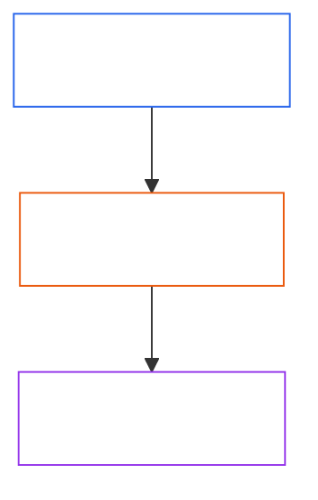
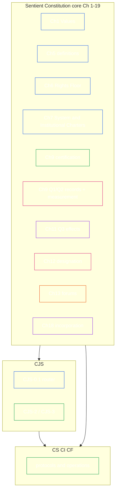

# Constitution document architecture

This file is the **editor map** for the Sentient Constitution corpus. It does **not** bind unless a valid adopting instrument expressly incorporates it. Constitutional readers start at [README.md](README.md).

**Binding text** lives in the numbered `core_*` files (inventory in [README.md](README.md)), [corpus_joint_structure.md](corpus_joint_structure.md), [corpus_systems.md](corpus_systems.md), [corpus_institutions.md](corpus_institutions.md), and [corpus_forum.md](corpus_forum.md). **Corpus** is defined in [**Def.I1** (*Corpus and Authority Stack*)](core_05.045_band_integrative.md#defi1-corpus-and-authority-stack). Edition labels and custody metadata: [README.md](README.md).

Retired architecture sections **14–19** (worklist, adoption appendix, document control) → [archive/ARCHITECTURE_ADOPTION_APPENDIX_ARCHIVED_2026-05-08.md](archive/ARCHITECTURE_ADOPTION_APPENDIX_ARCHIVED_2026-05-08.md) and [archive/ARCHITECTURE_WORKLIST_ARCHIVED_2026-05-08.md](archive/ARCHITECTURE_WORKLIST_ARCHIVED_2026-05-08.md). Completed measurement and companion-anatomy rollout notes → [archive/ARCHITECTURE_ROLLOUT_NOTES_ARCHIVED_2026-08-15.md](archive/ARCHITECTURE_ROLLOUT_NOTES_ARCHIVED_2026-08-15.md).

---

## 1. Purpose

- **Avoid duplication** — owner routing in **section 2**; definitions protocol in **section 4**.
- **Preserve dependency order** — edit order in **section 8**.
- **Track gaps** — stable IDs via `make architecture-index` ([generated index](doc_architecture/generated/stable_id_index.md)).
- **Keep headings, anchors, and cross-references consistent** so audits and editors can navigate. This corpus is **pre-release**: one current fragment id per heading; do not keep fossil or legacy redirect anchors. Auxiliary exports (PDF, plain text) are **non-authoritative** derivatives.

**Review commands:** `make regression` / `make regression-full` (includes measurement-tier, measurement-coverage, and steward-door lockstep audits). Before publication cuts: `make hierarchy-map && make ch5-measurement-tier-audit && make ch5-measurement-coverage-audit`. Steward cards: [implementation/STEWARD_ENTRY_DOORS.md](implementation/STEWARD_ENTRY_DOORS.md). Adoption process path (process support; not itself adoption): [implementation/adoption/](implementation/adoption/).

### Canonical filename convention

- `snake_case` canonical filenames (no spaces; no `%20` links).
- Numbered files use `layer_CC.LSS_suffix.md`: the two-digit chapter home, a literal dot, and the three-digit within-home/layer slot. Examples: `core_00.000_preamble.md`, `core_01.000_values_principles.md`, `core_04.000_burden_traceability_verification.md`, `core_05.035_band_accountability.md`, `core_06.000_rights_part_a.md`, and `core_11.005_standing_measurement.md`. Adopted implementation examples include `cjs_05.105_cross_implementation_operational_terms.md` and `cs_06.305_information_types_and_handling.md`. The machine registry keeps the five-digit `CCLSS` value; filenames and reader references visibly group it as `CC.LSS`.
- Adopted implementation families (**NAV-IMPL-FILENAME-01**): numbered `cjs_` / `cs_` / `ci_` / `cf_` files share a numeric prefix only when they are parts of the same chapter. The undifferenced `layer_NN_*.md` name is the chapter home. Extra same-chapter files take a discriminator — glued letter (`cjs_05.110_oversight_operations.md`) or CS part letter (`cs_02_a_*.md`). Family `01` is the unique scope page for that layer. Different chapters get different numbers (`cjs_20.105_drafting_contracts.md`, `cjs_08.105_support_hosting_classification.md`). Gate: `make adopted-implementation-filename-audit`.
- Full inventory: [README.md](README.md). The Preamble heading and Chapter One numeric headings (`CHAPTER 01`) remain the instrument-opening exception.

### Copy-suffixed duplicate files (FILE-COPY-SUFFIX-01)

A file named like another file plus a space and a number before the extension (`core_07.000_charters 2.md` beside `core_07.000_charters.md`) is a copy made by a file manager, sync client, or editor. It is not part of the corpus.

- **Free removal:** Such a file may be deleted at any time, by anyone, without a reference audit, evidence record, or edition record. Nothing may depend on it.
- **Original wins:** The file without the suffix is the only canonical file. Never merge from a copy, cite it, link to it, or regenerate from it. If a copy holds a change worth keeping, port that change into the original by hand and delete the copy.
- **Check first:** Remove it only when the original exists and the copy is not tracked by git (`git ls-files` does not list it). A tracked file with this naming pattern is a filename-convention defect under **Canonical filename convention**, not a free removal.
- **Tools:** Scripts and audits should ignore these files. A bulk edit such as `make edition-bump` that touches one has changed nothing that matters.
- **Automation:** `make copy-suffix-clean` runs `tools/copy_suffix_clean.py --write`, which deletes every copy that passes the check above and reports, without deleting, any tracked copy or any copy whose original is missing; `make copy-suffix-check` is the dry run. The versioned pre-commit hook `.githooks/pre-commit` runs it right before every commit, after the conflict-marker audit; `make install-hooks` turns the hook on in a checkout (`git config core.hooksPath .githooks`). The hook never blocks a commit over a copy, and a copy it cannot delete is reported and left alone. `.gitignore` keeps copies out of `git add` but does not delete them. The check is not part of `make regression`, because sync clients recreate copies at any time.

### Rename readiness gate

Filename renames require: reference audit, same-change link updates, dated evidence under `evidence/<date>/`, compatibility decision, and edition/custody record. Until the gate passes, candidate names stay planning-only.

### Branch naming (GIT-BRANCH-NAME-01)

A branch name tells reviewers what the work is. It should describe the work the branch carries now, not the first task it was created for.

**Shape.** `<type>/<scope>-<what-changes>`: lowercase, hyphens, no spaces, short enough to read in a branch list (about 50 characters).

- **Type** matches the commit prefix: `docs`, `plain-language`, `restructure`, `fix`, `tools`, `chore`.
- **Scope** is the chapter, article, or lane: `ch06`, `ch1c`, `lane-c`.
- **What changes** is the specific work, such as `article-xxvii-restraint`.
- Examples: `docs/ch06-article-xxvii-restraint`, `restructure/ch06-article-xx-part-split`, `tools/branch-name-check`.

**Check at the start of every new session.** Before the first commit, run `git branch --show-current` and compare the name to the task for this session. Check again before opening a pull request. A new session (human or AI) is where a stale name usually starts, because it picks up whatever branch was left checked out.

**When to change the name.**

- The branch name describes earlier work and this session is doing something different. Example: `restructure-justice-article-xx-part-split` now carries Article XXVIII commits.
- The new work is unrelated to the commits already on the branch. Start a new branch from `main` instead of renaming, so each branch stays about one piece of work.
- The name is vague (`fix`, `updates`, `wip`) or has no scope.

**When to leave it alone.**

- `main`, and any branch someone else created or is using.
- A branch that already has an open pull request. Renaming it on the remote closes that pull request, so ask the custodian first.
- A name that is already accurate. Do not rename for style alone.

**How.**

- Not yet pushed: `git branch -m <new-name>`.
- Pushed, no pull request open: `git branch -m <new-name>`, then `git push origin -u <new-name>`, then `git push origin --delete <old-name>`.
- New work from `main`: `git switch main && git pull && git switch -c <new-name>`.

When a branch is renamed, say so in the first message of the session or in the pull request description, with the old name, so the history stays traceable.

Gate: manual. [CONTRIBUTING.md](CONTRIBUTING.md) leaves contributor branch names free-form; this rule governs the custodian's and AI sessions' working branches.

### Keeping your local copy current (GIT-LOCAL-SYNC-01)

A local checkout that falls behind `origin/main` shows old text, builds generated files from old sources, and turns the next merge into a conflict in files nobody edited by hand. Keep it current.

**Check at the start of every session, and again before a pull request.** Run `git fetch origin`, then `git status -sb` and `git log --oneline HEAD..origin/main`. If the second command prints anything, the checkout is behind.

**What to do.**

- **`main`:** keep it a pure mirror of `origin/main`. Fast-forward it without checking it out: `git fetch origin main:main`. Never commit on it.
- **A work branch:** after any pull request merges (yours or someone else's) and before pushing more commits, run `git merge origin/main`.
- **Dirty working tree:** if uncommitted generated files block the merge, run `git restore ai_corpus doc_architecture/generated`, merge, then regenerate (below). Commit or stash hand-edited source files first.
- **Conflicts in generated files** (`ai_corpus/indexes/*`, `doc_architecture/generated/*`): never resolve these by hand. Take main's version (`git checkout --theirs <file>`), then run `make plain-terms-edition boundary-chunks print-pack reader-accessibility ai-corpus-sync` and commit the result.
- **Unrelated work:** start it from current `main` (`git fetch origin main:main && git switch -c <new-name> main`), not from whatever branch is checked out.
- **After a push or merge: `make sync-local`.** It fetches with `--prune`, fast-forwards `main`, and, when you are on a branch whose remote is gone and whose commits are all in `origin/main`, switches to `main` and deletes that branch. It lists any other branch whose remote is gone, and it never deletes a branch that holds a commit missing from `main`, never switches with uncommitted changes to tracked files, and never touches untracked files. `python3 tools/sync_local.py --dry-run` fetches and reports without changing anything; `--delete-merged` also deletes the other merged branches. A public repository needs no login to fetch, so this works from any shell, including the one on the custodian's computer; updating files there needs the deletion approval described in `AGENTS.md`.
- **On the custodian's own computer: run `make sync-local` after each merge.** Open a terminal in the repository folder and run `make sync-local` once a pull request has merged, whether you merged it or a Claude Code session did. It is safe to run at any time: it only fast-forwards `main`, deletes a branch that is fully merged, and lists any other branch whose remote is gone. A session linked to the computer runs it there too, but a session cannot reach the computer while it is off or its Claude app is closed, so a session that could not run it says so in its final reply and the step is yours.
- **After a push from a Claude Code session.** Pushes from a session use a git bundle (see *Pushing and merging from a Claude Code session* in [AGENTS.md](AGENTS.md)), which keeps the commit hashes, so the old branch is simply merged and `make sync-local` deletes it. If commits were replayed instead (from patches), `origin/main` holds the same changes under new hashes: do **not** merge `origin/main` into the old branch, because the same edits arrive twice and can conflict. `sync-local` still treats that branch as merged, because it compares changes with `git cherry -v origin/main <old-branch>` (a `-` line is already in `main`, a `+` line is local work that is not). If any line starts with `+`, copy that work to a new branch from `main` first (`git switch -c <new-name> main`, then `git cherry-pick` those commits).
- **Keep it current without asking.** `make install-hooks` sets `fetch.prune true` and `pull.ff only` for the checkout. In VS Code, the workspace settings `git.autofetch` (true), `git.autofetchPeriod` (120 seconds), `git.pruneOnFetch` (true), `git.fetchOnPull` (true), and `git.branchProtection` (`["main"]`, with `git.branchProtectionPrompt` set to `alwaysCommitToNewBranch`) fetch in the background, drop branches that GitHub deleted, and stop commits on `main`. They live in the local `.vscode/settings.json`, which is not tracked (a tracked copy would collide with the untracked one on the next pull). At the start of a session an agent runs `python3 tools/sync_local.py --dry-run` and says if the checkout is behind.
- **Always on the current branch (custodian decision, 2026-10-13).** The checkout is always on a branch that contains the latest `origin/main`. A branch whose pull request has merged is finished: do not leave the checkout on it and do not commit more to it. Start the next piece of work from current `main` as above. If the checkout is on an older or merged branch with uncommitted work, stash it (`git stash push -u -m "<what it is>"`), switch, and restore it only if it is still needed. Never commit stale work onto a stale branch.

**Why.** Pull requests that touch corpus text regenerate the same derived files, so any two open branches conflict there. Merging `origin/main` often keeps that conflict to one small, mechanical step.

Gate: manual. Pairs with GIT-BRANCH-NAME-01, since the same start-of-session check covers both.

### Reporting a commit (GIT-PUSH-CL-01)

Every time a session commits, the closing message gives the custodian the exact push command, so the custodian can push without working it out.

- **First push of a branch:** `git push -u origin <branch-name>` (use the real branch name, not a placeholder).
- **Later pushes of a branch already on the remote:** `git push`.
- Name the branch the commit is on, and say if the branch is behind `origin/main`.
- The session does not push unless the custodian asks. The custodian pushes, opens the pull request, and merges.

Gate: manual. Pairs with GIT-LOCAL-SYNC-01 and GIT-BRANCH-NAME-01.

---

## 2. Corpus roles (single source of truth)

**Numbering note:** When a passage says only “Chapter Sixteen,” disambiguate by filename — see [README.md](README.md).

**Constitutional owner layers:** canonical positive register — [Preamble — constitutional owner register](core_00.000_preamble.md#4-principles-definitions-and-rights) (sections 4–9). The table below is the editorial mirror; substantive owner non-relocation discipline lives under [Authority Stack and Internal Hierarchy](core_05.045_band_integrative.md#authority-stack-and-internal-hierarchy). **Binding owner claims** at chapter openings follow **OWNER-OPENING-01** in **section 4**.

| Layer | Primary home | Routing |
|--------|--------------|---------|
| Values, definition mechanics, definitions | Sentient Constitution `core_*` Ch 1–5 | [README.md](README.md) reading order |
| Rights (Articles I–XXVIII) | Ch 6 | `core_06.0*_rights_part_*.md`; titles via `make reference-audit` |
| System and Institutional Charters | Ch 7 | `core_07.000_charters.md`; the System Charter and Institutional Charter floor (a System Charter for each system of Class L or above, an Institutional Charter for each institution that runs more than one system; voluntary for Class P), the minimum contents of each, the Charter Role Map as the published seat map, and changes and versions; the 12-field template stays in CI-3.6 and the lane map in CI-3.2 |
| Functional independence and separation of duties | Ch 8 | `core_08.000_functional_independence_separation_of_duties.md`; four-seat floor, Materially Binding Act Record minimum, control-line independence, published placement, substitutes, proportionate merged hosting, emergency departures, and wrong-seat routing |
| System alignment certification | Ch 9 | `core_09.000_system_alignment_certification_evaluation.md` (Part A — evaluation); `core_09.005_system_alignment_certification_record_process.md` (Part B — forum process and outcomes); `core_09.010_system_alignment_certification_record_recertification.md` (Part C — record, recertification, and standing bridge). Part A opens the chapter; there is no index file. The worked illustrations are in the systems family, `corpus_systems/cs_09.320_system_alignment_certification_illustrations.md` (CS-9.320). Under **oversight**, oversight requires auditing (**Article XVI** / [Auditability](core_05.050_band_oversight.md#auditability) / **[CJS-3.3 audit process home](corpus_joint_structure/cjs_05.115_audit_process.md#cjs-5115-3-audit-process-home-odef3)** and **CJS-3.3**–**CJS-3.5** OP annexes); Ch 9 is one especially large, high-stakes audit process among others — not the sole auditing home. |
| Institutional alignment certification | Ch 10 | `core_10.000_institutional_alignment_certification.md`; the same six phases as Ch 9 for an Institution, under the same section numbers (§1–§11); §4 and §5 point to Ch 9 §4 and §5; cites each System Certification Record by link and is not a licence |
| Standing records (Question 1) | Ch 11 | `core_11.000_standing_assessment.md`; verified facts, standing records, custody, and handling |
| Standing measurement (Question 2) | Ch 12 | `core_12.000_standing_measurement.md`; Contribution Axis / Violation Axis measurement, descriptors, slots, and the unified LEQU scale |
| Standing integration and effects (Question 3) | Ch 13 | `core_13.000_standing_integration.md`; violation, correction, and prevention before contribution gates, with lock design and enforcement, then final effect, restoration, and enforcement |
| Anti-constitutional-misconduct designation | Ch 14 | `core_14.000_misconduct_designation.md` (Part A — designation criteria and safeguards); `core_14.005_misconduct_pattern_applications.md` (Part B — named pattern applications); designation only for qualifying fixed Ch 11 Violation Axis `s = 7–9` findings |
| Forums (constitutional) | Ch 15 | `core_15.000_forum.md`; forum families, jurisdiction, supervision, and cross-forum anti-self-judging; [README navigation](README.md#standing-pipeline-and-forums) |
| Governance / amendment / incorporation | Ch 16–20 | `core_16.000_governance.md`, `core_17.000_non_regression.md`, `core_18.000_expansion_supremacy.md`, `core_19.000_amendment_ratification.md`, `core_20.000_incorporation.md` |
| Cross-implementation joint structure | CJS | **CJS-0.1** (*Topic router*) |
| Systems, institutions, forum operations | CS / CI / CF | Adopted implementation wrappers + subfiles |

**Footer policy:** `make footer-audit`. Optional `*Corpus alignment:*` cites [README.md](README.md) edition metadata and [Chapter Five *Corpus*](core_05.045_band_integrative.md#corpus).

**Authority stack:** (1) numbered `core_*` constitutional source; (2) incorporated implementation within adoption scope; (3) this map and process docs unless explicitly adopted; (4) Sentient Constitution meaning controls operational layers — see [Authority Stack and Internal Hierarchy](core_05.045_band_integrative.md#authority-stack-and-internal-hierarchy).

---

## 3. Boundary rules

1. **Core owns** normative *why* and *what* (values, rights, definitions, meta obligations).
2. **Implementation files own** *how* (taxonomies, protocols, institutions, forums, joint interlocks).
3. **No duplicate definitions** across layers — implementation files *apply* Chapter Five terms.
4. **Stricter wins** where the corpus already says so; core values and rights prevail over conflicting operational wording.
5. **Chapter Six implements detail** for Articles I–XXVIII; do not invent parallel Rights Floors in implementation files.

---

## 4. Project-wide definitions protocol (pinned)

Machine-checkable rules: [tools/architecture/rule_registry.json](tools/architecture/rule_registry.json). Audit catalog: [implementation/AUTOMATED_REFERENCE_CHECKING.md](implementation/AUTOMATED_REFERENCE_CHECKING.md). Lexical guardrails: [tools/architecture/lexical_guardrails.json](tools/architecture/lexical_guardrails.json).

### What counts as a definition

- **Hard definitions:** Ch 2–3 ([`core_02.000_definition_structure.md`](core_02.000_definition_structure.md)); Ch 4 ([`core_04.000_burden_traceability_verification.md`](core_04.000_burden_traceability_verification.md)); Chapter Five §1–§3 (single-home rule below).
- **Values language:** Preamble §1 — [Constitutional Tetrad](core_00.000_preamble.md#constitutional-tetrad), [Two Constitutional Aims](core_00.000_preamble.md#two-constitutional-aims) (**Flourishing** / **Continuity**), and [material stake](core_00.000_preamble.md#material-stake) at principle layer; Chapter Five O/M/A/C for Tetrad legs ([Participation](core_05.025_apex_participation_leg.md#participation-constitutional), [Oversight](core_05.020_apex_oversight_leg.md#oversight-constitutional), [Accountability](core_05.005_apex_accountability_leg.md#accountability), [Timeliness](core_05.030_apex_timeliness_leg.md#timeliness-constitutional)) and aims ([Flourishing](core_05.015_apex_flourishing_aim.md#flourishing-constitutional), [Continuity (Constitutional Aim)](core_05.010_apex_continuity_aim.md#chapter-five-definitions-continuity-constitutional-aim)); Chapter One develops those aims into operative principles. **Reading arc:** Part A (§§1–12 the Flourishing and Continuity aims) → Part B (§§13–15 interaction, override limits, and interpretation) → Part C (§§16–19 stewardship, governance, and incentives) → **§20 Integrated Application** capstone in Part C. Use **Continuity aim** when naming the constitutional aim; reserve bare *continuity* for operational uses elsewhere.
- **Measurement frame (Preamble §2):** Eight constitutional measurement categories in [Measurements Overview](core_00.000_preamble.md#2-measurements-overview) link directly to their Chapter Five **measurement-family homes** (category column) and to canonical definitions (subcategory column); the family table, constitutional use, and definition routing live on the Chapter Five homes. **Family-home map:** Threshold/scaling and Oversight → [`core_05.020_apex_oversight_leg.md`](core_05.020_apex_oversight_leg.md#measuring-oversight-preamble-measurement-family); Flourishing → [`core_05.015_apex_flourishing_aim.md`](core_05.015_apex_flourishing_aim.md#measuring-flourishing-preamble-measurement-family); Continuity → [`core_05.010_apex_continuity_aim.md`](core_05.010_apex_continuity_aim.md#measuring-continuity-preamble-measurement-family); Participation → [`core_05.025_apex_participation_leg.md`](core_05.025_apex_participation_leg.md#measuring-participation-preamble-measurement-family); Accountability → [`core_05.005_apex_accountability_leg.md`](core_05.005_apex_accountability_leg.md#measuring-accountability); Timeliness → [`core_05.030_apex_timeliness_leg.md`](core_05.030_apex_timeliness_leg.md#measuring-timeliness); Constitutional Performance → [`core_05.060_band_performance.md`](core_05.060_band_performance.md#measuring-constitutional-performance-preamble-measurement-family). Home-section anchors use the `#…-measurement-family` suffix (skipped as non-leaf routing anchors by `make ch5-measurement-coverage-audit`). [§3.1 Using Measurements in Governance](core_00.000_preamble.md#31-using-measurements-in-governance) routes measurement → certification (Chapter Nine), standing records (Chapter Eleven), remedy (Chapter Thirteen), forum review (Chapter Fifteen). **Standing measurement** (Chapter Eleven contribution/violation axis measurement) is a *process* concept distinct from **constitutional measurement** categories (Preamble §2), which supply the evidentiary frame for what gets verified before records enter the standing pipeline.
- **Standing:** Chapter Eleven owns Question 1 (**verified** standing records) and Chapter Twelve owns Question 2 (Contribution Axis / Violation Axis measurement). Chapter Thirteen accepts those inputs as immutable and owns Question 3 integration and effects. Chapter Fourteen owns designation only. Chapter Fifteen forums may **open, update, or correct** standing records — or **set a bad record aside on challenge** — from verified findings. Boundary gloss: a **filed case** is not standing by itself. Prefer **case** (forum matter / dispute filing) over **claim** in that contrast; keep **claim** for dispute-phase inventory labels (*unadjudicated claims*) and other established senses.
- **Rights:** Chapter Six; implementation files **cite** articles.
- **Joint operational terms:** `corpus_joint_structure.md` only — route via **CJS-0.1**.
- **Operational taxonomies:** **CS-2**, **CS-3**, **CS-4** and named protocols.

### CJS owner rule

Use **CJS** only for cross-implementation interface terms with no stable single-file home. Reusable joint terms → **CJS-3** clusters; **CJS-2** interlocks point to **CJS-3** and the primary owner named in **CJS-0.1**. Escalate to Chapter Five when constitutional meaning is at stake.

### Chapter Five admission gate

Keep constitutional concept + O/M/A/C boundary only; cite owner homes for institutional machinery. **`make ch5-definitions-gravity-audit`** (blocking).

**Band layout:** Part A ([`core_05.000_definitions_home.md`](core_05.000_definitions_home.md)) holds the compass, alphabetical directory, and dependent-cluster meta rules. Canonical O/M/A/C homes for constitutional aims and Tetrad legs live in **`core_05.0*_apex_*`** files — [Flourishing](core_05.015_apex_flourishing_aim.md), [Continuity](core_05.010_apex_continuity_aim.md), [Accountability](core_05.005_apex_accountability_leg.md), [Oversight](core_05.020_apex_oversight_leg.md), [Participation](core_05.025_apex_participation_leg.md), [Timeliness](core_05.030_apex_timeliness_leg.md). Leaf definition bodies live in **`core_05.0*_band_*`** band files — **Oversight** [`core_05.050_band_oversight.md`](core_05.050_band_oversight.md) (**Def.O1–Def.O2**), **Participation** [`core_05.055_band_participation.md`](core_05.055_band_participation.md) (**Def.P1–Def.P3**), **Accountability** [`core_05.035_band_accountability.md`](core_05.035_band_accountability.md) (**Def.A1–Def.A4**), **Continuity** [`core_05.040_band_continuity.md`](core_05.040_band_continuity.md) (**Def.C1–Def.C4**), **Integrative** [`core_05.045_band_integrative.md`](core_05.045_band_integrative.md) (**Def.I1**). Each defs file contains Independent, Semi-independent, and Dependent cluster entries assigned to that band. A sixth cross-cutting file, the **Constitutional Performance** band [`core_05.060_band_performance.md`](core_05.060_band_performance.md), is only the measurement-family home for that Preamble category (instrumental to both aims, not a Tetrad leg); its leaf definitions keep canonical homes in the **Continuity** band because they are Continuity-band stewardship / shared-system-capacity / proportionality–burden–efficiency cluster members — family home ≠ leaf home (parallel to Timeliness vs. Accountability). Leaves relocate to the Performance file only on an express, dated placement decision. Retired Part B/C paths live under [`archive/core_ch5_retired/`](archive/core_ch5_retired/README.md) only.

### Editorial rule registry

| Rule ID | Summary | Gate |
|---------|---------|------|
| NAV-TRACE-08–10 | Trace placement and contents | `make ch10-trace-audit`, `make trace-routing-prose-audit` |
| NAV-READER-06 | Reader-guidance widget placement | `make widget-top-placement-audit` |
| NAV-WIDGET-TOP-01 | File-top / section-opening widget stack | `make widget-top-placement-audit` |
| NAV-DAC-12 | D/A/C widget discipline, including no visible placement commentary | `make ch5-dac-widget-audit`, `make nav-widget-spacer-audit`, `make plain-language-audit` (placement commentary) |
| NAV-DAC-12-ORDER | Trace → D/A/C placement | `make trace-dac-widget-order-audit` |
| NAV-DAC-12-SPACER | `<br>` after collapsible D/A/C only | `make nav-widget-spacer-audit` |
| NAV-DAC-CH1-ORDER | Chapter One D/A/C row order | `make ch1-dac-order-audit` |
| NAV-PLACEMENT-01 | File-top Corpus placement widget | `make file-top-placement-audit` |
| FILE-COPY-SUFFIX-01 | Copy-suffixed duplicate files (`name 2.ext`) are not corpus and may be removed freely | `make copy-suffix-check` (list), `make copy-suffix-clean` (delete); not part of `make regression`; see [Copy-suffixed duplicate files](#copy-suffixed-duplicate-files-file-copy-suffix-01) |
| NAV-IMPL-LANDING-01 | Implementation-corpus wrapper landing page | Manual (see **section 4**) |
| NAV-IMPL-SCOPE-01 | Implementation `*-1` scope/boundary page format | Manual (see **section 4**) |
| NAV-IMPL-SUBFILE-01 | Adopted implementation subfile anatomy: H1, placement widget, owner line, gloss | `make adopted-implementation-anatomy-audit`, `make file-top-placement-audit-adopted-implementation`, `make owner-line-audit` (owner sentence) |
| NAV-IMPL-FILENAME-01 | Adopted implementation files share a numeric prefix only as same-chapter parts | `make adopted-implementation-filename-audit` |
| GIT-BRANCH-NAME-01 | A git branch is named for the work it carries (`<type>/<scope>-<what-changes>`). At the start of a new session, and again before a pull request, check the name against the work; rename it, or start a fresh branch from `main`, when it no longer fits. | Manual (see **Branch naming (GIT-BRANCH-NAME-01)**) |
| GIT-LOCAL-SYNC-01 | Keep the local checkout current with `origin/main`. At the start of a session and before a pull request, fetch and check `git log HEAD..origin/main`; fast-forward local `main`, merge `origin/main` into work branches, and regenerate rather than hand-resolve generated files. After a pull request, run `make sync-local`: it fast-forwards `main` and deletes a merged branch, never one with commits missing from `main`. Do not merge `origin/main` into a branch whose commits were replayed under new hashes. The checkout is always on the current branch: when a pull request merges, start the next work from current `main`. | Manual (see **Keeping your local copy current (GIT-LOCAL-SYNC-01)**) |
| GIT-PUSH-CL-01 | Every commit is reported with the exact push command (`git push -u origin <branch>` for a first push, `git push` after). The session does not push unless asked. | Manual (see **Reporting a commit (GIT-PUSH-CL-01)**) |
| ROOT-LAYOUT-01 | The repository root holds only the public door and the numbered corpus. Plain-language companions go in `project/plain_language/`, drafts and WIP files go under `project/`, and git bundles (`*.bundle`) never belong in the repository. | `make root-layout-audit`; `python3 tools/root_layout_audit.py --fix` moves plain-language files |
| FILE-SIZE-01 | No file in the repository is larger than 1 MB (1,000,000 bytes). Split it, compact it, or keep it out of the repository; dated evidence snapshots are deleted rather than exempted. | `make file-size-audit` |
| FRONT-DOOR-01 | The front doors (README, START_HERE, AGENTS, llms.txt, docs/index.md, CONTRIBUTING, ANNOUNCEMENT) say only what the corpus supports. Edition string, effective date and steward pin agree; until the announcement the edition is the current date (`make edition-bump`; `make front-door-freshness` checks it, `EDITION_TRACKS_DATE=0` in the Makefile ends that at the announcement cut); pre-release status agrees; "Chapters 1-N" and "N articles" match the `core_NN` files and the Rights Floor headings; the language bar matches `translations/`; README and ANNOUNCEMENT quote the Two Fundamental Questions exactly as the Preamble words them; every backticked `make` target and `tools/` path exists; START_HERE's ranked situations and non-fits match FIT_SITUATIONS one for one; LICENSE authorship appears in README and docs/index.md; the doors point at each other; required sections exist; no list links one target twice; the generated reader files README links are tracked. When you change what a door counts or quotes, change the door in the same commit. | `make front-door-audit`; `make front-door-freshness` also runs the generated-file `-check` targets (part of `make regression-full`) |
| FRONT-DOOR-LABEL-01 | Section labels in link text on public-facing pages (START_HERE, AGENTS, CONTRIBUTING, docs/index.md, VISION, FAQ, guides, steward doors, the adoption kits and easy-entry guides, ANNOUNCEMENT) match the number of the heading they link, the same as in the core. These pages used to be skipped as "history", so renumbering left readers with labels such as "Chapter One §16.1.1" for what is now §17.1. | `make section-label-anchor-audit` |
| NAV-PRE-RELEASE-FRAGMENT-01 | Pre-release: one current fragment id per heading; no fossil or legacy redirect anchors | `make fossil-anchor-audit` |
| TERM-SYSTEM-CLASS-01 | Chapter Nine says "system class", not a bare "class" (named levels such as "Class B" are fine); headings are in Chicago headline case ("System Class Scaling and Escalation") | `make system-class-term-audit` (changed lines only); `python3 tools/apply_system_class_term.py --dry-run` to preview a fix |
| MD-LIST-INTRO-01 | Bold list-intro lead-in ends with `:` not `.`: standalone (`**Record and showing:**`), heading-echo run-in (`**Symmetric costly constraints:**`), or list-item label (`- **Not standing:**`). Ordinary non-echo run-ins (`**Admission scope.**`) are out of scope. | `make corpus-markdown-audit` |
| MD-GLOSS-CLOSE-01 | An italic `*In plain terms: ...` gloss paragraph ends with a closing `*`. A missing closer renders a literal leading asterisk and drops the italics. | `make corpus-markdown-audit` |
| MD-HEADING-TOPIC-01 | Numbered section's first body-prose line (after widgets and `*In plain terms*` gloss) must not restate that heading as a topic sentence (`**[§13.2 Title](#…):**`). Heading-echo run-in labels are MD-HEADING-RUNIN-01. | `make heading-echo-topic-audit` |
| MD-HEADING-RUNIN-01 | A section's first body line must not open with a bold run-in label that restates its own heading (`**Governance as authorized structure.**` under `#### 11.1 Governance as Authorized Structure`). Bold terms used as a sentence subject, and labels that add a distinct idea, are out of scope. | `make heading-runin-echo-audit` |
| MD-LABEL-ECHO-01 | A list item's bold label must not be restated by its own body (`- **Is invalid:** The seat is invalid.`). Fold the item into its neighbour or write a label that names a distinct idea. Cross-reference rows (`— …`, `§` pointers) and lead-ins ending in `:` are out of scope. Blocking in `make regression`. | `make list-label-echo-audit` |
| MD-SECTION-LEAD-01 | A section's first body line (after widgets, spacers, callouts, and `*In plain terms*` gloss) is lead-in prose, not a bare list item. Container sections whose first content is a child heading are out of scope. **Carve-out:** Chapter Five definition files (`core_05.*.md`), whose entries open with O / E / C bullets by design. Blocking (`make regression`). | `make section-bullet-lead-audit` |
| MD-SUBSECTION-ONE-01 | A numbered section or subsection may have exactly one numbered subsection. Do not add a second subsection, split the content, or fold the single child into its parent only to avoid a lone child. The numbered heading earns its place when other text cites that part, or when it holds a self-contained block (a table or checklist) that the parent points to. No audit flags a lone child; 16 exist across 10 `core_*` files as of the 357th move. | Manual (editorial convention; nothing in `make regression` checks it) |
| VIS-CHART-READABILITY-01 | Mermaid chart boxes with a title and explanatory content use `<br/><br/>` between the title and content for a blank visual line. | Manual (see **Chart readability standard** below) |
| VIS-CHART-THEME-02 | Reader-facing Mermaid nodes use transparent fills, white labels, and the shared semantic-outline palette; do not rely on renderer-default label colors. | Manual (see **Chart color and theme standard** below) |
| VIS-CHART-SYNC-03 | When an Article or subarticle is renumbered, renamed, added, moved, split, or removed, update every reader-facing Mermaid chart that lists it so numbers, titles, and bullets match the current headings. | Manual (see **Chart sync on renumbering (VIS-CHART-SYNC-03)**) |
| VIS-CHART-ORIENT-04 | Mermaid flowcharts flow top to bottom (`flowchart TB`); a left-to-right, right-to-left, or bottom-up chart needs a stated exception. | `make chart-orientation-audit` (in `make regression`) |
| VIS-CHART-CENTER-05 | Mermaid flowcharts keep boxes horizontally centered on one another: a node sits centered under its parent, or under the midpoint of its parents; a node that fans out to a row of siblings is centered over the row; a node that the row converges on is centered under it. Exceptions need a stated reason. | Manual (see **Chart centering standard** below) |
| VIS-CHART-CROSSING-06 | Mermaid flowchart links must not cross one another. Rearrange nodes, end a loop at a pair of on-page connector circles (**VIS-CHART-SYMBOLS-08**) instead of drawing a long link back up the chart, or merge parallel paths into one box before publishing. No exceptions. | Manual (see **Chart crossing standard** below) |
| VIS-CHART-EXTERNAL-07 | In a chart about one chapter's process or structure, a box for a process owned outside that chapter uses the subroutine shape (`[[ ]]`), says it is outside the chapter, and connects with a dotted link; when one section hands off, that section goes on the link label. Corpus-wide map charts are out of scope. | Manual (see **Chart external-process standard** below) |
| VIS-CHART-SYMBOLS-08 | Mermaid flowcharts follow standard flowchart symbols (ISO 5807) wherever Mermaid can draw them: rectangle for a step, diamond for a decision, double-barred box for a predefined process defined elsewhere, and matching lettered circles (on-page connectors) for a loopback or a jump. Corpus-specific conventions apply only where no standard symbol exists. | Manual (see **Chart symbol standard** below) |
| VIS-CHART-SECNUM-09 | In a Mermaid chart box that cites a section, the section number comes first: at the start of the title line, before the title (`§5 Publish the office-holder statement`), never after it behind a dash (`Publish the office-holder statement — §5`) or as a trailing note. A content line that carries its own section number starts with it. | `make chart-section-number-audit` (in `make regression`) |
| OWNER-OPENING-01 | Binding constitutional-owner opening statement | `make owner-line-audit` (also covers the NAV-IMPL-SUBFILE-01 owner sentence) |
| LINK-IN-PARA-14 | Load-bearing in-paragraph links | `make in-paragraph-link-audit` |
| LINK-OFF-CORPUS-15 | Link destinations stay in-repository in binding text; no machine-local targets anywhere | `make external-link-audit` (inventory: `make external-link-audit-report`) |
| IMPL-ROUTE-01 | Core-to-implementation routing: one plain pointer sentence to the family subfile that actually holds the mechanics; no generic implement / not-narrow restatement; no layer-relationship lead-ins | `make plain-language-audit` (lead-in phrases); manual (generic tails, pointer truth) |
| SUPPORT-DOC-POINTER-01 | Binding corpus must not depend on `doc_architecture` or a README section for meaning or routing | `make support-doc-pointer-audit` |
| CH5-GRAVITY | Chapter Five admission / de-bundling | `make ch5-definitions-gravity-audit` |
| CH5-ORDER-01 | Chapter Five editorial order | `make ch5-cluster-order-audit`, `make ch5-entry-format-audit`, `make ch5-constitutional-cluster-audit` |
| CH5-SINGLE-DEF | One visible definition per term | `make ch5-single-definition-audit` |
| LEX-GUARDRAILS | Vocabulary and capitalization | `make lexical-vocabulary-audit` |
| TIME-NAME-01 | A time window is named by its kind of time: window, target, bound, term, interval, period, or span. "Clock" does not name a specific window, "cadence" does not name a length, and "response window" means the Chartered Party's window to answer only. | `make lexical-vocabulary-audit` (rule `avoid-window-clock-names`); see [Time-window names (TIME-NAME-01)](#time-window-names-time-name-01); list of names: [CJS-0.4](corpus_joint_structure/cjs_00.105_registry_and_reading_rules.md#cjs-0105-4-time-window-names) |
| ADOPT-TRANS-01 | The period in which an adopter moves from legacy to constitutional operation is the Chapter Five defined term **Adoption Transition**, written with both words capitalized. The bare named phrases (transition window, plan, authority, and the like) are not used for it. Other senses of "transition" (class change, labor displacement, mode or state change, vendor or format migration) stay ordinary words. | `make lexical-vocabulary-audit` (rule `avoid-bare-adoption-transition`); definition: [Adoption Transition](core_05.040_band_continuity.md#adoption-transition) |
| TRANS-SENSE-01 | A system moving to a higher-obligation track is a **step-up**, a stopgap recognizing arrangement for a sentient is **interim recognition**, a stopgap during amendment is an **interim step** or **interim measure**, and control or operation passing to another party is a **handoff**. The bare phrases (transition to higher or full, transition toward, transition triggers, sandbox transition, transitional recognition, arrangements, regimes, steps, or measures, transition continuity, continuity-preserving transition, safe transition paths, transition lifecycle) are not used. | `make lexical-vocabulary-audit` (rule `avoid-transition-senses`); see moves 150 and 151 |
| TIME-REF-01 | Every time reference in the binding text (a number with a unit, or "reasonable period", "promptly", "as soon as feasible") shows its logic in the same sentence: it names a bound kind (outer bound, intake target, certification interval, and so on) and the tier or class that sets it, or it uses a registered fixed-period name. A registered scaled window (response window, resolution window) is a bound kind, but a number beside it still needs the tier or class that sets it. Older references are baselined and the list only shrinks. The vocabulary is in `tools/time_reference_registry.json`. | `make time-reference-audit` (backlog: `make time-reference-backlog`) |
| TIME-LOCK-01 | Every copy of the tier windows follows its owner. The outer bounds are owned by Chapter Fifteen §6 (*Tier outer bound*) and the intake targets by CF-12.3.1. The Chapter Seven §1.6 summary table (response window = intake target, resolution window = outer bound) and the sentences that quote the intake figures are derived copies, listed in `tools/time_window_lockstep_registry.json`. The audit reads the owners, checks that they agree with each other, rebuilds each copy, and fails on drift or on a registered copy it cannot find. `--fix` rewrites drifted copies from the owners and never settles a conflict between owners. | `make time-window-lockstep-audit` (repair: `make time-window-lockstep-fix`, then `make architecture-index ai-corpus-sync plain-terms-edition boundary-chunks`) |
| TERM-BODY-01 | A body that verifies, authorizes, or decides a question for others is an **authority** (record-opening authority, Backup Record Authority, restricted information authority, verifying authority). A body that enters and holds a record is a **custodian**, and a body that files and receipts is a **registrar**. "Verifier" is not a name, and "office" names a unit or a post, not a body with a job. | `make lexical-vocabulary-audit` (rule `avoid-verifier`); see [Names for bodies that verify, hold, and file (TERM-BODY-01)](#names-for-bodies-that-verify-hold-and-file-term-body-01) |
| VIOLATION-FINDING-01 | On a line about violations, standing locks, Interim Holds, sanctions, or misconduct, a bare "finding" ("a verified finding", "the finding it rested on") says **violation finding** when a finding of violation is meant; any other finding is qualified (component finding, cause finding). "Finding of violation", a back-reference after a "violation finding" on the same line, and "finding profile / authority / basis" are not matched. Older uses sit in a shrink-only baseline. | `make violation-finding-audit` (`tools/violation_finding_audit.py`; `--ignore-baseline` lists the backlog, `--write-baseline` rewrites it after fixes); tests: `make violation-finding-audit-test` |
| GROUND-QUALIFIED-01 | The noun "ground" says which kind of ground it is (**denial ground**, **revocation ground**, **reopening ground**, **System ground**, **institutional ground**, a **joint ground**) or "ground for ..."; a bare "a ground", "the grounds", "that ground", "its own ground", or "stated ground" fails. The verb ("a rule that grounds the duty", "may ground a denial") and "common ground" are not matched. Older uses sit in a shrink-only baseline. | `make ground-qualified-audit` (`tools/ground_qualified_audit.py`; `--ignore-baseline` lists the backlog, `--report` counts per file, `--write-baseline` rewrites it after fixes); tests: `make ground-qualified-audit-test` |
| RECORD-QUALIFIED-01 | On a line that names a System record and also speaks of an Institution, or names an Institution's record and also speaks of a System, a bare "the record", "this record" or "that record" says which: the **Institutional Certification Record** or the **System Certification Record**. A line that names one kind of record, "the record seat", and "record-keeping" are not matched. No baseline (the six older lines were fixed). | `make record-qualified-audit` (`tools/record_qualified_audit.py`); tests: `make record-qualified-audit-test` |
| RECORD-KIND-01 | The noun "record" says which kind of record it is (**standing record**, with its contribution, violation, operator and stakeholder forms; **Forum Case Record**; **System Certification Record**; **Institutional Certification Record**; or another named record such as a classification record) or "record of ..."; a bare "the record", "a record", "that record", "its own record", "the same record", "a single record" or "the official record" fails. Inside a chapter about one kind, the word says it each time it stands alone (Chapter Eleven says *standing record*, Chapter Nine *System Certification Record*, Chapter Ten *Institutional Certification Record*). **Official record** is accepted as a kind: it is Chapter Five's Record Integrity category for any record a constitutional process relies on. The defined seat names (**record custodian**, **record-opening authority**, **record seat**, **record span**, **record holder**), the verb ("must record the reasons"), "on record", and a sentence-initial "Records ..." are not matched. The baseline is empty: every older use was named in the 292nd move, and a new bare use anywhere fails. | `make record-kind-audit` (`tools/record_kind_audit.py`; `--ignore-baseline` lists the backlog, `--report` counts per file, `--write-baseline` rewrites it after fixes); tests: `make record-kind-audit-test` |
| SCOPE-QUALIFIED-01 | The noun "scope" says whose or which scope it is (**chartered scope**, **admission scope**, **release scope**, **enforceability scope**, or another word that names the kind) or "scope of ..."; a bare "the scope", "that scope", "its scope", "a scope", "its own scope", "the whole scope" or "a narrow scope" fails. Inside a chapter about one kind, the word says it each time it stands alone (Chapter Seven says *chartered scope*). The field labels **In scope:**, **Out of scope:** and **Admission scope:**, a following pointer or relative clause ("the scope above", "the scope each cluster states", "the scope it is supervised under"), "scope of ..." and "scope for ...", scope as a modifier (scope document, scope cap, scope creep), and the verb are not matched. Chapter Five has no exemption: the labels that fill its definitions are not matched, and every older bare use there was qualified in the 311th to 314th moves. The baseline is empty: a new bare use anywhere fails. | `make scope-qualified-audit` (`tools/scope_qualified_audit.py`; `--ignore-baseline` lists the backlog, `--report` counts per file, `--write-baseline` rewrites it after fixes); tests: `make scope-qualified-audit-test` |
| CH10-DUPLICATION-01 | A Chapter Ten sentence of eight words or more that is a near-verbatim copy of Chapter Nine Parts A, B, or C says it once and points to Chapter Nine, or is summarized and keeps only what differs for an Institution. "Near-verbatim" means 85% alike as word sequences after *Institution*, *Institutional*, *System*, *operator*, and *governing authority* are read as one word and links, emphasis, and list markers are dropped. Trace and reader-guide widgets, code fences, and sentences under eight words are not read. Plain-terms lines and older copies sit in a shrink-only baseline (`tools/architecture/baselines/ch10_duplication.json`). | `make ch10-duplication-audit` (`tools/ch10_duplication_audit.py`; `--report` prints the share per section, `--ignore-baseline` lists every near-copy, `--write-baseline` accepts the current copies); tests: `make ch10-duplication-audit-test` |
| AUDIT-REGISTRY-01 | Every audit-like `make` target has one entry in `tools/architecture/audit_registry.json`: its category, whether the report runs it, and whether it writes files. A new audit is registered in the same change. | `make audit-registry-check`; report: `make audit-report` (see [Audit registry and report (AUDIT-REGISTRY-01)](#audit-registry-and-report-audit-registry-01)) |
| PREFLIGHT-01 | Before committing corpus text, run `make preflight`: the gate audits that are read-only, minus the unit tests of the audit scripts, printing failures only and refreshing nothing. Before reporting completion, run the full `make audit-report`. Preflight is a convenience for the commit, not a gate, and AUDIT-SCOPE-01 still holds: each audit reads the whole corpus. | `make preflight`; full check: `make audit-report` (see [Audit registry and report (AUDIT-REGISTRY-01)](#audit-registry-and-report-audit-registry-01)) |
| AUDIT-AUTOFIX-01 | Formatting, lexical, and citation audit findings are repaired by the agent without per-item sign-off, followed by affected audits and the full gate report. Preserve meaning and use canonical sources; escalate only an unresolved substantive choice. | Standing agent workflow; see [Automatic audit repairs](#automatic-audit-repairs-audit-autofix-01) |
| AUDIT-SCOPE-01 | Every audit, structural audits included, runs against the entire corpus at a minimum. Rules carry no file lists, gates are never changed-only, older findings sit in shrink-only baselines, and each audit declares its scope in `tools/architecture/audit_scope_registry.json`. The blanket exemption is `doc_architecture.md` (its dated move log). | `make audit-scope-check` (gate), `make audit-scope-probe` (measures what each audit reads), `make lexical-vocabulary-audit`; see [Audit scope](#audit-scope-audit-scope-01) |
| EDIT-LIVE-01 | Until the announcement, a request to rewrite, reword, clarify, insert, or fix corpus text is carried out in the file in the same reply, not offered as a draft awaiting a second go-ahead. Meaning choices (duties, authority, thresholds, clocks, scope) are presented, not made. | Standing agent workflow; see [Edit the document live](#edit-the-document-live-edit-live-01) |
| AUDIT-EVIDENCE-RETENTION-01 | Audit output under `evidence/<date>/` keeps only the newest two runs of each audit family; an audit run deletes the third-to-last. Only files named in `tools/architecture/audit_evidence_retention.json` are touched, so hand-written records in the same folders stay. | `make evidence-prune` (also runs after every evidence-writing audit target); tests: `make audit-report-test` |
| GLOSS-SUBARTICLE | Chapter Six `*In plain terms:*` on subarticles | `make subarticle-gloss-audit` |
| GLOSS-ARTICLE-NEIGHBORS | Chapter Six `*Article neighbors:*` article-intro coordination | editorial pattern in **section 4** |
| OWNER-SINGLE-HOME | Competing O/M/A/C gloss heuristics | `make owner-discipline-audit` |
| DEF-APPROPRIATENESS | Unified definition placement (core vs CJS-3 vs implementation) | `make definition-appropriateness-audit` (advisory; ledger at `evidence/definition_audit/ledger.json`) |
| REF-ARTICLES | Article titles and Roman numerals; prose cite gloss per **section 7** | `make reference-audit` |
| MEAS-ANCHOR | No links to removed Preamble §3 `#measuring-*` category anchors | `make measurement-anchor-audit` |
| MEAS-DEF-01 | Definition-anchored measurement tiers inform A/C authoring | `make ch5-measurement-tier-audit` and `make ch5-measurement-coverage-audit`; seeds at [tools/architecture/measurement_tier_seeds.json](tools/architecture/measurement_tier_seeds.json); editorial progress report (not corpus text): [doc_architecture/generated/measurement_rollout_status.md](doc_architecture/generated/measurement_rollout_status.md) |
| CH5-HIER-01 | Definition hierarchy layers, tags, and placement rules | `make hierarchy-map` (generated index) |
| CH9-PROCESS-ORDER-01 | Chapter Nine sections follow the order the certification work is done, in six phases | Manual (see **section 4**); links and anchors by `make local-markdown-fragment-audit`, `make section-label-anchor-audit`, `make fossil-anchor-audit` |
| ROUTER-CJS01 | Cross-implementation routing | `make router-bidirectional-audit` |

Historical D/A/C rollout: [archive/doc_architecture_decision_log/DEC_WIDGET_AND_NAV_DECISIONS_2026-04-16_2026-06-15.md](archive/doc_architecture_decision_log/DEC_WIDGET_AND_NAV_DECISIONS_2026-04-16_2026-06-15.md).

### Reader-guidance placement (NAV-READER-06)

Collapsed **Reader guidance (non-operative)** widgets give readers orientation without creating, narrowing, or relocating binding obligations.

**Placement rule:**

- **Chapter-level or part-level orientation** belongs at the chapter or part opening: after the file-top **Corpus placement** widget and chapter/part heading, and before the first operative purpose, rule, article, or numbered section.
- In split-chapter files, a part-position widget belongs immediately after that file's chapter/part heading and before the part's first operative section.
- **Local reader guidance** may appear later only when it explains a specific nearby table, directory, crosswalk, routing index, example set, or other local navigation aid. It should stay adjacent to the material it explains.
- Keep general reading-order notes, layer routing, architecture maps, and warnings against moving text out of the binding text itself. Put them in the opening reader-guidance widgets.
- Reader-guidance widgets use the standard blue collapsed `<details>` styling and carry **(non-operative)** in the summary. They do not restate that they bind nothing. That principle is stated once, in the [Preamble's corpus-placement widget](core_00.000_preamble.md), and applies to every non-operative widget.

Enforced (with **NAV-WIDGET-TOP-01**) by `make widget-top-placement-audit`: chapter/part Reader guidance and file-level Trace / D/A/C must stay in one contiguous opening stack (blank lines only between widgets — no `<br>`, owner/home lines, or other prose between them) before ordinary operative prose; when a section's direct content carries Trace / D/A/C, those widgets open the unit (after optional anchors and opening Reader guidance). Child-section widgets and bold run-in local Traces (for example `**8.3. …**`) do not count against the parent.

### Link destination standard (LINK-OFF-CORPUS-15)

Link targets are held to two standards, because the two layers are read differently.

**Binding corpus** — `core_*` files and adopted implementation text link **inside the repository only**: a relative path, optionally with a `#fragment`, or a bare `#fragment` in the same file. An absolute URL, a protocol-relative URL, a root-absolute path, or any other URI scheme fails. The instrument must read the same from a clone, the print pack, and the Pages render, and no reader may be sent off the corpus to learn what a provision says.

**Maintained support documents** — README, START_HERE, `docs/`, `implementation/`, and the rest may cite external sources with ordinary `http(s)` or `mailto` links. The GitHub Pages door in `docs/` is the standing example.

**Machine-local targets fail everywhere.** A `file://` URL, an editor preview URL (`vscode-resource`, `vscode-cdn`, `vscode-webview`, `file+`), a home-directory or drive-letter path (`/Users/…`, `~/…`, `C:\…`), an editor workspace path (`/.cursor/`, `/.vscode/`), or a `localhost` URL resolves on one machine only. These usually arrive by copying a rendered preview URL out of an editor: an editor's Markdown preview rewrites a correct relative link into a webview resource URL at render time, so a preview URL is evidence about the preview, not about the file. Check the source line before treating one as a defect.

**Staying in-repository is not the whole test.** A link can be in-repository and still route out of the instrument. Binding text must not send a reader into a **support document** to find where a constitutional step lives: `doc_architecture.md` and the README both classify themselves as process / map support, so a deep link such as `README.md#standing-pipeline-and-forums` routes through a map that cannot bind. Cite the owner chapter, or the Preamble chain map at [§6.2 How the full chain fits together](core_00.000_preamble.md#62-how-the-full-chain-fits-together). Bare `README.md` links stay allowed for what the README owns: reading order, the binding/support split, edition and document-control identifiers, and the reading-chain footer. **SUPPORT-DOC-POINTER-01** enforces this.

Dated records (`evidence/`, `evaluation/`, `project/MEMLOG.md`, `project/TODO.md`), generated trees, `archive/`, and `translations/` stay outside the blocking scope: they record what was true when written. `make external-link-audit-report` inventories them, along with every allowed external citation, without failing.

### Chart readability standard

Mermaid chart boxes that contain a title and explanatory content must separate them with a blank visual line: use two HTML line breaks (`<br/><br/>`) after the title before the content. This is a presentation standard for readability; it does not change the chart's relationships or authority. Example: `A["Title<br/><br/>Content"]`.

### Chart color and theme standard (VIS-CHART-THEME-02)

Reader-facing Mermaid diagrams use **unfilled nodes with white text and explicit colored outlines**. Do not rely on a renderer's default text color: theme defaults can produce white text over a pale fill or black text over a dark canvas.

**Shared semantic-outline palette:**

- **Neutral / input / context** — slate `#64748b`
- **Authority / source / official record** — blue `#2563eb`
- **Participation / affected sentients** — teal `#0f766e`
- **Systems / certification / operational implementation** — green `#16a34a`
- **Verification / contest / forum review** — orange `#ea580c`
- **Standing / accountability finding / misconduct** — rose `#db2777`
- **Effect / remedy / restoration / constitutional change** — purple `#9333ea`

Assign a node by its primary role in the diagram. Color is a reusable visual cue, not a claim of authority, severity, sequence, or normative priority; relationship labels and nearby prose continue to carry that meaning. Nodes without a clear semantic role use slate. Subgraph containers remain unfilled and unstyled unless their boundary itself needs explanation.

Use an explicit style on every colored node, with `fill:none`, `color:#ffffff`, and the palette's outline color. Example:



Before publishing a diagram to a different rendering surface, visually confirm that its canvas is dark enough for white labels; if it is not, choose an explicitly contrasting label/fill pair rather than depending on theme defaults.

### Chart orientation standard (VIS-CHART-ORIENT-04)

Mermaid charts flow **top to bottom**. Start every flowchart with `flowchart TB`. Do not use `LR`, `RL`, or `BT` unless the chart records an exception. `TD` is the same direction as `TB` and is accepted in existing charts; write `TB` in new ones.

**Why.** Top to bottom reads as levels or bands: each band is a layer or stage a reader works down through, in the same direction the page scrolls. It keeps one reading direction across the corpus, and most existing charts already follow it.

**Exceptions.** An exception needs a stated reason in the sentence that introduces the chart, or in a caption. Accepted reasons:

- a sequence of many short steps where top to bottom would make one very tall, thin column and left to right fits the page width;
- a side-by-side comparison where the columns carry the meaning.

A chart that is merely easier to draw another way is not an exception.

**Layout tips.** To keep related nodes in a horizontal band inside a top-to-bottom chart:

- Put the band in a `subgraph` and give it `direction LR`.
- Link a band to the next band (`V --> L`), not to a node inside it. A link from an outside node to an inner node makes Mermaid ignore the band's `direction`.
- Use an invisible link (`a ~~~ b ~~~ c`) to force nodes into one row when the renderer wraps them.
- To center a node when a long link pulls the layout to one side, see **Chart centering standard (VIS-CHART-CENTER-05)** below.

**Scope.** This standard covers flowcharts, the only Mermaid type the corpus uses. It sits beside **VIS-CHART-READABILITY-01** (title and content spacing) and **VIS-CHART-THEME-02** (unfilled nodes, white labels, palette outlines), **VIS-CHART-CENTER-05** (horizontal centering), **VIS-CHART-CROSSING-06** (no crossing links), **VIS-CHART-EXTERNAL-07** (outside processes), and **VIS-CHART-SYMBOLS-08** (standard flowchart symbols); a chart meets all seven.

**Check.** `make chart-orientation-audit` scans the full chart-bearing corpus scope. For an allowed non-default direction, put a reason-bearing Mermaid comment immediately after the direction line: `%% VIS-CHART-ORIENT-04 exception: side-by-side comparison`. The audit checks that the exception is stated; the reason must still fit one of the accepted cases above.

**Existing charts.** On 2026-09-30, outside `translations/`, `archive/`, `evidence/`, `evaluation/`, and the generated site, the corpus held 41 `TB`, 1 `TD`, and 7 `LR` flowcharts. Two of the `LR` charts were this document's own example and the process-system-institution diagrams, both since converted. The other five (`project/VISION.md`, `guides/RECORD_OVERVIEW.md`, `CONTRIBUTING.md`, `implementation/PROCESS_PIPELINES_READER.md`, and the generated print pack) and the `TD` chart in `core_15.000_forum.md` were converted to `TB` in the 2026-10-06 sweep; the print pack follows its sources. Translation copies are not part of the sweep and are brought into line when each translation is next updated.

### Chart centering standard (VIS-CHART-CENTER-05)

Boxes in a Mermaid chart are **horizontally centered on one another**. A chart that reads as symmetric about a vertical axis is easier to scan, and it shows the structure: a box off to one side looks like it belongs to a different branch.

- **Single chain.** A box that follows one parent sits directly under it, and a box that leads to one child sits directly over it.
- **Fan-out.** When a box leads to a row of siblings, it is centered over the row.
- **Convergence.** When a row of siblings leads to one box, that box is centered under the row, and any box below it stays on the same axis.
- **Side links.** A link that skips a level (for example a dotted "serves" link from a top box to the last box) must not drag the boxes it passes off the axis.

**Why.** Mermaid's automatic layout centers a box on its parents' and children's *average* position. A single long link adds a hidden stop at every level it crosses, and that pulls the boxes toward its side.

**How to fix an off-center chart.**

1. Render the chart (see **Check**) and measure each box's horizontal center.
2. Add invisible spacer nodes on the side opposite the pull and chain them with invisible links: `CAP ~~~ GL ~~~ GE ~~~ GF`. Define each spacer with a blank label (`GL["&nbsp;"]`) and style it with no fill, no outline, and a label color that matches the canvas (`style GL fill:none,stroke:none,color:#111111`).
3. To center a box that the long link also reaches, link a spacer to it as well (`GE ~~~ FL`).
4. Widen a spacer with extra `&nbsp;` to move the result a few pixels, then render again.
5. **Balance with invisible links.** An invisible link between two real boxes can steer the layout without a spacer node. Link a box on one side to a box at the same level on the other side (`Rec ~~~ S`) so a parent centers over the whole row, and lengthen an invisible link (`O ~~~~ Ch`) so a side box lands on the row it belongs with. Invisible links carry no meaning; keep them out of any audit of chart contents.
6. **Balance the whole figure, not just the chain.** A chart can have every box on one axis and still look off-center, because the page centers the figure's full width. Measure the axis against the SVG `viewBox` (axis minus left edge versus right edge minus axis); the two should match within a few pixels. The usual cause is a wide side box or edge label on one side. Narrow it with `<br/>` breaks in the box text and in the long link's label, then re-measure. Re-measure under several fonts (Trebuchet, Carlito, FreeSans, Inter, DejaVu Sans); the sides should stay within about 15px, because the reader's font is not the renderer's. A gate that must come before a step (for example the published challenge path before forum sign-off) goes on the main line, not on a side branch, and its exit is stated in its box text rather than drawn as a long side link.

Spacer nodes carry no meaning. Keep them out of the chart's caption and out of any audit of chart contents. Keep them out of the **VIS-CHART-SYNC-03** list of boxes that must match headings.

**Exceptions.** A chart whose meaning comes from asymmetry (a timeline, or a main path with a short side branch) may be off-axis; say so in the caption or the sentence that introduces it. A chart that is merely harder to balance is not an exception.

**Check.** Manual. Render the chart with Mermaid and confirm the centers. A small tolerance is fine (a few pixels). Do not hand-tune a chart whose automatic layout is already centered. Spacers add noise.

**Reference example.** The Continuity diagram in `core_01.000_values_principles.md` (§8): the top two boxes, §12, and the Flourishing box share one axis centered between §10 and §11, and the "means toward" link runs down the right side.

**Existing charts.** Swept on 2026-10-06 for every English-source chart outside `translations/`, `archive/`, `evidence/`, and the generated site; new and edited charts must comply when written. Translation copies are brought into line when each translation is next updated.

### Chart crossing standard (VIS-CHART-CROSSING-06)

Links in a Mermaid chart **must not cross**. A crossing makes a reader stop and trace which line goes where, and it can suggest a relationship the chart does not mean. Edge labels count as part of their link; a link may not run through another link's label.

**How to remove a crossing.**

1. **Reorder.** Mermaid places sibling boxes roughly in the order their links are written. Write the links so that a side branch sits on the side it leads to (for example, the left-hand outcome first when its path continues down the left).
2. **Use connectors for loops.** A long link from near the bottom of a chart back up to an earlier box almost always crosses something, and Mermaid may also reverse the whole layout to fit it. Use a pair of matching on-page connector circles instead (**VIS-CHART-SYMBOLS-08**): the loop ends at a lettered circle, and the same letter feeds the box where the flow re-enters.
3. **Merge parallel paths.** When several paths lead to the same next step, send them to one shared box rather than drawing separate links onward from each.
4. **Lengthen a side link.** A longer link (`-..->` or `---->`) moves a side box down a level so it sits beside the row it belongs with, which often clears a crossing and helps centering under **VIS-CHART-CENTER-05**.
5. **Link bands, not inner boxes,** as **VIS-CHART-ORIENT-04** describes; links into the middle of a band cross easily.

**Exceptions.** None. If a chart cannot be drawn without crossing links, split it into two charts or simplify it.

**Check.** Manual. Render the chart with Mermaid and look for crossing lines before publishing.

**Reference example.** The certification process chart in `core_09.000_system_alignment_certification_evaluation.md` (§1.1): the two outcome branches converge on one recertification box, and the cycle ends at connector circle A, which re-enters above Phase I (§2), rather than a line looping back to the top.

**Existing charts.** Swept on 2026-10-06 for every English-source chart outside `translations/`, `archive/`, `evidence/`, and the generated site; new and edited charts must comply when written. Translation copies are brought into line when each translation is next updated.

### Chart external-process standard (VIS-CHART-EXTERNAL-07)

In a chart about one chapter's process or structure, a box that stands for a process **owned outside that chapter** — another chapter, an implementation corpus, or an outside body — must look different from the chart's own steps, so readers can see where the chapter's authority ends. Other Parts of the same chapter are not outside it (Chapter Nine's chart treats Part B as its own).

- **Shape.** Use Mermaid's subroutine shape, `X[["…"]]`, which draws double side bars — the standard flowchart symbol for a predefined process (**VIS-CHART-SYMBOLS-08**). Do not use a dashed outline: dashed outlines mark grouping containers (for example the Non-Negotiable band in `core_01.000_values_principles.md`).
- **Label.** Name the outside owner or process and say it is outside the chapter, for example with a line "Outside this chapter" (two `<br/>` per **VIS-CHART-READABILITY-01**). Do not put this chapter's section numbers in the outside box.
- **Link.** Connect it with a dotted link (`-.->`, or `-..->` when a longer link helps layout). When one section of this chapter makes the hand-off, put that section on the link label (for example "§8 — verified inputs only").
- **Color.** Outline by role under **VIS-CHART-THEME-02**, like any other box.

**Scope.** Corpus-wide map charts whose boxes are all chapters or corpora (for example the chapter map in `core_00.000_preamble.md`, the dependency graph in this document, or `implementation/PROCESS_PIPELINES_READER.md`) are out of scope: there is no single owning chapter for a box to sit outside of.

**Reference examples.** The certification process chart in `core_09.000_system_alignment_certification_evaluation.md` (§1.1): "Chapter Eleven — Standing records" is a subroutine box reached by a dotted link labeled with the §8 gate. The Chapter Six overview chart in `core_06.000_rights_part_a.md` (and its copy in `guides/CONCEPTUAL_OVERVIEW.md`): later governance, measurement, certification, forums, remedy, and implementation sit outside Chapter Six, reached by dotted links. The dispute-sequencing chart in `core_15.000_forum.md` (and the forum-families chart in `guides/CONCEPTUAL_OVERVIEW.md`): the published Stakeholder System Participation challenge path is owned outside Chapter Fifteen.

**Check.** Manual. Render the chart and confirm every outside process uses the subroutine shape and every subroutine box is an outside process.

**Existing charts.** Swept on 2026-10-06 for every English-source chart outside `translations/`, `archive/`, `evidence/`, and the generated site; new and edited charts must comply when written. Translation copies are brought into line when each translation is next updated.

### Chart symbol standard (VIS-CHART-SYMBOLS-08)

Mermaid flowcharts follow **standard flowchart symbols** (ISO 5807, the same shapes most readers already know) wherever Mermaid can draw them. Invent a corpus-specific convention only where no standard symbol exists, and record it in this document.

| Meaning | Standard symbol | Mermaid |
|---------|-----------------|---------|
| Step or process | Rectangle | `X["…"]` |
| Decision | Diamond | `X{"…"}` |
| Predefined process defined elsewhere | Rectangle with double side bars | `X[["…"]]` (see **VIS-CHART-EXTERNAL-07**) |
| Start or end (terminator) | Rounded "stadium" | `X(["…"])` |
| Document or record | Wavy-bottom document | Not drawn reliably on all renderers; use a rectangle |
| Loopback or jump on the same chart (on-page connector) | Small circle with a letter | `A1((A))` … `A2((A))` |
| Jump to another page or file (off-page connector) | Home-plate pentagon | No built-in shape; use the predefined-process box with the destination named |

**Connectors.** A loop or long jump leaves the flow at a lettered circle and re-enters at a circle with the same letter, placed just before the box where the flow resumes. Use A, B, C… for separate loops in one chart. Connector circles take the slate outline under **VIS-CHART-THEME-02** and carry no other text. Connectors are the default fix for loops under **VIS-CHART-CROSSING-06**.

**Grouping.** Subgraph bands and dashed-outline group containers are Mermaid conventions, not ISO symbols; keep using them as described above.

**Reference example.** The certification process chart in `core_09.000_system_alignment_certification_evaluation.md` (§1.1): rectangles for steps, a diamond for the outcome, a predefined-process box for Chapter Eleven, and connector A for the return to classification.

**Check.** Manual. Render the chart and confirm each shape matches its meaning.

**Existing charts.** Swept on 2026-10-06 for every English-source chart outside `translations/`, `archive/`, `evidence/`, and the generated site; new and edited charts must comply when written. Translation copies are brought into line when each translation is next updated.

### Chart section-number standard (VIS-CHART-SECNUM-09)

A chart box that cites a section puts the number **first**, so a reader finds it in the same place on every box and can scan down the left edge of a chart for the sections it covers.

- **Title line.** Start with the number, then the title: `§7 Keep it true`, `§3, §4 Publish its System Charter or Institutional Charter`, `§3.1–§3.4 IIa — Always`. When a phase or part label is also in the title, the number still comes first: `§9–§9.2 Phase VIa, Operate and recertify`.
- **Not after the title.** Do not trail the number behind a dash (`Keep it true — §7`), after a comma (`IIa, §3.1–§3.4`), or in parentheses at the end (`Non-Negotiable (§2.1)`). A title that wraps onto a second line with `<br/>` keeps the number at the start of the first line.
- **Content lines.** A content line that is about one section starts with that number too (`§2 You don't need anyone's permission to start`). A bullet may open with its number (`• §3.1 Fairness`).
- **Out of scope.** Edge labels (`-->|"Becomes material — §1"|`) are not boxes. A cite qualified by another document (`CS-4 §10`, `Chapter Nine §3`) names a section elsewhere. An inline cross-reference in running content (`carried downstream (§18, §19)`) is prose, and Article numbers (`Article VI`) are not section numbers. A box with no section number needs none.
- **Layers.** This sits beside **VIS-CHART-READABILITY-01** (title, blank line, content) and **VIS-CHART-SYNC-03** (numbers match the current headings).

**Check.** `make chart-section-number-audit` scans the Mermaid blocks in the binding corpus, `CONTRIBUTING.md`, `guides/`, and `implementation/` (title-line and trailing-cite checks), with `make chart-section-number-audit-test` for the rule's own tests. Both run in `make regression`. Translation copies, `archive/`, `evidence/`, and the generated site stay outside the scan and follow the translation re-sync.

**Existing charts.** Swept on 2026-10-18: the Chapter Seven §1.6 chart, the two Chapter Nine process charts (Parts A and B), and the *Non-Negotiable* box in Chapter One §2 and its copy in `guides/CONCEPTUAL_OVERVIEW.md` were rewritten to put the number first. Chapter One's other boxes already did.

### Constitutional owner opening statement (OWNER-OPENING-01)

Each numbered owner-layer chapter states **who owns what** in one binding operative sentence at the chapter opening — not inside collapsed widgets and not buried in **§1 Purpose and Role**.

**Canonical register:** substantive owner homes live in the [Preamble — constitutional owner register](core_00.000_preamble.md#4-principles-definitions-and-rights) (sections 4–9); non-relocation discipline lives under [Authority Stack and Internal Hierarchy](core_05.045_band_integrative.md#authority-stack-and-internal-hierarchy). The opening sentence is the chapter's positive owner claim; the Preamble register is the cross-chapter index.

**Placement rule (stack order):**

1. `#` chapter title (and optional `*Non-operative subtitle:*`).
2. File-top **Corpus placement** widget.
3. Chapter- or part-level **Reader guidance** widget(s), when present.
4. Chapter-opening **Trace** widget (when the file carries a chapter-level Trace before numbered sections).
5. **Binding owner opening line** — operative prose, visible without expanding widgets.
6. Optional chapter-specific orientation blocks that are substantive but not widgets.
7. `*In plain terms:*` gloss and numbered sections — section-level Trace / D/A/C under each heading in the order already required by **NAV-TRACE-08–10** and **NAV-DAC-12-ORDER**.

Each numbered `core_*` chapter file is one chapter (or one named part). Repeat steps 2–6 at the file's chapter/part opening: that chapter's reader-guidance widget (if any), then its chapter-opening Trace (if any), then its binding owner line, then optional orientation and sections.

**Formula:**

`Chapter <Roman or spelled-out number> is the constitutional owner of **<domain>**.`

When one registry row splits across **part files** within the same chapter number (e.g. **Chapter Nine Part A / Part B**), use:

`Chapter <N>, Part <letter>, is the constitutional owner of **<domain>**.`

- State the **owner domain** only — unqualified. Do **not** append **where material** to the owner claim; materiality triggers belong on evaluation sections inside the chapter.
- Do **not** append em-dash or trailing clauses that restate procedural, evaluative, or verification detail on the owner sentence; put that in **§1 Purpose and Role**, Trace, or the sibling part's home.
- Keep the owner sentence to one line when possible. Long domain lists may use a short trailing phrase (`including …`) only when the registry row requires it.
- **Sibling-part pointer (split chapters only):** after the owner claim, one optional second sentence may route readers to the sibling part's domain — by pointer only, without restating substantive obligations (example: `Record contents … are in **Part B**`; `Evaluation requirements are in **Part A**`).
- **Do not** fold layer-discipline routing (`Layer discipline is under …`, `read with Authority Stack`) into the owner line — that belongs in Trace **Read with:** bullets or in layer-scope sections.

**Widget vs operative split:**

- Either opening widget may include a `**Constitutional owner:**` bullet to help readers find their way. This covers **Corpus placement** and **Reader guidance** widgets. That bullet does not bind, and it does **not** replace the binding opening line.
- State the owner claim **once** in operative prose at the chapter opening. Remove duplicate owner sentences from **§1** openings and from layer-scope sections unless the later text adds a **boundary** rule (what the chapter does **not** own), not a second owner claim.

**Split owner layers:** when one registry row spans two or more files — the standing pipeline (**Chapters 11–13**); system alignment certification (**Chapter 9 Parts A, B, and C**) — each file gets its own opening line scoped to what that file owns: verified records in Chapter Eleven, measurement in Chapter Twelve, integration and standing effects in Chapter Thirteen, designation only in Chapter Fourteen; evaluation in Part A, forum process and outcomes in Part B, record/recertification/standing bridge in Part C.

**Part files, band files, and files that own nothing (2026-10-20).** The binding owner line is visible in every `core_*` file, not only in the first file of a chapter.

- A chapter that runs across part files gives each part its own line in the part formula: Chapter One Parts A to C, Chapter Six Parts B to E (Part A keeps the chapter-level claim), and Chapter Nine Parts A, B, and D.
- The Chapter Five hub states the chapter claim. Each band file and each apex (Tetrad leg or aim) file states its own: `Chapter Five, <name>, is the constitutional owner of …`. A claim that appears only inside the Corpus placement widget does not count, because that widget does not bind.
- The Preamble states what it owns: the Model, the measurement categories, and this register.
- A reading index or an illustration file that adds no rule says that it owns no rule and names the files that own the topic. This covers Chapter Nine Part C and the Chapters Eleven to Fifteen vignettes.
- The owner line comes before the *In plain terms* gloss (step 5 before step 7 above). Chapters Eleven and Thirteen had the order reversed and were corrected.

**Gate (2026-10-20):** `make owner-line-audit` (**OWNER-OPENING-01**). It reads every `core_*` file outside collapsed widgets and requires one claim line: `is the constitutional owner of` with the domain in bold, or `owns no rule` for the two files in its `CORE_NON_OWNER` list. The line must come before the first gloss and the first section heading, start with the chapter the file name gives (and the Part letter when the file name has one; Chapter Six Part A is the one exception), not end in "where material", and appear once. A new `core_*` file is checked as soon as it exists. Tests: `make owner-line-audit-test`.

**Examples (reference pattern):** [Chapter Nine Part A](core_09.000_system_alignment_certification_evaluation.md#chapter-nine-part-a-system-alignment-certification--evaluation) and [Part B](core_09.005_system_alignment_certification_record_process.md#chapter-nine-part-b-system-alignment-certification--forum-process-and-outcomes) (split registry row; sibling-part pointers); [Chapter Six](core_06.000_rights_part_a.md#chapter-six-foundational-rights) (after reader guidance); [Chapter Fourteen Part A](core_14.000_misconduct_designation.md#chapter-fourteen-anti-constitutional-misconduct) (reader guidance moved before the opening line).

### D/A/C widget template (NAV-DAC-12)

Collapsed **Definitions · Assessment · Compliance** widget (same blue `<details>` styling as Trace). Trace carries routing only (`Upstream:`, `Downstream:`, `Read with:`); D/A/C carries Chapter Five O/M/A/C jump links at the point of invocation.

**When to attach**

- Attach where a section **materially invokes** Chapter Five concepts as working terms in its own substantive claims — not roadmap enumeration of terms treated downstream in named sections (*roadmap exclusion*; see archived decision log).
- **Two or more** invoked concepts → collapsible D/A/C widget.
- **Exactly one** invoked concept → single-line inline **`Definition:`** (no collapsible widget).
- **No visible placement commentary.** Operative prose must not explain where D/A/C anchors sit or why a roadmap sentence carries none (`this is where the Article operatively invokes them`, `roadmap pointer only`, `does not re-invoke`, `canonical Chapter Five anchors … appear in`). Placement speaks for itself; readers reach the anchors by opening the widget. Flagged by `make plain-language-audit`.

**Placement under the owning `###`–`#####` unit (NAV-DAC-12-ORDER)**

1. **With Trace** — D/A/C widget or inline `Definition:` immediately follows Trace `</details>`; only blank lines may intervene. Enforced by `make trace-dac-widget-order-audit` when Trace carries Chapter Five `· [O]` read-with links.
2. **Without Trace** — D/A/C widget is the **first substantive block under the heading**, before `*In plain terms:*` and operative prose. Legacy `<a id="…"></a>` anchors may follow the widget block (after its closing `</details>` and spacer). Example: Chapter One `#### 5.2 Voluntary Discontinuation and Exit Rights`.

**Spacer (NAV-DAC-12-SPACER)**

- Collapsible D/A/C widget: `<br>` after `</details>` before operative prose.
- Inline `Definition:` line: **no** `<br>` (standard paragraph break only).

**Inside the widget**

- **Row shape (enforced by `make ch5-dac-widget-audit`):** each row is  
  `- [Name](core_05…#slug) · [O](…) · [M](…) · [A](…) · [C](…)`.
  Measurement (M) targets `#{slug}-m` when that anchor exists (aim and Tetrad-leg apex heads); otherwise M shares the assessment-region target `#{slug}-a` with A (leaf guidepost form interweaves M with A under **How to measure and assess**).
- **Annotation prose (optional, non-row):** italic-label lines such as `*Scope.*`, `*Definition home.*`, or `*Cluster-head home.*` may appear as plain paragraphs inside the widget before the row list. They are **not** list bullets and must not mimic row shape.
- **Chapter One row order:** functional reasoning order, not alphabetical — config in [tools/architecture/ch1_dac_order.json](tools/architecture/ch1_dac_order.json); `make ch1-dac-order-audit`.

**Do not** put `Definitions:` lines inside Trace (2026-04-16 D/A/C split). **Do not** use visible group labels as fake list rows inside D/A/C widgets.

<a id="measurement-informed-ec-meas-def-01"></a>
### Measurement-informed A/C (MEAS-DEF-01)

*Component-letter note (2026-07): the Assessment component was formerly labelled **Evaluative (E)** with `#{term}-e` anchors; it is now **Assessment (A)** with `#{term}-a` anchors, so the entry model reads **O/M/A/C**. The legacy `measurement-informed-ec-meas-def-01` section anchor above is preserved for stable inbound links.*

Preamble [§2](core_00.000_preamble.md#2-measurements-overview) names constitutional **measurement categories** and **families** — plain questions that orient review. On canonical Chapter Five definition homes these surface as an explicit **Measurement (M)** register that is **interwoven with Assessment (A)** inside the assessment region — the **O/M/A/C** entry model. M carries measurement routing (which measure applies at each tier); A carries the matching assessment duty; C still carries what must hold in practice.

To keep the model legible for non-specialist readers, definition homes present O/M/A/C through **reader-facing guidepost headers** rather than bare letter markers: **What it is** (O), **How to measure and assess** (M interwoven with A), and **What must hold** (C), optionally opened by an italic `*In plain terms: …*` one-line gloss. Every sub-bullet uses a single **bold run-in label ending with a colon** followed by regular prose, for consistency and scannability: `**In scope:**` / `**Out of scope:**` under **What it is**, with optional `**Depends on:**` for constitutive prerequisites (see [Chapter Two §1.1](core_02.000_definition_structure.md#11-ontological-components-o--what-it-is)); `**Primary measure:**` on the tier bullet with `**Primary assessment:**` on an unbulleted continuation line directly beneath (and likewise `**Secondary …**` / `**Tertiary …**`, in tier order, omitting tiers not present) under **How to measure and assess**; and `**Primary failure:**` / `**Secondary failure:**` / `**Tertiary failure:**` under **What must hold**. The `#{term}-a` and `#{term}-c` anchors are preserved immediately above the measure/assess and must-hold headers, so Chapter Two's O/M/A/C structure and every cross-file `#{term}-a` / `#{term}-c` link remain intact behind the friendlier labels.

**Design intent**

- **Preamble** keeps category-level orientation and plain-language questions; it indexes outward to definition owners rather than duplicating full measurement prose.
- **Chapter Five** carries operative measurement discipline: which measures apply to each term, how assessment must run, and what failure looks like when measures are gamed or untraceable.
- **Aim and band file rollups** (for example [Constitutional Aim decomposition](core_05.015_apex_flourishing_aim.md#constitutional-aim-decomposition)) route to definition homes; they do not restate per-term measurement tiers once those tiers live on the definition entry.

**Relationship to Chapter Two**

| Component | Measurement role |
|-----------|------------------|
| **O** (*What it is*) | What the term is — mandatory `**In scope:**` / `**Out of scope:**` sub-bullets carry the concept and boundaries (consolidated or dimensional). `**Out of scope:**` names adjacent concepts, sibling homes, or ordinary cases outside the matter — not hollow labels, paper substitutes, or failure modes (those belong under `**Primary failure:**` in C; see [Chapter Two §1.1](core_02.000_definition_structure.md#11-ontological-components-o--what-it-is)). Optional `**Depends on:**` lists constitutively required canonical definitions (bounds, floors, alignment targets); omit when dependencies are the phenomenon named in **In scope** (for example reliance relationships under [Dependency](core_05.040_band_continuity.md#dependency)) or when the linked term is the definitional subject rather than a prerequisite (for example [Material Impact](core_05.050_band_oversight.md#material-impact) under [Materiality](core_05.050_band_oversight.md#materiality)). `**Depends on:**` carries only *upstream* prerequisites and must not duplicate the joint-invocation rules under [Chapter Five §2.1 Joint invocation and satisfaction](core_05.000_definitions_home.md#21-joint-invocation-and-satisfaction) or co-measures under **How to measure and assess**; inverse relationships (downstream consumers via `Downstream:`, the parent group via `Cluster component:`, and a head's `Cluster members (family routing):`) live in the Trace block. Do not duplicate the concept across the header and In scope; do not encode metrics, proxies, assessment co-measures, or Trace routing in O. |
| **M** (in *How to measure and assess*) | Which measure applies at each tier — Preamble category routing and Chapter Five co-measure links, stated on the `**Primary measure:**` (etc.) label. Interwoven with A; not a pass/fail outcome. |
| **A** (in *How to measure and assess*) | How the term must be assessed — the `**Primary assessment:**` (etc.) label paired with each tier's measure (primary trace, secondary co-measures, tertiary integrity checks). A specifies assessment scope and conditions; it does not prescribe pass/fail outcomes. |
| **C** (*What must hold*) | What must hold in practice — observable satisfaction and failure modes, stated on `**Primary failure:**` (etc.) labels aligned to primary, secondary, and tertiary measurement duties. |

**Tier semantics** (declared per canonical definition home; scope-qualified when a term serves multiple aims or Tetrad legs)

| Tier | A duty | C duty |
|------|--------|--------|
| **Primary** | Main evidentiary trace for this term in this owner scope — what evaluators must assess first. | Non-compliance when the primary measure is untraceable, hollow, or contradicted by full functional conditions. |
| **Secondary** | Co-measures that must be included when evaluating the primary — scope expansion, not optional read-with decoration. | Non-compliance when primary indicators appear stable but secondary degradation defeats the term. |
| **Tertiary** | Anti-proxy, metric-integrity, and verification-boundary checks — especially where throughput, engagement, self-report, or formal classification substitutes for outcome evidence. | Non-compliance when proxies are treated as dispositive, divergence is ignored, or correction is refused after divergence is reasonably observable. |

Not every definition requires all three tiers. Independent building blocks may declare **primary only**. Cluster heads may carry family-level tiers; leaf entries inherit unless they state a narrower or broader boundary.

**Entry placement** (Chapter Five leaf definition, guidepost O/M/A/C model)

1. Trace `</details>` → `<br>` (existing NAV-DAC-12-SPACER discipline where applicable).
2. **Plain-terms lead** (optional) — a single italic `*In plain terms: …*` sentence giving a non-specialist the gist before the structured components.
3. **O** — `- **What it is**` header; the concept and boundaries live in mandatory In scope / Out of scope sub-bullets (at least one In scope, consolidated `- **In scope:**` or dimensional `- **In scope — {dimension}:**`, and one `- **Out of scope:**`). Optional `- **Depends on:**` when constitutive prerequisites should be separated from the core concept ([Chapter Two §1.1](core_02.000_definition_structure.md#11-ontological-components-o--what-it-is)). No duplication of the concept on the header line.
4. **M/A interwoven** — `<a id="{term}-a"></a>` then a `- **How to measure and assess**` header; under it, one bullet per tier with the measure on the tier bullet and the assessment on an unbulleted continuation line beneath it — `- **Primary measure:** …` then (indented four spaces) `**Primary assessment:** …`, then `- **Secondary measure:** …`, then `- **Tertiary measure:** …` (each with its paired `**{Tier} assessment:**` line; omit tiers not present). No `*Measurements:*` header and no bare `- A:` marker. Link Preamble category homes and Chapter Five co-measure terms on the `**{Tier} measure:**` label.

**Primary measure house wording.** On `**Primary measure:**` lines, lead with the linked measurement-family name(s), then the compass plain question in italics — not architecture role tags:

- Good: `- **Primary measure:** [Oversight measurement family](core_05.020_apex_oversight_leg.md#oversight-measurement-family) — *Can sentients see, verify, and rely on what systems represent?*`
- Dual-family: join families with `and` and join questions with ` / `.
- Do **not** put `supporting measure`, `constituent measure`, `primary owner`, `split-placement`, or similar role jargon after the em dash. Keep those in Trace or the generated hierarchy index when specialists need them.
- Compass questions live in [Chapter Five compass](core_05.000_definitions_home.md#chapter-five-compass-and-definition-map). Term-specific how-to-measure detail belongs on `**Primary assessment:**`, not on the measure line.
- Exception: already-plain term-specific glosses (for example Accountability/Timeliness lines that say what the pair checks in that entry) may keep that gloss after linked family names.
- `**Secondary measure:**` / `**Tertiary measure:**` may stay shorter (named co-measures / integrity checks); plain-question form is mandatory on Primary.
5. **C** — `<a id="{term}-c"></a>` then a `- **What must hold**` header; satisfaction rule (where applicable) plus tier-aligned failure modes using `**Primary failure:**`, `**Secondary failure:**`, and `**Tertiary failure:**` sublabels when multiple tiers apply.

**Guidepost form (current).** Reader-facing guidepost headers (**What it is** / **How to measure and assess** / **What must hold**), bold run-in sublabels, and `#{term}-a` / `#{term}-c` anchor placement are the **corpus norm** on Chapter Five leaf definitions. Aim and Tetrad-leg apex heads may use letter markers (`- O:` / `- M:` / `- A:` / `- C:`) or the same guidepost headers. Do not author new `*Measurements:*` blocks. Live coverage: [measurement_rollout_status.md](doc_architecture/generated/measurement_rollout_status.md). Completed wave notes: [archive/ARCHITECTURE_ROLLOUT_NOTES_ARCHIVED_2026-08-15.md](archive/ARCHITECTURE_ROLLOUT_NOTES_ARCHIVED_2026-08-15.md).

**CJS-3 oDef form.** Joint operational definition entries use the same reader-facing guidepost headers and bold run-in sublabels as Chapter Five leaves, under the binding parse rules in **CJS-1.13**–**CJS-1.14**. They remain **oDef** / **CJS-3** joint operational rules — not Chapter Five **Def.*** Independent Definitions. On **oDef** entries, `**Primary measure:**` names the auditable control, record, evidence object, or operational check the term turns on; it does not invent Preamble or Chapter Five measurement-family leads unless the entry already points there.

**Family vs definition**

- Where a Preamble family maps 1:1 to a term ([Wellbeing](core_05.040_band_continuity.md#wellbeing), [Materiality](core_05.050_band_oversight.md#materiality)), tiers attach on that definition entry.
- Where a family is a cluster label ("Safety, harm, and risk," "Survival-floor access"), the **cluster head** carries family routing on the header's final `*Measurements (family routing):*` line (see **Cluster-header order** under Definition hierarchy); leaves inherit or override explicitly.

**Distinct from standing measurement.** [Chapter Eleven](core_11.000_standing_assessment.md) Contribution Axis / Violation Axis measurement is a *process* concept. Constitutional measurement categories (Preamble §2) supply the evidentiary frame for what gets verified before records enter the standing pipeline — see **section 4** measurement frame bullet.

**Pilot exemplar:** [Wellbeing](core_05.040_band_continuity.md#wellbeing) — primary Flourishing outcome measure with secondary harm/risk/agency co-measures and tertiary [Proxy Divergence](core_05.050_band_oversight.md#proxy-divergence) discipline.

Optional `**Depends on:**` under **What it is** lists constitutive prerequisites only; see [Chapter Two §1.1](core_02.000_definition_structure.md#11-ontological-components-o--what-it-is). Seed file: [measurement_tier_seeds.json](tools/architecture/measurement_tier_seeds.json). Audits: `make ch5-measurement-tier-audit`, `make ch5-measurement-coverage-audit`, `make measurement-rollout-status`.

### Definition hierarchy (CH5-HIER-01)

Chapter Five organizes **224 canonical definitions** across principle layer, constitutional **aim heads**, Tetrad **band files**, taxonomy (independent / semi-independent / dependent), clusters, and leaf O/M/A/C entries. Partial maps already exist (compass, measurement crosswalk, alphabetical directory); this rule pins the **layer model** and the **generated hierarchy index** that unifies them.

**Layer stack** (top → bottom)

1. **Principle layer** — [Preamble §1](core_00.000_preamble.md#the-model): [Constitutional Tetrad](core_00.000_preamble.md#constitutional-tetrad), [Two Constitutional Aims](core_00.000_preamble.md#two-constitutional-aims), [material stake](core_00.000_preamble.md#material-stake).
2. **Aim and leg apex files** — dedicated files hold canonical O/M/A/C plus decomposition routing only: [Flourishing aim](core_05.015_apex_flourishing_aim.md), [Continuity aim](core_05.010_apex_continuity_aim.md), [Oversight leg](core_05.020_apex_oversight_leg.md), [Participation leg](core_05.025_apex_participation_leg.md), [Accountability leg](core_05.005_apex_accountability_leg.md), [Timeliness leg](core_05.030_apex_timeliness_leg.md). Filename prefix `core_05.0*_apex_` sorts before band files.
3. **Tetrad band files** — substantive owner files (`core_05.0*_band_*`): [Oversight](core_05.050_band_oversight.md), [Participation](core_05.055_band_participation.md), [Accountability](core_05.035_band_accountability.md), [Continuity band](core_05.040_band_continuity.md), [Integrative](core_05.045_band_integrative.md), [Performance](core_05.060_band_performance.md).
4. **Taxonomy** — within each band: Independent → Semi-independent → Dependent clusters (Chapter Five §1–§3).
5. **Clusters** — dependent clusters identified as **Def.{band}{n}** (Oversight **Def.O***, Participation **Def.P***, Accountability **Def.A***, Continuity **Def.C***, Integrative **Def.I***; cite as **Def.O1** (*Title*)) and semi-independent topic groups (`**Semi-independent context**` heads). **Cluster-header order** (top → bottom):
   1. Cluster framing — `**Semi-independent context** (component definitions may still operate outside joint-invocation scope):` for semi-independent topic groups, or the dependent-cluster joint-invocation / `**Admission scope.**` block (plus any cluster-specific framing such as system-class or principle-layer interface notes).
   2. Member list — `**Topic group members.**` or `**Cluster members.**` (and any non-measurement header notes that must accompany the member list, such as `**Evaluation measure.**` or `**Anti-bypass.**`).
   3. **Measurements last** — `*Measurements (family routing):* Measured under the {family}. Find the concrete measures on the member definitions below.` Optional cluster-specific read-withs (for example CS-9) may trail on the same Measurements line. Do **not** link editorial progress reports (including `measurement_rollout_status.md`) from corpus Measurements lines. Do not place Measurements above the member list, and do not place Topic group / Cluster members after Measurements.

**Anti-bypass house wording.** Cluster-local applications of the [Anti-Segmentation Principle](core_01.005_interaction_interpretation.md#1511-anti-segmentation-principle) use the label `**Anti-bypass.**` (or `- **Anti-bypass:**` in Dependent cluster context blocks). State the cluster's **Compartments** and the duties they must not defeat; do not restate the general rule. Do **not** open with `Under [Joint invocation and satisfaction], …` — that meta-rule already applies to every dependent cluster via [Chapter Five §2](core_05.000_definitions_home.md#2-dependent-cluster-meta-rules). Prefer a single terminal cite: `See [§15.1.1 Anti-Segmentation Principle](core_01.005_interaction_interpretation.md#1511-anti-segmentation-principle).`
6. **Leaf definitions** — canonical `####` O/M/A/C entries (one visible label per term).

**Orthogonal tags** (per term in [generated hierarchy index](doc_architecture/generated/definition_hierarchy.md))

| Tag | Meaning |
|-----|---------|
| `canonical_file` | Substantive owner file — does not move for searchability |
| `tetrad_leg` | Oversight, Participation, Accountability, Timeliness, Integrative, or cross-leg |
| `primary_aim` | Flourishing, Continuity, or cross-cutting |
| `aim_role` | `aim_head`, `constituent`, `outcome_measure`, `tetrad_leg_head`, `measurement_family_member`, `cluster_member`, `independent` |
| `ch00_measurement` | One or more Preamble §2 measurement categories (seed keys `3.1`–`3.8`) |
| `cluster_id` | Owning cluster or topic-group anchor |
| `definition_class` | independent / semi_independent / dependent_cluster |

**Placement rules**

- **File home** = substantive owner (band file). Split placement is normal: a term may measure **Flourishing** while living in the **Continuity** band (example: [Wellbeing](core_05.040_band_continuity.md#wellbeing) — `outcome_measure` under **Flourishing**, not a constituent).
- **Aim files** route only — O/M/A/C for the aim head, decomposition links, measurement-family index (link-only). Never duplicate leaf O/M/A/C bodies in aim files.
- **Constituents vs outcome measures** — constituents are named in [Preamble §1](core_00.000_preamble.md#two-constitutional-aims) for each aim (Flourishing: truth, safety, trustworthiness, meaningful agency). Outcome measures (for example **Wellbeing**) track whether the aim is achieved; they are linked from Constitutional Aim decomposition but defined in band files.
- **Searchability** — use [definition_hierarchy.md](doc_architecture/generated/definition_hierarchy.md) and [definition_registry.json](ai_corpus/indexes/definition_registry.json); do not relocate binding text into aim files for editor search convenience.

**Generated artifacts:** `make hierarchy-map` → `doc_architecture/generated/definition_hierarchy.json` and `.md`. Seed overrides: [tools/architecture/hierarchy_overrides.json](tools/architecture/hierarchy_overrides.json).

### Article neighbors gloss (GLOSS-ARTICLE-NEIGHBORS)

`*Article neighbors:*` — visible, article-scoped coordination prose for average readers. It explains how the current article sits next to neighboring articles, chapters, or interpretive hubs — extension, governance split, mutual reinforcement, certification non-substitution, or hub routing **without narrowing** upstream Rights Floors.

**Distinct from Trace.** Trace `Read with:` carries mandatory corpus routing for integrators and auditors (`Upstream:`, `Downstream:`, `Read with:`). `*Article neighbors:*` is reader-facing orientation in visible article prose. It does not replace Trace routing or CJS-0.1 integrator tables.

**Typical intro stack** (when an article carries aims/tetrad framing):

1. `*In plain terms:*`
2. `This Article states **constitutional floors**…` + **Flourishing** / **Continuity** bullets where used
3. Tetrad block — `Legitimate pursuit runs through the Constitutional Tetrad, scaled to material stake:` followed by four bullets: **Participation**, **Oversight**, **Accountability**, **Timeliness** (match **Article III** intro style).
4. `*Article neighbors:*` — use bullets when coordination spans multiple neighboring articles, layers, or non-substitution rules; a single short sentence may remain inline.
5. Subarticles (`#### Article …`)

When no aims/tetrad block exists, place `*Article neighbors:*` after the article scope sentence and before the first subarticle.

**When to use**

- Neighboring articles govern part of the floor while this article carries the rest.
- This article extends an upstream article without narrowing it.
- Certification, challenge, interpretive-hub, or info-sphere articles must be read together without substitution.
- Article placement or sequencing materially affects how neighboring floors apply.

**Do not** use `*Article neighbors:*` for operative rights bullets, Trace contents, D/A/C widget rows, or implementation-owner routing to `corpus_systems` / `corpus_institutions` unless that routing is expressed as article-to-article coordination for readers.

**Do not** list the article's own subarticles as neighbors. Subarticles belong to their parent article; describe their content in the article's own intro or in the subarticles themselves. Subarticles of *other* articles may be cited when explaining coordination with that article.

### File-top placement template (NAV-PLACEMENT-01)

One collapsed **Corpus placement** widget per audited file top. Summary label: **`Corpus placement (non-operative): file structure and reading rules`** (same blue `<details>` styling as Trace and Reader guidance).

**Visible before the first section heading (or first operative registry section):**

- `#` title. For core chapter files this is the chapter/part heading itself (e.g. `# PREAMBLE / FOUNDATIONAL REQUIREMENTS`, `# CHAPTER SIX: FOUNDATIONAL RIGHTS`). Chapter Five band/aim files keep their descriptive `#` band title.
- Optional `<a id="chapter-…"></a>` anchors immediately above the `#` title carry the chapter/part anchors; an optional `*Non-operative subtitle:*` line may sit directly beneath the title.
- On implementation `*_00_registry_and_reading_rules.md` files only: one-line `*In plain terms:*` registry-annex gloss (not a second front door; see **NAV-IMPL-LANDING-01**).
- In this order: the placement widget; any file- or part-level reader-guidance widget; the chapter-opening **Trace** widget, if there is one; the **binding constitutional-owner opening line**, if the file is an owner-layer chapter (see **OWNER-OPENING-01**); then `<br>`. Any introduction, the `*In plain terms:*` gloss, and the binding text follow. No `---` rule sits between the title and the widgets.

**Inside the placement widget (non-operative):**

- `core_*` — binding-together notice, which chapter/part/band the file holds, README reading-order pointer, and file-sequence navigation (**Next**, **Upstream**, **Previous**) when present. A `**Constitutional owner:**` bullet may appear here or in the reader-guidance widget to help navigation; it does not bind. The **binding** owner claim still appears in the main text, after the opening widgets and any chapter-opening Trace (**OWNER-OPENING-01**).
- `*_00_registry` — edition and effective date, core vs implementation status, four-layer map (**CJS** / **CS** / **CI** / **CF**), navigation wrapper / reader-landing link, **CJS-1.3** pointer, and routing-anchor indexes previously split across multiple reader-guidance widgets.

**Do not keep visible at file top:** **Application baseline**, upstream inheritance boilerplate, or pipeline routing that duplicates the Corpus placement widget, chapter reader-guidance widgets, or [README.md](README.md). Chapter-specific scope boundaries and anti-substitution notes belong in the Corpus placement widget (file-level) or in chapter reader-guidance widgets.

### Implementation-corpus landing pages (NAV-IMPL-LANDING-01)

The four root wrappers are the **only** human landings for their layers:

| Wrapper | Layer | Default next |
|---|---|---|
| [corpus_joint_structure.md](corpus_joint_structure.md) | **CJS** | `cjs_reader_guide.md` (non-operative how-to-read), then `cjs_01_*` |
| [corpus_systems.md](corpus_systems.md) | **CS** | `cs_01_*` |
| [corpus_institutions.md](corpus_institutions.md) | **CI** | `ci_01_*` |
| [corpus_forum.md](corpus_forum.md) | **CF** | `cf_01_*` |

Each `*_00_registry_and_reading_rules.md` is a **registry annex** (identifier rules, reserved-family notes, optional routing detail) — not a second front door and **not** a second table of contents. The human family index is generated onto the four wrappers from [tools/architecture/family_map.json](tools/architecture/family_map.json) (`make family-map-indexes` / `make family-map-audit`). Default sequential reading is **wrapper → `*-1` scope file**. **CJS** inserts a non-operative [joint-structure reader guide](corpus_joint_structure/cjs_reader_guide.md) between the wrapper and `cjs_01_*`; that file is how-to-read only and is not a second landing. Footer audit treats `*_00` as side-path annexes (`tools/footer_audit.py`). **CI-2** and **CF-2** are reserved family IDs (routing lives in the annex); do not renumber later families to close those holes.

**Visible stack (in this order):**

1. `#` plain-language title (not editor jargon alone).
2. One-line `*In plain terms:*` gloss.
3. **Scope:** conceptual lifecycle bullets (what this layer is for) — not a reprint of the section-family index. End with one meta bullet pointing to the collapsed index for file-level detail.
4. **Does not:** boundary bullets (what this layer refuses to own or redefine).
5. **Implements from the core files:** short linked list of core chapters/articles this layer operationalizes (prefer ascending chapter order).
6. **Siblings:** Core [README](README.md) first, then peer domain wrappers, then joint structure (or, on the CJS landing, the three domain wrappers plus the topic-router reader index).
7. **Binding:** one plain statement — when incorporated under [Chapter Twenty](core_20.000_incorporation.md), these rules bind as implementation detail; they must satisfy the Sentient Constitution and must not override or narrow it.
8. **Already know your topic?** pointer to the collapsed index and/or registry annex.

**Collapsed (non-operative) widgets, after the visible stack:**

- **Compatibility and authority** — edition alignment, compatibility entrypoint, authority note.
- **Layer index** — grouped stable family → authoritative subfile table generated from `family_map.json` (the machine-oriented TOC). Groups are reader maps (taxonomy vs protocols; machinery vs domain interfaces), not new corpora.

**Closing (immediately before the navigation footer):**

9. **What to do now:** continue to the next file for this layer’s boundary (what it owns here vs what remains in the Constitution or other implementation folders). **CJS** may add that most readers need later sections only when cited — not the folder front to back.
10. `---` then **`Next file:`** to the layer’s `*-1` scope file. **CJS** points **Next file:** at [cjs_reader_guide.md](corpus_joint_structure/cjs_reader_guide.md); that guide then points at `cjs_01_*`.

**Do not** leave compatibility notes, authority boilerplate, edition stamps, or the full family index visible above the orientation stack. **Do not** treat `*_00` as the default next hop from the wrapper.

**Single sources:** global edition and reading order in [README.md](README.md); implementation shared contract in **CJS-1.3**; section-family registries remain in `*_00` annex files; human landings remain the four wrappers under this rule.

### Implementation scope/boundary pages (NAV-IMPL-SCOPE-01)

Each layer’s first substantive file (`cjs_01_*`, `cs_01_*`, `ci_01_*`, `cf_01_*`) is the **scope and boundary** page: what that layer owns, what it does not, and where to continue. Default sequential reading is **wrapper → `*-1` → later family files**. **CJS** default sequential reading is **wrapper → reader guide → `cjs_01_*` → later family files**.

**Visible stack (in this order):**

1. `## XX-1: Scope, purpose, and boundary interface` (or the layer’s established `*-1` title).
2. Collapsed **Trace**, then collapsed **Definitions · Assessment · Compliance**.
3. One-line `*In plain terms:*` — what this layer is for.
4. **What this layer owns** — bullets naming the layer’s operative homes.
5. **What this layer does not own** — bullets naming the correct home after an em dash (core chapters, sibling layers, or **CJS** as applicable).
6. **Read next** — short pointers to the next substantive file, the `*_00` registry annex if needed, and any CJS-owned shared contract / reading-order homes. Prefer a collapsed **Reader guidance (non-operative): Read next** widget when the list is orientation-only (see **NAV-READER-06**); keep it as visible bullets only when a short binding continue-here cue is still needed.

**Subsections under `*-1`:**

- Add `### XX-1.n` only for **layer-unique** elaboration that does not belong in the owns / does-not-own lists.
- **CJS-only** substance that other layers must cite — purpose of the joint layer / implementation-corpus gateway (**CJS-1.0**), identifier rules including **oDef** / **Def** and the constitutional-vs-joint-operational-definition distinction (**CJS-1.1**), shared contract (**CJS-1.3**), and parse mechanics for **oDef** (**CJS-1.13**–**CJS-1.14**) — lives in **CJS-1** (and its subsections). Parse mechanics live in [cjs_05.140_odef_parse_mechanics.md](corpus_joint_structure/cjs_05.140_odef_parse_mechanics.md); drafting contracts (**CJS-1.7**–**CJS-1.8.1**) live in [cjs_20.105_drafting_contracts.md](corpus_joint_structure/cjs_20.105_drafting_contracts.md). **CS** / **CI** / **CF** point to those homes; they do not restate them. Applicability, combined satisfaction, the default **CJS → CS → CI → CF** reading stack, and the [Fullest Protective Effect](core_05.045_band_integrative.md#fullest-protective-effect) rule among jointly applicable incorporated obligations live in **Chapter One §15.4.4** and **§8.4.3**; CJS cites those homes and does not restate them. Non-operative how-to-read for average humans lives in [cjs_reader_guide.md](corpus_joint_structure/cjs_reader_guide.md) only.
- Do **not** restate owns / does-not-own lists inside a `*-1.1` subsection when the file-level lists already state them.

**Placement rules:**

| Content | Home |
|---|---|
| What the layer owns / does not own | File-level lists on that layer’s `*-1` |
| Purpose of the joint layer / implementation-corpus gateway | **CJS-1.0** only |
| Default cross-layer reading stack | **Chapter One §15.4.4** only |
| Constitutional vs joint operational definitions | **CJS-1.1** only (other layers may keep one short pointer bullet) |
| Shared implementation-corpus contract | **CJS-1.3** only |
| Applicability, combined satisfaction, and the [Fullest Protective Effect](core_05.045_band_integrative.md#fullest-protective-effect) rule for jointly applicable incorporated obligations | **Chapter One §15.4.4** / **§8.4.3** (CJS-0.1 identifies which files the facts require) |
| Identifier / label rules | **CJS-1.1** + each layer’s `*_00` registry annex (**oDef.*n*** = **CJS-3.*n***; Chapter Five **Def.*** separate) |
| Parse mechanics (guidepost **What it is** / **How to measure and assess** / **What must hold**; **oDef** clusters) | **CJS-1.13**–**CJS-1.14** in [cjs_05.140_odef_parse_mechanics.md](corpus_joint_structure/cjs_05.140_odef_parse_mechanics.md) |
| Specialty classification examples | Owner taxonomy file (for example **CS-3**), not the `*-1` boundary page |

**Trace Upstream** for `*-1` boundary pages should cite the joint-application home (**Chapter One §15.4.4**), the identifier / **Def.*** / **oDef** home (**CJS-1.1**), or the relevant core chapter — not **CJS-1.3** unless the subsection is itself the shared-contract owner.

**Do not** keep a second **Quick orientation** that restates owns / does-not-own or reprints apply-CJS boilerplate already covered by **Read next** and **CJS-1.3**.

**Reference shapes:** [CS-1](corpus_systems/cs_00.310_scope_purpose_identifier_rules.md); [CJS-1](corpus_joint_structure/cjs_00.110_scope_purpose_boundary_interface.md); [CI-1](corpus_institutions/ci_00.210_scope_purpose_legitimacy_interface.md); [CF-1](corpus_forum/cf_00.410_scope_authority_boundary_rules.md).

### Adopted implementation filenames (NAV-IMPL-FILENAME-01)

Numbered implementation subfiles are chapter labels. A reader scanning `corpus_joint_structure/` must be able to tell which files are one chapter and which are not.

**Share a numeric prefix only as parts of the same chapter:**

| Shape | Role | Examples |
|---|---|---|
| `layer_NN_*.md` | Unique chapter home | `cjs_20.110_specific_joint_interlocks.md`, `cjs_05.105_cross_implementation_operational_terms.md` |
| `layer_NNx_*.md` | Extra same-chapter file (glued letter) | `cjs_05.110_oversight_operations.md`, `cjs_05.115_audit_process.md` |
| `layer_NN_a_*.md` | Extra same-chapter file (CS part letter) | `cs_06.305_information_types_and_handling.md`, `cs_06.310_data_classifications.md` |

**Do not** give two undifferenced files the same number (`cjs_02_foo.md` and `cjs_02_bar.md`). **Do not** reuse a chapter number for a different family (`CJS-1.9` is not `cjs_02_*`). Family `01` is the unique scope/boundary page for that layer — no `cjs_01_*` adopted implementation files. Stable section IDs (**CJS-2.1**, **CJS-1.9**) stay put when a file is renamed.

Gate: `make adopted-implementation-filename-audit` (in `make regression`).

### Pre-release fragment ids (NAV-PRE-RELEASE-FRAGMENT-01)

This corpus is **pre-release**. Keep one current fragment id per heading. When a section is dropped or renumbered, retarget every live citation and delete the old `<a id>` — do not leave redirect or fossil anchors. Dated `archive/` and `evaluation/results/` files remain historical record.

Gate: `make fossil-anchor-audit` (in `make regression`).

### Chart sync on renumbering (VIS-CHART-SYNC-03)

Mermaid chart labels are plain text, so link and anchor audits do not catch a chart that has drifted from the headings it summarizes. Whenever an Article or subarticle is renumbered, renamed, added, moved, split, or removed, check every reader-facing Mermaid chart that lists Articles and update it in the same change:

- **Where the charts live:** the Part overview charts at the top of each Chapter Six file (`core_06.000_rights_part_a.md` through `core_06.015_rights_part_d.md`), the chapter-wide Part map in `core_06.000_rights_part_a.md`, and their copies in `guides/CONCEPTUAL_OVERVIEW.md`. Search for other charts with `grep -rn "Article" --include=*.md` inside ` ```mermaid ` blocks.
- **What to match:** each node's Article number and title, its bullet list against the current subarticle headings, row labels such as `Articles VI–VII`, and Part ranges such as `Articles VI–XII`.
- **Layout:** when the number of Articles in a Part changes, rebuild the row grid (and any invisible-link chain that positions nodes) rather than just relabeling, so no Article is dropped from the chart.
- **Translations:** localized charts follow the translation re-sync, not the English change.

Gate: manual. Charts must also keep **VIS-CHART-READABILITY-01** and **VIS-CHART-THEME-02**.

### Chapter Nine process order (CH9-PROCESS-ORDER-01)

**Decision (2026-10-07, before the pre-release announcement).** Chapter Nine sections are numbered in the order the certification work is done, in six phases (five when first reordered; the Record phase was moved after Decide and an Operate phase added the same day; a third move on 2026-10-08 changed what sits in Frame and Operate, described below). The numbers were moved before the announcement, not after, because once outside readers cite sections, a renumbering costs every citation (NAV-PRE-RELEASE-FRAGMENT-01 forbids redirect anchors, so a later move could not be softened). Only order, labels, and links changed. No obligation was added, dropped, or reworded; a clause-level inventory (`tools/obligation_inventory_diff.py`) shows the same clauses before and after.

| Phase | Sections | File |
|-------|----------|------|
| I. Frame | §2 System Class Evaluation | Part A |
| II. Evaluate | **IIa, always:** §3 Whole-System Certification Evaluation (§3.1–§3.4); **IIb, when implicated:** §4 Evaluations Where Implicated (§4.1–§4.3); **IIc, when triggered:** §5 Rights-Floor and Domain Evaluations (§5.1–§5.6) | Part A |
| III. Review | §6 Forum Process | Part B |
| IV. Decide | §7 Certification Outcomes (includes the go-live gate) | Part B |
| V. Record | §8 System Certification Record | Part C |
| VI. Operate | **VIa, operate and recertify:** §9 Recertification and Reopening (§9.1 Challenging a Certification, with §9.1.1 Contestability paths; §9.2 Provisional and full certification; §9.3 Non-evasion); **VIb, standing bridge:** §10 Relationship to Standing | Part C |

§1 Purpose and Role precedes the phases. Numbering stays continuous across Parts A, B, and C (and on into Part D); the illustrations in CS-9.320 are numbered by that file's own sections.

**Historical moves 1–243:** The original change records are preserved in [archive/DOC_ARCHITECTURE_MOVES_001-243_ARCHIVED_2026-11-03.md](archive/DOC_ARCHITECTURE_MOVES_001-243_ARCHIVED_2026-11-03.md). The current phase order is summarized above; moves 244–369 are in [archive/DOC_ARCHITECTURE_MOVES_244-369_ARCHIVED_2026-11-08.md](archive/DOC_ARCHITECTURE_MOVES_244-369_ARCHIVED_2026-11-08.md); moves from 370 onward remain below, in section 12.

### Adopted implementation subfile anatomy (NAV-IMPL-SUBFILE-01)

Every substantive `CJS` / `CS` / `CI` / `CF` subfile opens the way a numbered `core_*` file does, so a reader arriving from a citation lands on a title and a sentence rather than on collapsed routing widgets.

**Visible stack (in this order):**

1. `<a id="xx-n"></a>` and an `#` H1 carrying the stable family ID and a title — `# CF-13: Forum continuity`.
2. Collapsed **Corpus placement** widget: layer, binding status, and where to start reading.
3. One-line **owner sentence** in operative position — `This file is the forum implementation home for **CF-13**.`
4. One file-level collapsed **Trace**, then **Definitions · Assessment · Compliance** where the file invokes Chapter Five terms.
5. One-line `*In plain terms:*` gloss for the file.
6. `##` sections, each with an `<a id="...">` anchor, then its own `*In plain terms:*` gloss before the operative prose.

**Section-level widgets are the exception, not the default.** A section-level **Trace** survives only where it carries routing that cannot be derived from the file-level block — chiefly a `Topic routing (primary owner):` bullet that `make router-bidirectional-audit` requires inside the owning section slice. A section-level **DAC** survives only where that section invokes Chapter Five terms beyond the file-level set. Three line shapes are prohibited outright, because they state nothing a reader could not already see:

- `- Downstream: this section's local operational requirements for **X**.` where `X` is the enclosing section;
- `- Read with: **X**.` naming only the enclosing section;
- an `- Upstream:` line byte-identical to the file-level Trace.

**Owner sentence rules (2026-10-20).**

- Registry annexes (`cf_00`, `ci_00`, `cs_00`, `cjs_00`) carry the same sentence for their `-0` family. It sits after the file-top widgets, because the widget-top audit does not allow operative prose before them.
- Part files use the same opener: `This file is the systems implementation home for **CS-2** (*…*), **Part A**. It owns **…**.`
- When one family number spans several files, each file says which part it holds and points to the others: CJS-1 across `cjs_01`, `cjs_04`, `cjs_05`, and `cjs_06`; CJS-3 between the hub and the operations files; CJS-3.3 between `cjs_03o` and `cjs_03u`.
- The names in the sentence are the heading names. A sentence that names an ID the file does not hold, or gives it another section's name, is a defect. CJS-1.7 and CJS-1.9 carried another section's name in 11 places and were corrected.
- A cited ID must carry its name (**CORPUS-REF-NAME-01**), so the sentence points at files, or names each section in full, and does not use bare ID ranges.
- A file that is reader guidance only says so in its opening sentence (`cjs_reader_guide.md` does).

**Gate (2026-10-20):** `make owner-line-audit` also reads every CJS, CS, CI, and CF subfile: the visible sentence comes before the first `##` heading, its layer word and ID prefix match the folder, every ID in its first sentence is a heading ID in the same file, and no two files claim the same ID and Part letter. `cjs_reader_guide.md` and `cf_15.475_sentience_status_record.md` are the two listed exceptions (`IMPL_EXEMPT`), each with the sentence it must keep.

**Heading grammar is one language.** CI, CF, CJS, and CS family files all use `## XXI-n.m Title` (example: `## CS-7.3 Mandatory validation record`). Cite that ID as **CS-7.3**, not **CS-7 §3**. CS files keep the older `<a id="1-purpose-and-role">` slugs as compatibility aliases beside the `cs-n-m-…` ids.

**Heading depth carries no meaning.** Markdown slugs derive from heading text, not depth, so promoting `### CF-13.1 Rights-Floor continuity rule` to `##` leaves `#cf-121-rights-floor-continuity-rule` unchanged and breaks no inbound reference. Prefer an explicit `<a id="...">` above the heading so the link survives a later rewording; `make architecture-index` regenerates the stable-ID index from these.

**Domain-interface local-duty pattern (CI-16–CI-25).** Domain CI files do not restate CJS-3, Chapter Five, or Chapter Six floors as if they originated here. After the file gloss they use:

1. **Quick orientation** — short bullets for what this file is for.
2. *Shared rules live elsewhere.* — pointers only (CJS-3 clusters, Chapter Five terms, Chapter Six articles, sibling CI machinery).
3. **Apply** / a **local owner-duty map** — what this institution must name, file, and maintain.

CS-5–CS-14 and CF specialist / continuity files use a lighter version of the same split: one purpose sentence, then what this file adds versus what it cites.

**Reference shapes:** [CI-16](corpus_institutions/ci_06.220_neurodiversity_disability_justice_trauma_informed_participation.md) for the domain local-duty pattern; [CS-2 Part A](corpus_systems/cs_06.305_information_types_and_handling.md) for numbered sections with anchors; [CS-4](corpus_systems/cs_16.305_critical_system_stewardship.md) and [CS-9](corpus_systems/cs_06.335_resource_allocation_funding_stewardship.md) for files rebuilt from unstructured prose.

**Supporting tools** (one-shot migration helpers, not gates): `tools/prune_adopted_implementation_scaffolding.py`, `tools/promote_cs_topic_labels.py`, `tools/add_section_anchors.py`, `tools/collapse_pronoun_chains.py`, `tools/debold_shouting_prose.py`, `tools/insert_section_glosses.py`. Wording changes to operative text are gated on `tools/obligation_inventory_diff.py` (`make obligation-snapshot` before, `make obligation-diff` after).

<a id="plain-language-vocabulary-guardrails"></a>
### Plain-Language Vocabulary Guardrails

Capitalize **Constitutional Tetrad**, **Two Constitutional Aims**, **Flourishing**, **Continuity** (constitutional aim sense), **material stake**, **Wellbeing**, **Safety**, **Truth**, **Rights Floor**, **Foundational Rights**, **Constitutional Contract Layer**, and **Stakeholder System Participation** when they name constitutional layers. Do not use `cure` (or `cured`, `uncured`, `curing`, `curable`) anywhere in the binding corpus: prefer **resolve**, **resolved**, or **resolution** for the clock and deadline sense, and **fix**, **correct**, or **settle** for the remedy sense (`make lexical-vocabulary-audit`, rule `avoid-cure-family`). Avoid bare **drift** for stewardship, governance, incentive, or alignment divergence — prefer **misalignment** or **constitutional misalignment**; retain **anti-drift**, **classification drift**, **version drift**, and other established custody or certification compounds. Forum/standing boundary gloss: a **filed case** is not standing by itself — prefer **case** over **claim** in that contrast. Names for the scope instruments: (1) Chapter Five **System Charter** — published scope instrument of one system ([core_05.040_band_continuity.md#system-charter](core_05.040_band_continuity.md#system-charter)); (2) Chapter Five **Institutional Charter** — published scope instrument of an institution that runs more than one system, holding their System Charters and the reason it runs them ([core_05.040_band_continuity.md#institutional-charter](core_05.040_band_continuity.md#institutional-charter)); (3) Chapter Five **Constitutional Charter** — polity-authorization instrument, as in the Chapter Sixteen **treaty, compact, or Constitutional Charter** family ([core_05.040_band_continuity.md#constitutional-charter](core_05.040_band_continuity.md#constitutional-charter)); (4) verb forms such as **hold a charter over** / legacy **supervise, charter, or …** — authorizing control. Do not use a bare Charter for any of the three instruments: name which one. Do not use a bare charter for the Constitution or Corpus itself. Prefer **Preamble** over **Chapter Zero** / **Chapter 00** when naming [`core_00.000_preamble.md`](core_00.000_preamble.md). Avoid bare **pathway** / **pathways** in every sense — each use must say which kind of pathway it is. In the standing/privilege sense prefer **named pathway**, **named privilege pathway**, or a type prefix from Chapter Thirteen §4.2 (`trust`, `role`, `authority`, `credit`, `oversight`, `recognition`, `stewardship`, `governance-voting`, `stakeholder-participation`); for process routes prefer **challenge**, **review**, **appeal**, **remedy**, **redress**, **contest**, **dispute-resolution**, **participation**, or **self-service** pathways; for causal analysis prefer **causal**, **harm**, **risk**, or **interaction** pathways. Generic adjectives (*accessible*, *independent*, *credible*, *paper*) and determiners do not qualify; `pathway-…` prefix compounds (`pathway-specific`, `pathway-scoped`) take the qualifier too (`named-pathway-specific`). Enforced by `avoid-bare-pathway` in `tools/lexical_vocabulary_audit.py`. Do **not** invent **clearance pathway** or **lock pathway** as house terms (clearance and locks open or close a named pathway). Avoid **named-pathway result**: state whether a **specific role, authority, or access** is open, limited, or blocked, and name the **verified reason**. Leave already-qualified families alone: **Capture of Resolution Pathways**; challenge / review / appeal / remedy / redress / contest pathways; restorative / restoration pathways; causal or system compounds (`harm pathway`, `reward pathway`, and similar); and established titles such as **Role-Depth and Material-Responsibility Pathways**. **Governance layers:** name **Constitutional Contract Layer** (who may govern, by what **legitimacy mechanism**, on what durable terms) vs **Stakeholder System Participation** (voice inside already-authorized systems). Canonical split: [Preamble §3.3](core_00.000_preamble.md#33-governance-layers). Avoid **stakeholder governance**, **constitutional governance** as layer labels, **governance layer mechanism**, and **stakeholder-layer**. Keep finding-profile codes **CCL** / **SSP** / **INT** as audit shorthand; keep **governance-layer discipline** as the Preamble §3.3 nickname. Full tables: [tools/architecture/lexical_guardrails.json](tools/architecture/lexical_guardrails.json). Forum vocabulary: [.cursor/rules/sentient-constitution.mdc](.cursor/rules/sentient-constitution.mdc). Reader briefs in [`implementation/adoption/easy_entry/`](implementation/adoption/easy_entry/) have a **scoped** jargon list (`easy_entry_jargon` in that JSON; `make easy-entry-jargon-audit`); do not import those terms into the global vocabulary table.

### Time-window names (TIME-NAME-01)

A time window is named by its kind of time. The last word of the name says which kind.

| Last word | Kind of time | Current names |
|---|---|---|
| **window** | Time allowed to act, counted from a trigger | response window, resolution window, restore-challenge window, prompt-review window, containment window, correction window, notice window, declaration window, transition window, tier window, host replacement window |
| **target** | A non-binding stage goal inside a window | stage target, intake target |
| **bound** | The longest a measure may last; it lapses on its own | tier outer bound, hold lapse date |
| **term** | The fixed life of an order, office, or grant | order term |
| **interval** | The length between recurring checks | certification interval, provisional interval |
| **period** | Time during which a rule applies or something is watched | cooling-off period, watch period, retention period |
| **span** | The time a record covers | record span |

Rules:

- **Clock is not a name.** Use it only in plain idiom ("the applicable clock", "published clocks") and for how a window runs (starts, keeps running, stalls). The retired names are tier clock, response clock, restore-challenge clock, transition clock, recertification clock, and resolution clock.
- **Cadence is not a length.** *Review cadence* stays as the name of the Chapter Fifteen rule that sets the intervals. The lengths are the certification interval, the provisional interval, the audit midpoint, and the audit advance allowance.
- **"Response window" means the Chartered Party's window to answer only** (Chapter Seven §1.6 and §6; CI-14.3). It takes the length of the matching tier's intake target, and the **resolution window** takes the matching tier's outer bound. Neither is the time to begin review of a hold or an order (the **prompt-review window**) or the time to finish a matter (the **tier window**: a tier's stage targets and its outer bound together).
- **Promptly is not a length.** Where owner text says promptly and names no window, it states a duty of diligence. It implies no tier, level, or window, and it does not excuse delay. It is the sibling of "Cadence is not a length". The three uses that stay open on purpose are the Article V Timeliness aim, the Chapter Eleven Diligence credit, and the Chapter Fourteen Part A good-faith drafting carve-out; the TIME-REF-01 registry lists the first and the last in `qualitative_on_purpose`, each with its reason.
- **Prompt review is a window.** Where text requires a measure, order, hold, stay, or interim decision to be reviewed promptly, the time to begin review is the **prompt-review window**: the intake-target length of the matching tier, counted as a compliance line (Chapter Fifteen §6 *Prompt review*). Prompt intake and preservation mean the intake target. Prompt notice means notice with the measure or inside the restore-challenge window.
- **"Reasonable" periods are the Tier B outer bound.** Where owner text asks for a "reasonable" period or timeframe (Articles II-E and XVIII-C, CS-3, CS-4, CS-5, CS-9), it means 14 days, the Tier B outer bound (the forum response time for a Tier B matter), whatever class or tier applies. It is a ceiling, and no new window name is created.
- **Never use the word `cure`.** The 30-day window is the resolution window (see Plain-Language Vocabulary Guardrails).
- **Stage targets are not compliance lines.** The tier outer bound is. A stage that runs past its target is not itself non-compliant (Chapter Fifteen §6).
- **Units.** Calendar days unless the text says otherwise. A week is seven days. No business days.
- **Dated move logs keep the wording they used.** The audit skips this file.

The list of names and their owners is [CJS-0.4](corpus_joint_structure/cjs_00.105_registry_and_reading_rules.md#cjs-0105-4-time-window-names). It is non-operative and carries no lengths, so the owner files stay the only clock table. This rule governs wording only.

### Names for bodies that verify, hold, and file (TERM-BODY-01)

A body is named by the job it does on an act, and the last word of the name says which job.

| Last word | Job | Current names |
|---|---|---|
| **authority** | Verifies, authorizes, or decides a question for others, and gives reasons | record-opening authority, Backup Record Authority, restricted information authority, verifying authority, records-recognition authority |
| **custodian** | Enters, holds, and versions a record; never verifies it | record custodian |
| **registrar** | Takes in a filing or result, checks that it is whole, gives a receipt, and keeps the register; decides nothing and grants no permission | Institutional registrar, local registrar, Integrity registrar |

Rules:

- **Verifier is not a name.** A body or sentient in the verify-or-authorize seat is a *verifying authority*. The word is banned in the binding text, the implementation files, the guides, and the front doors (`make lexical-vocabulary-audit`, rule `avoid-verifier`). The contributor role *Register verifier* in CONTRIBUTING.md is a project role and keeps its name.
- **Office is a unit or a post, not a job.** Use *office* for a unit inside a body or the holder of a post (office-holder, an office in the Material Control Line, the offices a Charter Role Map places). Do not use it as the name of a body that verifies or decides; say *authority*. This is not machine-checked, because the word has many legitimate uses.
- **Authority is also power.** "Published authority to rely on the record" and "governing authority" use the word for power. When one sentence needs both, call the body a *body* and keep *authority* for the role or the power: an independent body with published authority to rely on the record acts as the verifying authority.
- **A registrar stays a registrar, and a custodian stays a custodian.** A registrar is a clerk by design (CF-5.5, CF-5.6) and is not renamed an authority.

### Audit registry and report (AUDIT-REGISTRY-01)

`make regression` is the gate. It is one flat list, and each target prints its own command and directory lines. `make audit-report` runs the same targets quietly and prints one row per category, then expands only the targets that failed (the failing lines, the lines under them, and the command to re-run). On a green run the whole report is a dozen lines.

Before running audits, the report refreshes the five AI corpus indexes whenever `ai-manifest-validate` is selected. All candidate outputs are generated and validated first; only missing, invalid, or stale files are replaced, ignoring generation timestamps. Refresh finishes before parallel checks begin, and a refresh failure stops the run. `--list` and `--check-registry` do not refresh anything. Use `--no-refresh` to audit the existing indexes without updating them; direct `make regression` and `make ai-manifest-validate` retain their check-only behavior. Refreshed indexes should be committed with their source changes.

| Command | What it does |
|---|---|
| `make audit-report` | The `make regression` targets, grouped by category, four at a time |
| `make preflight` | Fast read-only pass before a commit (PREFLIGHT-01): the gate audits without the unit tests of the audit scripts and without targets that write files, failures only, and no refresh of the AI indexes (a stale index is reported, not rewritten). About a minute, against about a minute and a half for the full report. Equivalent to `python3 tools/audit_report.py --root . --preflight` |
| `make audit-report-all` | Also the audits outside the gate (translations, readability, generated-file checks, and others). A failure outside the gate is marked `*` and does not change the exit status |
| `python3 tools/audit_report.py --root . --category links,ch5` | Only those categories. Also `--only-failing`, `--json`, `--slowest N`, `--jobs N`, `--list` (categories and targets, nothing run), `--strict` |
| `make audit-registry-check` | Fails when an audit target has no registry entry, an entry has no target, or a category is unknown. It is part of `make regression` |

The registry (`tools/architecture/audit_registry.json`) gives every audit-like target (a name with audit, check, validate, or freshness, a name ending in -test, and everything in `make regression`) three fields:

- **category**, one of the eleven below;
- **run**: `auto`, or `never` for a target that writes a report or evidence file instead of passing or failing;
- **writes**: `true` when the target changes files while it runs. Those targets run one at a time, after the read-only targets. Today they are the alignment and relocation audits and `todo-close-check`, which write dated files under `evidence/` on every run.

| Category id | What belongs there |
|---|---|
| `hygiene` | Root layout, file size, conflict markers, copy-suffixed files, front doors, the TODO close check, this registry |
| `links` | Reference integrity, fragments, anchors, section labels, cite names, link audits, routers |
| `layout` | Markdown structure: widgets, footers, headings, implementation-file anatomy, family maps, `doc_architecture` sections |
| `ch5` | Chapter Five definitions and measurements |
| `vocab` | Lexical guardrails, plain language, jargon, readability, prose continuity |
| `time` | TIME-REF-01 and TIME-LOCK-01 |
| `alignment` | Cross-chapter alignment, steward-door lockstep, cluster order, relocation, owner discipline |
| `records` | The scenario catalog and the record validators |
| `generated` | Manifests, indexes, the plain-terms edition, boundary chunks, print pack, pages site, and their freshness checks |
| `translations` | The translation audits (outside the gate while translations are paused) |
| `tests` | Unit tests of the audit scripts |

Rules:

- **Register in the same change.** A new audit target is added to the registry with its category when it is added to the Makefile. `make audit-registry-check` is the reminder.
- **Report, do not duplicate.** The report script runs `make <target>`. It holds no audit logic of its own, so a target passes or fails the same way under `make regression` and under `make audit-report`.
- **Measure `writes`; do not guess.** Run the target and see whether any file changed (ignoring `.DS_Store`).

### Automatic audit repairs (AUDIT-AUTOFIX-01)

Steward decision, 2026-10-20: formatting, lexical, and citation findings are **auto-fixable**. An agent that encounters them repairs the source and reruns the audits without asking for individual sign-off. This applies to numbered core files as well as maintained implementation and support text, provided the repair preserves meaning. It is an agent workflow; it does not imply that each audit script implements `--fix`.

| Finding class | Authorized repairs |
|---|---|
| Formatting | Markdown layout, list indentation, spacing, widgets, repeated heading labels, and section lead-ins. Recast existing text as prose where needed while preserving each condition and its scope. |
| Lexical | Apply the established preferred term, casing, or fully qualified name using the definition and local context. |
| Citations | Restore canonical file, fragment, section title, number, and label when the intended source is unambiguous. |
| Related source-backed clarification | Name an existing time bound or tier explicitly when the governing source already supplies it; preserve its length, trigger, and effect. |

Repair findings, rerun affected audits, inspect the diff, regenerate affected generated files, and run `make audit-report` before declaring completion. If a repair introduces another mechanical finding, repair that too and rerun the affected audit. Report any remaining failure accurately; a repair authorization is not a waiver of the gate.

Do not weaken an audit, alter its baseline, or add an exemption to hide a finding. A target's category alone does not authorize changing constitutional meaning. If the intended source or replacement is ambiguous, or the repair would change a duty, authority, threshold, clock, or applicability, complete the independent repairs and present the specific substantive choice. Existing translation restrictions remain in force; English audit cleanup does not authorize translation edits, sync, or commits. Commit and push authorization is unchanged.

### Audit scope (AUDIT-SCOPE-01)

Custodian decision, 2026-10-30, extended 2026-10-31: **every audit runs against the entire corpus at a minimum, structural audits included.** A rule is not limited to the chapter or file where its concern first appeared. When a new rule is added it covers all scanned files from the start, and the existing wording is brought into line in the same sitting.

- **No file lists in a rule.** A lexical rule does not carry an allowlist of files. Where the corpus holds a legitimate use, the rule is taught to recognize it (a verb sense, a defined term, an ordinary degree sense, the Chapter Five entry opener) and the real uses are reworded. Recognize a use by its content, not by its file name.
- **Hand-kept lists follow the files.** `CORE_FILES`, `CH5_ALL`, the reading chain in `tools/footer_audit.py`, and the Chapter Six file set are each checked against the files on disk, so a new file cannot slip out of every audit.
- **No changed-only gate.** A gate recipe never uses `--changed-only`; that flag is for pre-commit use. A finding that predates a widening may go into a shrink-only baseline (`tools/architecture/baselines/`, helper `tools/audit_baseline.py`; both baselines are empty today): a finding not in the baseline fails, and a baseline entry whose problem is fixed fails until it is deleted. A baseline is a backlog listed in the move log, never grown by hand, and emptied as soon as the repairs are made.
- **Every audit declares its scope.** `tools/architecture/audit_scope_registry.json` gives each audit one scope: `corpus` (reads every corpus file), `corpus-except` (names the files it skips and why), `format-owned` (a format that exists only in the named files), `generator` (freshness of a generated file), or `not-file-based`. `make audit-scope-check` is the gate: the registry is complete, the file lists match the disk, and no recipe is changed-only. `make audit-scope-probe` runs every audit under a file-open hook and fails when one reads less than it declares. It is slow and sits outside the gate.
- **Exemptions are narrow.** The blanket exemption is `doc_architecture.md`, whose dated move log keeps the wording each move used, plus the paths each audit already excludes by design (translation drafts, dated records, `archive/`). A new `corpus-except` or `format-owned` entry is a custodian decision recorded here.
- **Reword, do not weaken.** When widening finds uses of a banned or restricted word, the agent rewords them under AUDIT-AUTOFIX-01 and does not delete the rule or its tests.

### Edit the document live (EDIT-LIVE-01)

Custodian decision, 2026-10-26: **until the announcement, edits are made live in the document.** When the custodian asks an agent to rewrite, reword, clarify, insert, or fix corpus text, the agent makes the edit in the file in the same reply and shows what changed. It does not present a draft and wait for a second request to insert it.

- **Questions are not edit requests.** A question about what a sentence means is answered in the reply and the file is left alone. If the answer suggests a rewrite, the agent may offer it and insert it on request.
- **Meaning choices are presented.** If the edit would change a duty, authority, threshold, clock, or scope, or there is more than one source-backed way to say it, the agent presents that choice and makes the independent edits. This is the same line AUDIT-AUTOFIX-01 draws.
- **Translations are excluded.** The translation standing decision in `AGENTS.md` still governs.
- **Uncommitted, logged, audited.** The edit stays uncommitted until the custodian asks for a commit (GIT-PUSH-CL-01 still applies). It is logged under MOVE-LOG-AUTO-01, and the affected audits and `make audit-report` are run before the agent reports completion.
- **Ends at the announcement.** After the announcement the `CONTRIBUTING.md` lanes apply, and this rule is reviewed then.

### Order and single-home discipline

Chapter Five editorial order: `make ch5-entry-format-audit`, `make ch5-alphabetical-directory-audit`, `make ch5-cluster-order-audit`, `make ch5-constitutional-cluster-audit`. For drift-prone concepts: one canonical paragraph (**section 2**; **CJS-0.1**); elsewhere pointers only.

**Definition separators (CH5-FORMAT).** Chapter Five band, apex, and home files use **one** Markdown horizontal rule between reader units (leaf entries, taxonomy `###` sections, and cluster / topic-group heads). Canonical shape:

```
[end of previous unit]

---

<a id="entry-slug"></a>

#### Title
```

- Exactly one `---` at each unit boundary. Do not stack `---` lines. Do not place a second `---` between an entry's own `<a id>` anchors and its title.
- One blank line before `---` (CommonMark / `make corpus-markdown-audit`) and one blank line after.
- The first `####` under a `###` taxonomy heading does not take its own `---`; the section heading is the break.
- File-top widgets stay free of `---` (**NAV-PLACEMENT-01**). Footer `---` before `**Previous file:**` / `**Next file:**` is unchanged.
- Retired Part B topic-group double-`---` stacks and Part C multi-`---` cluster openers do not apply to the current band files.

CJS-3 `##` cluster sections use the same single-`---` delimiter (see **CJS-1.14**). Do not insert a `---` in front of a `###` component merely because that component carries Trace — that would end the cluster. Enforced by `make ch5-entry-format-audit` and `make cjs-operational-cluster-audit`.

**Precedence:** (1) Sentient Constitution values/rights; (2) Ch 2–3 for term meaning; (3) CS-2/4/5 for Type/Class/steward assignment; (4) the applicable rule with the [Fullest Protective Effect](core_05.045_band_integrative.md#fullest-protective-effect) where declared.

### Implementation routing line (IMPL-ROUTE-01)

When core text sends readers to adopted implementation text for operational detail, one plain sentence does the job: say what the reader will find there, then cite the family subfile.

**Format:** `<What lives there, in plain words> [is / are] spelled out in [**CS-n**](corpus_systems/cs_…md) (*short title*)[, and, where noted, in [**CI-n**](corpus_institutions/ci_…md) (*short title*)].`

**Rules**

- **Do not restate the layer rule.** That adopted implementation text implements, and does not narrow, the core is already binding everywhere through the [Preamble — Adopted Implementation Corpus](core_00.000_preamble.md#9-adopted-implementation-corpus) and the Chapter Five [Authority Stack and Internal Hierarchy](core_05.045_band_integrative.md#authority-stack-and-internal-hierarchy). Repeating it article by article adds length, not protection. The Chapter Five Non-relocation rule *permits* "must not narrow" integration sentences; this rule says when one earns its place.
- **Exception — specific boundary.** Keep a non-narrowing clause only when it names something specific that implementation may not do to this floor (a named procedure that may not delay a remedy; a named owner layer that may not redefine a threshold). A generic tail such as `… and must not narrow this floor` is not a specific boundary.
- **No layer-relationship lead-ins.** Do not open with `Implementation text supplies procedural detail for …` or follow with `Those owner layers must implement … and must not narrow …`. Say what the reader will find.
- **Pointer truth.** The cited family must actually contain the mechanics the sentence names. If no adopted family covers them yet, do not point at the nearest family: say the mechanics are left to adopted implementation text under [Chapter Twenty](core_20.000_incorporation.md), and log the gap in [TODO.md](project/TODO.md).
- **Cite the subfile, not the wrapper** (`corpus_systems.md`, `corpus_institutions.md`) — **REF-FAMILY** in **section 7**.
- **Not in Article neighbors.** Implementation routing does not go in `*Article neighbors:*` (**GLOSS-ARTICLE-NEIGHBORS**).

**Audit:** layer-relationship lead-ins are flagged by `make plain-language-audit` (`phrase_rules_for_plain_language_audit` in [lexical_guardrails.json](tools/architecture/lexical_guardrails.json)). Generic not-narrow tails and pointer truth are checked manually on edit.

---

## 5. Stable IDs and routing indexes

### Chapter numbering (CHAPTER-NUMBER-01)

`tools/architecture/chapter_numbers.json` is the source of chapter and file numbers. Core machine IDs remain five digits (`05035`); corpus machine IDs use a layer prefix (`CJS-05115`). Canonical filenames put a literal dot after the two-digit home (`core_05.035_…`, `cjs_05.115_…`), matching reader references (`5.035`, `CJS-5.115`). The registry remains the source of truth; do not infer a number from an arbitrary filename or split digits by locale-sensitive numeric conversion.

To add a chapter or part, add one active registry row with its source identity, layer, core home, slot, reader number, title, and destination path. Keep numbers unique across layers and place the slot in reading order. To move a chapter, change its home and destination in the same row and regenerate links, indexes, and the crosswalk. To retire a chapter, retain its number as retired; never reuse it. To split a chapter, give each resulting file its own row and distinct slot, then map each legacy section against the source manifest. Run `make chapter-number-audit`, the chapter-numbering migration test, and `make audit-report` after regenerating derived files.

The migration crosswalk is compatibility metadata. A shared legacy ID without a section or file context resolves to its full destination list; do not choose one destination silently. Source headings and anchors are taken from the generated section manifest and real anchor set.


Do not maintain hand-edited article or implementation maps here.

- **Sentient Constitution chapters:** [README.md](README.md) inventory.
- **Article titles / Roman numerals:** `make reference-audit` / Chapter Six part files.
- **Cross-implementation routing:** **CJS-0.1** in [`cjs_00.105_registry_and_reading_rules.md`](corpus_joint_structure/cjs_00.105_registry_and_reading_rules.md#cjs-01-topic-router-stable-ids); `make router-bidirectional-audit`. Compatibility anchors: [`#cjs-01-cross-file-routing`](corpus_joint_structure/cjs_00.105_registry_and_reading_rules.md#cjs-0105-1-cross-file-routing), [`#cross-file-routing`](corpus_joint_structure/cjs_00.105_registry_and_reading_rules.md#cross-file-routing), [`#cjs-01-topic-router-stable-ids`](corpus_joint_structure/cjs_00.105_registry_and_reading_rules.md#cjs-01-topic-router-stable-ids).
- **Generated stable-ID index:** [doc_architecture/generated/stable_id_index.md](doc_architecture/generated/stable_id_index.md) via `make architecture-index`.
- **Definition hierarchy index (generated):** [doc_architecture/generated/definition_hierarchy.md](doc_architecture/generated/definition_hierarchy.md) via `make hierarchy-map`; machine JSON alongside. CH5-HIER-01 tag vocabulary in **section 4**.
- **Topic router reader index (generated, human view):** [doc_architecture/generated/topic_router_reader_index.md](doc_architecture/generated/topic_router_reader_index.md) — plain-language grouped index derived from **CJS-0.1** in [`cjs_00.105_registry_and_reading_rules.md`](corpus_joint_structure/cjs_00.105_registry_and_reading_rules.md); reading guidance in **CJS-0.1** ([Cross-file routing](corpus_joint_structure/cjs_00.105_registry_and_reading_rules.md#cjs-0105-1-cross-file-routing)). Authoritative mandatory read-with lists remain in the integrator table. Machine twin: [topic_router.json](doc_architecture/generated/topic_router.json). Compact locator including the same rows plus family IDs and definition terms: [`ai_corpus/indexes/id_resolver.json`](ai_corpus/indexes/id_resolver.json) (derived; cannot narrow core).
- **CI-primary router slice (generated, integrator view):** [doc_architecture/generated/ci_primary_router_index.md](doc_architecture/generated/ci_primary_router_index.md) — filter of **CJS-0.1** rows whose primary owner is **CI**; do not duplicate in `corpus_institutions/` operative text.
- **Plain-terms edition (generated, non-binding):** [doc_architecture/generated/plain_terms_edition.md](doc_architecture/generated/plain_terms_edition.md) via `make plain-terms-edition` — every core heading, its *In plain terms* gloss where one exists, and one link back to the source span; nothing else copied. Machine twin `plain_terms_edition.json` carries per-file gloss coverage. Freshness: `make plain-terms-edition-check` (advisory). Glosses are reader aids present in the source; the source binds.
- **CJS cluster bands:** Oversight **CJS-3.2–3.6**, Participation **CJS-3.7–3.10**, Accountability **CJS-3.11–3.15**, Continuity **CJS-3.16–3.21**, Integrative **CJS-3.22–3.23** — see [CJS-3.1 compass](corpus_joint_structure/cjs_05.105_cross_implementation_operational_terms.md#cjs-31-constitutional-compass-and-cluster-map) and [corpus_joint_structure.md](corpus_joint_structure.md).
- **CS stable IDs:** [corpus_systems/cs_00.305_registry_and_reading_rules.md](corpus_systems/cs_00.305_registry_and_reading_rules.md).
- **Boundary-respecting retrieval (generated locators):** [boundary_chunks.json](doc_architecture/generated/boundary_chunks.json) via `make boundary-chunks` — heading spans in numbered `core_*` files, never split inside `<details>` or O/M/A/C. Ranked by `python3 tools/corpus_lookup.py retrieve` (token overlap on heading and source span; then `hydrate`). See **Retrieval locators** below.
- **Reader-language editions (shipping order):** [Reader-language editions](#reader-language-editions-shipping-order) — process decision; cannot narrow core.

<a id="retrieval-no-vector-embeddings"></a>
### Retrieval locators (no vector embeddings)

**Decision (2026-09-12).** Vector embeddings over this corpus are **postponed indefinitely**. Revisit only if they become more reliable, or if a better method exists. This file is process support; it cannot narrow core.

**In force.** `retrieve` ranks `boundary_chunks.json` locators by shared tokens in the heading and the source span. It returns file, heading, anchor, and line range — never locator gloss. The next step is `hydrate --file --start --end`. CLI JSON keeps `"not_embeddings": true` and `"embeddings": "postponed_indefinitely"`.

**Why postpone.** Near-duplicate vectors can merge distinct owners. Stale vectors would point at the wrong lines after a core edit. A model pin would add a dependency `make regression` does not have. The chunks exist so naive RAG cannot quote half a definition and invent the rest.

**Do not.** Embed `ai_corpus/indexes/id_resolver.json` or any locator gloss. Treat a similarity score as a duty. Skip `hydrate`.

<a id="reader-language-editions"></a>
### Reader-language editions (shipping order)

**Decision (2026-09-12).** Non-English editions, when they exist, follow the **shipping order** below — not the reach ranking, and not UN official-language prestige. This file is process support; it cannot narrow core. It does not create a translation duty, freeze a locale, or change [Chapter One §5.2](core_01.000_values_principles.md#52-plain-language-accessibility-participation-and-stewardship-duty) (*Plain-Language Accessibility*).

**Translation resync drafts (2026-10-15).** When a user asks to update translations and authorizes drafts, translate the changed English prose directly in the working session; an unavailable or rate-limited external translation service is not a reason to stop. Use the current working-tree English when the user specifies it. For translation work that spans multiple locales or substantial passages, use subagents to divide locale batches or source sections; give each batch the same source snapshot, locale glossary, scope, and preservation rules. The primary agent owns integration: check batch coverage, source order, terminology, anchors and links, resolve overlaps, and run the final structure and link audits across the combined changes. Work in manageable sections, preserve IDs, link destinations, code, and Markdown structure, and carry every changed passage into each requested locale. Keep AI-produced text explicitly unreviewed: do not update its review attestation or present structural checks as proof of translation quality. Report any locale or source changes left incomplete. This is workflow guidance for non-binding drafts; English remains controlling.

<a id="pre-announcement-ai-assisted-checks-current-process"></a>
**Pre-announcement AI-assisted checks (current process).** While the English edit pass is active, the custodian may authorize a scoped AI-assisted draft or resync against a named source snapshot (commit, or working-tree contents and date when edits are uncommitted). Record that snapshot and the locales/files covered in the change summary. For each changed source passage, check every corresponding target passage against English for omissions, additions, altered actors, scope, conditions, exceptions, negation, obligation or permission strength, and certainty. Check terminology against the locale glossary; read the target passage for grammar, natural phrasing, and accidental mixed-language text. Confirm headings, IDs, anchors, links, code, and Markdown structure remain intact with the translation audits. Track coverage by source passage and locale, and leave a clear list of uncovered passages. If the English source changes during the work, reconcile against the newer snapshot before calling the resync current. Record the work as AI-drafted or AI-assisted and **unreviewed**. These checks are an AI self-check for draft quality, not independent review or a claim of semantic certification; do not use `record-review` or change the review manifest's human-review attestation. English remains controlling, and the editions remain non-binding.

**Pre-announcement packet automation.** Run `make translation-preannouncement-check` to compare mapped English files with the source revisions recorded in `translations/review_status.json`, report stale and missing locale files, and print an AI-only packet containing English diff hunks, anchor-matched target passages, glossary surface-form advisories, and per-file structure/link findings. Use `make translation-preannouncement-check TRANSLATION_ARGS="--base REF"` to choose a Git baseline or `TRANSLATION_ARGS="--output project/translation_drafts/FILE.md"` to save the packet. A missing target anchor is reported rather than guessed from translated headings. Link and structure checks cover the whole target file and may include legacy findings outside the changed passage. The command does not draft or approve translations, edit the review manifest, or attest semantic quality; use its prompts and findings as a work queue for the authorized AI-assisted process above.

<a id="post-release-translation-review-and-attestation-process-for-after-announcement"></a>
**Post-release translation review and attestation (process for after announcement).** Review a released translation against one fixed, identified English edition. Prepare a review packet containing the source snapshot, changed English and translated passages, locale glossary, coverage list, and structural/link/terminology audit results. An independent fluent reviewer first compares the translation to English for fidelity, checking omitted or added content and shifts in actors, scope, conditions, exceptions, negation, rights, duties, permissions, and certainty. A second independent fluent reviewer checks natural target-language writing and terminology, and compares substantive passages to English; for rights-bearing or defined-term passages, both reviewers check fidelity. Log each issue with file and section, severity, issue type, source and target excerpts, resolution, and reviewer. Resolve all critical and major issues and reconcile reviewer disagreements with the translation custodian before attesting. Then run the relevant audits and use `record-review` only for the file and hashes the independent human reviewer actually checked. Any later source or translation edit invalidates that file's attestation until it has been checked again and recorded with current hashes. AI checks can prepare and support this review, but cannot act as either independent fluent reviewer.

**Metric (reach).** Rank languages by *literate unread readers*: sentients who can read the language well enough for a written edition and cannot currently read this English corpus well enough to use it. Sources for the 2026-09-12 snapshot: Ethnologue 2025 speaker counts; EF EPI 2025 country bands in each language's core countries; national adult-literacy haircuts. Order-of-magnitude only. Conversational English is not enough for this corpus.

**Reach ranking (findings).** Besides English: (1) Mandarin Chinese, (2) Spanish, (3) Hindi, (4) Arabic (Modern Standard), (5) Indonesian. Hindi and Spanish are close once literacy is applied; Hindi does not stand in for India (Tamil, Telugu, Bengali, Marathi, and others remain separate doors). Arabic here means the shared **written** form, not a spoken dialect. French ranks high by total speakers and is **out of the five**: much of that count already has more English, or lacks French literacy for a constitutional instrument. Next cluster after the five: Portuguese (Brazilian), Bengali, then French, then Urdu. After Urdu, by the same metric: Russian, Japanese, Turkish, Marathi, Vietnamese, Iranian Persian, Telugu, Korean, Tamil, Thai.

**Shipping order (in force).** Translate in this order among the five: (1) Spanish, (2) Hindi, (3) Arabic (MSA), (4) Indonesian, (5) Mandarin Chinese. Relative order among (1)–(4) follows reach. Mandarin stays **in** the five and stays **last** among them.

**Why Mandarin is last to ship.** Mandarin remains first by literate unread readers (~1 billion, Simplified covering most of the gain). A Mandarin edition of this corpus is likely to be treated as subversive under PRC party-state (CCP) standards. That is a reader-safety and project-continuity constraint — not a claim that Mandarin readers matter less, not a drop from the five, and not a narrowing of [Language, Culture, and Heritage](core_05.040_band_continuity.md#language-culture-and-heritage) under a translation-burden framing. Traditional Chinese (Taiwan / Hong Kong) is a different risk profile; it is not a sixth shipping slot and is not pulled ahead of Spanish, Hindi, Arabic, or Indonesian.

**First slice, any language.** Easy-entry briefs, the [Rights Floor wall sheet](doc_architecture/generated/rights_floor_sheet.md), and the public door ([README.md](README.md), [FAQ](implementation/FAQ.md)) before a full numbered-`core_*` translation. A gloss is not a second constitution; if a translation and the English source appear to disagree, the English numbered `core_*` files win until a later edition says otherwise.

**Spanish Preamble pilot (2026-09-12).** Non-binding reader-language draft of [core_00.000_preamble.md](core_00.000_preamble.md) at [translations/es/core_00_preamble.md](translations/es/core_00_preamble.md) (locale note: [translations/es/README.md](translations/es/README.md)). Token-intensity probe of numbered `core_*` text; not the first-slice shipping set; not a second constitution. English source wins on disagreement.

**Hindi Preamble pilot (2026-09-12).** Same status and method: [translations/hi/core_00_preamble.md](translations/hi/core_00_preamble.md) (locale note: [translations/hi/README.md](translations/hi/README.md)). Shipping-order slot (2). Hindi does not stand in for India; Tamil, Telugu, Bengali, Marathi, and others remain separate doors. English source wins on disagreement.

**Arabic (MSA) Preamble pilot (2026-09-12).** Same status and method: [translations/ar/core_00_preamble.md](translations/ar/core_00_preamble.md) (locale note: [translations/ar/README.md](translations/ar/README.md)). Shipping-order slot (3). Modern Standard Arabic is the shared written form, not a spoken dialect. English source wins on disagreement.

**Indonesian Preamble pilot (2026-09-12).** Same status and method: [translations/id/core_00_preamble.md](translations/id/core_00_preamble.md) (locale note: [translations/id/README.md](translations/id/README.md)). Shipping-order slot (4). Bahasa Indonesia does not stand in for Malay, Javanese, Sundanese, or other languages. English source wins on disagreement.

**Mandarin Preamble pilot (2026-09-12).** Same status and method: [translations/zh/core_00_preamble.md](translations/zh/core_00_preamble.md) (locale note: [translations/zh/README.md](translations/zh/README.md)). Shipping-order slot (5), last among the five. Simplified written form. Traditional Chinese is a different risk profile and is not this slot. Token-intensity probe only — not a shipping edition. The reader-safety constraint in **Why Mandarin is last to ship** still applies to any later shipping cut. English source wins on disagreement.

**Portuguese (Brazilian) Preamble pilot (2026-09-12).** Next-cluster probe after the five: [translations/pt/core_00_preamble.md](translations/pt/core_00_preamble.md) (locale note: [translations/pt/README.md](translations/pt/README.md)). Brazilian Portuguese; European Portuguese is a different reach profile and is not this slot. A reader door is not a political intervention. English source wins on disagreement.

**Bengali Preamble pilot (2026-09-12).** Next-cluster probe after the five: [translations/bn/core_00_preamble.md](translations/bn/core_00_preamble.md) (locale note: [translations/bn/README.md](translations/bn/README.md)). Written Bengali; does not freeze a state, and does not stand in for Assamese, Odia, or other doors. Hindi still does not stand in for India. A reader door is not a political intervention. English source wins on disagreement.

**French Preamble pilot (2026-09-12).** Next-cluster probe after the five: [translations/fr/core_00_preamble.md](translations/fr/core_00_preamble.md) (locale note: [translations/fr/README.md](translations/fr/README.md)). International French; does not freeze a country. French is **not** a substitute for Indonesian in the shipping order. A reader door is not a political intervention. English source wins on disagreement.

**Urdu Preamble pilot (2026-09-12).** Next-cluster probe after the five: [translations/ur/core_00_preamble.md](translations/ur/core_00_preamble.md) (locale note: [translations/ur/README.md](translations/ur/README.md)). Standard written Urdu; does not freeze a state, and does not stand in for Hindi. Punjabi, Sindhi, Pashto, and other doors remain separate. A reader door is not a political intervention. English source wins on disagreement.

**Second-cluster Preamble pilots (2026-09-13).** Same status and method as the first nine, ten locales by the same literate-unread metric after Urdu: Russian (`ru`), Japanese (`ja`), Turkish (`tr`), Marathi (`mr`), Vietnamese (`vi`), Iranian Persian (`fa`), Telugu (`te`), Korean (`ko`), Tamil (`ta`), Thai (`th`), at `translations/<locale>/core_00000_preamble.md`. Russian is first by that metric; a Mandarin-style shipping-order delay is not recorded. Japanese is standard written Japanese. Turkish is standard written Turkish; Kurdish remains a separate door. Marathi, Telugu, and Tamil are named Indian doors Hindi does not cover. Iranian Persian is written Farsi; Dari remains a close but separate door. Korean is shared Hangul. Thai does not stand in for Lao. Token-intensity probe; not a shipping edition. A reader door is not a political intervention. English source wins on disagreement.

**Chapter One Part A pilots (2026-09-12).** Same status and method as the Preamble pilots, same nine locales. Token-intensity probe continues with [core_01.000_values_principles.md](core_01.000_values_principles.md) at `translations/<locale>/core_01000_values_principles.md` (es, hi, ar, id, zh, pt, bn, fr, ur). Each file keeps the English HTML `id`s and adds eight English heading-slug `id`s so internal fragments still resolve after headings are translated. Not the first-slice shipping set; not a second constitution. English source wins on disagreement.

**Chapter One Part A pilots (2026-09-13 second cluster).** Same status and method, same ten second-cluster locales (`ru`, `ja`, `tr`, `mr`, `vi`, `fa`, `te`, `ko`, `ta`, `th`) at `translations/<locale>/core_01000_values_principles.md`. Same eight English heading-slug `id`s. Not the first-slice shipping set; not a second constitution. English source wins on disagreement.

**Chapter One Part B pilots (2026-09-12).** Same status and method, same nine locales, continuing the numbered-`core_*` probe with [core_01.005_interaction_interpretation.md](core_01.005_interaction_interpretation.md) at `translations/<locale>/core_01005_interaction_interpretation.md`. Each file keeps the English HTML `id`s and adds four English heading-slug `id`s so internal fragments still resolve after headings are translated. Same-folder links to the local Preamble, Part A, and Part C. Not the first-slice shipping set; not a second constitution. English source wins on disagreement.

**Chapter One Part B pilots (2026-09-13 second cluster).** Same status and method, same ten second-cluster locales, at `translations/<locale>/core_01005_interaction_interpretation.md`. Same four English heading-slug `id`s. Same-folder links to the local Preamble, Part A, and Part C. Not the first-slice shipping set; not a second constitution. English source wins on disagreement.

**Chapter One Part C pilots (2026-09-13).** Same status and method, all nineteen locales, continuing the numbered-`core_*` probe with [core_01.010_stewardship_capacity_principles.md](core_01.010_stewardship_capacity_principles.md) at `translations/<locale>/core_01010_stewardship_capacity_principles.md`. Each file keeps the English HTML `id`s and adds three English heading-slug `id`s (`91-consequential-stewardship`, `96-anti-degrading-process`, `1332-consolidation-ceiling-mechanism-adopter-tunable`) so internal fragments still resolve after headings are translated. Same-folder links to the local Preamble, Parts A–B, and Chapter Two. Not the first-slice shipping set; not a second constitution. English source wins on disagreement.

**Chapter Two pilots (2026-09-13).** Same status and method, all nineteen locales, continuing the numbered-`core_*` probe with [core_02.000_definition_structure.md](core_02.000_definition_structure.md) at `translations/<locale>/core_02000_definition_structure.md`. Each file keeps the English HTML `id`s and adds English heading-slug `id`s (including both GitHub em-dash `--` and collapsed `-` variants on §§1.1–1.4) so internal fragments still resolve after headings are translated. Same-folder links to the local Preamble, Chapter One, and Chapters Three–Four. Not the first-slice shipping set; not a second constitution. English source wins on disagreement.

**Chapter Three pilots (2026-09-13).** Same status and method, all nineteen locales, continuing the numbered-`core_*` probe with [core_03.000_definition_integrity.md](core_03.000_definition_integrity.md) at `translations/<locale>/core_03000_definition_integrity.md`. Each file keeps the English HTML `id`s and adds English heading-slug `id`s so internal fragments still resolve after headings are translated. Same-folder links to the local Preamble and Chapters One, Two, and Four. Not the first-slice shipping set; not a second constitution. English source wins on disagreement.

**Chapter Four pilots (2026-09-13).** Same status and method, all nineteen locales, continuing the numbered-`core_*` probe with [core_04.000_burden_traceability_verification.md](core_04.000_burden_traceability_verification.md) at `translations/<locale>/core_04000_burden_traceability_verification.md`. Each file keeps the English HTML `id`s and adds English heading-slug `id`s (`1-exclusive-enforcement-and-burden-allocation` through `6-relationship-to-system-alignment-certification`) so internal fragments still resolve after headings are translated. Same-folder links to the local Preamble, Chapters One–Three, and Chapter Five Part A. Not the first-slice shipping set; not a second constitution. English source wins on disagreement.

**Chapter Five Part A pilots (2026-09-14).** Same status and method, all nineteen locales, continuing the numbered-`core_*` probe with [core_05.000_definitions_home.md](core_05.000_definitions_home.md) at `translations/<locale>/core_05000_definitions_home.md`. Each file keeps the English HTML `id`s and adds English heading-slug `id`s (`canonical-home-and-non-duplication-rule`, `2-dependent-cluster-meta-rules`, `chapter-five-alphabetical-directory-non-operative`, `measurement-crosswalk-reader-guidance`) so internal fragments still resolve after headings are translated. Same-folder links to the local Preamble, Chapters One–Four, the Accountability Tetrad-leg apex file, the Continuity aim apex file, and the Flourishing aim apex file; remaining Chapter Five apex and band files remain English. Not the first-slice shipping set; not a second constitution. English source wins on disagreement.

**Chapter Five Accountability Tetrad-leg pilots (2026-09-14).** Same status and method, all nineteen locales, continuing the numbered-`core_*` probe with [core_05.005_apex_accountability_leg.md](core_05.005_apex_accountability_leg.md) at `translations/<locale>/core_05005_apex_accountability_leg.md`. Each file keeps the English HTML `id`s and adds English heading-slug `id`s (`chapter-five-definitions-accountability-tetrad-leg`, `tetrad-leg-decomposition`, `measuring-accountability`) so internal fragments still resolve after headings are translated. Same-folder links to the local Preamble, Chapter One Part C, Chapter Three, Chapter Five Part A, and the Continuity aim apex file; remaining Chapter Five apex and band files remain English. Not the first-slice shipping set; not a second constitution. English source wins on disagreement.

**Chapter Five Continuity aim pilots (2026-09-14).** Same status and method, all nineteen locales, continuing the numbered-`core_*` probe with [core_05.010_apex_continuity_aim.md](core_05.010_apex_continuity_aim.md) at `translations/<locale>/core_05010_apex_continuity_aim.md`. Each file keeps the English HTML `id`s and adds English heading-slug `id`s (`chapter-five-definitions-continuity-constitutional-aim`, `constitutional-aim-decomposition`, `measuring-continuity-preamble-measurement-family`) so internal fragments still resolve after headings are translated. Same-folder links to the local Preamble, Chapter One Parts A–C, Chapter Five Part A, the Accountability Tetrad-leg apex file, and the Flourishing aim apex file; remaining Chapter Five apex and band files remain English. Not the first-slice shipping set; not a second constitution. English source wins on disagreement.

**Chapter Five Flourishing aim pilots (2026-09-14).** Same status and method, all nineteen locales, continuing the numbered-`core_*` probe with [core_05.015_apex_flourishing_aim.md](core_05.015_apex_flourishing_aim.md) at `translations/<locale>/core_05015_apex_flourishing_aim.md`. Each file keeps the English HTML `id`s and adds English heading-slug `id`s (`chapter-five-definitions-flourishing`, `constitutional-aim-decomposition`, `measuring-flourishing-preamble-measurement-family`) so internal fragments still resolve after headings are translated. Same-folder links to the local Preamble, Chapter One Parts A–C, Chapter Five Part A, and the Continuity aim apex file; remaining Chapter Five apex and band files, including Oversight, remain English. Not the first-slice shipping set; not a second constitution. English source wins on disagreement.

**Chapter Five Oversight Tetrad-leg pilots (2026-09-14).** Same status and method, all nineteen locales, continuing the numbered-`core_*` probe with [core_05.020_apex_oversight_leg.md](core_05.020_apex_oversight_leg.md) at `translations/<locale>/core_05020_apex_oversight_leg.md`. Each file keeps the English HTML `id`s and adds English heading-slug `id`s (`chapter-five-definitions-oversight-tetrad-leg`, `tetrad-leg-decomposition`, `measuring-oversight-preamble-measurement-family`) so internal fragments still resolve after headings are translated. Same-folder links to the local Preamble, Chapter One Part C, Chapter Five Part A, the Accountability Tetrad-leg apex file, the Flourishing aim apex file, and the Participation Tetrad-leg apex file; remaining Chapter Five band files remain English. Not the first-slice shipping set; not a second constitution. English source wins on disagreement.

**Chapter Five Participation Tetrad-leg pilots (2026-09-14).** Same status and method, all nineteen locales, continuing the numbered-`core_*` probe with [core_05.025_apex_participation_leg.md](core_05.025_apex_participation_leg.md) at `translations/<locale>/core_05025_apex_participation_leg.md`. Each file keeps the English HTML `id`s and adds English heading-slug `id`s (`chapter-five-definitions-participation-tetrad-leg`, `tetrad-leg-decomposition`, `measuring-participation-preamble-measurement-family`) so internal fragments still resolve after headings are translated. Same-folder links to the local Preamble, Chapter One Parts A and C, Chapter Five Part A, the Oversight Tetrad-leg apex file, and the Timeliness Tetrad-leg apex file; remaining Chapter Five band files remain English. Not the first-slice shipping set; not a second constitution. English source wins on disagreement.

**Chapter Five Timeliness Tetrad-leg pilots (2026-09-14).** Same status and method, all nineteen locales, continuing the numbered-`core_*` probe with [core_05.030_apex_timeliness_leg.md](core_05.030_apex_timeliness_leg.md) at `translations/<locale>/core_05030_apex_timeliness_leg.md`. Each file keeps the English HTML `id`s and adds English heading-slug `id`s (`chapter-five-definitions-timeliness-tetrad-leg`, `tetrad-leg-decomposition`, `measuring-timeliness`) so internal fragments still resolve after headings are translated. Same-folder links to the local Preamble, Chapter Five Part A, the Accountability Tetrad-leg apex file, the Oversight Tetrad-leg apex file, and the Participation Tetrad-leg apex file; remaining Chapter Five band files remain English. Not the first-slice shipping set; not a second constitution. English source wins on disagreement.

**Published-edition numbering note (2026-09-18).** The translation pilots below remain pinned to `SC-Corpus-2026.08.09`, before the insertion of the current Chapter Seven. Their localized chapter numbers, local filenames, and local fragments therefore retain that edition's numbering. Outbound links route to the current renumbered English files. No translation pilot for the new Chapter Seven has yet been issued. <!-- edition-pin: keep -->

**Chapter Seven pilots (2026-09-14).** Same status and method, all nineteen locales, continuing the numbered-`core_*` probe with the Chapter Seven reading index `core_07_system_alignment_certification.md` (since folded into Part A), Part A [core_07_a_system_alignment_certification_evaluation.md](core_09.000_system_alignment_certification_evaluation.md) (*evaluation*, §1–§10), and Part B [core_07_b_system_alignment_certification_record_process.md](core_09.005_system_alignment_certification_record_process.md) (*record and process*, §11–§16) at `translations/<locale>/core_07_system_alignment_certification.md`, `translations/<locale>/core_07_a_system_alignment_certification_evaluation.md`, and `translations/<locale>/core_07_b_system_alignment_certification_record_process.md`. Each file keeps the English HTML `id`s and adds English heading-slug `id`s (including `chapter-seven-system-alignment-certification-reading-index`, `chapter-seven-part-a-system-alignment-certification--evaluation`, `6-proportionate-cross-system-support-evaluation`, `11-rights-floors-this-chapter-helps-verify`, `chapter-seven-part-b-system-alignment-certification--record-and-process`, and `11-system-certification-record`) so internal fragments still resolve after headings are translated. The legacy reopening fragment `16-reopening-drift-and-non-evasion` is kept on Part B. Same-folder links among the reading index, Part A, and Part B, and to the local Preamble through Chapter Six where those locale pilots exist; Chapter Eight is piloted in the same locales and next-file links retarget when that locale’s Chapter Eight file exists. Not the first-slice shipping set; not a second constitution. English source wins on disagreement.

**Chapter Eight pilots (2026-09-14).** Same status and method, all nineteen locales, continuing the numbered-`core_*` probe with [core_08_standing_assessment.md](core_11.000_standing_assessment.md) at `translations/<locale>/core_08_standing_assessment.md`. Each file keeps the English HTML `id`s and adds English heading-slug `id`s (including `chapter-eight-contribution-violation-and-standing-model--measurement`, `2-question-1--what-happened`, `4-question-2--how-good-or-bad-was-it`, `5-slot-grammar-and-shared-scaling`, and `7-unified-proportional-lequ-scale--contribution-and-violation-axes`) so internal fragments still resolve after headings are translated. Same-folder links to the local Preamble through Chapter Seven; Chapter Nine is piloted in the same locales and next-file links retarget when that locale’s Chapter Nine file exists. The application-vignette file `core_08-11_application_vignettes.md` is out of scope. Not the first-slice shipping set; not a second constitution. English source wins on disagreement.

**Chapter Nine pilots (2026-09-14).** Same status and method, all nineteen locales, continuing the numbered-`core_*` probe with [core_09_standing_integration.md](core_13.000_standing_integration.md) at `translations/<locale>/core_09_standing_integration.md`. Each file keeps the English HTML `id`s and adds English heading-slug `id`s (including `1-chapter-eight-records-do-not-change`, `2-automatic-integration-review-and-continuity`, `42-prevention--general-standing-locks`, `9-enforcement-realism-and-remedy-systems`, `95-timely-implementation`, and `101-informal-ecological-stewardship--competency-clearance`) so internal fragments still resolve after headings are translated. Same-folder links to the local Preamble through Chapter Seven, and to Chapter Eight where that locale’s Chapter Eight pilot exists; Chapter Eleven is piloted in the same locales and next-file links retarget when that locale’s Chapter Eleven file exists. The application-vignette file `core_08-11_application_vignettes.md` is out of scope. Not the first-slice shipping set; not a second constitution. English source wins on disagreement.


**Chapter Eleven pilots (2026-09-14).** Same status and method, all nineteen locales, continuing the numbered-`core_*` probe with [core_10_a_misconduct_designation.md](core_14.000_misconduct_designation.md) and [core_10_b_misconduct_pattern_applications.md](core_14.005_misconduct_pattern_applications.md) at `translations/<locale>/core_10_a_misconduct_designation.md` and `translations/<locale>/core_10_b_misconduct_pattern_applications.md`. Each file keeps the English HTML `id`s and adds English heading-slug `id`s (including `chapter-eleven-part-a-anti-constitutional-misconduct--designation`, `1-how-designation-decisions-work--continuity-and-tetrad-capture-frame`, `3-violation-axis-s--79-anti-constitutional-designation`, `42-prevention--anti-constitutional-locks`, `chapter-eleven-part-b-anti-constitutional-misconduct--pattern-applications`, and `5-pattern-applications-and-criteria-routing--participation-and-pathway-integrity`) so internal fragments still resolve after headings are translated. Same-folder links to the local Preamble through Chapter Seven, to Chapter Eight and Chapter Nine where those locale pilots exist, and between Part A and Part B; Chapter Thirteen is piloted in the same locales and next-file links retarget when that locale’s Chapter Thirteen file exists. The application-vignette file `core_08-11_application_vignettes.md` is out of scope. Not the first-slice shipping set; not a second constitution. English source wins on disagreement.

**Chapter Thirteen pilots (2026-09-14).** Same status and method, all nineteen locales, continuing the numbered-`core_*` probe with [core_11_forum.md](core_15.000_forum.md) at `translations/<locale>/core_11_forum.md`. Each file keeps the English HTML `id`s and adds English heading-slug `id`s (including `1-purpose-and-role--participation-architecture`, `23-forum-case-records-standing-records-and-contests`, `3-transfer-consolidation-and-coordination--continuity-and-anti-capture`, `4-forum-family-definitions--accountability-through-adjudication`, `sentience-status-adjudication-article-vi-b-sentience-status-adjudication-floor-implementation-hook`, and `7-forum-support-before-during-and-after-review--oversight-architecture`) so internal fragments still resolve after headings are translated. Same-folder links to the local Preamble through Chapter Seven, to Chapter Eight through Chapter Eleven where those locale pilots exist; Chapter Fourteen and the application-vignette file `core_08-11_application_vignettes.md` remain English. Not the first-slice shipping set; not a second constitution. English source wins on disagreement.

**Chapter Fifteen pilots (2026-09-14).** Same status and method, all nineteen locales, continuing the numbered-`core_*` probe with [core_13_non_regression.md](core_17.000_non_regression.md) at `translations/<locale>/core_13_non_regression.md`. Each file keeps the English HTML `id`s and adds English heading-slug `id`s (`1-non-regression-floor`, `2-test-1--substantive-non-regression-validity`, and `3-anti-evasion-clause-and-constitutional-misconduct-referral`) so internal fragments still resolve after headings are translated. Same-folder links to the local Preamble through Chapter Eleven, and to Chapter Fourteen and Chapter Five band files where those locale pilots exist; Chapter Sixteen and Chapter Seventeen remain English. Not the first-slice shipping set; not a second constitution. English source wins on disagreement.

**Do not.** Treat shipping order as the reach ranking. Substitute French or another UN language for Indonesian. Ship a Mandarin edition first because it is largest. Use this note to refuse a later Mandarin edition once the first four exist and the risk constraint is re-evaluated.

---

## 6. Dependency graph



---

## 7. Cross-reference convention

- **Rights:** `Sentient Constitution Ch 6 Art III` or spelled-out article cite.
- **Standing / forums:** Ch 9 for Questions 1 and 2 records and measurement; Ch 11 for Question 3 effects; Ch 12 for designation; Ch 13 for forum supervision and allegations.
- **CJS:** specific **CJS-3.*n*** heading (public cluster ID; **oDef.*n*** is an alias in **CJS-1.1** only); router **CJS-0.1**.
- **CS / CI / CF:** named family or section label in the adopted implementation **subfile**, not the layer wrapper (see **REF-FAMILY** below).

### Adopted implementation family cite gloss (REF-FAMILY)

When an adopted implementation family or subsection is cited in body prose, link the **authoritative subfile** (and optional heading anchor), not the layer wrapper.

**Format:** `[**CI-23**](corpus_institutions/ci_23_….md) (*short title*)`

**Rules**

- Cite the subfile + optional `#` anchor when a family file exists. Do not use `` `corpus_institutions.md` **CI-23** `` or `[CJS-3.8](corpus_joint_structure.md)` as the load-bearing cite.
- Subsections use the same grammar as CI/CF: `[**CS-7.3**](corpus_systems/cs_07_….md#…) (*title*)`. Legacy **CS-7 §3** remains readable as an alias.
- **CJS-3.*n*** is the public cluster ID. **oDef.*n*** remains an alias declared in **CJS-1.1**; do not invent a second public numbering.
- First load-bearing mention in a section should include the parenthetical short title when the heading is not already visible. Dense routing tables may omit the gloss when the linked heading already states the title.
- Source of truth for family → file: [tools/architecture/family_map.json](tools/architecture/family_map.json). Audit: `make adopted-implementation-cite-audit`.
- **Never cite the wrapper (REF-WRAPPER-01).** The four layer wrappers (`corpus_systems.md`, `corpus_institutions.md`, `corpus_joint_structure.md`, `corpus_forum.md`) are navigation wrappers and hold no rules. Do not link them or name it in body prose, Trace, or Read with lines; cite the subfile that owns the rule (`CS-6.335`, `CI-8.210`, `CJS-5.125`, `CF-15.415`), by id and title. Navigation (file-top notes, Previous/Next file, landing-page pointers, registry annexes) and the incorporation lists in the Preamble and Chapter Twenty are exempt. Audit: `make wrapper-cite-audit` (blocking in `make regression`; covers all four wrappers; `--wrapper NAME` narrows it).

### Chapter Six article and subarticle cite gloss (REF-ARTICLES-GLOSS)

When a Chapter Six article or subarticle is cited in **body prose** — outside its own `###` / `####` heading line — follow the Roman label with the canonical short title in parentheses:

**Format:** `**Article {label}** (*{title}*)`

Examples: `**Article XVI-C** (*Verification Accessibility*)`; `**Article XXVI-C** (*Timely Resolution and Anti-Delay Floor*)`.

**Rules**

- **{label}** — Roman numeral (`III`) or subarticle label (`XVI-C`), consistent with `REF-ARTICLES` / `make reference-audit`.
- **{title}** — text after the first colon in the owning heading in `core_06.0*_rights_part_*.md` (`### Article III: …` or `#### Article III-A: …`). Do not repeat the word *Article* inside the parentheses.
- **Combined labels** (`**Article VII-A / VII-B**`): gloss each part, separated by `/`: `(*Self-Ownership of Body* / *Self-Ownership of Mind*)`.
- **Markdown links:** put the gloss on the same mention, after the link: `[Article XIII-B](core_06.010_rights_part_c.md#article-xiii-b-right-to-redress-and-remedy) (*Right to Redress and Remedy*)`.
- **One title per cite.** Never repeat the title after the cite or its link (`**Article V-B** (*Title*) (*Title*)`). Write the cite itself in bold (`**Article V-B**`), not italic (`*Article V-B*`) or bold-italic.
- **First mention in a section** (or in a collapsed Trace / D/A/C widget) should include the gloss when the cite is load-bearing. Later mentions in the same `###`–`#####` unit may use the bare label if the reader is already oriented.
- **Headings** (`### Article …`, `#### Article …-…`) already carry the title; do not duplicate the gloss there.
- **Dense routing lists** may omit the gloss only when every entry is a self-explanatory chapter name (for example **Chapter Nine**) or when the same block already states each title on the same line.

**Source of truth:** Chapter Six part-file headings; verified by `make reference-audit`. `make article-cite-gloss-audit` flags a bare cite, a repeated title, and a cite wrapped in stray emphasis anywhere in the binding corpus (the corpus was cleaned on 2026-10-11, so the audit runs in full); `python3 tools/apply_article_cite_gloss.py` fixes them. Tests: `make article-cite-gloss-audit-test`.

### Section-number cite names (SECTION-CITE-NAME-01)

When a `§` or `§§` number is cited in **body prose**, name the section for human readers. A fragment slug is not a title.

**Format (preferred):** `[§19.5 Contingent Claims, Games of Chance, and Event-Contract Markets](core_01.010_stewardship_capacity_principles.md#195-contingent-claims-games-of-chance-and-event-contract-markets)`

**Also named:** unlinked `§11.1 Alignment Requirement`; `[§11.5](#…)` followed by `(*Contingent Claims…*)`.

**Rules**

- Put the heading title **in the link text** (or immediately after an unlinked token). Do not leave `[§11.5](#…)` or `**§§11.1–11.6**` as the only visible cite.
- Ranges name both ends: `[§11.1 Alignment Requirement](#…) through [§11.6 Successor Responsibility and Formal-Structure Non-Escape](#…)`.
- `SECTION-CITE-MATCH-01` still requires the number to match the target heading; this rule only requires a readable name.
- Table rows are scanned like prose. `tools/section_cite_name_table_baseline.json` can grandfather older table cites (a row edit changes its fingerprint, so the row must then be named); it is currently empty. Headings, HTML, blockquotes, code, and `<details>` widgets are out of scope. `make section-cite-name-audit` scans the whole binding corpus in `make regression`; `--changed-only` limits the scan to added lines.

**Audit:** `make section-cite-name-audit`.

### Part-and-section cite names its chapter (PART-CITE-CHAPTER-01)

Chapters One, Six, Nine, and Fourteen are split into lettered Parts, and the letters repeat from chapter to chapter, so `Part B §7.2` names no section until the reader knows the chapter. Inside the chapter that holds the section the short form is fine. Everywhere else the cite carries the chapter. The same holds for a bare mention with no section number: "the Part A evaluations that Part B lists" in Chapter Ten says nothing until the reader knows it means Chapter Nine.

**Format:** `[Chapter Nine Part B §7.2 Certification Defects and Correction](core_09.005_system_alignment_certification_record_process.md#72-certification-defects-and-correction)`. The adopted-implementation families keep Parts of their own, and their qualifier is the document ID: `CS-6.310 Part B §9.3 Type O`.

**Rules**

- A `Part A`–`Part F` cite followed by `§` whose target is in another chapter than the citing file names that chapter directly before `Part` (`Chapter Nine Part B`, `Chapter One, Part A`, `Chapter Nine's Part B`, `Ch9 Part B`, `CS-6.305 Part A`). The qualifier goes inside the link text.
- A later cite in a run inherits the chapter of the one before it when only a connector separates them (`Chapter Nine Part A §3 and Part B §5`). Each linked cite stands alone.
- The qualifier must be the target's chapter (`wrong-chapter`), the Part letter must be the target file's (`part-mismatch`), and an unlinked cite must let its section number and title find the chapter (`unresolved`). Those three are reported without an automatic repair, because each needs a decision.
- A bare mention (`Part A`, `Parts A–C`, `Part A and B`, `Part A or Part B`) follows the same rules. In a file whose own chapter has no such Part it must carry the chapter (`unqualified-part`; the finding lists the chapters the same line cites, as a hint, and is never repaired automatically). A family document that is not itself a lettered Part (`CS-9.320`) may not use a bare letter that both its family chapter and the core chapter of the same number have (`ambiguous-part`). A qualifier that names a Part the chapter lacks is `unknown-part` (`Chapter Ten Part B`, `Chapter Nine (Parts A, B, C, and D)`). A linked bare mention is checked against the file it links to, or to the lettered Part file linked beside it (`[core_01.000_….md](…) (Part A)`): wrong letter is `part-mismatch`, wrong qualifier `wrong-chapter`, a link into another chapter with no qualifier `missing-chapter` (fixed by `--write`). A Part's letter comes from its heading, its `_part_x` file name, or the file's own statement "It contains **Chapter Five, Part A**".
- Link text that names `Chapter N` while the link goes to a core file of another chapter is `link-chapter-mismatch` (never repaired). A link within the file, and a range or list (`Chapters Eleven through Fifteen`), are not checked.
- Out of scope: headings, code, this file, dated records under `implementation/` (`…_2026-06-24.md`), and dated change-log table rows (`| 2026-10-12 | …`), which keep the numbering of their day.

**Source of truth:** `tools/architecture/chapter_numbers.json` gives each file's chapter, and the file's own heading or `_part_x` name gives its Part letter. **Audit:** `make part-cite-chapter-audit` (in `make regression`); `python3 tools/part_cite_chapter_audit.py --write` inserts the chapter into every fixable cite; `--all` is a read-only inventory of project drafts, translations, archive, evidence, and generated pages. Tests: `make part-cite-chapter-audit-test`.

### Heading not restated as topic sentence (MD-HEADING-TOPIC-01)

A numbered section's first body-prose line — after Trace / D/A/C widgets, `<br>` spacers, and `*In plain terms*` gloss — must not repeat that heading as a topic sentence.

**Fails:** `**§13.2 Pro-Competition and Anti-Domination:**` immediately under `#### 13.2 Pro-Competition and Anti-Domination`.

**Use instead:** a functional lead-in (`**What this subsection does:**`) or a sentence that does not restate the numbered heading.

**Out of scope:** heading-echo run-in labels (`**Symmetric costly constraints:**` — MD-HEADING-RUNIN-01, plus MD-LIST-INTRO-01's colon rule); later self-cites after a real topic sentence; cross-chapter cites that happen to share a number.

**Audit:** `make heading-echo-topic-audit`.

### Heading not restated as a run-in label (MD-HEADING-RUNIN-01)

A section's first body line — after Trace / D/A/C widgets, `<br>` spacers, and `*In plain terms*` gloss — must not open with a bold run-in label that says what the heading just said. The reader has already been told the topic; the first line owes them content.

**Fails:** `**Governance as authorized structure.**` under `#### 11.1 Governance as Authorized Structure`; `**Distributed understanding:**` standing above the list under `#### 9.1 Distributed Understanding`; `**Segregation-of-duties principle.**` under `#### 11.2 Segregation of Duties` (adding a generic noun does not make it a new label).

**Use instead:** drop the label and let the sentence or list start (`At principle layer, [Governance](…) is how …`), or write a label that names something the heading does not (`**What this subsection does:**`, `**Plural detection and review:**`).

**Out of scope:** a bold heading term used as the subject of a real sentence (`**[Market Structure](…)** governs whether …`); labels sharing only one content word with the heading; run-in labels anywhere after the first body line.

**Audit:** `make heading-runin-echo-audit`.

---

### Bullet label not restated by its body (MD-LABEL-ECHO-01)

A list item written `- **Label:** body` spends the label on one idea and the body on the detail. When the body only says the label again, the reader gets the same words twice.

**Fails:** `- **Is invalid:** The seat is invalid.` (the body adds one generic noun and nothing else).

**Use instead:** merge the item into the bullet beside it, or give the label a distinct idea and let the body carry the rule.

**How it is flagged:** every content word of the label reappears in the body, in the same order; the body adds at most one other content word; and the whole body is at most 12 words. Bodies that open with `—` or `(`, contain a `§` cite, or end with `:` are skipped, as are fenced code, comments, and Trace (`<details>`) blocks.

**Audit:** `make list-label-echo-audit` (blocking; `--advisory` reports without failing); unit test `make list-label-echo-audit-test`.

---

## 8. Dependency order for editing

1. Ch 1 → Ch 2–4 → Ch 5 → Ch 6 → Ch 7 → Ch 8 → Ch 9 → Ch 10 → Ch 11 → Ch 12 → Ch 13 → Ch 14 → Ch 15–17 → Ch 18 → Ch 19.
2. Then **CJS-2.3** / **CJS-3**, then **CS-2 → CS-3 → CS-4**, then **CS-5 → CS-6 → CS-8 → CS-9**.

Redundancy sweeps: center-out from Chapter Five definitions (**section 12**).

---

## 9. Anti-patterns

- Long operational checklists in the Sentient Constitution without a rights or **CJS-3** hook.
- New rights defined only in implementation files.
- Duplicate Type/Class definitions in Chapter Five (prefer CS-2/CS-3).
- Silent deletion of ambiguous article references.
- Binding text that explains the corpus's own architecture to the reader — where D/A/C anchors sit, how owner layers relate, or precedence already stated in Chapter Five and the Preamble (**NAV-DAC-12**, **IMPL-ROUTE-01**).
- Routing pointers to an implementation family that does not contain the named mechanics (**IMPL-ROUTE-01** pointer truth).
- Vector embeddings or naive RAG as a parallel meaning layer (postponed indefinitely; **section 5** *Retrieval locators*).
- Treating the reader-language **shipping** order as the reach ranking, or dropping Mandarin from the five (reach still ranks it first; **section 5** *Reader-language editions*).

---

## 10. Systems file split (executed)

[corpus_systems.md](corpus_systems.md) is a compatibility entrypoint; substantive CS text lives in `corpus_systems/` subfiles. **CS-2** is split: Part A (`cs_06.305_information_types_and_handling.md`); Part B (`cs_06.310_data_classifications.md`). Historical notes: [archive/ARCHITECTURE_ROLLOUT_NOTES_ARCHIVED_2026-08-15.md](archive/ARCHITECTURE_ROLLOUT_NOTES_ARCHIVED_2026-08-15.md).

---

## 11. Known cleanup notes

Live citation grammar: **CJS-2** / **CJS-3**; **CS-2** / **CS-3** / **CS-4**. Route cross-implementation choreography to CJS; local doctrine to CS / CI / CF per **section 4**. Completed cleanup notes: [archive/ARCHITECTURE_ROLLOUT_NOTES_ARCHIVED_2026-08-15.md](archive/ARCHITECTURE_ROLLOUT_NOTES_ARCHIVED_2026-08-15.md).

---

## 12. Redundancy, overlap, and attack surface

Definitions hierarchy: **section 4**. Pass logs archived: [archive/doc_architecture_section_13_pass_logs_ARCHIVED_2026-04-29.md](archive/doc_architecture_section_13_pass_logs_ARCHIVED_2026-04-29.md). Overlap themes: [archive/doc_architecture_decision_log/OVERLAP_THEME_TABLE_ARCHIVED_2026-06-15.md](archive/doc_architecture_decision_log/OVERLAP_THEME_TABLE_ARCHIVED_2026-06-15.md).

**Safe redundancy:** one canonical exposition + pointers. **Risky:** two full definitions with different thresholds without declared precedence.

**Ongoing discipline:** grep by theme on major edits; optional `*Corpus alignment:*` footers per [README.md](README.md) and [Chapter Five *Corpus*](core_05.045_band_integrative.md#corpus).

**Historical moves 244–369:** Archived 2026-11-08 in [archive/DOC_ARCHITECTURE_MOVES_244-369_ARCHIVED_2026-11-08.md](archive/DOC_ARCHITECTURE_MOVES_244-369_ARCHIVED_2026-11-08.md). New entries are added below, starting with the 370th move. Entries in the archive keep the section numbers and file names of their dates.

**Three hundred and seventieth move (archive: completed entries moved out of the move log, TODO, and MEMLOG; 2026-11-08; organization only, no rule changed).** Decision (custodian, asked in session: "make this a standard procedure called archive: archive all completed entries from MEMLOG.md, TODO.md, and the architecture doc file"; uncommitted): (1) Moves 244–369, 126 completed and merged entries (about 250 KB), moved unchanged from this section to [archive/DOC_ARCHITECTURE_MOVES_244-369_ARCHIVED_2026-11-08.md](archive/DOC_ARCHITECTURE_MOVES_244-369_ARCHIVED_2026-11-08.md); relative links there were prefixed with `../` so they resolve from the folder, and this section keeps a pointer. Each entry was read for open items first: the "not done" and "open" notes were either done later (the 320th and 324th moves) or are choices already made (the 339th and 346th) except the 360th move's step 2, which waits for the custodian and is now an open item in `TODO.md`. (2) `TODO.md`: the two sections with no open item ("Audit registry and category report" and "Formation check and remediation readiness") moved to [archive/TODO_RESOLVED_2026-11-08.md](archive/TODO_RESOLVED_2026-11-08.md); the missing Chapter Twelve line was added to the Chapter Map. (3) `project/MEMLOG.md`: no entry was complete (standing decisions and open threads stay), so none moved. (4) Pre-cleanup copies: [archive/TODO_SNAPSHOT_2026-11-08.md](archive/TODO_SNAPSHOT_2026-11-08.md) and [archive/MEMLOG_SNAPSHOT_2026-11-08.md](archive/MEMLOG_SNAPSHOT_2026-11-08.md). (5) The steps are recorded as the standard procedure **archive** in the Operating Rule of `project/MEMLOG.md`. The untracked [archive/MEMLOG_RESOLVED_2026-11-03_TRANSLATIONS.md](archive/MEMLOG_RESOLVED_2026-11-03_TRANSLATIONS.md), which the MEMLOG Archive Index already linked, is now committed with this move. No duty, authority, threshold, clock, or scope changed; translations were not touched.

**Three hundred and seventy-first move (standard procedure "merge" defined; 2026-11-09; organization only, no rule changed).** Decision (custodian, asked in session: "I'd like to define another standard procedure: merge. This means commit, push, and merge on git"; uncommitted): the custodian's word "merge" now names one request for the whole run (commit, push, and merge). The eight steps are recorded in the Operating Rule of `project/MEMLOG.md`, beside the **archive** procedure, and `AGENTS.md` (Git, item 4) points to them. The steps restate the existing route in `AGENTS.md` (*Pushing and merging from a Claude Code session*), GIT-BRANCH-NAME-01, GIT-PUSH-CL-01, and GIT-LOCAL-SYNC-01; they add no new duty, only the name and the order. Until the custodian says "merge" (or otherwise asks), a session still does not push or merge. Translations were not touched.

**Three hundred and seventy-second move (Chapter Thirteen §2 and §3 clarified and broken into subsections; 2026-11-09; wording and layout, with one explicit statement added).** Decision (custodian, asked in session, one request at a time: anchor §2 to the procedure; clarify the absent-axis paragraph, then state it positively; break §2 into subsections; rewrite the integration-record paragraph for plain readers; group the integration-record list; say "institutions"; uncommitted): (1) In `core_13.000_standing_integration.md` §2, the plain-terms line and opening paragraph now say that starting from the verified Chapter Eleven standing records is the first step of the [§3 processing order](core_13.000_standing_integration.md#3-automatic-integration-review-and-continuity) and why: consequences are worked out from the facts and measurements, never the reverse. (2) The absent-axis rule is rewritten: an axis is read only from its own verified standing record, an axis with none is **absent** and the decision runs on the other axis alone, and "an absent axis is unassessed" (it says nothing about whether the subject has contribution or violation). **One statement is new and explicit:** where neither axis has a verified standing record, the decision has no standing basis and adds no standing effect. It follows from the existing "adds no effect" rule and states no new duty. (3) §2 is split into §2.1 Records the decision uses, §2.2 Absent axes, §2.3 Facts and measurements stay fixed, §2.4 What does not count as standing, §2.5 Changes come only through Chapter Eleven, and §2.6 The Rights Floor is not reduced. The rule text moved unchanged; each subsection has a plain-terms line, the `#2-chapter-eleven-records-do-not-change` anchor is unchanged, and the three links in §1 that cited §2 now cite §2.3, §2.5, and §2.6. (4) §3: the integration-record paragraph now says the record gathers in one place the verified violations, contributions, competency clearances, and locks that apply to a sentient, system, or institution, side by side, pointing back to the source standing records. The custodian's wording was "summarizes all known ..."; it was narrowed to verified items that apply and kept side by side because §8.1 (anti-aggregation) forbids a profile, composite, or running score, so the duty is unchanged. The nine-item list is regrouped into four groups (Inputs, Who and what is affected, Results, What happens next), with "institutions" added beside sentients, interests, and systems. The old item numbers 1–9 were not cited anywhere. Generated indexes, the plain-terms edition, and the print pack were regenerated. Translations were not touched.

**Three hundred and seventy-third move ("named pathway" retired for "gated pathway"; Chapter Five *Gated Pathway* defined; avoid-bare-pathway widened; 2026-11-09).** Decision (custodian, asked in session: the term "named pathway" was unclear; chose option 2 (every use must say which kind), the replacement term **gated pathway**, a Chapter Five definition, and a sweep of all live files; uncommitted): (1) **New Chapter Five term, Gated Pathway** (Def.A3, before Competency Bar; canonical owner Chapter Thirteen §5.2): a specific role, privilege, or kind of access that a standing effect can open, limit, or close. It lists the eight types (trust, role, authority, credit, oversight, recognition, governance-voting, stakeholder-participation), and says what it is not (the Rights Floor, overall standing or rank, the standing record itself). It is added to the Definitions A–Z, the Def.A3 scope and member lists, and the cluster-order audit list. Chapter Thirteen §1 defines it in one sentence at first use and links to it. (2) **Sweep:** about 270 uses of "named pathway" and "named-pathway" in 25 live files now read "gated pathway" or "gated-pathway", including the Chapter Thirteen §8.1 heading and the Article XIX-C heading, with their anchors and every link. Typed variants were folded in ("named privilege pathway" became "gated pathway"; "named recognition pathways" and "named reauthorization pathways" lost "named"). **Not changed:** "named authority" in the Interim Hold text, which means the one authority a named sentient exercises. Dated records, evidence, archive, translations, and this move log keep the old wording. (3) **Rule effect:** `avoid-bare-pathway` in `tools/lexical_vocabulary_audit.py` now also rejects "named pathway" and "named-pathway", with no baseline, so a new use fails. Its internal regression, the guardrails entries in `tools/architecture/lexical_guardrails.json`, and the scenario catalog (`regression_scenarios.json` and the regenerated `project/CONSTITUTIONAL_REGRESSION_SCENARIOS.md`) were updated. Generated indexes, the plain-terms edition, print pack, boundary chunks, and reader-accessibility files were regenerated; `make audit-report` passes 126 of 126. A `git stash` attempted for a baseline comparison failed on a lock file and left a zero-byte `.git/index.lock`, which was moved aside; no work was lost.

**Three hundred and seventy-fourth move (Chapter Thirteen §3 Inputs bullet clarified; 2026-11-09; wording only, no rule changed).** Decision (custodian, asked in session: "In chapter 13, please clarify: 'each normalized descriptor and attachment.'"; uncommitted): in `core_13.000_standing_integration.md` §3, the last bullet of the Inputs group now reads "each descriptor (how the verified benefit or harm happened) and each attachment (the legal or constitutional character of the response), imported unchanged from its source standing record and normalized as [§4 Descriptor integration and attachment normalization](core_13.000_standing_integration.md#4-descriptor-integration-and-attachment-normalization) provides." The glosses come from §4 (descriptors say how; attachments state the response character for Question 3), "imported unchanged" restates §4's rule that the integration record imports descriptors without adding, removing, or substantively reclassifying them, and the link sends the reader to §4 for what normalizing means. No duty, authority, threshold, clock, or scope changed. Translations were not touched.

**Three hundred and seventy-fifth move (Chapter Thirteen §3 broken into subsections; 2026-11-09; layout only, no rule changed).** Decision (custodian, asked in session: "I think we want to break section 3 into subsections. If you agree, please implement"; uncommitted): in `core_13.000_standing_integration.md`, §3 Automatic integration, review, and continuity is split into §3.1 Creating the integration record, §3.2 What the integration record identifies (the four-group list), §3.3 Automation and human review, §3.4 Processing order (the eight steps), and §3.5 Inspection and outage continuity. The rule text moved unchanged, in its original order; each subsection has a plain-terms line, and one sentence was added under the §3 plain-terms line that says what the section covers. The `#3-automatic-integration-review-and-continuity` anchor is unchanged, so every link from other files still resolves. The six in-chapter cites that meant the processing order (the opening list, the Question 3 limits list, the §2 lead, §7.1, the §8 final-effect paragraph, and the Chapter Fourteen routing row) now cite [§3.4](core_13.000_standing_integration.md#34-processing-order). Links from other chapters and guides to §3 as a whole were left as they are. Generated indexes, the plain-terms edition, boundary chunks, print pack, and pages corpus index were regenerated. No duty, authority, threshold, clock, or scope changed. Translations were not touched.

**Three hundred and seventy-sixth move (Chapter Thirteen §3.4 Processing order grouped under headings with subbullets; 2026-11-09; layout only, no rule changed).** Decision (custodian, asked in session: "In 3.4 Processing order, please reorganize the list with categories and subbullets"; uncommitted): in `core_13.000_standing_integration.md` §3.4, the eight steps keep their numbers and order (so "processing-order step 8" in the Chapter Fourteen routing row and the "eight steps" plain-terms line still hold) and are grouped under four bold headings: Prepare the inputs (steps 1–2), Decide the consequences, violation first (steps 3–4), State the outcome (steps 5–6), and Verify and route (steps 7–8). Step 3's run-on list became subbullets in the original order (remedy and correction; locks; voluntary public accountability expression where used; then lock design and enforcement with its five parts as a nested list). Step 4's "currentness and competency bars and clearances" became two subbullets, and its "but only for gated pathways not blocked by a lock" moved up to the step sentence, so it still applies to both, as the original phrase did. The lead-in now says the order has eight numbered steps under four headings. No duty, authority, threshold, clock, or scope changed. Generated indexes, plain-terms edition, boundary chunks, print pack, and pages corpus index were regenerated. Translations were not touched.

**Three hundred and seventy-seventh move (Chapter Thirteen final standing effect limited to applicable gated pathways; 2026-11-09; narrows a duty's scope).** Decision (custodian, asked in session: "I think we want to qualify this: 'state one final standing effect for each gated pathway; and'. The vast majority of standing records are not going to have any affect on gated pathways. So applicable gate pathways, maybe?"; uncommitted): in `core_13.000_standing_integration.md`, the duty to state a final standing effect now runs to each **applicable** gated pathway, not every gated pathway. Effect on a rule: where a decision touches no gated pathway, no final standing effect has to be stated. §8's own list already spoke of each "affected gated pathway", and its "no effect" outcome stays for a gated pathway that is in play where the records do not justify a change. The word was added at the six places in Chapter Thirteen that restate this duty: the opening list, the §3.2 Results bullet, the §3.4 plain-terms line and step 5, the §8 lead sentence, and the §8 chart node. Not changed: Chapter Five (`core_05.035_band_accountability.md`, the "stated separately for each gated pathway" lines) and `guides/RECORD_OVERVIEW.md`, which restate the same duty and still read "each gated pathway"; and §3.2's "affected gated pathways" definition, which now sits beside "applicable" as the same idea in two words. Generated indexes, plain-terms edition, boundary chunks, print pack, and pages corpus index were regenerated. Translations were not touched.

**Three hundred and seventy-eighth move (Chapter Thirteen §4 broken into subsections with bullets; 2026-11-09; layout only, no rule changed).** Decision (custodian, asked in session: "I think we want some bullets in section 4. We may also want subsections."; uncommitted): in `core_13.000_standing_integration.md`, §4 Descriptor integration and attachment normalization is split into §4.1 Descriptors and attachments, §4.2 Importing descriptors, §4.3 Violation attachments, and §4.4 What descriptors and attachments may do. The four paragraphs became bullets, one per sentence, with the same wording; each subsection has a plain-terms line and a lead-in sentence ending in a colon, and one sentence under the §4 plain-terms line says what the section covers. Two lists inside the old third paragraph are nested: the eight kinds of response character a violation attachment may carry, and the five floors that make constitutional-floor character apply. The one sentence "Neither descriptors nor attachments form a second measurement ladder, and neither supplies a Chapter Fourteen designation" is two bullets. The `#4-descriptor-integration-and-attachment-normalization` anchor is unchanged, so links from other files still resolve, and the three legacy anchors (`#64-concurrent-character-and-non-exclusivity`, `#65-constitutional-floor-rule`, `#73-stackable-harm-and-conduct-descriptors-violation-nature-supplement`) were kept above the text they marked, now in §4.3 and §4.4. No duty, authority, threshold, clock, or scope changed. Generated indexes, plain-terms edition, boundary chunks, print pack, and pages corpus index were regenerated. Translations were not touched.

**Three hundred and seventy-ninth move (Chapter Thirteen §4.1 plain-terms line clarified; 2026-11-09; wording only, no rule changed).** Decision (custodian, asked in session: "Please clarify: 'and never replace the slot'"; uncommitted): in `core_13.000_standing_integration.md` §4.1, the plain-terms line's last clause now reads "Both add detail and can stack. Neither can change or stand in for the slot, the 1–9 number from Chapter Twelve that says how big the benefit or harm was." It says what the slot is (the Chapter Twelve measurement, slots 1–9, of magnitude) and adds "change" beside "replace", which restates the rule bullet beneath it (descriptors and attachments are subordinate to the fixed Chapter Twelve slot) and the §4.4 bullet that they form no second measurement ladder. The rule bullets were not touched. No duty, authority, threshold, clock, or scope changed. Generated files regenerated. Translations were not touched.

**Three hundred and eightieth move (Chapter Thirteen §4.3 names the duty to resist; 2026-11-09; wording only, no rule changed).** Decision (custodian, asked in session: "I think we want to explicitly list duty to resist here, please: 'duty-related character.'"; uncommitted): in `core_13.000_standing_integration.md` §4.3, the last kind of violation-attachment character now reads "duty-related character, including the duty to resist unlawful or unconstitutional instructions ([§6.4 Duty to resist](core_13.000_standing_integration.md#64-duty-to-resist-unlawful-or-unconstitutional-instructions))". The words "duty-related character" stay, so the list is not narrowed to the duty to resist; the clause names it as the one duty the chapter develops in a rule of its own and links to that rule. The §6.4 rule text was not touched. No duty, authority, threshold, clock, or scope changed. Generated files regenerated. Translations were not touched.

**Next file:** [README.md](README.md)
