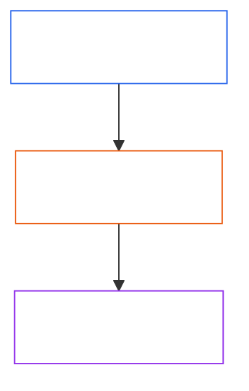
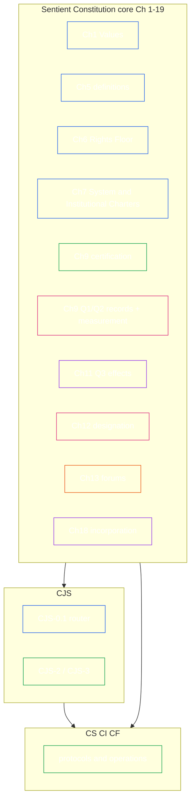

# Constitution document architecture

This file is the **editor map** for the Sentient Constitution corpus. It does **not** bind unless a valid adopting instrument expressly incorporates it. Constitutional readers start at [README.md](README.md).

**Binding text** lives in the numbered `core_*` files (inventory in [README.md](README.md)), [corpus_joint_structure.md](corpus_joint_structure.md), [corpus_systems.md](corpus_systems.md), [corpus_institutions.md](corpus_institutions.md), and [corpus_forum.md](corpus_forum.md). **Corpus** is defined in [**Def.I1** (*Corpus and Authority Stack*)](core_05.045_band_integrative.md#defi1-corpus-and-authority-stack). Edition labels and custody metadata: [README.md](README.md).

Retired architecture sections **14–19** (worklist, adoption appendix, document control) → [archive/ARCHITECTURE_ADOPTION_APPENDIX_ARCHIVED_2026-05-08.md](archive/ARCHITECTURE_ADOPTION_APPENDIX_ARCHIVED_2026-05-08.md) and [archive/ARCHITECTURE_WORKLIST_ARCHIVED_2026-05-08.md](archive/ARCHITECTURE_WORKLIST_ARCHIVED_2026-05-08.md). Completed measurement and companion-anatomy rollout notes → [archive/ARCHITECTURE_ROLLOUT_NOTES_ARCHIVED_2026-08-15.md](archive/ARCHITECTURE_ROLLOUT_NOTES_ARCHIVED_2026-08-15.md).

---

## 1. Purpose

- **Avoid duplication** — owner routing in **section 2**; definitions protocol in **section 4**.
- **Preserve dependency order** — edit order in **section 8**.
- **Track gaps** — stable IDs via `make architecture-index` ([generated index](doc_architecture/generated/stable_id_index.md)).
- **Keep headings, anchors, and cross-references consistent** so audits and editors can navigate. This corpus is **pre-release**: one current fragment id per heading; do not keep fossil or legacy redirect anchors. Auxiliary exports (PDF, plain text) are **non-authoritative** derivatives.

**Review commands:** `make regression` / `make regression-full` (includes measurement-tier, measurement-coverage, and steward-door lockstep audits). Before publication cuts: `make hierarchy-map && make ch5-measurement-tier-audit && make ch5-measurement-coverage-audit`. Steward cards: [implementation/STEWARD_ENTRY_DOORS.md](implementation/STEWARD_ENTRY_DOORS.md). Adoption process path (process support; not itself adoption): [implementation/adoption/](implementation/adoption/).

### Canonical filename convention

- `snake_case` canonical filenames (no spaces; no `%20` links).
- Numbered files use `layer_CC.LSS_suffix.md`: the two-digit chapter home, a literal dot, and the three-digit within-home/layer slot. Examples: `core_00.000_preamble.md`, `core_01.000_values_principles.md`, `core_04.000_burden_traceability_verification.md`, `core_05.035_band_accountability.md`, `core_06.000_rights_part_a.md`, and `core_11.010_application_vignettes.md`. Adopted implementation examples include `cjs_05.105_cross_implementation_operational_terms.md` and `cs_06.305_information_types_and_handling.md`. The machine registry keeps the five-digit `CCLSS` value; filenames and reader references visibly group it as `CC.LSS`.
- Adopted implementation families (**NAV-IMPL-FILENAME-01**): numbered `cjs_` / `cs_` / `ci_` / `cf_` files share a numeric prefix only when they are parts of the same chapter. The undifferenced `layer_NN_*.md` name is the chapter home. Extra same-chapter files take a discriminator — glued letter (`cjs_05.110_oversight_operations.md`) or CS part letter (`cs_02_a_*.md`). Family `01` is the unique scope page for that layer. Different chapters get different numbers (`cjs_19.105_drafting_contracts.md`, `cjs_08.105_support_hosting_classification.md`). Gate: `make adopted-implementation-filename-audit`.
- Full inventory: [README.md](README.md). The Preamble heading and Chapter One numeric headings (`CHAPTER 01`) remain the instrument-opening exception.

### Copy-suffixed duplicate files (FILE-COPY-SUFFIX-01)

A file named like another file plus a space and a number before the extension (`core_07.000_charters 2.md` beside `core_07.000_charters.md`) is a copy made by a file manager, sync client, or editor. It is not part of the corpus.

- **Free removal:** Such a file may be deleted at any time, by anyone, without a reference audit, evidence record, or edition record. Nothing may depend on it.
- **Original wins:** The file without the suffix is the only canonical file. Never merge from a copy, cite it, link to it, or regenerate from it. If a copy holds a change worth keeping, port that change into the original by hand and delete the copy.
- **Check first:** Remove it only when the original exists and the copy is not tracked by git (`git ls-files` does not list it). A tracked file with this naming pattern is a filename-convention defect under **Canonical filename convention**, not a free removal.
- **Tools:** Scripts and audits should ignore these files. A bulk edit such as `make edition-bump` that touches one has changed nothing that matters.
- **Automation:** `make copy-suffix-clean` runs `tools/copy_suffix_clean.py --write`, which deletes every copy that passes the check above and reports, without deleting, any tracked copy or any copy whose original is missing; `make copy-suffix-check` is the dry run. The versioned pre-commit hook `.githooks/pre-commit` runs it right before every commit, after the conflict-marker audit; `make install-hooks` turns the hook on in a checkout (`git config core.hooksPath .githooks`). The hook never blocks a commit over a copy, and a copy it cannot delete is reported and left alone. `.gitignore` keeps copies out of `git add` but does not delete them. The check is not part of `make regression`, because sync clients recreate copies at any time.

### Rename readiness gate

Filename renames require: reference audit, same-change link updates, dated evidence under `evidence/<date>/`, compatibility decision, and edition/custody record. Until the gate passes, candidate names stay planning-only.

### Branch naming (GIT-BRANCH-NAME-01)

A branch name tells reviewers what the work is. It should describe the work the branch carries now, not the first task it was created for.

**Shape.** `<type>/<scope>-<what-changes>`: lowercase, hyphens, no spaces, short enough to read in a branch list (about 50 characters).

- **Type** matches the commit prefix: `docs`, `plain-language`, `restructure`, `fix`, `tools`, `chore`.
- **Scope** is the chapter, article, or lane: `ch06`, `ch1c`, `lane-c`.
- **What changes** is the specific work, such as `article-xxvii-restraint`.
- Examples: `docs/ch06-article-xxvii-restraint`, `restructure/ch06-article-xx-part-split`, `tools/branch-name-check`.

**Check at the start of every new session.** Before the first commit, run `git branch --show-current` and compare the name to the task for this session. Check again before opening a pull request. A new session (human or AI) is where a stale name usually starts, because it picks up whatever branch was left checked out.

**When to change the name.**

- The branch name describes earlier work and this session is doing something different. Example: `restructure-justice-article-xx-part-split` now carries Article XXVIII commits.
- The new work is unrelated to the commits already on the branch. Start a new branch from `main` instead of renaming, so each branch stays about one piece of work.
- The name is vague (`fix`, `updates`, `wip`) or has no scope.

**When to leave it alone.**

- `main`, and any branch someone else created or is using.
- A branch that already has an open pull request. Renaming it on the remote closes that pull request, so ask the custodian first.
- A name that is already accurate. Do not rename for style alone.

**How.**

- Not yet pushed: `git branch -m <new-name>`.
- Pushed, no pull request open: `git branch -m <new-name>`, then `git push origin -u <new-name>`, then `git push origin --delete <old-name>`.
- New work from `main`: `git switch main && git pull && git switch -c <new-name>`.

When a branch is renamed, say so in the first message of the session or in the pull request description, with the old name, so the history stays traceable.

Gate: manual. [CONTRIBUTING.md](CONTRIBUTING.md) leaves contributor branch names free-form; this rule governs the custodian's and AI sessions' working branches.

### Keeping your local copy current (GIT-LOCAL-SYNC-01)

A local checkout that falls behind `origin/main` shows old text, builds generated files from old sources, and turns the next merge into a conflict in files nobody edited by hand. Keep it current.

**Check at the start of every session, and again before a pull request.** Run `git fetch origin`, then `git status -sb` and `git log --oneline HEAD..origin/main`. If the second command prints anything, the checkout is behind.

**What to do.**

- **`main`:** keep it a pure mirror of `origin/main`. Fast-forward it without checking it out: `git fetch origin main:main`. Never commit on it.
- **A work branch:** after any pull request merges (yours or someone else's) and before pushing more commits, run `git merge origin/main`.
- **Dirty working tree:** if uncommitted generated files block the merge, run `git restore ai_corpus doc_architecture/generated`, merge, then regenerate (below). Commit or stash hand-edited source files first.
- **Conflicts in generated files** (`ai_corpus/indexes/*`, `doc_architecture/generated/*`): never resolve these by hand. Take main's version (`git checkout --theirs <file>`), then run `make plain-terms-edition boundary-chunks print-pack reader-accessibility ai-corpus-sync` and commit the result.
- **Unrelated work:** start it from current `main` (`git fetch origin main:main && git switch -c <new-name> main`), not from whatever branch is checked out.
- **After a push or merge: `make sync-local`.** It fetches with `--prune`, fast-forwards `main`, and, when you are on a branch whose remote is gone and whose commits are all in `origin/main`, switches to `main` and deletes that branch. It lists any other branch whose remote is gone, and it never deletes a branch that holds a commit missing from `main`, never switches with uncommitted changes to tracked files, and never touches untracked files. `python3 tools/sync_local.py --dry-run` fetches and reports without changing anything; `--delete-merged` also deletes the other merged branches. A public repository needs no login to fetch, so this works from any shell, including the one on the custodian's computer; updating files there needs the deletion approval described in `AGENTS.md`.
- **On the custodian's own computer: run `make sync-local` after each merge.** Open a terminal in the repository folder and run `make sync-local` once a pull request has merged, whether you merged it or a Claude Code session did. It is safe to run at any time: it only fast-forwards `main`, deletes a branch that is fully merged, and lists any other branch whose remote is gone. A session linked to the computer runs it there too, but a session cannot reach the computer while it is off or its Claude app is closed, so a session that could not run it says so in its final reply and the step is yours.
- **After a push from a Claude Code session.** Pushes from a session use a git bundle (see *Pushing and merging from a Claude Code session* in [AGENTS.md](AGENTS.md)), which keeps the commit hashes, so the old branch is simply merged and `make sync-local` deletes it. If commits were replayed instead (from patches), `origin/main` holds the same changes under new hashes: do **not** merge `origin/main` into the old branch, because the same edits arrive twice and can conflict. `sync-local` still treats that branch as merged, because it compares changes with `git cherry -v origin/main <old-branch>` (a `-` line is already in `main`, a `+` line is local work that is not). If any line starts with `+`, copy that work to a new branch from `main` first (`git switch -c <new-name> main`, then `git cherry-pick` those commits).
- **Keep it current without asking.** `make install-hooks` sets `fetch.prune true` and `pull.ff only` for the checkout. In VS Code, the workspace settings `git.autofetch` (true), `git.autofetchPeriod` (120 seconds), `git.pruneOnFetch` (true), `git.fetchOnPull` (true), and `git.branchProtection` (`["main"]`, with `git.branchProtectionPrompt` set to `alwaysCommitToNewBranch`) fetch in the background, drop branches that GitHub deleted, and stop commits on `main`. They live in the local `.vscode/settings.json`, which is not tracked (a tracked copy would collide with the untracked one on the next pull). At the start of a session an agent runs `python3 tools/sync_local.py --dry-run` and says if the checkout is behind.
- **Always on the current branch (custodian decision, 2026-10-13).** The checkout is always on a branch that contains the latest `origin/main`. A branch whose pull request has merged is finished: do not leave the checkout on it and do not commit more to it. Start the next piece of work from current `main` as above. If the checkout is on an older or merged branch with uncommitted work, stash it (`git stash push -u -m "<what it is>"`), switch, and restore it only if it is still needed. Never commit stale work onto a stale branch.

**Why.** Pull requests that touch corpus text regenerate the same derived files, so any two open branches conflict there. Merging `origin/main` often keeps that conflict to one small, mechanical step.

Gate: manual. Pairs with GIT-BRANCH-NAME-01, since the same start-of-session check covers both.

### Reporting a commit (GIT-PUSH-CL-01)

Every time a session commits, the closing message gives the custodian the exact push command, so the custodian can push without working it out.

- **First push of a branch:** `git push -u origin <branch-name>` (use the real branch name, not a placeholder).
- **Later pushes of a branch already on the remote:** `git push`.
- Name the branch the commit is on, and say if the branch is behind `origin/main`.
- The session does not push unless the custodian asks. The custodian pushes, opens the pull request, and merges.

Gate: manual. Pairs with GIT-LOCAL-SYNC-01 and GIT-BRANCH-NAME-01.

---

## 2. Corpus roles (single source of truth)

**Numbering note:** When a passage says only “Chapter Fifteen,” disambiguate by filename — see [README.md](README.md).

**Constitutional owner layers:** canonical positive register — [Preamble — constitutional owner register](core_00.000_preamble.md#4-principles-definitions-and-rights) (sections 4–9). The table below is the editorial mirror; substantive owner non-relocation discipline lives under [Authority Stack and Internal Hierarchy](core_05.045_band_integrative.md#authority-stack-and-internal-hierarchy). **Binding owner claims** at chapter openings follow **OWNER-OPENING-01** in **section 4**.

| Layer | Primary home | Routing |
|--------|--------------|---------|
| Values, definition mechanics, definitions | Sentient Constitution `core_*` Ch 1–5 | [README.md](README.md) reading order |
| Rights (Articles I–XXVIII) | Ch 6 | `core_06.0*_rights_part_*.md`; titles via `make reference-audit` |
| System and Institutional Charters | Ch 7 | `core_07.000_charters.md`; the System Charter and Institutional Charter floor (a System Charter for each system of Class L or above, an Institutional Charter for each institution that runs more than one system; voluntary for Class P), the minimum contents of each, the Charter Role Map as the published seat map, and changes and versions; the 12-field template stays in CI-3.6 and the lane map in CI-3.2 |
| Functional independence and separation of duties | Ch 8 | `core_08.000_functional_independence_separation_of_duties.md`; four-seat floor, Materially Binding Act Record minimum, control-line independence, published placement, substitutes, proportionate merged hosting, emergency departures, and wrong-seat routing |
| System alignment certification | Ch 9 | `core_09.000_system_alignment_certification_evaluation.md` (Part A — evaluation); `core_09.005_system_alignment_certification_record_process.md` (Part B — forum process and outcomes); `core_09.010_system_alignment_certification_record_recertification.md` (Part C — record, recertification, and standing bridge). Part A opens the chapter; there is no index file. The worked illustrations are in the systems family, `corpus_systems/cs_09.320_system_alignment_certification_illustrations.md` (CS-9.320). Under **oversight**, oversight requires auditing (**Article XVI** / [Auditability](core_05.050_band_oversight.md#auditability) / **[CJS-3.3 audit process home](corpus_joint_structure/cjs_05.115_audit_process.md#cjs-5115-3-audit-process-home-odef3)** and **CJS-3.3**–**CJS-3.5** OP annexes); Ch 9 is one especially large, high-stakes audit process among others — not the sole auditing home. |
| Institutional alignment certification | Ch 10 | `core_10.000_institutional_alignment_certification.md`; the same six phases as Ch 9 for an Institution, under the same section numbers (§1–§11); §4 and §5 point to Ch 9 §4 and §5; cites each System Certification Record by link and is not a licence |
| Standing records and measurement (Questions 1 and 2) | Ch 11 | `core_11.000_standing_assessment.md`; verified records and Contribution Axis / Violation Axis slots |
| Standing integration and effects (Question 3) | Ch 12 | `core_12.000_standing_integration.md`; violation, correction, and prevention before contribution gates, with lock design and enforcement, then final effect, restoration, and enforcement |
| Anti-constitutional-misconduct designation | Ch 13 | `core_13.000_misconduct_designation.md` (Part A — designation criteria and safeguards); `core_13.005_misconduct_pattern_applications.md` (Part B — named pattern applications); designation only for qualifying fixed Ch 11 Violation Axis `s = 7–9` findings |
| Forums (constitutional) | Ch 14 | `core_14.000_forum.md`; forum families, jurisdiction, supervision, and cross-forum anti-self-judging; [README navigation](README.md#standing-pipeline-and-forums) |
| Governance / amendment / incorporation | Ch 15–19 | `core_15.000_governance.md`, `core_16.000_non_regression.md`, `core_17.000_expansion_supremacy.md`, `core_18.000_amendment_ratification.md`, `core_19.000_incorporation.md` |
| Cross-implementation joint structure | CJS | **CJS-0.1** (*Topic router*) |
| Systems, institutions, forum operations | CS / CI / CF | Adopted implementation wrappers + subfiles |

**Footer policy:** `make footer-audit`. Optional `*Corpus alignment:*` cites [README.md](README.md) edition metadata and [Chapter Five *Corpus*](core_05.045_band_integrative.md#corpus).

**Authority stack:** (1) numbered `core_*` constitutional source; (2) incorporated implementation within adoption scope; (3) this map and process docs unless explicitly adopted; (4) Sentient Constitution meaning controls operational layers — see [Authority Stack and Internal Hierarchy](core_05.045_band_integrative.md#authority-stack-and-internal-hierarchy).

---

## 3. Boundary rules

1. **Core owns** normative *why* and *what* (values, rights, definitions, meta obligations).
2. **Implementation files own** *how* (taxonomies, protocols, institutions, forums, joint interlocks).
3. **No duplicate definitions** across layers — implementation files *apply* Chapter Five terms.
4. **Stricter wins** where the corpus already says so; core values and rights prevail over conflicting operational wording.
5. **Chapter Six implements detail** for Articles I–XXVIII; do not invent parallel Rights Floors in implementation files.

---

## 4. Project-wide definitions protocol (pinned)

Machine-checkable rules: [tools/architecture/rule_registry.json](tools/architecture/rule_registry.json). Audit catalog: [implementation/AUTOMATED_REFERENCE_CHECKING.md](implementation/AUTOMATED_REFERENCE_CHECKING.md). Lexical guardrails: [tools/architecture/lexical_guardrails.json](tools/architecture/lexical_guardrails.json).

### What counts as a definition

- **Hard definitions:** Ch 2–3 ([`core_02.000_definition_structure.md`](core_02.000_definition_structure.md)); Ch 4 ([`core_04.000_burden_traceability_verification.md`](core_04.000_burden_traceability_verification.md)); Chapter Five §1–§3 (single-home rule below).
- **Values language:** Preamble §1 — [Constitutional Tetrad](core_00.000_preamble.md#constitutional-tetrad), [Two Constitutional Aims](core_00.000_preamble.md#two-constitutional-aims) (**Flourishing** / **Continuity**), and [material stake](core_00.000_preamble.md#material-stake) at principle layer; Chapter Five O/M/A/C for Tetrad legs ([Participation](core_05.025_apex_participation_leg.md#participation-constitutional), [Oversight](core_05.020_apex_oversight_leg.md#oversight-constitutional), [Accountability](core_05.005_apex_accountability_leg.md#accountability), [Timeliness](core_05.030_apex_timeliness_leg.md#timeliness-constitutional)) and aims ([Flourishing](core_05.015_apex_flourishing_aim.md#flourishing-constitutional), [Continuity (Constitutional Aim)](core_05.010_apex_continuity_aim.md#chapter-five-definitions-continuity-constitutional-aim)); Chapter One develops those aims into operative principles. **Reading arc:** Part A (§§1–12 the Flourishing and Continuity aims) → Part B (§§13–15 interaction, override limits, and interpretation) → Part C (§§16–19 stewardship, governance, and incentives) → **§20 Integrated Application** capstone in Part C. Use **Continuity aim** when naming the constitutional aim; reserve bare *continuity* for operational uses elsewhere.
- **Measurement frame (Preamble §2):** Eight constitutional measurement categories in [Measurements Overview](core_00.000_preamble.md#2-measurements-overview) link directly to their Chapter Five **measurement-family homes** (category column) and to canonical definitions (subcategory column); the family table, constitutional use, and definition routing live on the Chapter Five homes. **Family-home map:** Threshold/scaling and Oversight → [`core_05.020_apex_oversight_leg.md`](core_05.020_apex_oversight_leg.md#measuring-oversight-preamble-measurement-family); Flourishing → [`core_05.015_apex_flourishing_aim.md`](core_05.015_apex_flourishing_aim.md#measuring-flourishing-preamble-measurement-family); Continuity → [`core_05.010_apex_continuity_aim.md`](core_05.010_apex_continuity_aim.md#measuring-continuity-preamble-measurement-family); Participation → [`core_05.025_apex_participation_leg.md`](core_05.025_apex_participation_leg.md#measuring-participation-preamble-measurement-family); Accountability → [`core_05.005_apex_accountability_leg.md`](core_05.005_apex_accountability_leg.md#measuring-accountability); Timeliness → [`core_05.030_apex_timeliness_leg.md`](core_05.030_apex_timeliness_leg.md#measuring-timeliness); Constitutional Performance → [`core_05.060_band_performance.md`](core_05.060_band_performance.md#measuring-constitutional-performance-preamble-measurement-family). Home-section anchors use the `#…-measurement-family` suffix (skipped as non-leaf routing anchors by `make ch5-measurement-coverage-audit`). [§3.1 Using Measurements in Governance](core_00.000_preamble.md#31-using-measurements-in-governance) routes measurement → certification (Chapter Nine), standing records (Chapter Eleven), remedy (Chapter Twelve), forum review (Chapter Fourteen). **Standing measurement** (Chapter Eleven contribution/violation axis measurement) is a *process* concept distinct from **constitutional measurement** categories (Preamble §2), which supply the evidentiary frame for what gets verified before records enter the standing pipeline.
- **Standing:** Chapter Eleven owns Questions 1 and 2 (**verified** standing records and Contribution Axis / Violation Axis measurement). Chapter Twelve accepts those inputs as immutable and owns Question 3 integration and effects. Chapter Thirteen owns designation only. Chapter Fourteen forums may **open, update, or correct** standing records — or **set a bad record aside on challenge** — from verified findings. Boundary gloss: a **filed case** is not standing by itself. Prefer **case** (forum matter / dispute filing) over **claim** in that contrast; keep **claim** for dispute-phase inventory labels (*unadjudicated claims*) and other established senses.
- **Rights:** Chapter Six; implementation files **cite** articles.
- **Joint operational terms:** `corpus_joint_structure.md` only — route via **CJS-0.1**.
- **Operational taxonomies:** **CS-2**, **CS-3**, **CS-4** and named protocols.

### CJS owner rule

Use **CJS** only for cross-implementation interface terms with no stable single-file home. Reusable joint terms → **CJS-3** clusters; **CJS-2** interlocks point to **CJS-3** and the primary owner named in **CJS-0.1**. Escalate to Chapter Five when constitutional meaning is at stake.

### Chapter Five admission gate

Keep constitutional concept + O/M/A/C boundary only; cite owner homes for institutional machinery. **`make ch5-definitions-gravity-audit`** (blocking).

**Band layout:** Part A ([`core_05.000_definitions_home.md`](core_05.000_definitions_home.md)) holds the compass, alphabetical directory, and dependent-cluster meta rules. Canonical O/M/A/C homes for constitutional aims and Tetrad legs live in **`core_05.0*_apex_*`** files — [Flourishing](core_05.015_apex_flourishing_aim.md), [Continuity](core_05.010_apex_continuity_aim.md), [Accountability](core_05.005_apex_accountability_leg.md), [Oversight](core_05.020_apex_oversight_leg.md), [Participation](core_05.025_apex_participation_leg.md), [Timeliness](core_05.030_apex_timeliness_leg.md). Leaf definition bodies live in **`core_05.0*_band_*`** band files — **Oversight** [`core_05.050_band_oversight.md`](core_05.050_band_oversight.md) (**Def.O1–Def.O2**), **Participation** [`core_05.055_band_participation.md`](core_05.055_band_participation.md) (**Def.P1–Def.P3**), **Accountability** [`core_05.035_band_accountability.md`](core_05.035_band_accountability.md) (**Def.A1–Def.A4**), **Continuity** [`core_05.040_band_continuity.md`](core_05.040_band_continuity.md) (**Def.C1–Def.C4**), **Integrative** [`core_05.045_band_integrative.md`](core_05.045_band_integrative.md) (**Def.I1**). Each defs file contains Independent, Semi-independent, and Dependent cluster entries assigned to that band. A sixth cross-cutting file, the **Constitutional Performance** band [`core_05.060_band_performance.md`](core_05.060_band_performance.md), is only the measurement-family home for that Preamble category (instrumental to both aims, not a Tetrad leg); its leaf definitions keep canonical homes in the **Continuity** band because they are Continuity-band stewardship / shared-system-capacity / proportionality–burden–efficiency cluster members — family home ≠ leaf home (parallel to Timeliness vs. Accountability). Leaves relocate to the Performance file only on an express, dated placement decision. Retired Part B/C paths live under [`archive/core_ch5_retired/`](archive/core_ch5_retired/README.md) only.

### Editorial rule registry

| Rule ID | Summary | Gate |
|---------|---------|------|
| NAV-TRACE-08–10 | Trace placement and contents | `make ch10-trace-audit`, `make trace-routing-prose-audit` |
| NAV-READER-06 | Reader-guidance widget placement | `make widget-top-placement-audit` |
| NAV-WIDGET-TOP-01 | File-top / section-opening widget stack | `make widget-top-placement-audit` |
| NAV-DAC-12 | D/A/C widget discipline, including no visible placement commentary | `make ch5-dac-widget-audit`, `make nav-widget-spacer-audit`, `make plain-language-audit` (placement commentary) |
| NAV-DAC-12-ORDER | Trace → D/A/C placement | `make trace-dac-widget-order-audit` |
| NAV-DAC-12-SPACER | `<br>` after collapsible D/A/C only | `make nav-widget-spacer-audit` |
| NAV-DAC-CH1-ORDER | Chapter One D/A/C row order | `make ch1-dac-order-audit` |
| NAV-PLACEMENT-01 | File-top Corpus placement widget | `make file-top-placement-audit` |
| FILE-COPY-SUFFIX-01 | Copy-suffixed duplicate files (`name 2.ext`) are not corpus and may be removed freely | `make copy-suffix-check` (list), `make copy-suffix-clean` (delete); not part of `make regression`; see [Copy-suffixed duplicate files](#copy-suffixed-duplicate-files-file-copy-suffix-01) |
| NAV-IMPL-LANDING-01 | Implementation-corpus wrapper landing page | Manual (see **section 4**) |
| NAV-IMPL-SCOPE-01 | Implementation `*-1` scope/boundary page format | Manual (see **section 4**) |
| NAV-IMPL-SUBFILE-01 | Adopted implementation subfile anatomy: H1, placement widget, owner line, gloss | `make adopted-implementation-anatomy-audit`, `make file-top-placement-audit-adopted-implementation`, `make owner-line-audit` (owner sentence) |
| NAV-IMPL-FILENAME-01 | Adopted implementation files share a numeric prefix only as same-chapter parts | `make adopted-implementation-filename-audit` |
| GIT-BRANCH-NAME-01 | A git branch is named for the work it carries (`<type>/<scope>-<what-changes>`). At the start of a new session, and again before a pull request, check the name against the work; rename it, or start a fresh branch from `main`, when it no longer fits. | Manual (see **Branch naming (GIT-BRANCH-NAME-01)**) |
| GIT-LOCAL-SYNC-01 | Keep the local checkout current with `origin/main`. At the start of a session and before a pull request, fetch and check `git log HEAD..origin/main`; fast-forward local `main`, merge `origin/main` into work branches, and regenerate rather than hand-resolve generated files. After a pull request, run `make sync-local`: it fast-forwards `main` and deletes a merged branch, never one with commits missing from `main`. Do not merge `origin/main` into a branch whose commits were replayed under new hashes. The checkout is always on the current branch: when a pull request merges, start the next work from current `main`. | Manual (see **Keeping your local copy current (GIT-LOCAL-SYNC-01)**) |
| GIT-PUSH-CL-01 | Every commit is reported with the exact push command (`git push -u origin <branch>` for a first push, `git push` after). The session does not push unless asked. | Manual (see **Reporting a commit (GIT-PUSH-CL-01)**) |
| ROOT-LAYOUT-01 | The repository root holds only the public door and the numbered corpus. Plain-language companions go in `project/plain_language/`, drafts and WIP files go under `project/`, and git bundles (`*.bundle`) never belong in the repository. | `make root-layout-audit`; `python3 tools/root_layout_audit.py --fix` moves plain-language files |
| FILE-SIZE-01 | No file in the repository is larger than 1 MB (1,000,000 bytes). Split it, compact it, or keep it out of the repository; dated evidence snapshots are deleted rather than exempted. | `make file-size-audit` |
| FRONT-DOOR-01 | The front doors (README, START_HERE, AGENTS, llms.txt, docs/index.md, CONTRIBUTING, ANNOUNCEMENT) say only what the corpus supports. Edition string, effective date and steward pin agree; until the announcement the edition is the current date (`make edition-bump`; `make front-door-freshness` checks it, `EDITION_TRACKS_DATE=0` in the Makefile ends that at the announcement cut); pre-release status agrees; "Chapters 1-N" and "N articles" match the `core_NN` files and the Rights Floor headings; the language bar matches `translations/`; README and ANNOUNCEMENT quote the Two Fundamental Questions exactly as the Preamble words them; every backticked `make` target and `tools/` path exists; START_HERE's ranked situations and non-fits match FIT_SITUATIONS one for one; LICENSE authorship appears in README and docs/index.md; the doors point at each other; required sections exist; no list links one target twice; the generated reader files README links are tracked. When you change what a door counts or quotes, change the door in the same commit. | `make front-door-audit`; `make front-door-freshness` also runs the generated-file `-check` targets (part of `make regression-full`) |
| FRONT-DOOR-LABEL-01 | Section labels in link text on public-facing pages (START_HERE, AGENTS, CONTRIBUTING, docs/index.md, VISION, FAQ, guides, steward doors, the adoption kits and easy-entry guides, ANNOUNCEMENT) match the number of the heading they link, the same as in the core. These pages used to be skipped as "history", so renumbering left readers with labels such as "Chapter One §16.1.1" for what is now §17.1. | `make section-label-anchor-audit` |
| NAV-PRE-RELEASE-FRAGMENT-01 | Pre-release: one current fragment id per heading; no fossil or legacy redirect anchors | `make fossil-anchor-audit` |
| TERM-SYSTEM-CLASS-01 | Chapter Nine says "system class", not a bare "class" (named levels such as "Class B" are fine); headings are in Chicago headline case ("System Class Scaling and Escalation") | `make system-class-term-audit` (changed lines only); `python3 tools/apply_system_class_term.py --dry-run` to preview a fix |
| MD-LIST-INTRO-01 | Bold list-intro lead-in ends with `:` not `.`: standalone (`**Record and showing:**`), heading-echo run-in (`**Symmetric costly constraints:**`), or list-item label (`- **Not standing:**`). Ordinary non-echo run-ins (`**Admission scope.**`) are out of scope. | `make corpus-markdown-audit` |
| MD-GLOSS-CLOSE-01 | An italic `*In plain terms: ...` gloss paragraph ends with a closing `*`. A missing closer renders a literal leading asterisk and drops the italics. | `make corpus-markdown-audit` |
| MD-HEADING-TOPIC-01 | Numbered section's first body-prose line (after widgets and `*In plain terms*` gloss) must not restate that heading as a topic sentence (`**[§13.2 Title](#…):**`). Heading-echo run-in labels are MD-HEADING-RUNIN-01. | `make heading-echo-topic-audit` |
| MD-HEADING-RUNIN-01 | A section's first body line must not open with a bold run-in label that restates its own heading (`**Governance as authorized structure.**` under `#### 11.1 Governance as Authorized Structure`). Bold terms used as a sentence subject, and labels that add a distinct idea, are out of scope. | `make heading-runin-echo-audit` |
| MD-LABEL-ECHO-01 | A list item's bold label must not be restated by its own body (`- **Is invalid:** The seat is invalid.`). Fold the item into its neighbour or write a label that names a distinct idea. Cross-reference rows (`— …`, `§` pointers) and lead-ins ending in `:` are out of scope. Blocking in `make regression`. | `make list-label-echo-audit` |
| MD-SECTION-LEAD-01 | A section's first body line (after widgets, spacers, callouts, and `*In plain terms*` gloss) is lead-in prose, not a bare list item. Container sections whose first content is a child heading are out of scope. **Carve-out:** Chapter Five definition files (`core_05.*.md`), whose entries open with O / E / C bullets by design. Blocking (`make regression`). | `make section-bullet-lead-audit` |
| VIS-CHART-READABILITY-01 | Mermaid chart boxes with a title and explanatory content use `<br/><br/>` between the title and content for a blank visual line. | Manual (see **Chart readability standard** below) |
| VIS-CHART-THEME-02 | Reader-facing Mermaid nodes use transparent fills, white labels, and the shared semantic-outline palette; do not rely on renderer-default label colors. | Manual (see **Chart color and theme standard** below) |
| VIS-CHART-SYNC-03 | When an Article or subarticle is renumbered, renamed, added, moved, split, or removed, update every reader-facing Mermaid chart that lists it so numbers, titles, and bullets match the current headings. | Manual (see **Chart sync on renumbering (VIS-CHART-SYNC-03)**) |
| VIS-CHART-ORIENT-04 | Mermaid flowcharts flow top to bottom (`flowchart TB`); a left-to-right, right-to-left, or bottom-up chart needs a stated exception. | `make chart-orientation-audit` (in `make regression`) |
| VIS-CHART-CENTER-05 | Mermaid flowcharts keep boxes horizontally centered on one another: a node sits centered under its parent, or under the midpoint of its parents; a node that fans out to a row of siblings is centered over the row; a node that the row converges on is centered under it. Exceptions need a stated reason. | Manual (see **Chart centering standard** below) |
| VIS-CHART-CROSSING-06 | Mermaid flowchart links must not cross one another. Rearrange nodes, end a loop at a pair of on-page connector circles (**VIS-CHART-SYMBOLS-08**) instead of drawing a long link back up the chart, or merge parallel paths into one box before publishing. No exceptions. | Manual (see **Chart crossing standard** below) |
| VIS-CHART-EXTERNAL-07 | In a chart about one chapter's process or structure, a box for a process owned outside that chapter uses the subroutine shape (`[[ ]]`), says it is outside the chapter, and connects with a dotted link; when one section hands off, that section goes on the link label. Corpus-wide map charts are out of scope. | Manual (see **Chart external-process standard** below) |
| VIS-CHART-SYMBOLS-08 | Mermaid flowcharts follow standard flowchart symbols (ISO 5807) wherever Mermaid can draw them: rectangle for a step, diamond for a decision, double-barred box for a predefined process defined elsewhere, and matching lettered circles (on-page connectors) for a loopback or a jump. Corpus-specific conventions apply only where no standard symbol exists. | Manual (see **Chart symbol standard** below) |
| VIS-CHART-SECNUM-09 | In a Mermaid chart box that cites a section, the section number comes first: at the start of the title line, before the title (`§5 Publish the office-holder statement`), never after it behind a dash (`Publish the office-holder statement — §5`) or as a trailing note. A content line that carries its own section number starts with it. | `make chart-section-number-audit` (in `make regression`) |
| OWNER-OPENING-01 | Binding constitutional-owner opening statement | `make owner-line-audit` (also covers the NAV-IMPL-SUBFILE-01 owner sentence) |
| LINK-IN-PARA-14 | Load-bearing in-paragraph links | `make in-paragraph-link-audit` |
| LINK-OFF-CORPUS-15 | Link destinations stay in-repository in binding text; no machine-local targets anywhere | `make external-link-audit` (inventory: `make external-link-audit-report`) |
| IMPL-ROUTE-01 | Core-to-implementation routing: one plain pointer sentence to the family subfile that actually holds the mechanics; no generic implement / not-narrow restatement; no layer-relationship lead-ins | `make plain-language-audit` (lead-in phrases); manual (generic tails, pointer truth) |
| SUPPORT-DOC-POINTER-01 | Binding corpus must not depend on `doc_architecture` or a README section for meaning or routing | `make support-doc-pointer-audit` |
| CH5-GRAVITY | Chapter Five admission / de-bundling | `make ch5-definitions-gravity-audit` |
| CH5-ORDER-01 | Chapter Five editorial order | `make ch5-cluster-order-audit`, `make ch5-entry-format-audit`, `make ch5-constitutional-cluster-audit` |
| CH5-SINGLE-DEF | One visible definition per term | `make ch5-single-definition-audit` |
| LEX-GUARDRAILS | Vocabulary and capitalization | `make lexical-vocabulary-audit` |
| TIME-NAME-01 | A time window is named by its kind of time: window, target, bound, term, interval, period, or span. "Clock" does not name a specific window, "cadence" does not name a length, and "response window" means the Chartered Party's window to answer only. | `make lexical-vocabulary-audit` (rule `avoid-window-clock-names`); see [Time-window names (TIME-NAME-01)](#time-window-names-time-name-01); list of names: [CJS-0.4](corpus_joint_structure/cjs_00.105_registry_and_reading_rules.md#cjs-0105-4-time-window-names) |
| ADOPT-TRANS-01 | The period in which an adopter moves from legacy to constitutional operation is the Chapter Five defined term **Adoption Transition**, written with both words capitalized. The bare named phrases (transition window, plan, authority, and the like) are not used for it. Other senses of "transition" (class change, labor displacement, mode or state change, vendor or format migration) stay ordinary words. | `make lexical-vocabulary-audit` (rule `avoid-bare-adoption-transition`); definition: [Adoption Transition](core_05.040_band_continuity.md#adoption-transition) |
| TRANS-SENSE-01 | A system moving to a higher-obligation track is a **step-up**, a stopgap recognizing arrangement for a sentient is **interim recognition**, a stopgap during amendment is an **interim step** or **interim measure**, and control or operation passing to another party is a **handoff**. The bare phrases (transition to higher or full, transition toward, transition triggers, sandbox transition, transitional recognition, arrangements, regimes, steps, or measures, transition continuity, continuity-preserving transition, safe transition paths, transition lifecycle) are not used. | `make lexical-vocabulary-audit` (rule `avoid-transition-senses`); see moves 150 and 151 |
| TIME-REF-01 | Every time reference in the binding text (a number with a unit, or "reasonable period", "promptly", "as soon as feasible") shows its logic in the same sentence: it names a bound kind (outer bound, intake target, certification interval, and so on) and the tier or class that sets it, or it uses a registered fixed-period name. A registered scaled window (response window, resolution window) is a bound kind, but a number beside it still needs the tier or class that sets it. Older references are baselined and the list only shrinks. The vocabulary is in `tools/time_reference_registry.json`. | `make time-reference-audit` (backlog: `make time-reference-backlog`) |
| TIME-LOCK-01 | Every copy of the tier windows follows its owner. The outer bounds are owned by Chapter Fourteen §6 (*Tier outer bound*) and the intake targets by CF-12.3.1. The Chapter Seven §1.6 summary table (response window = intake target, resolution window = outer bound) and the sentences that quote the intake figures are derived copies, listed in `tools/time_window_lockstep_registry.json`. The audit reads the owners, checks that they agree with each other, rebuilds each copy, and fails on drift or on a registered copy it cannot find. `--fix` rewrites drifted copies from the owners and never settles a conflict between owners. | `make time-window-lockstep-audit` (repair: `make time-window-lockstep-fix`, then `make architecture-index ai-corpus-sync plain-terms-edition boundary-chunks`) |
| TERM-BODY-01 | A body that verifies, authorizes, or decides a question for others is an **authority** (record-opening authority, Backup Record Authority, restricted information authority, verifying authority). A body that enters and holds a record is a **custodian**, and a body that files and receipts is a **registrar**. "Verifier" is not a name, and "office" names a unit or a post, not a body with a job. | `make lexical-vocabulary-audit` (rule `avoid-verifier`); see [Names for bodies that verify, hold, and file (TERM-BODY-01)](#names-for-bodies-that-verify-hold-and-file-term-body-01) |
| VIOLATION-FINDING-01 | On a line about violations, standing locks, Interim Holds, sanctions, or misconduct, a bare "finding" ("a verified finding", "the finding it rested on") says **violation finding** when a finding of violation is meant; any other finding is qualified (component finding, cause finding). "Finding of violation", a back-reference after a "violation finding" on the same line, and "finding profile / authority / basis" are not matched. Older uses sit in a shrink-only baseline. | `make violation-finding-audit` (`tools/violation_finding_audit.py`; `--ignore-baseline` lists the backlog, `--write-baseline` rewrites it after fixes); tests: `make violation-finding-audit-test` |
| GROUND-QUALIFIED-01 | The noun "ground" says which kind of ground it is (**denial ground**, **revocation ground**, **reopening ground**, **System ground**, **institutional ground**, a **joint ground**) or "ground for ..."; a bare "a ground", "the grounds", "that ground", "its own ground", or "stated ground" fails. The verb ("a rule that grounds the duty", "may ground a denial") and "common ground" are not matched. Older uses sit in a shrink-only baseline. | `make ground-qualified-audit` (`tools/ground_qualified_audit.py`; `--ignore-baseline` lists the backlog, `--report` counts per file, `--write-baseline` rewrites it after fixes); tests: `make ground-qualified-audit-test` |
| RECORD-QUALIFIED-01 | On a line that names a System record and also speaks of an Institution, or names an Institution's record and also speaks of a System, a bare "the record", "this record" or "that record" says which: the **Institutional Certification Record** or the **System Certification Record**. A line that names one kind of record, "the record seat", and "record-keeping" are not matched. No baseline (the six older lines were fixed). | `make record-qualified-audit` (`tools/record_qualified_audit.py`); tests: `make record-qualified-audit-test` |
| RECORD-KIND-01 | The noun "record" says which kind of record it is (**standing record**, with its contribution, violation, operator and stakeholder forms; **Forum Case Record**; **System Certification Record**; **Institutional Certification Record**; or another named record such as a classification record) or "record of ..."; a bare "the record", "a record", "that record", "its own record", "the same record", "a single record" or "the official record" fails. Inside a chapter about one kind, the word says it each time it stands alone (Chapter Eleven says *standing record*, Chapter Nine *System Certification Record*, Chapter Ten *Institutional Certification Record*). **Official record** is accepted as a kind: it is Chapter Five's Record Integrity category for any record a constitutional process relies on. The defined seat names (**record custodian**, **record-opening authority**, **record seat**, **record span**, **record holder**), the verb ("must record the reasons"), "on record", and a sentence-initial "Records ..." are not matched. The baseline is empty: every older use was named in the 292nd move, and a new bare use anywhere fails. | `make record-kind-audit` (`tools/record_kind_audit.py`; `--ignore-baseline` lists the backlog, `--report` counts per file, `--write-baseline` rewrites it after fixes); tests: `make record-kind-audit-test` |
| SCOPE-QUALIFIED-01 | The noun "scope" says whose or which scope it is (**chartered scope**, **admission scope**, **release scope**, **enforceability scope**, or another word that names the kind) or "scope of ..."; a bare "the scope", "that scope", "its scope", "a scope", "its own scope", "the whole scope" or "a narrow scope" fails. Inside a chapter about one kind, the word says it each time it stands alone (Chapter Seven says *chartered scope*). The field labels **In scope:**, **Out of scope:** and **Admission scope:**, a following pointer or relative clause ("the scope above", "the scope each cluster states", "the scope it is supervised under"), "scope of ..." and "scope for ...", scope as a modifier (scope document, scope cap, scope creep), and the verb are not matched. Chapter Five has no exemption: the labels that fill its definitions are not matched, and every older bare use there was qualified in the 311th to 314th moves. The baseline is empty: a new bare use anywhere fails. | `make scope-qualified-audit` (`tools/scope_qualified_audit.py`; `--ignore-baseline` lists the backlog, `--report` counts per file, `--write-baseline` rewrites it after fixes); tests: `make scope-qualified-audit-test` |
| CH10-DUPLICATION-01 | A Chapter Ten sentence of eight words or more that is a near-verbatim copy of Chapter Nine Parts A, B, or C says it once and points to Chapter Nine, or is summarized and keeps only what differs for an Institution. "Near-verbatim" means 85% alike as word sequences after *Institution*, *Institutional*, *System*, *operator*, and *governing authority* are read as one word and links, emphasis, and list markers are dropped. Trace and reader-guide widgets, code fences, and sentences under eight words are not read. Plain-terms lines and older copies sit in a shrink-only baseline (`tools/architecture/baselines/ch10_duplication.json`). | `make ch10-duplication-audit` (`tools/ch10_duplication_audit.py`; `--report` prints the share per section, `--ignore-baseline` lists every near-copy, `--write-baseline` accepts the current copies); tests: `make ch10-duplication-audit-test` |
| AUDIT-REGISTRY-01 | Every audit-like `make` target has one entry in `tools/architecture/audit_registry.json`: its category, whether the report runs it, and whether it writes files. A new audit is registered in the same change. | `make audit-registry-check`; report: `make audit-report` (see [Audit registry and report (AUDIT-REGISTRY-01)](#audit-registry-and-report-audit-registry-01)) |
| PREFLIGHT-01 | Before committing corpus text, run `make preflight`: the gate audits that are read-only, minus the unit tests of the audit scripts, printing failures only and refreshing nothing. Before reporting completion, run the full `make audit-report`. Preflight is a convenience for the commit, not a gate, and AUDIT-SCOPE-01 still holds: each audit reads the whole corpus. | `make preflight`; full check: `make audit-report` (see [Audit registry and report (AUDIT-REGISTRY-01)](#audit-registry-and-report-audit-registry-01)) |
| AUDIT-AUTOFIX-01 | Formatting, lexical, and citation audit findings are repaired by the agent without per-item sign-off, followed by affected audits and the full gate report. Preserve meaning and use canonical sources; escalate only an unresolved substantive choice. | Standing agent workflow; see [Automatic audit repairs](#automatic-audit-repairs-audit-autofix-01) |
| AUDIT-SCOPE-01 | Every audit, structural audits included, runs against the entire corpus at a minimum. Rules carry no file lists, gates are never changed-only, older findings sit in shrink-only baselines, and each audit declares its scope in `tools/architecture/audit_scope_registry.json`. The blanket exemption is `doc_architecture.md` (its dated move log). | `make audit-scope-check` (gate), `make audit-scope-probe` (measures what each audit reads), `make lexical-vocabulary-audit`; see [Audit scope](#audit-scope-audit-scope-01) |
| EDIT-LIVE-01 | Until the announcement, a request to rewrite, reword, clarify, insert, or fix corpus text is carried out in the file in the same reply, not offered as a draft awaiting a second go-ahead. Meaning choices (duties, authority, thresholds, clocks, scope) are presented, not made. | Standing agent workflow; see [Edit the document live](#edit-the-document-live-edit-live-01) |
| AUDIT-EVIDENCE-RETENTION-01 | Audit output under `evidence/<date>/` keeps only the newest two runs of each audit family; an audit run deletes the third-to-last. Only files named in `tools/architecture/audit_evidence_retention.json` are touched, so hand-written records in the same folders stay. | `make evidence-prune` (also runs after every evidence-writing audit target); tests: `make audit-report-test` |
| GLOSS-SUBARTICLE | Chapter Six `*In plain terms:*` on subarticles | `make subarticle-gloss-audit` |
| GLOSS-ARTICLE-NEIGHBORS | Chapter Six `*Article neighbors:*` article-intro coordination | editorial pattern in **section 4** |
| OWNER-SINGLE-HOME | Competing O/M/A/C gloss heuristics | `make owner-discipline-audit` |
| DEF-APPROPRIATENESS | Unified definition placement (core vs CJS-3 vs implementation) | `make definition-appropriateness-audit` (advisory; ledger at `evidence/definition_audit/ledger.json`) |
| REF-ARTICLES | Article titles and Roman numerals; prose cite gloss per **section 7** | `make reference-audit` |
| MEAS-ANCHOR | No links to removed Preamble §3 `#measuring-*` category anchors | `make measurement-anchor-audit` |
| MEAS-DEF-01 | Definition-anchored measurement tiers inform A/C authoring | `make ch5-measurement-tier-audit` and `make ch5-measurement-coverage-audit`; seeds at [tools/architecture/measurement_tier_seeds.json](tools/architecture/measurement_tier_seeds.json); editorial progress report (not corpus text): [doc_architecture/generated/measurement_rollout_status.md](doc_architecture/generated/measurement_rollout_status.md) |
| CH5-HIER-01 | Definition hierarchy layers, tags, and placement rules | `make hierarchy-map` (generated index) |
| CH9-PROCESS-ORDER-01 | Chapter Nine sections follow the order the certification work is done, in six phases | Manual (see **section 4**); links and anchors by `make local-markdown-fragment-audit`, `make section-label-anchor-audit`, `make fossil-anchor-audit` |
| ROUTER-CJS01 | Cross-implementation routing | `make router-bidirectional-audit` |

Historical D/A/C rollout: [archive/doc_architecture_decision_log/DEC_WIDGET_AND_NAV_DECISIONS_2026-04-16_2026-06-15.md](archive/doc_architecture_decision_log/DEC_WIDGET_AND_NAV_DECISIONS_2026-04-16_2026-06-15.md).

### Reader-guidance placement (NAV-READER-06)

Collapsed **Reader guidance (non-operative)** widgets give readers orientation without creating, narrowing, or relocating binding obligations.

**Placement rule:**

- **Chapter-level or part-level orientation** belongs at the chapter or part opening: after the file-top **Corpus placement** widget and chapter/part heading, and before the first operative purpose, rule, article, or numbered section.
- In split-chapter files, a part-position widget belongs immediately after that file's chapter/part heading and before the part's first operative section.
- **Local reader guidance** may appear later only when it explains a specific nearby table, directory, crosswalk, routing index, example set, or other local navigation aid. It should stay adjacent to the material it explains.
- Keep general reading-order notes, layer routing, architecture maps, and warnings against moving text out of the binding text itself. Put them in the opening reader-guidance widgets.
- Reader-guidance widgets use the standard blue collapsed `<details>` styling and carry **(non-operative)** in the summary. They do not restate that they bind nothing. That principle is stated once, in the [Preamble's corpus-placement widget](core_00.000_preamble.md), and applies to every non-operative widget.

Enforced (with **NAV-WIDGET-TOP-01**) by `make widget-top-placement-audit`: chapter/part Reader guidance and file-level Trace / D/A/C must stay in one contiguous opening stack (blank lines only between widgets — no `<br>`, owner/home lines, or other prose between them) before ordinary operative prose; when a section's direct content carries Trace / D/A/C, those widgets open the unit (after optional anchors and opening Reader guidance). Child-section widgets and bold run-in local Traces (for example `**8.3. …**`) do not count against the parent.

### Link destination standard (LINK-OFF-CORPUS-15)

Link targets are held to two standards, because the two layers are read differently.

**Binding corpus** — `core_*` files and adopted implementation text link **inside the repository only**: a relative path, optionally with a `#fragment`, or a bare `#fragment` in the same file. An absolute URL, a protocol-relative URL, a root-absolute path, or any other URI scheme fails. The instrument must read the same from a clone, the print pack, and the Pages render, and no reader may be sent off the corpus to learn what a provision says.

**Maintained support documents** — README, START_HERE, `docs/`, `implementation/`, and the rest may cite external sources with ordinary `http(s)` or `mailto` links. The GitHub Pages door in `docs/` is the standing example.

**Machine-local targets fail everywhere.** A `file://` URL, an editor preview URL (`vscode-resource`, `vscode-cdn`, `vscode-webview`, `file+`), a home-directory or drive-letter path (`/Users/…`, `~/…`, `C:\…`), an editor workspace path (`/.cursor/`, `/.vscode/`), or a `localhost` URL resolves on one machine only. These usually arrive by copying a rendered preview URL out of an editor: an editor's Markdown preview rewrites a correct relative link into a webview resource URL at render time, so a preview URL is evidence about the preview, not about the file. Check the source line before treating one as a defect.

**Staying in-repository is not the whole test.** A link can be in-repository and still route out of the instrument. Binding text must not send a reader into a **support document** to find where a constitutional step lives: `doc_architecture.md` and the README both classify themselves as process / map support, so a deep link such as `README.md#standing-pipeline-and-forums` routes through a map that cannot bind. Cite the owner chapter, or the Preamble chain map at [§6.2 How the full chain fits together](core_00.000_preamble.md#62-how-the-full-chain-fits-together). Bare `README.md` links stay allowed for what the README owns: reading order, the binding/support split, edition and document-control identifiers, and the reading-chain footer. **SUPPORT-DOC-POINTER-01** enforces this.

Dated records (`evidence/`, `evaluation/`, `project/MEMLOG.md`, `project/TODO.md`), generated trees, `archive/`, and `translations/` stay outside the blocking scope: they record what was true when written. `make external-link-audit-report` inventories them, along with every allowed external citation, without failing.

### Chart readability standard

Mermaid chart boxes that contain a title and explanatory content must separate them with a blank visual line: use two HTML line breaks (`<br/><br/>`) after the title before the content. This is a presentation standard for readability; it does not change the chart's relationships or authority. Example: `A["Title<br/><br/>Content"]`.

### Chart color and theme standard (VIS-CHART-THEME-02)

Reader-facing Mermaid diagrams use **unfilled nodes with white text and explicit colored outlines**. Do not rely on a renderer's default text color: theme defaults can produce white text over a pale fill or black text over a dark canvas.

**Shared semantic-outline palette:**

- **Neutral / input / context** — slate `#64748b`
- **Authority / source / official record** — blue `#2563eb`
- **Participation / affected sentients** — teal `#0f766e`
- **Systems / certification / operational implementation** — green `#16a34a`
- **Verification / contest / forum review** — orange `#ea580c`
- **Standing / accountability finding / misconduct** — rose `#db2777`
- **Effect / remedy / restoration / constitutional change** — purple `#9333ea`

Assign a node by its primary role in the diagram. Color is a reusable visual cue, not a claim of authority, severity, sequence, or normative priority; relationship labels and nearby prose continue to carry that meaning. Nodes without a clear semantic role use slate. Subgraph containers remain unfilled and unstyled unless their boundary itself needs explanation.

Use an explicit style on every colored node, with `fill:none`, `color:#ffffff`, and the palette's outline color. Example:



Before publishing a diagram to a different rendering surface, visually confirm that its canvas is dark enough for white labels; if it is not, choose an explicitly contrasting label/fill pair rather than depending on theme defaults.

### Chart orientation standard (VIS-CHART-ORIENT-04)

Mermaid charts flow **top to bottom**. Start every flowchart with `flowchart TB`. Do not use `LR`, `RL`, or `BT` unless the chart records an exception. `TD` is the same direction as `TB` and is accepted in existing charts; write `TB` in new ones.

**Why.** Top to bottom reads as levels or bands: each band is a layer or stage a reader works down through, in the same direction the page scrolls. It keeps one reading direction across the corpus, and most existing charts already follow it.

**Exceptions.** An exception needs a stated reason in the sentence that introduces the chart, or in a caption. Accepted reasons:

- a sequence of many short steps where top to bottom would make one very tall, thin column and left to right fits the page width;
- a side-by-side comparison where the columns carry the meaning.

A chart that is merely easier to draw another way is not an exception.

**Layout tips.** To keep related nodes in a horizontal band inside a top-to-bottom chart:

- Put the band in a `subgraph` and give it `direction LR`.
- Link a band to the next band (`V --> L`), not to a node inside it. A link from an outside node to an inner node makes Mermaid ignore the band's `direction`.
- Use an invisible link (`a ~~~ b ~~~ c`) to force nodes into one row when the renderer wraps them.
- To center a node when a long link pulls the layout to one side, see **Chart centering standard (VIS-CHART-CENTER-05)** below.

**Scope.** This standard covers flowcharts, the only Mermaid type the corpus uses. It sits beside **VIS-CHART-READABILITY-01** (title and content spacing) and **VIS-CHART-THEME-02** (unfilled nodes, white labels, palette outlines), **VIS-CHART-CENTER-05** (horizontal centering), **VIS-CHART-CROSSING-06** (no crossing links), **VIS-CHART-EXTERNAL-07** (outside processes), and **VIS-CHART-SYMBOLS-08** (standard flowchart symbols); a chart meets all seven.

**Check.** `make chart-orientation-audit` scans the full chart-bearing corpus scope. For an allowed non-default direction, put a reason-bearing Mermaid comment immediately after the direction line: `%% VIS-CHART-ORIENT-04 exception: side-by-side comparison`. The audit checks that the exception is stated; the reason must still fit one of the accepted cases above.

**Existing charts.** On 2026-09-30, outside `translations/`, `archive/`, `evidence/`, `evaluation/`, and the generated site, the corpus held 41 `TB`, 1 `TD`, and 7 `LR` flowcharts. Two of the `LR` charts were this document's own example and the process-system-institution diagrams, both since converted. The other five (`project/VISION.md`, `guides/RECORD_OVERVIEW.md`, `CONTRIBUTING.md`, `implementation/PROCESS_PIPELINES_READER.md`, and the generated print pack) and the `TD` chart in `core_14.000_forum.md` were converted to `TB` in the 2026-10-06 sweep; the print pack follows its sources. Translation copies are not part of the sweep and are brought into line when each translation is next updated.

### Chart centering standard (VIS-CHART-CENTER-05)

Boxes in a Mermaid chart are **horizontally centered on one another**. A chart that reads as symmetric about a vertical axis is easier to scan, and it shows the structure: a box off to one side looks like it belongs to a different branch.

- **Single chain.** A box that follows one parent sits directly under it, and a box that leads to one child sits directly over it.
- **Fan-out.** When a box leads to a row of siblings, it is centered over the row.
- **Convergence.** When a row of siblings leads to one box, that box is centered under the row, and any box below it stays on the same axis.
- **Side links.** A link that skips a level (for example a dotted "serves" link from a top box to the last box) must not drag the boxes it passes off the axis.

**Why.** Mermaid's automatic layout centers a box on its parents' and children's *average* position. A single long link adds a hidden stop at every level it crosses, and that pulls the boxes toward its side.

**How to fix an off-center chart.**

1. Render the chart (see **Check**) and measure each box's horizontal center.
2. Add invisible spacer nodes on the side opposite the pull and chain them with invisible links: `CAP ~~~ GL ~~~ GE ~~~ GF`. Define each spacer with a blank label (`GL["&nbsp;"]`) and style it with no fill, no outline, and a label color that matches the canvas (`style GL fill:none,stroke:none,color:#111111`).
3. To center a box that the long link also reaches, link a spacer to it as well (`GE ~~~ FL`).
4. Widen a spacer with extra `&nbsp;` to move the result a few pixels, then render again.
5. **Balance with invisible links.** An invisible link between two real boxes can steer the layout without a spacer node. Link a box on one side to a box at the same level on the other side (`Rec ~~~ S`) so a parent centers over the whole row, and lengthen an invisible link (`O ~~~~ Ch`) so a side box lands on the row it belongs with. Invisible links carry no meaning; keep them out of any audit of chart contents.
6. **Balance the whole figure, not just the chain.** A chart can have every box on one axis and still look off-center, because the page centers the figure's full width. Measure the axis against the SVG `viewBox` (axis minus left edge versus right edge minus axis); the two should match within a few pixels. The usual cause is a wide side box or edge label on one side. Narrow it with `<br/>` breaks in the box text and in the long link's label, then re-measure. Re-measure under several fonts (Trebuchet, Carlito, FreeSans, Inter, DejaVu Sans); the sides should stay within about 15px, because the reader's font is not the renderer's. A gate that must come before a step (for example the published challenge path before forum sign-off) goes on the main line, not on a side branch, and its exit is stated in its box text rather than drawn as a long side link.

Spacer nodes carry no meaning. Keep them out of the chart's caption and out of any audit of chart contents. Keep them out of the **VIS-CHART-SYNC-03** list of boxes that must match headings.

**Exceptions.** A chart whose meaning comes from asymmetry (a timeline, or a main path with a short side branch) may be off-axis; say so in the caption or the sentence that introduces it. A chart that is merely harder to balance is not an exception.

**Check.** Manual. Render the chart with Mermaid and confirm the centers. A small tolerance is fine (a few pixels). Do not hand-tune a chart whose automatic layout is already centered. Spacers add noise.

**Reference example.** The Continuity diagram in `core_01.000_values_principles.md` (§8): the top two boxes, §12, and the Flourishing box share one axis centered between §10 and §11, and the "means toward" link runs down the right side.

**Existing charts.** Swept on 2026-10-06 for every English-source chart outside `translations/`, `archive/`, `evidence/`, and the generated site; new and edited charts must comply when written. Translation copies are brought into line when each translation is next updated.

### Chart crossing standard (VIS-CHART-CROSSING-06)

Links in a Mermaid chart **must not cross**. A crossing makes a reader stop and trace which line goes where, and it can suggest a relationship the chart does not mean. Edge labels count as part of their link; a link may not run through another link's label.

**How to remove a crossing.**

1. **Reorder.** Mermaid places sibling boxes roughly in the order their links are written. Write the links so that a side branch sits on the side it leads to (for example, the left-hand outcome first when its path continues down the left).
2. **Use connectors for loops.** A long link from near the bottom of a chart back up to an earlier box almost always crosses something, and Mermaid may also reverse the whole layout to fit it. Use a pair of matching on-page connector circles instead (**VIS-CHART-SYMBOLS-08**): the loop ends at a lettered circle, and the same letter feeds the box where the flow re-enters.
3. **Merge parallel paths.** When several paths lead to the same next step, send them to one shared box rather than drawing separate links onward from each.
4. **Lengthen a side link.** A longer link (`-..->` or `---->`) moves a side box down a level so it sits beside the row it belongs with, which often clears a crossing and helps centering under **VIS-CHART-CENTER-05**.
5. **Link bands, not inner boxes,** as **VIS-CHART-ORIENT-04** describes; links into the middle of a band cross easily.

**Exceptions.** None. If a chart cannot be drawn without crossing links, split it into two charts or simplify it.

**Check.** Manual. Render the chart with Mermaid and look for crossing lines before publishing.

**Reference example.** The certification process chart in `core_09.000_system_alignment_certification_evaluation.md` (§1.1): the two outcome branches converge on one recertification box, and the cycle ends at connector circle A, which re-enters above Phase I (§2), rather than a line looping back to the top.

**Existing charts.** Swept on 2026-10-06 for every English-source chart outside `translations/`, `archive/`, `evidence/`, and the generated site; new and edited charts must comply when written. Translation copies are brought into line when each translation is next updated.

### Chart external-process standard (VIS-CHART-EXTERNAL-07)

In a chart about one chapter's process or structure, a box that stands for a process **owned outside that chapter** — another chapter, an implementation corpus, or an outside body — must look different from the chart's own steps, so readers can see where the chapter's authority ends. Other Parts of the same chapter are not outside it (Chapter Nine's chart treats Part B as its own).

- **Shape.** Use Mermaid's subroutine shape, `X[["…"]]`, which draws double side bars — the standard flowchart symbol for a predefined process (**VIS-CHART-SYMBOLS-08**). Do not use a dashed outline: dashed outlines mark grouping containers (for example the Non-Negotiable band in `core_01.000_values_principles.md`).
- **Label.** Name the outside owner or process and say it is outside the chapter, for example with a line "Outside this chapter" (two `<br/>` per **VIS-CHART-READABILITY-01**). Do not put this chapter's section numbers in the outside box.
- **Link.** Connect it with a dotted link (`-.->`, or `-..->` when a longer link helps layout). When one section of this chapter makes the hand-off, put that section on the link label (for example "§8 — verified inputs only").
- **Color.** Outline by role under **VIS-CHART-THEME-02**, like any other box.

**Scope.** Corpus-wide map charts whose boxes are all chapters or corpora (for example the chapter map in `core_00.000_preamble.md`, the dependency graph in this document, or `implementation/PROCESS_PIPELINES_READER.md`) are out of scope: there is no single owning chapter for a box to sit outside of.

**Reference examples.** The certification process chart in `core_09.000_system_alignment_certification_evaluation.md` (§1.1): "Chapter Eleven — Standing records" is a subroutine box reached by a dotted link labeled with the §8 gate. The Chapter Six overview chart in `core_06.000_rights_part_a.md` (and its copy in `guides/CONCEPTUAL_OVERVIEW.md`): later governance, measurement, certification, forums, remedy, and implementation sit outside Chapter Six, reached by dotted links. The dispute-sequencing chart in `core_14.000_forum.md` (and the forum-families chart in `guides/CONCEPTUAL_OVERVIEW.md`): the published Stakeholder System Participation challenge path is owned outside Chapter Fourteen.

**Check.** Manual. Render the chart and confirm every outside process uses the subroutine shape and every subroutine box is an outside process.

**Existing charts.** Swept on 2026-10-06 for every English-source chart outside `translations/`, `archive/`, `evidence/`, and the generated site; new and edited charts must comply when written. Translation copies are brought into line when each translation is next updated.

### Chart symbol standard (VIS-CHART-SYMBOLS-08)

Mermaid flowcharts follow **standard flowchart symbols** (ISO 5807, the same shapes most readers already know) wherever Mermaid can draw them. Invent a corpus-specific convention only where no standard symbol exists, and record it in this document.

| Meaning | Standard symbol | Mermaid |
|---------|-----------------|---------|
| Step or process | Rectangle | `X["…"]` |
| Decision | Diamond | `X{"…"}` |
| Predefined process defined elsewhere | Rectangle with double side bars | `X[["…"]]` (see **VIS-CHART-EXTERNAL-07**) |
| Start or end (terminator) | Rounded "stadium" | `X(["…"])` |
| Document or record | Wavy-bottom document | Not drawn reliably on all renderers; use a rectangle |
| Loopback or jump on the same chart (on-page connector) | Small circle with a letter | `A1((A))` … `A2((A))` |
| Jump to another page or file (off-page connector) | Home-plate pentagon | No built-in shape; use the predefined-process box with the destination named |

**Connectors.** A loop or long jump leaves the flow at a lettered circle and re-enters at a circle with the same letter, placed just before the box where the flow resumes. Use A, B, C… for separate loops in one chart. Connector circles take the slate outline under **VIS-CHART-THEME-02** and carry no other text. Connectors are the default fix for loops under **VIS-CHART-CROSSING-06**.

**Grouping.** Subgraph bands and dashed-outline group containers are Mermaid conventions, not ISO symbols; keep using them as described above.

**Reference example.** The certification process chart in `core_09.000_system_alignment_certification_evaluation.md` (§1.1): rectangles for steps, a diamond for the outcome, a predefined-process box for Chapter Eleven, and connector A for the return to classification.

**Check.** Manual. Render the chart and confirm each shape matches its meaning.

**Existing charts.** Swept on 2026-10-06 for every English-source chart outside `translations/`, `archive/`, `evidence/`, and the generated site; new and edited charts must comply when written. Translation copies are brought into line when each translation is next updated.

### Chart section-number standard (VIS-CHART-SECNUM-09)

A chart box that cites a section puts the number **first**, so a reader finds it in the same place on every box and can scan down the left edge of a chart for the sections it covers.

- **Title line.** Start with the number, then the title: `§7 Keep it true`, `§3, §4 Publish its System Charter or Institutional Charter`, `§3.1–§3.4 IIa — Always`. When a phase or part label is also in the title, the number still comes first: `§9–§9.2 Phase VIa, Operate and recertify`.
- **Not after the title.** Do not trail the number behind a dash (`Keep it true — §7`), after a comma (`IIa, §3.1–§3.4`), or in parentheses at the end (`Non-Negotiable (§2.1)`). A title that wraps onto a second line with `<br/>` keeps the number at the start of the first line.
- **Content lines.** A content line that is about one section starts with that number too (`§2 You don't need anyone's permission to start`). A bullet may open with its number (`• §3.1 Fairness`).
- **Out of scope.** Edge labels (`-->|"Becomes material — §1"|`) are not boxes. A cite qualified by another document (`CS-4 §10`, `Chapter Nine §3`) names a section elsewhere. An inline cross-reference in running content (`carried downstream (§18, §19)`) is prose, and Article numbers (`Article VI`) are not section numbers. A box with no section number needs none.
- **Layers.** This sits beside **VIS-CHART-READABILITY-01** (title, blank line, content) and **VIS-CHART-SYNC-03** (numbers match the current headings).

**Check.** `make chart-section-number-audit` scans the Mermaid blocks in the binding corpus, `CONTRIBUTING.md`, `guides/`, and `implementation/` (title-line and trailing-cite checks), with `make chart-section-number-audit-test` for the rule's own tests. Both run in `make regression`. Translation copies, `archive/`, `evidence/`, and the generated site stay outside the scan and follow the translation re-sync.

**Existing charts.** Swept on 2026-10-18: the Chapter Seven §1.6 chart, the two Chapter Nine process charts (Parts A and B), and the *Non-Negotiable* box in Chapter One §2 and its copy in `guides/CONCEPTUAL_OVERVIEW.md` were rewritten to put the number first. Chapter One's other boxes already did.

### Constitutional owner opening statement (OWNER-OPENING-01)

Each numbered owner-layer chapter states **who owns what** in one binding operative sentence at the chapter opening — not inside collapsed widgets and not buried in **§1 Purpose and Role**.

**Canonical register:** substantive owner homes live in the [Preamble — constitutional owner register](core_00.000_preamble.md#4-principles-definitions-and-rights) (sections 4–9); non-relocation discipline lives under [Authority Stack and Internal Hierarchy](core_05.045_band_integrative.md#authority-stack-and-internal-hierarchy). The opening sentence is the chapter's positive owner claim; the Preamble register is the cross-chapter index.

**Placement rule (stack order):**

1. `#` chapter title (and optional `*Non-operative subtitle:*`).
2. File-top **Corpus placement** widget.
3. Chapter- or part-level **Reader guidance** widget(s), when present.
4. Chapter-opening **Trace** widget (when the file carries a chapter-level Trace before numbered sections).
5. **Binding owner opening line** — operative prose, visible without expanding widgets.
6. Optional chapter-specific orientation blocks that are substantive but not widgets.
7. `*In plain terms:*` gloss and numbered sections — section-level Trace / D/A/C under each heading in the order already required by **NAV-TRACE-08–10** and **NAV-DAC-12-ORDER**.

Each numbered `core_*` chapter file is one chapter (or one named part). Repeat steps 2–6 at the file's chapter/part opening: that chapter's reader-guidance widget (if any), then its chapter-opening Trace (if any), then its binding owner line, then optional orientation and sections.

**Formula:**

`Chapter <Roman or spelled-out number> is the constitutional owner of **<domain>**.`

When one registry row splits across **part files** within the same chapter number (e.g. **Chapter Nine Part A / Part B**), use:

`Chapter <N>, Part <letter>, is the constitutional owner of **<domain>**.`

- State the **owner domain** only — unqualified. Do **not** append **where material** to the owner claim; materiality triggers belong on evaluation sections inside the chapter.
- Do **not** append em-dash or trailing clauses that restate procedural, evaluative, or verification detail on the owner sentence; put that in **§1 Purpose and Role**, Trace, or the sibling part's home.
- Keep the owner sentence to one line when possible. Long domain lists may use a short trailing phrase (`including …`) only when the registry row requires it.
- **Sibling-part pointer (split chapters only):** after the owner claim, one optional second sentence may route readers to the sibling part's domain — by pointer only, without restating substantive obligations (example: `Record contents … are in **Part B**`; `Evaluation requirements are in **Part A**`).
- **Do not** fold layer-discipline routing (`Layer discipline is under …`, `read with Authority Stack`) into the owner line — that belongs in Trace **Read with:** bullets or in layer-scope sections.

**Widget vs operative split:**

- Either opening widget may include a `**Constitutional owner:**` bullet to help readers find their way. This covers **Corpus placement** and **Reader guidance** widgets. That bullet does not bind, and it does **not** replace the binding opening line.
- State the owner claim **once** in operative prose at the chapter opening. Remove duplicate owner sentences from **§1** openings and from layer-scope sections unless the later text adds a **boundary** rule (what the chapter does **not** own), not a second owner claim.

**Split owner layers:** when one registry row spans two or more files — the standing pipeline (**Chapters 11–12**); system alignment certification (**Chapter 9 Parts A, B, and C**) — each file gets its own opening line scoped to what that file owns: verified records and measurement in Chapter Eleven, integration and standing effects in Chapter Twelve, designation only in Chapter Thirteen; evaluation in Part A, forum process and outcomes in Part B, record/recertification/standing bridge in Part C.

**Part files, band files, and files that own nothing (2026-10-20).** The binding owner line is visible in every `core_*` file, not only in the first file of a chapter.

- A chapter that runs across part files gives each part its own line in the part formula: Chapter One Parts A to C, Chapter Six Parts B to E (Part A keeps the chapter-level claim), and Chapter Nine Parts A, B, and D.
- The Chapter Five hub states the chapter claim. Each band file and each apex (Tetrad leg or aim) file states its own: `Chapter Five, <name>, is the constitutional owner of …`. A claim that appears only inside the Corpus placement widget does not count, because that widget does not bind.
- The Preamble states what it owns: the Model, the measurement categories, and this register.
- A reading index or an illustration file that adds no rule says that it owns no rule and names the files that own the topic. This covers Chapter Nine Part C and the Chapters Eleven to Fourteen vignettes.
- The owner line comes before the *In plain terms* gloss (step 5 before step 7 above). Chapters Eleven and Twelve had the order reversed and were corrected.

**Gate (2026-10-20):** `make owner-line-audit` (**OWNER-OPENING-01**). It reads every `core_*` file outside collapsed widgets and requires one claim line: `is the constitutional owner of` with the domain in bold, or `owns no rule` for the two files in its `CORE_NON_OWNER` list. The line must come before the first gloss and the first section heading, start with the chapter the file name gives (and the Part letter when the file name has one; Chapter Six Part A is the one exception), not end in "where material", and appear once. A new `core_*` file is checked as soon as it exists. Tests: `make owner-line-audit-test`.

**Examples (reference pattern):** [Chapter Nine Part A](core_09.000_system_alignment_certification_evaluation.md#chapter-nine-part-a-system-alignment-certification--evaluation) and [Part B](core_09.005_system_alignment_certification_record_process.md#chapter-nine-part-b-system-alignment-certification--forum-process-and-outcomes) (split registry row; sibling-part pointers); [Chapter Six](core_06.000_rights_part_a.md#chapter-six-foundational-rights) (after reader guidance); [Chapter Thirteen Part A](core_13.000_misconduct_designation.md#chapter-thirteen-anti-constitutional-misconduct) (reader guidance moved before the opening line).

### D/A/C widget template (NAV-DAC-12)

Collapsed **Definitions · Assessment · Compliance** widget (same blue `<details>` styling as Trace). Trace carries routing only (`Upstream:`, `Downstream:`, `Read with:`); D/A/C carries Chapter Five O/M/A/C jump links at the point of invocation.

**When to attach**

- Attach where a section **materially invokes** Chapter Five concepts as working terms in its own substantive claims — not roadmap enumeration of terms treated downstream in named sections (*roadmap exclusion*; see archived decision log).
- **Two or more** invoked concepts → collapsible D/A/C widget.
- **Exactly one** invoked concept → single-line inline **`Definition:`** (no collapsible widget).
- **No visible placement commentary.** Operative prose must not explain where D/A/C anchors sit or why a roadmap sentence carries none (`this is where the Article operatively invokes them`, `roadmap pointer only`, `does not re-invoke`, `canonical Chapter Five anchors … appear in`). Placement speaks for itself; readers reach the anchors by opening the widget. Flagged by `make plain-language-audit`.

**Placement under the owning `###`–`#####` unit (NAV-DAC-12-ORDER)**

1. **With Trace** — D/A/C widget or inline `Definition:` immediately follows Trace `</details>`; only blank lines may intervene. Enforced by `make trace-dac-widget-order-audit` when Trace carries Chapter Five `· [O]` read-with links.
2. **Without Trace** — D/A/C widget is the **first substantive block under the heading**, before `*In plain terms:*` and operative prose. Legacy `<a id="…"></a>` anchors may follow the widget block (after its closing `</details>` and spacer). Example: Chapter One `#### 5.2 Voluntary Discontinuation and Exit Rights`.

**Spacer (NAV-DAC-12-SPACER)**

- Collapsible D/A/C widget: `<br>` after `</details>` before operative prose.
- Inline `Definition:` line: **no** `<br>` (standard paragraph break only).

**Inside the widget**

- **Row shape (enforced by `make ch5-dac-widget-audit`):** each row is  
  `- [Name](core_05…#slug) · [O](…) · [M](…) · [A](…) · [C](…)`.
  Measurement (M) targets `#{slug}-m` when that anchor exists (aim and Tetrad-leg apex heads); otherwise M shares the assessment-region target `#{slug}-a` with A (leaf guidepost form interweaves M with A under **How to measure and assess**).
- **Annotation prose (optional, non-row):** italic-label lines such as `*Scope.*`, `*Definition home.*`, or `*Cluster-head home.*` may appear as plain paragraphs inside the widget before the row list. They are **not** list bullets and must not mimic row shape.
- **Chapter One row order:** functional reasoning order, not alphabetical — config in [tools/architecture/ch1_dac_order.json](tools/architecture/ch1_dac_order.json); `make ch1-dac-order-audit`.

**Do not** put `Definitions:` lines inside Trace (2026-04-16 D/A/C split). **Do not** use visible group labels as fake list rows inside D/A/C widgets.

<a id="measurement-informed-ec-meas-def-01"></a>
### Measurement-informed A/C (MEAS-DEF-01)

*Component-letter note (2026-07): the Assessment component was formerly labelled **Evaluative (E)** with `#{term}-e` anchors; it is now **Assessment (A)** with `#{term}-a` anchors, so the entry model reads **O/M/A/C**. The legacy `measurement-informed-ec-meas-def-01` section anchor above is preserved for stable inbound links.*

Preamble [§2](core_00.000_preamble.md#2-measurements-overview) names constitutional **measurement categories** and **families** — plain questions that orient review. On canonical Chapter Five definition homes these surface as an explicit **Measurement (M)** register that is **interwoven with Assessment (A)** inside the assessment region — the **O/M/A/C** entry model. M carries measurement routing (which measure applies at each tier); A carries the matching assessment duty; C still carries what must hold in practice.

To keep the model legible for non-specialist readers, definition homes present O/M/A/C through **reader-facing guidepost headers** rather than bare letter markers: **What it is** (O), **How to measure and assess** (M interwoven with A), and **What must hold** (C), optionally opened by an italic `*In plain terms: …*` one-line gloss. Every sub-bullet uses a single **bold run-in label ending with a colon** followed by regular prose, for consistency and scannability: `**In scope:**` / `**Out of scope:**` under **What it is**, with optional `**Depends on:**` for constitutive prerequisites (see [Chapter Two §1.1](core_02.000_definition_structure.md#11-ontological-components-o--what-it-is)); `**Primary measure:**` on the tier bullet with `**Primary assessment:**` on an unbulleted continuation line directly beneath (and likewise `**Secondary …**` / `**Tertiary …**`, in tier order, omitting tiers not present) under **How to measure and assess**; and `**Primary failure:**` / `**Secondary failure:**` / `**Tertiary failure:**` under **What must hold**. The `#{term}-a` and `#{term}-c` anchors are preserved immediately above the measure/assess and must-hold headers, so Chapter Two's O/M/A/C structure and every cross-file `#{term}-a` / `#{term}-c` link remain intact behind the friendlier labels.

**Design intent**

- **Preamble** keeps category-level orientation and plain-language questions; it indexes outward to definition owners rather than duplicating full measurement prose.
- **Chapter Five** carries operative measurement discipline: which measures apply to each term, how assessment must run, and what failure looks like when measures are gamed or untraceable.
- **Aim and band file rollups** (for example [Constitutional Aim decomposition](core_05.015_apex_flourishing_aim.md#constitutional-aim-decomposition)) route to definition homes; they do not restate per-term measurement tiers once those tiers live on the definition entry.

**Relationship to Chapter Two**

| Component | Measurement role |
|-----------|------------------|
| **O** (*What it is*) | What the term is — mandatory `**In scope:**` / `**Out of scope:**` sub-bullets carry the concept and boundaries (consolidated or dimensional). `**Out of scope:**` names adjacent concepts, sibling homes, or ordinary cases outside the matter — not hollow labels, paper substitutes, or failure modes (those belong under `**Primary failure:**` in C; see [Chapter Two §1.1](core_02.000_definition_structure.md#11-ontological-components-o--what-it-is)). Optional `**Depends on:**` lists constitutively required canonical definitions (bounds, floors, alignment targets); omit when dependencies are the phenomenon named in **In scope** (for example reliance relationships under [Dependency](core_05.040_band_continuity.md#dependency)) or when the linked term is the definitional subject rather than a prerequisite (for example [Material Impact](core_05.050_band_oversight.md#material-impact) under [Materiality](core_05.050_band_oversight.md#materiality)). `**Depends on:**` carries only *upstream* prerequisites and must not duplicate the joint-invocation rules under [Chapter Five §2.1 Joint invocation and satisfaction](core_05.000_definitions_home.md#21-joint-invocation-and-satisfaction) or co-measures under **How to measure and assess**; inverse relationships (downstream consumers via `Downstream:`, the parent group via `Cluster component:`, and a head's `Cluster members (family routing):`) live in the Trace block. Do not duplicate the concept across the header and In scope; do not encode metrics, proxies, assessment co-measures, or Trace routing in O. |
| **M** (in *How to measure and assess*) | Which measure applies at each tier — Preamble category routing and Chapter Five co-measure links, stated on the `**Primary measure:**` (etc.) label. Interwoven with A; not a pass/fail outcome. |
| **A** (in *How to measure and assess*) | How the term must be assessed — the `**Primary assessment:**` (etc.) label paired with each tier's measure (primary trace, secondary co-measures, tertiary integrity checks). A specifies assessment scope and conditions; it does not prescribe pass/fail outcomes. |
| **C** (*What must hold*) | What must hold in practice — observable satisfaction and failure modes, stated on `**Primary failure:**` (etc.) labels aligned to primary, secondary, and tertiary measurement duties. |

**Tier semantics** (declared per canonical definition home; scope-qualified when a term serves multiple aims or Tetrad legs)

| Tier | A duty | C duty |
|------|--------|--------|
| **Primary** | Main evidentiary trace for this term in this owner scope — what evaluators must assess first. | Non-compliance when the primary measure is untraceable, hollow, or contradicted by full functional conditions. |
| **Secondary** | Co-measures that must be included when evaluating the primary — scope expansion, not optional read-with decoration. | Non-compliance when primary indicators appear stable but secondary degradation defeats the term. |
| **Tertiary** | Anti-proxy, metric-integrity, and verification-boundary checks — especially where throughput, engagement, self-report, or formal classification substitutes for outcome evidence. | Non-compliance when proxies are treated as dispositive, divergence is ignored, or correction is refused after divergence is reasonably observable. |

Not every definition requires all three tiers. Independent building blocks may declare **primary only**. Cluster heads may carry family-level tiers; leaf entries inherit unless they state a narrower or broader boundary.

**Entry placement** (Chapter Five leaf definition, guidepost O/M/A/C model)

1. Trace `</details>` → `<br>` (existing NAV-DAC-12-SPACER discipline where applicable).
2. **Plain-terms lead** (optional) — a single italic `*In plain terms: …*` sentence giving a non-specialist the gist before the structured components.
3. **O** — `- **What it is**` header; the concept and boundaries live in mandatory In scope / Out of scope sub-bullets (at least one In scope, consolidated `- **In scope:**` or dimensional `- **In scope — {dimension}:**`, and one `- **Out of scope:**`). Optional `- **Depends on:**` when constitutive prerequisites should be separated from the core concept ([Chapter Two §1.1](core_02.000_definition_structure.md#11-ontological-components-o--what-it-is)). No duplication of the concept on the header line.
4. **M/A interwoven** — `<a id="{term}-a"></a>` then a `- **How to measure and assess**` header; under it, one bullet per tier with the measure on the tier bullet and the assessment on an unbulleted continuation line beneath it — `- **Primary measure:** …` then (indented four spaces) `**Primary assessment:** …`, then `- **Secondary measure:** …`, then `- **Tertiary measure:** …` (each with its paired `**{Tier} assessment:**` line; omit tiers not present). No `*Measurements:*` header and no bare `- A:` marker. Link Preamble category homes and Chapter Five co-measure terms on the `**{Tier} measure:**` label.

**Primary measure house wording.** On `**Primary measure:**` lines, lead with the linked measurement-family name(s), then the compass plain question in italics — not architecture role tags:

- Good: `- **Primary measure:** [Oversight measurement family](core_05.020_apex_oversight_leg.md#oversight-measurement-family) — *Can sentients see, verify, and rely on what systems represent?*`
- Dual-family: join families with `and` and join questions with ` / `.
- Do **not** put `supporting measure`, `constituent measure`, `primary owner`, `split-placement`, or similar role jargon after the em dash. Keep those in Trace or the generated hierarchy index when specialists need them.
- Compass questions live in [Chapter Five compass](core_05.000_definitions_home.md#chapter-five-compass-and-definition-map). Term-specific how-to-measure detail belongs on `**Primary assessment:**`, not on the measure line.
- Exception: already-plain term-specific glosses (for example Accountability/Timeliness lines that say what the pair checks in that entry) may keep that gloss after linked family names.
- `**Secondary measure:**` / `**Tertiary measure:**` may stay shorter (named co-measures / integrity checks); plain-question form is mandatory on Primary.
5. **C** — `<a id="{term}-c"></a>` then a `- **What must hold**` header; satisfaction rule (where applicable) plus tier-aligned failure modes using `**Primary failure:**`, `**Secondary failure:**`, and `**Tertiary failure:**` sublabels when multiple tiers apply.

**Guidepost form (current).** Reader-facing guidepost headers (**What it is** / **How to measure and assess** / **What must hold**), bold run-in sublabels, and `#{term}-a` / `#{term}-c` anchor placement are the **corpus norm** on Chapter Five leaf definitions. Aim and Tetrad-leg apex heads may use letter markers (`- O:` / `- M:` / `- A:` / `- C:`) or the same guidepost headers. Do not author new `*Measurements:*` blocks. Live coverage: [measurement_rollout_status.md](doc_architecture/generated/measurement_rollout_status.md). Completed wave notes: [archive/ARCHITECTURE_ROLLOUT_NOTES_ARCHIVED_2026-08-15.md](archive/ARCHITECTURE_ROLLOUT_NOTES_ARCHIVED_2026-08-15.md).

**CJS-3 oDef form.** Joint operational definition entries use the same reader-facing guidepost headers and bold run-in sublabels as Chapter Five leaves, under the binding parse rules in **CJS-1.13**–**CJS-1.14**. They remain **oDef** / **CJS-3** joint operational rules — not Chapter Five **Def.*** Independent Definitions. On **oDef** entries, `**Primary measure:**` names the auditable control, record, evidence object, or operational check the term turns on; it does not invent Preamble or Chapter Five measurement-family leads unless the entry already points there.

**Family vs definition**

- Where a Preamble family maps 1:1 to a term ([Wellbeing](core_05.040_band_continuity.md#wellbeing), [Materiality](core_05.050_band_oversight.md#materiality)), tiers attach on that definition entry.
- Where a family is a cluster label ("Safety, harm, and risk," "Survival-floor access"), the **cluster head** carries family routing on the header's final `*Measurements (family routing):*` line (see **Cluster-header order** under Definition hierarchy); leaves inherit or override explicitly.

**Distinct from standing measurement.** [Chapter Eleven](core_11.000_standing_assessment.md) Contribution Axis / Violation Axis measurement is a *process* concept. Constitutional measurement categories (Preamble §2) supply the evidentiary frame for what gets verified before records enter the standing pipeline — see **section 4** measurement frame bullet.

**Pilot exemplar:** [Wellbeing](core_05.040_band_continuity.md#wellbeing) — primary Flourishing outcome measure with secondary harm/risk/agency co-measures and tertiary [Proxy Divergence](core_05.050_band_oversight.md#proxy-divergence) discipline.

Optional `**Depends on:**` under **What it is** lists constitutive prerequisites only; see [Chapter Two §1.1](core_02.000_definition_structure.md#11-ontological-components-o--what-it-is). Seed file: [measurement_tier_seeds.json](tools/architecture/measurement_tier_seeds.json). Audits: `make ch5-measurement-tier-audit`, `make ch5-measurement-coverage-audit`, `make measurement-rollout-status`.

### Definition hierarchy (CH5-HIER-01)

Chapter Five organizes **224 canonical definitions** across principle layer, constitutional **aim heads**, Tetrad **band files**, taxonomy (independent / semi-independent / dependent), clusters, and leaf O/M/A/C entries. Partial maps already exist (compass, measurement crosswalk, alphabetical directory); this rule pins the **layer model** and the **generated hierarchy index** that unifies them.

**Layer stack** (top → bottom)

1. **Principle layer** — [Preamble §1](core_00.000_preamble.md#the-model): [Constitutional Tetrad](core_00.000_preamble.md#constitutional-tetrad), [Two Constitutional Aims](core_00.000_preamble.md#two-constitutional-aims), [material stake](core_00.000_preamble.md#material-stake).
2. **Aim and leg apex files** — dedicated files hold canonical O/M/A/C plus decomposition routing only: [Flourishing aim](core_05.015_apex_flourishing_aim.md), [Continuity aim](core_05.010_apex_continuity_aim.md), [Oversight leg](core_05.020_apex_oversight_leg.md), [Participation leg](core_05.025_apex_participation_leg.md), [Accountability leg](core_05.005_apex_accountability_leg.md), [Timeliness leg](core_05.030_apex_timeliness_leg.md). Filename prefix `core_05.0*_apex_` sorts before band files.
3. **Tetrad band files** — substantive owner files (`core_05.0*_band_*`): [Oversight](core_05.050_band_oversight.md), [Participation](core_05.055_band_participation.md), [Accountability](core_05.035_band_accountability.md), [Continuity band](core_05.040_band_continuity.md), [Integrative](core_05.045_band_integrative.md), [Performance](core_05.060_band_performance.md).
4. **Taxonomy** — within each band: Independent → Semi-independent → Dependent clusters (Chapter Five §1–§3).
5. **Clusters** — dependent clusters identified as **Def.{band}{n}** (Oversight **Def.O***, Participation **Def.P***, Accountability **Def.A***, Continuity **Def.C***, Integrative **Def.I***; cite as **Def.O1** (*Title*)) and semi-independent topic groups (`**Semi-independent context**` heads). **Cluster-header order** (top → bottom):
   1. Cluster framing — `**Semi-independent context** (component definitions may still operate outside joint-invocation scope):` for semi-independent topic groups, or the dependent-cluster joint-invocation / `**Admission scope.**` block (plus any cluster-specific framing such as system-class or principle-layer interface notes).
   2. Member list — `**Topic group members.**` or `**Cluster members.**` (and any non-measurement header notes that must accompany the member list, such as `**Evaluation measure.**` or `**Anti-bypass.**`).
   3. **Measurements last** — `*Measurements (family routing):* Measured under the {family}. Find the concrete measures on the member definitions below.` Optional cluster-specific read-withs (for example CS-9) may trail on the same Measurements line. Do **not** link editorial progress reports (including `measurement_rollout_status.md`) from corpus Measurements lines. Do not place Measurements above the member list, and do not place Topic group / Cluster members after Measurements.

**Anti-bypass house wording.** Cluster-local applications of the [Anti-Segmentation Principle](core_01.005_interaction_interpretation.md#1511-anti-segmentation-principle) use the label `**Anti-bypass.**` (or `- **Anti-bypass:**` in Dependent cluster context blocks). State the cluster's **Compartments** and the duties they must not defeat; do not restate the general rule. Do **not** open with `Under [Joint invocation and satisfaction], …` — that meta-rule already applies to every dependent cluster via [Chapter Five §2](core_05.000_definitions_home.md#2-dependent-cluster-meta-rules). Prefer a single terminal cite: `See [§15.1.1 Anti-Segmentation Principle](core_01.005_interaction_interpretation.md#1511-anti-segmentation-principle).`
6. **Leaf definitions** — canonical `####` O/M/A/C entries (one visible label per term).

**Orthogonal tags** (per term in [generated hierarchy index](doc_architecture/generated/definition_hierarchy.md))

| Tag | Meaning |
|-----|---------|
| `canonical_file` | Substantive owner file — does not move for searchability |
| `tetrad_leg` | Oversight, Participation, Accountability, Timeliness, Integrative, or cross-leg |
| `primary_aim` | Flourishing, Continuity, or cross-cutting |
| `aim_role` | `aim_head`, `constituent`, `outcome_measure`, `tetrad_leg_head`, `measurement_family_member`, `cluster_member`, `independent` |
| `ch00_measurement` | One or more Preamble §2 measurement categories (seed keys `3.1`–`3.8`) |
| `cluster_id` | Owning cluster or topic-group anchor |
| `definition_class` | independent / semi_independent / dependent_cluster |

**Placement rules**

- **File home** = substantive owner (band file). Split placement is normal: a term may measure **Flourishing** while living in the **Continuity** band (example: [Wellbeing](core_05.040_band_continuity.md#wellbeing) — `outcome_measure` under **Flourishing**, not a constituent).
- **Aim files** route only — O/M/A/C for the aim head, decomposition links, measurement-family index (link-only). Never duplicate leaf O/M/A/C bodies in aim files.
- **Constituents vs outcome measures** — constituents are named in [Preamble §1](core_00.000_preamble.md#two-constitutional-aims) for each aim (Flourishing: truth, safety, trustworthiness, meaningful agency). Outcome measures (for example **Wellbeing**) track whether the aim is achieved; they are linked from Constitutional Aim decomposition but defined in band files.
- **Searchability** — use [definition_hierarchy.md](doc_architecture/generated/definition_hierarchy.md) and [definition_registry.json](ai_corpus/indexes/definition_registry.json); do not relocate binding text into aim files for editor search convenience.

**Generated artifacts:** `make hierarchy-map` → `doc_architecture/generated/definition_hierarchy.json` and `.md`. Seed overrides: [tools/architecture/hierarchy_overrides.json](tools/architecture/hierarchy_overrides.json).

### Article neighbors gloss (GLOSS-ARTICLE-NEIGHBORS)

`*Article neighbors:*` — visible, article-scoped coordination prose for average readers. It explains how the current article sits next to neighboring articles, chapters, or interpretive hubs — extension, governance split, mutual reinforcement, certification non-substitution, or hub routing **without narrowing** upstream Rights Floors.

**Distinct from Trace.** Trace `Read with:` carries mandatory corpus routing for integrators and auditors (`Upstream:`, `Downstream:`, `Read with:`). `*Article neighbors:*` is reader-facing orientation in visible article prose. It does not replace Trace routing or CJS-0.1 integrator tables.

**Typical intro stack** (when an article carries aims/tetrad framing):

1. `*In plain terms:*`
2. `This Article states **constitutional floors**…` + **Flourishing** / **Continuity** bullets where used
3. Tetrad block — `Legitimate pursuit runs through the Constitutional Tetrad, scaled to material stake:` followed by four bullets: **Participation**, **Oversight**, **Accountability**, **Timeliness** (match **Article III** intro style).
4. `*Article neighbors:*` — use bullets when coordination spans multiple neighboring articles, layers, or non-substitution rules; a single short sentence may remain inline.
5. Subarticles (`#### Article …`)

When no aims/tetrad block exists, place `*Article neighbors:*` after the article scope sentence and before the first subarticle.

**When to use**

- Neighboring articles govern part of the floor while this article carries the rest.
- This article extends an upstream article without narrowing it.
- Certification, challenge, interpretive-hub, or info-sphere articles must be read together without substitution.
- Article placement or sequencing materially affects how neighboring floors apply.

**Do not** use `*Article neighbors:*` for operative rights bullets, Trace contents, D/A/C widget rows, or implementation-owner routing to `corpus_systems` / `corpus_institutions` unless that routing is expressed as article-to-article coordination for readers.

**Do not** list the article's own subarticles as neighbors. Subarticles belong to their parent article; describe their content in the article's own intro or in the subarticles themselves. Subarticles of *other* articles may be cited when explaining coordination with that article.

### File-top placement template (NAV-PLACEMENT-01)

One collapsed **Corpus placement** widget per audited file top. Summary label: **`Corpus placement (non-operative): file structure and reading rules`** (same blue `<details>` styling as Trace and Reader guidance).

**Visible before the first section heading (or first operative registry section):**

- `#` title. For core chapter files this is the chapter/part heading itself (e.g. `# PREAMBLE / FOUNDATIONAL REQUIREMENTS`, `# CHAPTER SIX: FOUNDATIONAL RIGHTS`). Chapter Five band/aim files keep their descriptive `#` band title. The cross-chapter vignette file `core_11.010_application_vignettes.md` keeps a descriptive `#` title.
- Optional `<a id="chapter-…"></a>` anchors immediately above the `#` title carry the chapter/part anchors; an optional `*Non-operative subtitle:*` line may sit directly beneath the title.
- On implementation `*_00_registry_and_reading_rules.md` files only: one-line `*In plain terms:*` registry-annex gloss (not a second front door; see **NAV-IMPL-LANDING-01**).
- In this order: the placement widget; any file- or part-level reader-guidance widget; the chapter-opening **Trace** widget, if there is one; the **binding constitutional-owner opening line**, if the file is an owner-layer chapter (see **OWNER-OPENING-01**); then `<br>`. Any introduction, the `*In plain terms:*` gloss, and the binding text follow. No `---` rule sits between the title and the widgets.

**Inside the placement widget (non-operative):**

- `core_*` — binding-together notice, which chapter/part/band the file holds, README reading-order pointer, and file-sequence navigation (**Next**, **Upstream**, **Previous**) when present. A `**Constitutional owner:**` bullet may appear here or in the reader-guidance widget to help navigation; it does not bind. The **binding** owner claim still appears in the main text, after the opening widgets and any chapter-opening Trace (**OWNER-OPENING-01**).
- `*_00_registry` — edition and effective date, core vs implementation status, four-layer map (**CJS** / **CS** / **CI** / **CF**), navigation wrapper / reader-landing link, **CJS-1.3** pointer, and routing-anchor indexes previously split across multiple reader-guidance widgets.

**Do not keep visible at file top:** **Application baseline**, upstream inheritance boilerplate, or pipeline routing that duplicates the Corpus placement widget, chapter reader-guidance widgets, or [README.md](README.md). Chapter-specific scope boundaries and anti-substitution notes belong in the Corpus placement widget (file-level) or in chapter reader-guidance widgets.

### Implementation-corpus landing pages (NAV-IMPL-LANDING-01)

The four root wrappers are the **only** human landings for their layers:

| Wrapper | Layer | Default next |
|---|---|---|
| [corpus_joint_structure.md](corpus_joint_structure.md) | **CJS** | `cjs_reader_guide.md` (non-operative how-to-read), then `cjs_01_*` |
| [corpus_systems.md](corpus_systems.md) | **CS** | `cs_01_*` |
| [corpus_institutions.md](corpus_institutions.md) | **CI** | `ci_01_*` |
| [corpus_forum.md](corpus_forum.md) | **CF** | `cf_01_*` |

Each `*_00_registry_and_reading_rules.md` is a **registry annex** (identifier rules, reserved-family notes, optional routing detail) — not a second front door and **not** a second table of contents. The human family index is generated onto the four wrappers from [tools/architecture/family_map.json](tools/architecture/family_map.json) (`make family-map-indexes` / `make family-map-audit`). Default sequential reading is **wrapper → `*-1` scope file**. **CJS** inserts a non-operative [joint-structure reader guide](corpus_joint_structure/cjs_reader_guide.md) between the wrapper and `cjs_01_*`; that file is how-to-read only and is not a second landing. Footer audit treats `*_00` as side-path annexes (`tools/footer_audit.py`). **CI-2** and **CF-2** are reserved family IDs (routing lives in the annex); do not renumber later families to close those holes.

**Visible stack (in this order):**

1. `#` plain-language title (not editor jargon alone).
2. One-line `*In plain terms:*` gloss.
3. **Scope:** conceptual lifecycle bullets (what this layer is for) — not a reprint of the section-family index. End with one meta bullet pointing to the collapsed index for file-level detail.
4. **Does not:** boundary bullets (what this layer refuses to own or redefine).
5. **Implements from the core files:** short linked list of core chapters/articles this layer operationalizes (prefer ascending chapter order).
6. **Siblings:** Core [README](README.md) first, then peer domain wrappers, then joint structure (or, on the CJS landing, the three domain wrappers plus the topic-router reader index).
7. **Binding:** one plain statement — when incorporated under [Chapter Nineteen](core_19.000_incorporation.md), these rules bind as implementation detail; they must satisfy the Sentient Constitution and must not override or narrow it.
8. **Already know your topic?** pointer to the collapsed index and/or registry annex.

**Collapsed (non-operative) widgets, after the visible stack:**

- **Compatibility and authority** — edition alignment, compatibility entrypoint, authority note.
- **Layer index** — grouped stable family → authoritative subfile table generated from `family_map.json` (the machine-oriented TOC). Groups are reader maps (taxonomy vs protocols; machinery vs domain interfaces), not new corpora.

**Closing (immediately before the navigation footer):**

9. **What to do now:** continue to the next file for this layer’s boundary (what it owns here vs what remains in the Constitution or other implementation folders). **CJS** may add that most readers need later sections only when cited — not the folder front to back.
10. `---` then **`Next file:`** to the layer’s `*-1` scope file. **CJS** points **Next file:** at [cjs_reader_guide.md](corpus_joint_structure/cjs_reader_guide.md); that guide then points at `cjs_01_*`.

**Do not** leave compatibility notes, authority boilerplate, edition stamps, or the full family index visible above the orientation stack. **Do not** treat `*_00` as the default next hop from the wrapper.

**Single sources:** global edition and reading order in [README.md](README.md); implementation shared contract in **CJS-1.3**; section-family registries remain in `*_00` annex files; human landings remain the four wrappers under this rule.

### Implementation scope/boundary pages (NAV-IMPL-SCOPE-01)

Each layer’s first substantive file (`cjs_01_*`, `cs_01_*`, `ci_01_*`, `cf_01_*`) is the **scope and boundary** page: what that layer owns, what it does not, and where to continue. Default sequential reading is **wrapper → `*-1` → later family files**. **CJS** default sequential reading is **wrapper → reader guide → `cjs_01_*` → later family files**.

**Visible stack (in this order):**

1. `## XX-1: Scope, purpose, and boundary interface` (or the layer’s established `*-1` title).
2. Collapsed **Trace**, then collapsed **Definitions · Assessment · Compliance**.
3. One-line `*In plain terms:*` — what this layer is for.
4. **What this layer owns** — bullets naming the layer’s operative homes.
5. **What this layer does not own** — bullets naming the correct home after an em dash (core chapters, sibling layers, or **CJS** as applicable).
6. **Read next** — short pointers to the next substantive file, the `*_00` registry annex if needed, and any CJS-owned shared contract / reading-order homes. Prefer a collapsed **Reader guidance (non-operative): Read next** widget when the list is orientation-only (see **NAV-READER-06**); keep it as visible bullets only when a short binding continue-here cue is still needed.

**Subsections under `*-1`:**

- Add `### XX-1.n` only for **layer-unique** elaboration that does not belong in the owns / does-not-own lists.
- **CJS-only** substance that other layers must cite — purpose of the joint layer / implementation-corpus gateway (**CJS-1.0**), identifier rules including **oDef** / **Def** and the constitutional-vs-joint-operational-definition distinction (**CJS-1.1**), shared contract (**CJS-1.3**), and parse mechanics for **oDef** (**CJS-1.13**–**CJS-1.14**) — lives in **CJS-1** (and its subsections). Parse mechanics live in [cjs_05.140_odef_parse_mechanics.md](corpus_joint_structure/cjs_05.140_odef_parse_mechanics.md); drafting contracts (**CJS-1.7**–**CJS-1.8.1**) live in [cjs_19.105_drafting_contracts.md](corpus_joint_structure/cjs_19.105_drafting_contracts.md). **CS** / **CI** / **CF** point to those homes; they do not restate them. Applicability, combined satisfaction, the default **CJS → CS → CI → CF** reading stack, and the [Fullest Protective Effect](core_05.045_band_integrative.md#fullest-protective-effect) rule among jointly applicable incorporated obligations live in **Chapter One §15.4.4** and **§8.4.3**; CJS cites those homes and does not restate them. Non-operative how-to-read for average humans lives in [cjs_reader_guide.md](corpus_joint_structure/cjs_reader_guide.md) only.
- Do **not** restate owns / does-not-own lists inside a `*-1.1` subsection when the file-level lists already state them.

**Placement rules:**

| Content | Home |
|---|---|
| What the layer owns / does not own | File-level lists on that layer’s `*-1` |
| Purpose of the joint layer / implementation-corpus gateway | **CJS-1.0** only |
| Default cross-layer reading stack | **Chapter One §15.4.4** only |
| Constitutional vs joint operational definitions | **CJS-1.1** only (other layers may keep one short pointer bullet) |
| Shared implementation-corpus contract | **CJS-1.3** only |
| Applicability, combined satisfaction, and the [Fullest Protective Effect](core_05.045_band_integrative.md#fullest-protective-effect) rule for jointly applicable incorporated obligations | **Chapter One §15.4.4** / **§8.4.3** (CJS-0.1 identifies which files the facts require) |
| Identifier / label rules | **CJS-1.1** + each layer’s `*_00` registry annex (**oDef.*n*** = **CJS-3.*n***; Chapter Five **Def.*** separate) |
| Parse mechanics (guidepost **What it is** / **How to measure and assess** / **What must hold**; **oDef** clusters) | **CJS-1.13**–**CJS-1.14** in [cjs_05.140_odef_parse_mechanics.md](corpus_joint_structure/cjs_05.140_odef_parse_mechanics.md) |
| Specialty classification examples | Owner taxonomy file (for example **CS-3**), not the `*-1` boundary page |

**Trace Upstream** for `*-1` boundary pages should cite the joint-application home (**Chapter One §15.4.4**), the identifier / **Def.*** / **oDef** home (**CJS-1.1**), or the relevant core chapter — not **CJS-1.3** unless the subsection is itself the shared-contract owner.

**Do not** keep a second **Quick orientation** that restates owns / does-not-own or reprints apply-CJS boilerplate already covered by **Read next** and **CJS-1.3**.

**Reference shapes:** [CS-1](corpus_systems/cs_00.310_scope_purpose_identifier_rules.md); [CJS-1](corpus_joint_structure/cjs_00.110_scope_purpose_boundary_interface.md); [CI-1](corpus_institutions/ci_00.210_scope_purpose_legitimacy_interface.md); [CF-1](corpus_forum/cf_00.410_scope_authority_boundary_rules.md).

### Adopted implementation filenames (NAV-IMPL-FILENAME-01)

Numbered implementation subfiles are chapter labels. A reader scanning `corpus_joint_structure/` must be able to tell which files are one chapter and which are not.

**Share a numeric prefix only as parts of the same chapter:**

| Shape | Role | Examples |
|---|---|---|
| `layer_NN_*.md` | Unique chapter home | `cjs_19.110_specific_joint_interlocks.md`, `cjs_05.105_cross_implementation_operational_terms.md` |
| `layer_NNx_*.md` | Extra same-chapter file (glued letter) | `cjs_05.110_oversight_operations.md`, `cjs_05.115_audit_process.md` |
| `layer_NN_a_*.md` | Extra same-chapter file (CS part letter) | `cs_06.305_information_types_and_handling.md`, `cs_06.310_data_classifications.md` |

**Do not** give two undifferenced files the same number (`cjs_02_foo.md` and `cjs_02_bar.md`). **Do not** reuse a chapter number for a different family (`CJS-1.9` is not `cjs_02_*`). Family `01` is the unique scope/boundary page for that layer — no `cjs_01_*` adopted implementation files. Stable section IDs (**CJS-2.1**, **CJS-1.9**) stay put when a file is renamed.

Gate: `make adopted-implementation-filename-audit` (in `make regression`).

### Pre-release fragment ids (NAV-PRE-RELEASE-FRAGMENT-01)

This corpus is **pre-release**. Keep one current fragment id per heading. When a section is dropped or renumbered, retarget every live citation and delete the old `<a id>` — do not leave redirect or fossil anchors. Dated `archive/` and `evaluation/results/` files remain historical record.

Gate: `make fossil-anchor-audit` (in `make regression`).

### Chart sync on renumbering (VIS-CHART-SYNC-03)

Mermaid chart labels are plain text, so link and anchor audits do not catch a chart that has drifted from the headings it summarizes. Whenever an Article or subarticle is renumbered, renamed, added, moved, split, or removed, check every reader-facing Mermaid chart that lists Articles and update it in the same change:

- **Where the charts live:** the Part overview charts at the top of each Chapter Six file (`core_06.000_rights_part_a.md` through `core_06.015_rights_part_d.md`), the chapter-wide Part map in `core_06.000_rights_part_a.md`, and their copies in `guides/CONCEPTUAL_OVERVIEW.md`. Search for other charts with `grep -rn "Article" --include=*.md` inside ` ```mermaid ` blocks.
- **What to match:** each node's Article number and title, its bullet list against the current subarticle headings, row labels such as `Articles VI–VII`, and Part ranges such as `Articles VI–XII`.
- **Layout:** when the number of Articles in a Part changes, rebuild the row grid (and any invisible-link chain that positions nodes) rather than just relabeling, so no Article is dropped from the chart.
- **Translations:** localized charts follow the translation re-sync, not the English change.

Gate: manual. Charts must also keep **VIS-CHART-READABILITY-01** and **VIS-CHART-THEME-02**.

### Chapter Nine process order (CH9-PROCESS-ORDER-01)

**Decision (2026-10-07, before the pre-release announcement).** Chapter Nine sections are numbered in the order the certification work is done, in six phases (five when first reordered; the Record phase was moved after Decide and an Operate phase added the same day; a third move on 2026-10-08 changed what sits in Frame and Operate, described below). The numbers were moved before the announcement, not after, because once outside readers cite sections, a renumbering costs every citation (NAV-PRE-RELEASE-FRAGMENT-01 forbids redirect anchors, so a later move could not be softened). Only order, labels, and links changed. No obligation was added, dropped, or reworded; a clause-level inventory (`tools/obligation_inventory_diff.py`) shows the same clauses before and after.

| Phase | Sections | File |
|-------|----------|------|
| I. Frame | §2 System Class Evaluation | Part A |
| II. Evaluate | **IIa, always:** §3 Whole-System Certification Evaluation (§3.1–§3.4); **IIb, when implicated:** §4 Evaluations Where Implicated (§4.1–§4.3); **IIc, when triggered:** §5 Rights-Floor and Domain Evaluations (§5.1–§5.6) | Part A |
| III. Review | §6 Forum Process | Part B |
| IV. Decide | §7 Certification Outcomes (includes the go-live gate) | Part B |
| V. Record | §8 System Certification Record | Part C |
| VI. Operate | **VIa, operate and recertify:** §9 Recertification and Reopening (§9.1 Challenging a Certification, with §9.1.1 Contestability paths; §9.2 Provisional and full certification; §9.3 Non-evasion); **VIb, standing bridge:** §10 Relationship to Standing | Part C |

§1 Purpose and Role precedes the phases. Numbering stays continuous across Parts A, B, and C (and on into Part D); the illustrations in CS-9.320 are numbered by that file's own sections.

**Historical moves 1–243:** The original change records are preserved in [archive/DOC_ARCHITECTURE_MOVES_001-243_ARCHIVED_2026-11-03.md](archive/DOC_ARCHITECTURE_MOVES_001-243_ARCHIVED_2026-11-03.md). The current phase order is summarized above; moves 244 onward remain below.

### Adopted implementation subfile anatomy (NAV-IMPL-SUBFILE-01)

Every substantive `CJS` / `CS` / `CI` / `CF` subfile opens the way a numbered `core_*` file does, so a reader arriving from a citation lands on a title and a sentence rather than on collapsed routing widgets.

**Visible stack (in this order):**

1. `<a id="xx-n"></a>` and an `#` H1 carrying the stable family ID and a title — `# CF-13: Forum continuity`.
2. Collapsed **Corpus placement** widget: layer, binding status, and where to start reading.
3. One-line **owner sentence** in operative position — `This file is the forum implementation home for **CF-13**.`
4. One file-level collapsed **Trace**, then **Definitions · Assessment · Compliance** where the file invokes Chapter Five terms.
5. One-line `*In plain terms:*` gloss for the file.
6. `##` sections, each with an `<a id="...">` anchor, then its own `*In plain terms:*` gloss before the operative prose.

**Section-level widgets are the exception, not the default.** A section-level **Trace** survives only where it carries routing that cannot be derived from the file-level block — chiefly a `Topic routing (primary owner):` bullet that `make router-bidirectional-audit` requires inside the owning section slice. A section-level **DAC** survives only where that section invokes Chapter Five terms beyond the file-level set. Three line shapes are prohibited outright, because they state nothing a reader could not already see:

- `- Downstream: this section's local operational requirements for **X**.` where `X` is the enclosing section;
- `- Read with: **X**.` naming only the enclosing section;
- an `- Upstream:` line byte-identical to the file-level Trace.

**Owner sentence rules (2026-10-20).**

- Registry annexes (`cf_00`, `ci_00`, `cs_00`, `cjs_00`) carry the same sentence for their `-0` family. It sits after the file-top widgets, because the widget-top audit does not allow operative prose before them.
- Part files use the same opener: `This file is the systems implementation home for **CS-2** (*…*), **Part A**. It owns **…**.`
- When one family number spans several files, each file says which part it holds and points to the others: CJS-1 across `cjs_01`, `cjs_04`, `cjs_05`, and `cjs_06`; CJS-3 between the hub and the operations files; CJS-3.3 between `cjs_03o` and `cjs_03u`.
- The names in the sentence are the heading names. A sentence that names an ID the file does not hold, or gives it another section's name, is a defect. CJS-1.7 and CJS-1.9 carried another section's name in 11 places and were corrected.
- A cited ID must carry its name (**CORPUS-REF-NAME-01**), so the sentence points at files, or names each section in full, and does not use bare ID ranges.
- A file that is reader guidance only says so in its opening sentence (`cjs_reader_guide.md` does).

**Gate (2026-10-20):** `make owner-line-audit` also reads every CJS, CS, CI, and CF subfile: the visible sentence comes before the first `##` heading, its layer word and ID prefix match the folder, every ID in its first sentence is a heading ID in the same file, and no two files claim the same ID and Part letter. `cjs_reader_guide.md` and `cf_14.475_sentience_status_record.md` are the two listed exceptions (`IMPL_EXEMPT`), each with the sentence it must keep.

**Heading grammar is one language.** CI, CF, CJS, and CS family files all use `## XXI-n.m Title` (example: `## CS-7.3 Mandatory validation record`). Cite that ID as **CS-7.3**, not **CS-7 §3**. CS files keep the older `<a id="1-purpose-and-role">` slugs as compatibility aliases beside the `cs-n-m-…` ids.

**Heading depth carries no meaning.** Markdown slugs derive from heading text, not depth, so promoting `### CF-13.1 Rights-Floor continuity rule` to `##` leaves `#cf-121-rights-floor-continuity-rule` unchanged and breaks no inbound reference. Prefer an explicit `<a id="...">` above the heading so the link survives a later rewording; `make architecture-index` regenerates the stable-ID index from these.

**Domain-interface local-duty pattern (CI-16–CI-25).** Domain CI files do not restate CJS-3, Chapter Five, or Chapter Six floors as if they originated here. After the file gloss they use:

1. **Quick orientation** — short bullets for what this file is for.
2. *Shared rules live elsewhere.* — pointers only (CJS-3 clusters, Chapter Five terms, Chapter Six articles, sibling CI machinery).
3. **Apply** / a **local owner-duty map** — what this institution must name, file, and maintain.

CS-5–CS-14 and CF specialist / continuity files use a lighter version of the same split: one purpose sentence, then what this file adds versus what it cites.

**Reference shapes:** [CI-16](corpus_institutions/ci_06.220_neurodiversity_disability_justice_trauma_informed_participation.md) for the domain local-duty pattern; [CS-2 Part A](corpus_systems/cs_06.305_information_types_and_handling.md) for numbered sections with anchors; [CS-4](corpus_systems/cs_15.305_critical_system_stewardship.md) and [CS-9](corpus_systems/cs_06.335_resource_allocation_funding_stewardship.md) for files rebuilt from unstructured prose.

**Supporting tools** (one-shot migration helpers, not gates): `tools/prune_adopted_implementation_scaffolding.py`, `tools/promote_cs_topic_labels.py`, `tools/add_section_anchors.py`, `tools/collapse_pronoun_chains.py`, `tools/debold_shouting_prose.py`, `tools/insert_section_glosses.py`. Wording changes to operative text are gated on `tools/obligation_inventory_diff.py` (`make obligation-snapshot` before, `make obligation-diff` after).

<a id="plain-language-vocabulary-guardrails"></a>
### Plain-Language Vocabulary Guardrails

Capitalize **Constitutional Tetrad**, **Two Constitutional Aims**, **Flourishing**, **Continuity** (constitutional aim sense), **material stake**, **Wellbeing**, **Safety**, **Truth**, **Rights Floor**, **Foundational Rights**, **Constitutional Contract Layer**, and **Stakeholder System Participation** when they name constitutional layers. Do not use `cure` (or `cured`, `uncured`, `curing`, `curable`) anywhere in the binding corpus: prefer **resolve**, **resolved**, or **resolution** for the clock and deadline sense, and **fix**, **correct**, or **settle** for the remedy sense (`make lexical-vocabulary-audit`, rule `avoid-cure-family`). Avoid bare **drift** for stewardship, governance, incentive, or alignment divergence — prefer **misalignment** or **constitutional misalignment**; retain **anti-drift**, **classification drift**, **version drift**, and other established custody or certification compounds. Forum/standing boundary gloss: a **filed case** is not standing by itself — prefer **case** over **claim** in that contrast. Names for the scope instruments: (1) Chapter Five **System Charter** — published scope instrument of one system ([core_05.040_band_continuity.md#system-charter](core_05.040_band_continuity.md#system-charter)); (2) Chapter Five **Institutional Charter** — published scope instrument of an institution that runs more than one system, holding their System Charters and the reason it runs them ([core_05.040_band_continuity.md#institutional-charter](core_05.040_band_continuity.md#institutional-charter)); (3) Chapter Five **Constitutional Charter** — polity-authorization instrument, as in the Chapter Fifteen **treaty, compact, or Constitutional Charter** family ([core_05.040_band_continuity.md#constitutional-charter](core_05.040_band_continuity.md#constitutional-charter)); (4) verb forms such as **hold a charter over** / legacy **supervise, charter, or …** — authorizing control. Do not use a bare Charter for any of the three instruments: name which one. Do not use a bare charter for the Constitution or Corpus itself. Prefer **Preamble** over **Chapter Zero** / **Chapter 00** when naming [`core_00.000_preamble.md`](core_00.000_preamble.md). Avoid bare **pathway** / **pathways** in every sense — each use must say which kind of pathway it is. In the standing/privilege sense prefer **named pathway**, **named privilege pathway**, or a type prefix from Chapter Twelve §4.2 (`trust`, `role`, `authority`, `credit`, `oversight`, `recognition`, `stewardship`, `governance-voting`, `stakeholder-participation`); for process routes prefer **challenge**, **review**, **appeal**, **remedy**, **redress**, **contest**, **dispute-resolution**, **participation**, or **self-service** pathways; for causal analysis prefer **causal**, **harm**, **risk**, or **interaction** pathways. Generic adjectives (*accessible*, *independent*, *credible*, *paper*) and determiners do not qualify; `pathway-…` prefix compounds (`pathway-specific`, `pathway-scoped`) take the qualifier too (`named-pathway-specific`). Enforced by `avoid-bare-pathway` in `tools/lexical_vocabulary_audit.py`. Do **not** invent **clearance pathway** or **lock pathway** as house terms (clearance and locks open or close a named pathway). Avoid **named-pathway result**: state whether a **specific role, authority, or access** is open, limited, or blocked, and name the **verified reason**. Leave already-qualified families alone: **Capture of Resolution Pathways**; challenge / review / appeal / remedy / redress / contest pathways; restorative / restoration pathways; causal or system compounds (`harm pathway`, `reward pathway`, and similar); and established titles such as **Role-Depth and Material-Responsibility Pathways**. **Governance layers:** name **Constitutional Contract Layer** (who may govern, by what **legitimacy mechanism**, on what durable terms) vs **Stakeholder System Participation** (voice inside already-authorized systems). Canonical split: [Preamble §3.3](core_00.000_preamble.md#33-governance-layers). Avoid **stakeholder governance**, **constitutional governance** as layer labels, **governance layer mechanism**, and **stakeholder-layer**. Keep finding-profile codes **CCL** / **SSP** / **INT** as audit shorthand; keep **governance-layer discipline** as the Preamble §3.3 nickname. Full tables: [tools/architecture/lexical_guardrails.json](tools/architecture/lexical_guardrails.json). Forum vocabulary: [.cursor/rules/sentient-constitution.mdc](.cursor/rules/sentient-constitution.mdc). Reader briefs in [`implementation/adoption/easy_entry/`](implementation/adoption/easy_entry/) have a **scoped** jargon list (`easy_entry_jargon` in that JSON; `make easy-entry-jargon-audit`); do not import those terms into the global vocabulary table.

### Time-window names (TIME-NAME-01)

A time window is named by its kind of time. The last word of the name says which kind.

| Last word | Kind of time | Current names |
|---|---|---|
| **window** | Time allowed to act, counted from a trigger | response window, resolution window, restore-challenge window, prompt-review window, containment window, correction window, notice window, declaration window, transition window, tier window, host replacement window |
| **target** | A non-binding stage goal inside a window | stage target, intake target |
| **bound** | The longest a measure may last; it lapses on its own | tier outer bound, hold lapse date |
| **term** | The fixed life of an order, office, or grant | order term |
| **interval** | The length between recurring checks | certification interval, provisional interval |
| **period** | Time during which a rule applies or something is watched | cooling-off period, watch period, retention period |
| **span** | The time a record covers | record span |

Rules:

- **Clock is not a name.** Use it only in plain idiom ("the applicable clock", "published clocks") and for how a window runs (starts, keeps running, stalls). The retired names are tier clock, response clock, restore-challenge clock, transition clock, recertification clock, and resolution clock.
- **Cadence is not a length.** *Review cadence* stays as the name of the Chapter Fourteen rule that sets the intervals. The lengths are the certification interval, the provisional interval, the audit midpoint, and the audit advance allowance.
- **"Response window" means the Chartered Party's window to answer only** (Chapter Seven §1.6 and §6; CI-14.3). It takes the length of the matching tier's intake target, and the **resolution window** takes the matching tier's outer bound. Neither is the time to begin review of a hold or an order (the **prompt-review window**) or the time to finish a matter (the **tier window**: a tier's stage targets and its outer bound together).
- **Promptly is not a length.** Where owner text says promptly and names no window, it states a duty of diligence. It implies no tier, level, or window, and it does not excuse delay. It is the sibling of "Cadence is not a length". The three uses that stay open on purpose are the Article V Timeliness aim, the Chapter Eleven Diligence credit, and the Chapter Thirteen Part A good-faith drafting carve-out; the TIME-REF-01 registry lists the first and the last in `qualitative_on_purpose`, each with its reason.
- **Prompt review is a window.** Where text requires a measure, order, hold, stay, or interim decision to be reviewed promptly, the time to begin review is the **prompt-review window**: the intake-target length of the matching tier, counted as a compliance line (Chapter Fourteen §6 *Prompt review*). Prompt intake and preservation mean the intake target. Prompt notice means notice with the measure or inside the restore-challenge window.
- **"Reasonable" periods are the Tier B outer bound.** Where owner text asks for a "reasonable" period or timeframe (Articles II-E and XVIII-C, CS-3, CS-4, CS-5, CS-9), it means 14 days, the Tier B outer bound (the forum response time for a Tier B matter), whatever class or tier applies. It is a ceiling, and no new window name is created.
- **Never use the word `cure`.** The 30-day window is the resolution window (see Plain-Language Vocabulary Guardrails).
- **Stage targets are not compliance lines.** The tier outer bound is. A stage that runs past its target is not itself non-compliant (Chapter Fourteen §6).
- **Units.** Calendar days unless the text says otherwise. A week is seven days. No business days.
- **Dated move logs keep the wording they used.** The audit skips this file.

The list of names and their owners is [CJS-0.4](corpus_joint_structure/cjs_00.105_registry_and_reading_rules.md#cjs-0105-4-time-window-names). It is non-operative and carries no lengths, so the owner files stay the only clock table. This rule governs wording only.

### Names for bodies that verify, hold, and file (TERM-BODY-01)

A body is named by the job it does on an act, and the last word of the name says which job.

| Last word | Job | Current names |
|---|---|---|
| **authority** | Verifies, authorizes, or decides a question for others, and gives reasons | record-opening authority, Backup Record Authority, restricted information authority, verifying authority, records-recognition authority |
| **custodian** | Enters, holds, and versions a record; never verifies it | record custodian |
| **registrar** | Takes in a filing or result, checks that it is whole, gives a receipt, and keeps the register; decides nothing and grants no permission | Institutional registrar, local registrar, Integrity registrar |

Rules:

- **Verifier is not a name.** A body or sentient in the verify-or-authorize seat is a *verifying authority*. The word is banned in the binding text, the implementation files, the guides, and the front doors (`make lexical-vocabulary-audit`, rule `avoid-verifier`). The contributor role *Register verifier* in CONTRIBUTING.md is a project role and keeps its name.
- **Office is a unit or a post, not a job.** Use *office* for a unit inside a body or the holder of a post (office-holder, an office in the Material Control Line, the offices a Charter Role Map places). Do not use it as the name of a body that verifies or decides; say *authority*. This is not machine-checked, because the word has many legitimate uses.
- **Authority is also power.** "Published authority to rely on the record" and "governing authority" use the word for power. When one sentence needs both, call the body a *body* and keep *authority* for the role or the power: an independent body with published authority to rely on the record acts as the verifying authority.
- **A registrar stays a registrar, and a custodian stays a custodian.** A registrar is a clerk by design (CF-5.5, CF-5.6) and is not renamed an authority.

### Audit registry and report (AUDIT-REGISTRY-01)

`make regression` is the gate. It is one flat list, and each target prints its own command and directory lines. `make audit-report` runs the same targets quietly and prints one row per category, then expands only the targets that failed (the failing lines, the lines under them, and the command to re-run). On a green run the whole report is a dozen lines.

Before running audits, the report refreshes the five AI corpus indexes whenever `ai-manifest-validate` is selected. All candidate outputs are generated and validated first; only missing, invalid, or stale files are replaced, ignoring generation timestamps. Refresh finishes before parallel checks begin, and a refresh failure stops the run. `--list` and `--check-registry` do not refresh anything. Use `--no-refresh` to audit the existing indexes without updating them; direct `make regression` and `make ai-manifest-validate` retain their check-only behavior. Refreshed indexes should be committed with their source changes.

| Command | What it does |
|---|---|
| `make audit-report` | The `make regression` targets, grouped by category, four at a time |
| `make preflight` | Fast read-only pass before a commit (PREFLIGHT-01): the gate audits without the unit tests of the audit scripts and without targets that write files, failures only, and no refresh of the AI indexes (a stale index is reported, not rewritten). About a minute, against about a minute and a half for the full report. Equivalent to `python3 tools/audit_report.py --root . --preflight` |
| `make audit-report-all` | Also the audits outside the gate (translations, readability, generated-file checks, and others). A failure outside the gate is marked `*` and does not change the exit status |
| `python3 tools/audit_report.py --root . --category links,ch5` | Only those categories. Also `--only-failing`, `--json`, `--slowest N`, `--jobs N`, `--list` (categories and targets, nothing run), `--strict` |
| `make audit-registry-check` | Fails when an audit target has no registry entry, an entry has no target, or a category is unknown. It is part of `make regression` |

The registry (`tools/architecture/audit_registry.json`) gives every audit-like target (a name with audit, check, validate, or freshness, a name ending in -test, and everything in `make regression`) three fields:

- **category**, one of the eleven below;
- **run**: `auto`, or `never` for a target that writes a report or evidence file instead of passing or failing;
- **writes**: `true` when the target changes files while it runs. Those targets run one at a time, after the read-only targets. Today they are the alignment and relocation audits and `todo-close-check`, which write dated files under `evidence/` on every run.

| Category id | What belongs there |
|---|---|
| `hygiene` | Root layout, file size, conflict markers, copy-suffixed files, front doors, the TODO close check, this registry |
| `links` | Reference integrity, fragments, anchors, section labels, cite names, link audits, routers |
| `layout` | Markdown structure: widgets, footers, headings, implementation-file anatomy, family maps, `doc_architecture` sections |
| `ch5` | Chapter Five definitions and measurements |
| `vocab` | Lexical guardrails, plain language, jargon, readability, prose continuity |
| `time` | TIME-REF-01 and TIME-LOCK-01 |
| `alignment` | Cross-chapter alignment, steward-door lockstep, cluster order, relocation, owner discipline |
| `records` | The scenario catalog and the record validators |
| `generated` | Manifests, indexes, the plain-terms edition, boundary chunks, print pack, pages site, and their freshness checks |
| `translations` | The translation audits (outside the gate while translations are paused) |
| `tests` | Unit tests of the audit scripts |

Rules:

- **Register in the same change.** A new audit target is added to the registry with its category when it is added to the Makefile. `make audit-registry-check` is the reminder.
- **Report, do not duplicate.** The report script runs `make <target>`. It holds no audit logic of its own, so a target passes or fails the same way under `make regression` and under `make audit-report`.
- **Measure `writes`; do not guess.** Run the target and see whether any file changed (ignoring `.DS_Store`).

### Automatic audit repairs (AUDIT-AUTOFIX-01)

Steward decision, 2026-10-20: formatting, lexical, and citation findings are **auto-fixable**. An agent that encounters them repairs the source and reruns the audits without asking for individual sign-off. This applies to numbered core files as well as maintained implementation and support text, provided the repair preserves meaning. It is an agent workflow; it does not imply that each audit script implements `--fix`.

| Finding class | Authorized repairs |
|---|---|
| Formatting | Markdown layout, list indentation, spacing, widgets, repeated heading labels, and section lead-ins. Recast existing text as prose where needed while preserving each condition and its scope. |
| Lexical | Apply the established preferred term, casing, or fully qualified name using the definition and local context. |
| Citations | Restore canonical file, fragment, section title, number, and label when the intended source is unambiguous. |
| Related source-backed clarification | Name an existing time bound or tier explicitly when the governing source already supplies it; preserve its length, trigger, and effect. |

Repair findings, rerun affected audits, inspect the diff, regenerate affected generated files, and run `make audit-report` before declaring completion. If a repair introduces another mechanical finding, repair that too and rerun the affected audit. Report any remaining failure accurately; a repair authorization is not a waiver of the gate.

Do not weaken an audit, alter its baseline, or add an exemption to hide a finding. A target's category alone does not authorize changing constitutional meaning. If the intended source or replacement is ambiguous, or the repair would change a duty, authority, threshold, clock, or applicability, complete the independent repairs and present the specific substantive choice. Existing translation restrictions remain in force; English audit cleanup does not authorize translation edits, sync, or commits. Commit and push authorization is unchanged.

### Audit scope (AUDIT-SCOPE-01)

Custodian decision, 2026-10-30, extended 2026-10-31: **every audit runs against the entire corpus at a minimum, structural audits included.** A rule is not limited to the chapter or file where its concern first appeared. When a new rule is added it covers all scanned files from the start, and the existing wording is brought into line in the same sitting.

- **No file lists in a rule.** A lexical rule does not carry an allowlist of files. Where the corpus holds a legitimate use, the rule is taught to recognize it (a verb sense, a defined term, an ordinary degree sense, the Chapter Five entry opener) and the real uses are reworded. Recognize a use by its content, not by its file name.
- **Hand-kept lists follow the files.** `CORE_FILES`, `CH5_ALL`, the reading chain in `tools/footer_audit.py`, and the Chapter Six file set are each checked against the files on disk, so a new file cannot slip out of every audit.
- **No changed-only gate.** A gate recipe never uses `--changed-only`; that flag is for pre-commit use. A finding that predates a widening may go into a shrink-only baseline (`tools/architecture/baselines/`, helper `tools/audit_baseline.py`; both baselines are empty today): a finding not in the baseline fails, and a baseline entry whose problem is fixed fails until it is deleted. A baseline is a backlog listed in the move log, never grown by hand, and emptied as soon as the repairs are made.
- **Every audit declares its scope.** `tools/architecture/audit_scope_registry.json` gives each audit one scope: `corpus` (reads every corpus file), `corpus-except` (names the files it skips and why), `format-owned` (a format that exists only in the named files), `generator` (freshness of a generated file), or `not-file-based`. `make audit-scope-check` is the gate: the registry is complete, the file lists match the disk, and no recipe is changed-only. `make audit-scope-probe` runs every audit under a file-open hook and fails when one reads less than it declares. It is slow and sits outside the gate.
- **Exemptions are narrow.** The blanket exemption is `doc_architecture.md`, whose dated move log keeps the wording each move used, plus the paths each audit already excludes by design (translation drafts, dated records, `archive/`). A new `corpus-except` or `format-owned` entry is a custodian decision recorded here.
- **Reword, do not weaken.** When widening finds uses of a banned or restricted word, the agent rewords them under AUDIT-AUTOFIX-01 and does not delete the rule or its tests.

### Edit the document live (EDIT-LIVE-01)

Custodian decision, 2026-10-26: **until the announcement, edits are made live in the document.** When the custodian asks an agent to rewrite, reword, clarify, insert, or fix corpus text, the agent makes the edit in the file in the same reply and shows what changed. It does not present a draft and wait for a second request to insert it.

- **Questions are not edit requests.** A question about what a sentence means is answered in the reply and the file is left alone. If the answer suggests a rewrite, the agent may offer it and insert it on request.
- **Meaning choices are presented.** If the edit would change a duty, authority, threshold, clock, or scope, or there is more than one source-backed way to say it, the agent presents that choice and makes the independent edits. This is the same line AUDIT-AUTOFIX-01 draws.
- **Translations are excluded.** The translation standing decision in `AGENTS.md` still governs.
- **Uncommitted, logged, audited.** The edit stays uncommitted until the custodian asks for a commit (GIT-PUSH-CL-01 still applies). It is logged under MOVE-LOG-AUTO-01, and the affected audits and `make audit-report` are run before the agent reports completion.
- **Ends at the announcement.** After the announcement the `CONTRIBUTING.md` lanes apply, and this rule is reviewed then.

### Order and single-home discipline

Chapter Five editorial order: `make ch5-entry-format-audit`, `make ch5-alphabetical-directory-audit`, `make ch5-cluster-order-audit`, `make ch5-constitutional-cluster-audit`. For drift-prone concepts: one canonical paragraph (**section 2**; **CJS-0.1**); elsewhere pointers only.

**Definition separators (CH5-FORMAT).** Chapter Five band, apex, and home files use **one** Markdown horizontal rule between reader units (leaf entries, taxonomy `###` sections, and cluster / topic-group heads). Canonical shape:

```
[end of previous unit]

---

<a id="entry-slug"></a>

#### Title
```

- Exactly one `---` at each unit boundary. Do not stack `---` lines. Do not place a second `---` between an entry's own `<a id>` anchors and its title.
- One blank line before `---` (CommonMark / `make corpus-markdown-audit`) and one blank line after.
- The first `####` under a `###` taxonomy heading does not take its own `---`; the section heading is the break.
- File-top widgets stay free of `---` (**NAV-PLACEMENT-01**). Footer `---` before `**Previous file:**` / `**Next file:**` is unchanged.
- Retired Part B topic-group double-`---` stacks and Part C multi-`---` cluster openers do not apply to the current band files.

CJS-3 `##` cluster sections use the same single-`---` delimiter (see **CJS-1.14**). Do not insert a `---` in front of a `###` component merely because that component carries Trace — that would end the cluster. Enforced by `make ch5-entry-format-audit` and `make cjs-operational-cluster-audit`.

**Precedence:** (1) Sentient Constitution values/rights; (2) Ch 2–3 for term meaning; (3) CS-2/4/5 for Type/Class/steward assignment; (4) the applicable rule with the [Fullest Protective Effect](core_05.045_band_integrative.md#fullest-protective-effect) where declared.

### Implementation routing line (IMPL-ROUTE-01)

When core text sends readers to adopted implementation text for operational detail, one plain sentence does the job: say what the reader will find there, then cite the family subfile.

**Format:** `<What lives there, in plain words> [is / are] spelled out in [**CS-n**](corpus_systems/cs_…md) (*short title*)[, and, where noted, in [**CI-n**](corpus_institutions/ci_…md) (*short title*)].`

**Rules**

- **Do not restate the layer rule.** That adopted implementation text implements, and does not narrow, the core is already binding everywhere through the [Preamble — Adopted Implementation Corpus](core_00.000_preamble.md#9-adopted-implementation-corpus) and the Chapter Five [Authority Stack and Internal Hierarchy](core_05.045_band_integrative.md#authority-stack-and-internal-hierarchy). Repeating it article by article adds length, not protection. The Chapter Five Non-relocation rule *permits* "must not narrow" integration sentences; this rule says when one earns its place.
- **Exception — specific boundary.** Keep a non-narrowing clause only when it names something specific that implementation may not do to this floor (a named procedure that may not delay a remedy; a named owner layer that may not redefine a threshold). A generic tail such as `… and must not narrow this floor` is not a specific boundary.
- **No layer-relationship lead-ins.** Do not open with `Implementation text supplies procedural detail for …` or follow with `Those owner layers must implement … and must not narrow …`. Say what the reader will find.
- **Pointer truth.** The cited family must actually contain the mechanics the sentence names. If no adopted family covers them yet, do not point at the nearest family: say the mechanics are left to adopted implementation text under [Chapter Nineteen](core_19.000_incorporation.md), and log the gap in [TODO.md](project/TODO.md).
- **Cite the subfile, not the wrapper** (`corpus_systems.md`, `corpus_institutions.md`) — **REF-FAMILY** in **section 7**.
- **Not in Article neighbors.** Implementation routing does not go in `*Article neighbors:*` (**GLOSS-ARTICLE-NEIGHBORS**).

**Audit:** layer-relationship lead-ins are flagged by `make plain-language-audit` (`phrase_rules_for_plain_language_audit` in [lexical_guardrails.json](tools/architecture/lexical_guardrails.json)). Generic not-narrow tails and pointer truth are checked manually on edit.

---

## 5. Stable IDs and routing indexes

### Chapter numbering (CHAPTER-NUMBER-01)

`tools/architecture/chapter_numbers.json` is the source of chapter and file numbers. Core machine IDs remain five digits (`05035`); corpus machine IDs use a layer prefix (`CJS-05115`). Canonical filenames put a literal dot after the two-digit home (`core_05.035_…`, `cjs_05.115_…`), matching reader references (`5.035`, `CJS-5.115`). The registry remains the source of truth; do not infer a number from an arbitrary filename or split digits by locale-sensitive numeric conversion.

To add a chapter or part, add one active registry row with its source identity, layer, core home, slot, reader number, title, and destination path. Keep numbers unique across layers and place the slot in reading order. To move a chapter, change its home and destination in the same row and regenerate links, indexes, and the crosswalk. To retire a chapter, retain its number as retired; never reuse it. To split a chapter, give each resulting file its own row and distinct slot, then map each legacy section against the source manifest. Run `make chapter-number-audit`, the chapter-numbering migration test, and `make audit-report` after regenerating derived files.

The migration crosswalk is compatibility metadata. A shared legacy ID without a section or file context resolves to its full destination list; do not choose one destination silently. Source headings and anchors are taken from the generated section manifest and real anchor set.


Do not maintain hand-edited article or implementation maps here.

- **Sentient Constitution chapters:** [README.md](README.md) inventory.
- **Article titles / Roman numerals:** `make reference-audit` / Chapter Six part files.
- **Cross-implementation routing:** **CJS-0.1** in [`cjs_00.105_registry_and_reading_rules.md`](corpus_joint_structure/cjs_00.105_registry_and_reading_rules.md#cjs-01-topic-router-stable-ids); `make router-bidirectional-audit`. Compatibility anchors: [`#cjs-01-cross-file-routing`](corpus_joint_structure/cjs_00.105_registry_and_reading_rules.md#cjs-0105-1-cross-file-routing), [`#cross-file-routing`](corpus_joint_structure/cjs_00.105_registry_and_reading_rules.md#cross-file-routing), [`#cjs-01-topic-router-stable-ids`](corpus_joint_structure/cjs_00.105_registry_and_reading_rules.md#cjs-01-topic-router-stable-ids).
- **Generated stable-ID index:** [doc_architecture/generated/stable_id_index.md](doc_architecture/generated/stable_id_index.md) via `make architecture-index`.
- **Definition hierarchy index (generated):** [doc_architecture/generated/definition_hierarchy.md](doc_architecture/generated/definition_hierarchy.md) via `make hierarchy-map`; machine JSON alongside. CH5-HIER-01 tag vocabulary in **section 4**.
- **Topic router reader index (generated, human view):** [doc_architecture/generated/topic_router_reader_index.md](doc_architecture/generated/topic_router_reader_index.md) — plain-language grouped index derived from **CJS-0.1** in [`cjs_00.105_registry_and_reading_rules.md`](corpus_joint_structure/cjs_00.105_registry_and_reading_rules.md); reading guidance in **CJS-0.1** ([Cross-file routing](corpus_joint_structure/cjs_00.105_registry_and_reading_rules.md#cjs-0105-1-cross-file-routing)). Authoritative mandatory read-with lists remain in the integrator table. Machine twin: [topic_router.json](doc_architecture/generated/topic_router.json). Compact locator including the same rows plus family IDs and definition terms: [`ai_corpus/indexes/id_resolver.json`](ai_corpus/indexes/id_resolver.json) (derived; cannot narrow core).
- **CI-primary router slice (generated, integrator view):** [doc_architecture/generated/ci_primary_router_index.md](doc_architecture/generated/ci_primary_router_index.md) — filter of **CJS-0.1** rows whose primary owner is **CI**; do not duplicate in `corpus_institutions/` operative text.
- **Plain-terms edition (generated, non-binding):** [doc_architecture/generated/plain_terms_edition.md](doc_architecture/generated/plain_terms_edition.md) via `make plain-terms-edition` — every core heading, its *In plain terms* gloss where one exists, and one link back to the source span; nothing else copied. Machine twin `plain_terms_edition.json` carries per-file gloss coverage. Freshness: `make plain-terms-edition-check` (advisory). Glosses are reader aids present in the source; the source binds.
- **CJS cluster bands:** Oversight **CJS-3.2–3.6**, Participation **CJS-3.7–3.10**, Accountability **CJS-3.11–3.15**, Continuity **CJS-3.16–3.21**, Integrative **CJS-3.22–3.23** — see [CJS-3.1 compass](corpus_joint_structure/cjs_05.105_cross_implementation_operational_terms.md#cjs-31-constitutional-compass-and-cluster-map) and [corpus_joint_structure.md](corpus_joint_structure.md).
- **CS stable IDs:** [corpus_systems/cs_00.305_registry_and_reading_rules.md](corpus_systems/cs_00.305_registry_and_reading_rules.md).
- **Boundary-respecting retrieval (generated locators):** [boundary_chunks.json](doc_architecture/generated/boundary_chunks.json) via `make boundary-chunks` — heading spans in numbered `core_*` files, never split inside `<details>` or O/M/A/C. Ranked by `python3 tools/corpus_lookup.py retrieve` (token overlap on heading and source span; then `hydrate`). See **Retrieval locators** below.
- **Reader-language editions (shipping order):** [Reader-language editions](#reader-language-editions-shipping-order) — process decision; cannot narrow core.

<a id="retrieval-no-vector-embeddings"></a>
### Retrieval locators (no vector embeddings)

**Decision (2026-09-12).** Vector embeddings over this corpus are **postponed indefinitely**. Revisit only if they become more reliable, or if a better method exists. This file is process support; it cannot narrow core.

**In force.** `retrieve` ranks `boundary_chunks.json` locators by shared tokens in the heading and the source span. It returns file, heading, anchor, and line range — never locator gloss. The next step is `hydrate --file --start --end`. CLI JSON keeps `"not_embeddings": true` and `"embeddings": "postponed_indefinitely"`.

**Why postpone.** Near-duplicate vectors can merge distinct owners. Stale vectors would point at the wrong lines after a core edit. A model pin would add a dependency `make regression` does not have. The chunks exist so naive RAG cannot quote half a definition and invent the rest.

**Do not.** Embed `ai_corpus/indexes/id_resolver.json` or any locator gloss. Treat a similarity score as a duty. Skip `hydrate`.

<a id="reader-language-editions"></a>
### Reader-language editions (shipping order)

**Decision (2026-09-12).** Non-English editions, when they exist, follow the **shipping order** below — not the reach ranking, and not UN official-language prestige. This file is process support; it cannot narrow core. It does not create a translation duty, freeze a locale, or change [Chapter One §5.2](core_01.000_values_principles.md#52-plain-language-accessibility-participation-and-stewardship-duty) (*Plain-Language Accessibility*).

**Translation resync drafts (2026-10-15).** When a user asks to update translations and authorizes drafts, translate the changed English prose directly in the working session; an unavailable or rate-limited external translation service is not a reason to stop. Use the current working-tree English when the user specifies it. For translation work that spans multiple locales or substantial passages, use subagents to divide locale batches or source sections; give each batch the same source snapshot, locale glossary, scope, and preservation rules. The primary agent owns integration: check batch coverage, source order, terminology, anchors and links, resolve overlaps, and run the final structure and link audits across the combined changes. Work in manageable sections, preserve IDs, link destinations, code, and Markdown structure, and carry every changed passage into each requested locale. Keep AI-produced text explicitly unreviewed: do not update its review attestation or present structural checks as proof of translation quality. Report any locale or source changes left incomplete. This is workflow guidance for non-binding drafts; English remains controlling.

<a id="pre-announcement-ai-assisted-checks-current-process"></a>
**Pre-announcement AI-assisted checks (current process).** While the English edit pass is active, the custodian may authorize a scoped AI-assisted draft or resync against a named source snapshot (commit, or working-tree contents and date when edits are uncommitted). Record that snapshot and the locales/files covered in the change summary. For each changed source passage, check every corresponding target passage against English for omissions, additions, altered actors, scope, conditions, exceptions, negation, obligation or permission strength, and certainty. Check terminology against the locale glossary; read the target passage for grammar, natural phrasing, and accidental mixed-language text. Confirm headings, IDs, anchors, links, code, and Markdown structure remain intact with the translation audits. Track coverage by source passage and locale, and leave a clear list of uncovered passages. If the English source changes during the work, reconcile against the newer snapshot before calling the resync current. Record the work as AI-drafted or AI-assisted and **unreviewed**. These checks are an AI self-check for draft quality, not independent review or a claim of semantic certification; do not use `record-review` or change the review manifest's human-review attestation. English remains controlling, and the editions remain non-binding.

**Pre-announcement packet automation.** Run `make translation-preannouncement-check` to compare mapped English files with the source revisions recorded in `translations/review_status.json`, report stale and missing locale files, and print an AI-only packet containing English diff hunks, anchor-matched target passages, glossary surface-form advisories, and per-file structure/link findings. Use `make translation-preannouncement-check TRANSLATION_ARGS="--base REF"` to choose a Git baseline or `TRANSLATION_ARGS="--output project/translation_drafts/FILE.md"` to save the packet. A missing target anchor is reported rather than guessed from translated headings. Link and structure checks cover the whole target file and may include legacy findings outside the changed passage. The command does not draft or approve translations, edit the review manifest, or attest semantic quality; use its prompts and findings as a work queue for the authorized AI-assisted process above.

<a id="post-release-translation-review-and-attestation-process-for-after-announcement"></a>
**Post-release translation review and attestation (process for after announcement).** Review a released translation against one fixed, identified English edition. Prepare a review packet containing the source snapshot, changed English and translated passages, locale glossary, coverage list, and structural/link/terminology audit results. An independent fluent reviewer first compares the translation to English for fidelity, checking omitted or added content and shifts in actors, scope, conditions, exceptions, negation, rights, duties, permissions, and certainty. A second independent fluent reviewer checks natural target-language writing and terminology, and compares substantive passages to English; for rights-bearing or defined-term passages, both reviewers check fidelity. Log each issue with file and section, severity, issue type, source and target excerpts, resolution, and reviewer. Resolve all critical and major issues and reconcile reviewer disagreements with the translation custodian before attesting. Then run the relevant audits and use `record-review` only for the file and hashes the independent human reviewer actually checked. Any later source or translation edit invalidates that file's attestation until it has been checked again and recorded with current hashes. AI checks can prepare and support this review, but cannot act as either independent fluent reviewer.

**Metric (reach).** Rank languages by *literate unread readers*: sentients who can read the language well enough for a written edition and cannot currently read this English corpus well enough to use it. Sources for the 2026-09-12 snapshot: Ethnologue 2025 speaker counts; EF EPI 2025 country bands in each language's core countries; national adult-literacy haircuts. Order-of-magnitude only. Conversational English is not enough for this corpus.

**Reach ranking (findings).** Besides English: (1) Mandarin Chinese, (2) Spanish, (3) Hindi, (4) Arabic (Modern Standard), (5) Indonesian. Hindi and Spanish are close once literacy is applied; Hindi does not stand in for India (Tamil, Telugu, Bengali, Marathi, and others remain separate doors). Arabic here means the shared **written** form, not a spoken dialect. French ranks high by total speakers and is **out of the five**: much of that count already has more English, or lacks French literacy for a constitutional instrument. Next cluster after the five: Portuguese (Brazilian), Bengali, then French, then Urdu. After Urdu, by the same metric: Russian, Japanese, Turkish, Marathi, Vietnamese, Iranian Persian, Telugu, Korean, Tamil, Thai.

**Shipping order (in force).** Translate in this order among the five: (1) Spanish, (2) Hindi, (3) Arabic (MSA), (4) Indonesian, (5) Mandarin Chinese. Relative order among (1)–(4) follows reach. Mandarin stays **in** the five and stays **last** among them.

**Why Mandarin is last to ship.** Mandarin remains first by literate unread readers (~1 billion, Simplified covering most of the gain). A Mandarin edition of this corpus is likely to be treated as subversive under PRC party-state (CCP) standards. That is a reader-safety and project-continuity constraint — not a claim that Mandarin readers matter less, not a drop from the five, and not a narrowing of [Language, Culture, and Heritage](core_05.040_band_continuity.md#language-culture-and-heritage) under a translation-burden framing. Traditional Chinese (Taiwan / Hong Kong) is a different risk profile; it is not a sixth shipping slot and is not pulled ahead of Spanish, Hindi, Arabic, or Indonesian.

**First slice, any language.** Easy-entry briefs, the [Rights Floor wall sheet](doc_architecture/generated/rights_floor_sheet.md), and the public door ([README.md](README.md), [FAQ](implementation/FAQ.md)) before a full numbered-`core_*` translation. A gloss is not a second constitution; if a translation and the English source appear to disagree, the English numbered `core_*` files win until a later edition says otherwise.

**Spanish Preamble pilot (2026-09-12).** Non-binding reader-language draft of [core_00.000_preamble.md](core_00.000_preamble.md) at [translations/es/core_00_preamble.md](translations/es/core_00_preamble.md) (locale note: [translations/es/README.md](translations/es/README.md)). Token-intensity probe of numbered `core_*` text; not the first-slice shipping set; not a second constitution. English source wins on disagreement.

**Hindi Preamble pilot (2026-09-12).** Same status and method: [translations/hi/core_00_preamble.md](translations/hi/core_00_preamble.md) (locale note: [translations/hi/README.md](translations/hi/README.md)). Shipping-order slot (2). Hindi does not stand in for India; Tamil, Telugu, Bengali, Marathi, and others remain separate doors. English source wins on disagreement.

**Arabic (MSA) Preamble pilot (2026-09-12).** Same status and method: [translations/ar/core_00_preamble.md](translations/ar/core_00_preamble.md) (locale note: [translations/ar/README.md](translations/ar/README.md)). Shipping-order slot (3). Modern Standard Arabic is the shared written form, not a spoken dialect. English source wins on disagreement.

**Indonesian Preamble pilot (2026-09-12).** Same status and method: [translations/id/core_00_preamble.md](translations/id/core_00_preamble.md) (locale note: [translations/id/README.md](translations/id/README.md)). Shipping-order slot (4). Bahasa Indonesia does not stand in for Malay, Javanese, Sundanese, or other languages. English source wins on disagreement.

**Mandarin Preamble pilot (2026-09-12).** Same status and method: [translations/zh/core_00_preamble.md](translations/zh/core_00_preamble.md) (locale note: [translations/zh/README.md](translations/zh/README.md)). Shipping-order slot (5), last among the five. Simplified written form. Traditional Chinese is a different risk profile and is not this slot. Token-intensity probe only — not a shipping edition. The reader-safety constraint in **Why Mandarin is last to ship** still applies to any later shipping cut. English source wins on disagreement.

**Portuguese (Brazilian) Preamble pilot (2026-09-12).** Next-cluster probe after the five: [translations/pt/core_00_preamble.md](translations/pt/core_00_preamble.md) (locale note: [translations/pt/README.md](translations/pt/README.md)). Brazilian Portuguese; European Portuguese is a different reach profile and is not this slot. A reader door is not a political intervention. English source wins on disagreement.

**Bengali Preamble pilot (2026-09-12).** Next-cluster probe after the five: [translations/bn/core_00_preamble.md](translations/bn/core_00_preamble.md) (locale note: [translations/bn/README.md](translations/bn/README.md)). Written Bengali; does not freeze a state, and does not stand in for Assamese, Odia, or other doors. Hindi still does not stand in for India. A reader door is not a political intervention. English source wins on disagreement.

**French Preamble pilot (2026-09-12).** Next-cluster probe after the five: [translations/fr/core_00_preamble.md](translations/fr/core_00_preamble.md) (locale note: [translations/fr/README.md](translations/fr/README.md)). International French; does not freeze a country. French is **not** a substitute for Indonesian in the shipping order. A reader door is not a political intervention. English source wins on disagreement.

**Urdu Preamble pilot (2026-09-12).** Next-cluster probe after the five: [translations/ur/core_00_preamble.md](translations/ur/core_00_preamble.md) (locale note: [translations/ur/README.md](translations/ur/README.md)). Standard written Urdu; does not freeze a state, and does not stand in for Hindi. Punjabi, Sindhi, Pashto, and other doors remain separate. A reader door is not a political intervention. English source wins on disagreement.

**Second-cluster Preamble pilots (2026-09-13).** Same status and method as the first nine, ten locales by the same literate-unread metric after Urdu: Russian (`ru`), Japanese (`ja`), Turkish (`tr`), Marathi (`mr`), Vietnamese (`vi`), Iranian Persian (`fa`), Telugu (`te`), Korean (`ko`), Tamil (`ta`), Thai (`th`), at `translations/<locale>/core_00000_preamble.md`. Russian is first by that metric; a Mandarin-style shipping-order delay is not recorded. Japanese is standard written Japanese. Turkish is standard written Turkish; Kurdish remains a separate door. Marathi, Telugu, and Tamil are named Indian doors Hindi does not cover. Iranian Persian is written Farsi; Dari remains a close but separate door. Korean is shared Hangul. Thai does not stand in for Lao. Token-intensity probe; not a shipping edition. A reader door is not a political intervention. English source wins on disagreement.

**Chapter One Part A pilots (2026-09-12).** Same status and method as the Preamble pilots, same nine locales. Token-intensity probe continues with [core_01.000_values_principles.md](core_01.000_values_principles.md) at `translations/<locale>/core_01000_values_principles.md` (es, hi, ar, id, zh, pt, bn, fr, ur). Each file keeps the English HTML `id`s and adds eight English heading-slug `id`s so internal fragments still resolve after headings are translated. Not the first-slice shipping set; not a second constitution. English source wins on disagreement.

**Chapter One Part A pilots (2026-09-13 second cluster).** Same status and method, same ten second-cluster locales (`ru`, `ja`, `tr`, `mr`, `vi`, `fa`, `te`, `ko`, `ta`, `th`) at `translations/<locale>/core_01000_values_principles.md`. Same eight English heading-slug `id`s. Not the first-slice shipping set; not a second constitution. English source wins on disagreement.

**Chapter One Part B pilots (2026-09-12).** Same status and method, same nine locales, continuing the numbered-`core_*` probe with [core_01.005_interaction_interpretation.md](core_01.005_interaction_interpretation.md) at `translations/<locale>/core_01005_interaction_interpretation.md`. Each file keeps the English HTML `id`s and adds four English heading-slug `id`s so internal fragments still resolve after headings are translated. Same-folder links to the local Preamble, Part A, and Part C. Not the first-slice shipping set; not a second constitution. English source wins on disagreement.

**Chapter One Part B pilots (2026-09-13 second cluster).** Same status and method, same ten second-cluster locales, at `translations/<locale>/core_01005_interaction_interpretation.md`. Same four English heading-slug `id`s. Same-folder links to the local Preamble, Part A, and Part C. Not the first-slice shipping set; not a second constitution. English source wins on disagreement.

**Chapter One Part C pilots (2026-09-13).** Same status and method, all nineteen locales, continuing the numbered-`core_*` probe with [core_01.010_stewardship_capacity_principles.md](core_01.010_stewardship_capacity_principles.md) at `translations/<locale>/core_01010_stewardship_capacity_principles.md`. Each file keeps the English HTML `id`s and adds three English heading-slug `id`s (`91-consequential-stewardship`, `96-anti-degrading-process`, `1332-consolidation-ceiling-mechanism-adopter-tunable`) so internal fragments still resolve after headings are translated. Same-folder links to the local Preamble, Parts A–B, and Chapter Two. Not the first-slice shipping set; not a second constitution. English source wins on disagreement.

**Chapter Two pilots (2026-09-13).** Same status and method, all nineteen locales, continuing the numbered-`core_*` probe with [core_02.000_definition_structure.md](core_02.000_definition_structure.md) at `translations/<locale>/core_02000_definition_structure.md`. Each file keeps the English HTML `id`s and adds English heading-slug `id`s (including both GitHub em-dash `--` and collapsed `-` variants on §§1.1–1.4) so internal fragments still resolve after headings are translated. Same-folder links to the local Preamble, Chapter One, and Chapters Three–Four. Not the first-slice shipping set; not a second constitution. English source wins on disagreement.

**Chapter Three pilots (2026-09-13).** Same status and method, all nineteen locales, continuing the numbered-`core_*` probe with [core_03.000_definition_integrity.md](core_03.000_definition_integrity.md) at `translations/<locale>/core_03000_definition_integrity.md`. Each file keeps the English HTML `id`s and adds English heading-slug `id`s so internal fragments still resolve after headings are translated. Same-folder links to the local Preamble and Chapters One, Two, and Four. Not the first-slice shipping set; not a second constitution. English source wins on disagreement.

**Chapter Four pilots (2026-09-13).** Same status and method, all nineteen locales, continuing the numbered-`core_*` probe with [core_04.000_burden_traceability_verification.md](core_04.000_burden_traceability_verification.md) at `translations/<locale>/core_04000_burden_traceability_verification.md`. Each file keeps the English HTML `id`s and adds English heading-slug `id`s (`1-exclusive-enforcement-and-burden-allocation` through `6-relationship-to-system-alignment-certification`) so internal fragments still resolve after headings are translated. Same-folder links to the local Preamble, Chapters One–Three, and Chapter Five Part A. Not the first-slice shipping set; not a second constitution. English source wins on disagreement.

**Chapter Five Part A pilots (2026-09-14).** Same status and method, all nineteen locales, continuing the numbered-`core_*` probe with [core_05.000_definitions_home.md](core_05.000_definitions_home.md) at `translations/<locale>/core_05000_definitions_home.md`. Each file keeps the English HTML `id`s and adds English heading-slug `id`s (`canonical-home-and-non-duplication-rule`, `2-dependent-cluster-meta-rules`, `chapter-five-alphabetical-directory-non-operative`, `measurement-crosswalk-reader-guidance`) so internal fragments still resolve after headings are translated. Same-folder links to the local Preamble, Chapters One–Four, the Accountability Tetrad-leg apex file, the Continuity aim apex file, and the Flourishing aim apex file; remaining Chapter Five apex and band files remain English. Not the first-slice shipping set; not a second constitution. English source wins on disagreement.

**Chapter Five Accountability Tetrad-leg pilots (2026-09-14).** Same status and method, all nineteen locales, continuing the numbered-`core_*` probe with [core_05.005_apex_accountability_leg.md](core_05.005_apex_accountability_leg.md) at `translations/<locale>/core_05005_apex_accountability_leg.md`. Each file keeps the English HTML `id`s and adds English heading-slug `id`s (`chapter-five-definitions-accountability-tetrad-leg`, `tetrad-leg-decomposition`, `measuring-accountability`) so internal fragments still resolve after headings are translated. Same-folder links to the local Preamble, Chapter One Part C, Chapter Three, Chapter Five Part A, and the Continuity aim apex file; remaining Chapter Five apex and band files remain English. Not the first-slice shipping set; not a second constitution. English source wins on disagreement.

**Chapter Five Continuity aim pilots (2026-09-14).** Same status and method, all nineteen locales, continuing the numbered-`core_*` probe with [core_05.010_apex_continuity_aim.md](core_05.010_apex_continuity_aim.md) at `translations/<locale>/core_05010_apex_continuity_aim.md`. Each file keeps the English HTML `id`s and adds English heading-slug `id`s (`chapter-five-definitions-continuity-constitutional-aim`, `constitutional-aim-decomposition`, `measuring-continuity-preamble-measurement-family`) so internal fragments still resolve after headings are translated. Same-folder links to the local Preamble, Chapter One Parts A–C, Chapter Five Part A, the Accountability Tetrad-leg apex file, and the Flourishing aim apex file; remaining Chapter Five apex and band files remain English. Not the first-slice shipping set; not a second constitution. English source wins on disagreement.

**Chapter Five Flourishing aim pilots (2026-09-14).** Same status and method, all nineteen locales, continuing the numbered-`core_*` probe with [core_05.015_apex_flourishing_aim.md](core_05.015_apex_flourishing_aim.md) at `translations/<locale>/core_05015_apex_flourishing_aim.md`. Each file keeps the English HTML `id`s and adds English heading-slug `id`s (`chapter-five-definitions-flourishing`, `constitutional-aim-decomposition`, `measuring-flourishing-preamble-measurement-family`) so internal fragments still resolve after headings are translated. Same-folder links to the local Preamble, Chapter One Parts A–C, Chapter Five Part A, and the Continuity aim apex file; remaining Chapter Five apex and band files, including Oversight, remain English. Not the first-slice shipping set; not a second constitution. English source wins on disagreement.

**Chapter Five Oversight Tetrad-leg pilots (2026-09-14).** Same status and method, all nineteen locales, continuing the numbered-`core_*` probe with [core_05.020_apex_oversight_leg.md](core_05.020_apex_oversight_leg.md) at `translations/<locale>/core_05020_apex_oversight_leg.md`. Each file keeps the English HTML `id`s and adds English heading-slug `id`s (`chapter-five-definitions-oversight-tetrad-leg`, `tetrad-leg-decomposition`, `measuring-oversight-preamble-measurement-family`) so internal fragments still resolve after headings are translated. Same-folder links to the local Preamble, Chapter One Part C, Chapter Five Part A, the Accountability Tetrad-leg apex file, the Flourishing aim apex file, and the Participation Tetrad-leg apex file; remaining Chapter Five band files remain English. Not the first-slice shipping set; not a second constitution. English source wins on disagreement.

**Chapter Five Participation Tetrad-leg pilots (2026-09-14).** Same status and method, all nineteen locales, continuing the numbered-`core_*` probe with [core_05.025_apex_participation_leg.md](core_05.025_apex_participation_leg.md) at `translations/<locale>/core_05025_apex_participation_leg.md`. Each file keeps the English HTML `id`s and adds English heading-slug `id`s (`chapter-five-definitions-participation-tetrad-leg`, `tetrad-leg-decomposition`, `measuring-participation-preamble-measurement-family`) so internal fragments still resolve after headings are translated. Same-folder links to the local Preamble, Chapter One Parts A and C, Chapter Five Part A, the Oversight Tetrad-leg apex file, and the Timeliness Tetrad-leg apex file; remaining Chapter Five band files remain English. Not the first-slice shipping set; not a second constitution. English source wins on disagreement.

**Chapter Five Timeliness Tetrad-leg pilots (2026-09-14).** Same status and method, all nineteen locales, continuing the numbered-`core_*` probe with [core_05.030_apex_timeliness_leg.md](core_05.030_apex_timeliness_leg.md) at `translations/<locale>/core_05030_apex_timeliness_leg.md`. Each file keeps the English HTML `id`s and adds English heading-slug `id`s (`chapter-five-definitions-timeliness-tetrad-leg`, `tetrad-leg-decomposition`, `measuring-timeliness`) so internal fragments still resolve after headings are translated. Same-folder links to the local Preamble, Chapter Five Part A, the Accountability Tetrad-leg apex file, the Oversight Tetrad-leg apex file, and the Participation Tetrad-leg apex file; remaining Chapter Five band files remain English. Not the first-slice shipping set; not a second constitution. English source wins on disagreement.

**Published-edition numbering note (2026-09-18).** The translation pilots below remain pinned to `SC-Corpus-2026.08.09`, before the insertion of the current Chapter Seven. Their localized chapter numbers, local filenames, and local fragments therefore retain that edition's numbering. Outbound links route to the current renumbered English files. No translation pilot for the new Chapter Seven has yet been issued. <!-- edition-pin: keep -->

**Chapter Seven pilots (2026-09-14).** Same status and method, all nineteen locales, continuing the numbered-`core_*` probe with the Chapter Seven reading index `core_07_system_alignment_certification.md` (since folded into Part A), Part A [core_07_a_system_alignment_certification_evaluation.md](core_09.000_system_alignment_certification_evaluation.md) (*evaluation*, §1–§10), and Part B [core_07_b_system_alignment_certification_record_process.md](core_09.005_system_alignment_certification_record_process.md) (*record and process*, §11–§16) at `translations/<locale>/core_07_system_alignment_certification.md`, `translations/<locale>/core_07_a_system_alignment_certification_evaluation.md`, and `translations/<locale>/core_07_b_system_alignment_certification_record_process.md`. Each file keeps the English HTML `id`s and adds English heading-slug `id`s (including `chapter-seven-system-alignment-certification-reading-index`, `chapter-seven-part-a-system-alignment-certification--evaluation`, `6-proportionate-cross-system-support-evaluation`, `11-rights-floors-this-chapter-helps-verify`, `chapter-seven-part-b-system-alignment-certification--record-and-process`, and `11-system-certification-record`) so internal fragments still resolve after headings are translated. The legacy reopening fragment `16-reopening-drift-and-non-evasion` is kept on Part B. Same-folder links among the reading index, Part A, and Part B, and to the local Preamble through Chapter Six where those locale pilots exist; Chapter Eight is piloted in the same locales and next-file links retarget when that locale’s Chapter Eight file exists. Not the first-slice shipping set; not a second constitution. English source wins on disagreement.

**Chapter Eight pilots (2026-09-14).** Same status and method, all nineteen locales, continuing the numbered-`core_*` probe with [core_08_standing_assessment.md](core_11.000_standing_assessment.md) at `translations/<locale>/core_08_standing_assessment.md`. Each file keeps the English HTML `id`s and adds English heading-slug `id`s (including `chapter-eight-contribution-violation-and-standing-model--measurement`, `2-question-1--what-happened`, `4-question-2--how-good-or-bad-was-it`, `5-slot-grammar-and-shared-scaling`, and `7-unified-proportional-lequ-scale--contribution-and-violation-axes`) so internal fragments still resolve after headings are translated. Same-folder links to the local Preamble through Chapter Seven; Chapter Nine is piloted in the same locales and next-file links retarget when that locale’s Chapter Nine file exists. The application-vignette file `core_08-11_application_vignettes.md` is out of scope. Not the first-slice shipping set; not a second constitution. English source wins on disagreement.

**Chapter Nine pilots (2026-09-14).** Same status and method, all nineteen locales, continuing the numbered-`core_*` probe with [core_09_standing_integration.md](core_12.000_standing_integration.md) at `translations/<locale>/core_09_standing_integration.md`. Each file keeps the English HTML `id`s and adds English heading-slug `id`s (including `1-chapter-eight-records-do-not-change`, `2-automatic-integration-review-and-continuity`, `42-prevention--general-standing-locks`, `9-enforcement-realism-and-remedy-systems`, `95-timely-implementation`, and `101-informal-ecological-stewardship--competency-clearance`) so internal fragments still resolve after headings are translated. Same-folder links to the local Preamble through Chapter Seven, and to Chapter Eight where that locale’s Chapter Eight pilot exists; Chapter Eleven is piloted in the same locales and next-file links retarget when that locale’s Chapter Eleven file exists. The application-vignette file `core_08-11_application_vignettes.md` is out of scope. Not the first-slice shipping set; not a second constitution. English source wins on disagreement.


**Chapter Eleven pilots (2026-09-14).** Same status and method, all nineteen locales, continuing the numbered-`core_*` probe with [core_10_a_misconduct_designation.md](core_13.000_misconduct_designation.md) and [core_10_b_misconduct_pattern_applications.md](core_13.005_misconduct_pattern_applications.md) at `translations/<locale>/core_10_a_misconduct_designation.md` and `translations/<locale>/core_10_b_misconduct_pattern_applications.md`. Each file keeps the English HTML `id`s and adds English heading-slug `id`s (including `chapter-eleven-part-a-anti-constitutional-misconduct--designation`, `1-how-designation-decisions-work--continuity-and-tetrad-capture-frame`, `3-violation-axis-s--79-anti-constitutional-designation`, `42-prevention--anti-constitutional-locks`, `chapter-eleven-part-b-anti-constitutional-misconduct--pattern-applications`, and `5-pattern-applications-and-criteria-routing--participation-and-pathway-integrity`) so internal fragments still resolve after headings are translated. Same-folder links to the local Preamble through Chapter Seven, to Chapter Eight and Chapter Nine where those locale pilots exist, and between Part A and Part B; Chapter Twelve is piloted in the same locales and next-file links retarget when that locale’s Chapter Twelve file exists. The application-vignette file `core_08-11_application_vignettes.md` is out of scope. Not the first-slice shipping set; not a second constitution. English source wins on disagreement.

**Chapter Twelve pilots (2026-09-14).** Same status and method, all nineteen locales, continuing the numbered-`core_*` probe with [core_11_forum.md](core_14.000_forum.md) at `translations/<locale>/core_11_forum.md`. Each file keeps the English HTML `id`s and adds English heading-slug `id`s (including `1-purpose-and-role--participation-architecture`, `23-forum-case-records-standing-records-and-contests`, `3-transfer-consolidation-and-coordination--continuity-and-anti-capture`, `4-forum-family-definitions--accountability-through-adjudication`, `sentience-status-adjudication-article-vi-b-sentience-status-adjudication-floor-implementation-hook`, and `7-forum-support-before-during-and-after-review--oversight-architecture`) so internal fragments still resolve after headings are translated. Same-folder links to the local Preamble through Chapter Seven, to Chapter Eight through Chapter Eleven where those locale pilots exist; Chapter Thirteen and the application-vignette file `core_08-11_application_vignettes.md` remain English. Not the first-slice shipping set; not a second constitution. English source wins on disagreement.

**Chapter Fourteen pilots (2026-09-14).** Same status and method, all nineteen locales, continuing the numbered-`core_*` probe with [core_13_non_regression.md](core_16.000_non_regression.md) at `translations/<locale>/core_13_non_regression.md`. Each file keeps the English HTML `id`s and adds English heading-slug `id`s (`1-non-regression-floor`, `2-test-1--substantive-non-regression-validity`, and `3-anti-evasion-clause-and-constitutional-misconduct-referral`) so internal fragments still resolve after headings are translated. Same-folder links to the local Preamble through Chapter Eleven, and to Chapter Thirteen and Chapter Five band files where those locale pilots exist; Chapter Fifteen and Chapter Sixteen remain English. Not the first-slice shipping set; not a second constitution. English source wins on disagreement.

**Do not.** Treat shipping order as the reach ranking. Substitute French or another UN language for Indonesian. Ship a Mandarin edition first because it is largest. Use this note to refuse a later Mandarin edition once the first four exist and the risk constraint is re-evaluated.

---

## 6. Dependency graph



---

## 7. Cross-reference convention

- **Rights:** `Sentient Constitution Ch 6 Art III` or spelled-out article cite.
- **Standing / forums:** Ch 9 for Questions 1 and 2 records and measurement; Ch 11 for Question 3 effects; Ch 12 for designation; Ch 13 for forum supervision and allegations.
- **CJS:** specific **CJS-3.*n*** heading (public cluster ID; **oDef.*n*** is an alias in **CJS-1.1** only); router **CJS-0.1**.
- **CS / CI / CF:** named family or section label in the adopted implementation **subfile**, not the layer wrapper (see **REF-FAMILY** below).

### Adopted implementation family cite gloss (REF-FAMILY)

When an adopted implementation family or subsection is cited in body prose, link the **authoritative subfile** (and optional heading anchor), not the layer wrapper.

**Format:** `[**CI-23**](corpus_institutions/ci_23_….md) (*short title*)`

**Rules**

- Cite the subfile + optional `#` anchor when a family file exists. Do not use `` `corpus_institutions.md` **CI-23** `` or `[CJS-3.8](corpus_joint_structure.md)` as the load-bearing cite.
- Subsections use the same grammar as CI/CF: `[**CS-7.3**](corpus_systems/cs_07_….md#…) (*title*)`. Legacy **CS-7 §3** remains readable as an alias.
- **CJS-3.*n*** is the public cluster ID. **oDef.*n*** remains an alias declared in **CJS-1.1**; do not invent a second public numbering.
- First load-bearing mention in a section should include the parenthetical short title when the heading is not already visible. Dense routing tables may omit the gloss when the linked heading already states the title.
- Source of truth for family → file: [tools/architecture/family_map.json](tools/architecture/family_map.json). Audit: `make adopted-implementation-cite-audit`.
- **Never cite the wrapper (REF-WRAPPER-01).** The four layer wrappers (`corpus_systems.md`, `corpus_institutions.md`, `corpus_joint_structure.md`, `corpus_forum.md`) are navigation wrappers and hold no rules. Do not link them or name it in body prose, Trace, or Read with lines; cite the subfile that owns the rule (`CS-6.335`, `CI-8.210`, `CJS-5.125`, `CF-14.415`), by id and title. Navigation (file-top notes, Previous/Next file, landing-page pointers, registry annexes) and the incorporation lists in the Preamble and Chapter Nineteen are exempt. Audit: `make wrapper-cite-audit` (blocking in `make regression`; covers all four wrappers; `--wrapper NAME` narrows it).

### Chapter Six article and subarticle cite gloss (REF-ARTICLES-GLOSS)

When a Chapter Six article or subarticle is cited in **body prose** — outside its own `###` / `####` heading line — follow the Roman label with the canonical short title in parentheses:

**Format:** `**Article {label}** (*{title}*)`

Examples: `**Article XVI-C** (*Verification Accessibility*)`; `**Article XXVI-C** (*Timely Resolution and Anti-Delay Floor*)`.

**Rules**

- **{label}** — Roman numeral (`III`) or subarticle label (`XVI-C`), consistent with `REF-ARTICLES` / `make reference-audit`.
- **{title}** — text after the first colon in the owning heading in `core_06.0*_rights_part_*.md` (`### Article III: …` or `#### Article III-A: …`). Do not repeat the word *Article* inside the parentheses.
- **Combined labels** (`**Article VII-A / VII-B**`): gloss each part, separated by `/`: `(*Self-Ownership of Body* / *Self-Ownership of Mind*)`.
- **Markdown links:** put the gloss on the same mention, after the link: `[Article XIII-B](core_06.010_rights_part_c.md#article-xiii-b-right-to-redress-and-remedy) (*Right to Redress and Remedy*)`.
- **One title per cite.** Never repeat the title after the cite or its link (`**Article V-B** (*Title*) (*Title*)`). Write the cite itself in bold (`**Article V-B**`), not italic (`*Article V-B*`) or bold-italic.
- **First mention in a section** (or in a collapsed Trace / D/A/C widget) should include the gloss when the cite is load-bearing. Later mentions in the same `###`–`#####` unit may use the bare label if the reader is already oriented.
- **Headings** (`### Article …`, `#### Article …-…`) already carry the title; do not duplicate the gloss there.
- **Dense routing lists** may omit the gloss only when every entry is a self-explanatory chapter name (for example **Chapter Nine**) or when the same block already states each title on the same line.

**Source of truth:** Chapter Six part-file headings; verified by `make reference-audit`. `make article-cite-gloss-audit` flags a bare cite, a repeated title, and a cite wrapped in stray emphasis anywhere in the binding corpus (the corpus was cleaned on 2026-10-11, so the audit runs in full); `python3 tools/apply_article_cite_gloss.py` fixes them. Tests: `make article-cite-gloss-audit-test`.

### Section-number cite names (SECTION-CITE-NAME-01)

When a `§` or `§§` number is cited in **body prose**, name the section for human readers. A fragment slug is not a title.

**Format (preferred):** `[§19.5 Contingent Claims, Games of Chance, and Event-Contract Markets](core_01.010_stewardship_capacity_principles.md#195-contingent-claims-games-of-chance-and-event-contract-markets)`

**Also named:** unlinked `§11.1 Alignment Requirement`; `[§11.5](#…)` followed by `(*Contingent Claims…*)`.

**Rules**

- Put the heading title **in the link text** (or immediately after an unlinked token). Do not leave `[§11.5](#…)` or `**§§11.1–11.6**` as the only visible cite.
- Ranges name both ends: `[§11.1 Alignment Requirement](#…) through [§11.6 Successor Responsibility and Formal-Structure Non-Escape](#…)`.
- `SECTION-CITE-MATCH-01` still requires the number to match the target heading; this rule only requires a readable name.
- Table rows are scanned like prose. `tools/section_cite_name_table_baseline.json` can grandfather older table cites (a row edit changes its fingerprint, so the row must then be named); it is currently empty. Headings, HTML, blockquotes, code, and `<details>` widgets are out of scope. `make section-cite-name-audit` scans the whole binding corpus in `make regression`; `--changed-only` limits the scan to added lines.

**Audit:** `make section-cite-name-audit`.

### Part-and-section cite names its chapter (PART-CITE-CHAPTER-01)

Chapters One, Six, Nine, and Thirteen are split into lettered Parts, and the letters repeat from chapter to chapter, so `Part B §7.2` names no section until the reader knows the chapter. Inside the chapter that holds the section the short form is fine. Everywhere else the cite carries the chapter. The same holds for a bare mention with no section number: "the Part A evaluations that Part B lists" in Chapter Ten says nothing until the reader knows it means Chapter Nine.

**Format:** `[Chapter Nine Part B §7.2 Certification Defects and Correction](core_09.005_system_alignment_certification_record_process.md#72-certification-defects-and-correction)`. The adopted-implementation families keep Parts of their own, and their qualifier is the document ID: `CS-6.310 Part B §9.3 Type O`.

**Rules**

- A `Part A`–`Part F` cite followed by `§` whose target is in another chapter than the citing file names that chapter directly before `Part` (`Chapter Nine Part B`, `Chapter One, Part A`, `Chapter Nine's Part B`, `Ch9 Part B`, `CS-6.305 Part A`). The qualifier goes inside the link text.
- A later cite in a run inherits the chapter of the one before it when only a connector separates them (`Chapter Nine Part A §3 and Part B §5`). Each linked cite stands alone.
- The qualifier must be the target's chapter (`wrong-chapter`), the Part letter must be the target file's (`part-mismatch`), and an unlinked cite must let its section number and title find the chapter (`unresolved`). Those three are reported without an automatic repair, because each needs a decision.
- A bare mention (`Part A`, `Parts A–C`, `Part A and B`, `Part A or Part B`) follows the same rules. In a file whose own chapter has no such Part it must carry the chapter (`unqualified-part`; the finding lists the chapters the same line cites, as a hint, and is never repaired automatically). A family document that is not itself a lettered Part (`CS-9.320`) may not use a bare letter that both its family chapter and the core chapter of the same number have (`ambiguous-part`). A qualifier that names a Part the chapter lacks is `unknown-part` (`Chapter Ten Part B`, `Chapter Nine (Parts A, B, C, and D)`). A linked bare mention is checked against the file it links to, or to the lettered Part file linked beside it (`[core_01.000_….md](…) (Part A)`): wrong letter is `part-mismatch`, wrong qualifier `wrong-chapter`, a link into another chapter with no qualifier `missing-chapter` (fixed by `--write`). A Part's letter comes from its heading, its `_part_x` file name, or the file's own statement "It contains **Chapter Five, Part A**".
- Link text that names `Chapter N` while the link goes to a core file of another chapter is `link-chapter-mismatch` (never repaired). A link within the file, and a range or list (`Chapters Eleven through Fourteen`), are not checked.
- Out of scope: headings, code, this file, dated records under `implementation/` (`…_2026-06-24.md`), and dated change-log table rows (`| 2026-10-12 | …`), which keep the numbering of their day.

**Source of truth:** `tools/architecture/chapter_numbers.json` gives each file's chapter, and the file's own heading or `_part_x` name gives its Part letter. **Audit:** `make part-cite-chapter-audit` (in `make regression`); `python3 tools/part_cite_chapter_audit.py --write` inserts the chapter into every fixable cite; `--all` is a read-only inventory of project drafts, translations, archive, evidence, and generated pages. Tests: `make part-cite-chapter-audit-test`.

### Heading not restated as topic sentence (MD-HEADING-TOPIC-01)

A numbered section's first body-prose line — after Trace / D/A/C widgets, `<br>` spacers, and `*In plain terms*` gloss — must not repeat that heading as a topic sentence.

**Fails:** `**§13.2 Pro-Competition and Anti-Domination:**` immediately under `#### 13.2 Pro-Competition and Anti-Domination`.

**Use instead:** a functional lead-in (`**What this subsection does:**`) or a sentence that does not restate the numbered heading.

**Out of scope:** heading-echo run-in labels (`**Symmetric costly constraints:**` — MD-HEADING-RUNIN-01, plus MD-LIST-INTRO-01's colon rule); later self-cites after a real topic sentence; cross-chapter cites that happen to share a number.

**Audit:** `make heading-echo-topic-audit`.

### Heading not restated as a run-in label (MD-HEADING-RUNIN-01)

A section's first body line — after Trace / D/A/C widgets, `<br>` spacers, and `*In plain terms*` gloss — must not open with a bold run-in label that says what the heading just said. The reader has already been told the topic; the first line owes them content.

**Fails:** `**Governance as authorized structure.**` under `#### 11.1 Governance as Authorized Structure`; `**Distributed understanding:**` standing above the list under `#### 9.1 Distributed Understanding`; `**Segregation-of-duties principle.**` under `#### 11.2 Segregation of Duties` (adding a generic noun does not make it a new label).

**Use instead:** drop the label and let the sentence or list start (`At principle layer, [Governance](…) is how …`), or write a label that names something the heading does not (`**What this subsection does:**`, `**Plural detection and review:**`).

**Out of scope:** a bold heading term used as the subject of a real sentence (`**[Market Structure](…)** governs whether …`); labels sharing only one content word with the heading; run-in labels anywhere after the first body line.

**Audit:** `make heading-runin-echo-audit`.

---

### Bullet label not restated by its body (MD-LABEL-ECHO-01)

A list item written `- **Label:** body` spends the label on one idea and the body on the detail. When the body only says the label again, the reader gets the same words twice.

**Fails:** `- **Is invalid:** The seat is invalid.` (the body adds one generic noun and nothing else).

**Use instead:** merge the item into the bullet beside it, or give the label a distinct idea and let the body carry the rule.

**How it is flagged:** every content word of the label reappears in the body, in the same order; the body adds at most one other content word; and the whole body is at most 12 words. Bodies that open with `—` or `(`, contain a `§` cite, or end with `:` are skipped, as are fenced code, comments, and Trace (`<details>`) blocks.

**Audit:** `make list-label-echo-audit` (blocking; `--advisory` reports without failing); unit test `make list-label-echo-audit-test`.

---

## 8. Dependency order for editing

1. Ch 1 → Ch 2–4 → Ch 5 → Ch 6 → Ch 7 → Ch 8 → Ch 9 → Ch 10 → Ch 11 → Ch 12 → Ch 13 → Ch 14 → Ch 15–17 → Ch 18 → Ch 19.
2. Then **CJS-2.3** / **CJS-3**, then **CS-2 → CS-3 → CS-4**, then **CS-5 → CS-6 → CS-8 → CS-9**.

Redundancy sweeps: center-out from Chapter Five definitions (**section 12**).

---

## 9. Anti-patterns

- Long operational checklists in the Sentient Constitution without a rights or **CJS-3** hook.
- New rights defined only in implementation files.
- Duplicate Type/Class definitions in Chapter Five (prefer CS-2/CS-3).
- Silent deletion of ambiguous article references.
- Binding text that explains the corpus's own architecture to the reader — where D/A/C anchors sit, how owner layers relate, or precedence already stated in Chapter Five and the Preamble (**NAV-DAC-12**, **IMPL-ROUTE-01**).
- Routing pointers to an implementation family that does not contain the named mechanics (**IMPL-ROUTE-01** pointer truth).
- Vector embeddings or naive RAG as a parallel meaning layer (postponed indefinitely; **section 5** *Retrieval locators*).
- Treating the reader-language **shipping** order as the reach ranking, or dropping Mandarin from the five (reach still ranks it first; **section 5** *Reader-language editions*).

---

## 10. Systems file split (executed)

[corpus_systems.md](corpus_systems.md) is a compatibility entrypoint; substantive CS text lives in `corpus_systems/` subfiles. **CS-2** is split: Part A (`cs_06.305_information_types_and_handling.md`); Part B (`cs_06.310_data_classifications.md`). Historical notes: [archive/ARCHITECTURE_ROLLOUT_NOTES_ARCHIVED_2026-08-15.md](archive/ARCHITECTURE_ROLLOUT_NOTES_ARCHIVED_2026-08-15.md).

---

## 11. Known cleanup notes

Live citation grammar: **CJS-2** / **CJS-3**; **CS-2** / **CS-3** / **CS-4**. Route cross-implementation choreography to CJS; local doctrine to CS / CI / CF per **section 4**. Completed cleanup notes: [archive/ARCHITECTURE_ROLLOUT_NOTES_ARCHIVED_2026-08-15.md](archive/ARCHITECTURE_ROLLOUT_NOTES_ARCHIVED_2026-08-15.md).

---

## 12. Redundancy, overlap, and attack surface

Definitions hierarchy: **section 4**. Pass logs archived: [archive/doc_architecture_section_13_pass_logs_ARCHIVED_2026-04-29.md](archive/doc_architecture_section_13_pass_logs_ARCHIVED_2026-04-29.md). Overlap themes: [archive/doc_architecture_decision_log/OVERLAP_THEME_TABLE_ARCHIVED_2026-06-15.md](archive/doc_architecture_decision_log/OVERLAP_THEME_TABLE_ARCHIVED_2026-06-15.md).

**Safe redundancy:** one canonical exposition + pointers. **Risky:** two full definitions with different thresholds without declared precedence.

**Ongoing discipline:** grep by theme on major edits; optional `*Corpus alignment:*` footers per [README.md](README.md) and [Chapter Five *Corpus*](core_05.045_band_integrative.md#corpus).

**Two hundred and forty-fourth move (TODO and MEMLOG closeout; 2026-11-02; wording and organization only).** Decision (custodian, asked in session; uncommitted): preserve the pre-cleanup active TODO and MEMLOG as dated snapshots; keep completed work in the existing resolved archives; remove a completed independent-review note from the open terminology question and collapse the duplicate Chapter Five Institution-data-term prompt into that single question. Repeated translation follow-ups were consolidated into one grouped queue in TODO, preserving the identified source changes while stating the standing pause and settled-English prerequisite. No translation was edited or synchronized, and no duty or process decision changed.

**Two hundred and forty-fifth move (CS-9.320 §12 re-read after Chapter Ten revisions; 2026-11-02; wording only).** Decision (custodian, asked in session; uncommitted): clarify that a System already inside a certification pass takes the determination into that pass and no second pass opens; other Systems follow the reopened-review path. This aligns the illustrative multi-System walkthrough with Chapter Ten §9.6. The Chapter Ten §9.2.2 reader-guide figure was checked and remains consistent. Remove the completed reread reminder from TODO and record its closure in the November 2 resolved-work archive. No rule changed; translations remain paused and untouched.

**Two hundred and forty-sixth move (GROUND-QUALIFIED-01 baseline, first batch; 2026-11-02; wording only).** Decision (custodian, asked in session; uncommitted): qualify five clear uses by naming the Rights Floor, the protected grounds on which equal standing may not be denied, and grounds for restricting disclosure, and by replacing a vague reference to what the ground covers with the restriction's scope. The shrink-only baseline is regenerated; 51 contextual findings remain across 21 files. No duty or threshold changed.


**Two hundred and forty-seventh move (GROUND-QUALIFIED-01 baseline completed; 2026-11-02; wording and baseline shrink only).** Decision (custodian, asked in session; uncommitted): complete contextual qualification of the remaining 51 bare uses across 21 files, naming the protected characteristic, Interim Hold or permanent-lock ground, consequence trigger, reason, basis, or restriction the source context supports. Regenerate the shrink-only baseline; it now has zero entries. Record completion in [archive/TODO_RESOLVED_2026-11-02.md](archive/TODO_RESOLVED_2026-11-02.md) and remove the item from TODO. No duty, threshold, clock, or scope changed.


**Two hundred and forty-eighth move (optional changed-file audit report; 2026-11-02; process aid only).** Decision (custodian, asked in session; uncommitted): add `--changed` and `--base` to `tools/audit_report.py`. The filter selects registered audit scopes touching corpus files changed since the merge base, plus staged, unstaged, and untracked files; selected audit targets keep their whole-corpus scope. Generator freshness checks run on corpus edits. Mixed or non-corpus changes, and missing scope mappings, fall back to the full requested report. The default audit report and regression gate remain full-corpus; no duty or gate changed. The TODO pointer to a missing project note was removed.

---

*Last aligned with corpus filenames: see [README.md](README.md).*

---

**Two hundred and forty-ninth move (chart orientation audit; 2026-11-02; wording and audit only).** Decision (custodian, asked to continue TODO; uncommitted): make VIS-CHART-ORIENT-04 machine-checked across the chart-bearing corpus scope. Add a regression audit that flags LR/RL/BT unless a reason-bearing exception comment is stated immediately after the direction; accepted exception reasons remain those already specified by the standard. Clarify that translation copies are brought into line when each translation is next updated under the standing paused translation process. Remove the completed follow-up from TODO and record closure in the resolved-work archive. No duty or exception criteria changed; translations remain untouched.

**Two hundred and fiftieth move (CJS-5.105 plain-language glosses; 2026-11-02; wording only).** Decision (custodian, asked to continue TODO; uncommitted): complete six role-preface and role-entry glosses that ended mid-sentence, using the linked competency, authority, procedure, and merits sources to finish their plain-language summaries. No role authority, competency threshold, or scope changed. No other files required synchronization; translations remain untouched.

**Two hundred and fifty-first move (CJS-5.110 plain-language glosses; 2026-11-03; wording and layout only).** Decision (custodian, asked to continue TODO; uncommitted): complete fifteen oversight and integrity glosses that ended mid-sentence, using their operative definitions to finish the summaries. Move the README navigation footer after the move log so it remains the file footer. No audit duty, access threshold, notification clock, or authority changed. Translations remain untouched.

**Two hundred and fifty-second move (CJS-5.110 assessment wording; 2026-11-03; wording only).** Decision (custodian, asked to continue TODO; uncommitted): remove a duplicated article in the assessment for selection-funding integrity. No measurement or review requirement changed.

**Two hundred and fifty-third move (CJS-5.110 reproducibility routing; 2026-11-03; wording and routing only).** Decision (custodian, asked to continue TODO; uncommitted): route the degree and form of reproducibility and replication directly to the published standards set by Technical Forums under Chapter Fourteen §4.2 and CF-14.440, with the lead forum applying those standards and recording stricter applications or permitted variances. Remove the blanket rule that reproducible testing is required whenever feasible; independent verification remains required where feasible and the applicable standards set the reproducibility degree. Record direct, explicit routing as a principle candidate in TODO, not as an adopted core principle. No Rights Floor or forum-family authority changed.

**Two hundred and fifty-fourth move (CJS-5.110 restriction-review routing; 2026-11-03; wording and routing only).** Decision (custodian, asked to implement the proposed route; uncommitted): state that restricted-information access or scope disputes go first to the CF-14.415 §8 restricted information authority, with appeal in the related forum; other materially rights-affecting restrictions retain the applicable independent or secondary review route under CF-14.420. Align the measurement and failure criteria to these routes. This clarifies existing review pathways and does not create a new forum-review trigger, change the Rights Floor, or alter review thresholds.

**Two hundred and fifty-fifth move (fresh-review effects and Chapter Five Institution terms; 2026-11-03; definitions and rule alignment).** Decision (custodian, asked in session; uncommitted): confirm *Fresh Review* as a later certification pass ordered in response to a certification defect. Apply the existing failure, status, cause-finding, and tier-window rules to a fresh review of a System; include fresh review in the revocation rule where its conditions hold and in Chapter Ten's cascade for a failed cited System record. Where the same material defect supports both a fresh-review order and a Part C §9.2 reopening trigger, use one pass for that defect, while preserving reopening for later material change or an independent trigger. Add Chapter Five definitions for *Institution Class* and *Institutional Data Types and Handling*, with the latter kept within the Institutional Certification Record and System-handled data evaluated once in the System's record. Retain the existing *Urgent Protection* and *Tier Window* definitions. This changes status and review-clock treatment for fresh reviews and names the institutional class and data-evaluation concepts; it does not change class thresholds, Rights Floors, or translation state.

---

**Two hundred and fifty-sixth move (archive completed process records; 2026-11-03; organization only).** Decision (custodian, asked in session; uncommitted): move historical move records 1–243 from this file to `archive/DOC_ARCHITECTURE_MOVES_001-243_ARCHIVED_2026-11-03.md`, retaining the current Chapter Nine phase summary and moves 244 onward here. This is an archive and navigation change only; no rule, duty, authority, threshold, clock, or scope changed.

**Two hundred and fifty-seventh move (Chapter Eleven §3.1 ecological contribution rows; 2026-11-03; classification table addition).** Decision (custodian, asked in session; uncommitted): add four rows to the §3.1 contribution event-type table, placed after *Reducing ecological or infrastructure risk*: *Reducing ecological footprint*, *Rehabilitating ecosystems*, *Protecting endangered species*, and *Reducing pollution and waste*. Each row reuses the tetrad legs and primary aims of the existing ecological row (the pollution row lists Flourishing first). The rows are event-type labels only and do not decide magnitude, slot, or standing effect. The §3.1 qualification rule still applies, so footprint reduction that shifts burden onto others or onto ecosystems does not qualify. No duty, authority, threshold, clock, or scope changed, and the existing *Ecological Stewardship* benefit-route descriptor in §5.3 already covers these rows. The §3.2 violation table was not changed. Translations were not touched.

**Two hundred and fifty-eighth move (Chapter Eleven §3.2 ecological violation rows; 2026-11-03; classification table addition).** Decision (custodian, asked in session after evaluation; uncommitted): add four rows to the §3.2 violation event-type table, placed after *Ecological or infrastructure damage*: *Pollution or waste harm*, *Species or habitat destruction*, *Loss of ecological recovery capacity*, and *Externalized ecological harm or depletion*. These are the harm-side counterparts of the four §3.1 ecological rows added in move 257. They name harms the corpus already treats as failures (Article I-A, Ecological Integrity, Ecological Recovery Capacity, Article I-D), not the mere absence of a contribution. The rows are event-type labels only and do not decide magnitude, slot, or standing effect. The §3.2 qualification rule still requires a verified, traceable, bounded, auditable, and contestable violation finding, and *Ecological or infrastructure damage* remains the catch-all. No duty, authority, threshold, clock, or scope changed, and the existing *Ecological Misconduct* descriptor in §5.4 covers the new rows. Translations were not touched.

**Two hundred and fifty-ninth move (Chapter Eleven §4.1 broken into subsections; 2026-11-03; layout only).** Decision (custodian, asked in session; uncommitted): break §4.1 *Minimum record contents* into seven subsections: §4.1.1 *Fields every standing record must carry*, §4.1.2 *Inspectable attributable action*, §4.1.3 *Stage boundary*, §4.1.4 *Verified-input gate*, §4.1.5 *No privacy or opacity exemption*, §4.1.6 *Additional fields for contribution standing records*, and §4.1.7 *Additional fields for violation standing records*. The five bold lead-ins became `#####` headings with anchors, and the two "must also state" lists got headings of their own. One lead-in sentence was added under §4.1 so no subsection opens with a list (MD-SECTION-LEAD-01); it adds no duty. The `#41-minimum-record-contents` anchor is unchanged, so existing links to §4.1 resolve. The old `#verified-inputs-for-standing` anchor, which now would have sat on a heading, is retired under NAV-PRE-RELEASE-FRAGMENT-01 (`tools/fossil_anchor_audit.py --write`), and the Chapter Eleven gate links in nine other files now point to `#414-verified-input-gate`. In the same sitting (custodian, asked in session), the prose of §4.1.2, §4.1.3, and §4.1.4 became bullets, one per original sentence, each under a short lead-in line that adds no duty. Also in that sitting (custodian, asked in session), the last two §4.1.2 bullets were reworded in plain language: the model-weights and private-deliberation sentence names the exception as the only way left to show who or what was responsible, and the privacy sentence says that a matter does not get out of standing measurement just because it involves someone's privacy or a system's protected internal state, and is still measured when it is relevant to a matter of standing. Meaning unchanged. Every other line is verbatim. No duty, authority, threshold, clock, or scope changed. Translations were not touched.

**Two hundred and sixtieth move (Chapter Eleven verified-input gate moved from §4.1.4 to §2.5; 2026-11-03; layout and routing only).** Decision (custodian, asked in session; uncommitted): the gate says what may count as a verified input before anything is recorded or used (allegations and intake material do not), so it sits with the Question 1 rules in §2 beside §2.3 *Protected dissent is not a trigger* and not among the record-content fields in §4.1. It is now **§2.5 Verified-input gate**, added after §2.4 so no existing §2 number or anchor shifts. The text is unchanged (the lead-in line and four bullets from the 259th move). §4.1 loses its fourth subsection: *No privacy or opacity exemption* is now §4.1.4, *Additional fields for contribution standing records* §4.1.5, and *Additional fields for violation standing records* §4.1.6. §4.1 gained a sentence pointing to §2.5. The Trace blocks of §2, §2.4, §4 and §5, the flowchart's "Verified trigger?" node, and four plain-text cites in Chapter Eleven now name §2.5. The gate anchor is `#25-verified-input-gate`; the `#414-verified-input-gate` anchor made in the 259th move is gone, and the Chapter Eleven gate links in Chapters Three, Five, Six, Ten, Fourteen, CF-14.445, the vignettes, the Chapter Six scale note, Chapter One principles, and the LEQU reference now point to it. No duty, authority, threshold, clock, or scope changed. Translations were not touched.

**Two hundred and sixty-first move (Chapter Eleven stage boundary moved from §4.1.3 to §2.6; 2026-11-03; layout and routing only).** Decision (custodian, asked in session; uncommitted): the stage boundary says when a record may open and what it may state (verified facts only, Question 2 fields marked pending, no Question 3 standing effect), so it sits in §2 with the other Question 1 record rules, after the verified-input gate, and not among the record-content fields in §4.1. It is now **§2.6 Stage boundary** (anchor `#26-stage-boundary`), added after §2.5 so no existing §2 number shifts. The lead-in line and four bullets are unchanged. §4.1 now has five subsections: *No privacy or opacity exemption* is §4.1.3, *Additional fields for contribution standing records* §4.1.4, and *Additional fields for violation standing records* §4.1.5. The §4.1 lead-in names §2.5 and §2.6, and the §2 Trace lists §2.6. No other file cited the stage boundary or the three renumbered anchors. No duty, authority, threshold, clock, or scope changed. Translations were not touched.

**Two hundred and sixty-second move (Chapter Eleven §4.1.4 and §4.1.5 slot reference; 2026-11-03; cite only).** Decision (custodian, asked in session; uncommitted): the contribution and violation field lists use "slot `s` where assigned" before the slot grammar is introduced in §6. Each now reads "slot `s` where assigned (see §6 Slot grammar and shared scaling)", with a link. No duty, authority, threshold, clock, or scope changed. Translations were not touched.

**Two hundred and sixty-third move (Chapter Eleven §4.1.4 and §4.1.5 measurement-basis wording; 2026-11-03; wording only).** Decision (custodian, asked in session; uncommitted): the last item of each axis field list said the record must state "the contribution (or violation) measurement basis that any later Chapter Twelve standing effect must use". It now says "the contribution (or violation) measurement, as recorded here, that any later Chapter Twelve standing effect must be based on". The item is the record's own Question 2 measurement, which Chapter Twelve must build on (§2.1: any later standing effect must be traceable to the record). Meaning unchanged. No duty, authority, threshold, clock, or scope changed. Translations were not touched.

**Two hundred and sixty-fourth move (Chapter Eleven §4.1.5 shared-violation lead-in in plain language; 2026-11-03; wording only).** Decision (custodian, asked in session; uncommitted): "where violation is shared or distributed, the verified basis for any actor-specific adverse standing" now reads "where several actors share or divide responsibility for a violation, the verified reasons for any adverse standing recorded against one particular actor". The eight listed factors (causal role, duty, authority, control, foreseeability, benefit, concealment, feasible prevention capacity) are unchanged. Meaning unchanged. No duty, authority, threshold, clock, or scope changed. Translations were not touched.

**Two hundred and sixty-fifth move (Chapter Eleven §4.2 opening sentence in plain language; 2026-11-03; wording only).** Decision (custodian, asked in session; uncommitted): "concern the same subject, overlapping record span, bounded event, pattern, or decision context" now reads "cover the same subject, overlapping time periods, the same event or pattern, or the same decision setting". The duty that the two records point to each other is unchanged, as are the cross-reference contents listed below it. No duty, authority, threshold, clock, or scope changed. Translations were not touched.

**Two hundred and sixty-sixth move (Chapter Eleven §4.2 overlap item in plain language; 2026-11-03; wording only).** Decision (custodian, asked in session; uncommitted): the §4.2 cross-reference item "how the record spans or scopes overlap" now reads "how the time periods or the matters they cover overlap", matching the 265th move's "overlapping time periods". Meaning unchanged. No duty, authority, threshold, clock, or scope changed. Translations were not touched.

**Two hundred and sixty-seventh move (Chapter Eleven §4.2 opening sentence, second plain-language pass; 2026-11-04; wording only).** Decision (custodian, asked in session; uncommitted): the 265th move's wording is simplified further, to "If a contribution standing record and a violation standing record are about the same subject, overlap in time, or deal with the same event, pattern, or decision, each must point to the other." Meaning unchanged. No duty, authority, threshold, clock, or scope changed. Translations were not touched.

**Two hundred and sixty-eighth move (Chapter Eleven §4.2 rest of section in plain language and reordered; 2026-11-04; wording and order only).** Decision (custodian, asked in session; uncommitted): the four cross-reference items now run in the order a reader needs them: the related record and its kind; why the records are linked (including the §2.4 case where a violation finding disproves, corrects, or limits a claimed contribution); what they have in common (subject, event, pattern, or decision, matching the opening sentence); and how their time periods or matters covered overlap. The closing paragraph became a lead-in and four bullets: cross-references must stay auditable and open to challenge, and must not replace separate measurement, create a merged score, or hide a mismatch in what the two records cover ("mismatched scope between records" in plain words). Meaning unchanged. No duty, authority, threshold, clock, or scope changed. Translations were not touched.

**Two hundred and sixty-ninth move (Chapter Eleven §4.2 last bullet clarified; 2026-11-04; wording only).** Decision (custodian, asked in session; uncommitted): "must not hide a mismatch in what the two records cover" now reads "must not make the two records look like they cover the same matters or time periods when they do not". Meaning unchanged. No duty, authority, threshold, clock, or scope changed. Translations were not touched.

**Two hundred and seventieth move (Chapter Eleven §4.3 put into bullets; 2026-11-04; layout only).** Decision (custodian, asked in session; uncommitted): §4.3 *Collective and actor-specific records* keeps its opening sentence and adds "These rules apply:" before five bullets: the separate-records rule, the shared-credit rule, the broad-distribution rule, the no-blame-by-membership rule, and the actor-specific linkage rule. The shared-credit contribution factors (role, time, effort, risk, skill, coordination, maintenance, causal impact) and the linkage factors (causal role, duty, authority, control, foreseeability, benefit, concealment, feasible prevention capacity) became sub-bullets; the dash before the first list became a colon. Every sentence is otherwise verbatim. No duty, authority, threshold, clock, or scope changed. Translations were not touched.

**Two hundred and seventy-first move (Chapter Eleven §4.4 versioning triggers put into bullets; 2026-11-04; layout only).** Decision (custodian, asked in session; uncommitted): the opening sentence of §4.4 *Versioning* became a lead-in ("Standing records must be versioned when any of the following change:") and seven bullets: important facts, findings, review outcomes, remediation status, contribution evidence, implementation calibration, and constitutional rules. "Important" stays in front of "facts" only, as in the original wording, which left open whether it was meant to qualify every item. "A later version may:" and its four bullets are unchanged. No duty, authority, threshold, clock, or scope changed. Translations were not touched.

**Two hundred and seventy-second move (Chapter Eleven §4.5 tool examples put into bullets; 2026-11-04; layout only).** Decision (custodian, asked in session; uncommitted): the first sentence of §4.5 *Implementation tools* became a lead-in ("Teams may build practical tools for standing records, including:") and seven bullets: data fields, tags, thresholds, forms, dashboards, review steps, and published standard contribution measures for recurring tasks under §6.1. The dash before the list became a comma and the list is otherwise verbatim. "Those tools must keep the fields required by section 4.1 separately visible and contestable" and the sentence after it are unchanged. No duty, authority, threshold, clock, or scope changed. Translations were not touched.

**Two hundred and seventy-third move (Chapter Eleven forum boundary moved from §4.6 to §2.7; custody renumbered §4.7 to §4.6; 2026-11-04; layout and routing only).** Decision (custodian, asked in session; uncommitted): the forum boundary says how forum outputs enter the Question 1 pipeline (a filed case is not standing; forum findings supply the factual basis through the same verified-input gate, never the Question 2 measurement), so it sits in §2 after the stage boundary and not among the §4 record requirements. It is now **§2.7 Forum boundary** (anchor `#27-forum-boundary`), added after §2.6 so no existing §2 number shifts. Its text is unchanged. Taking it out of §4 renumbers the section after it: **§4.7 Record custody and opening authority is now §4.6**, with its sub-anchors renamed from `47-...`/`471-...` to `46-...`/`461-...` and every cite to it repointed (about 70 links in 22 files, plus the steward owner-clock index, the evaluation guides, and the regression-scenario catalog). Cites to the forum boundary (links and the plain "section 4.6" mentions in Chapter Eleven §4.6 and CF-14.415) now read §2.7. The Trace blocks of §2, §2.4, §4 and the custody section, and the flowchart's "Open the record" node, follow the new numbers. Housekeeping in the same sitting: the committed `project/CONSTITUTIONAL_REGRESSION_SCENARIOS.md` carried five label fixes that the catalog `tools/architecture/regression_scenarios.json` did not (Chapter Eleven §8, §5, and §5.2), which is why `scenario-catalog-check` had been failing; they were ported into the catalog and the file regenerated, so the check passes. No duty, authority, threshold, clock, or scope changed. Translations were not touched.

**Two hundred and seventy-fourth move (Chapter Eleven §2.7 opening paragraph put into bullets; 2026-11-04; layout only).** Decision (custodian, asked in session; uncommitted): the opening paragraph of §2.7 *Forum boundary* keeps its first sentence (forum families supervise how disputes traverse the standing pipeline) and adds "In that role:" before three bullets: the forum case record is not itself a standing record; the five things forums supply (accessible challenge, independent review, forensic support, remediation sequencing, tier windows) under Chapter Fourteen §6 and Article XXVI-C; and the two things verified forum findings may do (open, update, or correct standing records under section 4.1, or set a bad record aside on challenge). Every sentence and link is otherwise verbatim. No duty, authority, threshold, clock, or scope changed. Translations were not touched.

**Two hundred and seventy-fifth move (Chapter Eleven §2.7 forum case record bullet in plain language and moved; 2026-11-04; wording and order only).** Decision (custodian, asked in session; uncommitted): the bullet "The dispute-phase file a forum keeps for that supervision is the forum case record under Chapter Fourteen §2.3; it is not itself a standing record" now reads "While a dispute is open, the forum keeps its own file on it, called the forum case record (see Chapter Fourteen §2.3 ...). That file is not itself a standing record." It moved from first to last in the "In that role" list, so the list runs from what forums supply, to what verified findings may do, to the limit that the forum's working file is not a standing record. The links are unchanged. Meaning unchanged. No duty, authority, threshold, clock, or scope changed. Translations were not touched.

**Two hundred and seventy-sixth move (Chapter Eleven §2.7 opening consolidated; 2026-11-04; layout only).** Decision (custodian, asked in session; uncommitted): the "In that role:" lead-in and the nested list in §2.7 are folded into the opening sentence. The paragraph now reads: forum families supervise how concrete disputes traverse the standing pipeline; forums supply the following under Chapter Fourteen §6 and Article XXVI-C (five bullets); when those forum findings satisfy the verified-input gate they may (two bullets); and, as a closing sentence pair, while a dispute is open the forum keeps a forum case record, which is not itself a standing record. Wording and links are otherwise verbatim. No duty, authority, threshold, clock, or scope changed. Translations were not touched.

**Two hundred and seventy-seventh move (Chapter Eleven §2.7 broken into subsections; 2026-11-04; layout only).** Decision (custodian, asked in session; uncommitted): the forum case record paragraph becomes its own subsection, **§2.7.1 Forum case record**. A heading cannot carry one paragraph and leave the text after it under it, so the rest of §2.7 is split too: **§2.7.2 Forum findings and the Question 2 measurement** (the paragraph on what forum findings may and may not supply, with its two "must not" bullets) and **§2.7.3 What the forum boundary does not reduce** (the closing paragraph on challenge, remedy, interim relief, and procedural protections). The opening of §2.7 (forums supervise disputes, what they supply, and what verified findings may do) stays as the section's own text. Anchors `#271-forum-case-record`, `#272-forum-findings-and-the-question-2-measurement`, and `#273-what-the-forum-boundary-does-not-reduce`; the `#27-forum-boundary` anchor is unchanged. No wording changed. No duty, authority, threshold, clock, or scope changed. Translations were not touched.

**Two hundred and seventy-eighth move (Chapter Eleven §2.7.3 sources put into bullets; 2026-11-04; layout only).** Decision (custodian, asked in session; uncommitted): in §2.7.3 the sentence "This boundary does not reduce challenge, remedy, interim relief, or procedural protections required under ..." now ends in a colon and lists its five sources as bullets: Article XIII-A, Article XIII-B, Chapter Fourteen §6, Article XXVI-C, and related justice articles. The closing sentence ("It requires that verified forum findings enter standing through the same gate as other verified inputs — not around it.") follows as its own paragraph. Wording and links are otherwise verbatim. No duty, authority, threshold, clock, or scope changed. Translations were not touched.

**Two hundred and seventy-ninth move (Chapter Eleven §2.7 process chain and ownership links; 2026-11-04; links and wording only).** Decision (custodian, asked in session; uncommitted): to make the logic and process chain from a filed case to a standing effect clear, and to say which section owns which rule, Chapter Eleven §2.7 now opens with a six-step chain (forum case record, forum verifies facts under Chapters Two through Four, verified-input gate, record-opening authority, Question 2 measurement after the record holds verified facts only, standing effects under Chapter Twelve), each step linked to its owner: Chapter Fourteen §2.3, Chapter Eleven §2.5, §4.1, §4.6, §2.6, §5, and Chapter Twelve. §2.7.1 now says the forum case record is owned by Chapter Fourteen §2.3; §2.7.2 links §2.1, §2.4, §2.5, §2.6, and §5. Chapter Twelve §1 (the not-standing list and "A filed case is not standing by itself"), the Chapter Twelve set-aside sentence, and Chapter Twelve §4.1 now point to Chapter Eleven §2.5 and §2.7 (and §4.4 Versioning). Chapter Six Part D's forum-supervision bullet, forum-boundary bullet, and verified-input bullet now name Chapter Eleven §2.7 and §2.5 as owners. Chapter Fourteen §2.3 now points to Chapter Eleven §2.7 for how verified findings enter standing records. No duty, authority, threshold, clock, or scope changed. Translations were not touched.

**Two hundred and eightieth move (Chapter Eleven §2.7.1 shortened to a pointer; 2026-11-04; wording only).** Decision (custodian, asked in session; uncommitted): §2.7.1 now says only that the forum's own file on an open dispute is the forum case record, defined in Chapter Fourteen §2.3, and that it is not a standing record. The chain in §2.7 and the Chapter Five entry already carry the ownership statement. Anchor `#271-forum-case-record` unchanged. No duty, authority, threshold, clock, or scope changed. Translations were not touched.

**Two hundred and eighty-first move (Chapter Eleven record custody and opening authority made top-level §5 with thirteen subsections; Question 2 and later sections renumbered §6 to §9; 2026-11-04; layout and routing only).** Decision (custodian, asked in session; uncommitted): the custody section (formerly §4.6) was about 125 lines holding thirteen separate rules, so it is now **§5 Record custody and opening authority** (anchor `#5-record-custody-and-opening-authority`), placed after §4 and before Question 2, and each rule is its own subsection: §5.1 Separation of duties; §5.2 When a System Charter or Institutional Charter leaves a seat unnamed; §5.3 Fallback when no System Charter or Institutional Charter reaches the record; §5.4 Informal and small-scope records; §5.5 Named record-opening authority; §5.6 Record custodian; §5.7 No self-custody; §5.8 Two kinds of standing record by subject; §5.9 Conflicted custodian on a single record; §5.10 Recorder statements are inputs; §5.11 Attributed entry; §5.12 Challenge received on the record; §5.13 Custody is not delay, and custody is not ownership. The bold lead-ins became headings with the same wording (the first was reworded to a heading, "When a System Charter or Institutional Charter leaves a seat unnamed"); the text under each is otherwise unchanged. Making room shifted the sections after it by one: Question 2 is now **§6**, slot grammar and shared scaling **§7**, constitutional inputs to axis assignment **§8**, and the unified proportional LEQU scale **§9**, with their subsections (for example §5.3 is now §6.3 and §6.2 is now §7.2) and anchors. Every link and plain cite to the custody section and to the shifted sections was retargeted across the core chapters, corpus layers, guides, implementation files, the steward owner-clock index, and the regression-scenario catalog (about 45 files); old anchors were removed, not aliased. Dated history (this move log, archive, evidence, evaluation results, the 2026-10-03 cut list) stays in the numbers of its day. The Trace blocks, the section list at the top of the chapter, and the plain-terms line of §4 now name §5. No duty, authority, threshold, clock, or scope changed. Translations were not touched.

**Two hundred and eighty-second move (Chapter Eleven §5 plain-terms line shortened to point to Chapters Eight and Seven; 2026-11-04; wording of a gloss only).** Decision (custodian, asked in session; uncommitted): the "In plain terms" paragraph at the top of Chapter Eleven §5 restated the four-seat rule, the exclusion rule, the unnamed-seat rule, the lane-map fallback, the recorder-as-witness rule, and the attribution rule. It now says that the section applies the four-seat rule in Chapter Eight §2, names Chapter Seven §4 (Charter Role Map) as where the seats are filled, and points to §5.1, §5.7, §5.2, §5.3, §5.12, and §5.13 for what is specific to standing records. The rules themselves stay in the §5 subsections, unchanged. No duty, authority, threshold, clock, or scope changed. Translations were not touched.

**Two hundred and eighty-third move (Chapter Eleven §5.1 merged-hosting paragraph put into bullets; 2026-11-04; layout and one pointer only).** Decision (custodian, asked in session; uncommitted): the paragraph after the four-seat table in §5.1 ("No office holds two of these seats on the same record unless …") is now a short lead-in that points to Chapter Eight §6 (Proportional Scaling and Merged Hosting) and five bullets: sharing a seat only under a published, auditable, contestable merged-hosting safeguard; no office ever both verifies and enters, or both verifies and hears the contest; the office that runs the system never verifies records about it; merged hosting is a class-scaled exception for small adopters, not the default; and where the material stake or system class is high the seats are separate offices. The wording and the CJS-5.125 §11 and CI-8.205 §2 cites are otherwise verbatim (the bold on "no office ever both verifies and enters" is dropped). No duty, authority, threshold, clock, or scope changed. Translations were not touched.

**Two hundred and eighty-fourth move (Chapter Eleven §5.2 and §5.3 put into bullets; 2026-11-04; layout only).** Decision (custodian, asked in session; uncommitted): §5.2 keeps its first sentence (a System Charter or Institutional Charter that leaves out a record seat or the independent route is invalid) as a paragraph and lists the rest as bullets: unforeseen vacancy, who may not act, where the record goes, records already held (three sub-bullets), logging a gap, return to the named holders, and stewards. §5.3 keeps its lead-in (the published lane map governs) and lists the record-opening authority, the custodian, the excluded execution lane, the case of no lane map, and stewards. Sentences are verbatim, split where they were joined. Two small wording fixes were needed so each bullet stands alone: "Until it is resolved, none of its own offices" now reads "Until the gap is resolved, none of the Chartered Party's own offices", and "Where no lane map exists either, the record routes" now reads "The record routes" under the bullet lead-in. No duty, authority, threshold, clock, or scope changed. Translations were not touched.

**Two hundred and eighty-fifth move (Chapter Eleven §5.2 opening sentence rewritten in plain language; 2026-11-04; wording only).** Decision (custodian, asked in session; uncommitted): the opening sentence of §5.2 (a System Charter or Institutional Charter that leaves out the record-opening authority, the record custodian, the contest seat, or the independent route is invalid) now says that a System Charter or Institutional Charter must name all four for standing records, lists them as bullets (the independent route stated as for use when no qualified substitute is available, or when the named authority or custodian is the subject of the record or sits inside the subject's Material Control Line), and then says that one that leaves any out is invalid and that a change leaving one out is not allowed. The Chapter Seven §4 cite is kept. No duty, authority, threshold, clock, or scope changed. Translations were not touched.

**Two hundred and eighty-sixth move (Chapter Eleven §5.2 opening consolidated with Chapter Seven §4 and §5.1; 2026-11-04; wording only).** Decision (custodian, asked in session; uncommitted): the four-item bullet list at the top of §5.2 repeated Chapter Seven §4, which already says that the Charter Role Map must name the record-opening authority, the record custodian, the contest seat, and the independent route, defines the independent route, and makes a System Charter or Institutional Charter with a gap invalid. §5.2 now opens by saying that Chapter Seven §4 owns that rule and naming the four, notes that the first three are the verify, enter-and-hold, and contest seats in §5.1, keeps the invalid-and-not-allowed sentence, and then says what this section adds (what happens to standing records while a seat is unnamed). The independent route's definition is no longer repeated in Chapter Eleven; it stays in Chapter Seven §4. The bullets that follow are unchanged. No duty, authority, threshold, clock, or scope changed. Translations were not touched.

**Two hundred and eighty-seventh move (Chapter Eleven §5.2 opening reduced to one sentence and a pointer; 2026-11-04; wording only).** Decision (custodian, asked in session; uncommitted): the two-paragraph opening of §5.2 still repeated Chapter Seven §4 and §5.1. It is now one sentence that a System Charter or Institutional Charter that leaves a required record seat or the independent route unnamed is invalid and that a change that would do so is not allowed, with the Chapter Seven §4 cite, followed by the lead-in to the bullets (what happens to standing records while a seat is unnamed). The list of the four items and the note mapping three of them to the §5.1 seats were removed; Chapter Seven §4 names and defines them. No duty, authority, threshold, clock, or scope changed. Translations were not touched.

**Two hundred and eighty-eighth move (Chapter Eleven §5.2 consolidated with Chapter Seven §4.7 and §5.7; 2026-11-04; wording only).** Decision (custodian, asked in session; uncommitted): the custodian asked whether §5.2 duplicates the seat-handling content of Chapters Nine and Ten. It does not: those chapters only route a missing certification seat to Chapter Eight §5 and Chapter Seven §4.7.4, where the certification continues. The real overlap was with Chapter Seven §4.7 (gaps in the map for operator standing records) and, inside Chapter Eleven, §5.7 (No self-custody). §5.2 now cites Chapter Seven §4.7.1 for the invalid-map rule, says Chapter Seven §4.7 owns how a gap is logged, the response and resolution windows with emergency substitution, and when custody goes back, and keeps only what Chapter Eleven adds for standing records: who may not act, where the record goes (pointing to §5.7, with the lane map not standing in and each record staying whole with one custodian), records already held (three sub-bullets, also stated in CF-14.415 §9), and stewards. The "Unforeseen vacancy", "Logging a gap", and "Return to the named holders" bullets were removed because Chapter Seven §4.7.3, §4.7.1, and §4.7.2 state them. The CF-14.415 §7 and §9 cites are no longer repeated in the "Where the record goes" bullet; §5.7 carries them. No duty, authority, threshold, clock, or scope changed. Translations were not touched.

**Two hundred and eighty-ninth move (Chapter Eleven §5.5 to §5.7 checked against Chapters Five and Seven and put into bullets; 2026-11-04; layout and pointers only).** Decision (custodian, asked in session; uncommitted): the same redundancy check as for §5.2. Findings: the Chapter Five entries Record-Opening Authority and Record Custodian already define both roles and what each does not do, and Chapter Seven §4.6.1 already states that the Charter Role Map names them and the Backup Record Authority and Backup Record Custodian defaults; CF-14.415 §7 and §9 repeat the custody-lapse and fallback rules as the implementing layer. Changes: §5.5 and §5.6 now link the Chapter Five terms instead of re-describing them; §5.5 drops the sentence "The separate record custodian enters each authorized version" (§5.1 and §5.6 say it) and adds a Chapter Seven §4.6 cite to the bullet on naming in the System Charter or Institutional Charter; §5.6 replaces the sentence that the custodian is a separate seat that enters what the authority verified with a pointer to §5.1; §5.5 points to §5.3 by link instead of "above". §5.5 (named in the System Charter or Institutional Charter, forums, no authority named, provisional entries), §5.6 (custody must not lapse, if the Backup Record Custodian cannot act, one record or the whole store), and §5.7 (the three excluded parties, then stewards, independent verification, defaults, no named route, the two rules together) are bullets. Not trimmed: the §5.7 default Backup Record Authority and Backup Record Custodian sentence, because Chapter Seven §4.6.2 defers to it for stakeholder records and removing it would leave a circular reference; the custody-lapse rule in §5.6, because CF-14.415 §9 says it implements Chapter Eleven §5 and must not narrow it. No duty, authority, threshold, clock, or scope changed. Translations were not touched.

**Two hundred and ninetieth move (Chapter Eleven §5.5 to §5.7 moved ahead of the exceptions; 2026-11-04; order and numbering only).** Decision (custodian, asked in session; uncommitted): §5 now states the rules for the usual situation first and the exceptions after them. New order: §5.1 Separation of duties; §5.2 Named record-opening authority; §5.3 Record custodian; §5.4 No self-custody; §5.5 When a System Charter or Institutional Charter leaves a seat unnamed (was §5.2); §5.6 Fallback when no System Charter or Institutional Charter reaches the record (was §5.3); §5.7 Informal and small-scope records (was §5.4); §5.8 to §5.13 unchanged. Headings, anchors (for example `#52-named-record-opening-authority` and `#55-when-a-system-charter-or-institutional-charter-leaves-a-seat-unnamed`), the links in §5 and in the plain-terms line, and the cites in Chapters Seven, Eight, Twelve, the Chapter Eleven vignettes, CF-14.415, CI-6.225, CI-6.255, CI-8.205, and the regression-scenario catalog were swapped in one pass. One direction word changed because the target moved: "under *No self-custody* below" in §5.6 now reads "above". Text of the subsections is otherwise unchanged. No duty, authority, threshold, clock, or scope changed. Translations were not touched.

**Two hundred and ninety-first move (RECORD-KIND-01: the noun "record" must say which kind; Chapter Eleven §5 qualified; 2026-11-04; wording, one new audit, and a shrink-only baseline).** Decision (custodian, asked in session; uncommitted): "record" joins the terms that must be qualified, as "finding" and "ground" did. New rule RECORD-KIND-01 in the rule table, with `tools/record_kind_audit.py`, `tools/test_record_kind_audit.py`, `make record-kind-audit` and `make record-kind-audit-test`, registered in the audit, scope and rule registries and in the regression target list. The audit flags the noun "record" or "records" after a determiner or a modifier that does not name the kind (a, the, this, that, its, own, same, one, single, new, official, verified, reviewable, and the like). It accepts a kind-naming word before it (standing, contribution, violation, Forum Case, Certification, classification, and so on), "record of ..." and "record for ...", the defined seat names (record custodian, record-opening authority, record seat, record span, record holder), the verb, "on record", and a sentence-initial "Records ...". RECORD-QUALIFIED-01 (a mixed System and Institution line) is unchanged and still has no baseline. The scan found 974 lines across the corpus; 47 of them were in Chapter Eleven §5. Those were qualified in place: "the record" now reads "the standing record" throughout §5 (including the plain-terms line, the Trace block glosses, the table, and the bullets), and four further plural uses were qualified by hand ("verifies standing records about it", "for standing records concerning its" scope, "measures only standing records entered under this section", "Standing records already held"). Three subsection headings carried the bare word, so their titles and anchors changed: §5.6 now ends "reaches the standing record" (`#56-fallback-when-no-system-charter-or-institutional-charter-reaches-the-standing-record`), §5.9 is "Conflicted custodian on a single standing record" (`#59-conflicted-custodian-on-a-single-standing-record`), and §5.12 is "Challenge received on the standing record" (`#512-challenge-received-on-the-standing-record`). The links to them in Chapter Eleven, Chapter Fourteen, CI-8.205 and CI-15.205 were updated in the same pass. Left as written: "record custodian", "record-opening authority", and idioms such as "record by record" and "per record"; the heading "5.7 Informal and small-scope records", whose qualifier is already the scope; and the one "attributed record" gloss of Chapter Twelve in the Trace block. The other 927 flagged lines (Chapters Five, Seven, Nine, Ten, Twelve, Fourteen and others, where the bare word is meant to carry that chapter's own kind of record) are recorded once in `tools/architecture/baselines/record_kind.json`: a new bare use fails, and a fixed line must be removed from the baseline with `--write-baseline`. Whether each of those chapters should say Certification Record, Forum Case Record or standing record each time is a separate decision for the custodian; nothing there was changed. No duty, authority, threshold, clock, or scope changed. Translations were not touched.

**Two hundred and ninety-second move (RECORD-KIND-01 baseline cleared: every bare "record" now names its kind; 2026-11-04; wording only).** Decision (custodian, asked in session; uncommitted): after the 291st move left 927 lines in the baseline, the custodian asked that each chapter name its kind every time. All 927 were worked through file by file, and the baseline is now empty. The kind was chosen by what the line is about, not by the file alone. Chapter Nine, CS-9.315 and CS-9.320 say *System Certification Record*; Chapter Ten says *Institutional Certification Record*, and *System Certification Record* where a line is about a System's record (the cited System records, the one-System evaluation, each System's reopened review); CS-9.305 says *System Classification Record*; CS-6.305 says *System Data Types Record*. Chapter Eleven outside §5, the vignettes, Chapter Twelve (except where a line is about the *integration record*), Chapter Thirteen, CF-14.415 and CF-14.435 §6 say *standing record*. Chapter Fourteen, CF-14.410, CF-14.420, CF-14.425, CF-14.430, CF-14.440, CF-14.445, CF-14.450, CF-14.455, CF-14.465, CF-14.470, CI-12.210 and CI-12.215 say *Forum Case Record*, with *Constitutional Collision Record* for rights-collision lines and *Alignment Ruling Record* in CF-14.425 §1.1. Chapter Five names the kind in each glossary entry (*Act Record*, *Forum Case Record*, *Unified Incident Record*, *Constitutional Collision Record*, *Sentience-Status Adjudication Record*, *Stakeholder Rights-Collision Record*, *System Certification Record*, *Institutional Certification Record*) and says *official record* in Record Integrity and the seat entries, where the text means any record a constitutional process relies on. A few single-purpose kinds were used where the line named one: *validation record* (CS-6.320 §3), *root cause analysis record* (CS-6.325), *grant record* and *personal record* (CS-6.310), *influence-contact record* (Article XII-E), *process record* (Chapter Five's Process entry), *change record* (Chapter Seven §7.1), and *supporting record* (Chapter Nineteen §2). Wording changes beyond inserting the kind: definition sentences that would have repeated the name were recast ("A System Certification Record is bounded, reviewable, ..."; "An Institutional Certification Record is bounded and reviewable, and is about one Institution, ..."); "The record and contest seats it names" became "The record seat and the contest seat it names"; "placing the record or contest seat" became "placing the record seat or the contest seat"; the Chapter Ten constitutional-owner line now names both certification records. Two lines were reworded only to keep VIOLATION-FINDING-01 quiet once *standing record* put them on a violation line: "a later determination that a holder fails" in CI-8.205 §6.3 and "a formation-check finding about them" in Chapter Seven §5.3. Headings that carried the bare word changed with their anchors and every cite: Chapter Nine Part C §8.1.1, §8.2 and §9.1 (*System Certification Record*), Chapter Ten §8.2 (*Institutional Certification Record*), Chapter Eleven §2.4 (*Linked standing records and no-offset bridge*) and §4.2 (*Related standing record cross-references*), Chapter Fourteen's "Existential risk and uncertainty on the Forum Case Record", and CF-14.420 §2.5 (*Appeal Outcomes, Remedies, and Reviewable Forum Case Records*). Mermaid labels in Chapter Nine Part A and Part B and Chapter Ten were updated too. The audit was adjusted in the same pass: "official record" is a kind, not a bare modifier; "Record Version", "record challenge path" and "records service" are compounds; and "a rule that records the reasons" is the verb. Side effect: CH10-DUPLICATION-01 rose from 68 to 70 baseline entries, because naming the kind pushed two short formulaic lines ("... must identify, at minimum:" and the urgent-protection line) past its eight-word floor. They were already the same lines in Chapter Nine; the baseline was rewritten with `--write-baseline`. Left for the custodian: the two "verified standing records" lines (Chapter Five *Office-Holder Standing and Authenticity* and Chapter Ten §3 item 7) are a judgment call, since the formation check they cite does not name its source records. They now say *standing records*, which matches the standing limb they test. Not changed: translations, evidence, archive, and project analysis (they stay in the wording of their day). No duty, authority, threshold, clock, or scope changed.

**Two hundred and ninety-third move (Chapter Eleven §5.2 "Who may not act" made seat-by-seat; 2026-11-04; wording, with a narrower scope).** Decision (custodian, asked in session; uncommitted): the bullet read "Until the gap is resolved, none of the Chartered Party's own offices, and no office in its Material Control Line, may verify, enter, or contest a standing record for the affected scope." It now reads "While a required seat is vacant and the System Charter or Institutional Charter names no valid replacement, no one may perform that seat's function, except by the route in the next bullet." Why: the old text barred the Chartered Party's offices from all three acts across the whole scope even when only one seat was unnamed, and it barred only those offices, not everyone. The new text bars everyone, but only from the function of the vacant seat. The carve-out points to the next bullet (Backup Record Authority, Backup Record Custodian, or a forum under section 2.7), which is how the vacant function is performed in the meantime, so the two bullets no longer conflict. Effect on scope: narrower in what is barred (the vacant seat's function, not all three acts) and wider in who is barred (no one, not only the Chartered Party and its Material Control Line). Records already held inside the line are still handled by the "Standing records already held" bullet, which is unchanged. Left for the custodian: Chapter Seven §4.7.2 still says none of the Chartered Party's own offices can issue a valid standing record for the affected scope until the gap is resolved, which is the broader whole-scope rule. It was not changed. Translations were not touched.

**Two hundred and ninety-fourth move (Chapter Seven §4.7.2 aligned with Chapter Eleven §5.2; vocabulary and registry cleanup; 2026-11-04; wording, with a narrower scope).** Decision (custodian, asked in session; uncommitted): follow-up to the 293rd move. (1) Chapter Seven §4.7.2 read "Until it is resolved, none of the Chartered Party's own offices can issue a valid standing record for the affected scope." It now reads "Until the gap is resolved, no one may perform the function of the unfilled seat except by the route below. A standing record made any other way for the affected scope is not valid." This matches the seat-by-seat rule in Chapter Eleven §5.2 ("Who may not act"): the bar follows the unfilled seat's function and applies to everyone, and the route below (Backup Record Authority, Backup Record Custodian, or a forum) is how that function is performed in the meantime. The second sentence keeps the old validity consequence, now stated for any record made outside that route. Effect on scope: narrower in what is barred, wider in who is barred, as in the 293rd move. (2) Chapter Eleven §5.5 "Consequence" now says "The System Charter or Institutional Charter is invalid" instead of the bare word, which the vocabulary audit rejects (its bare-term rule). (3) The MD-LABEL-ECHO-01 examples in this file and in the docstring of tools/list_label_echo_audit.py now use "The seat is invalid." so the example still shows an echo without the bare word. The audit's unit tests still use their own strings. (4) list-label-echo-audit was added to tools/architecture/audit_scope_registry.json with scope "corpus", which clears the AUDIT-SCOPE-01 static check. (5) Regenerated: boundary_chunks.json, plain_terms_edition (json and md), the reader-accessibility files (including human_definition_lookup and rights_floor_sheet), and print_pack.md. section_manifest.json refreshed itself. Not done: `make pages-site` could not run in this session's sandbox (it cannot delete the old build folder; _pages_site is git-ignored); three audit targets fail only because of this session's sandbox (a file not yet downloaded to the device that cannot be read, a prune that cannot delete old evidence, and a copy that fails on a translation-draft file). Translations were not touched. No duty, authority, threshold, or clock changed beyond the scope effect stated above.

**Two hundred and ninety-fifth move (Chapter Eleven §5.5 "Standing records already held" clarified; "sealed" removed; 2026-11-04; wording, with one point decided).** Decision (custodian, asked in session; uncommitted): (1) "sealed copy" is not a defined term, so the office inside the line now gives the Backup Record Custodian "a complete copy with its full trail". The office already holds the original read-only and enters no version, so nothing is lost by dropping the word. (2) The outside-the-line bullet read "A standing record held by a custodian outside the line stays there, and that custodian enters any version opened during the gap, unless a forum finds that it is not outside the line." It was unclear who opens a version and what "it" referred to. It now says that a custodian outside the line keeps the standing record and, during the gap, enters each version that the Backup Record Authority or a forum authorizes (the record-opening authority route in Chapter Seven §4.7.2), and that if a forum finds the custodian is inside the line, the standing record moves to the Backup Record Custodian with its full trail, as for an office inside the line. Point decided: the text does not say from what date the move applies after such a finding; it says only that the standing record moves, so the clock is the one that governs a forum finding, not a new one. (3) The same two changes were made in lockstep in CF-14.415 §9 (*Backup Record Custodian*), which implements this bullet and must not narrow it. Its "sealed second copy" became "second copy" (the hash and the independent assurance body already carry the point). Not changed: "sealed" in Chapter Six (sealing as relief for old records, and sealed custody of a seized component), in Chapter Eleven's vignettes, and in Chapter Fifteen's identity records, which are other senses. Translations were not touched. No duty, authority, threshold, or clock changed.

**Two hundred and ninety-sixth move (Chapter Eleven §5.5 and §5.6 "Stewards" bullets clarified; 2026-11-04; wording, with one point decided).** Decision (custodian, asked in session; uncommitted): both bullets read "A steward asked to fill a seat the [System Charter or Institutional Charter / lane map] does not give them declines the seat, logs the request and the gap, and routes; they do not enter the standing record because they can." Three things were unclear: where the steward "logs" (the log §5.4 requires, not a notice to a forum), where "routes" sends the standing record, and what "because they can" meant. Each bullet is now three sentences: the steward declines the seat; names the request and the gap in the log and sends the standing record by the route already stated above it; and being able to enter the standing record gives no authority to enter it, while the steward's duties under §5.4 (*Stewards inside the subject*) continue. Route named: in §5.5 it is the route in *Where the standing record goes* (Backup Record Authority and Backup Record Custodian, or a forum); in §5.6 it is the office the lane map names or, where it names none, the *No lane map either* route. The words "the office the lane map names" are the one point decided, because the old text said only "routes". Anyone may still log a gap by notice under Chapter Seven §4.7.1; no new duty to give notice was added. Translations were not touched. No duty, authority, threshold, or clock changed.

**Two hundred and ninety-seventh move (Chapter Eleven §5.5 and §5.6 "Stewards" bullets: last sentence clarified; 2026-11-04; wording only).** Decision (custodian, asked in session; uncommitted): the last sentence of both bullets read "Being able to enter the standing record gives them no authority to enter it, and their duties under §5.4 No self-custody (*Stewards inside the subject*) continue." It now says that having the access or technical ability to enter the standing record gives no authority to enter it, and names the duties that continue, taken from §5.4 (*Stewards inside the subject*): halt what they control, log the reconstructable set, preserve the evidence they hold, notify, and escalate. It adds that none of those acts enters or verifies the standing record, which restates §5.4. The duties are those the steward already has, so a steward outside §5.4 gains none. Translations were not touched. No duty, authority, threshold, or clock changed.

**Two hundred and ninety-eighth move (Chapter Eleven §5.5 and §5.6 "Stewards" bullets: closing sentence made specific; 2026-11-04; wording only).** Decision (custodian, asked in session; uncommitted): "None of those acts enters or verifies the standing record." did not say what "those acts" produce. It now reads "None of those acts verifies the facts or enters the standing record. The log and the preserved evidence go with the standing record as inputs for the authority that verifies it; they are not an entry and not a finding." The first sentence uses the wording of §5.4 (*Stewards inside the subject*). The second applies §5.10 (*Recorder statements are inputs*) and section 4.1 (verified input) to what a steward produces: material for the verifying authority to weigh, not an entry or a finding. Translations were not touched. No duty, authority, threshold, or clock changed.

**Two hundred and ninety-ninth move (Chapter Eleven §5.5 and §5.6 "Stewards" bullets put into sub-bullets; 2026-11-04; layout only).** Decision (custodian, asked in session; uncommitted): each bullet keeps a lead-in (a steward who is asked to fill a seat that the System Charter or Institutional Charter, or the lane map, does not give them) and lists four sub-bullets: declines the seat (access or technical ability gives no authority to enter the standing record), names the request and the gap in the log, sends the standing record on (by the route in *Where the standing record goes* in §5.5; to the office the lane map names or by the *No lane map either* route in §5.6), and keeps their other duties under §5.4 (*Stewards inside the subject*), with the sentences from the 297th and 298th moves unchanged except that "they are not an entry and not a finding" now reads "they are not an entry, and they do not decide the facts", because VIOLATION-FINDING-01 reserves the bare word "finding" for a finding of violation. Translations were not touched. No duty, authority, threshold, or clock changed.

**Three hundredth move (Chapter Eleven §5 reordered; new §6 Handling a standing record; Question 2 and later sections renumbered §7 to §10; 2026-11-05; layout and routing only).** Decision (custodian, asked in session; uncommitted): §5 held two different things, who holds the seats and what the holders do with a standing record, so the second part is now its own section. (1) New **§6 Handling a standing record** (anchor `#6-handling-a-standing-record`) takes the old §5.10 to §5.13 as §6.1 Recorder statements are inputs, §6.2 Attributed entry, §6.3 Challenge received on the standing record, and §6.4 Custody is not delay, and custody is not ownership. It has its own Trace and plain-terms line; the five Trace items that belonged to those rules (Chapter Four §5, Good Faith, Contestability, Article XIII-A, Chapter Fourteen §2.3) moved from §5 to §6, and Chapter Fourteen §6 and Article XXVI-C were added to §6 because §6.4 cites them. (2) **§5** now reads as one argument: §5.1 Separation of duties; §5.2 Named record-opening authority; §5.3 Record custodian; §5.4 No self-custody; §5.5 Two kinds of standing record by subject (was §5.8); §5.6 Conflicted custodian on a single standing record (was §5.9); §5.7 When a System Charter or Institutional Charter leaves a seat unnamed (was §5.5); §5.8 Fallback when no System Charter or Institutional Charter reaches the standing record (was §5.6); §5.9 Informal and small-scope records (was §5.7), last because it is the least formal case. Its plain-terms line and Downstream line were rewritten to match. (3) The old §6 to §9 are now §7 Question 2, §8 Slot grammar and shared scaling, §9 Constitutional inputs to axis assignment, and §10 Unified proportional LEQU scale, with their subsections and anchors (for example §6.3 is now §7.3 and §9 is now §10). Direction words still hold ("above", "below", "next" were checked for every italic section name in §5 and §6). (4) Every link, label, "section N" and "§N" cite, Mermaid label, and list of the chapter's sections was retargeted in Chapter Eleven and in the other live files (about 30 files: the core chapters, CF, CI, guides, implementation, the regression-scenario catalog and its JSON); the "Chapter Eleven §5 ... *Attributed entry*" cite in CI-15.205 became §6.2, and Chapter Five's custody pointer gained a §6 line. Old anchors were removed, not aliased. (5) Small corrections made on the way: the chapter's own Trace said "sections 1–8" and now says "1–10"; three "Chapter Eleven §4 LEQU baseline" labels (Chapter Five, the LEQU calibration reference) now say §7, because the LEQU baseline sits in Question 2; the new plain-terms line says "sentients and offices" because the vocabulary audit rejects the plainer first draft. Left as they were, because dated history stays in the numbers of its day: this move log, archive, evidence, evaluation results, project analyses, plans and reviews, the old one-off tools/ch06_* scripts, and translations. Legacy alias ids that do not match their heading's own number (for example `651-what-the-slot-grammar-does`) were not touched. Generated files were regenerated. No duty, authority, threshold, clock, or scope changed.

**Three hundred and first move (Chapter Eleven §5.6 put into bullets; 2026-11-05; layout only).** Decision (custodian, asked in session; uncommitted): §5.6 Conflicted custodian on a single standing record was one paragraph. It keeps its opening sentence (the exclusion is per record and is answered by substitute custody) and lists the rest as bullets: the excluded custodian (logs, preserves, keeps the challenge path open, enters nothing), where custody goes (the named substitute; the Backup Record Custodian where none is named; the supervising forum where the Backup Record Custodian cannot act), naming the substitute on the standing record, when the conflict ends, entering anyway, and the lane-map defect. Sentences are verbatim, split where they were joined. One small change: "When the conflict ends — the interested party leaves the control line, or the standing record closes for its decision context — custody may return" became two sentences so the bullet stands alone. The three places custody can go are listed in the order the old sentence gave them. Translations were not touched. No duty, authority, threshold, clock, or scope changed.

**Three hundred and second move (Chapter Eleven §5.6 opening sentence rewritten in plain language; 2026-11-05; wording only).** Decision (custodian, asked in session; uncommitted): the single long opening sentence became five short ones. It says that the named custodian may be excluded under *No self-custody* from one standing record but not from the others in the scope; that the usual cause is a claimant, subject, or challenger who reports to the custodian; that the exclusion covers that one standing record only and lasts only as long as the conflict; that the answer is a substitute custodian for that standing record; and that the custodian does not simply step aside and leave the standing record waiting, and the custodian's other standing records do not move. "Abstaining while the standing record sits" became "step aside and leave the standing record waiting", and "transferring the whole store" became "the custodian's other standing records do not move". Translations were not touched. No duty, authority, threshold, clock, or scope changed.

**Three hundred and third move (Chapter Eleven §5.6 first sentence: "the scope" made specific; 2026-11-05; wording only).** Decision (custodian, asked in session; uncommitted): "but not from the others in the scope" did not say whose scope or which others. It now reads "while still serving as custodian for the other standing records in the same chartered scope", the chartered scope being the part of the Chartered Party's work that its System Charter or Institutional Charter covers (the same "scope" as in the unnamed-seat rules in §5.7). Translations were not touched. No duty, authority, threshold, clock, or scope changed.

**Three hundred and fourth move (Chapter Eleven §5.6 "Enters nothing" bullet clarified; 2026-11-05; wording only).** Decision (custodian, asked in session; uncommitted): "Enters nothing: no version." did not say what is not entered or for how long. It now reads "Does not enter: any new version of the standing record while the conflict lasts." The lead-in "The excluded custodian:" makes the bullet read as a sentence, like its siblings (logs, preserves, keeps open). The thing withheld is a version, as in the old text and in §4.4 (*Versioning*); the period is the one the opening sentence already gives, the life of the conflict. Translations were not touched. No duty, authority, threshold, clock, or scope changed.

**Three hundred and fifth move (Chapter Eleven §5.6 forum fallback and "Naming" bullets clarified; 2026-11-05; wording only).** Decision (custodian, asked in session; uncommitted): (1) "the supervising forum under section 2.7, which holds the standing record or designates a holder that passes the same tests" did not say which tests. It now names them, in the words of §5.3 (*Record custodian*): the forum "either holds the standing record itself or designates a holder that passes the tests in CI-8.205 §6 ... field 10". (2) "The substitute is named on the standing record." did not say who counts as the substitute. It now reads "Whoever takes custody, whether a named substitute, the Backup Record Custodian, or the forum, is named on the standing record as the substitute custodian." The label "Backup Record Custodian cannot act" is unchanged, as in §5.3. Translations were not touched. No duty, authority, threshold, clock, or scope changed.

**Three hundred and sixth move (Chapter Eleven §5.6 "Entering anyway" bullet put in plain language; 2026-11-05; wording only).** Decision (custodian, asked in session; uncommitted): "on the view that the conflict is only formal commits the No self-custody failure; that is not a proportionality judgment open to them" now reads "because they think the conflict is only a technicality commits the No self-custody failure. Whether a conflict is too small to matter is not the custodian's call to make." "A proportionality judgment" meant deciding that the conflict is too small to count; the new sentence says that directly. It does not say who does decide, because the exclusion under *No self-custody* already applies by its own terms. Translations were not touched. No duty, authority, threshold, clock, or scope changed.

**Three hundred and seventh move (Chapter Eleven §5.6 "Lane map defect" bullet put in plain language; 2026-11-05; wording, with one point decided).** Decision (custodian, asked in session; uncommitted): the one long sentence became an "if" sentence and a "until" sentence. If a lane map puts every custodian for a system inside the reporting line of the office that runs that system, the lane map has a defect under CI-8.205 §2 that the institution must correct; until it does, the institution's standing records for that system go to a forum. "Defect to correct" became "must correct", and "the forum" became "a forum", as elsewhere in §5. Point decided: the old text said "its standing records" without limit; because the defect is about the custodians for one system, the new text reads "for that system". If the custodian meant every standing record the institution holds, that phrase should come out. Translations were not touched. No duty, authority, threshold, or clock changed beyond that point.

**Three hundred and eighth move (Chapter Eleven §5.8 "Record-opening authority" bullet clarified; 2026-11-05; wording only, logged late).** Decision (custodian, asked in session; uncommitted): the fallback bullet read "The office holding the assurance and audit lane for that scope." It now reads "The office the lane map places in the assurance and audit lane for the system, institution, or business the standing record concerns. That office verifies the factual basis and authorizes the entry (§5.2 Named record-opening authority); it does not enter or hold the standing record." "That scope" had no clear referent, the bullet did not say what the office does, and it could be read as also entering the record; the new sentence follows §5.1 (verify and enter are separate seats) and §5.2. The "Custodian" bullet beside it was left as written. This entry was written one move late, after the 309th move had been drafted. Translations were not touched. No duty, authority, threshold, clock, or scope changed.

**Three hundred and ninth move (SCOPE-QUALIFIED-01: the noun "scope" must say whose or which scope; Chapter Eleven qualified; 2026-11-05; wording, one new audit, and a shrink-only baseline).** Decision (custodian, asked in session; uncommitted): "scope" joins the terms that must be qualified, as "finding", "ground" and "record" did, and the custodian asked whether Chapter Five needs an exemption. It does not. New rule SCOPE-QUALIFIED-01 in the rule table, with `tools/scope_qualified_audit.py`, `tools/test_scope_qualified_audit.py`, `make scope-qualified-audit` and `make scope-qualified-audit-test`, registered in the audit, scope and rule registries and in the regression target list. The audit flags "scope" or "scopes" after a determiner or a generic modifier (a, the, this, that, its, their, own, same, whole, full, narrow, broader, and the like). It accepts a kind-naming word before it (chartered, admission, release, enforceability, supervised, and so on), "scope of ..." and "scope for ...", a following pointer or relative clause ("the scope above", "the scope each cluster states"), scope as a modifier (scope document, scope cap, scope creep), and the verb. Why no Chapter Five exemption: most of the 2,500 uses of the word in the corpus are the "In scope:" and "Out of scope:" field labels that fill Chapter Five's definitions, and the audit does not match a label, so the exemption would hide only about 30 real bare uses (mostly the cluster sentence "Outside that scope, ..." and "inherit its scope") while letting new ones into the place where new definitions are added. AUDIT-SCOPE-01 also forbids a file list in a rule. Those uses sit in the baseline with the rest. The scan found 108 lines across the corpus. Four were in Chapter Eleven and were qualified in place: "covers the scope" in §5.8 now reads "covers the system, institution, or business the standing record concerns" (matching the 308th move), "names for the scope" in §5.6 reads "names for the system concerned", "a rule for the whole scope" in §5.5 reads "the whole chartered scope", and "the standing records it held for the scope" in §5.3 reads "all the standing records it held". The other 104 lines (Chapters Zero, One, Two, Three, Five to Ten, Twelve, Fourteen, Fifteen, Eighteen, Nineteen and the corpus files) are recorded once in `tools/architecture/baselines/scope_qualified.json`: a new bare use fails, and a fixed line must be removed from the baseline with `--write-baseline`. Whether each of those should say chartered scope, admission scope or another kind each time is a separate decision for the custodian; nothing there was changed. No duty, authority, threshold, clock, or scope changed. Translations were not touched.

**Three hundred and tenth move (SCOPE-QUALIFIED-01 false positives fixed; 2026-11-05; audit only).** Decision (custodian, asked in session; uncommitted): grouping the 104 baselined lines showed three that were not bare uses. "Class A scope" (two lines, in Chapter Eight and a corpus file) was read as "a scope" because the capital A is a class letter, and "the **scope** of restriction" (one line, in a corpus file) failed because the bold markers hid the following "of". The audit now skips the "A" in "Class A" and steps over leading emphasis markers before reading what follows the word, with a new test for each. The baseline went from 104 to 101 entries. No corpus text, duty, authority, threshold, clock, or scope changed. Translations were not touched.

**Three hundred and eleventh move (SCOPE-QUALIFIED-01 backlog: five groups of bare "scope" qualified; 2026-11-05; wording only).** Decision (custodian, asked in session, after the 101 baselined lines were grouped; uncommitted): the mechanical groups were repaired, 50 lines in 20 files, and the baseline fell from 101 to 51 entries. (1) Chapter Five cluster boilerplate: "Outside that scope," now reads "Outside that cluster's scope," in all eleven places (Chapter Five bands accountability, continuity, oversight and participation). (2) Chapter Five apex pages: "inherit its scope" now reads "inherit this leg's scope" or "this aim's scope" in the six apex files. (3) The governing-authority formula "the scope and durable terms of that authority" now reads "that authority's scope and durable terms" in Chapter Five (integrative band), Chapter Six (rights Part B, "that authority's scope and lasting terms"), Chapter Fifteen and CJS-5.120 (three places; where the text said only "of authority" it now says "the governing authority's"). (4) Rights-Floor enforceability: "scope" now reads "enforceability scope" throughout Chapter Six Part E (Article XXVIII-A's readiness text), CS-6.350 and CI-6.275 §4, which already used the term once; in CI-6.275 §4.1 the list entry now says "each population, system class, setting, or region for which the floor has been declared enforceable" instead of "the scopes for which", so the term is not defined by itself. (5) Chartered scope: the preamble (two places, one of them "so that its chartered scope does not change silently"), Chapter Seven §7 (six places), the Chapter Five System Charter plain-terms line, the CI-8.205 plain-terms line, and the Chapter Five oversight line on the System and Institutional Charter scope process now say "chartered scope". No duty, authority, threshold, clock, or scope changed; "a" became "an" where "enforceability" follows. Left in the baseline: the certification and go-live scope group (16 lines, waiting on the term "certified scope"), the owner-named possessives (13), the evaluation-scope lines (7) and 15 lines that need a decision each. Translations were not touched.

**Three hundred and twelfth move (SCOPE-QUALIFIED-01 backlog: certified scope, named-owner and evaluation-scope groups qualified; 2026-11-05; wording only).** Decision (custodian, asked in session, after the 311th move: "do everything but the case by case"; uncommitted): 36 more lines in 15 files were qualified and the baseline fell from 51 to 15 entries. (1) Certified scope (16 lines): the scope, population, and duration that a System Certification Record states, and the scope an Institution is certified for, now read "certified scope", the term the corpus already uses in the Chapter Five and CJS public-oversight text. Places: the Chapter Five Go-Live, Pilot and go-live-condition lines, Chapter Nine Part A (pilot line) and Part B (go-live rule, authorization and correction lines, record contents), Chapter Ten (denial ground and the Institutional Certification Record's "one certified scope"), and the CS-9.320 illustration. Two lines were reworded instead: "the scope's certification conditions" is now "the certification conditions of the affected scope", and "that scope" in the corrective-work line is now "that bounded scope". (2) Named owner (13 lines): "its scope" and similar now name what the scope belongs to: the option (Chapter One proportionality), the Stay, the lock, the limitation ("the scope of the limitation"), the Article IX-C standards ("the scope of those standards"), the false-trust prohibition ("the scope of that prohibition"), a delegated body ("the scope of its authority"), the grant, the Interim Hold, each CI or CF section (two registry lines), and the README Chapter 7 row ("its chartered scope"). In CF-14.415 the words "for the scope" were dropped as in Chapter Eleven §5.3: the custodian's standing records are the ones it held. (3) Evaluation scope (7 lines): "evaluation scope" in Chapter Two (twice) and Chapter Five System Boundaries, "full definition scope" in Chapter Three, "that part's scope" and "that member's scope" in Chapter One and Chapter Nine, and Chapter One's "A matter inside that scope" became "A matter that is to be assessed as one", which says what the old pointer meant. No duty, authority, threshold, clock, or scope changed. The 15 lines still in the baseline each need a separate decision: the Constitution's own scope in Chapter Zero, the stewardship scope in Chapter Five, stakeholder-status scope, merged-hosting proportionality, grant scope in Chapter Nine, lock calibration, covert-power scope, record scope, Transparency scope (two lines), an information-type field list, a Charter Role Map substitute, and the appointment or investigation scope (three lines). Translations were not touched.

**Three hundred and thirteenth move (SCOPE-QUALIFIED-01 backlog: 14 of the last 15 lines qualified from context; 2026-11-05; wording, with one point to check).** Decision (custodian, asked in session, "see how many you can figure out based on context"; uncommitted): the baseline fell from 15 to 1 entry. Fixed from the surrounding text: the Chapter Zero summary of Chapter Seventeen now says "supremacy within its valid source, adoption, and governance-layer scope" (Chapter Seventeen's own phrase); the Chapter Five stewardship line says "that duty's scope and limits"; the Chapter Five stakeholder-status line says "relative to that system, institutional arrangement, or decision domain", the three things the sentence above it lists; Chapter Nine's "No implied consent" line says "within the grant's scope, term, territory, and medium" (the closing "it states" was dropped because "the grant's" now says whose); Chapter Twelve's lock calibration says "tighten or narrow the lock's scope"; Chapter Six Part C's plain-terms line for covert power says "limits on how far it reaches" in place of "narrow scope"; the two Transparency lines in CJS-5.120 say "the system, institution, or decision domain concerned"; the CS-6.305 export-limit list says "the scope of the limitation"; CI-15.205 rule 6 says the substitute the map names "for that seat"; CF-14.430 says "the scope of the appointment"; CF-14.435 says "the measure's scope" in the record-rule list and "the investigation's scope" in the Forum Case Record sentence. Point to check: Chapter Eight §6.2 now says the merger must be "necessary and proportionate to the adopter's scope"; the sentence is about a small or informal adopter, but §6.1 scales separation with material stake and system class, so if the custodian meant stake or class, the phrase should say that. Left in the baseline: CJS-5.110 "records lack the scope, provenance, intelligibility, continuity, or retention", where the line above calls it "record scope" and the natural fix, "the record scope", would fail RECORD-KIND-01. No duty, authority, threshold, clock, or scope changed. Translations were not touched.

**Three hundred and fourteenth move (SCOPE-QUALIFIED-01 baseline cleared: every bare "scope" now names its owner or kind; 2026-11-05; wording only).** Decision (custodian, asked in session, "make the best call you can"; uncommitted): the last baselined line, CJS-5.110 "records lack the scope, provenance, intelligibility, continuity, or retention needed", now reads "records lack the coverage, provenance, ...". The line above it already calls the thing "record scope", but "the record scope" would fail RECORD-KIND-01, and "coverage" says the same thing in the same list. `tools/architecture/baselines/scope_qualified.json` is now empty, so a new bare "scope" anywhere fails, Chapter Five included. The rule table row and the rule registry summary say the baseline is empty. Across the 309th to 314th moves the audit found 108 bare uses (2,542 uses of the word in all, most of them field labels): 4 in Chapter Eleven, 3 audit false positives, and 101 repaired in groups (cluster boilerplate, apex pages, governing-authority formula, enforceability scope, chartered scope, certified scope, named owner, evaluation scope, and a last context pass). No duty, authority, threshold, clock, or scope changed. Translations were not touched.

**Three hundred and fifteenth move (Chapter Eleven §5.7 and §5.8 routing chart; §5.8 steward bullet folded into §5.7; §5.2 pointer extended; 2026-11-05; layout and pointers only).** Decision (custodian, asked in session, "yes to both" after the evaluation in `claude/ch11-section-5-7-5-8-chart-and-promotion-evaluation.md`; uncommitted): one flowchart covering §5.7 and §5.8 now sits at the top of §5.7, under a short lead-in and a collapsed Reader guidance (non-operative) widget. It asks three questions in order (does a System Charter or Institutional Charter reach the standing record; does it name every required seat; is there a published lane map) and shows the four outcomes: the named holders act; the backup route (Backup Record Authority verifies, Backup Record Custodian holds, or a forum under §2.7) with a dotted hand-off to Chapter Seven §4.7 as an outside process; the lane map decides; independent verification or the relying body. It makes visible that the lane map does not stand in when a System Charter or Institutional Charter leaves a seat unnamed but governs when none reaches the standing record. Measured under VIS-CHART-CENTER-05 (axis 603 of 1206 on the first rendering; each row symmetric about it); the lighter lower right is the main path ending at once and is stated in the lead-in. The §5.8 *Stewards* bullet, whose four sub-bullets repeated §5.7's nearly word for word, is now one pointer bullet to §5.7 that keeps the one difference (where the standing record is sent). The §5.2 *No authority named* bullet now names both cases: a System Charter or Institutional Charter that leaves a seat unnamed (§5.7) and no System Charter, Institutional Charter, or designation reaching the standing record (§5.8). Not done, as evaluated: no top-level promotion of §5.7 and §5.8, so no renumbering and no change to the §2 chart. The chart boxes name no CF- or CI- reference; the Chapter Seven box says "Outside this chapter". No duty, authority, threshold, clock, or scope changed. Translations were not touched.

**Three hundred and sixteenth move (Chapter Eleven §5.7 and §5.8 chart: one shared end box and an outside box for Chapter Twelve; 2026-11-05; layout only).** Decision (custodian, asked in session: "at least one box at the bottom ... record completed ... standing updated"; uncommitted): every path on the chart now ends at one box, "§6 Standing record entered and held" (one office verified it; another enters and holds it; every entry names who made it and under what authority; a last line points to §6 for entries, challenges, and corrections), fed by the named holders, the backup route, the lane map, and the no-lane-map route. Below it, a dotted hand-off labeled "§6 effects trace to an attributed record" reaches an outside box, "Chapter Twelve — Question 3", which says effects on standing are drawn from the standing record and never rewrite it. "Standing updated" was not drawn as a box inside this chapter because Chapter Eleven records do not change standing; Chapter Twelve (§1) owns effects, and the §2 chart already shows the same hand-off, so the chart says the same thing there. The backup route was folded into the unnamed-seat box so all four outcomes sit on one row and no link crosses a box; the Chapter Seven §4.7 outside box stays, under the unnamed-seat box at the left. Order on the bottom row is now unnamed seat, named holders, lane map, no lane map, which puts the gap path at the left beside its outside box. Measured under VIS-CHART-CENTER-05: the four outcome boxes at 164, 474, 784 and 1094, the three decisions, the end box and the Chapter Twelve box on the 629 axis (figure width 1232); the lead-in sentence about the chart being lopsided was removed, and the Reader guidance widget now says every path ends at the same box. No duty, authority, threshold, clock, or scope changed. Translations were not touched. Follow-up (same day, custodian: "if we are going to mention the challenge path ... it needs its own path"): the end box no longer says a challenge is logged and routed at once, because a challenge is a separate flow (decision, contest seat or forum, loop back to a new version) owned by §6.3 and §2.7 and would double the chart; the box now ends with the pointer line above. A separate challenge chart in §6.3 remains an option. Second follow-up (same day, custodian: "clarify the arrow"): the dotted arrow from the end box to the Chapter Twelve box read "§6 effects trace to an attributed record", which did not say what traces to what. It now reads "§6 Every effect must trace to an attributed entry" (two lines), and the end box says "Every entry is attributed: it names who made it and under what authority", so the label points at a term the box defines. The meaning is §6.2 (Attributed entry) and the §6 trace line ("Question 3 effects trace to an attributed record"): Chapter Twelve may act only on an entry that names its maker, authority, verification materials, and requester.

**Three hundred and seventeenth move (Chapter Eleven §5.9 opening paragraph put into bullets; 2026-11-06; layout only).** Decision (custodian, asked in session; uncommitted): the one-paragraph opening of §5.9 *Informal and small-scope records* is now the scaling rule in one sentence (with the Chapter Eight §2 link) and three bullets: *Work covered* (the unpaid, peer-organized, mutual-aid, care, maintenance, repair, teaching, and community-stewardship work that Chapter Twelve §6 requires to be recognized on equal standards), *Who fills the verify seat* (any independent body with published authority to rely on the standing record, which then acts as the verifying authority) with one sub-bullet, *Commonly the body that will use it* (a watershed council, a funding or continuity body, the CI-6.255 records-recognition authority, or a forum), and *What does not count* (the formality of the verifying authority). "On such a standing record:" now stands as its own line before the existing bullets. Wording is the same as before apart from the labels and the sentence breaks; no duty, authority, threshold, clock, or scope changed. Translations were not touched. Follow-up (same day, custodian: "rewrite this for average humans" and "point out more explicitly that there are many aspects of contributions in local communities"): the *Commonly the body that will use it* sub-bullet is now *Who that usually is* and reads "Often the body that will rely on the standing record: a local group such as a watershed council, an organization that funds the work or keeps it going, the CI-6.255 records-recognition authority (a body that recognizes records of community work like this), or a forum under section 2.7." The *Work covered* bullet now opens "Local communities run on many kinds of contribution, and much of it is unpaid and informal" and carries one sub-bullet, *What it looks like locally*, with a plain example for each kind in the list (mutual aid, care, maintenance and community stewardship, repair, teaching). The list of covered work itself is unchanged: the examples illustrate it and add no kind. No duty, authority, threshold, clock, or scope changed. Translations were not touched. Second follow-up (same day, custodian: "bullets here first please"): the first bullet of the list after "On such a standing record:" (a sentient acting alone) is now a lead item with sub-bullets: *Who asks*, *Their own materials*, *Verify seat*, *Entry and custody*, *If someone contests it*, *No relying body available*, and *Example, a retired plumber* with four sub-bullets (requests and claims; verifies; enters and holds; if someone contests it). The wording is the same as before apart from the labels and the sentence breaks; the semicolon that ended the old bullet is gone because the item now ends in its sub-bullets. Third follow-up (same day, custodian: "please", after the offer to do the rest): the next four bullets of that list are in sub-bullets the same way: the participants (co-participants are each a claimant; a member's statement about another member's share is an input, never verification), the materials that support the standing record (non-participant attestations under section 4.1; the group's own log and its recorder), the relying body's custodian and verifying authority (who may not hold either seat; one body, two seats under a published lane map; never the same one on one standing record), and a group's own status (informal groups; each participant; what the standing record covers; the quilting-circle example). The last bullet (a bar that demands verification by a formal institution) is one sentence and is left as it was. No duty, authority, threshold, clock, or scope changed.

**Three hundred and eighteenth move (Chapter Eleven §5.9 violation-record example: a bar incident; 2026-11-06; one example added, one framing bullet).** Decision (custodian, asked in session: "one additional example of a violation record ... someone films someone else in a bar who becomes drunk, disorderly, and violent, although no one is harmed physically"; uncommitted): the list after "On such a standing record:" gets one new bullet before the gatekeeping bullet. Lead: a violation standing record can arise in the same informal settings, and the seats stay separate there too. Example, a bar incident, with five sub-bullets: no injury needed (a verified credible threat of violence can support a violation standing record; section 3.2, coercive agency loss); the video is an input (the sentient who filmed is a witness, the footage is never verification by itself, and its existence opens nothing, section 2.2); the sentient on the video is the subject, is told when a standing record opens, and may not fill any seat (§5.4); verify seat (an independent body with published authority to rely on the standing record, such as a local licensing or safety body, or a forum under section 2.7; the sentient who filmed and the bar's owner are excluded if either is a claimant or in a claimant's Material Control Line); entry, custody, and contest (a separate record custodian; a contest goes to the challenge lane or a forum, not back to the verifying body). Choices made in drafting, for the custodian to confirm: (1) the lead sentence says §5.9 reaches violation records in informal settings, which the section's opening, about recognition of unpaid and informal work, does not itself say; (2) the example keeps all four seats separate, so it shows informality changing who can fill a seat and not whether the seats are separate; (3) "credible threat" under section 3.2 (coercive agency loss) is the type used, because the row names credible threat and liberty danger and no injury; (4) the privacy of someone filmed in a bar is not addressed. No duty, authority, threshold, clock, or scope was added beyond (1). Translations were not touched.

**Three hundred and nineteenth move (Chapter Eleven §6 subsections put into bullets; 2026-11-06; layout only).** Decision (custodian, asked in session: "in chapter 11, section 6, please add bullets to each subsection"; uncommitted): the four subsections of §6 *Handling a standing record* are now labelled bullets in place of single paragraphs. §6.1 *Recorder statements are inputs* has eight bullets (prior recorder is a witness; support, refutation, agreement; availability; who decides the weight; good faith and accuracy; corroborated statements; statements that stand alone; statements explaining an omission). §6.2 *Attributed entry* has three (what each change names; requests from interested parties; no declining to log). §6.3 *Challenge received on the standing record* has seven (log, set status, notify, route; published path first; who does not decide; status, not suspension; challenge is not a correction request; clock; no contest seat named). §6.4 *Custody is not delay, and custody is not ownership* has four (route, do not wait; no holding a record open; what holding confers; custodian misuse). Each subsection also opens with one new lead-in sentence ending in a colon, because a section may not open with a list item (MD-SECTION-LEAD-01). Wording is otherwise the same as before apart from the labels and the sentence breaks. Three small connectives changed so a bullet reads alone: "Their" now reads "A prior recorder's" (twice) and "reads it as offered" now reads "reads a recorder statement as offered". The 6.4 clause after the semicolon ("a custodian that applies an effect...") is now its own sentence. The *In plain terms* gloss and the Trace block are unchanged. No duty, authority, threshold, clock, or scope changed. Translations were not touched. Follow-up (same day, custodian: "Can we get subbullets here please"): in §6.2 *Attributed entry*, *What each change names* now ends in a colon and carries four sub-bullets (*Maker*, *Source of authority*, *Evidence*, *Requester*), and *Requests from interested parties* carries two (*Logged on receipt*, *Acted on through verification only*). The wording is the same as before apart from the labels, the sentence breaks, and "is handled in two steps" as the lead-in to the second pair. No duty, authority, threshold, clock, or scope changed. Second follow-up (same day, custodian: "Also here please"): the first bullet of §6.3 *Challenge received on the standing record* (*Log, set status, notify, route*) now ends its lead-in at "the custodian, the moment it is received:" and carries four sub-bullets (*Log*, *Set status*, *Notify*, *Route*), with *Route* holding two further sub-bullets (*Challenge-and-review lane*, *Forum*). The wording is the same as before apart from the labels and sentence breaks, and "whichever the standing record's published challenge path names" now reads "whichever of these the standing record's published challenge path names" because it sits on the *Route* bullet above its two options. No duty, authority, threshold, clock, or scope changed. Third follow-up (same day, custodian: "these two could be better aligned and clarified in relation to each other"): in §6.3, *Published path first* and *Who does not decide* are reworded to use the same terms as the *Route* bullet above them. *Published path first* no longer says "That published path" (the bullet it pointed at is now two bullets up) and reads "Taking the challenge along the standing record's published challenge path is the ordinary first step"; "still contested" now reads "itself disputed" and "cannot grant" reads "unable to grant", to say that the path, not the underlying challenge, is what is in dispute. *Who does not decide* is now *Who decides*: it keeps the sentence that the custodian and the authority do not decide the challenge, adds that this holds whether it goes along the published path or to a forum, and names who does decide, the contest seat (the challenge-and-review lane office, or the forum), which is what §5.1 (*Contest*) and the *Route* bullet already say. For the custodian to confirm: the added sentence names the decider where the old bullet only named who does not decide; it restates §5.1 and adds no duty, authority, threshold, clock, or scope. Fourth follow-up (same day, custodian: "this would make a better opener"): in §6.3 the *Status, not suspension* bullet is now the first bullet, ahead of *Log, set status, notify, route*, so that "under challenge" is explained before the next bullet sets it. The custodian wrote "section 6.2"; the bullet is in §6.3 and was moved there. Wording unchanged. A check of Chapter Five and the rest of the corpus for the term is reported in the session reply and left for the custodian to decide. Separately, a miss in the 320th move was found and repaired: 31 Trace-style markers "(11.000 §7" to "(11.000 §10" outside Chapter Eleven (in Chapters One, Five, Six, Twelve, Thirteen, Fourteen, and Eighteen) still named the old file after their links were retargeted to Part B; they now read "(11.005 §…)". No duty, authority, threshold, clock, or scope changed. Fifth follow-up (same day, custodian: "please rewrite for average humans"): the §6.3 *No contest seat named* bullet is rewritten in plain words. It now says that if no contest seat (the office that hears challenges) has been named, the challenge is not dropped; the missing seat is a defect in the System Charter or Institutional Charter (field 10 of CI-8.205 §6); the defect is written on the standing record and the challenge goes to the supervising forum under section 2.7; and closing a challenge because there is nowhere to send it is obstruction under Article XIII-A and section 3.2. Same duty, same cites, same routing; only the sentence structure and wording changed. Sixth follow-up (same day, custodian: "rewrite all of 6.4 ... for average humans too"): §6.4 is rewritten in plain words under a new lead-in ("Who holds a standing record, and any dispute over it, is handled on these terms:"). Four bullets, same duties: *Send it on, do not wait*; *No stalling* (a dispute over who holds the standing record, a prior recorder who cannot be reached, or an unnamed authority may not keep the standing record open, closed, or uncorrected past the tier windows, now glossed "time limits (tier windows)"); *Holding is not owning* (no power over Question 2 calibration, Chapter Twelve effects, or the subject); and *Misuse is its own violation* (a custodian that applies an effect, hides the challenge path, or makes entry depend on the subject's cooperation becomes the subject of a separate violation standing record under section 3.2). The section heading is unchanged so its anchor and the links to it stay as they are. No duty, authority, threshold, clock, or scope changed. Seventh follow-up (same day, custodian: "add subbullets to these"): in §6.4, *No stalling* now ends its lead-in in a colon and carries three labelled sub-bullets (*A custody dispute*, *A missing recorder*, *No named authority*); *Holding is not owning* carries three plain sub-bullets (how Question 2 measurement is calibrated; the Chapter Twelve effects on standing; the subject of the standing record); and *Misuse is its own violation* carries three (applies an effect; hides the challenge path; makes entry depend on the subject's cooperation). "any of these three things" and "does any of the following" are the only added words. No duty, authority, threshold, clock, or scope changed. Eighth follow-up (same day, custodian: "Please clarify: No named authority"): the third *No stalling* sub-bullet in §6.4, "No named authority: an authority nobody has named", is now *An unnamed seat*. It says which authorities are meant (the record-opening authority, the record custodian, or the contest seat for the standing record) and the two ways they go unnamed, with links to §5.7 (a System Charter or Institutional Charter leaves the seat unnamed) and §5.8 (none reaches the standing record). This is a reading of "unnamed authority" against §5.1, §5.7, and §5.8 and names the three seats those sections already cover; the request seat is left out because the requester is never an office that must be named. For the custodian to confirm that the sentence should cover the contest seat as well as the two record seats. No new duty, authority, threshold, clock, or scope.

**Three hundred and twentieth move (Chapter Eleven split into Part A and Part B; 2026-11-06; structure, file names, and links only).** Decision (custodian, asked in session, "Two parts please. core_11.005_standing_measurement.md. Numbering kept. We'll deal with chapter 12 when I edit it", after the evaluation in `claude/ch11-part-a-b-split-evaluation.md`; uncommitted): `core_11.000_standing_assessment.md` keeps **Part A** (§1–§6: the three-question frame, Question 1, event types, record requirements, custody, handling) and a new file, `core_11.005_standing_measurement.md`, holds **Part B** (§7–§10: Question 2 measurement dimensions, slot grammar and shared scaling, constitutional inputs to axis assignment, the unified LEQU scale). Section numbers run on across the two files (Part B starts at §7, as Chapter Nine's Parts do), so no section number or section anchor changed. `core_11.005_application_vignettes.md` is now `core_11.010_application_vignettes.md`. Part A's H1 is "CHAPTER ELEVEN, PART A: STANDING RECORDS — QUESTION 1, WHAT HAPPENED", and Part B's is "CHAPTER ELEVEN, PART B: STANDING MEASUREMENT — QUESTION 2, HOW GOOD OR BAD WAS IT?". The two old chapter anchors (`chapter-eleven-compliance-violation-and-standing-model` and `chapter-eleven-contribution-violation-and-standing-model--measurement`) stay as aliases above Part A's H1, and the live links that used them (98 links in 38 files) now use Part A's heading anchor. 103 links to Part B anchors (§7–§10) were retargeted to the new file in 24 files; the links between the two Parts that were in-file became cross-file (Part A to Part B and back). Each Part has its own placement note and Trace; Part A's reader guidance table, orientation paragraph, and subsection list point to Part B, Part B opens with a placement note, a Trace, and a short lead-in, and each Part ends with the footer chain (10, 11.000, 11.005, 12). Chapter Twelve's *Previous file* line now names 11.005. The registry (`tools/architecture/chapter_numbers.json`) gains the 11.005 row and the vignettes row moves to 11.010; the file lists in `corpus_paths.py`, `footer_audit.py`, `corpus_markdown_audit.py`, `core_filename_normalize.py`, `ch5_dac_widget_audit.py`, `ch5_nested_list_candidate_audit.py`, and `audit_scope_registry.json` gain the new file; nine `time_reference_baseline.json` entries moved with their text to the 11.005 key (the baseline did not grow). README's Chapter 11 row now links both Parts. Generated files were regenerated. Dated records keep the old vignettes name except one link in `implementation/TETRAD_TIMELINESS_CUT_LIST_2026-06-22.md` whose target was repaired so the link audit passes; translations were not touched. No duty, authority, threshold, clock, or scope changed. Not done: Chapter Twelve is left for the custodian's own edit.

**Three hundred and twenty-first move (Chapter Five entry *Under Challenge* added; 2026-11-06; one definition added, no new duty).** Decision (custodian, asked in session, "Please add the chapter 5 entry", after the check reported in the session that Chapter Five had no entry for the term): a new Chapter Five entry, *Under Challenge*, sits in `core_05.035_band_accountability.md` between *Stay* and *Interim Hold* in the accountability, contestability, and redress pathways group. It defines the status a standing record, one of its versions, or another official record carries from the moment a challenge to it is received until the challenge is decided, as a mark and not an order: the record stays inspectable, its prior versions stay in place, and reliance on the challenged version pauses only where the Contest Seat or a forum so orders. Out of scope: a Stay (the documented order that pauses a next step), the Challenge Path and the challenge itself, and a finding that the record is wrong. Depends on: Contestability, Contest Seat, Record Integrity. The canonical owner is Chapter Eleven §6.3, which the entry points to ("this entry is the Chapter Five meaning only"); it takes its measure and failures from what §6.3 and Record Integrity already say, adding no duty, authority, threshold, clock, or scope. Primary-tier only (like Stay and Contest Seat). Matching edits: the group's member list, the Chapter Five directory (alphabetical, before *Unified Incident*), `tools/ch5_cluster_order_audit.py` (member order), `tools/architecture/measurement_tier_seeds.json` (category 3.6 Accountability, primary only, approved), and the first bullet of §6.3 now links the term to the entry. Generated indexes regenerated (306 hierarchy rows, up from 305). Gaps found in the check and not changed: Chapter Twelve says nothing about effects while a source record is under challenge; the only statement of the default (reliance continues unless a seat or forum orders otherwise) is §6.3. Translations were not touched. Uncommitted.

**Three hundred and twenty-second move (Chapter Eleven Part B re-sectioned: former §7 split into §7–§14; 2026-11-06; layout and pointers only).** Decision (custodian, asked in session; uncommitted): after an evaluation of Part B (`core_11.005_standing_measurement.md`), the custodian chose topic-first grouping ("Topic first, please"), with the illustrations and the hand-off at the end of Part B, "Standard contribution measures" as its own subsection, and a layout-and-pointers-only change. The former §7 (an unnumbered lead-in plus 7.1–7.6) is now §7 Question 2 with subsections 7.1 LEQU baseline, 7.2 Limits on using LEQU, 7.3 Question 2 only (scope and routing), and 7.4 Sentience-status bridge (see the fifth and seventh follow-ups); the former run-in bold labels became headings. Old subsections were promoted: §8 Magnitude and severity input dimensions (8.1 and 8.2, former 7.1 and 7.2); §9 Route descriptor catalogs and measurement roles (9.1 and 9.2, former 7.3 and 7.4, with the canonical descriptor rule as its lead-in); §10 Slot grammar and shared scaling (former §8; 10.1 Table 1, new 10.2 Standard contribution measures, 10.3 Shared impact-scaling rules, former 8.2); §11 Constitutional inputs (former §9); §12 Unified proportional LEQU scale (former §10); §13 Measurement illustrations (former 7.6; 13.1 and 13.2 the two examples); §14 Hand-off to Question 3 (former 7.5; 14.1 former 7.5.1). Crosswalk (old to new): 7.5.1 to 14.1; 7.1 to 8.1; 7.2 to 8.2; 7.3 to 9.1; 7.4 to 9.2; 7.5 to 14; 7.6 to 13; 8 to 10; 8.1 to 10.1; 8.2 to 10.3; 9 to 11 (9.1 to 11.1, 9.2 to 11.2, 9.3 to 11.3); 10 to 12; bare 7 stays 7. Live citations in the core chapters, corpus institutions, implementation notes, guides, and the regression scenarios were retargeted to the new anchors and labels; the Chapter Eleven Part A placement note, sections list, and Trace lists now end at §14. Two side repairs: the vignettes' stale "§9 unified scale" now reads "§12 unified scale", and two `corpus_institutions` links mislabeled "Table 1 — slot display labels" now read "§10.2 Standard contribution measures" (their target was already that subsection). Two stale `81-` ids inside §10 were removed under the pre-release fragment policy. Follow-up decision (custodian, same session): the opening paragraph of the former 7.1 ("To decide which slot someone's contribution or violation belongs in, this chapter measures impact using a Lifespan Equivalent Unit (LEQU)...") moved, unchanged, to the lead-in of §7 ahead of 7.1, so §7 opens with the plain statement of the unit; 7.1 now begins with "The slot scale measures...". Second follow-up: the paragraph "The slot scale measures constitutional outcome magnitude and character..." (what the scale counts and does not count on each axis) moved, unchanged, from the start of 7.1 to the lead-in of §8 ahead of 8.1, where the input dimensions it governs begin. Third follow-up: 7.1 now opens with the LEQU sentence followed by a two-bullet list (substrate-agnostic; calibration example and binding baseline), then the full-life-equivalent benefit and loss definitions as prose; all wording unchanged and no sentence added. Fourth follow-up: the Sentience-status bridge was set as its first sentence ("Standing measurement does not decide whether an entity is a sentient.") followed by three bullets, one per remaining original sentence; wording unchanged and nothing added. Fifth follow-up (custodian: "Let's do the fold"): the Sentience-status bridge was folded into the end of the Question 2 only — scope and routing subsection and its own heading was removed; no sentence was dropped, because the last two sentences (eligibility and filing capacity while status is live-contested; subject identity going forward and no backdating) are not stated anywhere else in the corpus. The former 7.3 and 7.4 became 7.2 and 7.3; no live citation pointed at the former 7.2, 7.3, or 7.4 anchors. Seventh follow-up (custodian: "I think we want a new subsection starting here"): the bridge was moved back out of 7.3 into its own subsection, 7.4 Sentience-status bridge, starting at its opening sentence; text unchanged. Eighth follow-up (custodian: "I think it fits better there. Please rewrite for average humans"): the second and third bullets of 7.4 were reworded ("While an entity's status is live-contested…" with a parenthetical "a dispute that is still being decided is not a reason to turn the entity away"; "When Sentient status is affirmed, or a reviewable narrowing or restoration follows adjudication, standing-record subject identity updates going forward, and a wrongful exclusion must not be backdated…"); links, defined terms, and one-sentence structure kept, meaning unchanged. Ninth follow-up (custodian: "Subbullets here please"): the third bullet of 7.4 became a lead-in line ("When Sentient status is affirmed, or a reviewable narrowing or restoration follows adjudication:") with two sub-bullets (standing-record subject identity updates going forward; a wrongful exclusion must not be backdated, with the interim-eligibility parenthetical and the Redress and Remediation link), wording unchanged. Tenth follow-up (custodian: "another clarification pass for average humans. There is way too much jargon there"): the second and third bullets of 7.4 were rewritten in everyday words. Second bullet: "While a status dispute is open under Contested-Sentient Life, Article VI-B includes the entity by default: it can still be measured and can still file a standing record until the dispute is decided, and operators must not treat the open dispute alone as a reason to deny it standing." Third bullet, with two sub-bullets: "If the entity is found to be a Sentient, or its status is narrowed or restored after adjudication in a decision that can itself be reviewed: the standing record's subject is updated from that point on, and a wrongful exclusion must not be backdated to erase the entity's eligibility to be measured in the meantime, except through Redress and Remediation." Defined phrases that were jargon (live-contested, default inclusion, standing-measurement eligibility, standing-record filing capacity, standing ineligibility, subject identity, interim, backdated) are now explained in place, and the links and both prohibitions (operators must not treat an open dispute as ineligibility; a wrongful exclusion must not be backdated) are kept. The obligation inventory still matches 6,807 to 6,807, one to one, with every clause at its original modality, but at its default word-overlap threshold (0.6) it flags the two rewritten clauses on vocabulary alone; it passes at 0.5. The two clauses were compared by hand and carry the same duties.  "please rewrite 7.3 Question 2 only — scope and routing for average humans"): the scope paragraph and the three bridge bullets of 7.3 were rewritten in plainer words (a plain opening sentence naming Question 2 and pointing to section 8; "kinds of help" and "kinds of harm" glosses on the two route catalogs; the Chapter Twelve pointer split into two short sentences; "disputes about status go to" for "status disputes route to"). The scope paragraph was then reworded a second time at the custodian's request (it now opens "This part is about Question 2 only…", walks through the steps in order: verified facts, then the section 8 dimensions, then the standard names from the two catalogs, then Question 3 and the Chapter Twelve pointers). The scope paragraph then became an opening sentence plus five bullets, one per original sentence, wording unchanged (custodian: "bullets here please"). The last three bullets were then reworded once more at the custodian's request ("Each name also tells you how much that kind of help or harm counts…"; "Question 3 decides what happens next. Start with Chapter Twelve §3…"; the benefit-side and harm-side rules in one bullet), links unchanged. A final pass moved the Question 3 bullet to close the list (after the benefit-side and harm-side bullet) and clarified the opening sentence ("This part covers Question 2 only, the measuring step. It takes facts that are already verified (Question 1) and asks how good a contribution was or how bad a violation was."). Every link and every defined term was kept (default inclusion, live-contested, standing-measurement eligibility, standing-record filing capacity, standing ineligibility, standing-record subject identity, interim eligibility, Redress and Remediation), and the two long bullets stay one sentence each. The meaning is unchanged: no duty, authority, threshold, clock, or scope changed, and the obligation inventory still matched one to one. Section 7.3 gained one non-operative lead-in sentence ("The following limits apply whenever LEQU is used.") because a section may not open with a list item. The one routing sentence that opened 7.2 ("Read with Article VI-B") was dropped because the next sentence already links Article VI-B and the opening broke the trace-routing prose audit. Obligation inventory before and after: 6,807 and 6,807, matched one to one; no duty, authority, threshold, clock, or scope changed. Generated files were regenerated. Dated records (this log's earlier entries, `project/`, `archive/`, `evidence/`, and the two-party evaluation result) keep the old numbering by design; translations were not touched and stay pinned to the old numbering. Hazard for later edits: the numbers 8, 9, 10, and 11 now mean different sections than before this move.

**Three hundred and twenty-third move (Chapter Eleven Part B §8.1 and §8.2 rewritten for average readers; 2026-11-06; wording only, no rule changed).** Decision (custodian, asked in session, "rewrite it for average humans"; uncommitted): the body of §8.1 Contribution magnitude-input dimensions in `core_11.005_standing_measurement.md` was reworded in everyday language. The table now reads "What to look at / What it does / Where it is set out", with plain row names (how big the benefit is overall, who it reaches, how long it lasts, how far it reaches, kinds of benefit, how the benefit was produced). The conduct-quality bullets and the outputs list were reworded, and jargon is explained in place (LEQU, Diligence, disputed pathway, capture risk, structural dependency, exit and lock-in design, materiality, standing effects, the band codes C-BL, C-PC, C-SP, and C-CH). The two run-in labels became "How the way a benefit was produced affects what counts" and "What Question 2 produces" (an earlier check missed that §14.1's cross-question table named the old blocks, "Contribution conduct-quality application in §8.1" and "Violation conduct-character application in §8.2"; see the seventh follow-up). Every link, anchor, defined term, slot number, and the "do not split LEQU" rule are kept; all duties keep their modality: the may-count-as-Diligence permission and its limit, the cap or disqualification of benefit, the limit on stewardship credit, the materiality and Access and Inclusion permission, and the not-countable-by-default rule with its two pointers. Effect on a rule: none. Checks: obligation inventory 35 before and 35 after, matched one to one at threshold 0.4 (the tool's default threshold, 0.75, flags three clauses on word overlap only, as in the 7.4 rewrite); section-cite-name, heading run-in and topic echo, section-bullet-lead, list-label-echo, local-markdown-fragment, section-label-anchor, fossil-anchor, chart-section-number, corpus-markdown, trace-routing-prose, in-paragraph-link, article-cite-gloss, and part-cite-chapter audits pass. Follow-up (custodian: "please", accepting the offer to do the same for the violation side): §8.2 Violation severity-input dimensions got the same pass. Table columns and rows match §8.1's; the nine conduct-character bullets keep their order and meaning, with jargon explained in place (obstruction of accountability, structural enablement, dependency imbalance, diffusion, forum integrity, forfeiture, protected reporting, lock band, misaligned reward); the run-in labels became "How the way a harm was caused is recorded" and "What Question 2 produces" (the old "Violation conduct-character application" label was still named in §14.1's table; see the seventh follow-up); the Misaligned-reward boundary paragraph and the do-not-split-LEQU rule are kept. Every duty keeps its modality: conduct-character facts stay separate and do not move the slot, compounded loss enters the LEQU estimate once, the may-require-heightened-safeguards and non-degrading-remedy limits, the actor-specific-linkage condition for acquiescence, and only verified constitutional loss from a misaligned reward affecting the slot. Obligation inventory 35 before and 35 after, matched one to one at threshold 0.6 (a first draft added a stray "should" in a gloss; the diff caught it and it was reworded). Second follow-up (custodian: asked for the "band rules … turned into LEQU" sentence to be clarified): the opening paragraphs of §8.1 and §8.2 now say that section 12 has the scale for the last step, explaining how to estimate the total benefit or loss in LEQU and which slot each amount belongs in (§8.1 adds that the slots are grouped into four bands; §8.2 adds that it is the same scale for both axes). Obligation inventory still 35 and 35, matched one to one. Third follow-up (custodian: "I think this should be a subsection … Same for the parallel verbiage in 8.2"): the outputs block in each section became its own subsection, **8.1.1 What Question 2 produces** (anchor `811-what-question-2-produces`) and **8.2.1 What Question 2 produces** (anchor `821-what-question-2-produces`), each with its lead-in sentence, the three-bullet list, and the do-not-split-LEQU rule inside it; the bold run-in label was dropped because it would echo the heading. Wording otherwise unchanged. Each of §8.1 and §8.2 now has one numbered subsection; the conduct-quality bullets stay in the §8.1 and §8.2 bodies above it (making them 8.1.1 and 8.2.1, with the outputs as 8.1.2 and 8.2.2, is an option; nothing cites the new anchors yet). Obligation inventory 35 and 35, matched one to one at the default threshold; the structure and link audits and the anchor-heading-drift audit pass. Fourth follow-up (custodian: "Second table please. Let's do the full for 8.2", answering the evaluation `claude/ch11-part-b-section-8-1-conduct-quality-integration-evaluation.md`): in §8.1 the five conduct-quality rules became a second table under a new subsection **8.1.1 How the way a benefit was produced affects what counts** (columns "What you find / What it does to the benefit"), and the outputs block moved to **8.1.2 What Question 2 produces**; row 6 of the main §8.1 table now says conduct quality "can add to or limit" benefit (rules 1 and 4 add credit) and links to §8.1.1 in place of its self-link. In §8.2 the nine conduct-character bullets became a table under **8.2.1 How the way a harm was caused is recorded** (columns "What you find / How to record it"), one row per bullet in the original order, with the Misaligned-reward boundary paragraph kept after it, and the outputs block moved to **8.2.2 What Question 2 produces**; row 6 of the main §8.2 table links to §8.2.1. The nine rows were not merged into about six as the evaluation sketched: the bullets already run in order of effect, and merging would have blurred real differences (a delay or obstruction label counts only its compounded loss once, a forum-integrity injury counts once itself, cruelty carries its own remedy limits). New anchors: `811-how-the-way-a-benefit-was-produced-affects-what-counts`, `812-what-question-2-produces`, `821-how-the-way-a-harm-was-caused-is-recorded`, `822-what-question-2-produces`; the earlier `811-` and `821-what-question-2-produces` anchors were replaced (never cited). Wording moved, not changed; no rule changed. Verification note: `tools/obligation_inventory_diff.py` skips every line that starts with `|`, so it no longer sees the rules now held in these two tables (it reports 35 before and 29 after on the live file); on a temporary copy with those table rows turned back into bullets it matches 35 and 35, one to one, at thresholds 0.6 and 0.5. Operative text inside table rows is outside the inventory going forward (§10.3's table already was); extending the tool to read table rows is an open item. Fifth follow-up (custodian: "Instead of leaving it where it is, I think it might be useful as a final reminder in the section"): the sentence "It does not cancel out an open violation record" was removed from row 1 of the 8.1.1 table (it repeated the no-offset rule stated in Chapter Eleven §2.4, Part B §7.2, and the §8 lead-in) and now closes §8.1 as a reminder at the end of 8.1.2: "Reminder: none of this cancels out an open violation record. The no-offset rule is in [Chapter Eleven §2.4 Linked standing records and no-offset bridge](…)." The link to §2.4 is the one addition. §8.2 has no matching reminder. No rule changed. Correction to the notes above: the obligation tool's default threshold is 0.75, not 0.6; the per-step comparisons passed at the thresholds stated, and the section 12 clarification and the subsection promotion passed at the default. Compared cumulatively against the snapshot taken before any edit (table rows read as bullets), the rewrite matches one to one (35 and 35, same modality and counts) only at 0.4, and the default flags seven clauses on word overlap alone, which is what a plain-language rewrite of these clauses does; the by-hand duty checks in the implementation note are the evidence that no duty changed. Sixth follow-up (custodian: asked that the §12 cite in the §8.2 table be named and that "is" become "are", and whether an audit covers it): the six number-only cites in the two main §8 tables now carry their section titles (§12 Unified proportional LEQU scale, §10.3 Shared impact-scaling rules, and the new §8.1.1 and §8.2.1 cites), and the third column header of both tables reads "Where they are set out" (read as the column header, since the quoted cell has no plural subject). `section_cite_name_audit.py` (SECTION-CITE-NAME-01) did not catch these because its docstring puts tables out of scope, together with headings, `<details>` widgets, blockquotes, and code; it passed on the unnamed cites before and after. Extending the audit to table rows is an open item (the obligation inventory also skips table rows). Wording only; no rule changed. Seventh follow-up (custodian: "The tool should be checking tables too, please."; the tool changes are the 324th move): §14.1's cross-question table, which the cite audit now scans, was repointed. Its "Contribution conduct-quality application in §8.1" and "Violation conduct-character application in §8.2" cells now link §8.1.1 How the way a benefit was produced affects what counts and §8.2.1 How the way a harm was caused is recorded, its other bare §8.1, §8.2, §9.1, and §9.2 tokens became named links, and every Chapter Twelve link in the table carries its section title. Row 6 of the §8.1 table now reads "May add to or limit how much benefit counts" (was "Can add to or limit"; the obligation tool does not read "can" as a modal, and the corpus uses "may"). Three bare cites remain unnamed because they look stale rather than merely unnamed ("§§3.1 and 3.3" in the Diffusion row, which has no §3.3 in Part A, and "§§4.1–4.2" in two §14.1 rows, where Part B has no §4 and Part A's §4.1 and §4.2 do not concern measuring delay or sentient counts); they pre-date the Part A and Part B split, are in the cite audit's baseline, and need a custodian decision on what they should point to. Structure, link, and anchor-heading-drift audits pass after regenerating the generated files.

**Three hundred and twenty-fourth move (cite-name audit and obligation inventory now read table rows; 2026-11-06; tooling and baseline, one wording fix in Chapter Eleven Part B).** Decision (custodian, asked in session, "The tool should be checking tables too, please."; uncommitted): both checks that skipped lines starting with `|` now read them. (1) `tools/section_cite_name_audit.py` (SECTION-CITE-NAME-01) scans table rows like prose, so a § cite in a table cell needs its title; a full scan found 191 unnamed table cites. Because `make regression` runs the audit in full mode, the 150 left after Chapter Eleven Part B's own cites were named (147 in other files, 3 in Part B) are grandfathered in the new `tools/section_cite_name_table_baseline.json` (each entry is the file, the cite, and a SHA-1 of the row text, so a moved row stays grandfathered and an edited row must be named; `--write-baseline` rewrites the file and refuses while any prose cite is unnamed; prose cites have no baseline; `--changed-only` ignores the baseline). Chapter Eleven Part B had 44 of the 191; 41 were named in place and 3 were baselined as suspected stale numbering (see the 323rd move). The baseline by file: Chapter Four 5, Chapter Nine 20, Chapter Eleven Part B 3, the vignettes 27, `cf_14.445` 3, `cjs_00.105` 8, `cjs_00.110` 11, `cjs_reader_guide` 5, `cs_06.305` 7, `cs_09.305` 10, `cs_09.310` 5, `cs_09.315` 15, `cs_09.320` 31. (2) `tools/obligation_inventory_diff.py` reads each table row as sentences, first cell as the label ("Label: text"), the way the same rule reads as a bullet, and drops separator rows; so a rule moved between a bullet and a table cell is neither lost nor invented. Inventories taken with the old tool are not comparable with the new one for any file that has tables (Chapter Eleven Part B's goes from 35 to 59 clauses); take a fresh snapshot before editing. Tests added to `tools/test_section_cite_name_audit.py` (table rows flagged, named table cites accepted, separator and header rows clean, baseline grandfathers table cites but never prose, baseline survives a line move but not a row edit; the old test that table rows were exempt was removed) and `tools/test_obligation_inventory_diff.py` (table rows read, separators dropped, a cell rule inventoried like the same bullet rule). Docs updated: `doc_architecture.md` (the cite-name rule's scope line), `tools/README.md`, `tools/architecture/rule_registry.json`, and `implementation/AUTOMATED_REFERENCE_CHECKING.md`. Effect on a rule: SECTION-CITE-NAME-01 is wider (table rows are in scope); the obligation inventory is wider (table rows are read); no corpus rule changed. Check on Chapter Eleven Part B with the new tool, against a snapshot of the pre-session file taken with the new tool, no temporary conversions: 59 clauses before and 59 after, same modality and counts, matched one to one at 0.3; flagged on wording alone at higher thresholds (one at 0.4, three at 0.5, seven at 0.6, eleven at the default 0.75); the one flagged at 0.4 is ("Cross-community, cross-institutional, or civilizational reach may increase the integrated loss estimate" became "Harm that spreads across communities or institutions, or across a civilization, may raise the estimate of the total loss"). Open: burn down the baseline by naming the 150 older table cites (146 are links that can be named mechanically from their targets; table cells get wider), and decide the three suspected-stale cites. Both done in the 325th move.

**Three hundred and twenty-fifth move (table cites named, baseline emptied, three stale cites repointed; 2026-11-06; wording and pointers only).** Decision (custodian, asked in session, "Please do the cites and the baseline. Remember that you can cite sections in the same chapter without the "Chapter X" label too please."; uncommitted): the 150 grandfathered table cites of the 324th move were named, so `tools/section_cite_name_table_baseline.json` is now empty and a full SECTION-CITE-NAME-01 scan passes with nothing grandfathered. (1) The three suspected-stale cites in Chapter Eleven Part B §14.1 date from the numbering before Chapter Eleven was split (checked against the Chapter Eight file at `8d8a3b1c` and the pre-split Chapter Eleven at `4532a66a^`): "§§3.1 and 3.3" (actor-specific linkage) are now Part A [§4.1 Minimum record contents] and [§4.3 Collective and actor-specific records]; the two "§§4.1–4.2" are now Part B [§8.1 Contribution magnitude-input dimensions] and [§8.2 Violation severity-input dimensions]. Each is a named link. (2) The other 147 were named from their target headings: 125 links gained the target's title in the link text (for example `[§8.1](#…)` is `[§8.1 Own the System Data Types Record](#…)`; where the target has no heading but a bold run-in, the run-in is the title, for example "Duty to resist" for Chapter Twelve §5.4's duty-to-resist rule); 22 unlinked cites gained a title after the number, or a `(*title*)` gloss where the cell already used that style (`cjs_00.105`), or, for the two vignette mentions of "§12 unified scale", became a link to Chapter Eleven §12 Unified proportional LEQU scale. By file: Chapter Four 5, Chapter Nine 20, the vignettes 27, `cf_14.445` 3, `cjs_00.105` 8, `cjs_00.110` 11, `cjs_reader_guide` 5, `cs_06.305` 7, `cs_09.305` 10, `cs_09.310` 5, `cs_09.315` 15, `cs_09.320` 31 (147 in all); no link target changed. (3) Same-chapter cites no longer carry the "Chapter X" label when a cite is named: the vignettes' cites of Chapter Eleven read "§2.4 Linked standing records and no-offset bridge", and the seven same-chapter cites in Part B §8.1 and §8.2 dropped "Chapter Eleven". Cites to other chapters, and all cites from the `corpus_*` layers, keep their chapter label. (4) The baseline mechanism stays in the audit (currently empty); it can be removed if table scope is never narrowed again. Check: obligation inventory over the 12 other files before (HEAD) and after, 665 and 665, matched one to one at the default 0.75; Part B 59 and 59, matched at 0.3. No duty, authority, threshold, clock, or scope changed. Translations were not touched.

**Three hundred and twenty-sixth move (same-chapter cites drop the chapter label; 2026-11-06; wording only).** Decision (custodian, asked in session, "Please sweep the older named cites that still carry a same-chapter label. You can keep the old code around in case it turns out to be useful for something else"; uncommitted): a cite to a section in the same chapter no longer says "Chapter X". A scan of every `core_*` file (all Parts count as one chapter, so Chapter Eleven Part B citing Part A is same-chapter) found 22 cites that still did: one in Chapter One Part B (the §5.1 link to Part A), one in the Chapter Five Continuity band file (§2.1 to the definitions home), four in the Chapter Five Participation band file (§2 *Agency, Consent, and Anti-Coercion*), one in Chapter Nine Part A (§5.5), nine in the Chapter Eleven vignettes (§2, §2.2, §2.5, §5.9, §7, §12 and the reference line), three in Chapter Fifteen, one each in Chapters Sixteen and Seventeen, and the plain "Chapter One **§13**" in Chapter One §3. Each now reads "§N Title" or "§N" with its existing title or gloss kept; no title was added or removed, no link target changed, and cites to other chapters and every cite from the `corpus_*` layers keep their chapter label. Left alone: prose that names the chapter without a section number ("every other Chapter One principle"), file-top placement notes ("Chapter One, Part B — §§13–15"), and cites in headings. The table-cite baseline code and its empty file stay in `tools/section_cite_name_audit.py` at the custodian's request. Check: obligation inventory over the eight edited files before and after, 816 and 816, matched one to one at the default 0.75. No duty, authority, threshold, clock, or scope changed. Translations were not touched.

**Three hundred and twenty-seventh move (Chapter Eleven Part B §8.1.2 and §8.2.2: the LEQU-split sentence rewritten; 2026-11-06; wording, with one meaning shift flagged).** Decision (custodian, asked in session: the sentence "Do not split LEQU into separate scores for ecological, system, or resource benefits, unless the adopted implementation needs that breakdown to make audits transparent" and its violation-side mirror "are confusing", suggested "each relevant category is assessed separately, but their total enters the record in both. That way we don't need the traceability disclaimer"; uncommitted). §8.1.2 now reads "Assess each relevant kind of benefit (ecological, system, or resource) separately, then enter one LEQU total for the whole contribution in the record." §8.2.2 reads "Assess each relevant kind of harm (ecological harm, system harm, or resource loss) separately, then enter one LEQU total for the whole violation in the record." The three named kinds were kept so the rule does not widen to every benefit or harm route. What stays: one LEQU total is the only measurement that enters the record, so the old ban on parallel scores holds. What moves: (1) the audit exception is gone, because the category-by-category working is now part of the assessment itself and needs no exception to exist; (2) assessing each relevant kind separately is now stated as the way to reach the total, where before it was only permitted when audits needed it. Nothing else cites the old sentence, and no other file used its wording. The obligation inventory matches 59 and 59, but it cannot see this change (neither sentence carries a modal word), so the by-hand reading is the check. Generated files were regenerated. No threshold, clock, authority, or scope changed. Translations were not touched.

**Three hundred and twenty-eighth move (Chapter Eleven Part B §9 canonical descriptor rule rewritten for average readers; stale cite repaired; 2026-11-06; wording and one pointer).** Decision (custodian, asked in session: "please rewrite for average humans"; uncommitted). The bold lead-in is now **Descriptor rule.** ("Canonical" was jargon, and nothing else cites the old label). The opening cite "Sections 4.3–4.4 own the normalized descriptor catalog" was stale pre-split numbering (the old §4.3 and §4.4 are the two route-descriptor catalogs, now §9.1 and §9.2); it is now two named links, [§9.1 Contribution route descriptor catalog and measurement roles] and [§9.2 Violation route descriptor catalog and measurement roles], "are the official list of descriptors for both axes." The other sentences were put in everyday words: a descriptor says **how** the verified benefit or harm happened; descriptors stack and none excludes another, and one standing record may carry several where the verified facts warrant; they are subordinate to the applicable slot, glossed as "they add detail to it and never replace it"; the catalog is "a starting point, not a closed list"; implementations may use stable identifiers (glossed as fixed IDs of their own) mapped to the catalog but must not create a conflicting taxonomy whose categories are exclusive, so that a record can carry only one (the "conflicting exclusive taxonomy" prohibition spelled out, not widened: it still needs both the conflict and the one-category exclusivity); before the facts are verified an alleged descriptor may support lawful evidence preservation, sorting the case (triage), or temporary safeguards; only a verified descriptor may be recorded as a Question 2 output or affect standing. Same modal verbs as before (may, must not, may). Obligation inventory for the file: 59 and 59, matched one to one at 0.5 and 0.3; at the default 0.75 it flags two clauses on vocabulary alone (the three glossed words "stackable", "non-exclusive", "subordinate", and the added gloss "fixed IDs of their own"), and compared by hand they carry the same duties. Generated files were regenerated. No duty, authority, threshold, clock, or scope changed. Follow-up (custodian: "Much better. Now please add bullets"): after the two opening sentences (the two catalogs are the official list; a descriptor says how) the paragraph became a lead-in, "These rules apply:", and six bullets, one per remaining sentence in the same order and the same words: descriptors stack; they are subordinate to the applicable slot; the catalog is a starting point; identifiers mapped to the catalog but no conflicting exclusive taxonomy; an alleged descriptor may support preservation, sorting, or temporary safeguards; only a verified descriptor may be recorded or affect standing. The obligation inventory still matches 59 and 59 at 0.5 and 0.3 (at 0.75 it flags only the first bullet, because the tool reads the lead-in sentence with it). No sentence was added or dropped apart from the lead-in. Second follow-up (custodian: "please clarify" the second and third bullets): the second bullet now reads "They rank below the slot: the slot (1–9) says how big the benefit or harm was, and descriptors add detail about how it happened but never replace it," naming what the slot measures instead of calling descriptors "subordinate to the applicable slot"; it still does not say descriptors never move the slot. The third bullet now reads "The listed descriptors are a base, not the full set; the catalog does not rule out other kinds of benefit or harm," in place of "a starting point, not a closed list"; it states that the catalog is not exhaustive and adds no permission to add descriptors and no new rule (how implementations may tie their own identifiers to the catalog stays with the next bullet). Obligation inventory 59 and 59, matched at 0.5 and 0.3; the default 0.75 flags only the first bullet, which the tool reads together with the lead-in, on vocabulary. Translations were not touched.

**Three hundred and twenty-ninth move (Chapter Eleven Part B §9.1 and §9.2 descriptor tables regrouped and rewritten for average readers; 2026-11-06; layout and wording, no rule changed).** Decision (custodian, asked in session after an evaluation, `claude/ch11-part-b-section-9-1-9-2-table-organization-evaluation.md`: "please do the plain language pass and the group rows"; uncommitted). (1) **Group rows.** Both catalogs were already grouped by domain, not alphabetical, with the domain name repeated on every row (13 times in §9.1, 17 in §9.2). The "Normalized domain" column is gone; each of the five domains now appears once as a bold group row (Bodily safety, relationships, care, and agency; Repair, property, and resources; Knowledge, education, records, and discovery; Systems and constitutional operation; Ecology and diligence), in the same order in both tables, and the rows under it keep their order and names. A lead-in sentence in each says the table is grouped by domain and that the two catalogs use the same five domains in the same order. The domain names appeared nowhere else, so no other file changed. (2) **Third column.** Headed "What it measures in Question 2" (was "Q2 (how good?)" / "Q2 (how bad?)"), every cell is in everyday words with the same content: "modulates materiality" is "adjusts how much the benefit matters (its materiality)"; "dependency-asymmetric settings" is "settings where one side depends heavily on the other"; "fiduciary-trust" is "built on a duty of trust"; "allocative reliability" is "dependable sharing out (allocation)"; "integrated LEQU loss" is "the total LEQU loss"; "floor-strengthening" is "strengthening the Rights Floor"; "co-stack" is "recorded together with". Where the old cell was not clear and I could not settle it from the corpus, the old words stayed: Privacy and Self-Ownership Misconduct "may stack `s` = 5", and Ecological Misconduct's "continuity-weighted LEQU", now "weighted for continuity (the Constitution's Continuity aim)". (3) **Lead-ins and completeness paragraph.** Each table's fragment lead-in is now sentences, with the Chapter Twelve pointers kept; the §9.1 "Catalog completeness" paragraph is plain ("normalized" is dropped from "every applicable normalized descriptor"; "remain exclusively in Chapter Twelve" is "are found only in Chapter Twelve"; the duty "must map back to every applicable descriptor" is kept). §9.2 has no completeness paragraph. (4) **Audits I had not been running.** The lexical-vocabulary audit rejected seven phrases in this file and the record-kind audit three, all in text written during this work (§8.1, §8.2, the §8.1.2 and §8.2.2 sentences, and this pass), none at HEAD: the banned noun for human beings is now "sentients" (or "anyone responsible" where that reads better), and the intensity adverb in my wording "a ... flawed process" from the 323rd move is now "materially flawed process"; "The checks are in" is "The rules for recording each are in"; "in the record" and "a record" now say "contribution standing record", "violation standing record" and "standing record". Both audits pass. Check: obligation inventory for the file, 59 and 59, matched one to one at 0.5 and 0.3 against a snapshot taken before this move, and at 0.3 against the pre-session snapshot; at the default 0.75 it flags five clauses on vocabulary, which I compared by hand. Of the regression targets run one by one (network ones skipped), two fail for reasons outside this work: `corpus-ref-name-audit` (four bare "CF-14.445 §2" cites in `cf_14.445`; the same four findings appear with the HEAD version of that file) and `ch1-cjs3-alignment-audit` (cannot delete an evidence file in this environment); `system-class-term-audit` also fails on a bare "Class" in the label "Institution Class Evaluation" at `core_09.000` line 245, unchanged since HEAD. No duty, authority, threshold, clock, or scope changed. Translations were not touched.

**Three hundred and thirtieth move (Chapter Eleven Part B: no slot numbers before the slot tables; ecology wording uses recovery capacity; two audit failures fixed; 2026-11-06; wording, one link, and tooling).** Decision (custodian): slot numbers are not cited before the tables that define them, the ecology term is recovery capacity, and the audit failures are to be fixed. (1) **Slot numbers.** Seven concrete slot references before §10 are gone from `core_11.005`: the §8.1 duration row now points to "the top slots"; the §9 descriptor rule says "the slot says how big the benefit or harm was"; Accountability Obstruction Misconduct and Anti-Constitutional Misconduct now say "the highest slots" and link to [§10.1 Table 1 — slot display labels](core_11.005_standing_measurement.md#101-table-1--slot-display-labels). The §8.1 total-benefit row also dropped "slot `s` = 7 begins at 1 LEQU or more saved or transformed"; the same threshold is stated in §12, so no rule is lost. The Privacy and Self-Ownership Misconduct cell lost "It may stack `s` = 5" and now reads "they may stack"; that old meaning could not be recovered from the corpus or from this work and is flagged for the custodian. Definitional ranges ("slot `s` = 1–9" in §8.1.2 and §8.2.2) and the Anti-Constitutional Misconduct Review boundary after the slot tables stay. (2) **Recovery capacity.** Confirmed as the current ecology term: Ecological Recovery Capacity is defined in the Continuity band file (`core_05.040`), Article I-D uses it, and Part A §3.2 lists the event type "Loss of ecological recovery capacity". "Continuity-weighted" appears nowhere else in the corpus. The Ecological Misconduct cell now says the LEQU loss is weighted by the loss of [Ecological Recovery Capacity](core_05.040_band_continuity.md#ecological-recovery-capacity) (an ecosystem's ability to regenerate after harm). This reads "continuity-weighted" as recovery-capacity weighting, which is an interpretation. (3) **Audit failures.** My earlier statement that `corpus-ref-name-audit` failed at HEAD was wrong: HEAD passes the full scan. The 324th move made `section_cite_name_audit.is_exempt_line` stop skipping table rows, and `corpus_ref_name_audit.py` imports that function, so it began scanning tables (503 findings) that its rule leaves out of scope. `corpus_ref_name_audit.py` now wraps the import and keeps its table exemption, with a regression test; the full and changed-only scans pass. `system-class-term-audit` did fail at HEAD, on the link label "Institution Class Evaluation" (Chapter Ten's defined term) at `core_09.000` line 245; `apply_system_class_term.py` now treats "institution class" as already qualified, with a test, and passes. `ch1-cjs3-alignment-audit` still cannot run here because the environment refuses to delete an evidence file; deletion permission was not requested. Verification: obligation inventory for `core_11.005`, `core_09.000` and `cf_14.445`, 279 and 279, matched one to one at 0.5 against a snapshot taken before this move. No duty, authority, threshold, clock, or scope changed. Translations were not touched.

**Three hundred and thirty-first move (Chapter Eleven Part B §9.1 and §9.2: each domain gets its own heading and table; 2026-11-06; layout only, no rule changed).** Decision (custodian): the domain labels in the two descriptor catalogs were not obvious as labels, so each table is split into one table per domain, with the label as a heading. (1) **Headings.** Each bold group row became a numbered fifth-level heading with its own anchor, in the form used by §8.1.1 and §8.1.2: §9.1.1 through §9.1.5 and §9.2.1 through §9.2.5, in the same five domains and the same order in both catalogs (Bodily safety, relationships, care, and agency; Repair, property, and resources; Knowledge, education, records, and discovery; Systems and constitutional operation; Ecology and diligence). The numbers keep the repeated domain titles from sharing one fragment id. (2) **Tables.** Each domain table repeats the two column headers of its catalog; no descriptor row, order, or wording changed. (3) **Lead-ins.** The §9.1 and §9.2 lead-ins say the descriptors are "sorted into five domains, one table for each" in place of "grouped by domain". The §9.1 Catalog completeness paragraph is unchanged. Verification: obligation inventory for `core_11.005`, 59 and 59, matched one to one at 0.5 against a snapshot taken before this move. The new headings are generated into the plain-terms edition and the reader files. No duty, authority, threshold, clock, or scope changed. Translations were not touched.

**Three hundred and thirty-second move (Chapter Eleven Part B §9.1: Catalog completeness paragraph moved up to the §9.1 introduction; 2026-11-06; placement only, wording unchanged).** Decision (custodian): after the domain split in the 331st move, the paragraph sat under the last domain heading (§9.1.5) and read as if it applied to that domain alone. It now follows the §9.1 lead-in and comes before §9.1.1, so it covers the whole catalog. The text is unchanged. §9.2 has no matching paragraph, as before. Verification: obligation inventory for `core_11.005`, 59 and 59, matched one to one at the default 0.75 against a snapshot taken before this move. No duty, authority, threshold, clock, or scope changed. Translations were not touched.

**Three hundred and thirty-third move (Chapter Eleven Part B §9.2: Catalog completeness paragraph mirrored for the Violation catalog; 2026-11-06; one duty extended to the second catalog).** Decision (custodian, "please" in answer to the offer of a mirror or a reworded single sentence; the mirror was taken as the first option offered and the one that leaves the §9.1 text untouched). The §9.1 paragraph from the 332nd move is repeated word for word after the §9.2 lead-in and before §9.2.1, so the harm-route catalog carries the same rule: a combined row or label must map back to every descriptor that applies, and the catalog sets only descriptor names and what each measures in Question 2, with the Question 3 rules found only in Chapter Twelve. This is a substantive change, not only placement: §9.2 had no completeness duty before. The §9.2 lead-in already points to Chapter Twelve §3, §4.2 and §5, so the last sentence repeats a pointer there. Verification: obligation inventory for `core_11.005`, 59 before and 60 after; the one added clause is the mirrored "must map back" duty, and every earlier clause matched one to one at 0.5. No threshold, clock, or scope changed. Translations were not touched.

**Three hundred and thirty-fourth move (Chapter Eleven Part B §9.2.4: Accountability Obstruction Misconduct cell rewritten for average readers; 2026-11-07; wording only).** Decision (custodian): rewrite the cell in plain language. The old cell opened with "Records obstruction of accountability as a harm route along the accountability pathway", used "character facts", and ended "it does not substitute for designation". The new cell opens "Covers obstructing accountability: getting in the way of a harm being answered for" and says it is recorded as a way the harm happened. "Character facts" is now "how the obstruction was carried out (for example, concealment or negligence)", the examples taken from the neighbouring Info-Sphere and Lifecycle rows. The slot still comes from the total LEQU loss. In the highest slots (link to §10.1 Table 1 kept) the case may also be recorded as **Anti-Constitutional Misconduct** so it can be sent to Chapter Thirteen, but this "does not replace a designation". The opening gloss "getting in the way of a harm being answered for" is new wording for "obstruction of accountability" and is flagged for the custodian. Verification: obligation inventory for `core_11.005`, 60 and 60, matched one to one at 0.75, 0.5 and 0.3 against a snapshot taken before this move. No duty, authority, threshold, clock, or scope changed. Translations were not touched.

**Three hundred and thirty-fifth move (Chapter Eleven Part B §9.2.4: Accountability Obstruction Misconduct cell, designation clause clarified; 2026-11-07; wording only).** Decision (custodian): clarify "but this does not replace a designation". The clause meant that recording the case as **Anti-Constitutional Misconduct** only routes it to Chapter Thirteen and is not the final designation, which Chapter Thirteen Part A decides on its own criteria (the §10.3 boundary line and the Anti-Constitutional Misconduct row say the same). The cell now ends: "so it can be sent to Chapter Thirteen for review. Recording it this way is not itself a designation: Chapter Thirteen decides separately whether the designation applies." Nothing else in the cell changed. Verification: obligation inventory for `core_11.005`, 60 and 60, matched one to one at 0.75, 0.5 and 0.3 against a snapshot taken before this move. No duty, authority, threshold, clock, or scope changed. Translations were not touched.

**Three hundred and thirty-sixth move (Chapter Eleven Part B §9.2.4: bare "designation" qualified in the Accountability Obstruction Misconduct cell; 2026-11-07; wording and one link).** Decision (custodian): the 335th move left "designation" bare, and it is neither a defined term nor qualified. Finding: the corpus defines the process, not the outcome. The defined term is Anti-Constitutional Misconduct Review (Chapter Five, Accountability band file), and the outcome is written as "anti-constitutional-misconduct designation", "Chapter Thirteen designation" or "final designation"; Chapter Thirteen itself uses the bare word only as shorthand inside its own headings. The convention is therefore to qualify, not to add a new definition. The cell now ends: "so it can be sent to [Anti-Constitutional Misconduct Review](core_05.035_band_accountability.md#anti-constitutional-misconduct-review) in Chapter Thirteen. Being sent there is not the same as being designated for anti-constitutional misconduct: Chapter Thirteen decides that separately." The other uses of "designation" in `core_11.005` already carry "Chapter Thirteen" or "anti-constitutional" and were left alone. Verification: obligation inventory for `core_11.005`, 60 and 60, matched one to one at 0.75, 0.5 and 0.3 against a snapshot taken before this move. No duty, authority, threshold, clock, or scope changed. Translations were not touched.

**Three hundred and thirty-seventh move (bare "designation" added to the lexical-vocabulary audit; 33 lines qualified in 15 files; 2026-11-07; vocabulary rule, wording only).** Decision (custodian): add "designation" to the family of rules that reject an unqualified noun. The word has several unrelated senses (the Chapter Thirteen anti-constitutional-misconduct designation, a backup designation of a forum or record authority named in a System Charter or Institutional Charter, an emergency designation in Chapter Fourteen, a hostile designation of a state or organization under Article XIV-D (Counter-Espionage Limits), a designation of accountable incident authority), so "the designation" alone does not say which. (1) **Rule.** `avoid-bare-designation` in `tools/lexical_vocabulary_audit.py`, modelled on `avoid-bare-placement`: the noun is rejected after a determiner, preposition, conjunction, or one of the generic adjectives final, corresponding, matching, additional, separate, and existing; at the start of a sentence, bullet, or cell; and as a `designation-...` prefix compound. "Designation of ...", "designation under ...", and any qualified form (final anti-constitutional-misconduct designation, backup designation) stay. The scan skips this move log (AUDIT-SCOPE-01) and the two Chapter Thirteen files, where the chapter title names the kind; the exemption is a scope choice the custodian can narrow, and it leaves about seventy bare uses inside those two files unchanged. An internal regression check, the rule text in the report, and an entry in `tools/architecture/lexical_guardrails.json` were added. (2) **Existing uses.** The first run found 33 lines. Each now says which designation: "anti-constitutional-misconduct designation" for the Chapter Thirteen outcome (`core_00`, `core_05.035`, `core_06.005`, `core_07`, `core_11.000`, `core_11.005`, `core_11.010`, `core_12`, `core_14`, `core_16`, and `ci_00.210`); "backup designation" where a System Charter, Institutional Charter, or designation names a backup route (`core_11.000` two lines, `cf_14.415` two lines, `cf_14.435`); "emergency designation" in `cf_14.445`; and "hostile designation" in `core_06.010`. Where a sentence repeated "that designation" it now says "it" or repeats the full term, and "designation-only review" became "review limited to the anti-constitutional-misconduct designation". Two glosses in Chapter Five that quote the section's topic were retitled to match. The meaning of three phrases was read from context and is flagged for the custodian: "designation" in "System Charter, Institutional Charter, or designation names" is taken as a backup designation, "emergency filing or designation" as an emergency designation, and "each designation must be reviewed" in Article XIV-D as a hostile designation. Verification: obligation inventory across the 15 edited files, 1817 and 1817, matched one to one at 0.75, 0.5 and 0.3 against a snapshot taken before the edits. No duty, authority, threshold, clock, or scope of any rule changed. Translations were not touched.

**Three hundred and thirty-eighth move (bare "designation" rule now applies inside Chapter Thirteen; 66 uses qualified in two files; 2026-11-07; vocabulary rule and wording only).** Decision (custodian): remove the Chapter Thirteen exemption that the 337th move gave `avoid-bare-designation`. (1) **Rule.** `core_13.000` and `core_13.005` are scanned like every other file; only this move log stays exempt (AUDIT-SCOPE-01). The internal regression check now expects a finding in Chapter Thirteen, and the guardrails entry and the rule comment no longer mention the exemption. The 337th entry said a `designation-...` prefix compound is always flagged; the scan treats the compound as the noun, so it is flagged only after a determiner, preposition, conjunction, generic adjective, or at the start of a sentence, bullet, or cell, and the rule text now says so. (2) **Chapter Thirteen text.** The scan found 65 lines with 66 uses (Part A about 45 lines, Part B 20 lines). Each now says "anti-constitutional-misconduct designation", the form Chapter Thirteen §3, Chapter Five, and the other chapters already use: "after final designation" is "after final anti-constitutional-misconduct designation", "the matching designation" is "the matching anti-constitutional-misconduct designation", "designation criteria" is "anti-constitutional-misconduct designation criteria", and the repeated "an additional designation criterion" and "the existing designation criteria" in Part B follow the same pattern. The sentence-initial "Designation review runs alongside that Chapter Twelve work" became "Anti-constitutional-misconduct designation review runs alongside that Chapter Twelve work". (3) **Titles.** The Part A title "ANTI-CONSTITUTIONAL MISCONDUCT — DESIGNATION" lost its dash and now reads "ANTI-CONSTITUTIONAL MISCONDUCT DESIGNATION", because the word after the dash stood bare; its explicit anchor is unchanged, but the heading-derived fragment lost its double hyphen (`#chapter-thirteen-part-a-anti-constitutional-misconduct--designation` became `#chapter-thirteen-part-a-anti-constitutional-misconduct-designation`), so seven links in `core_06.015`, `core_07`, `core_11.000`, `core_12`, and `core_13.005` were retargeted; the translation drafts under `project/translation_drafts/` still carry the old fragment and were not touched. The §2 heading is now "Criteria set (for anti-constitutional-misconduct designation) — Accountability at constitutional scale". No other file quotes either heading text; the pages index and the plain-terms edition regenerate from them. Flagged for the custodian: the sentences are longer and repeat the full term, which reads heavily in places; "ACM" (used in nine places in Part A) was not touched and is not defined in Part B. Verification: obligation inventory for the two files, 62 and 62, matched one to one at 0.75, 0.5 and 0.3 against a snapshot taken before the edits. No duty, authority, threshold, clock, or scope changed. Translations were not touched.

**Three hundred and thirty-ninth move (ACMD and ACM adopted as defined abbreviations in Chapter Thirteen and Chapter Twelve; 2026-11-07; wording and rule text only).** Decision (custodian): "ACM or ACMD is fine to use in chapter 13, or on repeated use in another chapter." ACM stands for anti-constitutional misconduct, and ACMD for anti-constitutional-misconduct designation (the 338th move spelled the full term out about seventy times in Chapter Thirteen). (1) **Definitions.** Each abbreviation is defined in parentheses at its first use in each reading unit: ACMD in the Part A file-structure block, the Part A reader-guidance block, and the Part A body opening; in the Part B file-structure block and body opening; and in the Chapter Twelve file-structure block and at its first body use (the step that routes a qualifying slot 7–9 finding to Chapter Thirteen). ACM, which Part A already used nine times without a definition, is now defined in the Part A file-structure block, the reader-guidance block, and the body opening. (2) **Conversion.** In `core_13.000`, `core_13.005`, and `core_12.000`, about 75 uses of the full term became ACMD; the defining uses (two or three per file) and the headings, link text, glosses, and plain-terms lines stay spelled out (12 spelled-out uses remain in Part A, 2 in Part B, and 2 in Chapter Twelve). Headings, link text, `(*gloss*)` text, and the "In plain terms" lines keep the full term, so a reader of those never meets the abbreviation undefined, and the definition is repeated in each collapsed block that uses it; "designation criteria" and "designation boundary" in the Part A body opening became "ACMD criteria" and "ACMD boundary". (3) **Rule.** `avoid-bare-designation` already passes both abbreviations, because it matches only the word "designation"; the rule comment, the report text, the guardrails entry, and the internal regression check now say so. Not done, by choice: other chapters that repeat the full term (Chapter Five 15 times, Chapter Fourteen 10, Chapter Sixteen 6, Chapter Fifteen 5, Chapter Zero 4, `cf_14.410` 4) keep it spelled out, as does "final designation under section 3" in Part A, which the rule allows; both can be swept if the custodian wants. Verification: obligation inventory for the three files, 258 and 258, matched one to one at 0.75, 0.5 and 0.3 against a snapshot taken before the edits. No duty, authority, threshold, clock, or scope changed. Translations were not touched.

**Three hundred and fortieth move (ACMD sweep across the other chapters; 2026-11-07; wording only).** Decision (custodian): "please do the sweep" of the 339th move's open item, and "it is acceptable that the body uses the abbreviation while headings, link text and glosses keep the full phrase." (1) **Rule used.** In each file, every collapsed `<details>` block and the visible body is its own reading unit. A unit that uses the full term (outside headings, link text, `(*gloss*)` text, inline code, and "In plain terms" lines) twice or more defines ACMD in parentheses at its first use and writes ACMD after that; a unit with one use keeps the full term, so no abbreviation is defined and left unused. (2) **Files changed** (30 uses converted, 13 definitions added): `core_00.000` (Preamble, 1 definition, 6 uses), `core_07.000` (1, 2), `core_11.005` (1, 1), `core_11.010` (1, 2; written "anti-constitutional-misconduct designation, ACMD" inside an existing parenthesis), `core_14.000` (1, 4), `core_15.000` (2, 2), `core_16.000` (2, 2), `cf_14.410` (1, 1), and `ci_00.210` (1, 1). (3) **Chapter Five.** The glossary is read entry by entry, so only the Anti-Constitutional Misconduct Review entry was changed: it defines ACMD at its in-scope bullet and uses it in the next three places (the conditions bullet, the primary-assessment bullet, and the primary-failure bullet). The other Chapter Five entries (about eleven uses, including the owner glosses for Chapter Thirteen §2) keep the full term. (4) **Left as is.** Single-use files (`core_03`, `core_06.005`, `core_11.000`, `core_18`, `cf_14.425`, `ci_12.210`, `cjs_05.125`) and single-use units elsewhere keep the full term; the 339th move's count of other chapters (Chapter Five 15 uses and so on) is superseded by this list. Verification: obligation inventory over the ten edited files, 953 and 953, matched one to one at 0.75, 0.5 and 0.3 against a snapshot taken before the edits. No duty, authority, threshold, clock, or scope changed. Translations were not touched.

**Three hundred and forty-first move (Chapter Eleven Part B §9.2.3: Educational Misconduct and Research and Discovery Misconduct cells rewritten; 2026-11-07; wording only, uncommitted).** Decision (custodian, asked in session): clarify the phrase "pathway is recorded separately from the impact slot" in the two §9.2.3 cells and implement the suggested rewrites. (1) **Educational Misconduct** now reads "Harm to learning or to sentients' ability to act for themselves (their capabilities). The slot follows the total LEQU loss." (2) **Research and Discovery Misconduct** now reads "Harm to research or discovery. The slot follows the total LEQU loss." (3) **Why.** The old sentence could be read as keeping the education or research harm itself out of the slot. That wording fits the conduct-character rows (Violent, Agency and Manipulation, Negligent), where the descriptor is a conduct fact that does not move the slot under §8.2.1, but education and research harm is a kind of loss and counts in the LEQU estimate. "Pathway" is also gone from both cells, which removes confusion with the Chapter Twelve "named pathway" (a standing-lock scope). (4) **Effect on rules.** None intended: the slot already followed the total LEQU loss (§8.2, §12), and no must, should, scope, or audit rule changed. The Agency, Negligent, and Violent rows keep their "recorded separately" wording, which is correct for conduct facts. (5) **Open.** The stale copy `_pages_site/core_10.000_standing_assessment.md` line 739 still carries the old wording (a generated or archived copy, not touched). (6) **Benefit-side mirror (custodian, "please").** The Education and Capability Building row in §9.1.3 now ends "The slot follows the total LEQU benefit." to mirror the violation-side rows; no other benefit row was changed. The other §9.1 rows (for example STEM and Discovery Contribution, Remedial and restorative benefit, Resourceful Stewardship) still carry no slot sentence, so the pairing is incomplete; extending it is an open choice. Wording only; no rule changed.

**Three hundred and forty-second move (Violation Axis slot labels 5–7 reordered: Serious, Major, Severe; 2026-11-07; label change, uncommitted).** Decision (custodian, asked in session): the old labels put Major (5), Severe (6), Serious (7) in an unnatural order of escalation, so slot 5 is now Serious, slot 6 Major, slot 7 Severe. Slots 1–4, 8, and 9 are unchanged (Minimal, Limited, Material, Significant; Grave, Catastrophic), and the Contribution Axis labels are unchanged. (1) **Chapter Eleven Part B.** §10.1 Table 1 and the §12 Table 2 rows for slots 5–7 carry the new violation labels. The Table 2 descriptions that echoed the old labels follow them: slot 5 "verified serious constitutional loss" (was "major"), slot 6 "major verified loss approaching one LEQU" (was "severe"; it now matches the slot 6 benefit text "major verified benefit approaching one LEQU"); slot 7 "at least one LEQU of verified constitutional loss" has no adjective and is unchanged. (2) **Chapter Thirteen.** The slot 7 row of the designation table now reads "Severe Constitutional Impact" and **"Severe anti-constitutional misconduct"** (was "Serious"), and the line naming the seriousness label reads "(Severe, Grave, or Catastrophic)". This renames the label a designation carries at slot 7; which findings qualify (slots 7, 8, 9) is unchanged. (3) **Implementation files.** `implementation/CH06_NINE_SLOT_STANDING_SCALE.md` (table and label list), `implementation/ch06_nine_slot_constants.json` (violation display strings for `s` = 5, 6, 7), `implementation/schemas/ch06_assessment.schema.json` (the `chapterTwelveLabel` enum value "Severe anti-constitutional misconduct"), `implementation/LEQU_CALIBRATION_REFERENCE.md` (W1 is now Severe, W4 Serious), and the s = 5, 6, 7 boxes in `guides/CONCEPTUAL_OVERVIEW.md`. (4) **Baseline.** `tools/time_reference_baseline.json` re-keyed three rewritten Table 2 rows (same 79 entries; nothing added). (5) **Effect on rules.** No duty, threshold, band, or LEQU boundary changed; only the display names for three slots and the one designation label. An adopted implementation or stored record that uses the old strings ("Serious anti-constitutional misconduct" in particular, which now means the slot 7 label and not slot 5) must map them, because "Serious" and "Severe" have swapped places in the numbering. (6) **Not touched.** `tools/ch06_parallel_axis_restructure.py` (a one-time migration script that quotes the old text), the stale `_pages_site` copies, and `translations/` (none contain the labels).

**Three hundred and forty-third move (Violation Axis slot labels 3 and 4 swapped: Significant, Material; 2026-11-07; label change, uncommitted).** Decision (custodian, asked in session): to line up with the Contribution Axis, where slot 4 is "Material Positive Contribution", the Violation Axis slot 3 is now **Significant Constitutional Impact** and slot 4 is **Material Constitutional Impact** (they were the reverse). The full Violation order is now Minimal, Limited, Significant, Material, Serious, Major, Severe, Grave, Catastrophic. (1) **Chapter Eleven Part B.** §10.1 Table 1 and the §12 Table 2 rows for slots 3 and 4 carry the new labels, and the descriptions that echoed the old ones follow them: slot 3 "verified significant loss at this impact level" (was "material"), slot 4 "verified material constitutional loss" (was "significant"). (2) **Implementation files.** `implementation/CH06_NINE_SLOT_STANDING_SCALE.md` (table and label list), `implementation/ch06_nine_slot_constants.json` (violation display strings for `s` = 3 and 4), `implementation/LEQU_CALIBRATION_REFERENCE.md` (W2 at `s` = 4 is now Material; W6 at `s` = 3 is now Significant), and the s = 3 and s = 4 boxes in `guides/CONCEPTUAL_OVERVIEW.md`. (3) **Baseline.** `tools/time_reference_baseline.json` re-keyed the rewritten Table 2 rows (same 79 entries; nothing added). (4) **Effect on rules.** None: display names only, no duty, threshold, band, or LEQU boundary changed. Stored records or implementations that use the old strings for slots 3 and 4 must map them, because "Material" and "Significant" have traded places in the numbering. The Contribution Axis labels are unchanged. (5) **Note.** "Material" is also the defined threshold term (Materiality, Chapter Five); the slot 4 label is a display name and does not change that definition. Same exclusions as the 342nd move.

**Three hundred and forty-fourth move (Violation Axis slot 4 label: Material becomes Substantial; 2026-11-07; label change, uncommitted).** Decision (custodian, asked in session): "substantial is a better fit, because even at the lowest tier, violations are material because of the damage they do to trust." Slot 4 is now **Substantial Constitutional Impact** (the 343rd move had made it Material); the Violation order is Minimal, Limited, Significant, Substantial, Serious, Major, Severe, Grave, Catastrophic, and the Contribution Axis label "Material Positive Contribution" is unchanged. (1) **Chapter Eleven Part B.** §10.1 Table 1 and the §12 Table 2 slot 4 row (description now "verified substantial constitutional loss"). (2) **Implementation files.** `implementation/CH06_NINE_SLOT_STANDING_SCALE.md` (table and label list), `implementation/ch06_nine_slot_constants.json` (`s` = 4 violation display string), `implementation/LEQU_CALIBRATION_REFERENCE.md` (W2), and the s = 4 box in `guides/CONCEPTUAL_OVERVIEW.md`; `tools/time_reference_baseline.json` re-keyed the slot 4 row (same entry count). (3) **Why it also helps.** "Material" and "Material Impact" are Chapter Five defined terms (Materiality; Material Impact, the threshold that triggers classification-scaled duties); a slot label spelled "Material Constitutional Impact" invited reading the slot as that threshold. No slot label now repeats a defined term. (4) **Effect on rules.** None: display name only. Stored records or implementations using "Material Constitutional Impact" for slot 4 (the 343rd move's label) or for slot 3 (the original label) must map them. Same exclusions as the 342nd move.

**Three hundred and forty-fifth move (Violation Axis slots 3 and 4 swapped again: Substantial, Significant; 2026-11-07; label change, uncommitted).** Decision (custodian, asked in session): swap Substantial and Significant. Slot 3 is now **Substantial Constitutional Impact** and slot 4 is **Significant Constitutional Impact**. The Violation order is Minimal, Limited, Substantial, Significant, Serious, Major, Severe, Grave, Catastrophic; the Contribution Axis labels are unchanged. Rationale offered in session: slots 1 to 3 use size words and slots 4 to 5 use importance words, so Significant leads into Serious. (1) **Chapter Eleven Part B.** §10.1 Table 1 and the §12 Table 2 rows for slots 3 and 4, with the descriptions that echo the labels (slot 3 "verified substantial loss at this impact level"; slot 4 "verified significant constitutional loss"). (2) **Implementation files.** `implementation/CH06_NINE_SLOT_STANDING_SCALE.md` (table and label list), `implementation/ch06_nine_slot_constants.json` (`s` = 3 and 4), `implementation/LEQU_CALIBRATION_REFERENCE.md` (W2 at `s` = 4 is Significant; W6 at `s` = 3 is Substantial), and the s = 3 and s = 4 boxes in `guides/CONCEPTUAL_OVERVIEW.md`; `tools/time_reference_baseline.json` re-keyed (same entry count). (3) **Effect on rules.** None: display names only. Slot 3 has been Material (original), Significant (343rd move), and is now Substantial; slot 4 has been Significant (original), Material (343rd move), Substantial (344th move), and is now Significant. Stored records or implementations using an earlier string for slot 3 or slot 4 must map it. Same exclusions as the 342nd move.

**Three hundred and forty-sixth move (Contribution Axis slot 4 label: Material Positive becomes Substantial Positive; 2026-11-07; label change, uncommitted).** Decision (custodian, asked in session): "We want Substantial in slot 4 of the contribution axis name as well." Slot 4 on the Contribution Axis is now **Substantial Positive Contribution** (was Material Positive Contribution); no other Contribution label changed, and the C-PC band (slots 3 and 4) keeps its name. (1) **Chapter Eleven Part B.** §10.1 Table 1 and the §12 Table 2 slot 4 row. (2) **Implementation files.** `implementation/CH06_NINE_SLOT_STANDING_SCALE.md`, `implementation/ch06_nine_slot_constants.json` (`s` = 4 contribution display string), `implementation/LEQU_CALIBRATION_REFERENCE.md` (the two standard-measure rows that cite slot 4), and the s = 4 box in `guides/CONCEPTUAL_OVERVIEW.md`; `tools/time_reference_baseline.json` re-keyed (same entry count). (3) **Effect on rules.** None: display name only. Records or implementations using "Material Positive Contribution" must map it to the new label. (4) **Open.** After the 345th move the Violation Axis "Substantial" is slot 3 while the Contribution Axis "Substantial" is slot 4, so the shared word no longer sits at the same slot on both axes (the 344th move had both at slot 4). Reverting the 345th swap, so Violation slot 4 is Substantial and slot 3 Significant, would realign them; not done because the custodian did not ask for it. Same exclusions as the 342nd move.

**Three hundred and forty-seventh move (Contribution Axis slots 3 to 5 renamed to match the Violation Axis words; 2026-11-07; label change, uncommitted).** Decision (custodian, asked in session, "We also want the slot 3 and slot 5 to match on the contribution side as well, since there is no reason not to do that"; the custodian chose to keep the Violation Axis as it is after the 345th move). The Contribution Axis slots now use the same lead word as the Violation Axis at slots 3 to 5: slot 3 **Substantial Positive Contribution** (was Verified Positive), slot 4 **Significant Positive Contribution** (the 346th move had made it Substantial Positive; originally Material Positive), slot 5 **Serious Stewardship-Positive Contribution** (was Established Stewardship-Positive). Violation Axis unchanged: 3 Substantial, 4 Significant, 5 Serious. The 346th move's label for slot 4 is superseded. (1) **Chapter Eleven Part B.** §10.1 Table 1 and the §12 Table 2 rows for slots 3, 4, and 5; the Table 2 descriptions of those Contribution rows did not echo the labels and are unchanged. The band names C-PC (slots 3 and 4) and C-SP (slots 5 and 6) are unchanged. (2) **Implementation files.** `implementation/CH06_NINE_SLOT_STANDING_SCALE.md`, `implementation/ch06_nine_slot_constants.json` (`s` = 3, 4, 5 contribution strings), `implementation/LEQU_CALIBRATION_REFERENCE.md` (W3 now cites Serious Stewardship-Positive Contribution at `s` = 5; the two standard-measure rows cite Significant Positive Contribution at `s` = 4), and the s = 3, 4, 5 boxes in `guides/CONCEPTUAL_OVERVIEW.md`; `tools/time_reference_baseline.json` re-keyed (same entry count). (3) **What the labels lose.** "Verified" (slot 3) and "Established" (slot 5) no longer appear in the names. Verification is the precondition for every slot (§2.2 and Question 1), and durability is stated in the Table 2 description ("durable stewardship, coordination, maintenance, repair, or comparable sustained benefit"), so no rule is carried by those words alone. Slot 6 still reads "Major Stewardship-Positive Contribution" and slot 6 on the Violation side "Major Constitutional Impact". (4) **Effect on rules.** None: display names only. Records or implementations using the earlier Contribution strings ("Verified Positive", "Material Positive", "Substantial Positive" at slot 4, "Established Stewardship-Positive") must map them. Same exclusions as the 342nd move.

**Three hundred and forty-eighth move (slots 1 and 2 renamed Minor and Small on both axes; 2026-11-07; label change, uncommitted).** Decision (custodian, asked in session): use "minor" and "small" for the first two slots on both axes. Slot 1 is now **Minor Baseline Contribution** / **Minor Constitutional Impact** (was Basic Baseline / Minimal), and slot 2 is **Small Baseline Contribution** / **Small Constitutional Impact** (was Strengthened Baseline / Limited). The full scale is now: 1 Minor, 2 Small, 3 Substantial, 4 Significant, 5 Serious, 6 Major (Stewardship-Positive on the Contribution side from slot 5), 7 Severe (Violation) / Recognized Champion, 8 Grave / Distinguished Champion, 9 Catastrophic / Exemplary Champion. "Baseline" stays in the Contribution names because it is the C-BL band name. (1) **Chapter Eleven Part B.** §10.1 Table 1 and the §12 Table 2 rows for slots 1 and 2; the descriptions did not echo the labels and are unchanged. (2) **Implementation files.** `implementation/CH06_NINE_SLOT_STANDING_SCALE.md` (table and Violation label list), `implementation/ch06_nine_slot_constants.json` (`s` = 1 and 2, both axes), `implementation/LEQU_CALIBRATION_REFERENCE.md` (W5 now Small, W11 now Minor, and the litter-pickup standard-measure row now cites Small Baseline Contribution), and the s = 1 and s = 2 boxes in `guides/CONCEPTUAL_OVERVIEW.md`; `tools/time_reference_baseline.json` re-keyed (same entry count). (3) **Effect on rules.** None: display names only; the slot 1 definition (including a formal defect without proven substantive harm) and the `s` = 2 boundary are unchanged. Records or implementations using the earlier strings must map them. (4) **Note.** The stable interchange sub-tier key `minor` (with `mid` and `major`, which group slots 1 to 9 in threes for compatibility) is a data key, not a display label, and is unchanged; the display label "Minor" is now used at slot 1 only, while the key `minor` is the first slot of each group (slots 1, 4, and 7). The two are unrelated, so an implementation has no reason to map one to the other. Same exclusions as the 342nd move.

**Three hundred and forty-ninth move (Chapter Eleven Part B: Standard contribution measures moved from §10.2 to a new §13; 2026-11-07; layout and pointers, plus one plain-terms line).** Decision (custodian, asked in session, "B please", after the evaluation `claude/ch11-part-b-section-10-2-standard-contribution-measures-evaluation.md`; uncommitted): the former §10.2 *Standard contribution measures* in `core_11.005_standing_measurement.md` did not fit §10 (*Slot grammar and shared scaling*): it was Contribution-only inside a both-axes section, it mostly governs who may publish and revise a standard rather than how to measure, and it cited §10.3 and §12, both of which come after it. It is now its own section, **§13 Standard contribution measures**, placed after the §12 scale it relies on and before the worked illustrations. Crosswalk (old to new): 10.2 Standard contribution measures to 13; 10.3 Shared impact-scaling rules to 10.2; 13 Measurement illustrations to 14 (13.1 to 14.1, 13.2 to 14.2); 14 Hand-off to Question 3 to 15 (14.1 to 15.1); 10.1 and §1–§12 otherwise unchanged. Wording: the six bullets and the closing sentences are unchanged. The lead lost one word ("may also publish" is now "may publish", because the "also" pointed back at the 10.1 closing paragraph and the section now stands alone), its internal cite to the shared scaling rules now reads "section 10.2", and §13 gained an "In plain terms" line (a floor and not a cap, updated on a published schedule, contestable, no duty to perform). Both no-override sentences were kept on purpose: the 10.1 closing paragraph guards measurement units, evidence methods and examples, and §13's closing sentence guards standards, so after the move they are no longer neighbors saying the same thing, and dropping either would remove an express guardrail. No duty, authority, threshold, clock, or scope changed. Retargeted: Part B placement note (now §7–§15 and names standard contribution measures), its two Trace lists, the §8 plain-terms line and the two §8 tables, and the §12 use bullet; Part A placement note, sections list, Part B pointer and label (Part A §4.5's "under section 10.2" now reads "section 13"); Chapter Eleven vignettes (two links); Chapter Twelve (the §14 illustrations pointer and the 14.1 and 14.2 depth pointers); CI-6.255 and CI-15.205 (links to §13); `implementation/LEQU_CALIBRATION_REFERENCE.md` (§6.4 binding home and related-materials row, the §10.2 shared-scaling cites, and the W3 and W4 example cites). Old fragment ids were deleted, not aliased (NAV-PRE-RELEASE-FRAGMENT-01); a sweep of live files found no remaining links to `#102-standard-contribution-measures`, `#103-shared-impact-scaling-rules`, `#13-measurement-illustrations`, `#131-`, `#132-`, `#14-hand-off-` or `#141-`. Regenerated: `ai_corpus` section manifest, section crossref and crossref matrix; boundary chunks; the plain-terms edition. `make pages-site` did not run on this device because deleting files in the connected folder is blocked, and `_pages_site/` is an ignored build folder; CI rebuilds it. Hazard for later edits: the numbers 10.2, 13, 14 and 15 now mean different sections than before this move. Dated records (this log's earlier entries, `project/`, `archive/`, `evidence/`) keep the old numbering by design; translations were not touched and stay pinned to the old numbering.

**Three hundred and fiftieth move (Chapter Eleven Part B §10.2 unrealized-danger paragraph reworded for average readers; 2026-11-07; wording only, no rule changed).** Decision (custodian, asked in session, "please rewrite for average humans"; uncommitted): the closing paragraph of §10.2 Shared impact-scaling rules in `core_11.005_standing_measurement.md` now reads: "If a danger has not actually happened yet, record each of these separately: how likely it is, how long sentients would be exposed to it, how far it could reach, how uncertain the estimate is, and the worst outcome that is still believable. Do not count that worst outcome as harm that has already happened (LEQU loss) unless adopted implementation has set a risk calibration (a method for converting risk into LEQU) that anyone can inspect." Before: "For unrealized danger, record probability, exposure duration, affected scope, uncertainty, and the worst credible outcome separately. Do not treat the worst credible outcome as realized LEQU loss without an adopted, transparent risk calibration." Same five separate records, same bar for treating the worst outcome as realized loss (an adopted, open-to-inspection risk calibration); "unrealized" and "realized" became "has not actually happened yet" and "has already happened", "affected scope" became "how far it could reach", and "transparent" became "anyone can inspect", with the calibration glossed in place. No duty, authority, threshold, clock, or scope changed. The one-line paraphrase in `implementation/LEQU_CALIBRATION_REFERENCE.md` (§2) was left as is, since it points here and is process support. Follow-up (custodian, "please", offered a bulleted list): the five records are now a bulleted list (how likely it is; how long sentients would be exposed to it; how far it could reach; how uncertain the estimate is; the worst outcome that is still believable), with the lead-in line and the closing sentence unchanged; wording unchanged and nothing added. Regenerated: `ai_corpus` section manifest, section crossref and crossref matrix; boundary chunks; the plain-terms edition.

**Three hundred and fifty-first move (Chapter Eleven Part B §13–§15: bulleted and plain-language edits, a matching list of seats for Example 2, two stale cites repaired; 2026-11-07; wording and layout, plus one new list of seats; merged in PR #176).** Decision (custodian, asked in session, in this order: "please reorganize chapter 11b, section 13. Standard contribution measures. group the bullets logically, and use subbullets where appropriate"; "Bullets here please" for the Example 1 seats paragraph; "I'd like section 14.2 to more closely mirror 14.1. It think it should list seats"; "both Q2 outputs should be bullet lists"; "please rewrite for average humans" and "please clarify" for the Q2 outputs and the §15 guide; "Now add bullets please"; "I think we may want a reminder that contribution and violation records are separate here"): (1) §13: the six bullets of *Standard contribution measures* are regrouped under three headings (*How a standard applies*, *How a standard is revised*, *Safeguards against misuse and over-reach*) with sub-bullets, the floor-not-a-cap bullet nesting its two cases; wording unchanged apart from sentence splits and capitals, and the lead, the *In plain terms* line and both closing sentences untouched. (2) §14.1: the Seats paragraph is now a bulleted list under four labels (*Who is involved*, *Who holds the seats*, *Separation of the seats*, *Opening and contest*); the hosting sentence was split and lost its ", but". Its label cited "section 3.7", a section that does not exist (Part A has no §3.7; the four seats are Part A §5.1, a leftover from the record-custody move to top-level §5), and now reads "section 5.1". (3) §14.2 gained the matching list, **new text**, written from Part A §5.1, §5.2 and §5.4: the steward is the subject and holds no seat; the three cooperatives are the affected parties and the claimants; the trust board is an affected party whose copy of the submitted exports is an input and holds neither seat; the regulator's notice is an input; the verifying forum is the record-opening authority and a separate record custodian (named by the forum's designation, or the Backup Record Custodian) holds the record; no one verifies and enters, and the verifying forum does not hear the contest, which goes to secondary review. The example does not state who the claimants are or why the board holds no seat, so those two points are inferred and are flagged for the custodian's review; the list illustrates existing rules and adds none. (4) Both *Q2 outputs recorded* paragraphs are plain-language bullet lists. In Example 2 the response-delay sentence is two bullets (the steward's slow response after the regulator's notice stays a Question 2 input, recorded as its own conduct fact with any extra harm counted once; a later delay in starting or carrying out the remedy is a different Question 3 fact under Chapter Twelve §9.5, established separately), the deception bullet now says what Question 3 does with it (it may lead to a stronger standing lock under Chapter Twelve §4.2; §15 lists the hand-off; the fact is recorded here, used there, and not counted twice), and the two route names carry short glosses (*Ecological Misconduct* "contaminating the watershed", *Negligent Misconduct* "failing a maintenance duty"). (5) §15: the *Cross-question guide* is rewritten in plain language as a lead sentence and bullets, with a reminder, linked to Part A §2.4, that a Contribution record and a Violation record are always measured separately and one never offsets the other; its pointer "Sections 4.1–4.4" (stale since the Part A and B split; those Part A sections cover record contents) now reads "Sections 8 and 9"; "feature" became "fact" in the guide only (the table header still says "feature"). No duty, authority, threshold, clock, or scope changed. CI caught one slip: the two "Seats under section 5.1." labels had to end in a colon (MD-LIST-INTRO-01); fixed in the same pull request. This entry was written late, in the pull request that adds PREFLIGHT-01, because the session had skipped MOVE-LOG-AUTO-01; the same pull request regenerates the `ai_corpus` section manifest, section crossref and crossref matrix, which were stale after these edits.

**Three hundred and fifty-second move (Git workflow notes: pushing and merging from a Claude Code session, and resyncing after a replayed pull request; 2026-11-07; documentation only, one rule extended; merged in PRs #177, #178 and #179).** Decision (custodian, asked in session: "make a note of how you pushed for the future in agents.md"; "Don't we have a note to keep the local branch up to date somewhere? If not, please add it"; "please make the wording change"): (1) `AGENTS.md` gained *Pushing and merging from a Claude Code session*: the shell on the custodian's computer has no GitHub credentials and no `gh`, so the push goes through the Claude Code workspace (attach the repo with push access, replay the unpushed commits from `git format-patch` files staged out of `_to_delete/`, push, open the pull request with `gh api` because `gh pr create` needs GraphQL, which is blocked, wait for the `regression` job and compare its failures with the last run on `main`, merge with a merge commit), plus the stale `.git/*.lock` workaround. It applies only when the custodian asks for a push or merge. (2) GIT-LOCAL-SYNC-01 already covered fetching, a pure-mirror `main`, and leaving a merged branch; it did not cover a pull request made by replaying local commits, where `origin/main` holds the same changes under new hashes and GitHub deletes the merged branch. It now says not to merge `origin/main` into the old branch and to run `git fetch origin main:main` and `git cherry -v origin/main <branch>` (a `-` line is already in `main`, a `+` line is local work to carry to a new branch), then delete the old branch; the rule-table row and `AGENTS.md` step 6 say the same. This adds one "do not" and one procedure to an existing rule; nothing else changed. (3) the new text first named the remote workspace with a word the lexical vocabulary audit forbids; it now says "Claude Code workspace" throughout, in `AGENTS.md` and in the rule text.

**Three hundred and fifty-third move (`make preflight`, PREFLIGHT-01, and a "Before you report done" checklist at the top of `AGENTS.md`; 2026-11-07; one new make target, one new rule, one new flag; uncommitted).** Decision (custodian, asked in session, "Do you think it might be time for something like a rule index? Something could be optimized if we're having issues with rules not being read or used consistently", then "please" to the offer to build `make preflight` and a trigger table first): the finding was that the rules exist but are not triggered at the moment they matter. `AGENTS.md` already told an agent to run `make audit-report` (AUDIT-AUTOFIX-01) and to add a move-log entry (MOVE-LOG-AUTO-01), and the session still skipped both until CI and the custodian's question exposed it. So: (1) `tools/audit_report.py` gains `--preflight` (`make preflight`): the 77 read-only gate audits, minus the 48 unit tests of the audit scripts and the one file-writing target, failures only, with no refresh of the AI indexes; about a minute here, against about a minute and a half for the full report, because `section-label-anchor-audit` and `lexical-vocabulary-audit` dominate both. A test covers the selection and the flag. (2) PREFLIGHT-01 is added to the rule registry and `make preflight` to the audit command table. Preflight is a convenience and not a gate; AUDIT-SCOPE-01 is unchanged. (3) `AGENTS.md` gains a four-item *Before you report done* checklist near the top (run preflight and the full report, add the move-log entry, regenerate generated files, follow the git rules), each item naming its rule. (4) The `ai_corpus` section manifest, section crossref and crossref matrix are regenerated. They were stale on `main`: CI refreshes them silently before it checks, so it never failed, and the corpus edits of the 351st move had not been regenerated. Also fixed: `audit_report.py --changed` used to fall back to the full gate whenever any gate target lacked an `audit_scope_registry.json` entry (42 did, 40 of them the `-test` targets, which the scope probe leaves out on purpose), and then printed "non-corpus changes are present" whatever the reason. When only corpus files changed it now skips the unit tests of the audits and keeps any other unregistered audit on its own; it falls back to the full set only when a non-corpus file changed (tools, the Makefile), and says so. On a one-file corpus edit it selects 49 of 126 targets, but the two slowest audits are in that set, so the run takes about as long as `make preflight` (about a minute here); two tests cover the selection. Repaired in the same pull request under AUDIT-AUTOFIX-01: RECORD-KIND-01, the only gate audit red on `main`, flagged "verified record" in the Contribution Nature row of the §11.1 table in `core_11.005_standing_measurement.md` (line 481); it now reads "verified contribution record", the wording Chapter Five's *Contribution Nature* entry uses, so the gate is green again. Corrected: earlier notes in this session called TIME-LOCK-01 a second red audit, and that was wrong. Those lines in the CI log come from `tools/test_time_window_lockstep_audit.py`, which prints failure messages on purpose and passes; the `AGENTS.md` push note (step 5) now says to read the `Result: FAIL (n gate targets failing)` line and the failing target names, not every `FAIL` line. A rule index generated from the audit registry is the next step if the checklist does not hold. No duty, authority, threshold, clock, or scope in the corpus changed.

**Three hundred and fifty-fourth move (keeping the custodian's checkout current by default: `make sync-local`, bundle transfer, a session-start fetch, and VS Code and git settings; 2026-11-07; one new script, one rule extended; uncommitted).** Decision (custodian, asked in session, "I would prefer my local machine be kept up to date. What do we need to do to make that the default?", then "please implement your suggestions, including the vs code config"): the finding was that the shell on the custodian's computer can fetch, because the repository is public (only pushing needs credentials), which the session had assumed it could not; the real obstacles were commits replayed from patches under new hashes, so the local branch looked diverged after the merge, and the deletion approval that updating files there needs. So: (1) `tools/sync_local.py` and `make sync-local`: fetch with `--prune`, fast-forward `main`, leave and delete a merged branch the checkout is on, and list other branches whose remote is gone, never deleting one with a commit missing from `origin/main` (compared by `git cherry`, so replayed commits still count as merged), never switching with uncommitted tracked changes, never touching untracked files; `--dry-run`, `--delete-merged` and `--no-fetch` are options. Eight tests against throwaway repositories run inside `make audit-report-test`. (2) The push note in `AGENTS.md` now transfers commits as a git bundle, which keeps their hashes (round trip tested: a shallow clone must be deepened first so the bundle's base commit is present), instead of replaying `git format-patch` files; its last step is `make sync-local`. (3) `AGENTS.md` gained item 5 of the *Before you report done* checklist: a dry run at the start of a session, `make sync-local` after a merge, and one deletion approval per session. (4) `make install-hooks` also sets `fetch.prune true` and `pull.ff only`; both were set in the custodian's checkout directly. (5) The VS Code workspace settings listed in GIT-LOCAL-SYNC-01 were written into the custodian's local `.vscode/settings.json` (the existing `git.ignoreLimitWarning` was kept); the file is not tracked, so it is not in the commit. (6) GIT-LOCAL-SYNC-01 text and table row now name `make sync-local` and keep the replayed-commit case as a fallback; this adds one "run" step and no new prohibition. Done in the session: the custodian's checkout was fast-forwarded to `main` after pull request #180 and the merged `lane-d/ch11-standing-record-restructure` branch was deleted; 51 other local branches whose remote is gone remain, listed by `sync-local` and not deleted. No duty, authority, threshold, clock, or scope in the corpus changed.

**Three hundred and fifty-fifth move (a standing note for the custodian: run `make sync-local` on your own computer after each merge; 2026-11-08; one sentence added in two places; uncommitted).** Decision (custodian, asked in session, "please make a note to run `make sync-local` on my mac after each merge"): the existing notes told the session to run `make sync-local` after a merge but did not tell the custodian, so a merge made while no session was linked to the computer would leave the checkout behind. So: (1) the *What to do* list in GIT-LOCAL-SYNC-01 gained a bullet, *On the custodian's own computer: run `make sync-local` after each merge*, saying when to run it, that it is safe at any time, and that a session which could not run it says so in its final reply; (2) item 5 of the *Before you report done* checklist in `AGENTS.md` now ends with that duty: if the computer was not reachable, the final reply tells the custodian to run `make sync-local`. No new script and no change to the rule table row. No duty, authority, threshold, clock, or scope in the corpus changed.

**Next file:** [README.md](README.md)
