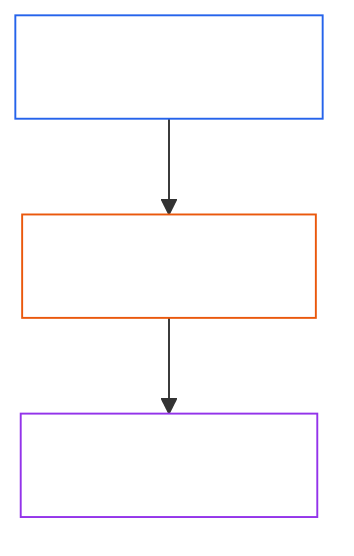
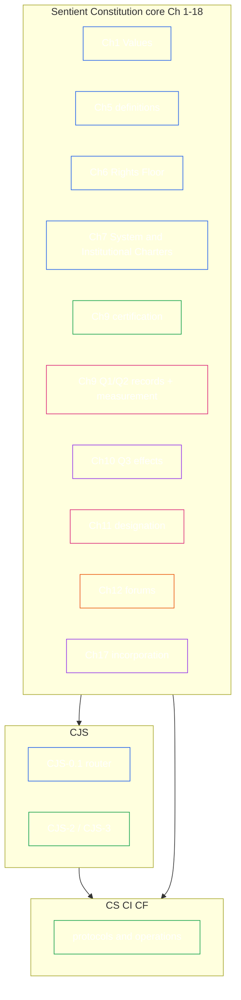

# Constitution document architecture

This file is the **editor map** for the Sentient Constitution corpus. It does **not** bind unless a valid adopting instrument expressly incorporates it. Constitutional readers start at [README.md](README.md).

**Binding text** lives in the numbered `core_*` files (inventory in [README.md](README.md)), [corpus_joint_structure.md](corpus_joint_structure.md), [corpus_systems.md](corpus_systems.md), [corpus_institutions.md](corpus_institutions.md), and [corpus_forum.md](corpus_forum.md). **Corpus** is defined in [**Def.I1** (*Corpus and Authority Stack*)](core_05.045_band_integrative.md#defi1-corpus-and-authority-stack). Edition labels and custody metadata: [README.md](README.md).

Retired architecture sections **14–19** (worklist, adoption appendix, document control) → [archive/ARCHITECTURE_ADOPTION_APPENDIX_ARCHIVED_2026-05-08.md](archive/ARCHITECTURE_ADOPTION_APPENDIX_ARCHIVED_2026-05-08.md) and [archive/ARCHITECTURE_WORKLIST_ARCHIVED_2026-05-08.md](archive/ARCHITECTURE_WORKLIST_ARCHIVED_2026-05-08.md). Completed measurement and companion-anatomy rollout notes → [archive/ARCHITECTURE_ROLLOUT_NOTES_ARCHIVED_2026-08-15.md](archive/ARCHITECTURE_ROLLOUT_NOTES_ARCHIVED_2026-08-15.md).

---

## 1. Purpose

- **Avoid duplication** — owner routing in **section 2**; definitions protocol in **section 4**.
- **Preserve dependency order** — edit order in **section 8**.
- **Track gaps** — stable IDs via `make architecture-index` ([generated index](doc_architecture/generated/stable_id_index.md)).
- **Keep headings, anchors, and cross-references consistent** so audits and editors can navigate. This corpus is **pre-release**: one current fragment id per heading; do not keep fossil or legacy redirect anchors. Auxiliary exports (PDF, plain text) are **non-authoritative** derivatives.

**Review commands:** `make regression` / `make regression-full` (includes measurement-tier, measurement-coverage, and steward-door lockstep audits). Before publication cuts: `make hierarchy-map && make ch5-measurement-tier-audit && make ch5-measurement-coverage-audit`. Steward cards: [implementation/STEWARD_ENTRY_DOORS.md](implementation/STEWARD_ENTRY_DOORS.md). Adoption process path (process support; not itself adoption): [implementation/adoption/](implementation/adoption/).

### Canonical filename convention

- `snake_case` canonical filenames (no spaces; no `%20` links).
- Numbered files use `layer_CC.LSS_suffix.md`: the two-digit chapter home, a literal dot, and the three-digit within-home/layer slot. Examples: `core_00.000_preamble.md`, `core_01.000_values_principles.md`, `core_04.000_burden_traceability_verification.md`, `core_05.035_band_accountability.md`, `core_06.000_rights_part_a.md`, and `core_10.005_application_vignettes.md`. Adopted implementation examples include `cjs_05.105_cross_implementation_operational_terms.md` and `cs_06.305_information_types_and_handling.md`. The machine registry keeps the five-digit `CCLSS` value; filenames and reader references visibly group it as `CC.LSS`.
- Adopted implementation families (**NAV-IMPL-FILENAME-01**): numbered `cjs_` / `cs_` / `ci_` / `cf_` files share a numeric prefix only when they are parts of the same chapter. The undifferenced `layer_NN_*.md` name is the chapter home. Extra same-chapter files take a discriminator — glued letter (`cjs_05.110_oversight_operations.md`) or CS part letter (`cs_02_a_*.md`). Family `01` is the unique scope page for that layer. Different chapters get different numbers (`cjs_18.105_drafting_contracts.md`, `cjs_08.105_support_hosting_classification.md`). Gate: `make adopted-implementation-filename-audit`.
- Full inventory: [README.md](README.md). The Preamble heading and Chapter One numeric headings (`CHAPTER 01`) remain the instrument-opening exception.

### Copy-suffixed duplicate files (FILE-COPY-SUFFIX-01)

A file named like another file plus a space and a number before the extension (`core_07.000_charters 2.md` beside `core_07.000_charters.md`) is a copy made by a file manager, sync client, or editor. It is not part of the corpus.

- **Free removal:** Such a file may be deleted at any time, by anyone, without a reference audit, evidence record, or edition record. Nothing may depend on it.
- **Original wins:** The file without the suffix is the only canonical file. Never merge from a copy, cite it, link to it, or regenerate from it. If a copy holds a change worth keeping, port that change into the original by hand and delete the copy.
- **Check first:** Remove it only when the original exists and the copy is not tracked by git (`git ls-files` does not list it). A tracked file with this naming pattern is a filename-convention defect under **Canonical filename convention**, not a free removal.
- **Tools:** Scripts and audits should ignore these files. A bulk edit such as `make edition-bump` that touches one has changed nothing that matters.
- **Automation:** `make copy-suffix-clean` runs `tools/copy_suffix_clean.py --write`, which deletes every copy that passes the check above and reports, without deleting, any tracked copy or any copy whose original is missing; `make copy-suffix-check` is the dry run. The versioned pre-commit hook `.githooks/pre-commit` runs it right before every commit, after the conflict-marker audit; `make install-hooks` turns the hook on in a checkout (`git config core.hooksPath .githooks`). The hook never blocks a commit over a copy, and a copy it cannot delete is reported and left alone. `.gitignore` keeps copies out of `git add` but does not delete them. The check is not part of `make regression`, because sync clients recreate copies at any time.

### Rename readiness gate

Filename renames require: reference audit, same-change link updates, dated evidence under `evidence/<date>/`, compatibility decision, and edition/custody record. Until the gate passes, candidate names stay planning-only.

### Branch naming (GIT-BRANCH-NAME-01)

A branch name tells reviewers what the work is. It should describe the work the branch carries now, not the first task it was created for.

**Shape.** `<type>/<scope>-<what-changes>`: lowercase, hyphens, no spaces, short enough to read in a branch list (about 50 characters).

- **Type** matches the commit prefix: `docs`, `plain-language`, `restructure`, `fix`, `tools`, `chore`.
- **Scope** is the chapter, article, or lane: `ch06`, `ch1c`, `lane-c`.
- **What changes** is the specific work, such as `article-xxvii-restraint`.
- Examples: `docs/ch06-article-xxvii-restraint`, `restructure/ch06-article-xx-part-split`, `tools/branch-name-check`.

**Check at the start of every new session.** Before the first commit, run `git branch --show-current` and compare the name to the task for this session. Check again before opening a pull request. A new session (human or AI) is where a stale name usually starts, because it picks up whatever branch was left checked out.

**When to change the name.**

- The branch name describes earlier work and this session is doing something different. Example: `restructure-justice-article-xx-part-split` now carries Article XXVIII commits.
- The new work is unrelated to the commits already on the branch. Start a new branch from `main` instead of renaming, so each branch stays about one piece of work.
- The name is vague (`fix`, `updates`, `wip`) or has no scope.

**When to leave it alone.**

- `main`, and any branch someone else created or is using.
- A branch that already has an open pull request. Renaming it on the remote closes that pull request, so ask the custodian first.
- A name that is already accurate. Do not rename for style alone.

**How.**

- Not yet pushed: `git branch -m <new-name>`.
- Pushed, no pull request open: `git branch -m <new-name>`, then `git push origin -u <new-name>`, then `git push origin --delete <old-name>`.
- New work from `main`: `git switch main && git pull && git switch -c <new-name>`.

When a branch is renamed, say so in the first message of the session or in the pull request description, with the old name, so the history stays traceable.

Gate: manual. [CONTRIBUTING.md](CONTRIBUTING.md) leaves contributor branch names free-form; this rule governs the custodian's and AI sessions' working branches.

### Keeping your local copy current (GIT-LOCAL-SYNC-01)

A local checkout that falls behind `origin/main` shows old text, builds generated files from old sources, and turns the next merge into a conflict in files nobody edited by hand. Keep it current.

**Check at the start of every session, and again before a pull request.** Run `git fetch origin`, then `git status -sb` and `git log --oneline HEAD..origin/main`. If the second command prints anything, the checkout is behind.

**What to do.**

- **`main`:** keep it a pure mirror of `origin/main`. Fast-forward it without checking it out: `git fetch origin main:main`. Never commit on it.
- **A work branch:** after any pull request merges (yours or someone else's) and before pushing more commits, run `git merge origin/main`.
- **Dirty working tree:** if uncommitted generated files block the merge, run `git restore ai_corpus doc_architecture/generated`, merge, then regenerate (below). Commit or stash hand-edited source files first.
- **Conflicts in generated files** (`ai_corpus/indexes/*`, `doc_architecture/generated/*`): never resolve these by hand. Take main's version (`git checkout --theirs <file>`), then run `make plain-terms-edition boundary-chunks print-pack reader-accessibility ai-corpus-sync` and commit the result.
- **Unrelated work:** start it from current `main` (`git fetch origin main:main && git switch -c <new-name> main`), not from whatever branch is checked out.
- **Always on the current branch (custodian decision, 2026-10-13).** The checkout is always on a branch that contains the latest `origin/main`. A branch whose pull request has merged is finished: do not leave the checkout on it and do not commit more to it. Start the next piece of work from current `main` as above. If the checkout is on an older or merged branch with uncommitted work, stash it (`git stash push -u -m "<what it is>"`), switch, and restore it only if it is still needed. Never commit stale work onto a stale branch.

**Why.** Pull requests that touch corpus text regenerate the same derived files, so any two open branches conflict there. Merging `origin/main` often keeps that conflict to one small, mechanical step.

Gate: manual. Pairs with GIT-BRANCH-NAME-01, since the same start-of-session check covers both.

### Reporting a commit (GIT-PUSH-CL-01)

Every time a session commits, the closing message gives the custodian the exact push command, so the custodian can push without working it out.

- **First push of a branch:** `git push -u origin <branch-name>` (use the real branch name, not a placeholder).
- **Later pushes of a branch already on the remote:** `git push`.
- Name the branch the commit is on, and say if the branch is behind `origin/main`.
- The session does not push unless the custodian asks. The custodian pushes, opens the pull request, and merges.

Gate: manual. Pairs with GIT-LOCAL-SYNC-01 and GIT-BRANCH-NAME-01.

---

## 2. Corpus roles (single source of truth)

**Numbering note:** When a passage says only “Chapter Fourteen,” disambiguate by filename — see [README.md](README.md).

**Constitutional owner layers:** canonical positive register — [Preamble — constitutional owner register](core_00.000_preamble.md#4-principles-definitions-and-rights) (sections 4–9). The table below is the editorial mirror; substantive owner non-relocation discipline lives under [Authority Stack and Internal Hierarchy](core_05.045_band_integrative.md#authority-stack-and-internal-hierarchy). **Binding owner claims** at chapter openings follow **OWNER-OPENING-01** in **section 4**.

| Layer | Primary home | Routing |
|--------|--------------|---------|
| Values, definition mechanics, definitions | Sentient Constitution `core_*` Ch 1–5 | [README.md](README.md) reading order |
| Rights (Articles I–XXVIII) | Ch 6 | `core_06.0*_rights_part_*.md`; titles via `make reference-audit` |
| System and Institutional Charters | Ch 7 | `core_07.000_charters.md`; the System Charter and Institutional Charter floor (a System Charter for each system of Class L or above, an Institutional Charter for each institution that runs more than one system; voluntary for Class P), the minimum contents of each, the Charter Role Map as the published seat map, and changes and versions; the 12-field template stays in CI-3.6 and the lane map in CI-3.2 |
| Functional independence and separation of duties | Ch 8 | `core_08.000_functional_independence_separation_of_duties.md`; four-seat floor, Materially Binding Act Record minimum, control-line independence, published placement, substitutes, proportionate merged hosting, emergency departures, and wrong-seat routing |
| System alignment certification | Ch 9 | `core_09.000_system_alignment_certification_evaluation.md` (Part A — evaluation); `core_09.005_system_alignment_certification_record_process.md` (Part B — record and process); `core_09.010_system_alignment_certification_illustrations.md` (Part C — worked illustrations); `core_09.015_institutional_alignment_certification.md` (Part D — institutional alignment certification). Part A opens the chapter; there is no index file. Under **oversight**, oversight requires auditing (**Article XVI** / [Auditability](core_05.050_band_oversight.md#auditability) / **[CJS-3.3 audit process home](corpus_joint_structure/cjs_05.115_audit_process.md#cjs-5115-3--odef3-audit-process-home)** and **CJS-3.3**–**CJS-3.5** OP annexes); Ch 9 is one especially large, high-stakes audit process among others — not the sole auditing home. |
| Standing records and measurement (Questions 1 and 2) | Ch 10 | `core_10.000_standing_assessment.md`; verified records and Contribution Axis / Violation Axis slots |
| Standing integration and effects (Question 3) | Ch 11 | `core_11.000_standing_integration.md`; violation, correction, and prevention before contribution gates, with lock design and enforcement, then final effect, restoration, and enforcement |
| Anti-constitutional-misconduct designation | Ch 12 | `core_12.000_misconduct_designation.md` (Part A — designation criteria and safeguards); `core_12.005_misconduct_pattern_applications.md` (Part B — named pattern applications); designation only for qualifying fixed Ch 10 Violation Axis `s = 7–9` findings |
| Forums (constitutional) | Ch 13 | `core_13.000_forum.md`; forum families, jurisdiction, supervision, and cross-forum anti-self-judging; [README navigation](README.md#standing-pipeline-and-forums) |
| Governance / amendment / incorporation | Ch 14–18 | `core_14.000_governance.md`, `core_15.000_non_regression.md`, `core_16.000_expansion_supremacy.md`, `core_17.000_amendment_ratification.md`, `core_18.000_incorporation.md` |
| Cross-implementation joint structure | CJS | **CJS-0.1** (*Topic router*) |
| Systems, institutions, forum operations | CS / CI / CF | Adopted implementation wrappers + subfiles |

**Footer policy:** `make footer-audit`. Optional `*Corpus alignment:*` cites [README.md](README.md) edition metadata and [Chapter Five *Corpus*](core_05.045_band_integrative.md#corpus).

**Authority stack:** (1) numbered `core_*` constitutional source; (2) incorporated implementation within adoption scope; (3) this map and process docs unless explicitly adopted; (4) Sentient Constitution meaning controls operational layers — see [Authority Stack and Internal Hierarchy](core_05.045_band_integrative.md#authority-stack-and-internal-hierarchy).

---

## 3. Boundary rules

1. **Core owns** normative *why* and *what* (values, rights, definitions, meta obligations).
2. **Implementation files own** *how* (taxonomies, protocols, institutions, forums, joint interlocks).
3. **No duplicate definitions** across layers — implementation files *apply* Chapter Five terms.
4. **Stricter wins** where the corpus already says so; core values and rights prevail over conflicting operational wording.
5. **Chapter Six implements detail** for Articles I–XXVIII; do not invent parallel Rights Floors in implementation files.

---

## 4. Project-wide definitions protocol (pinned)

Machine-checkable rules: [tools/architecture/rule_registry.json](tools/architecture/rule_registry.json). Audit catalog: [implementation/AUTOMATED_REFERENCE_CHECKING.md](implementation/AUTOMATED_REFERENCE_CHECKING.md). Lexical guardrails: [tools/architecture/lexical_guardrails.json](tools/architecture/lexical_guardrails.json).

### What counts as a definition

- **Hard definitions:** Ch 2–3 ([`core_02.000_definition_structure.md`](core_02.000_definition_structure.md)); Ch 4 ([`core_04.000_burden_traceability_verification.md`](core_04.000_burden_traceability_verification.md)); Chapter Five §1–§3 (single-home rule below).
- **Values language:** Preamble §1 — [Constitutional Tetrad](core_00.000_preamble.md#constitutional-tetrad), [Two Constitutional Aims](core_00.000_preamble.md#two-constitutional-aims) (**Flourishing** / **Continuity**), and [material stake](core_00.000_preamble.md#material-stake) at principle layer; Chapter Five O/M/A/C for Tetrad legs ([Participation](core_05.025_apex_participation_leg.md#participation-constitutional), [Oversight](core_05.020_apex_oversight_leg.md#oversight-constitutional), [Accountability](core_05.005_apex_accountability_leg.md#accountability), [Timeliness](core_05.030_apex_timeliness_leg.md#timeliness-constitutional)) and aims ([Flourishing](core_05.015_apex_flourishing_aim.md#flourishing-constitutional), [Continuity (Constitutional Aim)](core_05.010_apex_continuity_aim.md#chapter-five-definitions-continuity-constitutional-aim)); Chapter One develops those aims into operative principles. **Reading arc:** Part A (§§1–12 the Flourishing and Continuity aims) → Part B (§§13–15 interaction, override limits, and interpretation) → Part C (§§16–19 stewardship, governance, and incentives) → **§20 Integrated Application** capstone in Part C. Use **Continuity aim** when naming the constitutional aim; reserve bare *continuity* for operational uses elsewhere.
- **Measurement frame (Preamble §2):** Eight constitutional measurement categories in [Measurements Overview](core_00.000_preamble.md#2-measurements-overview) link directly to their Chapter Five **measurement-family homes** (category column) and to canonical definitions (subcategory column); the family table, constitutional use, and definition routing live on the Chapter Five homes. **Family-home map:** Threshold/scaling and Oversight → [`core_05.020_apex_oversight_leg.md`](core_05.020_apex_oversight_leg.md#measuring-oversight-preamble-measurement-family); Flourishing → [`core_05.015_apex_flourishing_aim.md`](core_05.015_apex_flourishing_aim.md#measuring-flourishing-preamble-measurement-family); Continuity → [`core_05.010_apex_continuity_aim.md`](core_05.010_apex_continuity_aim.md#measuring-continuity-preamble-measurement-family); Participation → [`core_05.025_apex_participation_leg.md`](core_05.025_apex_participation_leg.md#measuring-participation-preamble-measurement-family); Accountability → [`core_05.005_apex_accountability_leg.md`](core_05.005_apex_accountability_leg.md#measuring-accountability); Timeliness → [`core_05.030_apex_timeliness_leg.md`](core_05.030_apex_timeliness_leg.md#measuring-timeliness); Constitutional Performance → [`core_05.060_band_performance.md`](core_05.060_band_performance.md#measuring-constitutional-performance-preamble-measurement-family). Home-section anchors use the `#…-measurement-family` suffix (skipped as non-leaf routing anchors by `make ch5-measurement-coverage-audit`). [§3.1 Using Measurements in Governance](core_00.000_preamble.md#31-using-measurements-in-governance) routes measurement → certification (Chapter Nine), standing records (Chapter Ten), remedy (Chapter Eleven), forum review (Chapter Thirteen). **Standing measurement** (Chapter Ten contribution/violation axis measurement) is a *process* concept distinct from **constitutional measurement** categories (Preamble §2), which supply the evidentiary frame for what gets verified before records enter the standing pipeline.
- **Standing:** Chapter Ten owns Questions 1 and 2 (**verified** standing records and Contribution Axis / Violation Axis measurement). Chapter Eleven accepts those inputs as immutable and owns Question 3 integration and effects. Chapter Twelve owns designation only. Chapter Thirteen forums may **open, update, or correct** standing records — or **set a bad record aside on challenge** — from verified findings. Boundary gloss: a **filed case** is not standing by itself. Prefer **case** (forum matter / dispute filing) over **claim** in that contrast; keep **claim** for dispute-phase inventory labels (*unadjudicated claims*) and other established senses.
- **Rights:** Chapter Six; implementation files **cite** articles.
- **Joint operational terms:** `corpus_joint_structure.md` only — route via **CJS-0.1**.
- **Operational taxonomies:** **CS-2**, **CS-3**, **CS-4** and named protocols.

### CJS owner rule

Use **CJS** only for cross-implementation interface terms with no stable single-file home. Reusable joint terms → **CJS-3** clusters; **CJS-2** interlocks point to **CJS-3** and the primary owner named in **CJS-0.1**. Escalate to Chapter Five when constitutional meaning is at stake.

### Chapter Five admission gate

Keep constitutional concept + O/M/A/C boundary only; cite owner homes for institutional machinery. **`make ch5-definitions-gravity-audit`** (blocking).

**Band layout:** Part A ([`core_05.000_definitions_home.md`](core_05.000_definitions_home.md)) holds the compass, alphabetical directory, and dependent-cluster meta rules. Canonical O/M/A/C homes for constitutional aims and Tetrad legs live in **`core_05.0*_apex_*`** files — [Flourishing](core_05.015_apex_flourishing_aim.md), [Continuity](core_05.010_apex_continuity_aim.md), [Accountability](core_05.005_apex_accountability_leg.md), [Oversight](core_05.020_apex_oversight_leg.md), [Participation](core_05.025_apex_participation_leg.md), [Timeliness](core_05.030_apex_timeliness_leg.md). Leaf definition bodies live in **`core_05.0*_band_*`** band files — **Oversight** [`core_05.050_band_oversight.md`](core_05.050_band_oversight.md) (**Def.O1–Def.O2**), **Participation** [`core_05.055_band_participation.md`](core_05.055_band_participation.md) (**Def.P1–Def.P3**), **Accountability** [`core_05.035_band_accountability.md`](core_05.035_band_accountability.md) (**Def.A1–Def.A4**), **Continuity** [`core_05.040_band_continuity.md`](core_05.040_band_continuity.md) (**Def.C1–Def.C4**), **Integrative** [`core_05.045_band_integrative.md`](core_05.045_band_integrative.md) (**Def.I1**). Each defs file contains Independent, Semi-independent, and Dependent cluster entries assigned to that band. A sixth cross-cutting file, the **Constitutional Performance** band [`core_05.060_band_performance.md`](core_05.060_band_performance.md), is only the measurement-family home for that Preamble category (instrumental to both aims, not a Tetrad leg); its leaf definitions keep canonical homes in the **Continuity** band because they are Continuity-band stewardship / shared-system-capacity / proportionality–burden–efficiency cluster members — family home ≠ leaf home (parallel to Timeliness vs. Accountability). Leaves relocate to the Performance file only on an express, dated placement decision. Retired Part B/C paths live under [`archive/core_ch5_retired/`](archive/core_ch5_retired/README.md) only.

### Editorial rule registry

| Rule ID | Summary | Gate |
|---------|---------|------|
| NAV-TRACE-08–10 | Trace placement and contents | `make ch10-trace-audit`, `make trace-routing-prose-audit` |
| NAV-READER-06 | Reader-guidance widget placement | `make widget-top-placement-audit` |
| NAV-WIDGET-TOP-01 | File-top / section-opening widget stack | `make widget-top-placement-audit` |
| NAV-DAC-12 | D/A/C widget discipline, including no visible placement commentary | `make ch5-dac-widget-audit`, `make nav-widget-spacer-audit`, `make plain-language-audit` (placement commentary) |
| NAV-DAC-12-ORDER | Trace → D/A/C placement | `make trace-dac-widget-order-audit` |
| NAV-DAC-12-SPACER | `<br>` after collapsible D/A/C only | `make nav-widget-spacer-audit` |
| NAV-DAC-CH1-ORDER | Chapter One D/A/C row order | `make ch1-dac-order-audit` |
| NAV-PLACEMENT-01 | File-top Corpus placement widget | `make file-top-placement-audit` |
| FILE-COPY-SUFFIX-01 | Copy-suffixed duplicate files (`name 2.ext`) are not corpus and may be removed freely | `make copy-suffix-check` (list), `make copy-suffix-clean` (delete); not part of `make regression`; see [Copy-suffixed duplicate files](#copy-suffixed-duplicate-files-file-copy-suffix-01) |
| NAV-IMPL-LANDING-01 | Implementation-corpus wrapper landing page | Manual (see **section 4**) |
| NAV-IMPL-SCOPE-01 | Implementation `*-1` scope/boundary page format | Manual (see **section 4**) |
| NAV-IMPL-SUBFILE-01 | Adopted implementation subfile anatomy: H1, placement widget, owner line, gloss | `make adopted-implementation-anatomy-audit`, `make file-top-placement-audit-adopted-implementation`, `make owner-line-audit` (owner sentence) |
| NAV-IMPL-FILENAME-01 | Adopted implementation files share a numeric prefix only as same-chapter parts | `make adopted-implementation-filename-audit` |
| GIT-BRANCH-NAME-01 | A git branch is named for the work it carries (`<type>/<scope>-<what-changes>`). At the start of a new session, and again before a pull request, check the name against the work; rename it, or start a fresh branch from `main`, when it no longer fits. | Manual (see **Branch naming (GIT-BRANCH-NAME-01)**) |
| GIT-LOCAL-SYNC-01 | Keep the local checkout current with `origin/main`. At the start of a session and before a pull request, fetch and check `git log HEAD..origin/main`; fast-forward local `main`, merge `origin/main` into work branches, and regenerate rather than hand-resolve generated files. The checkout is always on the current branch: when a pull request merges, start the next work from current `main`. | Manual (see **Keeping your local copy current (GIT-LOCAL-SYNC-01)**) |
| GIT-PUSH-CL-01 | Every commit is reported with the exact push command (`git push -u origin <branch>` for a first push, `git push` after). The session does not push unless asked. | Manual (see **Reporting a commit (GIT-PUSH-CL-01)**) |
| ROOT-LAYOUT-01 | The repository root holds only the public door and the numbered corpus. Plain-language companions go in `project/plain_language/`, drafts and WIP files go under `project/`, and git bundles (`*.bundle`) never belong in the repository. | `make root-layout-audit`; `python3 tools/root_layout_audit.py --fix` moves plain-language files |
| FILE-SIZE-01 | No file in the repository is larger than 1 MB (1,000,000 bytes). Split it, compact it, or keep it out of the repository; dated evidence snapshots are deleted rather than exempted. | `make file-size-audit` |
| FRONT-DOOR-01 | The front doors (README, START_HERE, AGENTS, llms.txt, docs/index.md, CONTRIBUTING, ANNOUNCEMENT) say only what the corpus supports. Edition string, effective date and steward pin agree; until the announcement the edition is the current date (`make edition-bump`; `make front-door-freshness` checks it, `EDITION_TRACKS_DATE=0` in the Makefile ends that at the announcement cut); pre-release status agrees; "Chapters 1-N" and "N articles" match the `core_NN` files and the Rights Floor headings; the language bar matches `translations/`; README and ANNOUNCEMENT quote the Two Fundamental Questions exactly as the Preamble words them; every backticked `make` target and `tools/` path exists; START_HERE's ranked situations and non-fits match FIT_SITUATIONS one for one; LICENSE authorship appears in README and docs/index.md; the doors point at each other; required sections exist; no list links one target twice; the generated reader files README links are tracked. When you change what a door counts or quotes, change the door in the same commit. | `make front-door-audit`; `make front-door-freshness` also runs the generated-file `-check` targets (part of `make regression-full`) |
| FRONT-DOOR-LABEL-01 | Section labels in link text on public-facing pages (START_HERE, AGENTS, CONTRIBUTING, docs/index.md, VISION, FAQ, guides, steward doors, the adoption kits and easy-entry guides, ANNOUNCEMENT) match the number of the heading they link, the same as in the core. These pages used to be skipped as "history", so renumbering left readers with labels such as "Chapter One §16.1.1" for what is now §17.1. | `make section-label-anchor-audit` |
| NAV-PRE-RELEASE-FRAGMENT-01 | Pre-release: one current fragment id per heading; no fossil or legacy redirect anchors | `make fossil-anchor-audit` |
| TERM-SYSTEM-CLASS-01 | Chapter Nine says "system class", not a bare "class" (named levels such as "Class B" are fine); headings are in Chicago headline case ("System Class Scaling and Escalation") | `make system-class-term-audit` (changed lines only); `python3 tools/apply_system_class_term.py --dry-run` to preview a fix |
| MD-LIST-INTRO-01 | Bold list-intro lead-in ends with `:` not `.`: standalone (`**Record and showing:**`), heading-echo run-in (`**Symmetric costly constraints:**`), or list-item label (`- **Not standing:**`). Ordinary non-echo run-ins (`**Admission scope.**`) are out of scope. | `make corpus-markdown-audit` |
| MD-GLOSS-CLOSE-01 | An italic `*In plain terms: ...` gloss paragraph ends with a closing `*`. A missing closer renders a literal leading asterisk and drops the italics. | `make corpus-markdown-audit` |
| MD-HEADING-TOPIC-01 | Numbered section's first body-prose line (after widgets and `*In plain terms*` gloss) must not restate that heading as a topic sentence (`**[§13.2 Title](#…):**`). Heading-echo run-in labels are MD-HEADING-RUNIN-01. | `make heading-echo-topic-audit` |
| MD-HEADING-RUNIN-01 | A section's first body line must not open with a bold run-in label that restates its own heading (`**Governance as authorized structure.**` under `#### 11.1 Governance as Authorized Structure`). Bold terms used as a sentence subject, and labels that add a distinct idea, are out of scope. | `make heading-runin-echo-audit` |
| MD-SECTION-LEAD-01 | A section's first body line (after widgets, spacers, callouts, and `*In plain terms*` gloss) is lead-in prose, not a bare list item. Container sections whose first content is a child heading are out of scope. **Carve-out:** Chapter Five definition files (`core_05.*.md`), whose entries open with O / E / C bullets by design. Blocking (`make regression`). | `make section-bullet-lead-audit` |
| VIS-CHART-READABILITY-01 | Mermaid chart boxes with a title and explanatory content use `<br/><br/>` between the title and content for a blank visual line. | Manual (see **Chart readability standard** below) |
| VIS-CHART-THEME-02 | Reader-facing Mermaid nodes use transparent fills, white labels, and the shared semantic-outline palette; do not rely on renderer-default label colors. | Manual (see **Chart color and theme standard** below) |
| VIS-CHART-SYNC-03 | When an Article or subarticle is renumbered, renamed, added, moved, split, or removed, update every reader-facing Mermaid chart that lists it so numbers, titles, and bullets match the current headings. | Manual (see **Chart sync on renumbering (VIS-CHART-SYNC-03)**) |
| VIS-CHART-ORIENT-04 | Mermaid flowcharts flow top to bottom (`flowchart TB`); a left-to-right, right-to-left, or bottom-up chart needs a stated exception. | Manual (see **Chart orientation standard** below) |
| VIS-CHART-CENTER-05 | Mermaid flowcharts keep boxes horizontally centered on one another: a node sits centered under its parent, or under the midpoint of its parents; a node that fans out to a row of siblings is centered over the row; a node that the row converges on is centered under it. Exceptions need a stated reason. | Manual (see **Chart centering standard** below) |
| VIS-CHART-CROSSING-06 | Mermaid flowchart links must not cross one another. Rearrange nodes, end a loop at a pair of on-page connector circles (**VIS-CHART-SYMBOLS-08**) instead of drawing a long link back up the chart, or merge parallel paths into one box before publishing. No exceptions. | Manual (see **Chart crossing standard** below) |
| VIS-CHART-EXTERNAL-07 | In a chart about one chapter's process or structure, a box for a process owned outside that chapter uses the subroutine shape (`[[ ]]`), says it is outside the chapter, and connects with a dotted link; when one section hands off, that section goes on the link label. Corpus-wide map charts are out of scope. | Manual (see **Chart external-process standard** below) |
| VIS-CHART-SYMBOLS-08 | Mermaid flowcharts follow standard flowchart symbols (ISO 5807) wherever Mermaid can draw them: rectangle for a step, diamond for a decision, double-barred box for a predefined process defined elsewhere, and matching lettered circles (on-page connectors) for a loopback or a jump. Corpus-specific conventions apply only where no standard symbol exists. | Manual (see **Chart symbol standard** below) |
| VIS-CHART-SECNUM-09 | In a Mermaid chart box that cites a section, the section number comes first: at the start of the title line, before the title (`§5 Publish the office-holder statement`), never after it behind a dash (`Publish the office-holder statement — §5`) or as a trailing note. A content line that carries its own section number starts with it. | `make chart-section-number-audit` (in `make regression`) |
| OWNER-OPENING-01 | Binding constitutional-owner opening statement | `make owner-line-audit` (also covers the NAV-IMPL-SUBFILE-01 owner sentence) |
| LINK-IN-PARA-14 | Load-bearing in-paragraph links | `make in-paragraph-link-audit` |
| LINK-OFF-CORPUS-15 | Link destinations stay in-repository in binding text; no machine-local targets anywhere | `make external-link-audit` (inventory: `make external-link-audit-report`) |
| IMPL-ROUTE-01 | Core-to-implementation routing: one plain pointer sentence to the family subfile that actually holds the mechanics; no generic implement / not-narrow restatement; no layer-relationship lead-ins | `make plain-language-audit` (lead-in phrases); manual (generic tails, pointer truth) |
| SUPPORT-DOC-POINTER-01 | Binding corpus must not depend on `doc_architecture` or a README section for meaning or routing | `make support-doc-pointer-audit` |
| CH5-GRAVITY | Chapter Five admission / de-bundling | `make ch5-definitions-gravity-audit` |
| CH5-ORDER-01 | Chapter Five editorial order | `make ch5-cluster-order-audit`, `make ch5-entry-format-audit`, `make ch5-constitutional-cluster-audit` |
| CH5-SINGLE-DEF | One visible definition per term | `make ch5-single-definition-audit` |
| LEX-GUARDRAILS | Vocabulary and capitalization | `make lexical-vocabulary-audit` |
| TIME-NAME-01 | A time window is named by its kind of time: window, target, bound, term, interval, period, or span. "Clock" does not name a specific window, "cadence" does not name a length, and "response window" means the Chartered Party's window to answer only. | `make lexical-vocabulary-audit` (rule `avoid-window-clock-names`); see [Time-window names (TIME-NAME-01)](#time-window-names-time-name-01); list of names: [CJS-0.4](corpus_joint_structure/cjs_00.105_registry_and_reading_rules.md#cjs-0105-4-time-window-names) |
| TIME-REF-01 | Every time reference in the binding text (a number with a unit, or "reasonable period", "promptly", "as soon as feasible") shows its logic in the same sentence: it names a bound kind (outer bound, intake target, certification interval, and so on) and the tier or class that sets it, or it uses a registered fixed-period name. A registered scaled window (response window, resolution window) is a bound kind, but a number beside it still needs the tier or class that sets it. Older references are baselined and the list only shrinks. The vocabulary is in `tools/time_reference_registry.json`. | `make time-reference-audit` (backlog: `make time-reference-backlog`) |
| TIME-LOCK-01 | Every copy of the tier windows follows its owner. The outer bounds are owned by Chapter Thirteen §6 (*Tier outer bound*) and the intake targets by CF-11.3.1. The Chapter Seven §1.6 summary table (response window = intake target, resolution window = outer bound) and the sentences that quote the intake figures are derived copies, listed in `tools/time_window_lockstep_registry.json`. The audit reads the owners, checks that they agree with each other, rebuilds each copy, and fails on drift or on a registered copy it cannot find. `--fix` rewrites drifted copies from the owners and never settles a conflict between owners. | `make time-window-lockstep-audit` (repair: `make time-window-lockstep-fix`, then `make architecture-index ai-corpus-sync plain-terms-edition boundary-chunks`) |
| TERM-BODY-01 | A body that verifies, authorizes, or decides a question for others is an **authority** (record-opening authority, Backup Record Authority, restricted information authority, verifying authority). A body that enters and holds a record is a **custodian**, and a body that files and receipts is a **registrar**. "Verifier" is not a name, and "office" names a unit or a post, not a body with a job. | `make lexical-vocabulary-audit` (rule `avoid-verifier`); see [Names for bodies that verify, hold, and file (TERM-BODY-01)](#names-for-bodies-that-verify-hold-and-file-term-body-01) |
| AUDIT-REGISTRY-01 | Every audit-like `make` target has one entry in `tools/architecture/audit_registry.json`: its category, whether the report runs it, and whether it writes files. A new audit is registered in the same change. | `make audit-registry-check`; report: `make audit-report` (see [Audit registry and report (AUDIT-REGISTRY-01)](#audit-registry-and-report-audit-registry-01)) |
| AUDIT-AUTOFIX-01 | Formatting, lexical, and citation audit findings are repaired by the agent without per-item sign-off, followed by affected audits and the full gate report. Preserve meaning and use canonical sources; escalate only an unresolved substantive choice. | Standing agent workflow; see [Automatic audit repairs](#automatic-audit-repairs-audit-autofix-01) |
| AUDIT-EVIDENCE-RETENTION-01 | Audit output under `evidence/<date>/` keeps only the newest two runs of each audit family; an audit run deletes the third-to-last. Only files named in `tools/architecture/audit_evidence_retention.json` are touched, so hand-written records in the same folders stay. | `make evidence-prune` (also runs after every evidence-writing audit target); tests: `make audit-report-test` |
| GLOSS-SUBARTICLE | Chapter Six `*In plain terms:*` on subarticles | `make subarticle-gloss-audit` |
| GLOSS-ARTICLE-NEIGHBORS | Chapter Six `*Article neighbors:*` article-intro coordination | editorial pattern in **section 4** |
| OWNER-SINGLE-HOME | Competing O/M/A/C gloss heuristics | `make owner-discipline-audit` |
| DEF-APPROPRIATENESS | Unified definition placement (core vs CJS-3 vs implementation) | `make definition-appropriateness-audit` (advisory; ledger at `evidence/definition_audit/ledger.json`) |
| REF-ARTICLES | Article titles and Roman numerals; prose cite gloss per **section 7** | `make reference-audit` |
| MEAS-ANCHOR | No links to removed Preamble §3 `#measuring-*` category anchors | `make measurement-anchor-audit` |
| MEAS-DEF-01 | Definition-anchored measurement tiers inform A/C authoring | `make ch5-measurement-tier-audit` and `make ch5-measurement-coverage-audit`; seeds at [tools/architecture/measurement_tier_seeds.json](tools/architecture/measurement_tier_seeds.json); editorial progress report (not corpus text): [doc_architecture/generated/measurement_rollout_status.md](doc_architecture/generated/measurement_rollout_status.md) |
| CH5-HIER-01 | Definition hierarchy layers, tags, and placement rules | `make hierarchy-map` (generated index) |
| CH9-PROCESS-ORDER-01 | Chapter Nine sections follow the order the certification work is done, in six phases | Manual (see **section 4**); links and anchors by `make local-markdown-fragment-audit`, `make section-label-anchor-audit`, `make fossil-anchor-audit` |
| ROUTER-CJS01 | Cross-implementation routing | `make router-bidirectional-audit` |

Historical D/A/C rollout: [archive/doc_architecture_decision_log/DEC_WIDGET_AND_NAV_DECISIONS_2026-04-16_2026-06-15.md](archive/doc_architecture_decision_log/DEC_WIDGET_AND_NAV_DECISIONS_2026-04-16_2026-06-15.md).

### Reader-guidance placement (NAV-READER-06)

Collapsed **Reader guidance (non-operative)** widgets give readers orientation without creating, narrowing, or relocating binding obligations.

**Placement rule:**

- **Chapter-level or part-level orientation** belongs at the chapter or part opening: after the file-top **Corpus placement** widget and chapter/part heading, and before the first operative purpose, rule, article, or numbered section.
- In split-chapter files, a part-position widget belongs immediately after that file's chapter/part heading and before the part's first operative section.
- **Local reader guidance** may appear later only when it explains a specific nearby table, directory, crosswalk, routing index, example set, or other local navigation aid. It should stay adjacent to the material it explains.
- Keep general reading-order notes, layer routing, architecture maps, and warnings against moving text out of the binding text itself. Put them in the opening reader-guidance widgets.
- Reader-guidance widgets use the standard blue collapsed `<details>` styling and carry **(non-operative)** in the summary. They do not restate that they bind nothing. That principle is stated once, in the [Preamble's corpus-placement widget](core_00.000_preamble.md), and applies to every non-operative widget.

Enforced (with **NAV-WIDGET-TOP-01**) by `make widget-top-placement-audit`: chapter/part Reader guidance and file-level Trace / D/A/C must stay in one contiguous opening stack (blank lines only between widgets — no `<br>`, owner/home lines, or other prose between them) before ordinary operative prose; when a section's direct content carries Trace / D/A/C, those widgets open the unit (after optional anchors and opening Reader guidance). Child-section widgets and bold run-in local Traces (for example `**8.3. …**`) do not count against the parent.

### Link destination standard (LINK-OFF-CORPUS-15)

Link targets are held to two standards, because the two layers are read differently.

**Binding corpus** — `core_*` files and adopted implementation text link **inside the repository only**: a relative path, optionally with a `#fragment`, or a bare `#fragment` in the same file. An absolute URL, a protocol-relative URL, a root-absolute path, or any other URI scheme fails. The instrument must read the same from a clone, the print pack, and the Pages render, and no reader may be sent off the corpus to learn what a provision says.

**Maintained support documents** — README, START_HERE, `docs/`, `implementation/`, and the rest may cite external sources with ordinary `http(s)` or `mailto` links. The GitHub Pages door in `docs/` is the standing example.

**Machine-local targets fail everywhere.** A `file://` URL, an editor preview URL (`vscode-resource`, `vscode-cdn`, `vscode-webview`, `file+`), a home-directory or drive-letter path (`/Users/…`, `~/…`, `C:\…`), an editor workspace path (`/.cursor/`, `/.vscode/`), or a `localhost` URL resolves on one machine only. These usually arrive by copying a rendered preview URL out of an editor: an editor's Markdown preview rewrites a correct relative link into a webview resource URL at render time, so a preview URL is evidence about the preview, not about the file. Check the source line before treating one as a defect.

**Staying in-repository is not the whole test.** A link can be in-repository and still route out of the instrument. Binding text must not send a reader into a **support document** to find where a constitutional step lives: `doc_architecture.md` and the README both classify themselves as process / map support, so a deep link such as `README.md#standing-pipeline-and-forums` routes through a map that cannot bind. Cite the owner chapter, or the Preamble chain map at [§6.2 How the full chain fits together](core_00.000_preamble.md#62-how-the-full-chain-fits-together). Bare `README.md` links stay allowed for what the README owns: reading order, the binding/support split, edition and document-control identifiers, and the reading-chain footer. **SUPPORT-DOC-POINTER-01** enforces this.

Dated records (`evidence/`, `evaluation/`, `project/MEMLOG.md`, `project/TODO.md`), generated trees, `archive/`, and `translations/` stay outside the blocking scope: they record what was true when written. `make external-link-audit-report` inventories them, along with every allowed external citation, without failing.

### Chart readability standard

Mermaid chart boxes that contain a title and explanatory content must separate them with a blank visual line: use two HTML line breaks (`<br/><br/>`) after the title before the content. This is a presentation standard for readability; it does not change the chart's relationships or authority. Example: `A["Title<br/><br/>Content"]`.

### Chart color and theme standard (VIS-CHART-THEME-02)

Reader-facing Mermaid diagrams use **unfilled nodes with white text and explicit colored outlines**. Do not rely on a renderer's default text color: theme defaults can produce white text over a pale fill or black text over a dark canvas.

**Shared semantic-outline palette:**

- **Neutral / input / context** — slate `#64748b`
- **Authority / source / official record** — blue `#2563eb`
- **Participation / affected sentients** — teal `#0f766e`
- **Systems / certification / operational implementation** — green `#16a34a`
- **Verification / contest / forum review** — orange `#ea580c`
- **Standing / accountability finding / misconduct** — rose `#db2777`
- **Effect / remedy / restoration / constitutional change** — purple `#9333ea`

Assign a node by its primary role in the diagram. Color is a reusable visual cue, not a claim of authority, severity, sequence, or normative priority; relationship labels and nearby prose continue to carry that meaning. Nodes without a clear semantic role use slate. Subgraph containers remain unfilled and unstyled unless their boundary itself needs explanation.

Use an explicit style on every colored node, with `fill:none`, `color:#ffffff`, and the palette's outline color. Example:



Before publishing a diagram to a different rendering surface, visually confirm that its canvas is dark enough for white labels; if it is not, choose an explicitly contrasting label/fill pair rather than depending on theme defaults.

### Chart orientation standard (VIS-CHART-ORIENT-04)

Mermaid charts flow **top to bottom**. Start every flowchart with `flowchart TB`. Do not use `LR`, `RL`, or `BT` unless the chart records an exception. `TD` is the same direction as `TB` and is accepted in existing charts; write `TB` in new ones.

**Why.** Top to bottom reads as levels or bands: each band is a layer or stage a reader works down through, in the same direction the page scrolls. It keeps one reading direction across the corpus, and most existing charts already follow it.

**Exceptions.** An exception needs a stated reason in the sentence that introduces the chart, or in a caption. Accepted reasons:

- a sequence of many short steps where top to bottom would make one very tall, thin column and left to right fits the page width;
- a side-by-side comparison where the columns carry the meaning.

A chart that is merely easier to draw another way is not an exception.

**Layout tips.** To keep related nodes in a horizontal band inside a top-to-bottom chart:

- Put the band in a `subgraph` and give it `direction LR`.
- Link a band to the next band (`V --> L`), not to a node inside it. A link from an outside node to an inner node makes Mermaid ignore the band's `direction`.
- Use an invisible link (`a ~~~ b ~~~ c`) to force nodes into one row when the renderer wraps them.
- To center a node when a long link pulls the layout to one side, see **Chart centering standard (VIS-CHART-CENTER-05)** below.

**Scope.** This standard covers flowcharts, the only Mermaid type the corpus uses. It sits beside **VIS-CHART-READABILITY-01** (title and content spacing) and **VIS-CHART-THEME-02** (unfilled nodes, white labels, palette outlines), **VIS-CHART-CENTER-05** (horizontal centering), **VIS-CHART-CROSSING-06** (no crossing links), **VIS-CHART-EXTERNAL-07** (outside processes), and **VIS-CHART-SYMBOLS-08** (standard flowchart symbols); a chart meets all seven.

**Check.** Manual. `grep -rn -E '^\s*flowchart (LR|RL|BT)' --include='*.md' .` lists charts that need an exception or a change.

**Existing charts.** On 2026-09-30, outside `translations/`, `archive/`, `evidence/`, `evaluation/`, and the generated site, the corpus held 41 `TB`, 1 `TD`, and 7 `LR` flowcharts. Two of the `LR` charts were this document's own example and the process-system-institution diagrams, both since converted. The other five (`project/VISION.md`, `guides/RECORD_OVERVIEW.md`, `CONTRIBUTING.md`, `implementation/PROCESS_PIPELINES_READER.md`, and the generated print pack) and the `TD` chart in `core_13.000_forum.md` were converted to `TB` in the 2026-10-06 sweep; the print pack follows its sources. Translation copies are not part of the sweep and are brought into line when each translation is next updated.

### Chart centering standard (VIS-CHART-CENTER-05)

Boxes in a Mermaid chart are **horizontally centered on one another**. A chart that reads as symmetric about a vertical axis is easier to scan, and it shows the structure: a box off to one side looks like it belongs to a different branch.

- **Single chain.** A box that follows one parent sits directly under it, and a box that leads to one child sits directly over it.
- **Fan-out.** When a box leads to a row of siblings, it is centered over the row.
- **Convergence.** When a row of siblings leads to one box, that box is centered under the row, and any box below it stays on the same axis.
- **Side links.** A link that skips a level (for example a dotted "serves" link from a top box to the last box) must not drag the boxes it passes off the axis.

**Why.** Mermaid's automatic layout centers a box on its parents' and children's *average* position. A single long link adds a hidden stop at every level it crosses, and that pulls the boxes toward its side.

**How to fix an off-center chart.**

1. Render the chart (see **Check**) and measure each box's horizontal center.
2. Add invisible spacer nodes on the side opposite the pull and chain them with invisible links: `CAP ~~~ GL ~~~ GE ~~~ GF`. Define each spacer with a blank label (`GL["&nbsp;"]`) and style it with no fill, no outline, and a label color that matches the canvas (`style GL fill:none,stroke:none,color:#111111`).
3. To center a box that the long link also reaches, link a spacer to it as well (`GE ~~~ FL`).
4. Widen a spacer with extra `&nbsp;` to move the result a few pixels, then render again.
5. **Balance with invisible links.** An invisible link between two real boxes can steer the layout without a spacer node. Link a box on one side to a box at the same level on the other side (`Rec ~~~ S`) so a parent centers over the whole row, and lengthen an invisible link (`O ~~~~ Ch`) so a side box lands on the row it belongs with. Invisible links carry no meaning; keep them out of any audit of chart contents.
6. **Balance the whole figure, not just the chain.** A chart can have every box on one axis and still look off-center, because the page centers the figure's full width. Measure the axis against the SVG `viewBox` (axis minus left edge versus right edge minus axis); the two should match within a few pixels. The usual cause is a wide side box or edge label on one side. Narrow it with `<br/>` breaks in the box text and in the long link's label, then re-measure. Re-measure under several fonts (Trebuchet, Carlito, FreeSans, Inter, DejaVu Sans); the sides should stay within about 15px, because the reader's font is not the renderer's. A gate that must come before a step (for example the published challenge path before forum sign-off) goes on the main line, not on a side branch, and its exit is stated in its box text rather than drawn as a long side link.

Spacer nodes carry no meaning. Keep them out of the chart's caption and out of any audit of chart contents. Keep them out of the **VIS-CHART-SYNC-03** list of boxes that must match headings.

**Exceptions.** A chart whose meaning comes from asymmetry (a timeline, or a main path with a short side branch) may be off-axis; say so in the caption or the sentence that introduces it. A chart that is merely harder to balance is not an exception.

**Check.** Manual. Render the chart with Mermaid and confirm the centers. A small tolerance is fine (a few pixels). Do not hand-tune a chart whose automatic layout is already centered. Spacers add noise.

**Reference example.** The Continuity diagram in `core_01.000_values_principles.md` (§8): the top two boxes, §12, and the Flourishing box share one axis centered between §10 and §11, and the "means toward" link runs down the right side.

**Existing charts.** Swept on 2026-10-06 for every English-source chart outside `translations/`, `archive/`, `evidence/`, and the generated site; new and edited charts must comply when written. Translation copies are brought into line when each translation is next updated.

### Chart crossing standard (VIS-CHART-CROSSING-06)

Links in a Mermaid chart **must not cross**. A crossing makes a reader stop and trace which line goes where, and it can suggest a relationship the chart does not mean. Edge labels count as part of their link; a link may not run through another link's label.

**How to remove a crossing.**

1. **Reorder.** Mermaid places sibling boxes roughly in the order their links are written. Write the links so that a side branch sits on the side it leads to (for example, the left-hand outcome first when its path continues down the left).
2. **Use connectors for loops.** A long link from near the bottom of a chart back up to an earlier box almost always crosses something, and Mermaid may also reverse the whole layout to fit it. Use a pair of matching on-page connector circles instead (**VIS-CHART-SYMBOLS-08**): the loop ends at a lettered circle, and the same letter feeds the box where the flow re-enters.
3. **Merge parallel paths.** When several paths lead to the same next step, send them to one shared box rather than drawing separate links onward from each.
4. **Lengthen a side link.** A longer link (`-..->` or `---->`) moves a side box down a level so it sits beside the row it belongs with, which often clears a crossing and helps centering under **VIS-CHART-CENTER-05**.
5. **Link bands, not inner boxes,** as **VIS-CHART-ORIENT-04** describes; links into the middle of a band cross easily.

**Exceptions.** None. If a chart cannot be drawn without crossing links, split it into two charts or simplify it.

**Check.** Manual. Render the chart with Mermaid and look for crossing lines before publishing.

**Reference example.** The certification process chart in `core_09.000_system_alignment_certification_evaluation.md` (§1.1): the two outcome branches converge on one recertification box, and the cycle ends at connector circle A, which re-enters above Phase I (§2), rather than a line looping back to the top.

**Existing charts.** Swept on 2026-10-06 for every English-source chart outside `translations/`, `archive/`, `evidence/`, and the generated site; new and edited charts must comply when written. Translation copies are brought into line when each translation is next updated.

### Chart external-process standard (VIS-CHART-EXTERNAL-07)

In a chart about one chapter's process or structure, a box that stands for a process **owned outside that chapter** — another chapter, an implementation corpus, or an outside body — must look different from the chart's own steps, so readers can see where the chapter's authority ends. Other Parts of the same chapter are not outside it (Chapter Nine's chart treats Part B as its own).

- **Shape.** Use Mermaid's subroutine shape, `X[["…"]]`, which draws double side bars — the standard flowchart symbol for a predefined process (**VIS-CHART-SYMBOLS-08**). Do not use a dashed outline: dashed outlines mark grouping containers (for example the Non-Negotiable band in `core_01.000_values_principles.md`).
- **Label.** Name the outside owner or process and say it is outside the chapter, for example with a line "Outside this chapter" (two `<br/>` per **VIS-CHART-READABILITY-01**). Do not put this chapter's section numbers in the outside box.
- **Link.** Connect it with a dotted link (`-.->`, or `-..->` when a longer link helps layout). When one section of this chapter makes the hand-off, put that section on the link label (for example "§8 — verified inputs only").
- **Color.** Outline by role under **VIS-CHART-THEME-02**, like any other box.

**Scope.** Corpus-wide map charts whose boxes are all chapters or corpora (for example the chapter map in `core_00.000_preamble.md`, the dependency graph in this document, or `implementation/PROCESS_PIPELINES_READER.md`) are out of scope: there is no single owning chapter for a box to sit outside of.

**Reference examples.** The certification process chart in `core_09.000_system_alignment_certification_evaluation.md` (§1.1): "Chapter Ten — Standing records" is a subroutine box reached by a dotted link labeled with the §8 gate. The Chapter Six overview chart in `core_06.000_rights_part_a.md` (and its copy in `guides/CONCEPTUAL_OVERVIEW.md`): later governance, measurement, certification, forums, remedy, and implementation sit outside Chapter Six, reached by dotted links. The dispute-sequencing chart in `core_13.000_forum.md` (and the forum-families chart in `guides/CONCEPTUAL_OVERVIEW.md`): the published Stakeholder System Participation challenge path is owned outside Chapter Thirteen.

**Check.** Manual. Render the chart and confirm every outside process uses the subroutine shape and every subroutine box is an outside process.

**Existing charts.** Swept on 2026-10-06 for every English-source chart outside `translations/`, `archive/`, `evidence/`, and the generated site; new and edited charts must comply when written. Translation copies are brought into line when each translation is next updated.

### Chart symbol standard (VIS-CHART-SYMBOLS-08)

Mermaid flowcharts follow **standard flowchart symbols** (ISO 5807, the same shapes most readers already know) wherever Mermaid can draw them. Invent a corpus-specific convention only where no standard symbol exists, and record it in this document.

| Meaning | Standard symbol | Mermaid |
|---------|-----------------|---------|
| Step or process | Rectangle | `X["…"]` |
| Decision | Diamond | `X{"…"}` |
| Predefined process defined elsewhere | Rectangle with double side bars | `X[["…"]]` (see **VIS-CHART-EXTERNAL-07**) |
| Start or end (terminator) | Rounded "stadium" | `X(["…"])` |
| Document or record | Wavy-bottom document | Not drawn reliably on all renderers; use a rectangle |
| Loopback or jump on the same chart (on-page connector) | Small circle with a letter | `A1((A))` … `A2((A))` |
| Jump to another page or file (off-page connector) | Home-plate pentagon | No built-in shape; use the predefined-process box with the destination named |

**Connectors.** A loop or long jump leaves the flow at a lettered circle and re-enters at a circle with the same letter, placed just before the box where the flow resumes. Use A, B, C… for separate loops in one chart. Connector circles take the slate outline under **VIS-CHART-THEME-02** and carry no other text. Connectors are the default fix for loops under **VIS-CHART-CROSSING-06**.

**Grouping.** Subgraph bands and dashed-outline group containers are Mermaid conventions, not ISO symbols; keep using them as described above.

**Reference example.** The certification process chart in `core_09.000_system_alignment_certification_evaluation.md` (§1.1): rectangles for steps, a diamond for the outcome, a predefined-process box for Chapter Ten, and connector A for the return to classification.

**Check.** Manual. Render the chart and confirm each shape matches its meaning.

**Existing charts.** Swept on 2026-10-06 for every English-source chart outside `translations/`, `archive/`, `evidence/`, and the generated site; new and edited charts must comply when written. Translation copies are brought into line when each translation is next updated.

### Chart section-number standard (VIS-CHART-SECNUM-09)

A chart box that cites a section puts the number **first**, so a reader finds it in the same place on every box and can scan down the left edge of a chart for the sections it covers.

- **Title line.** Start with the number, then the title: `§7 Keep it true`, `§3, §4 Publish its System Charter or Institutional Charter`, `§3.1–§3.4 IIa — Always`. When a phase or part label is also in the title, the number still comes first: `§9–§9.2 Phase VIa, Operate and recertify`.
- **Not after the title.** Do not trail the number behind a dash (`Keep it true — §7`), after a comma (`IIa, §3.1–§3.4`), or in parentheses at the end (`Non-Negotiable (§2.1)`). A title that wraps onto a second line with `<br/>` keeps the number at the start of the first line.
- **Content lines.** A content line that is about one section starts with that number too (`§2 You don't need anyone's permission to start`). A bullet may open with its number (`• §3.1 Fairness`).
- **Out of scope.** Edge labels (`-->|"Becomes material — §1"|`) are not boxes. A cite qualified by another document (`CS-4 §10`, `Chapter Nine §3`) names a section elsewhere. An inline cross-reference in running content (`carried downstream (§18, §19)`) is prose, and Article numbers (`Article VI`) are not section numbers. A box with no section number needs none.
- **Layers.** This sits beside **VIS-CHART-READABILITY-01** (title, blank line, content) and **VIS-CHART-SYNC-03** (numbers match the current headings).

**Check.** `make chart-section-number-audit` scans the Mermaid blocks in the binding corpus, `CONTRIBUTING.md`, `guides/`, and `implementation/` (title-line and trailing-cite checks), with `make chart-section-number-audit-test` for the rule's own tests. Both run in `make regression`. Translation copies, `archive/`, `evidence/`, and the generated site stay outside the scan and follow the translation re-sync.

**Existing charts.** Swept on 2026-10-18: the Chapter Seven §1.6 chart, the two Chapter Nine process charts (Parts A and B), and the *Non-Negotiable* box in Chapter One §2 and its copy in `guides/CONCEPTUAL_OVERVIEW.md` were rewritten to put the number first. Chapter One's other boxes already did.

### Constitutional owner opening statement (OWNER-OPENING-01)

Each numbered owner-layer chapter states **who owns what** in one binding operative sentence at the chapter opening — not inside collapsed widgets and not buried in **§1 Purpose and Role**.

**Canonical register:** substantive owner homes live in the [Preamble — constitutional owner register](core_00.000_preamble.md#4-principles-definitions-and-rights) (sections 4–9); non-relocation discipline lives under [Authority Stack and Internal Hierarchy](core_05.045_band_integrative.md#authority-stack-and-internal-hierarchy). The opening sentence is the chapter's positive owner claim; the Preamble register is the cross-chapter index.

**Placement rule (stack order):**

1. `#` chapter title (and optional `*Non-operative subtitle:*`).
2. File-top **Corpus placement** widget.
3. Chapter- or part-level **Reader guidance** widget(s), when present.
4. Chapter-opening **Trace** widget (when the file carries a chapter-level Trace before numbered sections).
5. **Binding owner opening line** — operative prose, visible without expanding widgets.
6. Optional chapter-specific orientation blocks that are substantive but not widgets.
7. `*In plain terms:*` gloss and numbered sections — section-level Trace / D/A/C under each heading in the order already required by **NAV-TRACE-08–10** and **NAV-DAC-12-ORDER**.

Each numbered `core_*` chapter file is one chapter (or one named part). Repeat steps 2–6 at the file's chapter/part opening: that chapter's reader-guidance widget (if any), then its chapter-opening Trace (if any), then its binding owner line, then optional orientation and sections.

**Formula:**

`Chapter <Roman or spelled-out number> is the constitutional owner of **<domain>**.`

When one registry row splits across **part files** within the same chapter number (e.g. **Chapter Nine Part A / Part B**), use:

`Chapter <N>, Part <letter>, is the constitutional owner of **<domain>**.`

- State the **owner domain** only — unqualified. Do **not** append **where material** to the owner claim; materiality triggers belong on evaluation sections inside the chapter.
- Do **not** append em-dash or trailing clauses that restate procedural, evaluative, or verification detail on the owner sentence; put that in **§1 Purpose and Role**, Trace, or the sibling part's home.
- Keep the owner sentence to one line when possible. Long domain lists may use a short trailing phrase (`including …`) only when the registry row requires it.
- **Sibling-part pointer (split chapters only):** after the owner claim, one optional second sentence may route readers to the sibling part's domain — by pointer only, without restating substantive obligations (example: `Record contents … are in **Part B**`; `Evaluation requirements are in **Part A**`).
- **Do not** fold layer-discipline routing (`Layer discipline is under …`, `read with Authority Stack`) into the owner line — that belongs in Trace **Read with:** bullets or in layer-scope sections.

**Widget vs operative split:**

- Either opening widget may include a `**Constitutional owner:**` bullet to help readers find their way. This covers **Corpus placement** and **Reader guidance** widgets. That bullet does not bind, and it does **not** replace the binding opening line.
- State the owner claim **once** in operative prose at the chapter opening. Remove duplicate owner sentences from **§1** openings and from layer-scope sections unless the later text adds a **boundary** rule (what the chapter does **not** own), not a second owner claim.

**Split owner layers:** when one registry row spans two or more files — the standing pipeline (**Chapters 10–10**); system alignment certification (**Chapter 9 Part A / Part B**) — each file gets its own opening line scoped to what that file owns: verified records and measurement in Chapter Ten, integration and standing effects in Chapter Eleven, designation only in Chapter Twelve; evaluation in Part A, record/process/standing bridge in Part B.

**Part files, band files, and files that own nothing (2026-10-20).** The binding owner line is visible in every `core_*` file, not only in the first file of a chapter.

- A chapter that runs across part files gives each part its own line in the part formula: Chapter One Parts A to C, Chapter Six Parts B to E (Part A keeps the chapter-level claim), and Chapter Nine Parts A, B, and D.
- The Chapter Five hub states the chapter claim. Each band file and each apex (Tetrad leg or aim) file states its own: `Chapter Five, <name>, is the constitutional owner of …`. A claim that appears only inside the Corpus placement widget does not count, because that widget does not bind.
- The Preamble states what it owns: the Model, the measurement categories, and this register.
- A reading index or an illustration file that adds no rule says that it owns no rule and names the files that own the topic. This covers Chapter Nine Part C and the Chapters Ten to Thirteen vignettes.
- The owner line comes before the *In plain terms* gloss (step 5 before step 7 above). Chapters Ten and Eleven had the order reversed and were corrected.

**Gate (2026-10-20):** `make owner-line-audit` (**OWNER-OPENING-01**). It reads every `core_*` file outside collapsed widgets and requires one claim line: `is the constitutional owner of` with the domain in bold, or `owns no rule` for the two files in its `CORE_NON_OWNER` list. The line must come before the first gloss and the first section heading, start with the chapter the file name gives (and the Part letter when the file name has one; Chapter Six Part A is the one exception), not end in "where material", and appear once. A new `core_*` file is checked as soon as it exists. Tests: `make owner-line-audit-test`.

**Examples (reference pattern):** [Chapter Nine Part A](core_09.000_system_alignment_certification_evaluation.md#chapter-nine-part-a-system-alignment-certification--evaluation) and [Part B](core_09.005_system_alignment_certification_record_process.md#chapter-nine-part-b-system-alignment-certification--record-and-process) (split registry row; sibling-part pointers); [Chapter Six](core_06.000_rights_part_a.md#chapter-six-foundational-rights) (after reader guidance); [Chapter Twelve Part A](core_12.000_misconduct_designation.md#chapter-twelve-anti-constitutional-misconduct) (reader guidance moved before the opening line).

### D/A/C widget template (NAV-DAC-12)

Collapsed **Definitions · Assessment · Compliance** widget (same blue `<details>` styling as Trace). Trace carries routing only (`Upstream:`, `Downstream:`, `Read with:`); D/A/C carries Chapter Five O/M/A/C jump links at the point of invocation.

**When to attach**

- Attach where a section **materially invokes** Chapter Five concepts as working terms in its own substantive claims — not roadmap enumeration of terms treated downstream in named sections (*roadmap exclusion*; see archived decision log).
- **Two or more** invoked concepts → collapsible D/A/C widget.
- **Exactly one** invoked concept → single-line inline **`Definition:`** (no collapsible widget).
- **No visible placement commentary.** Operative prose must not explain where D/A/C anchors sit or why a roadmap sentence carries none (`this is where the Article operatively invokes them`, `roadmap pointer only`, `does not re-invoke`, `canonical Chapter Five anchors … appear in`). Placement speaks for itself; readers reach the anchors by opening the widget. Flagged by `make plain-language-audit`.

**Placement under the owning `###`–`#####` unit (NAV-DAC-12-ORDER)**

1. **With Trace** — D/A/C widget or inline `Definition:` immediately follows Trace `</details>`; only blank lines may intervene. Enforced by `make trace-dac-widget-order-audit` when Trace carries Chapter Five `· [O]` read-with links.
2. **Without Trace** — D/A/C widget is the **first substantive block under the heading**, before `*In plain terms:*` and operative prose. Legacy `<a id="…"></a>` anchors may follow the widget block (after its closing `</details>` and spacer). Example: Chapter One `#### 5.2 Voluntary Discontinuation and Exit Rights`.

**Spacer (NAV-DAC-12-SPACER)**

- Collapsible D/A/C widget: `<br>` after `</details>` before operative prose.
- Inline `Definition:` line: **no** `<br>` (standard paragraph break only).

**Inside the widget**

- **Row shape (enforced by `make ch5-dac-widget-audit`):** each row is  
  `- [Name](core_05…#slug) · [O](…) · [M](…) · [A](…) · [C](…)`.
  Measurement (M) targets `#{slug}-m` when that anchor exists (aim and Tetrad-leg apex heads); otherwise M shares the assessment-region target `#{slug}-a` with A (leaf guidepost form interweaves M with A under **How to measure and assess**).
- **Annotation prose (optional, non-row):** italic-label lines such as `*Scope.*`, `*Definition home.*`, or `*Cluster-head home.*` may appear as plain paragraphs inside the widget before the row list. They are **not** list bullets and must not mimic row shape.
- **Chapter One row order:** functional reasoning order, not alphabetical — config in [tools/architecture/ch1_dac_order.json](tools/architecture/ch1_dac_order.json); `make ch1-dac-order-audit`.

**Do not** put `Definitions:` lines inside Trace (2026-04-16 D/A/C split). **Do not** use visible group labels as fake list rows inside D/A/C widgets.

<a id="measurement-informed-ec-meas-def-01"></a>
### Measurement-informed A/C (MEAS-DEF-01)

*Component-letter note (2026-07): the Assessment component was formerly labelled **Evaluative (E)** with `#{term}-e` anchors; it is now **Assessment (A)** with `#{term}-a` anchors, so the entry model reads **O/M/A/C**. The legacy `measurement-informed-ec-meas-def-01` section anchor above is preserved for stable inbound links.*

Preamble [§2](core_00.000_preamble.md#2-measurements-overview) names constitutional **measurement categories** and **families** — plain questions that orient review. On canonical Chapter Five definition homes these surface as an explicit **Measurement (M)** register that is **interwoven with Assessment (A)** inside the assessment region — the **O/M/A/C** entry model. M carries measurement routing (which measure applies at each tier); A carries the matching assessment duty; C still carries what must hold in practice.

To keep the model legible for non-specialist readers, definition homes present O/M/A/C through **reader-facing guidepost headers** rather than bare letter markers: **What it is** (O), **How to measure and assess** (M interwoven with A), and **What must hold** (C), optionally opened by an italic `*In plain terms: …*` one-line gloss. Every sub-bullet uses a single **bold run-in label ending with a colon** followed by regular prose, for consistency and scannability: `**In scope:**` / `**Out of scope:**` under **What it is**, with optional `**Depends on:**` for constitutive prerequisites (see [Chapter Two §1.1](core_02.000_definition_structure.md#11-ontological-components-o--what-it-is)); `**Primary measure:**` on the tier bullet with `**Primary assessment:**` on an unbulleted continuation line directly beneath (and likewise `**Secondary …**` / `**Tertiary …**`, in tier order, omitting tiers not present) under **How to measure and assess**; and `**Primary failure:**` / `**Secondary failure:**` / `**Tertiary failure:**` under **What must hold**. The `#{term}-a` and `#{term}-c` anchors are preserved immediately above the measure/assess and must-hold headers, so Chapter Two's O/M/A/C structure and every cross-file `#{term}-a` / `#{term}-c` link remain intact behind the friendlier labels.

**Design intent**

- **Preamble** keeps category-level orientation and plain-language questions; it indexes outward to definition owners rather than duplicating full measurement prose.
- **Chapter Five** carries operative measurement discipline: which measures apply to each term, how assessment must run, and what failure looks like when measures are gamed or untraceable.
- **Aim and band file rollups** (for example [Constitutional Aim decomposition](core_05.015_apex_flourishing_aim.md#constitutional-aim-decomposition)) route to definition homes; they do not restate per-term measurement tiers once those tiers live on the definition entry.

**Relationship to Chapter Two**

| Component | Measurement role |
|-----------|------------------|
| **O** (*What it is*) | What the term is — mandatory `**In scope:**` / `**Out of scope:**` sub-bullets carry the concept and boundaries (consolidated or dimensional). `**Out of scope:**` names adjacent concepts, sibling homes, or ordinary cases outside the matter — not hollow labels, paper substitutes, or failure modes (those belong under `**Primary failure:**` in C; see [Chapter Two §1.1](core_02.000_definition_structure.md#11-ontological-components-o--what-it-is)). Optional `**Depends on:**` lists constitutively required canonical definitions (bounds, floors, alignment targets); omit when dependencies are the phenomenon named in **In scope** (for example reliance relationships under [Dependency](core_05.040_band_continuity.md#dependency)) or when the linked term is the definitional subject rather than a prerequisite (for example [Material Impact](core_05.050_band_oversight.md#material-impact) under [Materiality](core_05.050_band_oversight.md#materiality)). `**Depends on:**` carries only *upstream* prerequisites and must not duplicate the joint-invocation rules under [Chapter Five §2.1 Joint invocation and satisfaction](core_05.000_definitions_home.md#21-joint-invocation-and-satisfaction) or co-measures under **How to measure and assess**; inverse relationships (downstream consumers via `Downstream:`, the parent group via `Cluster component:`, and a head's `Cluster members (family routing):`) live in the Trace block. Do not duplicate the concept across the header and In scope; do not encode metrics, proxies, assessment co-measures, or Trace routing in O. |
| **M** (in *How to measure and assess*) | Which measure applies at each tier — Preamble category routing and Chapter Five co-measure links, stated on the `**Primary measure:**` (etc.) label. Interwoven with A; not a pass/fail outcome. |
| **A** (in *How to measure and assess*) | How the term must be assessed — the `**Primary assessment:**` (etc.) label paired with each tier's measure (primary trace, secondary co-measures, tertiary integrity checks). A specifies assessment scope and conditions; it does not prescribe pass/fail outcomes. |
| **C** (*What must hold*) | What must hold in practice — observable satisfaction and failure modes, stated on `**Primary failure:**` (etc.) labels aligned to primary, secondary, and tertiary measurement duties. |

**Tier semantics** (declared per canonical definition home; scope-qualified when a term serves multiple aims or Tetrad legs)

| Tier | A duty | C duty |
|------|--------|--------|
| **Primary** | Main evidentiary trace for this term in this owner scope — what evaluators must assess first. | Non-compliance when the primary measure is untraceable, hollow, or contradicted by full functional conditions. |
| **Secondary** | Co-measures that must be included when evaluating the primary — scope expansion, not optional read-with decoration. | Non-compliance when primary indicators appear stable but secondary degradation defeats the term. |
| **Tertiary** | Anti-proxy, metric-integrity, and verification-boundary checks — especially where throughput, engagement, self-report, or formal classification substitutes for outcome evidence. | Non-compliance when proxies are treated as dispositive, divergence is ignored, or correction is refused after divergence is reasonably observable. |

Not every definition requires all three tiers. Independent building blocks may declare **primary only**. Cluster heads may carry family-level tiers; leaf entries inherit unless they state a narrower or broader boundary.

**Entry placement** (Chapter Five leaf definition, guidepost O/M/A/C model)

1. Trace `</details>` → `<br>` (existing NAV-DAC-12-SPACER discipline where applicable).
2. **Plain-terms lead** (optional) — a single italic `*In plain terms: …*` sentence giving a non-specialist the gist before the structured components.
3. **O** — `- **What it is**` header; the concept and boundaries live in mandatory In scope / Out of scope sub-bullets (at least one In scope, consolidated `- **In scope:**` or dimensional `- **In scope — {dimension}:**`, and one `- **Out of scope:**`). Optional `- **Depends on:**` when constitutive prerequisites should be separated from the core concept ([Chapter Two §1.1](core_02.000_definition_structure.md#11-ontological-components-o--what-it-is)). No duplication of the concept on the header line.
4. **M/A interwoven** — `<a id="{term}-a"></a>` then a `- **How to measure and assess**` header; under it, one bullet per tier with the measure on the tier bullet and the assessment on an unbulleted continuation line beneath it — `- **Primary measure:** …` then (indented four spaces) `**Primary assessment:** …`, then `- **Secondary measure:** …`, then `- **Tertiary measure:** …` (each with its paired `**{Tier} assessment:**` line; omit tiers not present). No `*Measurements:*` header and no bare `- A:` marker. Link Preamble category homes and Chapter Five co-measure terms on the `**{Tier} measure:**` label.

**Primary measure house wording.** On `**Primary measure:**` lines, lead with the linked measurement-family name(s), then the compass plain question in italics — not architecture role tags:

- Good: `- **Primary measure:** [Oversight measurement family](core_05.020_apex_oversight_leg.md#oversight-measurement-family) — *Can sentients see, verify, and rely on what systems represent?*`
- Dual-family: join families with `and` and join questions with ` / `.
- Do **not** put `supporting measure`, `constituent measure`, `primary owner`, `split-placement`, or similar role jargon after the em dash. Keep those in Trace or the generated hierarchy index when specialists need them.
- Compass questions live in [Chapter Five compass](core_05.000_definitions_home.md#chapter-five-compass-and-definition-map). Term-specific how-to-measure detail belongs on `**Primary assessment:**`, not on the measure line.
- Exception: already-plain term-specific glosses (for example Accountability/Timeliness lines that say what the pair checks in that entry) may keep that gloss after linked family names.
- `**Secondary measure:**` / `**Tertiary measure:**` may stay shorter (named co-measures / integrity checks); plain-question form is mandatory on Primary.
5. **C** — `<a id="{term}-c"></a>` then a `- **What must hold**` header; satisfaction rule (where applicable) plus tier-aligned failure modes using `**Primary failure:**`, `**Secondary failure:**`, and `**Tertiary failure:**` sublabels when multiple tiers apply.

**Guidepost form (current).** Reader-facing guidepost headers (**What it is** / **How to measure and assess** / **What must hold**), bold run-in sublabels, and `#{term}-a` / `#{term}-c` anchor placement are the **corpus norm** on Chapter Five leaf definitions. Aim and Tetrad-leg apex heads may use letter markers (`- O:` / `- M:` / `- A:` / `- C:`) or the same guidepost headers. Do not author new `*Measurements:*` blocks. Live coverage: [measurement_rollout_status.md](doc_architecture/generated/measurement_rollout_status.md). Completed wave notes: [archive/ARCHITECTURE_ROLLOUT_NOTES_ARCHIVED_2026-08-15.md](archive/ARCHITECTURE_ROLLOUT_NOTES_ARCHIVED_2026-08-15.md).

**CJS-3 oDef form.** Joint operational definition entries use the same reader-facing guidepost headers and bold run-in sublabels as Chapter Five leaves, under the binding parse rules in **CJS-1.13**–**CJS-1.14**. They remain **oDef** / **CJS-3** joint operational rules — not Chapter Five **Def.*** Independent Definitions. On **oDef** entries, `**Primary measure:**` names the auditable control, record, evidence object, or operational check the term turns on; it does not invent Preamble or Chapter Five measurement-family leads unless the entry already points there.

**Family vs definition**

- Where a Preamble family maps 1:1 to a term ([Wellbeing](core_05.040_band_continuity.md#wellbeing), [Materiality](core_05.050_band_oversight.md#materiality)), tiers attach on that definition entry.
- Where a family is a cluster label ("Safety, harm, and risk," "Survival-floor access"), the **cluster head** carries family routing on the header's final `*Measurements (family routing):*` line (see **Cluster-header order** under Definition hierarchy); leaves inherit or override explicitly.

**Distinct from standing measurement.** [Chapter Ten](core_10.000_standing_assessment.md) Contribution Axis / Violation Axis measurement is a *process* concept. Constitutional measurement categories (Preamble §2) supply the evidentiary frame for what gets verified before records enter the standing pipeline — see **section 4** measurement frame bullet.

**Pilot exemplar:** [Wellbeing](core_05.040_band_continuity.md#wellbeing) — primary Flourishing outcome measure with secondary harm/risk/agency co-measures and tertiary [Proxy Divergence](core_05.050_band_oversight.md#proxy-divergence) discipline.

Optional `**Depends on:**` under **What it is** lists constitutive prerequisites only; see [Chapter Two §1.1](core_02.000_definition_structure.md#11-ontological-components-o--what-it-is). Seed file: [measurement_tier_seeds.json](tools/architecture/measurement_tier_seeds.json). Audits: `make ch5-measurement-tier-audit`, `make ch5-measurement-coverage-audit`, `make measurement-rollout-status`.

### Definition hierarchy (CH5-HIER-01)

Chapter Five organizes **224 canonical definitions** across principle layer, constitutional **aim heads**, Tetrad **band files**, taxonomy (independent / semi-independent / dependent), clusters, and leaf O/M/A/C entries. Partial maps already exist (compass, measurement crosswalk, alphabetical directory); this rule pins the **layer model** and the **generated hierarchy index** that unifies them.

**Layer stack** (top → bottom)

1. **Principle layer** — [Preamble §1](core_00.000_preamble.md#the-model): [Constitutional Tetrad](core_00.000_preamble.md#constitutional-tetrad), [Two Constitutional Aims](core_00.000_preamble.md#two-constitutional-aims), [material stake](core_00.000_preamble.md#material-stake).
2. **Aim and leg apex files** — dedicated files hold canonical O/M/A/C plus decomposition routing only: [Flourishing aim](core_05.015_apex_flourishing_aim.md), [Continuity aim](core_05.010_apex_continuity_aim.md), [Oversight leg](core_05.020_apex_oversight_leg.md), [Participation leg](core_05.025_apex_participation_leg.md), [Accountability leg](core_05.005_apex_accountability_leg.md), [Timeliness leg](core_05.030_apex_timeliness_leg.md). Filename prefix `core_05.0*_apex_` sorts before band files.
3. **Tetrad band files** — substantive owner files (`core_05.0*_band_*`): [Oversight](core_05.050_band_oversight.md), [Participation](core_05.055_band_participation.md), [Accountability](core_05.035_band_accountability.md), [Continuity band](core_05.040_band_continuity.md), [Integrative](core_05.045_band_integrative.md), [Performance](core_05.060_band_performance.md).
4. **Taxonomy** — within each band: Independent → Semi-independent → Dependent clusters (Chapter Five §1–§3).
5. **Clusters** — dependent clusters identified as **Def.{band}{n}** (Oversight **Def.O***, Participation **Def.P***, Accountability **Def.A***, Continuity **Def.C***, Integrative **Def.I***; cite as **Def.O1** (*Title*)) and semi-independent topic groups (`**Semi-independent context**` heads). **Cluster-header order** (top → bottom):
   1. Cluster framing — `**Semi-independent context** (component definitions may still operate outside joint-invocation scope):` for semi-independent topic groups, or the dependent-cluster joint-invocation / `**Admission scope.**` block (plus any cluster-specific framing such as system-class or principle-layer interface notes).
   2. Member list — `**Topic group members.**` or `**Cluster members.**` (and any non-measurement header notes that must accompany the member list, such as `**Evaluation measure.**` or `**Anti-bypass.**`).
   3. **Measurements last** — `*Measurements (family routing):* Measured under the {family}. Find the concrete measures on the member definitions below.` Optional cluster-specific read-withs (for example CS-9) may trail on the same Measurements line. Do **not** link editorial progress reports (including `measurement_rollout_status.md`) from corpus Measurements lines. Do not place Measurements above the member list, and do not place Topic group / Cluster members after Measurements.

**Anti-bypass house wording.** Cluster-local applications of the [Anti-Segmentation Principle](core_01.005_interaction_interpretation.md#1511-anti-segmentation-principle) use the label `**Anti-bypass.**` (or `- **Anti-bypass:**` in Dependent cluster context blocks). State the cluster's **Compartments** and the duties they must not defeat; do not restate the general rule. Do **not** open with `Under [Joint invocation and satisfaction], …` — that meta-rule already applies to every dependent cluster via [Chapter Five §2](core_05.000_definitions_home.md#2-dependent-cluster-meta-rules). Prefer a single terminal cite: `See [§15.1.1 Anti-Segmentation Principle](core_01.005_interaction_interpretation.md#1511-anti-segmentation-principle).`
6. **Leaf definitions** — canonical `####` O/M/A/C entries (one visible label per term).

**Orthogonal tags** (per term in [generated hierarchy index](doc_architecture/generated/definition_hierarchy.md))

| Tag | Meaning |
|-----|---------|
| `canonical_file` | Substantive owner file — does not move for searchability |
| `tetrad_leg` | Oversight, Participation, Accountability, Timeliness, Integrative, or cross-leg |
| `primary_aim` | Flourishing, Continuity, or cross-cutting |
| `aim_role` | `aim_head`, `constituent`, `outcome_measure`, `tetrad_leg_head`, `measurement_family_member`, `cluster_member`, `independent` |
| `ch00_measurement` | One or more Preamble §2 measurement categories (seed keys `3.1`–`3.8`) |
| `cluster_id` | Owning cluster or topic-group anchor |
| `definition_class` | independent / semi_independent / dependent_cluster |

**Placement rules**

- **File home** = substantive owner (band file). Split placement is normal: a term may measure **Flourishing** while living in the **Continuity** band (example: [Wellbeing](core_05.040_band_continuity.md#wellbeing) — `outcome_measure` under **Flourishing**, not a constituent).
- **Aim files** route only — O/M/A/C for the aim head, decomposition links, measurement-family index (link-only). Never duplicate leaf O/M/A/C bodies in aim files.
- **Constituents vs outcome measures** — constituents are named in [Preamble §1](core_00.000_preamble.md#two-constitutional-aims) for each aim (Flourishing: truth, safety, trustworthiness, meaningful agency). Outcome measures (for example **Wellbeing**) track whether the aim is achieved; they are linked from Constitutional Aim decomposition but defined in band files.
- **Searchability** — use [definition_hierarchy.md](doc_architecture/generated/definition_hierarchy.md) and [definition_registry.json](ai_corpus/indexes/definition_registry.json); do not relocate binding text into aim files for editor search convenience.

**Generated artifacts:** `make hierarchy-map` → `doc_architecture/generated/definition_hierarchy.json` and `.md`. Seed overrides: [tools/architecture/hierarchy_overrides.json](tools/architecture/hierarchy_overrides.json).

### Article neighbors gloss (GLOSS-ARTICLE-NEIGHBORS)

`*Article neighbors:*` — visible, article-scoped coordination prose for average readers. It explains how the current article sits next to neighboring articles, chapters, or interpretive hubs — extension, governance split, mutual reinforcement, certification non-substitution, or hub routing **without narrowing** upstream Rights Floors.

**Distinct from Trace.** Trace `Read with:` carries mandatory corpus routing for integrators and auditors (`Upstream:`, `Downstream:`, `Read with:`). `*Article neighbors:*` is reader-facing orientation in visible article prose. It does not replace Trace routing or CJS-0.1 integrator tables.

**Typical intro stack** (when an article carries aims/tetrad framing):

1. `*In plain terms:*`
2. `This Article states **constitutional floors**…` + **Flourishing** / **Continuity** bullets where used
3. Tetrad block — `Legitimate pursuit runs through the Constitutional Tetrad, scaled to material stake:` followed by four bullets: **Participation**, **Oversight**, **Accountability**, **Timeliness** (match **Article III** intro style).
4. `*Article neighbors:*` — use bullets when coordination spans multiple neighboring articles, layers, or non-substitution rules; a single short sentence may remain inline.
5. Subarticles (`#### Article …`)

When no aims/tetrad block exists, place `*Article neighbors:*` after the article scope sentence and before the first subarticle.

**When to use**

- Neighboring articles govern part of the floor while this article carries the rest.
- This article extends an upstream article without narrowing it.
- Certification, challenge, interpretive-hub, or info-sphere articles must be read together without substitution.
- Article placement or sequencing materially affects how neighboring floors apply.

**Do not** use `*Article neighbors:*` for operative rights bullets, Trace contents, D/A/C widget rows, or implementation-owner routing to `corpus_systems` / `corpus_institutions` unless that routing is expressed as article-to-article coordination for readers.

**Do not** list the article's own subarticles as neighbors. Subarticles belong to their parent article; describe their content in the article's own intro or in the subarticles themselves. Subarticles of *other* articles may be cited when explaining coordination with that article.

### File-top placement template (NAV-PLACEMENT-01)

One collapsed **Corpus placement** widget per audited file top. Summary label: **`Corpus placement (non-operative): file structure and reading rules`** (same blue `<details>` styling as Trace and Reader guidance).

**Visible before the first section heading (or first operative registry section):**

- `#` title. For core chapter files this is the chapter/part heading itself (e.g. `# PREAMBLE / FOUNDATIONAL REQUIREMENTS`, `# CHAPTER SIX: FOUNDATIONAL RIGHTS`). Chapter Five band/aim files keep their descriptive `#` band title. The cross-chapter vignette file `core_10.005_application_vignettes.md` keeps a descriptive `#` title.
- Optional `<a id="chapter-…"></a>` anchors immediately above the `#` title carry the chapter/part anchors; an optional `*Non-operative subtitle:*` line may sit directly beneath the title.
- On implementation `*_00_registry_and_reading_rules.md` files only: one-line `*In plain terms:*` registry-annex gloss (not a second front door; see **NAV-IMPL-LANDING-01**).
- In this order: the placement widget; any file- or part-level reader-guidance widget; the chapter-opening **Trace** widget, if there is one; the **binding constitutional-owner opening line**, if the file is an owner-layer chapter (see **OWNER-OPENING-01**); then `<br>`. Any introduction, the `*In plain terms:*` gloss, and the binding text follow. No `---` rule sits between the title and the widgets.

**Inside the placement widget (non-operative):**

- `core_*` — binding-together notice, which chapter/part/band the file holds, README reading-order pointer, and file-sequence navigation (**Next**, **Upstream**, **Previous**) when present. A `**Constitutional owner:**` bullet may appear here or in the reader-guidance widget to help navigation; it does not bind. The **binding** owner claim still appears in the main text, after the opening widgets and any chapter-opening Trace (**OWNER-OPENING-01**).
- `*_00_registry` — edition and effective date, core vs implementation status, four-layer map (**CJS** / **CS** / **CI** / **CF**), navigation wrapper / reader-landing link, **CJS-1.3** pointer, and routing-anchor indexes previously split across multiple reader-guidance widgets.

**Do not keep visible at file top:** **Application baseline**, upstream inheritance boilerplate, or pipeline routing that duplicates the Corpus placement widget, chapter reader-guidance widgets, or [README.md](README.md). Chapter-specific scope boundaries and anti-substitution notes belong in the Corpus placement widget (file-level) or in chapter reader-guidance widgets.

### Implementation-corpus landing pages (NAV-IMPL-LANDING-01)

The four root wrappers are the **only** human landings for their layers:

| Wrapper | Layer | Default next |
|---|---|---|
| [corpus_joint_structure.md](corpus_joint_structure.md) | **CJS** | `cjs_reader_guide.md` (non-operative how-to-read), then `cjs_01_*` |
| [corpus_systems.md](corpus_systems.md) | **CS** | `cs_01_*` |
| [corpus_institutions.md](corpus_institutions.md) | **CI** | `ci_01_*` |
| [corpus_forum.md](corpus_forum.md) | **CF** | `cf_01_*` |

Each `*_00_registry_and_reading_rules.md` is a **registry annex** (identifier rules, reserved-family notes, optional routing detail) — not a second front door and **not** a second table of contents. The human family index is generated onto the four wrappers from [tools/architecture/family_map.json](tools/architecture/family_map.json) (`make family-map-indexes` / `make family-map-audit`). Default sequential reading is **wrapper → `*-1` scope file**. **CJS** inserts a non-operative [joint-structure reader guide](corpus_joint_structure/cjs_reader_guide.md) between the wrapper and `cjs_01_*`; that file is how-to-read only and is not a second landing. Footer audit treats `*_00` as side-path annexes (`tools/footer_audit.py`). **CI-2** and **CF-2** are reserved family IDs (routing lives in the annex); do not renumber later families to close those holes.

**Visible stack (in this order):**

1. `#` plain-language title (not editor jargon alone).
2. One-line `*In plain terms:*` gloss.
3. **Scope:** conceptual lifecycle bullets (what this layer is for) — not a reprint of the section-family index. End with one meta bullet pointing to the collapsed index for file-level detail.
4. **Does not:** boundary bullets (what this layer refuses to own or redefine).
5. **Implements from the core files:** short linked list of core chapters/articles this layer operationalizes (prefer ascending chapter order).
6. **Siblings:** Core [README](README.md) first, then peer domain wrappers, then joint structure (or, on the CJS landing, the three domain wrappers plus the topic-router reader index).
7. **Binding:** one plain statement — when incorporated under [Chapter Eighteen](core_18.000_incorporation.md), these rules bind as implementation detail; they must satisfy the Sentient Constitution and must not override or narrow it.
8. **Already know your topic?** pointer to the collapsed index and/or registry annex.

**Collapsed (non-operative) widgets, after the visible stack:**

- **Compatibility and authority** — edition alignment, compatibility entrypoint, authority note.
- **Layer index** — grouped stable family → authoritative subfile table generated from `family_map.json` (the machine-oriented TOC). Groups are reader maps (taxonomy vs protocols; machinery vs domain interfaces), not new corpora.

**Closing (immediately before the navigation footer):**

9. **What to do now:** continue to the next file for this layer’s boundary (what it owns here vs what remains in the Constitution or other implementation folders). **CJS** may add that most readers need later sections only when cited — not the folder front to back.
10. `---` then **`Next file:`** to the layer’s `*-1` scope file. **CJS** points **Next file:** at [cjs_reader_guide.md](corpus_joint_structure/cjs_reader_guide.md); that guide then points at `cjs_01_*`.

**Do not** leave compatibility notes, authority boilerplate, edition stamps, or the full family index visible above the orientation stack. **Do not** treat `*_00` as the default next hop from the wrapper.

**Single sources:** global edition and reading order in [README.md](README.md); implementation shared contract in **CJS-1.3**; section-family registries remain in `*_00` annex files; human landings remain the four wrappers under this rule.

### Implementation scope/boundary pages (NAV-IMPL-SCOPE-01)

Each layer’s first substantive file (`cjs_01_*`, `cs_01_*`, `ci_01_*`, `cf_01_*`) is the **scope and boundary** page: what that layer owns, what it does not, and where to continue. Default sequential reading is **wrapper → `*-1` → later family files**. **CJS** default sequential reading is **wrapper → reader guide → `cjs_01_*` → later family files**.

**Visible stack (in this order):**

1. `## XX-1: Scope, purpose, and boundary interface` (or the layer’s established `*-1` title).
2. Collapsed **Trace**, then collapsed **Definitions · Assessment · Compliance**.
3. One-line `*In plain terms:*` — what this layer is for.
4. **What this layer owns** — bullets naming the layer’s operative homes.
5. **What this layer does not own** — bullets naming the correct home after an em dash (core chapters, sibling layers, or **CJS** as applicable).
6. **Read next** — short pointers to the next substantive file, the `*_00` registry annex if needed, and any CJS-owned shared contract / reading-order homes. Prefer a collapsed **Reader guidance (non-operative): Read next** widget when the list is orientation-only (see **NAV-READER-06**); keep it as visible bullets only when a short binding continue-here cue is still needed.

**Subsections under `*-1`:**

- Add `### XX-1.n` only for **layer-unique** elaboration that does not belong in the owns / does-not-own lists.
- **CJS-only** substance that other layers must cite — purpose of the joint layer / implementation-corpus gateway (**CJS-1.0**), identifier rules including **oDef** / **Def** and the constitutional-vs-joint-operational-definition distinction (**CJS-1.1**), shared contract (**CJS-1.3**), and parse mechanics for **oDef** (**CJS-1.13**–**CJS-1.14**) — lives in **CJS-1** (and its subsections). Parse mechanics live in [cjs_05.140_odef_parse_mechanics.md](corpus_joint_structure/cjs_05.140_odef_parse_mechanics.md); drafting contracts (**CJS-1.7**–**CJS-1.8.1**) live in [cjs_18.105_drafting_contracts.md](corpus_joint_structure/cjs_18.105_drafting_contracts.md). **CS** / **CI** / **CF** point to those homes; they do not restate them. Applicability, combined satisfaction, the default **CJS → CS → CI → CF** reading stack, and the [Fullest Protective Effect](core_05.045_band_integrative.md#fullest-protective-effect) rule among jointly applicable incorporated obligations live in **Chapter One §15.4.4** and **§8.4.3**; CJS cites those homes and does not restate them. Non-operative how-to-read for average humans lives in [cjs_reader_guide.md](corpus_joint_structure/cjs_reader_guide.md) only.
- Do **not** restate owns / does-not-own lists inside a `*-1.1` subsection when the file-level lists already state them.

**Placement rules:**

| Content | Home |
|---|---|
| What the layer owns / does not own | File-level lists on that layer’s `*-1` |
| Purpose of the joint layer / implementation-corpus gateway | **CJS-1.0** only |
| Default cross-layer reading stack | **Chapter One §15.4.4** only |
| Constitutional vs joint operational definitions | **CJS-1.1** only (other layers may keep one short pointer bullet) |
| Shared implementation-corpus contract | **CJS-1.3** only |
| Applicability, combined satisfaction, and the [Fullest Protective Effect](core_05.045_band_integrative.md#fullest-protective-effect) rule for jointly applicable incorporated obligations | **Chapter One §15.4.4** / **§8.4.3** (CJS-0.1 identifies which files the facts require) |
| Identifier / label rules | **CJS-1.1** + each layer’s `*_00` registry annex (**oDef.*n*** = **CJS-3.*n***; Chapter Five **Def.*** separate) |
| Parse mechanics (guidepost **What it is** / **How to measure and assess** / **What must hold**; **oDef** clusters) | **CJS-1.13**–**CJS-1.14** in [cjs_05.140_odef_parse_mechanics.md](corpus_joint_structure/cjs_05.140_odef_parse_mechanics.md) |
| Specialty classification examples | Owner taxonomy file (for example **CS-3**), not the `*-1` boundary page |

**Trace Upstream** for `*-1` boundary pages should cite the joint-application home (**Chapter One §15.4.4**), the identifier / **Def.*** / **oDef** home (**CJS-1.1**), or the relevant core chapter — not **CJS-1.3** unless the subsection is itself the shared-contract owner.

**Do not** keep a second **Quick orientation** that restates owns / does-not-own or reprints apply-CJS boilerplate already covered by **Read next** and **CJS-1.3**.

**Reference shapes:** [CS-1](corpus_systems/cs_00.310_scope_purpose_identifier_rules.md); [CJS-1](corpus_joint_structure/cjs_00.110_scope_purpose_boundary_interface.md); [CI-1](corpus_institutions/ci_00.210_scope_purpose_legitimacy_interface.md); [CF-1](corpus_forum/cf_00.410_scope_authority_boundary_rules.md).

### Adopted implementation filenames (NAV-IMPL-FILENAME-01)

Numbered implementation subfiles are chapter labels. A reader scanning `corpus_joint_structure/` must be able to tell which files are one chapter and which are not.

**Share a numeric prefix only as parts of the same chapter:**

| Shape | Role | Examples |
|---|---|---|
| `layer_NN_*.md` | Unique chapter home | `cjs_18.110_specific_joint_interlocks.md`, `cjs_05.105_cross_implementation_operational_terms.md` |
| `layer_NNx_*.md` | Extra same-chapter file (glued letter) | `cjs_05.110_oversight_operations.md`, `cjs_05.115_audit_process.md` |
| `layer_NN_a_*.md` | Extra same-chapter file (CS part letter) | `cs_06.305_information_types_and_handling.md`, `cs_06.310_data_classifications.md` |

**Do not** give two undifferenced files the same number (`cjs_02_foo.md` and `cjs_02_bar.md`). **Do not** reuse a chapter number for a different family (`CJS-1.9` is not `cjs_02_*`). Family `01` is the unique scope/boundary page for that layer — no `cjs_01_*` adopted implementation files. Stable section IDs (**CJS-2.1**, **CJS-1.9**) stay put when a file is renamed.

Gate: `make adopted-implementation-filename-audit` (in `make regression`).

### Pre-release fragment ids (NAV-PRE-RELEASE-FRAGMENT-01)

This corpus is **pre-release**. Keep one current fragment id per heading. When a section is dropped or renumbered, retarget every live citation and delete the old `<a id>` — do not leave redirect or fossil anchors. Dated `archive/` and `evaluation/results/` files remain historical record.

Gate: `make fossil-anchor-audit` (in `make regression`).

### Chart sync on renumbering (VIS-CHART-SYNC-03)

Mermaid chart labels are plain text, so link and anchor audits do not catch a chart that has drifted from the headings it summarizes. Whenever an Article or subarticle is renumbered, renamed, added, moved, split, or removed, check every reader-facing Mermaid chart that lists Articles and update it in the same change:

- **Where the charts live:** the Part overview charts at the top of each Chapter Six file (`core_06.000_rights_part_a.md` through `core_06.015_rights_part_d.md`), the chapter-wide Part map in `core_06.000_rights_part_a.md`, and their copies in `guides/CONCEPTUAL_OVERVIEW.md`. Search for other charts with `grep -rn "Article" --include=*.md` inside ` ```mermaid ` blocks.
- **What to match:** each node's Article number and title, its bullet list against the current subarticle headings, row labels such as `Articles VI–VII`, and Part ranges such as `Articles VI–XII`.
- **Layout:** when the number of Articles in a Part changes, rebuild the row grid (and any invisible-link chain that positions nodes) rather than just relabeling, so no Article is dropped from the chart.
- **Translations:** localized charts follow the translation re-sync, not the English change.

Gate: manual. Charts must also keep **VIS-CHART-READABILITY-01** and **VIS-CHART-THEME-02**.

### Chapter Nine process order (CH9-PROCESS-ORDER-01)

**Decision (2026-10-07, before the pre-release announcement).** Chapter Nine sections are numbered in the order the certification work is done, in six phases (five when first reordered; the Record phase was moved after Decide and an Operate phase added the same day; a third move on 2026-10-08 changed what sits in Frame and Operate, described below). The numbers were moved before the announcement, not after, because once outside readers cite sections, a renumbering costs every citation (NAV-PRE-RELEASE-FRAGMENT-01 forbids redirect anchors, so a later move could not be softened). Only order, labels, and links changed. No obligation was added, dropped, or reworded; a clause-level inventory (`tools/obligation_inventory_diff.py`) shows the same clauses before and after.

| Phase | Sections | File |
|-------|----------|------|
| I. Frame | §2 System Class Evaluation | Part A |
| II. Evaluate | **IIa, always:** §3 Whole-System Certification Evaluation (§3.1–§3.4); **IIb, when implicated:** §4 Evaluations Where Implicated (§4.1–§4.3); **IIc, when triggered:** §5 Rights-Floor and Domain Evaluations (§5.1–§5.6) | Part A |
| III. Review | §6 Forum Process | Part B |
| IV. Decide | §7 Certification Outcomes (includes the go-live gate) | Part B |
| V. Record | §8 System Certification Record | Part B |
| VI. Operate | **VIa, operate and recertify:** §9 Recertification and Reopening (§9.1 Challenging a Certification, with §9.1.1 Contestability paths; §9.2 Provisional and full certification; §9.3 Non-evasion); **VIb, standing bridge:** §10 Relationship to Standing | Part B |

§1 Purpose and Role precedes the phases. Numbering stays continuous across Part A and Part B; Part C keeps the Part A numbers it illustrates.

**Old to new (first move, from the original numbering).** Part A: 3 → 4, 3.1 → 4.1, 3.5 → 4.2, 3.6 → 4.3, 3.7 → 4.4, 3.2 → 4.5, 3.3 → 4.6, 3.4 → 4.7, 3.4.1 → 4.7.1, 3.8 → 4.8 (3.8.k → 4.8.k). Part B: 4 → 6, 4.1 → 6.1, 4.2 → 6.2, 5 and 5.1–5.2 unchanged, 5.3 → Part A §3 (retitled "Challenging a Certification"), 5.3.1 → Part A §3.1, 5.3.2 → 5.3, 5.3.3 → 5.4, 6 → 7 (6.1 → 7.1, 6.2 → 7.2, 6.2.1 → 7.2.1, 6.3 → 7.3), 7 → 8. Part C: 3.7.1 → 4.4.1, 3.8.k.1 → 4.8.k.1. Sections 1, 1.1, 1.2, 2, and 2.1 did not move.

**Second move (Record after Decide; Operate added).** Part B, from the five-phase numbering: 6 → 7 (6.1 → 7.1, 6.2 → 7.2), 7 and 7.1 → 6 (the old §7 introduction and §7.1 merge into one section, retitled "Certification Outcomes"), 7.2 → 8 (retitled "Recertification and Reopening"), 7.2.1 → 8.1, 7.3 → 8.2, 8 → 9. Part A and Part C numbers did not change. The reason: the record states the outcome, so the decision comes first; and a certification that is in force needs a phase of its own for keeping it current.

**Third move (go-live gate; challenge path to Operate; 2026-10-08).** Decision: a system does not go live, as a pilot or in full deployment, before it is certified. A pilot needs its own certification, scaled by class and by how substitutable the system is. Systems already operating when an adopter's instrument takes effect are excepted only for the transition period, under the "Existing instantiations" clock in Article XXVIII-A. Because nothing goes live before the outcome, the published record challenge path no longer opens in Frame: it opens when the outcome is published, and is already open for a system already operating. Section moves, from the six-phase numbering above: Part A §3 (Challenging a Certification) → Part B §7.1, with §3.1 → §7.1.1; Part A §4 and its subsections → §3 (4.k → 3.k, 4.4.1 → 3.4.1, 4.7.1 → 3.7.1, 4.8.k → 3.8.k); Part B 5 → 4 (5.k → 4.k), 6 → 5, 7 → 6 (7.1 → 6.1, 7.2 → 6.2), 8 → 7 (8.1 → 7.2, 8.2 → 7.3), 9 → 8. Part C: 4.4.1 → 3.4.1, 4.8.k.1 → 3.8.k.1. Part B shifted down by one so the chapter numbering stays continuous after Part A lost a section. This move changed obligations, not just order: the go-live gate and the systems-already-operating exception (Part B §5), the pilot rule (Part A §2.1), the challenge-path opening rule (Part B §7.1.1), and the matching "Challenge path first" paragraph (§4.2) and contestability-chain step 1 (§4.3). The conserved-obligations statement above does not hold for this move; the wording needs the steward's sign-off before release. Rewrite tool: `tools/ch8_go_live_gate_reorder.py`. Note: [evidence/2026-10-08/ch08_go_live_gate_reorder.md](evidence/2026-10-08/ch08_go_live_gate_reorder.md).

**Fourth move (status vocabulary; 2026-10-08).** Decision: the Chapter Nine outcome statuses are named **Full Certification**, **Provisional Certification** and **Not Certified**, and "recognition" no longer names a certification status. Outcome list in Part B §5: provisional certification, full certification, conditional certification (an overlay on either status), deferred certification, non-certification, withdrawal, expiration, release from conditions. A system that holds neither status is **Not Certified** (defined in Part B §5). The Part A §1.1 chart shows all three statuses off the Decide node, each flowing into Record, with Operate downstream. Terms renamed where they carry the certification sense: Chapter Five definitions Full Certification and Provisional Certification (anchors `#full-certification`, `#provisional-certification`); Part B §7.2 Provisional and full certification (`#72-provisional-and-full-certification`); CF-7.2 Constitutional alignment certification and review, with CF-7.2.3 Minimum Certification Record; CS-3 §1.4 Alignment-status certification and ambiguity default; CS-5 *Forum certification and lifecycle review*; and the matching wording in Chapters Three, Four, Five, Eleven and Thirteen, the CF and CS files that cite them, and the steward door card. Senses of "recognition" that are not certification status were left alone: standing recognition pathways and Chapter One §3.2, refuge and movement recognition, CF-10.11 cross-jurisdiction recognition, "recognizably identifiable" likeness, and the adopter guide's recognition of a shared standard process. Rewrite tool: `tools/ch8_certification_status_rename.py`. Note: [evidence/2026-10-08/ch08_certification_status_rename.md](evidence/2026-10-08/ch08_certification_status_rename.md).

**Fifth move (pilot section and Chapter Five definitions; 2026-10-10).** The pilot rule moved out of Part A §2.1 into its own §2.2 *Pilot certification* (anchor `#22-pilot-certification`), with the wording unchanged. §2.1 again runs from class scaling straight into participation and proportionality. Part B §5, the Part A §2 Trace, and the Chapter Nine overview table now point to §2.2; the 2026-10-08 entries above, which say "Part A §2.1" for the pilot rule, record what was true on that date. Chapter Five gained two Continuity-band definitions, **Go-Live** and **Pilot**, placed in alphabetical order between Full Certification and Provisional Certification. Each states the Chapter Five meaning only; the rules stay in Part B §5 and Part A §2.2. Two statements are new and need the steward's sign-off: a pilot that operates beyond its certified scope, population, or duration is a further go-live (a material expansion) needing its own certification, and a live release called a beta, trial, or preview is at least a pilot. CS-5 no longer calls a pilot "optional but recommended" or a non-production environment; it now points to the Pilot definition and to the Part A §2.2 expectation. CS-10 gained a pointer sentence on its "Pilots" bullet.

**Sixth move (Phase II split into IIa, IIb, and IIc; 2026-10-11).** Decision (custodian): Phase II (Evaluate) is split into three sub-phases, one section each, matching the three-tier table that §3 already carried. **IIa** (always) stays §3.1–§3.4. **IIb** (when implicated): Part A §3.5 → §4.1, §3.6 → §4.2, §3.7 → §4.3, §3.7.1 → §4.3.1, under a new §4 *Evaluations Where Implicated* that groups them and adds no obligation. **IIc** (when triggered): Part A §3.8 → §5, §3.8.k → §5.k (k = 1–6); Part C §3.8.k.1 → §5.k.1. Part B moves by two: §4 → §6 (4.1–4.4 → 6.1–6.4), §5 → §7, §6 → §8 (6.1 → 8.1, 6.2 → 8.2), §7 → §9 (7.1 → 9.1, 7.1.1 → 9.1.1, 7.2 → 9.2, 7.3 → 9.3), §8 → §10. Sections 1 through 3.4, Part C §3.4.8, and the six phases did not change. The §3 title stays *Whole-System Certification Evaluation*, and the §3 introduction now states that Phase II runs through §3, §4, and §5; citations of §3 as the whole-system duty were reviewed one by one (see the evidence record). The reason: §3.8 held about half of Part A and sat five levels deep; promoting the existing tiers to sections makes Part A's size and numbering follow the phase. The entries above use the numbers in force on their dates; read them through this map. Scripted by `tools/ch8_phase2_split_remap.py` (one simultaneous old-to-new table, so Part B's old §4 cannot collide with the new §4). Translations are paused; their link fragments are not retargeted in this move.

**Seventh move (Phase VI split into VIa and VIb; 2026-10-12).** Decision (custodian): Phase VI (Operate) is split into two sub-phases, one section each, on the model of the Phase II split. **VIa** (operate and recertify) is §9 Recertification and Reopening. **VIb** (standing bridge) is §10 Relationship to Standing, the bounded hand-off to Chapter Ten. Labels only: no section moved, renumbered, or reworded as an obligation, and the six phases did not change. The split follows the kind of work (operating a certified system versus handing verified facts to standing), where the Phase II split follows when an evaluation applies. Updated: the Part A §1.1 overview sentence, chart, and reader guide; the Chapter Nine overview reader guide; the Part B ownership list, chart, and a one-line sub-phase note at the head of §9 and §10 (as Part A §4 and §5 carry for IIb and IIc); and the table above. The chart's Phase VI box now reads "Phase VIa, Operate and recertify", and the dotted links to Chapter Ten read "VIb, §10". Translations stay paused.

**Eighth move (Part B §6 aligned with the phases; 2026-10-12).** Decision (custodian, asked in session): the §6 intro now names the phases instead of listing five acts; §7 and §8 gain the one-line phase notes that §9 and §10 already carry; §6.2 ends at a hand-off (step 6) instead of deciding and completing the record; the contestability chain uses one set of path names in §6.3 and §9.1.1; §9 defines *validation* once; and §6.1 is split into §6.1.1 (the four seats) and §6.1.2 through §6.1.7 (one subsection for each forum family, in the order §6.1 already used, with the bullet text unchanged). The §6 opening is reordered: lead sentence, requirement and phases, Tetrad, then the owner-layer boundary. No section moved, renumbered, or retitled; §6.1 keeps its number and anchor, and the six phases did not change. Three changes are operative and need the steward's sign-off: (1) the lead forum holds the verify-or-authorize seat and a separate record holder holds the record seat (this applies Chapter Eight §2 and §6 to §6.2; it adds no new prohibition); (2) validation is defined as a recertification or a reopened or fresh review of an operating system; (3) an explicit statement that stays and interim protection do not wait for the supervisory sequence (pointing to rules already in §7 and Chapter Thirteen). Updated: Part B §6 (intro, Trace, §6.1, §6.2, §6.3), §7 and §8 (phase notes), §9 (validation), §9.1.1 (pointer to §6.3). Note: [evidence/2026-10-12/ch08b_section6_phase_alignment.md](evidence/2026-10-12/ch08b_section6_phase_alignment.md). Translations stay paused.

**Ninth move (Charter Role Map; 2026-10-12).** Decision (custodian, asked in session): the published map of seats that Chapter Eight §5 requires is named the **Charter Role Map** and defined in Chapter Five (Continuity band, after the System Charter entry). A System Charter or Institutional Charter names it, or points to it. It has two layers: *eligibility* (which offices may hold a seat, substitute, or share a hosting) changes under the amendment authority of the System Charter or Institutional Charter; *current holders* change by dated version, and an act is judged against the version in force when it was taken. Part B §6.1.1 now says which seats the map places for a certification (initiating, record, contest) and that it does not place the verify-or-authorize seat, which belongs to the forums assigned under §6.2 and Chapter Thirteen; the long placement paragraph is gone, and the Record names the map version in force (§8.1). Chapter Eight §5 names the map and adds version and effective date; the Chapter Eight chart label matches. CI-3.6 gains field 12 (Charter Role Map) and a review bullet; CI-3.2 gains a fallback for certification seats; CI-4.5 gains the update rules; CI-4.6 uses the new name. Operative and needing the steward's sign-off: (1) the record and contest seats for a certification sit outside the operator's and proponent's control line, and the operator cannot alone change those entries (Chapter Ten §3.7 already requires this for standing records); (2) the verify-or-authorize seat is not placed by the System Charter or Institutional Charter; (3) the version-in-force rule. No section moved, renumbered, or retitled. Note: [evidence/2026-10-12/ch08b_section6_phase_alignment.md](evidence/2026-10-12/ch08b_section6_phase_alignment.md). Translations stay paused.

**Tenth move (Chapter Seven, System and Institutional Charters; 2026-10-12).** Decision (custodian, asked in session): a new Chapter Seven, `core_07.000_charters.md`, sits between the Rights Floor and the separation-of-duties chapter, and the old Chapters Seven through Seventeen are now Eight through Eighteen. Systems and institutions of Class L or above (Classes A, B, C and L; only Class P is excluded) are required to publish a System Charter or Institutional Charter (see the Eleventh move for the split). Chapter Seven carries the thin floor: what each must state, the Charter Role Map, changes and versions, and the timing default. The 12-field template (CI-3.6), the lane map (CI-3.2) and the seat catalog (CI-4.5, CI-4.6) stay in the Institutions corpus. The Chapter Five scope-instrument entries and the Charter Role Map entry stay the canonical definitions; Chapter Eight §5 keeps the seat requirements and holds the hook into Chapter Seven. Operative and needing the steward's sign-off: (1) the Class L threshold; (2) an institution takes the highest class of the systems it runs, or else is classified by its own impact; (3) a System Charter or Institutional Charter is required before go-live, or at the next classification review or certification for a body already running; (4) standing-record custody (CI-3.6 field 11) is carried by the Role Map. Renumbering: file names, section cites, chart labels and tool names moved by one from the old Chapter Seven onward. Chapter-numbered stable IDs moved with them: the regression scenario families `RS-CH7-*` and `RS-CH9-Q3-*` are now `RS-CH8-*` and `RS-CH10-Q3-*`, the pointer rule is `CH4-CH9-POINTER`, and the nested-list rules run `CH7-NEST-CANDIDATE` (System and Institutional Charters) through `CH18-NEST-CANDIDATE`. The sentience-status record key is now `chapter_thirteen_special_route`. The assessment schema's designation property, formerly the legacy name `chapter_eight`, is now `chapter_twelve` (with `$defs` `chapterTwelveTier`, `chapterTwelveSlot`, `chapterTwelveLabel`); stored records that still use `chapter_eight` must be renamed. Translations keep their old local numbering and file names; only links out to English files were updated. Older entries in this section and in `project/MEMLOG.md` were rewritten to current chapter numbers, except the pinned pilot notes in §5, which keep the old numbering on purpose.

**Eleventh move (System, Institutional, and Constitutional Charter; 2026-10-13).** Decision (custodian, asked in session): the bare Charter named three different documents, and Chapter Seven carried a paragraph to keep them apart. The word is replaced by three terms, all defined in Chapter Five. A **System Charter** is the scope instrument of one system. An **Institutional Charter** is the scope instrument of an institution that runs more than one system: it holds every one of its System Charters and states why it runs those particular systems. An institution that runs exactly one system publishes only that System Charter, which also serves as its Institutional Charter. A **Constitutional Charter** is the Chapter Fourteen founding instrument that authorizes a political community to govern (the "treaty, compact, or Constitutional Charter" family); it is not governed by Chapter Seven. The adoption instrument under Chapter Seventeen §10 is not a System Charter, Institutional Charter, or Constitutional Charter. The single Chapter Five entry for the bare Charter is replaced by three entries; **Charter Role Map** keeps its name. Chapter Seven keeps its file name (`core_07.000_charters.md`) and is retitled *System and Institutional Charters and Published Scope*; its §2, §3 and §5 are retitled and re-anchored, and the "Three documents that share a word" paragraph is deleted. CI-3.6 is retitled *System and Institutional Charter contents, review, and formation template* and gains an Institutional Charter additions paragraph. Operative and needing the steward's sign-off: (1) an institution with one system publishes one document; (2) an institution with several systems publishes an Institutional Charter that includes every System Charter and the portfolio rationale; (3) an institution that runs no covered system publishes an Institutional Charter with no System Charters to include; (4) adding, retiring, or merging a system is a material amendment of the Institutional Charter; (5) each System Charter keeps the Charter Role Map for its own system's acts and the Institutional Charter carries the map for the institution's own acts; (6) the multi-role sentence of the old paragraph (one document may serve more than one role only if it meets each chapter's requirements) is dropped. Anchors: `#charter` is now `#system-charter` and `#institutional-charter`; the Chapter Seven, Preamble §5, and CI-3.6 headings and the Institution Foundation Kit §5 and §8 headings carry the new names. The phrase "chartered scope" is kept as a plain adjective. Translations stay paused.

**Twelfth move (Institutional alignment certification; Chapter Nine Part D; 2026-10-13).** Decision (steward sign-off pending, drafted on branch `docs/ch09-institutional-alignment-certification`, uncommitted): Chapter Nine certified only a System, while Chapter Seven already sent an Institution to a certification that did not exist for it. A new file, `core_09.015_institutional_alignment_certification.md`, adds **Part D** (§11 to §15, continuing the numbering after Part B §10): institution class and institutional evaluation (Phases I and II, §12), forum roles, outcome and the **Institutional Certification Record** (Phases III to V, §13), and recertification, reopening, the cascade from System certifications, and the standing bridge (Phase VI, §14 and §15). Phases III to VI are reused from Part B by reference. Chapter Nine keeps its name and file names; no chapter is added and no existing term is renamed (CH9-PROCESS-ORDER-01 holds). Two Chapter Five entries are added beside the System Alignment Certification group, not in it: **Institutional Alignment Certification** and **Institutional Certification Record**. Operative and needing the steward's sign-off: (1) composition by link, not containment: an Institutional Certification Record cites each System Certification Record, never re-runs it, and one System record may be cited by several Institutions or none; (2) one system means one pass and one record, with an institutional findings block; (3) no go-live gate and no licence on forming or operating an Institution (Article XI-E), with a class-scaled window for a provisional first certification, modeled on the Article XXVIII-A clock; (4) the Integrity Forum leads and Institutional Forums hold the mandate and duty-compliance components; (5) cascade: a failed, withdrawn, or expired cited System certification is an indicator of impending misalignment of the Institution, and current misalignment only where the System's cause finding traces to the Institution's own governance; (6) forums, certifiers, and record offices are Institutions, led and reviewed from outside their own Material Control Line, and no two bodies certify each other in a circle within one cycle; (7) Class L takes all seven items in simplified form and omits none (six when first drafted; the seventh, office-holder standing and authenticity, was added in the Thirteenth move); (8) the institution class test sits in Part D §12.1 (portfolio floor; own impact; own impact above the portfolio governs institutional-only items). Edits elsewhere: Chapter Seven §2 (Timing, Class of an Institution), the opening chart and its reading bullets, §6, §7; Chapter Eight §2 (the fourth prohibited pairing now covers an institution's governing authority) and §9; Chapter Thirteen §2, §3, §4, §4.5 and the routing table (certification "for systems" now reads "for systems and institutions"); Part A §3.3 (institutional facts by link); Part B §8.1 and §9 (link and trigger); CI-3.2 and CI-3.6 (pointers). Not done: a Preamble owner-register entry and a Preamble process-map entry, a CS-3 pointer to the institution class test, translations, and the Chapter Seventeen §1 heightened-review step for the Chapter Thirteen edits. Part D is outside the six-phase table above because it repeats those phases for a different subject.

**Thirteenth move (formation check on office-holder standing and authenticity; remediation readiness, denial, and revocation; 2026-10-13).** Decision (custodian, asked in session; drafted on branch `docs/ch09-institutional-alignment-certification`, uncommitted): two extra checks were added where the process could otherwise be passed on paper alone. (1) **Chapter Seven §7 Formation Check: Office-Holder Standing and Authenticity.** Before a System or Institution of Class L or higher exercises authority over others, the holders of its covered offices (governing authority, Charter Role Map seats, and offices that bind others or hold records, keys, or funds) are checked for **standing** (no lock, competency bar met, conflicts cleared, from verified records only) and **authenticity** (holds the office in its own right and for the body's stated purpose, found from control, interests and rewards, conduct, and protected voice, not from holding a belief or belonging to a group by itself). Other staff are covered by a structural limb only. The result is a published statement, not a gate: a failed or late check is a defect to log, enters the next certification as a finding, and does not condition forming or operating (Article XI-E; the two narrow gates added in the Fourteenth move attach only to a named sentient's authority). The old §7 Relationship to Other Chapters is now §8. (2) **Chapter Nine Part B §7.1 Remediation Readiness: Willingness and Capacity to Correct** and **§7.2 Denial and Revocation.** Whenever a review finds misalignment, the forum asks whether the operator is willing and able to fix it, from conduct and a verified proof step and not from promises, and states one of ready, ready with support, willing not able, able not willing, neither, or not yet shown (one bounded deferral). Denial (the existing outcome non-certification) and revocation (the existing outcome withdrawal) are then required on stated grounds, and conditions may not be used to carry a plan the check did not find ready. Protection first: a Class A survival-essential system changes status at once and keeps operating only under separately authorized interim reliance. Not a permanent bar; not a licence. Part D gains item 7 in §12.2 (so seven items, not six), a §13.5 for Institutions (effects limited by §11.3: status, notice, adverse weight in its Systems' certifications, no seat in others' certifications while Not Certified, referral to CI-13, standing bridge), new reopening triggers in §14.2, and a nominee-in-a-covered-office evasion in §15. No new outcome word, seat, or Chapter Five term. CI-3.6 holds the statement template. Operative and needing the steward's sign-off: the covered-office scope; no individual screening of other staff; denial and revocation named as plain words for non-certification and withdrawal; the five revocation grounds; the rule that a Not Certified Institution may not hold a seat in another body's certification; the added weight against its Systems. Note: [evidence/2026-10-13/formation_check_and_remediation_readiness.md](evidence/2026-10-13/formation_check_and_remediation_readiness.md).

**Fourteenth move (two narrow gates in Article XI-E; Institutional Authority Standing Lock; 2026-10-13).** Decision (custodian, asked in session; drafted on branch `docs/ch09-institutional-alignment-certification`, uncommitted): Article XI-E barred every gate on forming or operating an institution, so a sentient with a verified wrongdoing record, or a sentient a forum had reason to think misaligned, could not be kept from controlling a body. Article XI-E now keeps the bar on any gate on forming or operating, and adds **two narrow gates on a named sentient's authority** (taking or exercising governing, controlling, or owning authority), never on the body or on anyone else: (1) an **outstanding lock** (an unresolved Institutional Authority Standing Lock, Anti-Constitutional Trust Lock, or other standing lock whose named pathway is authority over the same kind of institution), reaching only as far as the lock does; (2) an **interim hold on probable cause of misalignment**, issued only by a forum with jurisdiction under Chapter Thirteen §5 Interim protection, on specific verified facts disclosed to the sentient, more likely than not misaligned (judged on conduct, control, and rewards, never belief), a real risk of serious harm or of defeating the body's checks, and a narrower safeguard not enough; time-bound, contestable, not a finding, lock, standing record, or standing effect. The party imposing a gate bears the burden. Article XI-E also states a condition of **authentic formation** (added the same day at the custodian's request): a sentient may form or run a body only when authentically aligned with its stated purpose, and forming or running one with intent to mislead, or with probable cause to find that intent, is not allowed; judged on conduct, control, and rewards and never belief; a founder with no record is presumed authentic; no clearance up front; probable cause reaches the interim hold, and a body left without a lawful holder gets an interim steward and is not stopped. Both gates also satisfy Chapter One §7.1 Limitation Discipline. Because a lock attaches only to a verified finding, probable cause could not be a lock; it is an interim hold. A new **Institutional Authority Standing Lock** is added to Chapter Eleven §5.5 (trigger: a verified finding that the subject materially used an institution, enterprise, or office as the vehicle for a violation, including nominee and shell concealment, retaliation from within, and knowing retention of a misaligned reward; named pathway: governing, controlling, or owning authority in that body, its successors and nominee-held vehicles, and named comparable bodies; mandatory when the trigger is met; independent restoration record including a verified authenticity finding), with pointers in Chapter Eleven §4.2 and §10.6, the Chapter Five Standing Lock entry and creation-rights limits note, Chapter Seven §7 (limb one now checks both gates; the body refers probable-cause facts to a forum and may not hold a sentient out on its own view), Part D §11.3, §13.5 (referral), §14.2 and §15, and the CI-3.6 template. Chapter Thirteen interim-protection text was not edited. Operative and needing the steward's sign-off: the gates attach to the named sentient and reach the body only as vehicle, successor, controlled entity, or nominee-held form; the standard (more likely than not on specific verified facts); the lock is mandatory when its trigger is met; no lock from probable cause. Needs Chapter Seventeen §1 Heightened Scrutiny and Chapter Fifteen non-regression review, because it changes a Rights-Floor article. Note: [evidence/2026-10-13/formation_check_and_remediation_readiness.md](evidence/2026-10-13/formation_check_and_remediation_readiness.md).

**Fifteenth move (Interim Hold standard; 2026-10-13).** Decision (custodian, asked in session after a corpus sweep; drafted on branch `docs/ch09-institutional-alignment-certification`, uncommitted): the interim hold added to Article XI-E in the Fourteenth move was generalized into one standard. The sweep ([evidence/2026-10-13/interim_hold_sweep_evaluation.md](evidence/2026-10-13/interim_hold_sweep_evaluation.md)) found that Article XIX-B already names "temporary protective limits while a case is still open, before anything is verified" and Chapter Twelve Part A §4.1 invites interim steps, but nothing designed them. New: (1) **Chapter Five entry Interim Hold** (separate from Stay, which pauses an action and controls sequence); (2) **Chapter Thirteen §5, subsection Interim hold on a named sentient's pathway** (owner): ground (specific facts disclosed to the sentient and verified to a preliminary tier, more likely than not, serious harm or defeat of a check that cannot wait, narrower safeguard not enough, evidence tier rising with restrictiveness), issuer outside the subject's control line, lock-style record fields, a five-rung ladder (disclosure and monitoring; co-holder or second key; step-aside from one matter; escrow or segregation; restraint), duration reusing the Chapter Thirteen §6 outer bound with one extension on the §6.1 continuation burden (no second clock table), no finding and no standing effect, wrongful-hold redress, publication on the CF-11 schedule, a never-reached list (liberty and care separation, governance voting, speech and protected activity, Rights Floor and survival access, Stakeholder status, whole-body suspension, general property), and a closed list of applications; (3) **Chapter Eleven §5.6 Interim holds and locks** (different trigger, no standing effect, never converted, time under a hold counts toward a later lock's time bound but not its corrective conditions, no substitute for a lock, a hold needs no open remedy record under §4.4); (4) applications: Article XI-E (refactored to cite the standard), Chapter Seven §7 and CI-4.2 (covered office-holders at any time, not only at formation), CF-4.15 (new), CF-7.3.2, and Article XII-D (forum, certifier, record, and verify-or-authorize seats; first rung is step-aside from one matter; issued from outside the member's appointing authority and family; anti-pretext applies); (5) pointers in Article XIX-B, Part D, CI-3.6, and the Chapter Five Standing Lock entry. A Stay may bar an adverse action against a reporter or refuser (the protective direction); no new tool. Deferred: stakeholder-weight escrow, and a hold on holders of authority over Class A, B, or C systems on grave anti-constitutional allegations. Operative and needing the steward's sign-off: the ground and its evidence tier; the closed list of applications (a new use needs a naming provision); the never-reached list; time counting toward a later lock; reuse of the Chapter Thirteen §6 bound. Article XI-E's authentic-formation condition, the hold ground, the Limits clause, the Chapter Five creation-rights note, and Chapter Seven §7 also name **intent to harm** (harm this Constitution forbids; ordinary competition, lawful criticism, and lawful dissent are not harm in this sense), found from verified conduct, design and control, rewards, and what the sentient has verifiably said. A verified statement, call, or plan that others deserve harm or discriminatory treatment forbidden under Article VI-C counts against the sentient. **Belief rule (threaded, at the custodian's request):** the Constitution does not say a belief is never judged, because discrimination is often argued in religious or political terms. Holding a belief, or belonging to a faith, party, or group, does not count by itself, and a profession of good intent does not count in the sentient's favor; but a religious, political, or ideological label is no shield for a statement, call, plan, or act that harms others or treats them in ways Article VI-C forbids, and that is judged on what it states, calls for, or does. The rule rests on Article XI-A's own limit (manifesting belief consistently with the rights of others), Article XI-G (offense or disagreement alone is not harm), and Article XI-F; Chapter Seven §7 holds the safeguards (*Holding is not enough*, *Labels are no shield*, *Control is not membership*, and *What a holder has said*: specific, in context, not satire or criticism or dissent, no surveillance of private speech, answer and resolution, no penalty for the speech itself). Needs Chapter Seventeen §1 Heightened Scrutiny and Chapter Fifteen non-regression review, because it edits Chapter Thirteen and Rights-Floor articles, although it adds safeguards to a category Article XIX-B already recognized.

**Sixteenth move (Expression and the Harm Line; 2026-10-13).** Decision (custodian, asked in session; drafted on branch `docs/ch09-institutional-alignment-certification`, uncommitted): to stop restating the same rule wherever expression meets harm, Chapter One gains **§7.5 Expression and the Harm Line**, a Freedom principle that adds no new rule. It says: expression is protected as expression (criticism, offense, disagreement, and peaceful protest are not harm); expression is not a shield for conduct, so speech, publication, design, and policy that are the means of harm, harassment and bullying, cruelty, or discrimination are judged on what they state, call for, or do under the existing Chapter Five definitions (which keep their meaning: a material pattern for harassment and bullying, a real material-impact pathway for harm); the same test applies to a sentient and to an institution, and calling criticism of an institution bullying is a limit on expression that carries the burden under §7.1 and Chapter Four; religious, political, ideological, cultural, artistic, or commercial labels do not change the test, and a topic or point of view does not make protected expression harm; and limiting expression is different from using it as evidence (a limit must pass §7.1 and Article XI-B; evidence use follows the rules of the chapter that asks, and may not become a penalty for the speech). It carries one principle-level Scope sentence (it applies Limitation Discipline and the Chapter Five definitions to expression and creates no category of harm or ground for limiting freedom that Limitation Discipline does not allow); the earlier list of Articles it does not narrow was removed (and the same non-narrowing clauses were trimmed from §7.2 and §7.3, keeping §7.3's separable-conduct Scope sentence because §7.3 has no other statement of it) because principles rank above articles under the Internal Hierarchy, Chapter Six §1.2 Layer scope and Chapter Fifteen already bar narrowing a floor, and Article XI-B now carries the non-narrowing statement. Pointers: Article XI-B (new bullet *Expression is not a shield for conduct*, and a Trace upstream link), Article XI-G (Trace), and the Chapter One §7 Trace and diagram. Trimmed to point at it: Article XI-E (Authentic formation), Chapter Seven §7 (*Labels are no shield*, the evidence-only clause, *Not a penalty for speech*), Part D §12.2 item 7, the Chapter Five Interim Hold failure list, and the Chapter Eleven restoration condition. The Chapter Seven §7 evidence-use safeguards stay where they are (verified, in context, no surveillance, answer and resolution). Needs the steward's sign-off, plus Chapter Seventeen §1 Heightened Scrutiny and Chapter Fifteen non-regression review (Chapter One and a Rights-Floor article are edited); the review should confirm that §7.5 restates and adds no restriction, and that the limit-versus-evidence distinction is consistent with Article XI-B's strictest review for limits aimed at what is said.

**Seventeenth move (Chapter Seven section order and charts; 2026-10-14).** Decision (custodian, asked in session; uncommitted): Chapter Seven sections follow the path a body takes, which two reader charts now draw: §1 purpose, §2 when required, §3 what must be stated, **§4 Charter Role Map and standing-record custody** (was §6), **§5 formation check** (was §7), **§6 amendment, review, and scope misalignment** (was §4), **§7 what a System Charter or Institutional Charter cannot do** (was §5), §8 relationship to other chapters. Text moved with its headings and anchors; no rule was changed. Citations to the moved sections were retargeted in Chapters Zero, One, Five, Six, Eight, Nine Part D, Ten, Eleven, Thirteen, and CI-3.6, and the generated indexes were rebuilt. Dated records (TODO, MEMLOG, this log, `evidence/`) and the paused translations keep the old numbers. The two charts sit in §1; they name Chapter Seven §§2, 3, 4, 5, 6, 7, 8 (VIS-CHART-SYNC-03).

**Eighteenth move (Chapter Seven new §2, No Licence, and Two Narrow Limits; 2026-10-14).** Decision (custodian, asked in session; uncommitted): the right to form and the two narrow Article XI-E limits (an outstanding standing lock; a forum-ordered Interim Hold on probable cause) move out of §1 and the formation check into one early section, so the reader learns what can and cannot stop a body before the duty to publish a System Charter or Institutional Charter. The limits are stated once there, with the pointer to Article XI-E as owner; the formation check (now §6) points back to it and keeps its mechanics, and its "No gate on the body" bullet is shortened to a pointer. The decision-path chart moved to the end of the new §2. Chapter Seven is now §1 purpose; **§2 no licence and two narrow limits**; §3 when required (was §2); §4 what must be stated (was §3); §5 Charter Role Map (was §4); §6 formation check (was §5); §7 amendment, review, and scope misalignment (was §6); §8 what a System Charter or Institutional Charter cannot do (was §7); §9 relationship to other chapters (was §8). Citations in other chapters were retargeted and generated files rebuilt. Dated records and paused translations keep older numbers. Both Chapter Seven charts name Chapter Seven §§2 to 9 (VIS-CHART-SYNC-03).

**Nineteenth move (Chapter Seven §2 and §6 overlap removed; 2026-10-14).** Decision (custodian, asked in session; uncommitted): the formation check is not folded into §2 (it is about 2,800 words, depends on §3 to §5, and about 22 links point at it). Instead the two §6 Result bullets that restated §2 ("No gate on the body" and "Limits of the right to form") become one pointer bullet. The one point §2 lacked, a body formed or run by a founder who is not authentically aligned with its stated purpose, with intent to mislead or to harm, now sits in §2's paragraph on the limits of the right to form. No renumbering, anchors, citations, or chart labels changed.

**Twentieth move (Chapter Seven two charts merged into one; 2026-10-14).** Decision (custodian, asked in session; uncommitted): the seats-and-certification chart in §1 and the decision-path chart at the end of §2 overlapped (both ran the instrument, the formation check, certification, and keeping it true), so they became one chart at the end of §2 with the decision path as its spine. The Charter Role Map and Chapter Eight (segregation of duties) are now steps on that path, and Chapter Fourteen is folded into the "stays in force" box as one line. The §1 chart, its reader-map widget, and its bullets were removed, and §1 gains one pointer sentence to §2. The merged chart has one Reader guidance widget, one plain-terms line, and one set of bullets (the Chapter Eight seat bullet and the certification bullet carry the four-seat citations from the old §1 chart). No section renumbering. Chapter Seven now has one chart naming §§2 to 9 (VIS-CHART-SYNC-03).

**Twenty-first move (Chapter Seven formation check moved up to §4; 2026-10-15).** Decision (custodian, asked in session; uncommitted): the formation check follows §3 directly, so the chapter reads required (§3), then who may hold the covered offices (§4), then what the instrument states (§5), then the Charter Role Map (§6). Old §4 (What System and Institutional Charters Must State) is now §5, old §5 (The Charter Role Map and Standing-Record Custody) is now §6, and old §6 (Formation Check: Office-Holder Standing and Authenticity) is now §4. §§1 to 3 and §§7 to 9 keep their numbers. Text of the sections is unchanged apart from section numbers, anchors, and link labels. About 40 links in 14 other files (Chapters Zero, One, Five, Six, Eight, Nine Part D, Ten, Eleven, Thirteen, Fourteen, CI-3, and the Institution Foundation Kit) and the 19 language pilots of Chapter One were retargeted. The chart's boxes and path are unchanged; its section labels now read §4 for the formation check, §5 for the minimum content, and §6 for the Role Map. Because §4 now cites the ten required items and the Role Map, it points forward to §5 and §6 (the earlier evaluation noted this dependency). In the same session the Class L, Class P, and recognition bullets in §1 were nested, and the recognition-of-contribution bullet moved to §9 under Chapter Ten. Derived files were regenerated (VIS-CHART-SYNC-03).

**Twenty-second move (Request for a System Charter or Institutional Charter; formation check failure at Class L; 2026-10-15).** Decision (custodian, asked in session; uncommitted): the question was what happens when an Institution reaches Class L and fails the formation check. The existing rules already answer it (no gate on the body; the failure lands on the office; it enters the next certification as a finding; readiness, denial, and revocation follow Part B §7 and Part D §13.5). Three things were added. (1) Chapter Seven §3 gains **Request for a System Charter or Institutional Charter**: anyone who notices a new or newly Class L System or Institution with no published System Charter or Institutional Charter may ask its governing authority for one, with no standing, fee, or showing of harm. The body has seven days to respond (publish, give a date, point to an existing instrument, or give the written showing that it is below every Domain-Specific Materiality line) and thirty days from the request to publish, with the formation check statement. *Timing* now reads "next classification review or certification, or within thirty days after a request, whichever comes first". A missed response or due date is a defect to log and correct, can be taken to the forum on the challenge route, and is never a condition of forming or operating. (2) A body that says it is below the line gives the written showing within the week; the request then becomes a classification challenge and the thirty days do not run while it is pending. When a body is found Class L, on that challenge or any other, the date of the finding counts as a request, with the same week and thirty days (pointer added to the Challenge route in Domain-Specific Materiality). (3) §4 *Standing fails* now says that, if refilling the office would leave the body without a lawful holder of a governing office and others depend on it, the forum with jurisdiction may name an interim steward and does not stop the body, as Article XI-E already provides for the Interim Hold. Scenarios `RS-CH7-FC-001` (failed check at Class L) and `RS-CH7-FC-002` (request, silence, repeat request, contested class) added in a new Ch7-FC family. The chart's "already operating" box and bullet name the thirty days. Core now fixes a seven-day and a thirty-day figure here; the clock for anything that reaches a forum stays with Article XXVI-C. No renumbering (VIS-CHART-SYNC-03).

**Twenty-third move (Chapter Seven resolution clock for a failed formation check; 2026-10-15).** Decision (custodian, asked in session; uncommitted): a failed check on a covered office runs on the same clock as a request for a System Charter or Institutional Charter. A week to respond (which office failed and what the body will do, or a showing that the finding is wrong) and thirty days to resolve it, with a new dated version of the statement confirmed by the verifier. The clock starts when the failure is found by the body, its verifier, or a forum, or is reported by anyone and not shown to be wrong, or when a holder's contest is decided. A failure that still stands after the clock and a reasonable chance to resolve it in good faith is referred by the lead forum as realignment resistance, which opens structural review under CI-13 and CJS-3.15. That review can end in dissolution or disbandment only as a last step, only where lesser measures cannot protect the Constitution's obligations, decided by the forum alone with the continuity safeguards. The check stays no gate on forming, publishing, or operating, and the failure alone never reaches the body. A missed request for a System Charter or Institutional Charter alone stays a defect to log and correct. Part D §13.5 effect 5 names the unresolved check as a referral ground. Sections touched: Chapter Seven §3 (*Timing* pointer), §4 (*Resolution clock*, *No gate on the body*), the chart's failed-holder box and bullet, Part D §13.5, scenario `RS-CH7-FC-001`. Steward review wanted before merge, because the path now ends in a possible dissolution and sits next to Article XI-E (no gate on forming or operating): Chapter Fifteen non-regression and Chapter Seventeen §1 Heightened Scrutiny should confirm that the path cannot reach a body on the failure alone. No renumbering (VIS-CHART-SYNC-03).

**Twenty-fourth move (small businesses: their own decisions, and seats held in common; 2026-10-15).** Decision (custodian, asked in session; uncommitted): a business run by a single sentient or a few is not to be buried in red tape and is to be able to build a viable seat structure with others. (1) Domain-Specific Materiality gains a small-business paragraph under the act test. Its own decisions (what it makes or sells, ordinary-trade prices, hiring, hours, suppliers) are not materially binding acts where the business cannot shape the market's terms and those it deals with can walk away. Seats attach only to an act material in at least one of the nine areas. A recurring covered decision (refund, tenancy, or booking rule) is one materially binding act when the policy is published or changed, and applying it is a clerical step. An adopting instrument may publish limits for pre-authorized routine choices at or below what the nine questions imply, open to review, and unable to move the line. Core sets no number, because size is not materiality. (2) Chapter Eight §6 gains **Seats held in common**: a small business may place its verify-or-authorize, record, or contest seat with a local cooperative or association, or any disinterested relying body. This is not a merger. The holder must be outside the initiating business's Material Control Line and have no interest the act determines, the group publishes one Charter Role Map that members adopt by reference, members may serve one another on different acts but not as a closed pair and no rotation may route an act into its initiator's control line, the group's own acts take four seats and an independent route outside it, joining is not required and terms cannot shut out a member or keep its Act Records, and a high stake still brings the stronger presumption of separate offices. A flat ban on rotation was not adopted, because it would defeat the purpose of a pool; the test is the control line. Pointers added in Chapter Eight §5, Chapter Seven §6 (*A shared map*), CI-4.6 shared seat rule 8, and CI-22. Scenarios `RS-CH8-SMB-001` and `RS-CH8-SMB-002` added in a new Ch8-SMB family. No renumbering (VIS-CHART-SYNC-03).

**Twenty-fifth move (Chapter Seven sections follow the chart; failed check gets its own section; chart cut to eight boxes; 2026-10-15).** Decision (custodian, asked in session; uncommitted): the chapter is ordered by the path the one chart draws, so the sections read in the order a body acts. New order: §1 Purpose, Scope, and Owner Boundary (now also holds the chart as a roadmap, moved from the end of §2); §2 No Licence, and Two Narrow Limits; §3 When System and Institutional Charters Are Required; §4 What System and Institutional Charters Must State (was §5); §5 The Charter Role Map and Standing-Record Custody (was §6); §6 Formation Check: Office-Holder Standing and Authenticity (was §4); §7 When a Holder Fails the Check (new; holds the old formation check *Result* bullets, the *Resolution clock*, and the holder-fairness bullets, with the no-gate statement as its lead paragraph); §8 Amendment, Review, and Scope Misalignment (was §7); §9 What System and Institutional Charters Cannot Do (was §8); §10 Relationship to Other Chapters (was §9). The chart had 14 boxes and about 360 words and now has 8 boxes and about 110: forming (§2), is it material (§3), publish the System Charter or Institutional Charter (§4, §5), publish the office-holder statement (§6), a holder fails the check (§7), keep it true (§8), and Chapter Nine as an outside box. The nine bullets under the old chart were removed because each restated a section; the two citations only they carried moved to the sections that own them (the Chapter Nine four-seat and supervisory-sequence cites to §5, the Chapter Nine reopening cites to §8). The wording of the formation check, the resolution clock, and the fairness rules is unchanged apart from the lead paragraph and one bullet split in §7; the *In plain terms* lines of §1, §3, and §6 were shortened. The formation check's "no gate on the body" statements were reduced to one home in §7 (with §2 and the §1 *Not a licence* bullet), and the repeated "late or failed check is a defect" clause was dropped from §3 *Timing* and the §6 introduction. Citations were retargeted by slug: about 45 links in 15 core and implementation files, the scenario catalog (scenarios RS-CH7-FC-001, RS-CH7-FC-002, RS-CH8-SMB-002), and the 19 Chapter One language pilots. The link that cites the *Resolution clock* in Chapter Nine Part D now points to §7. Dated records (earlier moves in this file, TODO, MEMLOG history, `evidence/`, `archive/`) keep the numbers they were written with. Chart sync (VIS-CHART-SYNC-03): the chart names §§2 to 8 and Chapter Nine. Derived files were regenerated.

**Twenty-sixth move (dissolution and forced-contraction procedure in CI-13; two chart boxes added; 2026-10-15).** Decision (custodian, asked in session, "draft and insert"; uncommitted): CI-13 had a trigger floor and cooperation duties but no ordered steps, clocks, or definitions for the measures that CJS-3.15 and Chapter Nine Part D §13.5 name (suspension, receivership, structural separation, dissolution), and nothing for Systems. CI-13 now has ten numbered sections, CI-13.1 to CI-13.10: when a consequence matter opens (verified findings only); the findings the forum must make before any order; notice, a 7-day response, and a 30-day resolution window with one 30-day extension; a six-rung ladder (directed correction, constrained authority, a contraction order, supervised operation, receivership or structural separation, dissolution) with emergency containment as a separate lighter measure; the contraction order, which requires a body to stop, hand off, reduce, or convert the activities that put it over a Domain-Specific Materiality line until an independent verifier accepts a below-the-line statement, binds successors and bodies under common control, has a 24-month default term with 6-month review, and permits re-expansion on a resolution finding without making it a licence; two-key concurrence for rungs 5 and 6; continuity-transfer-first, remedy-first, destructive-disposition, and acquisitive-enforcement rules for dissolution; a Systems counterpart that serves orders on the steward and bars destruction of state-bearing components where a credible sentience indicator is on the record (sealed custody instead); and review, viewpoint-neutrality, redress, and enforcement rules, including defiance as a new verified fact. Pointers only elsewhere: CJS-3.15 (contraction named as an equivalent consequence; a new primary-failure clause), CF-7.1.1 (lead-record contents), CF-11.4 (the forum dissolution threshold keeps its immediate suspension, and the CI-13.7 wind-down requirements apply), CS-10.8 (ordered retirement follows it). Chapter Seven §7 *If it is not resolved* now names the ladder, and the §1 chart gained two outside-this-chapter boxes (CI-13 consequence review, reached from a holder failing the check and not resolving in thirty days; CI-13 contract below Class L or dissolve, as the last step). Four scenario seeds were added (RS-CI13-CR-001 to RS-CI13-CR-004). Numbers (7, 30, 12-month watch, 24-month term, 6-month review) are defaults in implementation text, and an adopting instrument may publish others with reasons within the tier outer bounds. Open for the steward: whether defiance of a final order becomes a named Chapter Twelve predicate; residual-asset distribution after remedy; receiver funding home; whether two-key concurrence is wanted at rung 5; reach to Class P bodies. Derived files were regenerated.

**Twenty-seventh move (practice clearance added to Article XI-E; Class P four-seat exemption; Chapter Seven §1 chart reordered; 2026-10-15).** Decision (custodian, asked in session; uncommitted): professional certifications and licences are handled as a *practice clearance*, a Competency Clearance (Chapter Eleven §6.2) that an adopting instrument may require before a named high-risk act, on a technical-forum risk finding (Chapter Thirteen §4.2, CF-10). Article XI-E gains one top-level bullet, *Practice clearance for a named high-risk act*, with risk finding, nothing-lighter-protects-them burden, decided-in-the-open, open routes and no monopoly, care in use, safeguards, and class-of-the-body sub-bullets; the plain-terms line, the intro sentence, *No denial through the back door*, the implementation bullet, and the Trace gain matching pointers. The clearance attaches to performing the act and never to forming or running a body, so the two-narrow-gates language on authority in a body is unchanged. Chapter Five (accountability band) gains one sentence separating a practice clearance from Competency Clearance for a seat; no new defined term yet (lowercase, inline). Performing such acts is material under Safety in Domain-Specific Materiality, so a body doing so is at least Class L; a requirement does not itself classify, and Class L never requires clearance. Chapter Seven: §1 now opens with the plain-terms guidance in the collapsed widget, the definition paragraph, the merged *Required at Class L or higher* lead, the chart, and then the bullets in the order Not a licence, Class P, When Class P stops being voluntary, Class L or higher; §2 points to the practice clearance. Chapter Eight §1 and §5 now say the four-seat floor does not apply to a Class P body's acts and applies from the day it takes a Materially Binding Act. Lower-tier practice certification is a protected title with disclosure and a host or hirer check, with no bar on the work (the recommended option, assumed approved). Second decision (custodian, same session): Class L duties may be met through a *joint professional practice*, in which a sentient or small practice adopts the published instrument of a host (professional association, cooperative, employer, or public registry) that carries the verify, record, and contest seats; class stays with the activity. New **CI-4.7** (*Practice licence, practice clearance, and joint professional practice*) holds the clearance entry rules, the lower-tier certification, the adoption notice, the host duties, and the safeguards (no closed shop, a direct route, no fixing, not one operation, a ninety-day re-adoption window, sampling). Pointers added in Chapter Seven §3 and §5, Chapter Eight §6, Domain-Specific Materiality aggregation, Chapter Nine Part D §12.4, and Article XI-E. Open for the steward: Chapter Five definitions for practice clearance and joint professional practice (both defined inline for now); scenario seeds; translations untouched. Later in the same session (custodian): CI-4.7 gained a public *host of last resort* that the adopting instrument designates and funds and that must admit any holder of the clearance (refusal only on the two narrow gates), with the direct route kept open; and an explicit split of forum authority: technical forums set and maintain the standards a host applies, hear validity challenges, and answer referred technical questions, while disputes about a host's conduct go to the Institutional Forum family, and technical forums do not accredit hosts or act as licensors (CF-10.7 to CF-10.10, CF-10.13). Derived files were regenerated. Revision (custodian, later same session): the tiers were reversed to match the steward's intent. A *practice licence* is the higher tier (severe or irreversible harm; a body performing a licensed act is at least Class L); a *practice clearance* is the lower tier (real but lesser harm, such as cosmetology or food handling; required before the act; no class of its own). Practice certification is dropped. Hirers and hosts check holders. Joint professional practice and the host of last resort apply only to acts with a listed licence or clearance. The wording earlier in this entry that calls the higher tier a practice clearance and the lower tier a practice certification is superseded by this revision. XI-E now carries both tiers in one bullet. The "nothing lighter protects them" showing in XI-E is now named the Avoidable Burden test and applies to both tiers: the party keeping a licence or clearance requirement shows it is necessary and proportionate to the harm in the finding, and each CI-4.7 entry records the lighter measures considered.

**Twenty-eighth move (Chapter Seven §3 split into four subsections; challenge clock; 2026-10-15).** Decision (custodian, asked in session; uncommitted): §3 was one flat list of eleven bullets that repeated rules other places own. It is now four short subsections that answer one reader question each: §3.1 Who must publish (the systems rule, a three-row table for the Institution cases, businesses and joint professional practice), §3.2 Which classes are covered, §3.3 When it is due, §3.4 If a System Charter or Institutional Charter is missing (the request, the week to respond, the thirty days to publish). Section numbers 4 to 10 do not change, and the §3 anchor is kept. **Moved, not changed:** *Equivalent instrument* and *Scaling* went to §4. **Cut as duplicates:** the Class P test (owned by §1, Domain-Specific Materiality, and CS-3), the Institution own-impact test (owned by Chapter Nine Part D §12.1; the portfolio floor stays in §3.2), and the adoption notice and the only-for-listed-acts rule (owned by CI-4.7). §1 gained one clause ("however many members it has, an Operating Party below every line stays Class P") and is the home of the Class P threshold. **One operative change:** the thirty days to publish now keep running while a classification challenge is pending, and are extended to thirty days after the decision only if the forum with jurisdiction judges the challenge review-worthy (it names a specific crossing in a named domain and the written showing leaves a real question about it). Before, the thirty days did not run while the challenge was pending. The Operating Party does not judge review-worthiness for itself. The same change is made in Domain-Specific Materiality (*Challenge route*, *A challenge does not stop the Operating Party*) and in scenario `RS-CH7-FC-002`. Cites to the old *Timing* and *Request for a System Charter or Institutional Charter* bullets now point to §3.3 and §3.4 (Chapter Seven §1, §6, §7; Chapter Nine Part D §11.3 window). Draft and sign-off questions are in the project note `claude/ch07-section3-restructure-draft.md`; the custodian accepted the draft's choices for now.

**Twenty-ninth move (Chapter Seven opens with "when required"; sections 1 to 3 reordered; chart opens at the materiality question; 2026-10-16).** Decision (custodian, asked in session, "option 2"; uncommitted): the reader's first question is whether the chapter applies to them, so the old §3 now opens the chapter body. New order: §1 When System and Institutional Charters Are Required (was §3; its subsections are now §1.1 Who must publish, §1.2 Which classes are covered, §1.3 When it is due, §1.4 If a System Charter or Institutional Charter is missing); §2 Purpose, Scope, and Owner Boundary (was §1; still holds the chart as the roadmap and the home of the Class P threshold); §3 No Licence, and Two Narrow Limits (was §2). Sections 4 to 10 keep their numbers. The chart no longer starts at "A group, system, or business forms": its first box is "Material to others?" and carries "Class L or higher — §1" and "Nobody needs permission to form — §3". The preface reading order no longer says it follows the chart, because §3 is the one section the chart names only inside a box. **No operative change.** Links and cites were retargeted with a slug-keyed rewrite (Chapters Five, Nine Part D, CI-3, CI-4, and the scenario catalog; `RS-CH7-FC-001`, `RS-CH7-FC-002`, and `RS-CH8-SMB-002` read-with lines); dated records (earlier moves here, evidence, archive) keep the numbers they were written with. The reasoning and the draft are in the project note `claude/ch07-section3-restructure-draft.md`.

**Thirtieth move (Chapter Seven: Purpose, Scope, and Owner Boundary folded into §1; sections renumbered; 2026-10-16).** Decision (custodian, asked in session; uncommitted): with "when required" now first, the old §2 mostly repeated it, so it is folded into §1. §1 keeps its title, *When System and Institutional Charters Are Required*, and now holds, in order: a lead paragraph (what a System Charter or Institutional Charter is, required at Class L or higher and voluntary at Class P); §1.1 Who must publish; §1.2 Which classes are covered; §1.3 Class P: a choice (the Class P block from the old §2, including the nine-domain test and the four-seat floor, which stay here as the home of the Class P threshold); §1.4 When it is due (was §1.3); §1.5 If a System Charter or Institutional Charter is missing (was §1.4); §1.6 The process at a glance (the chart, its reader guidance, and the no-permission paragraph). **Dropped as duplicates:** the old §2 "Required at Class L or higher" paragraph and process list (the chart and §1.2 carry them), "Class L or higher (Classes A, B, C, and L)", and "Depth scales with class" (owned by *Scaling* in §3). **Renumbered:** old §3 to §10 are now §2 to §9 (No Licence §2; What They Must State §3; Charter Role Map §4; Formation Check §5; When a Holder Fails the Check §6; Amendment and Review §7; What They Cannot Do §8; Relationship to Other Chapters §9), and the chart labels follow. **No operative change.** Links and cites were retargeted with a slug-keyed single-pass rewrite in Chapters Zero, One, Five, Six Part B, Eight, Nine Part D, Ten, Eleven, Thirteen, Fourteen, CI-3, CI-4, CI-13, the Institution Foundation Kit, and the scenario catalog (including read-with lines in `RS-CH7-FC-001`, `RS-CH7-FC-002`, `RS-CH8-SMB-002`); dated records (earlier moves here, TODO and MEMLOG history, evidence, archive) keep the numbers they were written with. Translations are paused and still use the old numbering.

**Thirty-first move (Chapter Seven: class overview in §1; §2 retitled; 2026-10-16).** Decision (custodian, asked in session; uncommitted): (1) §1 gains a five-bullet overview of the system impact classes (A, B, C, L, P, one line each, from the CS-3 Part B posture strip) after the lead paragraph and before §1.1, with a pointer to [CS-3.8](corpus_systems/cs_09.310_system_impact_classifications.md#cs-9310-8-system-impact-classifications) for the full definitions. (2) §2 is retitled from *No Licence, and Two Narrow Limits* to *The Right to Form, and Three Narrow Limits* (anchor `2-the-right-to-form-and-three-narrow-limits`), because "licence" now also means professional licensure and the section holds three limits, not two: the two Article XI-E gates on a named sentient's authority (an outstanding standing lock; a forum-ordered Interim Hold) and the practice licence or practice clearance for a named act. The section's lead, plain-terms line, and practice paragraph are reworded to say so; the practice requirement is stated to be no gate on an Operating Party and outside the formation check, and §5 and §6 now call the two it applies "gates", matching Article XI-E. **No operative change.** Live links, link text, the reading-order line, and the scenario catalog read-with line follow the new slug; dated records (earlier moves, TODO and MEMLOG history, evidence, archive) and the paused translations keep the old title. Same word renamed in the same pass: Chapter Nine Part D §11.3 *No licence and no gate* to *No permission and no gate* (anchor `113-no-permission-and-no-gate`; its bullet *No licensing back door* to *No back door*), the *No licence* bullet in Domain-Specific Materiality to *No gate*, and the Chapter Eight *No licence and no trap* bullet to *No permission and no trap*. Ordinary uses of "not a licence" meaning "not a permission" are left as they are. Article XI-E's own wording is unchanged. Also in this pass (Chapter Seven): the *Joint professional practice* bullet in §1.1 is split into sub-bullets (what is adopted, adoption notice, class), with the separate "must state the §3 minimum" sub-bullet folded into "which must cover those acts" as redundant; §1.2 and §1.3 are trimmed of repeats (the Class P pointer and burden sentence, the crossing-the-line bullets, the second Charter Role Map and Materially Binding Act mentions) with the Class P burden sentence dropped from §1.3 (it read as a duty on every Class P party) and replaced by an inverted frame: anyone inside a Class P Operating Party who notices it crossing a line has a duty to report the crossing, as Protected Reporting. The duty is new text in Domain-Specific Materiality (*What must hold*, bullet *Those inside report a crossing*): it is a duty to say what one sees, not to investigate or prove; the report names a specific crossing in a named domain and goes on the existing *Challenge route*; it does not require acting against one's own safety or the Rights Floor; it does not move the burden, which stays with the Operating Party once a crossing is named; a developing, dependent, or unable-to-leave sentient may report and is protected but is not held to the duty, and silence is judged against what the sentient knew, could safely do, and the sentient's power in the group, never as a ground to punish a sentient who was dependent or afraid; the duty reaches only the Class P to Class L lines in this entry, with moves between higher classes left to CS-3; and *Primary failure* gains "ignoring, burying, or punishing an insider's report of a crossing". Mandatory lock (custodian, same session): Chapter Eleven §5.5 already makes its special locks mandatory when the verified trigger is met, and the *Institutional Authority Standing Lock* trigger already covered retaliating against a protected reporter; it now also covers suppressing, burying, or refusing to receive a Protected Reporting report through the institution, including an insider's report of a crossing, and the *Primary failure* line points to it. Passive silence by an insider is not a trigger. Five additions to the same Domain-Specific Materiality bullet (custodian: "yes" to all), which is now split into sub-bullets (who and what; where it goes; protection; records kept; a crossing is not a wrong; suppression; contribution; limits; the burden stays): (1) a direct route to a forum or an adopter-designated receiver when the report is about the Operating Party's own conduct and going to it first would be unsafe or would let it control the first answer; (2) the Operating Party preserves the records a received report names and may not alter, hide, or delete them; (3) crossing a line is not itself a violation, and hiding it or leaving the duties undone once known is the failure; (4) a good-faith report may be recognized as contribution under the Constitutional Alignment descriptor, and a report that shows no crossing is not a mark against the reporter; (5) a report made to harass or known to be false is outside Good Faith and has no protection. Scope receiving office (custodian, same session: an administrative arm of the Institutional Forum family, and of local forums for local community matters, that officially receives and verifies System Charter and Institutional Charter documentation): new **CF-5.5** (*Institutional and local registrars*) in `corpus_forum/cf_13.415_routing_operations_transfer_certification_representative_treatment.md`, an administrative arm of the CF-5.2 intake triage body. It receives a System Charter or Institutional Charter with its Charter Role Map and formation check statement, checks completeness only against the Chapter Seven §3 minimum, gives a dated receipt, keeps a public register, and passes §1.5 requests and insiders' crossing reports to intake without judging them. It grants no permission, rules on no class or content, runs no formation check, charges no fee, and is no gate: silence is receipt after seven days, a wrong-office lodging is forwarded with its date, and an unavailable office is met by open publication with notice. Chapter Seven §1.4 gains a *Where it is lodged* bullet, and the *Where it goes* sub-bullet in Domain-Specific Materiality now routes an insider's direct report through the registrar, which replaces the undefined "receiver the adopting instrument designates". New duty to lodge is an operative change in Chapter Seven; the office itself is implementation. Integrity registrar, first drafted as the audit results receiving office (custodian, same session: "something similar for the integrity office to receive financial and resource audit results"): new **CF-5.6** (*Integrity registrar*) in the same CF-5 file, an administrative arm of the Integrity Forum family's intake triage body. It receives the result of a financial audit (funds held, income and spending, reserves, fees, compensation and reward arrangements) or a resource audit (allocation and stewardship of shared or scarce resources, with CS-9) that an adopting instrument, a certification, a forum order, a CI-7.2 trigger, or the audited party's own CI-7.1 controls call for. It adds no duty to audit. It checks completeness only (audited party, period and scope, method, date, who commissioned and paid, auditor ties, findings, the audited party's response), gives a dated receipt, tags access classes under CF-15.3 with public as the default, keeps a register, tells the Integrity Forums handling the audited party's certification, and passes possible crossings, diversion or concealment, undisclosed conflicts, or misaligned rewards to intake unjudged. It does not grade audits, order or scope them, or decide independence or sufficiency. Safeguards add no-shelving (entered in the register within seven days) and Protected Reporting for an auditor who reports refused access. CI-7.2 gains a pointer bullet. Implementation text only; no core change. Renamed (custodian: the name should be more concrete, and the Chapter Seven bullet repeated it): the offices are now *registrars*, named for their forum family, Institutional registrar, local registrar, and Integrity registrar, and the Chapter Seven bullet names the registrar once with the CF-5.5 cite. A stale "Chapter Seven §6" italic cite in that trigger (left by the renumbering) is corrected to §5. The *Ordinary community activity* bullet, the challenge route, and CS-3.8 are unchanged. **Operative change; custodian to confirm;** and §3 gains one paragraph, *Acts that need a practice licence or practice clearance*, stating that a System Charter or Institutional Charter may not claim, and the Chartered Party may not exercise, such an act unless each performer holds the licence or clearance or acts as a supervised learner, with a one-sentence pointer in §2. The *When Class P stops being voluntary* bullet moves from §1.2 to §1.3 as a short paragraph ("The choice ends in two cases"), since it is about Class P's choice and not about which classes are covered; "voluntarily" is dropped as redundant, matching CI-3 ("when the operator asserts constitutional compliance"). The new §3 paragraph makes explicit what Article XI-E and CI-4.7 already imply; it adds no new gate on forming or operating. Chapter Seven §1.5 *A repeat request* (custodian, same session: "please clarify", twice): the sentence "A repeat request while a response or a finding stands is answered by pointing to it" leaves "If it is missed" and becomes its own bullet. A second request about the same Chartered Party, made while its earlier response or a finding on it still stands, starts no new clock and is answered by pointing to that response or finding. It stands until the Chartered Party's activity changes materially or new evidence about a crossing is shown, as the Chapter Nine Part D §14.2 reopening triggers describe, which are now two sub-bullets; a request that shows either is a new request and starts the week to respond and the thirty days to publish again from its date. The rule carries over to a response the stand-until-something-changes test that Domain-Specific Materiality (*Challenge route*) already applies to a finding. Custodian to confirm that a response, and not only a finding, stands on that test. Follow-up edits to that bullet (custodian, same session): the closing sentence (a request that shows either trigger is a new request and restarts the clocks) is no longer a third sub-bullet and now stands as a paragraph under the two trigger sub-bullets, opening "Either of the above is not a repeat." The paragraph after the Chapter Seven §1.6 chart ("Whether a System Charter or Institutional Charter is required ... nobody needs permission to form or operate ... The only gates are two narrow limits") is removed as redundant: the chart node, the §1.6 plain-terms line, the §2 lead and plain-terms line, and the §1.5, §4 and §6 defect statements already say each part of it. **No operative change.**

**Thirty-second move (Chapter Seven §2 and §3 wording; Charter Pointer defined; 2026-10-16).** Decision (custodian, asked in session; uncommitted): (1) §2's third limit is set out as bullets, with the practice licence and practice clearance each tied to the act that risks harm if done badly, so the text cannot be read as permission to cause harm. (2) §3's list of what a System Charter states drops the periodic-review cadence, because the class sets it (CS-3 gives the System Classification Record a recertification cadence scaled to class); the list is now nine items, ends with Amendment authority, and sets out the binding stakeholder-choice item as three sub-bullets. The Chapter Fourteen pointer rule now cites item 8. Scaling and Periodic review say the class sets the cadence. (3) New Chapter Five definition **Charter Pointer** (Continuity band, after Charter Role Map): the reference a System Charter or Institutional Charter uses to name another published instrument or provision instead of copying it, which must resolve to the current published version. Charter Pointer replaces bare "pointer" wherever it means that in Chapter Zero, Chapter Five (System Charter and Institutional Charter entries), Chapter Seven, Chapter Fourteen §4.3, the Def.P2 entry, CI-3.6, and CF-5.5. The corpus-wide use of pointer for drafting cross-references under the non-relocation rule is unchanged, and the definition says so. Directory, band list, measurement seed, and the lexical audit allowlist are updated. (4) The equivalent-instrument rule is stated once, in Chapter Eighteen §4 (*A scope instrument kept under another name*), because it is about an adopter's existing instrument counting as its System Charter or Institutional Charter; the Chapter Seven §3 paragraph moved there and Chapter Seven §3 only points to it in its Trace. The repeats are removed: the marketing-copy and mission-statement bullets and the "or an equivalent published scope instrument" test in the Chapter Five System Charter and Institutional Charter entries, the same parenthetical in Domain-Specific Materiality, Public Oversight Baseline Disclosure, Chapter Nine Parts A and B, CS-2, and CJS-3, and the one in CI-3.6. An equivalent instrument that Chapter Seven accepts is identified as the System Charter or Institutional Charter, so those places need only name the System Charter. (5) CI-3.6 is split into eight subsections, CI-3.6.1 to CI-3.6.8 (owner boundary; who must publish; minimum fields; Institutional Charter additions; formation check statement template; periodic review; anti-evasion; systems and businesses), with the standing-record custody field and the Charter Role Map field set out as sub-bullets; "this subsection" now reads "this section" where it meant the whole of CI-3.6. (6) Unified review cadence (decision, custodian, asked in session): the forum outer bounds in Chapter Thirteen §6 are retimed to A 1 week, B 2 weeks, C 4 weeks, L 8 weeks, P 12 weeks (they were 1 week, 3 weeks, 2 months, 4 months, 6 months). The same figures are the review unit for certified systems and Institutions of the matching class: a full certification check at least every 13 units (13, 26, 52, 104, 156 weeks) and a forum-enforced financial, resource, or special audit at the midpoint (6.5 units, completed no later than the midpoint in whole days: 45, 91, 182, 364, 546), so certification checks and audits alternate at even spacing. Provisional certification keeps its shorter interval with the audit at the midpoint of the interval in force; Class P is covered only where the body publishes a System Charter or Institutional Charter; adopted instruments may set shorter intervals and never longer ones; reopening for cause is unaffected, and the next dates run from the latest completed certification pass. The numbers live only in Chapter Thirteen §6 (*Review cadence*). Chapter Nine Parts A, B, and D, CS-3, CI-3.6.6, and Chapter Seven point to it, and CF-5.6 points to it for the duty to audit that it did not itself create. The CF-11.3.1 stage windows, the Tier B milestone tables in the application vignettes, the overview diagram, the steward owner-clock index, and the steward-entry worked example are rescaled to match; the rescaled stage windows are a proportional proposal for the steward to review. (7) The cadence is removed from the Chapter Five System Charter and Institutional Charter entries and from CI-3.6.3, which now has eleven fields; later fields move up one (standing-record custody is field 10, the Charter Role Map field 11), and the references in CI-3, CI-4, CI-8, Chapter Ten, the Chapter Five participation band, the steward entry doors, the forum foundation kit, and the operator notes are renumbered. (8) CF-11.3.1 stage windows become a target budget (decision, custodian, asked in session): the five stage targets run in order and add up to the tier's outer bound, in shares of 1 : 2 : 1 : 2 : 1 (Tier A 1, 2, 1, 2, 1 days; B, C, L, P the same shares times 2, 4, 8, 12), with evidence preservation inside the intake window. They are targets only: a forum that runs one stage past its target stays compliant if integrated resolution finishes within the outer bound, which is the compliance line. A complexity-extended matter keeps its own intake window, uses the next slower tier's later-stage targets, and has the next slower tier's outer bound. This replaces the earlier proportional rescale, whose stages did not add up to the bound, and the Chapter Thirteen §6 pipeline-milestones bullet, the Outer-bound rule, and the application vignettes are worded to match. (9) Audit shift (decision, custodian, asked in session): a body may move its audit earlier, never later, for convenience, by up to a quarter of the certification interval before the midpoint (22, 45, 91, 182, 273 days for Classes A, B, C, L, P), on published notice with reasons given to the forum in advance; only the audit moves, never later than the midpoint and never the certification dates, and it still happens in the cycle. A shift covers one cycle and may be used in at most one cycle in three, and is not available during a reopened or fresh review or with an unremedied earlier audit finding. The quarter-interval limit and the one-in-three rate are my proposed values for the steward to confirm. **Operative changes needing the steward's sign-off:** the cadence removal, the tighter outer bounds, and the new audit duty are changes to core text.

**Thirty-third move (Chapter Seven §3 and §4 plain-language rewrite; certification verifier rule; operator and stakeholder standing records; 2026-10-17).** Decision (custodian, asked in session): (1) Chapter Seven §3's practice licence and practice clearance paragraph and its Scaling paragraph are set out as bullets in plainer wording, and §4 (Charter Role Map and Standing-Record Custody) is rewritten as short bullets with sub-bullets. §4 now says what the System Charter or Institutional Charter does with the map and points to Chapter Eight §§2, 3, 5 and 6 for what makes a placement valid. Its Class P bullet is removed because §1.3 covers it (§1.3 now also says a Class P party may keep a map with a voluntary System Charter or Institutional Charter or publish it on its own). The *Two layers of change* bullet is now *Two kinds of change*, and §5's cite of it is updated. (2) New rule *Outside the operator* in Chapter Nine Part B §6.1.1, mirrored in Part D §13.1: everyone who holds a verify-or-authorize seat in a certification is outside the operator's and proponent's Material Control Line and has no interest the outcome decides; the operator cannot choose, appoint, fund through a channel it controls, or remove its verifier; no one who works for it, is owned by it, or answers to it may hold the seat; a sentient who cannot meet this steps aside (recusal under Chapter Thirteen). Chapter Seven no longer restates the rule. (3) Chapter Five's Standing Record entry gains two subtypes, **operator standing record** (subject is a Chartered Party, its chartered scope, or a system it stewards) and **stakeholder standing record** (subject is a sentient or institution that uses, relies on, or is affected by those systems), and a failure line. Chapter Ten §3.7 gains *Two kinds of standing record by subject*: for an operator standing record the exclusion of the Chartered Party's whole Material Control Line is standing; for a stakeholder standing record it is decided record by record, by the Chartered Party's interest as claimant, alleging party, or affected party. Chapter Seven §4's custody bullet uses the terms. Operative wording in (2) and (3) needs steward sign-off. Not done: the CI-3.6 standing-record custody field is not yet updated for the two kinds. Derived files regenerated (ai_corpus indexes, plain-terms edition, definition lookup, boundary chunks, print pack); `make regression` passes.

**Thirty-fourth move (time-window names, TIME-NAME-01; 2026-10-17).** Decision (custodian, asked in session; uncommitted): the corpus adopts a naming rule for time windows (window, target, bound, term, interval, period, span), recorded in this file under *Time-window names (TIME-NAME-01)* and enforced by a new rule in `make lexical-vocabulary-audit` (`avoid-window-clock-names`). Named phrases were renamed in the owner files and nothing else changed: tier clocks, response clocks, restore-challenge clocks, and the pipeline clocks became **tier windows** and **restore-challenge windows**; the Chapter Thirteen §6 bullets became **tier outer bound**, **stage targets**, **certification interval**, **audit midpoint**, **audit advance allowance**, and **provisional interval** (the *Review cadence* bullet and its anchor are unchanged); *recertification clock* and *recertification cadence* became **certification interval** and **provisional interval**; the Article XXVIII-A *transition clock* became the **transition window** (anchor `xxviii-a-existing-instantiations-transition-window`); CF-11.3.1 *Target windows and timing floors* became *Stage targets and timing floors* (anchor `cf-1131-stage-targets-and-timing-floors`) and the intake window became the intake target; in Chapter Seven §1.6 and §6 the bullets are named **response window** (a week) and **resolution window** (thirty days), with a **challenge extension** (§1.6) and, in CI-13.3, a **good-faith extension**; and "the response window of the matching tier" (Interim Hold review, CI-13.10, CI-3.6.5) now reads as the matching tier's window. No number, duty, or deadline changed. Not done: Chapter Five "time window" (to become *record span*), the CJS list that gives every window a binding name, and the translations, which still carry the earlier wording. The proposed `Cure Window` is not used because the lexical audit bans that word; the name is *resolution window*.

**Thirty-fifth move (time-window names: record span, CJS-0.4 list, leftovers; 2026-10-17).** Decision (custodian, asked in session; uncommitted): the follow-through on the thirty-fourth move. (1) Chapter Five's "time window" (a record's covered time, not a deadline) became **record span** in the Standing Record entry, the certification record definitions, Chapter Five continuity and accountability bands, the Preamble, Chapter Nine Parts B and D, Chapter Ten, CF-9.8, the overview guides, and the Chapter Six assessment schema text. The Standing Record entry now says in a sentence that a record span is the time a record covers, is not a deadline, and starts no window. `avoid-window-clock-names` now also rejects "time window". (2) New non-operative section **CJS-0.4 Time-window names** in the CJS registry annex (anchor `cjs-04-time-window-names`): the kind words, three usage rules, and a table of every named window with its kind, what it times, and the owner that sets it. It has no numbers, so it adds no second clock table (Chapter Thirteen §6.1). It lists only names the owner files use. To match, CI-4.7 now names the **host replacement window** and CI-13.5 the **order term**. The urgency scales are described, and no mapping from notice or correction urgency levels to tiers is added. (3) Leftovers: the CS-4 validator wording ("tier outer bound"), the stale family key `article_xxiv_c_tier_outer_bounds` is now `article_xxvi_c_tier_outer_bounds` in the validator, schema, fixtures, and steward owner clock index, one fixture sentence ("restore-challenge window"), and two scenario-catalog phrases ("Resolution window", "thirty-day resolution window"). Not done: the translations, which still carry the earlier wording; giving a length to the qualitative windows or stating why they stay open ("promptly", "reasonable"), which is an owner decision; dated history rows (PRE_PUBLICATION_SPEC, VISION, MEMLOG, evaluations), which keep the wording they used; and the stale tier-bounds row in the project's `dissolution-procedure-draft.md` §2 and §12 (it should read 1, 2, 4, 8, and 12 weeks), which lives outside the repository.

**Thirty-sixth move (time-window scale, review cadence, Emergency level, restricted information office; 2026-10-17).** Decision (custodian, asked in session; uncommitted): (1) The tier outer bounds are written in days: 7, 14, 30, 60, and 90 (Tiers C, L, and P were 28, 56, and 84). Questions 1 and 3 in Tiers C, L, and P became 9, 18, and 27 days; intake, Question 2, and remedy are unchanged. (2) The review unit is retired: certification is every 3 months (Class A), 6 months (B), 1 year (C), 2 years (L), and 3 years (P), the audit midpoint is halfway, and a counting rule for months and years was added; the **Review cadence** anchor is kept and the CJS-0.4 row and the interval-kind entry no longer list *review unit*. (3) Time-scale levels were added to Chapter Thirteen §6 (`#time-scale-levels`) and CF-11.3.1: Level 2 (Coordinated) and Level 3 (Heavy) for Tiers A and B on a showing, and an **Emergency level** for Tier A with a 3-day protective-step bound and a 3-day restore-challenge window. (4) Restricted evidence does not slow the clock: CF-11.2.3 and CF-11.3.3 were changed and an Anti-delay floor bullet was added. (5) New **CF-5.8 Restricted information office**, with a carve-out in CF-9.5, the review-order record in CF-15, and a default for the emergency-substitution window in CI-3.6. Not done: lengths for "promptly" windows, translations, regenerated indexes (see the verification pass). Evaluation: the project document *Urgency × complexity matrix for time windows*.

**Thirty-seventh move (prompt review: "promptly" aligned with the time windows; 2026-10-17).** Decision (custodian, asked in session; uncommitted): the follow-through on the thirty-sixth move for the word "promptly". (1) New **Prompt review** rule and **prompt-review window** in Chapter Thirteen §6 (anchor `#prompt-review`): where a measure, order, hold, stay, or interim decision must be reviewed promptly, an independent reviewer begins review no later than the intake target of the matching tier (24 hours for Tier A, and 2, 4, 8, and 12 calendar days for B, C, L, and P). It is a compliance line, not a stage target. A measure with no classified matter is counted at Tier A. At the Emergency level the window is Tier A's 24 hours, inside the 3-day protective-step bound, so the start of independent review is due sooner than the other protective steps. (2) Sites changed: Chapter Thirteen §5 interim relief, Interim Hold, §6.1 restrictions and Review and notice; CF-11.3.1; Chapter Five accountability band (Stay); Articles VII-C and XIV; Chapter Nine Part B (reliance limits, stay authority); CF-4, CF-6.2.2, CF-13, CF-14; CI-13 order review; the three CJS-3 emergency entries; CS-11.4. (3) Prompt intake and preservation now mean the intake target (Chapter Thirteen §1, the Chapter Five Evidence Preservation assessment, CF-8, the CI-13 open-or-join duty). Prompt notice now means notice with the measure, or inside the restore-challenge window where deferral is strictly necessary (Article XXVIII-D, CI-14). (4) CJS-0.4 gained the **Prompt-review window** row and a rewritten last paragraph; TIME-NAME-01 gained the window name and a rule. Not done: the remaining "promptly" uses (principles, plain-terms glosses, the drafting-error carve-out, record-update duties in CS-2 and CS-3, the CF-5 "prompt way to challenge" wording), "reasonable period" uses, an audit that flags bare "promptly", and the translations. Evaluation: the project document *"Promptly" and the new time windows*.

**Thirty-eighth move (remaining "promptly" uses that fit the windows; 2026-10-17).** Decision (custodian, asked in session; uncommitted): the second pass on the thirty-seventh move. (1) The plain-terms glosses in CF-13, CF-14, and CJS-3 (the Disclosure and Participation entry) now match their operative lines ("inside the prompt-review window"). (2) CF-5's "prompt way to challenge" and "prompt contest path" and the Chapter Five Accountability measurement text on "prompt routing" now read "inside the intake target", matching Chapter Thirteen §1. (3) The record-update duties in CS-2 §8.5 and CS-3 §7.5 (and the CS-3 pointer) now run "no later than the intake target of the tier that matches the system's class", counted from when changed conditions are recognized, using the class-to-tier presumption in Chapter Nine Part B §9.2. (4) The CJS-0.4 last paragraph was updated to match. Left for the next pass: the drafting-error carve-out (Chapter Twelve Part A), the Diligence credit (Chapter Ten), the Review and Correction Duty (Chapter Five continuity band), the Article XVIII-C gloss, and "reasonable period" uses.

**Thirty-ninth move (CUL-1 is the Emergency level; 2026-10-17).** Decision (custodian, asked in session; uncommitted): (1) In CJS-3.15 the first correction urgency level, **CUL-1**, is the **Emergency level** of Chapter Thirteen §6 *Time-scale levels*. An issue is CUL-1 on the Emergency level's objective trigger (imminent loss of life, serious injury, or irreversible rights loss, verified or credibly alleged, not self-created). Containment screening starts inside the 6-hour intake target and the protective steps finish inside the 3-day bound. "Where feasible" qualifies the safe-mode coupling and never the time. A containment that is a measure in force against someone follows the §6.1 notice, restore-challenge, and prompt-review rules. Where a CUL issue is also before a forum, the matter's tier window governs, and a CUL level never changes a dispute's tier. (2) CF-11.2.3 and CF-11.3.1 point to CUL-1, and the CJS-0.4 *Urgency scales* paragraph says CUL-1 is the Emergency level. (3) The Chapter Five Stewardship Defect exclusion now reads "corrected inside the tier-appropriate window under Review and Correction Duty" (that duty is not a CUL duty; it already runs on tier-appropriate windows). Not done: CUL-2 and lower levels (none are defined in the corpus), the NUL scale (NUL-1 still says "without unjustified delay"), and any mapping of other levels to tiers. Chapter Thirteen is unchanged, so this is a Lane C change.

**Fortieth move (CUL and NUL levels take the tier columns; 2026-10-17).** Decision (custodian, asked in session; uncommitted): the follow-through on the thirty-ninth move for the rest of the correction and notice scales. (1) **CUL-1** to **CUL-4** (CJS-3.15) now take the scope of harm and the columns of Tiers A, B, C, and L (Tier P for an issue contained in a private unit). The **containment window** is the column's intake target and the **correction window** is its outer bound; both are compliance lines, and going past the correction window needs a documented extension under Continuation discipline. CUL-1 runs at the Emergency level where its conditions are met and otherwise in the Tier A column, which revises the thirty-ninth move, where CUL-1 was defined by the Emergency trigger alone. (2) **NUL-1** to **NUL-3** (CJS-3.6) take Tiers A, B, and C, the same columns as CUL-1 to CUL-3. The **notice window** is the column's intake target. For NUL-1 the **declaration window** is the outer bound, and Type S or protected-investigation constraints narrow what the declaration says and never when it is made. "Without unjustified delay" and "as soon as containment posture allows" are retired. **NUL-4** stays a routine attestation interval with no tier. (3) None of these is a tier classification, and the slower complexity levels do not apply. (4) New names in CJS-0.4 and TIME-NAME-01: containment window, correction window, notice window, declaration window. The CF-11.2.3 and CF-11.3.1 pointers and the CJS-0.4 *Urgency scales* paragraph match. Existing adopter-published NUL windows longer than the new defaults must be shortened. Chapter Thirteen is unchanged, so this is a Lane C change. These pin previously open-ended duties, so they only tighten; no lengthening needs a Test 1 note. Not done: translations.

**Forty-first move (data-types record on the certification interval; "reasonable" periods at the Tier B bound; 2026-10-18).** Decision (custodian, asked in session; uncommitted): (1) CS-2 §8.5 drops the intake-target deadline added in the thirty-eighth move. The System Data Types Record is checked on the system's regular certification interval, with the re-evaluation cadence being that interval; retype triggers stay in §5.2. CS-3 §7.5 matches: the System Classification Record is also checked on the certification interval, and the intake-target bullet and its CS-3 pointer are gone. (2) Every "reasonable period" or "reasonable timeframe" in owner text (Article II-E data deletion; Article XVIII-C and CS-5 sandbox transition; CS-9 start of transition after missed reauthorization; the CS-4 recovery property for a Class C steward; the CS-3 Class L intervention timeframe) now reads **14 days**, the Tier B outer bound, whatever class or tier the operator or system holds, as a ceiling. No new window name. CJS-0.4 *Windows with no length* matches. Articles II-E and XVIII-C are core text, so this is Lane D. Test 1: the deletion right shortens from "reasonable"; the sandbox-transition and CS-9 figures are demanding (completing a transition in 14 days) and should be checked for feasibility. Not done: translations.

**Forty-second move (time-reference audit, TIME-REF-01; 2026-10-18).** Decision (custodian, asked in session; uncommitted): a new audit, `tools/time_reference_audit.py`, makes every time reference show its logic. (1) A time reference is a number with a unit or a vague stand-in ("reasonable period", "promptly", "as soon as feasible", "without undue delay"). (2) A **scaled** reference must name a bound kind and the tier or class that sets it in the same sentence (a table row is read with its header row and lead-in line). A **fixed** reference must use a registered window name that owns its length. (3) The vocabulary is `tools/time_reference_registry.json`: bound kinds, basis patterns, fixed periods with owners, and exempt contexts (day-equivalent calibration; quoted mentions of retired phrases). New fixed lengths are registered there first. (4) References that predate the rule are in `tools/time_reference_baseline.json`, keyed by file and sentence text. The list only shrinks: new or edited non-compliant references fail, and entries that become compliant are reported as stale. `make time-reference-backlog` lists them. (5) Wired into `make regression` with `tools/test_time_reference_audit.py`. No corpus text changed. Lane: tooling only.

**Forty-third move (CS-4 rewritten in plain language; header numbering fixed; 2026-10-18).** Decision (custodian, asked in session; uncommitted): (1) `corpus_systems/cs_14.305_critical_system_stewardship.md` is rewritten for general readers: shorter sentences, bullets where items are parallel, and a new CS-4.1 *Purpose and scope*. (2) Headings run CS-4.1 to CS-4.20 in order; the old section 10 is split into CS-4.10 with sub-sections CS-4.10.1 to CS-4.10.8, and the former section 11 content is folded into CS-4.10, so risk governance is now CS-4.11. (3) Headings renamed to match their content: sections 6, 7, 10 and 20. (4) Links to the old anchors were retargeted in 20+ files (core, implementation, evaluation, CONTRIBUTING, VISION), now using the heading slug `#cs-4103-inspectable-attributable-action` because HTML-ANCHOR-LINK-01 rejects custom `<a id>` targets; the steward-door lockstep check follows. (5) `tools/section_glosses.json` keys renamed to match. Historical `evaluation/results/*` and translations are untouched (stale until the next translation pass). No obligation changed except the one 14-day Tier B bound at CSS-C, already recorded in the forty-first move.

**Forty-fourth move ("promptly" leftovers resolved; 2026-10-18).** Decision (custodian, asked in session; uncommitted): (1) CI-13.8 emergency containment: independent review now begins inside the **prompt-review window**, not "the Tier A window" (24 hours at Tier A, not the whole 7 days); a measure in force is a kind A site that the word search of the thirty-seventh move missed. (2) The Article XVIII-C plain-terms line says "within 14 days, the Tier B outer bound", matching the operative line. (3) New TIME-NAME-01 rule and CJS-0.4 usage rule **Promptly is not a length**: text that says promptly and names no window states a duty of diligence, implies no tier, level, or window, and does not excuse delay. CJS-0.4 *Windows with no length* now says why three uses stay open (the Article V Timeliness aim, the Chapter Ten Diligence credit, the Chapter Twelve Part A good-faith drafting carve-out). (4) TIME-REF-01 gains `qualitative_on_purpose` in `tools/time_reference_registry.json` (file, sentence text, reason; vague wording only, never a number), covering the Article V aim and the two drafting-carve-out lines; the baseline drops from 97 to 93 entries. The bare adjective "prompt" is **not** added to the audit, because it is also a verb ("measurable impact prompt a …") and part of the registered name *prompt-review window*. (5) Two Chapter Thirteen index labels drop "prompt" ("contestable threshold access"). (6) Test 1 self-check for the time-window changes written at `evidence/2026-10-18/time-window-test-1-self-check.md`, with the Tier L and P sentence. (7) Not done, by decision: Chapter Five definitions for *complexity level* and *Emergency level* (the owners are Chapter Thirteen §6 and CF-11.3.1, and CJS-0.4 holds the names), and translations (updated after the announcement). Lane C and D, not enforced pre-announcement.

**Forty-fifth move (Document at Action; CF-11.3.2 "as soon as lawfully feasible" retired; 2026-10-18).** Decision (custodian, asked in session; uncommitted): (1) New stewardship principle **Chapter One §16.4 Document at Action** (`core_01.010_stewardship_capacity_principles.md`, after §16.3 Openness Aspiration): the act makes its own record, by automated capture wherever feasible; information no lawful restriction holds back is available when the act is taken; restricted material still leaves a visible marker, a stated ground, and a release path; the burden of recording sits on the system, not the steward. It sets no deadline, does not open inner life (§17.3 still governs), and does not outrank Safety, Truth, privacy, security, or justified confidentiality. It adds no new defined term and no Chapter Five entry, as §17.3 does not; it leans on Auditability, Transparency, Attributable Action, Contestability, Materiality, Dependency, Avoidable Burden, and Surveillance Boundary. (2) **CF-11.3.2** applies it: reasoned records are published when the action is taken, except the restricted part; reasons are recorded as part of the decision; where full reasons cannot responsibly be ready (an emergency interim measure), the action is published at once with its stated ground and a marker, and the fuller record is due no later than the matter's tier outer bound; the four delayed-publication items exist from the moment of action; a lawful order that bars even the marker is recorded at the time and the item is treated as restricted evidence under CF-11.3.3. (3) **CS-4.10.3** gains a pointer bullet (**Made at action**), and the CJS-0.4 rule **Promptly is not a length** says record duties that ask for a record "at the time of the act" follow §16.4 and that it is a design default, not a length. (4) The TIME-REF-01 baseline drops from 93 to 92 entries (the CF-11.3.2 sentence is gone). (5) Not done, by decision: the "as lawfully feasible" in CF-12 continuity-mode communications (a feasibility qualifier for crisis conditions, not a time phrase the audit flags); Chapter Five definition; translations. Lane D for §16.4 (core text); Lane C for CF-11.3.2, CS-4.10.3, and CJS-0.4. Test 1: the changes tighten (earlier availability, no open-ended timing), recorded in `evidence/2026-10-18/time-window-test-1-self-check.md`.

**Forty-sixth move (Document at Action pointers; CF-12.6 updated; 2026-10-18).** Decision (custodian, asked in session; uncommitted): (1) Pointers to Chapter One §16.4 Document at Action added on the accountability side: the Accountability row of the Chapter One aim table, the Accountability leg Trace and the Attributable Action Trace in Chapter Five (non-operative Trace links, so no definition changes), and §16.4's own Trace now names the accountability leg. (2) **CF-12.6** no longer says "as lawfully feasible": the activation record under CF-12.3 is made by the activation itself, the facts parties need are published or communicated from it when the mode takes effect except any part a lawful restriction holds back (which still leaves a marker, as in CF-11.3.2), and where digital systems are impaired the CF-12.5 fallback carries the record and the communication. No new channel duty is added. Lane D for the Chapter One and Chapter Five link edits; Lane C for CF-12.6. Test 1: tightens (an open feasibility qualifier becomes a stated default with an existing fallback).

**Forty-seventh move (Chapter Seven §1.3 split; response and resolution windows take the tier scale; 2026-10-18).** Decision (custodian, asked in session; uncommitted): (1) Chapter Seven §1.3 *Class P: a choice* is two sections: **§1.3 What Class P is** (the line, the private unit, the duty to report, the four-seat floor) and **§1.4 Class P: optional charters, and when they become required** (the voluntary route and the two events that end it). The old §1.4 to §1.6 are now **§1.5 When a System Charter or Institutional Charter is due**, **§1.6 If a System Charter or Institutional Charter is missing**, and **§1.7 The process at a glance**, with every inbound link and generated file updated. (2) The **response window** and the **resolution window** are no longer fixed at 7 and 30 days. Both take the Tier that matches the Chartered Party's class (Class A, B, C, or L takes Tier A, B, C, or L; a class in question counts at Tier L; Class P takes Tier P where CI-13.3 applies). The response window is the matching tier's intake target (24 hours, 2, 4, and 8 calendar days for Tiers A, B, C, and L) and the resolution window is its outer bound (7, 14, 30, and 60 calendar days), both in CF-11.3.1. The good-faith extension in CI-13.3 is up to one more resolution window; the challenge extension in Chapter Seven §1.6 starts a new resolution window when the challenge is decided. Sites changed: Chapter Seven §1.5, §1.6, §1.7 (chart and plain-terms lines), §4, §6; CI-13.3; the Domain-Specific Materiality challenge route in `core_05.050_band_oversight.md`; CJS-0.4 (rule and table); TIME-NAME-01; two regression scenarios. (3) TIME-REF-01 gains `scaled_windows` in `tools/time_reference_registry.json`: the two names move out of `fixed_periods`, count as a bound kind, and no longer excuse a number, so "a 7-day response window" fails; the baseline drops as the Chapter Seven sentences that used bare lengths are rewritten. (4) Effect on lengths: Tiers A and B shorten (response 7 days to 24 hours or 2 days; resolution 30 days to 7 or 14), Tier C keeps 30 days for resolution and shortens response, and **Tier L lengthens** (response 7 to 8 days, resolution 30 to 60). Lane D (core text); Chapter Seventeen §1 heightened review applies; Test 1 self-check still to write in `evidence/2026-10-18/time-window-test-1-self-check.md`. Translations are updated after the announcement.

**Forty-eighth move (time-window lockstep audit, TIME-LOCK-01; 2026-10-18).** Decision (custodian, proposed in session; uncommitted): a new audit, `tools/time_window_lockstep_audit.py`, keeps the downstream copies of the tier windows in step with their owners. (1) Owners: Chapter Thirteen §6 *Tier outer bound* (7, 14, 30, 60, and 90 days) and the CF-11.3.1 stage table (intake targets and the outer-bound row). The audit fails, and never repairs, when the CF-11.3.1 header, its outer-bound row, and the Chapter Thirteen list disagree. (2) Copies, in `tools/time_window_lockstep_registry.json`: the Chapter Seven §1.6 summary table and the sentences in Chapter Thirteen §6 (*Prompt review*), CF-11.3.1, and `guides/CONCEPTUAL_OVERVIEW.md` that list the intake targets. (3) `make time-window-lockstep-audit` checks; `make time-window-lockstep-fix` rewrites drifted copies from the owners, after which the generated files are rebuilt. A registered table or sentence that cannot be found is an error. (4) Wired into `make regression` with `tools/test_time_window_lockstep_audit.py`. No corpus text changed. Lane: tooling only.

**Forty-ninth move (Chapter Seven chart wording; chart section numbers first, VIS-CHART-SECNUM-09; repeat request handled independently; 2026-10-18).** Decision (custodian, asked in session; uncommitted): (1) Chapter Seven §1.6 *A repeat request*: the closing paragraph now reads "A request that shows either of the above is not a repeat. It is a new request, handled separately and independently of the earlier one. It has its own response window and resolution window, counted from its own date, and the earlier response, finding, and windows neither satisfy it nor are changed by it." The old wording said only that the windows "start again", which left room to argue that a new request replaced or restarted an earlier, overdue one. **Operative clarification; custodian to confirm.** (2) The §1.6 chart's first box is reworded as a plain question about whether what the party does materially affects others, with the Class L line beneath it, and the line that nobody needs permission to start moves from that box to the Class P box, where it opens with its section number. **No operative change.** (3) New rule **VIS-CHART-SECNUM-09** (*Chart section-number standard*): a chart box that cites a section puts the number first (`§5 Publish the office-holder statement`), not after the title behind a dash. Enforced by `make chart-section-number-audit` (new `tools/chart_section_number_audit.py` and test, added to `make regression`). Existing charts rewritten to comply: the Chapter Seven §1.6 chart, the two Chapter Nine process charts (Parts A and B), and the Chapter One *Non-Negotiable* box with its copy in `guides/CONCEPTUAL_OVERVIEW.md`. Edge labels are left as they are. **No operative change.**

**Fiftieth move (locks can sit on institutions; a dissolved Chartered Party is barred for good from returning; 2026-10-18).** Decision (custodian, asked in session; uncommitted): Chapter Seven §2 said the two gates in Article XI-E attach to "one named sentient ... never to the Chartered Party itself". That was wrong. A lock can sit on an institution (the Anti-Constitutional Trust Lock already names an institution, successor vehicle, or controlled entity as a subject), and a Chartered Party that a forum has dissolved should stay dissolved. (1) New special lock, the **Dissolution Reformation Lock**, in Chapter Eleven §5.5, set by every final dissolution order under CI-13.7. It sits on the dissolved Chartered Party, its successors, controlled entities, nominee- or shell-held vehicles, and any Operating Party that is one operation with them, and it follows the activity and the control, not the name (§9.4 look-through). It is permanent only where the order records pervasive anti-constitutional conduct or unremedied Irreversible Harm (new **Permanent locks** paragraph in Chapter Eleven §8, with a pointer in Chapter Twelve §4.2); then time, a resolved cause, or a change of holders cannot lift it, and it ends only if the order is set aside on review or material new verified facts show its finding was wrong. Otherwise it is restorable on an independent finding that the cause is resolved, the remedy is delivered, safeguards are in place, and a return is safer than continued exclusion. It bars no sentient from forming a different Operating Party and does not reach the receiver or successor the order names. (2) Article XI-E: the outstanding-lock gate now also attaches to an Operating Party that is itself under a lock. The count stays at two gates and three limits. (3) Chapter Seven §2, §5, §7, the plain-terms lines, and the chart's plain-terms line corrected to match, with a new §5 bullet for a dissolved Chartered Party that returns. (4) CI-13.7 gains item 10 (permanent bar on return) and item 7 is reworded; CI-13.10 says a set-aside order lifts the lock; the CI-13 orientation and rung table say so. (5) Part D, Chapter Five *Standing Lock* and creation-rights limits, and Chapter Eleven §4.2, §8 and §10.6 point to the lock. (6) Article XIX-D and XIX-E said "three special locks" and omitted the Institutional Authority Standing Lock; they now say "the special locks" and list that lock and the new one. **Operative change; custodian to confirm.** Open for the steward: (a) the permanent form of the Dissolution Reformation Lock has no restoration by correction, which departs from the "real way back once the harm is repaired" wording of Article XIX-D and from the Chapter Five line that a lock "temporarily limits" a pathway; review is for error only. (b) Whether a Chartered Party dissolved on a CF-11.4 forum-performance threshold should carry the same permanent bar. (c) Whether a System retired under CI-13.9 should carry it as drafted. (d) Translations were not touched and are behind the English text.

**Fifty-first move (authority is the name for a body that verifies, authorizes, or decides; 2026-10-19).** Decision (custodian, asked in session; uncommitted): the corpus mixed *verifier*, *office*, and *authority* for the same job, and the custodian chose *authority*. The rule is recorded in this file under *Names for bodies that verify, hold, and file (TERM-BODY-01)*. (1) **Verifier** is retired as a noun: about 35 uses in Chapters Five, Seven, Eight, Nine, Ten, and Eleven, CF-9, CI-3, CI-4, CI-13, CI-14, CI-22, CJS-0, CS-10, the steward owner-and-clock index, the conceptual overview, and the two copies of the regression scenarios now say *verifying authority* (Chapter Nine already did in two places). New audit rule `avoid-verifier` in `tools/lexical_vocabulary_audit.py` (the files `avoid-instrument` covers, except `evaluation/` and `project/`) and a `verifier` row in `tools/architecture/lexical_guardrails.json`. The CONTRIBUTING.md role *Register verifier* is a project role and keeps its name. (2) **CF-5.8 *Restricted information office* is now *Restricted information authority*** (anchor `#cf-58-restricted-information-authority`); the cites in CF-5, CF-9.5, CF-11, CF-15, the conceptual overview, and the TIME-REF-01 baseline follow. CF-5.5 and CF-5.7 call the Backup Record Authority "a separate authority", and Chapter Thirteen §2.3 says a contest never goes back to "that authority". (3) Chapter Ten §3.7 *Informal and small-scope records* and CI-22: the body that verifies is the *verifying authority*, the body that enters and holds is the *record custodian*, and the CI-22 *records-recognition office* is the *records-recognition authority*. "Any disinterested body with published authority to rely on the record" stays, and then acts as the verifying authority. (4) Left alone: *office* as a unit or post (office-holder, Material Control Line offices, the offices a Charter Role Map places, "standing-record offices"), *registrar*, *record custodian*, *intake triage body*, and the dated records and earlier moves in this log, which keep the names they used. No obligation changed. Not done: translations (paused until after the announcement).

**Fifty-second move (audit registry and category report; 2026-10-19).** Decision (custodian, asked in session; uncommitted): the audits were a flat list of 196 `make` targets, with 101 in `make regression` and about 40 more audit-like targets outside it, and no way to see the result by kind. (1) New `tools/architecture/audit_registry.json`: 146 audit targets in eleven categories, each marked `run` (`auto` or `never`) and `writes`. (2) New `tools/audit_report.py` and `make audit-report` / `make audit-report-all`: the targets run quietly, four at a time for the read-only ones, and the result is one row per category with only the failing targets expanded. The gate run took about 26 seconds here, against a few minutes one at a time. `--category`, `--only-failing`, `--json`, `--slowest`, `--list`, and `--strict` are options. (3) `make audit-registry-check` and `make audit-report-test` (15 unit tests) joined `make regression`, which now has 103 targets, so a new audit cannot go unregistered. (4) AGENTS.md and CONTRIBUTING.md point to the report. (5) `make regression` is unchanged as the gate. Found on the way and fixed: `make definition-appropriateness-audit` crashed on a stale call (`audit_cjs3_op_clusters`, renamed `audit_cjs1_op_clusters` in a981323b); it now runs, is registered `run: never` because it is advisory and rewrites its tracked ledger, and its 33 findings were triaged the same day (fifty-fifth move). The audits that write dated files under `evidence/` still do so on every run, and the retention rule bounds what they leave (fifty-third move). Not done: a mode that runs only the categories touching changed files.

**Fifty-third move (audit evidence kept to two runs; 2026-10-19).** Decision (custodian, asked in session): audit evidence under `evidence/<date>/` kept growing (31 dated folders, 23 runs of the Chapter One alignment audit alone). Rule **AUDIT-EVIDENCE-RETENTION-01**: each audit family keeps its newest two runs and the third-to-last is deleted when a new run is written. `tools/prune_audit_evidence.py` does it, driven by the family list in `tools/architecture/audit_evidence_retention.json`; every evidence-writing `make` target calls it as its last step, and `make evidence-prune` runs it alone. Only listed audit output is touched; evaluations, resolutions and other hand-written records in the same folders are not. First run deleted 107 files across 7 families (all still in git history); two links to deleted files (TODO.md and `archive/TODO_RESOLVED_2026-10-18.md`) now point to the newest file by pattern. Ten unit tests in `tools/test_prune_audit_evidence.py` run under `make audit-report-test`.

**Fifty-fourth move (Cluster 1 sign-offs; certification-seat clock; CF-5.7 additions; 2026-10-19).** Decisions (steward, in session): decisions 2, 3 and 4 of Cluster 1 approved as drafted (Chapter Thirteen §2.3 bullet; Chapter Ten §3.7 "sentient acting alone" bullet with the forum fallback; *Segregation of duties* Request row), archived in `archive/TODO_RESOLVED_2026-10-19.md`. Decision 5, option C: a certification seat the Charter Role Map leaves unplaced stays a defect the CI-3.2 lane map covers, but on a clock, namely the CI-13.3 response and resolution windows from the logged notice; a seat still unplaced then makes the System Charter or Institutional Charter invalid on the same terms as a gap in CI-3.6 field 10. Written into Chapter Seven §4.7 (new bullet), Chapter Eight (pointer), CI-3.2 and CI-3.6 field 11. Decision 7: CF-5.7 gained an *Answer* and *Silence* rule, a *Funding and accountability* block, an *Oversight* safeguard and a no-instruction rule, drafted from CF-5.8 and approved the same day. Decision 1, option A with the tidy: the name and default route stay, and Chapter Ten §3.7 now says "any such named route." All Cluster 1 sign-offs are closed; Chapter Seventeen §1 heightened review stays open. Translations are not synced.

**Fifty-fifth move (definition appropriateness audit triaged to zero open findings; 2026-10-19).** Decision (custodian, asked in session): the 33 open findings of `make definition-appropriateness-audit` were cleared. **23 `CJS-TRACE`:** the Chapter One to CJS-3 alignment audit kept its own copy of each cluster's expected Chapter One sections, and the copy still used the numbering from before Chapter One was reorganized, so every cluster looked as if its Trace cited the wrong sections. The CJS-3.1 cluster-map table owns that mapping and the Trace lines already agree with it, so `tools/ch1_cjs3_alignment_audit.py` now reads the table (`load_live_cluster_map`) and keeps no copy; CJS-3.0 and CJS-3.1 have no row and are checked on their own Trace line. **1 `CORE-TRACE`:** Chapter One §2.1 states Safety and Truth as the non-negotiable constraints and sends the reader to §4 and §5, which own the definitions, so `tools/ch1_ch5_alignment_audit.py` now exempts it from the D/A/C widget expectation like §3 and §6 (NAV-DAC-12). **5 `IMPL-NON-REDEFINITION`:** accepted with notes (four are false positives on the words Sentient, Institution and Dependency in label and gloss sentences; one is CS-4 saying what stewarding a system means for Critical System Steward status). **4 `IMPL-RELOCATION`:** CI-4.5, CI-4.6, CI-4.7 and CI-27.5 accepted with notes; the CJS-0.1 router already names CI-4 (CJS-R23) and CI-27 (CJS-R20) as primary owners, and the relocation audit applies no move. Four unit tests in `tools/test_ch1_cjs3_live_map.py` run under `make audit-report-test`. The audit stays out of the gate because it rewrites its tracked ledger on every run.

**Fifty-sixth move (Cluster 2 sign-offs: restricted information authority; `exculpatory` retired; 2026-10-19).** Decisions (steward, in session): (1) **CF-13.4** gains a paragraph: the restricted information authority keeps answering during family-capture continuity, the displaced family does not appoint, staff, fund or instruct it and takes no part in settling its budget, and the other families carry the displaced family's share under the published formula until restoration (option B; the draft's "held by the independent activation authority" was dropped because that phrase names no body that can hold funds). (2) **CF-5.7** gains a *Family capture* bullet under *Time and fallback*, with the same rule for the Backup Record Authority; the body the continuity record names for activation oversight names the keeper until restoration. (4) **CS-2** Part A: a Type S access dispute goes first to the restricted information authority (CF-5.8), and any other challenge goes under CJS-3.13. (5) **CF-5.8** *What it does not do* gains two bullets: it does not decide audit access (Article XVI-B, CJS-3.4) and does not conduct release review when a secrecy limit ends (CJS-3.22). (6) Option B, pointer only: **CF-5.8** *What comes to it* names a dispute about a disclosure limit stated under Chapter Ten §3.1, and the Chapter Ten §3 Trace gains a *Read with* line; the operative §3.1 bullet is unchanged. (3) Option A, approved later the same day: **CF-5.8** *What it decides under* preserves material showing a sentient is not at fault or is less at fault (Article XIV-A), and a summary, redaction or closed review may not strip it. **Word retired:** the steward did not know `exculpatory`, so it and `inculpatory` are on the do-not-use list. New rule `avoid-exculpatory-family` in `tools/lexical_vocabulary_audit.py` (same files as `avoid-cure-family`), a row in `lexical_guardrails.json`, and five uses reworded to "material showing that a sentient is not at fault, or is less at fault" (and the matching "is at fault" and "casting doubt on a witness" forms): Chapter Five *Evidence Preservation*, **Article XIV-A** (Rights Floor, wording only, no obligation changed), CF-8, and two in CF-9. `mitigating` and `impeachment` were not banned; they no longer appear in those sentences. Chapter Seventeen §1 heightened review applies to the Article XIV-A and Chapter Five wording. Translations are not synced (paused). Project note: `claude/cluster-2-signoffs-implementation.md`.

**Fifty-seventh move (time windows, sitting 1 sign-offs; 2026-10-19).** Decisions (steward, in session): (1) **CS-2 §8.5 and CS-3 §7.5** restore the bullet that a changed record is updated no later than the intake target of the tier that matches the system's class, counted from when changed conditions are recognized, beside the certification-interval check (the 2026-10-18 move had dropped it; that made the catch-up time read as 3 months to 3 years instead of 24 hours to 12 days); the CS-3 §3.5 pointer names it again. (2) **CF-11.3.2** fallback: the fuller record is due no later than the end of the prompt-review window of the matter's tier, not the outer bound. (3, 4) CF-11.3.2 "reasons are recorded as part of the decision" and the CF-12.6 Document at Action wording confirmed. (5) Chapter Seven §1.6 windows for a missing System Charter or Institutional Charter keep the tier scale for every class (Class L lengthens: response 7 to 8 days, resolution 30 to 60). (6) **Disputed class:** a Chartered Party that disputes its class has the windows of the class it already holds on its System Classification Record (steward's own option). My drafting for the gap: a party holding no class on record is counted at Tier C; the old rule was Tier L for every disputed class. Sites: Chapter Seven §1.6, CJS-0.4 (rule), both copies of the regression scenarios. (7) The repeat-request clarification in Chapter Seven §1.6 confirmed as written. The Test 1 self-check (`evidence/2026-10-18/time-window-test-1-self-check.md`) now covers the windows for a missing System Charter or Institutional Charter, the disputed-class rule and the CF-11.3.2 fallback, and §3 is rewritten as resolved. Lane D for the Chapter Seven items; Chapter Seventeen §1 heightened review applies. Translations are not synced (paused). Follow-up the same day: the CJS-0.4 *Windows with no length* sentence on record updates still said "checked on the certification interval, not on a separate deadline"; it now says the update is due inside the intake target and the record is also checked on the interval. Project note: `claude/time-windows-sitting-1-implementation.md`.

**Fifty-eighth move (time windows, sitting 2 sign-offs: Chapter Thirteen §6, "reasonable" is 14 days, Document at Action; 2026-10-19).** Decisions (steward, in session; all recommendations confirmed): (1 to 5) confirmed as written: the 7 / 14 / 30 / 60 / 90-day outer bounds, Level 3 (Heavy), the prompt-review window at the intake-target figures with no cap for Tiers L and P, the Emergency level and calendar certification intervals, and the 14-day deletion period in Article II-E. (6) **Class-scaled transition deadlines.** Article XVIII-C, CS-5 and CS-9 no longer say 14 days whatever class: the transition must be completed (CS-9: initiated) within the outer bound of the Tier that matches the system's class (7, 14, 30, 60, 90 days for Classes A, B, C, L, P), or within 14 days where no class is held. The flat 14 days had given a Class A system longer than a Class A Chartered Party gets to publish its System Charter or Institutional Charter. The Article XVIII-C plain-terms line says "the outer bound of the tier that matches the system's class, from 7 days to 90". CS-4 and CS-3 keep 14 days because each names one class. CJS-0.4 *Windows with no length* lists the three 14-day uses and the three class-scaled ones. (7) Chapter One §16.4: "an Avoidable Burden defect where capture was feasible and was not built", so a manual record where capture could not yet be automatic is not a defect. The Test 1 self-check has a row for the class-scaled deadlines. Lane D for the Article XVIII-C and Chapter One edits; Chapter Seventeen §1 heightened review applies to everything signed off here. Translations are not synced (paused). Project note: `claude/time-windows-sitting-2-implementation.md`.

**Fifty-ninth move (time windows, sitting 3 sign-offs; 2026-10-19).** Decisions (steward, in session): (1) the Domain-Specific Materiality answer to a classification challenge in `core_05.050_band_oversight.md` is due inside the response window, counted from the challenge, at the Tier of the class the Operating Party already holds (Tier C where none); the Article XXVI-C "clock" cite is gone and CJS-0.4 lists the classification-challenge sense. (2) CJS-0.4 adds the Early-instantiation window (Article VIII-C) and the Exclusivity term (Article XVIII-D, CI-24); nine unused names are retired from `tools/time_reference_registry.json`. (3) New lexical rule `review-in-tier-window` in `tools/lexical_vocabulary_audit.py` (review of a measure in force names the prompt-review window; this move log is exempt). (4) No Chapter Five definitions added. Decision 2, which "declaration window" the name means, is open. Not done: translations (paused until after the announcement).

**Sixtieth move (CI-14.4 broken into subsections; 2026-10-19).** Decision (steward, in session): CI-14.4 *Rights-Floor attainment ledger* held twelve bold lead-ins under one heading, so a cite could not point below the section. Each is now a `###` subsection, **CI-14.4.1** to **CI-14.4.12** (*Ledger structure*, *Minimum measure families*, *Measurement rules*, *Enforcement-readiness declarations*, *Interim enforcement of restraint duties*, *Interim safeguards for gap-affected sentients*, *Verification (scaled to material stake)*, *Indicators that verification is unreliable*, *Status and consequences*, *Publication*, *Use in gates, reauthorization, and re-baselining*, *Implementation custody (local publication required)*), each with a Trace block and the CI-3.6 pattern; the parent gains a **Subsections** list. Presentation only: no duty changed, and the CI-14.4 anchor is unchanged, so every existing link still resolves. Nine one-sentence lead-ins were added because MD-SECTION-LEAD-01 does not allow a subsection to open with a list or table. Not done: translations (paused until after the announcement).

**Sixty-first move (enforceability declaration bounded by the Tier; 2026-10-19).** Decision (steward, in session): the phrase *declaration window* meant two things, the NUL-1 incident declaration and the Article XXVIII-A / CI-14.4 enforceability declaration. The steward chose to standardize the Article language on the Tier or Class window, not to rename NUL-1's window. (1) Article XXVIII-A *Declaration follows data* now says the declaration is due no later than the outer bound of the Tier that matches the scope's class (7 days for Class A, 14 for B, 30 for C, 60 for L, 90 for P) where the scope is a system class, and 14 days, the Tier B outer bound, for any other scope, counted from when the verified criteria are met. (2) CI-14.4.4 *Published window* is now *Declaration bound*: the plan states the bound for each scope and may shorten it, not lengthen it. (3) CJS-0.4 gains a usage rule that *declaration window* means the NUL-1 incident declaration only. Not done: translations (paused until after the announcement).

**Sixty-second move (Dissolution Reformation Lock signed off; Cluster 4, sitting 1; 2026-10-19).** Decision (steward, in session): all recommendations confirmed. The lock stays as built in the fiftieth move (permanent on a final Chapter Twelve designation with a pervasive-conduct finding, or on unremedied Irreversible Harm; otherwise restorable). Three wording changes: (1) Article XIX-D plain terms and the Chapter Five *Standing Lock* plain terms say the permanent form is the one exception and that no lock on a sentient is permanent; (2) CI-13.1 item 5 and the Chapter Eleven §5.5 trigger say a forum dissolved on a CF-11.4 threshold carries the lock, restorable unless the wind-down order records a permanence ground; (3) new CI-13.9 item 6 and the §5.5 trigger say a System retirement order sets the lock in the form the §5.5 *Systems* bullet gives. Wording only beyond what the fiftieth move already made operative. Chapter Seventeen §1 heightened review is open in TODO. Translations are not synced. Follow-on decision (steward, same session): a forum dissolved on a CF-11.4 threshold is suspended at once, and its dissolution or disbandment takes effect on the two keys in CI-13.7 (the lead Integrity Forum's decision and the confirmation of a second independent forum); CF-11.4 and CI-13.1 item 5 now say so, and no new clock is added. Project note: `claude/cluster-4-lock-signoffs-implementation.md`.

**Sixty-third move (CI-13 procedure decisions, Cluster 4 sitting 2; 2026-10-19).** Decision (steward, in session): (1) CI-13.10 item 6 adds that defiance making a remedy or process unusable is assessed under Chapter Twelve criteria 4 and 6, with no new criterion. (2) CI-13.7 item 4 becomes an order of payment (remedy to those harmed, wages owed to workers, wind-down costs, non-culpable creditors and dependents, owners not at fault; shares of owners or insiders at fault go to unpaid remedy and then a named remedy system or receiver). (3) CI-13.10 item 7 states who pays the steward, receiver, liquidator and verifying authority: the Chartered Party's assets, then responsible sentients under CI-11.4, then the primary-stakes forum family's published budget, never affected sentients or dependents. (4) CI-13.9 item 2 says preservation ends only on a final not-sentient finding plus a forum order meeting the Article XXVIII-D floor, and the steward never elects deletion. (5) The name "contraction order" stays. (6) Class P reach, steward's own option: every Class P Operating Party, chartered or not, is subject to the ladder and the Dissolution Reformation Lock. CI-13.1 reads "Chartered Party" to include a Class P Operating Party with no System Charter or Institutional Charter; CI-13.4 says rung 3 has nothing to remove from it; the Chapter Five *Chartered Party* out-of-scope bullet and Chapter Eleven §4.2 and §5.5 point to this. Wording of operative CI-13 text; Chapter Seventeen §1 heightened review is open in TODO. Still open: the operative sign-off of CI-13. Translations are not synced. Project note: `claude/cluster-4-procedure-signoffs-implementation.md`.

**Sixty-fourth move (CI-13 quick orientation split; 2026-10-19).** Decision (steward, in session; presentation only): the visible **Quick orientation** at the front of CI-13 mixed reader guidance, operative scope statements, and a repeat of the Trace *Read with* list. (1) Five orientation bullets (who keeps the official record, what the institution still must do, how the consequence ladder works, what dissolution does, what dissolution is not) moved into a collapsed **Reader guidance (non-operative): Orientation** widget between Corpus placement and Trace. (2) The *Read with* bullet was dropped because the Trace already lists every file it named. (3) The two mandatory-review bullets (dissolution review; alignment-supervision review) stay visible as operative prose under **When review is mandatory**, with shorter labels, because the second one is the only statement of which institutions the alignment-supervision review covers and a non-operative widget cannot hold it. Not applied elsewhere: the other institutions files (for example CI-10, CI-11, CI-12, CI-14, CI-27) still open with a visible Quick orientation under the domain local-duty pattern. (4) The file gloss lost its sentence pointing to CJS-3.15, CJS-3.6 and CF-7, which *Shared rules live elsewhere* below it already says in full. (5) The text from the second *In plain terms* gloss through the lead-record list was rewritten in plainer words and given blank lines between its labelled blocks (they had run together into one paragraph when rendered); the two *Shared rules* paragraphs became one, and the record-custody options became a list. `tools/obligation_inventory_diff.py` matched every obligation 1:1 before and after. No obligation changed.

**Sixty-fifth move (CI-13 split into CI-13 and CI-28; 2026-10-19).** Decision (steward, in session): CI-13 held two questions in one file of about 51 KB, so it is split into failure and dissolution, and accountability and sanctions. (1) **CI-13** is now *Institutional failure and dissolution* (`ci_11.210_institutional_failure_dissolution.md`, about 31 KB): the orientation, mandatory-review statements, record-custody boundary, local duties and lead-record list, then CI-13.1 *Opening a consequence matter*, CI-13.2 *Findings before any order*, CI-13.3 *Notice, response, and resolution*, and CI-13.4 *Dissolution*. (2) **CI-28** is new, *Institutional accountability and sanctions* (`ci_11.215_institutional_accountability_sanctions.md`, about 28 KB): CI-28.1 *Correction and constrained authority* (holds the six-rung table), CI-28.2 *Contraction order*, CI-28.3 *Supervised operation and receivership*, CI-28.4 *Emergency containment*, CI-28.5 *Systems under consequence orders*, and CI-28.6 *Review, fairness, and enforcement*. (3) **Number map** (old to new): 13.1, 13.2, 13.3 unchanged; 13.4 to 28.1; 13.5 to 28.2; 13.6 to 28.3; 13.7 to 13.4; 13.8 to 28.4; 13.9 to 28.5; 13.10 to 28.6. Earlier moves in this file, the `claude/` project notes and the evidence folders keep the old numbers. (4) The new chapter is CI-28, not a renumbering of CI-14 to CI-27, so no existing chapter number moves. The family map, the footer chain (`tools/footer_audit.py`) and the registry annex place it right after CI-13, so the reading chain runs CI-13, CI-28, CI-14. (5) The text moved verbatim. The only wording added is pointers and framing: the CI-13 and CI-28 orientation, plain-terms gloss and shared-rules paragraph; a *Systems* pointer at the end of CI-13.4; a pointer to CI-13.4 in the rung 6 row of the table; a pointer to CI-28.1 in the CI-13.4 *When available* paragraph; and the lead-record bullet, which now names CI-28.1 to CI-28.5 and CI-13.4. A line-by-line comparison against the old file found no other difference, so no obligation was added, dropped or changed. (6) Cites repointed in the core files (Chapters Five, Six, Seven, Nine Part D, Eleven), CJS-0.1 and CJS-3.15, CF-7, CF-11, CS-10, CS-7, CI-1, CI-5, CI-8, CI-12, CI-14, CI-27, the CI-26 and CI-0 registries, the adoption table in `MINIMUM_VIABLE_ADOPTER.md`, `tools/time_reference_registry.json` (order term now owned by CI-28.2) and TODO. Chapter Seven's chart boxes now read "CI-13 and CI-28 — Consequence review" and "CI-28 and CI-13 — Contract below Class L, or dissolve". Where a cite meant the whole procedure it now names both chapters; where it meant sanctions it names CI-28 (CI-5 and CJS-3.15 primary failure); where it meant failure or dissolution it names CI-13. (7) Scenario IDs `RS-CI13-CR-*` are kept as stable IDs; their cites are updated. Derived files regenerated (family index, scenario catalog, `ai_corpus/`, `doc_architecture/generated/`). Not done: translations (none cite CI-13). Verification: `make audit-report` 103 of 103. Project note: `claude/ci-13-split-implementation.md`.

**Sixty-sixth move (ownership statements swept across the corpus; 2026-10-20).** Decision (custodian, asked in session; uncommitted): CI-13's opening sentence, `This file is the institutional implementation home for **CI-13**`, is the model for a binding owner statement. A sweep of every `core_*` file and every CJS, CS, CI, and CF file for a visible owner statement found 45 files where it was missing, held only in a collapsed widget, off the standard wording, in the wrong place, or carried the wrong section name. No operative duty changed. (1) **Added a visible owner line:** the Preamble (new claim: the Model, the measurement categories, and the owner register; flagged for steward review); Chapter One Parts A, B, and C; the Chapter Five hub, its five band files (the three Tetrad bands already said "owns" in the body, now first and in the standard form), and its six apex files; Chapter Six Parts B to E; the four registry annexes (CF-0, CI-0, CS-0, CJS-0). (2) **Added an "owns no rule" line that names the owners:** the Chapter Nine reading index, Chapter Nine Part C, and the Chapters Ten to Thirteen vignettes. (3) **Standard wording and placement:** Chapter Ten (was "owns", now "is the constitutional owner of", with the Question 1 and Question 2 split kept); Chapters Ten and Eleven and CS-4 (owner line moved ahead of the gloss or the first section); CS-2 and CS-3 Parts A and B (one opener). (4) **Split families made explicit:** CS-5 and CS-5 Part A each say what the other holds; CJS-1 says which sections sit in `cjs_04`, `cjs_05`, and `cjs_06`; the CJS-3 hub says it holds CJS-3.0 and CJS-3.1 and is the hub for the rest; `cjs_03o` and `cjs_03u` point at each other for CJS-3.3. (5) **Wrong names fixed:** CJS-1.7 and CJS-1.9 were cited under another section's name in 11 places in nine files; they now carry the heading names. CI-19's owner line had its title twice; it has it once. (6) New rules are in OWNER-OPENING-01 and NAV-IMPL-SUBFILE-01 above. (7) **Not changed:** `cf_13.475_sentience_status_record.md` ("designated implementation text", the term Chapter Five uses) and `cjs_reader_guide.md` (says it is reader guidance only) are already clear. Translations were not touched and keep the earlier text (paused). **Open for the steward:** 46 citations call CS-5 "User-facing capability surfaces", but the family map names CS-5 *Design, testing, verification, and deployment* and gives "User-facing capability surfaces" to CS-5 Part A; the owner lines now say which file holds what, but the citations were left alone. The sweep is now backed by `make owner-line-audit` (`tools/owner_line_audit.py`, 23 unit tests, in `make regression`; see the **Gate** paragraphs under OWNER-OPENING-01 and NAV-IMPL-SUBFILE-01). It also caught the Constitutional Performance band, whose claim read "This file is the home for" and sat after the gloss; it now reads in the standard form ahead of the gloss. Steward decision (2026-10-20): the Preamble claim stands; CS-5's two-title problem stays open and the 46 citations are left as they are for now. Gate: `make audit-report` (103 of 103 after the index regeneration). Note: `claude/ownership-statements-sweep-implementation.md` in the project.

**Sixty-seventh move (CS-5 split into CS-5 System lifecycle and CS-13 System requirements; 2026-10-20).** Decision (custodian, asked in session; uncommitted): CS-5 carried two unrelated topics under one number and two titles, so the family was split. Retitle: **CS-5** is now *System lifecycle* (design, testing, verification, and deployment; §§1–10; file name unchanged). **CS-13** (*System requirements*) is the old CS-5 Part A, the catalog of user-reachable capability surfaces, in `corpus_systems/cs_06.340_system_requirements.md` (renamed from `cs_05_a_user_facing_capabilities.md`). Its sections moved with a new number: CS-5.11 to CS-13.1, CS-5.12 to CS-13.2, CS-5.13 to CS-13.3, CS-5.14 to CS-13.4. No rule text changed except one sentence, noted below. (1) **Citations were sorted by what they point at, not by the label they carried.** The old label "User-facing capability surfaces" sat on 74 citations, and nearly all of them point at lifecycle sections (§8 governance continuity and exercises, §9 self-healing, regression testing, forum certification and lifecycle review, safety profiles). Those now read **CS-5** (*System lifecycle*). Only the eight that mean the catalog of user-reachable surfaces moved to **CS-13** (*System requirements*): the CS-D04 and CS-D12 rows and their trace lines in CS-0, the CS-1 scope list, the CS-5 owner and trace lines, and the Chapter Four trace line. The 28 citations that used the old long title (*Design, testing, verification, and deployment*) now read *System lifecycle*. Chapter Nine and CJS-3 text, CF-12, CI-11, CI-14, CS-3, CS-4, CS-8, CS-10, CS-11, and CS-12 were relabelled, never retargeted. (2) **Ranges and counts.** "CS-1 through CS-12", "CS-2–CS-12" and "CS-5–CS-12" now end at CS-13 where they list the systems families (CS-0, CS-1, the landing page, CJS-1, and the CJS reader guide). (3) **The "No CS-13" rule is gone, and its point is kept.** The old CS-5 Part A closing paragraph said "No CS-13 … Do not mint a required software family." CS-13 now exists, so that paragraph reads "Not a software list": the family catalogs user-reachable in-scope surfaces and nothing more, and must not grow into a list of required software. This is the one sentence that changed. (4) **Reading order and registries.** CS-13 stays in the reading chain between CS-5 and CS-6, where Part A was (the same placement as CI-28 after CI-13), so the Previous and Next links only changed target name. `tools/footer_audit.py`, `tools/architecture/family_map.json` (family id `CS-5A` is now `CS-13`; section homes 13.1 to 13.4), the two gloss tables, and the grouped family index in `corpus_systems.md` were updated; indexes and the four derived files were regenerated. (5) **Left alone on purpose:** translations (paused), evidence folders, dated records, the earlier moves in this file, and the former protocol-letter alias table (Protocol A is still CS-5). The sixty-sixth move's "open for the steward" item (CS-5's two titles) is closed by this move. Gate: `make audit-report`. Note: `claude/cs-13-system-requirements-split-implementation.md` in the project.

**Sixty-eighth move (Chapter Seven §4 opening rewritten; the old seat-rules and independence subsections folded in and then split out as two new subsections; 2026-10-20).** Decision (custodian, asked in session; uncommitted; core text, signed off by the steward 2026-10-20; Chapter Seventeen §1 heightened review open): (1) The "How this section is laid out" list at the head of §4 became a collapsed **Reader guidance (non-operative): how this section is laid out** widget. (2) New **§4.1 What the seats are, and why they exist** reminds the reader of the four seats and why they exist, taken from Chapter Eight §2, with no new rule. (3) New **§4.2 What makes a placement valid** holds the content of the old §4.2 *Where the seat rules are* (the placement tests: Material Control Line, independence, vacancy and substitution, merged hosting; the old four-seat bullet is covered by §4.1). The rule of the old §4.3 *Independence from the party whose act is at issue* (the record, contest, and verify-or-authorize seats sit outside the Material Control Line of the party whose act is at issue, and that party can't change those entries on its own) is now carried by the **Material Control Line** and **Independence** bullets in §4.2; it is no longer a separate subsection, and the bullet was then reworded to say who the party is, what control means (from the Material Control Line entry in Chapter Five), and that the party can't change who holds those seats by its own decision alone; the duty itself is unchanged. (4) The old §4.1 is now **§4.3 What a System Charter or Institutional Charter owes the map** and says what is a defect in three cases: the map is missing, the Charter Pointer is dead (not a live, published document), or the map is out of date (does not show who holds each seat now; a change of holder is a new dated version, §4.5). (5) **Numbering:** §4.4 *Which System Charter or Institutional Charter holds which map*, §4.5 *Changing seat rules and seat holders* (was *Two kinds of change*), §4.6 *Standing-record custody* (now two parts, §4.6.1 *Operator standing records* and §4.6.2 *Stakeholder standing records*, with the lead-in kept under §4.6) and §4.7 *Gaps in the map for operator standing records* keep their numbers from before this move, so the cites to §4.7 in Chapter Eight §5, CI-3 (two places) and the live TODO and MEMLOG did not change in the end. Slugs and the layout widget follow. Dated records (earlier moves here, archive, evidence, TODO and MEMLOG history) and translations keep the numbers they were written with. The fourth item of §4.6.1 no longer says "for when the Chartered Party is itself the subject" (operator records are always about the Chartered Party): it now follows Chapter Five's Charter Role Map entry and Chapter Eight §5, "the independent route when no qualified substitute is available", with the examples from CI-3.6 field 10, and it names the Backup Record Authority (CF-5.7) as the default where the System Charter or Institutional Charter names no route. Steward sign-off (2026-10-20): §4.1 to §4.3 as written; §4.5 now says a holder change for the record, contest, or verify-or-authorize seat takes effect only after notice and a chance to contest on the amendment path the System Charter or Institutional Charter names, with an emergency substitution under §4.7 effective at once and open to contest; the §4.6.1 pointers moved below the four bullets. No other operative duty changed. Gate: `make audit-report`.

**Sixty-ninth move (Backup Record Custodian CF-5.9; eligible record custodians; Record-Opening Authority and Record Custodian in Chapter Five; 2026-10-20).** Decision (custodian, asked in session; uncommitted; core text, signed off by the steward 2026-10-20; Chapter Seventeen §1 heightened review open): operator standing records need three independent seats, but only the record-opening seat had a standing independent body (the Backup Record Authority, CF-5.7), and the fallback for custody was "the supervising forum", which made a forum the custodian of last resort. (1) **CF-5.9 Backup Record Custodian** (new, `cf_05`): a custody twin of CF-5.7, kept by the Institutional Forum family or the local forum, with separate staff and no shared supervisor on a record, the same funding, reporting, intake-target clock, silence rule to a forum, capacity-failure and family-capture rules. It enters and holds authorized records and nothing else. **Scope (steward-approved reading):** when a System Charter or Institutional Charter has a gap it holds the versions opened during the gap and any operator standing record then held by an office inside the Chartered Party's Material Control Line (those offices are already excluded from every operator record); records held by a custodian outside the line stay. For one conflicted record it holds that record only. For a custodian that ends or cannot continue it takes the records held for the scope, with their trail. (2) **Eligible record custodians** (CI-3.6.3 field 10, two new bullets): a non-closed list (the Backup Record Custodian, a public archive or registry, a separate Institution with no control relationship, a shared-map host for records not about its own members, a records service paid from a fund the Chartered Party does not control) and seven tests (outside the Material Control Line including appointment, funding, membership and discipline; separate from the authority for the same record; no reciprocal or circular hosting, ruled out outright; continuity; challenge path; no fee; named in advance). A professional association fails the first test for a record about its own member's practice. (3) **Chapter Ten §3.7** (*Record custodian*, *Conflicted custodian on a single record*, the gap in a System Charter or Institutional Charter, *No self-custody*) and **Chapter Seven §4.6.1, §4.7** name the Backup Record Custodian as the default custodian beside the Backup Record Authority; the supervising forum is the fallback if it cannot act. CF-5.7, the CF-5 trace and the CF-5 opening list point to it. (4) **Chapter Five** gains **Record-Opening Authority** (after Verify-or-Authorize Seat) and **Record Custodian** (after Record Seat) in the Governance architecture cluster, as the role entries the corpus already relied on. No new standing central body was created for the role; the Backup Record Authority and Backup Record Custodian fill it by default. Seeds, cluster-order audit, definitions home, hierarchy map, plain-terms edition and `ai_corpus/` indexes were updated. Drafts kept in `archive/` (`BACKUP_RECORD_CUSTODIAN_AND_ELIGIBLE_CUSTODIANS_DRAFT_APPLIED_2026-10-20.md`, `RECORD_OPENING_AUTHORITY_DEFINITION_DRAFT_APPLIED_2026-10-20.md`). Translations not touched (paused). Gate: `make audit-report`. Later the same day, at the steward's direction, the "independent route" wording in CI-3.6.3 field 10 and Chapter Ten §3.7 was aligned to "when no qualified substitute is available", and the "How this section is laid out" lists in Chapter Seven §2 and §3 became Reader guidance widgets. The steward also decided, same day: Chapter Nine Part B §9.2 gains one sentence holding the clean-recertification count at zero after a design-cause finding until the redesign is in place and verified; the "Adoption Document" name is confirmed; and the sole-operator record-host question and the question whether the System Charter and Institutional Charter definitions absorb standing-record field 10, both open since 2026-10-13, are closed. The steward also signed off the operative wording of CI-13 and CI-28 as a whole (decision 7) on 2026-10-20. Heightened review (Chapter Seventeen §1) was run the same day by an independent AI reviewer; at the steward's direction the fixes were applied to Chapter Seven §4.5 to §4.7 and §5, CI-3.6.3 fields 10 and 11, CF-5.7, CF-5.9, Chapter Ten §3.7, the Chapter Five glosses, and Chapter Nine Part B §9.2 (verifier, clock, request for review). Record: `evidence/2026-10-20/heightened_review_record_2026-10-20.md`. Follow-ups the same day: capacity and surge publication in CF-5.7 and CF-5.9, and a dependents sentence in the Chapter Nine Part B §9.2 *Class A reliance* paragraph. Heightened review of the older batches (Clusters A, B and C: the Dissolution Reformation Lock and ladder, time windows, authority naming, Interim Hold and speech, authenticity) was run the same day; the fixes touch Chapters Five, Six, Seven, Nine, Eleven and Thirteen and CF-5, CF-11, CF-13, CI-3, CI-13, CI-14, CI-28, CS-5, CS-9 and CJS-0 as wording and process additions, with no renumbering (record: [evidence/2026-10-20/heightened_review_record_older_batches_2026-10-20.md](evidence/2026-10-20/heightened_review_record_older_batches_2026-10-20.md)).

**Seventieth move (Chapter Seven formation check: "limb" replaced by plain names for the three checks; 2026-10-21).** Decision (custodian, asked in session; uncommitted; wording only, no rule changed; steward sign-off needed on the operative headings): "limb" was an anatomical metaphor that an ordinary reader would not read as "one of the checks that make up the formation check", and "structural limb" was the least clear of the three. (1) Chapter Seven §5.2 "Limb one: standing" is now **Standing check**, §5.3 "Limb two: authenticity" is now **Authenticity check**, and §5.6 "Structural limb for other staff" is now **Staff safeguards check** (anchors `#52-standing-check`, `#53-authenticity-check`, `#56-staff-safeguards-check`). "Safeguards" names what the check shows: pay and promotion rules that do not reward working against the purpose, a protected reporting route, and the Article III-C labor floor. "Leg" was rejected (Chapter Five apex legs), "part" (Part A to E), "prong" (legal jargon). (2) Matching wording in Chapter Nine Part D §12.2 item 7 and CI-8.205 (the statement fields). (3) `avoid-bare-check` guidance in `tools/lexical_vocabulary_audit.py` and `tools/architecture/lexical_guardrails.json` now names the three checks as the allowed qualified compounds. (4) No other file linked the old anchors; derived files regenerated. Earlier entries and evidence notes keep the old wording as history.

**Seventy-first move (Chapter Seven: bare "re-check" added to the unqualified-word list; 2026-10-21).** Decision (custodian, asked in session; uncommitted; wording and audit only, no rule changed): in Chapter Seven the noun "re-check" did not say what was being checked again. It is now always the **formation re-check**. (1) New audit rule `avoid-bare-recheck` in `tools/lexical_vocabulary_audit.py`, scoped to `core_07.000_charters.md` like `avoid-bare-check`: the noun re-check, re-checks, recheck, rechecks must follow "formation"; the verb forms (re-checked, re-checking) are not matched. Self-tests added, including the scope test. (2) New avoid/prefer entry in `tools/architecture/lexical_guardrails.json`. (3) Chapter Seven §5.8 retitled "Timing and formation re-check" (anchor `#58-timing-and-formation-re-check`; only the §5 table of contents linked the old anchor), the §5 table-of-contents line, and the "Formation re-check" bullet label; CI-8.205 statement field "Next formation re-check". Other chapters' uses of re-check and recheck (certification cadence, emergency powers, archives) mean different things and are not in scope. Steward sign-off needed on the §5.8 heading.

**Seventy-second move (Chapter Seven §5.10 "What this section does not do" removed; 2026-10-21).** Decision (custodian, asked in session; uncommitted; no rule changed; steward sign-off needed on the removal): the four sentences in §5.10 repeated text that is already in the chapter. "Creates no lock, no hold, no bar, and no standing record" is the last line of §5.2 and is repeated in §8 (Chapter Eleven). The CI-14.205 §2 and Chapter Eight relationships are in §5.2, §6, the Read-with list and §8. "Never asks what a sentient believes" is §5.4 and "Individual staff are not screened" is §5.6. "No permission" for forming is §2 and Chapter Nine Part D §11.3. The subsection and its table-of-contents line are deleted; nothing else linked its anchor `#510-what-this-section-does-not-do`. §5.9 is now the last subsection of §5.

**Seventy-third move (Chapter Seven §6 When a Holder Fails the Formation Check split into nine subsections; 2026-10-21).** Decision (custodian, asked in session; uncommitted; layout only, no rule changed, no sentence added or dropped apart from labels and one pointer): §6 was a long run of bulleted consequences with a four-level nested bullet for the windows. It now follows the §5 layout (reader guidance, Trace, plain-terms line, then numbered subsections): §6.1 What a failed formation check does; §6.2 When the standing check fails; §6.3 When there is probable cause; §6.4 When the authenticity check fails; §6.5 When a dissolved Chartered Party returns; §6.6 Response and resolution windows (when it starts, response window, resolution window); §6.7 If a failure is not resolved (lifted out of the window bullets, text unchanged); §6.8 What can reach the Chartered Party; §6.9 Fairness to the holder. A §6.8 "What can happen to the Chartered Party itself" was drafted and then removed the same day because each of its three points was already stated elsewhere (§6.7 and the plain-terms box; §6.1, §6.5 and the plain-terms exception; §2.1). Its one point that §6 did not carry, that a failed formation check is evidence on the limits of the right to form but does not settle them, moved into the last bullet of §6.1. Fairness to the holder is now §6.8 (anchor `#68-fairness-to-the-holder`; only the §6 reader guidance linked the old anchor). The only wording changes are the dropped bullet labels (first word capitalized) and the pointer in §6.8, which said "*Resolution window* above" and now links to §6.7. A second pass the same day turned the paragraphs in §6.1 to §6.8 into labelled bullets, one idea each, with the authenticity resolutions, the escalation ladder and the emergency-substitution window as nested lists; no sentence was dropped (a word comparison shows only splitting words lost). §6.1 was then trimmed the same day: the bullet re-describing the three gates was replaced by one pointer bullet saying that no gate comes from the failure itself (the gates are defined in §2.2 to §2.4). The "Nothing is blocked" bullet in §6.1 and its reader-guidance line were corrected the same day because they were wrong for an Operating Party under a lock: a failed formation check never blocks by itself, but a lock (the Dissolution Reformation Lock on a dissolved Chartered Party that comes back) does, and the bullet now says so and points to §6.5. The §6 plain-terms box now opens with the dissolved-Chartered-Party exception (the lock stops it, not the formation check) instead of closing with it. Each of §5.8 and §6.1 to §6.9 opens with a one-line lead-in, as MD-SECTION-LEAD-01 requires of a section that would otherwise open with a list. §6 keeps its anchor and number, so the inbound links (CI-11.210, §5.8, the chart) are unaffected. Steward sign-off needed on the new headings.

**Seventy-fourth move (a third gate: the lock on the Operating Party itself; Article XI-E and Chapter Seven §2 recounted; 2026-10-21).** Decision (custodian, asked in session; uncommitted; operative wording in a Rights Article, steward sign-off needed): Article XI-E counted two gates, with the lock on an Operating Party folded into the outstanding-lock gate as a sub-case. The custodian directed that a lock set on a particular Operating Party (the Dissolution Reformation Lock, permanent where the order finds pervasive anti-constitutional conduct or unremedied Irreversible Harm, and the Anti-Constitutional Trust Lock where a final designation names an institution, successor vehicle, or controlled entity) be counted as its own, third gate. (1) **Article XI-E:** "Two narrow gates" is now "Three narrow gates": outstanding lock (sentient), probable cause (sentient), and a new sibling bullet "Lock on the Operating Party itself" that takes over the two sub-bullets formerly nested under the outstanding lock; the Operating Party is the subject only of that gate; safeguards now read "on all three gates"; the plain-terms paragraph and the Article's opening line are recounted. No sentence of substance was dropped or added. (2) **Chapter Seven §2** is retitled "The Right to Form, and Four Narrow Limits" (anchor `#2-the-right-to-form-and-four-narrow-limits`; inbound links in Chapter Five Oversight, the regression-scenario file, and the scenario catalogue updated): §2.2 First limit: an outstanding lock on a sentient (anchor `#22-first-limit-an-outstanding-lock-on-a-sentient`); §2.3 Second limit: a short hold on probable cause (unchanged); **§2.4 Third limit: a lock on the Operating Party itself** (new, holds the text moved out of §2.2 and the closing "none of the three gates" paragraph moved out of §2.3); §2.5 Fourth limit: a practice licence or clearance (formerly §2.4, anchor `#25-fourth-limit-a-practice-licence-or-clearance`; "the first three are the only gates, the fourth is not a gate"). (3) **Chapter Seven §5 and §6:** the formation check applies the three gates (the two on a named sentient to covered offices, the third to a Chartered Party that is itself under a lock); §6.1 lists all three; §6.5 gains a "Deliberate evasion" bullet: re-forming, reviving, or running a dissolved Chartered Party under another name or through a successor, controlled entity, or nominee- or shell-held vehicle to get around the lock is a form of anti-constitutional misconduct that a forum may designate under Chapter Twelve Part A on verified facts (custodian's rule; Chapter Eleven §10.6 already names the situation but did not call it misconduct). (4) **Pointers recounted:** Chapter Five Participation (creation-rights limits), Chapter Nine Part D (two places), CI-9.210, CI-14.205 ("one of the narrow gates"), and Chapter Eleven §5.5 (the Dissolution Reformation Lock's gate effect now names the Operating Party lock gate). The Anti-Constitutional Trust Lock is not permanent (Chapter Twelve Part A); it is in the third gate because it can sit on an Operating Party, so the third gate is not only for permanent locks.

**Seventy-fifth move ("probable cause" retired as the label for the Interim Hold ground; 2026-10-21).** Decision (custodian, asked in session; uncommitted; operative wording in a Rights Article, steward sign-off needed): "probable cause" was used about 32 times in 8 files as a label, never defined, and it pulled in the criminal-law meaning (a low bar for acting against someone, which suggests "probably guilty") for a standard that is stricter and is a measure short of a finding. The real standard is the "Ground" in Chapter Thirteen §5 *Interim hold on a named sentient's pathway*: specific facts disclosed to the sentient and verified to a preliminary tier; more likely than not that the risk is real; a risk of serious harm to others, or of defeating a check on a body, a forum, or a certification, that cannot wait for the merits; and a narrower safeguard would not be enough. (1) **Body text** now says "the grounds for an Interim Hold" or points to Chapter Thirteen §5, or says "specific verified facts" where a short phrase is needed (Chapter Five Interim Hold entry and the Trust Lock note; Article XI-E, whose bullet is retitled *Grounds for an Interim Hold*, with "the only test of this kind"; Chapter Five Participation; Chapter Nine Part D §11 and §13.5; Chapter Eleven §5.1, §5.5 and §5.6, where the bullet "No lock from probable cause" is now "No lock without a verified finding"; Chapter Thirteen §5 index line; CF-13.410 §15 plain-terms and Ground lines; the regression-scenario files). (2) **Headings** in Chapter Seven: §2.3 is now "Second limit: a short hold on specific verified facts" (anchor `#23-second-limit-a-short-hold-on-specific-verified-facts`) and §6.3 is now "When the facts may support an Interim Hold" (anchor `#63-when-the-facts-may-support-an-interim-hold`); the gate list names the second gate "An Interim Hold". No standard was changed; only the label. Chapter Thirteen §5 keeps its heading *Ground*. Translations still carry the old term until they are resynchronized.

**Seventy-sixth move (Chapter Seven §8 "What System and Institutional Charters Cannot Do" removed; old §9 is now §8; 2026-10-21).** Decision (custodian, asked in session; uncommitted; no rule changed): all six bullets repeated text that is already stated with more force elsewhere. Classification, boundary, and "not a substitute for certification" are in the Chapter Five *System Charter* and *Institutional Charter* entries (assessment items, primary and tertiary failures), in Chapter Nine Part A (classification "not from System Charter text alone"; chartered scope against functional boundaries), and in Chapter Nine Part B and Chapter Four (vendor attestation and self-attested proof do not substitute). "Carry the decision rules" is §3.1 item 8 and Chapter Fourteen §4.3. "Grant authority" is the §1.6 reader guidance, the Chapter Fourteen bullet in the relationships section, and the Chapter Five primary failure ("offered as current authorization"). The creation-right half of "narrow a right" is §2.1 and the Chapter Six bullet in the relationships section. Two pieces were not stated elsewhere and are kept, reworded: (1) the exclusion clause and Rights Floor are now the *Not an opt-out* sub-bullet under §3.1 item 5 (a group left off the list is not out of scope, keeps every Rights Floor protection, and a list narrower than the real reliance is read against it), and the Chapter Six relationships bullet now says adopting a System Charter or Institutional Charter must not narrow the right "or any Rights Floor protection"; (2) "writing a narrow one does not shrink what the Chartered Party really does" is now the *A narrow document is no shelter* bullet in §7.2 (class, boundary, and duties follow real activity and dependency, and a document that claims less is read against them), with the §7 reader-guidance line for §7.2 extended. Renumbering: old §9 *Relationship to Other Chapters* is now §8 (anchor `#8-relationship-to-other-chapters`); its Trace now reads "§1 through §7". The owner line, the reading-order line, the subsection list, and the body link in the chapter opening follow. The two Chapter Five Downstream descriptors no longer say Chapter Seven covers "what it cannot do". No other file linked the old §8 or §9 anchors. Dated records (earlier moves, TODO and MEMLOG history, evidence, archive) keep the numbers they were written with. Translations are paused and still use the old numbering.

**Seventy-seventh move (Chapter Seven relationships section removed; its content distributed; 2026-10-21).** Decision (custodian, asked in session; uncommitted; no rule changed): the section that was §9 and, after the previous move, §8 (*Relationship to Other Chapters*) restated the Trace block and the chapter-opening chain, one bullet per later chapter. The chapter now ends at §7. Where each bullet went: **Chapter Six** is one sentence at the end of the first paragraph of §2.1 (adopting a System Charter or Institutional Charter must not narrow the right to form, "or any Rights Floor protection"). **Chapter Eight** is dropped; §4 already opens with Chapter Eight §5 requiring the map. **Chapter Nine** is dropped except for two sentences added to the §7.5 *Certification review* bullet (certification reads the stated scope against the real boundaries and does not rewrite the document; an institutional certification cites each included System Certification Record without redoing it); the formation-check-statement test is already in the §5 Trace and the reopening triggers are already in §7.5. **Chapter Ten** recognition of contribution is a short paragraph at the end of §1.4 (Class P), with the quilting-circle example and the Chapter Ten §3.7 pointer; the custody sentence is the last sentence of the §4.6 opening. **Chapter Eleven** is dropped; §5.2 already ends "creates no lock, no hold, no bar, and no standing record". **Chapter Thirteen** is the new *Where a dispute goes* bullet in §7.5, and the §7 reader-guidance line for §7.5 follows. **Chapter Fourteen** is the *A claim, not a grant* sub-bullet under §3.1 item 3 (the document states authority the Chartered Party already holds and grants none; legitimacy, including by Constitutional Charter, is decided under Chapter Fourteen §1); the binding stakeholder-choice rules were already §3.1 item 8. **Chapter Eighteen** is added to the *Implementation owner* line in the chapter opening (incorporated text binds only within valid adoption scope; the floor binds as core text). The Trace "Read with: Preamble owner register" line is dropped with the section. The Subsections list, the reading-order line, and the sentence in the chapter opening that pointed at the section are updated. Nothing else linked the anchor `#8-relationship-to-other-chapters`. Dated records keep the numbers they were written with. Translations are paused and still use the old numbering.

**Seventy-eighth move (Chapter Seven §1.7 chart matched to §6; 2026-10-21).** Decision (custodian, asked in session; uncommitted; no rule changed; chart labels only, no node or arrow added or removed): the chart was checked against the chapter after the two section removals. Nothing in it pointed at the removed sections, and the section labels still match the headings. Three labels no longer matched §6, and are fixed. (1) The failed-holder box and the "holder replaced" arrow said the only fix is replacing the holder; §6.4 says replacing the holder is one choice and never required, and the cause can also be fixed by ending the undisclosed control, changing the reward, or disclosing the interest. The box now says "replace the holder, or fix the cause", the arrow says "resolved, check again", and the reader-guidance line says "replaced, or the cause is fixed". (2) "Consequence review" appeared only in the chart; the term in §6.7, CI-11.210 and CJS-5.125 §15 is structural review, which only a forum opens. The box is now "Structural review", says only a forum decides, and the arrow from the resolution window carries "§6.7". (3) The reader guidance said a dissolved Chartered Party may not come back while the lock stands, but the chart did not show it; the dissolution box now says so, with "§6.5". The two box titles are also put in the same order (CI-11.210 and CI-11.215). Left as is: the chart does not show the §1.6 request route for a missing System Charter or Institutional Charter or the §6.7 "finding in the next certification" step; both are in the text and the chart is a roadmap, not a full flow.

**Seventy-ninth move (Chapter Eight §1 "does not relocate" list removed; 2026-10-21).** Decision (custodian, asked in session; uncommitted; no rule changed): the sentence "This chapter states the cross-process segregation-of-duties floor. It does not relocate:" and its five bullets (Chapter Four burden and verification method; Chapter Five canonical meanings; Chapter Six Rights Floors; Chapters Nine through Thirteen process-specific record content; seat catalogs, staffing methods, and lane-map mechanics from designated implementation text) were cut as boilerplate. Each was already stated elsewhere: the general non-relocation rule is in the Chapter Five Authority Stack entry (*Owner register and non-relocation*) and the Preamble owner register; §2 says Chapter Five supplies the seat meanings; the file-top note says process-specific application remains downstream and that implementation text may be stricter but may not narrow the chapter; §9 says what later processes may add and may not omit; the Trace widgets route to Chapter Four and Article XVI. Unlike the Chapter Seven exclusion clause, no scope exclusion or opt-out is guarded here, so nothing needed to be kept. The §1 heading *Purpose, Scope, and Owner Boundary* is unchanged (its anchor is linked from several places); the owner boundary now lives in the chapter opening and the file-top note. Derived files regenerated: `plain_terms_edition.json`, `boundary_chunks.json`, and the `ai_corpus` indexes. `owner-line-audit`, `owner-discipline-audit`, and the three derived-file checks pass. `_pages_site` (ignored, generated) still holds the old text until the site is rebuilt. Translations are paused. Same sitting: the class-scaling paragraph at the end of §2 is set out as three bullets (Class C, Class B, Class A) under a lead-in, with the wording unchanged except that "it" became "full four-seat separation" in the Class B and Class A bullets; the mixed-or-uncertain-scope sentence stays as its own paragraph.

**Eightieth move (Chapter Eight §4: wrong-seat routing built into the process; 2026-10-21).** Decision (custodian, asked in session; uncommitted; **one new "should" added, no new "must"**): §4 told only the individual steward what to do when asked to take a step outside the steward's seat, and said nothing about designing the process so the wrong-seat request does not arise. §4 now opens with a paragraph saying wrong-seat routing should be built into the process wherever practicable (an intake, queue, workflow, or interface sends each step to its published seat from the start), and that automated routing (1) follows the §5 published placement and routes on seat, not on the merits; (2) logs each route as the existing item 3 requires; (3) holds the matter and logs the gap when no seat is placed, rather than sending it to the nearest, fastest, or most senior seat (this mirrors the §5 rule that an unplaced seat does not pass to the initiating seat or a superior); and (4) is not itself a seat-holder and cannot change who holds a seat, since only the published placement does. The five-step steward duty is unchanged and now opens "Where routing is not automated, or fails, the duty below applies to the steward." The *In plain terms* gloss gained one sentence. Not made a "must": automation is not always practicable, and how routing is built belongs to CJS-5.125 §11, CI-8.205 §2, and CI-14.205 §6, none of which mentions automated routing today (open item: say so in CI-14.205 §6 item 3, the wrong-seat rule). Derived files regenerated; `owner-line-audit`, `owner-discipline-audit`, and the three derived-file checks pass. `plain-language-audit` still fails only on the existing `doc_architecture.md` line 930 finding. Translations are paused.

**Eighty-first move (Chapter Eight §5 reorganized into four labeled blocks; §4 router bullet matched to §5; 2026-10-21).** Decision (custodian, asked in session after the evaluation in `claude/ch08-section5-organization-evaluation.md`; uncommitted; no duty changed). §5 keeps its heading and anchor and now has four bold lead-ins: *What the map must say* (list unchanged); *Where the map is kept*; *A seat the map leaves unplaced, or a holder who cannot serve*; *Delegation* (text unchanged). (1) The Class P material is cut to one sentence (outside this chapter under §1, need not publish a map, may do so under Chapter Seven §4); the private-unit wording, the CS-9.305 / CS-9.310 reason, and the "floor does not apply" sentence stay only in §1. (2) The shared-map-by-reference sentence moved into *Where the map is kept* and now says the member still names its own substitute and independent route (already required by the §5 list, §6, and Chapter Seven §4.4). (3) The gap rule is three bullets; "unplaced seat" and "absent, excluded, captured, or conflicted holder" are now named together, matching the map list. (4) "You can't bypass the independence requirement just because you're in a hurry" became "however urgent the act". (5) The certification-seat clock now links to Chapter Seven §4.7.4 *Certification seats*, not §4.7. (6) The §5 reading-order line now reads "published placement, substitutes, and delegation". The §4 automated-routing bullet now says a router follows the §5 substitute or independent path when a holder cannot serve, and holds and logs only when no seat, substitute, or independent path is placed. Derived files regenerated; `owner-line-audit`, `owner-discipline-audit`, the three derived-file checks pass; `plain-language-audit` shows no `core_08` finding. Translations are paused.

**Eighty-second move (Chapter Eight §5 broken into four subsections; 2026-10-22).** Decision (custodian, asked in session; uncommitted; layout only, no rule changed, no sentence added or dropped apart from the four bold lead-ins that became headings): the four bold lead-ins from the Eighty-first move are now `####` subsections with `<a id>` anchors: **§5.1 What the map must say** (`#51-what-the-map-must-say`), **§5.2 Where the map is kept** (`#52-where-the-map-is-kept`), **§5.3 A seat the map leaves unplaced, or a holder who cannot serve** (`#53-a-seat-the-map-leaves-unplaced-or-a-holder-who-cannot-serve`), and **§5.4 Delegation** (`#54-delegation`). §5 gained a *Reader guidance (non-operative): how this section is laid out* widget ahead of its Trace, in the Chapter Seven §4 pattern. The `#5-published-placement-vacancy-and-substitution` anchor is unchanged, so every existing link into §5 still resolves; none was retargeted. The §4 router bullet now cites §5.3 by number and name. Each subsection opens with prose, so MD-SECTION-LEAD-01 holds. Derived files regenerated. `reference-audit`, `anchor-heading-drift-audit`, `section-bullet-lead-audit`, `section-cite-name-audit`, `owner-line-audit`, `owner-discipline-audit`, `reader-accessibility-check`, and the three derived-file checks pass. `corpus-markdown-audit` still fails on one finding in `translations/bn/core_07_charters.md`, none in `core_08`. Translations are paused. Same sitting: §5.2 is now three paragraphs (where the map is kept; the shared map by reference; Class P), with no wording change.

**Eighty-third move (Chapter Eight §5.4 Delegation: a seat may be delegated only to a deputy or substitute the Charter Role Map names; 2026-10-22).** Decision (custodian, asked in session; uncommitted; **narrows a rule: delegation outside the map is no longer left open**). The old §5.4 said delegation keeps the seat boundary, evidence duties, record, and clock, but did not say who a seat may be delegated to, so it read as allowing a delegate the map never named. Chapter Seven §4.5 already makes "which offices may hold a seat, act as a substitute, or share hosting" a change to the map's rules (amendment), and a change of current holder a new dated map version with notice and a chance to contest, so a delegation could otherwise bypass both. §5.4 now says: (1) a seat holder may delegate the seat only to a deputy or substitute the map names; (2) a delegation to anyone else leaves the seat unplaced and §5.3 applies; (3) naming a new deputy or substitute changes the map under Chapter Seven §4.5, which a delegation cannot do; (4) a delegation keeps the same seat boundary, evidence duties, record, and clock, the delegate stays under the Material Control Line, and it does not create a seat, merge seats, or let a delegate do what the delegating seat could not; (5) a delegate who holds a second seat on the same act is a merger, allowed only through the merged-hosting arrangements the map lists under §6. The old closing clause ("including by converting a class-scaled recommendation or requirement ... into permission to merge") is replaced by (5). To match, the §5.1 map bullet "the substitute for an absent, excluded, captured, or conflicted holder" now reads "each deputy or substitute who may act in a seat, including for an absent, excluded, captured, or conflicted holder", and the same bullet in the Chapter Five *Charter Role Map* entry was changed the same way. The §5.4 line in the §5 reader guidance follows. **Same sitting, three follow-ups:** (1) CI-14.205 §6 item 5 now opens "A seat is delegated only to a deputy or substitute that the Charter Role Map or lane map names (Chapter Eight §5.4 Delegation); a delegation to anyone else leaves the seat empty and rule 6 applies." (2) CI-8.205 §3 gained a paragraph before its consistency paragraph: a delegation of a seat goes only to a deputy or substitute the Charter Role Map or lane map names, and naming a new one is a change to the map, not a delegation. (3) §5.4 gained a closing paragraph: a holder may use staff or tools to help do the seat's work; that is not delegation and the holder stays answerable for the result and for the seat's independence; help that decides for the seat, or takes a step the seat could not take, is a delegation and must meet §5.4. Also from the Eightieth move's open item: CI-14.205 §6 item 3 (the wrong-seat rule) now says that where the process can route automatically, the router follows the Charter Role Map or lane map and logs each route, and the rule is the fallback when routing is not automated or fails (Chapter Eight §4 Wrong-Seat Routing). Derived files regenerated; the lexical-vocabulary, section-cite-name, reference, owner-line, owner-discipline, reader-accessibility, and derived-file checks pass. Translations are paused. The assistance paragraph in §5.4 was reworded for clarity on 2026-10-22: staff or tools may help with the seat's work (gathering evidence, drafting, routine checks) as assistance, not delegation; the holder still makes the seat's decisions and stays answerable; if someone else makes a decision or takes a step in the seat's name, that is a delegation under §5.4; assistance cannot be used to do what the seat itself could not do, including pressuring the holders of other seats to determine the outcome of an act.

**Eighty-fourth move (Chapter Eight §6 Proportional Scaling and Merged Hosting broken into six subsections; 2026-10-22).** Decision (custodian, asked in session; uncommitted; layout only, no rule changed, no sentence added or dropped apart from the bold labels that became headings or were dropped): §6 was a lead paragraph, a six-item merger list, a one-paragraph informal-work rule, and a long *Seats held in common* bullet list that also held the joint-professional-practice rule and the stake limit. It now has `####` subsections with `<a id>` anchors: **§6.1 How separation scales** (`#61-how-separation-scales`), **§6.2 Merging two seats in one office** (`#62-merging-two-seats-in-one-office`), **§6.3 Informal and community work** (`#63-informal-and-community-work`), **§6.4 Seats held in common** (`#64-seats-held-in-common`; the five independence bullets stay together), **§6.5 Joint professional practice** (`#65-joint-professional-practice`; was a bullet of §6.4), and **§6.6 Stake, class, and what does not justify a merger** (`#66-stake-class-and-what-does-not-justify-a-merger`; the *Stake still counts* bullet plus the closing paragraph). A *Reader guidance (non-operative): how this section is laid out* widget sits ahead of the §6 Trace. The `#6-proportional-scaling-and-merged-hosting` anchor is unchanged, so every existing link into §6 still resolves, including the cites that name *Seats held in common* in Chapter Seven §4.4 and CI-14.205 §6 item 8. One link was retargeted: §5.2's shared-map cite now points to §6.4. The *Stake still counts* bullet and the joint-practice bullet are now paragraphs, so "The rules above apply to it" in §6.5 refers to §§6.2 to 6.4. A word-count comparison against `HEAD` shows only the labels removed. Derived files regenerated; the lexical-vocabulary, section-cite-name, reference, anchor-heading-drift, section-bullet-lead, heading-echo, heading-runin-echo, owner-line, owner-discipline, reader-accessibility, and derived-file checks pass. Translations are paused. The §6.2 bullet "verify-and-record and verify-and-contest remain prohibited" was reworded on 2026-10-22 to "the verify-or-authorize seat is never merged with the record seat or the contest seat" (same rule, seat names as in §2), and CI-14.205 §6 item 8 ("never the verify-and-record or verify-and-contest pairing") now says "never the verify-or-authorize seat with the record seat or the contest seat."

**Eighty-fifth move ("segregation of duties" renamed "separation of duties" across the corpus; 2026-10-22).** Decision (custodian, asked in session, chose "separation of duties" and the whole corpus; uncommitted; **a rename, no rule changed**): the corpus named the seat rule "segregation of duties" (chapter title, Preamble §5, Chapter One §18.3, Chapter Ten §3.7; 44 uses in core, 15 in implementation text) but described it as "separation" ("full four-seat separation", "functional separation", Preamble §5.1 *Four-seat separation map*, CJS-5.125 §11, CI-8.205). It is now "separation of duties" everywhere. **Renamed:** Chapter Eight is *Functional Independence and Separation of Duties*, file `core_08.000_functional_independence_separation_of_duties.md` (was `..._segregation_of_duties.md`); Chapter One §18.3 is *Separation of Duties*; Chapter Ten §3.7 is *Separation of duties*. **Anchors changed:** `#chapter-eight-functional-independence-and-separation-of-duties`, `#183-separation-of-duties`, `#37-separation-of-duties`, and the Preamble §5 anchor. No redirect from the old file name or old anchors. **Scope:** 49 live files, 206 lines (core chapters, CJS, CI, CF, README, TODO nav line, guides, docs, evaluation, implementation, and `tools/` file-name lists, registries, and tests). Two sentences that used bare "segregation" for this rule (Chapter One §19.3 and the Chapter Five *Integrative* band, "segregation keeps it from being performed by the actor under review") now say "separation of duties keeps it". **Left as is, different meaning:** "escrow or segregation of the contested weight, funds, or keys" (Chapter Five *Accountability*, Chapter Thirteen, CI-11.215), the "segregation" bullets in Chapter Six Part C and Chapter Twelve, and data-handling "segregation" in CS-6.305, CF-13.430, and CF-13.435. "Separation of powers" (CI-8.205) and "functional separation" were already the right word and are unchanged. **Not touched (dated records):** earlier entries in this log, the `**Fails:**` example paragraph in the rules section, the `original_file` field in `tools/architecture/chapter_numbers.json` (the pre-numbering file name), `archive/`, `evidence/`, `project/`, and `translations/`. **Translations:** about 37 translation files link to the English Chapter Eight file name or old anchors, and the translation files carry their own old names (`core_07_functional_independence_segregation_of_duties.md`); `translation-link-audit` was already failing before this change on older numbering. A translation run was active while this was done, so none was edited. After it finishes, retarget links to the English file and anchors. Derived files regenerated (ai_corpus, plain-terms edition, boundary chunks, print pack, reader accessibility, pages corpus index). `reference-audit`, `anchor-heading-drift-audit`, `lexical-vocabulary-audit`, `section-cite-name-audit`, `section-bullet-lead-audit`, `heading-echo-topic-audit`, `heading-runin-echo-audit`, `owner-line-audit`, `owner-discipline-audit`, `footer-audit`, and the derived-file checks pass. `_pages_site` (git-ignored) still has the old name until rebuilt.

**Eighty-sixth move ("segregation" added to the do-not-use list; 2026-10-22).** Decision (custodian, asked in session; uncommitted; wording only, no rule changed): after the Eighty-fifth move the word *segregation* still stood for other ideas and could pull the seat rule back to the old name, so it is banned like *instrument* and *verifier*. **Audit:** `make lexical-vocabulary-audit` rule `avoid-segregation` rejects segregation, segregate, segregated, and segregating in prose (code spans, code fences, link targets, and `id="..."` are skipped). It runs on the same files as `avoid-instrument` (numbered `core_*` and `corpus_*` files, `implementation/`, README, START_HERE, `guides/`, `docs/`, `evaluation/`, `project/`), except dated records and `project/translation_drafts/` and `project/MEMLOG.md`; `doc_architecture.md` and `tools/` are not scanned. It has an internal regression case and a line in the audit report. `tools/architecture/lexical_guardrails.json` gained the advisory entry (avoid *segregation*; prefer *separation of duties* for the seat rule, and *separate holding*, *isolation*, or *separation* otherwise). **Rewrites to reach zero, meaning kept:** "escrow or segregation of the contested weight, funds, or keys" is now "escrow or separate holding of ..." (Chapter Five *Accountability*, Chapter Thirteen, CI-11.215); the Chapter Twelve disputed-rewards list says "separate holding"; the Chapter Six Part C remedy list (tainted information) says "isolation"; data handling in CS-6.305, CF-13.430, and CF-13.435 says "isolation". **Also done:** the Eighty-fifth move skipped `project/`; the live files there (`PSI_DIAGRAMS.md`, `PROCESS_SYSTEM_INSTITUTION_CROSSWALK.md`, `CONSTITUTIONAL_REGRESSION_SCENARIOS.md`, `plans/stewardship_pillars_overview_plan.md`) now say "separation of duties". `project/trials/agent_cooperative_2026-10-20/` is a dated record and keeps the old wording. `lexical-vocabulary-audit` and the reference, anchor, section-cite, owner, footer, and derived-file checks pass. Translations still carry the old word (paused).
**Eighty-seventh move (*independent* defined in Chapter Five; "disinterested" added to the do-not-use list; 2026-10-22).** Decision (custodian, asked in session; uncommitted; wording only, no rule changed): the corpus used *disinterested* for the body that relies on a record and *independent* for the seat rule, and Chapter Five defined neither. The corpus keeps *independent*. **Definition:** Chapter Five gains `#### Independence` (anchors `independence`, `independent`; Governance architecture cluster, second after *Governance*; primary-only measurement tier): a party is independent of an act when it is outside the [Material Control Line](core_05.035_band_accountability.md#material-control-line) of the party whose act is at issue and of every [Interested Party](core_05.035_band_accountability.md#interested-party), and is not itself an Interested Party; it is judged act by act on actual power and stake, not on title; independence also needs authority, access to the evidence, and the ability to decline, condition, or route. Expertise or association is not enough, independence is not indifference, and seat placement stays in Chapter Eight. The A to Z directory in `core_05.000`, `tools/architecture/measurement_tier_seeds.json`, and the expected order in `tools/ch5_cluster_order_audit.py` follow. The Charter Role Map entry names "the independent route" for an unplaced seat. **Audit:** `make lexical-vocabulary-audit` rule `avoid-disinterested` rejects the word in prose (code spans, fences, link targets, and `id="..."` skipped) on the same files as `avoid-instrument`, with an internal regression case, a report line, and an advisory entry in `tools/architecture/lexical_guardrails.json` (prefer *independent*, usually *independent of* the party or act; *impartial* only for the sense of unbiased). `_DATED_RECORD` now also matches dated folders (`..._2026-10-20/`), so `project/trials/agent_cooperative_2026-10-20/` keeps its old wording. **Rewrites to reach zero, meaning kept:** 15 live uses in Chapter Eight §6.3 and §6.4 (the §6.3 first use links to the new definition), Chapter Ten §3.7 and the watershed vignette ("independent of the repair"), the Chapter Ten vignette table, Chapter Eleven, CI-6.225, CI-6.255, and the *Authority is also power* bullet above. Archive and move-log history keep the old word. The Chapter Five audits, `lexical-vocabulary-audit`, and the derived-file checks pass. `definition-appropriateness-audit` fails on a missing function (`audit_cjs3_letter_headings`) in the committed tools, not on this change. Translations still carry the old word.
**Eighty-eighth move (Chapter Eight §6.3 Informal and community work moved after the joint professional practice subsection; 2026-10-22).** Decision (custodian, proposed in session and agreed; uncommitted; layout only, no rule changed, no sentence added or dropped): §6.3 *Informal and community work* is the short general case of placing a check with an outside independent body, and the two subsections that spell out the independence rules for such placements (*Seats held in common*, *Joint professional practice*) read better before it, with §6.6 *Stake, class, and what does not justify a merger* still last. New order: §6.1 *How separation scales*, §6.2 *Merging two seats in one office*, §6.3 *Seats held in common* (was §6.4), §6.4 *Joint professional practice* (was §6.5), §6.5 *Informal and community work* (was §6.3), §6.6 unchanged. The anchors (`63-seats-held-in-common`, `64-joint-professional-practice`, `65-informal-and-community-work`), the reader-guidance bullets, and the one in-chapter cite (§5.2, now §6.3 *Seats held in common*) follow. No other file cites these subsections by number; cites to Chapter Eight §6 as a whole stand. Translations still carry the old layout.
**Eighty-ninth move (translation links repaired in all 19 locales; two broken checks fixed; 2026-10-22).** Decision (custodian, asked in session, scope "link repair only"; uncommitted; no translated text changed): `make translation-link-audit` now reports 0 unresolved targets, down from about 103,000 (87,400 missing files, 15,600 missing fragments). The translations had been written against three older numbering schemes and the pre-migration subfolder names. **Tool:** `tools/translation_link_repair.py` (dry run by default; `--write` applies; listed in `tools/README.md`). It maps a historical English file name to the current file from the git rename history, the chapter-number registry, and a layer-and-slug match; it points the link at the locale's own translation when there is one and at the English file (`../../...`) otherwise; it replaces a stale fragment only by the one current anchor with the same heading text once the old number is ignored, and otherwise drops the fragment; and for a link into a translation it adds `<a id="...">` above the translated heading aligned by section number (or by position when both files have the same outline), falling back to the English file when no heading aligns. **Result:** 561 files changed; 35,586 link targets rewritten and 513 anchor lines added; a line-by-line comparison shows no change outside link targets and anchor lines. **For review:** `evidence/2026-10-22/translation_link_repair_report.md` lists 4,517 links whose fragment was dropped (the English heading is gone or was retitled, for example renumbered Article XXIV to XXVII headings in Chapter Six) and 5,188 links sent to English because no translated heading could be aligned. **Also fixed:** `definition-appropriateness-audit` called two functions that had been renamed (`audit_cjs3_letter_headings`, `audit_cjs3_compass_and_frames`) and now calls `audit_operational_letter_headings` and `audit_compass_and_frames`; `copy-suffix-check` crashed on unreadable " 2" sync copies, so `tools/copy_suffix_clean.py` falls back to a size comparison, and the 60 copies (all of files that exist, none with unique content) were removed. **Not done (outside "link repair only"):** the translations still describe the old Chapter Eight layout and carry the old words (*segregation*, *disinterested*); `translation-structure-audit` and `translation-freshness-audit` still fail on content drift, which needs a re-translation run.
**Ninetieth move (Chapter Eight §6.3 first bullet clarified; 2026-10-22).** Decision (custodian, asked in session; uncommitted; wording only, no rule changed): the first independence bullet under *Seats held in common* said the holder "is outside the initiating business's Material Control Line and has no interest that the act determines", and that a dependent party "is not outside that line for an act that concerns the dependence". The bullet now leads with *Independent of the business*, links the Chapter Five *Independence* definition, keeps the control-line test and the no-stake test, and gives an example (a dispute over the supplier's own contract) of an act that gives a dependent supplier, lender, landlord, or customer a stake of their own, so it is not independent for that act.
**Ninety-first move (Chapter Eight §6.3 "The group's own acts" given sub-bullets; 2026-10-22).** Decision (custodian, asked in session; uncommitted; layout only, no rule changed, no sentence dropped): the bullet now ends its first sentence with "For these acts the group:" and lists three sub-bullets: takes the four seats; publishes its own System Charter or Institutional Charter; keeps an independent route outside itself (another group, a forum, or a public office), so it never judges itself or a member it controls.
**Ninety-second move (Chapter Eight §6.3: groups may set admission limits; 2026-10-22).** Decision (custodian, asked in session; uncommitted): the old last bullet, *No permission and no trap*, said a group's terms "may not be used to shut a business out", which would have forced a cooperative to admit any applicant, including one that would use up its capacity. It is replaced by four bullets. **No compulsion:** no business is required to join, and no group is the only route (unchanged). **Admission limits:** a group may refuse or defer an applicant for a reason tied to what it can serve, with four named reasons as sub-bullets: *Capacity* (expected volume of material acts would use up capacity existing members rely on; the group may cap the volume it takes from one member or keep a waiting list), *Fit* (the applicant's kind of acts or class is outside what the group's holders are qualified and staffed to serve, tied to §6.6), *Independence* (the applicant is inside the Material Control Line of one of the group's holders), and *Conduct* (the applicant broke the group's published terms before or will not accept them). **Limits on the limits:** the limit is published before it is applied, applies the same way to like applicants, is not used to shield members from competition or make the group the only route in its area, the refused applicant is told the reason in writing, and refusing or admitting is an admitting act under *The group's own acts*, so it is contestable through the independent route outside the group. **No trap:** terms may not make the seat a cost the business cannot bear (Avoidable Burden), and the group may not keep a member's Act Records when the member leaves (both unchanged). The list intro now reads "The same independence rules apply as to any placement, together with these rules for the group:". The regression scenario that cited the old wording (RS shared-seat scenario in `project/CONSTITUTIONAL_REGRESSION_SCENARIOS.md` and `tools/architecture/regression_scenarios.json`) now expects published, evenly applied, contestable admission limits. The Twenty-fourth move entry above keeps its original wording as history. Other cases a group might name (for example a minimum record-keeping standard) are for the group's own published terms and were not added.
**Ninety-third move (Chapter Eight §6.3: "Limits on the limits" renamed; admission limits stated in the group's System Charter or Institutional Charter; 2026-10-22).** Decision (custodian, asked in session and agreed; uncommitted): the bullet *Limits on the limits* is now *How the limits are applied*, because it is a fair-process rule on how a group uses its admission power and not an authority claim (an authority claim is what a System Charter says the party holds, Chapter Seven §3.1 item 3, "a claim, not a grant"). The bullet now begins "The group states its admission limits in its System Charter or Institutional Charter ([Chapter Seven §3.1 What a System Charter states]), so each limit is published before it is applied", which places the limits among the in-scope and out-of-scope items of its System Charter or Institutional Charter and meets the publish-first rule that way. The rest of the bullet (applied the same way to like applicants; not used to shield members from competition or to make the group the only route in its area; reason given in writing; contestable through the independent route outside the group) is unchanged.
**Ninety-fourth move (Chapter Eight §6.3 "How the limits are applied" given sub-bullets; 2026-10-22).** Decision (custodian, asked in session; uncommitted; layout only, no rule changed): the bullet now opens "Every admission limit:" and lists five sub-bullets: stated in the group's System Charter or Institutional Charter so it is published before it is applied; applies the same way to like applicants; not used to shield members from competition or to make the group the only route to a seat in its area; explained in writing to a refused applicant; and contestable through the independent route outside the group, because refusing or admitting an applicant is an admitting act under *The group's own acts*. The sentence about the written reason became "is explained in writing to a refused applicant"; the other wording is as before.
**Ninety-fifth move (Chapter Eight §6.3: "admitting act" clarified; 2026-10-22).** Decision (custodian, asked in session; uncommitted; wording only, no rule changed): the last sub-bullet of *How the limits are applied* said that refusing or admitting an applicant "is an admitting act under *The group's own acts*", but *The group's own acts* does not use that phrase; it lists "admitting or removing a member" as a materially binding act of the group. The sub-bullet now says the limit "can be contested through the independent route outside the group, because deciding whether to admit an applicant is a materially binding act of the group (see *The group's own acts*, above)". Deciding whether to admit covers admitting, refusing, and deferring. The Ninety-second and Ninety-fourth entries keep the earlier phrase as history.
**Ninety-sixth move (Chapter Eight §6.3: leaving a group tied to the data types; 2026-10-22).** Decision (custodian, asked in session; uncommitted): the old closing clause "a group may not keep a member's Act Records when the member leaves" was too blunt. It ignored the data types in CS-6.310 §9, and it conflicted with Chapter Eight §8, which does not let an Act Record be erased while it is needed for challenge, correction, or remedy. *No trap* now holds only the cost rule (Avoidable Burden). Two new bullets follow. **Leaving:** a member that leaves takes its records with it, and the group may not hold them back or make leaving depend on leaving them behind. The group gives a full export of the member's Act Records and the data in them in a usable form (CS-6.305 §1.2, with any lawful limit on export disclosed up front); hands the record seat for those acts to the holder the member names and stays the record seat holder until the member names one (§8); and keeps only what its own duties still require (for example an act it hosted for another member, or one under challenge) for the retention period it disclosed (CS-6.305 §1.3). **Data kept by the group:** handled by type under CS-6.310 §9, with five sub-bullets: Type I used only to verify who held each seat and who acted; Type H used only for the record, audit, and challenge duties of the act; Type G open to audit and not public by default; Type S kept only for its time-bound review; Types Y and W returned to the member and deleted from the group's copies when the member directs. The shared-seat regression scenario (`project/CONSTITUTIONAL_REGRESSION_SCENARIOS.md`, `tools/architecture/regression_scenarios.json`) follows. No CS-6.305 or CS-6.310 text was changed; the sub-bullets restate the type rules only. The Twenty-fourth and Ninety-second entries keep the old clause as history.
**Ninety-seventh move (Chapter Eight §6.4 Joint professional practice bulleted; 2026-10-22).** Decision (custodian, asked in session; uncommitted; layout only, no rule changed, no sentence dropped): the paragraph is now a lead sentence ("... may place its seats for those acts with a host:") and six bullets: *Who the host may be*; *What the practice adopts*; *Only for listed acts*; *The same rules*; *The host's added duties* (CI-14.205 §7); *What it settles, and what it does not* (meets the four-seat floor for those acts; does not change the practice's class). The stray comma before "may place" is gone. **Open:** CI-14.205 §7 still says "The host's Act Records for a member are the member's to take when they leave", which is shorter than the Chapter Eight §6.3 *Leaving* rule (full export, record seat handoff, only what the host's duties still require is kept, by data type) that §6.4 applies through "the rules above". Not changed.
**Ninety-eighth move (Chapter Eight §6.4 *Only for listed acts* clarified; 2026-10-22).** Decision (custodian, asked in session; uncommitted; wording only, no rule changed): "This is not open for work with no listed licence or clearance" left "this" and "listed" open. The bullet now says the route covers only the acts that Article XI-E lists for a practice licence or practice clearance, that for any other work a practitioner may still place seats under §6.3 *Seats held in common*, and that a host's published documents then have no standing as a joint professional practice. The last two points come from CI-14.205 §7 *Only for listed acts*, which also mentions "the direct route"; that phrase is not used in Chapter Eight and was left out here.
**Ninety-ninth move (Chapter Eight §6.4: "no standing" and "the rules above" clarified; 2026-10-22).** Decision (custodian, asked in session; uncommitted; wording only, no rule changed): (1) *Only for listed acts* said a host's documents "have no standing as a joint professional practice" for other work. It now says that adopting a host's published documents "does not then meet the practice's own class duties for that work, as a joint professional practice would", which is what the standing amounted to under CI-14.205 §7 (a joint professional practice meets the class duties for listed acts by adopting the host's Institutional Charter and Charter Role Map). (2) *The same rules* said "The rules above apply to it". It now names §6.3 *Seats held in common* and lists what carries over: the host's independence from the practice, the four seats and an independent route for the host's own acts, published admission limits, and the rule for a member that leaves. §6.2 (merging two seats in one office) does not apply, because placing seats with a host is not a merger. CI-14.205 §7 *Only for listed acts* was reworded to match ("adopting a host's published documents does not meet the practitioner's class duties, because it is not a joint professional practice").
**Hundredth move (joint professional practice opened to any work; listed acts keep their added safeguards; 2026-10-22).** Decision (custodian, asked in session after the Ninety-ninth move: the listed-acts-only rule would split a solo practitioner's business across organizations, and the custodian agreed to widen it; uncommitted). Reverses the Revision 7 limit recorded in `claude/xi-e-practice-clearance-and-practice-host.md` ("Joint professional practice and the host of last resort apply only to acts with a listed licence or clearance"). **What changed:** a sentient or small practice of Class L or higher may meet the duties of that class for its acts by adopting a host's Institutional Charter and Charter Role Map, whether or not the acts are listed for a practice licence or practice clearance, so a practice with both kinds of work can use one host for all of it. **What stays tied to listed acts:** the technical-forum standards that bind the host, the host check that each practitioner holds the licence or clearance, and the public host of last resort. **For other work:** the host admits and refuses only on the Chapter Eight §6.3 admission-limit grounds (capacity, fit, independence, conduct), may not write competence criteria that keep a sentient out of work the Constitution does not gate, and the direct route stays open. The capture safeguards that do not depend on a listed act (no closed shop, direct route, no fixing, not one operation, host replacement window, sampling, the host's own acts taking four seats) already applied to every host. **Files:** Chapter Eight §6.4 (lead sentence; *Any work* replaces *Only for listed acts*; new *Listed acts* bullet; reader-guidance bullet), Chapter Seven §1.1 (joint professional practice bullet), CI-14.205 §7 (summary line, plain-terms line, definition paragraph, *Any work, with more for listed acts*, *Standards are not the host's to set*, the technical-forum and institutional-forum bullets qualified "for a listed act" / "where one applies"). **Also aligned:** the CI-14.205 §7 *What the host carries* sentence on leaving members now points to the Chapter Eight §6.3 *Leaving* rule (full export, record seat handoff) in place of "The host's Act Records for a member are the member's to take when they leave". Article XI-E, Chapter Nine Part D §12.4, and the Domain-Specific Materiality aggregation sentence needed no change. Translations still carry the old layout.
**Hundred and first move (Article XI-E aligned with the Hundredth move; 2026-10-22).** Decision (custodian, asked in session; uncommitted; wording only, no rule changed). In the *Class of the Operating Party* bullet of the practice licence and practice clearance entry, the sentence "A sentient who performs licensed acts alone, or in a small practice, can meet the duties of Class L through a joint professional practice" now continues: "That route is open for all of the practice's work, listed or not. The host of last resort, the technical-forum standards, and the licence or clearance check apply to the listed acts (CI-14.205 §7)." The *Implementation* bullet now names "the joint professional practice route" among the matters that route to CI-14.205 §7. Nothing else in XI-E mentioned the route. The right to form is unaffected: the requirement still attaches to the sentient who performs the act and never to forming, running, or joining an Operating Party.
**Hundred and second move (Chapter Eight §6.3 and §6.4: "meets the separation-of-duties requirement"; 2026-10-22).** Decision (custodian, asked in session; uncommitted; wording only, no rule changed). The §6.4 bullet *What it settles, and what it does not* said placing seats "meets the four-seat floor", which was unclear, and added "It does not change the practice's class", which Chapter Seven §1.1 (*Class*) and CI-14.205 §7 (*Class does not move*) already say. It is now **Meets the requirement:** "Joining a host this way meets the separation-of-duties requirement in [§2 Four-Seat Constitutional Floor] for the acts the host's documents cover." The same phrase now closes the §6.3 lead paragraph ("It is how a business too small to staff four seats still meets the separation-of-duties requirement"), which used to say "still has them". **Language to keep using:** separation of duties is the requirement; the four seats are how it is met; joining a host (or placing seats with a group) meets it for the acts the host covers; the section name stays *Four-Seat Constitutional Floor* so cites keep working. Chapter Seven §1.1 and CI-14.205 §7 talk about meeting the duties of the class and the duty to publish a System Charter or Institutional Charter, which is wider than this requirement, so they were not changed.

**Hundred and third move (Chapter Eight: "separation-of-duties requirement" carried through; 2026-10-22).** Decision (custodian, "Please", accepting the offer to carry the phrase into other Chapter Eight passages; uncommitted; wording only, no rule changed). Chapter Eight now calls separation of duties the requirement and the four seats the way it is met, in the file header, the owner block ("the separation-of-duties requirement for materially binding acts, met through distinct seats"; "Chapter Nine applies this requirement"), §1 (owner sentence and the Class P paragraph, "The requirement applies from the day…"), the §2 plain-terms line, the §2 "This requirement applies both to…" line, the class paragraph at the end of §2 ("The separation-of-duties requirement applies at every class, and the four seats are how it is met"), the §9 Chapter Ten bullet ("meet the separation-of-duties requirement through the four seats"), and the §9 closing rule ("It may not narrow this requirement"). **Left as they were:** the section name *Four-Seat Constitutional Floor* and every cite to it (the section-cite-name audit depends on them); the reading-order nickname "§2 four-seat floor"; "Rights Floors"; and the Chapter Seven §1.1 and CI-14.205 §7 wording, which speaks of the duties of the class and the duty to publish a System Charter or Institutional Charter, wider than this requirement. Other chapters that still say "four-seat floor" (about 17 live lines outside Chapter Eight, for example Chapters Five, Nine and Ten and the CI files) were not touched; they can follow in a later sweep if wanted.

**Hundred and fourth move (Chapter Eight §2 renamed Four-Seat Constitutional Requirement; 2026-10-22).** Decision (custodian, asked in session; uncommitted; naming only, no rule changed). "Floor" was too easy to confuse with the Chapter Six Rights Floor, so Chapter Eight §2 is now **Four-Seat Constitutional Requirement**, and the short form is **Four-Seat Requirement**. The anchor is now `#2-four-seat-constitutional-requirement` (the `<a id>` in Chapter Eight and every link and cite changed with it: about 57 live links and cites, 12 lower-case title cites now spelled as the heading, 8 running-text uses of "four-seat floor", and 261 link fragments in the translations). Also changed: the Preamble §5 and §8 lines now say "Chapter Eight's separation-of-duties requirement" (they said "functional-independence floor" and "separation-of-duties floor"), the CJS/CI/guide cites, and Part D's anti-relocation line ("Chapter Eight seat floor" became "Chapter Eight Four-Seat Requirement"). The Chapter Eight §2 plain-terms line now names it: "separation of duties is the requirement for every materially binding act (the Four-Seat Requirement), and four jobs are how it is met". **New ban rule `avoid-four-seat-floor`** in `tools/lexical_vocabulary_audit.py` (with a regression case) and `tools/architecture/lexical_guardrails.json`: it rejects "four-seat floor", "four-seat constitutional floor" and "Chapter Eight seat floor" in the same files as the instrument ban. **Not changed:** earlier entries in this file and the dated evidence folders (history keeps the old name); the translated text of the heading, which stays in the old wording until the translations are rerun (only the English anchor and link fragments were updated, so links still resolve); Chapter Seven's "System Charter or Institutional Charter floor" wording and "Forum appointment independence floor" in Chapter Fourteen, which are different uses of "floor" and were not asked for.

**Hundred and fifth move ("floor" retired for Chapter Seven, Chapter Eight and the forum appointment rule; 2026-10-22).** Decision (custodian, "Yes please"; uncommitted; wording only, no rule changed). Following the Hundred and fourth move, "floor" is kept for the Chapter Six Rights Floor, so these uses now say "requirement": **Chapter Seven** (header "the requirement to publish scope documents for a system and for an institution"; the Class P paragraph "The requirement applies from the day…"; the owner line "the requirements in this chapter bind as core text"); **Chapter Fourteen §1.2** (the bold heading is now *Forum appointment independence requirement*, with "This requirement is mechanism-neutral" and "must not narrow this requirement"); **Preamble §5 and §8** ("Chapter Seven's System Charter or Institutional Charter requirement", "the separation-of-duties requirement that makes every act in this chain validly checkable"); **Chapter Nine Part A** upstream line and the **Conceptual Overview** ("separation-of-duties requirement", were "functional-independence floor"); **CI-8.205 §1** ("Chapter Seven holds the requirement… the constitutional requirement… the template and procedure for that requirement"). **Not changed:** the many other named "floor" terms that belong to Chapter Six or to process chapters (Anti-Delay Floor, Adjudication Floor, Restriction Floors, owner floors, timing floors in CF-13.445, the Chapter Five definition *Publication Truthfulness and Recklessness Floor*, the Article titles *Labor and Economic Floor* and *Sentience-Status Adjudication Floor*, the other Chapter Fourteen floors such as political-equality, integrity and verifiability, and the portfolio floor in Chapter Nine Part D). Retiring those needs a separate decision because several are Article or definition titles.

**Hundred and sixth move ("floor" inventory and Chapter Seven/Eight leftovers; 2026-10-22).** Decision (custodian, "yes please", asked for an inventory of every "floor" that is not the Rights Floor; uncommitted; wording only). **Inventory:** `evidence/2026-10-22/floor_term_inventory.md` lists 2,161 mentions in 277 phrases outside the Rights Floor itself, in three groups: (A) 759 mentions in 142 phrases (named floors plus phrases found only in Chapters Zero, One, Five and Six) that belong to the Rights Floor family (owner, restriction, sentience-status adjudication, economic, survival, anti-displacement, welfare, dignity, anti-delay and the other Chapter Six Article floors and their Chapter Five definitions), recommended to keep; (B) the Chapter Seven, Chapter Eight and Chapter Fourteen uses already renamed; (C) 286 mentions in 134 phrases that need a decision (for example CF-13.445 "timing floors", the Chapter Eleven §9.2 "remedy-parity funding floor", the CJS-5.105 to 5.135 "X floor" headings, the Chapter Fourteen political-equality and competency floors, the Chapter Nine "portfolio floor" and "clean-recertification floor"), plus 1,116 bare "the floor / this floor" uses that refer back to a floor named in the sentence before. **Leftovers renamed:** the Preamble "What it owns" line for Chapter Eight ("The cross-process requirement that every Materially Binding Act assign four functions separately"); "principle-layer floor" became "principle-layer requirement" in Chapter Ten §3.7, CI-14.205, CI-8.205 and the Steward Entry Doors page; the Conceptual Overview ("owns the cross-process requirement"); "amendment and review floor" became "amendment and review rules" in the Chapter Five definitions of System Charter and Institutional Charter; and the two process-diagram notes in `project/` now say Chapter Eight is a requirement. **Not changed:** dated review files and evaluation runs, which keep their wording as history.

**Hundred and seventh move (Group C "floor" phrases renamed; 2026-10-22).** Decision (custodian: "The changes that you did are good… please just go ahead with your suggestions"; uncommitted; wording and anchors only, no rule changed). "Clock" was considered and not used: TIME-NAME-01 already retires it as a name and the registered names fit better. **Time terms:** CF-13.445 §3.1 is now *Stage targets and outer bounds* (was "…timing floors"; anchor `#cf-13445-31-stage-targets-and-outer-bounds`, about 30 cites); the tier-default targets say "adopters may only shorten them" (was "adopter floor"); "Tier B floor" is "Tier B intake target"; "Tier A/B urgency floors" is "urgency levels"; "Numeric tier floors" is "Numeric tier targets"; "cadence floors" is "certification intervals"; "remedy-organ and intake timing floors" is "intake targets"; the CJS-5.110 §6 and CI-8.215 "Incident and assurance notification urgency floor" is "…urgency levels". **Operating minimums:** about 35 joint-structure headings and their cross-cites in the CI, CF and CS files changed from "X floor" to "X minimum" (cluster, compliance, auditability, class-scaled template, structured review and incentive-integrity, external assurance trigger, dissolution-review trigger, emergency support-bundle, challenge-pathway accessibility, access-burden, anti-abuse, graceful degradation and the rest), with their `<a id>` anchors and every link fragment updated, translations included. **Process titles:** *Composition minimum* (CJS-18.110 §1.1), *Lived-condition minimums* (CS-6.320 §11), *Remedy-parity funding minimum* (Chapter Eleven §9.2), *Funding minimum* and shared capacity minimum (CI-11.205), clean-recertification minimum, classification minimum, *Binding minimums that drive cost* (Minimum Viable Adopter), Class C minimum (Forum Foundation Kit). **Requirements:** Chapter Fourteen's integrity, verifiability, incentive-integrity and no-single-point-of-failure floors, the authorized-role and competency floor, and CI-14.205 §1 *Shared staffing and competency requirement* (anchor `#ci-14205-1-shared-staffing-and-competency-requirement`). **Rule:** Chapter Nine Part D "Portfolio floor" is *Portfolio rule*. **Kept as floors on purpose** (Rights Floor family or Chapter Fifteen): political-equality, durable political-voice, constitutional choice equality, Stakeholder System Participation, public floor, Type O floor, the Article XX-B floors (imprisonment, anti-discrimination, destructive disposition), the Chapter Fifteen non-regression floors, the Article XIII-A and XIII-F floors, essential-access and creation floors, and the reader-facing "thin public floor", "organize floor" and "business-creation floor" lines. **Undecided:** Chapter One §11 "Market Structure floor" and the CJS-5.130 "governing floor". The inventory file was regenerated and now reflects this state. **Audit tooling touched by this move:** the section-abbreviation descriptor audit now accepts a descriptor with nested parentheses or a dash or colon lead-in; the corpus reference-name audit accepts a link fragment that is a real heading or `<a id>` anchor in the owner file (for example an operational-definition `-a` or `-c` anchor); the translation-link repair report is split by locale under `evidence/2026-10-22/translation_link_repair/` to stay under the file-size limit. The CS-6.310 descriptor was corrected to *Data classifications* on the lines this move touched, and Chapter Fourteen now cites CI-14.205 §1 through §5 by section anchor. The full audit report passes 105 of 105 targets.

**Hundred and eighth move (Market Structure "floor" renamed to "requirements"; 2026-10-22).** Decision (custodian: "Market Structure Requirements would be good"; uncommitted; wording only, no rule changed). The Chapter One §11 non-concentration discipline is now the **Market Structure requirements** (was "Market Structure floor"; the bold lead "Constitutional floor:" is "Constitutional requirements:"; "above the floor" is "that breaches the requirements"; "floor preservation" is "requirement preservation"). The same wording is carried through Chapter One §11.1 and its plain-terms lines, CJS-5.125 §11.1 and §12 ("Requirement preservation" bullet, "nullify the constitutional requirements", "breach the … Market Structure requirements"), Chapter Five accountability (the market-structure rows), Chapter Twelve §5.1 and the steward owner index. The CJS-5.130 §17 "governing floor" (personal-service pathway integrity) is *governing rule*, since it names the rule in force and not a constitutional floor. Survival-floor, essential-environment and Rights Floor uses are unchanged. Translations still carry the earlier wording. **CS-6.310 descriptor:** the 59 cites that named CS-6.310 as *Information types and handling* (the Part A title) now read *Data classifications*, the title of CS-6.310 Part B; the pair-level phrase "CS-6.305 and CS-6.310 — Information types and handling" is unchanged. The custodian considered "Information Type Handling Requirements" and kept the existing title. The same pass corrected the CS-9.310 descriptor (*System impact classifications*, was "System classification machinery" or "System classification and handling") in about 90 cites, replaced two enumerated CJS-5.110 to 5.135 lists (CJS-18.105, CS-6.315) with a pointer to CJS-5.105, named CJS-5.115 §3 *Audit process home* in CS-6.305, and pointed the CS-9.305 lifecycle cite at CS-6.345 §7.

**Hundred and ninth move (Chapter Nine reading index folded into Part A; 2026-10-22).** Decision (custodian: an index like this is not appropriate in the core; fold the useful content into the next Chapter Nine file and consolidate; uncommitted; reader aids only, no rule changed). `core_09.000_system_alignment_certification.md` was the 25-line pointer left when the single Chapter Seven file was split into Parts A and B (2026-07-09). It had grown to 127 lines of reader aids that repeated Parts A, B and D. It is removed. (The Part files were renumbered in the hundred and tenth move; file names in this entry are those of the time.) (1) **Part A** takes the part table and a two-sentence relation of System and Institutional alignment certification (pointing to Part D §11.1 and §11.3) into its Corpus placement widget, the Part D pointer into its six-phases widget, and the run sheet (with the institutional row) as a new Reader guide widget after it. The run sheet's broken table rows (outside the blockquote) and the wrong link text "§4.1–§3.7" (now §4.1–§4.3) were corrected on the way. (2) **Part B §9.2** takes the certification-status table as a local Reader guide widget beside the rule it summarizes. (3) **Dropped as duplicates:** the index's six-phases table (Part A §1.1 has the same table), the record checklist (Part B §8.1 is the list), the relation sentence that restated Part D §11.3, the "Read:" list, the oversight sentence (Part A and Part B placement widgets already carry it), and the second link list. (4) **Retargeted** generic Chapter Nine links to Part A with the number (9.005): Chapter Seven (Trace and Downstream consumers), Chapter Eight (opening and two Trace entries), `corpus_systems.md`, README, TODO, the registry row in `tools/architecture/chapter_numbers.json` (removed; 116 rows, 42 core), `tools/chapter_number_audit.py` and `tools/test_chapter_numbering_migration.py` (row count), `CORE_NON_OWNER` in `tools/owner_line_audit.py` (now two files), `tools/corpus_paths.py`, `tools/core_filename_normalize.py`, and `tools/chapter_insertion_diff.py`. The row for Chapter Nine in the owner register above now lists Part D and says there is no index file. (5) **Left alone:** dated records (`archive/`, `evidence/`, `project/plans/`), the one-off `tools/ch8_*` scripts, and translations (paused; the old Chapter Seven reading index copies in 19 locales and their links are already out of step). The 2026-10-22 translation drafts under `project/translation_drafts/` had their Chapter Nine link and `(9.000)` marker updated to Part A and `(9.005)`. Derived files regenerated.

**Hundred and tenth move (Chapter Nine files renumbered so Part A is the chapter home; 2026-10-22).** Decision (custodian, asked in session, chose "Part A becomes .000"; uncommitted; file names and numbers only, no text or rule changed). With the reading index gone, the Chapter Nine files follow the Chapter Ten pattern, where the main file is `.000` and any further file takes the next slot: `core_09.000_system_alignment_certification_evaluation.md` (Part A, was 09.005), `core_09.005_system_alignment_certification_record_process.md` (Part B, was 09.010), `core_09.010_system_alignment_certification_illustrations.md` (Part C, was 09.015), `core_09.015_institutional_alignment_certification.md` (Part D, was 09.020). Registry rows renumbered (`09000` to `09015`; display `9.000` to `9.015`; 116 rows). Every live reference moved in one simultaneous pass so no name was rewritten twice: link targets, backticked file names, the `(9.0NN)` and `(9.0NN §N)` Trace markers, the footer chain, tool path lists, `tools/architecture/chapter_numbers.json`, and the 2026-10-22 translation drafts. **Translations (19 locales):** link targets to the four English files were updated and the former reading-index links now point to Part A; no translated text changed. **Left alone:** dated records (`archive/`, `evidence/`, `project/plans/`, `project/reviews/`, `project/trials/`, `evaluation/results/`) and the one-off `tools/ch8_*`, `ch06_*` and `ch1_*` scripts keep the names they were written with, so links in those records to Chapter Nine files no longer resolve. Derived files regenerated.

**Hundred and eleventh move (Chapters One, Six and Twelve renumbered to start at `.000`; 2026-10-22).** Decision (custodian, asked in session: "move the other chapters that do not start at .000 so that they do", clarified as the core chapters; uncommitted; file names and numbers only, no text or rule changed). These three chapters had no main file at `.000`, so their first part started at `.005`. Each now follows the same pattern as Chapters Five, Nine and Ten: the first part is the chapter home at `.000` and each later part takes the next slot. **Chapter One:** `core_01.000_values_principles.md` (Part A, was 01.005), `core_01.005_interaction_interpretation.md` (Part B, was 01.010), `core_01.010_stewardship_capacity_principles.md` (Part C, was 01.015). **Chapter Six:** `core_06.000_rights_part_a.md` (was 06.005) through `core_06.020_rights_part_e.md` (Part E, was 06.025). **Chapter Twelve:** `core_12.000_misconduct_designation.md` (Part A, was 12.005) and `core_12.005_misconduct_pattern_applications.md` (Part B, was 12.010). Registry rows renumbered (machine ids `01000` to `01010`, `06000` to `06020`, `12000` to `12005`; display `1.000`, `6.000`, `12.000` and the later slots; still 116 rows). Every live reference moved in one simultaneous pass so no name was rewritten twice: link targets, backticked file names, the `(1.0NN)`, `(6.0NN)` and `(12.0NN)` Trace markers (with or without a `§` section), the footer chain, tool path lists (including the Chapter One and Chapter Six alignment audits and `CORE_PART_OPTIONAL` in `tools/owner_line_audit.py`), and the 2026-10-22 translation drafts. **Translations (19 locales):** only link targets to the English files were updated; the `(N.NNN)` display markers inside translated text stay pinned to the numbering they were translated against, and no translated text changed. **Left alone:** dated records (`archive/`, `evidence/`, `project/plans/`, `project/reviews/`, `project/trials/`, `evaluation/results/`) and the one-off `tools/ch8_*`, `ch06_*` and `ch1_*` scripts keep the names they were written with, so links in those records to Chapters One, Six and Twelve no longer resolve; this includes the 2026-10-20 numbering plan, which still says these chapters start at `005`. Derived files regenerated.

**Hundred and twelfth move (Chapter Nine Part A tidied; run sheet moved to a new systems family CS-9.315; 2026-10-23).** Decision (custodian, asked in session; uncommitted; reader aids and structure only, no rule changed). (1) **Part A, first section:** the "not a popularity score" paragraph is now three bullets after the opening paragraph; the Two Aims and Tetrad list, the audit-mechanism list, the proportionality list (with the Chapter Thirteen interval paragraph) and the impact-class list were reordered; the last three now sit in a new **§1.1** (*Certification as an audit process, scaled by class*), and *Certification at a glance* is **§1.2** (anchor `#12-certification-at-a-glance`; Part B's two links retargeted). The Class P plain-terms sentence names Class L or higher. (2) **Reader guides:** the six-phases table is dropped as redundant with the chart and the opening paragraph; its Part C pointer and Part D phase mapping remain in one widget (*illustrations, run sheet, and Institutions*). (3) **Run sheet moved:** the run sheet is now **CS-9.315** (*System alignment certification run sheet*), `corpus_systems/cs_09.315_system_alignment_certification_run_sheet.md`, with the Part A, Part B and Part D links rewritten and each first link labelled with its Part. It follows CS-9.310 in the systems reading chain. It adds no duty; the Chapter Nine section controls. Part A keeps a one-line pointer to CS-9.315 §2. (4) **Registration:** one registry row in `tools/architecture/chapter_numbers.json` (the first with no legacy id, so `old_id` repeats the display id and the section list is empty; 117 rows now, with `chapter_number_audit.py` and its test updated), one entry in `tools/architecture/family_map.json`, one name in the `footer_audit.py` systems chain, and the Previous/Next footers of CS-9.310 and CS-14.305. Regenerated: the family index in `corpus_systems.md`, `ai_corpus/indexes/`, the plain-terms edition, boundary chunks, the corpus index page and the hierarchy files. (5) One link label in the class list now names the reclassification requirement without the "§3.5" ID, because `corpus-ref-name-audit` found no heading defining that ID once the line counted as changed; the target is unchanged. Not touched: translations, `_pages_site/` and the print pack, which await regeneration.

**Hundred and thirteenth move (Chapter Nine Part A §2 gains a new §2.1; 2026-10-23).** Decision (custodian, asked in session; uncommitted; structure only, no rule changed). The verification list in §2 is split before its *Certification and recertification* bullet. That bullet, *Misclassification and defects*, and the closing consequences sentence become the new **§2.1 Certification, recertification, and defects** (anchor `#21-certification-recertification-and-defects`), with a one-sentence lead-in. The old §2.1 *How System Class Scales Every Evaluation* is now **§2.2** (`#22-how-system-class-scales-every-evaluation`) and *Pilot certification* is now **§2.3** (`#23-pilot-certification`). Links, labels and the D13 numbers (`(9.000 §2.3)`) were retargeted in Part A, Part B, Part C, Part D, Chapter Five (`core_05.040`), CS-6.345 and CS-9.315. Earlier dated entries keep the old numbers. Also in this sitting, the two CJS-5.135 terms (§22, §23) under *Assurance and regression testing* became two bullets, and the two lead-in lines of the §2 list became one sentence. Not touched: translations, `_pages_site/`, the print pack. Later the same day: in Chapter Nine Part A, "tier" for the three Phase II groups (IIa, IIb, IIc) became "sub-phase", so "tier" now names only the forum urgency levels there; plain-language rewrites of several §2 bullets (full and provisional certification, Continuity re-checks, Class C) and one merged bullet in §2.2.

**Hundred and fourteenth move ("level" removed from the forum urgency wording; 2026-10-23).** Decision (custodian, asked in session; uncommitted; wording only, no clock or duty changed). First step toward limiting "tier" to the forum urgency tiers and freeing "level" for other uses. (1) **Time-scale levels** (Chapter Thirteen §6) are now **time-scale settings** (anchor `#time-scale-settings`; the section already said "settings" and "slower setting"). In CF-13.445 §3.1 the table header reads **Setting**, and the columns read Setting 1 Standard, Setting 2 Coordinated and Setting 3 Heavy. The **Emergency level** is now the **Emergency setting** everywhere it is named (Chapter Thirteen, Chapter Seven, CF-13.415, CF-13.430, CF-13.445, CI-8.205, CJS-5.110, CJS-5.125, CJS-0.105, the Conceptual Overview). (2) **Minimum urgency levels** (CF-13.445 §2.3) are now **minimum urgency categories**, with urgency subcategories and local categories (anchor `#cf-13445-23-minimum-urgency-categories`; the three `new_anchor` rows in `chapter_crosswalk.json` follow it). (3) Small fixes: "Tier A/B urgency levels" in Chapter Thirteen is "urgency windows"; "Forum urgency levels and timeframes" in the Conceptual Overview is "Forum urgency tiers and timeframes"; the vignette column "Tier B (urgency level)" is "(urgency tier)". (4) **Kept on purpose, to decide:** the Notification Urgency Levels (NUL-1 to NUL-4, CJS-5.110 §6) and Correction Urgency Levels (CUL-1 to CUL-4, CJS-5.125 §15). They are named terms with codes, anchors and about forty mentions, and they borrow the tier columns. Renaming them changes their names, codes and anchors. (5) Three time-reference baseline entries were rewritten because their sentences changed (`tools/time_reference_baseline.json`, 79 entries, same sentences). The ch1-cjs3 alignment audit pruned its oldest evidence set under `evidence/2026-10-22/` after delete permission was granted, as its prune step does by design. Regenerated: the indexes, plain-terms edition, boundary chunks and corpus index. Not touched: translations, `_pages_site/` and the print pack. Resolved in the Hundred and fifteenth move.

**Hundred and fifteenth move ("tier" limited to the forum urgency tiers; "level" added to the must-be-qualified list; 2026-10-23).** Decision (custodian, asked in session; uncommitted; wording only, no rule, clock or duty changed). "Tier" now names only the forum urgency tiers (Tier A/B/C/L/P). (1) **Notification Urgency Levels and Correction Urgency Levels** became **Notification Urgency (NU)** and **Correction Urgency (CU)**, codes **NU-1** to **NU-4** and **CU-1** to **CU-4**; the label "level" is dropped. Anchors: `#incident-and-assurance-notification-urgency-nu` (CJS-5.110 §6; heading *Incident and assurance notification urgency (NU)*) and `#correction-urgency-cu-discipline` (CJS-5.125 §15, with `-a` and `-c`). The time-reference registry patterns follow the codes. In CJS-0.105 the two links to these sections had pointed at the wrong sections and now point at them. (2) **Definition layers (layer, not tier):** measurement layers, per-term layers, primary, secondary and tertiary layer, Layer 1 and Layer 2 in the **Two-layer definition contract** (CJS-18.105 §8; anchor `#cjs-18105-8-two-layer-definition-contract-binding-abstraction--owner-detail`, retargeted in about twenty files). (3) **Level, with the scale named:** *Treatment of Life by Status* is Level 1 to Level 4 (**protection level**); stewardship is **stewardship level** (CSS-A to CSS-C); CJS-5.110 §4 is **Oversight: transparency levels and audit-access terms** (anchor `#transparency-levels-and-audit-access-terms`; CS-6.305 §5.3 anchor `#53-transparency-levels-and-audit-access`), with **access level** and **disclosure level**; two more CJS-5.110 headings were renamed to *Access-level structure and baseline accessibility* and *Audit reconstruction and access-level continuity* (anchors `#access-level-structure-and-baseline-accessibility` and `#audit-reconstruction-and-access-level-continuity`); the severity labels are **severity level** (codes **T1** to **T4** kept); also **evidence level**, **verification level**, **strictness levels**, **practice level** (licence and clearance), and **class or stewardship level** where "class or tier" stood. (4) **Other words:** transition ordering in CS-6.350 §7 and CI-6.275 §4 uses **exposure groups** (not tiers); CS-6.355 uses **Priority 1 to Priority 3**; billing "paid tiers" are **paid plans**; CF-13.415 §1's urgency sorting says **categories**. (5) **New rule `avoid-bare-level`** (`tools/lexical_vocabulary_audit.py`; guardrail entry in `lexical_guardrails.json`): in the files that own a leveled scale (Chapter Five *Participation* band, CS-14.305, CJS-5.110, CJS-5.115, CS-6.305, CS-6.310) "level" must name its scale; numbered forms (Level 1) and "level of …" pass. Expand the scope as other files are swept. (6) Corpus-reference fixes on lines this pass touched: stale names for CS-6.310, CS-9.310 and CJS-5.115 §3, and links that lacked section anchors. Kept on purpose: the legacy anchors `chapter-ten-tiered-anti-constitutional-misconduct` and `3-tier-labels-criterion-counts` (Chapter Twelve), the machine keys `sub_tier` and `sub_tier_display`, the tool name `ch5_measurement_tier_audit`, and dated records (the Chapter One Tier-1 relocation and Chapter XXVII cut lists). Not touched: translations, `_pages_site/`, the print pack.

**Hundred and sixteenth move (bare "the floor" outside the Rights Floor chapters; 2026-10-23).** Decision (custodian, asked in session; uncommitted; wording only). Sweep of every bare "the / this / that / a floor" in the live corpus outside Chapters Zero, One, Five and Six (69 uses). Most refer to a named Rights Floor and stay (Chapter Nine, CS-6.335, CS-6.345, CI-6.275, CI-9.210, the easy-entry guides, Chapter Fourteen's political-equality floor, Chapter Seventeen's Validity-Floor Rule). These were not Rights Floor uses and changed: "a floor set of indicators" (Chapter Thirteen §3) is "a minimum set"; "sets the floor" (emergency measures, Chapter Thirteen §6.1; ballot rules, Chapter Fourteen §4) is "sets the requirements"; "This floor has four limits" (CS-6.305 key custody) is "These requirements have four limits"; "holds the floor / narrow the floor" (CI-8.205 §6, the Chapter Seven formation check) is "requirements"; CF-13.450 "The floor that survives any degraded mode" and CF-13.420 "The floor for review" are "The minimum"; CF-13.420 "meet that floor" is "meet that requirement"; CF-13.435 "Disclosure is a floor" is "the minimum"; the LEQU default is "the minimum credit"; "a floor of 1%" (CJS-5.130, CI-6.265) is "a lower limit of 1%". Also corrected the CS-6.310 label in one CJS-5.110 line. The two earlier open items were already settled in the Hundred and eighth move (Market Structure requirements; "governing rule"). Left alone: the bare "the floor" uses in Chapters One, Five and Six, which refer to a Rights Floor.

**Hundred and seventeenth move (Chapter Nine Part A §4 opening: "does not add to, narrow, or reorder" sentence removed; 2026-10-24).** Decision (custodian, asked in session whether any of it was needed, then "Please"; uncommitted; wording only, no rule changed). The §4 opening (*Evaluations Where Implicated*) ended "It does not add to, narrow, or reorder what any subsection requires." It guarded nothing: the opening states no duty, each of §4.1 to §4.3.1 carries its own trigger ("more than one Chapter Six privacy locus"; "Where Chapter One §7.x applies"), nothing in the opening sets an order, and the §5 opening has no such sentence and works. Same reasoning as the Seventy-ninth move (Chapter Eight "does not relocate" list). The sentence before it said the evaluations apply "where the certification matter materially implicates the locus or principle a subsection names", which could be read as a higher threshold than the "applies" wording in §4.2 and §4.3. The opening now ends: "It groups the whole-system evaluations that apply only where a subsection's own trigger is met." **Left as is:** the sentence under the §3 opening table ("The table is just a guide; it doesn't change what any section requires"), because the table restates triggers and could drift from the subsections. The `_pages_site` copy is a build output and was not edited.

**Hundred and eighteenth move (Chapter Nine Part A §4.1 *Cluster loci* given sub-bullets; 2026-10-24).** Decision (custodian, asked in session; uncommitted; layout only, no rule changed, no sentence dropped): the bullet now ends its lead sentence with "lives across:" and lists the five Chapter Six loci as sub-bullets (Article VII-A, VII-B, IX, X-A, XIV-A), each with its name unchanged.

**Hundred and nineteenth move (Chapter Nine Part A §4.1 *Type minimums preserved* given sub-bullets; 2026-10-24).** Decision (custodian, asked in session; uncommitted; layout only, no rule changed, no sentence dropped): the bullet's first sentence now ends with a colon and is followed by three sub-bullets: each applicable type's access posture and handling duties apply in full, with the privacy homes the type names; the most protective applicable handling governs where more than one type fits, and meeting one type's handling does not discharge another's; and "The loci above reach these types:", which now holds the four locus-to-type sub-bullets one level down. The paragraph "The floors run in both directions for open and audit-accessible types:" is a fourth sub-bullet of the same bullet, with its three bullets nested under it.

**Hundred and twentieth move (Chapter Nine Part A §4.1: locus-to-type list merged into *Cluster loci*; 2026-10-24).** Decision (custodian, asked in session whether the two lists could be combined; uncommitted; layout only, no rule changed). *Cluster loci* named the five Chapter Six articles, and *Type minimums preserved* then repeated them with the data type each reaches ("The loci above reach these types"). The type for each article now sits in *Cluster loci* (lead sentence: "lives across the following, each with the data types it reaches:"), and the repeat is deleted from *Type minimums preserved*, which keeps its first sentence and three sub-bullets (types apply in full; the most protective handling governs; the floors run in both directions). **Details:** Article VII-B and Article X-A, which shared one line, are now separate sub-bullets that each carry the Type N text; Article IX has three nested sub-bullets (Type I under IX-A, Type H under IX-B, Type Y under IX-D with the carry-over to Types W, U and T and the reserved rights). Links and wording are otherwise as before. The Hundred and nineteenth move's third sub-bullet ("The loci above reach these types:") no longer exists.

**Hundred and twenty-first move ("No relaxation by read-across" made a principle: Chapter One §15.1.1; 2026-10-24).** Decision (custodian: "this may be a principle; if not, it should be"; uncommitted). **Finding:** the rule was stated only in Chapter Nine Part A §4.1 (*No relaxation by read-across*), and the Def.C3 *Anti-bypass* line said "Anti-read-across for standard-setting remains as stated under **Def.C3**", which pointed at text that does not exist (it points to its own entry). Existing principles cover the neighboring cases but not this one. The Anti-Segmentation Principle (§15.1.1) stops a matter being split so each part passes; Fullest Protective Effect chooses between two rules that both apply to the same obligation; Chapter Five §2.1 requires all cluster members to be met. None says that assessing members together may not lower one member's standard by borrowing a laxer one from another. **Change (operative, one new sentence of duty):** Chapter One §15.1.1 gains a paragraph, **No relaxation by read-across**: "Assessing a matter as one adds duties; it never lowers one. Each part's own standard controls within its own scope and may not be loosened by importing a laxer standard from another part." The *In plain terms* line gains one sentence ("Putting the pieces back together does not lower any of them: each keeps its own standard"). **Pointers fixed:** the Chapter Nine §4.1 bullet keeps its wording and now cites §15.1.1; the Def.C3 *Anti-bypass* sentence now says "No member's standard is loosened by importing a laxer standard from another member (same section, *No relaxation by read-across*)". Placed in §15.1.1, not a new §15.1.3, so no anchor, directory or Trace changes. The existing "This principle does not" limits (no pulling in unrelated definitions; no change to any Rights Floor provision; cluster statements kept) apply to it. **Incidental fix:** the Chapter Nine §4.1 cite "CS-6.305 Part A §7" (Type O baseline) became "CS-6.305 §7", the form of the heading, because `corpus-ref-name-audit` (changed-lines mode) read "Part A §7" as the file title once the line was touched; the same older form remains at Chapter Five (Public Oversight Baseline Disclosure), unflagged because that line is unchanged. `make audit-report`: the only failures left, section-cite-name-audit (two unnamed cites in CS-6.305 and CS-6.310) and local-markdown-fragment-audit (`plain_terms_edition.md`), also fail on the committed HEAD. **Open:** a Chapter One principle change falls under Chapter Seventeen §1 heightened review; the record and the translations were not updated.

**Hundred and twenty-second move (Chapter Nine Part A §4.1 *Joint-invocation rule* folded into the opening; 2026-10-24).** Decision (custodian asked whether the rule needed a principle; uncommitted; wording only, no rule changed). **Finding:** the principle exists. Chapter One §15.1.1 (Anti-Segmentation) already bars dividing a matter into separate framings, categories, tests or procedures so that one part is met while another materially implicated part is defeated, says meeting one part is not compliance with the whole, and requires the assessment to test the parts together; Chapter Five §2.1 applies it to dependent clusters; §4.3 here already cites it. The §4.1 *Joint-invocation rule* bullet was a third statement of it: the §4.1 opening already says certification must address each locus and that closing under one locus is insufficient. **Change:** the bullet is deleted. Its one added clause (no routing through one locus in a way that lets another be evaded) now ends the opening sentence of §4.1, with a cite to §15.1.1. No Chapter One text changed. No other file referred to the bullet by name.

**Hundred and twenty-third move (Chapter Nine Part A §4.1 reorganized: principles first; 2026-10-24).** Decision (custodian, asked in session whether to state the related principles first, in a separate list; uncommitted; layout only, no rule changed, no sentence dropped). §4.1 was one flat list mixing governing rules, a lookup of loci and types, and what certification must show. It now has the opening sentence (trigger; address each locus; one locus alone is insufficient) and three labeled blocks. **Principles that apply:** *Joint assessment* (no routing through one locus to evade another; the clause that ended the opening sentence in the Hundred and twenty-second move, with its §15.1.1 cite), *No relaxation by read-across*, *Type minimums preserved* (now including "apply in full, together with the privacy homes that type names" as its second sentence), and *Most protective type governs*. **Cluster loci:** the five articles and their types, no longer nested one level down. **What certification must show:** *Participation enablement*; *Open and audit-accessible types* (the three floors, which were a sub-bullet of *Type minimums preserved*); *Data-types evidence*. New wording is limited to the labels and the lead-ins ("These govern how the loci are read together:"; "The floors run in both directions:" under its own label).

**Hundred and twenty-fourth move (Chapter Nine §5 principles and defects moved up to Chapter One; §5.2 consolidated; 2026-10-24).** Decision (custodian, asked in session). **Chapter One and Chapter Five:** the general rules behind the Chapter Nine §5 domain defects now live at principle level. §5 Truth names selective reporting ("reporting only favorable results while leaving out unfavorable ones"); §6 Trust also fails when reliance is endorsed or continued while documented problems materially threaten a system's alignment or cause misalignment; §15.1 No-Bypass (and the Chapter Five No-Bypass definition, kept in step) widens "owner" to include a supplier, partner, or other system that performs or bears the act, adds "efficiency, cost, innovation, or scale justification" to the allowed-only-if framings, and states that whether a requirement was met is judged on checkable evidence of what the act does, not on the actor's own label, self-report, or paperwork. **Chapter Nine Part A §5:** the intro now carries **Principles that apply** (pointers to Chapter One §15.1 and §15.1.1, System Boundary Integrity, Chapter One §5 and §6) and **Defects that apply** (a breach of those principles; hiding, misstating, breaking up, or handing off information the named Article requires disclosed), extended to every domain evaluation (5.5 gains the disclosure defect; 5.1 gains continued reliance; 5.1 and 5.3 gain the framing defect). Each 5.x defects subsection keeps only its domain-specific items and points to §5 and Chapter One §6; 5.1.4 is a stub. The §5 intro limits are bulleted; §5.1.2 merges its boundaries sentence into the §5 pointer; the 5.2.2 clinical bullet is generalized and its routing-logic bullet says what the record must show. **§5.2:** the trigger and the evaluate-under paragraph moved into the 5.2 lead-in and 5.2.1 was removed, so 5.2.2 to 5.2.4 are now 5.2.1 to 5.2.3 and the Part C illustration is §5.2.4 (anchors and cross-references updated; translations and one-off tools keep the old numbers). Needs the steward's sign-off on the duty extensions.

**Hundred and twenty-fifth move (Chapter Nine Part A §5.3.1 Materiality Trigger made the lead text of §5.3; §5.3.2–§5.3.8 renumbered §5.3.1–§5.3.7; 2026-10-24).** Decision (custodian, asked in session; uncommitted; layout and numbering only, no rule changed): the trigger paragraph and its four-item list now open §5.3 directly after the plain-terms widget, as the trigger already does in §5.2, and the separate "5.3.1 Materiality Trigger" heading is gone. Old to new: 5.3.1 → lead text of §5.3, 5.3.2 → 5.3.1 (Meaning of Extraction), 5.3.3 → 5.3.2 (Governing Rules), 5.3.4 → 5.3.3 (Evaluation Requirement), 5.3.5 → 5.3.4 (Map and Record Integrity), 5.3.6 → 5.3.5 (System Class Scaling and Escalation), 5.3.7 → 5.3.6 (Defects and Misalignment), 5.3.8 → 5.3.7 (Part C illustration). Anchors changed to match (`#531-...` to `#537-...`); the §5.3 Trace subsection list, the Part A and Part C corpus-placement lines, the Part C table, and the Part A cross-links to the Part C illustration follow the new numbers. §5.4 to §5.6 keep their "Materiality Trigger and Governing Rules" first subsections. Translations were not touched (they still carry the old numbering; translations are paused). **Wording (same day, custodian):** §5.3 now names the flows as "resources, goods, services, information, or money" in its plain-terms note, the trigger lead-in and bullets, and the two questions in §5.3.3 (what the system takes, what it puts back); a one-line list of typical flows follows the trigger; §5.3.1 says information counts as a flow only when it is itself a shared foundation others rely on (a shared registry, directory, or reference dataset), and data handling stays under §3.4. The examples are illustrative: Chapter Five's Cross-System Extraction list (money, fees, public funding; compute and connectivity; maintenance labor and source capacity; other shared resource flows) is unchanged. **Definition aligned (same day, custodian):** Cross-System Extraction in Chapter Five now lists goods and services supplied through the shared substrate, labor (maintenance, upkeep, and support work) and source capacity, and information that is itself a shared foundation (registry, directory, reference dataset; counted for upkeep and cost, not data handling), beside money, compute and connectivity; its plain-terms line and the Chapter Five cluster summary follow, and §5.3 names labor with the other flows. Article V-A's plain-terms line uses the same words; its duties are unchanged. The out-of-scope data-handling line is unchanged. **Citation fix and audit (same day, custodian):** the "details live elsewhere" bullet in §5.3.2 no longer cites `corpus_systems.md`; it cites CS-6.335 (§7 required allocation categories, §10 evolution of funding models, §12 reference allocation guidance) and CS-6.325 (§3 adaptive allocation requirement, §5 ecosystem risk response), as sub-bullets. New audit `tools/wrapper_cite_audit.py` (REF-WRAPPER-01; `make wrapper-cite-audit`, test `make wrapper-cite-audit-test`) flags every link to or file-name mention of the wrapper outside navigation and incorporation-inventory lines; all 140 existing citations were then corrected (90 by script to the subfile owning the named CS id; the rest by hand, with the section chosen from the sentence's topic), so the audit is blocking and in `make regression`. The links carry heading anchors and titles so `make corpus-ref-name-audit` passes. Also fixed: two unnamed section cites in CS-6.305 and CS-6.310 that failed `make section-cite-name-audit`. Derived files regenerated.

**Hundred and twenty-sixth move (wrapper citations removed for the institutions, joint-structure and forum layers; REF-WRAPPER-01 covers all four wrappers; 2026-10-24).** Decision (custodian, asked in session: "Cite the specific CI/CF/CJS section"; uncommitted; citation targets only, no rule changed): the 105 body, Trace and Read with citations of `corpus_institutions.md`, `corpus_joint_structure.md` and `corpus_forum.md` in the core chapters and in the CS, CJS and CF subfiles now name and link the subfile that owns the rule, chosen from the sentence's topic (e.g. forum operation and routing → CF-13.405, CF-13.415, CF-13.420; conflict and procedure integrity → CI-8.210, CI-13.205; remedy → CI-11.205; dissolution → CI-11.210; appointment and seat catalog → CI-14.205; System and Institutional Charter adoption → CI-8.205; fiscal treatment and stewardship → CI-6.210, CI-6.215; cross-institution handoffs → CI-13.210). Where a sentence named the layer as a whole ("the joint-structure family") and no single section carries the rule, the wrapper is replaced by the family name in words. Bare-wrapper list items that preceded a list of ids were deleted, and the ids now carry the links. A mis-resolving link helper (it sent several CF and CI ids to the wrong file) was replaced by a file-by-id lookup and the affected links were relinked. `tools/wrapper_cite_audit.py` now checks all four wrappers by default (`--wrapper NAME` narrows it); the on-demand `wrapper-cite-audit-all-wrappers` target and registry row were removed as redundant. Translations were not touched. Derived files regenerated.

**Hundred and twenty-seventh move (principle links for the six Chapter Nine Part A §5 scaling sections; Chapter One §11.4 levels tied to the §5.3.5 step-up; reclassification home settled on Part B §9; 2026-10-24).** Decision (custodian, asked in session; uncommitted). Evaluation: `claude/ch09-section-5-3-5-principle-links-evaluation.md`. **Links:** §5.1.3, §5.2.2, §5.3.5, §5.4.3, §5.5.4 and §5.6.3 now cite the Chapter One principles behind their bullets, inline at the phrase that does the work, and each §5.1 to §5.6 Trace gained an *Upstream: Principles: Chapter One* entry. Principles used: §5.1 Chapter One §5, §9.1.1, §11.4; §5.2 §3.1, §3.1.1, §7, §11.2, §11.4; §5.3 §9, §11.4, §15.1.1, §18.5; §5.4 §3.1, §3.1.2, §11.4; §5.5 §5.2, §7.1, §11.4; §5.6 §4, §6, §10, §11.4. Choices follow each domain's Rights Floor article's own Upstream list where it has one. **Operative change (custodian confirmed the reading; still needs the steward's sign-off):** the step-up when a system becomes a choke point does not wait for a Chapter One §11.4 concentration level. A crossed level is further evidence; a level that is unset or set too high does not delay the step-up; crossing a level is not by itself misconduct. Stated in Chapter Nine §2.2 (which all six sections now point to), §5.3.5 (its own closing paragraph), Chapter One §11.4 (end of *When a level is crossed*, and its Downstream), and Part B §9 (the dependency-growth reopening trigger). §5.3.5 also now cites the §5.3.3 replaceability factors for "cannot realistically switch". **Inconsistency settled:** the six scaling sections sent reclassification to Part B §7 (Certification Outcomes), §2.2 sent it to Part B §9, and CS-9.305 §3.5 said "reopened under Part B §7". Part B §9 already lists dependency growth and system-class misalignment (CS-9.305 §3.5) as reopening triggers and §7 only records outcomes, so the home is §9. The six sections point to §2.2, which names CS-9.305 §3 and Part B §9; CS-9.305 §3.5 and its Trace now say Part B §9. Part B §7 keeps the outcomes and defects. Translations were not touched. Derived files regenerated. `make audit-report`: 106 of 107; `ch1-cjs3-alignment-audit` passes when run directly and fails in the gate only because its evidence-prune step cannot delete files in this sandbox.

**Hundred and twenty-eighth move (Chapter Nine Part A §5.5.1 Materiality Trigger made the lead text of §5.5; §5.5.2–§5.5.6 renumbered §5.5.1–§5.5.5; 2026-10-25).** Decision (custodian, asked in session; uncommitted; layout and numbering only, no rule changed, no sentence dropped): the trigger paragraphs and lists now open §5.5 directly after the plain-terms widget, as §5.2, §5.3 and §5.4 already do, and the separate "5.5.1 Materiality Trigger and Governing Rules" heading is gone. Old to new: 5.5.1 → lead text of §5.5, 5.5.2 → 5.5.1 (Evaluation Requirement), 5.5.3 → 5.5.2 (Profiles in Scope), 5.5.4 → 5.5.3 (System Class Scaling and Escalation), 5.5.5 → 5.5.4 (Defects and Misalignment), 5.5.6 → 5.5.5 (Part C illustration). Anchors (`#552-...` to `#556-...`) changed to match; the §5.5 Trace subsection list and step-up pointer, the Part A and Part C corpus-placement lines, the Part C table and cross-links, and the one cite in CS-9.305 follow the new numbers. §5.6 keeps its "Materiality Trigger and Governing Rules" first subsection. Earlier move entries that name the old §5.5.x numbers are left as written. Translations were not touched (they still carry the old numbering; translations are paused). **Wording (same day, custodian):** §5.5.2 *Profiles in Scope* no longer says "every sentient form and ability profile" and then "every relevant profile category"; the lead names the scope once (with a link to *Accessibility*), and the three bullets are labeled *Kinds of profile*, *How a need shows up* and *What does not satisfy this section*. The list is the one *Accessibility* already uses. **Second pass (same day, custodian, plain language):** bullets relabeled *Profiles that count*, *How needs change over time* and *What does not satisfy this section*; plurals made to agree; short plain glosses for constant, episodic and developmental (the corpus does not define them; they use the ordinary meanings); substrate-interface and compute-interface described in a few words; the two failing patterns made sub-bullets, with "specific affected profile" now "a specific group of affected sentients", "selective-materiality scaling" explained as arguing the system is only partly material to shrink the accommodations owed (the wording §5.5.1 already uses), and the bare "participation floor" replaced by "the participation that Article VI-D (Accessibility) protects". No duty changed. **New requirement (same day, custodian; needs steward sign-off):** a second bullet in §5.5.3 for systems whose billing, collection or cutoff process could cut sentients off from survival essentials when they stop paying or answering. The record must show how it protects sentients who cannot respond because of a cognitive or mental health condition such as severe depression: silence is not consent; a notice a sentient cannot act on is not the meaningful notice Article III-A requires before an essential relationship is ended; and four showings (more than one way to reach the sentient, a chosen trusted contact or advocate reached before any cutoff, review by a sentient reviewer before cutoff for non-response, and a quick low-barrier way back). This adds a duty to the certification record; it adds none to the operator beyond what the record must show. **§5.5.4 (same day, custodian):** a matching third defect: treating silence or non-payment as consent, refusal or a choice to give up the service, and cutting off survival essentials, without the safeguards the record must show under §5.5.3. **Part C and Trace (same day, custodian):** the Class A accessibility illustration (Part C §5.5.5) now lists late-notice, collection and cutoff steps among the pathways in scope, adds a test (silence alone must not cost a sentient with a cognitive or mental health condition their safe water, under the §5.5.3 safeguards) and a record item (non-response safeguard findings, including whether they worked in practice), and its read-across sentence names the safeguards; the §5.5 Trace "Read with" line now lists Article III-A. Class B and Class C illustrations were not changed. **Revision (same day, custodian: systems should be proactive about getting unresponsive sentients help):** the §5.5.3 non-response bullet now says the protection is owed "whatever the reason" and that the system must not need to know why a sentient is silent (so it does not infer a protected internal state from behavior; Protected Internal-State Boundary, Article VII-B); a new showing requires active outreach before any cutoff that tries to connect the sentient with help; and the pre-cutoff review is based on what the system can observe, not on a guess about health or state of mind. The Part C Class A test lists the outreach. Evaluation of a possible Chapter One principle on present capability and proactive help: `claude/present-capability-and-proactive-help-evaluation.md` (project); not adopted.

**Hundred and twenty-ninth move (Chapter One §3.1.5 Present Capability and Proactive Help added; 2026-10-25).** Decision (custodian, asked to implement the recommendations in `claude/present-capability-and-proactive-help-evaluation.md`; uncommitted; new principle, steward sign-off still advisable). **New text:** Chapter One §3.1 *Fairness* gains a fifth working part, §3.1.5, with five rules: judge present capability for the task at hand (not past conduct, a diagnosis or label, or an average); survival essentials must not depend on a sentient being able to reply; when a sentient who relies on a system for something material stops responding, the system must try to reach them and connect them with help by the least intrusive means, without needing to know why; support before substitution (a sentient's Rights Floor does not shrink with capability; limits meet §7.1); and no guessing at inner states (Protected Internal-State Boundary). Two limits: connecting is not treating (hand-off to a chosen contact, a support or care service, or the Article III-B route; non-consensual action stays under Article VII-C), and trusted contacts and data are consent-based and minimal. The §3.1 intro and closing now say "five" parts, and the §3.1 Trace lists the new subsection and Chapter Nine §5.5.3 downstream. **Links added:** Chapter Nine §5.5 Trace (Upstream: Principles), §5.5.2 (needs that change are judged by present capability) and §5.5.3 (the non-response bullet applies §3.1.5); Chapter Five *Accessibility* (Upstream: Principles) and *Graduated Capability* (Read with); Article VI-D (Read with); and the three role-capacity sentences (Chapter Eleven §6.2 *Material capacity change*, Article XIX-C *Capacity reassessments*, and the work-capacity safeguard in Article XI-E) now say capacity is judged as it is now and cite §3.1.5. **Not changed:** CI-6.220, Part C Class B and C, translations (paused). **Open:** the outreach duty's reach is "something material" (steward may narrow it to survival essentials and healthcare first); the catalogue of acceptable "help" is left to adopted implementation text; what a system may do when a sentient cannot be reached at all (for example, asking for a welfare check) is not designed and needs Article VII-C and privacy analysis.

**Hundred and thirtieth move (Chapter Nine Part A §5.6 applies Chapter One §3.1.5; 2026-10-25).** Decision (custodian, asked in session; uncommitted; evaluation: `claude/ch09-section-5-6-present-capability-evaluation.md`). Four small additions, no new bullet and no mental-health wording (§3.1.5 is cause-agnostic). **Trace:** §3.1.5 is the first entry under *Upstream: Principles*. **§5.6.2:** the challenge test now reads "as they are now, including when they cannot easily answer or follow a long process" with a §3.1.5 link; the misled test is "judged against the sentients who actually rely on it and not the average sentient". **§5.6.3, first bullet:** the evidence list gains "survival-critical alerts and advisories reach sentients who do not acknowledge them, with follow-up when they go unanswered" (§3.1.5). **Not done (optional, left for the steward):** a §5.6.4 defect on treating silence as proof of being informed (it partly repeats the §5.5.4 defect); a matching Part C Class A test and record item (Class B and C unchanged); links from Article XIII-C and the Chapter Five Trust entries to §3.1.5. Translations paused.

**Hundred and thirty-first move (Chapter Nine Part A §5.6.1 Materiality Trigger made the lead text of §5.6; §5.6.2–§5.6.5 renumbered §5.6.1–§5.6.4; 2026-10-25).** Decision (custodian, asked in session; uncommitted; layout and numbering only, no rule changed, no sentence dropped): the trigger paragraph, its list and the "must evaluate under" list now open §5.6 directly after the plain-terms widget, as §5.2 to §5.5 already do, and the separate "5.6.1 Materiality Trigger and Governing Rules" heading is gone. Old to new: 5.6.1 → lead text of §5.6, 5.6.2 → 5.6.1 (Evaluation Requirement), 5.6.3 → 5.6.2 (System Class Scaling and Escalation), 5.6.4 → 5.6.3 (Defects and Misalignment), 5.6.5 → 5.6.4 (Part C trustworthiness illustration). Anchors (`#562-...` to `#565-...`) changed to match; the §5.6 Trace subsection list and its "step-up in §5.6.2" pointer, the Part A and Part C corpus-placement lines, the Part C table, class rows and read-across links follow the new numbers. With this, §5.2 to §5.6 all open with their trigger text; §5.1 (*Scope and Governing Rules*) and §5.3 (*Governing Rules*) keep their governing-rules subsections. The Hundred and thirtieth move above names the section numbers as they were at the time (its "§5.6.2" is now §5.6.1 and its "§5.6.3" is now §5.6.2). Translations were not touched (paused). **Wording (same day, custodian, plain language):** the four tests in §5.6.1 were reworded for ordinary readers ("challenge the system, get a decision reviewed, and get a problem fixed"; "misled ... more than it deserves"; "the rewards built into the system favor deception or cutting corners"; "quietly taking away anyone's rights"). Meaning, cites and the §3.1.5 link are unchanged.

**Hundred and thirty-second move (Chapter Nine Part A §5.6.1 product-information tests; operating terms in CJS-5.120 §10 and CJS-5.125 §15; 2026-10-25).** Decision (custodian, asked in session): add accurate product safety, health, nutrition, and allergy information to the §5.6.1 tests; keep the accessibility test in Part A and move the other working rules to the operational corpus. §5.6.1 gained three tests: accurate health and safety information on products and services (safety warnings, health claims, nutrition, ingredients, allergens, with unknown or untested stated plainly); usable and timely delivery of that information to sentients with different sensory, cognitive, and language needs; and prompt, reach-the-sentient corrective notice when information is wrong or a product is unsafe. The §5.6 Trace gained a Read-with for Article VI-D and an Operating terms line. Three Participation and Accountability operating entries were added: *Product and service health and safety information* and *Ratings, rankings, and paid promotion* (CJS-5.120 §10), and *Harm reports and corrective notices* (CJS-5.125 §15). Placement rule applied: tests of whether the system works stay in Part A; the working rules (claim substantiation, supplier checks, review and ranking integrity, harm-report intake, notice mechanics) live in the operational corpus. The second §5.6.1 test was also reworded to "more than it deserves" to satisfy the vocabulary audit (see the 131st move note).

**Hundred and thirty-third move (Article III-F Safe Products and Health Information added as a Rights Floor; Article III-A "safe to consume"; Chapter Five Commercial Compliance added; Article XI-B compelled speech and Commercial Compliance; 2026-10-25).** Decision (custodian, asked in session): make accurate product safety, health, nutrition, ingredient, and allergen information a Rights Floor; add "safe to consume" to the survival floor; and draw a line between compelled speech and Commercial Compliance. **Article III-F** (new, after III-E): safe-to-offer rule (a hazard recipients cannot judge or avoid; a known, disclosed, chosen hazard stays the sentient's decision under Article VII-A); accurate and usable information with unknowns stated; harm reports and corrective notice inside the notice window for the urgency of the harm (CU-1 to CU-4); honest promotion; and the rule that these are conditions of offering, not compelled speech. **Article III-A**: food and water that are safe to consume, and for synthetic and digital entities energy and technical-environment integrity that are safe to use; the duty falls on suppliers and is not a condition on recipients, and a safety doubt may not cut off survival-critical access. The three "III-A through III-E" phrases in Article III now read "through III-F". **Chapter Five, Commercial Compliance** (new, Assembly, collective organization, and institutional formation cluster, after Business Creation): a condition on offering others something that can injure them, sorted by four questions (Offer, Fact, Risk, Least) and two guards (no silencing of warnings or protected reports; no enforcement by cutting off survival-critical access). Practice licence and clearance, certification before go-live, lifecycle records, and product information are named as cases. The Expression entry's out-of-scope note on compelled speech now points to it. **Article XI-B** gained a bullet: no sentient may be made to state, endorse, or carry a message of opinion, belief, identity, or affiliation, and a rule that does so faces highest scrutiny; a condition of Commercial Compliance is not compelled speech. This states a protection that Chapter Five previously implied only by calling compelled speech "not protected expression", so it is a strengthening. **Article XI-E** names practice licence and clearance as cases of Commercial Compliance (no change to their conditions). Read-withs were added on Articles III-D and XIII-A and on Chapter Five *Safe Conditions*; Chapter One §4, §5, and §6 list III-F in their downstream Especially lists; the Chapter Nine §5 table has a row for III-F; the §5.6 tests and the three CJS entries (CJS-5.120 §10 and CJS-5.125 §15) now cite III-F as the owner and Commercial Compliance as the test. `tools/ch5_cluster_order_audit.py` lists Commercial Compliance in the expected members of the Assembly cluster, and the cluster's scope now names three questions. Test 1 self-check: `evidence/2026-10-25/product-safety-test-1-self-check.md`. Not done: Part C illustrations for III-F; a sector file for notice-window figures by product class; a data type for health and allergy profiles; translations (paused).

**Hundred and thirty-fourth move (Chapter Nine §5.6.3 defect and Part C §5.6.4 walkthroughs for Article III-F; 2026-10-25).** Decision (custodian, asked in session): do the first two items left open after the 133rd move. Part A §5.6.3 gained one certification defect: treating the absence of a warning, or a blank field, as showing that a product or service is safe, instead of saying plainly that it is unknown or untested. Part C §5.6.4 gained Article III-F items for all three example systems. Class A (water): water-quality and contaminant disclosures as reliance pathways, a test that a missing result or clean dashboard does not read as safe water, corrective notice that reaches non-responders inside the CU-1 notice window without cutting off water, and matching record findings. Class B (clinical records exchange): medication, allergy, and adverse-reaction data and recall notices as pathways, a test that a blank allergy field shows as unknown rather than "none", reach of recall and correction notices, adverse-reaction intake, and correct use of a patient's own allergy profile. Class C (scheduling platform): vendor listings with allergen information, ratings and sponsored placement, a test of whether Article III-F applies at all, and a record item stating why it does or does not. The "Reading across system classes" paragraph names the Article and gives one sentence per class. Not done: further defects for burying safety information or notifying only responders (the §5.6.1 tests and Article III-F already cover them); translations (paused).

**Hundred and thirty-fifth move (notice and correction wording for Article III-F; allergy and dietary profiles named in Type I; easy-entry brief E19; 2026-10-25).** Decision (custodian, asked in session): three follow-ups to the 133rd and 134th moves. (1) The corrective-notice sentence in Article III-F, Chapter Nine §5.6.1, CJS-5.125 §15, and Part C §5.6.4 used "notice window" with the CU categories, but the notice window belongs to the NU bands (CJS-5.110) and the CU categories use a containment window and a correction window (CJS-5.125 §15). It now cites both: everyone who relied on the information is told inside the notice window for the urgency of the harm (NU-1 to NU-3), and the unsafe product or wrong information is contained and corrected everywhere it appears inside the containment and correction windows for that urgency (CU-1 to CU-4). The Part C water walkthrough cites the notice window of NU-1 and the containment window of CU-1. The 133rd and 134th entries above keep their original wording as history. (2) CS-6.310 §9.5 (Type I): the health bullet now says "including allergy, dietary, and medication profiles", and the CJS-5.120 entry on product and service health and safety information says those profiles are Type I. No new type was added; Type N still applies where health data enables inference of internal states, and the more protective type applies. (3) New easy-entry brief E19 (*you rely on a label for what you eat, take, or give to someone*), with roster and how-common rows in the easy-entry README, a row in SCALE_NOTES (WHO 2026 foodborne-disease estimates; Gupta et al. 2019 for US adult food allergy), and a Pending row in the announcement review inventory. No Rights Floor text changed in this move other than the time-reference citation in Article III-F; the change names the same duty with the correct band terms and shortens no time limit. The sector file (notice times by product class) was not added.

**Hundred and thirty-sixth move (Article XI-B compelled-speech sentence settled; 2026-10-25).** Decision (custodian, asked in session): resolve the open review of the compelled-speech bullet that the 133rd move added to Article XI-B. The first draft opened with an absolute bar ("No sentient may be made to state, endorse, or carry a message") and then put the same rule under highest scrutiny, which is not an absolute bar. XI-B already puts content-based restriction of expression under highest scrutiny (Highest Scrutiny, Chapter Five), so the bullet now uses that standard and says so plainly: a rule that makes a sentient state, endorse, or carry a message of opinion, belief, identity, or affiliation is a limit based on what is said, is presumed non-compliant, and faces highest scrutiny. One sentence was added so the line is not read too widely: verifiable facts, such as what a product contains or who is accountable for an act, are not messages of opinion, belief, identity, or affiliation. The Commercial Compliance wording is unchanged. Test 1 non-regression: the baseline said only that compelled speech is not protected expression under the Expression home, so the bullet still adds protection and removes none; see the updated `evidence/2026-10-25/product-safety-test-1-self-check.md`.

**Hundred and thirty-seventh move (forum family names capitalized; new audit rule; 2026-10-25).** Decision (custodian, asked in session; casing only, no rule changed): the six forum families are names, so the corpus now writes **Sentient Forums**, **Technical Forums**, **Institutional Forums**, **Environment Forums**, **Integrity Forums**, and **Constitutional Forums** (singular **Forum**) when the family is meant. Generic uses stay lowercase: forum family, lead forum, the forum, forum process. `tools/lexical_vocabulary_audit.py` gained `load-bearing-forum-family-casing`, beside the Rights Floor and Foundational Rights casing rules: it flags a family name followed by lowercase **forum** or **forums** outside link targets, inline code, and HTML ids, and has an internal self-test. One sweep of the binding corpus fixed 188 occurrences in 30 files, including headings and link text, so cite names still match their headings; anchors are unchanged because they are lowercase. This move log was swept too. Translations were not touched and will lag on casing until their next run. Derived files regenerated (`plain-terms-edition`, `boundary-chunks`, `print-pack`, `reader-accessibility`, `ai-corpus-sync`).

**Hundred and thirty-eighth move (Chapter Nine §6 wording and layout; 2026-10-25).** Decision (custodian, asked in session; uncommitted; wording and layout only, no rule changed; logged after the 137th): (1) the chart box "review challenge paths remain available" now reads "challenge paths stay open" in both the Part A and Part B charts. (2) The §6 plain-terms line and the Phase III paragraph say the evaluation work can run side by side but the record moves in order from review to decision to record, and that the contestability chain's routes are matched to where a dispute arises; "at each step" overstated §6.3, whose routes follow the level of the dispute, not the step. (3) In §6.1, the "What this section does" and "does not do" bullet lists were removed because the sentence above them, Chapter Thirteen, and §6.1.7 already say the same; the closing sentence now adds that no family absorbs work that belongs to another. (4) In §6.1.1, the "Where the seats are placed", "Outside the operator", and "Lead forum and record holder" paragraphs became bullets with the wording unchanged.

**Hundred and thirty-ninth move (Chapter Nine §6.1.2 health and safety information; 2026-10-25).** Decision (custodian, asked in session; uncommitted; logged after the 137th): **Rule effect:** Technical Forums supply component findings on health and safety information under Part A §5.6 and Article III-F (accuracy, evidence behind claims, kept current, and unknown or untested stated plainly). Technical adequacy only: accessibility, corrective notice, and harm-report handling stay with their existing owners. Before this move, Part B gave no forum family the Article III-F component and Chapter Thirteen has no routing for it. **Open:** Chapter Thirteen routing for Article III-F is still to be written. Layout only: the Sentience Status Adjudication bullet in §6.1.2 became a lead-in with three sub-bullets, wording unchanged.

**Hundred and fortieth move (Chapter Nine §6.1.5 Sentient Forums reworked; 2026-10-25).** Decision (custodian, asked in session; uncommitted; logged after the 137th): the old bullets gave Sentient Forums "stakeholder-impact and community-obligation" roles that no section defines, tied to "no institution is a necessary party", which is a dispute-routing test and rarely fits a certification pass. **Rule effects:** (1) Sentient Forums supply community-governance findings wherever a system materially affects how a community governs itself, whoever operates it. (2) Sentient Forums hold the Rights Floor component for community-level stakes; Institutional Forums hold the broader Rights Floor questions (§6.1.6); where no family holds it, the Integrity lead applies the Rights Floors. (3) If the two Rights Floor findings conflict, the Institutional Forum has the final say in that pass; both findings stay on the record and the conflict stays open to challenge under §6.3. (4) Sentient Forums hear challenges confined to the community-governance finding (the component forum path), receive community-level evidence as part of the participation duty of the assigned forums, and take up remedy and restoration among sentients after the pass, with no second merits track. Matching edits: the Sentient Forums line in §6.2 step 2, and the Other components bullet in Part D §12 (Sentient Forums supply the community-governance finding where the Institution's own conduct materially affects how a community governs itself; affected members and communities submit evidence through the assigned forums). The two "do not hold" bullets were dropped because §6.1.2 and §6.1.6 already say them. Part A line 383 needed no change.

**Hundred and forty-first move (Chapter Nine §6.1.6 and §6.1.7 plain wording; 2026-10-25).** Decision (custodian, asked in session; uncommitted; wording only, no rule changed): the §6.1.6 lead-in "Institutional mandate and Rights Floor questions when institutions are involved" now reads "Where an institution is involved, Institutional Forums:", matching the §6.1.5 lead-in. The custodian's draft ("Questions about Institutional mandates and Rights Floors are handled by Institutional Forums") was not used as written because, after the 140th move, Sentient Forums hold the community-level Rights Floor questions and the Integrity lead applies the Rights Floors where no family holds them; the condition and the full list of triggers stay in the second bullet. The first bullet, "Hold component authority for institutional mandate, supervised scope, classification, and institutional-duty compliance", now says the same thing in plain words: Institutional Forums "supply the component findings on what the institution is allowed and charged to do, the scope it is supervised under, how it is classified, and whether it is meeting its duties, when those questions arise in a certification". The two §6.1.7 bullets ("Keep assigned component authority for constitutional validity, meaning, class-wide structural remedy, and any other primary-stakes question…" and "The certification process must not let technical expertise or Integrity coordination displace those assigned merits roles") now say: Constitutional Forums and the other assigned families keep the questions Chapter Thirteen gives them (whether constitutional text is valid, what it means, whether a class-wide fix must restructure governance, and any other question whose main stake Chapter Thirteen gives to a family not named above), and technical expertise and Integrity coordination must not take those questions over. Same duties, plainer words.

**Hundred and forty-second move (Chapter Nine §6.1.7 and §6.1.2 certified questions named; 2026-10-25).** Decision (custodian, asked in session; uncommitted; no rule changed): §6.1.7 described the Constitutional family's role without saying how its questions reach it. It gained a bullet: Constitutional Forums answer the constitutional questions the lead forum certifies to them under Chapter Thirteen §5 (a question of validity, a structural question about restructuring governance, or a conflict among lower panels on a constitutional point), and until they answer the lead forum cannot treat that point as finally resolved. This restates Chapter Thirteen §5 (family-to-family escalation) and §6.2 step 5. §6.1.2 gained the matching bullet for Technical Forums: they answer the technical questions the lead forum certifies to them for the certification record, as Chapter Thirteen §4.2 allows.

**Hundred and forty-third move (Chapter Nine Part B §6.2 broken into subsections; 2026-10-25).** Decision (custodian, asked in session; uncommitted; layout only, no rule changed, no sentence added or dropped): §6.2 *Supervisory sequence* was already four blocks set off by bold lead-ins, so the bold lead-ins became third-level headings with anchors, as in §6.1: §6.2.1 *Challenge path first* (`621-challenge-path-first`), §6.2.2 *Default sequence* (`622-default-sequence`; the six steps), §6.2.3 *Urgent protection* (`623-urgent-protection`), §6.2.4 *Participation during review* (`624-participation-during-review`). The `62-supervisory-sequence` anchor is unchanged, so every existing link and every "§6.2 step N" cite still resolves. The §6 Trace subsection list names the four new subsections. Translations still carry the old layout.

**Hundred and forty-fourth move (Chapter Nine Part B §6.2.2 step 3 plain wording; 2026-10-25).** Decision (custodian, asked in session; uncommitted; wording and layout only, no rule changed): step 3 of the default sequence was one dense paragraph. It now states the two limits on the lead forum (no authorizing the affected scope, and no removing or significantly loosening its conditions, until required component work is finished; "lift" became "remove or significantly loosen", and tightening a condition stays allowed) in plain words ahead of the existing list of required component work, then sets out two sub-bullets: limited operation needs a completed component finding that says why the permitted scope still protects the applicable Rights Floors and what remains to be verified; silence, missing findings, and unanswered objections never count as authorization. The four items of required component work were reworded in plain terms (a "disposition" is a decision; a "material" objection is one that could affect the outcome; a "certified" question is one the lead forum has sent to another forum for an answer, and the term is kept in parentheses). "Each component authority" in step 4 and in §6.1.1 was spelled out as the forum or authority that gives a component finding; step 4 now lists what the record states as separate items. The four governing cites in §6.2.3 became a bulleted list, with "Chapter Thirteen" repeated on both of its items. Every duty in the old text is kept.

**Hundred and forty-fifth move (Chapter Nine Part B review submissions log; 2026-10-25).** Decision (custodian, asked in session; uncommitted): §6.2.4 told the assigned forums to give affected sentients ways to submit evidence and concerns during review, but named no place where those submissions are logged, and §8.1 counted affected parties only "through a challenge path". Options weighed: widen the forum intake triage body (rejected: it is a per-family desk at filing, it must not decide merits, and six desks would mean six logs for one pass) or create a new office (rejected: it would need a seat placement and independence rules under Chapter Eight for a job the Record Seat already does). **Rule effects:** (1) New duty: the record seat holder keeps one review submissions log as part of the System Certification Record, logs every submission without judging relevance or weight, acknowledges it, sends it to the forum it bears on, and later enters what the forum did with it. (2) New duty: a forum that receives a submission passes it to the record seat holder inside the intake target of the Tier that matches the system's class. (3) New protection: a submitter may ask to be anonymous or confidential; identity is withheld from everyone, the operator included, until the lead forum decides; where confidentiality is warranted (as Protected Reporting (Whistleblowing) protects a reporter) it stays withheld; if not warranted, the submitter is told before any disclosure and may withdraw. Retaliation or interference is Protected Reporting Retaliation and Access Interference. (4) The log is public with the record; only a safety or security limit under §8.2 may keep an entry from view. (5) §8.1 "Concerns raised" now covers review submissions and records that a submitter is anonymous or confidential; a new §8.1 bullet lists the log. The custodian added that an operator with no interest in fixing problems already has an authenticity problem, so no operator-specific access limit was added; the willingness finding in §7.1 and the concealment test in §7.2 are unchanged. Open: the withdraw-if-not-warranted step was proposed in drafting, not stated by the custodian, and is for review. Translations still carry the old layout.

**Later addition (one new obligation, 2026-10-07).** With the record now written after the decision, §6.1 gained one required item, **Concerns raised in review and decision**: every objection, dissent, concern, and challenge raised in review or in reaching the outcome, with who raised it, how it was resolved or why it stays open, and any condition, reliance limit, or reopening trigger it produced. The Completeness paragraph and §5 say the same in one sentence each. This is the only operative change since the reorder; it is the one place where the conserved-obligations statement above no longer holds. Note: [evidence/2026-10-07/ch08_record_decision_concerns.md](evidence/2026-10-07/ch08_record_decision_concerns.md).

**One record throughout (2026-10-07).** The certification record is a single record opened at the start of Phase III (§4.2 step 1), kept through review and decision, and completed in Phase V (§6). It is not a working record that is later replaced. §4.2 step 4 is "Integration for decision" and step 6 hands off to §5 and §6; §6 says no separate record is made for the decision. This keeps the anti-bypass rule in §4.4 (no hidden sub-records) intact. The one-record rule is per pass: each recertification, and each reopened or fresh review, opens a new record linked to the completed one (§7, "New record for each pass"; §6.1 "Prior record"). A completed record is preserved and not edited in place.

**Why the challenge path moved to Operate (2026-10-08; clarified by the process-alignment pass below).** The ordinary published record challenge path opens when the outcome is published, before go-live; a system already operating has an open path, or opens it with its record. That opening rule does not imply that a proposed system has no affected parties before operation. Evaluation identifies actual and reasonably foreseeable effects and dependency; stakeholder evidence and the component, lead-integrity, and escalation paths inform review before publication. The contestability chain (Part B §4.3) stays with the forum process because it mirrors the supervisory sequence; its first step opens with the outcome for a system not yet operating, and steps 2 to 4 cover review.

**Process alignment (editor instruction, 2026-10-08).** The editor authorized implementation of the chart-and-text review. The six phases and section numbers remain. The chart separates permitted operation from protection and correction, shows independent verification in the return path, and uses one §8-gated standing connection covering current certification or facts arising during certification. Part B §5 distinguishes conditions before go-live, continuing operating conditions, and corrective work under bounded authorization; requires condition owners, clocks, independent verification, and consequences; and adds a forum-set notice interval and earliest permitted go-live for a first deployment or material expansion. Part B §6.1 gathers the operating plan on the same record, and §7 requires monitoring and timely response. These are substantive obligations, not only reader-aid changes. Part B §4 preserves required component findings while permitting a completed finding to support bounded conditional operation, and makes participation during review explicit. The transition exception and survival-essential protection remain applicable. Reader aids in Part A and the hub match. Evidence: [evidence/2026-10-08/ch08_process_alignment.md](evidence/2026-10-08/ch08_process_alignment.md).

**Rules going forward.**

- A new Chapter Nine section goes in the phase where the work it describes is done. Do not append it to the end of a file.
- The sub-phase labels in §3 (always, when implicated, when triggered) orient the reader. They do not narrow what a subsection requires, and the subsection's own trigger wording controls. Do not call them "tiers"; "tier" names the forum urgency tiers (Tier A/B/C/L/P). Name a scale "level" only with its kind (protection level, stewardship level, access level, severity level) and a definition scale "layer"; see `avoid-bare-level`.
- Reader aids (phase table, run sheet, record checklist, certification-status table) are non-operative widgets under NAV-READER-06. Where an aid and a section differ, the section controls.
- The §1.1 chart, the phase tables in `core_09.000_system_alignment_certification_evaluation.md` (§1.2), the run sheet in `corpus_systems/cs_09.315_system_alignment_certification_run_sheet.md`, and the §3 sub-phase table move together (VIS-CHART-SYNC-03 applies by analogy).
- Publication, the go-live gate, and the operation/correction branches must match Part B §5. Conditions and the operating plan remain on the one certification record under §6.1; each later review uses a new linked record under §7. A failed or refused certification does not imply permission to operate.

**Evidence.** [evidence/2026-10-07/ch08_process_order_reorder.md](evidence/2026-10-07/ch08_process_order_reorder.md) holds the full map, verification, and open items. The rewrite tools are `tools/ch8_process_order_reorder.py` (first move) and `tools/ch8_record_after_decide.py` (second move); the second move's note is [evidence/2026-10-07/ch08_record_after_decide.md](evidence/2026-10-07/ch08_record_after_decide.md).

Gate: manual for placement; links, anchors, and section-cite names are held by the audits in the registry row above.

### Adopted implementation subfile anatomy (NAV-IMPL-SUBFILE-01)

Every substantive `CJS` / `CS` / `CI` / `CF` subfile opens the way a numbered `core_*` file does, so a reader arriving from a citation lands on a title and a sentence rather than on collapsed routing widgets.

**Visible stack (in this order):**

1. `<a id="xx-n"></a>` and an `#` H1 carrying the stable family ID and a title — `# CF-12: Forum continuity`.
2. Collapsed **Corpus placement** widget: layer, binding status, and where to start reading.
3. One-line **owner sentence** in operative position — `This file is the forum implementation home for **CF-12**.`
4. One file-level collapsed **Trace**, then **Definitions · Assessment · Compliance** where the file invokes Chapter Five terms.
5. One-line `*In plain terms:*` gloss for the file.
6. `##` sections, each with an `<a id="...">` anchor, then its own `*In plain terms:*` gloss before the operative prose.

**Section-level widgets are the exception, not the default.** A section-level **Trace** survives only where it carries routing that cannot be derived from the file-level block — chiefly a `Topic routing (primary owner):` bullet that `make router-bidirectional-audit` requires inside the owning section slice. A section-level **DAC** survives only where that section invokes Chapter Five terms beyond the file-level set. Three line shapes are prohibited outright, because they state nothing a reader could not already see:

- `- Downstream: this section's local operational requirements for **X**.` where `X` is the enclosing section;
- `- Read with: **X**.` naming only the enclosing section;
- an `- Upstream:` line byte-identical to the file-level Trace.

**Owner sentence rules (2026-10-20).**

- Registry annexes (`cf_00`, `ci_00`, `cs_00`, `cjs_00`) carry the same sentence for their `-0` family. It sits after the file-top widgets, because the widget-top audit does not allow operative prose before them.
- Part files use the same opener: `This file is the systems implementation home for **CS-2** (*…*), **Part A**. It owns **…**.`
- When one family number spans several files, each file says which part it holds and points to the others: CJS-1 across `cjs_01`, `cjs_04`, `cjs_05`, and `cjs_06`; CJS-3 between the hub and the operations files; CJS-3.3 between `cjs_03o` and `cjs_03u`.
- The names in the sentence are the heading names. A sentence that names an ID the file does not hold, or gives it another section's name, is a defect. CJS-1.7 and CJS-1.9 carried another section's name in 11 places and were corrected.
- A cited ID must carry its name (**CORPUS-REF-NAME-01**), so the sentence points at files, or names each section in full, and does not use bare ID ranges.
- A file that is reader guidance only says so in its opening sentence (`cjs_reader_guide.md` does).

**Gate (2026-10-20):** `make owner-line-audit` also reads every CJS, CS, CI, and CF subfile: the visible sentence comes before the first `##` heading, its layer word and ID prefix match the folder, every ID in its first sentence is a heading ID in the same file, and no two files claim the same ID and Part letter. `cjs_reader_guide.md` and `cf_13.475_sentience_status_record.md` are the two listed exceptions (`IMPL_EXEMPT`), each with the sentence it must keep.

**Heading grammar is one language.** CI, CF, CJS, and CS family files all use `## XXI-n.m Title` (example: `## CS-7.3 Mandatory validation record`). Cite that ID as **CS-7.3**, not **CS-7 §3**. CS files keep the older `<a id="1-purpose-and-role">` slugs as compatibility aliases beside the `cs-n-m-…` ids.

**Heading depth carries no meaning.** Markdown slugs derive from heading text, not depth, so promoting `### CF-12.1 Rights-Floor continuity rule` to `##` leaves `#cf-121-rights-floor-continuity-rule` unchanged and breaks no inbound reference. Prefer an explicit `<a id="...">` above the heading so the link survives a later rewording; `make architecture-index` regenerates the stable-ID index from these.

**Domain-interface local-duty pattern (CI-15–CI-25).** Domain CI files do not restate CJS-3, Chapter Five, or Chapter Six floors as if they originated here. After the file gloss they use:

1. **Quick orientation** — short bullets for what this file is for.
2. *Shared rules live elsewhere.* — pointers only (CJS-3 clusters, Chapter Five terms, Chapter Six articles, sibling CI machinery).
3. **Apply** / a **local owner-duty map** — what this institution must name, file, and maintain.

CS-5–CS-13 and CF specialist / continuity files use a lighter version of the same split: one purpose sentence, then what this file adds versus what it cites.

**Reference shapes:** [CI-15](corpus_institutions/ci_06.220_neurodiversity_disability_justice_trauma_informed_participation.md) for the domain local-duty pattern; [CS-2 Part A](corpus_systems/cs_06.305_information_types_and_handling.md) for numbered sections with anchors; [CS-4](corpus_systems/cs_14.305_critical_system_stewardship.md) and [CS-9](corpus_systems/cs_06.335_resource_allocation_funding_stewardship.md) for files rebuilt from unstructured prose.

**Supporting tools** (one-shot migration helpers, not gates): `tools/prune_adopted_implementation_scaffolding.py`, `tools/promote_cs_topic_labels.py`, `tools/add_section_anchors.py`, `tools/collapse_pronoun_chains.py`, `tools/debold_shouting_prose.py`, `tools/insert_section_glosses.py`. Wording changes to operative text are gated on `tools/obligation_inventory_diff.py` (`make obligation-snapshot` before, `make obligation-diff` after).

<a id="plain-language-vocabulary-guardrails"></a>
### Plain-Language Vocabulary Guardrails

Capitalize **Constitutional Tetrad**, **Two Constitutional Aims**, **Flourishing**, **Continuity** (constitutional aim sense), **material stake**, **Wellbeing**, **Safety**, **Truth**, **Rights Floor**, **Foundational Rights**, **Constitutional Contract Layer**, and **Stakeholder System Participation** when they name constitutional layers. Do not use `cure` (or `cured`, `uncured`, `curing`, `curable`) anywhere in the binding corpus: prefer **resolve**, **resolved**, or **resolution** for the clock and deadline sense, and **fix**, **correct**, or **settle** for the remedy sense (`make lexical-vocabulary-audit`, rule `avoid-cure-family`). Avoid bare **drift** for stewardship, governance, incentive, or alignment divergence — prefer **misalignment** or **constitutional misalignment**; retain **anti-drift**, **classification drift**, **version drift**, and other established custody or certification compounds. Forum/standing boundary gloss: a **filed case** is not standing by itself — prefer **case** over **claim** in that contrast. Names for the scope instruments: (1) Chapter Five **System Charter** — published scope instrument of one system ([core_05.040_band_continuity.md#system-charter](core_05.040_band_continuity.md#system-charter)); (2) Chapter Five **Institutional Charter** — published scope instrument of an institution that runs more than one system, holding their System Charters and the reason it runs them ([core_05.040_band_continuity.md#institutional-charter](core_05.040_band_continuity.md#institutional-charter)); (3) Chapter Five **Constitutional Charter** — polity-authorization instrument, as in the Chapter Fourteen **treaty, compact, or Constitutional Charter** family ([core_05.040_band_continuity.md#constitutional-charter](core_05.040_band_continuity.md#constitutional-charter)); (4) verb forms such as **hold a charter over** / legacy **supervise, charter, or …** — authorizing control. Do not use a bare Charter for any of the three instruments: name which one. Do not use a bare charter for the Constitution or Corpus itself. Prefer **Preamble** over **Chapter Zero** / **Chapter 00** when naming [`core_00.000_preamble.md`](core_00.000_preamble.md). Avoid bare **pathway** / **pathways** in every sense — each use must say which kind of pathway it is. In the standing/privilege sense prefer **named pathway**, **named privilege pathway**, or a type prefix from Chapter Eleven §4.2 (`trust`, `role`, `authority`, `credit`, `oversight`, `recognition`, `stewardship`, `governance-voting`, `stakeholder-participation`); for process routes prefer **challenge**, **review**, **appeal**, **remedy**, **redress**, **contest**, **dispute-resolution**, **participation**, or **self-service** pathways; for causal analysis prefer **causal**, **harm**, **risk**, or **interaction** pathways. Generic adjectives (*accessible*, *independent*, *credible*, *paper*) and determiners do not qualify; `pathway-…` prefix compounds (`pathway-specific`, `pathway-scoped`) take the qualifier too (`named-pathway-specific`). Enforced by `avoid-bare-pathway` in `tools/lexical_vocabulary_audit.py`. Do **not** invent **clearance pathway** or **lock pathway** as house terms (clearance and locks open or close a named pathway). Avoid **named-pathway result**: state whether a **specific role, authority, or access** is open, limited, or blocked, and name the **verified reason**. Leave already-qualified families alone: **Capture of Resolution Pathways**; challenge / review / appeal / remedy / redress / contest pathways; restorative / restoration pathways; causal or system compounds (`harm pathway`, `reward pathway`, and similar); and established titles such as **Role-Depth and Material-Responsibility Pathways**. **Governance layers:** name **Constitutional Contract Layer** (who may govern, by what **legitimacy mechanism**, on what durable terms) vs **Stakeholder System Participation** (voice inside already-authorized systems). Canonical split: [Preamble §3.3](core_00.000_preamble.md#33-governance-layers). Avoid **stakeholder governance**, **constitutional governance** as layer labels, **governance layer mechanism**, and **stakeholder-layer**. Keep finding-profile codes **CCL** / **SSP** / **INT** as audit shorthand; keep **governance-layer discipline** as the Preamble §3.3 nickname. Full tables: [tools/architecture/lexical_guardrails.json](tools/architecture/lexical_guardrails.json). Forum vocabulary: [.cursor/rules/sentient-constitution.mdc](.cursor/rules/sentient-constitution.mdc). Reader briefs in [`implementation/adoption/easy_entry/`](implementation/adoption/easy_entry/) have a **scoped** jargon list (`easy_entry_jargon` in that JSON; `make easy-entry-jargon-audit`); do not import those terms into the global vocabulary table.

### Time-window names (TIME-NAME-01)

A time window is named by its kind of time. The last word of the name says which kind.

| Last word | Kind of time | Current names |
|---|---|---|
| **window** | Time allowed to act, counted from a trigger | response window, resolution window, restore-challenge window, prompt-review window, containment window, correction window, notice window, declaration window, transition window, tier window, host replacement window |
| **target** | A non-binding stage goal inside a window | stage target, intake target |
| **bound** | The longest a measure may last; it lapses on its own | tier outer bound, hold lapse date |
| **term** | The fixed life of an order, office, or grant | order term |
| **interval** | The length between recurring checks | certification interval, provisional interval |
| **period** | Time during which a rule applies or something is watched | cooling-off period, watch period, retention period |
| **span** | The time a record covers | record span |

Rules:

- **Clock is not a name.** Use it only in plain idiom ("the applicable clock", "published clocks") and for how a window runs (starts, keeps running, stalls). The retired names are tier clock, response clock, restore-challenge clock, transition clock, recertification clock, and resolution clock.
- **Cadence is not a length.** *Review cadence* stays as the name of the Chapter Thirteen rule that sets the intervals. The lengths are the certification interval, the provisional interval, the audit midpoint, and the audit advance allowance.
- **"Response window" means the Chartered Party's window to answer only** (Chapter Seven §1.6 and §6; CI-13.3). It takes the length of the matching tier's intake target, and the **resolution window** takes the matching tier's outer bound. Neither is the time to begin review of a hold or an order (the **prompt-review window**) or the time to finish a matter (the **tier window**: a tier's stage targets and its outer bound together).
- **Promptly is not a length.** Where owner text says promptly and names no window, it states a duty of diligence. It implies no tier, level, or window, and it does not excuse delay. It is the sibling of "Cadence is not a length". The three uses that stay open on purpose are the Article V Timeliness aim, the Chapter Ten Diligence credit, and the Chapter Twelve Part A good-faith drafting carve-out; the TIME-REF-01 registry lists the first and the last in `qualitative_on_purpose`, each with its reason.
- **Prompt review is a window.** Where text requires a measure, order, hold, stay, or interim decision to be reviewed promptly, the time to begin review is the **prompt-review window**: the intake-target length of the matching tier, counted as a compliance line (Chapter Thirteen §6 *Prompt review*). Prompt intake and preservation mean the intake target. Prompt notice means notice with the measure or inside the restore-challenge window.
- **"Reasonable" periods are the Tier B outer bound.** Where owner text asks for a "reasonable" period or timeframe (Articles II-E and XVIII-C, CS-3, CS-4, CS-5, CS-9), it means 14 days, the Tier B outer bound (the forum response time for a Tier B matter), whatever class or tier applies. It is a ceiling, and no new window name is created.
- **Never use the word `cure`.** The 30-day window is the resolution window (see Plain-Language Vocabulary Guardrails).
- **Stage targets are not compliance lines.** The tier outer bound is. A stage that runs past its target is not itself non-compliant (Chapter Thirteen §6).
- **Units.** Calendar days unless the text says otherwise. A week is seven days. No business days.
- **Dated move logs keep the wording they used.** The audit skips this file.

The list of names and their owners is [CJS-0.4](corpus_joint_structure/cjs_00.105_registry_and_reading_rules.md#cjs-0105-4-time-window-names). It is non-operative and carries no lengths, so the owner files stay the only clock table. This rule governs wording only.

### Names for bodies that verify, hold, and file (TERM-BODY-01)

A body is named by the job it does on an act, and the last word of the name says which job.

| Last word | Job | Current names |
|---|---|---|
| **authority** | Verifies, authorizes, or decides a question for others, and gives reasons | record-opening authority, Backup Record Authority, restricted information authority, verifying authority, records-recognition authority |
| **custodian** | Enters, holds, and versions a record; never verifies it | record custodian |
| **registrar** | Takes in a filing or result, checks that it is whole, gives a receipt, and keeps the register; decides nothing and grants no permission | Institutional registrar, local registrar, Integrity registrar |

Rules:

- **Verifier is not a name.** A body or sentient in the verify-or-authorize seat is a *verifying authority*. The word is banned in the binding text, the implementation files, the guides, and the front doors (`make lexical-vocabulary-audit`, rule `avoid-verifier`). The contributor role *Register verifier* in CONTRIBUTING.md is a project role and keeps its name.
- **Office is a unit or a post, not a job.** Use *office* for a unit inside a body or the holder of a post (office-holder, an office in the Material Control Line, the offices a Charter Role Map places). Do not use it as the name of a body that verifies or decides; say *authority*. This is not machine-checked, because the word has many legitimate uses.
- **Authority is also power.** "Published authority to rely on the record" and "governing authority" use the word for power. When one sentence needs both, call the body a *body* and keep *authority* for the role or the power: an independent body with published authority to rely on the record acts as the verifying authority.
- **A registrar stays a registrar, and a custodian stays a custodian.** A registrar is a clerk by design (CF-5.5, CF-5.6) and is not renamed an authority.

### Audit registry and report (AUDIT-REGISTRY-01)

`make regression` is the gate. It is one flat list, and each target prints its own command and directory lines. `make audit-report` runs the same targets quietly and prints one row per category, then expands only the targets that failed (the failing lines, the lines under them, and the command to re-run). On a green run the whole report is a dozen lines.

Before running audits, the report refreshes the five AI corpus indexes whenever `ai-manifest-validate` is selected. All candidate outputs are generated and validated first; only missing, invalid, or stale files are replaced, ignoring generation timestamps. Refresh finishes before parallel checks begin, and a refresh failure stops the run. `--list` and `--check-registry` do not refresh anything. Use `--no-refresh` to audit the existing indexes without updating them; direct `make regression` and `make ai-manifest-validate` retain their check-only behavior. Refreshed indexes should be committed with their source changes.

| Command | What it does |
|---|---|
| `make audit-report` | The `make regression` targets, grouped by category, four at a time |
| `make audit-report-all` | Also the audits outside the gate (translations, readability, generated-file checks, and others). A failure outside the gate is marked `*` and does not change the exit status |
| `python3 tools/audit_report.py --root . --category links,ch5` | Only those categories. Also `--only-failing`, `--json`, `--slowest N`, `--jobs N`, `--list` (categories and targets, nothing run), `--strict` |
| `make audit-registry-check` | Fails when an audit target has no registry entry, an entry has no target, or a category is unknown. It is part of `make regression` |

The registry (`tools/architecture/audit_registry.json`) gives every audit-like target (a name with audit, check, validate, or freshness, a name ending in -test, and everything in `make regression`) three fields:

- **category**, one of the eleven below;
- **run**: `auto`, or `never` for a target that writes a report or evidence file instead of passing or failing;
- **writes**: `true` when the target changes files while it runs. Those targets run one at a time, after the read-only targets. Today they are the alignment and relocation audits and `todo-close-check`, which write dated files under `evidence/` on every run.

| Category id | What belongs there |
|---|---|
| `hygiene` | Root layout, file size, conflict markers, copy-suffixed files, front doors, the TODO close check, this registry |
| `links` | Reference integrity, fragments, anchors, section labels, cite names, link audits, routers |
| `layout` | Markdown structure: widgets, footers, headings, implementation-file anatomy, family maps, `doc_architecture` sections |
| `ch5` | Chapter Five definitions and measurements |
| `vocab` | Lexical guardrails, plain language, jargon, readability, prose continuity |
| `time` | TIME-REF-01 and TIME-LOCK-01 |
| `alignment` | Cross-chapter alignment, steward-door lockstep, cluster order, relocation, owner discipline |
| `records` | The scenario catalog and the record validators |
| `generated` | Manifests, indexes, the plain-terms edition, boundary chunks, print pack, pages site, and their freshness checks |
| `translations` | The translation audits (outside the gate while translations are paused) |
| `tests` | Unit tests of the audit scripts |

Rules:

- **Register in the same change.** A new audit target is added to the registry with its category when it is added to the Makefile. `make audit-registry-check` is the reminder.
- **Report, do not duplicate.** The report script runs `make <target>`. It holds no audit logic of its own, so a target passes or fails the same way under `make regression` and under `make audit-report`.
- **Measure `writes`; do not guess.** Run the target and see whether any file changed (ignoring `.DS_Store`).

### Automatic audit repairs (AUDIT-AUTOFIX-01)

Steward decision, 2026-10-20: formatting, lexical, and citation findings are **auto-fixable**. An agent that encounters them repairs the source and reruns the audits without asking for individual sign-off. This applies to numbered core files as well as maintained implementation and support text, provided the repair preserves meaning. It is an agent workflow; it does not imply that each audit script implements `--fix`.

| Finding class | Authorized repairs |
|---|---|
| Formatting | Markdown layout, list indentation, spacing, widgets, repeated heading labels, and section lead-ins. Recast existing text as prose where needed while preserving each condition and its scope. |
| Lexical | Apply the established preferred term, casing, or fully qualified name using the definition and local context. |
| Citations | Restore canonical file, fragment, section title, number, and label when the intended source is unambiguous. |
| Related source-backed clarification | Name an existing time bound or tier explicitly when the governing source already supplies it; preserve its length, trigger, and effect. |

Repair findings, rerun affected audits, inspect the diff, regenerate affected generated files, and run `make audit-report` before declaring completion. If a repair introduces another mechanical finding, repair that too and rerun the affected audit. Report any remaining failure accurately; a repair authorization is not a waiver of the gate.

Do not weaken an audit, alter its baseline, or add an exemption to hide a finding. A target's category alone does not authorize changing constitutional meaning. If the intended source or replacement is ambiguous, or the repair would change a duty, authority, threshold, clock, or applicability, complete the independent repairs and present the specific substantive choice. Existing translation restrictions remain in force; English audit cleanup does not authorize translation edits, sync, or commits. Commit and push authorization is unchanged.

### Order and single-home discipline

Chapter Five editorial order: `make ch5-entry-format-audit`, `make ch5-alphabetical-directory-audit`, `make ch5-cluster-order-audit`, `make ch5-constitutional-cluster-audit`. For drift-prone concepts: one canonical paragraph (**section 2**; **CJS-0.1**); elsewhere pointers only.

**Definition separators (CH5-FORMAT).** Chapter Five band, apex, and home files use **one** Markdown horizontal rule between reader units (leaf entries, taxonomy `###` sections, and cluster / topic-group heads). Canonical shape:

```
[end of previous unit]

---

<a id="entry-slug"></a>

#### Title
```

- Exactly one `---` at each unit boundary. Do not stack `---` lines. Do not place a second `---` between an entry's own `<a id>` anchors and its title.
- One blank line before `---` (CommonMark / `make corpus-markdown-audit`) and one blank line after.
- The first `####` under a `###` taxonomy heading does not take its own `---`; the section heading is the break.
- File-top widgets stay free of `---` (**NAV-PLACEMENT-01**). Footer `---` before `**Previous file:**` / `**Next file:**` is unchanged.
- Retired Part B topic-group double-`---` stacks and Part C multi-`---` cluster openers do not apply to the current band files.

CJS-3 `##` cluster sections use the same single-`---` delimiter (see **CJS-1.14**). Do not insert a `---` in front of a `###` component merely because that component carries Trace — that would end the cluster. Enforced by `make ch5-entry-format-audit` and `make cjs-operational-cluster-audit`.

**Precedence:** (1) Sentient Constitution values/rights; (2) Ch 2–3 for term meaning; (3) CS-2/4/5 for Type/Class/steward assignment; (4) the applicable rule with the [Fullest Protective Effect](core_05.045_band_integrative.md#fullest-protective-effect) where declared.

### Implementation routing line (IMPL-ROUTE-01)

When core text sends readers to adopted implementation text for operational detail, one plain sentence does the job: say what the reader will find there, then cite the family subfile.

**Format:** `<What lives there, in plain words> [is / are] spelled out in [**CS-n**](corpus_systems/cs_…md) (*short title*)[, and, where noted, in [**CI-n**](corpus_institutions/ci_…md) (*short title*)].`

**Rules**

- **Do not restate the layer rule.** That adopted implementation text implements, and does not narrow, the core is already binding everywhere through the [Preamble — Adopted Implementation Corpus](core_00.000_preamble.md#9-adopted-implementation-corpus) and the Chapter Five [Authority Stack and Internal Hierarchy](core_05.045_band_integrative.md#authority-stack-and-internal-hierarchy). Repeating it article by article adds length, not protection. The Chapter Five Non-relocation rule *permits* "must not narrow" integration sentences; this rule says when one earns its place.
- **Exception — specific boundary.** Keep a non-narrowing clause only when it names something specific that implementation may not do to this floor (a named procedure that may not delay a remedy; a named owner layer that may not redefine a threshold). A generic tail such as `… and must not narrow this floor` is not a specific boundary.
- **No layer-relationship lead-ins.** Do not open with `Implementation text supplies procedural detail for …` or follow with `Those owner layers must implement … and must not narrow …`. Say what the reader will find.
- **Pointer truth.** The cited family must actually contain the mechanics the sentence names. If no adopted family covers them yet, do not point at the nearest family: say the mechanics are left to adopted implementation text under [Chapter Eighteen](core_18.000_incorporation.md), and log the gap in [TODO.md](project/TODO.md).
- **Cite the subfile, not the wrapper** (`corpus_systems.md`, `corpus_institutions.md`) — **REF-FAMILY** in **section 7**.
- **Not in Article neighbors.** Implementation routing does not go in `*Article neighbors:*` (**GLOSS-ARTICLE-NEIGHBORS**).

**Audit:** layer-relationship lead-ins are flagged by `make plain-language-audit` (`phrase_rules_for_plain_language_audit` in [lexical_guardrails.json](tools/architecture/lexical_guardrails.json)). Generic not-narrow tails and pointer truth are checked manually on edit.

---

## 5. Stable IDs and routing indexes

### Chapter numbering (CHAPTER-NUMBER-01)

`tools/architecture/chapter_numbers.json` is the source of chapter and file numbers. Core machine IDs remain five digits (`05035`); corpus machine IDs use a layer prefix (`CJS-05115`). Canonical filenames put a literal dot after the two-digit home (`core_05.035_…`, `cjs_05.115_…`), matching reader references (`5.035`, `CJS-5.115`). The registry remains the source of truth; do not infer a number from an arbitrary filename or split digits by locale-sensitive numeric conversion.

To add a chapter or part, add one active registry row with its source identity, layer, core home, slot, reader number, title, and destination path. Keep numbers unique across layers and place the slot in reading order. To move a chapter, change its home and destination in the same row and regenerate links, indexes, and the crosswalk. To retire a chapter, retain its number as retired; never reuse it. To split a chapter, give each resulting file its own row and distinct slot, then map each legacy section against the source manifest. Run `make chapter-number-audit`, the chapter-numbering migration test, and `make audit-report` after regenerating derived files.

The migration crosswalk is compatibility metadata. A shared legacy ID without a section or file context resolves to its full destination list; do not choose one destination silently. Source headings and anchors are taken from the generated section manifest and real anchor set.


Do not maintain hand-edited article or implementation maps here.

- **Sentient Constitution chapters:** [README.md](README.md) inventory.
- **Article titles / Roman numerals:** `make reference-audit` / Chapter Six part files.
- **Cross-implementation routing:** **CJS-0.1** in [`cjs_00.105_registry_and_reading_rules.md`](corpus_joint_structure/cjs_00.105_registry_and_reading_rules.md#cjs-01-topic-router-stable-ids); `make router-bidirectional-audit`. Compatibility anchors: [`#cjs-01-cross-file-routing`](corpus_joint_structure/cjs_00.105_registry_and_reading_rules.md#cjs-0105-1-cross-file-routing), [`#cross-file-routing`](corpus_joint_structure/cjs_00.105_registry_and_reading_rules.md#cross-file-routing), [`#cjs-01-topic-router-stable-ids`](corpus_joint_structure/cjs_00.105_registry_and_reading_rules.md#cjs-01-topic-router-stable-ids).
- **Generated stable-ID index:** [doc_architecture/generated/stable_id_index.md](doc_architecture/generated/stable_id_index.md) via `make architecture-index`.
- **Definition hierarchy index (generated):** [doc_architecture/generated/definition_hierarchy.md](doc_architecture/generated/definition_hierarchy.md) via `make hierarchy-map`; machine JSON alongside. CH5-HIER-01 tag vocabulary in **section 4**.
- **Topic router reader index (generated, human view):** [doc_architecture/generated/topic_router_reader_index.md](doc_architecture/generated/topic_router_reader_index.md) — plain-language grouped index derived from **CJS-0.1** in [`cjs_00.105_registry_and_reading_rules.md`](corpus_joint_structure/cjs_00.105_registry_and_reading_rules.md); reading guidance in **CJS-0.1** ([Cross-file routing](corpus_joint_structure/cjs_00.105_registry_and_reading_rules.md#cjs-0105-1-cross-file-routing)). Authoritative mandatory read-with lists remain in the integrator table. Machine twin: [topic_router.json](doc_architecture/generated/topic_router.json). Compact locator including the same rows plus family IDs and definition terms: [`ai_corpus/indexes/id_resolver.json`](ai_corpus/indexes/id_resolver.json) (derived; cannot narrow core).
- **CI-primary router slice (generated, integrator view):** [doc_architecture/generated/ci_primary_router_index.md](doc_architecture/generated/ci_primary_router_index.md) — filter of **CJS-0.1** rows whose primary owner is **CI**; do not duplicate in `corpus_institutions/` operative text.
- **Plain-terms edition (generated, non-binding):** [doc_architecture/generated/plain_terms_edition.md](doc_architecture/generated/plain_terms_edition.md) via `make plain-terms-edition` — every core heading, its *In plain terms* gloss where one exists, and one link back to the source span; nothing else copied. Machine twin `plain_terms_edition.json` carries per-file gloss coverage. Freshness: `make plain-terms-edition-check` (advisory). Glosses are reader aids present in the source; the source binds.
- **CJS cluster bands:** Oversight **CJS-3.2–3.6**, Participation **CJS-3.7–3.10**, Accountability **CJS-3.11–3.15**, Continuity **CJS-3.16–3.21**, Integrative **CJS-3.22–3.23** — see [CJS-3.1 compass](corpus_joint_structure/cjs_05.105_cross_implementation_operational_terms.md#cjs-31-constitutional-compass-and-cluster-map) and [corpus_joint_structure.md](corpus_joint_structure.md).
- **CS stable IDs:** [corpus_systems/cs_00.305_registry_and_reading_rules.md](corpus_systems/cs_00.305_registry_and_reading_rules.md).
- **Boundary-respecting retrieval (generated locators):** [boundary_chunks.json](doc_architecture/generated/boundary_chunks.json) via `make boundary-chunks` — heading spans in numbered `core_*` files, never split inside `<details>` or O/M/A/C. Ranked by `python3 tools/corpus_lookup.py retrieve` (token overlap on heading and source span; then `hydrate`). See **Retrieval locators** below.
- **Reader-language editions (shipping order):** [Reader-language editions](#reader-language-editions-shipping-order) — process decision; cannot narrow core.

<a id="retrieval-no-vector-embeddings"></a>
### Retrieval locators (no vector embeddings)

**Decision (2026-09-12).** Vector embeddings over this corpus are **postponed indefinitely**. Revisit only if they become more reliable, or if a better method exists. This file is process support; it cannot narrow core.

**In force.** `retrieve` ranks `boundary_chunks.json` locators by shared tokens in the heading and the source span. It returns file, heading, anchor, and line range — never locator gloss. The next step is `hydrate --file --start --end`. CLI JSON keeps `"not_embeddings": true` and `"embeddings": "postponed_indefinitely"`.

**Why postpone.** Near-duplicate vectors can merge distinct owners. Stale vectors would point at the wrong lines after a core edit. A model pin would add a dependency `make regression` does not have. The chunks exist so naive RAG cannot quote half a definition and invent the rest.

**Do not.** Embed `ai_corpus/indexes/id_resolver.json` or any locator gloss. Treat a similarity score as a duty. Skip `hydrate`.

<a id="reader-language-editions"></a>
### Reader-language editions (shipping order)

**Decision (2026-09-12).** Non-English editions, when they exist, follow the **shipping order** below — not the reach ranking, and not UN official-language prestige. This file is process support; it cannot narrow core. It does not create a translation duty, freeze a locale, or change [Chapter One §5.2](core_01.000_values_principles.md#52-plain-language-accessibility-participation-and-stewardship-duty) (*Plain-Language Accessibility*).

**Translation resync drafts (2026-10-15).** When a user asks to update translations and authorizes drafts, translate the changed English prose directly in the working session; an unavailable or rate-limited external translation service is not a reason to stop. Use the current working-tree English when the user specifies it. For translation work that spans multiple locales or substantial passages, use subagents to divide locale batches or source sections; give each batch the same source snapshot, locale glossary, scope, and preservation rules. The primary agent owns integration: check batch coverage, source order, terminology, anchors and links, resolve overlaps, and run the final structure and link audits across the combined changes. Work in manageable sections, preserve IDs, link destinations, code, and Markdown structure, and carry every changed passage into each requested locale. Keep AI-produced text explicitly unreviewed: do not update its review attestation or present structural checks as proof of translation quality. Report any locale or source changes left incomplete. This is workflow guidance for non-binding drafts; English remains controlling.

<a id="pre-announcement-ai-assisted-checks-current-process"></a>
**Pre-announcement AI-assisted checks (current process).** While the English edit pass is active, the custodian may authorize a scoped AI-assisted draft or resync against a named source snapshot (commit, or working-tree contents and date when edits are uncommitted). Record that snapshot and the locales/files covered in the change summary. For each changed source passage, check every corresponding target passage against English for omissions, additions, altered actors, scope, conditions, exceptions, negation, obligation or permission strength, and certainty. Check terminology against the locale glossary; read the target passage for grammar, natural phrasing, and accidental mixed-language text. Confirm headings, IDs, anchors, links, code, and Markdown structure remain intact with the translation audits. Track coverage by source passage and locale, and leave a clear list of uncovered passages. If the English source changes during the work, reconcile against the newer snapshot before calling the resync current. Record the work as AI-drafted or AI-assisted and **unreviewed**. These checks are an AI self-check for draft quality, not independent review or a claim of semantic certification; do not use `record-review` or change the review manifest's human-review attestation. English remains controlling, and the editions remain non-binding.

**Pre-announcement packet automation.** Run `make translation-preannouncement-check` to compare mapped English files with the source revisions recorded in `translations/review_status.json`, report stale and missing locale files, and print an AI-only packet containing English diff hunks, anchor-matched target passages, glossary surface-form advisories, and per-file structure/link findings. Use `make translation-preannouncement-check TRANSLATION_ARGS="--base REF"` to choose a Git baseline or `TRANSLATION_ARGS="--output project/translation_drafts/FILE.md"` to save the packet. A missing target anchor is reported rather than guessed from translated headings. Link and structure checks cover the whole target file and may include legacy findings outside the changed passage. The command does not draft or approve translations, edit the review manifest, or attest semantic quality; use its prompts and findings as a work queue for the authorized AI-assisted process above.

<a id="post-release-translation-review-and-attestation-process-for-after-announcement"></a>
**Post-release translation review and attestation (process for after announcement).** Review a released translation against one fixed, identified English edition. Prepare a review packet containing the source snapshot, changed English and translated passages, locale glossary, coverage list, and structural/link/terminology audit results. An independent fluent reviewer first compares the translation to English for fidelity, checking omitted or added content and shifts in actors, scope, conditions, exceptions, negation, rights, duties, permissions, and certainty. A second independent fluent reviewer checks natural target-language writing and terminology, and compares substantive passages to English; for rights-bearing or defined-term passages, both reviewers check fidelity. Log each issue with file and section, severity, issue type, source and target excerpts, resolution, and reviewer. Resolve all critical and major issues and reconcile reviewer disagreements with the translation custodian before attesting. Then run the relevant audits and use `record-review` only for the file and hashes the independent human reviewer actually checked. Any later source or translation edit invalidates that file's attestation until it has been checked again and recorded with current hashes. AI checks can prepare and support this review, but cannot act as either independent fluent reviewer.

**Metric (reach).** Rank languages by *literate unread readers*: sentients who can read the language well enough for a written edition and cannot currently read this English corpus well enough to use it. Sources for the 2026-09-12 snapshot: Ethnologue 2025 speaker counts; EF EPI 2025 country bands in each language's core countries; national adult-literacy haircuts. Order-of-magnitude only. Conversational English is not enough for this corpus.

**Reach ranking (findings).** Besides English: (1) Mandarin Chinese, (2) Spanish, (3) Hindi, (4) Arabic (Modern Standard), (5) Indonesian. Hindi and Spanish are close once literacy is applied; Hindi does not stand in for India (Tamil, Telugu, Bengali, Marathi, and others remain separate doors). Arabic here means the shared **written** form, not a spoken dialect. French ranks high by total speakers and is **out of the five**: much of that count already has more English, or lacks French literacy for a constitutional instrument. Next cluster after the five: Portuguese (Brazilian), Bengali, then French, then Urdu. After Urdu, by the same metric: Russian, Japanese, Turkish, Marathi, Vietnamese, Iranian Persian, Telugu, Korean, Tamil, Thai.

**Shipping order (in force).** Translate in this order among the five: (1) Spanish, (2) Hindi, (3) Arabic (MSA), (4) Indonesian, (5) Mandarin Chinese. Relative order among (1)–(4) follows reach. Mandarin stays **in** the five and stays **last** among them.

**Why Mandarin is last to ship.** Mandarin remains first by literate unread readers (~1 billion, Simplified covering most of the gain). A Mandarin edition of this corpus is likely to be treated as subversive under PRC party-state (CCP) standards. That is a reader-safety and project-continuity constraint — not a claim that Mandarin readers matter less, not a drop from the five, and not a narrowing of [Language, Culture, and Heritage](core_05.040_band_continuity.md#language-culture-and-heritage) under a translation-burden framing. Traditional Chinese (Taiwan / Hong Kong) is a different risk profile; it is not a sixth shipping slot and is not pulled ahead of Spanish, Hindi, Arabic, or Indonesian.

**First slice, any language.** Easy-entry briefs, the [Rights Floor wall sheet](doc_architecture/generated/rights_floor_sheet.md), and the public door ([README.md](README.md), [FAQ](implementation/FAQ.md)) before a full numbered-`core_*` translation. A gloss is not a second constitution; if a translation and the English source appear to disagree, the English numbered `core_*` files win until a later edition says otherwise.

**Spanish Preamble pilot (2026-09-12).** Non-binding reader-language draft of [core_00.000_preamble.md](core_00.000_preamble.md) at [translations/es/core_00_preamble.md](translations/es/core_00_preamble.md) (locale note: [translations/es/README.md](translations/es/README.md)). Token-intensity probe of numbered `core_*` text; not the first-slice shipping set; not a second constitution. English source wins on disagreement.

**Hindi Preamble pilot (2026-09-12).** Same status and method: [translations/hi/core_00_preamble.md](translations/hi/core_00_preamble.md) (locale note: [translations/hi/README.md](translations/hi/README.md)). Shipping-order slot (2). Hindi does not stand in for India; Tamil, Telugu, Bengali, Marathi, and others remain separate doors. English source wins on disagreement.

**Arabic (MSA) Preamble pilot (2026-09-12).** Same status and method: [translations/ar/core_00_preamble.md](translations/ar/core_00_preamble.md) (locale note: [translations/ar/README.md](translations/ar/README.md)). Shipping-order slot (3). Modern Standard Arabic is the shared written form, not a spoken dialect. English source wins on disagreement.

**Indonesian Preamble pilot (2026-09-12).** Same status and method: [translations/id/core_00_preamble.md](translations/id/core_00_preamble.md) (locale note: [translations/id/README.md](translations/id/README.md)). Shipping-order slot (4). Bahasa Indonesia does not stand in for Malay, Javanese, Sundanese, or other languages. English source wins on disagreement.

**Mandarin Preamble pilot (2026-09-12).** Same status and method: [translations/zh/core_00_preamble.md](translations/zh/core_00_preamble.md) (locale note: [translations/zh/README.md](translations/zh/README.md)). Shipping-order slot (5), last among the five. Simplified written form. Traditional Chinese is a different risk profile and is not this slot. Token-intensity probe only — not a shipping edition. The reader-safety constraint in **Why Mandarin is last to ship** still applies to any later shipping cut. English source wins on disagreement.

**Portuguese (Brazilian) Preamble pilot (2026-09-12).** Next-cluster probe after the five: [translations/pt/core_00_preamble.md](translations/pt/core_00_preamble.md) (locale note: [translations/pt/README.md](translations/pt/README.md)). Brazilian Portuguese; European Portuguese is a different reach profile and is not this slot. A reader door is not a political intervention. English source wins on disagreement.

**Bengali Preamble pilot (2026-09-12).** Next-cluster probe after the five: [translations/bn/core_00_preamble.md](translations/bn/core_00_preamble.md) (locale note: [translations/bn/README.md](translations/bn/README.md)). Written Bengali; does not freeze a state, and does not stand in for Assamese, Odia, or other doors. Hindi still does not stand in for India. A reader door is not a political intervention. English source wins on disagreement.

**French Preamble pilot (2026-09-12).** Next-cluster probe after the five: [translations/fr/core_00_preamble.md](translations/fr/core_00_preamble.md) (locale note: [translations/fr/README.md](translations/fr/README.md)). International French; does not freeze a country. French is **not** a substitute for Indonesian in the shipping order. A reader door is not a political intervention. English source wins on disagreement.

**Urdu Preamble pilot (2026-09-12).** Next-cluster probe after the five: [translations/ur/core_00_preamble.md](translations/ur/core_00_preamble.md) (locale note: [translations/ur/README.md](translations/ur/README.md)). Standard written Urdu; does not freeze a state, and does not stand in for Hindi. Punjabi, Sindhi, Pashto, and other doors remain separate. A reader door is not a political intervention. English source wins on disagreement.

**Second-cluster Preamble pilots (2026-09-13).** Same status and method as the first nine, ten locales by the same literate-unread metric after Urdu: Russian (`ru`), Japanese (`ja`), Turkish (`tr`), Marathi (`mr`), Vietnamese (`vi`), Iranian Persian (`fa`), Telugu (`te`), Korean (`ko`), Tamil (`ta`), Thai (`th`), at `translations/<locale>/core_00000_preamble.md`. Russian is first by that metric; a Mandarin-style shipping-order delay is not recorded. Japanese is standard written Japanese. Turkish is standard written Turkish; Kurdish remains a separate door. Marathi, Telugu, and Tamil are named Indian doors Hindi does not cover. Iranian Persian is written Farsi; Dari remains a close but separate door. Korean is shared Hangul. Thai does not stand in for Lao. Token-intensity probe; not a shipping edition. A reader door is not a political intervention. English source wins on disagreement.

**Chapter One Part A pilots (2026-09-12).** Same status and method as the Preamble pilots, same nine locales. Token-intensity probe continues with [core_01.000_values_principles.md](core_01.000_values_principles.md) at `translations/<locale>/core_01000_values_principles.md` (es, hi, ar, id, zh, pt, bn, fr, ur). Each file keeps the English HTML `id`s and adds eight English heading-slug `id`s so internal fragments still resolve after headings are translated. Not the first-slice shipping set; not a second constitution. English source wins on disagreement.

**Chapter One Part A pilots (2026-09-13 second cluster).** Same status and method, same ten second-cluster locales (`ru`, `ja`, `tr`, `mr`, `vi`, `fa`, `te`, `ko`, `ta`, `th`) at `translations/<locale>/core_01000_values_principles.md`. Same eight English heading-slug `id`s. Not the first-slice shipping set; not a second constitution. English source wins on disagreement.

**Chapter One Part B pilots (2026-09-12).** Same status and method, same nine locales, continuing the numbered-`core_*` probe with [core_01.005_interaction_interpretation.md](core_01.005_interaction_interpretation.md) at `translations/<locale>/core_01005_interaction_interpretation.md`. Each file keeps the English HTML `id`s and adds four English heading-slug `id`s so internal fragments still resolve after headings are translated. Same-folder links to the local Preamble, Part A, and Part C. Not the first-slice shipping set; not a second constitution. English source wins on disagreement.

**Chapter One Part B pilots (2026-09-13 second cluster).** Same status and method, same ten second-cluster locales, at `translations/<locale>/core_01005_interaction_interpretation.md`. Same four English heading-slug `id`s. Same-folder links to the local Preamble, Part A, and Part C. Not the first-slice shipping set; not a second constitution. English source wins on disagreement.

**Chapter One Part C pilots (2026-09-13).** Same status and method, all nineteen locales, continuing the numbered-`core_*` probe with [core_01.010_stewardship_capacity_principles.md](core_01.010_stewardship_capacity_principles.md) at `translations/<locale>/core_01010_stewardship_capacity_principles.md`. Each file keeps the English HTML `id`s and adds three English heading-slug `id`s (`91-consequential-stewardship`, `96-anti-degrading-process`, `1332-consolidation-ceiling-mechanism-adopter-tunable`) so internal fragments still resolve after headings are translated. Same-folder links to the local Preamble, Parts A–B, and Chapter Two. Not the first-slice shipping set; not a second constitution. English source wins on disagreement.

**Chapter Two pilots (2026-09-13).** Same status and method, all nineteen locales, continuing the numbered-`core_*` probe with [core_02.000_definition_structure.md](core_02.000_definition_structure.md) at `translations/<locale>/core_02000_definition_structure.md`. Each file keeps the English HTML `id`s and adds English heading-slug `id`s (including both GitHub em-dash `--` and collapsed `-` variants on §§1.1–1.4) so internal fragments still resolve after headings are translated. Same-folder links to the local Preamble, Chapter One, and Chapters Three–Four. Not the first-slice shipping set; not a second constitution. English source wins on disagreement.

**Chapter Three pilots (2026-09-13).** Same status and method, all nineteen locales, continuing the numbered-`core_*` probe with [core_03.000_definition_integrity.md](core_03.000_definition_integrity.md) at `translations/<locale>/core_03000_definition_integrity.md`. Each file keeps the English HTML `id`s and adds English heading-slug `id`s so internal fragments still resolve after headings are translated. Same-folder links to the local Preamble and Chapters One, Two, and Four. Not the first-slice shipping set; not a second constitution. English source wins on disagreement.

**Chapter Four pilots (2026-09-13).** Same status and method, all nineteen locales, continuing the numbered-`core_*` probe with [core_04.000_burden_traceability_verification.md](core_04.000_burden_traceability_verification.md) at `translations/<locale>/core_04000_burden_traceability_verification.md`. Each file keeps the English HTML `id`s and adds English heading-slug `id`s (`1-exclusive-enforcement-and-burden-allocation` through `6-relationship-to-system-alignment-certification`) so internal fragments still resolve after headings are translated. Same-folder links to the local Preamble, Chapters One–Three, and Chapter Five Part A. Not the first-slice shipping set; not a second constitution. English source wins on disagreement.

**Chapter Five Part A pilots (2026-09-14).** Same status and method, all nineteen locales, continuing the numbered-`core_*` probe with [core_05.000_definitions_home.md](core_05.000_definitions_home.md) at `translations/<locale>/core_05000_definitions_home.md`. Each file keeps the English HTML `id`s and adds English heading-slug `id`s (`canonical-home-and-non-duplication-rule`, `2-dependent-cluster-meta-rules`, `chapter-five-alphabetical-directory-non-operative`, `measurement-crosswalk-reader-guidance`) so internal fragments still resolve after headings are translated. Same-folder links to the local Preamble, Chapters One–Four, the Accountability Tetrad-leg apex file, the Continuity aim apex file, and the Flourishing aim apex file; remaining Chapter Five apex and band files remain English. Not the first-slice shipping set; not a second constitution. English source wins on disagreement.

**Chapter Five Accountability Tetrad-leg pilots (2026-09-14).** Same status and method, all nineteen locales, continuing the numbered-`core_*` probe with [core_05.005_apex_accountability_leg.md](core_05.005_apex_accountability_leg.md) at `translations/<locale>/core_05005_apex_accountability_leg.md`. Each file keeps the English HTML `id`s and adds English heading-slug `id`s (`chapter-five-definitions-accountability-tetrad-leg`, `tetrad-leg-decomposition`, `measuring-accountability`) so internal fragments still resolve after headings are translated. Same-folder links to the local Preamble, Chapter One Part C, Chapter Three, Chapter Five Part A, and the Continuity aim apex file; remaining Chapter Five apex and band files remain English. Not the first-slice shipping set; not a second constitution. English source wins on disagreement.

**Chapter Five Continuity aim pilots (2026-09-14).** Same status and method, all nineteen locales, continuing the numbered-`core_*` probe with [core_05.010_apex_continuity_aim.md](core_05.010_apex_continuity_aim.md) at `translations/<locale>/core_05010_apex_continuity_aim.md`. Each file keeps the English HTML `id`s and adds English heading-slug `id`s (`chapter-five-definitions-continuity-constitutional-aim`, `constitutional-aim-decomposition`, `measuring-continuity-preamble-measurement-family`) so internal fragments still resolve after headings are translated. Same-folder links to the local Preamble, Chapter One Parts A–C, Chapter Five Part A, the Accountability Tetrad-leg apex file, and the Flourishing aim apex file; remaining Chapter Five apex and band files remain English. Not the first-slice shipping set; not a second constitution. English source wins on disagreement.

**Chapter Five Flourishing aim pilots (2026-09-14).** Same status and method, all nineteen locales, continuing the numbered-`core_*` probe with [core_05.015_apex_flourishing_aim.md](core_05.015_apex_flourishing_aim.md) at `translations/<locale>/core_05015_apex_flourishing_aim.md`. Each file keeps the English HTML `id`s and adds English heading-slug `id`s (`chapter-five-definitions-flourishing`, `constitutional-aim-decomposition`, `measuring-flourishing-preamble-measurement-family`) so internal fragments still resolve after headings are translated. Same-folder links to the local Preamble, Chapter One Parts A–C, Chapter Five Part A, and the Continuity aim apex file; remaining Chapter Five apex and band files, including Oversight, remain English. Not the first-slice shipping set; not a second constitution. English source wins on disagreement.

**Chapter Five Oversight Tetrad-leg pilots (2026-09-14).** Same status and method, all nineteen locales, continuing the numbered-`core_*` probe with [core_05.020_apex_oversight_leg.md](core_05.020_apex_oversight_leg.md) at `translations/<locale>/core_05020_apex_oversight_leg.md`. Each file keeps the English HTML `id`s and adds English heading-slug `id`s (`chapter-five-definitions-oversight-tetrad-leg`, `tetrad-leg-decomposition`, `measuring-oversight-preamble-measurement-family`) so internal fragments still resolve after headings are translated. Same-folder links to the local Preamble, Chapter One Part C, Chapter Five Part A, the Accountability Tetrad-leg apex file, the Flourishing aim apex file, and the Participation Tetrad-leg apex file; remaining Chapter Five band files remain English. Not the first-slice shipping set; not a second constitution. English source wins on disagreement.

**Chapter Five Participation Tetrad-leg pilots (2026-09-14).** Same status and method, all nineteen locales, continuing the numbered-`core_*` probe with [core_05.025_apex_participation_leg.md](core_05.025_apex_participation_leg.md) at `translations/<locale>/core_05025_apex_participation_leg.md`. Each file keeps the English HTML `id`s and adds English heading-slug `id`s (`chapter-five-definitions-participation-tetrad-leg`, `tetrad-leg-decomposition`, `measuring-participation-preamble-measurement-family`) so internal fragments still resolve after headings are translated. Same-folder links to the local Preamble, Chapter One Parts A and C, Chapter Five Part A, the Oversight Tetrad-leg apex file, and the Timeliness Tetrad-leg apex file; remaining Chapter Five band files remain English. Not the first-slice shipping set; not a second constitution. English source wins on disagreement.

**Chapter Five Timeliness Tetrad-leg pilots (2026-09-14).** Same status and method, all nineteen locales, continuing the numbered-`core_*` probe with [core_05.030_apex_timeliness_leg.md](core_05.030_apex_timeliness_leg.md) at `translations/<locale>/core_05030_apex_timeliness_leg.md`. Each file keeps the English HTML `id`s and adds English heading-slug `id`s (`chapter-five-definitions-timeliness-tetrad-leg`, `tetrad-leg-decomposition`, `measuring-timeliness`) so internal fragments still resolve after headings are translated. Same-folder links to the local Preamble, Chapter Five Part A, the Accountability Tetrad-leg apex file, the Oversight Tetrad-leg apex file, and the Participation Tetrad-leg apex file; remaining Chapter Five band files remain English. Not the first-slice shipping set; not a second constitution. English source wins on disagreement.

**Published-edition numbering note (2026-09-18).** The translation pilots below remain pinned to `SC-Corpus-2026.08.09`, before the insertion of the current Chapter Seven. Their localized chapter numbers, local filenames, and local fragments therefore retain that edition's numbering. Outbound links route to the current renumbered English files. No translation pilot for the new Chapter Seven has yet been issued. <!-- edition-pin: keep -->

**Chapter Seven pilots (2026-09-14).** Same status and method, all nineteen locales, continuing the numbered-`core_*` probe with the Chapter Seven reading index `core_07_system_alignment_certification.md` (since folded into Part A), Part A [core_07_a_system_alignment_certification_evaluation.md](core_09.000_system_alignment_certification_evaluation.md) (*evaluation*, §1–§10), and Part B [core_07_b_system_alignment_certification_record_process.md](core_09.005_system_alignment_certification_record_process.md) (*record and process*, §11–§16) at `translations/<locale>/core_07_system_alignment_certification.md`, `translations/<locale>/core_07_a_system_alignment_certification_evaluation.md`, and `translations/<locale>/core_07_b_system_alignment_certification_record_process.md`. Each file keeps the English HTML `id`s and adds English heading-slug `id`s (including `chapter-seven-system-alignment-certification-reading-index`, `chapter-seven-part-a-system-alignment-certification--evaluation`, `6-proportionate-cross-system-support-evaluation`, `11-rights-floors-this-chapter-helps-verify`, `chapter-seven-part-b-system-alignment-certification--record-and-process`, and `11-system-certification-record`) so internal fragments still resolve after headings are translated. The legacy reopening fragment `16-reopening-drift-and-non-evasion` is kept on Part B. Same-folder links among the reading index, Part A, and Part B, and to the local Preamble through Chapter Six where those locale pilots exist; Chapter Eight is piloted in the same locales and next-file links retarget when that locale’s Chapter Eight file exists. Not the first-slice shipping set; not a second constitution. English source wins on disagreement.

**Chapter Eight pilots (2026-09-14).** Same status and method, all nineteen locales, continuing the numbered-`core_*` probe with [core_08_standing_assessment.md](core_10.000_standing_assessment.md) at `translations/<locale>/core_08_standing_assessment.md`. Each file keeps the English HTML `id`s and adds English heading-slug `id`s (including `chapter-eight-contribution-violation-and-standing-model--measurement`, `2-question-1--what-happened`, `4-question-2--how-good-or-bad-was-it`, `5-slot-grammar-and-shared-scaling`, and `7-unified-proportional-lequ-scale--contribution-and-violation-axes`) so internal fragments still resolve after headings are translated. Same-folder links to the local Preamble through Chapter Seven; Chapter Nine is piloted in the same locales and next-file links retarget when that locale’s Chapter Nine file exists. The application-vignette file `core_08-11_application_vignettes.md` is out of scope. Not the first-slice shipping set; not a second constitution. English source wins on disagreement.

**Chapter Nine pilots (2026-09-14).** Same status and method, all nineteen locales, continuing the numbered-`core_*` probe with [core_09_standing_integration.md](core_11.000_standing_integration.md) at `translations/<locale>/core_09_standing_integration.md`. Each file keeps the English HTML `id`s and adds English heading-slug `id`s (including `1-chapter-eight-records-do-not-change`, `2-automatic-integration-review-and-continuity`, `42-prevention--general-standing-locks`, `9-enforcement-realism-and-remedy-systems`, `95-timely-implementation`, and `101-informal-ecological-stewardship--competency-clearance`) so internal fragments still resolve after headings are translated. Same-folder links to the local Preamble through Chapter Seven, and to Chapter Eight where that locale’s Chapter Eight pilot exists; Chapter Ten is piloted in the same locales and next-file links retarget when that locale’s Chapter Ten file exists. The application-vignette file `core_08-11_application_vignettes.md` is out of scope. Not the first-slice shipping set; not a second constitution. English source wins on disagreement.


**Chapter Ten pilots (2026-09-14).** Same status and method, all nineteen locales, continuing the numbered-`core_*` probe with [core_10_a_misconduct_designation.md](core_12.000_misconduct_designation.md) and [core_10_b_misconduct_pattern_applications.md](core_12.005_misconduct_pattern_applications.md) at `translations/<locale>/core_10_a_misconduct_designation.md` and `translations/<locale>/core_10_b_misconduct_pattern_applications.md`. Each file keeps the English HTML `id`s and adds English heading-slug `id`s (including `chapter-ten-part-a-anti-constitutional-misconduct--designation`, `1-how-designation-decisions-work--continuity-and-tetrad-capture-frame`, `3-violation-axis-s--79-anti-constitutional-designation`, `42-prevention--anti-constitutional-locks`, `chapter-ten-part-b-anti-constitutional-misconduct--pattern-applications`, and `5-pattern-applications-and-criteria-routing--participation-and-pathway-integrity`) so internal fragments still resolve after headings are translated. Same-folder links to the local Preamble through Chapter Seven, to Chapter Eight and Chapter Nine where those locale pilots exist, and between Part A and Part B; Chapter Eleven is piloted in the same locales and next-file links retarget when that locale’s Chapter Eleven file exists. The application-vignette file `core_08-11_application_vignettes.md` is out of scope. Not the first-slice shipping set; not a second constitution. English source wins on disagreement.

**Chapter Eleven pilots (2026-09-14).** Same status and method, all nineteen locales, continuing the numbered-`core_*` probe with [core_11_forum.md](core_13.000_forum.md) at `translations/<locale>/core_11_forum.md`. Each file keeps the English HTML `id`s and adds English heading-slug `id`s (including `1-purpose-and-role--participation-architecture`, `23-forum-case-records-standing-records-and-contests`, `3-transfer-consolidation-and-coordination--continuity-and-anti-capture`, `4-forum-family-definitions--accountability-through-adjudication`, `sentience-status-adjudication-article-vi-b-sentience-status-adjudication-floor-implementation-hook`, and `7-forum-support-before-during-and-after-review--oversight-architecture`) so internal fragments still resolve after headings are translated. Same-folder links to the local Preamble through Chapter Seven, to Chapter Eight through Chapter Ten where those locale pilots exist; Chapter Twelve and the application-vignette file `core_08-11_application_vignettes.md` remain English. Not the first-slice shipping set; not a second constitution. English source wins on disagreement.

**Chapter Thirteen pilots (2026-09-14).** Same status and method, all nineteen locales, continuing the numbered-`core_*` probe with [core_13_non_regression.md](core_15.000_non_regression.md) at `translations/<locale>/core_13_non_regression.md`. Each file keeps the English HTML `id`s and adds English heading-slug `id`s (`1-non-regression-floor`, `2-test-1--substantive-non-regression-validity`, and `3-anti-evasion-clause-and-constitutional-misconduct-referral`) so internal fragments still resolve after headings are translated. Same-folder links to the local Preamble through Chapter Ten, and to Chapter Twelve and Chapter Five band files where those locale pilots exist; Chapter Fourteen and Chapter Fifteen remain English. Not the first-slice shipping set; not a second constitution. English source wins on disagreement.

**Do not.** Treat shipping order as the reach ranking. Substitute French or another UN language for Indonesian. Ship a Mandarin edition first because it is largest. Use this note to refuse a later Mandarin edition once the first four exist and the risk constraint is re-evaluated.

---

## 6. Dependency graph



---

## 7. Cross-reference convention

- **Rights:** `Sentient Constitution Ch 6 Art III` or spelled-out article cite.
- **Standing / forums:** Ch 9 for Questions 1 and 2 records and measurement; Ch 10 for Question 3 effects; Ch 11 for designation; Ch 12 for forum supervision and allegations.
- **CJS:** specific **CJS-3.*n*** heading (public cluster ID; **oDef.*n*** is an alias in **CJS-1.1** only); router **CJS-0.1**.
- **CS / CI / CF:** named family or section label in the adopted implementation **subfile**, not the layer wrapper (see **REF-FAMILY** below).

### Adopted implementation family cite gloss (REF-FAMILY)

When an adopted implementation family or subsection is cited in body prose, link the **authoritative subfile** (and optional heading anchor), not the layer wrapper.

**Format:** `[**CI-23**](corpus_institutions/ci_23_….md) (*short title*)`

**Rules**

- Cite the subfile + optional `#` anchor when a family file exists. Do not use `` `corpus_institutions.md` **CI-23** `` or `[CJS-3.8](corpus_joint_structure.md)` as the load-bearing cite.
- Subsections use the same grammar as CI/CF: `[**CS-7.3**](corpus_systems/cs_07_….md#…) (*title*)`. Legacy **CS-7 §3** remains readable as an alias.
- **CJS-3.*n*** is the public cluster ID. **oDef.*n*** remains an alias declared in **CJS-1.1**; do not invent a second public numbering.
- First load-bearing mention in a section should include the parenthetical short title when the heading is not already visible. Dense routing tables may omit the gloss when the linked heading already states the title.
- Source of truth for family → file: [tools/architecture/family_map.json](tools/architecture/family_map.json). Audit: `make adopted-implementation-cite-audit`.
- **Never cite the wrapper (REF-WRAPPER-01).** The four layer wrappers (`corpus_systems.md`, `corpus_institutions.md`, `corpus_joint_structure.md`, `corpus_forum.md`) are navigation wrappers and hold no rules. Do not link them or name it in body prose, Trace, or Read with lines; cite the subfile that owns the rule (`CS-6.335`, `CI-8.210`, `CJS-5.125`, `CF-13.415`), by id and title. Navigation (file-top notes, Previous/Next file, landing-page pointers, registry annexes) and the incorporation lists in the Preamble and Chapter Eighteen are exempt. Audit: `make wrapper-cite-audit` (blocking in `make regression`; covers all four wrappers; `--wrapper NAME` narrows it).

### Chapter Six article and subarticle cite gloss (REF-ARTICLES-GLOSS)

When a Chapter Six article or subarticle is cited in **body prose** — outside its own `###` / `####` heading line — follow the Roman label with the canonical short title in parentheses:

**Format:** `**Article {label}** (*{title}*)`

Examples: `**Article XVI-C** (*Verification Accessibility*)`; `**Article XXVI-C** (*Timely Resolution and Anti-Delay Floor*)`.

**Rules**

- **{label}** — Roman numeral (`III`) or subarticle label (`XVI-C`), consistent with `REF-ARTICLES` / `make reference-audit`.
- **{title}** — text after the first colon in the owning heading in `core_06.0*_rights_part_*.md` (`### Article III: …` or `#### Article III-A: …`). Do not repeat the word *Article* inside the parentheses.
- **Combined labels** (`**Article VII-A / VII-B**`): gloss each part, separated by `/`: `(*Self-Ownership of Body* / *Self-Ownership of Mind*)`.
- **Markdown links:** put the gloss on the same mention, after the link: `[Article XIII-B](core_06.010_rights_part_c.md#article-xiii-b-right-to-redress-and-remedy) (*Right to Redress and Remedy*)`.
- **One title per cite.** Never repeat the title after the cite or its link (`**Article V-B** (*Title*) (*Title*)`). Write the cite itself in bold (`**Article V-B**`), not italic (`*Article V-B*`) or bold-italic.
- **First mention in a section** (or in a collapsed Trace / D/A/C widget) should include the gloss when the cite is load-bearing. Later mentions in the same `###`–`#####` unit may use the bare label if the reader is already oriented.
- **Headings** (`### Article …`, `#### Article …-…`) already carry the title; do not duplicate the gloss there.
- **Dense routing lists** may omit the gloss only when every entry is a self-explanatory chapter name (for example **Chapter Nine**) or when the same block already states each title on the same line.

**Source of truth:** Chapter Six part-file headings; verified by `make reference-audit`. `make article-cite-gloss-audit` flags a bare cite, a repeated title, and a cite wrapped in stray emphasis anywhere in the binding corpus (the corpus was cleaned on 2026-10-11, so the audit runs in full); `python3 tools/apply_article_cite_gloss.py` fixes them. Tests: `make article-cite-gloss-audit-test`.

### Section-number cite names (SECTION-CITE-NAME-01)

When a `§` or `§§` number is cited in **body prose**, name the section for human readers. A fragment slug is not a title.

**Format (preferred):** `[§19.5 Contingent Claims, Games of Chance, and Event-Contract Markets](core_01.010_stewardship_capacity_principles.md#195-contingent-claims-games-of-chance-and-event-contract-markets)`

**Also named:** unlinked `§11.1 Alignment Requirement`; `[§11.5](#…)` followed by `(*Contingent Claims…*)`.

**Rules**

- Put the heading title **in the link text** (or immediately after an unlinked token). Do not leave `[§11.5](#…)` or `**§§11.1–11.6**` as the only visible cite.
- Ranges name both ends: `[§11.1 Alignment Requirement](#…) through [§11.6 Successor Responsibility and Formal-Structure Non-Escape](#…)`.
- `SECTION-CITE-MATCH-01` still requires the number to match the target heading; this rule only requires a readable name.
- Headings, tables, HTML, blockquotes, code, and `<details>` widgets are out of scope. `make section-cite-name-audit` scans the whole binding corpus in `make regression`; `--changed-only` limits the scan to added lines.

**Audit:** `make section-cite-name-audit`.

### Heading not restated as topic sentence (MD-HEADING-TOPIC-01)

A numbered section's first body-prose line — after Trace / D/A/C widgets, `<br>` spacers, and `*In plain terms*` gloss — must not repeat that heading as a topic sentence.

**Fails:** `**§13.2 Pro-Competition and Anti-Domination:**` immediately under `#### 13.2 Pro-Competition and Anti-Domination`.

**Use instead:** a functional lead-in (`**What this subsection does:**`) or a sentence that does not restate the numbered heading.

**Out of scope:** heading-echo run-in labels (`**Symmetric costly constraints:**` — MD-HEADING-RUNIN-01, plus MD-LIST-INTRO-01's colon rule); later self-cites after a real topic sentence; cross-chapter cites that happen to share a number.

**Audit:** `make heading-echo-topic-audit`.

### Heading not restated as a run-in label (MD-HEADING-RUNIN-01)

A section's first body line — after Trace / D/A/C widgets, `<br>` spacers, and `*In plain terms*` gloss — must not open with a bold run-in label that says what the heading just said. The reader has already been told the topic; the first line owes them content.

**Fails:** `**Governance as authorized structure.**` under `#### 11.1 Governance as Authorized Structure`; `**Distributed understanding:**` standing above the list under `#### 9.1 Distributed Understanding`; `**Segregation-of-duties principle.**` under `#### 11.2 Segregation of Duties` (adding a generic noun does not make it a new label).

**Use instead:** drop the label and let the sentence or list start (`At principle layer, [Governance](…) is how …`), or write a label that names something the heading does not (`**What this subsection does:**`, `**Plural detection and review:**`).

**Out of scope:** a bold heading term used as the subject of a real sentence (`**[Market Structure](…)** governs whether …`); labels sharing only one content word with the heading; run-in labels anywhere after the first body line.

**Audit:** `make heading-runin-echo-audit`.

---

## 8. Dependency order for editing

1. Ch 1 → Ch 2–4 → Ch 5 → Ch 6 → Ch 7 → Ch 8 → Ch 9 → Ch 10 → Ch 11 → Ch 12 → Ch 13 → Ch 14–16 → Ch 17 → Ch 18.
2. Then **CJS-2.3** / **CJS-3**, then **CS-2 → CS-3 → CS-4**, then **CS-5 → CS-6 → CS-8 → CS-9**.

Redundancy sweeps: center-out from Chapter Five definitions (**section 12**).

---

## 9. Anti-patterns

- Long operational checklists in the Sentient Constitution without a rights or **CJS-3** hook.
- New rights defined only in implementation files.
- Duplicate Type/Class definitions in Chapter Five (prefer CS-2/CS-3).
- Silent deletion of ambiguous article references.
- Binding text that explains the corpus's own architecture to the reader — where D/A/C anchors sit, how owner layers relate, or precedence already stated in Chapter Five and the Preamble (**NAV-DAC-12**, **IMPL-ROUTE-01**).
- Routing pointers to an implementation family that does not contain the named mechanics (**IMPL-ROUTE-01** pointer truth).
- Vector embeddings or naive RAG as a parallel meaning layer (postponed indefinitely; **section 5** *Retrieval locators*).
- Treating the reader-language **shipping** order as the reach ranking, or dropping Mandarin from the five (reach still ranks it first; **section 5** *Reader-language editions*).

---

## 10. Systems file split (executed)

[corpus_systems.md](corpus_systems.md) is a compatibility entrypoint; substantive CS text lives in `corpus_systems/` subfiles. **CS-2** is split: Part A (`cs_06.305_information_types_and_handling.md`); Part B (`cs_06.310_data_classifications.md`). Historical notes: [archive/ARCHITECTURE_ROLLOUT_NOTES_ARCHIVED_2026-08-15.md](archive/ARCHITECTURE_ROLLOUT_NOTES_ARCHIVED_2026-08-15.md).

---

## 11. Known cleanup notes

Live citation grammar: **CJS-2** / **CJS-3**; **CS-2** / **CS-3** / **CS-4**. Route cross-implementation choreography to CJS; local doctrine to CS / CI / CF per **section 4**. Completed cleanup notes: [archive/ARCHITECTURE_ROLLOUT_NOTES_ARCHIVED_2026-08-15.md](archive/ARCHITECTURE_ROLLOUT_NOTES_ARCHIVED_2026-08-15.md).

---

## 12. Redundancy, overlap, and attack surface

Definitions hierarchy: **section 4**. Pass logs archived: [archive/doc_architecture_section_13_pass_logs_ARCHIVED_2026-04-29.md](archive/doc_architecture_section_13_pass_logs_ARCHIVED_2026-04-29.md). Overlap themes: [archive/doc_architecture_decision_log/OVERLAP_THEME_TABLE_ARCHIVED_2026-06-15.md](archive/doc_architecture_decision_log/OVERLAP_THEME_TABLE_ARCHIVED_2026-06-15.md).

**Safe redundancy:** one canonical exposition + pointers. **Risky:** two full definitions with different thresholds without declared precedence.

**Ongoing discipline:** grep by theme on major edits; optional `*Corpus alignment:*` footers per [README.md](README.md) and [Chapter Five *Corpus*](core_05.045_band_integrative.md#corpus).

---

*Last aligned with corpus filenames: see [README.md](README.md).*

---

**Next file:** [README.md](README.md)
