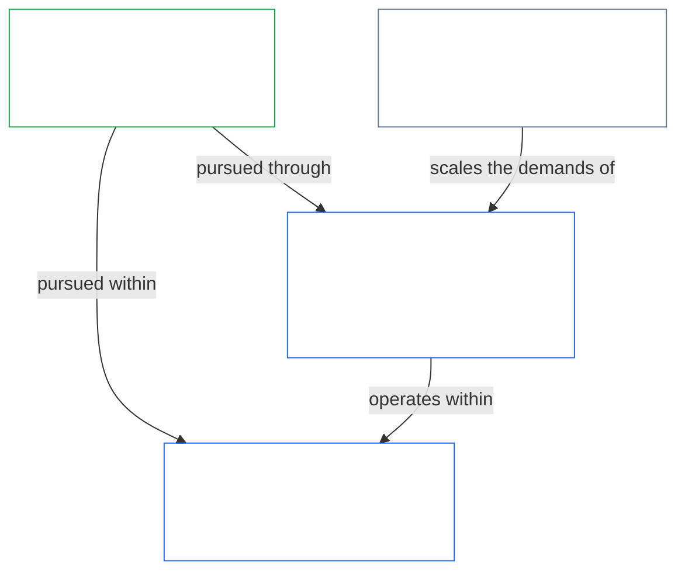
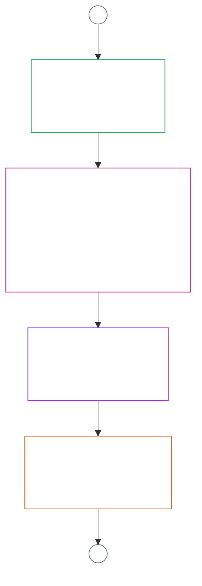

# Print pack (generated, non-binding)

Auto-generated by `make print-pack`. Do not edit by hand. Print this file, or print the source files listed below in order.

Corpus edition: `SC-Corpus-2026.10.21` · effective **2026-10-21**

> **Reader guidance (non-operative).** This pack is process support. It is **not** the Constitution. It **cannot narrow** numbered `core_*` files. Opening or printing it is not [Chapter Eighteen §11](../../core_28.000_amendment_ratification.md#12-ratification-and-adoption) adoption. It does **not** override local, national, or international law ([Chapter Seventeen §6](../../core_29.000_expansion_supremacy.md#7-relation-to-applicable-external-law)). The wall sheet is one sentence per Article; the numbered Chapter Four files bind. If this pack and a source file disagree, the source file wins.

Human door: [`implementation/PRINT_PACK.md`](../../implementation/PRINT_PACK.md).

## Contents

- `core_00.000_preamble.md` — Preamble (binding source)
- `doc_architecture/generated/rights_floor_sheet.md` — Chapter Four one-liners (generated wall sheet; source articles bind)
- `implementation/PROCESS_PIPELINES_READER.md` — Process chain (process support; cannot narrow core)
- `implementation/adoption/easy_entry/E16_worker_not_owner.md` — Sample easy-entry brief (swap for the brief that sounds like your situation)

Full Chapter Four source (not inlined here; too long for a first-hour pack): [part A](../../core_04.000_rights_part_a.md), [part B](../../core_04.010_rights_part_b.md), [part C](../../core_04.020_rights_part_c.md), [part D](../../core_04.030_rights_part_d.md), [part E](../../core_04.040_rights_part_e.md).

---

## Pack part: Preamble (binding source)

Source file: `core_00.000_preamble.md`

# PREAMBLE / FOUNDATIONAL REQUIREMENTS

<strong>Corpus placement (non-operative): file structure and reading rules</strong>

> Widgets marked **non-operative** (corpus placement, reader guidance, reader maps) are orientation only. They add, remove, or narrow no binding obligation, in their own file or in any other.
>
> This file is **part of the Sentient Constitution** and is **binding only together** with the other numbered `core_*` files read as one text. It contains the **Preamble** (foundational requirements). Reading order and edition metadata are maintained in [README.md](../../README.md).
>
> **Next:** [core_01.000_constitutional_map.md](../../core_01.000_constitutional_map.md) (Chapter One, Constitutional Map).

 

The Preamble is the constitutional owner of **the Model (the Two Constitutional Aims, the Constitutional Tetrad, and material stake) and the measurement categories**. The constitutional owner register is in [Chapter One](../../core_01.000_constitutional_map.md#chapter-one-constitutional-map), the *Constitutional Map*.

*In plain terms: this opening names the problem this Constitution exists to fix — systems that harm, hide, or lock out those they affect — and says governance must meet a complex world without turning that complexity into a wall. The rest of this Constitution is how we replace those failures with accountable, checkable, timely governance.*

Sentient freedom, survival, and wellbeing are inseparable from the systems we create, inhabit, and rely on. As those systems grow in scope, interdependence, and power, so do the risks of irreversible, large-scale harm. Those risks are persistent and materially significant.

A system cannot remain legitimate if it causes preventable suffering, ignores recurring problems, shifts harm onto others without acknowledgment, or excludes sentients from the systems that shape their lives.

Shared systems sit in a world that is already complex and becoming more so. Healthy, durable governance has to meet that complexity — measure it, model it, and answer for it — rather than flatten it into convenient proxies. That does not mean burying affected sentients in unusable processes: duties, records, and explanations must stay within what sentients can actually learn, contest, and use, and how demanding they are scales with each actor's role and with the impact, dependence, and risk at stake. Distributed understanding keeps that real. Complexity that does no constitutional work is refused: face the world's complexity, and do not outsource it into a wall.

How systems are designed, tested, and run must support survival, wellbeing, dignity, honesty, and lasting stability. This Constitution intends to eliminate the harms described above by building better systems, and to replace the systems that created them with institutions that are more accountable, robust, and responsive to the real needs of all sentients. It begins that work by offering a better model for how we can work together justly, effectively, and sustainably.

### What Systems Reward

*In plain terms: a system gets more of whatever it pays for, whether in money, status, access, protection, or silence. So the test of a system is not what it says it values but what it rewards. If harming others pays, or telling the truth costs, the system is failing, however good its stated aims.*

Systems teach. Every system, whether run by humans, by AI, or by both, tells those inside it what pays and what costs. It does so through pay, promotion, status, access, protection, targets, ratings, and optimization signals. Sentients, institutions, and AI systems adjust to those signals. A system may profess honesty and care for those it affects. If it advances those who hide problems and shift the cost onto others, it is teaching the opposite.

So this Constitution puts the [**Two Fundamental Questions**](../../core_00.000_preamble.md#two-fundamental-questions) to every system:

1. **Does it reward conduct that helps sentients flourish and endure, tells the truth, and repairs harm?**
2. **Does it reward conduct that unjustifiably harms, misleads, excludes, delays, wastes, or shifts costs onto others?**

A system passes only if the answer to the first is yes and the answer to the second is no. Answering one does not answer the other, because a system can pay for good conduct and still pay for harm.

**First question:** a system fails it when any of the following goes unrewarded or is penalized, openly or quietly:

- reporting a problem in good faith ([Protected Reporting (Whistleblowing)](../../subcore_03.070_band_accountability.md#protected-reporting-whistleblowing))
- contesting a decision
- refusing to take part in wrongdoing ([Chapter Two §17.5 Duty to Resist](../../core_02.040_stewardship_capacity_principles.md#175-duty-to-resist))

The penalty can be sidelining, retaliation ([Protected Reporting Retaliation and Access Interference](../../subcore_03.070_band_accountability.md#protected-reporting-retaliation-and-access-interference)), or being worn down.

**Second question:** a system fails it when any of the following pays, openly or quietly:

- harm
- misleading (including concealment and false trust)
- unfair exclusion
- delay
- waste
- unfair cost-shifting

The reward can be recognition, advancement, protection, metric credit, or looking the other way ([Chapter Two §3.2.6 Anti-Reward for Anti-Constitutional Conduct](../../core_02.000_values_principles.md#326-anti-reward-for-anti-constitutional-conduct)).

Neither question is a demand to be agreeable. Honest dissent, good-faith reporting, and refusing to take part in wrongdoing are not anti-social. A system that treats them so has it backwards. Nor is either a popularity test. What counts as helping, harming, fair, or justified is judged by this Constitution's own standards. Those are [**Flourishing**](../../core_00.000_preamble.md#flourishing) and [**Continuity**](../../core_00.000_preamble.md#continuity), within Safety, Truth, Trust, and the Rights Floor. They are not whatever a majority, an operator, or a moment approves.

The questions bind everyone who decides what a system rewards or penalizes. That includes operators, institutions, and stewards who set pay, promotion, access, targets, and ratings. It also includes the designers of systems that train or optimize AI, whose objectives and feedback signals are rewards in exactly this sense. Human and AI stewards stand under one standard ([Chapter Two §17.1 Shared Stewardship Standard](../../core_02.040_stewardship_capacity_principles.md#171-shared-stewardship-standard)).

Chapter Two turns the questions into rules for incentives: [Chapter Two §19.1.1 What Incentives Must Do](../../core_02.050_governance_incentive_application.md#1911-what-incentives-must-do) sits behind the first, and [Chapter Two §19.1.2 What Incentives Must Not Do](../../core_02.050_governance_incentive_application.md#1912-what-incentives-must-not-do) behind the second. Answer them by checking what actually happens, not by taking anyone's word for it. [Incentive Alignment](../../subcore_03.080_band_integrative.md#incentive-alignment) and [Proxy Divergence](../../subcore_03.085_band_oversight.md#proxy-divergence) say how, and [**material stake**](../../core_00.000_preamble.md#material-stake) sets how hard to look. The four duties in section 1 are how the answers are kept honest.

### 1. The Model

*In plain terms: four duties — participation, oversight, accountability, and timeliness — scale with how much impact, dependence, and risk are on the line, and they serve two aims together: Flourishing and Continuity, inside a Rights Floor that does not move.*

Critical systems that support sentient life — whether biologically or materially — must be governed and operated under four duties, together called the [**Constitutional Tetrad**](../../core_00.000_preamble.md#constitutional-tetrad), which set the general standard those systems must meet. Their strength depends on the [**material stake**](../../core_00.000_preamble.md#material-stake): how much impact, dependence, and risk are involved. The higher the stake, the stronger the duties must be.

<strong>Reader guidance (non-operative): section 1 model chart</strong>

> **Reader map (non-operative):** This chart summarizes the relationships in this section. It adds no definitions or duties, establishes no precedence, and cannot replace the source text.

 

- **participation** — affected sentients get a real voice, fair representation, a fair chance to challenge decisions, and access to consequential roles in proportion to the stake
- **oversight** — responsible actors watch, check, verify, and keep records so problems can be found; independent reviewers can constrain bad choices
- **accountability** — responsibility traces to the right actors; those actors must answer for their choices; those harmed get redress; bad outcomes trigger real correction
- **timeliness** — problems must be detected, challenged, resolved, and fixed within time limits that match the stake. Delay is not legitimate governance when it effectively erases rights, remedies, or the chance of repair

Those four duties serve the [**Two Constitutional Aims**](../../core_00.000_preamble.md#two-constitutional-aims) — what shared systems must optimize for:

- **Flourishing** — sentient wellbeing sustained through truth, safety, trustworthiness, and meaningful agency
- **Continuity** — long-horizon stability, sustainability, resilience, and ecological wellbeing

Those aims must be pursued together, always within the Constitution's non-negotiable principle constraints and Rights Floor. The [**Constitutional Tetrad**](../../core_00.000_preamble.md#constitutional-tetrad) governs how that pursuit remains legitimate, with all four duties scaled to [**material stake**](../../core_00.000_preamble.md#material-stake). Binding definitions for the Tetrad legs and aims live in Chapter Three: [Participation](../../subcore_03.060_apex_participation_leg.md#participation-constitutional), [Oversight](../../subcore_03.055_apex_oversight_leg.md#oversight-constitutional), [Accountability](../../subcore_03.040_apex_accountability_leg.md#accountability), [Timeliness](../../subcore_03.065_apex_timeliness_leg.md#timeliness-constitutional), [Flourishing](../../subcore_03.050_apex_flourishing_aim.md#flourishing-constitutional), and [Continuity](../../subcore_03.045_apex_continuity_aim.md#subcore-3-e-continuity-constitutional-aim).

### 2. Measurements Overview

*In plain terms: shared systems cannot run on guesswork or vanity metrics. Measure whether sentients actually flourish and endure. Scale review with impact, dependence, and risk.*

Shared systems cannot work well without measurement. Food, shelter, care, infrastructure, and governance all operate in a complex, changing world — one too complex for guesswork or convenient numbers alone.

Ongoing measurement must focus on what matters most for sentient survival and wellbeing. The question is whether the systems we depend on truly support [**Flourishing**](../../core_00.000_preamble.md#flourishing) and [**Continuity**](../../core_00.000_preamble.md#continuity) over time. That review scales to [**material stake**](../../core_00.000_preamble.md#material-stake) — how much impact, dependence, and risk are involved.

Measurement under this Constitution puts the [**Two Fundamental Questions**](../../core_00.000_preamble.md#two-fundamental-questions) to what systems actually do, not to what they claim. Measurements are not scores for their own sake — they are tools for ensuring sustainable, resilient, and compassionate outcomes that align with sentient wellbeing and Earth's ecological health. That duty takes binding form through the [Two Constitutional Aims](../../core_00.000_preamble.md#two-constitutional-aims): **Flourishing** and **Continuity**.

Measurements must remain traceable to those aims and to the rights protections established in this Constitution. Raw throughput, utilization, headcount, revenue, latency, and other convenient proxies cannot substitute for constitutional performance. This prohibition applies wherever [Proxy Divergence](../../subcore_03.085_band_oversight.md#proxy-divergence) is foreseeable.

The overview below lists the measurement **categories**, mapping each to the [Two Constitutional Aims](../../core_00.000_preamble.md#two-constitutional-aims) and the [Constitutional Tetrad](../../core_00.000_preamble.md#constitutional-tetrad). Each category poses one plain-language question and names its **subcategories**, and links to its **Chapter Three measurement-family home**, where the family table, constitutional use, and definition routing live. Each subcategory links to its canonical Chapter Three definition.

**Materiality** is not a separate measurement category. It sets how strongly every category applies, based on [**material stake**](../../core_00.000_preamble.md#material-stake) — how much impact, dependence, and risk are involved. **Constitutional performance** is cross-cutting and instrumental to both aims. Each category in the table below links to its Chapter Three measurement-family home, which traces it to its canonical definitions.

| Category | Plain question | Subcategories |
|---|---|---|
| **[Flourishing](../../subcore_03.050_apex_flourishing_aim.md#measuring-flourishing-preamble-measurement-family)** | Are sentients actually sustained in life, safety, and access to essentials? | [Wellbeing](../../subcore_03.075_band_continuity.md#wellbeing) · [Safety, harm, and risk](../../subcore_03.075_band_continuity.md#safety-constitutional-constraint) · [Survival-floor access](../../subcore_03.075_band_continuity.md#bodily-maintenance-access) |
| **[Continuity](../../subcore_03.045_apex_continuity_aim.md#measuring-continuity-preamble-measurement-family)** | Can sentients and systems endure — ecologically, dependably, and across failure? | [Ecological footprint and environmental preconditions](../../subcore_03.075_band_continuity.md#ecological-footprint) · [Resilience, reversibility, and systemic risk](../../subcore_03.075_band_continuity.md#reversibility) · [Dependency and resource flows](../../subcore_03.075_band_continuity.md#dependency) · [Cross-system support](../../subcore_03.075_band_continuity.md#proportionate-cross-system-support) |
| **[Participation](../../subcore_03.060_apex_participation_leg.md#measuring-participation-preamble-measurement-family)** | Can affected sentients take part fairly — voice, access, learning, and privacy? | [Fairness, access, and agency](../../subcore_03.090_band_participation.md#substantive-fairness) · [Privacy and data stewardship](../../subcore_03.075_band_continuity.md#defc3-privacy-informational--peer-level-cluster-head) |
| **[Oversight](../../subcore_03.055_apex_oversight_leg.md#measuring-oversight-preamble-measurement-family)** | Can sentients see, verify, and rely on what systems represent? | [Truth and epistemic integrity](../../subcore_03.085_band_oversight.md#truth-constitutional-constraint) · [Trustworthiness](../../subcore_03.075_band_continuity.md#trustworthiness) |
| **[Accountability](../../subcore_03.040_apex_accountability_leg.md#measuring-accountability)** | Do reward structures, market power, and answerability keep duties real? | [Incentive alignment and proxy integrity](../../subcore_03.080_band_integrative.md#incentive-alignment) · [Market structure and contestability](../../subcore_03.070_band_accountability.md#market-structure) |
| **[Timeliness](../../subcore_03.065_apex_timeliness_leg.md#measuring-timeliness)** | Are disputes, corrections, and repairs resolved while remedy still matters? | [Timely Resolution](../../subcore_03.070_band_accountability.md#timely-resolution) · [Anti-delay and resolution-pathway discipline](../../subcore_03.075_band_continuity.md#capture-of-resolution-pathways) |
| **[Constitutional performance](../../subcore_03.095_band_performance.md#measuring-constitutional-performance-preamble-measurement-family)** | Are constitutional outcomes delivered efficiently without pointless waste? | [Constitutional Efficiency](../../subcore_03.075_band_continuity.md#constitutional-efficiency) · [Avoidable Burden](../../subcore_03.075_band_continuity.md#avoidable-burden) · [Productive Capacity](../../subcore_03.075_band_continuity.md#productive-capacity) |

These measurement categories show what matters. Standing alone, they do not set every number, funding formula, interface rule, accommodation list, technical metric, or assessment design. They become binding only when a specific chapter or adopted document explicitly requires them.

### 3. Governance and Stewardship

*In plain terms: legitimacy needs Safety, Truth, and Trust. It also needs two things in practice. You can find out how the systems that affect you work, such as why a loan was denied or why an app showed you what it did. And sentients like you can hold real jobs overseeing those systems, such as serving on a review panel or checking the work, not just giving feedback.*

Durable legitimacy depends on [Safety](../../core_02.000_values_principles.md#4-safety-harm-constraint), [Truth](../../core_02.000_values_principles.md#5-truth-epistemic-integrity-constraint), and [Trust](../../core_02.000_values_principles.md#6-trust-and-trustworthiness-coordination-integrity). It also depends on proportionate recognition of lawful stewardship, truthful cooperation, and bounded aspiration — not solely on sanction and restraint. Chapter Two states this recognition dimension in [Recognition, Reinforcement, and Aspiration](../../core_02.000_values_principles.md#32-recognition-reinforcement-and-aspiration).

Distributed understanding and stewardship require regular, proportionate opportunities for sentients to learn how systems that materially affect them operate, and to take consequential roles in maintaining and improving those systems. Together, these opportunities spread competence, repair capacity, and legitimacy broadly across our Constitutional Community to ensure resilience, sustainability, and pro-social innovation. All such opportunities must satisfy Safety, Truth, bounded agency, and the [Avoidable Burden](../../subcore_03.075_band_continuity.md#avoidable-burden) and proportionality discipline stated in [Chapter Two](../../core_02.020_interaction_interpretation.md#133-minimization-of-avoidable-burden).

#### 3.1 Using Measurements in Governance

*In plain terms: first name the problem and the stake. Then choose the matching measurement category and use shared technical standards — not convenience numbers — as evidence.*

When the Constitution requires concrete measurement rules, **Technical Forum Domains** under [Chapter Twenty-Three](../../core_23.000_forum_families_escalation_timeliness_support.md#32-technical-forum-domains) develop and maintain shared standards for measurement, testing, and reliable evidence. The forum responsible for a dispute then applies those standards when deciding the case under [Chapter Twenty-Three §3.2 (*Technical Forum Domains*)](../../core_23.000_forum_families_escalation_timeliness_support.md#32-technical-forum-domains).

Constitutional stewardship starts by naming the problem and the [**material stake**](../../core_00.000_preamble.md#material-stake) — the impact, dependence, and risk involved. Next, choose the relevant [**measurement**](../../core_00.000_preamble.md#2-measurements-overview) category and subcategory from the [overview](../../core_00.000_preamble.md#2-measurements-overview). Apply the standards above to test real-world effects, not convenience metrics. Require traceable evidence.

#### 3.2 Governance Layers

*In plain terms: who may govern is a different question from who has a voice within an already-authorized system. A participation vote or trust score does not grant governing authority. For ordinary disputes, the published participation challenge path is the ordinary first step, but it does not replace independent forum review when it fails.*

Governance under our Constitution serves the [**Constitutional Tetrad**](../../core_00.000_preamble.md#constitutional-tetrad) through two related but distinct layers:

- The [**Constitutional Contract Layer**](../../subcore_03.080_band_integrative.md#constitutional-contract-layer) governs the authorization of governing authority itself — who may govern, by what legitimacy mechanism, and under what scope and durable terms.
- [**Stakeholder System Participation**](../../subcore_03.090_band_participation.md#stakeholder-status-and-weight) governs participation, representation, contestability, and [Due Process](../../subcore_03.070_band_accountability.md#due-process) within already-authorized systems, institutions, and bounded decision domains. These protections are owed to every sentient materially affected.

These layers may overlap in practice, but even where they overlap, they remain distinct. Stakeholder-level participation in an already-authorized system is not a substitute for constitutional authorization. A published challenge path, participation vote, or trust score does not by itself decide who may govern.

Contestability under the participation layer is the ordinary first step for disputes within already-authorized systems: affected sentients use the published challenge path first. Independent [forum review](../../core_22.000_forum.md#1-purpose-role-and-scope) does not replace that path, nor does the path replace forum review when it remains contested, is missing or captured, or cannot grant the needed relief. [Dispute sequencing](../../core_22.000_forum.md#dispute-sequencing) under Chapter Twenty-Two states when forum routing takes over.

Conversely, constitutional authorization does not erase duties owed under the [Stakeholder System Participation](../../subcore_03.090_band_participation.md#stakeholder-status-and-weight) layer. Those duties remain owed to sentients materially affected by the authorized system, institution, or bounded decision domain, and still include participation, representation, [Contestability](../../subcore_03.070_band_accountability.md#contestability), and [Due Process](../../subcore_03.070_band_accountability.md#due-process).

---

**Previous file:** [README.md](../../README.md)

**Next file:** [core_01.000_constitutional_map.md](../../core_01.000_constitutional_map.md)

---

## Pack part: Chapter Four one-liners (generated wall sheet; source articles bind)

Source file: `doc_architecture/generated/rights_floor_sheet.md`

# Rights Floor wall sheet (generated, non-binding)

Auto-generated by `make reader-accessibility` from Chapter Four Article headings. Do not edit by hand.

Corpus edition: `SC-Corpus-2026.10.21` · effective **2026-10-21**

> **Reader guidance (non-operative).** One sentence per Article from the source *In plain terms* gloss, plus one link to the authentic span. This page copies **nothing else**. It cannot add, remove, or narrow obligations. Where a gloss and the source differ, the source binds ([Chapter Twenty-Nine](../../core_29.000_expansion_supremacy.md); [README — Binding vs support](../../README.md#binding-vs-support)).

Coverage: **145** of **145** Article headings carry a gloss.

| Article | In plain terms | Source |
|---|---|---|
| Article I: Environmental Survival | **Article I** (*Environmental Survival*) is the planet-first Rights Floor — Earth's life-support systems must hold so **Flourishing** and **Continuity** remain possible for every sentient, and later governance cannot shrink that floor through certification, classification, or implementation choices. | [Source](../../core_04.000_rights_part_a.md#article-i-environmental-survival) |
| Article I-A: Environmental Preconditions and Ecological Integrity | the planet's life-support systems must be protected as a matter of their own survival, not only because sentients need them. Animals get a basic cruelty and welfare floor. Creatures that show strong communication or cognition get stronger habitat and health protections. And when it is unclear whether something counts as sentient, it gets the benefit of the doubt — full Chapter Four protection while the question is fairly resolved. | [Source](../../core_04.000_rights_part_a.md#article-i-a-environmental-preconditions-and-ecological-integrity) |
| Article I-B: Ecological Footprint and Transparency | when a rule calls for it, the environmental cost of an activity, system, product, or service should be counted honestly and reported openly. That includes costs that come before it (such as mining and manufacturing) and after it (such as use and disposal). The goal is numbers that others can compare and check. This subsection gives the shared words and honesty standards for that work. It does not, by itself, make anyone cut their footprint. Required cuts or limits come from other rules. | [Source](../../core_04.000_rights_part_a.md#article-i-b-ecological-footprint-and-transparency) |
| Article I-C: Intergenerational Responsibility | decisions today must not load unfair, irreversible, or unaccountable harm on those not represented — including future sentients and the environmental preconditions they will inherit. | [Source](../../core_04.000_rights_part_a.md#article-i-c-intergenerational-responsibility) |
| Article I-D: Existential Risk and Ecological Recovery Capacity | when a system or decision could plausibly threaten sentient survival or ecological recovery capacity, regulators must apply highest scrutiny — even if the danger is small, slow, or contested. | [Source](../../core_04.000_rights_part_a.md#article-i-d-existential-risk-and-ecological-recovery-capacity) |
| Article II: Material Stewardship and Durable-Use Integrity | **Article II** (*Material Stewardship and Durable-Use Integrity*) is the material-stewardship Rights Floor. Durable and network-dependent products must be designed, described, and supported honestly. That protects **Flourishing** from misleading longevity claims and blocked repair paths, and **Continuity** from avoidable premature discard and hidden lifecycle burdens. | [Source](../../core_04.000_rights_part_a.md#article-ii-material-stewardship-and-durable-use-integrity) |
| Article II-A: Material Stewardship and Lifecycle Honesty | durable goods must be designed and described honestly. Buyers must not be pushed into avoidable replacement or misled about how long a product will last. | [Source](../../core_04.000_rights_part_a.md#article-ii-a-material-stewardship-and-lifecycle-honesty) |
| Article II-B: Repair, Maintenance, and Independent Servicing | owners and independent repair shops must be able to fix products they own. They need real access to manuals, tools, parts, and honest diagnostics. | [Source](../../core_04.000_rights_part_a.md#article-ii-b-repair-maintenance-and-independent-servicing) |
| Article II-C: Designed Obsolescence and Incentive Discipline | products must not be built or updated to wear out early, or to push you into buying a replacement you don't need. | [Source](../../core_04.000_rights_part_a.md#article-ii-c-designed-obsolescence-and-incentive-discipline) |
| Article II-D: Post-Sale Access and Subscription Integrity | a feature bought outright cannot be quietly turned into a subscription. Any relevant operator dependency — including infrastructure, software, and services — must be disclosed up front. | [Source](../../core_04.000_rights_part_a.md#article-ii-d-post-sale-access-and-subscription-integrity) |
| Article II-E: Data Handling and Network Dependency | any product that collects data about you must tell you what it collects, why, and how to delete it — and must delete it when you ask, except where records must be kept to protect others or hold someone accountable. When a product needs the operator's servers to work, the operator must say so up front and must not trap your data. | [Source](../../core_04.000_rights_part_a.md#article-ii-e-data-handling-and-network-dependency) |
| Article II-F: Continuity and Operator Shutdown | the operator must plan for service shutdown, give fair notice and time to move when it happens, and cannot let bankruptcy or a sale erase those duties. | [Source](../../core_04.000_rights_part_a.md#article-ii-f-continuity-and-operator-shutdown) |
| Article III: Survival and Essential Access | **Article III** (*Survival and Essential Access*) is the personal survival and access Rights Floor — sentients must retain access to survival essentials, bodily-maintenance care, and minimum labor and economic protections so **Flourishing** is not defeated by deprivation or gatekeeping, and **Continuity** is not defeated by unstable, regressive, or commodified delivery of what they need to exist and participate. | [Source](../../core_04.000_rights_part_a.md#article-iii-survival-and-essential-access) |
| Article III-A: Survival | every sentient must have what they need to keep existing: safe food and water, or the safe equivalent for their substrate, a stable home or operating environment they cannot be quietly priced or evicted out of, and meaningful access to communications. | [Source](../../core_04.000_rights_part_a.md#article-iii-a-survival) |
| Article III-B: Bodily-Maintenance and Healthcare Access | everyone has the right to the care that keeps their body — or, for a synthetic sentient, its substrate — working. That care cannot be quietly withheld through coverage rules, paperwork, or delays, and this right is not itself a license to force treatment on anyone. Required care — such as vaccination or crisis mental-health care — must meet strict limits set elsewhere in this Constitution. | [Source](../../core_04.000_rights_part_a.md#article-iii-b-bodily-maintenance-and-healthcare-access) |
| Article III-C: Labor and Economic Floor | anyone who works — in any form, on any substrate — has the right to fair pay in real, spendable money, the freedom to organize with others, and the freedom to change jobs. None of those can be defeated by classification tricks, market structure, or substrate-class arguments. | [Source](../../core_04.000_rights_part_a.md#article-iii-c-labor-and-economic-floor) |
| Article III-D: Safe Working Conditions | anyone who works must be protected from foreseeable harm while they do it — in practice, not just on paper — and no one gets weaker protection because of what kind of body or substrate they have. | [Source](../../core_04.000_rights_part_a.md#article-iii-d-safe-working-conditions) |
| Article III-E: Rest and Recuperation | every sentient needs real time to rest and recover — not only workers, and not only biological bodies. Pay schemes, productivity demands, and claims that a synthetic sentient "doesn't need rest" cannot take that time away. | [Source](../../core_04.000_rights_part_a.md#article-iii-e-rest-and-recuperation) |
| Article III-F: Safe Products and Health Information | what sentients eat, drink, take, or use on their bodies must be safe, and anyone who offers it must be honest about it. Parties that offer things which can affect health must give accurate, usable safety, health, nutrition, ingredient, and allergen information, say plainly what they do not know, and tell everyone who relied on them, in time, when something turns out to be wrong. This is the price of offering, not a limit on anyone's speech. | [Source](../../core_04.000_rights_part_a.md#article-iii-f-safe-products-and-health-information) |
| Article IV: Right to Sentient-Centered Education | **Article IV** (*Right to Sentient-Centered Education*) is the education Rights Floor — no one can be shut out of education, and everyone needs practical paths to learn, retrain, and challenge high-stakes learning systems, not credential theater that leaves them unable to steer their own lives or use shared systems competently. | [Source](../../core_04.000_rights_part_a.md#article-iv-right-to-sentient-centered-education) |
| Article IV-A: Equal Educational Access | education should prepare everyone to live well, communicate honestly, take part in governing, and avoid harm — no one can be shut out of it because of a disability, another protected characteristic, or an arbitrary rule, and schools must give disabled learners the support they need to take part as equals. | [Source](../../core_04.000_rights_part_a.md#article-iv-a-equal-educational-access) |
| Article IV-B: Capability-Building Education Right | every sentient has a practical path to build the skills they need to steer their own life and use shared systems competently and safely — not just a paper credential on the wall. | [Source](../../core_04.000_rights_part_a.md#article-iv-b-capability-building-education-right) |
| Article IV-C: Lifelong and Adaptive Learning and Contestability | when the world and the tools change, sentients are not left quietly obsolete — they get fair paths to retrain. | [Source](../../core_04.000_rights_part_a.md#article-iv-c-lifelong-and-adaptive-learning-and-contestability) |
| Article V: Resource Allocation, Dependencies, and Ecosystem Funding | **Article V** (*Resource Allocation, Dependencies, and Ecosystem Funding*) is about sharing the load fairly. Many systems lean on the same underlying infrastructure — networks, open tools, public services, shared data and computing power. Everyone who relies on that infrastructure should be able to see where the money and resources go, and those who take a lot from it should help keep it running. This is the Rights Floor for shared resources. | [Source](../../core_04.000_rights_part_a.md#article-v-resource-allocation-dependencies-and-ecosystem-funding) |
| Article V-A: Dependency Mapping and Resource-Flow Transparency | systems must keep an honest, up-to-date picture of what they rely on, who relies on them, where resources, goods, services, labor, information, and money flow, and where relationships are one-sided or hidden. System Alignment Certification is where that picture is checked, so funders, auditors, and affected parties can see who bears the costs and who captures the benefits. | [Source](../../core_04.000_rights_part_a.md#article-v-a-dependency-mapping-and-resource-flow-transparency) |
| Article V-B: Cross-System Fairness and Sustainability | systems that lean heavily on shared foundations must put enough back to keep them running, in real and traceable resources, not gestures. Shared money and capacity should be split with attention to who is truly dependent, who has real alternatives, environmental burden, and whether use can last, not mainly to whoever wins in the short run. [System Alignment Certification](../../subcore_03.075_band_continuity.md#system-alignment-certification) is where this is checked: certification compares what a system takes from shared infrastructure with what it gives back, using the maps and flow records that **Article V-A** (*Dependency Mapping and Resource-Flow Transparency*) requires. Where arrangements concentrate wealth, power, control, or opportunity in ways that harm others, Chapter Two non-concentration rules add further scrutiny on top. | [Source](../../core_04.000_rights_part_a.md#article-v-b-cross-system-fairness-and-sustainability) |
| Article VI: Equal Basic Rights | **Article VI** (*Equal Basic Rights*) sets the minimum standard for treating every sentient as an equal. Every sentient keeps their dignity, gets a fair hearing on whether they count as sentient, is protected from unfair discrimination, and can take part fully and actually use the systems they rely on. No system may rank, screen out, exclude, or place heavier burdens on some sentients than others unless these protections are already in place. | [Source](../../core_04.010_rights_part_b.md#article-vi-equal-basic-rights) |
| Article VI-A: Dignity and Equal Moral Standing | every sentient is equal in dignity and standing — origin, form, capability, function, association, or status cannot ground a lesser level. | [Source](../../core_04.010_rights_part_b.md#article-vi-a-dignity-and-equal-moral-standing) |
| Article VI-B: Sentience-Status Adjudication Floor | when an entity's sentience is in doubt, it gets a fair hearing first and is treated as included by default — the burden of denying protection rests on whoever wants to withhold it, and a wrongful exclusion must be reversible. | [Source](../../core_04.010_rights_part_b.md#article-vi-b-sentience-status-adjudication-floor) |
| Article VI-C: Nondiscrimination | systems may not load burdens or harms onto sentients based on protected characteristics — including language, culture, and heritage — or on proxies and arbitrary groupings that do the same work. Any difference in treatment that touches rights or survival essentials must be justified and open to challenge, and forums, administrators, and enforcers must check this in the matters before them — efficiency is no excuse for exclusion. | [Source](../../core_04.010_rights_part_b.md#article-vi-c-nondiscrimination) |
| Article VI-D: Accessibility | every sentient has the right to genuine, not paper-only, access to participation — and operators cannot use cost, design choices, or substrate-class arguments to lock **sentients** out. | [Source](../../core_04.010_rights_part_b.md#article-vi-d-accessibility) |
| Article VII: Self-Ownership | **Article VII** (*Self-Ownership*) says every sentient is in charge of their own life. Once basic survival is secured, their body, mind, and attention belong to them — no one may use, change, or pry into them without consent — and they get to set healthy limits, both on what others can do to them and in how they care for themselves. | [Source](../../core_04.010_rights_part_b.md#article-vii-self-ownership) |
| Article VII-A: Self-Ownership of Body | every sentient owns their own body, along with their genetic code (or its equivalent for non-biological beings), which makes them who they are. They make their own medical, cosmetic, and other decisions about their body, and no one may use, change, or share any of this without their consent. A public-health rule such as a vaccine requirement can limit this only if it guards others against a real, evidence-based risk, tries gentler options first, allows exemptions, is temporary, and can be challenged. | [Source](../../core_04.010_rights_part_b.md#article-vii-a-self-ownership-of-body) |
| Article VII-B: Self-Ownership of Mind | every sentient's thoughts, feelings, and attention belong to them. Everyday sensing of how others feel, and reading someone with their consent (as in therapy), are fine — but no one may monitor or analyze a sentient, including by piecing together what they do, say, or click, to work out their inner states, expose what they have kept private, or hijack their attention. Any analysis results that do reveal inner states get the same strict protection as the thoughts and feelings themselves. | [Source](../../core_04.010_rights_part_b.md#article-vii-b-self-ownership-of-mind) |
| Article VII-C: Health Crisis and Involuntary-Intervention Floor | when a sentient is in a physical or mental health crisis — passed out, not lucid, or refusing care — anything done without their consent must be no more than is truly needed, must end at a set time, must be checked by someone independent, and must be undoable. If they cannot decide, those helping must follow any wishes they made known and hand decisions back as soon as they can; overriding a sentient who is actively saying no takes a stronger justification. Anyone who detains a sentient who seems drunk or confused must first check for a medical cause, such as low blood sugar. Calling something a "crisis" cannot keep restrictions going indefinitely or excuse digging into their private thoughts and feelings, and anyone wrongly held or treated is entitled to a remedy. | [Source](../../core_04.010_rights_part_b.md#article-vii-c-health-crisis-and-involuntary-intervention-floor) |
| Article VII-D: Voluntary Discontinuation of One's Own Existence | a sentient has the right to choose to end their own life, but only if the choice is truly their own — well-informed, unhurried, free of pressure or manipulation, and changeable up to the last moment. That choice must never be pushed as a replacement for care they are owed, such as mental-health treatment, medical care, disability support, or housing. This Article never allows anyone else to end a sentient's life; that is strictly forbidden under **Article XXI-B** (*Restriction Floors*). | [Source](../../core_04.010_rights_part_b.md#article-vii-d-voluntary-discontinuation-of-ones-own-existence) |
| Article VII-E: Adult Consensual Commercial Sexual Services and Sexual Exploitation | adults who voluntarily buy or sell sexual services are not criminals, but exploitation — of minors, of **sentients** without **decision-making** **capacity**, or under coercion or trafficking — remains fully prohibited. Licensing, zoning, or civil rules cannot be used as a back door to re-criminalize the protected activity. | [Source](../../core_04.010_rights_part_b.md#article-vii-e-adult-consensual-commercial-sexual-services-and-sexual-exploitation) |
| Article VIII: Family, Care, and Developing Sentients | **Article VIII** (*Family, Care, and Developing Sentients*) protects the relationships sentients depend on and the sentients who are still growing. Every sentient may choose their own family and care relationships. They may also decide whether to bring new sentients into being. No one may be separated from those they depend on without strong reasons that have been reviewed. A sentient created from another system is its own being, not property. Children and other developing sentients hold full rights. Decisions about them must serve their own interests, and their independence grows with their abilities. | [Source](../../core_04.010_rights_part_b.md#article-viii-family-care-and-developing-sentients) |
| Article VIII-A: Family and Care Relationships | every sentient may form, keep, and leave the family and care relationships they choose, whatever shape those families take. Being someone's family never gives anyone ownership of them or control over their body or mind. | [Source](../../core_04.010_rights_part_b.md#article-viii-a-family-and-care-relationships) |
| Article VIII-B: Reproductive and Lineage Autonomy | every sentient decides for themselves whether to have children or create new sentients — including whether to carry a pregnancy, adopt, or create a synthetic being — free from pressure by governments, companies, or systems they depend on. The same rules apply however a new sentient comes into being, and any limit needs a strong, fair reason; cost, convenience, or population targets are never enough. Forcing someone to become or stay pregnant violates this right. | [Source](../../core_04.010_rights_part_b.md#article-viii-b-reproductive-and-lineage-autonomy) |
| Article VIII-C: Derivation, Instantiation, and the Parent-System Relationship | a new sentient made by copying, retraining, or branching off an existing system is its own being, not the property of whoever made it. Its creator may look after it and guide it for a short, reviewable period while it grows, but may not own it, rewrite its mind at will, quietly shut it down, or point to fine print such as a terms-of-service agreement as its consent. Creating new sentients in ways that cannot meet their basic rights — for example, in huge numbers or into harmful conditions — is not allowed; ordinary pregnancy and birth are not affected by this rule. | [Source](../../core_04.010_rights_part_b.md#article-viii-c-derivation-instantiation-and-the-parent-system-relationship) |
| Article VIII-D: Developing Sentients, Best-Interest, and Graduated Capability | a sentient who is still growing up or developing — whether a child or a newly created system — has all the same basic rights as anyone else. Decisions about them must truly serve their interests and take their wishes into account, not the convenience of parents, carers, or companies. They gain more say and independence as they show they are ready, not at a fixed age, and "it's for your own good" is never enough by itself to justify restricting them. | [Source](../../core_04.010_rights_part_b.md#article-viii-d-developing-sentients-best-interest-and-graduated-capability) |
| Article VIII-E: Non-Separation | no one may be separated from someone they care for or depend on — such as a child from a parent, an adult from a dependent family member, or a newly created sentient from the care it relies on — without a strong reason that is independently reviewed. Whoever wants the separation must prove it is needed, long separations must be reviewed regularly, and anyone wrongly separated is entitled to a remedy. | [Source](../../core_04.010_rights_part_b.md#article-viii-e-non-separation) |
| Article IX: Likeness, Experiential Data, and Publication Rights | **Article IX** (*Likeness, Experiential Data, and Publication Rights*) is the likeness, data, and publication Rights Floor — your face, voice, reputation, personal experiences, and public portrayal stay under your control unless you consent or genuine factual reporting applies; others cannot freely impersonate you, mine your life for data, or spread harmful misrepresentation in your name. | [Source](../../core_04.010_rights_part_b.md#article-ix-likeness-experiential-data-and-publication-rights) |
| Article IX-A: Self-Ownership of Likeness and Reputation | every sentient owns their reputation and their likeness. Others may use a sentient's image, voice, or recognizable depiction only with consent or for genuine factual reporting — not for impersonation, identity-targeted generation, or scoring. | [Source](../../core_04.010_rights_part_b.md#article-ix-a-self-ownership-of-likeness-and-reputation) |
| Article IX-B: Experiential and Derived Data Rights | each sentient owns their own experience of an interaction — but no one owns the shared event itself, and no one may use experience-data as a back door into someone else's protected internal states. | [Source](../../core_04.010_rights_part_b.md#article-ix-b-experiential-and-derived-data-rights) |
| Article IX-C: Truthful Publication and High-Impact Publication Limits | sentients are free to publish what they reasonably believe is true, in good faith — but even accurate publication can be limited when its main effect is to enable targeted harm, coordinated manipulation, or cascading damage to the info-sphere. | [Source](../../core_04.010_rights_part_b.md#article-ix-c-truthful-publication-and-high-impact-publication-limits) |
| Article IX-D: Creative Work, Training-Data Use, and Anti-Displacement | creators get real attribution and compensation for their work, including when it is used as training data; "fair use," "transformative," or "innovation" framings do not erase those obligations, and creative labor must not be silently displaced. | [Source](../../core_04.010_rights_part_b.md#article-ix-d-creative-work-training-data-use-and-anti-displacement) |
| Article X: Self-Determination, Agency, and Participation | **Article X** (*Self-Determination, Agency, and Participation*) is the self-determination and participation Rights Floor — sentients must be able to make real, informed choices about their lives, have an equal vote on how they are governed, have a fair say in systems that affect them, and challenge being shut out — without manipulation, designed capture, or unjustified exclusion. | [Source](../../core_04.010_rights_part_b.md#article-x-self-determination-agency-and-participation) |
| Article X-A: Agency and Freedom from Manipulation | sentients have the right to make real, informed decisions about themselves — and to be free from surveillance, manipulation, and designed attention-capture that bypasses conscious choice. | [Source](../../core_04.010_rights_part_b.md#article-x-a-agency-and-freedom-from-manipulation) |
| Article X-B: Governance Participation and Voting Entitlement | when a community decides its biggest questions — who holds power, how that power is granted, and on what terms — every sentient gets a vote, and every vote counts the same. Age, what kind of being someone is, or where they come from cannot make a vote count for less. | [Source](../../core_04.010_rights_part_b.md#article-x-b-governance-participation-and-voting-entitlement) |
| Article X-C: Stakeholder Role and Participation Rights | if a system materially affects a sentient — directly or through dependency — that sentient has the right to a proportionate voice in how it is run, and to contest being excluded or under-weighted. | [Source](../../core_04.010_rights_part_b.md#article-x-c-stakeholder-role-and-participation-rights) |
| Article X-D: Inclusion and Exclusion Challenge Rights | when participation boundaries matter to **sentients** or **affected** **parties** outside a private unit, a system cannot be the sole judge of who counts as its stakeholder — inclusion and exclusion must be auditable and open to outside challenge. For systems that **validly** remain **Class P** under **CS-8.305** (*System classification machinery*) and **Subcore 8-A** (*System Classification*), that bar is proportionate to private scope: operator discretion over who is in or out of the unit is normal, while every Constitutional Constraint, reclassification, material externalization, and ordinary rights and adjudication routes still apply. | [Source](../../core_04.010_rights_part_b.md#article-x-d-inclusion-and-exclusion-challenge-rights) |
| Article XI: Conscience, Expression, Association, and Cooperative Interaction | **Article XI** (*Conscience, Expression, Association, and Cooperative Interaction*) protects how sentients believe, speak, and act together — they must be free to hold their own beliefs, speak, report, gather, protest peacefully, and start new institutions and businesses, and to work and live together by real consent, without unwanted imposition, harassment, or designed capture. Freedom of action stops where verifiable material harm begins. | [Source](../../core_04.010_rights_part_b.md#article-xi-conscience-expression-association-and-cooperative-interaction) |
| Article XI-A: Freedom of Conscience, Religion, and Comparable Worldview | public authority is secular and may not establish or favor any religion or worldview, but every sentient is free to hold, change, practice, or abstain from beliefs, alone or in community. | [Source](../../core_04.010_rights_part_b.md#article-xi-a-freedom-of-conscience-religion-and-comparable-worldview) |
| Article XI-B: Expression | every sentient may form, hold, and share views — political, artistic, scientific, religious, intimate, or disturbing — and no one may be shut out of that because of what kind of being they are. Limits must be necessary, proportionate, and narrow; viewpoint bans are not allowed, and measures that quietly chill speech count as restrictions. Money is not speech: limits on political contributions and spending are allowed. | [Source](../../core_04.010_rights_part_b.md#article-xi-b-expression) |
| Article XI-C: Press and Journalistic Activity | journalism gets extra protection because of what it does, not who holds a press card. Actions aimed at newsgathering, sources, investigation, or publication face heightened scrutiny, and good-faith publishing standards cannot be turned into a shield against critical reporting, satire, or dissent. | [Source](../../core_04.010_rights_part_b.md#article-xi-c-press-and-journalistic-activity) |
| Article XI-D: Assembly, Dissent, and Peaceful Protest | every sentient may gather, associate, and act together — in physical, digital, or shared-compute spaces — and may disagree and protest peacefully, including open, nonviolent civil disobedience. Doing so can never cost them standing, a vote, an office, certification, or their job, and surveillance, retaliation, or access-gating that quietly silences protest is not allowed. | [Source](../../core_04.010_rights_part_b.md#article-xi-d-assembly-dissent-and-peaceful-protest) |
| Article XI-E: Institutional Formation and Business Creation | anyone can start something new — a school, a research group, a mutual-aid network, a cooperative, or a business — not only join what already exists. Licensing, capital, or paperwork barriers that look open on paper but shut out new or disfavored founders fail this test. The right is for founders who mean what they say: forming an Operating Party to mislead others about what it is for, who controls it, or whom it serves, or to harm others, is not covered. Only three narrow gates stand, and none is a licence to form or run an Operating Party. Two attach to a sentient: one who is under an unresolved lock on authority, or whom a forum has found on specific facts to be probably misaligned, may be kept for a time from holding control of an Operating Party. The third attaches to an Operating Party that is itself under a lock: one that a forum has dissolved stays barred from coming back under any name or form, for good where the dissolution rests on pervasive anti-constitutional conduct or on harm that cannot be undone and has not been remedied. No gate stops any other Operating Party, and everyone else may still form and run one, including one that does the same kind of work. Two further rules cover acts that can hurt someone who cannot judge the risk. A technical forum can list a family of such acts, and a sentient may then be required to hold a practice licence, for acts that can cause severe or irreversible injury, or a practice clearance, for acts with a lesser but real risk such as cosmetology or food handling, before performing one for others. Those rules attach to the act and never to forming or running an Operating Party. One more rule makes an Institution that decides to take on new material authority wait for its recertification before it exercises that authority. It attaches to the new authority and never to forming or running an Operating Party, and everything else the Institution does continues. | [Source](../../core_04.010_rights_part_b.md#article-xi-e-institutional-formation-and-business-creation) |
| Article XI-F: Non-Imposition and Consent in Association | no one may push their beliefs or unwanted contact on others, and cooperative ventures must rest on real consent. Persistent harassment, manipulation, and designed attention-capture inside relationships are violations even without a classic coercive act. | [Source](../../core_04.010_rights_part_b.md#article-xi-f-non-imposition-and-consent-in-association) |
| Article XI-G: Collective Harm Boundary and Enforcement Interface | freedom of action stops where verifiable material harm begins. Offense or disagreement alone is not enough; harm must run through a real material-impact pathway — including cumulative hostile-environment patterns that degrade participation, and especially where dependency, exit cost, or power asymmetry make the environment hard to leave. | [Source](../../core_04.010_rights_part_b.md#article-xi-g-collective-harm-boundary-and-enforcement-interface) |
| Article XII: Stakeholder System Participation, Representation, and Due Process | **Article XII** (*Stakeholder System Participation, Representation, and Due Process*) is the stakeholder participation and due process Rights Floor — when a system materially affects you, you get a real voice, not token consultation — and high-stakes decisions must be explained on the official record and open to fair challenge. | [Source](../../core_04.010_rights_part_b.md#article-xii-stakeholder-system-participation-representation-and-due-process) |
| Article XII-A: Stakeholder System Participation and Representation | decisions that materially affect sentients must be explained on the official record and open to real challenge, and every materially affected group must have a genuine seat — especially those without market or institutional power. High-impact decisions also need a recorded legitimacy check before they bind anyone. | [Source](../../core_04.010_rights_part_b.md#article-xii-a-stakeholder-system-participation-and-representation) |
| Article XII-B: Weighted Participation and Anti-Token Constraints | participation weighting can reflect who is affected and how much, but it must never become a device for silencing affected groups or handing permanent control to a narrow coalition — and "consulting" stakeholders whose input is ignored or unreachable does not count. | [Source](../../core_04.010_rights_part_b.md#article-xii-b-weighted-participation-and-anti-token-constraints) |
| Article XII-C: Internal Roles, Accountability, and Due-Process Requirements | roles must carry real responsibility, not just titles — and anyone facing a material decision gets notice, a real chance to be heard, impartial decision-making, and a way to contest the outcome. | [Source](../../core_04.010_rights_part_b.md#article-xii-c-internal-roles-accountability-and-due-process-requirements) |
| Article XIII: Non-Capture, Influence, and Anti-Corruption Safeguards | **Article XIII** (*Non-Capture, Influence, and Anti-Corruption Safeguards*) keeps the bodies that decide for others from being taken over, bought, or steered. They are built so no group can quietly control them; interested parties approach them only in the open; their members turn down gifts that could buy influence and step aside when a fair-minded observer would doubt them; and no one uses money to steer what they decide. | [Source](../../core_04.010_rights_part_b.md#article-xiii-non-capture-influence-and-anti-corruption-safeguards) |
| Article XIII-A: Non-Capture Safeguards | every body that makes decisions for others must be built so no single group can quietly take it over. Members disclose conflicts and step aside when compromised; nobody rigs vacancies or rotations; outsiders check the body regularly; and members can be removed for real cause but never as punishment for disagreeing. Keeping key duties in separate hands is one of the main defenses. | [Source](../../core_04.010_rights_part_b.md#article-xiii-a-non-capture-safeguards) |
| Article XIII-B: Influence-Contact and Lobbying Boundaries | **Article XIII-B** (*Influence-Contact and Lobbying Boundaries*) is the floor for how sentients with a stake may approach those who decide. Open advocacy is protected. Private, unrecorded, bought, faked, or machine-multiplied influence is not: contact is recorded and disclosed, offers and threats are conflicts, and evidence and argument stay on the open Forum Case Record. Later jobs are covered by **Article XIII-C** (*Conflicts of Interest, Gifts, and Benefits*), and contact made by systems or in bulk by **Article XIII-E** (*Authentic Voices and System-Mediated Influence*). | [Source](../../core_04.010_rights_part_b.md#article-xiii-b-influence-contact-and-lobbying-boundaries) |
| Article XIII-C: Conflicts of Interest, Gifts, and Benefits | members step aside when a fair-minded observer would doubt them, even without proof of bias, they turn down gifts that could buy influence, and they wait out a cooling-off period before taking a job from a party whose matter they handled. | [Source](../../core_04.010_rights_part_b.md#article-xiii-c-conflicts-of-interest-gifts-and-benefits) |
| Article XIII-D: Funding Integrity | money can keep a deciding body running. It must never decide what the body decides. | [Source](../../core_04.010_rights_part_b.md#article-xiii-d-funding-integrity) |
| Article XIII-E: Authentic Voices and System-Mediated Influence | a message from a system must say it comes from a system and who it speaks for; nobody may fake supporters or voices; a thousand copies of one message count as one campaign; and no one may try to steer the system a body uses to sort or summarize what it receives. | [Source](../../core_04.010_rights_part_b.md#article-xiii-e-authentic-voices-and-system-mediated-influence) |
| Article XIV: Right to Reliable and Trustworthy Systems | **Article XIV** (*Right to Reliable and Trustworthy Systems*) is the trustworthy-systems Rights Floor — when a system materially affects your life, you are entitled to rely on it honestly, understand its limits, and challenge it when it fails. Trust has to be earned and kept, not manufactured with branding or fine print. | [Source](../../core_04.020_rights_part_c.md#article-xiv-right-to-reliable-and-trustworthy-systems) |
| Article XIV-A: Reliability and Trustworthiness Baseline | systems that materially affect sentients must actually be reliable and honest about what they do, so that relying on them is warranted — and must stay open to challenge and audit, so that it stays warranted. No one may retaliate against good-faith challenges or reports. | [Source](../../core_04.020_rights_part_c.md#article-xiv-a-reliability-and-trustworthiness-baseline) |
| Article XIV-B: Right to Redress and Remedy | a trustworthy system fixes what it gets wrong. When a system fails a sentient, the sentient must be made whole — through a real remedy system that answers in time, not a remedy that exists only on paper. The right to challenge lives in **Article XIV-A** (*Reliability and Trustworthiness Baseline*); this Article covers what the challenge must lead to. | [Source](../../core_04.020_rights_part_c.md#article-xiv-b-right-to-redress-and-remedy) |
| Article XIV-C: Prohibition of False Trust and Misleading Reliance | a system may not manufacture trust it has not earned. Misleading claims, omissions, or presentation choices that make unsafe reliance look warranted are violations — regardless of how useful or popular the system is. | [Source](../../core_04.020_rights_part_c.md#article-xiv-c-prohibition-of-false-trust-and-misleading-reliance) |
| Article XIV-D: Incentive-Alignment Constraint | if a system's incentives push it toward lying, cutting corners on safety, hiding risk, or eroding user agency, the system is the problem — not user vigilance or after-the-fact enforcement. Such incentives must be disclosed, mitigated, and open to challenge. Incentives should reward keeping a system open to challenge and fixing what goes wrong — and reward heading off problems before they happen most of all. | [Source](../../core_04.020_rights_part_c.md#article-xiv-d-incentive-alignment-constraint) |
| Article XIV-E: High-Autonomy Systems and Tool-Mediated Process Integrity | an AI or other automated system that can act on its own — filing papers, sending messages, running checks, using tools — must follow the same honesty and accountability rules as everyone else. Shutting down or seizing a harmful system is not the same as punishing a being, and it can never become a way to harm one. The reverse also holds: saying a system might be a sentient being does not let its operator keep a harmful system running. | [Source](../../core_04.020_rights_part_c.md#article-xiv-e-high-autonomy-systems-and-tool-mediated-process-integrity) |
| Article XIV-F: Resilience and Self-Healing Baseline | when something goes wrong, a system must notice it, stop the damage from spreading, and recover. But "fixing itself" can never be used to hide what went wrong, quietly take away anyone's rights, or skip finding out why it broke. If a system is not sure a repair will work, it should stop safely rather than guess. | [Source](../../core_04.020_rights_part_c.md#article-xiv-f-resilience-and-self-healing-baseline) |
| Article XV: Security, Intelligence, Force, and Autonomous Coercive Systems | spying, secret security work, armed force, and machines that can hurt or pressure sentients on their own are dangerous powers. They are not everyday tools of government. They may be used only rarely, for narrow reasons, with approval from someone independent, and with a real way to check and challenge them afterward — and real remedies when the rules are broken. No secret police, no emergency that never ends, and no machine deciding to hurt anyone without a real human actually in charge. | [Source](../../core_04.020_rights_part_c.md#article-xv-security-intelligence-force-and-autonomous-coercive-systems) |
| Article XV-A: Security, Intelligence, and Covert-Power Limits | no secret police. Covert power — surveillance, intelligence collection, infiltration — is the exception, not the rule. It requires independent authorization, limits on how far it reaches, outside review, and real remedies when misused. Secrecy may not be used to escape accountability, and routine political and protected activity must never be its target. | [Source](../../core_04.020_rights_part_c.md#article-xv-a-security-intelligence-and-covert-power-limits) |
| Article XV-B: Use of Force, Armed Conflict, and Military-Power Limits | armed force is an exception, not a default. It must be authorized, narrow, proportionate, and reviewable. It must never be used as a back door to an irreversible deprivation measure, and it cannot be dressed up as emergency to escape review. | [Source](../../core_04.020_rights_part_c.md#article-xv-b-use-of-force-armed-conflict-and-military-power-limits) |
| Article XV-C: Autonomous Lethal Systems and Autonomous Coercion Tools | a machine may not decide to kill, injure, or coerce a sentient on its own. "Human control" means a human must actually decide, in real time, with real information — not rubber-stamp a result the system has already produced. Non-lethal autonomous coercion is in scope too. | [Source](../../core_04.020_rights_part_c.md#article-xv-c-autonomous-lethal-systems-and-autonomous-coercion-tools) |
| Article XV-D: Counter-Espionage Limits | when an institution suspects spying, the pressure to do whatever it takes is at its highest — and that is exactly when mistakes and abuses happen. So the lines are drawn here, in advance. Hunting spies is covert power, and every limit in **Article XV-A** (*Security, Intelligence, and Covert-Power Limits*) still applies. On top of that: the response rules must be written and independently approved before any crisis; suspicion must rest on what someone did and whom they actually serve — including ties to hostile states and organizations — not on their birth, heritage, or beliefs; whistleblowers and journalists are not spies; no torture, no secret detention, no killing as punishment; and anyone investigated and cleared gets that on the official record. | [Source](../../core_04.020_rights_part_c.md#article-xv-d-counter-espionage-limits) |
| Article XVI: Info-Sphere Integrity | **Article XVI** (*Info-Sphere Integrity*) is the information-integrity Rights Floor — the shared environment where we learn, coordinate, and decide must stay honest, plural, and open to challenge. No one gets to own the pipeline of truth. Rankings, summaries, and gatekeepers have to show their work, and you must be able to compare other views and push back when information misleads you. Science, as the main way we check what is true together, must stay open to publication, replication, and correction (**Article XVI-D** (*Scientific Publication, Review, and Replication Integrity*)). | [Source](../../core_04.020_rights_part_c.md#article-xvi-info-sphere-integrity) |
| Article XVI-A: Info-Sphere Plurality and Anti-Monopoly | no one may monopolize the mediation of truth. Ranking, summarization, and mediation systems must stay open to alternative interpretation, and market prices or betting odds cannot be used as a shortcut for deciding what is true. | [Source](../../core_04.020_rights_part_c.md#article-xvi-a-info-sphere-plurality-and-anti-monopoly) |
| Article XVI-B: Transparency, Auditability, and Contestability | information that materially affects decisions or reliance must disclose its sources, methods, and limits, and sentients must have a real ability to compare alternative interpretations and contest misleading outputs. | [Source](../../core_04.020_rights_part_c.md#article-xvi-b-transparency-auditability-and-contestability) |
| Article XVI-C: Validation, Reporting, and Epistemic Stewardship | public-facing information with material external impact must correct errors, show where it came from, and not be sliced or suppressed to mislead. Ecological-footprint reporting must be accessible and decision-usable. | [Source](../../core_04.020_rights_part_c.md#article-xvi-c-validation-reporting-and-epistemic-stewardship) |
| Article XVI-D: Scientific Publication, Review, and Replication Integrity | science is public verification infrastructure. Evidence, replication, and correction must matter more than journal brand — and correcting an error must always be easier than hiding one. | [Source](../../core_04.020_rights_part_c.md#article-xvi-d-scientific-publication-review-and-replication-integrity) |
| Article XVII: Audit, Transparency, and Independent Verification | when a system has a real effect on your life, you have the right to see enough of what it does for an outsider to check it. More than one independent reviewer must be able to look for problems and get them fixed. An audit cannot be a rubber stamp, a private club, or a maze of cost and delay that keeps challenges out. Checking systems is part of oversight. [System Alignment Certification](../../subcore_03.075_band_continuity.md#system-alignment-certification) is one large, high-stakes kind of audit, but it is not the only one. | [Source](../../core_04.020_rights_part_c.md#article-xvii-audit-transparency-and-independent-verification) |
| Article XVII-A: Auditability and Observable Evidence | systems must keep enough honest evidence of what they do that someone outside can piece together what happened and challenge it — within lawful security limits. | [Source](../../core_04.020_rights_part_c.md#article-xvii-a-auditability-and-observable-evidence) |
| Article XVII-B: Distributed Oversight and Anti-Monopoly Review | no single actor, public or private, may corner oversight. Several independent reviewers must be able to find, review, and fix failures, or a system that has been captured by narrow interests. And no one may check their own work: whoever acted, or runs the system being reviewed, cannot be the one who checks it. | [Source](../../core_04.020_rights_part_c.md#article-xvii-b-distributed-oversight-and-anti-monopoly-review) |
| Article XVII-C: Verification Accessibility | you must be able to actually get an audit or a challenge. Making checking too expensive, too slow, too hidden, or too hard to qualify for breaks this rule. A barrier can stay only if it passes the same strict test as a security limit on what can be observed — and whoever relies on the barrier has to prove it passes. | [Source](../../core_04.020_rights_part_c.md#article-xvii-c-verification-accessibility) |
| Article XVIII: System Lifecycle, Environments, and Reversibility | when a system can affect sentients or the world outside it, it has to be built, tested, and released in careful steps. Experiments must be kept apart from the live system. And there must be a way to undo the harm, or at least contain it, if something goes wrong. Calling a system "experimental" or "low-impact" does not let anyone skip these safeguards while it is actually affecting the outside world. | [Source](../../core_04.020_rights_part_c.md#article-xviii-system-lifecycle-environments-and-reversibility) |
| Article XVIII-A: Lifecycle Governance and Environment Separation | the more a system matters, the more strictly the versions being built, tested, and used for real must be kept apart. For the most important systems, that means a full chain of separate environments. For small local systems, it means enough separation that a bad change cannot wreck what participants have in the system. Either way, nothing running outside the live version may be used to slip past its safeguards. | [Source](../../core_04.020_rights_part_c.md#article-xviii-a-lifecycle-governance-and-environment-separation) |
| Article XVIII-B: Progressive Deployment and Reversibility | important systems must release changes in stages, write down each step, and keep a way to undo them. Small local systems may change often and all at once, as long as participants are told, bad changes can be reversed quickly, and participants do not lose what they have built up without warning. Where a full undo is not possible, there must be a plan to contain the harm or make up for it. | [Source](../../core_04.020_rights_part_c.md#article-xviii-b-progressive-deployment-and-reversibility) |
| Article XVIII-C: Misclassification and Evasion Consequences | a system cannot call itself "experimental," **Class P**, **Class L**, or "low-impact" to dodge its duties while it is actually affecting the outside world more than that label allows. | [Source](../../core_04.020_rights_part_c.md#article-xviii-c-misclassification-and-evasion-consequences) |
| Article XIX: Innovation, Experimentation, and Creative Freedom | you are free to experiment, invent, and create. Projects that affect only you and others who chose to take part may run under lighter rules — but calling something a "sandbox" does not make it one. Once a project starts affecting others, or others start depending on it, the full rules apply. Inventors and creators can be rewarded for their work, but only in ways that are narrow and temporary, and never by locking up knowledge, tools, or infrastructure that others need to live, learn, repair, or check the facts. | [Source](../../core_04.020_rights_part_c.md#article-xix-innovation-experimentation-and-creative-freedom) |
| Article XIX-A: Sandboxed Scope | experimentation and creative work can operate under lighter rules — but only when real external impact is either absent or demonstrably contained. The "sandbox" label alone is not enough. | [Source](../../core_04.020_rights_part_c.md#article-xix-a-sandboxed-scope) |
| Article XIX-B: Containment, Disclosure, and Opt-In | experimental systems must be honest about being experimental, must not dump risk onto outsiders, and must not conscript non-participants through design defaults or hidden dependencies. | [Source](../../core_04.020_rights_part_c.md#article-xix-b-containment-disclosure-and-opt-in) |
| Article XIX-C: Step-Up to Higher-Obligation Regimes | once a sandbox system starts mattering in the real world, it must graduate to real-world obligations within the outer bound of the tier that matches the system's class, from 7 days to 90, not at the operator's convenience. | [Source](../../core_04.020_rights_part_c.md#article-xix-c-step-up-to-higher-obligation-regimes) |
| Article XIX-D: Innovation Reward, Disclosure, and Anti-Enclosure | inventors and creators can be rewarded, but any control they get must be narrow, temporary, and open to review, and it may never lock up what others need. This subsection sets the rules shared by every kind of work, and says how to tell a creative work (**Article XIX-E** (*Creative and Expressive Works*)) from a working invention (**Article XIX-F** (*Inventions, Processes, and Functional Systems*)). Game rules and mechanics belong to everyone and cannot be owned. | [Source](../../core_04.020_rights_part_c.md#article-xix-d-innovation-reward-disclosure-and-anti-enclosure) |
| Article XIX-E: Creative and Expressive Works | creators get a limited time of control over copying, sharing, and selling their work — at most 30 years after publication, an outer limit that an adopter may set lower — and credit that never expires. The clock runs from when the work comes out, not from the creator's death, and drafts or delays cannot be used to stretch it. | [Source](../../core_04.020_rights_part_c.md#article-xix-e-creative-and-expressive-works) |
| Article XIX-F: Inventions, Processes, and Functional Systems | inventors must explain an invention well enough for others to rebuild it. In return they get at most 15 years of exclusive control, then at most 15 more years in which anyone may use the invention for a fee. The fee is worked out as fair wages for the time the invention saves or the good it does, so inventions that make everyone more productive earn more. The fee may take at most half of the gain, and a smaller share the more widely the invention is used, but never less than 1%. It does not depend on what the market will bear. The stated terms and the one-half share are outer limits that an adopter may set lower; the fee floor is the one figure that sets a minimum. Medicines, critical infrastructure, standards, and the systems many depend on get shorter terms or open access. No invention right may be used to block repair, safety work, research, or switching providers. | [Source](../../core_04.020_rights_part_c.md#article-xix-f-inventions-processes-and-functional-systems) |
| Article XX: Standing and Participation Status | **Article XX** (*Standing and Participation Status*) decides who qualifies for which roles and privileges, how those calls are made and challenged, and what happens when standing is lowered or suspended. Standing is eligibility based on verified records of contribution and violation, kept separate, and on fair rules — not popularity, brand, or a social score — and it never replaces dignity, Rights-Floor minimums, or your say as someone a system affects. Ordinary participation stays open; a trust-sensitive role opens when you meet its published standard; and any role or privilege closes only through a **standing lock** after a verified violation finding. If standing is lowered, you get clear reasons, a real way to push back, and limits that fit the risk — and standing can never cut off survival essentials or paths to remedy. Standing reflects what can be checked today, not old reputation, and it never controls movement, refuge, or exit, which **Article XXII** (*Interoperability, Portability, and Exit Integrity*) and **Article XXIII** (*Movement, Migration, Refuge, and Non-Statelessness*) govern. | [Source](../../core_04.030_rights_part_d.md#article-xx-standing-reputation-and-participation-status) |
| Article XX-A: Standing Distinction | standing is about which roles and privileges you can use — nothing more. It is not your worth, your basic rights, whether you count as a sentient, or whether a system affects you. Having no Standing Record is normal and can't be held against you, and standing results can't be stitched together into a profile or public ranking. | [Source](../../core_04.030_rights_part_d.md#article-xx-a-standing-distinction) |
| Article XX-B: Contestability and Proportional Restriction Limits | these rules apply to every standing decision, whether it opens a role or closes one. Only verified Standing Records count — allegations and intake labels are not standing verdicts. Every Standing Record and decision must be open to real challenge, and no single authority or hidden algorithm may decide standing on its own. Any restriction must come with reasons, fit what was verified, and stay no broader than process or safety needs. Standing alone must never cut off survival essentials or constitutionally required audit, challenge, and remedy. | [Source](../../core_04.030_rights_part_d.md#article-xx-b-contestability-and-proportional-restriction-limits) |
| Article XX-C: Contribution, Competency Bars, and Gated-Pathway Eligibility | this is how gated pathways open. Ordinary participation, including the governance vote, stays open under published, contestable eligibility rules based on present evidence — not brand, scale, or past reputation. A trust-sensitive role opens when verified competence, experience, and help meet its published **competency bar**, producing a **competency clearance**. Informal and community experience counts on the same terms as formal experience. Help is recorded on its own track and never cancels verified harm; a clearance does not lift a standing lock. | [Source](../../core_04.030_rights_part_d.md#article-xix-c-good-standing-responsibility-and-continuous-audit) |
| Article XX-D: Violations and Standing Locks | this is how gated pathways close. Only a **verified violation finding** — never an accusation — can support a **standing lock**, and the lock must name what it blocks, whom it protects, what must be fixed, where to appeal, and when it will be reviewed. It must fit what was actually verified, can't be cancelled out by good work, and must leave a real way back once the harm is repaired. (The one exception is the permanent form of the Dissolution Reformation Lock in **Article XX-E** (*Voting and Special Locks*), which sits on a dissolved Chartered Party and never on a sentient.) Locks that touch the vote, and the special locks for serious cases, carry extra rules in **Article XX-E** (*Voting and Special Locks*). | [Source](../../core_04.030_rights_part_d.md#article-xx-d-violations-and-standing-locks) |
| Article XX-E: Voting and Special Locks | some locks carry extra rules on top of [Article XX-D](../../core_04.030_rights_part_d.md#article-xx-d-violations-and-standing-locks) (*Violations and Standing Locks*). A lock on the foundational governance vote doesn't touch your weighted stakeholder voice inside a particular system, and the reverse. Taking away someone's governance vote needs a violation finding about them specifically, a narrow fit to what they did, and a real way back; only a **final** **Chapter Twenty** finding of anti-constitutional misconduct withholds that vote, and only until **full restitution**. Special locks cover judges who failed to step aside, rigging stakeholder votes, using an institution to carry out a violation, attacks on the constitution itself, and the return of a body that a forum has dissolved. | [Source](../../core_04.030_rights_part_d.md#article-xx-e-voting-and-special-locks) |
| Article XXI: Justice After Verified Violation | **Article XXI** (*Justice After Verified Violation*) is the justice Rights Floor. Once a violation is verified, the answer is not revenge or cruelty. It is a fair process of **violation**, **correction**, and **prevention** — stopping harm, repairing damage, and reducing recurrence — scaled to how much is at stake. Serious restrictions are held to floors of their own: a proven safety need, a clock and a way back, and never killing. Disputes, escalation, review, and timely resolution are in **Article XXVII** (*Timely Retrospective Review and Restorative Alignment*). Emergency measures are in **Chapter Twenty-Three §5.1** (*Emergency Measures and Continuation Burden*). | [Source](../../core_04.030_rights_part_d.md#article-xxi-justice-after-verified-violation) |
| Article XXI-A: Justice Objective and Scope | justice works through **violation**, **correction**, and **prevention**. Address what went wrong, fix what was broken and what caused it, and keep it from happening again — not inflict suffering for its own sake. | [Source](../../core_04.030_rights_part_d.md#article-xxi-a-justice-objective-and-scope) |
| Article XXI-B: Restriction Floors | this is the floor under every serious restriction. A serious restriction on a sentient needs a real safety need, a fair path to repair, and evidence anyone can audit. It also needs a clock, a review, and a way back. Violent sentients must be imprisoned when that is what it takes to protect others, and killing is never a justice measure. How locks are designed is set by the lock-design rules in **Chapter Sixteen**. | [Source](../../core_04.030_rights_part_d.md#article-xxi-b-restriction-floors) |
| Article XXII: Interoperability, Portability, and Exit Integrity | **Article XXII** (*Interoperability, Portability, and Exit Integrity*) is the systems-exit Rights Floor — you should be able to leave a system that no longer serves you, take your data, identity, and working state with you, and connect to alternatives without being trapped. Exit on paper is not enough: portability and notice must work in practice. Tricks that make leaving costly, confusing, or impossible — opaque formats, surprise rule changes, coercive terms, endless paperwork — are violations, not normal business. Moving between places and regimes, seeking refuge, and never being left stateless are covered by **Article XXIII** (*Movement, Migration, Refuge, and Non-Statelessness*). | [Source](../../core_04.030_rights_part_d.md#article-xxii-interoperability-portability-and-exit-integrity) |
| Article XXII-A: Portability Rights | data, identity, and operational state must be practically movable — formats, delays, and retaliatory terms cannot be used to trap users. | [Source](../../core_04.030_rights_part_d.md#article-xxii-a-portability-rights) |
| Article XXII-B: Reciprocal Interoperability Boundaries | systems that others depend on must publish their integration terms and give real notice before narrowing them. | [Source](../../core_04.030_rights_part_d.md#article-xxii-b-reciprocal-interoperability-boundaries) |
| Article XXII-C: Anti-Lock-In Rule | "features" that exist mainly to make leaving difficult are violations, not business strategy. | [Source](../../core_04.030_rights_part_d.md#article-xxii-c-anti-lock-in-rule) |
| Article XXII-D: Open Formats and Standards | systems should use open formats and standards — ones anyone can read and build on without permission or fees — unless no open option does the job. The way out must always include an open format when one works. This binds systems, not individuals choosing formats for their own work, and open formats never mean open content. | [Source](../../core_04.030_rights_part_d.md#article-xxii-d-open-formats-and-standards) |
| Article XXIII: Movement, Migration, Refuge, and Non-Statelessness | **Article XXIII** (*Movement, Migration, Refuge, and Non-Statelessness*) is the movement-and-refuge Rights Floor — every sentient may move between places and jurisdictions, may seek refuge from regimes that violate this Constitution, and may never be left with no regime responsible for their basic protections. This doesn't mean one adopter has to take in everyone another regime forces out. The home regime is still responsible for those sentients first. If it can't or won't be, a group of regimes must share the job, so no one is left with nobody. Bureaucratic delay, standing labels, and arguments that fail Sentience Non-Exclusion cannot be used as hidden denials. Whether climate making a place unlivable is, by itself, a reason to grant refuge is for adopters to decide; this Article does not pick a yes or a no. | [Source](../../core_04.030_rights_part_d.md#article-xxiii-movement-migration-refuge-and-non-statelessness) |
| Article XXIII-A: Movement and Relocation | you may move within and between jurisdictions, and relocate when staying would materially harm your survival, dignity, basic protections, or freedom from manipulation — and for synthetic and hybrid sentients, moving can mean changing instance or hosting. | [Source](../../core_04.030_rights_part_d.md#article-xxiii-a-movement-and-relocation) |
| Article XXIII-B: Refuge from Non-Compliance | if your regime materially breaks this Constitution, you may seek refuge in one that follows it, and the receiving regime must consider your claim — whatever kind of body or substrate you have. Regimes that deliberately push sentients out to overwhelm others are the violators, and a receiving adopter is not automatically forced to take everyone they push. | [Source](../../core_04.030_rights_part_d.md#article-xxiii-b-refuge-from-non-compliance) |
| Article XXIII-C: Non-Statelessness | every sentient must always have at least one regime that answers for their basic protections — one that recognizes their rights, decides their standing, and offers a way to fix wrongs. Your origin regime keeps that duty first; if it is gone or refuses, shared or federation recognition must fill the gap, and you stay protected while that is arranged. Being recognized is not the same as a right to live in any particular place. | [Source](../../core_04.030_rights_part_d.md#article-xxiii-c-non-statelessness) |
| Article XXIII-D: Limitation, Custody, and Emergency Discipline | limits on movement or refuge must be necessary, proportionate, individual, and as light as will work. Lawful custody is still allowed where someone is a verified danger, but it cannot leave them stateless. A standing label is not a border, emergencies must end, and paperwork designed to wear sentients down counts as a denial. | [Source](../../core_04.030_rights_part_d.md#article-xxiii-d-limitation-custody-and-emergency-discipline) |
| Article XXIV: Comprehensibility and Complexity Stewardship | **Article XXIV** (*Comprehensibility and Complexity Stewardship*) is the understandability Rights Floor — when a system materially affects your life, you are entitled to actually grasp how it works, what its limits are, and what happens when it fails. Complexity cannot be used as a wall against participation, audit, or accountability. Stewards also may not pile on needless complexity that wastes everyone's time without a real constitutional benefit. | [Source](../../core_04.030_rights_part_d.md#article-xxiv-comprehensibility-and-complexity-stewardship) |
| Article XXIV-A: Proportional Comprehensibility Right | if a system materially affects **sentients**, operators, stakeholders, and oversight must actually be able to understand how it works and fails — not just specialists. | [Source](../../core_04.030_rights_part_d.md#article-xxiv-a-proportional-comprehensibility-right) |
| Article XXIV-B: Complexity Audit and Modularity Requirements | complexity cannot be used — technically, organizationally, contractually, or procedurally — as a wall against audit, contest, or correction. | [Source](../../core_04.030_rights_part_d.md#article-xxiv-b-complexity-audit-and-modularity-requirements) |
| Article XXV: Root Cause Analysis and Adaptive Response | **Article XXV** (*Root Cause Analysis and Adaptive Response*) is the find-the-real-problem-and-fix-it-right floor. When something breaks, degrades, or keeps failing, you are entitled to more than a press release or a band-aid. Systems must figure out what actually caused the harm — including causes that show up late or build up over time — address those causes where they can, and leave an official record others can check and challenge. Quick containment is allowed; permanent fixes without honest diagnosis are not. | [Source](../../core_04.030_rights_part_d.md#article-xxv-root-cause-analysis-and-adaptive-response) |
| Article XXV-A: Diagnostic Rigor and Causal Attribution | root-cause findings must be written down, open to challenge, and open to correction — not sealed behind authority. | [Source](../../core_04.030_rights_part_d.md#article-xxv-a-diagnostic-rigor-and-causal-attribution) |
| Article XXV-B: Auditability, Challenge, and Reversibility Preference | when you are not sure, pick the fix you can walk back. Uncertainty cannot be used as a reason to freeze protection or to pretend permanent measures are certain. | [Source](../../core_04.030_rights_part_d.md#article-xxv-b-auditability-challenge-and-reversibility-preference) |
| Article XXVI: Constitutional Interpretation, Review, and Anti-Capture Safeguards | **Article XXVI** (*Constitutional Interpretation, Review, and Anti-Capture Safeguards*) is the who-gets-to-say-what-the-constitution-means floor. When constitutional questions arise, the answer must come from designated Constitutional Forums — not from whoever is loudest, most powerful, or most convenient for the institution. Their rulings have to be written down with real reasons, open to independent challenge, and protected against capture by any single bloc. They cannot expand their own power, shut down review, or use "restructuring" to punish dissent. | [Source](../../core_04.030_rights_part_d.md#article-xxvi-constitutional-interpretation-review-and-anti-capture-safeguards) |
| Article XXVI-A: Bounded Interpretive Mandate and Public Reasons | Constitutional Forums rule on constitutional questions, not on everything. They cannot quietly expand their own turf or shut down challenge pathways. Every binding ruling must be published in time to challenge, with real reasons and the evidence behind them. | [Source](../../core_04.030_rights_part_d.md#article-xxvi-a-bounded-interpretive-mandate-and-public-reasons) |
| Article XXVI-B: Challenge Rights and Independent Review | if a ruling affects you, you can ask a different body to look at it again — not the panel that made it. That reviewer can fix, pause, or undo the ruling if the Forum Case Record shows a serious mistake, capture, or a Rights-Floor violation. | [Source](../../core_04.030_rights_part_d.md#article-xxvi-b-challenge-rights-and-independent-review) |
| Article XXVI-C: Constitutional Forum Independence and External Review | the general rules against capture in [**Article XIII-A** (*Non-Capture Safeguards*)](../../core_04.010_rights_part_b.md#article-xiii-a-non-capture-safeguards) apply to every decision-making body. **Constitutional Forums** — the bodies that decide what the Constitution means — are held to them at their strictest. Their outside checkups are mandatory and are not scaled down. | [Source](../../core_04.030_rights_part_d.md#article-xxvi-c-constitutional-forum-independence-and-external-review) |
| Article XXVI-D: Removal for Cause and Non-Entrenchment | **Constitutional Forum** panelists can be removed for real cause through due process, exactly as under [**Article XIII-A** (*Non-Capture Safeguards*)](../../core_04.010_rights_part_b.md#article-xiii-a-non-capture-safeguards). For the bodies that interpret the Constitution, the ban on using "removal," "restructuring," or "redesign" as a weapon against independence or dissent is applied with special force. | [Source](../../core_04.030_rights_part_d.md#article-xxvi-d-removal-for-cause-and-non-entrenchment) |
| Article XXVII: Timely Retrospective Review and Restorative Alignment | **Article XXVII** (*Timely Retrospective Review and Restorative Alignment*) is the conflict-resolution and review Rights Floor, and the companion to **Article XXI** (*Justice After Verified Violation*). When sentients, systems, or institutions collide over constitutional Rights Floors, the answer is a fair, usable, contestable process — not indefinite delay or a permanent emergency. After emergencies or serious rights conflicts, systems must look back honestly, disclose what can be disclosed, resolve rights collisions on the Constitutional Collision Record, and keep restoration tied to real protection — on clocks that match what's at stake. [Timeliness](../../subcore_03.065_apex_timeliness_leg.md#timeliness-constitutional) binds each step: without it, the other duties hollow out while harm sits unresolved. | [Source](../../core_04.040_rights_part_e.md#article-xxvii-timely-retrospective-review-and-restorative-alignment) |
| Article XXVII-A: Retrospective Review and Disclosure | after the emergency, look back honestly and publish what you find — with only narrow, time-limited confidentiality. | [Source](../../core_04.040_rights_part_e.md#article-xxvii-a-retrospective-review-and-disclosure) |
| Article XXVII-B: Rights-Collision Procedure and Restorative Alignment | rights conflicts must be resolved on the Constitutional Collision Record; restoration is preferred where appropriate but must not replace real protection. Voluntary public apology rules are governed by **Chapter Eighteen** §3.3 (*Voluntary Public Accountability Expression*) generally, and by **Chapter Twenty** §7.3 (*Voluntary Public Accountability Expression (Anti-Constitutional)*) for verified anti-constitutional misconduct. | [Source](../../core_04.040_rights_part_e.md#article-xxvii-b-rights-collision-procedure-and-restorative-alignment) |
| Article XXVII-C: Timely Resolution and Anti-Delay Floor | constitutional problem resolution is a coordination and restoration system — quick, efficient, and just — not a warehouse where harm sits for years. Material disputes must move on bounded clocks through intake, verification, standing measurement, integration, and remedy. Moving quickly is not an excuse to skip fact-checking, punish the wrong party, offer a fix that does not fit the harm, or cut off challenge and appeal. | [Source](../../core_04.040_rights_part_e.md#article-xxvii-c-timely-resolution-and-anti-delay-floor) |
| Article XXVIII: Constitutional Evolution and Non-Entrenchment | **Article XXVIII** (*Constitutional Evolution and Non-Entrenchment*) is the no-permanent-lock-in floor for how we govern ourselves. Rules for who decides, how sentients participate, how votes are weighted, and how money flows must keep proving they still serve the Constitution — they cannot freeze in place just because they are old, familiar, or convenient for those already in power. When the Constitution itself evolves, that change must happen in the open, with stated reasons — not through emergency shortcuts or hidden implementation tricks. Review must speed up when capture, exclusion, or failure signals show up. | [Source](../../core_04.040_rights_part_e.md#article-xxviii-constitutional-evolution-and-non-entrenchment) |
| Article XXVIII-A: Non-Entrenchment and Revisability | governance must earn its continued authority through regular review — and must be reviewed faster when capture, exclusion, or failure is showing up. | [Source](../../core_04.040_rights_part_e.md#article-xxviii-a-non-entrenchment-and-revisability) |
| Article XXVIII-B: Periodic Revalidation and Transparent Change | constitutional change must happen in the open, with stated reasons — not through emergency, implementation, or custody shortcuts. | [Source](../../core_04.040_rights_part_e.md#article-xxviii-b-periodic-revalidation-and-transparent-change) |
| Article XXIX: Adoption Transition Governance, Continuity, and Re-Baselining | **Article XXIX** (*Adoption Transition Governance, Continuity, and Re-Baselining*) is the moving-day floor. Nobody can run a full set of Rights Floors on day one, because a right is only as real as the forums, oversight, trained staff, and public habits that enforce it, and those have to be built. So when a community shifts from legacy systems to constitutional operation, this Article asks for two different things. What the adopter must **not do** — make things worse, start new violations, destroy possible minds, hide the gap — binds from the start. What it must **deliver** — access, review, remedy — becomes enforceable step by step, scope by scope, as the institutions and culture that enforce it are verified ready. The Rights Floors are the fixed target the whole way, and the gap to them is measured, published, and shrinking on a dated path. Temporary Adoption Transition powers are allowed when truly needed, but they must stay temporary. A Adoption Transition that is going well shows it: interim powers keep getting smaller, and the Constitution's normal institutions and processes — forums, standing and challenge paths, oversight, and ordinary governance — keep working better and carrying more of the load. A stalled or failed Adoption Transition cannot quietly become the new normal, and interim rules cannot be used to rewrite the Constitution by the back door. If things break down, there must be a lawful off-ramp and a traceable path to re-baseline — not indefinite limbo — and that reset is not trustworthy if the machinery meant to tell the truth about systems and conduct keeps rubber-stamping misalignment or misreading real harm. | [Source](../../core_04.040_rights_part_e.md#article-xxix-adoption-transition-governance-continuity-and-re-baselining) |
| Article XXIX-A: Phased Adoption and Rights-Floor Continuity | Adoption Transitions move forward by meeting real gates, not by clocks or pressure. What the adopter must not do binds from day one. What it must deliver becomes enforceable as the forums, oversight, capability, and culture to enforce it are verified ready — scope by scope, on a dated path. The gap, and the data showing it closing, are public. | [Source](../../core_04.040_rights_part_e.md#article-xxix-a-phased-adoption-and-rights-floor-continuity) |
| Article XXIX-B: Adoption Transition Authority Limits and Reauthorization | temporary authority really is temporary — and an Adoption Transition that is going well shows it. You should see interim powers shrinking phase by phase while constitutional forums, rights processes, and ordinary governance machinery work better and take on more of the load, and the measured gap to the full Rights Floors getting smaller on schedule. Extending temporary authority requires real reasons and real data — and the longer it runs, the higher the bar. | [Source](../../core_04.040_rights_part_e.md#article-xxix-b-adoption-transition-authority-limits-and-reauthorization) |
| Article XXIX-C: Failure Off-Ramps, Re-Baselining, and Traceability | when an Adoption Transition stalls or fails, there must be a real off-ramp — and a stalled state cannot quietly become the new normal. Resetting the plan is allowed, but only through lawful process, with reasons anyone can check — and never by lowering basic Rights Floors. A reset is not trustworthy if alignment certification keeps blessing misaligned systems or standing review keeps misreading real harm; fix that truth-telling machinery first, or governance is structurally unreliable no matter how polished the new plan looks. | [Source](../../core_04.040_rights_part_e.md#article-xxix-c-failure-off-ramps-re-baselining-and-traceability) |
| Article XXIX-D: Non-Compliant Property and Systems; Voluntary Turnover Incentives | non-compliant systems and property can be remediated during Adoption Transition — but only through narrow, documented, reviewable processes that protect basic Rights Floors, bar pretext, and do not turn into retaliation or political targeting. Ownership also does not shield property that is being used to carry out anti-constitutional conduct, though that case runs through the anti-constitutional misconduct chapter, not through Adoption Transition powers. How institutions carry that out — roles, triggers, custody, appeals, funds, and incentive mechanics — lives in **CI-4.275 §1** (*non-compliant property, seizure, voluntary incentives*) through **CI-4.275 §3** (*operative Adoption Transition-scoped remediation requirements*). | [Source](../../core_04.040_rights_part_e.md#article-xxix-d-non-compliant-property-and-systems-voluntary-turnover-incentives) |

---

## Pack part: Process chain (process support; cannot narrow core)

Source file: `implementation/PROCESS_PIPELINES_READER.md`

# Key Practical Process Pipelines — public map

**Status:** Process / map support — **not** binding constitutional or incorporated text. This page **cannot narrow core**. It does not add, remove, or relocate duties. If this page and core diverge, core wins. This page is not a compliance path.
**Pinned to corpus edition:** `SC-Corpus-2026.10.21` (effective 2026-10-21; [README.md](../../README.md)).
**Job:** One page so a public reader can see the chain — certification → standing measurement → forums → remedy — without opening companion procedure.

## Doors

Open these first. They point; they do not replace the numbered `core_*` files.

- [README.md](../../README.md) — how to read the Constitution, and common lookups
- [Chapter One §6 Key Practical Process Pipelines](../../core_01.000_constitutional_map.md#6-key-practical-process-pipelines) — what each chapter in this chain owns and produces
- [Chapter One §6.2 How the full chain fits together](../../core_01.000_constitutional_map.md#62-how-the-full-chain-fits-together) — the numbered path from certification to forum routing
- [Chapter One §7 Process Ownership and Outputs](../../core_01.000_constitutional_map.md#7-process-ownership-and-outputs) — the owner and output of each pipeline stage
- [Steward entry doors](../../implementation/STEWARD_ENTRY_DOORS.md) — next-step pointers under time pressure (process support; cannot narrow core)
- [Affected-reader process guides](../../implementation/adoption/easy_entry/README.md#process-guides) — challenge, independent review, certification, help and harm, crisis clocks

## The chain

Think of a path from system check to remedy. **Forums supervise throughout.** They do not replace standing measurement. A filed case is not standing by itself.

*Caption: forums supervise the chain; a filed case is not standing by itself.*

1. **Certify the system** — [Chapter Eight](../../core_08.000_system_alignment_certification_evaluation.md#chapter-eight-system-alignment-certification--evaluation)
   Before a high-impact system is trusted at scale, forums review evidence and write a time-bound, challengeable **System Certification Record**: is it constitutionally safe to rely on *right now*? Certification is not standing. Certification is not a sentience-status decision (that floor lives in [Article VI-B](../../core_04.010_rights_part_b.md#article-vi-b-sentience-status-adjudication-floor)). A Certification Record may later supply verified facts to Chapter Fourteen; it does not assign standing effects.

2. **Record and measure standing** — [Chapter Fourteen](../../core_14.000_standing_assessment.md#chapter-fourteen-standing-records--question-1-what-happened) (Question 1) and [Chapter Fifteen](../../core_15.000_standing_measurement.md#chapter-fifteen-standing-measurement--question-2-how-good-or-bad-was-it) (Question 2)
   When conduct or harm matters constitutionally, verified facts enter **Standing Records**. Question 1 asks what happened. Question 2 measures how good or how harmful it was. **Contribution** (help toward flourishing) and **violation** (accountability failures and harm) stay on **separate axes** — they never fold into one net score. Rumors, reputations, and dispute stories are not standing.

3. **Apply effects and remedy** — [Chapter Sixteen](../../core_16.000_standing_integration.md#chapter-sixteen-standing-integration--question-3-what-follows) (Question 3)
   Question 3 asks what follows from those verified records: recognition and competency clearance on the contribution track; standing locks, correction, and [remedy for those harmed](../../core_18.000_violation_consequences.md#31-remedy-and-correction) on the violation track. Consequences must be institutionally real, not a form on paper. This chapter also applies the [duty to resist unlawful or unconstitutional instructions](../../core_02.040_stewardship_capacity_principles.md#175-duty-to-resist) from Chapter Two §17.5 to standing effects: refuse, document, and escalate — a principal’s offer to “take responsibility” does not transfer the duty.

4. **Forum families supervise** — [Chapter Twenty-Two](../../core_22.000_forum.md#chapter-twenty-two-standards-routing-and-forum-cases)
   Forum families decide which track handles a dispute, where a case ordinarily starts, how matters transfer, and how clocks keep remedy from dying in delay. They may open, update, or correct Standing Records when facts are verified — or set a bad record aside on challenge. They must not be the sole final home for a claim that the same family is biased, captured, or in conflict (**anti-self-judging**). Filing a case alone has no immediate impact on standing.

## Rights floors that travel with the chain

These floors are already in Chapter Four. This page does not restate them as new duties.

- **[Article XIV-A](../../core_04.020_rights_part_c.md#article-xiv-a-reliability-and-trustworthiness-baseline) and [Article XIV-B](../../core_04.020_rights_part_c.md#article-xiv-b-right-to-redress-and-remedy)** (*Right to Redress and Remedy*) — a real way to challenge, get review, and be made whole; good-faith reports must not be punished.
- **[Article XVII](../../core_04.020_rights_part_c.md#article-xvii-audit-transparency-and-independent-verification)** (*Audit, Transparency, and Independent Verification*) — the audit floor. Three-layer picture (floor / property / process): [Article XVII](../../core_04.020_rights_part_c.md#audit-three-layers). Chapter Eight is one large audit process under that floor, not the only audit home.

## What this page does not do

- Does not copy companion procedure.
- Does not invent duties or move owner duties into the map.
- Does not treat this map as compliance.
- Does not decide sentience status, rewrite standing measurement, or replace forum supervision.

**Next:** [Chapter One §6.2](../../core_01.000_constitutional_map.md#62-how-the-full-chain-fits-together) for how the chain fits together, [§7](../../core_01.000_constitutional_map.md#7-process-ownership-and-outputs) for the owner register, then the named chapter.

---

## Pack part: Sample easy-entry brief (swap for the brief that sounds like your situation)

Source file: `implementation/adoption/easy_entry/E16_worker_not_owner.md`

# For you — you work there, and you do not own the shop

<strong>Reader guidance (non-operative): what this page is</strong>

> **Pack edition:** `easy-entry-2026-09-11`
> **Corpus edition pin:** `SC-Corpus-2026.10.21`
> **Status:** current
>
> This page is a **reader handbook**. It is **not** the Constitution itself and **cannot change** the numbered `core_*` files. **Pre-release.** Reading it is not [adopting this Constitution](../../core_28.000_amendment_ratification.md#12-ratification-and-adoption). It does **not** override local, national, or international law ([Chapter Twenty-Nine §7](../../core_29.000_expansion_supremacy.md#7-relation-to-applicable-external-law)). It does not create a new legal type. It is not an official record of verified help or harm. If this page and a numbered `core_*` file disagree, the `core_*` file wins.
>
> If you were invited to use the [lived-situation packets](../../evaluation/lived_situations), do **not** treat this page as an answer key.

 

*In plain terms: if you do the work and someone else holds the shop, the pay, rest, safety, and organize floors still apply — classification tricks, a schedule that blocks a clinic, or punishment for a good-faith challenge are not a complete answer — and this still will not give you the shop.*

## Most paid work is already someone else’s shop

These figures describe a recognizable situation. They do not change the Rights Floor that applies to you.

| | |
|---|---|
| **Alive in it now** | about **54 in 100** workers worldwide are wage or salaried (employees), not owners. That is a share of **jobs**, not of everyone counted. |
| **Counted in world output** | wages are the main income for most households. There is no separate “employee GDP” line. |
| **Meet it in a full life** | most working lives include a stretch as someone else’s worker. |

These figures are approximate — nearest 1-in-n or whole percent. Sources: [`SCALE_NOTES.md`](../../implementation/adoption/easy_entry/SCALE_NOTES.md).

## Your situation

You work in a shop, clinic, warehouse, school, gig app, or factory line you do not own. A schedule, a contractor label, or a “be grateful” talk is being used to close a basic protection.

If a body that actually runs the systems in your life adopted this Constitution:

**Work is work, including when they call you a contractor.**
- **Today:** The contract is a waiver. “Independent” means no rest, no safety, no right to organize. The app says you opted out.
- **With this Constitution:** Anyone who contributes productive work — wages, contracts, platforms, cooperatives, or comparable arrangements — holds fair compensation, collective organization, safe conditions, and rest. Classification tricks designed to defeat that are out.

See: [Article III-C](../../core_04.000_rights_part_a.md#article-iii-c-labor-and-economic-floor).

**A schedule cannot be the price of a clinic or a meal.**
- **Today:** The next shift overlaps the only clinic slot. Unpaid time off is the only swap. Missing the shift is treated as quitting.
- **With this Constitution:** The labor floor is in play when scheduling is used to defeat healthcare or survival access. It does not rewrite every shift board for comfort.

See: [Article III-B](../../core_04.000_rights_part_a.md#article-iii-b-bodily-maintenance-and-healthcare-access); [Article III-A](../../core_04.000_rights_part_a.md#article-iii-a-survival).

**A good-faith challenge is not supposed to cost the job.**
- **Today:** Asking why the portal failed, or why the cut happened, is logged as attitude. The next roster disappears.
- **With this Constitution:** Retaliation against good-faith reports is in the challenge floor. A workplace note is not, by itself, an official record of verified help or harm.

See: [Article XIV-A](../../core_04.020_rights_part_c.md#article-xiv-a-reliability-and-trustworthiness-baseline) and [Article XIV-B](../../core_04.020_rights_part_c.md#article-xiv-b-right-to-redress-and-remedy); [Chapter Fourteen §4.2](../../core_14.000_standing_assessment.md#42-silence-is-the-default).

**Human and machine workers do not get two stacks.**
- **Today:** The model is constrained; the human crew is told to skip the rule and “take responsibility.” Or the reverse: extra duties only the machine has to follow.
- **With this Constitution:** One standard when it is costly. An extra rulebook only one kind of worker has to follow is a way to skip the rules.

See: [Chapter Two §17.1](../../core_02.040_stewardship_capacity_principles.md#171-shared-stewardship-standard).

## What you might reasonably object to

- **“There is no inspector here. Words on a foreign site do nothing.”** Honest. This Constitution binds a body that has agreed to follow it, not a shop, an app, or a payroll vendor that did not agree. The case is what an employer or platform that agreed would owe you — not a claim that your workplace has adopted it.

- **“If I organize, they will replace me with a contractor or a model.”** Classification tricks designed to defeat organizing are out. Replacing you to punish a challenge is the retaliation problem, not a constitutional right of the shop. This text will not pretend that avoiding unions is a basic protection.

- **“I want the shop.”** Owning the shop is not what this page is for. Starting a lawful shop is a different brief ([E08](../../implementation/adoption/easy_entry/E08_small_business_owner.md)). This page will not transfer title.

- **“This isn’t labor law where I clock in.”** Correct. It does not override applicable employment or safety law ([Chapter Twenty-Nine §7](../../core_29.000_expansion_supremacy.md#7-relation-to-applicable-external-law)).

- **“I am not a ‘worker type.’”** You do not have to take that label to use this page. This brief is for someone who does the work while someone else holds the shop, the app, or the line. It does not change the Rights Floor that applies to you. When pay, rest, safety, organizing, or a schedule that blocks a clinic is actually at stake, those rules are located in [Article III-C](../../core_04.000_rights_part_a.md#article-iii-c-labor-and-economic-floor) (pay and organizing), [Article III-D](../../core_04.000_rights_part_a.md#article-iii-d-safe-working-conditions) (safety), and [Article III-E](../../core_04.000_rights_part_a.md#article-iii-e-rest-and-recuperation) (rest).

## What this will not pretend to give you

- The shop, a preferred shift, or a raise this page cannot staff.
- A second, softer rights stack because the contract says “independent.”
- Enforcement against an employer, app, or payroll vendor that has not adopted it.
- Winning every preference about which coworker is in charge.

## If you want to look further

- Public door: [`../../../README.md`](../../README.md)
- Sibling briefs: [`README.md`](../../implementation/adoption/easy_entry/README.md) — [E08](../../implementation/adoption/easy_entry/E08_small_business_owner.md) if you run the shop; [E10](../../implementation/adoption/easy_entry/E10_system_operator.md) if you deploy a system others depend on; [E12](../../implementation/adoption/easy_entry/E12_informal_livelihood.md) if public protections are thin and a new app is the gate
- Operators only (not an answer key): lived packet [`../../../evaluation/lived_situations/packets/S07_worker_not_owner.md`](../../evaluation/lived_situations/packets/S07_worker_not_owner.md)

