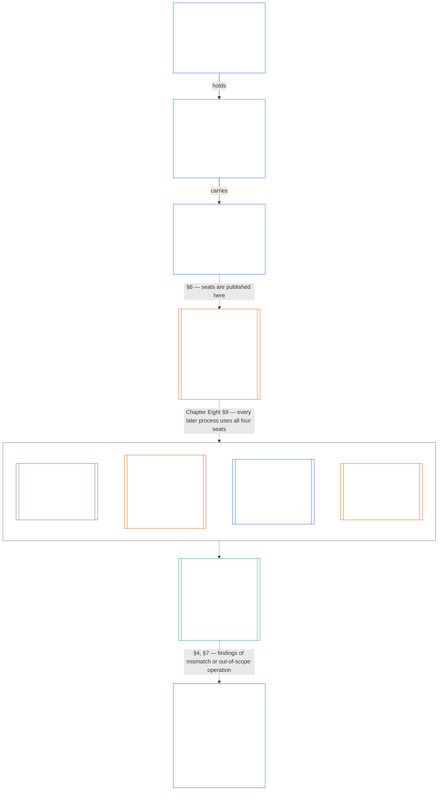

# Draft: Chapter Seven chart — Charters, segregation of duties, and certification

**Status:** inserted into `core_07_charters.md` at the chapter opening (after the owner statement, before §1) on 2026-10-13 (uncommitted, awaiting steward review). This file is the working copy of the draft and can be deleted once the insertion is accepted.

**Home:** the chapter opening of `core_07_charters.md`, so readers see the big picture first. The chart and explanation are a non-operative reader map; the numbered sections stay the binding text.

**Notes for review (not for insertion):**

- Chart standards: top to bottom (**VIS-CHART-ORIENT-04**); unfilled nodes, white labels, palette outlines (**VIS-CHART-THEME-02**); title and content split by a blank line (**VIS-CHART-READABILITY-01**); nothing crosses (**VIS-CHART-CROSSING-06**); every box on one axis (**VIS-CHART-CENTER-05**, checked on a render with no spacers); Chapter Eight and Chapter Nine boxes are subroutine shapes marked "Outside this chapter" and reached by dotted links that carry the Chapter Seven section (**VIS-CHART-EXTERNAL-07**). The Chapter Nine container says "outside this chapter" once, in its title, and the four seats inside it use the subroutine shape.
- **VIS-CHART-SYNC-03:** the chart names the Chapter Eight and Chapter Nine titles, the four seat names, and Chapter Seven §§3, 4, 6, 7. If any of those is renamed or renumbered, update the chart.
- Every claim is taken from existing text: Chapter Seven §§2–7; Chapter Eight §§2, 5, 9; Chapter Nine Part B §6.1.1, §6.2, §9. Nothing new is asserted.
- No loop-back connector is drawn from "Keep the Charter true" to the top. The reopening trigger is stated in that box instead. A connector pair (**VIS-CHART-SYMBOLS-08**) can be added if you want the cycle drawn.

---

<strong>Reader guidance (non-operative): Charters, seats, and certification map</strong>

> **Reader map (non-operative).** This diagram shows how the Charters in this chapter connect to the seat floor in Chapter Eight and to system alignment certification in Chapter Nine. It adds no duty, seat, or Charter field, and it does not change the operative rules in §§2–6 of this chapter or in the later chapters. Boxes with double side bars belong to other chapters. Dotted links are hand-offs, labeled with the section of this chapter that makes them.

 

*In plain terms: three chapters work as one chain. This chapter says what a body claims to do and who may hold each seat when it acts. [Chapter Eight](core_08_functional_independence_segregation_of_duties.md#chapter-eight-functional-independence-and-segregation-of-duties) says how those seats must be kept apart. [Chapter Nine](core_09_system_alignment_certification.md#chapter-nine-system-alignment-certification-reading-index) certifies a system, which is one binding act that uses the seats, and it sends what it finds back to the Charter.*

Read the chart from the top:

- **Charters (this chapter).** An Institutional Charter holds every System Charter in force. An Institution that runs one System publishes that System Charter alone. Each Charter carries the [Charter Role Map](core_05_band_continuity.md#charter-role-map) for its own acts ([§2](#2-when-system-and-institutional-charters-are-required), [§3](#3-what-system-and-institutional-charters-must-state), [§6](#6-the-charter-role-map-and-standing-record-custody)).
- **Segregation of duties (Chapter Eight).** Every [Materially Binding Act](core_05_band_accountability.md#materially-binding-act) has four seats: initiating, verify-or-authorize, record, and contest. [Chapter Eight §5 Published Placement, Vacancy, and Substitution](core_08_functional_independence_segregation_of_duties.md#5-published-placement-vacancy-and-substitution) requires the published map. [Chapter Eight §2 Four-Seat Constitutional Floor](core_08_functional_independence_segregation_of_duties.md#2-four-seat-constitutional-floor) through §6 decide whether a placement on it is valid. The map records placements. It does not set the rules for them ([§6](#6-the-charter-role-map-and-standing-record-custody)).
- **Certification (Chapter Nine).** A certification is a materially binding act, so every pass fills all four seats ([Chapter Nine Part B §6.1.1 Four seats in a certification](core_09_b_system_alignment_certification_record_process.md#611-four-seats-in-a-certification)). The map places the initiating, record, and contest seats, and the record and contest seats sit outside the operator's [Material Control Line](core_05_band_accountability.md#material-control-line). The map does not place the verify-or-authorize seat. The lead forum and component authorities are assigned under [Chapter Nine Part B §6.2 Supervisory sequence](core_09_b_system_alignment_certification_record_process.md#62-supervisory-sequence) and Chapter Thirteen, so an operator cannot choose its own verifier. The System Certification Record names the map version in force.
- **Back to the Charter.** Certification reads the System Charter's stated scope against the system's real boundaries. The Charter is evidence for certification and never a substitute for it ([§5](#5-what-system-and-institutional-charters-cannot-do)). A mismatch is corrected by amendment, remediation, recertification, or scope contraction, not by quiet expansion ([§4](#4-amendment-review-and-scope-drift)). A Charter amendment, a mismatch, operation materially outside chartered scope, or an overdue periodic review reopens certification ([Chapter Nine Part B §9 Recertification and Reopening](core_09_b_system_alignment_certification_record_process.md#9-recertification-and-reopening)).
