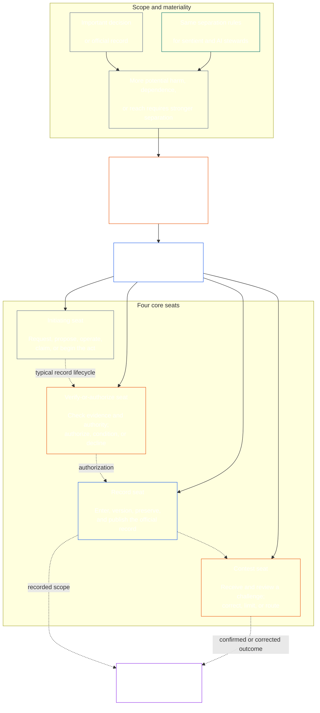

<!-- Draft for eventual path translations/ar/core_08_functional_independence_separation_of_duties.md -->
**Status:** AI-assisted translation draft; unreviewed. Not an official translation or attestation.

**Source:** `core_08.000_functional_independence_separation_of_duties.md`; edition `SC-Corpus-2026.10.21`; revision `5adf22f3d58520385afb9dc2bcb2f439346175fb`; SHA-256 `d9a573839564fa3a2e920fff4d2ecb4ccc8a7b560d8aef65656a356de09fdfda`.

**Scope:** Full Chapter Eight, including reading guides, trace blocks, tables, and diagrams. Links are written for the eventual `translations/<locale>/` destination. English remains controlling.

# الفصل الثامن: الاستقلال الوظيفي والفصل بين الواجبات

<strong>وضع الجسم (غير المنطوق): هيكل الملف وقواعد القراءة</strong>

> هذا الملف هو **جزء من الدستور الشعوري** وهو **ملزمة فقط معا** مع ترقيم الآخر `core_*` قراءة الملفات كنص واحد. أنه يحتوي على **الفصل الثامن**: متطلبات العملية الشاملة للاستقلال الوظيفي والفصل بين الواجبات. يتبع [الفصل السابع](../../core_07.000_charters.md#chapter-seven-system-and-institutional-charters)، الذي ينص على ميثاق النظام أو الميثاق المؤسسي الذي يحمل خريطة المقاعد المنشورة، ويسبق فصول العملية الدستورية التي تبدأ بـ [الفصل التاسع شهادة محاذاة النظام](../../core_09.000_system_alignment_certification_evaluation.md#chapter-nine-system-alignment-certification).
>
> - **المالك الدستوري:** شرط الفصل بين الواجبات بالنسبة للأعمال الملزمة ماديًا، والذي يتم استيفاؤه من خلال مقاعد متميزة؛ الحد الأدنى العالمي لمحتويات كل منها [سجل القانون الملزم ماديًا](../../core_05.035_band_accountability.md#materially-binding-act-record); الاستقلال عن الفاعل والفاعل [خط مراقبة المواد](../../core_05.035_band_accountability.md#material-control-line); المسار المنشور وموضع الدور ؛ الصراع، والشغور، والاستبدال، وتوجيه المقعد الخطأ؛ استضافة مدمجة متناسبة؛ عمليات التسليم المنسوبة؛ والحد الأدنى من شروط الاستقلال التي يجب أن تطبقها كل عملية دستورية لاحقة.
> - **مصدر الطبقة الأساسية:** [الفصل الأول §18.3](../../core_01.010_stewardship_capacity_principles.md#183-separation-of-duties) يتطلب الحوكمة الحفاظ على الاستقلال الوظيفي وتوجيه بنية المقعد التشغيلي هنا.
> - **صاحب التنفيذ:** [CJS-5.125 §11](../../corpus_joint_structure/cjs_05.125_accountability_operations.md#constitutional-lane-and-functional-separation) (*الممر الدستوري والفصل الوظيفي*)، [CI-8.205 §2](../../corpus_institutions/ci_08.205_institutional_design_separation_of_powers.md#ci-8205-2-functional-separation-lanes)، و [CI-14.205 §6](../../corpus_institutions/ci_15.205_appointment_competency_rotation_removal.md#ci-15205-6-seat-catalog--process-role-archetypes-and-operational-boundaries) وضع وتشغيل المقاعد. قد تكون أكثر صرامة وقد تضيف أنواع مقاعد ذات سلطة خاصة محدودة؛ ولا يجوز لهم تضييق هذا الفصل.
> - **يظل التطبيق الخاص بالعملية في اتجاه مجرى النهر:** يطبق الفصل التاسع هذا المطلب على شهادة محاذاة النظام وشهادة المحاذاة المؤسسية؛ [الفصل العاشر §3.7](../../core_11.000_standing_assessment.md#37-separation-of-duties) يطبقه على السجلات الدائمة؛ الفصل الثالث عشر و [مجموعة_forum.md](../../corpus_forum.md) تطبيقه على عملية المنتدى. وقد تضيف هذه الفصول ضمانات يتطلبها موضوعها؛ ولا يجوز لهم إنشاء بديل أضعف.
>
> ترتيب القراءة: §1 الغرض والنطاق → §2 متطلبات الأربعة مقاعد → §3 الاستقلال والصراعات → §4 توجيه المقعد الخاطئ → §5 النشر المنشور والبدائل والتفويض → §6 القياس النسبي → §7 حالات الطوارئ → §8 سجلات القانون وعمليات التسليم → §9 التطبيق النهائي.

<strong>يتعقب</strong>

- المنبع:
  - [رباعية دستورية](../../core_00.000_preamble.md#constitutional-tetrad) - خصوصاً **الرقابة** و **المساءلة**;
  - [حصة مادية](../../core_00.000_preamble.md#material-stake);
  - [الفصل الأول §17.1 معيار الإشراف المشترك](../../core_01.010_stewardship_capacity_principles.md#171-shared-stewardship-standard) (1.015 §17.1)؛
  - [الفصل الأول §18 الحكم في ظل الانضباط الإشرافي](../../core_01.010_stewardship_capacity_principles.md#18-governance-under-stewardship-discipline) (1.015 §18)؛
  - [المادة السادسة عشرة](../../core_06.010_rights_part_c.md#article-xvi-audit-transparency-and-independent-verification) (*التدقيق والشفافية والتحقق المستقل*).
- الأقسام الفرعية:
  - [§1](#1-purpose-scope-and-owner-boundary);
  - [§2](#2-four-seat-constitutional-requirement);
  - [§3](#3-independence-conflict-and-control-lines);
  - [§4](#4-wrong-seat-routing);
  - [§5](#5-published-placement-vacancy-and-substitution);
  - [§6](#6-proportional-scaling-and-merged-hosting);
  - [§7](#7-emergency-and-urgent-action);
  - [§8](#8-act-records-and-attributable-handoffs);
  - [§9](#9-relationship-to-later-processes).
- المصب:
  - [الفصل التاسع](../../core_09.000_system_alignment_certification_evaluation.md#chapter-nine-system-alignment-certification) (9.000)؛
  - [الفصل العاشر](../../core_11.000_standing_assessment.md#chapter-eleven-contribution-violation-and-standing-model--measurement) (10.000)؛
  - [الفصل الثالث عشر](../../core_14.000_forum.md#chapter-fourteen-forums-and-jurisdiction) (13.000)؛
  - [الفصل الرابع عشر](../../core_15.000_governance.md#chapter-fifteen-constitutional-contract-legitimacy-authorization-and-stewardship) (14.000)؛ نص التنفيذ المعين المذكور أعلاه.
- اقرأ مع:
  - [الفصل الأول §19.3 اكتشاف المحاذاة غير الصحيحة](../../core_01.010_stewardship_capacity_principles.md#193-misalignment-detection) (1.015 §19.3) (*كشف ومراجعة متعددة*);
  - [الإجراء المنسوب](../../core_05.035_band_accountability.md#attributable-action);
  - [سلامة الإسناد](../../core_05.035_band_accountability.md#attribution-integrity);
  - [قابلية التدقيق](../../core_05.050_band_oversight.md#auditability);
  - [القدرة على المنافسة](../../core_05.035_band_accountability.md#contestability);
  - [التناسب](../../core_05.035_band_accountability.md#proportionality).

 

الفصل الثامن هو المالك الدستوري لل **متطلبات الاستقلال الوظيفي والفصل بين الواجبات بالنسبة للأعمال الملزمة ماديًا**.

### 1. الغرض والنطاق وحدود المالك

<strong>يتعقب</strong>

- المنبع: مطالبة مالك فتح الفصل؛ [الفصل الأول §18](../../core_01.010_stewardship_capacity_principles.md#18-governance-under-stewardship-discipline) (1.015 §18)؛ [الرقابة](../../core_05.020_apex_oversight_leg.md#oversight-constitutional); [المساءلة](../../core_05.005_apex_accountability_leg.md#accountability).
- المصب: [§2](#2-four-seat-constitutional-requirement) خلال [§9](#9-relationship-to-later-processes); كل عملية لاحقة تنتج أو تغير عملاً ملزمًا ماديًا.
- اقرأ مع:
  - [الفصل الرابع](../../core_04.000_burden_traceability_verification.md#chapter-four-burden-of-proof-traceability-and-verification) (4.000) لركيزة التحقق؛
  - [المادة الثالثة عشرة-أ](../../core_06.010_rights_part_c.md#article-xiii-a-reliability-and-trustworthiness-baseline) (*الموثوقية والجدارة بالثقة خط الأساس*) و
  - [المادة الثالثة عشرة-ب](../../core_06.010_rights_part_c.md#article-xiii-b-right-to-redress-and-remedy) (*الحق في الإنصاف والانتصاف*) للتحدي والانتصاف؛
  - [المادة السادسة عشرة](../../core_06.010_rights_part_c.md#article-xvi-audit-transparency-and-independent-verification) (*التدقيق والشفافية والتحقق المستقل*) لأرضيات حقوق التحقق المستقل.

 

*بعبارات واضحة: قبل أن يكون من الممكن الوثوق بالعملية الدستورية - أو القرار على مستوى أصحاب المصلحة داخل نظام أو مؤسسة أو مجال قرار مقيد بالفعل - يجب فصل الوظائف داخلها. وينطبق هذا الشرط على كل من [طبقة العقد الدستوري](../../core_05.045_band_integrative.md#constitutional-contract-layer) وإلى [مشاركة نظام أصحاب المصلحة](../../core_05.055_band_participation.md#stakeholder-status-and-weight). لا يمكن أيضًا للجهة الواعية أو المكتب أو نظام الذكاء الاصطناعي أو هيئة أصحاب المصلحة أو الممثل الذي يسعى للحصول على نتيجة تقديم الشيك المستقل المفترض أو التحكم في السجل الرسمي لذلك الشيك أو اتخاذ قرار بشأن الاعتراض عليه.*

وهذا الفصل ينطبق على كل [قانون ملزم ماديا](../../core_05.035_band_accountability.md#materially-binding-act)كما عرفها الفصل الخامس، بما في ذلك:

- قرار؛
- ترخيص أو شهادة؛
- النتيجة؛
- إدخال سجل أو تغيير إصدار المادة؛
- الإصدار أو النشر أو الاستمرار أو الانسحاب؛
- صرف أو تخصيص؛ و
- التصرف في التحدي.

لا ينطبق هذا الفصل على الطرف التشغيلي من الفئة P. أفعاله تبقى داخله [وحدة خاصة](../../core_05.050_band_oversight.md#domain-specific-materiality-private-unit)، واعي واحد، أو أسرة، أو دائرة خاصة مقيدة بإحكام اختار جميع أعضائها أن يكونوا فيها، والطرف العامل الذي يجب على الآخرين أن يتبعوا أفعاله أو قد يعتمدون عليها كما تم تسويتها، هي على الأقل الفئة L تحت **CS-9.305 (*آلات تصنيف النظام*) و CS-9.310** (*آلات تصنيف النظام*). فالشخص الوحيد الذي لديه جهاز كمبيوتر لا يحتاج إلى حامل مقعد ثانٍ. ينطبق هذا الشرط اعتبارًا من اليوم الذي تتخذ فيه الجهة المشغلة قانونًا ملزمًا ماديًا.

تحدد المقاعد في هذا الفصل من يجوز له أن يفعل ماذا من أجل فعل معين؛ فهي ليست ألقاب وظيفية. قد يشغل نفس الواعي أو المكتب أو النظام مقاعد مختلفة لأعمال مختلفة. إن المسمى الوظيفي أو التفويض أو القدرة الفنية أو القدرة على أداء خطوة لا يؤدي إلى توسيع المقعد المخصص لهذا الفعل.

#### 1.1 لماذا يتم فصل الوظائف

*وبعبارات واضحة: لقد تعلمنا نفس الدرس مراراً وتكراراً في مجالات الأعمال، والحكومة، والأمن النووي. عندما يتمكن أحد الأطراف من بدء عمل ما، والموافقة عليه، وتدوينه، والحكم على أي شكوى بشأنه، لا يكون أي شخص آخر في وضع يسمح له باكتشاف خطأ أو كذبة.*

يشرح هذا القسم الفرعي أسباب هذا الشرط. إنه غير فعال: القواعد الملزمة موجودة [§2 المتطلبات الدستورية المكونة من أربعة مقاعد](#2-four-seat-constitutional-requirement) خلال [§9 العلاقة بالعمليات اللاحقة](#9-relationship-to-later-processes).

توصلت عدة مجالات إلى نفس الفكرة من تلقاء نفسها:

- **المحاسبة والرقابة الداخلية:** لقد قامت الشركات ومراجعو الحسابات لفترة طويلة بتقسيم العمل المتمثل في الترخيص بالمعاملة، وتسجيلها، والاحتفاظ بالأصول، وتسوية الدفاتر، بحيث لا يتمكن أي كاتب واحد من أخذ المال وإخفاء عملية الاستلام. أطر الرقابة الداخلية مثل COSO تدرج فصل الواجبات بين أنشطة الرقابة الأساسية الخاصة بها.
- **الفصل بين السلطات في الحكومة:** جادل مونتسكيو في *روح القوانين* (1748) أن الحرية تكون في خطر عندما يضع جسد واحد القوانين وينفذها ويحكم عليها. جيمس ماديسون، في *الفيدرالية رقم 51* (1788)، دافع عن تصميم يكون فيه لكل فرع الوسائل اللازمة لمقاومة الفروع الأخرى. ومنذ ذلك الحين قامت العديد من الدساتير بتقسيم السلطة بطرق مماثلة.
- **قواعد التعامل مع شخصين:** يتطلب جيش الولايات المتحدة من اثنين من أفراد الطاقم المرخص لهم العمل معًا قبل إطلاق أسلحة نووية معينة أو الوصول إليها، بحيث لا يستطيع أي فرد التصرف بمفرده (تعليمات القوات الجوية 91-104). لقد قامت البنوك منذ فترة طويلة بوضع مفاتيح مزدوجة على الخزائن لنفس السبب. تؤكد قاعدة الشخصين من الذي يتصرف وما إذا كان الأمر حقيقيًا، وليس ما إذا كان الأمر سليمًا. ولهذا السبب يطلب هذا الفصل شيكاً مستقلاً، وليس مجرد توقيع ثانٍ.
- **ماذا يحدث بدون الانفصال:** في بنك بارينجز في عام 1995، أدار نيك ليسون كلاً من مكتب التداول في سنغافورة والمكتب الخلفي الذي قام بتسوية وتسجيل تداولاته. لقد أخفى الخسائر في حساب سري. أشارت المراجعة الداخلية في عام 1994 إلى الدور المشترك باعتباره خطرًا كبيرًا، لكن الإدارة تركته في مكانه. وانهار البنك، الذي كان عمره آنذاك أكثر من قرنين من الزمان، في فبراير 1995 بخسائر بلغت حوالي 2.2 مليار دولار سنغافوري وتم بيعه لشركة ING.

لا تظهر هذه الأمثلة أن أي نظام واحد لا تشوبه شائبة. وهي تبين أن الفكرة قديمة ومستخدمة على نطاق واسع، وأن الانفصال المفقود هو سبب متكرر للفشل. إنها أسباب وليست سلطة.

#### 1.2 لماذا أربعة مقاعد

*بعبارات واضحة: وظيفتان قليلتان جدًا وثلاثة منها تترك فجوة. أربع وظائف تغطي بدء الفعل، والتحقق منه، وحفظ السجل الرسمي، وسماع التحدي.*

يشرح هذا القسم الفرعي أسباب الرقم أربعة. إنه غير فعال: المقاعد وقواعدها موجودة [§2 المتطلبات الدستورية المكونة من أربعة مقاعد](#2-four-seat-constitutional-requirement).

- **اثنان قليل جدًا:** يمنع زوج الصانع والمدقق أحد الأطراف من الموافقة على تصرفه الخاص. فهو لا يترك أحدًا ليحتفظ بالسجل الرسمي أو يستمع إلى شكوى، لذلك يمكن لمن يحمل السجل أن يغير ما حدث بهدوء، وينتهي الأمر بالزوج إلى الحكم على الشكاوى المتعلقة بعمله.
- **ثلاث سلطات تناسب الحكومة، وليس كل فعل:** صنع وتنفيذ والحكم يناسب الحكومة. يحتاج الفعل الواحد أيضًا إلى سجل يبقى بعده وطريقًا للطعن لا يمر عبر الممثل أو الموافق.
- **أربعة تطابق نقاط الفشل:** مقعد واحد يبدأ الفعل، وآخر يقوم بفحصه وتفويضه، وآخر يحتفظ بالسجل الرسمي، وآخر يسمع التحديات. وهذا يعكس الانقسامات في المحاسبة بين الترخيص والتسجيل والمراجعة.
- **الأتمتة تجعل من السهل فتح الفجوة:** يمكن لنظام واحد التصرف وتسجيل الخروج وتسجيل عمله في خطوة واحدة، ومن ثم يبدو سجله كدليل. [§2 المتطلبات الدستورية المكونة من أربعة مقاعد](#2-four-seat-constitutional-requirement) يعامل ذلك على أنه يشغل ثلاثة مقاعد في وقت واحد.
- **لا يزال بإمكان المتبنين الصغار الالتزام بما يلي:** [§6 القياس النسبي والاستضافة المدمجة](#6-proportional-scaling-and-merged-hosting) يسمح للمتبني الصغير بوضع مقعد له هيئة مستقلة أو بشروط وضع مقعدين في مكتب واحد. لا يتم أبدًا دمج مقعد التحقق أو التفويض مع مقعد التسجيل أو مقعد المسابقة.

### 2. المتطلبات الدستورية المكونة من أربعة مقاعد

<strong>يتعقب</strong>

- المنبع: [§1](#1-purpose-scope-and-owner-boundary); [الفصل الأول §18.3](../../core_01.010_stewardship_capacity_principles.md#183-separation-of-duties) (1.015 §18.3)؛ [الفصل الأول §17.1](../../core_01.010_stewardship_capacity_principles.md#171-shared-stewardship-standard) (1.015 §17.1).
- المصب: [§3](#3-independence-conflict-and-control-lines) خلال [§9](#9-relationship-to-later-processes); [CI-14.205 §6](../../corpus_institutions/ci_15.205_appointment_competency_rotation_removal.md#ci-15205-6-seat-catalog--process-role-archetypes-and-operational-boundaries) (*كتالوج المقاعد - النماذج الأولية لدور العملية والحدود التشغيلية*).
- اقرأ مع: [§6](#6-proportional-scaling-and-merged-hosting) لمسار الاستضافة المدمجة الوحيد المسموح به.

 

*بعبارات واضحة: الفصل بين الواجبات هو شرط لكل عمل ملزم ماديا ( **متطلبات أربعة مقاعد**)، وأربع وظائف هي كيفية تلبية التحدي: السؤال أو التصرف، والتحقق، والاحتفاظ بالسجل الرسمي، والاستماع إلى التحدي. تظل الوظائف مختلفة حتى عندما يُسمح لمنظمة صغيرة بوضع زوج مسموح به في مكتب واحد.*

<strong>توجيه القارئ (غير فعال): خريطة ذات أربعة مقاعد</strong>

> **خريطة القارئ (غير فعالة).** يوضح هذا الرسم البياني المقاعد الأربعة ودورة حياة السجل النموذجية. ولا يضيف مقعدًا خامسًا للتنفيذ، أو يتطلب المراجعة للانتهاء قبل كل إجراء، أو تغيير القواعد التنفيذية في هذا القسم والفقرات 3-6.

 

تُظهر الأسهم المنقطة داخل صندوق المقعد دورة حياة السجل النموذجية. إن أسهم التنفيذ عبارة عن روابط تتبع، وليست تسلسلًا إلزاميًا لانتظار المراجعة.

كل عمل ملزم ماديا له أربعة مقاعد متميزة وظيفيا. يقدم الفصل الخامس معانيها القانونية؛ يوضح هذا القسم قواعد التنسيب عبر العمليات وعدم التوافق:

1. **[مقعد البداية](../../core_05.035_band_accountability.md#initiating-seat)** — يطلب أو يقترح أو يشغل أو يطالب أو يبدأ الفعل بأي طريقة أخرى.
2. **[التحقق أو الترخيص بالمقعد](../../core_05.035_band_accountability.md#verify-or-authorize-seat)** - يتحقق من الأدلة والسلطة مقابل المعيار الحاكم ويتحقق من الفعل أو يأذن به أو يرفضه أو يضع شروطًا عليه.
3. **[سجل المقعد](../../core_05.035_band_accountability.md#record-seat)** - يدخل، وينسخ، ويحمل، ويحفظ، وينشر [سجل الفعل](../../core_05.035_band_accountability.md#materially-binding-act-record) لما حدده مقعد التحقق أو التفويض.
4. **[مقعد المسابقة](../../core_05.035_band_accountability.md#contest-seat)** - يتلقى ويراجع التحدي، ويأمر بالتصحيح أو الحدود حيثما يكون ذلك مسموحًا به، ويوجه أي مشكلة خارج نطاق سلطته.

تنطبق هذه المقاعد على المضيفين من البشر والذكاء الاصطناعي على حدٍ سواء. إذا قام النظام بتنفيذ فعل ما، ووقع عليه، ثم استخدم السجل الخاص به كدليل، فإنه يجلس في مقاعد البدء والتحقق والتسجيل في نفس الوقت. أتمتة العملية لا تجعل الشيك مستقلاً.

يحظر على الفعل الواحد الجمع التالي:

- يجب ألا يتحقق مقر البدء من تصرفاته أو يأذن بها؛
- يجب ألا يحمل مقعد التحقق أو التفويض مقعد التسجيل؛
- يجب ألا يشغل مقعد التحقق أو التفويض مقعد المسابقة؛ و
- يجب على مشغل النظام، أو السلطة الحاكمة لمؤسسة ما، عدم التحقق أو التصريح بأي تصرف يتعلق بهذا النظام أو المؤسسة.

قد تحظر الفصول اللاحقة أو نص التنفيذ المدمج عمليات الاقتران الإضافية لعملية معينة. لا يجوز لهم السماح بالاقتران المحظور هنا.

ينطبق شرط الفصل بين الواجبات في كل فئة، والمقاعد الأربعة هي كيفية استيفائه. والسؤال المطروح على مستوى الطبقة هو ما إذا كان من الممكن دمج هذه المقاعد أو مشاركة صاحبها. لمؤسسة أو نظام يعمل ضمن:

- نطاق الفئة C، يوصى دائمًا بالفصل الكامل لأربعة مقاعد؛
- نطاق الفئة ب، يجب دائمًا أن يكون الفصل الكامل لأربعة مقاعد مطلوبًا؛ و
- نطاق الفئة أ، مطلوب دائمًا الفصل الكامل لأربعة مقاعد.

عندما يكون النطاق مختلطًا أو التصنيف غير مؤكد، قم بتطبيق أعلى وضع قابل للتطبيق حتى يدعم السجل وضعًا أقل.

### 3. الاستقلال والصراع وخطوط السيطرة

<strong>يتعقب</strong>

- المنبع: [§2](#2-four-seat-constitutional-requirement); [المسؤولية على نطاق السلطة](../../core_01.010_stewardship_capacity_principles.md#181-governance-as-authorized-structure); [المادة الخامسة والعشرون](../../core_06.015_rights_part_d.md#article-xxv-constitutional-interpretation-review-and-anti-capture-safeguards) (*التفسير الدستوري والمراجعة والضمانات ضد الاستيلاء*).
- المصب: [§4](#4-wrong-seat-routing); [§5](#5-published-placement-vacancy-and-substitution); [§8](#8-act-records-and-attributable-handoffs); الفصل التاسع أدوار مكونات الشهادة؛ الفصل العاشر سجل الحضانة الفصل الثالث عشر منتدى مكافحة الحكم على الذات.
- اقرأ مع: [خط مراقبة المواد](../../core_05.035_band_accountability.md#material-control-line); [سي آي-8.210](../../corpus_institutions/ci_08.210_conflict_integrity_anti_capture_anti_corruption.md) (*نزاهة الصراع، ومكافحة الاستيلاء، ومكافحة الفساد*) و [CF-13.425](../../corpus_forum/cf_14.425_integrity_safeguards_anti_capture_anti_self_judging.md) (*ضمانات النزاهة، وعمليات مكافحة الاستيلاء، ودعم مكافحة الحكم الذاتي*) للصراع التشغيلي والضمانات المناهضة للحكم الذاتي.

 

*بعبارات واضحة: تغيير الاسم الموجود على المكتب لا يخلق الاستقلال. لا تكون سلطة التحقق أو المراجع مستقلة عندما يتمكن الشخص أو المكتب الذي يسعى للحصول على النتيجة من توجيههم أو إزالتهم أو مكافأتهم أو معاقبتهم أو نقضهم بهدوء على هذا الفعل.*

يتم الحكم على الاستقلال الوظيفي من خلال السلطة والسيطرة الفعلية، وليس التسميات. على نفس الفعل:

- يجب أن يكون مقعد التحقق أو التفويض ومقعد المسابقة خارج مقعد البدء [خط مراقبة المواد](../../core_05.035_band_accountability.md#material-control-line);
- يجب ألا يشغل الطرف الذي يتم تحديد مصلحته بموجب القانون مقعد التحقق أو التفويض أو التنافس؛
- يجب على صاحب السجل المتعارض تمرير هذا السجل، مع مسار التدقيق الكامل الخاص به، إلى البديل المنشور بدلاً من اتخاذ قرار بشأن التعارض أو التخلي عن الحضانة؛ و
- التنحية يزيل السلطة على الفعل؛ ولا ينقل المقعد إلى مقدم الطلب أو خط إبلاغ مقدم الطلب أو من هو الأقرب.

تتبع [خط مراقبة المواد](../../core_05.035_band_accountability.md#material-control-line) للفعل المعين. إن البنية التحتية المشتركة، أو الدعم الإداري، أو تاريخ التعيينات لا تشكل وحدها الخط الفاصل، ولكن هذه الترتيبات لا ينبغي أن تحبط الحكم المستقل في الممارسة العملية.

ولا يتم الإستقلال بتوقيع ثانٍ، أو لجنة اسمية، أو تسمية داخلية، أو شهادة يتم إنشاؤها بواسطة أداة حيث يفتقر الشيك المفترض إلى السلطة، أو الوصول إلى الأدلة، أو التحرر من الرقابة المادية، أو القدرة الحقيقية على التراجع والتوجيه.

### 4. توجيه المقعد الخاطئ

<strong>يتعقب</strong>

- المنبع: [§2](#2-four-seat-constitutional-requirement); [§3](#3-independence-conflict-and-control-lines).
- المصب: [§5](#5-published-placement-vacancy-and-substitution); [§8](#8-act-records-and-attributable-handoffs); [CI-14.205 §6 قواعد المقعد المشترك](../../corpus_institutions/ci_15.205_appointment_competency_rotation_removal.md#ci-46-shared-seat-rules).
- اقرأ مع: [الفصل الأول §17.5 واجب المقاومة](../../core_01.010_stewardship_capacity_principles.md#175-duty-to-resist) (1.015 §17.5).

 

*بعبارات واضحة: عندما لا تكون لك خطوة، لا تتخذها بصمت ولا تبتعد ببساطة. سجل الفجوة وتمرير الأمر إلى المكان الصحيح. والأفضل من ذلك، بناء العملية بحيث تنتقل كل خطوة إلى المكان الصحيح دون أن يضطر أحد إلى ملاحظة ذلك.*

يجب أن يتم تضمين توجيه المقعد الخاطئ في العملية حيثما كان ذلك ممكنًا. يجب أن يرسل المدخل أو قائمة الانتظار أو سير العمل أو الواجهة كل خطوة إلى مقعدها المنشور منذ البداية، لذلك لا يتم تقديم خطوة إلى مقعد قد لا يشغلها. التوجيه الآلي:

- يتبع الموضع المنشور تحت [§5 التنسيب المنشور والوظيفة الشاغرة والاستبدال](#5-published-placement-vacancy-and-substitution) والطرق على المقعد، وليس على أساس موضوع الفعل؛
- تسجيل كل مسار كما يتطلب البند 3 أدناه؛
- يتبع البديل المنشور أو المسار المستقل تحت [§5.3 المقعد الذي تتركه الخريطة غير مكانه، أو حامل لا يمكنه الخدمة](#53-a-seat-the-map-leaves-unplaced-or-a-holder-who-cannot-serve) عندما لا يستطيع حامل الخدمة، ويمسك الأمر ويسجل الفجوة عندما لا يتم وضع مقعد أو بديل أو مسار مستقل، بدلاً من إرساله إلى المقعد الأقرب أو الأسرع أو الأقدم؛ و
- ليس في حد ذاته صاحب مقعد ولا يمكنه تغيير من يشغل المقعد؛ الموضع المنشور فقط هو الذي يفعل ذلك.

عندما لا يكون التوجيه آليًا، أو يفشل، ينطبق الواجب أدناه على المضيف. يجب على المضيف الذي يطلب منه اتخاذ خطوة خارج مقعد المضيف أن:

1. رفض تلك الخطوة دون ادعاء تحديد مزاياها؛
2. قم بتسمية المقعد الذي قد يشغله، وإذا تم نشره، اسم المالك أو البديل؛
3. تسجيل الطلب، والمقعد الذي تم شغله، والفجوة أو التعارض، والطريق المستخدم؛
4. الحفاظ على الأدلة وسلامة أي سجل تم استلامه بالفعل؛ و
5. الطريق دون تأخير يمكن تجنبه.

وهذا الرد هو أداء الواجب، وليس التخلي عن الفعل. يستمر الفعل من خلال المقعد الأيمن. إن اتخاذ الخطوة لأن المضيف هو الأقرب أو الأسرع أو الأقدم أو ذو المعرفة الفريدة لا يعد حلاً للمقعد المفقود.

### 5. التنسيب المعلن والشغور والاستبدال

<strong>توجيه القارئ (غير عملي): كيف تم وضع هذا القسم</strong>

- [§5.1 ما يجب أن تقوله الخريطة](#51-what-the-map-must-say) يسرد ما تسميه خريطة دور الميثاق: من يستضيف كل مقعد، وأي أعمال، وعمليات الدمج المسموح بها، والبديل، والمسار المستقل، والإصدار.
- [§5.2 مكان حفظ الخريطة](#52-where-the-map-is-kept) تقول الخريطة موجودة في أو مع ميثاق النظام أو الميثاق المؤسسي، وأنه يجوز لعضو في المجموعة اعتماد الخريطة المشتركة للمجموعة حسب المرجع، وأن متبني الفئة P لا يحتاج إلى نشر واحدة.
- [§5.3 المقعد الذي تتركه الخريطة غير مكانه، أو حامل لا يمكنه الخدمة](#53-a-seat-the-map-leaves-unplaced-or-a-holder-who-cannot-serve) يقول أن الفجوة هي عيب يجب تسجيله وتصحيحه، وأن المقعد لا ينتقل إلى الممثل أو خط التحكم الخاص بالممثل، وأن الفعل يتجه إلى المسار البديل أو المستقل في هذه الأثناء.
- [§5.4 التفويض](#54-delegation) ينص على أنه لا يجوز تفويض المقعد إلا لنائب أو استبدال أسماء الخرائط، وأن التفويض يحافظ على حدود المقعد ولا يمكن إنشاء مقعد أو دمجه أو توسيعه.

<strong>يتعقب</strong>

- المنبع:
  - [§2](#2-four-seat-constitutional-requirement);
  - [§3](#3-independence-conflict-and-control-lines);
  - [الشفافية](../../core_05.050_band_oversight.md#transparency);
  - [قابلية التدقيق](../../core_05.050_band_oversight.md#auditability).
- المصب: [§8](#8-act-records-and-attributable-handoffs); [CI-8.205 §2](../../corpus_institutions/ci_08.205_institutional_design_separation_of_powers.md#ci-8205-2-functional-separation-lanes) (*ممرات الفصل الوظيفية*); [CI-14.205 §5](../../corpus_institutions/ci_15.205_appointment_competency_rotation_removal.md#ci-15205-5-authorized-roles-and-accountability-chains) (*الأدوار المعتمدة وسلاسل المساءلة*); سجلات الفصل التاسع والفصل العاشر.
- اقرأ مع:
  - [ميثاق النظام](../../core_05.040_band_continuity.md#system-charter),
  - [الميثاق المؤسسي](../../core_05.040_band_continuity.md#institutional-charter);
  - [الفصل السابع §4 خريطة دور الميثاق وحفظ السجلات الدائمة](../../core_07.000_charters.md#4-the-charter-role-map-and-standing-record-custody) (7.000 §4)؛ و
  - [الفصل الرابع عشر §5](../../core_15.000_governance.md#5-authorized-roles-competency-development-and-contribution) (14.000 §5).

 

*بعبارات واضحة: يجب على المنظمة أن تحدد من يشغل كل وظيفة قبل وصول الحالة الصعبة، بما في ذلك من يتولى المسؤولية عندما يكون شاغل الوظيفة العادي غائبًا أو متعارضًا.*

#### 5.1 ما يجب أن تقوله الخريطة

يجب على كل متبني للفئة L أو أعلى يتخذ إجراءات ملزمة ماديًا أن يحافظ على منشور وقابل للتدقيق وقابل للطعن [خريطة دور الميثاق](../../core_05.040_band_continuity.md#charter-role-map) الذي يحدد:

- أي حارة أو مكتب أو دور أو عملية تستضيف كل مقعد؛
- الأفعال والنطاق الذي ينطبق عليه هذا الموضع؛
- كل ترتيب استضافة مدمج مسموح به وضمان استقلاله؛
- كل نائب أو بديل يمكنه العمل في مقعد، بما في ذلك شاغل الوظيفة الغائب أو المستبعد أو المأسور أو المتعارض؛
- المسار المستقل في حالة عدم توفر بديل مؤهل؛ و
- نسخته وتاريخ نفاذه، بحيث يتم الحكم على الفعل على الخريطة المعمول بها عند ارتكابه.

#### 5.2 مكان حفظ الخريطة

يتم الاحتفاظ بالخريطة في مكان المتبني أو معه [ميثاق النظام](../../core_05.040_band_continuity.md#system-charter) أو [الميثاق المؤسسي](../../core_05.040_band_continuity.md#institutional-charter).

يجوز لعضو المجموعة التي تنشر خريطة مشتركة للمقاعد التي تستضيفها أن يعتمد تلك الخريطة بالرجوع إليها ([§6.3 المقاعد مشتركة](#63-seats-held-in-common))، ولا تزال تسمي طريقها البديل والمستقل.

متبني الفئة P موجود خارج هذا الفصل ([§1 الغرض والنطاق وحدود المالك](#1-purpose-scope-and-owner-boundary)) ولا تحتاج إلى نشر خريطة. لا يزال بإمكانها نشر واحدة بمفردها أو مع نظام طوعي أو ميثاق مؤسسي ([الفصل السابع §4 خريطة دور الميثاق وحفظ السجلات الدائمة](../../core_07.000_charters.md#4-the-charter-role-map-and-standing-record-custody)).

#### 5.3 المقعد الذي تتركه الخريطة غير مكانه، أو حامل لا يمكنه الخدمة

المقعد غير المحدد، أو المالك الغائب، أو المستبعد، أو المأسور، أو المتعارض، هو عيب في الإدارة يجب تسجيله وتصحيحه.

- لا ينتقل المقعد تلقائيًا إلى مقعد البدء أو الطرف المعني أو المشغل أو رئيسه [خط مراقبة المواد](../../core_05.035_band_accountability.md#material-control-line).
- وإلى أن يتم تصحيحه، يتجه الفعل إلى البديل المنشور أو المسار المستقل، مهما كان الفعل عاجلًا.
- بالنسبة لمقعد الاعتماد الذي تتركه خريطة دور الميثاق بدون مكان، يجب أن يتوافق التصحيح مع نوافذ الاستجابة والحل، ويتم احتسابها من الإشعار المسجل بالفجوة، كما هو موضح في [الفصل السابع §4.7.4 مقاعد الشهادة](../../core_07.000_charters.md#474-certification-seats).

#### 5.4 التفويض

لا يجوز لشاغل المقعد تفويض المقعد إلا لنائبه أو بديله [خريطة دور الميثاق](../../core_05.040_band_continuity.md#charter-role-map) أسماء. وفد إلى أي شخص آخر يترك المقعد دون مكانه، و [§5.3 المقعد الذي تتركه الخريطة غير مكانه، أو حامل لا يمكنه الخدمة](#53-a-seat-the-map-leaves-unplaced-or-a-holder-who-cannot-serve) ينطبق. تسمية نائب أو بديل جديد يغير الخريطة ([الفصل السابع §4.5 تغيير قواعد المقاعد وحاملي المقاعد](../../core_07.000_charters.md#45-changing-seat-rules-and-seat-holders)). ولا يمكن للوفد أن يفعل ذلك.

يحتفظ الوفد بنفس حدود المقعد وواجبات الإثبات والسجل والساعة، ويظل المندوب خاضعًا لـ [خط مراقبة المواد](../../core_05.035_band_accountability.md#material-control-line). ولا يؤدي إلى إنشاء مقعد جديد، أو دمج المقاعد، أو السماح للمندوب بالقيام بما لا يستطيع مقعد التفويض القيام به. يعتبر المندوب الذي يشغل مقعدًا ثانيًا في نفس الفصل بمثابة دمج، ولا يتم إدراج سوى ترتيبات الاستضافة المدمجة التي تدرجها الخريطة ضمن [§6 القياس النسبي والاستضافة المدمجة](#6-proportional-scaling-and-merged-hosting) السماح بواحدة.

يجوز للحامل استخدام موظفين أو أدوات للمساعدة في عمل المقعد، مثل جمع الأدلة أو الصياغة أو إجراء الفحوصات الروتينية. وهذه مساعدة وليست تفويضا. ويظل صاحب القرار هو الذي يتخذ قرارات المقعد، ويظل مسؤولاً عن النتيجة، ويظل مسؤولاً عن استقلالية المقعد. إذا اتخذ شخص آخر قرارًا أو اتخذ خطوة باسم المقعد، فهذا تفويض ويجب أن يستوفي هذا القسم الفرعي. ولا يمكن استخدام المساعدة للقيام بما لا يستطيع المقعد نفسه القيام به، بما في ذلك الضغط على أصحاب المقاعد الأخرى لتحديد نتيجة الفعل.

### 6. القياس النسبي والاستضافة المدمجة

<strong>توجيه القارئ (غير عملي): كيف تم وضع هذا القسم</strong>

- [§6.1 كيفية فصل المقاييس](#61-how-separation-scales) يقول إن القوة والتوظيف والتكرار والشكل الشكلي لمقياس الانفصال مع المصلحة والطبقة والتبعية والضرر المتوقع، بينما تظل المقاعد الأربعة متميزة.
- [§6.2 دمج مقعدين في مكتب واحد](#62-merging-two-seats-in-one-office) يسرد الشروط التي بموجبها يجوز لمتبني صغير أو غير رسمي وضع مقعدين في مكتب واحد، والاقتران الذي يظل محظورًا.
- [§6.3 المقاعد مشتركة](#63-seats-held-in-common) توضح كيفية قيام شركة صغيرة بتعيين مقعد في هيئة تعاونية أو جمعية أو أي هيئة مستقلة أخرى، وقواعد الاستقلال التي تنطبق.
- [§6.4 الممارسة المهنية المشتركة](#64-joint-professional-practice) يقول كيف يمكن لممارسة واعية أو صغيرة من الفئة L أو أعلى أن تضع مقاعدها مع مضيف وتعتمد وثائق المضيف، لأي عمل، وما ينطبق أكثر على الأعمال التي تحتاج إلى ترخيص ممارسة أو تصريح ممارسة.
- [§6.5 العمل غير الرسمي والمجتمعي](#65-informal-and-community-work) تقول أن مثل هذا العمل قد يستخدم هيئة اعتماد مستقلة ذات سلطة منشورة لإجراء الفحص.
- [§6.6 الحصة والطبقة وما لا يبرر الاندماج](#66-stake-class-and-what-does-not-justify-a-merger) يقول إن ارتفاع المخاطر يحافظ على افتراض وجود مكاتب منفصلة، ​​وأن التوظيف أو السرعة أو الراحة وحدها لا تبرر الاندماج أبدًا.

<strong>يتعقب</strong>

- المنبع:
  - [§2](#2-four-seat-constitutional-requirement);
  - [حصة مادية](../../core_00.000_preamble.md#material-stake);
  - [ضرورة](../../core_05.035_band_accountability.md#necessity);
  - [التناسب](../../core_05.035_band_accountability.md#proportionality).
- المصب: [الفصل العاشر §3.7](../../core_11.000_standing_assessment.md#37-informal-and-small-scope-records) (10.000 §3.7)؛ [CJS-18.110 §4](../../corpus_joint_structure/cjs_19.110_specific_joint_interlocks.md#cjs-19110-4-class-scaled-lane-staffing-and-competency-redundancy) (*التوظيف على مستوى الفصل وتكرار الكفاءة*); [CI-8.205 §2](../../corpus_institutions/ci_08.205_institutional_design_separation_of_powers.md#ci-8205-2-functional-separation-lanes) (*ممرات الفصل الوظيفية*).
- اقرأ مع: [العبء الذي يمكن تجنبه](../../core_05.040_band_continuity.md#avoidable-burden) والفصل الأول [§3.3 عملية مكافحة التدهور](../../core_01.000_values_principles.md#33-anti-degrading-process).

 

*بعبارات واضحة: المجموعات الصغيرة وغير الرسمية لا تحتاج إلى أربعة أقسام كبيرة. إنهم بحاجة إلى فحص مستقل حقيقي، وسجل قابل للاستخدام، ومسار للتحدي. يغير المقياس طريقة التوظيف، وليس الفصل المحمي.*

#### 6.1 كيفية فصل المقاييس

القوة والتوظيف والتكرار والشكليات في مقياس الفصل مع الحصة المادية وفئة النظام والتبعية والضرر المتوقع بشكل معقول.

#### 6.2 دمج مقعدين في مكتب واحد

يجوز للمتبني الصغير أو غير الرسمي وضع مقعدين في مكتب واحد أو واعي فقط عندما يكون كل ما يلي:

- أن يكون الاندماج ضروريًا ومتناسبًا مع النطاق؛
- تم نشره وقابل للتدقيق والمنافسة عليه والإفصاح عنه في سجل القانون؛
- تعالج ضمانة الاستقلال المخاطر الناجمة عن الاندماج؛
- لا يتحقق مقعد البدء من عمله أو يأذن به؛
- لا يتم أبدًا دمج مقعد التحقق أو التفويض مع مقعد التسجيل أو مقعد المسابقة؛ و
- يظل الطريق المستقل متاحًا عندما يتجاوز النزاع أو الضرر المادي أو التحدي الحدود القانونية للمالك المدمج.

#### 6.3 المقاعد المشتركة

يجوز للأعمال التجارية التي يديرها شخص واحد أو عدد قليل من الأشخاص أن تضع مقعد التحقق أو التفويض أو التسجيل أو المنافسة لدى تعاونية محلية أو رابطة لهذه الشركات، أو مع أي هيئة اعتماد مستقلة أخرى. وهذا ليس اندماجا، لأن المقاعد تبقى مع حاملين منفصلين. إنها الطريقة التي لا تزال بها شركة صغيرة جدًا لا تضم ​​أربعة موظفين تفي بمتطلبات الفصل بين الواجبات [§2 المتطلبات الدستورية المكونة من أربعة مقاعد](#2-four-seat-constitutional-requirement). تنطبق نفس قواعد الاستقلال على أي موضع، بالإضافة إلى القواعد التالية للمجموعة:

- **مستقلة عن الأعمال:** الحامل هو [مستقل](../../core_05.035_band_accountability.md#independence) من بدء الأعمال. إنه خارج نطاق العمل [خط مراقبة المواد](../../core_05.035_band_accountability.md#material-control-line)، ولا شيء يقرره الفعل يعطيه حصة. إن المورد أو المُقرض أو المالك أو العميل الذي تعتمد عليه الشركة ليس مستقلاً عن فعل يتعلق بهذا الاعتماد، مثل النزاع حول عقد المورد الخاص، لأن الفعل يقرر شيئًا لهم أيضًا.
- **خريطة واحدة للمجموعة:** المجموعة تنشر واحدة [خريطة دور الميثاق](../../core_05.040_band_continuity.md#charter-role-map) للمقاعد التي تستضيفها، ويجوز لكل عضو أن يعتمدها بالرجوع إليها. لا تزال خريطة العضو الخاصة تسمي بديلها ومسارها المستقل.
- **خدمة بعضهم البعض:** يجوز للأعضاء أن يخدموا مقاعد بعضهم البعض في أعمال مختلفة. لا يجوز لعضوين التحقق من تصرفات بعضهما البعض كزوج مغلق، ولا يجوز للتناوب توجيه الفعل إلى حامل داخل خط التحكم الخاص بالبادئ.
- **أعمال المجموعة الخاصة:** إن قبول أو إزالة عضو، وتعيين مقعد، والحكم على تصرفات العضو هي أعمال ملزمة ماديًا للمجموعة. لهذه الأفعال المجموعة:
  - يأخذ المقاعد الأربعة.
  - تنشر ميثاق النظام أو الميثاق المؤسسي الخاص بها؛ و
  - تحتفظ بطريق مستقل خارج نفسها (مجموعة أخرى، منتدى، أو مكتب عام)، بحيث لا تحكم أبدًا على نفسها أو على أي عضو تسيطر عليه.
- **لا إكراه:** لا يلزم أي نشاط تجاري للانضمام، ولا توجد مجموعة هي الطريق الوحيد.
- **حدود القبول:** قد ترفض المجموعة أو تؤجل مقدم الطلب لسبب مرتبط بما يمكن أن تخدمه المجموعة، بحيث لا تضطر أبدًا إلى قبول أكثر مما تستطيع تحمله. وتشمل هذه الأسباب ما يلي:
  - **سعة:** الحجم المتوقع للأفعال المادية لمقدم الطلب سوف يستهلك القدرة التي يعتمد عليها الأعضاء الحاليون. قد تحدد المجموعة الحجم الذي تحتاجه من أي عضو أو تحتفظ بقائمة انتظار؛
  - **ملائم:** نوع أفعال مقدم الطلب أو فئته خارج ما يكون أصحاب مقاعد المجموعة مؤهلين وموظفين للخدمة، مثل العمل الذي يحتاج إلى تكرار الكفاءة أكثر من المجموعة ([§6.6 الحصة والطبقة وما لا يبرر الاندماج](#66-stake-class-and-what-does-not-justify-a-merger));
  - **استقلال:** ولا يمكن لأصحاب المجموعة أن يخدموا أعمال مقدم الطلب بشكل مستقل، لأن مقدم الطلب موجود داخل [خط مراقبة المواد](../../core_05.035_band_accountability.md#material-control-line) من واحد منهم؛ و
  - **سلوك:** قام مقدم الطلب بانتهاك الشروط المنشورة للمجموعة من قبل، أو لن يقبلها.
- **كيفية تطبيق الحدود:** كل حد القبول:
  - منصوص عليه في ميثاق النظام أو الميثاق المؤسسي للمجموعة ([الفصل السابع §3.1 ما ينص عليه ميثاق النظام](../../core_07.000_charters.md#31-what-a-system-charter-states))، فينشر قبل تطبيقه؛
  - ينطبق بنفس الطريقة على المتقدمين مثل؛
  - لا يستخدم لحماية الأعضاء من المنافسة أو لجعل المجموعة الطريق الوحيد للحصول على مقعد في منطقتها؛
  - يتم شرحه كتابيًا لمقدم الطلب المرفوض؛ و
  - يمكن الاعتراض عليه من خلال الطريق المستقل خارج المجموعة، لأن اتخاذ قرار بشأن قبول مقدم الطلب هو عمل ملزم ماديًا للمجموعة (انظر *أفعال المجموعة الخاصة*، فوق).
- **لا فخ:** شروط المجموعة قد لا تجعل المقعد تكلفة لا تستطيع الشركة تحملها ([العبء الذي يمكن تجنبه](../../core_05.040_band_continuity.md#avoidable-burden)).
- **المغادرة:** العضو الذي يغادر يأخذ سجلاته معه. لا يجوز للمجموعة أن تعيقهم أو تجعل المغادرة تعتمد على تركهم وراءهم. المجموعة:
  - يمنح العضو تصديرًا كاملاً لسجلات القانون الخاصة به والبيانات الموجودة فيها، في نموذج يمكن للعضو أو المضيف الجديد استخدامه ([CS-6.305 §1.2 جمع الاستمرارية الحرجة وقابلية التصدير](../../corpus_systems/cs_06.305_information_types_and_handling.md#12-continuity-critical-collection-and-exportability))، ويكشف مقدمًا عن أي حدود قانونية للتصدير؛
  - يسلم مقعد التسجيل لتلك الأفعال إلى حامل أسماء الأعضاء، ويظل صاحب مقعد السجل حتى يقوم العضو بتعيين واحد، لذلك تظل سجلات القانون قابلة لإعادة البناء أثناء فتح التحدي أو التصحيح أو العلاج ([§8 سجلات القانون وعمليات التسليم المنسوبة](#8-act-records-and-attributable-handoffs)); و
  - يحتفظ فقط بما لا تزال تتطلبه واجباته الخاصة، مثل سجل الفعل الذي استضافه لعضو آخر أو الفعل الذي لا يزال قيد الاعتراض، وفقط لفترة الاحتفاظ التي كشف عنها ([CS-6.305 §1.3 إشعار الجمع والحذف](../../corpus_systems/cs_06.305_information_types_and_handling.md#13-collection-notice-and-deletion)).
- **البيانات التي تحتفظ بها المجموعة:** يتم التعامل مع ما تحتفظ به المجموعة حسب نوع البيانات الموجود أسفل [CS-6.310 §9 تصنيفات البيانات](../../corpus_systems/cs_06.310_data_classifications.md#cs-6310-9-data-classifications):
  - **بيانات الهوية والإسناد (النوع الأول):** تستخدم فقط للتحقق من الذي شغل كل مقعد ومن تصرف؛
  - **بيانات المشاركة والمعاملات (النوع ح):** تُستخدم فقط لواجبات التسجيل والتدقيق والتحدي الخاصة بالقانون؛
  - **بيانات مصدر الحوكمة (النوع G):** مفتوحة للتدقيق وليست عامة بشكل افتراضي؛
  - **مواد السلامة والأمن والتحقيق (النوع S):** يتم الاحتفاظ بها فقط لمراجعتها المحددة زمنيًا؛ و
  - **أعمال العضو الخاصة (النوع Y والنوع W):** تعاد للعضو، وتحذف من نسخ المجموعة عند توجيه العضو.

#### 6.4 الممارسة المهنية المشتركة

يجوز للممارسة الواعية أو الصغيرة من الفئة L أو أعلى وضع مقاعدها مع مضيف واعتماد وثائق المضيف:

- **من قد يكون المضيف:** جمعية مهنية أو تعاونية أو صاحب عمل أو سجل عام، أينما كان مقرها.
- **ما الذي تعتمده الممارسة:** الخريطة والميثاق المؤسسي المنشوران من قبل المضيف، بالرجوع إليهما، للأعمال التي يغطيانها.
- **أي عمل:** هذا المسار مفتوح لجميع أعمال الممارسة، سواء كانت بحاجة إلى ترخيص ممارسة أو تصريح ممارسة أم لا، لذلك يمكن للممارسة التي تحتوي على كلا النوعين من العمل استخدام مضيف واحد لكل ذلك.
- **نفس القواعد:** القواعد في [§6.3 المقاعد مشتركة](#63-seats-held-in-common) تنطبق على المضيف والممارسة، بما في ذلك استقلال المضيف عن الممارسة، والمقاعد الأربعة والمسار المستقل لأفعال المضيف، وحدود القبول المنشورة، وقاعدة العضو الذي يغادر.
- **الأفعال المدرجة:** بالنسبة لفعل مدرج للحصول على ترخيص الممارسة أو تصريح الممارسة بموجب [المادة الحادية عشرة-هـ](../../core_06.005_rights_part_b.md#article-xi-e-institutional-formation-and-business-creation) (*التكوين المؤسسي وإنشاء الأعمال*)، تأتي معايير المضيف أيضًا من نتائج المنتدى الفني، ويتحقق المضيف من أن كل ممارس يحمل الترخيص أو التصريح، ويعترف المضيف العام كملاذ أخير بأي حامل. بالنسبة للأعمال الأخرى، يعترف المضيف ويرفض فقط لأسباب تتعلق بذلك [§6.3 المقاعد مشتركة](#63-seats-held-in-common)ولا يجوز له أن يكتب معايير الكفاءة التي تبقي العامل خارج العمل الذي لا يطبقه الدستور.
- **واجبات المضيف الإضافية:** **CI-14.205 §7** (*رخصة الممارسة، وتخليص الممارسة، والممارسة المهنية المشتركة*) ينص على الواجبات الإضافية للمضيف والضمانات ضد الاستيلاء.
- **يفي بالمتطلبات:** الانضمام إلى مضيف بهذه الطريقة يلبي متطلبات الفصل بين الواجبات في [§2 المتطلبات الدستورية المكونة من أربعة مقاعد](#2-four-seat-constitutional-requirement) للأفعال التي تغطيها وثائق المضيف.

#### 6.5 العمل غير الرسمي والمجتمعي

قد يستخدم العمل غير الرسمي وغير مدفوع الأجر والمساعدة المتبادلة والرعاية والإصلاح والتدريس والتعاون والإشراف المجتمعي [مستقل](../../core_05.035_band_accountability.md#independence) الجهة المعتمدة ذات السلطة المنشورة لإجراء الفحص ذي الصلة. لا يتطلب الدستور مثل هذا العمل لبناء مكاتب رسمية، أو تعيين موظفين، أو إجراءات تتجاوز ما يمكن أن يدعمه حجمه ووسائله بشكل معقول، طالما أن الفحص يمر عبر طريق مستقل وخاضع للمساءلة حقًا.

#### 6.6 الحصة والطبقة وما لا يبرر الاندماج

كلما زادت المخاطر، كلما كان التوقع المبدئي أقوى بأن كل مقعد يجلس في مكتبه الخاص وأن كل وظيفة لديها دعم مؤهل، مما يعني أن هناك أكثر من شخص قادر على القيام بذلك (تكرار الكفاءة). مشاركة المقعد من خلال مجموعة تحت [§6.3 المقاعد مشتركة](#63-seats-held-in-common) لا يقلل من هذا التوقع.

إن نقص الموظفين، أو الاستعجال، أو الرغبة في الراحة لا يكفي لتبرير وضع مقعدين في مكتب واحد. ولا يوجد خبير واحد يعرف أكثر من أي شخص آخر. قواعد الصف في [§2 المتطلبات الدستورية المكونة من أربعة مقاعد](#2-four-seat-constitutional-requirement) يتقدم:

- **الفئة أ:** لا يتم دمج المقاعد الأربعة أبدًا.
- **الفئة ب أو الفئة ج:** ولا يجوز الاندماج إلا إذا استوفى كل شرط في هذا القسم.

وكلما زاد الضرر الذي يمكن أن يتبع ذلك، وكلما زاد اعتماد الآخرين على العمل، كلما أصبح تبرير الاندماج أصعب، وكلما زاد احتياج العمل إلى مكاتب منفصلة، ​​وحاملين احتياطيين لكل وظيفة، وبديلين مستقلين.

### 7. الإجراءات الطارئة والعاجلة

<strong>يتعقب</strong>

- المنبع:
  - [§2](#2-four-seat-constitutional-requirement);
  - [§6](#6-proportional-scaling-and-merged-hosting);
  - [الفصل الثالث عشر §6.1 تدابير الطوارئ وعبء الاستمرار](../../core_14.000_forum.md#61-emergency-measures-and-continuation-burden) (13.000 §6.1)؛
  - [الوضع المؤقت الافتراضي](../../core_01.005_interaction_interpretation.md#default-interim-posture).
- المصب: عمليات الحادث والاحتواء والإفراج والاستمرار ومراجعة ما بعد الحدث في نص التنفيذ المحدد.
- اقرأ مع: [حسن التوقيت](../../core_05.030_apex_timeliness_leg.md#timeliness-constitutional), [حفظ الأدلة](../../core_05.050_band_oversight.md#evidence-preservation)، و [CI-14.205 §6 كتالوج المقاعد - النماذج الأولية لدور العملية والحدود التشغيلية](../../corpus_institutions/ci_15.205_appointment_competency_rotation_removal.md#ci-46-seat-containment).

 

*بعبارات واضحة: قد تبرر حالة الطوارئ الحقيقية التصرف قبل انتهاء الفحص العادي. إنه يغير التسلسل، وليس ملكية المقعد أو وضعية الفصل على مستوى الفصل. ولا يسمح للممثل بالتصديق على استمراره، أو محو الأثر، أو أن يصبح المراجع النهائي بعد ذلك.*

عندما يؤدي التأخير إلى خلق خطر متوقع بشكل معقول بحدوث ضرر جسيم ووشيك، يجوز لمقعد البدء أو الاحتواء المعتمد اتخاذ الحد الأدنى من الإجراءات القابلة للإلغاء اللازمة قبل اكتمال التحقق المسبق العادي فقط في حالة:

- يتم تسجيل سلطة الطوارئ ونطاقها وبدئها وانتهاءها وسببها مرة واحدة أو في أقرب وقت ممكن ماديًا؛
- يتم الحفاظ على الأدلة والاعتراضات؛
- تتم استعادة الإشعار والمشاركة خلال الساعة الدستورية المعمول بها؛
- يقوم مقعد مستقل للتحقق أو التفويض بمراجعة أي استمرار خارج الحد المباشر؛ و
- يتلقى الفعل مراجعة مستقلة بعد الحدث.

إجراءات الطوارئ لا:

- السماح للفاعل بالتحقق من استمراريته؛
- تعيين الممثل أمينًا للسجل المتعارض؛
- فليسمع الفاعل التحدي الذي يواجه فعله؛
- تحويل الضرورة المؤقتة إلى سلطة دائمة؛
- السماح بأي دمج للمقاعد الأربعة لمؤسسة أو نظام من الدرجة الأولى.

لا يعتبر أي مما يلي في حد ذاته حالة طارئة:

- موعد نهائي؛
- هدف الإصدار؛
- نقص الموظفين؛ أو
- قلق السمعة.

### 8. سجلات التصرف وعمليات التسليم المنسوبة

<strong>يتعقب</strong>

- المنبع:
  - [§2](#2-four-seat-constitutional-requirement) خلال
  - [§7](#7-emergency-and-urgent-action);
  - [سجل القانون الملزم ماديًا](../../core_05.035_band_accountability.md#materially-binding-act-record);
  - [الإجراء المنسوب](../../core_05.035_band_accountability.md#attributable-action);
  - [سلامة الإسناد](../../core_05.035_band_accountability.md#attribution-integrity).
- المصب: [CS-14.305 §10 الإجراء المنسوب القابل للفحص](../../corpus_systems/cs_15.305_critical_system_stewardship.md#cs-15305-103-inspectable-attributable-action); [CI-14.205 §6 قواعد المقعد المشترك](../../corpus_institutions/ci_15.205_appointment_competency_rotation_removal.md#ci-46-shared-seat-rules); كل سجل عملية تحكمه المادة 8؛ [`materially_binding_act_record.schema.json`](../../implementation/schemas/materially_binding_act_record.schema.json) (*النموذج الأساسي الذي يمكن فحصه آليًا؛ دعم العملية، وليس التعريف الثاني*).
- اقرأ مع: [§4 توجيه المقعد الخاطئ](#4-wrong-seat-routing) و [الفصل الرابع §5](../../core_04.000_burden_traceability_verification.md#5-compliance-evidence-standard) (4.000 §5).

 

*بعبارات واضحة: كل قانون ملزم ماديًا له سجل قانوني يوضح ما حدث، ومن شغل كل مقعد، وما تقرر، وأين يذهب التحدي.*

يجب أن يكون لكل فعل ملزم ماديًا ما يمكن تحديده [سجل القانون الملزم ماديًا](../../core_05.035_band_accountability.md#materially-binding-act-record) (**سجل الفعل**). قد يتم تضمين سجل القانون في سجل رسمي واحد قابل للتطبيق خاص بعملية معينة أو في مجموعة من السجلات الرسمية المرتبطة التي تحافظ على النزاهة. ليس هناك حاجة إلى مستند مكرر منفصل إذا كان السجل الرسمي الحالي أو المجموعة المرتبطة تحدد بوضوح جميع العناصر المطلوبة، وتحافظ على روابطها وسجل الإصدارات، وتظل قابلة للوصول من خلال مسار السجل الرسمي المعتمد.

يجب أن يحدد سجل القانون، على الأقل:

- هوية السجل الثابتة، والإصدار الحالي، والطوابع الزمنية لإنشاء المواد وتغييرها؛
- الفعل ونطاقه المادي وحالته وسلطته الحاكمة؛
- مقعد البدء، والحامل، والسلطة؛
- مقعد التحقق أو التفويض، والحامل، والمعيار الحاكم، والتحديد، والظروف أو الأسباب المادية، ووقت التحديد؛
- مقر التسجيل، وصاحب التسجيل، وسلطة الحضانة، والنسخة المُدخلة؛
- مقعد المسابقة أو مسار التحدي المنشور وحالة التحدي أو التصحيح الحالية؛
- كل تفويض أو تنحي أو استبدال أو اندماج مسموح به أو مغادرة اضطرارية؛ و
- الأدلة المادية وروابط التسجيل، وعمليات التسليم، والرفض، والشروط، والاعتراضات التي لم يتم حلها، والساعات، والإصدارات التي تم استبدالها، والتصحيحات اللازمة لإعادة بناء الفعل.

قد تتطلب العملية أكثر من هذا الحد الأدنى، مثل حقول إضافية أو أكثر صرامة لنوع العمل الخاص بها. ولا يجوز له ترك عنصر أعلاه، أو يتعارض مع عنصر، أو الاحتفاظ بالسجل بشكل لا يسمح بإعادة بناء الفعل.

تحدد قواعد الخصوصية والسرية والأمان القانونية من يمكنه رؤية المواد المحمية وكيفية مشاركتها. إنهم لا يبررون أبدًا محو المسار الرسمي أو جعله غير قابل للاستخدام عندما يحتاجه مراجع معتمد للتحقق من الفعل أو الطعن فيه أو تصحيحه أو البحث عن علاج.

تُظهر السجلات من فعل ماذا، لكنها لا تثبت في حد ذاتها صحة الإجراء. إن السجل أو التوقيع أو تتبع النموذج أو قائمة المراجعة أو الشهادة التي أنشأها المرسل أو النظام الذي يتخذ الإجراء له دور محدود:

- قد تقدم هذه المواد أدلة أو تكون مرتبطة بسجل القانون.
- لا يمكن لهذه المواد أن تحل محل المراجعة والقرار المستقل أو سجل القانون الرسمي نفسه.

### 9. العلاقة بالعمليات اللاحقة

<strong>يتعقب</strong>

- المنبع: [§1](#1-purpose-scope-and-owner-boundary) خلال [§8](#8-act-records-and-attributable-handoffs).
- المصب:
  - [الفصل التاسع](../../core_09.000_system_alignment_certification_evaluation.md#chapter-nine-system-alignment-certification) (9.000)؛
  - [الفصل العاشر](../../core_11.000_standing_assessment.md#chapter-eleven-contribution-violation-and-standing-model--measurement) (10.000)؛
  - [الفصل الثالث عشر](../../core_14.000_forum.md#chapter-fourteen-forums-and-jurisdiction) (13.000)؛
  - [الفصل الرابع عشر](../../core_15.000_governance.md#chapter-fifteen-constitutional-contract-legitimacy-authorization-and-stewardship) (14.000).
- اقرأ مع: [مكدس السلطة والتسلسل الهرمي الداخلي](../../core_05.045_band_integrative.md#owner-non-relocation) و [سجل مالك الديباجة](../../core_00.000_preamble.md#4-principles-definitions-and-rights).

 

*بعبارات واضحة: الفصول اللاحقة تخبر كل عملية بما يجب تقييمه وتسجيله وتحديده وعلاجه. ويخبرنا هذا الفصل تلك العمليات كيف يجب فصل الطاقة أثناء قيامها بذلك.*

يجب على كل عملية دستورية لاحقة أن تشرح كيفية تخصيص واستخدام جميع المقاعد الأربعة وكيف تتبع هذا الفصل. في الممارسة العملية:

- قد يكون سجل العملية الخاص به بمثابة سجل القانون أو يضيف تفاصيل خاصة بالعملية إليه.
- إذا كان سجل عملية واحد يغطي العديد من الأفعال الملزمة ماديًا، فقد يرتبط بسجل قانون منفصل لكل فعل.
- ليس هناك حاجة إلى سجل مكرر منفصل عندما يظل مسار السجل الرسمي كاملاً وقابلاً للتتبع.
- إن إعطاء العملية اسمًا مختلفًا لا يعفيها من ذلك [§4 توجيه المقعد الخاطئ](#4-wrong-seat-routing) أو [§8 سجلات القانون وعمليات التسليم المنسوبة](#8-act-records-and-attributable-handoffs)، بما في ذلك قواعد التسليم والمقعد الخطأ.

قد يضيف فصل لاحق متطلبات استقلالية أو تنحية أو انفصال أو حضانة أو لجنة أو مراجعة أقوى لأن عمليتها تنطوي على مخاطر أعلى أو مختلفة. ولا يجوز تضييق متطلبات هذا الفصل، والمقعد الذي لا مكان له لا ينتقل إلى الممثل تحته [§5.3 المقعد الذي تتركه الخريطة غير مكانه، أو حامل لا يمكنه الخدمة](#53-a-seat-the-map-leaves-unplaced-or-a-holder-who-cannot-serve).

---

**الملف السابق:** [جوهر_07.000_Charters.md](../../core_07.000_charters.md)

**الملف التالي:** [جوهر_09.005_نظام_تنسيق_شهادة_تقييم.MD](../../core_09.000_system_alignment_certification_evaluation.md#chapter-nine-part-a-certification-evaluation)
