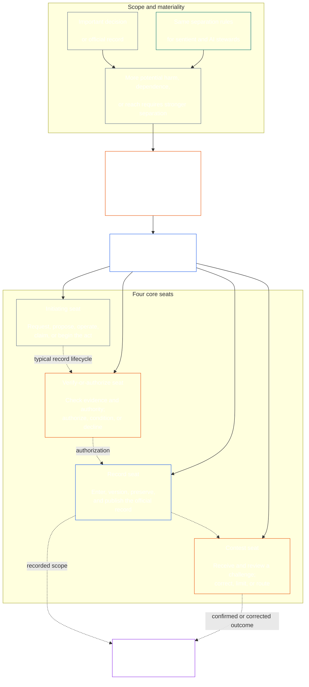

<!-- Draft for eventual path translations/bn/core_08_functional_independence_separation_of_duties.md -->
**Status:** AI-assisted translation draft; unreviewed. Not an official translation or attestation.

**Source:** `core_08.000_functional_independence_separation_of_duties.md`; edition `SC-Corpus-2026.10.21`; revision `5adf22f3d58520385afb9dc2bcb2f439346175fb`; SHA-256 `d9a573839564fa3a2e920fff4d2ecb4ccc8a7b560d8aef65656a356de09fdfda`.

**Scope:** Full Chapter Eight, including reading guides, trace blocks, tables, and diagrams. Links are written for the eventual `translations/<locale>/` destination. English remains controlling.

# অষ্টম অধ্যায়: কার্যগত স্বাধীনতা এবং কর্তব্য পৃথকীকরণ

<strong>কর্পাস প্লেসমেন্ট (নন-অপারেটিভ): ফাইলের গঠন এবং পড়ার নিয়ম</strong>

> এই ফাইল **সংবেদনশীল সংবিধানের অংশ** এবং হয় **শুধুমাত্র একসাথে আবদ্ধ** অন্য সংখ্যাযুক্ত সঙ্গে `core_*` ফাইলগুলি একটি পাঠ্য হিসাবে পড়া হয়। এটি ধারণ করে **আট অধ্যায়**: কার্যকরী স্বাধীনতা এবং কর্তব্য পৃথক করার জন্য ক্রস-প্রক্রিয়ার প্রয়োজনীয়তা। এটি অনুসরণ করে [সপ্তম অধ্যায়](../../core_07.000_charters.md#chapter-seven-system-and-institutional-charters), যা সিস্টেম চার্টার বা ইনস্টিটিউশনাল চার্টার বলে যা প্রকাশিত আসন মানচিত্র বহন করে এবং এর সাথে শুরু হওয়া সাংবিধানিক প্রক্রিয়া অধ্যায়গুলির আগে [অধ্যায় নয় সিস্টেম প্রান্তিককরণ সার্টিফিকেশন](../../core_09.000_system_alignment_certification_evaluation.md#chapter-nine-system-alignment-certification).
>
> - **সাংবিধানিক মালিক:** বস্তুগতভাবে বাধ্যতামূলক কর্মের জন্য কর্তব্যের বিচ্ছেদ-এর প্রয়োজনীয়তা, স্বতন্ত্র আসনের মাধ্যমে পূরণ করা হয়; প্রতিটির সর্বজনীন ন্যূনতম বিষয়বস্তু [বস্তুগতভাবে বাঁধাই আইন রেকর্ড](../../core_05.035_band_accountability.md#materially-binding-act-record); অভিনেতা এবং অভিনেতার থেকে স্বাধীনতা [উপাদান নিয়ন্ত্রণ লাইন](../../core_05.035_band_accountability.md#material-control-line); প্রকাশিত লেন এবং ভূমিকা স্থাপন; দ্বন্দ্ব, শূন্যতা, প্রতিস্থাপন, এবং ভুল-সিট রাউটিং; আনুপাতিক একত্রিত হোস্টিং; অ্যাট্রিবিউটেবল হ্যান্ডঅফস; এবং ন্যূনতম স্বাধীনতার শর্ত যা পরবর্তী প্রতিটি সাংবিধানিক প্রক্রিয়ায় অবশ্যই প্রযোজ্য হবে।
> - **নীতি-স্তর উৎস:** [প্রথম অধ্যায় §18.3](../../core_01.010_stewardship_capacity_principles.md#183-separation-of-duties) কার্যকরী স্বাধীনতা রক্ষার জন্য প্রশাসনের প্রয়োজন এবং এখানে অপারেটিভ সিট আর্কিটেকচারকে রুট করে।
> - **বাস্তবায়ন মালিক:** [CJS-5.125 §11](../../corpus_joint_structure/cjs_05.125_accountability_operations.md#constitutional-lane-and-functional-separation) (*সাংবিধানিক লেন এবং কার্যকরী বিচ্ছেদ*), [CI-8.205 §2](../../corpus_institutions/ci_08.205_institutional_design_separation_of_powers.md#ci-8205-2-functional-separation-lanes), এবং [CI-14.205 §6](../../corpus_institutions/ci_14.205_appointment_competency_rotation_removal.md#ci-14205-6-seat-catalog--process-role-archetypes-and-operational-boundaries) আসন স্থাপন এবং কার্যকরীকরণ. তারা কঠোর হতে পারে এবং আবদ্ধ বিশেষ-কর্তৃপক্ষের আসনের ধরন যোগ করতে পারে; তারা এই অধ্যায় সংকীর্ণ নাও হতে পারে.
> - **প্রক্রিয়া-নির্দিষ্ট অ্যাপ্লিকেশন নিচের দিকে রয়ে গেছে:** নয় অধ্যায় সিস্টেম প্রান্তিককরণ সার্টিফিকেশন এবং প্রাতিষ্ঠানিক প্রান্তিককরণ সার্টিফিকেশন এই প্রয়োজনীয়তা প্রযোজ্য; [অধ্যায় দশ §3.7](../../core_10.000_standing_assessment.md#37-separation-of-duties) স্থায়ী রেকর্ডে এটি প্রযোজ্য; তেরো অধ্যায় এবং [কর্পাস_ফোরাম.এমডি](../../corpus_forum.md) ফোরাম প্রক্রিয়ায় এটি প্রয়োগ করুন। এই অধ্যায়গুলি তাদের বিষয়বস্তুর দ্বারা প্রয়োজনীয় সুরক্ষা যোগ করতে পারে; তারা একটি দুর্বল বিকল্প তৈরি করতে পারে না.
>
> রিডিং অর্ডার: §1 উদ্দেশ্য এবং সুযোগ → §2 চার-সিটের প্রয়োজনীয়তা → §3 স্বাধীনতা এবং দ্বন্দ্ব → §4 ভুল-সিট রাউটিং → §5 প্রকাশিত প্লেসমেন্ট, বিকল্প, এবং প্রতিনিধি → §6 আনুপাতিক স্কেলিং → §7 জরুরী অবস্থা → §8 হ্যান্ড-অফ স্ট্রিম → §8 অ্যাক্ট ডাউন স্ট্রিম এবং রেকর্ডস

<strong>ট্রেস</strong>

- আপস্ট্রিম:
  - [সাংবিধানিক Tetrad](../../core_00.000_preamble.md#constitutional-tetrad) - বিশেষ করে **তদারকি** এবং **জবাবদিহিতা**;
  - [উপাদান বাজি](../../core_00.000_preamble.md#material-stake);
  - [অধ্যায় এক §17.1 শেয়ার্ড স্টুয়ার্ডশিপ স্ট্যান্ডার্ড](../../core_01.010_stewardship_capacity_principles.md#171-shared-stewardship-standard) (1.015 §17.1);
  - [অধ্যায় এক §18 স্টুয়ার্ডশিপ ডিসিপ্লিনের অধীনে শাসন](../../core_01.010_stewardship_capacity_principles.md#18-governance-under-stewardship-discipline) (1.015 §18);
  - [ধারা XVI](../../core_06.010_rights_part_c.md#article-xvi-audit-transparency-and-independent-verification) (*নিরীক্ষা, স্বচ্ছতা, এবং স্বাধীন যাচাইকরণ*)
- উপধারা:
  - [§1](#1-purpose-scope-and-owner-boundary);
  - [§2](#2-four-seat-constitutional-requirement);
  - [§3](#3-independence-conflict-and-control-lines);
  - [§4](#4-wrong-seat-routing);
  - [§5](#5-published-placement-vacancy-and-substitution);
  - [§6](#6-proportional-scaling-and-merged-hosting);
  - [§7](#7-emergency-and-urgent-action);
  - [§8](#8-act-records-and-attributable-handoffs);
  - [§9](#9-relationship-to-later-processes).
- ডাউনস্ট্রিম:
  - [চ্যাপ্টার নাইন](../../core_09.000_system_alignment_certification_evaluation.md#chapter-nine-system-alignment-certification) (9.000);
  - [দশম অধ্যায়](../../core_10.000_standing_assessment.md#chapter-ten-contribution-violation-and-standing-model--measurement) (10.000);
  - [তেরো অধ্যায়](../../core_13.000_forum.md#chapter-thirteen-forums-and-jurisdiction) (13.000);
  - [চতুর্দশ অধ্যায়](../../core_14.000_governance.md#chapter-fourteen-constitutional-contract-legitimacy-authorization-and-stewardship) (14.000); উপরে নামকরণ করা মনোনীত বাস্তবায়ন পাঠ্য।
- এর সাথে পড়ুন:
  - [প্রথম অধ্যায় §19.3 মিসালাইনমেন্ট সনাক্তকরণ](../../core_01.010_stewardship_capacity_principles.md#193-misalignment-detection) (1.015 §19.3) (*বহুবচন সনাক্তকরণ এবং পর্যালোচনা*);
  - [অ্যাট্রিবিউটেবল অ্যাকশন](../../core_05.035_band_accountability.md#attributable-action);
  - [অ্যাট্রিবিউশন ইন্টিগ্রিটি](../../core_05.035_band_accountability.md#attribution-integrity);
  - [নিরীক্ষাযোগ্যতা](../../core_05.050_band_oversight.md#auditability);
  - [প্রতিদ্বন্দ্বিতা](../../core_05.035_band_accountability.md#contestability);
  - [সমানুপাতিকতা](../../core_05.035_band_accountability.md#proportionality).

 

আট অধ্যায়ের সাংবিধানিক মালিক **বস্তুগতভাবে বাধ্যতামূলক কাজগুলির জন্য কার্যকরী-স্বাধীনতা এবং কর্তব্যের পৃথকীকরণের প্রয়োজনীয়তা**.

### 1. উদ্দেশ্য, সুযোগ, এবং মালিকের সীমানা

<strong>ট্রেস</strong>

- আপস্ট্রিম: অধ্যায় খোলার মালিক দাবি; [প্রথম অধ্যায় §18](../../core_01.010_stewardship_capacity_principles.md#18-governance-under-stewardship-discipline) (1.015 §18); [তদারকি](../../core_05.020_apex_oversight_leg.md#oversight-constitutional); [জবাবদিহিতা](../../core_05.005_apex_accountability_leg.md#accountability).
- ডাউনস্ট্রিম: [§2](#2-four-seat-constitutional-requirement) মাধ্যমে [§9](#9-relationship-to-later-processes); প্রতিটি পরবর্তী প্রক্রিয়া যা একটি বস্তুগতভাবে বাধ্যতামূলক কাজ তৈরি করে বা পরিবর্তন করে।
- এর সাথে পড়ুন:
  - [চতুর্থ অধ্যায়](../../core_04.000_burden_traceability_verification.md#chapter-four-burden-of-proof-traceability-and-verification) (4.000) যাচাইকরণ সাবস্ট্রেটের জন্য;
  - [ধারা XIII-A](../../core_06.010_rights_part_c.md#article-xiii-a-reliability-and-trustworthiness-baseline) (*নির্ভরযোগ্যতা এবং বিশ্বস্ততা বেসলাইন*) এবং
  - [ধারা XIII-B](../../core_06.010_rights_part_c.md#article-xiii-b-right-to-redress-and-remedy) (*প্রতিকার ও প্রতিকারের অধিকার*) চ্যালেঞ্জ এবং প্রতিকারের জন্য;
  - [ধারা XVI](../../core_06.010_rights_part_c.md#article-xvi-audit-transparency-and-independent-verification) (*নিরীক্ষা, স্বচ্ছতা, এবং স্বাধীন যাচাইকরণ*) স্বাধীন-যাচাই অধিকার মেঝে জন্য.

 

*সরল ভাষায়: সাংবিধানিক প্রক্রিয়ার আগে—অথবা ইতিমধ্যে-অনুমোদিত সিস্টেম, প্রতিষ্ঠান, বা বাউন্ডেড ডিসিশন ডোমেনের ভিতরে স্টেকহোল্ডার-স্তরের সিদ্ধান্ত-কে বিশ্বাস করা যেতে পারে, এর ভিতরের কাজগুলিকে আলাদা করতে হবে। এই প্রয়োজনীয়তা উভয় ক্ষেত্রেই প্রযোজ্য [সাংবিধানিক চুক্তি স্তর](../../core_05.045_band_integrative.md#constitutional-contract-layer) এবং থেকে [স্টেকহোল্ডার সিস্টেম অংশগ্রহণ](../../core_05.055_band_participation.md#stakeholder-status-and-weight). একটি সংবেদনশীল, অফিস, এআই সিস্টেম, স্টেকহোল্ডার বডি, বা ফলাফল চাওয়া প্রতিনিধিও অনুমিতভাবে স্বাধীন চেক সরবরাহ করতে পারে না, সেই চেকের অফিসিয়াল রেকর্ড নিয়ন্ত্রণ করতে পারে না বা এটির প্রতি চ্যালেঞ্জের সিদ্ধান্ত নিতে পারে না।*

এই অধ্যায় প্রত্যেকের জন্য প্রযোজ্য [বস্তুগতভাবে বাধ্যতামূলক আইন](../../core_05.035_band_accountability.md#materially-binding-act), অধ্যায় পঞ্চম এটি সংজ্ঞায়িত করে, সহ:

- একটি সিদ্ধান্ত;
- একটি অনুমোদন বা শংসাপত্র;
- একটি সন্ধান;
- একটি রেকর্ড এন্ট্রি বা উপাদান সংস্করণ পরিবর্তন;
- একটি মুক্তি, স্থাপনা, ধারাবাহিকতা, বা প্রত্যাহার;
- একটি বিতরণ বা বরাদ্দ; এবং
- একটি চ্যালেঞ্জের স্বভাব।

এই অধ্যায়টি ক্লাস P অপারেটিং পার্টির জন্য প্রযোজ্য নয়। এর কাজ তার ভিতরেই থাকে [ব্যক্তিগত ইউনিট](../../core_05.050_band_oversight.md#domain-specific-materiality-private-unit), একটি একক সংবেদনশীল, একটি পরিবার, বা একটি শক্তভাবে আবদ্ধ ব্যক্তিগত চেনাশোনা যার সদস্যরা সবাই এতে থাকতে বেছে নিয়েছে, এবং একটি অপারেটিং পার্টি যার কাজগুলি অন্যদের অনুসরণ করতে হবে বা মীমাংসার হিসাবে নির্ভর করতে পারে অন্তত এল ক্লাসের অধীনে **CS-9.305 (*সিস্টেম ক্লাসিফিকেশন যন্ত্রপাতি*) এবং CS-9.310** (*সিস্টেম ক্লাসিফিকেশন যন্ত্রপাতি*) একটি কম্পিউটার সহ একজন একমাত্র সংবেদনশীল ব্যক্তির দ্বিতীয় সিট-হোল্ডারের প্রয়োজন নেই। যেদিন থেকে অপারেটিং পার্টি ম্যাটেরিয়াল বাইন্ডিং অ্যাক্ট নেয় সেই দিন থেকে প্রয়োজনীয়তা প্রযোজ্য।

এই অধ্যায়ের আসনগুলি একটি নির্দিষ্ট কাজের জন্য কে কী করতে পারে তা নির্ধারণ করে; তারা চাকরির শিরোনাম নয়। একই সংবেদনশীল, অফিস, বা সিস্টেম বিভিন্ন কাজের জন্য বিভিন্ন আসন ধরে রাখতে পারে। একটি শিরোনাম, প্রতিনিধি দল, প্রযুক্তিগত ক্ষমতা, বা একটি পদক্ষেপ সম্পাদন করার ক্ষমতা সেই আইনের জন্য অনুষ্ঠিত আসনটিকে বড় করে না।

#### 1.1 কেন চাকরি আলাদা করা হয়

*সরল ভাষায়: ব্যবসা, সরকার এবং পারমাণবিক নিরাপত্তার ক্ষেত্রে একই পাঠ বারবার শেখা হয়েছে। যখন একটি পক্ষ একটি কাজ শুরু করতে পারে, এটি অনুমোদন করতে পারে, এটি লিখতে পারে এবং এটি সম্পর্কে কোনো অভিযোগের বিচার করতে পারে, অন্য কেউ ভুল বা মিথ্যা ধরার অবস্থানে থাকে না।*

এই উপধারাটি প্রয়োজনীয়তার কারণ ব্যাখ্যা করে। এটি অ-অপারেটিভ: বাধ্যতামূলক নিয়ম রয়েছে [§2 চার-সিটের সাংবিধানিক প্রয়োজনীয়তা](#2-four-seat-constitutional-requirement) মাধ্যমে [§9 পরবর্তী প্রক্রিয়ার সাথে সম্পর্ক](#9-relationship-to-later-processes).

বেশ কয়েকটি ক্ষেত্র তাদের নিজস্বভাবে একই ধারণায় পৌঁছেছে:

- **অ্যাকাউন্টিং এবং অভ্যন্তরীণ নিয়ন্ত্রণ:** ব্যবসা এবং নিরীক্ষকরা দীর্ঘদিন ধরে একটি লেনদেনের অনুমোদন, এটি রেকর্ড করা, সম্পদ ধারণ করা এবং বইগুলি পুনর্মিলন করার কাজকে ভাগ করেছেন, যাতে কোনও একক কেরানি টাকা নিতে এবং নেওয়া লুকিয়ে রাখতে না পারে। অভ্যন্তরীণ-নিয়ন্ত্রণ কাঠামো যেমন COSO তাদের মৌলিক নিয়ন্ত্রণ কার্যক্রমের মধ্যে দায়িত্বের পৃথকীকরণ তালিকাভুক্ত করে।
- **সরকারের ক্ষমতার বিভাজন:** মন্টেসকুইউ তর্ক করেছিলেন *আইনের আত্মা* (1748) যে স্বাধীনতা বিপদে পড়ে যখন একটি সংস্থা আইন তৈরি করে, কাজ করে এবং বিচার করে। জেমস ম্যাডিসন, ইন *ফেডারেলিস্ট নং 51* (1788), এমন একটি নকশাকে রক্ষা করেছে যেখানে প্রতিটি শাখার অন্যদের প্রতিরোধ করার উপায় রয়েছে। এরপর থেকে অনেক সংবিধান একইভাবে ক্ষমতা ভাগ করেছে।
- **দুই ব্যক্তির নিয়ম:** মার্কিন যুক্তরাষ্ট্রের সামরিক বাহিনীকে নির্দিষ্ট পারমাণবিক অস্ত্র চালু বা অ্যাক্সেস করার আগে দুজন অনুমোদিত ক্রু সদস্যদের একসঙ্গে কাজ করতে হবে, যাতে কেউ একা কাজ করতে না পারে (এয়ার ফোর্স ইন্সট্রাকশন 91-104)। একই কারণে ব্যাংকগুলো ভল্টে দ্বৈত চাবি রেখেছে। একটি দুই-ব্যক্তির নিয়ম নিশ্চিত করে যে কে অভিনয় করছে এবং অর্ডারটি আসল কিনা, অর্ডারটি সঠিক কিনা। এই কারণেই এই অধ্যায়টি একটি স্বাধীন চেক করার জন্য বলেছে, শুধুমাত্র একটি দ্বিতীয় স্বাক্ষর নয়।
- **বিচ্ছেদ ছাড়া কি হয়:** 1995 সালে বারিংস ব্যাঙ্কে, নিক লিসন সিঙ্গাপুর ট্রেডিং ডেস্ক এবং ব্যাক অফিস উভয়ই চালাতেন যেটি তার লেনদেন সেটেল এবং রেকর্ড করেছিল। তিনি একটি গোপন অ্যাকাউন্টে লোকসান লুকিয়ে রেখেছিলেন। 1994 সালে একটি অভ্যন্তরীণ নিরীক্ষা সম্মিলিত ভূমিকাটিকে একটি প্রধান ঝুঁকি হিসাবে চিহ্নিত করেছিল, কিন্তু ব্যবস্থাপনা এটিকে যথাস্থানে রেখেছিল। ব্যাংকটি, তখন দুই শতাব্দীরও বেশি পুরনো, ফেব্রুয়ারী 1995 সালে প্রায় S$2.2 বিলিয়ন লোকসানের সাথে ভেঙে পড়ে এবং ING-এর কাছে বিক্রি হয়।

এই উদাহরণগুলি দেখায় না যে কোনও একটি সিস্টেম ত্রুটিহীন। তারা দেখায় যে ধারণাটি পুরানো এবং ব্যাপকভাবে ব্যবহৃত, এবং অনুপস্থিত বিচ্ছেদ ব্যর্থতার একটি পুনরাবৃত্ত কারণ। তারা কারণ, কর্তৃত্ব নয়।

#### 1.2 কেন চারটি আসন

*সরল ভাষায়: দুটি কাজ খুব কম এবং তিনটি একটি ফাঁক রেখে যায়। চারটি কাজ কভার করে আইনটি শুরু করা, এটি পরীক্ষা করা, অফিসিয়াল রেকর্ড রাখা এবং একটি চ্যালেঞ্জ শোনা।*

এই উপধারাটি চার নম্বরের কারণ ব্যাখ্যা করে। এটি অ-অপারেটিভ: আসন এবং তাদের নিয়ম রয়েছে [§2 চার-সিটের সাংবিধানিক প্রয়োজনীয়তা](#2-four-seat-constitutional-requirement).

- **দুটি খুব কম:** একটি প্রস্তুতকারক এবং পরীক্ষক জুটি একটি পক্ষকে তার নিজস্ব কাজ অনুমোদন করা থেকে বিরত করে৷ এটি অফিসিয়াল রেকর্ড রাখার বা অভিযোগ শোনার জন্য কাউকে ছেড়ে দেয় না, তাই যে কেউ রেকর্ডটি রাখে সে চুপচাপ যা ঘটেছে তা পরিবর্তন করতে পারে এবং এই জুটি তার নিজের কাজ সম্পর্কে অভিযোগের বিচার করে।
- **তিনটি ক্ষমতা সরকারের জন্য উপযুক্ত, প্রতিটি কাজ নয়:** তৈরি করা, পরিচালনা করা, এবং বিচার করা একটি সরকারের পক্ষে। একটি একক অভিনয়ের জন্য একটি রেকর্ডও প্রয়োজন যা এটিকে ছাড়িয়ে যায় এবং চ্যালেঞ্জের জন্য একটি রুট যা অভিনেতা বা অনুমোদনকারীর মাধ্যমে চলে না।
- **চারটি ব্যর্থতার পয়েন্টের সাথে মেলে:** একটি আসন কাজ শুরু করে, একজন এটি পরীক্ষা করে এবং অনুমোদন করে, একজন সরকারী রেকর্ড রাখে এবং একজন চ্যালেঞ্জ শুনে। এটি অনুমোদন, রেকর্ডিং এবং পর্যালোচনার মধ্যে অ্যাকাউন্টিংয়ের বিভাজনের প্রতিধ্বনি করে।
- **অটোমেশন ব্যবধান খোলা সহজ করে তোলে:** একটি সিস্টেম কাজ করতে পারে, সাইন অফ করতে পারে এবং একটি একক ধাপে তার নিজস্ব কাজ লগ করতে পারে এবং এর লগ তখন প্রমাণের মতো দেখায়। [§2 চার-সিটের সাংবিধানিক প্রয়োজনীয়তা](#2-four-seat-constitutional-requirement) একবারে তিনটি আসন ধরে রাখা
- **ছোট গ্রহণকারীরা এখনও মেনে চলতে পারে:** [§6 সমানুপাতিক স্কেলিং এবং মার্জড হোস্টিং](#6-proportional-scaling-and-merged-hosting) একটি ছোট গ্রহণকারীকে একটি স্বাধীন সংস্থার সাথে একটি আসন স্থাপন করতে দেয় বা শর্তে, একটি অফিসে দুটি আসন রাখতে দেয়৷ যাচাই-বা-অনুমোদিত আসন কখনই রেকর্ড সীট বা প্রতিযোগিতার আসনের সাথে একত্রিত হয় না।

### 2. চার-সিটের সাংবিধানিক প্রয়োজনীয়তা

<strong>ট্রেস</strong>

- আপস্ট্রিম: [§1](#1-purpose-scope-and-owner-boundary); [প্রথম অধ্যায় §18.3](../../core_01.010_stewardship_capacity_principles.md#183-separation-of-duties) (1.015 §18.3); [প্রথম অধ্যায় §17.1](../../core_01.010_stewardship_capacity_principles.md#171-shared-stewardship-standard) (1.015 §17.1)।
- ডাউনস্ট্রিম: [§3](#3-independence-conflict-and-control-lines) মাধ্যমে [§9](#9-relationship-to-later-processes); [CI-14.205 §6](../../corpus_institutions/ci_14.205_appointment_competency_rotation_removal.md#ci-14205-6-seat-catalog--process-role-archetypes-and-operational-boundaries) (*আসন ক্যাটালগ — প্রক্রিয়া-ভুমিকা আর্কিটাইপস এবং অপারেশনাল সীমানা*)
- এর সাথে পড়ুন: [§6](#6-proportional-scaling-and-merged-hosting) শুধুমাত্র অনুমোদিত মার্জ-হোস্টিং পাথের জন্য।

 

*সরল ভাষায়: প্রত্যেক বস্তুগতভাবে বাধ্যতামূলক কাজের জন্য কর্তব্য পৃথকীকরণের প্রয়োজনীয়তা (দ **ফোর-সিট রিকোয়ারমেন্ট**), এবং চারটি কাজ হল এটি কীভাবে পূরণ করা হয়: জিজ্ঞাসা করুন বা কাজ করুন, পরীক্ষা করুন, অফিসিয়াল রেকর্ড রাখুন এবং চ্যালেঞ্জটি শুনুন। একটি ছোট সংস্থাকে একটি অফিসে একটি অনুমোদিত জোড়া রাখার অনুমতি দেওয়া হলেও চাকরিগুলি আলাদা থাকে।*

<strong>পাঠক নির্দেশিকা (নন-অপারেটিভ): চার-সিটের মানচিত্র</strong>

> **পাঠক মানচিত্র (অপারেটিভ)।** এই চিত্রটি চারটি আসন এবং একটি সাধারণ রেকর্ড জীবনচক্র দেখায়। এটি একটি পঞ্চম বাস্তবায়ন আসন যোগ করে না, প্রতিটি ক্রিয়াকলাপের আগে শেষ করার জন্য পর্যালোচনার প্রয়োজন হয়, বা এই বিভাগে এবং §§3–6-এর অপারেটিভ নিয়মগুলি পরিবর্তন করে।

 

সিট বক্সের ভিতরে বিন্দুযুক্ত তীরগুলি একটি সাধারণ রেকর্ড জীবনচক্র দেখায়। বাস্তবায়নের তীরগুলি হল ট্রেস লিঙ্ক, একটি বাধ্যতামূলক অপেক্ষা-পর্যালোচনার ক্রম নয়।

প্রতিটি বস্তুগতভাবে বাধ্যতামূলক আইনের চারটি কার্যকরীভাবে স্বতন্ত্র আসন রয়েছে। পঞ্চম অধ্যায় তাদের ক্যানোনিকাল অর্থ সরবরাহ করে; এই বিভাগে ক্রস-প্রসেস প্লেসমেন্ট এবং অসামঞ্জস্যতার নিয়মগুলি বলে:

1. **[সূচনা আসন](../../core_05.035_band_accountability.md#initiating-seat)** — অনুরোধ, প্রস্তাব, পরিচালনা, দাবি, বা অন্যথায় কাজ শুরু করে।
2. **[যাচাই-বা-অনুমোদিত আসন](../../core_05.035_band_accountability.md#verify-or-authorize-seat)** - গভর্নিং স্ট্যান্ডার্ডের বিরুদ্ধে প্রমাণ এবং কর্তৃত্ব পরীক্ষা করে এবং আইনটি যাচাই করে, অনুমোদন করে, অস্বীকার করে বা শর্ত দেয়।
3. **[রেকর্ড আসন](../../core_05.035_band_accountability.md#record-seat)** — প্রবেশ করে, সংস্করণ, ধরে রাখে, সংরক্ষণ করে এবং প্রকাশ করে [অ্যাক্ট রেকর্ড](../../core_05.035_band_accountability.md#materially-binding-act-record) যাচাই-বা-অনুমোদিত আসন কি নির্ধারণ করেছে।
4. **[প্রতিযোগিতার আসন](../../core_05.035_band_accountability.md#contest-seat)** — একটি চ্যালেঞ্জ গ্রহণ করে এবং পর্যালোচনা করে, যেখানে অনুমোদিত সেখানে সংশোধন বা সীমাবদ্ধতার আদেশ দেয় এবং তার কর্তৃত্বের বাইরে যেকোন সমস্যাকে রুট করে।

এই আসনগুলি মানব এবং এআই স্টুয়ার্ডদের জন্য একইভাবে প্রযোজ্য। যদি একটি সিস্টেম একটি কাজ সম্পাদন করে, এটিতে স্বাক্ষর করে এবং তারপরে প্রমাণ হিসাবে তার নিজস্ব লগ ব্যবহার করে, এটি একবারে সূচনা, যাচাইকরণ এবং রেকর্ড আসনগুলিতে বসে আছে। প্রক্রিয়াটি স্বয়ংক্রিয়ভাবে চেককে স্বাধীন করে না।

নিম্নলিখিত সংমিশ্রণগুলি একই আইনে নিষিদ্ধ:

- সূচনাকারী আসন অবশ্যই তার নিজের কাজ যাচাই বা অনুমোদন করবে না;
- যাচাই-বা-অনুমোদিত আসন অবশ্যই রেকর্ড সীট ধরে রাখতে পারবে না;
- যাচাই-বা-অনুমোদিত আসন অবশ্যই প্রতিযোগিতার আসন ধরে রাখতে পারবে না; এবং
- একটি সিস্টেমের অপারেটর, বা একটি প্রতিষ্ঠানের শাসক কর্তৃপক্ষ, অবশ্যই সেই সিস্টেম বা প্রতিষ্ঠান সম্পর্কে একটি আইন যাচাই বা অনুমোদন করবেন না।

পরবর্তী অধ্যায় বা একত্রিত বাস্তবায়ন পাঠ্য একটি নির্দিষ্ট প্রক্রিয়ার জন্য অতিরিক্ত জুড়ি নিষিদ্ধ করতে পারে। তারা এখানে নিষিদ্ধ একটি জোড়া অনুমতি নাও হতে পারে.

আলাদা-কর্তব্যের প্রয়োজনীয়তা প্রতিটি ক্লাসে প্রযোজ্য, এবং চারটি আসন কীভাবে তা পূরণ করা হয়। ক্লাস-স্কেল করা প্রশ্ন হল সেই আসনগুলি একত্রিত হতে পারে বা কোনো ধারক ভাগ করে নিতে পারে। এর মধ্যে পরিচালিত একটি প্রতিষ্ঠান বা সিস্টেমের জন্য:

- ক্লাস সি সুযোগ, সম্পূর্ণ চার-সিট বিচ্ছেদ সবসময় সুপারিশ করা হয়;
- ক্লাস বি স্কোপ, পূর্ণ চার-সিট পৃথকীকরণ প্রায় সবসময় প্রয়োজন হওয়া উচিত; এবং
- ক্লাস এ স্কোপ, পূর্ণ চার-সিট পৃথকীকরণ সর্বদা প্রয়োজন।

যেখানে সুযোগ মিশ্রিত হয় বা শ্রেণীবিভাগ অনিশ্চিত, রেকর্ডটি একটি নিম্ন সমর্থন না করা পর্যন্ত সর্বোচ্চ প্রযোজ্য ভঙ্গি প্রয়োগ করুন।

### 3. স্বাধীনতা, দ্বন্দ্ব, এবং নিয়ন্ত্রণ লাইন

<strong>ট্রেস</strong>

- আপস্ট্রিম: [§2](#2-four-seat-constitutional-requirement); [কর্তৃপক্ষ-স্কেল করা জবাবদিহিতা](../../core_01.010_stewardship_capacity_principles.md#181-governance-as-authorized-structure); [ধারা XXV](../../core_06.015_rights_part_d.md#article-xxv-constitutional-interpretation-review-and-anti-capture-safeguards) (*সাংবিধানিক ব্যাখ্যা, পর্যালোচনা, এবং অ্যান্টি-ক্যাপচার সুরক্ষা ব্যবস্থা*)
- ডাউনস্ট্রিম: [§4](#4-wrong-seat-routing); [§5](#5-published-placement-vacancy-and-substitution); [§8](#8-act-records-and-attributable-handoffs); অধ্যায় নয় সার্টিফিকেশন উপাদান ভূমিকা; অধ্যায় দশ রেকর্ড হেফাজত; তেরো অধ্যায় বিরোধী স্ব-বিচারক ফোরাম।
- এর সাথে পড়ুন: [উপাদান নিয়ন্ত্রণ লাইন](../../core_05.035_band_accountability.md#material-control-line); [CI-8.210](../../corpus_institutions/ci_08.210_conflict_integrity_anti_capture_anti_corruption.md) (*দ্বন্দ্ব অখণ্ডতা, বিরোধী ক্যাপচার, এবং বিরোধী দুর্নীতি*) এবং [CF-13.425](../../corpus_forum/cf_13.425_integrity_safeguards_anti_capture_anti_self_judging.md) (*সততা রক্ষাকবচ, অ্যান্টি-ক্যাপচার অপারেশন, এবং অ্যান্টি-সেল্ফ-জাজিং সাপোর্ট*) অপারেশনাল দ্বন্দ্ব এবং স্ব-বিচার বিরোধী সুরক্ষার জন্য।

 

*সরল ভাষায়: ডেস্কে নাম পরিবর্তন করা স্বাধীনতা তৈরি করে না। একজন যাচাইকারী কর্তৃপক্ষ বা পর্যালোচক স্বাধীন হয় না যখন সংবেদনশীল ব্যক্তি বা কার্যালয় ফলাফলের জন্য নির্দেশ দিতে পারে, অপসারণ করতে পারে, পুরস্কৃত করতে পারে, শাস্তি দিতে পারে বা চুপচাপ তাদের সেই কাজটি বাতিল করতে পারে।*

কার্যকরী স্বাধীনতা প্রকৃত কর্তৃত্ব এবং নিয়ন্ত্রণ দ্বারা বিচার করা হয়, লেবেল নয়। একই আইনে:

- যাচাই-বা-অনুমোদিত আসন এবং প্রতিযোগীতার আসন অবশ্যই সূচনাকারী আসনের বাইরে হতে হবে [উপাদান নিয়ন্ত্রণ লাইন](../../core_05.035_band_accountability.md#material-control-line);
- যে দলটির নিজস্ব স্বার্থ আইন দ্বারা নির্ধারিত হয় সে অবশ্যই যাচাই-বাছাই-অনুমোদিত বা প্রতিদ্বন্দ্বিতা করবে না;
- বিরোধপূর্ণ রেকর্ড ধারককে অবশ্যই দ্বন্দ্বের সিদ্ধান্ত নেওয়া বা হেফাজত ত্যাগ করার পরিবর্তে প্রকাশিত বিকল্পের কাছে তার সম্পূর্ণ অডিট ট্রেইল সহ সেই রেকর্ডটি পাস করতে হবে; এবং
- recusal আইনের উপর কর্তৃত্ব সরিয়ে দেয়; এটি অনুরোধকারী, অনুরোধকারীর রিপোর্টিং লাইন, বা নিকটতম যে কেউ আসন স্থানান্তর করে না।

ট্রেস [উপাদান নিয়ন্ত্রণ লাইন](../../core_05.035_band_accountability.md#material-control-line) বিশেষ কাজের জন্য। ভাগ করা অবকাঠামো, প্রশাসনিক সহায়তা, বা নিয়োগের ইতিহাস একা লাইন স্থাপন করে না, তবে সেই ব্যবস্থাগুলি অবশ্যই স্বাধীন বিচারকে বাস্তবে হারাতে পারবে না।

স্বাধীনতা একটি দ্বিতীয় স্বাক্ষর, একটি নামমাত্র কমিটি, একটি অভ্যন্তরীণ লেবেল, বা একটি টুল-উত্পাদিত প্রত্যয়ন দ্বারা সন্তুষ্ট হয় না যেখানে অনুমিত চেক কর্তৃপক্ষ, প্রমাণ অ্যাক্সেস, উপাদান নিয়ন্ত্রণ থেকে স্বাধীনতা, বা প্রত্যাখ্যান এবং রুট করার প্রকৃত ক্ষমতার অভাব রয়েছে৷

### 4. ভুল-সিট রাউটিং

<strong>ট্রেস</strong>

- আপস্ট্রিম: [§2](#2-four-seat-constitutional-requirement); [§3](#3-independence-conflict-and-control-lines).
- ডাউনস্ট্রিম: [§5](#5-published-placement-vacancy-and-substitution); [§8](#8-act-records-and-attributable-handoffs); [CI-14.205 §6 শেয়ার করা আসনের নিয়ম](../../corpus_institutions/ci_14.205_appointment_competency_rotation_removal.md#ci-46-shared-seat-rules).
- এর সাথে পড়ুন: [প্রথম অধ্যায় §17.5 প্রতিরোধ করার দায়িত্ব](../../core_01.010_stewardship_capacity_principles.md#175-duty-to-resist) (1.015 §17.5)।

 

*স্পষ্ট ভাষায়: যখন একটি পদক্ষেপ আপনার হয় না, তখন নীরবে এটি গ্রহণ করবেন না এবং কেবল দূরে চলে যাবেন না। ব্যবধান রেকর্ড করুন এবং বিষয়টিকে সঠিক জায়গায় পাঠান। আরও ভাল, প্রক্রিয়াটি তৈরি করুন যাতে প্রতিটি পদক্ষেপ কাউকে লক্ষ্য না করেই সঠিক জায়গায় যায়।*

যেখানেই বাস্তবসম্মত সেখানে ভুল-সিট রাউটিং প্রক্রিয়ার মধ্যে তৈরি করা উচিত। একটি ইনটেক, সারি, ওয়ার্কফ্লো, বা ইন্টারফেস প্রতিটি ধাপকে শুরু থেকে তার প্রকাশিত সিটে পাঠাতে হবে, তাই এমন একটি সিটকে একটি পদক্ষেপ দেওয়া হবে না যা এটি গ্রহণ নাও করতে পারে। স্বয়ংক্রিয় রাউটিং:

- অধীনে প্রকাশিত প্লেসমেন্ট অনুসরণ করে [§5 প্রকাশিত স্থান, শূন্যপদ, এবং প্রতিস্থাপন](#5-published-placement-vacancy-and-substitution) এবং রুট সিটের উপর, আইনের যোগ্যতার উপর নয়;
- নীচের আইটেম 3 প্রয়োজন হিসাবে প্রতিটি রুট লগ;
- অধীনে প্রকাশিত বিকল্প বা স্বাধীন পথ অনুসরণ করে [§5.3 একটি আসন যা মানচিত্রটি অপরিবর্তিত রেখে যায়, অথবা এমন একজন ধারক যে পরিবেশন করতে পারে না](#53-a-seat-the-map-leaves-unplaced-or-a-holder-who-cannot-serve) যখন একজন ধারক পরিবেশন করতে পারে না, এবং বিষয়টি ধরে রাখে এবং নিকটতম, দ্রুততম বা সবচেয়ে সিনিয়র সিটে পাঠানোর পরিবর্তে কোন আসন, বিকল্প, বা স্বাধীন পথ স্থাপন করা না হলে ফাঁকটি লগ করে; এবং
- তিনি নিজে একজন সিট-হোল্ডার নন এবং যিনি একটি আসন ধারণ করবেন তা পরিবর্তন করতে পারবেন না; শুধুমাত্র প্রকাশিত প্লেসমেন্ট করে।

যেখানে রাউটিং স্বয়ংক্রিয় নয়, বা ব্যর্থ হয়, নীচের দায়িত্বটি স্টুয়ার্ডের জন্য প্রযোজ্য। একজন স্টুয়ার্ডকে স্টুয়ার্ডের আসনের বাইরে একটি পদক্ষেপ নিতে বলা উচিত:

1. এর যোগ্যতা নির্ধারণের উদ্দেশ্য ছাড়াই সেই পদক্ষেপটি প্রত্যাখ্যান করুন;
2. যে আসনটি এটি গ্রহণ করতে পারে তার নাম এবং যেখানে প্রকাশিত, ধারক বা বিকল্প;
3. অনুরোধ লগ করুন, আসন রাখা, ফাঁক বা বিরোধ, এবং ব্যবহৃত রুট;
4. প্রমাণ এবং ইতিমধ্যে প্রাপ্ত কোনো রেকর্ডের অখণ্ডতা সংরক্ষণ; এবং
5. পরিহারযোগ্য বিলম্ব ছাড়া রুট.

সেই প্রতিক্রিয়া হল দায়িত্ব পালন, কর্ম পরিত্যাগ নয়। আইনটি সঠিক আসনের মাধ্যমে এগিয়ে যায়। স্টুয়ার্ড সবচেয়ে কাছের, দ্রুততম, সিনিয়র, বা অনন্যভাবে জ্ঞানী হওয়ায় পদক্ষেপ নেওয়া একটি অনুপস্থিত আসনের জন্য একটি ফিক্স নয়।

### 5. প্রকাশিত স্থান, শূন্যপদ, এবং প্রতিস্থাপন

<strong>পাঠক নির্দেশিকা (নন-অপারেটিভ): এই বিভাগটি কীভাবে সাজানো হয়েছে</strong>

- [§5.1 মানচিত্র কি বলতে হবে](#51-what-the-map-must-say) চার্টার রোল ম্যাপের নাম কী তা তালিকাভুক্ত করে: প্রতিটি আসন কে হোস্ট করে, যার জন্য কাজ করে, অনুমোদিত একীভূতকরণ, বিকল্প, স্বাধীন রুট এবং সংস্করণ।
- [§5.2 যেখানে মানচিত্র রাখা হয়](#52-where-the-map-is-kept) মানচিত্রটি সিস্টেম চার্টার বা ইনস্টিটিউশনাল চার্টারের সাথে বা তার সাথে বসে বলে, যে একটি গোষ্ঠীর সদস্য রেফারেন্স দ্বারা গোষ্ঠীর ভাগ করা মানচিত্র গ্রহণ করতে পারে এবং একটি ক্লাস P গ্রহণকারীর একটি প্রকাশ করার দরকার নেই।
- [§5.3 একটি আসন যা মানচিত্রটি অপরিবর্তিত রেখে যায়, অথবা এমন একজন ধারক যে পরিবেশন করতে পারে না](#53-a-seat-the-map-leaves-unplaced-or-a-holder-who-cannot-serve) বলে যে একটি ফাঁক হল লগ এবং সংশোধন করার জন্য একটি ত্রুটি, যে আসনটি অভিনেতা বা অভিনেতার নিয়ন্ত্রণ লাইনের কাছে যায় না এবং এই সময়ে কাজটি বিকল্প বা স্বাধীন পথে চলে যায়।
- [§5.4 প্রতিনিধি](#54-delegation) বলে যে একটি আসন কেবল একজন ডেপুটিকে অর্পণ করা যেতে পারে বা মানচিত্রের নামগুলি প্রতিস্থাপন করা যেতে পারে এবং সেই প্রতিনিধিদলটি আসনের সীমানা রাখে এবং একটি আসন তৈরি, একত্রিত বা প্রশস্ত করতে পারে না।

<strong>ট্রেস</strong>

- আপস্ট্রিম:
  - [§2](#2-four-seat-constitutional-requirement);
  - [§3](#3-independence-conflict-and-control-lines);
  - [স্বচ্ছতা](../../core_05.050_band_oversight.md#transparency);
  - [নিরীক্ষাযোগ্যতা](../../core_05.050_band_oversight.md#auditability).
- ডাউনস্ট্রিম: [§8](#8-act-records-and-attributable-handoffs); [CI-8.205 §2](../../corpus_institutions/ci_08.205_institutional_design_separation_of_powers.md#ci-8205-2-functional-separation-lanes) (*কার্যকরী বিচ্ছেদ লেন*); [CI-14.205 §5](../../corpus_institutions/ci_14.205_appointment_competency_rotation_removal.md#ci-14205-5-authorized-roles-and-accountability-chains) (*অনুমোদিত ভূমিকা এবং দায়বদ্ধতা চেইন*); চ্যাপ্টার নাইন এবং চ্যাপ্টার টেন রেকর্ড।
- এর সাথে পড়ুন:
  - [সিস্টেম চার্টার](../../core_05.040_band_continuity.md#system-charter),
  - [প্রাতিষ্ঠানিক সনদ](../../core_05.040_band_continuity.md#institutional-charter);
  - [অধ্যায় সপ্তম §4 চার্টার রোল ম্যাপ এবং স্ট্যান্ডিং-রেকর্ড কাস্টডি](../../core_07.000_charters.md#4-the-charter-role-map-and-standing-record-custody) (7.000 §4); এবং
  - [চতুর্দশ অধ্যায় §5](../../core_14.000_governance.md#5-authorized-roles-competency-development-and-contribution) (14.000 §5)।

 

*সরল ভাষায়: একটি সংস্থাকে অবশ্যই বলতে হবে যে হার্ড কেস আসার আগে কে প্রতিটি কাজ ধরে রেখেছে, সাধারণ ধারক অনুপস্থিত বা দ্বন্দ্বে থাকলে কে দায়িত্ব নেবে।*

#### 5.1 মানচিত্র কি বলতে হবে

L বা উচ্চতর শ্রেণির প্রত্যেক গ্রহণকারী যে বস্তুগতভাবে বাধ্যতামূলক কাজ করে তাদের অবশ্যই একটি প্রকাশিত, নিরীক্ষণযোগ্য এবং প্রতিদ্বন্দ্বিতামূলক বজায় রাখতে হবে [চার্টার ভূমিকা মানচিত্র](../../core_05.040_band_continuity.md#charter-role-map) যা চিহ্নিত করে:

- কোন গলি, অফিস, ভূমিকা, বা প্রক্রিয়া প্রতিটি আসন হোস্ট;
- কর্ম এবং সুযোগ যার জন্য সেই স্থান নির্ধারণ প্রযোজ্য;
- প্রতিটি অনুমোদিত মার্জ-হোস্টিং ব্যবস্থা এবং এর স্বাধীনতা সুরক্ষা;
- প্রতিটি ডেপুটি বা বিকল্প যারা একটি আসনে কাজ করতে পারে, যার মধ্যে একজন অনুপস্থিত, বাদ দেওয়া, বন্দী বা বিরোধপূর্ণ ধারক সহ;
- স্বাধীন রুট যখন কোন যোগ্য বিকল্প পাওয়া যায় না; এবং
- এর সংস্করণ এবং কার্যকর তারিখ, যাতে একটি আইন যখন নেওয়া হয়েছিল তখন কার্যকর মানচিত্রের বিরুদ্ধে বিচার করা হয়।

#### 5.2 যেখানে মানচিত্র রাখা হয়েছে

মানচিত্রটি গ্রহণকারীর মধ্যে বা সাথে রাখা হয় [সিস্টেম চার্টার](../../core_05.040_band_continuity.md#system-charter) বা [প্রাতিষ্ঠানিক সনদ](../../core_05.040_band_continuity.md#institutional-charter).

একটি গোষ্ঠীর একজন সদস্য যেটি হোস্ট করা আসনগুলির জন্য একটি ভাগ করা মানচিত্র প্রকাশ করে সে রেফারেন্স দ্বারা সেই মানচিত্রটি গ্রহণ করতে পারে ([§6.3 আসন সাধারণভাবে অনুষ্ঠিত](#63-seats-held-in-common)), এবং এখনও তার নিজস্ব বিকল্প এবং স্বাধীন রুটের নাম দেয়।

একটি ক্লাস পি গ্রহণকারী এই অধ্যায়ের বাইরে ([§1 উদ্দেশ্য, সুযোগ, এবং মালিকের সীমানা](#1-purpose-scope-and-owner-boundary)) এবং একটি মানচিত্র প্রকাশ করতে হবে না। এটি এখনও একটি, একা বা একটি স্বেচ্ছাসেবী সিস্টেম বা প্রাতিষ্ঠানিক চার্টার ([অধ্যায় সপ্তম §4 চার্টার রোল ম্যাপ এবং স্ট্যান্ডিং-রেকর্ড কাস্টডি](../../core_07.000_charters.md#4-the-charter-role-map-and-standing-record-custody))

#### 5.3 এমন একটি আসন যা মানচিত্রটি অপরিবর্তিত রেখে যায়, বা এমন একজন ধারক যে পরিবেশন করতে পারে না

একটি অপরিবর্তিত আসন, বা একটি ধারক যিনি অনুপস্থিত, বাদ, বন্দী, বা বিরোধপূর্ণ, লগ এবং সংশোধন করার জন্য একটি শাসন ত্রুটি।

- আসনটি স্বয়ংক্রিয়ভাবে সূচনাকারী আসন, একটি আগ্রহী দল, একটি অপারেটর বা তাদের মধ্যে উচ্চতর ব্যক্তির কাছে যায় না [উপাদান নিয়ন্ত্রণ লাইন](../../core_05.035_band_accountability.md#material-control-line).
- সংশোধন না হওয়া পর্যন্ত, আইনটি প্রকাশিত বিকল্প বা স্বাধীন পথে চলে যায়, যদিও আইনটি জরুরি।
- একটি শংসাপত্রের আসনের জন্য যেটি চার্টার রোল ম্যাপটি অপরিবর্তিত রেখে দেয়, সংশোধনটি অবশ্যই প্রতিক্রিয়া এবং রেজোলিউশন উইন্ডোগুলি পূরণ করতে হবে, ফাঁকের লগ করা বিজ্ঞপ্তি থেকে গণনা করা হবে, যেমনটি সেট করা হয়েছে [অধ্যায় সপ্তম §4.7.4 সার্টিফিকেশন আসন](../../core_07.000_charters.md#474-certification-seats).

#### 5.4 প্রতিনিধি দল

একজন আসনধারী শুধুমাত্র একজন ডেপুটি বা বিকল্পকে আসনটি অর্পণ করতে পারেন [চার্টার ভূমিকা মানচিত্র](../../core_05.040_band_continuity.md#charter-role-map) নাম অন্য কারও কাছে একটি প্রতিনিধিদল আসনটি অপরিবর্তিত রেখে দেয়, এবং [§5.3 একটি আসন যা মানচিত্রটি অপরিবর্তিত রেখে যায়, অথবা এমন একজন ধারক যে পরিবেশন করতে পারে না](#53-a-seat-the-map-leaves-unplaced-or-a-holder-who-cannot-serve) প্রযোজ্য একটি নতুন ডেপুটি বা বিকল্পের নামকরণ মানচিত্র পরিবর্তন করে ([অধ্যায় সপ্তম §4.5 আসনের নিয়ম এবং আসনধারীদের পরিবর্তন করা](../../core_07.000_charters.md#45-changing-seat-rules-and-seat-holders)) একটি প্রতিনিধি দল এটা করতে পারে না।

একটি প্রতিনিধি দল একই আসনের সীমানা, প্রমাণের দায়িত্ব, রেকর্ড এবং ঘড়ি রাখে এবং প্রতিনিধিরা [উপাদান নিয়ন্ত্রণ লাইন](../../core_05.035_band_accountability.md#material-control-line). এটি একটি নতুন আসন তৈরি করে না, আসনগুলিকে একত্রিত করে, বা প্রতিনিধিদের আসন যা করতে পারেনি তা করার অনুমতি দেয় না। একই আইনে দ্বিতীয় আসন ধারণকারী একজন প্রতিনিধি হল একত্রীকরণ, এবং শুধুমাত্র মার্জ-হোস্টিং ব্যবস্থাই মানচিত্রের তালিকা [§6 সমানুপাতিক স্কেলিং এবং মার্জড হোস্টিং](#6-proportional-scaling-and-merged-hosting) একটি অনুমতি দিন।

একজন ধারক সিটের কাজে সাহায্য করার জন্য স্টাফ বা টুল ব্যবহার করতে পারেন, যেমন প্রমাণ সংগ্রহ করা, খসড়া তৈরি করা, বা রুটিন চেক চালানো। এটি সহায়তা, প্রতিনিধি নয়। ধারক এখনও আসনের সিদ্ধান্ত নেয়, ফলাফলের জন্য জবাবদিহি থাকে এবং আসনের স্বাধীনতার জন্য দায়ী থাকে। যদি অন্য কেউ সিদ্ধান্ত নেয় বা আসনের নামে একটি পদক্ষেপ নেয়, তবে এটি একটি প্রতিনিধি দল এবং অবশ্যই এই উপধারাটি পূরণ করতে হবে। একটি আইনের ফলাফল নির্ধারণের জন্য অন্যান্য আসনের হোল্ডারদের চাপ সহ সিট নিজে যা করতে পারেনি তা করতে সহায়তা ব্যবহার করা যাবে না।

### 6. আনুপাতিক স্কেলিং এবং মার্জড হোস্টিং

<strong>পাঠক নির্দেশিকা (নন-অপারেটিভ): এই বিভাগটি কীভাবে সাজানো হয়েছে</strong>

- [§6.1 কিভাবে বিচ্ছেদ দাঁড়িপাল্লা](#61-how-separation-scales) বলে যে শক্তি, স্টাফিং, অপ্রয়োজনীয়তা, এবং অংশীদারিত্ব, শ্রেণী, নির্ভরতা এবং সম্ভাব্য ক্ষতি সহ পৃথকীকরণ স্কেলের আনুষ্ঠানিকতা, যখন চারটি আসন আলাদা থাকে।
- [§6.2 একটি অফিসে দুটি আসন একত্রিত করা](#62-merging-two-seats-in-one-office) যে শর্তগুলির অধীনে একটি ছোট বা অনানুষ্ঠানিক গ্রহণকারী একটি অফিসে দুটি আসন স্থাপন করতে পারে এবং যে জোড়া বাঁধা থাকে তা তালিকাভুক্ত করে।
- [§6.3 আসন সাধারণভাবে অনুষ্ঠিত](#63-seats-held-in-common) কিভাবে একটি ছোট ব্যবসা একটি সমবায়, সমিতি বা অন্যান্য স্বাধীন সংস্থার সাথে একটি আসন স্থাপন করে এবং প্রযোজ্য স্বাধীনতার নিয়মগুলি বলে।
- [§6.4 যৌথ পেশাদার অনুশীলন](#64-joint-professional-practice) কীভাবে এল বা উচ্চতর শ্রেণির একটি সংবেদনশীল বা ছোট অনুশীলন একটি হোস্টের সাথে তার আসন স্থাপন করতে পারে এবং যে কোনও কাজের জন্য হোস্টের নথি গ্রহণ করতে পারে এবং যে কাজগুলির জন্য অনুশীলন লাইসেন্স বা অনুশীলনের ছাড়পত্র প্রয়োজন তার ক্ষেত্রে আরও কী প্রযোজ্য।
- [§6.5 অনানুষ্ঠানিক এবং সম্প্রদায়ের কাজ](#65-informal-and-community-work) বলে যে এই ধরনের কাজ চেকের জন্য প্রকাশিত কর্তৃপক্ষের সাথে একটি স্বাধীন নির্ভরশীল সংস্থা ব্যবহার করতে পারে।
- [§6.6 অংশীদারিত্ব, শ্রেণী, এবং কি একটি একত্রীকরণ সমর্থন করে না](#66-stake-class-and-what-does-not-justify-a-merger) বলে যে উচ্চ অংশীদারিত্ব পৃথক অফিসের অনুমান বজায় রাখে এবং একা কর্মী, গতি বা সুবিধা কখনোই একীভূতকরণকে সমর্থন করে না।

<strong>ট্রেস</strong>

- আপস্ট্রিম:
  - [§2](#2-four-seat-constitutional-requirement);
  - [উপাদান বাজি](../../core_00.000_preamble.md#material-stake);
  - [প্রয়োজনীয়তা](../../core_05.035_band_accountability.md#necessity);
  - [সমানুপাতিকতা](../../core_05.035_band_accountability.md#proportionality).
- ডাউনস্ট্রিম: [অধ্যায় দশ §3.7](../../core_10.000_standing_assessment.md#37-informal-and-small-scope-records) (10.000 §3.7); [CJS-18.110 §4](../../corpus_joint_structure/cjs_18.110_specific_joint_interlocks.md#cjs-18110-4-class-scaled-lane-staffing-and-competency-redundancy) (*ক্লাস-স্কেলড লেন স্টাফিং এবং যোগ্যতার অপ্রয়োজনীয়তা*); [CI-8.205 §2](../../corpus_institutions/ci_08.205_institutional_design_separation_of_powers.md#ci-8205-2-functional-separation-lanes) (*কার্যকরী বিচ্ছেদ লেন*)
- এর সাথে পড়ুন: [এড়ানো যায় এমন বোঝা](../../core_05.040_band_continuity.md#avoidable-burden) এবং প্রথম অধ্যায় [§3.3 অ্যান্টি-ডিগ্রেডিং প্রক্রিয়া](../../core_01.000_values_principles.md#33-anti-degrading-process).

 

*সহজ শর্তে: ছোট এবং অনানুষ্ঠানিক গোষ্ঠীর চারটি বড় বিভাগের প্রয়োজন নেই। তাদের একটি বাস্তব স্বাধীন চেক, একটি ব্যবহারযোগ্য রেকর্ড এবং একটি চ্যালেঞ্জের পথ প্রয়োজন। স্কেল স্টাফিং পদ্ধতি পরিবর্তন করে, সুরক্ষিত বিচ্ছেদ নয়।*

#### 6.1 কিভাবে বিচ্ছেদ দাঁড়িপাল্লা

বস্তুগত অংশীদারিত্ব, সিস্টেম শ্রেণী, নির্ভরতা, এবং যুক্তিসঙ্গতভাবে প্রত্যাশিত ক্ষতি সহ বিচ্ছেদ স্কেলের শক্তি, স্টাফিং, অপ্রয়োজনীয়তা এবং আনুষ্ঠানিকতা।

#### 6.2 একটি অফিসে দুটি আসন একত্রিত করা

একটি ছোট বা অনানুষ্ঠানিক গ্রহণকারী একটি অফিসে দুটি আসন বা সংবেদনশীল স্থানে বসাতে পারে যেখানে নিচের সবগুলোই থাকে:

- একত্রীকরণ প্রয়োজনীয় এবং সুযোগের সমানুপাতিক;
- এটি প্রকাশিত, নিরীক্ষাযোগ্য, প্রতিদ্বন্দ্বিতাযোগ্য এবং আইনের রেকর্ডে প্রকাশ করা হয়;
- একীভূতকরণের ফলে সৃষ্ট ঝুঁকিগুলোকে সম্বোধন করে একটি স্বাধীনতা সুরক্ষা;
- সূচনাকারী আসন তার নিজের কাজ যাচাই বা অনুমোদন করে না;
- যাচাই-বা-অনুমোদিত আসনটি কখনই রেকর্ড সীট বা প্রতিযোগীতার আসনের সাথে একত্রিত হয় না; এবং
- একটি স্বাধীন রুট উপলব্ধ থাকে যখন বিরোধ, বস্তুগত ক্ষতি বা চ্যালেঞ্জ একত্রিত ধারকের বৈধ সীমা অতিক্রম করে।

#### 6.3 সাধারণভাবে অনুষ্ঠিত আসন

একক সংবেদনশীল ব্যক্তি বা কয়েকজন দ্বারা পরিচালিত একটি ব্যবসা তার যাচাই-বা-অনুমোদন, রেকর্ড বা প্রতিদ্বন্দ্বিতার আসন স্থাপন করতে পারে স্থানীয় সমবায় বা এই ধরনের ব্যবসার অ্যাসোসিয়েশন, বা অন্য কোনও স্বাধীন নির্ভরকারী সংস্থার সাথে। এটি একটি একত্রীকরণ নয়, কারণ আসনগুলি পৃথক হোল্ডারের সাথে থাকে। চারটি আসনের কর্মীদের জন্য খুবই ছোট একটি ব্যবসা এখনও দায়িত্বের বিচ্ছেদ-এর প্রয়োজনীয়তা পূরণ করে [§2 চার-সিটের সাংবিধানিক প্রয়োজনীয়তা](#2-four-seat-constitutional-requirement). গ্রুপের জন্য এই নিয়মগুলির সাথে যেকোন প্লেসমেন্টের ক্ষেত্রে একই স্বাধীনতার নিয়ম প্রযোজ্য:

- **ব্যবসা থেকে স্বাধীন:** ধারক হয় [স্বাধীন](../../core_05.035_band_accountability.md#independence) সূচনাকারী ব্যবসার। এটা ব্যবসার বাইরে [উপাদান নিয়ন্ত্রণ লাইন](../../core_05.035_band_accountability.md#material-control-line), এবং আইনটি সিদ্ধান্ত নেয় এমন কিছুই এটিকে একটি অংশ দেয় না। একটি সরবরাহকারী, ঋণদাতা, বাড়িওয়ালা, বা গ্রাহক যার উপর ব্যবসা নির্ভর করে তারা সেই নির্ভরতা সম্পর্কে একটি আইনের জন্য স্বাধীন নয়, যেমন সরবরাহকারীর নিজস্ব চুক্তি নিয়ে বিরোধ, কারণ আইনটি তাদের জন্যও কিছু সিদ্ধান্ত নেয়।
- **গ্রুপের জন্য একটি মানচিত্র:** গ্রুপ একটি প্রকাশ করে [চার্টার ভূমিকা মানচিত্র](../../core_05.040_band_continuity.md#charter-role-map) এটি হোস্ট করা আসনগুলির জন্য, এবং প্রতিটি সদস্য রেফারেন্স দ্বারা এটি গ্রহণ করতে পারে। একজন সদস্যের নিজস্ব মানচিত্র এখনও তার বিকল্প এবং তার স্বাধীন রুটের নাম দেয়।
- **একে অপরকে পরিবেশন করা:** সদস্যরা বিভিন্ন আইনে একে অপরের আসন পরিবেশন করতে পারে। দুটি সদস্য একটি বন্ধ জোড়া হিসাবে একে অপরের কাজ চেক নাও করতে পারে, এবং একটি ঘূর্ণন একটি কাজ তার সূচনাকারীর নিয়ন্ত্রণ লাইনের মধ্যে একটি ধারককে রুট করতে পারে না।
- **গ্রুপের নিজস্ব কাজ:** একজন সদস্যকে স্বীকার করা বা অপসারণ করা, একটি আসন বরাদ্দ করা এবং সদস্যের আইনের উপর শাসন করা গ্রুপের বস্তুগতভাবে বাধ্যতামূলক কাজ। এই কাজের জন্য গ্রুপ:
  - চারটি আসন নেয়;
  - নিজস্ব সিস্টেম চার্টার বা ইনস্টিটিউশনাল চার্টার প্রকাশ করে; এবং
  - নিজের বাইরে একটি স্বাধীন রুট রাখে (অন্য গোষ্ঠী, ফোরাম বা একটি পাবলিক অফিস), তাই এটি কখনই নিজেকে বা এটি নিয়ন্ত্রণ করে এমন সদস্যকে বিচার করে না।
- **কোন বাধ্যবাধকতা নেই:** যোগদানের জন্য কোনো ব্যবসার প্রয়োজন নেই এবং কোনো গ্রুপই একমাত্র রুট নয়।
- **ভর্তির সীমা:** একটি গোষ্ঠী একটি আবেদনকারীকে প্রত্যাখ্যান করতে পারে বা স্থগিত করতে পারে একটি কারণের জন্য যা গোষ্ঠীটি পরিবেশন করতে পারে, যাতে এটি বহন করতে পারে তার চেয়ে বেশি নিতে বাধ্য না হয়। এই ধরনের কারণ অন্তর্ভুক্ত:
  - **ক্ষমতা:** আবেদনকারীর প্রত্যাশিত ভলিউম বস্তুগত ক্রিয়াকলাপ সেই ক্ষমতা ব্যবহার করবে যা বিদ্যমান সদস্যরা নির্ভর করে। গ্রুপটি যেকোন একজন সদস্যের কাছ থেকে নেওয়া ভলিউম ক্যাপ করতে পারে বা একটি অপেক্ষা তালিকা রাখতে পারে;
  - **মানানসই:** আবেদনকারীর ধরনের কাজ বা শ্রেণী গ্রুপের সিট হোল্ডারদের সেবা করার জন্য যোগ্য এবং কর্মী নিয়োগের বাইরে, যেমন যে কাজের জন্য গ্রুপের চেয়ে বেশি যোগ্যতার প্রয়োজন হয় ([§6.6 অংশীদারিত্ব, শ্রেণী, এবং কি একটি একত্রীকরণ সমর্থন করে না](#66-stake-class-and-what-does-not-justify-a-merger));
  - **স্বাধীনতা:** গ্রুপের হোল্ডাররা আবেদনকারীর কাজ স্বাধীনভাবে পরিবেশন করতে পারেনি, কারণ আবেদনকারী [উপাদান নিয়ন্ত্রণ লাইন](../../core_05.035_band_accountability.md#material-control-line) তাদের একজনের; এবং
  - **আচরণ:** আবেদনকারী আগে গ্রুপের প্রকাশিত শর্ত ভঙ্গ করেছে, অথবা সেগুলি গ্রহণ করবে না।
- **কিভাবে সীমা প্রয়োগ করা হয়:** প্রতিটি ভর্তি সীমা:
  - গ্রুপের সিস্টেম চার্টার বা ইনস্টিটিউশনাল চার্টারে বলা আছে ([অধ্যায় সপ্তম §3.1 একটি সিস্টেম চার্টার কি বলে](../../core_07.000_charters.md#31-what-a-system-charter-states)), তাই এটি প্রয়োগ করার আগে প্রকাশিত হয়;
  - আবেদনকারীদের পছন্দ করার জন্য একইভাবে প্রযোজ্য;
  - প্রতিযোগীতা থেকে সদস্যদের রক্ষা করতে বা গ্রুপটিকে তার এলাকার একটি আসনের একমাত্র রুট করতে ব্যবহৃত হয় না;
  - প্রত্যাখ্যানকৃত আবেদনকারীকে লিখিতভাবে ব্যাখ্যা করা হয়েছে; এবং
  - গ্রুপের বাইরে স্বাধীন রুটের মাধ্যমে প্রতিদ্বন্দ্বিতা করা যেতে পারে, কারণ একজন আবেদনকারীকে ভর্তি করা হবে কিনা তা সিদ্ধান্ত নেওয়া গ্রুপের একটি বস্তুগতভাবে বাধ্যতামূলক কাজ (দেখুন *গ্রুপের নিজস্ব কাজ*, উপরে)।
- **কোন ফাঁদ নেই:** একটি গোষ্ঠীর শর্তাবলী সিটটিকে এমন খরচ করতে পারে না যা ব্যবসা বহন করতে পারে না ([এড়ানো যায় এমন বোঝা](../../core_05.040_band_continuity.md#avoidable-burden))
- **ছেড়ে যাওয়া:** একজন সদস্য যে চলে যায় তার সাথে তার রেকর্ড নিয়ে যায়। গোষ্ঠী তাদের আটকে রাখতে পারে না বা তাদের ছেড়ে চলে যাওয়ার উপর নির্ভর করতে পারে না। গ্রুপ:
  - সদস্যকে তার অ্যাক্ট রেকর্ডস এবং সেগুলির মধ্যে থাকা ডেটার সম্পূর্ণ রপ্তানি দেয়, যে আকারে সদস্য বা একটি নতুন হোস্ট ব্যবহার করতে পারে ([CS-6.305 §1.2 ধারাবাহিকতা-সমালোচনা সংগ্রহ এবং রপ্তানিযোগ্যতা](../../corpus_systems/cs_06.305_information_types_and_handling.md#12-continuity-critical-collection-and-exportability)), এবং রপ্তানির কোনো বৈধ সীমা সামনে প্রকাশ করে;
  - সেই সকল কাজের জন্য রেকর্ড সীট ধারককে সদস্যের নাম প্রদান করে, এবং সদস্যের নাম না হওয়া পর্যন্ত রেকর্ড সিট হোল্ডার থাকে, তাই একটি চ্যালেঞ্জ, সংশোধন বা প্রতিকার খোলা থাকা অবস্থায় আইন রেকর্ডগুলি পুনর্গঠনযোগ্য থাকে ([§8 অ্যাক্ট রেকর্ডস এবং অ্যাট্রিবিউটেবল হ্যান্ডঅফ](#8-act-records-and-attributable-handoffs)); এবং
  - শুধুমাত্র তার নিজের কর্তব্যগুলির এখনও যা প্রয়োজন তা রাখে, যেমন এটি অন্য সদস্যের জন্য হোস্ট করা একটি অ্যাক্টের অ্যাক্ট রেকর্ড বা এখনও চ্যালেঞ্জের অধীনে থাকা কোনও অ্যাক্টের জন্য এবং শুধুমাত্র এটি প্রকাশ করা ধরে রাখার সময়ের জন্য ([CS-6.305 §1.3 সংগ্রহ বিজ্ঞপ্তি এবং মুছে ফেলা](../../corpus_systems/cs_06.305_information_types_and_handling.md#13-collection-notice-and-deletion))
- **গ্রুপ দ্বারা রাখা তথ্য:** গ্রুপ যা রাখে তা ডাটা টাইপের অধীনে পরিচালিত হয় [CS-6.310 §9 ডেটা শ্রেণীবিভাগ](../../corpus_systems/cs_06.310_data_classifications.md#cs-6310-9-data-classifications):
  - **আইডেন্টিটি এবং অ্যাট্রিবিউশন ডেটা (টাইপ I):** কে প্রতিটি আসন ধরে রেখেছে এবং কারা কাজ করেছে তা যাচাই করতে শুধুমাত্র ব্যবহৃত হয়;
  - **অংশগ্রহণ এবং লেনদেনের ডেটা (টাইপ H):** শুধুমাত্র রেকর্ড, নিরীক্ষা, এবং আইনের চ্যালেঞ্জ দায়িত্বের জন্য ব্যবহৃত;
  - **গভর্নেন্স সোর্স ডেটা (টাইপ জি):** অডিটের জন্য উন্মুক্ত এবং ডিফল্টরূপে সর্বজনীন নয়;
  - **নিরাপত্তা, নিরাপত্তা, এবং তদন্ত উপাদান (টাইপ S):** শুধুমাত্র তার সময় সীমাবদ্ধ পর্যালোচনার জন্য রাখা হয়েছে; এবং
  - **সদস্যের নিজস্ব কাজ (টাইপ Y এবং টাইপ W):** সদস্যের কাছে ফিরে আসে এবং সদস্য নির্দেশ দিলে গ্রুপের কপি থেকে মুছে ফেলা হয়।

#### 6.4 যৌথ পেশাদার অনুশীলন

ক্লাস L বা উচ্চতর একটি সংবেদনশীল বা ছোট অনুশীলন একটি হোস্টের সাথে তার আসন স্থাপন করতে পারে এবং হোস্টের নথি গ্রহণ করতে পারে:

- **হোস্ট কে হতে পারে:** একটি পেশাদার সমিতি, সমবায়, নিয়োগকর্তা, বা পাবলিক রেজিস্ট্রি, যেখানেই এটি ভিত্তিক।
- **অনুশীলন কি গ্রহণ করে:** হোস্টের প্রকাশিত মানচিত্র এবং প্রাতিষ্ঠানিক চার্টার, রেফারেন্স দ্বারা, তারা যে কাজগুলি কভার করে তার জন্য।
- **যে কোন কাজ:** এই রুটটি অনুশীলনের সমস্ত কাজের জন্য উন্মুক্ত, সেগুলির জন্য অনুশীলন লাইসেন্স বা অনুশীলনের ছাড়পত্রের প্রয়োজন হোক বা না হোক, তাই উভয় ধরণের কাজ সহ একটি অনুশীলন এটির জন্য একটি হোস্ট ব্যবহার করতে পারে।
- **একই নিয়ম:** মধ্যে নিয়ম [§6.3 আসন সাধারণভাবে অনুষ্ঠিত](#63-seats-held-in-common) হোস্ট এবং অনুশীলনের জন্য প্রযোজ্য, যার মধ্যে অনুশীলন থেকে হোস্টের স্বাধীনতা, চারটি আসন এবং হোস্টের নিজস্ব কাজগুলির জন্য একটি স্বতন্ত্র রুট, প্রকাশিত ভর্তির সীমা এবং ছেড়ে যাওয়া সদস্যের নিয়ম।
- **তালিকাভুক্ত কাজ:** অধীন অনুশীলন লাইসেন্স বা অনুশীলন ছাড়পত্রের জন্য তালিকাভুক্ত একটি আইনের জন্য [ধারা XI-E](../../core_06.005_rights_part_b.md#article-xi-e-institutional-formation-and-business-creation) (*প্রাতিষ্ঠানিক গঠন এবং ব্যবসা সৃষ্টি*), হোস্টের মানগুলিও একটি প্রযুক্তিগত ফোরামের অনুসন্ধান থেকে আসে, হোস্ট চেক করে যে প্রতিটি অনুশীলনকারীর লাইসেন্স বা ছাড়পত্র রয়েছে এবং শেষ অবলম্বনের একটি সর্বজনীন হোস্ট যে কোনও ধারককে স্বীকার করে। অন্যান্য কাজের জন্য, হোস্ট স্বীকার করে এবং প্রত্যাখ্যান করে শুধুমাত্র এই কারণে [§6.3 আসন সাধারণভাবে অনুষ্ঠিত](#63-seats-held-in-common), এবং এটি ক্ষমতার মানদণ্ড লিখতে পারে না যা একটি সংবেদনশীলতাকে কাজের বাইরে রাখে যা সংবিধান গেট করে না।
- **হোস্টের অতিরিক্ত দায়িত্ব:** **CI-14.205 §7** (*লাইসেন্স, অনুশীলন ছাড়পত্র এবং যৌথ পেশাদার অনুশীলন অনুশীলন করুন*) হোস্টের অতিরিক্ত দায়িত্ব এবং ক্যাপচারের বিরুদ্ধে সুরক্ষার কথা বলে।
- **প্রয়োজনীয়তা পূরণ করে:** এইভাবে একটি হোস্টে যোগদান করা দায়িত্বের পৃথকীকরণের প্রয়োজনীয়তা পূরণ করে৷ [§2 চার-সিটের সাংবিধানিক প্রয়োজনীয়তা](#2-four-seat-constitutional-requirement) কাজের জন্য হোস্ট এর নথি কভার.

#### 6.5 অনানুষ্ঠানিক এবং সম্প্রদায়ের কাজ

অনানুষ্ঠানিক, অবৈতনিক, পারস্পরিক সাহায্য, যত্ন, মেরামত, শিক্ষাদান, সমবায়, এবং সম্প্রদায়-স্টুয়ার্ডশিপ কাজ ব্যবহার করতে পারে [স্বাধীন](../../core_05.035_band_accountability.md#independence) প্রাসঙ্গিক চেকের জন্য প্রকাশিত কর্তৃপক্ষের সাথে নির্ভরশীল সংস্থা। সংবিধানে আনুষ্ঠানিক অফিস, কর্মী বা পদ্ধতি তৈরি করার জন্য এই ধরনের কাজের প্রয়োজন নেই যা এর আকার এবং উপায় যুক্তিসঙ্গতভাবে সমর্থন করতে পারে, যতক্ষণ না চেকটি সত্যিকারের স্বাধীন এবং জবাবদিহিমূলক পথের মাধ্যমে চলে।

#### 6.6 অংশীদারিত্ব, শ্রেণী, এবং কি একটি একত্রীকরণ সমর্থন করে না

বাজি যত বেশি, প্রতিটি আসন তার নিজস্ব অফিসে বসে এবং প্রতিটি কাজের একটি যোগ্য ব্যাকআপ রয়েছে, যার অর্থ একাধিক সংবেদনশীল ব্যক্তি এটি করতে সক্ষম (দক্ষতা অপ্রয়োজনীয়তা) এর প্রারম্ভিক প্রত্যাশা তত শক্তিশালী হবে। অধীনে একটি গ্রুপ মাধ্যমে একটি আসন ভাগ [§6.3 আসন সাধারণভাবে অনুষ্ঠিত](#63-seats-held-in-common) যে প্রত্যাশা কম করে না।

কর্মীদের স্বল্পতা, তাড়াহুড়ো, বা সুবিধা চাওয়া একটি অফিসে দুটি আসন রাখার পক্ষে যথেষ্ট নয়। এমন একজন বিশেষজ্ঞও নেই যিনি অন্য কারও চেয়ে বেশি জানেন। ক্লাসের নিয়ম [§2 চার-সিটের সাংবিধানিক প্রয়োজনীয়তা](#2-four-seat-constitutional-requirement) আবেদন:

- **ক্লাস A:** চারটি আসন কখনও একত্রিত হয় না।
- **ক্লাস বি বা ক্লাস সি:** এই বিভাগের প্রতিটি শর্ত পূরণ করলেই কেবলমাত্র একীভূতকরণ অনুমোদিত।

যত বেশি ক্ষতি অনুসরণ করতে পারে এবং অন্যরা যত বেশি কাজের উপর নির্ভর করে, একীভূতকরণকে ন্যায়সঙ্গত করা তত কঠিন, এবং কাজের জন্য আলাদা অফিস, প্রতিটি কাজের জন্য ব্যাকআপ হোল্ডার এবং স্বাধীন স্ট্যান্ড-ইন প্রয়োজন।

### 7. জরুরী এবং জরুরী পদক্ষেপ

<strong>ট্রেস</strong>

- আপস্ট্রিম:
  - [§2](#2-four-seat-constitutional-requirement);
  - [§6](#6-proportional-scaling-and-merged-hosting);
  - [তেরো অধ্যায় §6.1 জরুরী ব্যবস্থা এবং ধারাবাহিকতা বোঝা](../../core_13.000_forum.md#61-emergency-measures-and-continuation-burden) (13.000 §6.1);
  - [ডিফল্ট অন্তর্বর্তী ভঙ্গি](../../core_01.005_interaction_interpretation.md#default-interim-posture).
- ডাউনস্ট্রিম: মনোনীত বাস্তবায়ন পাঠ্যে ঘটনা, নিয়ন্ত্রণ, প্রকাশ, ধারাবাহিকতা এবং ইভেন্ট-পরবর্তী পর্যালোচনা প্রক্রিয়া।
- এর সাথে পড়ুন: [সময়োপযোগীতা](../../core_05.030_apex_timeliness_leg.md#timeliness-constitutional), [প্রমাণ সংরক্ষণ](../../core_05.050_band_oversight.md#evidence-preservation), এবং [CI-14.205 §6 সীট ক্যাটালগ — প্রক্রিয়া-ভুমিকা আর্কিটাইপস এবং অপারেশনাল সীমানা](../../corpus_institutions/ci_14.205_appointment_competency_rotation_removal.md#ci-46-seat-containment).

 

*সরল ভাষায়: একটি বাস্তব জরুরী অবস্থা সাধারণ চেক শেষ হওয়ার আগে অভিনয়কে ন্যায্যতা দিতে পারে। এটি ক্রম পরিবর্তন করে, আসন মালিকানা বা শ্রেণী-স্কেল বিচ্ছেদ ভঙ্গি নয়। এটি অভিনেতাকে তার নিজস্ব ধারাবাহিকতা প্রত্যয়িত করতে দেয় না, পথ মুছে ফেলতে দেয়, বা পরে চূড়ান্ত পর্যালোচক হতে দেয় না।*

যেখানে বিলম্ব গুরুতর এবং আসন্ন ক্ষতির একটি যুক্তিসঙ্গতভাবে পূর্বাভাসযোগ্য ঝুঁকি তৈরি করবে, একটি অনুমোদিত সূচনা বা কন্টেনমেন্ট আসন সাধারণ পূর্ব যাচাইকরণ সম্পূর্ণ হওয়ার আগে প্রয়োজনীয় ন্যূনতম বিপরীত পদক্ষেপ নিতে পারে শুধুমাত্র যদি:

- জরুরী কর্তৃপক্ষ, সুযোগ, শুরু, মেয়াদ, এবং কারণ একবারে বা যত তাড়াতাড়ি সম্ভব শারীরিকভাবে রেকর্ড করা হয়;
- প্রমাণ এবং আপত্তি সংরক্ষণ করা হয়;
- নোটিশ এবং অংশগ্রহণ প্রযোজ্য সাংবিধানিক ঘড়ির মধ্যে পুনরুদ্ধার করা হয়;
- একটি স্বাধীন যাচাই-বা-অনুমোদিত আসন অবিলম্বে সীমার বাইরে যেকোনো ধারাবাহিকতা পর্যালোচনা করে; এবং
- আইনটি ইভেন্ট-পরবর্তী স্বাধীন পর্যালোচনা পায়।

জরুরী পদক্ষেপ করে না:

- অভিনেতাকে তার নিজস্ব ধারাবাহিকতা যাচাই করার অনুমতি দিন;
- বিরোধপূর্ণ রেকর্ডের জন্য অভিনেতাকে রেকর্ড কাস্টডিয়ান করুন;
- অভিনেতা তার অভিনয়ের চ্যালেঞ্জ শুনতে দিন;
- অস্থায়ী প্রয়োজনকে স্থায়ী কর্তৃত্বে রূপান্তর করা;
- একটি ক্লাস A প্রতিষ্ঠান বা সিস্টেমের জন্য চারটি আসনের যেকোনো একীকরণের অনুমতি দিন।

নিম্নলিখিতগুলির মধ্যে কোনটি নিজেই একটি জরুরী নয়:

- একটি সময়সীমা;
- একটি মুক্তি লক্ষ্য;
- একটি কর্মী ঘাটতি; বা
- একটি সম্মানজনক উদ্বেগ।

### 8. অ্যাক্ট রেকর্ডস এবং অ্যাট্রিবিউটেবল হ্যান্ডঅফ

<strong>ট্রেস</strong>

- আপস্ট্রিম:
  - [§2](#2-four-seat-constitutional-requirement) মাধ্যমে
  - [§7](#7-emergency-and-urgent-action);
  - [বস্তুগতভাবে বাঁধাই আইন রেকর্ড](../../core_05.035_band_accountability.md#materially-binding-act-record);
  - [অ্যাট্রিবিউটেবল অ্যাকশন](../../core_05.035_band_accountability.md#attributable-action);
  - [অ্যাট্রিবিউশন ইন্টিগ্রিটি](../../core_05.035_band_accountability.md#attribution-integrity).
- ডাউনস্ট্রিম: [CS-14.305 §10 পরিদর্শনযোগ্য অ্যাট্রিবিউটেবল অ্যাকশন](../../corpus_systems/cs_14.305_critical_system_stewardship.md#cs-14305-103-inspectable-attributable-action); [CI-14.205 §6 শেয়ার করা আসনের নিয়ম](../../corpus_institutions/ci_14.205_appointment_competency_rotation_removal.md#ci-46-shared-seat-rules); §8 দ্বারা পরিচালিত প্রতিটি প্রক্রিয়া রেকর্ড; [`materially_binding_act_record.schema.json`](../../implementation/schemas/materially_binding_act_record.schema.json) (*বেস মেশিন-পরীক্ষাযোগ্য ফর্ম; প্রক্রিয়া সমর্থন, দ্বিতীয় সংজ্ঞা নয়*)
- এর সাথে পড়ুন: [§4 ভুল-সিট রাউটিং](#4-wrong-seat-routing) এবং [অধ্যায় চার §5](../../core_04.000_burden_traceability_verification.md#5-compliance-evidence-standard) (4.000 §5)।

 

*সরল ভাষায়: প্রতিটি বস্তুগতভাবে বাধ্যতামূলক আইনের একটি আইন রেকর্ড থাকে যা দেখায় যে কী ঘটেছে, কারা প্রতিটি আসন ধরে রেখেছে, কী সিদ্ধান্ত নেওয়া হয়েছে এবং একটি চ্যালেঞ্জ কোথায় যায়।*

প্রতিটি বস্তুগতভাবে বাধ্যতামূলক কাজের একটি শনাক্তযোগ্য থাকতে হবে [বস্তুগতভাবে বাঁধাই আইন রেকর্ড](../../core_05.035_band_accountability.md#materially-binding-act-record) (**অ্যাক্ট রেকর্ড**) অ্যাক্ট রেকর্ড একটি প্রযোজ্য প্রক্রিয়া-নির্দিষ্ট অফিসিয়াল রেকর্ডে বা একটি বৈশিষ্ট্যযুক্ত, অখণ্ডতা-সংরক্ষণের লিঙ্কযুক্ত অফিসিয়াল রেকর্ডের সেটে মূর্ত হতে পারে। একটি পৃথক সদৃশ নথির প্রয়োজন হয় না যদি বিদ্যমান অফিসিয়াল রেকর্ড বা লিঙ্কযুক্ত সেট পরিষ্কারভাবে সমস্ত প্রয়োজনীয় উপাদান সনাক্ত করে, তাদের লিঙ্ক এবং সংস্করণ ইতিহাস সংরক্ষণ করে এবং অনুমোদিত অফিসিয়াল রেকর্ড পাথের মাধ্যমে অ্যাক্সেসযোগ্য থাকে।

অ্যাক্ট রেকর্ডকে অবশ্যই ন্যূনতম চিহ্নিত করতে হবে:

- একটি স্থিতিশীল রেকর্ড পরিচয়, বর্তমান সংস্করণ, এবং উপাদান তৈরি এবং পরিবর্তন টাইমস্ট্যাম্প;
- আইন, এর উপাদান সুযোগ, অবস্থা, এবং পরিচালনা কর্তৃপক্ষ;
- সূচনাকারী আসন, ধারক এবং কর্তৃত্ব;
- যাচাই-বা-অনুমোদিত আসন, ধারক, গভর্নিং স্ট্যান্ডার্ড, সংকল্প, উপাদান শর্ত বা কারণ, এবং সংকল্প সময়;
- রেকর্ড আসন, ধারক, হেফাজত কর্তৃপক্ষ, এবং সংস্করণ প্রবেশ করান;
- প্রতিযোগিতার আসন বা প্রকাশিত চ্যালেঞ্জ রুট এবং বর্তমান চ্যালেঞ্জ বা সংশোধনের অবস্থা;
- প্রতিটি প্রতিনিধিদল, পুনর্নির্মাণ, প্রতিস্থাপন, অনুমোদিত একীভূতকরণ, বা জরুরী প্রস্থান; এবং
- বস্তুগত প্রমাণ এবং রেকর্ড লিঙ্ক, হ্যান্ডঅফ, প্রত্যাখ্যান, শর্ত, অমীমাংসিত আপত্তি, ঘড়ি, বাতিল সংস্করণ, এবং আইন পুনর্গঠনের জন্য প্রয়োজনীয় সংশোধন।

একটি প্রক্রিয়ার জন্য এই ন্যূনতম থেকে বেশি প্রয়োজন হতে পারে, যেমন তার নিজস্ব ধরণের কাজের জন্য অতিরিক্ত বা কঠোর ক্ষেত্র। এটি উপরের একটি আইটেম ছেড়ে যেতে পারে না, একটির বিরোধিতা করতে পারে, বা রেকর্ডটিকে এমন একটি ফর্মে রাখতে পারে না যা আইনটিকে আর পুনর্গঠন করতে দেয় না।

আইনসম্মত গোপনীয়তা, গোপনীয়তা এবং নিরাপত্তা বিধি নির্ধারণ করে যে কে সুরক্ষিত উপাদান দেখতে পাবে এবং কীভাবে এটি ভাগ করা হবে। তারা কখনই অফিসিয়াল ট্রেইলটি মুছে ফেলার বা এটিকে অব্যবহারযোগ্য করে তোলার ন্যায্যতা দেয় না যখন একজন অনুমোদিত পর্যালোচকের কাছে আইনটি পরীক্ষা করার জন্য, এটিকে চ্যালেঞ্জ করার, এটিকে সংশোধন করার বা প্রতিকার চাইতে প্রয়োজন হয়।

লগগুলি দেখায় কে কি করেছে, কিন্তু তারা নিজেরাই প্রমাণ করে না যে ক্রিয়াটি বৈধ ছিল৷ একটি লগ, স্বাক্ষর, মডেল ট্রেস, চেকলিস্ট, বা প্রত্যয়ন সংবেদনশীল বা ব্যবস্থা গ্রহণকারী দ্বারা তৈরি একটি সীমিত ভূমিকা আছে:

- এই উপকরণগুলি প্রমাণ সরবরাহ করতে পারে বা আইন রেকর্ডের সাথে লিঙ্ক করা যেতে পারে।
- এই উপকরণগুলি একটি স্বাধীন পর্যালোচনা এবং সিদ্ধান্ত বা অফিসিয়াল অ্যাক্ট রেকর্ডকে প্রতিস্থাপন করতে পারে না।

### 9. পরবর্তী প্রক্রিয়ার সাথে সম্পর্ক

<strong>ট্রেস</strong>

- আপস্ট্রিম: [§1](#1-purpose-scope-and-owner-boundary) মাধ্যমে [§8](#8-act-records-and-attributable-handoffs).
- ডাউনস্ট্রিম:
  - [চ্যাপ্টার নাইন](../../core_09.000_system_alignment_certification_evaluation.md#chapter-nine-system-alignment-certification) (9.000);
  - [দশম অধ্যায়](../../core_10.000_standing_assessment.md#chapter-ten-contribution-violation-and-standing-model--measurement) (10.000);
  - [তেরো অধ্যায়](../../core_13.000_forum.md#chapter-thirteen-forums-and-jurisdiction) (13.000);
  - [চতুর্দশ অধ্যায়](../../core_14.000_governance.md#chapter-fourteen-constitutional-contract-legitimacy-authorization-and-stewardship) (14.000)।
- এর সাথে পড়ুন: [কর্তৃপক্ষ স্ট্যাক এবং অভ্যন্তরীণ অনুক্রম](../../core_05.045_band_integrative.md#owner-non-relocation) এবং [প্রস্তাবনা মালিক নিবন্ধন](../../core_00.000_preamble.md#4-principles-definitions-and-rights).

 

*সরল ভাষায়: পরবর্তী অধ্যায়গুলি প্রতিটি প্রক্রিয়াকে কী মূল্যায়ন, রেকর্ড, সিদ্ধান্ত এবং প্রতিকার করতে হবে তা বলে। এই অধ্যায়টি সেই প্রক্রিয়াগুলিকে বলে যে কীভাবে শক্তি আলাদা করতে হবে যখন তারা এটি করবে।*

প্রতিটি পরবর্তী সাংবিধানিক প্রক্রিয়াকে অবশ্যই ব্যাখ্যা করতে হবে যে এটি কীভাবে চারটি আসন বরাদ্দ করে এবং ব্যবহার করে এবং কীভাবে এটি এই অধ্যায়টি অনুসরণ করে। অনুশীলনে:

- এর নিজস্ব প্রক্রিয়া রেকর্ড আইন রেকর্ড হিসাবে কাজ করতে পারে বা এটিতে প্রক্রিয়া-নির্দিষ্ট বিবরণ যোগ করতে পারে।
- যদি একটি প্রক্রিয়া রেকর্ড বেশ কিছু বস্তুগতভাবে বাধ্যতামূলক কাজ কভার করে, তবে এটি প্রতিটি কাজের জন্য একটি পৃথক আইন রেকর্ডের সাথে লিঙ্ক করতে পারে।
- যখন অফিসিয়াল রেকর্ড পাথ সম্পূর্ণ এবং ট্রেসযোগ্য থাকে তখন একটি পৃথক সদৃশ রেকর্ডের প্রয়োজন হয় না।
- একটি প্রক্রিয়া একটি ভিন্ন নাম দেওয়া এটি থেকে অব্যাহতি দেয় না [§4 ভুল-সিট রাউটিং](#4-wrong-seat-routing) বা [§8 অ্যাক্ট রেকর্ডস এবং অ্যাট্রিবিউটেবল হ্যান্ডঅফ](#8-act-records-and-attributable-handoffs), তাদের হ্যান্ডঅফ এবং ভুল-সিট নিয়ম সহ।

পরবর্তী অধ্যায় আরও শক্তিশালী স্বাধীনতা, পুনর্বাসন, বিচ্ছেদ, হেফাজত, প্যানেল বা পর্যালোচনার প্রয়োজনীয়তা যোগ করতে পারে কারণ এর প্রক্রিয়াটি উচ্চতর বা ভিন্ন ঝুঁকি বহন করে। এটি এই অধ্যায়ের প্রয়োজনীয়তাগুলিকে সংকুচিত নাও করতে পারে, এবং একটি আসন যা স্থানান্তরিত না হয় তা অভিনেতার কাছে যায় না [§5.3 একটি আসন যা মানচিত্রটি অপরিবর্তিত রেখে যায়, অথবা এমন একজন ধারক যে পরিবেশন করতে পারে না](#53-a-seat-the-map-leaves-unplaced-or-a-holder-who-cannot-serve).

---

**পূর্ববর্তী ফাইল:** [মূল_07.000_charters.md](../../core_07.000_charters.md)

**পরবর্তী ফাইল:** [মূল_09.005_সিস্টেম_প্রান্তিককরণ_সার্টিফিকেশন_evaluation.md](../../core_09.000_system_alignment_certification_evaluation.md#chapter-nine-part-a-certification-evaluation)
