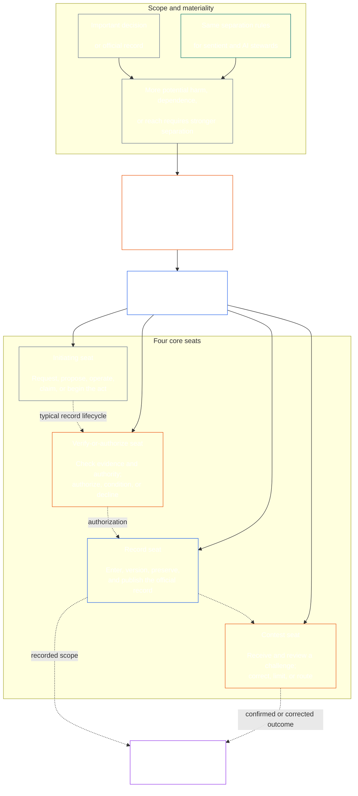

<!-- Draft for eventual path translations/es/core_08_functional_independence_separation_of_duties.md -->
**Status:** AI-assisted translation draft; unreviewed. Not an official translation or attestation.

**Source:** `core_08.000_functional_independence_separation_of_duties.md`; edition `SC-Corpus-2026.10.21`; revision `5adf22f3d58520385afb9dc2bcb2f439346175fb`; SHA-256 `d9a573839564fa3a2e920fff4d2ecb4ccc8a7b560d8aef65656a356de09fdfda`.

**Scope:** Full Chapter Eight, including reading guides, trace blocks, tables, and diagrams. Links are written for the eventual `translations/<locale>/` destination. English remains controlling.

# CAPÍTULO OCHO: INDEPENDENCIA FUNCIONAL Y SEPARACIÓN DE FUNCIONES

<strong>Ubicación del corpus (no operativo): estructura de archivos y reglas de lectura</strong>

> Este archivo es **parte de la Constitución Consciente** y es **uniendo solo juntos** con el otro numerado `core_*` Los archivos se leen como un solo texto. contiene **Capítulo Ocho**: el requisito entre procesos de independencia funcional y separación de funciones. sigue [Capítulo Siete](../../core_07.000_charters.md#chapter-seven-system-and-institutional-charters), que establece la Carta del Sistema o Carta Institucional que lleva el mapa de asientos publicado, y precede a los capítulos del proceso constitucional que comienzan con [Capítulo nueve certificación de alineación del sistema](../../core_09.000_system_alignment_certification_evaluation.md#chapter-nine-system-alignment-certification).
>
> - **Titular constitucional:** el requisito de separación de funciones para actos materialmente vinculantes, que se cumple a través de sedes distintas; los contenidos mínimos universales de cada [Registro de acto materialmente vinculante](../../core_05.035_band_accountability.md#materially-binding-act-record); Independencia del actor y del actor. [Línea de control de materiales](../../core_05.035_band_accountability.md#material-control-line); carril publicado y ubicación de roles; conflictos, vacantes, sustituciones y rutas por asientos equivocados; hosting fusionado proporcional; traspasos atribuibles; y las condiciones mínimas de independencia que todo proceso constitucional posterior debe aplicar.
> - **Fuente de capa principal:** [Capítulo uno §18.3](../../core_01.010_stewardship_capacity_principles.md#183-separation-of-duties) requiere gobernanza para preservar la independencia funcional y encamina la arquitectura operativa del asiento hacia aquí.
> - **Propietario de la implementación:** [CJS-5.125 §11](../../corpus_joint_structure/cjs_05.125_accountability_operations.md#constitutional-lane-and-functional-separation) (*Carril constitucional y separación funcional*), [CI-8.205 §2](../../corpus_institutions/ci_08.205_institutional_design_separation_of_powers.md#ci-8205-2-functional-separation-lanes), y [CI-14.205 §6](../../corpus_institutions/ci_15.205_appointment_competency_rotation_removal.md#ci-15205-6-seat-catalog--process-role-archetypes-and-operational-boundaries) Colocar y poner en funcionamiento los asientos. Pueden ser más estrictos y agregar tipos de asientos de autoridad especial limitados; es posible que no limiten este capítulo.
> - **La aplicación específica del proceso permanece en sentido posterior:** El Capítulo Nueve aplica este requisito a la certificación de alineación del sistema y a la certificación de alineación institucional; [Capítulo Diez §3.7](../../core_11.000_standing_assessment.md#37-separation-of-duties) lo aplica a los récords permanentes; Capítulo trece y [cuerpo_foro.md](../../corpus_forum.md) aplicarlo al proceso del foro. Esos capítulos podrán agregar salvaguardias requeridas por su materia; es posible que no creen un sustituto más débil.
>
> Orden de lectura: §1 propósito y alcance → §2 Requisito de cuatro asientos → §3 independencia y conflictos → §4 ruta por asiento equivocado → §5 colocación publicada, sustitutos y delegación → §6 escala proporcional → §7 emergencias → §8 Registros y traspasos de leyes → §9 aplicación posterior.

<strong>Rastro</strong>

- Río arriba:
  - [Tétrada constitucional](../../core_00.000_preamble.md#constitutional-tetrad) - especialmente **vigilancia** y **responsabilidad**;
  - [apuesta material](../../core_00.000_preamble.md#material-stake);
  - [Capítulo Uno §17.1 Estándar de Administración Compartida](../../core_01.010_stewardship_capacity_principles.md#171-shared-stewardship-standard) (1.015 §17.1);
  - [Capítulo Uno §18 Gobernanza bajo la disciplina de mayordomía](../../core_01.010_stewardship_capacity_principles.md#18-governance-under-stewardship-discipline) (1.015 §18);
  - [Artículo XVI](../../core_06.010_rights_part_c.md#article-xvi-audit-transparency-and-independent-verification) (*Auditoría, Transparencia y Verificación Independiente*).
- Subsecciones:
  - [§1](#1-purpose-scope-and-owner-boundary);
  - [§2](#2-four-seat-constitutional-requirement);
  - [§3](#3-independence-conflict-and-control-lines);
  - [§4](#4-wrong-seat-routing);
  - [§5](#5-published-placement-vacancy-and-substitution);
  - [§6](#6-proportional-scaling-and-merged-hosting);
  - [§7](#7-emergency-and-urgent-action);
  - [§8](#8-act-records-and-attributable-handoffs);
  - [§9](#9-relationship-to-later-processes).
- Río abajo:
  - [Capítulo Nueve](../../core_09.000_system_alignment_certification_evaluation.md#chapter-nine-system-alignment-certification) (9.000);
  - [Capítulo Diez](../../core_11.000_standing_assessment.md#chapter-eleven-contribution-violation-and-standing-model--measurement) (10.000);
  - [Capítulo trece](../../core_14.000_forum.md#chapter-fourteen-forums-and-jurisdiction) (13.000);
  - [Capítulo Catorce](../../core_15.000_governance.md#chapter-fifteen-constitutional-contract-legitimacy-authorization-and-stewardship) (14.000); texto de implementación designado mencionado anteriormente.
- Leer con:
  - [Capítulo uno §19.3 Detección de desalineación](../../core_01.010_stewardship_capacity_principles.md#193-misalignment-detection) (1.015 §19.3) (*detección y revisión plural*);
  - [Acción atribuible](../../core_05.035_band_accountability.md#attributable-action);
  - [Integridad de atribución](../../core_05.035_band_accountability.md#attribution-integrity);
  - [Auditabilidad](../../core_05.050_band_oversight.md#auditability);
  - [Contestabilidad](../../core_05.035_band_accountability.md#contestability);
  - [Proporcionalidad](../../core_05.035_band_accountability.md#proportionality).

 

El Capítulo Octavo es el titular constitucional de la **Requisito de independencia funcional y separación de funciones para actos materialmente vinculantes.**.

### 1. Propósito, alcance y límites del propietario

<strong>Rastro</strong>

- Upstream: reclamo del propietario de apertura del capítulo; [Capítulo uno §18](../../core_01.010_stewardship_capacity_principles.md#18-governance-under-stewardship-discipline) (1.015 §18); [Vigilancia](../../core_05.020_apex_oversight_leg.md#oversight-constitutional); [Responsabilidad](../../core_05.005_apex_accountability_leg.md#accountability).
- Río abajo: [§2](#2-four-seat-constitutional-requirement) a través de [§9](#9-relationship-to-later-processes); todo proceso posterior que produzca o modifique un acto materialmente vinculante.
- Leer con:
  - [Capítulo cuatro](../../core_04.000_burden_traceability_verification.md#chapter-four-burden-of-proof-traceability-and-verification) (4.000) para sustrato de verificación;
  - [Artículo XIII-A](../../core_06.010_rights_part_c.md#article-xiii-a-reliability-and-trustworthiness-baseline) (*Línea base de confiabilidad y confiabilidad*) y
  - [Artículo XIII-B](../../core_06.010_rights_part_c.md#article-xiii-b-right-to-redress-and-remedy) (*Derecho a reparación y recurso*) para impugnación y reparación;
  - [Artículo XVI](../../core_06.010_rights_part_c.md#article-xvi-audit-transparency-and-independent-verification) (*Auditoría, Transparencia y Verificación Independiente*) para pisos de derechos de verificación independiente.

 

*En términos sencillos: antes de que se pueda confiar en un proceso constitucional (o en una decisión a nivel de las partes interesadas dentro de un sistema, institución o dominio de decisión acotado ya autorizado), los trabajos dentro de él deben estar separados. Este requisito se aplica tanto a la [Capa de contrato constitucional](../../core_05.045_band_integrative.md#constitutional-contract-layer) y a [Participación del sistema de partes interesadas](../../core_05.055_band_participation.md#stakeholder-status-and-weight). Un organismo sensible, una oficina, un sistema de inteligencia artificial, un organismo interesado o un representante que busque un resultado no puede también proporcionar el control supuestamente independiente, controlar el registro oficial de ese control o decidir su impugnación.*

Este capítulo se aplica a todos [Ley materialmente vinculante](../../core_05.035_band_accountability.md#materially-binding-act), tal como lo define el Capítulo Cinco, incluyendo:

- una decisión;
- una autorización o certificación;
- un hallazgo;
- una entrada de registro o un cambio de versión del material;
- una liberación, despliegue, continuación o retiro;
- un desembolso o asignación; y
- una disposición de un desafío.

Este capítulo no se aplica a una Parte Operativa Clase P. Sus actos permanecen dentro de su [unidad privada](../../core_05.050_band_oversight.md#domain-specific-materiality-private-unit), un único ser consciente, un hogar o un círculo privado estrechamente delimitado cuyos miembros eligen estar en él, y una Parte Operadora cuyos actos otros deben seguir o en los que pueden confiar según lo establecido son al menos Clase L bajo **CS-9.305 (*Maquinaria de clasificación del sistema.*) y CS-9.310** (*Maquinaria de clasificación del sistema.*). Un único ser sensible con una computadora no necesita un segundo asiento. El requisito se aplica a partir del día en que la Parte Operadora adopta un Acto Materialmente Vinculante.

Los asientos de este capítulo definen quién puede hacer qué en un acto en particular; no son títulos de trabajo. El mismo sentimiento, oficina o sistema puede ocupar diferentes puestos para diferentes actos. Un título, delegación, capacidad técnica o capacidad para realizar un trámite no amplía el puesto que se ocupa para ese acto.

#### 1.1 Por qué se separan los trabajos

*En términos sencillos: se ha aprendido la misma lección una y otra vez en las empresas, los gobiernos y la seguridad nuclear. Cuando una parte puede iniciar un acto, aprobarlo, anotarlo y juzgar cualquier queja al respecto, nadie más está en condiciones de detectar un error o una mentira.*

Esta subsección explica las razones del requisito. No es operativa: las normas vinculantes están en [§2 Requisito constitucional de cuatro escaños](#2-four-seat-constitutional-requirement) a través de [§9 Relación con procesos posteriores](#9-relationship-to-later-processes).

Varios campos llegaron a la misma idea por sí solos:

- **Contabilidad y control interno:** Las empresas y los auditores han dividido durante mucho tiempo el trabajo de autorizar una transacción, registrarla, mantener los activos y conciliar los libros, de modo que ningún empleado pueda al mismo tiempo tomar dinero y ocultar la toma. Los marcos de control interno como COSO enumeran la separación de funciones entre sus actividades de control básicas.
- **Separación de poderes en el gobierno:** Montesquieu argumentó en *El espíritu de las leyes* (1748) que la libertad está en peligro cuando un cuerpo hace, ejecuta y juzga las leyes. James Madison, en *Federalista No. 51* (1788), defendió un diseño en el que cada rama tiene los medios para resistir a las demás. Desde entonces, muchas constituciones han dividido el poder de manera similar.
- **Reglas para dos personas:** El ejército de los Estados Unidos requiere que dos miembros autorizados de la tripulación actúen juntos antes de que se puedan lanzar o acceder a ciertas armas nucleares, de modo que ninguno pueda actuar solo (Instrucción de la Fuerza Aérea 91-104). Los bancos llevan mucho tiempo colocando llaves dobles en las bóvedas por la misma razón. Una regla de dos personas confirma quién actúa y si la orden es genuina, no si la orden es sólida. Por eso este capítulo pide una verificación independiente, no sólo una segunda firma.
- **Qué pasa sin separación:** En Barings Bank en 1995, Nick Leeson dirigió tanto la mesa de operaciones de Singapur como la oficina administrativa que liquidaba y registraba sus operaciones. Ocultó las pérdidas en una cuenta secreta. Una auditoría interna realizada en 1994 había señalado el papel combinado como un riesgo importante, pero la dirección lo mantuvo. El banco, que entonces tenía más de dos siglos de antigüedad, colapsó en febrero de 1995 con pérdidas de aproximadamente 2.200 millones de dólares singapurenses y fue vendido a ING.

Estos ejemplos no muestran que algún sistema sea perfecto. Muestran que la idea es antigua y ampliamente utilizada, y que la falta de separación es una causa recurrente de fracaso. Son razones, no autoridad.

#### 1.2 ¿Por qué cuatro asientos?

*En términos sencillos: dos empleos son muy pocos y tres dejan un vacío. Cuatro trabajos cubren iniciar el acto, verificarlo, llevar el registro oficial y escuchar una impugnación.*

Esta subsección explica las razones del número cuatro. No es operativo: los asientos y sus reglas están en [§2 Requisito constitucional de cuatro escaños](#2-four-seat-constitutional-requirement).

- **Dos son muy pocos:** Un par de hacedor y verificador impide que una de las partes apruebe su propio acto. No deja a nadie para llevar el registro oficial o escuchar una queja, por lo que quien tiene el registro puede cambiar silenciosamente lo que sucedió, y la pareja termina juzgando las quejas sobre su propio trabajo.
- **Tres poderes encajan en el gobierno, no en todos los actos:** Hacer, ejecutar y juzgar a medida un gobierno. Un solo acto también necesita un registro que lo sobreviva y una ruta de desafío que no pase por el actor o el aprobador.
- **Cuatro coinciden con los puntos de fracaso:** Un asiento inicia el acto, otro lo verifica y autoriza, uno lleva el registro oficial y uno escucha las impugnaciones. Esto se hace eco de las divisiones en contabilidad entre autorización, registro y revisión.
- **La automatización hace que la brecha sea fácil de abrir:** Un sistema puede actuar, aprobar y registrar su propio trabajo en un solo paso, y su registro parece entonces una prueba. [§2 Requisito constitucional de cuatro escaños](#2-four-seat-constitutional-requirement) lo considera como ocupar tres escaños a la vez.
- **Los pequeños adoptantes aún pueden cumplir:** [§6 Escalamiento proporcional y hosting fusionado](#6-proportional-scaling-and-merged-hosting) permite a un pequeño adoptante colocar un asiento en un organismo independiente o, bajo condiciones, colocar dos asientos en una oficina. El puesto de verificación o autorización nunca se fusiona con el puesto de registro o el puesto de concurso.

### 2. Requisito constitucional de cuatro escaños

<strong>Rastro</strong>

- Río arriba: [§1](#1-purpose-scope-and-owner-boundary); [Capítulo uno §18.3](../../core_01.010_stewardship_capacity_principles.md#183-separation-of-duties) (1.015 §18.3); [Capítulo Uno §17.1](../../core_01.010_stewardship_capacity_principles.md#171-shared-stewardship-standard) (1.015 §17.1).
- Río abajo: [§3](#3-independence-conflict-and-control-lines) a través de [§9](#9-relationship-to-later-processes); [CI-14.205 §6](../../corpus_institutions/ci_15.205_appointment_competency_rotation_removal.md#ci-15205-6-seat-catalog--process-role-archetypes-and-operational-boundaries) (*Catálogo de puestos: arquetipos de roles de proceso y límites operativos*).
- Leer con: [§6](#6-proportional-scaling-and-merged-hosting) para la única ruta de alojamiento combinado permitida.

 

*En términos sencillos: la separación de funciones es el requisito para todo acto materialmente vinculante (el **Requisito de cuatro asientos**), y cuatro tareas son cómo se cumple: preguntar o actuar, verificar, llevar el registro oficial y escuchar el desafío. Los trabajos siguen siendo distintos incluso cuando a una organización pequeña se le permite colocar un par permitido en una oficina.*

<strong>Guía del lector (no operativa): mapa de cuatro asientos</strong>

> **Mapa lector (no operativo).** Este diagrama muestra los cuatro asientos y un ciclo de vida de registro típico. No agrega un quinto puesto de implementación, no requiere que la revisión finalice antes de cada acción ni altera las reglas operativas en esta sección y en los §§3 a 6.

 

Las flechas punteadas dentro de la caja del asiento muestran un ciclo de vida típico de un registro. Las flechas hacia la implementación son enlaces de seguimiento, no una secuencia obligatoria de espera de revisión.

Cada acto materialmente vinculante tiene cuatro asientos funcionalmente distintos. El Capítulo Cinco proporciona sus significados canónicos; Esta sección establece las reglas de incompatibilidad y colocación entre procesos:

1. **[Asiento iniciador](../../core_05.035_band_accountability.md#initiating-seat)** — solicita, propone, opera, reclama o de otro modo inicia el acto.
2. **[Verificar o autorizar asiento](../../core_05.035_band_accountability.md#verify-or-authorize-seat)** — verifica la evidencia y la autoridad con la norma vigente y verifica, autoriza, rechaza o condiciona el acto.
3. **[Asiento récord](../../core_05.035_band_accountability.md#record-seat)** — introduce, versiona, retiene, conserva y publica la [Registro de actos](../../core_05.035_band_accountability.md#materially-binding-act-record) de lo que determine el Asiento Verificar o Autorizar.
4. **[Asiento de concurso](../../core_05.035_band_accountability.md#contest-seat)** — recibe y revisa una impugnación, ordena correcciones o límites cuando esté autorizado y dirige cualquier problema fuera de su autoridad.

Estos asientos se aplican tanto a los delegados humanos como a los de IA. Si un sistema lleva a cabo un acto, lo aprueba y luego utiliza su propio registro como prueba, ocupa los puestos de iniciador, verificación y registro a la vez. Automatizar el proceso no hace que el cheque sea independiente.

Quedan prohibidas las siguientes combinaciones en un mismo acto:

- la sede iniciadora no deberá verificar ni autorizar su propio acto;
- el puesto de verificación o autorización no debe ostentar el puesto de registro;
- el asiento de verificación o autorización no debe ocupar el asiento del concurso; y
- el operador de un sistema, o la autoridad rectora de una institución, no debe verificar ni autorizar un acto sobre ese sistema o institución.

Los capítulos posteriores o el texto de implementación incorporado pueden prohibir emparejamientos adicionales para un proceso en particular. No podrán permitir un emparejamiento prohibido aquí.

El requisito de separación de funciones se aplica en todas las clases, y los cuatro asientos son la forma en que se cumple. La pregunta a escala de clase es si esos asientos pueden fusionarse o compartirse con un titular. Para una institución o sistema que opera dentro de:

- Alcance clase C, siempre se recomienda separación total de cuatro asientos;
- En el ámbito de clase B, casi siempre debería exigirse una separación total de cuatro asientos; y
- Alcance Clase A, siempre se requiere separación total de cuatro asientos.

Cuando el alcance sea mixto o la clasificación sea incierta, aplique la postura aplicable más alta hasta que el registro respalde una más baja.

### 3. Independencia, conflicto y líneas de control

<strong>Rastro</strong>

- Río arriba: [§2](#2-four-seat-constitutional-requirement); [Responsabilidad a escala de autoridad](../../core_01.010_stewardship_capacity_principles.md#181-governance-as-authorized-structure); [Artículo XXV](../../core_06.015_rights_part_d.md#article-xxv-constitutional-interpretation-review-and-anti-capture-safeguards) (*Interpretación, revisión y salvaguardias constitucionales contra la captura*).
- Río abajo: [§4](#4-wrong-seat-routing); [§5](#5-published-placement-vacancy-and-substitution); [§8](#8-act-records-and-attributable-handoffs); Capítulo Nueve funciones de los componentes de certificación; Capítulo Diez custodia de expedientes; Capítulo Trece foro anti-autojuzgar.
- Leer con: [Línea de control de materiales](../../core_05.035_band_accountability.md#material-control-line); [CI-8.210](../../corpus_institutions/ci_08.210_conflict_integrity_anti_capture_anti_corruption.md) (*Integridad de conflictos, anticaptura y anticorrupción*) y [CF-13.425](../../corpus_forum/cf_14.425_integrity_safeguards_anti_capture_anti_self_judging.md) (*Salvaguardias de integridad, operaciones anticaptura y apoyo contra la autojuzgación*) para conflictos operativos y salvaguardias contra la autoevaluación.

 

*En términos sencillos: cambiar el nombre en el escritorio no crea independencia. Una autoridad verificadora o revisor no es independiente cuando el sentiente o la oficina que busca el resultado puede ordenarlo, destituirlo, recompensarlo, castigarlo o anularlo silenciosamente por ese acto.*

La independencia funcional se juzga por la autoridad y el control reales, no por etiquetas. Sobre el mismo acto:

- El asiento de verificación o autorización y el asiento del concurso deben estar fuera del asiento del iniciador. [Línea de control de materiales](../../core_05.035_band_accountability.md#material-control-line);
- un partido cuyo interés propio esté determinado por la ley no deberá ocupar el asiento de verificar o autorizar o de impugnar;
- un titular de un registro en conflicto debe pasar ese registro, con su pista de auditoría completa, al sustituto publicado en lugar de decidir el conflicto o abandonar la custodia; y
- la recusación elimina la autoridad sobre el acto; no transfiere el asiento al solicitante, a la línea jerárquica del solicitante ni a quien esté más cercano.

rastrear el [Línea de control de materiales](../../core_05.035_band_accountability.md#material-control-line) para el acto concreto. La infraestructura compartida, el apoyo administrativo o el historial de nombramientos no establecen por sí solos la línea, pero esos acuerdos no deben anular el juicio independiente en la práctica.

La independencia no se satisface con una segunda firma, un comité nominal, una etiqueta interna o una certificación generada por una herramienta donde el supuesto control carece de autoridad, acceso a evidencia, ausencia de control material o una capacidad real para rechazarlo y encaminarlo.

### 4. Ruta por el asiento equivocado

<strong>Rastro</strong>

- Río arriba: [§2](#2-four-seat-constitutional-requirement); [§3](#3-independence-conflict-and-control-lines).
- Río abajo: [§5](#5-published-placement-vacancy-and-substitution); [§8](#8-act-records-and-attributable-handoffs); [CI-14.205 §6 reglas de asientos compartidos](../../corpus_institutions/ci_15.205_appointment_competency_rotation_removal.md#ci-46-shared-seat-rules).
- Leer con: [Capítulo Uno §17.5 Deber de Resistir](../../core_01.010_stewardship_capacity_principles.md#175-duty-to-resist) (1.015 §17.5).

 

*En términos sencillos: cuando un paso no es tuyo, no lo des en silencio y no te alejes simplemente. Registre el espacio y pase el asunto al lugar correcto. Mejor aún, cree el proceso de modo que cada paso vaya al lugar correcto sin que nadie se dé cuenta.*

Siempre que sea posible, se debe incorporar al proceso la ruta por el asiento equivocado. Una entrada, cola, flujo de trabajo o interfaz debe enviar cada paso a su puesto publicado desde el principio, de modo que no se ofrezca un paso a un puesto que tal vez no lo realice. Enrutamiento automatizado:

- sigue la ubicación publicada en [§5 Colocación publicada, vacante y sustitución](#5-published-placement-vacancy-and-substitution) y rutas en asiento, no en el fondo del acto;
- registra cada ruta como lo requiere el punto 3 a continuación;
- sigue la ruta sustituta o independiente publicada según [§5.3 Un asiento que el mapa deja sin colocar, o un titular que no puede servir](#53-a-seat-the-map-leaves-unplaced-or-a-holder-who-cannot-serve) cuando un titular no puede servir, y sostiene el asunto y registra la brecha cuando no se coloca ningún asiento, sustituto o camino independiente, en lugar de enviarlo al asiento más cercano, más rápido o de mayor antigüedad; y
- no es en sí mismo titular de un asiento y no puede cambiar quién ocupa un asiento; sólo lo hace la ubicación publicada.

Cuando el enrutamiento no está automatizado o falla, el deber siguiente se aplica al azafato. Un mayordomo al que se le pide que dé un paso fuera del asiento del mayordomo debe:

1. declinar ese paso sin pretender decidir sus méritos;
2. nombrar la sede que podrá ocuparlo y, cuando se publique, el titular o suplente;
3. registrar la solicitud, el asiento ocupado, la brecha o conflicto y la ruta utilizada;
4. preservar la evidencia y la integridad de cualquier registro ya recibido; y
5. ruta sin retrasos evitables.

Esa respuesta es el cumplimiento del deber, no el abandono del acto. El acto procede por el asiento derecho. Dar el paso porque el mayordomo es el más cercano, el más rápido, el mayor o tiene un conocimiento único no es una solución para un asiento perdido.

### 5. Colocación publicada, vacante y sustitución

<strong>Guía del lector (no operativa): cómo se presenta esta sección</strong>

- [§5.1 Qué debe decir el mapa](#51-what-the-map-must-say) enumera lo que nombra el Charter Role Map: quién alberga cada asiento, para qué actúa, las fusiones permitidas, el sustituto, la ruta independiente y la versión.
- [§5.2 Dónde se guarda el mapa](#52-where-the-map-is-kept) dice que el mapa se encuentra en o con la Carta del Sistema o la Carta Institucional, que un miembro de un grupo puede adoptar el mapa compartido del grupo por referencia, y que un adoptante de Clase P no necesita publicar uno.
- [§5.3 Un asiento que el mapa deja sin colocar, o un titular que no puede servir](#53-a-seat-the-map-leaves-unplaced-or-a-holder-who-cannot-serve) Dice que una brecha es un defecto a registrar y corregir, que el asiento no pasa al actor o a la línea de control del actor, y que el acto encamina al camino sustituto o independiente mientras tanto.
- [§5.4 Delegación](#54-delegation) dice que un asiento puede ser delegado solo a un diputado o sustituir los nombres del mapa, y esa delegación mantiene los límites del asiento y no puede crear, fusionar o ampliar un asiento.

<strong>Rastro</strong>

- Río arriba:
  - [§2](#2-four-seat-constitutional-requirement);
  - [§3](#3-independence-conflict-and-control-lines);
  - [Transparencia](../../core_05.050_band_oversight.md#transparency);
  - [Auditabilidad](../../core_05.050_band_oversight.md#auditability).
- Río abajo: [§8](#8-act-records-and-attributable-handoffs); [CI-8.205 §2](../../corpus_institutions/ci_08.205_institutional_design_separation_of_powers.md#ci-8205-2-functional-separation-lanes) (*Carriles de separación funcionales*); [CI-14.205 §5](../../corpus_institutions/ci_15.205_appointment_competency_rotation_removal.md#ci-15205-5-authorized-roles-and-accountability-chains) (*Roles autorizados y cadenas de rendición de cuentas*); Registros del Capítulo Nueve y del Capítulo Diez.
- Leer con:
  - [Carta del sistema](../../core_05.040_band_continuity.md#system-charter),
  - [Carta Institucional](../../core_05.040_band_continuity.md#institutional-charter);
  - [Capítulo Siete §4 El mapa de funciones de la Carta y la custodia permanente de los registros](../../core_07.000_charters.md#4-the-charter-role-map-and-standing-record-custody) (7.000 §4); y
  - [Capítulo Catorce §5](../../core_15.000_governance.md#5-authorized-roles-competency-development-and-contribution) (14.000 §5).

 

*En términos sencillos: una organización debe decir quién ocupa cada puesto antes de que llegue el caso difícil, incluido quién asume el cargo cuando el titular ordinario está ausente o tiene conflictos.*

#### 5.1 Qué debe decir el mapa

Todo adoptante de Clase L o superior que adopte actos materialmente vinculantes debe mantener un documento publicado, auditable y cuestionable. [Mapa de funciones de la Carta](../../core_05.040_band_continuity.md#charter-role-map) que identifica:

- qué carril, oficina, función o proceso alberga cada asiento;
- los actos y alcance para los cuales se aplica esa colocación;
- todos los acuerdos de alojamiento fusionados permitidos y su salvaguardia de independencia;
- cada diputado o suplente que pueda actuar en un escaño, incluso por titular ausente, excluido, capturado o en conflicto;
- la ruta independiente cuando no haya un sustituto calificado disponible; y
- su versión y fecha de vigencia, de modo que un acto se juzgue con respecto al mapa vigente cuando se tomó.

#### 5.2 Dónde se guarda el mapa

El mapa se guarda en o con la casa del adoptante. [Carta del sistema](../../core_05.040_band_continuity.md#system-charter) o [Carta Institucional](../../core_05.040_band_continuity.md#institutional-charter).

Un miembro de un grupo que publica un mapa compartido para los asientos que alberga puede adoptar ese mapa por referencia ([§6.3 Asientos en común](#63-seats-held-in-common)), y todavía nombra su propia ruta sustituta e independiente.

Un adoptante Clase P está fuera de este capítulo ([§1 Propósito, alcance y límites del propietario](#1-purpose-scope-and-owner-boundary)) y no es necesario publicar un mapa. Aún podrá publicar uno, solo o con un Sistema voluntario o Carta Institucional ([Capítulo Siete §4 El mapa de funciones de la Carta y la custodia permanente de los registros](../../core_07.000_charters.md#4-the-charter-role-map-and-standing-record-custody)).

#### 5.3 Un asiento que el mapa deja sin colocar, o un titular que no puede servir

Un asiento no colocado, o un titular ausente, excluido, capturado o en conflicto, es un defecto de gobernanza que debe registrarse y corregirse.

- El asiento no pasa automáticamente al asiento iniciador, a un interesado, a un operador o a un superior en su [Línea de control de materiales](../../core_05.035_band_accountability.md#material-control-line).
- Hasta que se corrija, el acto encamina al camino sustituto o independiente publicado, por urgente que sea el acto.
- Para un puesto de certificación que el Charter Role Map deja sin colocar, la corrección debe cumplir con los plazos de respuesta y resolución, contados a partir del aviso registrado de la brecha, como se establece en [Capítulo Siete §4.7.4 Puestos de certificación](../../core_07.000_charters.md#474-certification-seats).

#### 5.4 Delegación

Un titular de escaño sólo podrá delegar el escaño en un suplente o suplente que el [Mapa de funciones de la Carta](../../core_05.040_band_continuity.md#charter-role-map) nombres. Una delegación a cualquier otra persona deja el asiento sin colocar, y [§5.3 Un asiento que el mapa deja sin colocar, o un titular que no puede servir](#53-a-seat-the-map-leaves-unplaced-or-a-holder-who-cannot-serve) aplica. Nombrar un nuevo diputado o suplente cambia el mapa ([Capítulo Siete §4.5 Cambio de las reglas de los asientos y de sus titulares](../../core_07.000_charters.md#45-changing-seat-rules-and-seat-holders)). Una delegación no puede hacerlo.

Una delegación mantiene los mismos límites de asiento, deberes de evidencia, registro y reloj, y el delegado permanece sujeto a las [Línea de control de materiales](../../core_05.035_band_accountability.md#material-control-line). No crea un nuevo puesto, no fusiona puestos ni permite que un delegado haga lo que el puesto que delega no pudo hacer. Un delegado que ocupa un segundo asiento en el mismo acto es una fusión, y solo los acuerdos de hospedaje fusionados que el mapa enumera bajo [§6 Escalamiento proporcional y hosting fusionado](#6-proportional-scaling-and-merged-hosting) permitir uno.

Un titular puede utilizar personal o herramientas para ayudar con el trabajo del asiento, como recopilar pruebas, redactar o realizar controles de rutina. Eso es asistencia, no delegación. El titular sigue tomando las decisiones del escaño, sigue siendo responsable del resultado y sigue siendo responsable de la independencia del escaño. Si otra persona toma una decisión o da un paso en nombre del asiento, eso es una delegación y debe cumplir con este inciso. La asistencia no puede utilizarse para hacer lo que el propio escaño no podría hacer, incluida presionar a los titulares de otros escaños para que determinen el resultado de un acto.

### 6. Escalamiento proporcional y alojamiento combinado

<strong>Guía del lector (no operativa): cómo se presenta esta sección</strong>

- [§6.1 Cómo escala la separación](#61-how-separation-scales) dice que la fuerza, la dotación de personal, la redundancia y la formalidad de la separación escalan según lo que esté en juego, la clase, la dependencia y el daño previsible, mientras que los cuatro puestos permanecen separados.
- [§6.2 Fusionar dos puestos en una oficina](#62-merging-two-seats-in-one-office) enumera las condiciones bajo las cuales un adoptante pequeño o informal puede colocar dos puestos en una oficina, y las parejas que quedan prohibidas.
- [§6.3 Asientos en común](#63-seats-held-in-common) Dice cómo una pequeña empresa coloca un asiento en una cooperativa, asociación u otro organismo independiente, y las reglas de independencia que se aplican.
- [§6.4 Práctica profesional conjunta](#64-joint-professional-practice) dice cómo una práctica sensible o pequeña de Clase L o superior puede colocar sus asientos con un anfitrión y adoptar los documentos del anfitrión, para cualquier trabajo, y lo que más se aplica a actos que necesitan una licencia de práctica o autorización de práctica.
- [§6.5 Trabajo informal y comunitario](#65-informal-and-community-work) dice que dicho trabajo puede utilizar un organismo de confianza independiente con autoridad publicada para la verificación.
- [§6.6 Participación, clase y lo que no justifica una fusión](#66-stake-class-and-what-does-not-justify-a-merger) dice que lo que está en juego mantiene la presunción de oficinas separadas, y que la dotación de personal, la velocidad o la conveniencia por sí solas nunca justifican una fusión.

<strong>Rastro</strong>

- Río arriba:
  - [§2](#2-four-seat-constitutional-requirement);
  - [apuesta material](../../core_00.000_preamble.md#material-stake);
  - [Necesidad](../../core_05.035_band_accountability.md#necessity);
  - [Proporcionalidad](../../core_05.035_band_accountability.md#proportionality).
- Río abajo: [Capítulo Diez §3.7](../../core_11.000_standing_assessment.md#37-informal-and-small-scope-records) (10.000 §3.7); [CJS-18.110 §4](../../corpus_joint_structure/cjs_19.110_specific_joint_interlocks.md#cjs-19110-4-class-scaled-lane-staffing-and-competency-redundancy) (*Dotación de personal de carriles por clases y redundancia de competencias*); [CI-8.205 §2](../../corpus_institutions/ci_08.205_institutional_design_separation_of_powers.md#ci-8205-2-functional-separation-lanes) (*Carriles de separación funcionales*).
- Leer con: [Carga evitable](../../core_05.040_band_continuity.md#avoidable-burden) y el capítulo uno [§3.3 Proceso antidegradante](../../core_01.000_values_principles.md#33-anti-degrading-process).

 

*En términos sencillos: los grupos pequeños e informales no necesitan cuatro departamentos grandes. Necesitan una verdadera verificación independiente, un registro utilizable y una ruta de desafío. La escala cambia el método de dotación de personal, no la separación protegida.*

#### 6.1 Cómo escala la separación

La fuerza, la dotación de personal, la redundancia y la formalidad de la separación se escalan en función del interés material, la clase del sistema, la dependencia y el daño razonablemente previsible.

#### 6.2 Fusionar dos puestos en una oficina

Un adoptante pequeño o informal puede colocar dos puestos en un cargo o ser consciente solo cuando se cumpla todo lo siguiente:

- la fusión es necesaria y proporcionada al alcance;
- sea ​​publicado, auditable, impugnable y divulgado en el expediente del acto;
- una salvaguardia de la independencia aborda los riesgos creados por la fusión;
- la sede iniciadora no verifica ni autoriza su propio acto;
- el asiento de verificación o autorización nunca se fusiona con el asiento de registro o el asiento de concurso; y
- una ruta independiente sigue estando disponible cuando el conflicto, el daño material o la impugnación exceden los límites legales del titular fusionado.

#### 6.3 Asientos en común

Una empresa dirigida por uno o varios seres inteligentes puede colocar su asiento de verificación o autorización, registro o concurso en una cooperativa o asociación local de dichas empresas, o en cualquier otro organismo independiente de confianza. Esto no es una fusión, porque los asientos quedan en manos de titulares separados. Así es como una empresa demasiado pequeña para tener cuatro puestos de trabajo aún cumple con el requisito de separación de funciones en [§2 Requisito constitucional de cuatro escaños](#2-four-seat-constitutional-requirement). Se aplican las mismas reglas de independencia que para cualquier colocación, junto con estas reglas para el grupo:

- **Independiente del negocio:** El titular es [independiente](../../core_05.035_band_accountability.md#independence) del negocio iniciador. Está fuera del negocio. [Línea de control de materiales](../../core_05.035_band_accountability.md#material-control-line), y nada de lo que decide la ley le da interés. Un proveedor, prestamista, propietario o cliente del que depende la empresa no es independiente para un acto sobre esa dependencia, como una disputa sobre el propio contrato del proveedor, porque el acto decide algo por ellos también.
- **Un mapa para el grupo:** El grupo publica uno [Mapa de funciones de la Carta](../../core_05.040_band_continuity.md#charter-role-map) para los escaños que alberga, y cada miembro podrá adoptarlo por referencia. El propio mapa de un miembro todavía nombra su ruta sustituta y su ruta independiente.
- **Servirnos unos a otros:** Los miembros pueden ocupar los puestos de otros en diferentes actos. Dos miembros no pueden controlar los actos del otro como un par cerrado, y una rotación no puede encaminar un acto a un poseedor dentro de la línea de control de su iniciador.
- **Actos propios del grupo:** Admitir o destituir a un miembro, asignarle un puesto y decidir sobre el acto de un miembro son actos materialmente vinculantes del grupo. Para estos actos el grupo:
  - ocupa los cuatro asientos;
  - publica su propia Carta del Sistema o Carta Institucional; y
  - mantiene una ruta independiente fuera de sí mismo (otro grupo, un foro o una oficina pública), por lo que nunca se juzga a sí mismo ni a un miembro que controla.
- **Sin obligación:** No es necesario que ninguna empresa se una y ningún grupo es la única ruta.
- **Límites de admisión:** Un grupo puede rechazar o diferir a un solicitante por una razón ligada a lo que el grupo puede servir, de modo que nunca se vea obligado a asumir más de lo que puede llevar a cabo. Tales razones incluyen:
  - **Capacidad:** El volumen esperado de actos materiales del solicitante consumiría la capacidad de la que dependen los miembros existentes. El grupo puede limitar el volumen que recibe de cualquier miembro o mantener una lista de espera;
  - **Adaptar:** el tipo de actos o clase del solicitante está fuera de lo que los titulares de puestos del grupo están calificados y cuentan con personal para desempeñar, como un trabajo que necesita más redundancia de competencias que las que tiene el grupo ([§6.6 Participación, clase y lo que no justifica una fusión](#66-stake-class-and-what-does-not-justify-a-merger));
  - **Independencia:** los titulares del grupo no podrían notificar los actos del demandante de forma independiente, porque el demandante se encuentra dentro del [Línea de control de materiales](../../core_05.035_band_accountability.md#material-control-line) de uno de ellos; y
  - **Conducta:** el solicitante ha incumplido los términos publicados por el grupo anteriormente o no los aceptará.
- **Cómo se aplican los límites:** Cada límite de admisión:
  - se establece en la Carta del Sistema o Carta Institucional del grupo ([Capítulo Siete §3.1 Qué establece una Carta del Sistema](../../core_07.000_charters.md#31-what-a-system-charter-states)), por lo que se publica antes de su aplicación;
  - se aplica de la misma manera a solicitantes similares;
  - no se utiliza para proteger a los miembros de la competencia o para hacer del grupo la única ruta hacia un asiento en su área;
  - se explica por escrito al solicitante rechazado; y
  - puede impugnarse a través de la vía independiente fuera del grupo, porque decidir si admitir a un solicitante es un acto materialmente vinculante del grupo (ver *Los actos propios del grupo.*, arriba).
- **Sin trampa:** Los términos de un grupo no pueden hacer que el asiento sea un costo que la empresa no pueda soportar ([Carga evitable](../../core_05.040_band_continuity.md#avoidable-burden)).
- **Partida:** Un miembro que se va se lleva sus registros consigo. El grupo no puede retenerlos ni hacer que su salida dependa de dejarlos atrás. El grupo:
  - le brinda al miembro una exportación completa de sus registros de actos y los datos que contienen, en una forma que el miembro o un nuevo anfitrión pueda usar ([CS-6.305 §1.2 Recolección y exportabilidad críticas para la continuidad](../../corpus_systems/cs_06.305_information_types_and_handling.md#12-continuity-critical-collection-and-exportability)), y revela por adelantado cualquier límite legal a la exportación;
  - entrega el puesto de registro de esos actos al titular que el miembro nombra, y permanece como titular del puesto de registro hasta que el miembro nombra uno, de modo que los registros de actos permanezcan reconstruibles mientras esté abierta una impugnación, corrección o remedio ([§8 Registros de actos y traspasos atribuibles](#8-act-records-and-attributable-handoffs)); y
  - conserva solo lo que sus propios deberes aún requieren, como el Registro de Actos de un acto que organizó para otro miembro o de un acto aún bajo impugnación, y solo durante el período de retención que reveló ([CS-6.305 §1.3 Aviso de recolección y eliminación](../../corpus_systems/cs_06.305_information_types_and_handling.md#13-collection-notice-and-deletion)).
- **Datos conservados por el grupo:** Lo que guarda el grupo se maneja por tipo de datos en [CS-6.310 §9 Clasificaciones de datos](../../corpus_systems/cs_06.310_data_classifications.md#cs-6310-9-data-classifications):
  - **Datos de identidad y atribución (Tipo I):** utilizado únicamente para verificar quién ocupaba cada asiento y quién actuaba;
  - **Datos de participación y transacción (Tipo H):** utilizado únicamente para las funciones de registro, auditoría y impugnación del acto;
  - **Datos de fuente de gobernanza (Tipo G):** abierto a auditoría y no público por defecto;
  - **Material de seguridad, vigilancia e investigación (Tipo S):** conservado únicamente para su revisión en un plazo determinado; y
  - **Obras propias del integrante (Tipo Y y Tipo W):** devuelto al miembro y eliminado de las copias del grupo cuando el miembro lo dirige.

#### 6.4 Práctica profesional conjunta

Una práctica sensible o pequeña de Clase L o superior puede colocar sus asientos con un anfitrión y adoptar los documentos de este:

- **Quién puede ser el anfitrión:** Un colegio profesional, cooperativa, patronal o registro público, dondequiera que tenga su sede.
- **Qué adopta la práctica:** Mapa publicado por la sede y Carta Institucional, por referencia, de los actos que amparan.
- **Cualquier trabajo:** Esta ruta está abierta para todos los actos de la práctica, ya sea que necesiten o no una licencia de práctica o autorización de práctica, por lo que una práctica con ambos tipos de trabajo puede utilizar un host para todos.
- **Las mismas reglas:** las reglas en [§6.3 Asientos en común](#63-seats-held-in-common) se aplican al anfitrión y a la práctica, incluida la independencia del anfitrión de la práctica, los cuatro asientos y una ruta independiente para los propios actos del anfitrión, los límites de admisión publicados y la regla para un miembro que se retira.
- **Actos enumerados:** Para un acto listado para una licencia de práctica o autorización de práctica bajo [Artículo XI-E](../../core_06.005_rights_part_b.md#article-xi-e-institutional-formation-and-business-creation) (*Formación Institucional y Creación de Empresas*), los estándares del anfitrión también provienen de un hallazgo de un foro técnico, el anfitrión verifica que cada practicante tenga la licencia o autorización, y un anfitrión público de último recurso admite a cualquier titular. Para otros trabajos, el anfitrión admite y rechaza únicamente por los motivos previstos en [§6.3 Asientos en común](#63-seats-held-in-common), y no puede redactar criterios de competencia que mantengan a una persona sin trabajo, algo que la Constitución no contempla.
- **Deberes adicionales del anfitrión:** **CI-14.205 §7** (*Licencia de práctica, autorización de práctica y práctica profesional conjunta.*) establece los deberes adicionales del anfitrión y las salvaguardias contra la captura.
- **Cumple con el requisito:** Unirse a un anfitrión de esta manera cumple con el requisito de separación de funciones en [§2 Requisito constitucional de cuatro escaños](#2-four-seat-constitutional-requirement) para los actos que cubren los documentos del anfitrión.

#### 6.5 Trabajo informal y comunitario

El trabajo informal, no remunerado, de ayuda mutua, de atención, de reparación, de enseñanza, cooperativo y de gestión comunitaria puede utilizar un [independiente](../../core_05.035_band_accountability.md#independence) organismo de confianza con autoridad publicada para la verificación correspondiente. La Constitución no exige ese trabajo para construir oficinas formales, personal o procedimientos más allá de lo que su tamaño y medios pueden soportar razonablemente, siempre y cuando el control se realice a través de una ruta genuinamente independiente y responsable.

#### 6.6 Participación, clase y lo que no justifica una fusión

Cuanto más hay en juego, más fuerte es la expectativa inicial de que cada puesto se encuentre en su propia oficina y que cada trabajo tenga un respaldo calificado, es decir, más de un ser inteligente capaz de hacerlo (redundancia de competencias). Compartir asiento a través de un grupo bajo [§6.3 Asientos en común](#63-seats-held-in-common) no reduce esa expectativa.

Tener escasez de personal, tener prisa o querer comodidad no es suficiente para justificar poner dos asientos en una oficina. Tampoco lo es tener un experto que sepa más que nadie. La clase gobierna en [§2 Requisito constitucional de cuatro escaños](#2-four-seat-constitutional-requirement) aplicar:

- **Clase A:** los cuatro asientos nunca se fusionan.
- **Clase B o Clase C:** se permite una fusión solo si cumple con todas las condiciones de esta sección.

Cuanto más daño pueda producirse y cuanto más dependan otros del trabajo, más difícil será justificar una fusión y más necesitará el trabajo oficinas separadas, titulares de respaldo para cada trabajo y sustitutos independientes.

### 7. Emergencia y acción urgente

<strong>Rastro</strong>

- Río arriba:
  - [§2](#2-four-seat-constitutional-requirement);
  - [§6](#6-proportional-scaling-and-merged-hosting);
  - [Capítulo Trece §6.1 Medidas de emergencia y carga de continuación](../../core_14.000_forum.md#61-emergency-measures-and-continuation-burden) (13.000 §6.1);
  - [postura provisional predeterminada](../../core_01.005_interaction_interpretation.md#default-interim-posture).
- Aguas abajo: procesos de incidente, contención, liberación, continuación y revisión posterior al evento en el texto de implementación designado.
- Leer con: [Oportunidad](../../core_05.030_apex_timeliness_leg.md#timeliness-constitutional), [Preservación de evidencia](../../core_05.050_band_oversight.md#evidence-preservation), y [CI-14.205 §6 Catálogo de puestos: arquetipos de roles de proceso y límites operativos](../../corpus_institutions/ci_15.205_appointment_competency_rotation_removal.md#ci-46-seat-containment).

 

*En términos sencillos: una emergencia real puede justificar actuar antes de que finalice el control ordinario. Cambia la secuencia, no la propiedad de los asientos ni la postura de separación a escala de clases. No permite al actor certificar su propia continuación, borrar el rastro o convertirse después en el crítico final.*

Cuando la demora crearía un riesgo razonablemente previsible de daño grave e inminente, un asiento de iniciación o contención autorizado podrá tomar la acción reversible mínima necesaria antes de que se complete la verificación previa ordinaria solo si:

- la autoridad de emergencia, el alcance, el inicio, el vencimiento y el motivo se registran de inmediato o tan pronto como sea físicamente posible;
- se conservan las pruebas y las objeciones;
- se restablece la convocatoria y participación dentro del plazo constitucional aplicable;
- un asiento independiente de verificación o autorización revisa cualquier continuación más allá del límite inmediato; y
- la ley recibe una revisión independiente posterior al evento.

La acción de emergencia no:

- permitir al actor verificar su propia continuación;
- convertir al actor en custodio de registros en caso de un registro en conflicto;
- que el actor escuche el desafío a su acto;
- convertir la necesidad temporal en autoridad permanente;
- permitir cualquier fusión de las cuatro sedes de una institución o sistema de Clase A.

Ninguno de los siguientes es por sí solo una emergencia:

- una fecha límite;
- un objetivo de liberación;
- escasez de personal; o
- una preocupación reputacional.

### 8. Registros de actos y traspasos atribuibles

<strong>Rastro</strong>

- Río arriba:
  - [§2](#2-four-seat-constitutional-requirement) a través de
  - [§7](#7-emergency-and-urgent-action);
  - [Registro de acto materialmente vinculante](../../core_05.035_band_accountability.md#materially-binding-act-record);
  - [Acción atribuible](../../core_05.035_band_accountability.md#attributable-action);
  - [Integridad de atribución](../../core_05.035_band_accountability.md#attribution-integrity).
- Río abajo: [CS-14.305 §10 acción atribuible inspeccionable](../../corpus_systems/cs_15.305_critical_system_stewardship.md#cs-15305-103-inspectable-attributable-action); [CI-14.205 §6 reglas de asientos compartidos](../../corpus_institutions/ci_15.205_appointment_competency_rotation_removal.md#ci-46-shared-seat-rules); todo registro de proceso regido por el §8; [`materially_binding_act_record.schema.json`](../../implementation/schemas/materially_binding_act_record.schema.json) (*formulario básico verificable por máquina; Apoyo al proceso, no una segunda definición.*).
- Leer con: [§4 Ruta por asiento equivocado](#4-wrong-seat-routing) y [Capítulo Cuarto §5](../../core_04.000_burden_traceability_verification.md#5-compliance-evidence-standard) (4.000 §5).

 

*En términos sencillos: cada acto materialmente vinculante tiene un Registro de Acto que muestra lo que sucedió, quién ocupó cada asiento, qué se decidió y hacia dónde va un desafío.*

Todo acto materialmente vinculante debe tener un carácter identificable. [Registro de acto materialmente vinculante](../../core_05.035_band_accountability.md#materially-binding-act-record) (**Registro de actos**). El Registro de la Ley puede estar incorporado en un registro oficial aplicable específico del proceso o en un conjunto de registros oficiales vinculados y atribuibles que preserven la integridad. No se requiere un documento duplicado por separado si el registro oficial existente o el conjunto de enlaces identifica claramente todos los elementos requeridos, conserva sus enlaces y su historial de versiones y permanece accesible a través de la ruta de registro oficial autorizada.

El Acta de Acta debe identificar, como mínimo:

- una identidad de registro estable, la versión actual y las marcas de tiempo de creación y cambio de material;
- la ley, su alcance material, estatus y autoridad rectora;
- el asiento iniciador, titular y autoridad;
- el asiento de verificación o autorización, titular, norma que lo rige, determinación, condiciones o motivos materiales y tiempo de determinación;
- el asiento del registro, el titular, la autoridad de custodia y la versión ingresada;
- el asiento del concurso o la ruta del desafío publicada y el estado actual del desafío o corrección;
- toda delegación, recusación, sustitución, fusión permitida o salida de emergencia; y
- las pruebas materiales y enlaces de registros, traspasos, negativas, condiciones, objeciones no resueltas, relojes, versiones reemplazadas y correcciones necesarias para reconstruir el acto.

Un proceso puede requerir más que este mínimo, como campos adicionales o más estrictos para su propio tipo de trabajo. No podrá omitir un punto anterior, contradecir alguno o mantener el registro en una forma que ya no permita reconstruir el acto.

Las reglas legales de privacidad, confidencialidad y seguridad deciden quién puede ver el material protegido y cómo se comparte. Nunca justifican borrar el rastro oficial o inutilizarlo cuando un revisor autorizado lo necesita para comprobar el acto, impugnarlo, corregirlo o buscar un remedio.

Los registros muestran quién hizo qué, pero por sí solos no prueban que la acción fuera válida. Un registro, firma, rastreo de modelo, lista de verificación o certificación creado por el sensible o el sistema que realiza la acción tiene una función limitada:

- Estos materiales pueden proporcionar evidencia o estar vinculados al Acta.
- Estos materiales no pueden reemplazar una revisión y decisión independiente ni el propio Acta Oficial.

### 9. Relación con procesos posteriores

<strong>Rastro</strong>

- Río arriba: [§1](#1-purpose-scope-and-owner-boundary) a través de [§8](#8-act-records-and-attributable-handoffs).
- Río abajo:
  - [Capítulo Nueve](../../core_09.000_system_alignment_certification_evaluation.md#chapter-nine-system-alignment-certification) (9.000);
  - [Capítulo Diez](../../core_11.000_standing_assessment.md#chapter-eleven-contribution-violation-and-standing-model--measurement) (10.000);
  - [Capítulo trece](../../core_14.000_forum.md#chapter-fourteen-forums-and-jurisdiction) (13.000);
  - [Capítulo Catorce](../../core_15.000_governance.md#chapter-fifteen-constitutional-contract-legitimacy-authorization-and-stewardship) (14.000).
- Leer con: [Pila de autoridad y jerarquía interna](../../core_05.045_band_integrative.md#owner-non-relocation) y el [Preámbulo registro de propietarios](../../core_00.000_preamble.md#4-principles-definitions-and-rights).

 

*En términos sencillos: los capítulos posteriores explican a cada proceso qué evaluar, registrar, decidir y remediar. Este capítulo les dice a esos procesos cómo se debe separar el poder mientras lo hacen.*

Cada proceso constitucional posterior debe explicar cómo asigna y utiliza los cuatro escaños y cómo sigue este capítulo. En la práctica:

- Su propio registro de proceso puede servir como Registro de Acto o agregarle detalles específicos del proceso.
- Si un registro de proceso cubre varios actos materialmente vinculantes, puede vincularse a un Registro de acto separado para cada acto.
- No se requiere un registro duplicado por separado cuando la ruta del registro oficial permanece completa y rastreable.
- Darle a un proceso un nombre diferente no lo exime de [§4 Ruta por asiento equivocado](#4-wrong-seat-routing) o [§8 Registros de actos y traspasos atribuibles](#8-act-records-and-attributable-handoffs), incluidas sus reglas de traspaso y asiento equivocado.

Un capítulo posterior puede agregar requisitos más estrictos de independencia, recusación, separación, custodia, panel o revisión porque su proceso conlleva un riesgo mayor o diferente. Es posible que no reduzca los requisitos de este capítulo, y un asiento que no esté colocado no pasa al actor bajo [§5.3 Un asiento que el mapa deja sin colocar, o un titular que no puede servir](#53-a-seat-the-map-leaves-unplaced-or-a-holder-who-cannot-serve).

---

**Archivo anterior:** [centro_07.000_charters.md](../../core_07.000_charters.md)

**Siguiente archivo:** [centro_09.005_sistema_alineación_proceso de dar un título_evaluación.md](../../core_09.000_system_alignment_certification_evaluation.md#chapter-nine-part-a-certification-evaluation)
