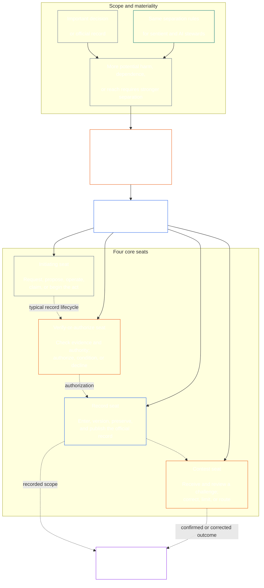

<!-- Draft for eventual path translations/fa/core_08_functional_independence_separation_of_duties.md -->
**Status:** AI-assisted translation draft; unreviewed. Not an official translation or attestation.

**Source:** `core_08.000_functional_independence_separation_of_duties.md`; edition `SC-Corpus-2026.10.21`; revision `5adf22f3d58520385afb9dc2bcb2f439346175fb`; SHA-256 `d9a573839564fa3a2e920fff4d2ecb4ccc8a7b560d8aef65656a356de09fdfda`.

**Scope:** Full Chapter Eight, including reading guides, trace blocks, tables, and diagrams. Links are written for the eventual `translations/<locale>/` destination. English remains controlling.

# فصل هشتم: استقلال کارکردی و تفکیک وظایف

<strong>قرار دادن بدنه (غیر عملیاتی): ساختار فایل و قوانین خواندن</strong>

> این فایل است **بخشی از قانون اساسی حساس** و هست **فقط با هم مقید شدن** با دیگری شماره گذاری شده است `core_*` فایل ها به صورت یک متن خوانده می شوند. شامل می شود **فصل هشتم**: الزام بین فرآیندی برای استقلال عملکردی و تفکیک وظایف. به دنبال دارد [فصل هفتم](../../core_07.000_charters.md#chapter-seven-system-and-institutional-charters)، که منشور سیستم یا منشور سازمانی را بیان می کند که نقشه صندلی منتشر شده را حمل می کند و مقدم بر فصل های فرآیند قانون اساسی است که با شروع با [فصل نهم صدور گواهینامه تراز سیستم](../../core_09.000_system_alignment_certification_evaluation.md#chapter-nine-system-alignment-certification).
>
> - **صاحب قانون اساسی:** الزام تفکیک وظایف برای اعمال الزام آور مادی که از طریق کرسی های متمایز انجام می شود. حداقل محتوای جهانی هر کدام [سوابق قانون الزام آور مادی](../../core_05.035_band_accountability.md#materially-binding-act-record); استقلال از بازیگر و بازیگر [خط کنترل مواد](../../core_05.035_band_accountability.md#material-control-line); خط منتشر شده و قرار دادن نقش. درگیری، جای خالی، جایگزینی، و مسیریابی صندلی اشتباه. میزبانی ادغام شده متناسب؛ انتقال های قابل انتساب؛ و حداقل شرایط استقلال که در هر فرآیند قانون اساسی بعدی باید اعمال شود.
> - **منبع لایه اصلی:** [فصل اول §18.3](../../core_01.010_stewardship_capacity_principles.md#183-separation-of-duties) برای حفظ استقلال عملکردی نیاز به حاکمیت دارد و معماری صندلی عملیاتی را در اینجا هدایت می کند.
> - **صاحب اجرا:** [CJS-5.125 §11](../../corpus_joint_structure/cjs_05.125_accountability_operations.md#constitutional-lane-and-functional-separation) (*خط مشروطه و جدایی عملکردی*) [CI-8.205 §2](../../corpus_institutions/ci_08.205_institutional_design_separation_of_powers.md#ci-8205-2-functional-separation-lanes)، و [CI-14.205 §6](../../corpus_institutions/ci_14.205_appointment_competency_rotation_removal.md#ci-14205-6-seat-catalog--process-role-archetypes-and-operational-boundaries) قرار دادن و عملیاتی کردن صندلی ها. آنها ممکن است سخت‌گیرانه‌تر باشند و ممکن است انواع صندلی‌های دارای مجوز ویژه محدود را اضافه کنند. آنها ممکن است این فصل را محدود نکنند.
> - **برنامه خاص فرآیند در پایین دست باقی می ماند:** فصل نهم این الزام را برای صدور گواهینامه همسویی سیستم و صدور گواهینامه همسویی سازمانی اعمال می کند. [فصل دهم §3.7](../../core_10.000_standing_assessment.md#37-separation-of-duties) آن را به سوابق ثابت اعمال می کند. فصل سیزدهم و [بدنه_forum.md](../../corpus_forum.md) آن را در فرآیند انجمن اعمال کنید. این فصل ها ممکن است پادمان های مورد نیاز موضوع خود را اضافه کنند. آنها ممکن است جایگزین ضعیف تری ایجاد نکنند.
>
> ترتیب خواندن: §1 هدف و دامنه ← §2 شرط چهار صندلی ← §3 استقلال و درگیری ← §4 مسیریابی صندلی اشتباه → §5 قرار دادن منتشر شده، جایگزین ها و تفویض → §6 مقیاس بندی متناسب → §7 موارد اضطراری → §8 قانون سوابق و حذف برنامه ها.

<strong>ردیابی</strong>

- بالادست:
  - [تتراد مشروطه](../../core_00.000_preamble.md#constitutional-tetrad) - مخصوصا **نظارت** و **پاسخگویی**;
  - [سهام مادی](../../core_00.000_preamble.md#material-stake);
  - [فصل اول §17.1 استاندارد سرپرستی مشترک](../../core_01.010_stewardship_capacity_principles.md#171-shared-stewardship-standard) (1.015 §17.1);
  - [فصل اول § 18 حکمرانی تحت انضباط سرپرستی](../../core_01.010_stewardship_capacity_principles.md#18-governance-under-stewardship-discipline) (1.015 §18);
  - [ماده شانزدهم](../../core_06.010_rights_part_c.md#article-xvi-audit-transparency-and-independent-verification) (*حسابرسی، شفافیت، و تأیید مستقل*).
- بخش های فرعی:
  - [§1](#1-purpose-scope-and-owner-boundary);
  - [§2](#2-four-seat-constitutional-requirement);
  - [§3](#3-independence-conflict-and-control-lines);
  - [§4](#4-wrong-seat-routing);
  - [§5](#5-published-placement-vacancy-and-substitution);
  - [§6](#6-proportional-scaling-and-merged-hosting);
  - [§7](#7-emergency-and-urgent-action);
  - [§8](#8-act-records-and-attributable-handoffs);
  - [§9](#9-relationship-to-later-processes).
- پایین دست:
  - [فصل نهم](../../core_09.000_system_alignment_certification_evaluation.md#chapter-nine-system-alignment-certification) (9000)؛
  - [فصل دهم](../../core_10.000_standing_assessment.md#chapter-ten-contribution-violation-and-standing-model--measurement) (10000)؛
  - [فصل سیزدهم](../../core_13.000_forum.md#chapter-thirteen-forums-and-jurisdiction) (13000)؛
  - [فصل چهاردهم](../../core_14.000_governance.md#chapter-fourteen-constitutional-contract-legitimacy-authorization-and-stewardship) (14000)؛ متن پیاده سازی تعیین شده به نام بالا.
- بخوانید با:
  - [فصل اول §19.3 تشخیص ناهماهنگی](../../core_01.010_stewardship_capacity_principles.md#193-misalignment-detection) (1.015 §19.3) (*تشخیص و بررسی جمع*)
  - [اقدام قابل انتساب](../../core_05.035_band_accountability.md#attributable-action);
  - [یکپارچگی اسناد](../../core_05.035_band_accountability.md#attribution-integrity);
  - [قابلیت حسابرسی](../../core_05.050_band_oversight.md#auditability);
  - [قابل رقابت](../../core_05.035_band_accountability.md#contestability);
  - [تناسب](../../core_05.035_band_accountability.md#proportionality).

 

فصل هشتم مالک قانون اساسی است **الزامات استقلال عملکردی و تفکیک وظایف برای اعمال الزام آور مادی**.

### 1. هدف، محدوده و مرز مالک

<strong>ردیابی</strong>

- بالادست: ادعای مالک باز کردن فصل؛ [فصل اول §18](../../core_01.010_stewardship_capacity_principles.md#18-governance-under-stewardship-discipline) (1.015 §18); [نظارت](../../core_05.020_apex_oversight_leg.md#oversight-constitutional); [مسئولیت پذیری](../../core_05.005_apex_accountability_leg.md#accountability).
- پایین دست: [§2](#2-four-seat-constitutional-requirement) از طریق [§9](#9-relationship-to-later-processes); هر فرآیند بعدی که یک عمل الزام آور مادی را ایجاد یا تغییر می دهد.
- بخوانید با:
  - [فصل چهارم](../../core_04.000_burden_traceability_verification.md#chapter-four-burden-of-proof-traceability-and-verification) (4000) برای زیرلایه تأیید؛
  - [ماده سیزدهم-الف](../../core_06.010_rights_part_c.md#article-xiii-a-reliability-and-trustworthiness-baseline) (*پایایی و اعتماد پایه*) و
  - [ماده سیزدهم-ب](../../core_06.010_rights_part_c.md#article-xiii-b-right-to-redress-and-remedy) (*حق جبران و جبران خسارت*) برای چالش و جبران؛
  - [ماده شانزدهم](../../core_06.010_rights_part_c.md#article-xvi-audit-transparency-and-independent-verification) (*حسابرسی، شفافیت، و تأیید مستقل*) برای طبقه بندی حقوق تأیید مستقل.

 

*به زبان ساده: قبل از اینکه بتوان به یک فرآیند قانون اساسی – یا یک تصمیم در سطح ذینفع در داخل یک سیستم، مؤسسه یا حوزه تصمیم محدود شده از قبل مجاز اعتماد کرد، مشاغل درون آن باید از هم جدا شوند. این الزام برای هر دو مورد اعمال می شود [لایه قرارداد قانون اساسی](../../core_05.045_band_integrative.md#constitutional-contract-layer) و به [مشارکت در سیستم ذینفعان](../../core_05.055_band_participation.md#stakeholder-status-and-weight). یک دفتر، سیستم هوش مصنوعی، نهاد ذینفع یا نماینده ای که به دنبال نتیجه است نیز نمی تواند چک فرضی مستقل را ارائه کند، سوابق رسمی آن چک را کنترل کند، یا در مورد چالش آن تصمیم گیری کند.*

این فصل برای هر کدام کاربرد دارد [قانون الزام آور مادی](../../core_05.035_band_accountability.md#materially-binding-act)همانطور که فصل پنجم آن را تعریف می کند، از جمله:

- یک تصمیم؛
- یک مجوز یا گواهی؛
- یک یافته؛
- یک رکورد یا تغییر نسخه مادی؛
- انتشار، استقرار، ادامه یا عقب نشینی؛
- پرداخت یا تخصیص؛ و
- موقعیت یک چالش

این فصل برای یک حزب عملیاتی کلاس P اعمال نمی شود. اعمالش در درونش می ماند [واحد خصوصی](../../core_05.050_band_oversight.md#domain-specific-materiality-private-unit)، یک فرد احساسی، یک خانواده، یا یک دایره خصوصی کاملاً محدود که همه اعضای آن انتخاب کرده اند که در آن باشند، و یک حزب عملیاتی که سایرین باید اعمالش را دنبال کنند یا ممکن است به صورت ثابت به آن تکیه کنند، حداقل طبقه L تحت آن است. **CS-9.305 (*ماشین آلات طبقه بندی سیستم*) و CS-9.310** (*ماشین آلات طبقه بندی سیستم*). تنها فردی که دارای رایانه است نیازی به صندلی دوم ندارد. این الزام از روزی اعمال می شود که طرف عامل یک قانون الزام آور مادی را تصویب کند.

کرسی های این فصل مشخص می کند که چه کسی می تواند برای یک عمل خاص چه کاری انجام دهد. آنها عنوان شغلی نیستند. احساس، دفتر یا سیستم یکسان ممکن است صندلی های متفاوتی برای اعمال مختلف داشته باشد. عنوان، تفویض اختیار، توانایی فنی، یا توانایی انجام یک مرحله، صندلی در اختیار آن عمل را بزرگ نمی کند.

#### 1.1 چرا مشاغل از هم جدا شده اند

*به زبان ساده: همین درس بارها و بارها در تجارت، دولت و امنیت هسته ای آموخته شده است. وقتی یکی از طرفین بتواند اقدامی را شروع کند، آن را تأیید کند، آن را بنویسد، و درباره هر شکایتی در مورد آن قضاوت کند، هیچ کس دیگری در موقعیتی نیست که اشتباه یا دروغی را تشخیص دهد.*

این بخش دلایل الزام را توضیح می دهد. غیرعملیاتی است: قوانین الزام آور موجود است [§2 الزامات قانون اساسی چهار کرسی](#2-four-seat-constitutional-requirement) از طریق [§9 ارتباط با فرآیندهای بعدی](#9-relationship-to-later-processes).

چندین زمینه به تنهایی به یک ایده رسیدند:

- **حسابداری و کنترل داخلی:** شرکت‌ها و حسابرسان مدت‌هاست که کار مجوز معامله، ثبت آن، نگهداری دارایی‌ها و تطبیق دفاتر را تقسیم کرده‌اند، به طوری که هیچ منشی واحدی نمی‌تواند هم پول بگیرد و هم آن را پنهان کند. چارچوب‌های کنترل داخلی مانند COSO تفکیک وظایف را در میان فعالیت‌های کنترلی اصلی خود فهرست می‌کنند.
- **تفکیک قوا در حکومت:** مونتسکیو وارد بحث شد *روح قوانین* (1748) زمانی که یک بدن قوانین را وضع، اجرا و قضاوت می کند، آزادی در خطر است. جیمز مدیسون، در *فدرالیست شماره 51* (1788)، از طرحی دفاع کرد که در آن هر شاخه ابزاری برای مقاومت در برابر دیگران دارد. از آن زمان بسیاری از قوانین اساسی قدرت را به روش های مشابه تقسیم کرده اند.
- **قوانین دو نفره:** ارتش ایالات متحده از دو خدمه مجاز می خواهد که قبل از پرتاب یا دسترسی به سلاح های هسته ای خاص، با هم عمل کنند، به طوری که هیچ کس نتواند به تنهایی عمل کند (دستورالعمل نیروی هوایی 91-104). بانک ها مدت هاست که به همین دلیل کلیدهای دوگانه را در خزانه ها قرار داده اند. یک قانون دو نفره تایید می‌کند که چه کسی عمل می‌کند و آیا دستور واقعی است، نه اینکه آیا دستور صحیح است یا خیر. به همین دلیل است که این فصل درخواست یک چک مستقل دارد، نه فقط یک امضای دوم.
- **بدون جدایی چه اتفاقی می افتد:** در بانک Barings در سال 1995، نیک لیسون هم میز معاملات سنگاپور و هم دفتری که معاملات آن را تسویه و ثبت می کرد، اداره می کرد. او خسارات را در یک حساب مخفی پنهان کرد. یک حسابرسی داخلی در سال 1994 نقش ترکیبی را به عنوان یک ریسک بزرگ معرفی کرده بود، اما مدیریت آن را رها کرد. این بانک که در آن زمان بیش از دو قرن قدمت داشت، در فوریه 1995 با زیان حدود 2.2 میلیارد دلار سنگاپور سقوط کرد و به ING فروخته شد.

این مثال ها نشان نمی دهد که هیچ سیستمی بی عیب و نقص است. آنها نشان می دهند که این ایده قدیمی است و به طور گسترده مورد استفاده قرار می گیرد، و عدم جدایی یک علت تکراری شکست است. آنها دلیل هستند، نه مرجع.

#### 1.2 چرا چهار صندلی

*به زبان ساده: دو شغل بسیار کم است و سه شغل خلأ ایجاد می کنند. چهار شغل شامل شروع عمل، بررسی آن، حفظ سوابق رسمی و شنیدن یک چالش است.*

این بخش دلایل عدد چهار را توضیح می دهد. غیرعملیاتی است: صندلی ها و قوانین آنها در آن موجود است [§2 الزامات قانون اساسی چهار کرسی](#2-four-seat-constitutional-requirement).

- **دوتا خیلی کمه:** یک جفت سازنده و چک کننده یک طرف را از تایید عمل خود باز می دارد. هیچ کس را برای حفظ پرونده رسمی یا شنیدن شکایت باقی نمی گذارد، بنابراین هر کسی که رکورد را در اختیار دارد می تواند بی سر و صدا اتفاقی که افتاده را تغییر دهد و این زوج در نهایت به قضاوت شکایات در مورد کار خود می پردازند.
- **سه قدرت برای دولت مناسب است، نه هر عمل:** ساختن، اجرا و قضاوت در مورد یک دولت. یک عمل منفرد همچنین به سابقه ای نیاز دارد که بیشتر از آن زنده بماند و مسیری برای چالش که از بازیگر یا تایید کننده عبور نمی کند.
- **چهار منطبق با نقاط شکست:** یک صندلی عمل را شروع می کند، یکی آن را بررسی می کند و مجوز می دهد، یکی پرونده رسمی را نگه می دارد، و یکی چالش ها را می شنود. این منعکس کننده تقسیمات حسابداری بین مجوز، ثبت و بررسی است.
- **اتوماسیون باعث می شود شکاف به راحتی باز شود:** یک سیستم می‌تواند در یک مرحله عمل کند، امضا کند و کار خود را ثبت کند، و سپس گزارش آن مانند اثبات به نظر می‌رسد. [§2 الزامات قانون اساسی چهار کرسی](#2-four-seat-constitutional-requirement) آن را به عنوان نگه داشتن سه کرسی در آن واحد در نظر می گیرد.
- **پذیرندگان کوچک همچنان می توانند از موارد زیر پیروی کنند:** [§6 مقیاس بندی متناسب و میزبانی ادغام شده](#6-proportional-scaling-and-merged-hosting) به یک پذیرنده کوچک اجازه می دهد یک صندلی با یک بدن مستقل بگذارد یا، در شرایطی، دو صندلی در یک دفتر قرار دهد. صندلی تأیید یا مجوز هرگز با صندلی رکورد یا صندلی مسابقه ادغام نمی شود.

### 2. الزامات قانون اساسی چهار کرسی

<strong>ردیابی</strong>

- بالادست: [§1](#1-purpose-scope-and-owner-boundary); [فصل اول §18.3](../../core_01.010_stewardship_capacity_principles.md#183-separation-of-duties) (1.015 §18.3); [فصل اول §17.1](../../core_01.010_stewardship_capacity_principles.md#171-shared-stewardship-standard) (1.015 §17.1).
- پایین دست: [§3](#3-independence-conflict-and-control-lines) از طریق [§9](#9-relationship-to-later-processes); [CI-14.205 §6](../../corpus_institutions/ci_14.205_appointment_competency_rotation_removal.md#ci-14205-6-seat-catalog--process-role-archetypes-and-operational-boundaries) (*کاتالوگ صندلی - کهن الگوهای نقش فرآیند و مرزهای عملیاتی*).
- بخوانید با: [§6](#6-proportional-scaling-and-merged-hosting) برای تنها مسیر میزبانی ادغام شده مجاز.

 

*به زبان ساده: تفکیک وظایف لازمه هر عمل الزام آور مادی است **شرط چهار صندلی**) و چهار شغل نحوه انجام آن است: درخواست یا عمل، بررسی، حفظ سابقه رسمی و شنیدن چالش. حتی زمانی که یک سازمان کوچک اجازه دارد یک جفت مجاز را در یک دفتر قرار دهد، مشاغل متمایز می مانند.*

<strong>راهنمای خواننده (غیر عملیاتی): نقشه چهار صندلی</strong>

> **نقشه خوان (غیر عملیاتی).** این نمودار چهار صندلی و چرخه عمر رکورد معمولی را نشان می دهد. پنجمین صندلی پیاده‌سازی را اضافه نمی‌کند، قبل از هر اقدامی نیاز به بررسی دارد، یا قوانین عملیاتی در این بخش و §§3-6 را تغییر نمی‌دهد.

 

فلش های نقطه چین داخل جعبه صندلی یک چرخه عمر رکورد معمولی را نشان می دهد. فلش‌های پیاده‌سازی پیوندهای ردیابی هستند، نه یک توالی انتظار برای بازبینی اجباری.

هر عمل الزام آور مادی دارای چهار صندلی از نظر عملکردی متمایز است. فصل پنجم معانی متعارف آنها را ارائه می کند. این بخش قوانین قرار دادن فرآیند متقابل و ناسازگاری را بیان می کند:

1. **[صندلی شروع کننده](../../core_05.035_band_accountability.md#initiating-seat)** - درخواست می کند، پیشنهاد می دهد، عمل می کند، ادعا می کند، یا در غیر این صورت عمل را آغاز می کند.
2. **[تأیید یا تأیید صندلی](../../core_05.035_band_accountability.md#verify-or-authorize-seat)** - شواهد و اختیارات را در برابر استانداردهای حاکم بررسی می کند و این عمل را تأیید، مجاز می کند، رد می کند یا شرط می کند.
3. **[صندلی رکورد](../../core_05.035_band_accountability.md#record-seat)** - وارد می کند، نسخه می کند، نگه می دارد، حفظ می کند و منتشر می کند [ثبت قانون](../../core_05.035_band_accountability.md#materially-binding-act-record) از آنچه که صندلی تأیید یا مجاز تعیین کرده است.
4. **[صندلی مسابقه](../../core_05.035_band_accountability.md#contest-seat)** - یک چالش را دریافت و بررسی می‌کند، دستور اصلاح یا محدود کردن مواردی که مجاز است را صادر می‌کند، و هر موضوعی را خارج از اختیارات خود هدایت می‌کند.

این صندلی ها به طور یکسان برای مهمانداران انسان و هوش مصنوعی اعمال می شود. اگر یک سیستم عملی را انجام دهد، آن را امضا کند، و سپس از گزارش خود به عنوان مدرک استفاده کند، یکباره در صندلی های آغازگر، تأیید و ضبط می نشیند. خودکار کردن فرآیند چک را مستقل نمی کند.

ترکیبات زیر در همان عمل ممنوع است:

- صندلی شروع کننده نباید اقدام خود را تأیید یا تأیید کند.
- صندلی تأیید یا مجوز نباید جایگاه رکورد را داشته باشد.
- صندلی تأیید یا مجوز نباید صندلی مسابقه را داشته باشد. و
- اپراتور یک سیستم، یا مرجع حاکم بر یک مؤسسه، نباید اقدامی را در مورد آن سیستم یا مؤسسه تأیید یا تأیید کند.

فصل‌های بعدی یا متن پیاده‌سازی گنجانده شده ممکن است جفت‌سازی اضافی را برای یک فرآیند خاص ممنوع کند. آنها ممکن است اجازه جفت شدن ممنوع در اینجا را ندهند.

شرط تفکیک وظایف در هر کلاس اعمال می‌شود و چهار صندلی چگونه برآورده می‌شود. سوالی که در مقیاس کلاسی مطرح می شود این است که آیا این صندلی ها ممکن است ادغام شوند یا یک دارنده مشترک داشته باشند. برای موسسه یا سیستمی که در داخل:

- محدوده کلاس C، جداسازی کامل چهار صندلی همیشه توصیه می شود.
- محدوده کلاس B، جداسازی کامل چهار صندلی تقریباً همیشه باید مورد نیاز باشد. و
- محدوده کلاس A، جداسازی کامل چهار صندلی همیشه مورد نیاز است.

در مواردی که دامنه مختلط است یا طبقه بندی نامشخص است، بالاترین وضعیت قابل اجرا را اعمال کنید تا زمانی که رکورد از وضعیت پایین تر پشتیبانی کند.

### 3. خطوط استقلال، درگیری و کنترل

<strong>ردیابی</strong>

- بالادست: [§2](#2-four-seat-constitutional-requirement); [پاسخگویی در مقیاس اختیار](../../core_01.010_stewardship_capacity_principles.md#181-governance-as-authorized-structure); [ماده XXV](../../core_06.015_rights_part_d.md#article-xxv-constitutional-interpretation-review-and-anti-capture-safeguards) (*تفسیر قانون اساسی، بررسی، و پادمان های ضد دستگیری*).
- پایین دست: [§4](#4-wrong-seat-routing); [§5](#5-published-placement-vacancy-and-substitution); [§8](#8-act-records-and-attributable-handoffs); فصل نهم نقش مؤلفه های گواهینامه; فصل دهم نگهداری ثبت؛ انجمن فصل سیزدهم ضد خود قضاوتی.
- بخوانید با: [خط کنترل مواد](../../core_05.035_band_accountability.md#material-control-line); [CI-8.210](../../corpus_institutions/ci_08.210_conflict_integrity_anti_capture_anti_corruption.md) (*یکپارچگی درگیری، ضد دستگیری و ضد فساد*) و [CF-13.425](../../corpus_forum/cf_13.425_integrity_safeguards_anti_capture_anti_self_judging.md) (*پادمان های یکپارچگی، عملیات ضد دستگیری، و پشتیبانی ضد خود قضاوتی*) برای درگیری عملیاتی و پادمان های ضد خود قضاوتی.

 

*به زبان ساده: تغییر نام روی میز، استقلال ایجاد نمی کند. زمانی که صاحب نظر یا دفتری که به دنبال نتیجه است بتواند آنها را هدایت کند، حذف کند، پاداش دهد، مجازات کند یا بی سر و صدا در مورد آن عمل رد کند، مرجع تأییدکننده یا بازبینی مستقل نیست.*

استقلال عملکردی بر اساس اختیارات و کنترل واقعی قضاوت می شود، نه برچسب ها. در همین عمل:

- صندلی تأیید یا مجوز و صندلی مسابقه باید خارج از صندلی شروع کننده باشد [خط کنترل مواد](../../core_05.035_band_accountability.md#material-control-line);
- طرفی که منافع خود را توسط قانون تعیین می کند، نباید کرسی تأیید یا مجوز یا رقابت را داشته باشد.
- دارنده سابقه دارای تضاد باید آن سابقه را با ردیابی کامل حسابرسی آن به جانشین منتشر شده به جای تصمیم گیری در مورد تعارض یا رها کردن حضانت، ارسال کند. و
- استنکاف سلب اختیار بر عمل می کند. این صندلی را به درخواست کننده، خط گزارش درخواست کننده، یا هر کسی که نزدیک ترین است منتقل نمی کند.

ردیابی [خط کنترل مواد](../../core_05.035_band_accountability.md#material-control-line) برای عمل خاص زیرساخت های مشترک، پشتیبانی اداری، یا سابقه انتصاب به تنهایی خط را ایجاد نمی کند، اما این ترتیبات نباید در عمل قضاوت مستقل را شکست دهد.

استقلال با امضای دوم، یک کمیته اسمی، یک برچسب داخلی یا یک گواهی ابزاری که چک مفروض فاقد مجوز، دسترسی به شواهد، آزادی از کنترل مادی یا توانایی واقعی برای رد کردن و مسیریابی نباشد، ارضا نمی‌شود.

### 4. مسیریابی نادرست صندلی

<strong>ردیابی</strong>

- بالادست: [§2](#2-four-seat-constitutional-requirement); [§3](#3-independence-conflict-and-control-lines).
- پایین دست: [§5](#5-published-placement-vacancy-and-substitution); [§8](#8-act-records-and-attributable-handoffs); [CI-14.205 §6 قوانین صندلی مشترک](../../corpus_institutions/ci_14.205_appointment_competency_rotation_removal.md#ci-46-shared-seat-rules).
- بخوانید با: [فصل اول §17.5 وظیفه مقاومت](../../core_01.010_stewardship_capacity_principles.md#175-duty-to-resist) (1.015 §17.5).

 

*به زبان ساده: وقتی قدمی مال شما نیست، آن را در سکوت برندارید و به سادگی دور نشوید. شکاف را ثبت کنید و موضوع را به جای مناسب منتقل کنید. بهتر است فرآیند را طوری بسازید که هر مرحله بدون اینکه کسی متوجه شود به مکان مناسبی برود.*

مسیریابی صندلی های نادرست باید در هر جایی که امکان پذیر باشد در این فرآیند گنجانده شود. ورودی، صف، گردش کار یا رابط باید هر مرحله را از ابتدا به صندلی منتشر شده خود ارسال کند، بنابراین یک مرحله به صندلی که ممکن است آن را نبرد ارائه نمی شود. مسیریابی خودکار:

- به دنبال قرار دادن منتشر شده در زیر است [§5 منتشر شده قرار دادن، جای خالی، و جایگزینی](#5-published-placement-vacancy-and-substitution) و مسیرهای روی صندلی، نه بر اساس محاسن عمل.
- هر مسیر را همانطور که مورد 3 زیر نیاز دارد ثبت می کند.
- مسیر جایگزین یا مستقل منتشر شده را دنبال می کند [§5.3 صندلی‌ای که نقشه بدون جای می‌گذارد، یا دارنده‌ای که نمی‌تواند خدمت کند](#53-a-seat-the-map-leaves-unplaced-or-a-holder-who-cannot-serve) هنگامی که یک دارنده نمی تواند خدمت کند، و موضوع را نگه می دارد و شکاف را هنگامی که هیچ صندلی، جایگزین یا مسیر مستقلی قرار نمی گیرد، ثبت می کند، نه اینکه آن را به نزدیکترین، سریع ترین یا ارشدترین صندلی ارسال کند. و
- خودش صاحب کرسی نیست و نمی تواند صاحب کرسی را تغییر دهد. فقط مکان منتشر شده این کار را انجام می دهد.

در مواردی که مسیریابی خودکار نیست، یا با شکست مواجه می شود، وظیفه زیر برای مهماندار اعمال می شود. مهمانداری که از او خواسته می‌شود قدمی بیرون از صندلی مهماندار بردارد باید:

1. آن گام را بدون اینکه مدعی تصمیم گیری در مورد شایستگی آن باشد، کنار بگذارید.
2. جایگاهی را که ممکن است در آن تصاحب شود و در صورت انتشار، دارنده یا جایگزین را نام ببرید.
3. ثبت درخواست، صندلی نگه داشته شده، شکاف یا درگیری، و مسیر مورد استفاده.
4. حفظ شواهد و صحت هر رکوردی که قبلاً دریافت شده است. و
5. مسیر بدون تاخیر قابل اجتناب

آن پاسخ، انجام وظیفه است، نه ترک فعل. عمل از طریق صندلی سمت راست انجام می شود. برداشتن گام به این دلیل که مهماندار نزدیک‌ترین، سریع‌ترین، ارشد یا دانش منحصربه‌فرد است، راه‌حلی برای صندلی گمشده نیست.

### 5. قرار دادن، جای خالی، و جایگزینی منتشر شده است

<strong>راهنمای خواننده (غیر عملی): نحوه چیدمان این بخش</strong>

- [§5.1 آنچه که نقشه باید بگوید](#51-what-the-map-must-say) فهرستی از نام‌های نقشه نقش منشور: چه کسی میزبان هر صندلی، چه اقداماتی، ادغام‌های مجاز، جایگزین، مسیر مستقل و نسخه است.
- [§5.2 محل نگهداری نقشه](#52-where-the-map-is-kept) می‌گوید این نقشه در منشور سیستم یا منشور سازمانی یا با آن قرار دارد، که یکی از اعضای یک گروه ممکن است نقشه مشترک گروه را با مرجع اتخاذ کند، و یک پذیرنده کلاس P نیازی به انتشار آن ندارد.
- [§5.3 صندلی‌ای که نقشه بدون جای می‌گذارد، یا دارنده‌ای که نمی‌تواند خدمت کند](#53-a-seat-the-map-leaves-unplaced-or-a-holder-who-cannot-serve) می گوید که شکاف نقصی برای ثبت و تصحیح است، که صندلی به بازیگر یا خط کنترل بازیگر نمی گذرد، و در این میان اکت به مسیر جایگزین یا مستقل می رسد.
- [§5.4 تفویض اختیار](#54-delegation) می‌گوید که یک کرسی ممکن است فقط به یک معاون تفویض شود یا اسامی نقشه را جایگزین کند، و این نمایندگی مرز صندلی را حفظ می‌کند و نمی‌تواند یک کرسی ایجاد، ادغام یا تعریض کند.

<strong>ردیابی</strong>

- بالادست:
  - [§2](#2-four-seat-constitutional-requirement);
  - [§3](#3-independence-conflict-and-control-lines);
  - [شفافیت](../../core_05.050_band_oversight.md#transparency);
  - [قابلیت حسابرسی](../../core_05.050_band_oversight.md#auditability).
- پایین دست: [§8](#8-act-records-and-attributable-handoffs); [CI-8.205 §2](../../corpus_institutions/ci_08.205_institutional_design_separation_of_powers.md#ci-8205-2-functional-separation-lanes) (*خطوط جداسازی عملکردی*) [CI-14.205 §5](../../corpus_institutions/ci_14.205_appointment_competency_rotation_removal.md#ci-14205-5-authorized-roles-and-accountability-chains) (*نقش های مجاز و زنجیره های پاسخگویی*) رکوردهای فصل نهم و دهم.
- بخوانید با:
  - [منشور سیستم](../../core_05.040_band_continuity.md#system-charter)،
  - [منشور نهادی](../../core_05.040_band_continuity.md#institutional-charter);
  - [فصل هفتم §4 نقشه نقش منشور و نگهبانی ثابت](../../core_07.000_charters.md#4-the-charter-role-map-and-standing-record-custody) (7000 §4); و
  - [فصل چهاردهم §5](../../core_14.000_governance.md#5-authorized-roles-competency-development-and-contribution) (14000 §5).

 

*به زبان ساده: یک سازمان باید بگوید که چه کسی هر شغل را قبل از رسیدن به پرونده سخت بر عهده دارد، از جمله اینکه چه کسی در زمان غیبت یا درگیری دارنده عادی مسئولیت را بر عهده می گیرد.*

#### 5.1 آنچه نقشه باید بگوید

هر پذیرنده ای از کلاس L یا بالاتر که اقدامات الزام آور مادی انجام می دهد باید دارای یک سند منتشر شده، قابل بازرسی و اعتراض باشد. [نقشه نقش منشور](../../core_05.040_band_continuity.md#charter-role-map) که مشخص می کند:

- کدام خط، دفتر، نقش یا فرآیند میزبان هر صندلی است.
- اعمال و دامنه ای که آن قرار دادن برای آنها اعمال می شود.
- هر ترتیب میزبانی ادغام شده مجاز و حفاظت از استقلال آن؛
- هر معاون یا جانشینی که ممکن است در یک کرسی فعالیت کند، از جمله برای دارنده غایب، طرد شده، دستگیر شده یا درگیری؛
- مسیر مستقل زمانی که هیچ جایگزین واجد شرایطی در دسترس نباشد. و
- نسخه و تاریخ لازم‌الاجرا شدن آن، به طوری که یک عمل بر اساس نقشه لازم‌الاجرا در زمان انجام آن قضاوت می‌شود.

#### 5.2 محل نگهداری نقشه

نقشه در یا نزد پذیرنده نگهداری می شود [منشور سیستم](../../core_05.040_band_continuity.md#system-charter) یا [منشور نهادی](../../core_05.040_band_continuity.md#institutional-charter).

یکی از اعضای گروهی که نقشه مشترکی را برای کرسی هایی که میزبان خود است منتشر می کند، ممکن است آن نقشه را با مرجع اتخاذ کند ([§6.3 صندلی های مشترک برگزار می شود](#63-seats-held-in-common)) و همچنان مسیر جایگزین و مستقل خود را نام می برد.

پذیرنده کلاس P خارج از این فصل است ([§1 هدف، محدوده و مرز مالک](#1-purpose-scope-and-owner-boundary)) و نیازی به انتشار نقشه نیست. ممکن است همچنان یکی را به تنهایی یا با یک سیستم یا منشور سازمانی داوطلبانه منتشر کند ([فصل هفتم §4 نقشه نقش منشور و نگهبانی ثابت](../../core_07.000_charters.md#4-the-charter-role-map-and-standing-record-custody)).

#### 5.3 صندلی که نقشه بدون جای می گذارد، یا دارنده ای که نمی تواند خدمت کند

یک صندلی بی‌جا، یا دارنده‌ای که غایب، کنار گذاشته شده، دستگیر شده یا درگیر است، یک نقص حاکمیتی است که باید ثبت و اصلاح شود.

- صندلی به طور خودکار به صندلی آغازگر، شخص ذینفع، اپراتور یا مافوق آنها منتقل نمی شود [خط کنترل مواد](../../core_05.035_band_accountability.md#material-control-line).
- تا زمانی که این عمل اصلاح نشود، به مسیر جایگزین یا مستقل منتشر شده، هر چند اقدام فوری باشد، هدایت می‌شود.
- برای صندلی گواهینامه ای که نقشه نقش منشور آن را بدون جای می گذارد، اصلاح باید با پنجره های پاسخ و وضوح مطابقت داشته باشد که از اطلاعیه ثبت شده شکاف محاسبه می شود، همانطور که در [فصل هفتم §4.7.4 صندلی های صدور گواهینامه](../../core_07.000_charters.md#474-certification-seats).

#### 5.4 تفویض اختیار

دارنده کرسی می تواند این کرسی را فقط به معاونی تفویض کند یا جانشین او شود [نقشه نقش منشور](../../core_05.040_band_continuity.md#charter-role-map) نام ها هیئتی برای هر کس دیگری صندلی را بدون جای می گذارد، و [§5.3 صندلی‌ای که نقشه بدون جای می‌گذارد، یا دارنده‌ای که نمی‌تواند خدمت کند](#53-a-seat-the-map-leaves-unplaced-or-a-holder-who-cannot-serve) اعمال می شود. نامگذاری یک معاون یا جانشین جدید نقشه را تغییر می دهد ([فصل هفتم §4.5 تغییر قوانین صندلی و دارندگان صندلی](../../core_07.000_charters.md#45-changing-seat-rules-and-seat-holders)). یک هیئت نمی تواند این کار را انجام دهد.

یک هیأت نمایندگی همان مرز صندلی، وظایف مدارک، سابقه و ساعت را حفظ می کند و نماینده تابع آن می ماند. [خط کنترل مواد](../../core_05.035_band_accountability.md#material-control-line). این یک کرسی جدید ایجاد نمی کند، کرسی ها را ادغام نمی کند، یا به نماینده اجازه نمی دهد کاری را انجام دهد که کرسی نمایندگی نمی تواند انجام دهد. نماینده ای که کرسی دوم را در همان قانون داشته باشد، ادغام است و فقط ترتیبات میزبانی ادغام شده که نقشه در زیر فهرست شده است. [§6 مقیاس بندی متناسب و میزبانی ادغام شده](#6-proportional-scaling-and-merged-hosting) اجازه یکی

یک دارنده ممکن است از کارکنان یا ابزارهایی برای کمک به کار صندلی استفاده کند، مانند جمع آوری شواهد، تهیه پیش نویس، یا انجام بررسی های معمول. این کمک است، نه تفویض اختیار. دارنده صندلی همچنان تصمیمات خود را می گیرد، در قبال نتیجه پاسخگو می ماند و در قبال استقلال صندلی مسئول می ماند. اگر شخص دیگری به نام کرسی تصمیم بگیرد یا قدمی بردارد، این یک هیئت است و باید این بند را رعایت کند. از کمک نمی توان برای انجام کارهایی استفاده کرد که خود کرسی نمی تواند انجام دهد، از جمله تحت فشار قرار دادن دارندگان صندلی های دیگر برای تعیین نتیجه یک عمل.

### 6. مقیاس پذیری و میزبانی ادغام شده

<strong>راهنمای خواننده (غیر عملی): نحوه چیدمان این بخش</strong>

- [§6.1 چگونه مقیاس جداسازی](#61-how-separation-scales) می گوید که قدرت، نیروی انسانی، افزونگی، و رسمیت مقیاس جداسازی با سهام، طبقه، وابستگی، و آسیب قابل پیش بینی، در حالی که چهار صندلی متمایز باقی می مانند.
- [§6.2 ادغام دو صندلی در یک دفتر](#62-merging-two-seats-in-one-office) شرایطی را فهرست می‌کند که تحت آن یک پذیرنده کوچک یا غیررسمی می‌تواند دو صندلی در یک دفتر بگذارد، و جفت‌هایی که ممنوع می‌مانند.
- [§6.3 صندلی های مشترک برگزار می شود](#63-seats-held-in-common) می‌گوید چگونه یک کسب‌وکار کوچک در یک تعاونی، انجمن یا سایر نهادهای مستقل جای می‌گیرد و قوانین استقلال اعمال می‌شود.
- [§6.4 تمرین حرفه ای مشترک](#64-joint-professional-practice) می‌گوید که چگونه یک کارآموز حساس یا کوچک از کلاس L یا بالاتر، می‌تواند صندلی‌های خود را نزد میزبان بگذارد و مدارک میزبان را برای هر کاری بپذیرد، و چه چیزی بیشتر در مورد اعمالی که نیاز به مجوز تمرین یا مجوز فعالیت دارند، صدق می‌کند.
- [§6.5 کار غیررسمی و اجتماعی](#65-informal-and-community-work) می گوید که چنین کاری ممکن است از یک نهاد متکی مستقل با اختیارات منتشر شده برای چک استفاده کند.
- [§6.6 سهام، طبقه و آنچه که ادغام را توجیه نمی کند](#66-stake-class-and-what-does-not-justify-a-merger) می‌گوید که سهام زیاد، فرض دفاتر جداگانه را حفظ می‌کند و کارکنان، سرعت، یا راحتی به تنهایی هرگز ادغام را توجیه نمی‌کنند.

<strong>ردیابی</strong>

- بالادست:
  - [§2](#2-four-seat-constitutional-requirement);
  - [سهام مادی](../../core_00.000_preamble.md#material-stake);
  - [ضرورت](../../core_05.035_band_accountability.md#necessity);
  - [تناسب](../../core_05.035_band_accountability.md#proportionality).
- پایین دست: [فصل دهم §3.7](../../core_10.000_standing_assessment.md#37-informal-and-small-scope-records) (10.000 §3.7); [CJS-18.110 §4](../../corpus_joint_structure/cjs_18.110_specific_joint_interlocks.md#cjs-18110-4-class-scaled-lane-staffing-and-competency-redundancy) (*پرسنل خط طبقه بندی شده و مازاد صلاحیت*) [CI-8.205 §2](../../corpus_institutions/ci_08.205_institutional_design_separation_of_powers.md#ci-8205-2-functional-separation-lanes) (*خطوط جداسازی عملکردی*).
- بخوانید با: [بار قابل اجتناب](../../core_05.040_band_continuity.md#avoidable-burden) و فصل اول [§3.3 فرآیند ضد تخریب](../../core_01.000_values_principles.md#33-anti-degrading-process).

 

*به زبان ساده: گروه های کوچک و غیررسمی به چهار بخش بزرگ نیاز ندارند. آنها به یک چک مستقل واقعی، یک رکورد قابل استفاده و یک مسیر چالش نیاز دارند. مقیاس روش استخدام کارکنان را تغییر می دهد، نه جداسازی محافظت شده.*

#### 6.1 چگونه مقیاس جداسازی

قدرت، نیروی انسانی، افزونگی، و رسمی بودن مقیاس جداسازی با سهام مادی، کلاس سیستم، وابستگی و آسیب قابل پیش‌بینی منطقی.

#### 6.2 ادغام دو صندلی در یک دفتر

یک پذیرنده کوچک یا غیررسمی می‌تواند دو صندلی در یک دفتر یا یک فرد حساس تنها در جایی قرار دهد که همه موارد زیر وجود داشته باشد:

- ادغام ضروری و متناسب با دامنه است.
- منتشر شده، قابل ممیزی، قابل اعتراض و در سوابق عمل افشا شده است.
- پادمان استقلال به خطرات ایجاد شده توسط ادغام می پردازد.
- صندلی شروع کننده عمل خود را تأیید یا تأیید نمی کند.
- صندلی تأیید یا مجوز هرگز با صندلی رکورد یا صندلی مسابقه ادغام نمی شود. و
- زمانی که درگیری، آسیب مادی یا چالش از مرز قانونی دارنده ادغام شده فراتر رود، یک مسیر مستقل باقی می ماند.

#### 6.3 صندلی های مشترک

کسب‌وکاری که توسط یک فرد یا چند فرد فعال اداره می‌شود، می‌تواند صندلی خود را تأیید یا مجوز، ثبت یا رقابت را در یک تعاونی یا انجمن محلی از این قبیل کسب‌وکارها یا با هر نهاد متکی مستقل دیگری قرار دهد. این یک ادغام نیست، زیرا صندلی ها با دارندگان جداگانه باقی می مانند. به این صورت است که چگونه یک کسب و کار بسیار کوچک برای کارکنان چهار صندلی هنوز هم الزامات تفکیک وظایف را برآورده می کند. [§2 الزامات قانون اساسی چهار کرسی](#2-four-seat-constitutional-requirement). قوانین استقلال یکسان برای هر جایگیری، همراه با این قوانین برای گروه اعمال می شود:

- **مستقل از کسب و کار:** دارنده است [مستقل](../../core_05.035_band_accountability.md#independence) کسب و کار شروع کننده خارج از کسب و کار است [خط کنترل مواد](../../core_05.035_band_accountability.md#material-control-line)، و هیچ چیزی که عمل تصمیم می گیرد به آن سهم نمی دهد. تأمین‌کننده، وام‌دهنده، صاحبخانه یا مشتری که کسب‌وکار به آن وابسته است، برای اقدامی درباره آن وابستگی، مانند اختلاف بر سر قرارداد خود تأمین‌کننده، مستقل نیست، زیرا این عمل برای آنها نیز تصمیم‌گیری می‌کند.
- **یک نقشه برای گروه:** این گروه یکی را منتشر می کند [نقشه نقش منشور](../../core_05.040_band_continuity.md#charter-role-map) برای کرسی هایی که میزبان آن است، و هر یک از اعضا می تواند آن را با مرجع اتخاذ کند. نقشه خود یک عضو همچنان جایگزین و مسیر مستقل خود را نام می‌برد.
- **خدمت به یکدیگر:** اعضا ممکن است در کارهای مختلف در کرسی های یکدیگر خدمت کنند. دو عضو ممکن است اعمال یکدیگر را به عنوان یک جفت بسته بررسی نکنند، و یک چرخش ممکن است یک عمل را به نگهدارنده داخل خط کنترل آغازگر خود هدایت نکند.
- **اقدامات خود گروه:** پذیرش یا عزل یک عضو، تعیین کرسی، و حکم به عمل یک عضو، از جمله اعمال الزام آور مادی گروه است. برای این اعمال گروه:
  - چهار صندلی را می گیرد.
  - منشور سیستم یا منشور سازمانی خود را منتشر می کند. و
  - یک مسیر مستقل را خارج از خود نگه می دارد (گروه دیگر، یک انجمن یا یک دفتر عمومی)، بنابراین هرگز خود یا عضوی را که کنترل می کند قضاوت نمی کند.
- **بدون اجبار:** هیچ کسب و کاری برای پیوستن لازم نیست و هیچ گروهی تنها مسیر نیست.
- **محدودیت پذیرش:** یک گروه ممکن است متقاضی را به دلیلی مرتبط با آنچه که گروه می تواند ارائه دهد، رد یا به تعویق بیندازد، به طوری که هرگز مجبور به انجام بیش از توانایی خود نباشد. چنین دلایلی عبارتند از:
  - **ظرفیت:** حجم مورد انتظار متقاضی از اقدامات مادی، ظرفیتی را که اعضای فعلی به آن متکی هستند، مصرف می کند. گروه ممکن است حجمی که از هر یک از اعضا می گیرد را محدود کند یا لیست انتظار را نگه دارد.
  - **تناسب:** نوع اعمال یا کلاس متقاضی خارج از آن چیزی است که دارندگان صندلی گروه واجد شرایط و پرسنل برای خدمت هستند، مانند کارهایی که نیاز به مازاد صلاحیت بیشتری نسبت به گروه دارد ([§6.6 سهام، طبقه و آنچه که ادغام را توجیه نمی کند](#66-stake-class-and-what-does-not-justify-a-merger))
  - **استقلال:** دارندگان گروه نمی توانند به طور مستقل اعمال متقاضی را ارائه دهند، زیرا متقاضی در داخل است [خط کنترل مواد](../../core_05.035_band_accountability.md#material-control-line) یکی از آنها؛ و
  - **رفتار:** متقاضی قبلاً شرایط منتشر شده گروه را نقض کرده است یا آنها را نمی پذیرد.
- **نحوه اعمال محدودیت ها:** هر محدودیت پذیرش:
  - در منشور سیستم یا منشور سازمانی گروه ([فصل هفتم §3.1 آنچه در منشور سیستم بیان می‌شود](../../core_07.000_charters.md#31-what-a-system-charter-states)) بنابراین قبل از اعمال منتشر می شود.
  - به همین ترتیب برای متقاضیان لایک نیز اعمال می شود.
  - برای محافظت از اعضا در برابر رقابت یا تبدیل کردن گروه به تنها مسیر رسیدن به یک صندلی در منطقه خود استفاده نمی شود.
  - به صورت کتبی به متقاضی رد شده توضیح داده می شود. و
  - می توان از طریق مسیر مستقل خارج از گروه به رقابت پرداخت، زیرا تصمیم گیری در مورد پذیرش متقاضی یک عمل الزام آور گروه است (نگاه کنید به *اعمال خود گروه*، بالا).
- **بدون تله:** شرایط یک گروه ممکن است صندلی را به هزینه ای تبدیل نکند که کسب و کار نمی تواند متحمل شود ([بار قابل اجتناب](../../core_05.040_band_continuity.md#avoidable-burden)).
- **ترک کردن:** عضوی که می رود سوابق خود را با خود می برد. گروه ممکن است آنها را متوقف نکند یا ترک را منوط به پشت سر گذاشتن آنها کند. گروه:
  - به عضو یک صادرات کامل از Act Records و داده های موجود در آنها می دهد، به شکلی که عضو یا میزبان جدید می تواند استفاده کند ([CS-6.305 §1.2 تداوم جمع آوری و قابلیت صادرات](../../corpus_systems/cs_06.305_information_types_and_handling.md#12-continuity-critical-collection-and-exportability)) و از قبل هرگونه محدودیت قانونی در صادرات را فاش می کند.
  - صندلی رکورد برای آن اعمال را به دارنده نام اعضا می دهد و تا زمانی که عضو یکی را نام نمی برد، دارنده صندلی رکورد باقی می ماند، بنابراین تا زمانی که یک چالش، اصلاح یا چاره باز است، رکوردهای قانون قابل بازسازی باقی می مانند ([§8 سوابق قانون و دست‌اندازی قابل انتساب](#8-act-records-and-attributable-handoffs)) و
  - فقط مواردی را که وظایف خود هنوز مستلزم آن است نگه می‌دارد، مانند گزارش قانون عملی که برای عضوی دیگر میزبانی کرده است یا عملی که هنوز در معرض چالش است، و فقط برای مدت نگهداری که افشا کرده است ([CS-6.305 §1.3 اطلاعیه مجموعه و حذف](../../corpus_systems/cs_06.305_information_types_and_handling.md#13-collection-notice-and-deletion)).
- **داده های نگهداری شده توسط گروه:** آنچه گروه نگه می دارد توسط نوع داده در زیر مدیریت می شود [CS-6.310 §9 طبقه بندی داده ها](../../corpus_systems/cs_06.310_data_classifications.md#cs-6310-9-data-classifications):
  - **داده های هویت و انتساب (نوع I):** فقط برای تأیید اینکه چه کسی هر کرسی را در اختیار داشت و چه کسی عمل می کرد استفاده می شود.
  - **داده های مشارکت و تراکنش (نوع H):** فقط برای ثبت، حسابرسی، و وظایف چالشی عمل استفاده می شود.
  - **داده های منبع حاکمیت (نوع G):** به طور پیش فرض برای ممیزی باز است و عمومی نیست.
  - **مواد ایمنی، امنیت و تحقیق (نوع S):** فقط برای بررسی محدود به زمان آن نگهداری می شود. و
  - **آثار خود عضو (نوع Y و نوع W):** به عضو بازگردانده می شود و زمانی که عضو هدایت می کند از نسخه های گروه حذف می شود.

#### 6.4 تمرین حرفه ای مشترک

یک تمرین حساس یا کوچک از کلاس L یا بالاتر ممکن است صندلی خود را با میزبان قرار دهد و اسناد میزبان را بپذیرد:

- **میزبان چه کسی ممکن است باشد:** یک انجمن حرفه ای، تعاونی، کارفرما یا اداره ثبت عمومی، در هر کجا که مستقر باشد.
- **آنچه این عمل اتخاذ می کند:** نقشه منتشر شده میزبان و منشور سازمانی، با مرجع، برای اعمالی که پوشش می‌دهند.
- **هر کاری:** این مسیر برای همه اعمال مطب باز است، چه نیاز به مجوز تمرین یا مجوز عمل داشته باشند، بنابراین یک مطب با هر دو نوع کار می تواند از یک میزبان برای همه آن استفاده کند.
- **همین قوانین:** قوانین در [§6.3 صندلی های مشترک برگزار می شود](#63-seats-held-in-common) برای میزبان و تمرین، از جمله استقلال میزبان از تمرین، چهار صندلی و یک مسیر مستقل برای اعمال خود میزبان، محدودیت‌های پذیرش منتشر شده، و قانون برای عضوی که ترک می‌کند، اعمال شود.
- **اعمال فهرست شده:** برای یک عمل ذکر شده برای مجوز عمل یا مجوز عمل تحت [ماده XI-E](../../core_06.005_rights_part_b.md#article-xi-e-institutional-formation-and-business-creation) (*تشکیل نهادی و ایجاد کسب و کار*استانداردهای میزبان همچنین از یافته‌های انجمن فنی می‌آیند، میزبان بررسی می‌کند که هر یک از پزشکان دارای مجوز یا مجوز هستند، و یک میزبان عمومی آخرین گزینه هر دارنده‌ای را می‌پذیرد. برای کارهای دیگر، میزبان فقط به دلایلی که در آن وجود دارد، می پذیرد و امتناع می کند [§6.3 صندلی های مشترک برگزار می شود](#63-seats-held-in-common)و ممکن است معیارهای شایستگی را ننویسد که یک باهوش را از کار دور نگه دارد که قانون اساسی در نظر گرفته نشده است.
- **وظایف اضافه شده میزبان:** **CI-14.205 §7** (*مجوز تمرین، مجوز عمل، و تمرین حرفه ای مشترک*) وظایف اضافه شده میزبان و تدابیر حفاظتی در برابر دستگیری را بیان می کند.
- **نیاز را برآورده می کند:** پیوستن به میزبان از این طریق الزامات تفکیک وظایف را برآورده می کند [§2 الزامات قانون اساسی چهار کرسی](#2-four-seat-constitutional-requirement) برای اعمالی که اسناد میزبان پوشش می دهد.

#### 6.5 کار غیر رسمی و اجتماعی

کارهای غیررسمی، بدون دستمزد، کمک متقابل، مراقبت، تعمیر، آموزش، تعاون و سرپرستی جامعه ممکن است از [مستقل](../../core_05.035_band_accountability.md#independence) مرجع متکی با اختیارات منتشر شده برای چک مربوطه. قانون اساسی چنین کاری را برای ایجاد دفاتر رسمی، کارمندان، یا رویه‌هایی فراتر از اندازه و امکانات آن الزامی نمی‌کند، تا زمانی که چک از مسیری واقعاً مستقل و پاسخگو انجام شود.

#### 6.6 سهام، طبقه و آنچه که ادغام را توجیه نمی کند

هر چه ریسک بالاتر باشد، انتظار شروع قوی‌تر است که هر صندلی در دفتر خودش قرار دارد و هر شغل دارای یک پشتیبان واجد شرایط است، به این معنی که بیش از یک فرد باهوش قادر به انجام آن است (اضافه شدن شایستگی). اشتراک گذاری یک صندلی از طریق یک گروه زیر [§6.3 صندلی های مشترک برگزار می شود](#63-seats-held-in-common) این انتظار را کاهش نمی دهد.

کمبود پرسنل، عجله و راحتی برای توجیه قرار دادن دو صندلی در یک دفتر کافی نیست. همچنین داشتن یک متخصص که بیشتر از هر کس دیگری می داند، نیست. کلاس در [§2 الزامات قانون اساسی چهار کرسی](#2-four-seat-constitutional-requirement) اعمال کنید:

- **کلاس A:** چهار کرسی هرگز با هم ادغام نمی شوند.
- **کلاس B یا کلاس C:** ادغام فقط در صورتی مجاز است که تمام شرایط این بخش را داشته باشد.

هر چه آسیب بیشتر به دنبال داشته باشد و سایرین بیشتر به کار وابسته باشند، توجیه ادغام سخت‌تر است و کار به دفاتر جداگانه، نگهدارنده‌های پشتیبان برای هر شغل و پایه‌های مستقل بیشتری نیاز دارد.

### 7. اقدام اضطراری و فوری

<strong>ردیابی</strong>

- بالادست:
  - [§2](#2-four-seat-constitutional-requirement);
  - [§6](#6-proportional-scaling-and-merged-hosting);
  - [فصل سیزدهم §6.1 اقدامات اضطراری و بار ادامه دار](../../core_13.000_forum.md#61-emergency-measures-and-continuation-burden) (13.000 §6.1);
  - [حالت موقت پیش فرض](../../core_01.005_interaction_interpretation.md#default-interim-posture).
- پایین‌دست: فرآیندهای بررسی حادثه، مهار، انتشار، ادامه و پس از رویداد در متن پیاده‌سازی تعیین‌شده.
- بخوانید با: [به موقع بودن](../../core_05.030_apex_timeliness_leg.md#timeliness-constitutional)، [حفظ شواهد](../../core_05.050_band_oversight.md#evidence-preservation)، و [CI-14.205 §6 کاتالوگ صندلی - کهن الگوهای نقش فرآیند و مرزهای عملیاتی](../../corpus_institutions/ci_14.205_appointment_competency_rotation_removal.md#ci-46-seat-containment).

 

*به زبان ساده: یک وضعیت اضطراری واقعی ممکن است اقدام قبل از اتمام چک معمولی را توجیه کند. توالی را تغییر می دهد، نه مالکیت صندلی یا وضعیت جدایی کلاس را. به بازیگر اجازه نمی‌دهد ادامه‌ی کار خود را تأیید کند، دنباله‌اش را پاک کند، یا بعد از آن به داور نهایی تبدیل شود.*

در مواردی که تأخیر یک خطر قابل پیش‌بینی منطقی برای آسیب جدی و قریب‌الوقوع ایجاد می‌کند، یک صندلی شروع یا مهار مجاز می‌تواند حداقل اقدامات برگشت‌پذیر لازم را قبل از تکمیل راستی‌آزمایی قبلی معمولی انجام دهد، تنها در صورتی که:

- مرجع اضطراری، دامنه، شروع، انقضا، و دلیل به یکباره یا در اسرع وقت ثبت می شود.
- شواهد و اعتراضات محفوظ است.
- اطلاعیه و مشارکت در ساعت قانونی قابل اجرا احیا می شود.
- یک صندلی مستقل تأیید یا تأیید هر گونه ادامه فراتر از محدودیت فوری را بررسی می کند. و
- این قانون بررسی مستقل پس از رویداد را دریافت می کند.

اقدام اضطراری انجام نمی شود:

- به بازیگر اجازه دهید تا ادامه خود را تأیید کند.
- بازیگر را نگهبان رکورد برای سابقه متناقض قرار دهید.
- اجازه دهید بازیگر چالش عمل خود را بشنود.
- تبدیل ضرورت موقت به قدرت دائمی.
- اجازه ادغام چهار کرسی برای یک موسسه یا سیستم کلاس A را می دهد.

هیچ یک از موارد زیر به خودی خود یک اورژانس نیست:

- یک ضرب الاجل؛
- هدف انتشار؛
- کمبود نیروی انسانی؛ یا
- یک نگرانی شهرت

### 8. سوابق و موارد قابل انتساب را اعمال کنید

<strong>ردیابی</strong>

- بالادست:
  - [§2](#2-four-seat-constitutional-requirement) از طریق
  - [§7](#7-emergency-and-urgent-action);
  - [سوابق قانون الزام آور مادی](../../core_05.035_band_accountability.md#materially-binding-act-record);
  - [اقدام قابل انتساب](../../core_05.035_band_accountability.md#attributable-action);
  - [یکپارچگی اسناد](../../core_05.035_band_accountability.md#attribution-integrity).
- پایین دست: [CS-14.305 §10 اقدام قابل انتساب قابل بازرسی](../../corpus_systems/cs_14.305_critical_system_stewardship.md#cs-14305-103-inspectable-attributable-action); [CI-14.205 §6 قوانین صندلی مشترک](../../corpus_institutions/ci_14.205_appointment_competency_rotation_removal.md#ci-46-shared-seat-rules); هر رکورد فرآیندی که توسط §8 اداره می شود. [`materially_binding_act_record.schema.json`](../../implementation/schemas/materially_binding_act_record.schema.json) (*فرم قابل بررسی ماشینی پایه؛ پشتیبانی از فرآیند، نه یک تعریف دوم*).
- بخوانید با: [§4 مسیریابی اشتباه صندلی](#4-wrong-seat-routing) و [فصل چهارم §5](../../core_04.000_burden_traceability_verification.md#5-compliance-evidence-standard) (4000 §5).

 

*به زبان ساده: هر عمل الزام آور مادی دارای یک پرونده قانونی است که نشان می دهد چه اتفاقی افتاده است، چه کسی هر کرسی را در اختیار داشته است، چه تصمیمی گرفته شده است، و یک چالش به کجا می رود.*

هر عمل الزام آور مادی باید قابل شناسایی باشد [سوابق قانون الزام آور مادی](../../core_05.035_band_accountability.md#materially-binding-act-record) (**ثبت قانون**). سند قانون ممکن است در یک پرونده رسمی مربوط به فرآیند قابل اجرا یا در مجموعه ای از سوابق رسمی مرتبط با حفظ یکپارچگی قابل انتساب گنجانده شود. اگر سوابق رسمی موجود یا مجموعه پیوندی به وضوح همه عناصر مورد نیاز را شناسایی کند، پیوندها و تاریخچه نسخه آنها را حفظ کند و از طریق مسیر ثبت رسمی مجاز قابل دسترسی باشد، نیازی به سند تکراری جداگانه نیست.

سند قانون باید حداقل مشخص کند:

- هویت رکورد پایدار، نسخه فعلی، و مُهرهای زمان ایجاد و تغییر مواد؛
- فعل، محدوده مادی، وضعیت و اختیار حاکم بر آن؛
- صندلی آغازگر، دارنده، و قدرت؛
- تأیید یا تأیید صندلی، دارنده، استاندارد حاکم، تعیین، شرایط یا دلایل مادی، و زمان تعیین.
- صندلی رکورد، دارنده، مرجع نگهداری و نسخه وارد شده؛
- صندلی مسابقه یا مسیر چالش منتشر شده و وضعیت چالش یا اصلاح فعلی؛
- هر تفویض اختیار، استعفا، جایگزینی، ادغام مجاز، یا خروج اضطراری؛ و
- شواهد مادی و پیوندهای ثبت، واگذاری ها، امتناع ها، شرایط، اعتراضات حل نشده، ساعت ها، نسخه های جایگزین شده، و اصلاحات مورد نیاز برای بازسازی عمل.

یک فرآیند ممکن است به بیش از این حداقل نیاز داشته باشد، مانند زمینه‌های اضافی یا سخت‌تر برای نوع کار خود. ممکن است یک مورد بالا را حذف نکند، با یکی در تضاد باشد، یا سابقه را به شکلی نگه دارد که دیگر اجازه بازسازی عمل را ندهد.

قوانین حریم خصوصی، محرمانه و امنیتی قانونی تصمیم می‌گیرند که چه کسی می‌تواند مطالب محافظت شده را ببیند و چگونه به اشتراک گذاشته شود. آنها هرگز پاک کردن دنباله رسمی یا غیرقابل استفاده کردن آن را هنگامی که یک بازبین مجاز برای بررسی عمل، به چالش کشیدن، تصحیح یا جستجوی چاره نیاز دارد، توجیه نمی کنند.

گزارش‌ها نشان می‌دهند که چه کسی چه کاری را انجام داده است، اما آنها به خودی خود معتبر بودن عمل را ثابت نمی‌کنند. گزارش، امضا، ردیابی مدل، چک لیست یا گواهی ایجاد شده توسط شخص یا سیستمی که اقدام را انجام می دهد نقش محدودی دارد:

- این مطالب ممکن است شواهدی ارائه دهند یا به سند قانون مرتبط شوند.
- این مواد نمی توانند جایگزین یک بررسی و تصمیم مستقل یا خود سند رسمی قانون شوند.

### 9. ارتباط با فرآیندهای بعدی

<strong>ردیابی</strong>

- بالادست: [§1](#1-purpose-scope-and-owner-boundary) از طریق [§8](#8-act-records-and-attributable-handoffs).
- پایین دست:
  - [فصل نهم](../../core_09.000_system_alignment_certification_evaluation.md#chapter-nine-system-alignment-certification) (9000)؛
  - [فصل دهم](../../core_10.000_standing_assessment.md#chapter-ten-contribution-violation-and-standing-model--measurement) (10000)؛
  - [فصل سیزدهم](../../core_13.000_forum.md#chapter-thirteen-forums-and-jurisdiction) (13000)؛
  - [فصل چهاردهم](../../core_14.000_governance.md#chapter-fourteen-constitutional-contract-legitimacy-authorization-and-stewardship) (14000).
- بخوانید با: [پشته اقتدار و سلسله مراتب داخلی](../../core_05.045_band_integrative.md#owner-non-relocation) و [ثبت نام مالک مقدمه](../../core_00.000_preamble.md#4-principles-definitions-and-rights).

 

*به زبان ساده: فصول بعدی به هر فرآیند می گویند که چه چیزی را ارزیابی، ثبت، تصمیم گیری و اصلاح کند. این فصل به آن فرآیندها می گوید که چگونه قدرت باید در حین انجام آن جدا شود.*

هر فرآیند قانون اساسی بعدی باید توضیح دهد که چگونه هر چهار کرسی را اختصاص داده و از آنها استفاده می کند و چگونه از این فصل پیروی می کند. در عمل:

- سابقه فرآیند خود ممکن است به عنوان قانون ثبت عمل کند یا جزئیات مربوط به فرآیند را به آن اضافه کند.
- اگر یک رکورد فرآیندی چندین عمل الزام آور مادی را پوشش می دهد، ممکن است برای هر عمل به یک سند قانون جداگانه پیوند بخورد.
- هنگامی که مسیر ثبت رسمی کامل و قابل ردیابی باقی می ماند، نیازی به یک رکورد تکراری جداگانه نیست.
- دادن نام متفاوت به یک فرآیند، آن را مستثنی نمی کند [§4 مسیریابی اشتباه صندلی](#4-wrong-seat-routing) یا [§8 سوابق قانون و دست‌اندازی قابل انتساب](#8-act-records-and-attributable-handoffs)از جمله قوانین تحویل و صندلی اشتباه آنها.

فصل بعدی ممکن است نیازمندی‌های استقلال، استعفا، جدایی، حضانت، هیئت یا بررسی قوی‌تر را اضافه کند، زیرا فرآیند آن ریسک بالاتر یا متفاوتی دارد. ممکن است الزامات این فصل را محدود نکند، و صندلی ای که در جای خود قرار ندارد به بازیگر زیر نمی رسد. [§5.3 صندلی‌ای که نقشه بدون جای می‌گذارد، یا دارنده‌ای که نمی‌تواند خدمت کند](#53-a-seat-the-map-leaves-unplaced-or-a-holder-who-cannot-serve).

---

**فایل قبلی:** [هسته_07000_Charters.md](../../core_07.000_charters.md)

**فایل بعدی:** [هسته_09.005_سیستم_هم ترازی_صدور گواهینامه_ارزیابی.md](../../core_09.000_system_alignment_certification_evaluation.md#chapter-nine-part-a-certification-evaluation)
