# Brouillon assisté par IA — Chapitre sept en français

**État :** brouillon partiel, non révisé par une personne lectrice indépendante. Traduit à partir de `core_07.000_charters.md`, édition `SC-Corpus-2026.10.21`. L’anglais demeure la source contraignante. Aucune attestation de révision n’a été modifiée.

**Portée de cette tranche :** chapitre sept complet, §§1–7.6. Les liens relatifs sont prévus pour le chemin final `translations/fr/core_07_charters.md` et ne se résolvent pas encore depuis ce dossier de brouillons.

# CHAPITRE SEPT : CHARTES DE SYSTÈME ET CHARTES INSTITUTIONNELLES

<strong>Place dans le corpus (non opératoire) : structure du fichier et règles de lecture</strong>

> Ce fichier fait **partie de la Constitution sentiente** et n’est contraignant **qu’avec** les autres fichiers numérotés `core_*`, lus comme un texte unique. Il contient le **chapitre sept** : le seuil minimal applicable aux documents publiés qui définissent la portée d’un système ou d’une institution, à savoir la Charte de système et la Charte institutionnelle. Il suit le Plancher des droits du chapitre six et précède le [chapitre huit](../../core_08.000_functional_independence_segregation_of_duties.md#chapter-eight-functional-independence-and-segregation-of-duties), qui sépare les sièges dans chaque acte matériellement contraignant.
>
> - **Propriétaire constitutionnel :** le moment où un système doit publier une Charte de système et où une institution doit publier une Charte institutionnelle (obligatoire à partir de la classe L, facultative en classe P), le contenu minimal de chaque charte, leurs modalités de modification et de révision, ainsi que le contrôle de formation portant sur le statut et l’authenticité des titulaires des charges couvertes.
> - **Lieu des définitions :** la [Charte de système](../../core_05.040_band_continuity.md#system-charter), la [Charte institutionnelle](../../core_05.040_band_continuity.md#institutional-charter), la [Carte des rôles de la Charte](../../core_05.040_band_continuity.md#charter-role-map), la [Partie titulaire d’une charte](../../core_05.040_band_continuity.md#chartered-party) et la [Partie exploitante](../../core_05.050_band_oversight.md#operating-party) sont définies au chapitre cinq. Le présent chapitre les applique sans les redéfinir.
> - **Propriétaire de la mise en œuvre :** [CI-8.205 §6](../../corpus_institutions/ci_08.205_institutional_design_separation_of_powers.md#ci-8205-6-system-and-institutional-charter-contents-review-and-formation-template) (*Contenu des chartes de système et institutionnelles, révision et modèle de formation*) contient le modèle complet des champs, la liste de contrôle de révision, la procédure de formation et le modèle de déclaration du contrôle de formation. Il peut être plus strict et ajouter des champs, mais ne peut pas restreindre le présent chapitre. Son texte ne lie comme texte de mise en œuvre incorporé que dans un cadre d’adoption valide ([chapitre dix-huit §4, Cadre d’adoption et portée de l’autorité](../../core_18.000_incorporation.md#4-adoption-framing-and-scope-of-authority)) ; le seuil du présent chapitre lie en tant que texte fondamental.
> - **Destinataires en aval :** le [chapitre huit §5, Publication des affectations, vacances et remplacements](../../core_08.000_functional_independence_segregation_of_duties.md#5-published-placement-vacancy-and-substitution) exige la Carte des rôles de la Charte. Le chapitre neuf lit la Charte de système pour déterminer la portée et les limites ; sa partie D vérifie la déclaration de contrôle de formation d’une institution. Le [chapitre dix §3.7, Garde des dossiers et autorité d’ouverture](../../core_10.000_standing_assessment.md#37-record-custody-and-opening-authority) l’applique aux dossiers de statut. Le [chapitre treize §4.3, Forums institutionnels](../../core_13.000_forum.md#43-institutional-forums) entend les différends concernant la Charte institutionnelle.
>
> Ordre de lecture : §1 quand les chartes de système et institutionnelle sont exigées, avec le schéma du processus → §2 droit de constituer et quatre limites précises → §3 contenu requis → §4 Carte des rôles de la Charte et garde des dossiers de statut → §5 contrôle du statut et de l’authenticité des titulaires de charges → §6 échec d’un titulaire au contrôle de formation → §7 modification, révision et décalage de portée.

<strong>Traçabilité</strong>

- En amont :
  - la [Tétrade constitutionnelle](../../core_00.000_preamble.md#constitutional-tetrad), surtout la **supervision** et la **reddition de comptes** ;
  - l’[enjeu matériel](../../core_00.000_preamble.md#material-stake) ;
  - le [chapitre un §18.1, Gouvernance comme structure autorisée](../../core_01.015_stewardship_capacity_principles.md#181-governance-as-authorized-structure) (1.015 §18.1) ;
  - l’[article XI-E](../../core_06.010_rights_part_b.md#article-xi-e-institutional-formation-and-business-creation) (*Création d’institutions et d’entreprises*).
- Sous-sections :
  - [§1](#1-when-system-and-institutional-charters-are-required) ;
  - [§2](#2-the-right-to-form-and-four-narrow-limits) ;
  - [§3](#3-what-system-and-institutional-charters-must-state) ;
  - [§4](#4-the-charter-role-map-and-standing-record-custody) ;
  - [§5](#5-formation-check-office-holder-standing-and-authenticity) ;
  - [§6](#6-when-a-holder-fails-the-formation-check) ;
  - [§7](#7-amendment-review-and-scope-misalignment).
- En aval :
  - le [chapitre huit](../../core_08.000_functional_independence_segregation_of_duties.md#chapter-eight-functional-independence-and-segregation-of-duties) (8.000) ;
  - le [chapitre neuf](../../core_09.000_system_alignment_certification.md#chapter-nine-system-alignment-certification-reading-index) (9.000) ;
  - le [chapitre dix](../../core_10.000_standing_assessment.md#chapter-ten-contribution-violation-and-standing-model--measurement) (10.000) ;
  - le [chapitre treize](../../core_13.000_forum.md#chapter-thirteen-forums-and-jurisdiction) (13.000) ;
  - le [chapitre quatorze](../../core_14.000_governance.md#chapter-fourteen-constitutional-contract-legitimacy-authorization-and-stewardship) (14.000), ainsi que le texte de mise en œuvre désigné plus haut.
- À lire avec :
  - [Hiérarchie interne et chaîne d’autorité](../../core_05.045_band_integrative.md#authority-stack-and-internal-hierarchy) ;
  - [Limites du système](../../core_05.040_band_continuity.md#system-boundaries) ;
  - [Intégrité des limites du système](../../core_05.040_band_continuity.md#system-boundary-integrity) ;
  - [Création de système](../../core_05.055_band_participation.md#system-creation) ;
  - [Création d’entreprise](../../core_05.055_band_participation.md#business-creation).

 

Le chapitre sept est le propriétaire constitutionnel des **Chartes de système, des Chartes institutionnelles et de la portée publiée**.

Trois chapitres forment une seule chaîne :

- **Chapitre sept (le présent chapitre) :** indique ce qu’une [Partie titulaire d’une charte](../../core_05.040_band_continuity.md#chartered-party) déclare faire et qui peut occuper chaque siège lorsqu’elle agit.
- **[Chapitre huit](../../core_08.000_functional_independence_segregation_of_duties.md#chapter-eight-functional-independence-and-segregation-of-duties) :** indique comment ces sièges doivent rester distincts.
- **[Chapitre neuf](../../core_09.000_system_alignment_certification.md#chapter-nine-system-alignment-certification-reading-index) :** certifie un système et, séparément, une institution ; chacun constitue un acte contraignant qui fait appel aux sièges. Le chapitre neuf renvoie ses constats à la Charte de système ou à la Charte institutionnelle.

D’autres chapitres définissent les termes, les règles relatives aux sièges, les verrous de statut et les règles de décision auxquels le présent chapitre renvoie. **CI-8.205 §6** (*Contenu des chartes de système et institutionnelles, révision et modèle de formation*) contient le modèle de champs, la procédure de formation et la liste de contrôle de révision.

### 1. Quand les chartes de système et institutionnelle sont exigées

<strong>Traçabilité</strong>

- En amont :
  - [§2](#2-the-right-to-form-and-four-narrow-limits) ;
  - l’[enjeu matériel](../../core_00.000_preamble.md#material-stake) ;
  - la [proportionnalité](../../core_05.035_band_accountability.md#proportionality) et l’affirmation de propriété au début du chapitre ;
  - le [chapitre un §18, Gouvernance sous discipline d’administration responsable](../../core_01.015_stewardship_capacity_principles.md#18-governance-under-stewardship-discipline) (1.015 §18) ;
  - la [supervision](../../core_05.020_apex_oversight_leg.md#oversight-constitutional) ;
  - la [reddition de comptes](../../core_05.005_apex_accountability_leg.md#accountability).
- En aval : [§3](#3-what-system-and-institutional-charters-must-state) ; [chapitre neuf, partie A §2, Évaluation de la classe du système](../../core_09.005_system_alignment_certification_evaluation.md#2-system-class-evaluation) (9.005 §2), sur la classe et la profondeur de certification ; [chapitre neuf, partie D §12.1, Classe d’une institution](../../core_09.020_institutional_alignment_certification.md#121-institution-class) (9.020 §12.1) ; **CS-9.305 (*Mécanisme de classification des systèmes*) et CS-9.310** (*Classifications de l’impact des systèmes*) pour le catalogue des classes.
- À lire avec :
  - **CI-8.205 §6** (*Contenu des chartes de système et institutionnelles, révision et modèle de formation*) ;
  - **CF-13.415 §5** (*Registres institutionnels et locaux*) ;
  - **CI-9.210** (*Obligations institutionnelles liées à la classification*) ;
  - la [Charte de système du chapitre cinq](../../core_05.040_band_continuity.md#system-charter) (5.040) ;
  - la [Charte institutionnelle du chapitre cinq](../../core_05.040_band_continuity.md#institutional-charter) (5.040) ;
  - l’[article XI-E](../../core_06.010_rights_part_b.md#article-xi-e-institutional-formation-and-business-creation) (*Création d’institutions et d’entreprises*).

<strong>Définitions · Évaluation · Conformité</strong>

- [Charte de système](../../core_05.040_band_continuity.md#system-charter) · [O](../../core_05.040_band_continuity.md#system-charter) · [M](../../core_05.040_band_continuity.md#system-charter-a) · [A](../../core_05.040_band_continuity.md#system-charter-a) · [C](../../core_05.040_band_continuity.md#system-charter-c)
- [Charte institutionnelle](../../core_05.040_band_continuity.md#institutional-charter) · [O](../../core_05.040_band_continuity.md#institutional-charter) · [M](../../core_05.040_band_continuity.md#institutional-charter-a) · [A](../../core_05.040_band_continuity.md#institutional-charter-a) · [C](../../core_05.040_band_continuity.md#institutional-charter-c)
- [Gouvernance adaptée à la classe](../../core_05.050_band_oversight.md#classification-scaled-governance) · [O](../../core_05.050_band_oversight.md#classification-scaled-governance) · [M](../../core_05.050_band_oversight.md#classification-scaled-governance-a) · [A](../../core_05.050_band_oversight.md#classification-scaled-governance-a) · [C](../../core_05.050_band_oversight.md#classification-scaled-governance-c)

 

*En termes simples : avant qu’on puisse juger si un système ou une institution a respecté ses limites, celles-ci doivent être écrites et publiées. Un système qui a un enjeu matériel pour autrui dans l’un des neuf domaines de la [Matérialité propre à chaque domaine](../../core_05.050_band_oversight.md#domain-specific-materiality) doit publier une Charte de système. Une institution publie celle qui correspond aux systèmes qu’elle exploite. En classe P, c’est facultatif : un cercle de couture qui donne des couvertures à des personnes réfugiées en est l’exemple.*

Une Charte de système ou une Charte institutionnelle définit la portée publiée d’une Partie titulaire d’une charte : ce qu’elle prétend être autorisée à faire, ce qu’elle ne peut pas faire et qui occupe chaque siège lorsqu’elle agit. C’est dans ce cadre que les sièges du chapitre huit sont affectés et que la certification du chapitre neuf compare la portée à l’activité réelle. L’obligation de publication d’une Partie exploitante dépend de sa classe : **obligatoire à partir de la classe L, facultative en classe P.** Lorsqu’elle est obligatoire, la charte doit aussi rester exacte.

Les cinq classes d’impact des systèmes servent de cadre à tout ce qui suit. De la plus lourde à la moins lourde :

- **Classe A, critique pour la survie, fondamentale et irremplaçable :** une défaillance dans un délai pertinent pour la survie, sans substitut viable, entraîne la perte des conditions de survie.
- **Classe B, critique, fortement dépendante et d’importance systémique :** les parties dépendantes ne peuvent pas maintenir leurs fonctions essentielles sans le système. La survie n’est pas immédiatement compromise et un remplacement reste possible à temps.
- **Classe C, coordonnée, fortement dépendante et non critique :** le système structure la coordination à grande échelle, mais n’est pas une condition opérationnelle préalable aux fonctions de classe A ou B.
- **Classe L, locale, à impact limité et non critique :** les effets dépassent une unité privée, mais restent locaux, remplaçables et circonscrits.
- **Classe P, personnelle, à usage privé, isolée et expérimentale :** les effets restent dans une unité privée, sans dépendance importante de l’extérieur.

**CS-9.310 §8** (*Classifications de l’impact des systèmes*) contient les définitions complètes. La publication est obligatoire pour les classes A, B, C et L, et facultative en classe P. [§1.2, Classes concernées](#12-which-classes-are-covered) explique comment une institution tire sa classe des systèmes qu’elle exploite.

#### 1.1 Qui doit publier

Tout système de classe L ou supérieure doit publier et maintenir une [Charte de système](../../core_05.040_band_continuity.md#system-charter). Toute institution de classe L ou supérieure doit publier et maintenir la charte qui correspond aux systèmes qu’elle exploite :

| Ce que l’institution exploite, administre ou contrôle matériellement | Ce qu’elle publie |
| --- | --- |
| Exactement un système qui exige une Charte de système | Cette Charte de système, sans second document. Elle nomme l’institution comme administratrice et sert aussi de [Charte institutionnelle](../../core_05.040_band_continuity.md#institutional-charter) : un document remplit les deux fonctions. |
| Plusieurs systèmes de ce type | Une Charte institutionnelle. Elle comprend chaque Charte de système en vigueur pour ces systèmes et explique pourquoi l’institution les exploite ([§3, Contenu requis des chartes de système et institutionnelles](#3-what-system-and-institutional-charters-must-state)). |
| Aucun système de ce type | Une Charte institutionnelle qui présente les éléments propres à l’institution énumérés à [§3, Contenu requis des chartes de système et institutionnelles](#3-what-system-and-institutional-charters-must-state), sans Charte de système à incorporer. |

- **Entreprises et formes comparables :** une entreprise ou une autre organisation administrée publie la Charte de système ou la Charte institutionnelle qui lui correspond comme système, comme institution ou comme institution exploitant un système couvert. Sa forme juridique ne change pas la réponse.
- **Pratique professionnelle conjointe :** un sentient ou une petite pratique de classe L ou supérieure qui accomplit un acte soumis à une licence ou autorisation professionnelle peut satisfaire au présent paragraphe pour ces actes en adoptant la Charte de système ou la Charte institutionnelle d’un hôte, ainsi que sa Carte des rôles de la Charte :
  - **Ce qui est adopté :** par renvoi, la Charte de système ou la Charte institutionnelle de l’hôte dans une pratique professionnelle conjointe, ainsi que sa Carte des rôles de la Charte ; ces documents doivent couvrir les actes concernés.
  - **Avis d’adoption :** l’avis d’une page prévu par **CI-14.205 §7** (*Licence d’exercice, autorisation professionnelle et pratique professionnelle conjointe*).
  - **Classe :** la pratique conserve la classe déterminée par ses propres actes.

#### 1.2 Classes concernées

La classe de la Partie titulaire d’une charte détermine si la publication est obligatoire ou facultative :

- **Classes A, B, C et L :** obligatoire. Le schéma de [§1.7, Le processus en un coup d’œil](#17-the-process-at-a-glance) montre le parcours à suivre.
- **Classe P :** facultative, jusqu’à ce que l’un de deux événements la rende obligatoire. [§1.3, Définition de la classe P](#13-what-class-p-is) indique quand une Partie exploitante relève de la classe P ; [§1.4, Classe P : chartes facultatives et cas où elles deviennent obligatoires](#14-class-p-optional-charters-and-when-they-become-required) décrit cette faculté et sa fin.
- **Classe d’une institution :** elle reçoit la classe la plus élevée de tout système qu’elle exploite, administre ou contrôle matériellement. Si elle n’exploite aucun système de ce type, sa classe est déterminée par son propre impact matériel et ses dépendances, en fonction de ce qu’elle décide et détient réellement, et non de son appellation ou de sa forme juridique, conformément au [chapitre neuf, partie D §12.1, Classe d’une institution](../../core_09.020_institutional_alignment_certification.md#121-institution-class).

#### 1.3 Ce qu’est la classe P

Une Partie exploitante est de classe P uniquement tant que son activité reste sous le seuil dans chacun des neuf domaines de la [Matérialité propre à chaque domaine](../../core_05.050_band_oversight.md#domain-specific-materiality), ce qui signifie en pratique que ses actes et leurs effets restent à l’intérieur de son [unité privée](../../core_05.050_band_oversight.md#domain-specific-materiality-private-unit) :

- **Franchissement d’un seuil :** franchir le seuil dans un seul domaine la fait passer au moins en classe L, conformément à **CS-9.305** (*Mécanisme de classification des systèmes*) et **CS-9.310** (*Mécanisme de classification des systèmes*), quelle que soit sa taille ou l’appellation qu’elle se donne.
- **Rester sous tous les seuils :** elle reste en classe P quel que soit le nombre de ses membres.
- **Les personnes qui en font partie :** la classe P dépend aussi des personnes qui en font partie. Toute personne qui constate que la Partie exploitante franchit un seuil a l’obligation de le signaler ; ce signalement est protégé ([Matérialité propre à chaque domaine](../../core_05.050_band_oversight.md#domain-specific-materiality)).

Le seuil minimal de quatre sièges du chapitre huit ne s’applique pas aux actes d’une Partie exploitante de classe P, qui restent dans son unité privée ; un sentient seul avec un ordinateur n’a donc pas besoin d’un second titulaire de siège. Ce seuil s’applique à compter du jour où la Partie exploitante prend un [Acte matériellement contraignant](../../core_05.035_band_accountability.md#materially-binding-act) que d’autres doivent suivre ou peuvent tenir pour acquis. Cet acte franchit le seuil dans le domaine de l’autorité sur autrui et fait passer la Partie au moins en classe L.

#### 1.4 Classe P : chartes facultatives et cas où elles deviennent obligatoires

Il est recommandé à une Partie exploitante de classe P de publier la [Charte de système](../../core_05.040_band_continuity.md#system-charter) (pour un système unique) ou la [Charte institutionnelle](../../core_05.040_band_continuity.md#institutional-charter) (pour plusieurs systèmes ou pour aucun) correspondant à son activité. Elle peut s’inspirer de la liste de contenu de [§3, Contenu requis des chartes de système et institutionnelles](#3-what-system-and-institutional-charters-must-state) et de la répartition des sièges de [§4, Carte des rôles de la Charte et garde des dossiers de statut](#4-the-charter-role-map-and-standing-record-custody). La publication ne crée aucune obligation de procédure au titre du présent chapitre :

- aucune échéance ([§1.5, Échéance de publication d’une Charte de système ou d’une Charte institutionnelle](#15-when-a-system-charter-or-institutional-charter-is-due)) ;
- aucun contrôle de formation ([§5, Contrôle de formation : statut des titulaires de charge et authenticité](#5-formation-check-office-holder-standing-and-authenticity)) ;
- aucune [Carte des rôles de la Charte](../../core_05.040_band_continuity.md#charter-role-map) obligatoire ([§4, Carte des rôles de la Charte et garde des dossiers de statut](#4-the-charter-role-map-and-standing-record-custody)), même si la Partie peut en conserver une avec sa Charte de système ou sa Charte institutionnelle facultative, ou la publier de sa propre initiative ;
- aucun cycle obligatoire de modification ou de révision ([§7, Modification, révision et inadéquation de portée](#7-amendment-review-and-scope-misalignment)).

La publication cesse d’être facultative dans l’un ou l’autre des cas suivants :

- la Partie exploitante est reclassée en classe L ou supérieure ;
- son exploitant affirme que la Partie respecte la Constitution.

La Partie exploitante doit alors publier la Charte de système ou la Charte institutionnelle qui lui correspond, selon l’échéancier de [§1.5, Échéance de publication d’une Charte de système ou d’une Charte institutionnelle](#15-when-a-system-charter-or-institutional-charter-is-due).

**La reconnaissance ne dépend pas d’un document de portée.** L’existence d’un groupe, avec ou sans Charte de système ou Charte institutionnelle et quelle que soit sa classe, ne fait pas obstacle à la reconnaissance de ses membres. Chacun peut demander un dossier de contribution à titre individuel pour le travail effectué au sein du groupe ou en dehors de celui-ci ; le dossier porte sur la contribution du membre et non sur le statut du groupe ([chapitre dix, §3.7, Dossiers informels et de petite portée](../../core_10.000_standing_assessment.md#37-informal-and-small-scope-records)). Fournir une aide, des biens, du travail ou des services que personne n’est tenu d’accepter ne constitue pas un acte matériellement contraignant. Ainsi, un cercle d’entraide qui donne des couvertures à des personnes réfugiées n’a besoin d’aucune Charte de système ni Charte institutionnelle pour que ses membres soient reconnus.

#### 1.5 Échéance de publication d’une Charte de système ou d’une Charte institutionnelle

Un système ou une institution assujetti publie sa [Charte de système](../../core_05.040_band_continuity.md#system-charter) ou sa [Charte institutionnelle](../../core_05.040_band_continuity.md#institutional-charter) selon le calendrier suivant :

- **Nouveau système ou nouvelle institution :** avant sa mise en service ou avant qu’il ou elle exerce une autorité sur autrui.
- **Entité déjà en activité :** au prochain examen de classification ou à la prochaine certification, ou dans le délai de résolution suivant une demande au titre de [§1.6, Absence de Charte de système ou de Charte institutionnelle](#16-if-a-system-charter-or-institutional-charter-is-missing), selon la première échéance. L’entité est en défaut jusqu’à la publication.
  - **Certification applicable :** pour un système, sa certification d’alignement du système ; pour une institution, sa certification d’alignement institutionnel conformément au [chapitre neuf, partie D §11.3, Aucune permission et aucun contrôle préalable](../../core_09.020_institutional_alignment_certification.md#113-no-permission-and-no-gate). La période prévue pour la première certification ne conditionne jamais la publication de la Charte institutionnelle ni l’exploitation.
- **Contrôle de formation :** elle réalise également, au même moment, le contrôle de formation prévu à [§5, Contrôle de formation : statut des titulaires de charge et authenticité](#5-formation-check-office-holder-standing-and-authenticity).
- **Dépôt :** elle dépose la Charte de système ou la Charte institutionnelle, avec sa Carte des rôles de la Charte et la déclaration de contrôle de formation, auprès du registre institutionnel ou du registre local lorsque ses activités et les sentients concernés sont locaux (**CF-13.415 §5** (*Registres institutionnels et locaux*)) :
  - **Rôle du registre :** vérifier qu’aucun élément obligatoire ne manque et remettre un accusé de réception daté.
  - **Ce que le registre ne fait jamais :** il n’accorde jamais d’autorisation et ne statue jamais sur la classe ni sur le contenu.
  - **Accusé de réception tardif ou absent :** cela n’empêche jamais la Partie titulaire d’une charte d’exercer ses activités.

#### 1.6 Absence de Charte de système ou de Charte institutionnelle

Quiconque constate qu’une Partie titulaire d’une charte de classe L ou supérieure, nouvelle ou nouvellement assujettie, n’a pas publié sa Charte de système ou sa Charte institutionnelle peut la demander à l’autorité qui la gouverne. La personne qui la demande n’a pas à justifier d’un statut, ne paie aucuns frais et n’a pas à démontrer un préjudice. La demande nomme la Partie titulaire d’une charte et indique pourquoi elle semble assujettie.

Deux délais courent à partir de la demande : le délai de réponse et le délai de résolution. Chacun correspond au palier portant la même lettre que la classe de la Partie titulaire d’une charte ; plus la classe est critique, plus les délais sont courts :

| Classe et palier | Délai de réponse (objectif de réception) | Délai de résolution (limite maximale) |
|---|---|---|
| Classe A, palier A | 24 heures | 7 jours calendaires |
| Classe B, palier B | 2 jours calendaires | 14 jours calendaires |
| Classe C, palier C | 4 jours calendaires | 30 jours calendaires |
| Classe L, palier L | 8 jours calendaires | 60 jours calendaires |

Ces valeurs proviennent de **CF-13.445 §3.1** (*Objectifs des étapes et planchers de délai*), qui prévaut si elles divergent. Si une Partie titulaire d’une charte conteste sa classe, le palier appliqué est celui de la classe la plus critique entre celle inscrite à son Registre de classification du système et toute classe établie à première vue par la personne requérante ou le forum, jusqu’à ce que la question soit tranchée. Une Partie titulaire d’une charte sans classe inscrite, ou dont la classe P est contestée, relève du palier C.

Les délais s’appliquent comme suit :

- **Délai de réponse :** la Partie titulaire d’une charte répond dans le délai de réponse, soit l’objectif de réception du palier correspondant prévu par **CF-13.445 §3.1** (*Objectifs des étapes et planchers de délai*), à compter de la demande. Elle publie la Charte de système ou la Charte institutionnelle, indique la date prévue de publication, renvoie à celle qu’elle a déjà publiée, ou répond qu’elle reste sous tous les seuils de [Matérialité propre à chaque domaine](../../core_05.050_band_oversight.md#domain-specific-materiality) et fournit les éléments écrits requis pour établir son assujettissement.
- **Délai de résolution :** la Charte de système ou la Charte institutionnelle doit être publiée dans le délai de résolution, soit la limite maximale du palier correspondant prévue par **CF-13.445 §3.1** (*Objectifs des étapes et planchers de délai*), à compter de la demande, avec la déclaration de contrôle de formation requise ([§5, Contrôle de formation : statut des titulaires de charge et authenticité](#5-formation-check-office-holder-standing-and-authenticity)). La Partie titulaire d’une charte qui n’a pas encore de siège indépendant dépose cette déclaration avec ses éléments justificatifs, sous la forme d’une déclaration, comme le prévoit cette section.
- **Partie exploitante qui affirme rester sous le seuil :** la demande constitue également une contestation de classification selon la *voie de contestation* indiquée pour cette entrée :
  - **Décompte du délai :** le délai de résolution continue de courir pendant l’examen de la contestation.
  - **Prolongation liée à la contestation :** si le forum compétent juge que la contestation mérite un examen, l’échéance est prolongée et un nouveau délai de résolution commence lorsque la contestation est tranchée. Le forum tranche dans la limite maximale du palier correspondant.
  - **Contestation méritant un examen :** elle nomme un franchissement précis dans un domaine déterminé et les éléments écrits de la Partie exploitante laissent subsister une véritable question à ce sujet. La Partie exploitante ne peut pas en décider elle-même ; une réponse sans éléments écrits ne prolonge pas l’échéance.
  - **Classe établie :** dans cette contestation ou dans toute autre, la date de la décision vaut date de demande : les délais de réponse et de résolution courent à partir de cette date, au palier correspondant à la classe établie (A, B, C ou L).
- **Échéance non respectée :** l’absence de réponse ou de Charte de système ou de Charte institutionnelle à la date prévue constitue un défaut à consigner et à corriger. La personne requérante peut saisir le forum compétent par la même voie. Cela ne conditionne jamais la création ni l’exploitation de l’entité.
- **Demande répétée :** une deuxième demande visant la même Partie titulaire d’une charte, alors qu’une réponse antérieure ou une décision la concernant est toujours en vigueur, n’ouvre aucun nouveau délai de réponse ou de résolution. La Partie renvoie à cette réponse ou décision. Ses propres éléments affirmant qu’elle reste sous tous les seuils, qui n’ont pas encore été examinés par le forum, ne constituent pas une réponse en vigueur. La réponse ou la décision demeure en vigueur jusqu’à la survenance de l’un des événements décrits parmi les motifs de réouverture au [chapitre neuf, partie D §14.2, Motifs de réouverture](../../core_09.020_institutional_alignment_certification.md#142-reopening-triggers) :
  - **Changement matériel :** l’activité de la Partie titulaire d’une charte change de manière importante.
  - **Nouveaux éléments :** de nouveaux éléments concernant un franchissement sont présentés.

Une demande faisant état de l’un de ces événements n’est pas répétée. C’est une nouvelle demande, traitée séparément et indépendamment de la précédente. Elle ouvre ses propres délais de réponse et de résolution, calculés à partir de sa date ; la réponse, la décision et les délais antérieurs ne la satisfont pas et ne sont pas modifiés.
- **Portée dans l’intervalle :** l’absence de Charte de système ou de Charte institutionnelle ne signifie pas que la portée de la Partie titulaire d’une charte est illimitée. Jusqu’à sa publication, ses véritables [limites du système](../../core_05.040_band_continuity.md#system-boundaries) et sa classe s’appliquent ; une certification ou un forum peut reconstituer sa portée à partir de son fonctionnement observé.

#### 1.7 Vue d’ensemble du processus

Le diagramme suit une Partie exploitante : il commence par déterminer si son activité a un effet matériel sur autrui, puis montre la publication de sa Charte de système ou de sa Charte institutionnelle et la manière de la maintenir à jour. Si un problème n’est pas réglé dans le délai de résolution, le processus de charte renvoie à un examen régi en dehors du présent chapitre. Les sections qui suivent expliquent chaque étape dans le même ordre.

<strong>Guide de lecture (non normatif) : lire le diagramme</strong>

> En termes simples : personne n’accorde une Charte de système ou une Charte institutionnelle, et personne n’a besoin d’autorisation pour se constituer. Une Partie titulaire d’une charte dont l’activité a un effet matériel sur autrui publie ce qu’elle affirme être autorisée à faire et indique qui occupe chaque siège ; les titulaires des charges principales font l’objet d’un contrôle. Si un titulaire échoue, il est remplacé ou la cause de l’échec est corrigée, et la Partie poursuit ses activités. Si l’échec n’est toujours pas corrigé à la fin du délai de résolution, un forum peut examiner la Partie titulaire d’une charte en commençant par la mesure la moins contraignante qui protège autrui. La réduire au-dessous de la classe L ou la dissoudre n’intervient que si les mesures moins contraignantes échouent. Une Partie titulaire d’une charte dissoute ne peut pas revenir tant que le verrou qui la vise reste en vigueur.
>
> Les flèches pleines indiquent le parcours principal. Les flèches pointillées indiquent les exceptions et renvois, avec la section correspondante. Les cases à double bordure relèvent d’un autre chapitre ou du texte de mise en œuvre incorporé. Le diagramme n’ajoute aucune obligation, aucun siège ni aucun champ, et aucune étape ne constitue une autorisation.

```mermaid
flowchart TB
    Q{"§1 Votre activité pourrait-elle avoir un effet matériel sur autrui?<br/>(classe L ou supérieure)"}
    C["§3, §4 Publier la Charte de système ou<br/>la Charte institutionnelle<br/><br/>Objet, limites, personnes qui s’y fient,<br/>qui la modifie, qui occupe chaque siège"]
    H["§5 Publier la déclaration sur les titulaires de charge<br/><br/>Qui occupe les charges principales, qui les contrôle,<br/>comment ces personnes sont rémunérées"]
    K["§7 La maintenir exacte<br/><br/>Révision selon le calendrier<br/>Corriger ouvertement toute discordance"]
    X[["Chapitre neuf — Certification d’alignement<br/><br/>Compare la portée à l’activité réelle<br/><br/>En dehors du présent chapitre"]]
    P["Classe P : Charte de système ou<br/>Charte institutionnelle facultative<br/><br/>La publication ne crée aucune obligation<br/>au titre du présent chapitre<br/><br/>§2 Le droit de se constituer sans autorisation"]
    D{"§5 Le contrôle de formation est-il concluant?"}
    F["§6 Échec d’un titulaire au contrôle de formation<br/><br/>Corriger l’échec, pas la Partie titulaire d’une charte :<br/>remplacer le titulaire ou corriger la cause<br/>Un délai bref pour répondre,<br/>un délai plus long pour résoudre"]
    W{"§6 Le délai de résolution court-il encore?"}
    R[["CI-11.210 et CI-11.215 — Examen structurel<br/><br/>Décision réservée au forum<br/>Mesure la moins contraignante qui protège autrui<br/><br/>En dehors du présent chapitre"]]
    E[["CI-11.210 et CI-11.215 — Réduire sous la classe L ou dissoudre<br/><br/>Dissolution seulement en dernier recours<br/>§6.5 Une Partie titulaire dissoute ne peut<br/>revenir tant que le verrou reste en vigueur<br/><br/>En dehors du présent chapitre"]]
    Q -->|"Oui"| C
    Q -->|"Non"| P
    P -.->|"Devient matériel ou affirme sa conformité — §1"| C
    C --> H
    H --> D
    D -->|"Oui"| K
    D -.->|"Non"| F
    F --> W
    W -.->|"Oui : corrigé, nouveau contrôle"| D
    W -.->|"Non : toujours non résolu — §6.7"| R
    R -.->|"Échec des mesures moins contraignantes"| E
    K -.->|"§7"| X
    style Q fill:none,stroke:#2563eb,color:#ffffff
    style C fill:none,stroke:#2563eb,color:#ffffff
    style H fill:none,stroke:#db2777,color:#ffffff
    style K fill:none,stroke:#2563eb,color:#ffffff
    style X fill:none,stroke:#16a34a,color:#ffffff
    style P fill:none,stroke:#64748b,color:#ffffff
    style D fill:none,stroke:#db2777,color:#ffffff
    style F fill:none,stroke:#db2777,color:#ffffff
    style W fill:none,stroke:#db2777,color:#ffffff
    style R fill:none,stroke:#16a34a,color:#ffffff
    style E fill:none,stroke:#16a34a,color:#ffffff
```

 

### 2. Le droit de se constituer et quatre limites précises

<strong>Guide de lecture (non normatif) : organisation de cette section</strong>

- [§2.1 Le droit de se constituer](#21-the-right-to-form) énonce ce droit et précise les cas qu’il ne couvre pas.
- [§2.2 Première limite : verrou toujours en vigueur visant un sentient](#22-first-limit-an-outstanding-lock-on-a-sentient) explique comment un verrou exclut un sentient nommé d’une charge de contrôle.
- [§2.3 Deuxième limite : suspension brève fondée sur des faits vérifiés précis](#23-second-limit-a-short-hold-on-specific-verified-facts) explique comment une suspension brève peut exclure un sentient nommé d’une charge de contrôle.
- [§2.4 Troisième limite : verrou visant la Partie exploitante elle-même](#24-third-limit-a-lock-on-the-operating-party-itself) explique comment un verrou interdit l’activité de la Partie exploitante et de ses successeurs, et interdit à une Partie titulaire d’une charte dissoute de revenir.
- [§2.5 Quatrième limite : licence ou autorisation d’exercice professionnel](#25-fourth-limit-a-practice-licence-or-clearance) indique quand un acte à haut risque déterminé exige une licence ou une autorisation. Il ne s’agit pas d’un préalable à la constitution.

<strong>Traçabilité</strong>

- En amont : [§1](#1-when-system-and-institutional-charters-are-required) ; [Article XI-E](../../core_06.010_rights_part_b.md#article-xi-e-institutional-formation-and-business-creation) (*Création d’institutions et d’entreprises*).
- En aval : [§1, Quand les chartes de système et institutionnelles sont requises](#1-when-system-and-institutional-charters-are-required) ; [§5, Contrôle de formation : statut des titulaires de charge et authenticité](#5-formation-check-office-holder-standing-and-authenticity).
- À lire avec :
  - [Suspension provisoire](../../core_05.035_band_accountability.md#interim-hold) ;
  - [chapitre onze §4.2, Prévention — verrous généraux de statut](../../core_11.000_standing_integration.md#42-prevention--general-standing-locks) (11.000 §4.2) ;
  - [chapitre onze §5.5, Verrous spéciaux](../../core_11.000_standing_integration.md#55-special-locks) (11.000 §5.5) ;
  - [chapitre treize §5, Suspension provisoire sur le parcours d’un sentient nommé](../../core_13.000_forum.md#interim-hold-on-a-named-sentients-pathway) (13.000 §5).

 

*En termes simples : personne n’a besoin d’autorisation pour créer un système, une institution ou une entreprise. Quatre limites précises peuvent s’appliquer. Les trois premières sont des barrières : un verrou non levé peut exclure un sentient d’une charge de contrôle, une suspension brève fondée sur des faits vérifiés précis peut produire le même effet, et un verrou visant la Partie exploitante elle-même peut lui interdire d’agir. La quatrième peut exiger une licence ou une autorisation avant un acte à haut risque déterminé. Une Partie titulaire d’une charte dissoute par un forum ne peut pas revenir ; l’interdiction est permanente si la dissolution repose sur une conduite anticonstitutionnelle généralisée ou sur un préjudice grave irréversible qui n’a pas été réparé. Aucune de ces mesures n’empêche la création ou l’activité d’une nouvelle Partie exploitante, et le présent chapitre n’en ajoute aucune.*

**L’Article XI-E** (*Création d’institutions et d’entreprises*) prévoit quatre limites précises :

- **Les trois premières sont les seuls obstacles** à la création d’une Partie exploitante ou à l’exercice d’une autorité en son sein. Chacune vise un sujet nommé :
  - **Un verrou toujours en vigueur** ([§2.2, Première limite : verrou toujours en vigueur visant un sentient](#22-first-limit-an-outstanding-lock-on-a-sentient)) vise un sentient nommé dans une charge qui contrôle la Partie titulaire d’une charte.
  - **Une suspension provisoire** ([§2.3, Deuxième limite : suspension brève fondée sur des faits vérifiés précis](#23-second-limit-a-short-hold-on-specific-verified-facts)) vise uniquement un sentient nommé dans une charge qui contrôle la Partie titulaire d’une charte.
  - **Un verrou visant la Partie exploitante elle-même** ([§2.4, Troisième limite : verrou visant la Partie exploitante elle-même](#24-third-limit-a-lock-on-the-operating-party-itself)) vise une Partie titulaire d’une charte qui est elle-même sous verrou, y compris lorsqu’un forum l’a dissoute.
- **La quatrième n’est pas un obstacle à la constitution :** il s’agit d’une licence ou d’une autorisation d’exercice professionnel ([§2.5, Quatrième limite : licence ou autorisation d’exercice professionnel](#25-fourth-limit-a-practice-licence-or-clearance)).

#### 2.1 Le droit de se constituer

Toute personne peut créer un nouveau système, une institution ou une entreprise. Ce droit est énoncé à [l’Article XI-E](../../core_06.010_rights_part_b.md#article-xi-e-institutional-formation-and-business-creation) (*Création d’institutions et d’entreprises*). Le présent chapitre ajoute l’obligation qui suit : dès que l’activité d’une Partie exploitante a un effet matériel sur autrui dans l’un des neuf domaines de la [Matérialité propre à chaque domaine](../../core_05.050_band_oversight.md#domain-specific-materiality), elle doit publier à l’avance ce qu’elle affirme être autorisée à faire ([§1, Quand les chartes de système et institutionnelles sont requises](#1-when-system-and-institutional-charters-are-required)). L’adoption d’une Charte de système ou d’une Charte institutionnelle ne doit pas être interprétée comme une restriction de ce droit ni des protections du socle des droits.

**Ce que le droit de se constituer ne couvre pas.** Sous réserve des trois obstacles prévus aux [§2.2, première limite : verrou toujours en vigueur visant un sentient](#22-first-limit-an-outstanding-lock-on-a-sentient), [§2.3, deuxième limite : suspension brève fondée sur des faits vérifiés précis](#23-second-limit-a-short-hold-on-specific-verified-facts) et [§2.4, troisième limite : verrou visant la Partie exploitante elle-même](#24-third-limit-a-lock-on-the-operating-party-itself), **l’Article XI-E** (*Création d’institutions et d’entreprises*) ne protège pas :

- une Partie exploitante conçue pour enfreindre une contrainte constitutionnelle, compromettre la sécurité ou la vérité, ou concentrer le pouvoir d’une manière exclue par le [chapitre un §11, Structure du marché](../../core_01.005_values_principles.md#11-market-structure) ;
- une Partie exploitante créée ou dirigée par un fondateur dont l’alignement réel ne correspond pas à l’objet déclaré, comme le montrent ses actes vérifiés, son contrôle et ses rémunérations, ou qui entend tromper autrui sur son objet, son contrôle ou ses intérêts, ou lui nuire.

Les forums tranchent ces cas au titre de cet Article ; les seules conséquences possibles sont les trois barrières qu’il prévoit : le verrou toujours en vigueur, la suspension provisoire et le verrou visant la Partie exploitante elle-même. L’échec au contrôle de formation constitue un élément de preuve pris en compte par le forum ; le contrôle de formation ne suffit donc pas, à lui seul, à trancher l’affaire.

#### 2.2 Première limite : verrou toujours en vigueur visant un sentient

Un [verrou de statut](../../core_11.000_standing_integration.md#42-prevention--general-standing-locks) ou un [verrou spécial](../../core_11.000_standing_integration.md#55-special-locks), imposé après une violation vérifiée et pas encore levé, interdit à un sentient nommé d’exercer une autorité sur ce type d’institution ou d’entreprise.

- **Ce qui est interdit :** prendre ou exercer un pouvoir de gouvernance, de contrôle ou de propriété au sein de la Partie exploitante.
- **Portée :** uniquement celle que prévoit le verrou. L’interdiction prend fin lorsque le verrou est levé ou restreint.
- **Verrou visant la Partie exploitante elle-même :** voir [§2.4, Troisième limite : verrou visant la Partie exploitante elle-même](#24-third-limit-a-lock-on-the-operating-party-itself).

#### 2.3 Deuxième limite : suspension brève fondée sur des faits vérifiés précis

Cette limite s’applique lorsqu’un forum compétent a ordonné une [Suspension provisoire](../../core_05.035_band_accountability.md#interim-hold) sur la base de faits vérifiés précis qui rendent plus probable qu’improbable que le titulaire ne soit pas aligné sur l’objet déclaré de la Partie titulaire d’une charte. Seul ce forum peut l’ordonner ([chapitre treize §5, Suspension provisoire sur le parcours d’un sentient nommé](../../core_13.000_forum.md#interim-hold-on-a-named-sentients-pathway)). La Partie titulaire d’une charte ne peut pas décider elle-même d’exclure quelqu’un d’une charge, car elle deviendrait juge de son propre membre. Le fondement complet est celui du [chapitre treize §5, Suspension provisoire sur le parcours d’un sentient nommé](../../core_13.000_forum.md#interim-hold-on-a-named-sentients-pathway) ; cette version abrégée ne le remplace pas.

#### 2.4 Troisième limite : verrou visant la Partie exploitante elle-même

Un verrou peut viser une Partie exploitante, et pas seulement un sentient. La barrière interdit alors ce que désigne le parcours nommé dans le verrou, au sein de cette Partie exploitante, de ses successeurs, des entités qu’elle contrôle et des structures détenues par prête-nom ou société écran. Elle ne vise aucune autre Partie exploitante.

- **Verrou imposé par une désignation définitive :** le [verrou fiduciaire anticonstitutionnel](../../core_11.000_standing_integration.md#55-special-locks) produit cet effet lorsque la désignation définitive vise une institution, une structure successeur ou une entité contrôlée. La barrière interdit alors ce que désigne le parcours nommé, au sein de la Partie titulaire d’une charte, de ses successeurs, des entités qu’elle contrôle et des structures détenues par prête-nom ou société écran.
- **Partie titulaire d’une charte dissoute :** une ordonnance définitive de dissolution rendue au titre de **CI-11.210 §4** (*Dissolution*) établit un [verrou de reconstitution après dissolution](../../core_11.000_standing_integration.md#55-special-locks). Tant qu’il est en vigueur, la Partie titulaire d’une charte dissoute, ses successeurs, les entités qu’elle contrôle, les structures détenues par prête-nom ou société écran et toute Partie exploitante qui constitue avec eux une seule opération ne peuvent être reconstitués, réactivés ni exploités sous quelque nom ou forme que ce soit. Si l’ordonnance constate une conduite anticonstitutionnelle généralisée ou un préjudice irréversible non réparé ([chapitre onze §8, Rétablissement et réévaluation](../../core_11.000_standing_integration.md#8-restoration-and-reassessment)), le verrou est permanent : ni le temps écoulé, ni la résolution de la cause, ni un changement de titulaires ne le lèvent ; il ne prend fin que si l’ordonnance de dissolution est annulée en révision ou si de nouveaux faits vérifiés importants démontrent que sa conclusion était erronée. Dans les autres cas, il prend fin lorsqu’une décision indépendante constate que la cause est résolue, que la réparation a été exécutée et que le retour présente moins de risques que l’exclusion continue. Il n’interdit à aucun sentient de créer une autre Partie exploitante.

Aucune des trois barrières n’empêche la création d’une nouvelle Partie exploitante, la publication de sa Charte de système ou de sa Charte institutionnelle, ni le début de ses activités. Elles visent uniquement une Partie qui est elle-même sous verrou, comme une Partie titulaire d’une charte dissoute qui tente de revenir. Les trois barrières sont appliquées lors du contrôle de formation ([§5, Contrôle de formation : statut des titulaires de charge et authenticité](#5-formation-check-office-holder-standing-and-authenticity)).

#### 2.5 Quatrième limite : licence ou autorisation d’exercice professionnel

La quatrième limite vise un acte déterminé, et non la création d’une Partie exploitante :

- **Elle ne constitue pas un préalable à la constitution :** le contrôle de formation décrit à [§5, Contrôle de formation : statut des titulaires de charge et authenticité](#5-formation-check-office-holder-standing-and-authenticity) ne l’applique pas.
- **Nature de cette limite :** une [autorisation de compétence](../../core_05.035_band_accountability.md#competency-clearance) que **l’Article XI-E** (*Création d’institutions et d’entreprises*) permet à un adoptant d’exiger avant qu’un acte déterminé soit accompli pour autrui, sur la base d’une conclusion de risque publiée par un forum technique.
  - **Licence d’exercice :** requise pour les actes qui risquent d’entraîner un préjudice grave ou irréversible s’ils sont mal exécutés.
  - **Autorisation d’exercice :** requise pour les actes qui risquent d’entraîner un préjudice réel mais moindre s’ils sont mal exécutés.
- **Objet de l’exigence :** l’exécution de l’acte. Elle n’empêche jamais une Partie exploitante de se constituer, de publier sa Charte de système ou sa Charte institutionnelle, ni d’exercer ses activités.
- **Ce qu’elle interdit :** revendiquer ou exécuter l’acte sans l’autorisation requise. Une Charte de système ou une Charte institutionnelle ne peut pas inclure cet acte dans son champ d’application tant qu’un titulaire ne l’exécute pas ([§3, Contenu requis des chartes de système et institutionnelles](#3-what-system-and-institutional-charters-must-state)).

### 3. Contenu requis des chartes de système et institutionnelles

<strong>Guide de lecture (non normatif) : organisation de cette section</strong>

- [§3.1 Contenu d’une Charte de système](#31-what-a-system-charter-states) énumère les neuf éléments.
- [§3.2 Renvois de Charte](#32-charter-pointers) explique quand une Charte de système ou une Charte institutionnelle peut renvoyer à un autre document publié plutôt que d’en recopier le texte, et les conditions de validité du renvoi.
- [§3.3 Éléments supplémentaires d’une Charte institutionnelle](#33-what-an-institutional-charter-adds) présente ce qu’ajoute une Charte institutionnelle aux neuf éléments : les chartes de système des systèmes exploités par l’institution et les raisons de cette exploitation.
- [§3.4 Actes exigeant une licence ou une autorisation d’exercice](#34-acts-that-need-a-practice-licence-or-practice-clearance) précise qu’une Charte de système ou une Charte institutionnelle ne peut revendiquer un tel acte que si chaque sentient qui l’exécute détient la licence ou l’autorisation requise, ou travaille comme apprenant sous la supervision d’une personne qui la détient. D’ici là, l’acte est indiqué hors du champ d’application (élément 4 de [§3.1 Contenu d’une Charte de système](#31-what-a-system-charter-states)).
- [§3.5 Mise à l’échelle](#35-scaling) précise ce qui varie selon la classe.

<strong>Traçabilité</strong>

- En amont : [§1](#1-when-system-and-institutional-charters-are-required) ; [Charte de système, chapitre cinq](../../core_05.040_band_continuity.md#system-charter) (5.040) ; [Charte institutionnelle, chapitre cinq](../../core_05.040_band_continuity.md#institutional-charter) (5.040).
- En aval :
  - [§4](#4-the-charter-role-map-and-standing-record-custody) ;
  - [§7](#7-amendment-review-and-scope-misalignment) ;
  - [chapitre neuf, partie B §8.1, Contenu minimal du dossier](../../core_09.010_system_alignment_certification_record_process.md#81-minimum-record-contents) (9.010 §8.1) (*champs de la Charte de système utilisés dans le dossier de certification*) ;
  - **CI-8.205 §6** (*Contenu des chartes de système et institutionnelles, révision et modèle de formation*) pour la liste complète des champs.
- À lire avec :
  - [chapitre dix-huit §4, Cadre d’adoption et portée de l’autorité](../../core_18.000_incorporation.md#4-adoption-framing-and-scope-of-authority) (18.000 §4) (*document de portée conservé sous un autre nom*) ;
  - [chapitre quatorze §4.3, Exigences de résolution des décisions pour les choix contraignants des parties prenantes](../../core_14.000_governance.md#43-decision-resolution-requirements-for-binding-stakeholder-choice) (14.000 §4.3) ;
  - **CI-6.205 §1** (*Surveillance des parties prenantes, notifications et intégrité de la voie de gouvernance contraignante*) ;
  - **CI-6.205 §2** (*Garanties contre la concentration du pouvoir et pour la légitimité de la participation*).

<strong>Définitions · Évaluation · Conformité</strong>

- [Charte de système](../../core_05.040_band_continuity.md#system-charter) · [O](../../core_05.040_band_continuity.md#system-charter) · [M](../../core_05.040_band_continuity.md#system-charter-a) · [A](../../core_05.040_band_continuity.md#system-charter-a) · [C](../../core_05.040_band_continuity.md#system-charter-c)
- [Charte institutionnelle](../../core_05.040_band_continuity.md#institutional-charter) · [O](../../core_05.040_band_continuity.md#institutional-charter) · [M](../../core_05.040_band_continuity.md#institutional-charter-a) · [A](../../core_05.040_band_continuity.md#institutional-charter-a) · [C](../../core_05.040_band_continuity.md#institutional-charter-c)
- [Carte des rôles de la Charte](../../core_05.040_band_continuity.md#charter-role-map) · [O](../../core_05.040_band_continuity.md#charter-role-map) · [M](../../core_05.040_band_continuity.md#charter-role-map-a) · [A](../../core_05.040_band_continuity.md#charter-role-map-a) · [C](../../core_05.040_band_continuity.md#charter-role-map-c)

 

*En termes simples : une Charte de système doit être assez précise pour pouvoir être vérifiée. Elle indique l’objet du système, ce qu’il fait et ne fait pas, les personnes qui s’y fient, celles qui peuvent modifier la Charte de système, les personnes qui occupent chaque siège et l’emplacement des règles de décision contraignantes. La Charte renvoie à ces règles sans les remplacer. Une Charte institutionnelle expose les mêmes éléments pour l’institution, puis ajoute les chartes de système qu’elle détient et les raisons pour lesquelles elle exploite ces systèmes.*

#### 3.1 Contenu d’une Charte de système

Une Charte de système énonce, dans une langue claire que les sentients concernés et les auditeurs peuvent comprendre :

1. **Identité et version :** le nom, le responsable ou l’organe de gouvernance, la version, la date d’entrée en vigueur et l’historique des modifications.
2. **Objet :** la mission de la Partie titulaire d’une charte.
3. **Activités couvertes :** les fonctions, services, pouvoirs et domaines qu’elle revendique.
   - **Une revendication, pas une attribution :** le document énonce une autorité que la Partie titulaire d’une charte détient déjà et ne lui en confère aucune. La légitimité de cette autorité, y compris lorsqu’elle repose sur une Charte constitutionnelle, est tranchée conformément au [chapitre quatorze §1, Autorisation et légitimité de l’autorité de gouvernance](../../core_14.000_governance.md#1-authorization-and-legitimacy-of-governing-authority).
4. **Limites hors champ :** les activités, pouvoirs et domaines matériels qu’elle n’est pas autorisée à exercer.
5. **Collectivités concernées et dépendances :** les personnes qui dépendent de la Partie titulaire d’une charte, ainsi que les systèmes ou infrastructures dont elle dépend ou dont elle contrôle l’accès, lorsque cela a un effet matériel.
   - **Aucune exclusion par omission :** omettre un groupe de cette liste ne le fait pas sortir du champ d’application. Tout sentient affecté matériellement par la Partie titulaire d’une charte conserve l’ensemble des protections du socle des droits, qu’il soit ou non nommé dans le document ; une liste plus restreinte que les dépendances réelles s’interprète à la lumière de celles-ci.
6. **Hypothèses de classification :** la classe ou le palier de gouvernance sur lequel la Partie s’appuie, accompagné d’un [Renvoi de Charte](../../core_05.040_band_continuity.md#charter-pointer) vers **CS-9.305** (*Mécanisme de classification des systèmes*), **CS-9.310** (*Mécanisme de classification des systèmes*) et **CS-14.305** (*Gouvernance des systèmes critiques*), selon le cas.
7. **Carte des rôles de la Charte :** la [Carte des rôles de la Charte](../../core_05.040_band_continuity.md#charter-role-map), ou un Renvoi de Charte vers le document publié qui en tient lieu ([§4, Carte des rôles de la Charte et garde des dossiers de statut](#4-the-charter-role-map-and-standing-record-custody)).
8. **Renvois de Charte aux règles contraignantes de choix des parties prenantes :**
   - **Conditions d’application :** lorsqu’un désaccord réel entre sentients concernés nécessite un choix contraignant des parties prenantes au sein du système. La [Déf.P2, Choix contraignant des parties prenantes](../../core_05.055_band_participation.md#defp2-binding-stakeholder-choice) appelle ce champ d’application le périmètre d’admission.
   - **Documents visés :** des Renvois de Charte valides vers trois ensembles de règles publiés : la séquence de décision (comment le choix est fait), les règles de pondération (le poids accordé à chacun) et les règles du dossier de conflit de droits (ce que le dossier doit montrer en cas de conflit entre droits).
   - **Répartition du contenu :** la Charte de système ne contient que les renvois. Les trois ensembles de règles contiennent les éléments de fond : comment le choix est fait, comment le poids est établi et ce que montre le dossier. La Charte de système ne reprend pas elle-même ce contenu, et son propre texte ne peut pas remplacer ces règles. Un renvoi inactif, ou le texte de la Charte de système proposé à la place des règles, ne satisfait pas à l’obligation relative à la Charte de système.
9. **Pouvoir de modification :** les personnes autorisées à apporter des modifications, les critères d’une modification matérielle, ainsi que la voie de notification et de contestation.

#### 3.2 Renvois de Charte

Une Charte de système ou une Charte institutionnelle peut renvoyer à un autre document ou à une disposition publiée (ensemble de règles, Carte des rôles de la Charte, Charte de système) au lieu de les recopier. Chaque renvoi de ce type est un [Renvoi de Charte](../../core_05.040_band_continuity.md#charter-pointer). Il doit aboutir à un document publié, en vigueur et à jour. Un Renvoi de Charte inactif ou périmé équivaut à un élément manquant.

#### 3.3 Éléments supplémentaires d’une Charte institutionnelle

Une Charte institutionnelle énonce, pour l’institution elle-même, les éléments 1 à 9 de [§3.1, Contenu d’une Charte de système](#31-what-a-system-charter-states), et comprend également :

- **Les chartes de système :** chaque Charte de système en vigueur pour les systèmes que l’institution exploite, administre ou contrôle matériellement, reproduite dans son intégralité ou visée par un Renvoi de Charte aboutissant à la version publiée à jour.
- **La justification du portefeuille :** les raisons pour lesquelles l’institution exploite ces systèmes en particulier, la manière dont ils servent son objet déclaré et s’articulent entre eux, ainsi que leurs dépendances communes. L’absence de justification pour un système constitue un élément manquant.

**CI-8.205 §6** (*Contenu des chartes de système et institutionnelles, révision et modèle de formation*) peut ajouter des exigences et fixe le modèle de formation, mais ne peut supprimer aucun des éléments ci-dessus.

#### 3.4 Actes exigeant une licence ou une autorisation d’exercice

Cette sous-section précise les actes qu’une Charte de système ou une Charte institutionnelle peut revendiquer lorsqu’un acte exige une licence ou une autorisation d’exercice professionnel.

- **Limite :** si un acte exige une licence ou une autorisation d’exercice, une Charte de système ou une Charte institutionnelle ne peut pas l’indiquer parmi les actes de la Partie titulaire d’une charte, et celle-ci ne peut pas l’exécuter, à moins que chaque sentient qui l’accomplit détienne la licence ou l’autorisation requise, ou travaille comme apprenant sous la supervision d’une personne qui la détient.
- **D’ici là :** la Charte de système ou la Charte institutionnelle indique l’acte comme hors champ au titre de l’élément 4 ([§3.1, Contenu d’une Charte de système](#31-what-a-system-charter-states)).
- **Si l’acte est revendiqué sans titulaire autorisé :** il s’agit d’un élément manquant à consigner et à corriger ; cela n’empêche pas la Partie titulaire d’une charte de se constituer, de publier sa charte ni de poursuivre ses autres activités.
- **Références :** [§2, Le droit de se constituer et quatre limites précises](#2-the-right-to-form-and-four-narrow-limits) explique l’origine de cette exigence, et **CI-14.205 §7** (*Licence d’exercice, autorisation d’exercice et pratique professionnelle conjointe*) contient les entrées concernées et le contrôle de l’hôte.

#### 3.5 Mise à l’échelle

Certains éléments d’une Charte de système ou d’une Charte institutionnelle varient selon la classe, d’autres non :

- **Éléments variables :** le niveau de détail de la Charte de système ou de la Charte institutionnelle, la périodicité de révision et l’indépendance de cette révision varient selon la classe et l’[enjeu matériel](../../core_00.000_preamble.md#material-stake).
- **Classe L :** la Charte de système ou la Charte institutionnelle d’un système ou d’une institution de classe L peut être brève et s’appuyer sur des dossiers plus simples lorsque la [Gouvernance adaptée à la classe](../../core_05.050_band_oversight.md#classification-scaled-governance) le permet. Elle doit néanmoins couvrir chaque élément obligatoire.
- **Périodicité de révision :** une Charte de système ou une Charte institutionnelle ne détermine pas la fréquence de sa propre révision. C’est la classe qui la fixe.

### 4. Carte des rôles de la Charte et garde des dossiers de statut

<strong>Guide de lecture (non normatif) : organisation de cette section</strong>

- [§4.1 Les sièges et leur raison d’être](#41-what-the-seats-are-and-why-they-exist) rappelle les quatre sièges et explique pourquoi les mêmes parties ne peuvent pas cumuler les fonctions que le chapitre huit interdit pour un même acte.
- [§4.2 Conditions de validité d’une affectation](#42-what-makes-a-placement-valid) indique que le chapitre huit fixe les critères (indépendance, vacance et remplacement, regroupement dans une même structure) et que la carte consigne uniquement les titulaires.
- [§4.3 Obligations de la Charte de système ou de la Charte institutionnelle concernant la carte](#43-what-a-system-charter-or-institutional-charter-owes-the-map) précise que la charte doit contenir la carte ou y renvoyer, et que l’absence de carte, un renvoi inactif ou une carte périmée constitue un défaut.
- [§4.4 Quelle charte contient quelle carte](#44-which-system-charter-or-institutional-charter-holds-which-map) traite de plusieurs systèmes réunis sous une Charte institutionnelle et de l’usage d’une carte commune.
- [§4.5 Modifier les règles relatives aux sièges et leurs titulaires](#45-changing-seat-rules-and-seat-holders) explique que modifier les personnes admissibles à un siège constitue un amendement, tandis que changer son titulaire actuel exige une nouvelle version datée de la carte, qui ne prend effet qu’après notification et possibilité de contestation.
- [§4.6 Garde des dossiers de statut](#46-standing-record-custody) précise ce que la carte doit indiquer pour ces dossiers, avec deux parties : [§4.6.1 Dossiers de statut de l’exploitant](#461-operator-standing-records) et [§4.6.2 Dossiers de statut des parties prenantes](#462-stakeholder-standing-records).
- [§4.7 Lacunes de la carte pour les dossiers de statut de l’exploitant](#47-gaps-in-the-map-for-operator-standing-records) explique les conséquences d’un siège obligatoire sans titulaire nommé ou qualifié, en quatre parties : [§4.7.1 Existence et consignation d’une lacune](#471-when-a-gap-exists-and-how-it-is-logged), [§4.7.2 Pendant qu’une lacune subsiste](#472-while-a-gap-is-open), [§4.7.3 Perte du dernier remplaçant qualifié](#473-if-events-remove-the-last-qualified-substitute) et [§4.7.4 Sièges de certification](#474-certification-seats).

<strong>Traçabilité</strong>

- En amont : [§3](#3-what-system-and-institutional-charters-must-state) ; [chapitre huit §2, Socle constitutionnel de quatre sièges](../../core_08.000_functional_independence_segregation_of_duties.md#2-four-seat-constitutional-floor) (8.000 §2).
- En aval :
  - [chapitre huit §5, Affectation publiée, vacance et remplacement](../../core_08.000_functional_independence_segregation_of_duties.md#5-published-placement-vacancy-and-substitution) (8.000 §5) ;
  - [chapitre neuf, partie B §6.1.1, Quatre sièges dans une certification](../../core_09.010_system_alignment_certification_record_process.md#611-four-seats-in-a-certification) (9.010 §6.1.1) ;
  - [chapitre dix §3.7, Garde des dossiers et autorité d’ouverture](../../core_10.000_standing_assessment.md#37-record-custody-and-opening-authority) (10.000 §3.7) ;
  - **CI-8.205 §2** (*Voies de séparation fonctionnelle*) ;
  - **CI-14.205 §5** (*Rôles autorisés et chaînes de responsabilité*) ;
  - **CI-14.205 §6** (*Catalogue des sièges : archétypes de rôles procéduraux et limites opérationnelles*).
- À lire avec : [Ligne de contrôle matériel](../../core_05.035_band_accountability.md#material-control-line) ; [Dossier de statut](../../core_05.035_band_accountability.md#standing-record).

<strong>Définitions · Évaluation · Conformité</strong>

- [Carte des rôles de la Charte](../../core_05.040_band_continuity.md#charter-role-map) · [O](../../core_05.040_band_continuity.md#charter-role-map) · [M](../../core_05.040_band_continuity.md#charter-role-map-a) · [A](../../core_05.040_band_continuity.md#charter-role-map-a) · [C](../../core_05.040_band_continuity.md#charter-role-map-c)
- [Charte de système](../../core_05.040_band_continuity.md#system-charter) · [O](../../core_05.040_band_continuity.md#system-charter) · [M](../../core_05.040_band_continuity.md#system-charter-a) · [A](../../core_05.040_band_continuity.md#system-charter-a) · [C](../../core_05.040_band_continuity.md#system-charter-c)
- [Charte institutionnelle](../../core_05.040_band_continuity.md#institutional-charter) · [O](../../core_05.040_band_continuity.md#institutional-charter) · [M](../../core_05.040_band_continuity.md#institutional-charter-a) · [A](../../core_05.040_band_continuity.md#institutional-charter-a) · [C](../../core_05.040_band_continuity.md#institutional-charter-c)

 

*En termes simples : la Charte de système ou la Charte institutionnelle nomme les titulaires des sièges. Elle comprend une liste publiée des personnes qui peuvent occuper chaque siège pour les actes qu’elle couvre ; une Partie ne peut donc pas choisir elle-même la personne chargée de la contrôler. Les règles qui déterminent la validité de l’affectation des sièges restent au chapitre huit. La protection des dossiers de statut ne fait pas l’objet d’une liste distincte : elle relève de la même carte.*

Chaque Charte de système ou Charte institutionnelle comprend une [Carte des rôles de la Charte](../../core_05.040_band_continuity.md#charter-role-map), c’est-à-dire une liste publiée des titulaires de chaque siège. Le [chapitre huit §5, Affectation publiée, vacance et remplacement](../../core_08.000_functional_independence_segregation_of_duties.md#5-published-placement-vacancy-and-substitution) l’exige de chaque adoptant qui prend des actes matériellement contraignants et précise les éléments à nommer. La présente section explique ce que la Charte de système ou la Charte institutionnelle doit en faire.

#### 4.1 Les sièges et leur raison d’être

Tout [Acte matériellement contraignant](../../core_05.035_band_accountability.md#materially-binding-act) comporte quatre fonctions, que le [chapitre huit §2, Socle constitutionnel de quatre sièges](../../core_08.000_functional_independence_segregation_of_duties.md#2-four-seat-constitutional-floor) sépare :

- **[Siège initiateur](../../core_05.035_band_accountability.md#initiating-seat) :** déclenche l’acte en le demandant, en le proposant, en l’exécutant ou en le revendiquant.
- **[Siège de vérification ou d’autorisation](../../core_05.035_band_accountability.md#verify-or-authorize-seat) :** examine les éléments de preuve et l’autorité, puis vérifie, autorise, assortit de conditions ou refuse l’acte.
- **[Siège de consignation](../../core_05.035_band_accountability.md#record-seat) :** conserve le dossier officiel de la décision prise par le Siège de vérification ou d’autorisation.
- **[Siège de contestation](../../core_05.035_band_accountability.md#contest-seat) :** entend les contestations, puis les corrige, les limite ou les réoriente.

Les sièges existent pour qu’aucune partie ne puisse demander un résultat, contrôler sa propre demande, maîtriser le dossier de ce contrôle et juger également la contestation qui s’ensuit. Un siège est une fonction relative à un acte, pas un titre de poste : un même sentient, poste ou système peut occuper différents sièges pour des actes différents, mais jamais cumuler, pour un même acte, des fonctions que le chapitre huit interdit de réunir. La carte nomme le titulaire de chaque siège.

#### 4.2 Conditions de validité d’une affectation

Le chapitre huit fixe les critères ; la carte consigne uniquement les titulaires :

- **Ligne de contrôle matériel :** la véritable chaîne de pouvoir entourant un acte. La partie concernée est celle qui déclenche l’acte, ou dont l’acte fait l’objet d’une vérification, d’une contestation ou d’une consignation. Pour cet acte, une partie contrôle un siège si elle peut diriger son titulaire, annuler ses décisions, le récompenser, le sanctionner ou le révoquer, ou retarder son travail. Les sentients, postes et systèmes capables de le faire constituent la [Ligne de contrôle matériel](../../core_05.035_band_accountability.md#material-control-line) de cette partie pour l’acte.
- **Indépendance :** un siège chargé de contrôler un acte n’est pas indépendant si la partie concernée peut le contrôler ([chapitre huit §3, Indépendance, conflits et lignes de contrôle](../../core_08.000_functional_independence_segregation_of_duties.md#3-independence-conflict-and-control-lines)). La carte doit donc placer le Siège de consignation, le Siège de contestation et chaque Siège de vérification ou d’autorisation en dehors de la Ligne de contrôle matériel de cette partie. Celle-ci ne peut pas non plus décider seule de changer les titulaires de ces sièges ([§4.5, Modifier les règles relatives aux sièges et leurs titulaires](#45-changing-seat-rules-and-seat-holders)).
- **Vacance, remplaçants et délégation :** la personne qui remplace un titulaire absent ou en conflit ([chapitre huit §5, Affectation publiée, vacance et remplacement](../../core_08.000_functional_independence_segregation_of_duties.md#5-published-placement-vacancy-and-substitution)).
- **Regroupement dans une même structure :** les seuls cas où une petite partie peut réunir deux sièges dans un même poste. La carte indique chaque combinaison autorisée et la garantie d’indépendance correspondante ([chapitre huit §6, Mise à l’échelle proportionnée et regroupement dans une même structure](../../core_08.000_functional_independence_segregation_of_duties.md#6-proportional-scaling-and-merged-hosting)).

#### 4.3 Obligations de la Charte de système ou de la Charte institutionnelle concernant la carte

La Charte de système ou la Charte institutionnelle contient sa Carte des rôles de la Charte ou y renvoie au moyen d’un [Renvoi de Charte](#32-charter-pointers), de façon qu’une personne qui consulte la charte puisse trouver le titulaire de chaque siège. Il y a défaut si :

- **La carte manque :** la charte ne la contient pas et n’y renvoie pas.
- **Le renvoi est inactif :** il mène à une carte introuvable ou qui n’est pas un document publié en vigueur.
- **La carte est périmée :** elle n’indique pas les titulaires actuels. Tout changement de titulaire est publié dans une nouvelle version datée de la carte ([§4.5, Modifier les règles relatives aux sièges et leurs titulaires](#45-changing-seat-rules-and-seat-holders)).

#### 4.4 Quelle charte contient quelle carte

La Charte de système ou la Charte institutionnelle qui contient une carte dépend de l’organisation des parties :

- **Plusieurs systèmes :** une Charte institutionnelle peut contenir plusieurs chartes de système. Chaque Charte de système conserve la carte relative aux actes de son propre système, et la Charte institutionnelle conserve celle des actes propres à l’institution.
- **Carte commune :** une entreprise ou une pratique peut confier certains sièges à une coopérative locale, une association ou une structure hôte ([§1, Quand les chartes de système et institutionnelles sont requises](#1-when-system-and-institutional-charters-are-required)). Elle peut alors utiliser la carte publiée de cette organisation plutôt que d’en rédiger une autre, ce qui allège sa propre Charte de système ou sa Charte institutionnelle. Elle doit néanmoins nommer la personne qui remplace chaque titulaire absent ou en conflit, ainsi qu’une voie indépendante à suivre lorsqu’aucun remplaçant qualifié n’est disponible ([chapitre huit §6, Mise à l’échelle proportionnée et regroupement dans une même structure](../../core_08.000_functional_independence_segregation_of_duties.md#6-proportional-scaling-and-merged-hosting), *Sièges partagés*).

#### 4.5 Modifier les règles relatives aux sièges et leurs titulaires

La carte peut changer de deux façons, chacune suivant sa propre procédure :

- **Qui peut occuper un siège :** décider quels postes peuvent occuper un siège, servir de remplaçant ou partager une structure d’accueil modifie les règles de la carte. Cela ne peut se faire que selon la procédure de modification prévue par la Charte de système ou la Charte institutionnelle ([§7, Modification, révision et inadéquation de portée](#7-amendment-review-and-scope-misalignment)).
- **Titulaire actuel d’un siège :** changer le titulaire actuel constitue une mise à jour, pas une modification de la charte. Il faut publier une nouvelle version datée de la carte.
  - **Notification et possibilité de contestation :** pour le Siège de consignation, le Siège de contestation et tout Siège de vérification ou d’autorisation affecté à la carte, la nouvelle version ne prend effet qu’après notification et possibilité de contestation. La notification est envoyée immédiatement au sujet, à chaque demandeur et à chaque personne contestant tout dossier ouvert concerné par le siège.
  - **Instance de contestation :** la contestation est portée devant un forum conformément au [chapitre dix §3.6, Limites de compétence du forum](../../core_10.000_standing_assessment.md#36-forum-boundary), et pas uniquement selon la procédure de modification prévue par la Charte de système ou la Charte institutionnelle. Tant qu’une contestation est en cours, le changement est suspendu : le titulaire actuel garde son siège.
  - **Justification du nouveau titulaire :** la Partie titulaire d’une charte doit démontrer que le nouveau titulaire satisfait à chacun des critères du champ 10 de **CI-8.205 §6** (*Contenu des chartes de système et institutionnelles, révision et modèle de formation*). Ces critères poursuivent un seul objectif : le siège doit être détenu par un organisme qui ne puisse être soumis à des pressions ni favoriser le sujet, un demandeur ou une personne contestant, et qui protège le dossier tout en permettant sa contestation. Le nouveau titulaire doit donc se trouver en dehors de la [Ligne de contrôle matériel](../../core_05.035_band_accountability.md#material-control-line) de ces parties, ne doit pas cumuler deux sièges pour le même dossier ni les accueillir dans un arrangement réciproque ou circulaire, doit préserver le dossier et sa piste d’audit, acheminer les contestations le jour de leur réception, ne percevoir aucuns frais et déclarer ses sources de financement et sa gouvernance.
  - **Siège vacant :** un siège réellement inoccupé relève de [§4.7, Lacunes de la carte pour les dossiers de statut de l’exploitant](#47-gaps-in-the-map-for-operator-standing-records), et non du présent point.

**Version applicable :** un acte est évalué selon la carte en vigueur le jour où il a été accompli. Si un forum annule le changement de titulaire, celui-ci est réputé n’avoir jamais pris effet et les actes accomplis par ce titulaire dans le siège peuvent être réexaminés.

#### 4.6 Garde des dossiers de statut

Les mentions exigées dans la carte dépendent du type de [Dossier de statut](../../core_05.035_band_accountability.md#standing-record), car les deux catégories présentent des conflits d’intérêts différents ([chapitre dix §3.7, Garde des dossiers et autorité d’ouverture](../../core_10.000_standing_assessment.md#37-record-custody-and-opening-authority), *Deux catégories de dossiers de statut selon le sujet*). Le chapitre dix applique le socle des quatre sièges aux dossiers eux-mêmes.

##### 4.6.1 Dossiers de statut de l’exploitant

Les dossiers de statut de l’exploitant concernent la Partie titulaire d’une charte, sa portée publiée et les systèmes qu’elle administre. Pour ces dossiers, la carte nomme quatre éléments :

- la personne autorisée à ouvrir le dossier (le siège de vérification) ;
- un dépositaire distinct chargé de le conserver (le Siège de consignation) ;
- la personne chargée de traiter les contestations (le Siège de contestation) ;
- une voie indépendante à suivre lorsqu’aucun remplaçant qualifié n’est disponible, ou lorsque l’autorité ou le dépositaire nommé est lui-même le sujet du dossier ou relève de sa Ligne de contrôle matériel, par exemple un forum, le service indépendant d’enquête ou un organisme de remplacement désigné à l’avance.

Lorsque la Charte de système ou la Charte institutionnelle ne prévoit aucune voie (lacune au sens de [§4.7, Lacunes de la carte pour les dossiers de statut de l’exploitant](#47-gaps-in-the-map-for-operator-standing-records)), les règles par défaut suivantes s’appliquent :

- **Autorité d’ouverture du dossier :** l’Autorité suppléante des dossiers prévue à **CF-13.415 §7** (*Autorité suppléante des dossiers*) est l’autorité par défaut.
- **Dépositaire :** le Dépositaire suppléant des dossiers prévu à **CF-13.415 §9** (*Dépositaire suppléant des dossiers*) est le dépositaire par défaut. Il conserve aussi le dossier lorsque le dépositaire désigné ne peut pas agir.
- **Personnes pouvant être désignées et critères :** les personnes pouvant être désignées à ces sièges et les critères auxquels chaque titulaire doit satisfaire sont définis au champ 10 de **CI-8.205 §6** (*Contenu des chartes de système et institutionnelles, révision et modèle de formation*).

##### 4.6.2 Dossiers de statut des parties prenantes

Les dossiers de statut des parties prenantes concernent les sentients et les institutions qui utilisent les systèmes, en dépendent ou en subissent les effets. Les règles diffèrent, car la Partie titulaire d’une charte peut avoir un intérêt dans le dossier :

- **Intérêt de la Partie titulaire d’une charte :** elle peut être la partie qui présente une demande ou une accusation dans ces dossiers.
- **Ses propres postes :** ils ne peuvent occuper un siège dans un dossier que si la Partie titulaire d’une charte n’a aucun intérêt dans celui-ci. Si elle en a un, le dossier relève d’un poste en dehors de son contrôle ou d’une vérification indépendante.
- **Aucun poste désigné et intérêt de la Partie titulaire d’une charte :** le dossier est confié à l’Autorité suppléante des dossiers (**CF-13.415 §7**, *Autorité suppléante des dossiers*) et au Dépositaire suppléant des dossiers (**CF-13.415 §9**, *Dépositaire suppléant des dossiers*), ou à un forum, conformément à la règle de [garde des dossiers et autorité d’ouverture du chapitre dix §3.7](../../core_10.000_standing_assessment.md#37-record-custody-and-opening-authority) (*Absence d’auto-conservation*).
- **Désignation facultative de postes :** la carte peut nommer à l’avance des postes responsables de ces dossiers, mais elle n’y est pas obligée ; une carte qui n’en nomme aucun reste valide.

#### 4.7 Lacunes de la carte pour les dossiers de statut de l’exploitant

Ces règles s’appliquent aux lacunes des mentions exigées par [§4.6.1, Dossiers de statut de l’exploitant](#461-operator-standing-records). [§4.7.4, Sièges de certification](#474-certification-seats) applique le même délai aux sièges de certification.

##### 4.7.1 Existence et consignation d’une lacune

Une carte lacunaire rend invalide la Charte de système ou la Charte institutionnelle. Elle doit nommer l’autorité d’ouverture du dossier, le dépositaire du dossier, le Siège de contestation et la voie indépendante. Il est interdit de la modifier de manière à omettre l’un de ces éléments.

- **Qui peut signaler une lacune :** toute personne, sans devoir justifier d’un statut, par notification à un forum, un registre ou l’Autorité suppléante des dossiers.
  - **Contenu de la notification :** elle nomme le siège et explique pourquoi celui-ci semble inoccupé.
  - **Départ des délais :** la lacune est consignée le jour de la réception de la première notification, et les délais commencent alors ; une notification dont l’inexactitude est démontrée ne déclenche aucun délai.

##### 4.7.2 Pendant qu’une lacune subsiste

Jusqu’à sa résolution, aucun poste propre à la Partie titulaire d’une charte ne peut délivrer de dossier de statut valide pour la portée concernée.

- **Acheminement du dossier :** il est confié à l’Autorité suppléante des dossiers (**CF-13.415 §7**, *Autorité suppléante des dossiers*) pour vérification et au Dépositaire suppléant des dossiers (**CF-13.415 §9**, *Dépositaire suppléant des dossiers*) pour conservation, ou à un forum, afin que personne n’attende que la Partie titulaire d’une charte corrige la lacune ([chapitre dix §3.7, Garde des dossiers et autorité d’ouverture](../../core_10.000_standing_assessment.md#37-record-custody-and-opening-authority), *Absence d’auto-conservation*).
- **Retour de la garde :** l’Autorité suppléante et le Dépositaire suppléant continuent de traiter le dossier jusqu’à la réalisation des trois conditions ci-dessous. La garde revient ensuite aux titulaires nommés.
  - **Tous les sièges sont pourvus :** chaque siège exigé par la carte a de nouveau un titulaire nommé.
  - **Les titulaires satisfont aux critères :** l’Autorité suppléante des dossiers ou un forum confirme que chaque titulaire satisfait aux critères du champ 10 de **CI-8.205 §6** (*Contenu des chartes de système et institutionnelles, révision et modèle de formation*).
  - **Notification et possibilité de contestation accomplies :** la notification et la possibilité de contestation prévues à [§4.5, Modifier les règles relatives aux sièges et leurs titulaires](#45-changing-seat-rules-and-seat-holders) ont été menées à terme.

##### 4.7.3 Perte du dernier remplaçant qualifié

Si un événement imprévisible laisse l’un de ces sièges sans titulaire qualifié, la Partie titulaire d’une charte bénéficie des délais habituels de réponse et de résolution ([§1.6, Absence de Charte de système ou de Charte institutionnelle](#16-if-a-system-charter-or-institutional-charter-is-missing)).

- **Remplacement d’urgence :** il est autorisé uniquement pour un siège réellement vacant et reste temporaire.
- **Prise de fonction du remplaçant :** la Partie titulaire d’une charte peut désigner un remplaçant, mais celui-ci n’occupe le siège qu’après confirmation par l’Autorité suppléante des dossiers (**CF-13.415 §7**, *Autorité suppléante des dossiers*) ou par un forum qu’il satisfait aux critères du champ 10 de **CI-8.205 §6** (*Contenu des chartes de système et institutionnelles, révision et modèle de formation*) et aux critères d’indépendance de [§4.2, Conditions de validité d’une affectation](#42-what-makes-a-placement-valid). Il incombe à la Partie titulaire d’une charte de le démontrer.
- **Fin du remplacement :** le remplaçant d’urgence est une mesure provisoire. Son remplacement prend fin à l’expiration de la période de contrôle, sauf s’il a alors été confirmé comme titulaire régulier selon [§4.5, Modifier les règles relatives aux sièges et leurs titulaires](#45-changing-seat-rules-and-seat-holders).
  - **Fixation de la période :** la Charte de système ou la Charte institutionnelle en fixe la durée, sans pouvoir dépasser le maximum prévu pour le palier concerné.
  - **Durées maximales :** 7 jours au palier A, 14 au palier B, 30 au palier C et 60 au palier L (les délais de résolution du tableau de [§1.6, Absence de Charte de système ou de Charte institutionnelle](#16-if-a-system-charter-or-institutional-charter-is-missing)).
  - **Urgence de palier A :** lorsqu’une vie ou des droits graves sont en jeu, la période de contrôle par défaut est de 3 jours, conformément au délai de protection prévu au [chapitre treize §6, Résolution en temps utile, paliers de matérialité et discipline contre les retards](../../core_13.000_forum.md#time-scale-levels) (*Niveaux d’échelle temporelle*).
  - **Avant la fin du contrôle de formation :** le remplaçant ne peut prendre seul aucune décision contraignante.

##### 4.7.4 Sièges de certification

Le même calendrier s’applique aux sièges de certification. Si la carte ne désigne pas la personne qui lance une certification d’alignement du système ou une certification d’alignement institutionnel, conserve le dossier correspondant ou traite les contestations, la lacune doit être consignée et corrigée. Elle ne rend pas immédiatement invalide la Charte de système ou la Charte institutionnelle.

- **Ce que l’institution peut faire :**
  - **Poursuivre ses activités et les certifications :** la carte des voies de **CI-8.205 §2** (*Voies de séparation fonctionnelle*) attribue provisoirement le siège ; aucune certification ne s’interrompt.
  - **Corriger le défaut :** elle attribue le siège par une modification datée de la carte. Les délais habituels de réponse et de résolution s’appliquent (**CI-11.210 §3**, *Notification, réponse et résolution* ; [§1.6, Absence de Charte de système ou de Charte institutionnelle](#16-if-a-system-charter-or-institutional-charter-is-missing)) et commencent à la notification consignant la lacune.
- **Ce que l’institution ne peut pas faire :**
  - **Utiliser la lacune pour interrompre une certification :** un siège de certification non attribué ne justifie jamais de suspendre, retarder ou bloquer une certification.
  - **Laisser subsister la lacune au-delà du délai de résolution :** si le siège n’est toujours pas attribué à l’expiration de ce délai, la Charte de système ou la Charte institutionnelle devient invalide, selon les mêmes règles que pour une lacune dans les mentions relatives aux dossiers de statut ([§4.7.1, Existence et consignation d’une lacune](#471-when-a-gap-exists-and-how-it-is-logged)).
- **Siège de vérification ou d’autorisation :** la carte ne l’attribue pas ([chapitre huit §5, Affectation publiée, vacance et remplacement](../../core_08.000_functional_independence_segregation_of_duties.md#5-published-placement-vacancy-and-substitution)) ; son absence ne constitue donc jamais une lacune de ce type.

### 5. Contrôle de formation : statut et authenticité des titulaires de charge

<strong>Guide de lecture (non normatif) : organisation de cette section</strong>

- [§5.1 Champ d’application](#51-what-is-covered) précise les postes visés, indique que les autres membres du personnel ne font pas l’objet d’un contrôle individuel et établit que le contrôle de formation est identique quel que soit le substrat du titulaire.
- [§5.2 Vérification du statut](#52-standing-check) énonce ce que la Partie titulaire d’une charte vérifie et consigne avant qu’un sentient occupe un poste visé : absence de verrou, absence de Suspension provisoire, respect du seuil de compétence et déclaration des conflits.
- [§5.3 Vérification de l’authenticité](#53-authenticity-check) détermine quand une charge est exercée par le titulaire en son nom propre et au service de l’objet déclaré, selon quatre critères : contrôle, intérêts et rémunération, conduite, voix protégée.
- [§5.4 Éléments de preuve utilisables pour le contrôle de formation](#54-what-the-formation-check-may-use-as-evidence) précise que le contrôle ne porte jamais sur les croyances d’un sentient et fixe trois règles : la détention d’une charge ne suffit pas, les appellations ne protègent pas et le contrôle n’équivaut pas à l’appartenance.
- [§5.5 Déclarations du titulaire](#55-what-a-holder-has-said) explique comment une déclaration vérifiée affirmant qu’autrui mérite de subir un préjudice est prise en compte comme conduite, et ce qui ne l’est pas.
- [§5.6 Vérification des garanties applicables au personnel](#56-staff-safeguards-check) décrit ce que la Partie titulaire d’une charte doit démontrer une seule fois au sujet du personnel qui n’occupe aucun poste visé.
- [§5.7 Déclaration de contrôle de formation](#57-the-formation-check-statement) précise ce que l’autorité de gouvernance publie, qui le vérifie et les conséquences d’une fausse déclaration.
- [§5.8 Calendrier et nouveau contrôle de formation](#58-timing-and-formation-re-check) indique quand publier la déclaration, quand contrôler un nouveau titulaire et ce qui déclenche un nouveau contrôle.
- [§5.9 Proportionnalité et charge de la preuve](#59-proportion-and-burden) explique comment le contrôle varie selon la classe et l’enjeu matériel.

<strong>Traçabilité</strong>

- En amont :
  - [§2](#2-the-right-to-form-and-four-narrow-limits) ;
  - [§1.5](#15-when-a-system-charter-or-institutional-charter-is-due) ;
  - [§3](#3-what-system-and-institutional-charters-must-state) ;
  - [§4](#4-the-charter-role-map-and-standing-record-custody) ;
  - [Article XI-E](../../core_06.010_rights_part_b.md#article-xi-e-institutional-formation-and-business-creation) (*Création d’institutions et d’entreprises*) ;
  - [Ce que les systèmes rémunèrent](../../core_00.000_preamble.md#what-systems-reward) et les [Deux questions fondamentales](../../core_00.000_preamble.md#two-fundamental-questions) ;
  - [chapitre un §19.1.4, Parcours selon la profondeur du rôle et la responsabilité matérielle](../../core_01.015_stewardship_capacity_principles.md#1914-role-depth-and-material-responsibility-pathways) (1.015 §19.1.4) ;
  - [chapitre un §19.4, Correction du désalignement et réponse à la captation](../../core_01.015_stewardship_capacity_principles.md#194-misalignment-correction-and-capture-response) (1.015 §19.4) ;
  - [chapitre onze §4.2, Prévention — verrous généraux de statut](../../core_11.000_standing_integration.md#42-prevention--general-standing-locks) (11.000 §4.2), [§5.5, Verrous spéciaux](../../core_11.000_standing_integration.md#55-special-locks) et [§6.2, Seuils et autorisations de compétence](../../core_11.000_standing_integration.md#62-competency-bars-and-clearances).
- En aval :
  - [§6, Lorsqu’un titulaire échoue au contrôle de formation](#6-when-a-holder-fails-the-formation-check) ;
  - [chapitre neuf, partie D §12.2, Évaluation institutionnelle systématique](../../core_09.020_institutional_alignment_certification.md#122-institutional-evaluation-always) (9.020 §12.2) (élément 7, *les forums vérifient la déclaration*) ;
  - [chapitre neuf, partie A §3.3, Gouvernance, incitations et discipline de contestabilité](../../core_09.005_system_alignment_certification_evaluation.md#33-governance-incentive-and-contestability-discipline) (9.005 §3.3) ;
  - **CI-8.205 §6** (*Contenu des chartes de système et institutionnelles, révision et modèle de formation*) pour le modèle de déclaration.
- À lire avec :
  - [Ligne de contrôle matériel](../../core_05.035_band_accountability.md#material-control-line) ;
  - [Dossier de statut](../../core_05.035_band_accountability.md#standing-record) ;
  - [Signalement protégé](../../core_05.035_band_accountability.md#protected-reporting-whistleblowing) ;
  - [chapitre un §17.5, Obligation de résister](../../core_01.015_stewardship_capacity_principles.md#175-duty-to-resist) (1.015 §17.5) ;
  - **CI-14.205 §2** (*Critères de rôle, normes de nomination et voies de révocation*) ;
  - **CI-8.210** (*Intégrité des conflits, prévention de la captation et lutte contre la corruption*).

 

*En termes simples : avant qu’une Partie titulaire d’une charte exerce une autorité sur autrui, les sentients qui occupent ses postes clés font l’objet de deux vérifications. Satisfont-ils aux critères publiés pour leur rôle, sans verrou de statut qui s’y oppose ? Occupent-ils cette charge en leur nom propre et au service de l’objet déclaré de la Partie titulaire d’une charte, plutôt que comme façade ou prête-nom ? La réponse dépend de qui les dirige, de ce pour quoi ils sont rémunérés et de ce qu’ils ont déclaré ou fait de manière vérifiable, jamais de leurs croyances. Il s’agit d’un contrôle de formation, pas d’une licence.*

La présente section établit le **contrôle de formation**. Elle applique les trois barrières énoncées à [§2, Le droit de se constituer et quatre limites précises](#2-the-right-to-form-and-four-narrow-limits) : les deux qui visent un sentient nommé s’appliquent aux postes couverts ; la troisième s’applique à une Partie titulaire d’une charte qui est elle-même sous verrou. Elle ne restreint pas [l’Article XI-E](../../core_06.010_rights_part_b.md#article-xi-e-institutional-formation-and-business-creation) (*Création d’institutions et d’entreprises*). Elle s’applique à toute Partie titulaire d’une charte de classe L ou supérieure ([§1, Quand les chartes de système et institutionnelles sont requises](#1-when-system-and-institutional-charters-are-required)).

#### 5.1 Champ d’application

Le contrôle de formation précise les postes visés, les personnes qui en sont exclues et son application à tous les substrats :

- **Postes visés :**
  - chaque poste de l’autorité de gouvernance, y compris tout poste doté du pouvoir de modification mentionné à l’élément 7 de [§3, Contenu requis des chartes de système et institutionnelles](#3-what-system-and-institutional-charters-must-state) ;
  - chaque poste nommé dans la [Carte des rôles de la Charte](../../core_05.040_band_continuity.md#charter-role-map) pour un siège, un remplacement ou la voie indépendante ([§4, Carte des rôles de la Charte et garde des dossiers de statut](#4-the-charter-role-map-and-standing-record-custody)) ;
  - tout autre poste, délégué ou prestataire dont les actes engagent matériellement autrui dans la portée de la charte, ou qui contrôle les dossiers, clés ou fonds dont cette portée dépend.
- **Autres membres du personnel :** ils ne font pas l’objet d’un contrôle individuel. Ils relèvent de la vérification des garanties applicables au personnel décrite plus loin.
- **Tout substrat :** le contrôle de formation est identique quel que soit le substrat du titulaire. Si un système occupe un poste visé, le contrôle porte sur son exploitant ou son responsable, dont les intérêts et le contrôle sont déterminants, ainsi que sur le propre Registre de certification du système.

#### 5.2 Vérification du statut

Avant qu’un sentient occupe un poste visé, la Partie titulaire d’une charte vérifie et consigne que :

- aucun [verrou de statut](../../core_11.000_standing_integration.md#42-prevention--general-standing-locks) ni [verrou spécial](../../core_11.000_standing_integration.md#55-special-locks), y compris le [verrou de statut de l’autorité institutionnelle](../../core_11.000_standing_integration.md#55-special-locks), n’est en vigueur pour interdire le parcours nommé correspondant au poste (barrière du verrou toujours en vigueur prévue par **l’Article XI-E**, *Création d’institutions et d’entreprises*) ;
- aucune [Suspension provisoire](../../core_05.035_band_accountability.md#interim-hold) (**Article XI-E**, *Création d’institutions et d’entreprises*) ne vise le sentient pour ce poste ;
- le [seuil de compétence](../../core_11.000_standing_integration.md#62-competency-bars-and-clearances) publié pour ce parcours nommé est atteint, avec l’autorisation de compétence requise le cas échéant ;
- chaque conflit est déclaré conformément à **CI-8.210** (*Intégrité des conflits, prévention de la captation et lutte contre la corruption*) et levé par un siège indépendant du titulaire, et toute période de retrait prévue par **CI-14.205 §2** (*Critères de rôle, normes de nomination et voies de révocation*) est respectée.

Seuls les dossiers de statut vérifiés comptent, et uniquement par la voie des [Éléments vérifiés pour le statut](../../core_05.035_band_accountability.md#verified-inputs-for-standing). Une accusation non vérifiée, une rumeur, une réputation, un prestige social ou, en tant que tels, l’identité, les origines, la santé ou le handicap du titulaire ne constituent pas un élément de statut et ne sont pas pris en considération. La présente section ne crée aucun verrou, aucune suspension, aucun seuil ni aucun dossier de statut.

#### 5.3 Vérification de l’authenticité

Un poste couvert est **authentique** lorsque son titulaire l’occupe en son nom propre et au service de l’objet déclaré dans la Charte de système ou la Charte institutionnelle, et non comme façade, prête-nom ou mandataire d’un objet que le document ne déclare pas. La Partie titulaire d’une charte établit ce point au moyen d’éléments de preuve portant sur quatre aspects. Un forum vérifiera ensuite les mêmes aspects ([chapitre neuf, partie D §12.2, Évaluation institutionnelle systématique](../../core_09.020_institutional_alignment_certification.md#122-institutional-evaluation-always), élément 7).

- **Contrôle :** qui peut donner des instructions au titulaire, le financer, le remplacer ou le récompenser, que ce soit ou non dans le cadre de l’autorité publiée. Un titulaire qui agit selon les instructions d’une partie non déclarée, ou dont le siège est occupé au bénéfice d’une autre partie, n’est pas authentique. Des voies opaques de contrôle bénéficiaire constituent une captation du système ([chapitre un §19.4, Correction du désalignement et réponse à la captation](../../core_01.015_stewardship_capacity_principles.md#194-misalignment-correction-and-capture-response)).
- **Intérêts et rémunération :** ce que le titulaire retire de cette charge et la manière dont il est rémunéré.
  - La rémunération, les parts, les objectifs et autres avantages du titulaire sont déclarés avec un niveau de détail proportionné à leur matérialité, puis examinés au regard des [Deux questions fondamentales](../../core_00.000_preamble.md#two-fundamental-questions) : la structure récompense-t-elle l’objet déclaré, ou récompense-t-elle le franchissement des limites déclarées, la dissimulation de problèmes ou le transfert des coûts à autrui ?
  - Un titulaire récompensé pour des actes interdits par les limites publiées de la Partie titulaire d’une charte n’occupe pas la charge au service de l’objet déclaré tant que cette rémunération n’a pas changé.
- **Conduite :** ce que le titulaire a fait de manière vérifiable dans la même fonction, y compris tout dossier vérifié de dissimulation, de représailles contre des personnes ayant fait un signalement ou de neutralisation du même type de contrôle, ainsi que les déclarations vérifiées visées à [§5.5, Déclarations du titulaire](#55-what-a-holder-has-said).
  - L’absence de dossier ne constitue pas un mauvais dossier ; un fondateur qui débute ne peut pas échouer au contrôle d’authenticité faute d’antécédents.
  - En l’absence d’antécédents, le contrôle de formation examine les engagements et les actes présents du titulaire. Celui-ci accepte par écrit les limites fixées par la Partie titulaire d’une charte concernant ce qu’elle s’interdit de faire, accepte le contrôle par une partie indépendante et, s’il conteste une conclusion à son sujet, utilise la voie prévue pour la contester.
- **Voix protégée :** le titulaire dispose d’une voie effective pour refuser une instruction illégale ou anticonstitutionnelle ([chapitre un §17.5, Obligation de résister](../../core_01.015_stewardship_capacity_principles.md#175-duty-to-resist)) et pour signaler de manière protégée un soupçon raisonnable de non-conformité constitutionnelle, de préjudice matériel, de manquement à la sécurité ou à la vérité, de corruption, de captation, d’abus, de représailles ou d’obstruction à une révision obligatoire ([Signalement protégé](../../core_05.035_band_accountability.md#protected-reporting-whistleblowing)). La Partie titulaire d’une charte ne peut pas sanctionner le titulaire qui utilise de bonne foi l’une ou l’autre de ces voies.

#### 5.4 Éléments de preuve utilisables pour le contrôle de formation

Le contrôle de formation ne demande jamais ce qu’un sentient croit, valorise ou ressent à l’égard de la Partie titulaire d’une charte, ne décide jamais si une croyance est vraie ou sincère et ne recueille aucune nouvelle déclaration à cette fin. L’alignement de l’objet se vérifie à partir des personnes qui dirigent le titulaire, de sa rémunération, de ses actes et de ce qu’il a déclaré ou prévu au sujet d’autrui. Trois règles encadrent cette vérification :

- **La détention d’une charge ne suffit pas :** le fait de professer ou de détenir une croyance, ou d’appartenir à une religion, un parti ou un groupe, ne constitue en soi ni un élément à charge ni un élément à décharge. Il en va de même de l’identité, d’une caractéristique protégée ou d’un handicap du titulaire. Une déclaration d’enthousiasme ou un serment de loyauté ne joue jamais en sa faveur.
- **Les appellations ne protègent pas :** une déclaration, un appel, un projet ou un acte vérifié affirmant qu’autrui mérite un préjudice, ou préconisant un traitement discriminatoire interdit par [l’Article VI-C](../../core_06.010_rights_part_b.md#article-vi-c-nondiscrimination) (*Non-discrimination*), est retenu contre le titulaire, quelle que soit l’appellation donnée. La détermination du préjudice ou de la discrimination interdite, ainsi que la règle selon laquelle une étiquette religieuse, politique ou idéologique ne l’aggrave ni ne l’excuse, relève du [chapitre un §7.5, Expression et seuil de préjudice](../../core_01.005_values_principles.md#75-expression-and-the-harm-line). L’évaluation porte sur ce que la déclaration affirme, préconise ou accomplit, et non sur la doctrine invoquée pour la justifier.
- **Le contrôle n’équivaut pas à l’appartenance :** appartenir à un groupe ne constitue pas un élément de preuve. En revanche, les personnes qui peuvent donner des instructions au titulaire, le financer, le remplacer ou le récompenser constituent des éléments de preuve au titre du volet *Contrôle* ci-dessus, quel que soit le type de groupe.

**Portée de la décision :**

- La présente section détermine uniquement les éléments de preuve utilisables dans le contrôle de formation, conformément au principe du [chapitre un §7.5, Expression et seuil de préjudice](../../core_01.005_values_principles.md#75-expression-and-the-harm-line).
- Les comportements interdits sont définis par [l’Article VI-C](../../core_06.010_rights_part_b.md#article-vi-c-nondiscrimination) (*Non-discrimination*) et **l’Article XI-F** (*Non-imposition et consentement dans les associations*) :
  - rien dans la présente section n’élargit ni ne restreint leur portée ;
  - les règles qu’une communauté volontaire fixe pour ses propres membres et activités, selon des modalités acceptées par ceux-ci, sont régies par ces Articles.

#### 5.5 Déclarations du titulaire

Un type de déclaration constitue une conduite et est retenu contre le titulaire : une déclaration, un appel ou un projet vérifié affirmant qu’autrui mérite un préjudice, préconisant un traitement discriminatoire interdit par [l’Article VI-C](../../core_06.010_rights_part_b.md#article-vi-c-nondiscrimination) (*Non-discrimination*), ou annonçant que le titulaire causera l’un ou l’autre.

- **Poids de la déclaration :**
  - elle constitue un élément de preuve d’une intention de nuire et d’un désalignement avec le traitement équitable des personnes concernées par la Partie titulaire d’une charte ou le poste ;
  - elle pèse davantage lorsque le poste ou la Partie titulaire d’une charte confère un pouvoir sur ces personnes ;
  - une déclaration seule ne satisfait jamais au fondement requis pour une [Suspension provisoire](../../core_05.035_band_accountability.md#interim-hold) : celle-ci nécessite aussi des faits vérifiés indépendants concernant la conduite, le contrôle ou la rémunération ;
  - lorsque des propos sont invoqués, ils doivent être établis par des éléments clairs et vérifiés ; tout doute sérieux joue contre la suspension, et il est consigné que s’applique le degré d’examen le plus rigoureux qu’exige l’[**Article XI-B** (*Expression*)](../../core_06.010_rights_part_b.md#article-xi-b-expression) pour les restrictions fondées sur les propos.
- **Ce qui n’est pas retenu :** critiquer l’idée qu’un groupe ou une institution est dans l’erreur, formuler une critique sévère, exprimer un désaccord licite, faire de la satire, citer, rendre compte ou mener un travail universitaire ne constitue pas un élément à charge, car rien de cela n’affirme ni ne préconise un préjudice ou un traitement discriminatoire envers autrui. Le fait d’offenser ou d’être en désaccord ne constitue pas à lui seul un préjudice ([**Article XI-G** (*Limite du préjudice collectif et interface d’application*)](../../core_06.010_rights_part_b.md#article-xi-g-collective-harm-boundary-and-enforcement-interface)).
- **Établissement des faits :** la déclaration doit être vérifiée et lue dans son contexte. Elle provient d’éléments déjà publics, de propos tenus au sein de la Partie titulaire d’une charte ou à son sujet, ou d’un signalement protégé. Aucune Partie titulaire d’une charte ne peut surveiller les propos ou les associations privés d’un fondateur ou d’un titulaire pour en rechercher.
- **Réponse et évolution :** le titulaire peut répondre, expliquer le contexte et démontrer par ses actes que la déclaration ne correspond plus à sa position. Un simple retrait de la déclaration ne l’efface pas.
- **Aucune sanction visant l’expression :** l’utilisation d’une déclaration comme élément de preuve ne constitue pas une restriction à la liberté d’expression ([chapitre un §7.5, Expression et seuil de préjudice](../../core_01.005_values_principles.md#75-expression-and-the-harm-line)) ; la déclaration demeure protégée en tant que propos par l’[**Article XI-B** (*Expression*)](../../core_06.010_rights_part_b.md#article-xi-b-expression). Elle influe uniquement sur la désignation des personnes autorisées à exercer un pouvoir sur les personnes concernées.

#### 5.6 Vérification des garanties applicables au personnel

Dans la déclaration ci-dessous, la Partie titulaire d’une charte démontre une seule fois, pour le personnel qui n’occupe aucun poste visé, que :

- ses règles de nomination, de rémunération, de promotion et de révocation ne récompensent pas les actes contraires à son objet déclaré ;
- une voie de signalement protégé existe et aucun membre du personnel qui l’a utilisée, ou qui a refusé une instruction illégale ou anticonstitutionnelle, n’a été sanctionné ;
- les droits prévus par [l’Article III-C](../../core_06.005_rights_part_a.md#article-iii-c-labor-and-economic-floor) (*Socle du travail et économique*) sont respectés.

Cette vérification porte sur la structure de la Partie titulaire d’une charte. Les membres du personnel ne font pas l’objet d’un examen individuel.

#### 5.7 Déclaration de contrôle de formation

Avant qu’un système ou une institution commence à exercer une autorité sur autrui, l’autorité de gouvernance publie, avec sa Charte de système ou sa Charte institutionnelle, une déclaration qui :

- nomme chaque poste visé ;
- indique, pour chacun, le résultat de la vérification du statut et de chacune des quatre parties de la vérification d’authenticité, en citant les éléments de preuve ;
- déclare les intérêts et liens de contrôle constatés ;
- présente les conclusions de la vérification des garanties applicables au personnel ;
- nomme les personnes qui ont vérifié chaque élément.

Si la révélation du nom risque de mettre un titulaire en danger, celui-ci peut être identifié par son poste et la version datée de la Carte des rôles de la Charte. L’autorité de vérification indépendante connaît son nom.

- **Vérification :**
  - les faits relatifs au statut sont vérifiés par l’autorité d’ouverture du dossier et le dépositaire nommés dans la Carte des rôles de la Charte ([§4, Carte des rôles de la Charte et garde des dossiers de statut](#4-the-charter-role-map-and-standing-record-custody)) ;
  - l’autorité de gouvernance ne vérifie pas l’authenticité de ses propres membres et un titulaire ne vérifie pas son propre contrôle : si le poste visé est lui-même un siège de la carte, le contrôle de formation est réalisé par l’Autorité suppléante des dossiers (**CF-13.415 §7**, *Autorité suppléante des dossiers*) ou par un forum ;
  - si la Partie titulaire d’une charte est de petite taille et qu’aucun siège indépendant n’est encore établi, la déclaration prend la forme d’une déclaration sur l’honneur accompagnée de ses éléments de preuve ; elle est vérifiée lors de la première certification de la Partie titulaire d’une charte ;
  - l’absence de vérification pendant cet intervalle n’empêche jamais la constitution ni l’exploitation.
- **Fausse déclaration :**
  - une déclaration fausse, ou qui dissimule la personne contrôlant un poste visé, constitue une dissimulation et un élément de preuve frauduleux pour le dossier de certification et pour le pont de statut ([chapitre neuf, partie D §15, Pont de statut et prévention du contournement](../../core_09.020_institutional_alignment_certification.md#15-standing-bridge-and-non-evasion) ; [chapitre neuf, partie B §10, Relation avec le statut](../../core_09.010_system_alignment_certification_record_process.md#10-relationship-to-standing)) ;
  - lorsqu’un sentient a sciemment rédigé ou signé la déclaration, ou en a provoqué la rédaction, et que son caractère matériellement faux est vérifié, cela constitue également un motif d’imposer à ce sentient le verrou de statut de l’autorité institutionnelle ([chapitre onze §5.5, Verrous spéciaux](../../core_11.000_standing_integration.md#55-special-locks)), que la déclaration dissimule ou non des liens de contrôle. Le verrou vise le sentient qui a rédigé ou provoqué la déclaration, pas la Partie titulaire d’une charte ni un titulaire qui n’y a pas participé ;
  - une déclaration erronée à l’insu du sentient ne constitue pas ce motif. Il s’agit d’un défaut à corriger selon [§6, Lorsqu’un titulaire échoue au contrôle de formation](#6-when-a-holder-fails-the-formation-check).

#### 5.8 Calendrier et nouveau contrôle de formation

La déclaration est publiée une fois, puis tenue à jour :

- **Publication :** elle est publiée avec la Charte de système ou la Charte institutionnelle ([§1.5, Échéance de publication d’une Charte de système ou d’une Charte institutionnelle](#15-when-a-system-charter-or-institutional-charter-is-due) et [§1.6, Absence de Charte de système ou de Charte institutionnelle](#16-if-a-system-charter-or-institutional-charter-is-missing)).
- **Nouveau titulaire :** tout nouveau titulaire d’un poste visé est contrôlé avant d’occuper le siège.
- **Remplacement d’urgence :** le contrôle de formation est achevé dans le bref délai prévu au champ 10 de **CI-8.205 §6** (*Contenu des chartes de système et institutionnelles, révision et modèle de formation*) ; avant cela, le remplaçant ne prend seul aucun acte matériellement contraignant.
- **Nouveau contrôle de formation :** la déclaration est réexaminée à chaque révision périodique ([§7, Modification, révision et inadéquation de portée](#7-amendment-review-and-scope-misalignment)) ainsi qu’à la survenance de l’un des événements suivants :
  - une conclusion vérifiée concernant un titulaire ;
  - un changement dans le contrôle d’un poste visé ;
  - un changement de la structure de rémunération sur laquelle reposait la déclaration ;
  - une Suspension provisoire imposée à un titulaire ou levée à son égard ;
  - un signalement protégé à ce sujet ;
  - une contestation crédible.
- **Nouvelle version, pas modification :** un nouveau titulaire ou un fait nouveau donne lieu à une nouvelle version datée de la déclaration. Il ne s’agit pas d’une modification de la Charte de système ou de la Charte institutionnelle ([§4.5, Modifier les règles relatives aux sièges et leurs titulaires](#45-changing-seat-rules-and-seat-holders)).

Les conséquences d’un contrôle de formation échoué ou tardif sont décrites à [§6, Lorsqu’un titulaire échoue au contrôle de formation](#6-when-a-holder-fails-the-formation-check).

#### 5.9 Proportionnalité et charge de la preuve

Le contrôle de formation reste proportionné à ce qu’il protège :

- la Partie titulaire d’une charte ne recueille que les renseignements nécessaires aux trois vérifications. Toute représaille, surveillance ou mesure visant les fondateurs contrevient à [l’Article XI-E](../../core_06.010_rights_part_b.md#article-xi-e-institutional-formation-and-business-creation) (*Création d’institutions et d’entreprises*) ;
- le contrôle de formation varie selon la classe et l’[enjeu matériel](../../core_00.000_preamble.md#material-stake). En classe L, une brève déclaration suffit pour les quelques postes visés ; dans le cas d’un fondateur unique, elle se limite à déclarer ses intérêts et tout contrôle exercé par des tiers. Toute exigence supplémentaire constitue une [charge évitable](../../core_05.040_band_continuity.md#avoidable-burden).

### 6. Lorsqu’un titulaire échoue au contrôle de formation

<strong>Guide de lecture (non normatif) : organisation de cette section</strong>

- [§6.1 Conséquences d’un contrôle de formation échoué](#61-what-a-failed-formation-check-does) précise qu’un contrôle échoué ou tardif constitue un défaut à consigner et corriger, qu’il n’empêche pas à lui seul une Partie exploitante de se constituer ou d’exercer ses activités (un verrou peut l’en empêcher, par exemple si une Partie titulaire d’une charte dissoute tente de revenir), qu’il est inscrit comme conclusion à la certification suivante et constitue un élément de preuve relatif au droit de se constituer sans trancher la question.
- [§6.2 Échec de la vérification du statut](#62-when-the-standing-check-fails) indique que le sentient ne peut pas occuper ce poste et que le poste est de nouveau pourvu ou confié à un remplaçant dans une version datée de la Carte des rôles.
- [§6.3 Faits susceptibles de justifier une Suspension provisoire](#63-when-the-facts-may-support-an-interim-hold) précise que des faits vérifiés précis sont transmis au forum compétent, que seul ce forum peut imposer une Suspension provisoire et que la Partie titulaire d’une charte ne peut pas exclure elle-même un sentient d’un poste.
- [§6.4 Échec de la vérification d’authenticité](#64-when-the-authenticity-check-fails) précise qu’une conclusion d’inauthenticité est un élément de preuve pour un forum, pas une suspension ni un verrou, que le siège est considéré comme vacant et que le remplacement du titulaire est une option, jamais une obligation.
- [§6.5 Retour d’une Partie titulaire d’une charte dissoute](#65-when-a-dissolved-chartered-party-returns) explique que le verrou de reconstitution après dissolution suit l’activité et le contrôle, pas le nom ni le titulaire, et précise qui décide et qui supporte la charge de la preuve.
- [§6.6 Délais de réponse et de résolution](#66-response-and-resolution-windows) indique le point de départ des délais et les actions que la Partie titulaire d’une charte doit accomplir dans chacun.
- [§6.7 Échec non résolu](#67-if-a-failure-is-not-resolved) précise que l’échec est consigné comme conclusion à la certification suivante et n’est renvoyé à un examen structurel, que seul un forum peut ordonner, qu’après une possibilité raisonnable de le résoudre de bonne foi.
- [§6.8 Équité envers le titulaire](#68-fairness-to-the-holder) précise que le titulaire peut prendre connaissance d’une conclusion défavorable, y répondre et la contester, et que le contrôle de formation ne peut servir à révoquer des dissidents, des personnes ayant signalé un problème ou des organisateurs syndicaux.

<strong>Traçabilité</strong>

- En amont : [§5](#5-formation-check-office-holder-standing-and-authenticity) ; [§2](#2-the-right-to-form-and-four-narrow-limits) ; [§1.6](#16-if-a-system-charter-or-institutional-charter-is-missing) ; [Article XI-E](../../core_06.010_rights_part_b.md#article-xi-e-institutional-formation-and-business-creation) (*Création d’institutions et d’entreprises*) ; [chapitre treize §5, Suspension provisoire sur le parcours d’un sentient nommé](../../core_13.000_forum.md#interim-hold-on-a-named-sentients-pathway) (13.000 §5).
- En aval : [chapitre neuf, partie D §13.5, Préparation aux mesures correctives, refus et révocation d’une institution](../../core_09.020_institutional_alignment_certification.md#135-remediation-readiness-denial-and-revocation-for-an-institution) (9.020 §13.5) ; [chapitre huit §3, Indépendance, conflits et lignes de contrôle](../../core_08.000_functional_independence_segregation_of_duties.md#3-independence-conflict-and-control-lines) (8.000 §3) ; **CI-11.210** (*Défaillance et dissolution institutionnelles*) ; **CI-11.215** (*Responsabilité et sanctions institutionnelles*) ; **CJS-5.125 §15** (*Responsabilité : examen structurel, urgence des corrections et modalités de divulgation*).
- À lire avec : [Suspension provisoire](../../core_05.035_band_accountability.md#interim-hold) ; [Sursis](../../core_05.035_band_accountability.md#stay) ; **CI-14.205 §2** (*Critères de rôle, normes de nomination et voies de révocation*).

 

*En termes simples : une Partie titulaire d’une charte dissoute par un forum ne peut revenir sous aucun nom tant que le verrou qui la vise est en vigueur. C’est le seul cas où la Partie titulaire d’une charte elle-même est empêchée d’agir, et cela résulte du verrou, pas du contrôle de formation. Dans tous les autres cas, un contrôle de formation échoué concerne un poste, pas la Partie titulaire d’une charte. Le titulaire est remplacé ou le problème est résolu. La Partie dispose d’un bref délai pour répondre et d’un délai plus long pour corriger le problème ; plus la classe est critique, plus ces délais sont courts. Elle continue ses activités pendant toute cette période. Seul un échec qui n’est jamais résolu peut entraîner un examen de la Partie titulaire d’une charte, et seul un forum peut l’ordonner. Le contrôle de formation ne peut exclure un sentient d’un poste de contrôle que si un verrou toujours en vigueur vise ce sentient ou si un forum a imposé une courte suspension fondée sur des faits vérifiés précis.*

#### 6.1 Conséquences d’un contrôle de formation échoué

Un contrôle de formation échoué ou tardif constitue un défaut à consigner et à corriger. À lui seul, il n’entraîne pas d’interruption :

- **Aucune interdiction découlant du seul échec :** une Partie exploitante qui n’est pas sous verrou peut se constituer, publier sa Charte de système ou sa Charte institutionnelle et poursuivre ses activités. Une Partie exploitante sous verrou, par exemple une Partie titulaire d’une charte dissoute qui revient, est arrêtée par le verrou et non par l’échec du contrôle de formation ([§6.5, Retour d’une Partie titulaire d’une charte dissoute](#65-when-a-dissolved-chartered-party-returns)).
- **Certification :** l’échec est consigné comme conclusion à la prochaine certification de la Partie titulaire d’une charte.
- **Aucune barrière découlant du seul échec :** le contrôle de formation applique les trois barrières, mais un échec n’en crée aucune. Elles découlent uniquement :
  - de [§2.2, Première limite : verrou toujours en vigueur visant un sentient](#22-first-limit-an-outstanding-lock-on-a-sentient) ;
  - de [§2.3, Deuxième limite : suspension brève fondée sur des faits vérifiés précis](#23-second-limit-a-short-hold-on-specific-verified-facts), qu’un forum peut seul imposer comme Suspension provisoire ;
  - de [§2.4, Troisième limite : verrou visant la Partie exploitante elle-même](#24-third-limit-a-lock-on-the-operating-party-itself).
- **Limites du droit de se constituer :** un contrôle de formation échoué constitue un élément qu’un forum peut prendre en compte au sujet des limites du droit de se constituer, sans pour autant trancher la question ([§2, Le droit de se constituer et quatre limites précises](#2-the-right-to-form-and-four-narrow-limits)).

#### 6.2 Échec de la vérification du statut

Lorsqu’un sentient échoue à la vérification du statut :

- **Il ne peut pas occuper le poste :** le sentient ne peut pas occuper ce poste. Les règles de rôle de **CI-14.205 §2** (*Critères de rôle, normes de nomination et voies de révocation*) le prévoient déjà ; il en va de même de **l’Article XI-E** (*Création d’institutions et d’entreprises*) lorsque la cause est un verrou toujours en vigueur ou une Suspension provisoire.
- **Pourvoir le siège :** une autre personne ou un remplaçant occupe le poste, et le changement est consigné dans une nouvelle version datée de la Carte des rôles.
- **Aucun titulaire légitime :** si l’autorité de gouvernance se retrouve sans titulaire légitime et que d’autres personnes dépendent de la Partie titulaire d’une charte, le forum compétent peut désigner un responsable provisoire ; il n’interrompt pas les activités de la Partie titulaire d’une charte, conformément aux dispositions sur la Suspension provisoire de [l’Article XI-E](../../core_06.010_rights_part_b.md#article-xi-e-institutional-formation-and-business-creation) (*Création d’institutions et d’entreprises*).

#### 6.3 Faits susceptibles de justifier une Suspension provisoire

Le contrôle de formation peut révéler des faits susceptibles de justifier une Suspension provisoire. Ils sont traités comme suit :

- **Saisine :** si ces faits sont précis et vérifiés, et rendent plus probable qu’improbable le désalignement d’un titulaire avec l’objet déclaré de la Partie titulaire d’une charte, celle-ci les transmet au forum compétent.
- **Autorité habilitée à imposer une suspension :** seul ce forum peut imposer une [Suspension provisoire](../../core_05.035_band_accountability.md#interim-hold) au titre du [chapitre treize §5, Suspension provisoire sur le parcours d’un sentient nommé](../../core_13.000_forum.md#interim-hold-on-a-named-sentients-pathway). Il peut le faire à tout moment à l’égard d’un titulaire de poste couvert, et pas seulement lors de sa prise de fonction.
- **Décision ne relevant pas de la Partie titulaire d’une charte :** celle-ci ne peut pas décider seule d’exclure une personne d’un poste, car elle jugerait son propre membre.
- **Critères appliqués par le forum :** il ne peut imposer une suspension que si les faits sont précis et vérifiés, si le risque est plus probable qu’improbable, si les faits montrent un risque imminent de préjudice grave envers autrui ou de neutralisation du contrôle exercé par un organisme, un forum ou une certification, et si une garantie plus limitée serait insuffisante. Les critères complets sont énoncés au [chapitre treize §5, Suspension provisoire sur le parcours d’un sentient nommé](../../core_13.000_forum.md#interim-hold-on-a-named-sentients-pathway).

#### 6.4 Échec de la vérification d’authenticité

Lorsqu’un poste couvert échoue à la vérification d’authenticité :

- **Un élément de preuve, pas une suspension ou un verrou :** une conclusion d’inauthenticité ne constitue pas à elle seule une Suspension provisoire ni un verrou de statut de l’autorité institutionnelle. C’est un élément de preuve qu’un forum peut prendre en compte pour décider d’imposer une Suspension provisoire ou, si une violation est vérifiée, un verrou de statut de l’autorité institutionnelle.
- **Le siège :** il est considéré comme vacant, car un siège occupé par un prête-nom ou un mandataire ne constitue pas une affectation indépendante conformément au [chapitre huit §3, Indépendance, conflits et lignes de contrôle](../../core_08.000_functional_independence_segregation_of_duties.md#3-independence-conflict-and-control-lines).
- **Résolution du problème :** la Partie titulaire d’une charte corrige le défaut en :
  - mettant fin au contrôle non déclaré ;
  - modifiant la rémunération ;
  - déclarant l’intérêt et en le faisant examiner et lever.
- **Remplacement du titulaire :** la Partie titulaire d’une charte peut choisir de remplacer le titulaire, mais une conclusion ne l’y oblige jamais. Toute mesure visant le sentient nommé relève d’une Suspension provisoire ou d’un verrou imposé à la suite d’une conclusion vérifiée.

#### 6.5 Retour d’une Partie titulaire d’une charte dissoute

Le retour d’une Partie titulaire d’une charte dissoute est traité comme suit :

- **Application du verrou :** le verrou de reconstitution après dissolution prévu au [chapitre onze §5.5, Verrous spéciaux](../../core_11.000_standing_integration.md#55-special-locks) s’applique à toute Partie titulaire d’une charte dont le contrôle de formation, l’autorité de vérification ou un forum constate qu’elle est :
  - la Partie titulaire d’une charte dissoute, reconstituée ;
  - son successeur ;
  - une entité qu’elle contrôle ;
  - une structure détenue par prête-nom ou société écran ;
  - ou une opération unique avec elle.
- **Changement de titulaire :** changer le titulaire d’un poste ne résout pas le problème, car le verrou suit l’activité et le contrôle, pas le nom ou le titulaire ([chapitre onze §9.4, Prévention du contournement et pouvoir de transparence](../../core_11.000_standing_integration.md#94-anti-evasion-and-look-through-authority)).
- **Autorité décisionnaire :** au vu de faits vérifiés, le forum compétent décide si le verrou vise la structure ; la partie qui affirme qu’il s’applique en supporte la charge de la preuve.
- **Déclaration de la Partie :** la déclaration de la Partie titulaire d’une charte affirmant qu’elle est nouvelle ne tranche pas la question.
- **Autres Parties exploitantes :** le verrou ne vise pas une autre Partie exploitante, sauf si elle constitue en réalité une seule opération avec la Partie dissoute.
- **Contournement délibéré :** reconstituer, réactiver ou exploiter une Partie titulaire d’une charte dissoute sous un autre nom, ou par l’intermédiaire d’un successeur, d’une entité contrôlée ou d’une structure détenue par prête-nom ou société écran, dans le but de contourner le verrou, constitue une forme de conduite anticonstitutionnelle. Sur la base de faits vérifiés, un forum peut la désigner au titre de la [partie A du chapitre douze](../../core_12.005_misconduct_designation.md#chapter-twelve-part-a-anti-constitutional-misconduct--designation).

#### 6.6 Délais de réponse et de résolution

Lorsque la vérification du statut ou de l’authenticité conclut à l’échec du titulaire d’un poste couvert, la Partie titulaire d’une charte bénéficie des mêmes délais que pour une demande visant une Charte de système ou une Charte institutionnelle manquante : un délai de réponse pour répondre et un délai de résolution pour corriger le problème. La durée de chaque délai correspond au palier portant la même lettre que la classe de la Partie titulaire d’une charte (classe A : palier A, et ainsi de suite) ; plus la classe est critique, plus les délais sont courts. Les durées figurent dans le tableau de [§1.6, Absence de Charte de système ou de Charte institutionnelle](#16-if-a-system-charter-or-institutional-charter-is-missing).

- **Départ des délais :** ils commencent le jour où l’échec est constaté par la Partie titulaire d’une charte, son autorité de vérification ou un forum, ou signalé par une personne sans que le signalement soit réfuté. Si le titulaire conteste la conclusion par le Siège de contestation avant qu’elle prenne effet, les délais commencent lorsque la contestation est tranchée ; une contestation de bonne foi ne constitue pas un retard.
- **Délai de réponse :** dans ce délai, la Partie titulaire d’une charte indique par écrit quel poste a échoué et les mesures qu’elle prendra : changer le titulaire, mettre fin au contrôle non déclaré, modifier la rémunération ou déclarer l’intérêt et le faire examiner et lever. Elle peut aussi démontrer que la conclusion est erronée.
- **Délai de résolution :** dans ce délai, le problème est résolu et une nouvelle version datée de la déclaration est publiée avec la confirmation de l’autorité de vérification.
  - **Remplacement d’urgence :** il conserve son propre délai de contrôle, plus court, fixé par la Charte de système ou la Charte institutionnelle et ne pouvant dépasser le maximum du palier (3 jours par défaut, soit le délai de protection prévu en cas d’urgence de palier A). Les modalités sont établies au champ 10 de **CI-8.205 §6** (*Contenu des chartes de système et institutionnelles, révision et modèle de formation*) et à la rubrique *Fin du remplacement* de [§4.7, Lacunes de la carte pour les dossiers de statut de l’exploitant](#47-gaps-in-the-map-for-operator-standing-records).

#### 6.7 Échec non résolu

Si l’échec n’est toujours pas résolu à l’expiration du délai de résolution :

- **Aucune interruption :** les activités de la Partie titulaire d’une charte ne sont pas interrompues, et l’échec est consigné comme conclusion à sa prochaine certification.
- **Renvoi :** si l’échec persiste après le délai de résolution et une possibilité raisonnable de le corriger de bonne foi, le forum responsable le renvoie comme résistance au réalignement, ce qui ouvre un examen structurel au titre de **CI-11.210** (*Défaillance et dissolution institutionnelles*) et **CJS-5.125 §15** (*Responsabilité : examen structurel, urgence des corrections et modalités de divulgation*).
- **Progression des mesures :** l’examen suit les étapes prévues par **CI-11.210** (*Défaillance et dissolution institutionnelles*) et **CI-11.215** (*Responsabilité et sanctions institutionnelles*) ; chaque étape n’est retenue que si des mesures moins contraignantes ne peuvent protéger les obligations constitutionnelles :
  - correction ordonnée ;
  - autorité restreinte ;
  - ordonnance de réduction ramenant la Partie titulaire d’une charte sous la classe L ;
  - exploitation sous supervision ;
  - administration provisoire ou séparation structurelle ;
  - dissolution, en dernier recours.
- **Décision du forum :** seul le forum compétent décide de l’éventuelle mesure à prendre. Aucun échec ni délai dépassé n’entraîne automatiquement une mesure. Quelle que soit la mesure retenue, les garanties de continuité maintiennent les services, les dossiers et les droits de contestation.
- **Dissolution :** elle entraîne un verrou de reconstitution après dissolution, qui interdit de reconstituer la Partie titulaire d’une charte dissoute et ses structures successeurs. Le verrou est permanent si l’ordonnance constate une conduite anticonstitutionnelle généralisée ou un préjudice irréversible non réparé ([§2, Le droit de se constituer et quatre limites précises](#2-the-right-to-form-and-four-narrow-limits)).
- **Aucune substitution :** la dissolution ne remplace jamais une désignation pour conduite anticonstitutionnelle au titre du chapitre douze ni la mise en cause des sentients responsables.

#### 6.8 Équité envers le titulaire

Le titulaire qui fait l’objet d’une conclusion défavorable bénéficie des garanties suivantes :

- il prend connaissance de toute conclusion défavorable et des éléments de preuve qui la fondent, peut y répondre et la contester par le Siège de contestation avant qu’elle prenne effet, sauf si une protection urgente est nécessaire. Le titulaire visé par un verrou ou une Suspension provisoire la conteste selon la voie prévue par ce verrou ou cette suspension ;
- la révocation, le déplacement ou le refus d’un titulaire ayant fait un signalement protégé ou refusé une instruction illégale ou anticonstitutionnelle est présumé constituer une représaille. Le forum peut prononcer un [sursis](../../core_05.035_band_accountability.md#stay) à cette mesure pendant l’examen. Le contrôle de formation ne peut servir à révoquer des dissidents, des personnes ayant fait un signalement ou des organisateurs syndicaux.

### 7. Modification, révision et inadéquation de portée

<strong>Guide de lecture (non normatif) : organisation de cette section</strong>

- [§7.1 Modifier le document](#71-changing-the-document) indique qui peut modifier une Charte de système ou une Charte institutionnelle, exige une notification et une voie de contestation, et prévoit de consigner l’autorité décisionnaire et la date.
- [§7.2 Pas d’élargissement discret de la portée](#72-no-quiet-widening-of-scope) précise qu’excéder la portée déclarée sans modification constitue un échec, que la faute la plus grave consiste à présenter le document comme une autorisation d’effectuer des activités hors portée, et qu’une portée rédigée de manière plus étroite ne réduit pas les obligations de la Partie titulaire d’une charte.
- [§7.3 Révision périodique](#73-regular-review) indique la fréquence des révisions, les événements déclenchant une révision anticipée et les éléments vérifiés à chaque révision.
- [§7.4 Ajouter, retirer ou fusionner des systèmes](#74-adding-retiring-or-merging-systems) précise que modifier les systèmes exploités par une institution constitue une modification matérielle de sa Charte institutionnelle.
- [§7.5 Divergence entre le document et la pratique](#75-when-the-document-and-the-practice-disagree) explique comment corriger une divergence matérielle, comment elle déclenche un nouvel examen de certification par un forum sans attendre la prochaine révision prévue et quels forums entendent les différends concernant une Charte institutionnelle.
- [§7.6 Conserver les versions antérieures](#76-keeping-old-versions) précise que chaque version est datée et conservée afin que les actes soient évalués au regard de la version en vigueur à leur date.

<strong>Traçabilité</strong>

- En amont : [§3](#3-what-system-and-institutional-charters-must-state) ; [chapitre un §18.4, Justification continue](../../core_01.015_stewardship_capacity_principles.md#184-ongoing-justification) (1.015 §18.4).
- En aval : [chapitre neuf, partie B §9, Recertification et réouverture](../../core_09.010_system_alignment_certification_record_process.md#9-recertification-and-reopening) (9.010 §9) (*modification ou divergence de la Charte de système comme motif de réouverture*) ; [chapitre treize §4.3, Forums institutionnels](../../core_13.000_forum.md#43-institutional-forums) (13.000 §4.3).
- À lire avec : [Intégrité des limites du système](../../core_05.040_band_continuity.md#system-boundary-integrity) ; **CI-8.205 §1** (*Obligations de gouvernance non délégables*) ; **CI-8.205 §6** (*Contenu des chartes de système et institutionnelles, révision et modèle de formation*).

<strong>Définitions · Évaluation · Conformité</strong>

- [Charte de système](../../core_05.040_band_continuity.md#system-charter) · [O](../../core_05.040_band_continuity.md#system-charter) · [M](../../core_05.040_band_continuity.md#system-charter-a) · [A](../../core_05.040_band_continuity.md#system-charter-a) · [C](../../core_05.040_band_continuity.md#system-charter-c)
- [Charte institutionnelle](../../core_05.040_band_continuity.md#institutional-charter) · [O](../../core_05.040_band_continuity.md#institutional-charter) · [M](../../core_05.040_band_continuity.md#institutional-charter-a) · [A](../../core_05.040_band_continuity.md#institutional-charter-a) · [C](../../core_05.040_band_continuity.md#institutional-charter-c)
- [Gouvernance](../../core_05.035_band_accountability.md#governance) · [O](../../core_05.035_band_accountability.md#governance) · [M](../../core_05.035_band_accountability.md#governance-a) · [A](../../core_05.035_band_accountability.md#governance-a) · [C](../../core_05.035_band_accountability.md#governance-c)

 

*En termes simples : la portée peut évoluer, mais jamais discrètement. Les sentients que la Charte de système ou la Charte institutionnelle désigne comme habilités à le faire modifient ce que la Partie titulaire d’une charte peut accomplir, après notification et en offrant une voie de contestation. Le document est réexaminé selon un calendrier, et plus tôt si un problème survient. En cas de divergence entre le document et la pratique, l’un des deux est corrigé ouvertement.*

Une Charte de système ou une Charte institutionnelle doit rester exacte dans le temps. Six exigences permettent d’y parvenir ; elles sont détaillées ci-dessous.

#### 7.1 Modifier le document

Toute modification matérielle constitue un amendement, soumis aux règles suivantes :

- **Autorité décisionnaire :** seule l’autorité de modification nommée dans la Charte de système ou la Charte institutionnelle peut apporter une modification matérielle. Elle ne peut pas déléguer cette responsabilité à une autorité subordonnée.
- **Notification et voie de contestation :** la modification est annoncée à l’avance et une voie de contestation est prévue.
- **Consignation :** l’autorité ayant pris la décision et la date sont consignées par écrit.

#### 7.2 Pas d’élargissement discret de la portée

Une Partie titulaire d’une charte respecte la portée définie dans sa Charte de système ou sa Charte institutionnelle. Pour la dépasser, elle doit d’abord modifier le document :

- **Ce qui constitue un échec :** exercer des activités matériellement hors de la portée de la charte constitue un échec de la Charte de système ou de la Charte institutionnelle. Élargir la portée par habitude, délégation ou interprétation différente des termes, sans modification, constitue également un échec.
- **La faute la plus grave :** présenter la Charte de système ou la Charte institutionnelle comme une autorisation en vigueur pour effectuer des activités qui en sont exclues.
- **Un document étroit n’offre aucun abri :** rédiger une portée étroite ne réduit pas les obligations de la Partie titulaire d’une charte. Sa classe, ses limites et ses obligations découlent de ses activités réelles et des personnes qui en dépendent ([Intégrité des limites du système](../../core_05.040_band_continuity.md#system-boundary-integrity)) ; toute revendication dans le document qui les minore s’interprète à leur lumière.

#### 7.3 Révision périodique

La Partie titulaire d’une charte révise sa Charte de système ou sa Charte institutionnelle selon un calendrier et sans attendre si un problème survient :

- **Fréquence :** selon la périodicité fixée par sa classe au [chapitre treize §6, Résolution en temps utile, paliers de matérialité et discipline contre les retards](../../core_13.000_forum.md#review-cadence) (*Périodicité des révisions*).
- **Révision anticipée en cas de :**
  - incident matériel, c’est-à-dire événement, ou série d’événements liés, dont le préjudice réel ou probable est assez important pour modifier les obligations applicables ([Matérialité](../../core_05.050_band_oversight.md#materiality)) ;
  - croissance des dépendances ;
  - changement de classe ;
  - contestation crédible ;
  - constat d’activités hors de la portée déclarée.
- **Vérifications à chaque révision :**
  - l’objet et les limites déclarés correspondent-ils encore aux activités réelles de la Partie titulaire d’une charte et à ses [limites du système](../../core_05.040_band_continuity.md#system-boundaries) ?
  - les hypothèses de classification sont-elles sincères ?
  - les voies de modification et de contestation fonctionnent-elles en pratique ?
  - chaque Renvoi de Charte mène-t-il toujours à un document ?
  - la Carte des rôles de la Charte mène-t-elle toujours à des postes existants et à leurs titulaires actuels ?
- **Vérifications supplémentaires pour une Charte institutionnelle :**
  - la justification du portefeuille explique-t-elle toujours chaque système exploité par l’institution ?
  - chaque Charte de système incorporée est-elle à jour ?
- **Vérification supplémentaire si le contrôle de formation s’applique :** lorsque [§5, Contrôle de formation : statut et authenticité des titulaires de charge](#5-formation-check-office-holder-standing-and-authenticity) s’applique, la révision confirme également que la déclaration publiée de contrôle de formation demeure exacte. Elle vérifie que :
  - chaque poste visé est toujours occupé par le sentient nommé dans la déclaration ;
  - les sentients qui peuvent donner des instructions au titulaire, le financer, le remplacer ou le récompenser sont toujours ceux qui y sont décrits ;
  - la rémunération et les autres avantages de chaque titulaire correspondent toujours à ce qui y est décrit ;
  - chaque titulaire dispose toujours d’une voie effective pour refuser une instruction illégale ou anticonstitutionnelle ([chapitre un §17.5, Obligation de résister](../../core_01.015_stewardship_capacity_principles.md#175-duty-to-resist)) et pour signaler de manière protégée un soupçon raisonnable de non-conformité constitutionnelle, de préjudice matériel, de manquement à la sécurité ou à la vérité, de corruption, de captation, d’abus, de représailles ou d’obstruction à une révision obligatoire ([Signalement protégé](../../core_05.035_band_accountability.md#protected-reporting-whistleblowing)).

#### 7.4 Ajouter, retirer ou fusionner des systèmes

Modifier les systèmes exploités par une institution constitue un changement important et suit une procédure unique :

- **Il s’agit d’une modification :** ajouter, retirer ou fusionner un système constitue une modification matérielle de la Charte institutionnelle. La justification du portefeuille est modifiée au même moment.
- **Nouveau système :** sa Charte de système est publiée avant sa mise en service ([§1, Quand les chartes de système et institutionnelles sont requises](#1-when-system-and-institutional-charters-are-required)).
- **Passage à plusieurs systèmes :** une institution qui passe d’un système à plusieurs publie sa Charte institutionnelle à ce moment-là.

#### 7.5 Divergence entre le document et la pratique

En cas de divergence matérielle entre une Charte de système ou une Charte institutionnelle et les activités réelles de la Partie titulaire d’une charte, l’écart est corrigé ouvertement :

- **Modalités de correction :** modifier le document, corriger la pratique (mesure corrective), renouveler la certification ou réduire la portée pour la rendre conforme au document.
- **Modalités irrecevables :** élargir discrètement la portée ou laisser le document inchangé.
- **Réexamen de la certification :** toute divergence matérielle déclenche également un nouvel examen par un forum de la certification du système ou de l’institution, sans attendre la prochaine échéance prévue. Pour un système, voir le [chapitre neuf, partie B §9, Recertification et réouverture](../../core_09.010_system_alignment_certification_record_process.md#9-recertification-and-reopening). Pour une institution, voir le [chapitre neuf, partie D §14.2, Motifs de réouverture](../../core_09.020_institutional_alignment_certification.md#142-reopening-triggers). La certification lit la portée déclarée et la compare aux limites réelles. Elle ne réécrit pas le document ; une certification institutionnelle cite chaque Registre de certification du système incorporé sans reprendre son évaluation ([chapitre neuf, partie D](../../core_09.020_institutional_alignment_certification.md#chapter-nine-part-d-institutional-alignment-certification)).
- **Instance de règlement des différends :** les forums institutionnels entendent les différends concernant la portée d’une Charte institutionnelle, l’autorité habilitée à la modifier, une divergence entre cette charte et le comportement de l’institution, ou l’exploitation hors du champ de la charte ([chapitre treize §4.3, Forums institutionnels](../../core_13.000_forum.md#43-institutional-forums)).

#### 7.6 Conserver les versions antérieures

Chaque version d’une Charte de système ou d’une Charte institutionnelle est datée et conservée. Ainsi, un acte, une certification ou un dossier est évalué au regard de la version en vigueur au moment où il a eu lieu, et non d’une version ultérieure.

---

**Fichier précédent :** [core_05.060_band_performance.md](../../core_05.060_band_performance.md)

**Fichier suivant :** [core_08.000_functional_independence_segregation_of_duties.md](../../core_08.000_functional_independence_segregation_of_duties.md)
