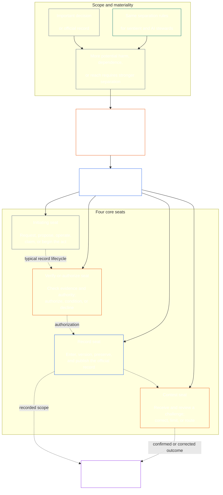

<!-- Draft for eventual path translations/fr/core_08_functional_independence_separation_of_duties.md -->
**Status:** AI-assisted translation draft; unreviewed. Not an official translation or attestation.

**Source:** `core_08.000_functional_independence_separation_of_duties.md`; edition `SC-Corpus-2026.10.21`; revision `5adf22f3d58520385afb9dc2bcb2f439346175fb`; SHA-256 `d9a573839564fa3a2e920fff4d2ecb4ccc8a7b560d8aef65656a356de09fdfda`.

**Scope:** Full Chapter Eight, including reading guides, trace blocks, tables, and diagrams. Links are written for the eventual `translations/<locale>/` destination. English remains controlling.

# CHAPITRE HUIT : INDÉPENDANCE FONCTIONNELLE ET SÉPARATION DES TÂCHES

<strong>Placement de corpus (non opératoire) : structure des fichiers et règles de lecture</strong>

> Ce fichier est **partie de la Constitution Sentient** et est **lier seulement ensemble** avec l'autre numéroté `core_*` fichiers lus comme un seul texte. Il contient **Chapitre huit**: l’exigence transversale d’indépendance fonctionnelle et de séparation des tâches. Il suit [Chapitre sept](../../core_07.000_charters.md#chapter-seven-system-and-institutional-charters), qui énonce la Charte du système ou la Charte institutionnelle qui porte le plan des sièges publié, et précède les chapitres du processus constitutionnel commençant par [Certification d'alignement du système du chapitre neuf](../../core_09.000_system_alignment_certification_evaluation.md#chapter-nine-system-alignment-certification).
>
> - **Propriétaire constitutionnel :** l'exigence de séparation des tâches pour les actes matériellement contraignants, satisfaite par des sièges distincts ; le contenu minimum universel de chaque [Acte matériellement contraignant](../../core_05.035_band_accountability.md#materially-binding-act-record); indépendance de l'acteur et de l'acteur [Ligne de contrôle des matériaux](../../core_05.035_band_accountability.md#material-control-line); voie publiée et placement des rôles ; conflit, vacance, substitution et mauvais acheminement des sièges ; hébergement fusionné proportionné ; transferts attribuables ; et les conditions minimales d’indépendance que tout processus constitutionnel ultérieur doit appliquer.
> - **Source de la couche principe :** [Chapitre un §18.3](../../core_01.010_stewardship_capacity_principles.md#183-separation-of-duties) nécessite une gouvernance pour préserver l’indépendance fonctionnelle et achemine ici l’architecture des sièges opérationnels.
> - **Propriétaire de l'implémentation :** [CJS-5.125 §11](../../corpus_joint_structure/cjs_05.125_accountability_operations.md#constitutional-lane-and-functional-separation) (*Voie constitutionnelle et séparation fonctionnelle*), [CI-8.205 §2](../../corpus_institutions/ci_08.205_institutional_design_separation_of_powers.md#ci-8205-2-functional-separation-lanes), et [CI-14.205 §6](../../corpus_institutions/ci_14.205_appointment_competency_rotation_removal.md#ci-14205-6-seat-catalog--process-role-archetypes-and-operational-boundaries) placer et opérationnaliser les sièges. Ils peuvent être plus stricts et ajouter des types de sièges limités aux autorités spéciales ; ils ne peuvent pas restreindre ce chapitre.
> - **L'application spécifique au processus reste en aval :** Le chapitre neuf applique cette exigence à la certification d’alignement de systèmes et à la certification d’alignement institutionnel ; [Chapitre dix §3.7](../../core_10.000_standing_assessment.md#37-separation-of-duties) l'applique aux enregistrements permanents ; Chapitre treize et [corpus_forum.md](../../corpus_forum.md) appliquez-le au processus du forum. Ces chapitres peuvent ajouter les garanties requises par leur objet ; ils ne peuvent pas créer un substitut plus faible.
>
> Ordre de lecture : §1 objectif et portée → §2 Exigence de quatre sièges → §3 indépendance et conflits → §4 Acheminement des mauvais sièges → §5 placement publié, remplacements et délégation → §6 mise à l'échelle proportionnelle → §7 urgences → §8 Act Records et transferts → §9 application en aval.

<strong>Tracer</strong>

- En amont:
  - [Tétrade constitutionnelle](../../core_00.000_preamble.md#constitutional-tetrad) - en particulier **surveillance** et **responsabilité**;
  - [enjeu matériel](../../core_00.000_preamble.md#material-stake);
  - [Chapitre un §17.1 Norme de gestion partagée](../../core_01.010_stewardship_capacity_principles.md#171-shared-stewardship-standard) (1,015 §17.1) ;
  - [Chapitre un §18 Gouvernance dans le cadre de la discipline d'intendance](../../core_01.010_stewardship_capacity_principles.md#18-governance-under-stewardship-discipline) (1,015 §18) ;
  - [Article XVI](../../core_06.010_rights_part_c.md#article-xvi-audit-transparency-and-independent-verification) (*Audit, transparence et vérification indépendante*).
- Sous-sections :
  - [§1](#1-purpose-scope-and-owner-boundary);
  - [§2](#2-four-seat-constitutional-requirement);
  - [§3](#3-independence-conflict-and-control-lines);
  - [§4](#4-wrong-seat-routing);
  - [§5](#5-published-placement-vacancy-and-substitution);
  - [§6](#6-proportional-scaling-and-merged-hosting);
  - [§7](#7-emergency-and-urgent-action);
  - [§8](#8-act-records-and-attributable-handoffs);
  - [§9](#9-relationship-to-later-processes).
- En aval:
  - [Chapitre neuf](../../core_09.000_system_alignment_certification_evaluation.md#chapter-nine-system-alignment-certification) (9 000);
  - [Chapitre dix](../../core_10.000_standing_assessment.md#chapter-ten-contribution-violation-and-standing-model--measurement) (10 000);
  - [Chapitre treize](../../core_13.000_forum.md#chapter-thirteen-forums-and-jurisdiction) (13 000);
  - [Chapitre quatorze](../../core_14.000_governance.md#chapter-fourteen-constitutional-contract-legitimacy-authorization-and-stewardship) (14 000); texte de mise en œuvre désigné mentionné ci-dessus.
- Lire avec :
  - [Chapitre un §19.3 Détection de désalignement](../../core_01.010_stewardship_capacity_principles.md#193-misalignment-detection) (1.015 §19.3) (*détection et examen pluriels*);
  - [Action attribuable](../../core_05.035_band_accountability.md#attributable-action);
  - [Intégrité de l'attribution](../../core_05.035_band_accountability.md#attribution-integrity);
  - [Auditabilité](../../core_05.050_band_oversight.md#auditability);
  - [Contestabilité](../../core_05.035_band_accountability.md#contestability);
  - [Proportionnalité](../../core_05.035_band_accountability.md#proportionality).

 

Le chapitre huit est le propriétaire constitutionnel du **exigence d’indépendance fonctionnelle et de séparation des tâches pour les actes matériellement contraignants**.

### 1. Objectif, portée et limites du propriétaire

<strong>Tracer</strong>

- En amont : réclamation du propriétaire d’ouverture de chapitre ; [Chapitre un §18](../../core_01.010_stewardship_capacity_principles.md#18-governance-under-stewardship-discipline) (1,015 §18) ; [Surveillance](../../core_05.020_apex_oversight_leg.md#oversight-constitutional); [Responsabilité](../../core_05.005_apex_accountability_leg.md#accountability).
- En aval: [§2](#2-four-seat-constitutional-requirement) à travers [§9](#9-relationship-to-later-processes); tout processus ultérieur qui produit ou modifie un acte matériellement contraignant.
- Lire avec :
  - [Chapitre quatre](../../core_04.000_burden_traceability_verification.md#chapter-four-burden-of-proof-traceability-and-verification) (4.000) pour le substrat de vérification ;
  - [Article XIII-A](../../core_06.010_rights_part_c.md#article-xiii-a-reliability-and-trustworthiness-baseline) (*Référence de fiabilité et de fiabilité*) et
  - [Article XIII-B](../../core_06.010_rights_part_c.md#article-xiii-b-right-to-redress-and-remedy) (*Droit à réparation et recours*) pour contestation et réparation ;
  - [Article XVI](../../core_06.010_rights_part_c.md#article-xvi-audit-transparency-and-independent-verification) (*Audit, transparence et vérification indépendante*) pour les planchers de droits à vérification indépendante.

 

*En termes simples : avant de pouvoir faire confiance à un processus constitutionnel – ou à une décision au niveau des parties prenantes au sein d’un système, d’une institution ou d’un domaine de décision limité –, les emplois qui s’y trouvent doivent être séparés. Cette exigence s'applique à la fois au [Couche de contrat constitutionnel](../../core_05.045_band_integrative.md#constitutional-contract-layer) et à [Participation au système des parties prenantes](../../core_05.055_band_participation.md#stakeholder-status-and-weight). Un bureau sensible, un système d’IA, un organisme de parties prenantes ou un représentant cherchant un résultat ne peut pas non plus fournir le contrôle prétendument indépendant, contrôler le dossier officiel de ce contrôle ou décider de sa contestation.*

Ce chapitre s'applique à chaque [Acte matériellement contraignant](../../core_05.035_band_accountability.md#materially-binding-act), tel que le définit le chapitre cinq, notamment :

- une décision;
- une autorisation ou une certification;
- une constatation ;
- une entrée dans un dossier ou un changement de version important ;
- une version, un déploiement, une continuation ou un retrait ;
- un décaissement ou une allocation ; et
- une disposition d'un défi.

Ce chapitre ne s’applique pas à un exploitant de classe P. Ses actes restent à l'intérieur de son [unité privée](../../core_05.050_band_oversight.md#domain-specific-materiality-private-unit), un seul sensible, un foyer ou un cercle privé étroitement délimité dont les membres ont tous choisi d'en faire partie, et une partie opérationnelle dont d'autres doivent suivre ou sur lesquels peuvent s'appuyer tels qu'établis sont au moins de classe L selon **CS-9.305 (*Machines de classification des systèmes*) et CS-9.310** (*Machines de classification des systèmes*). Un seul sensible doté d’un ordinateur n’a pas besoin d’un deuxième titulaire de siège. Cette exigence s'applique à partir du jour où l'exploitant prend un acte matériellement contraignant.

Les sièges de ce chapitre définissent qui peut faire quoi pour un acte particulier ; ce ne sont pas des titres de poste. Le même sensible, bureau ou système peut occuper différents sièges pour différents actes. Un titre, une délégation, une capacité technique ou l'aptitude à accomplir une démarche n'agrandissent pas le siège détenu pour cet acte.

#### 1.1 Pourquoi les emplois sont séparés

*En termes simples : la même leçon a été apprise encore et encore dans les affaires, le gouvernement et la sécurité nucléaire. Lorsqu’une partie peut commencer un acte, l’approuver, l’écrire et juger toute plainte à son sujet, personne d’autre n’est en mesure de déceler une erreur ou un mensonge.*

Cette sous-section explique les raisons de cette exigence. Il est non opérationnel : les règles contraignantes sont en [§2 Exigence constitutionnelle de quatre sièges](#2-four-seat-constitutional-requirement) à travers [§9 Relation avec les processus ultérieurs](#9-relationship-to-later-processes).

Plusieurs domaines sont parvenus à la même idée à eux seuls :

- **Comptabilité et contrôle interne :** Les entreprises et les auditeurs ont longtemps divisé le travail consistant à autoriser une transaction, à l'enregistrer, à détenir les actifs et à rapprocher les livres, de sorte qu'aucun commis ne puisse à la fois prendre de l'argent et cacher ce prélèvement. Les cadres de contrôle interne tels que le COSO établissent une séparation des tâches entre leurs activités de contrôle de base.
- **Séparation des pouvoirs au sein du gouvernement :** Montesquieu a soutenu dans *L'esprit des lois* (1748) que la liberté est en danger lorsqu'un seul corps fait, exécute et juge les lois. James Madison, dans *Fédéraliste n°51* (1788), défendait une conception dans laquelle chaque branche avait les moyens de résister aux autres. Depuis, de nombreuses constitutions ont divisé le pouvoir de manière similaire.
- **Règles à deux :** L’armée américaine exige que deux membres d’équipage autorisés agissent ensemble avant que certaines armes nucléaires puissent être lancées ou accessibles, afin qu’aucun d’entre eux ne puisse agir seul (Instruction de l’Air Force 91-104). Les banques installent depuis longtemps des clés doubles sur les coffres-forts pour la même raison. Une règle de deux personnes confirme qui agit et si l'ordre est authentique, et non si l'ordre est solide. C'est pourquoi ce chapitre demande un contrôle indépendant, et pas seulement une seconde signature.
- **Que se passe-t-il sans séparation :** À la Barings Bank en 1995, Nick Leeson dirigeait à la fois le bureau de négociation de Singapour et le back-office qui réglait et enregistrait les transactions. Il a caché ses pertes dans un compte secret. Un audit interne réalisé en 1994 avait signalé ce rôle combiné comme un risque majeur, mais la direction l'a laissé en place. La banque, alors vieille de plus de deux siècles, s'est effondrée en février 1995 avec des pertes d'environ 2,2 milliards de dollars singapouriens et a été vendue à ING.

Ces exemples ne montrent pas qu’un système est parfait. Ils montrent que l’idée est ancienne et largement utilisée, et que le manque de séparation est une cause d’échec récurrente. Ce sont des raisons, pas une autorité.

#### 1.2 Pourquoi quatre sièges

*En termes simples : deux emplois, c’est trop peu et trois laissent un vide. Quatre tâches couvrent le début de l'acte, sa vérification, la tenue du procès-verbal officiel et l'audition d'une contestation.*

Cette sous-section explique les raisons du chiffre quatre. Il est non opérationnel : les sièges et leur règlement sont en [§2 Exigence constitutionnelle de quatre sièges](#2-four-seat-constitutional-requirement).

- **Deux, c'est trop peu :** Une paire de créateurs et de vérificateurs empêche une partie d'approuver son propre acte. Cela ne laisse personne pour tenir le dossier officiel ou entendre une plainte, de sorte que celui qui détient le dossier peut tranquillement changer ce qui s'est passé, et le couple finit par juger les plaintes concernant son propre travail.
- **Trois pouvoirs conviennent au gouvernement, pas à tous les actes :** Faire, exécuter et juger un gouvernement. Un acte unique a également besoin d'un enregistrement qui lui survit et d'une voie de contestation qui ne passe pas par l'acteur ou l'approbateur.
- **Quatre correspond aux points d'échec :** Un siège déclenche l'acte, un autre le vérifie et l'autorise, un tient le procès-verbal officiel et un entend les contestations. Cela fait écho aux divisions comptables entre l’autorisation, l’enregistrement et la révision.
- **L’automatisation permet de combler facilement l’écart :** Un système peut agir, se déconnecter et enregistrer son propre travail en une seule étape, et son journal ressemble alors à une preuve. [§2 Exigence constitutionnelle de quatre sièges](#2-four-seat-constitutional-requirement) considère cela comme détenant trois sièges à la fois.
- **Les petits adoptants peuvent toujours se conformer :** [§6 Mise à l'échelle proportionnelle et hébergement fusionné](#6-proportional-scaling-and-merged-hosting) permet à un petit adoptant de placer un siège auprès d'un organisme indépendant ou, sous conditions, de placer deux sièges dans un seul bureau. Le siège de vérification ou d'autorisation n'est jamais fusionné avec le siège d'enregistrement ou le siège de concours.

### 2. Exigence constitutionnelle de quatre sièges

<strong>Tracer</strong>

- En amont: [§1](#1-purpose-scope-and-owner-boundary); [Chapitre un §18.3](../../core_01.010_stewardship_capacity_principles.md#183-separation-of-duties) (1,015 §18.3) ; [Chapitre un §17.1](../../core_01.010_stewardship_capacity_principles.md#171-shared-stewardship-standard) (1.015 §17.1).
- En aval: [§3](#3-independence-conflict-and-control-lines) à travers [§9](#9-relationship-to-later-processes); [CI-14.205 §6](../../corpus_institutions/ci_14.205_appointment_competency_rotation_removal.md#ci-14205-6-seat-catalog--process-role-archetypes-and-operational-boundaries) (*Catalogue de sièges — archétypes de processus-rôle et limites opérationnelles*).
- Lire avec : [§6](#6-proportional-scaling-and-merged-hosting) pour le seul chemin d’hébergement fusionné autorisé.

 

*En termes simples : la séparation des tâches est l’exigence de tout acte matériellement contraignant (le **Exigence de quatre sièges**), et quatre tâches permettent d'y parvenir : demander ou agir, vérifier, tenir le procès-verbal officiel et entendre le défi. Les emplois restent distincts même lorsqu'une petite organisation est autorisée à en placer une paire autorisée dans un même bureau.*

<strong>Guidage du lecteur (non opérationnel) : carte à quatre places</strong>

> **Lecteur de carte (non opérationnel).** Ce diagramme montre les quatre sièges et un cycle de vie typique d'un enregistrement. Il n'ajoute pas un cinquième siège de mise en œuvre, n'exige pas qu'un examen soit terminé avant chaque action, ni ne modifie les règles opérationnelles de cette section et des §§3 à 6.

 

Les flèches en pointillés à l'intérieur du panier de siège montrent un cycle de vie typique d'un disque. Les flèches vers la mise en œuvre sont des liens de trace, et non une séquence d'attente de révision obligatoire.

Chaque acte matériellement contraignant comporte quatre sièges fonctionnellement distincts. Le chapitre cinq fournit leurs significations canoniques ; cette section indique les règles de placement et d'incompatibilité entre processus :

1. **[Siège initial](../../core_05.035_band_accountability.md#initiating-seat)** — demande, propose, opère, revendique ou commence de toute autre manière l'acte.
2. **[Vérifier ou autoriser le siège](../../core_05.035_band_accountability.md#verify-or-authorize-seat)** — vérifie les preuves et l'autorité par rapport à la norme en vigueur et vérifie, autorise, refuse ou conditionne l'acte.
3. **[Siège record](../../core_05.035_band_accountability.md#record-seat)** — saisit, versions, conserve, conserve et publie le [Dossier d'acte](../../core_05.035_band_accountability.md#materially-binding-act-record) de ce que le siège de vérification ou d'autorisation a déterminé.
4. **[Siège du concours](../../core_05.035_band_accountability.md#contest-seat)** — reçoit et examine une contestation, ordonne des corrections ou des limites lorsque cela est autorisé, et achemine tout problème hors de son autorité.

Ces sièges s’appliquent aussi bien aux intendants humains qu’aux intendants de l’IA. Si un système exécute un acte, le signe, puis utilise son propre journal comme preuve, il occupe simultanément les postes d'initiation, de vérification et d'enregistrement. L'automatisation du processus ne rend pas le contrôle indépendant.

Les combinaisons suivantes sont interdites sur un même acte :

- le siège initiateur ne doit pas vérifier ou autoriser son propre acte ;
- le siège de vérification ou d'autorisation ne doit pas détenir le siège d'enregistrement ;
- le siège de vérification ou d'autorisation ne doit pas détenir le siège de concours ; et
- l'opérateur d'un système, ou l'autorité dirigeante d'une institution, ne doit pas vérifier ou autoriser un acte concernant ce système ou cette institution.

Les chapitres ultérieurs ou le texte de mise en œuvre incorporé peuvent interdire des appariements supplémentaires pour un processus particulier. Ils ne peuvent pas autoriser un appariement interdit ici.

L’exigence de séparation des tâches s’applique à chaque classe, et les quatre sièges permettent de la satisfaire. La question à l’échelle des classes est de savoir si ces sièges peuvent être fusionnés ou partager un titulaire. Pour une institution ou un système opérant au sein de :

- Portée de classe C, une séparation complète à quatre sièges est toujours recommandée ;
- Portée de classe B, une séparation complète à quatre sièges devrait presque toujours être requise ; et
- Portée de classe A, une séparation complète à quatre sièges est toujours requise.

Lorsque la portée est mixte ou que la classification est incertaine, appliquez la position applicable la plus élevée jusqu'à ce que le dossier prenne en charge une position inférieure.

### 3. Indépendance, conflits et lignes de contrôle

<strong>Tracer</strong>

- En amont: [§2](#2-four-seat-constitutional-requirement); [Responsabilité à l'échelle de l'autorité](../../core_01.010_stewardship_capacity_principles.md#181-governance-as-authorized-structure); [Article XXV](../../core_06.015_rights_part_d.md#article-xxv-constitutional-interpretation-review-and-anti-capture-safeguards) (*Interprétation constitutionnelle, révision et garanties anti-capture*).
- En aval: [§4](#4-wrong-seat-routing); [§5](#5-published-placement-vacancy-and-substitution); [§8](#8-act-records-and-attributable-handoffs); Chapitre neuf : rôles des composants de certification ; Garde des dossiers du chapitre dix ; Chapitre treize forum anti-auto-jugement.
- Lire avec : [Ligne de contrôle des matériaux](../../core_05.035_band_accountability.md#material-control-line); [CI-8.210](../../corpus_institutions/ci_08.210_conflict_integrity_anti_capture_anti_corruption.md) (*Intégrité des conflits, anti-capture et anti-corruption*) et [CF-13.425](../../corpus_forum/cf_13.425_integrity_safeguards_anti_capture_anti_self_judging.md) (*Garanties d'intégrité, opérations anti-capture et soutien anti-auto-jugement*) pour les conflits opérationnels et les garanties anti-auto-jugement.

 

*En clair : changer le nom sur le bureau ne crée pas d’indépendance. Une autorité de vérification ou un examinateur n'est pas indépendant lorsque le sensible ou le bureau qui recherche le résultat peut les diriger, les révoquer, les récompenser, les punir ou les annuler discrètement sur cet acte.*

L’indépendance fonctionnelle est jugée par l’autorité et le contrôle réels, et non par les étiquettes. Sur le même acte :

- le siège de vérification ou d'autorisation et le siège de concours doivent être à l'extérieur du siège initiateur [Ligne de contrôle des matériaux](../../core_05.035_band_accountability.md#material-control-line);
- un parti dont le propre intérêt est déterminé par la loi ne doit pas détenir le siège de vérification ou d'autorisation ou de contestation ;
- un détenteur de dossier en conflit doit transmettre ce dossier, avec sa piste d'audit complète, au substitut publié plutôt que de trancher le conflit ou d'abandonner la garde ; et
- la récusation supprime l'autorité sur l'acte; il ne transfère pas le siège au demandeur, à la ligne hiérarchique du demandeur ou à la personne la plus proche.

Tracez le [Ligne de contrôle des matériaux](../../core_05.035_band_accountability.md#material-control-line) pour l'acte en question. L’infrastructure partagée, le soutien administratif ou l’historique des nominations ne suffisent pas à établir la limite, mais ces arrangements ne doivent pas mettre en échec un jugement indépendant dans la pratique.

L'indépendance n'est pas satisfaite par une deuxième signature, un comité nominal, une étiquette interne ou une attestation générée par un outil où le prétendu contrôle manque d'autorité, d'accès aux preuves, d'absence de contrôle matériel ou d'une réelle capacité de refus et d'acheminement.

### 4. Acheminement au mauvais siège

<strong>Tracer</strong>

- En amont: [§2](#2-four-seat-constitutional-requirement); [§3](#3-independence-conflict-and-control-lines).
- En aval: [§5](#5-published-placement-vacancy-and-substitution); [§8](#8-act-records-and-attributable-handoffs); [CI-14.205 §6 règles relatives aux sièges partagés](../../corpus_institutions/ci_14.205_appointment_competency_rotation_removal.md#ci-46-shared-seat-rules).
- Lire avec : [Chapitre premier §17.5 Devoir de résister](../../core_01.010_stewardship_capacity_principles.md#175-duty-to-resist) (1.015 §17.5).

 

*En termes simples : lorsqu’un pas ne vous appartient pas, ne le faites pas en silence et ne vous en éloignez pas simplement. Enregistrez l'écart et transmettez l'affaire au bon endroit. Mieux encore, construisez le processus de manière à ce que chaque étape aille au bon endroit sans que personne ne s'en aperçoive.*

Le routage des mauvais sièges doit être intégré au processus dans la mesure du possible. Une entrée, une file d'attente, un flux de travail ou une interface doit envoyer chaque étape à son poste publié dès le début, afin qu'une étape ne soit pas proposée à un siège qui ne peut pas la suivre. Routage automatisé :

- fait suite au placement publié sous [§5 Placement publié, poste vacant et substitution](#5-published-placement-vacancy-and-substitution) et les itinéraires selon le siège, et non selon le bien-fondé de l'acte ;
- enregistre chaque itinéraire comme l'exige le point 3 ci-dessous ;
- suit le chemin de remplacement ou indépendant publié sous [§5.3 Un siège que la carte laisse non placé, ou un titulaire qui ne peut pas servir](#53-a-seat-the-map-leaves-unplaced-or-a-holder-who-cannot-serve) lorsqu'un titulaire ne peut pas servir, conserve l'affaire et enregistre l'écart lorsqu'aucun siège, remplaçant ou chemin indépendant n'est placé, plutôt que de l'envoyer au siège le plus proche, le plus rapide ou le plus ancien ; et
- n'est pas lui-même titulaire d'un siège et ne peut pas changer le titulaire d'un siège ; seul l'emplacement publié le fait.

Lorsque l'acheminement n'est pas automatisé ou échoue, les obligations ci-dessous s'appliquent au steward. Un commissaire invité à faire un pas hors de son siège doit :

1. refuser cette mesure sans prétendre en décider le bien-fondé ;
2. nommer le siège qui pourra l'occuper et, le cas échéant, son titulaire ou son suppléant ;
3. enregistrer la demande, le siège occupé, l'écart ou le conflit et l'itinéraire emprunté ;
4. préserver les preuves et l'intégrité de tout dossier déjà reçu ; et
5. itinéraire sans retard évitable.

Cette réponse est l’accomplissement d’un devoir et non l’abandon de l’acte. L'acte se déroule par le siège droit. Faire le pas parce que le steward est le plus proche, le plus rapide, le plus expérimenté ou le plus compétent n'est pas une solution à un siège manquant.

### 5. Placement publié, poste vacant et substitution

<strong>Guide du lecteur (non opérationnel) : comment cette section est présentée</strong>

- [§5.1 Ce que doit dire la carte](#51-what-the-map-must-say) répertorie ce que nomme la Charte des rôles : qui héberge chaque siège, pour quels actes, les fusions autorisées, le remplaçant, la voie indépendante et la version.
- [§5.2 Où la carte est conservée](#52-where-the-map-is-kept) indique que la carte se trouve dans ou avec la Charte du système ou la Charte institutionnelle, qu'un membre d'un groupe peut adopter la carte partagée du groupe par référence et qu'un adoptant de classe P n'a pas besoin d'en publier une.
- [§5.3 Un siège que la carte laisse non placé, ou un titulaire qui ne peut pas servir](#53-a-seat-the-map-leaves-unplaced-or-a-holder-who-cannot-serve) dit qu'un écart est un défaut à enregistrer et à corriger, que le siège ne passe pas à l'acteur ou à la ligne de contrôle de l'acteur, et que l'acte se dirige entre-temps vers le chemin de substitution ou indépendant.
- [§5.4 Délégation](#54-delegation) dit qu'un siège ne peut être délégué qu'à un député ou remplacer les noms de carte, et que cette délégation conserve la limite du siège et ne peut pas créer, fusionner ou élargir un siège.

<strong>Tracer</strong>

- En amont:
  - [§2](#2-four-seat-constitutional-requirement);
  - [§3](#3-independence-conflict-and-control-lines);
  - [Transparence](../../core_05.050_band_oversight.md#transparency);
  - [Auditabilité](../../core_05.050_band_oversight.md#auditability).
- En aval: [§8](#8-act-records-and-attributable-handoffs); [CI-8.205 §2](../../corpus_institutions/ci_08.205_institutional_design_separation_of_powers.md#ci-8205-2-functional-separation-lanes) (*Voies de séparation fonctionnelle*); [CI-14.205 §5](../../corpus_institutions/ci_14.205_appointment_competency_rotation_removal.md#ci-14205-5-authorized-roles-and-accountability-chains) (*Rôles autorisés et chaînes de responsabilité*); Enregistrements des chapitres neuf et dix.
- Lire avec :
  - [Charte du système](../../core_05.040_band_continuity.md#system-charter),
  - [Charte institutionnelle](../../core_05.040_band_continuity.md#institutional-charter);
  - [Chapitre sept §4 La carte des rôles de la Charte et la garde permanente des dossiers](../../core_07.000_charters.md#4-the-charter-role-map-and-standing-record-custody) (7.000 §4) ; et
  - [Chapitre quatorze §5](../../core_14.000_governance.md#5-authorized-roles-competency-development-and-contribution) (14.000 §5).

 

*En termes simples : une organisation doit indiquer qui occupe chaque poste avant l'arrivée du cas difficile, y compris qui prend la relève lorsque le titulaire ordinaire est absent ou en conflit.*

#### 5.1 Ce que doit dire la carte

Tout adoptant de classe L ou supérieure qui prend des actes matériellement contraignants doit maintenir un document publié, vérifiable et contestable. [Carte des rôles de la Charte](../../core_05.040_band_continuity.md#charter-role-map) qui identifie :

- quelle voie, bureau, rôle ou processus héberge chaque siège ;
- les actes et la portée pour lesquels ce placement s'applique ;
- chaque accord d'hébergement fusionné autorisé et sa garantie d'indépendance ;
- chaque suppléant ou suppléant pouvant exercer un siège, y compris pour un titulaire absent, exclu, capturé ou en conflit ;
- l'itinéraire indépendant lorsqu'aucun remplaçant qualifié n'est disponible ; et
- sa version et sa date d'entrée en vigueur, afin qu'un acte soit jugé par rapport à la carte en vigueur au moment où il a été pris.

#### 5.2 Où la carte est conservée

La carte est conservée chez ou chez l'adoptant [Charte du système](../../core_05.040_band_continuity.md#system-charter) ou [Charte institutionnelle](../../core_05.040_band_continuity.md#institutional-charter).

Un membre d'un groupe qui publie une carte partagée pour les sièges qu'il héberge peut adopter cette carte par référence ([§6.3 Sièges détenus en commun](#63-seats-held-in-common)), et nomme toujours son propre itinéraire de substitution et indépendant.

Un adoptant de classe P est en dehors de ce chapitre ([§1 Objectif, portée et limite du propriétaire](#1-purpose-scope-and-owner-boundary)) et n'a pas besoin de publier une carte. Elle peut toujours en publier un, seul ou accompagné d'un système volontaire ou d'une charte institutionnelle ([Chapitre sept §4 La carte des rôles de la Charte et la garde permanente des dossiers](../../core_07.000_charters.md#4-the-charter-role-map-and-standing-record-custody)).

#### 5.3 Un siège que la carte laisse non placé, ou un titulaire qui ne peut pas servir

Un siège non placé, ou un titulaire absent, exclu, capturé ou en conflit, est un défaut de gouvernance à enregistrer et à corriger.

- Le siège ne revient pas automatiquement au siège initiateur, à une partie intéressée, à un opérateur ou à un supérieur hiérarchique. [Ligne de contrôle des matériaux](../../core_05.035_band_accountability.md#material-control-line).
- Jusqu'à ce qu'il soit corrigé, l'acte s'oriente vers la voie de substitution ou indépendante publiée, quelle que soit l'urgence de l'acte.
- Pour un siège de certification que la Charte des rôles laisse non placé, la correction doit respecter les fenêtres de réponse et de résolution, comptées à partir de l'avis enregistré de l'écart, comme indiqué dans [Chapitre sept §4.7.4 Sièges de certification](../../core_07.000_charters.md#474-certification-seats).

#### 5.4 Délégation

Un titulaire de siège ne peut déléguer son siège qu'à un député ou un suppléant dont le [Carte des rôles de la Charte](../../core_05.040_band_continuity.md#charter-role-map) noms. Une délégation à quelqu'un d'autre laisse le siège sans place, et [§5.3 Un siège que la carte laisse non placé, ou un titulaire qui ne peut pas servir](#53-a-seat-the-map-leaves-unplaced-or-a-holder-who-cannot-serve) s'applique. Nommer un nouveau député ou suppléant modifie la carte ([Chapitre sept §4.5 Modification des règles de siège et des titulaires de siège](../../core_07.000_charters.md#45-changing-seat-rules-and-seat-holders)). Une délégation ne peut pas le faire.

Une délégation conserve les mêmes limites de siège, les mêmes tâches de preuve, le même dossier et la même horloge, et le délégué reste soumis aux [Ligne de contrôle des matériaux](../../core_05.035_band_accountability.md#material-control-line). Il ne crée pas de nouveau siège, ne fusionne pas les sièges et ne permet pas à un délégué de faire ce que le siège délégant ne pouvait pas faire. Un délégué qui détient un deuxième siège sur le même acte est une fusion, et seuls les arrangements d'hébergement fusionnés répertoriés sur la carte sous [§6 Mise à l'échelle proportionnelle et hébergement fusionné](#6-proportional-scaling-and-merged-hosting) en autoriser un.

Un titulaire peut utiliser du personnel ou des outils pour l'aider dans le travail du siège, comme la collecte de preuves, la rédaction ou l'exécution de contrôles de routine. Il s’agit d’une assistance, pas d’une délégation. Le titulaire prend toujours les décisions du siège, reste responsable du résultat et reste responsable de l'indépendance du siège. Si quelqu'un d'autre prend une décision ou fait une démarche au nom du siège, il s'agit d'une délégation et doit respecter ce paragraphe. L’assistance ne peut pas être utilisée pour faire ce que le siège lui-même ne pourrait pas faire, notamment faire pression sur les détenteurs d’autres sièges pour qu’ils déterminent l’issue d’un acte.

### 6. Mise à l'échelle proportionnelle et hébergement fusionné

<strong>Guide du lecteur (non opérationnel) : comment cette section est présentée</strong>

- [§6.1 Comment s'échelonne la séparation](#61-how-separation-scales) dit que la force, le personnel, la redondance et la formalité de la séparation varient en fonction de l'enjeu, de la classe sociale, de la dépendance et des dommages prévisibles, tandis que les quatre sièges restent distincts.
- [§6.2 Fusion de deux sièges en un seul bureau](#62-merging-two-seats-in-one-office) énumère les conditions dans lesquelles un adoptant petit ou informel peut placer deux sièges dans un même bureau, ainsi que les paires qui restent interdites.
- [§6.3 Sièges détenus en commun](#63-seats-held-in-common) explique comment une petite entreprise place un siège auprès d'une coopérative, d'une association ou d'un autre organisme indépendant, ainsi que les règles d'indépendance qui s'appliquent.
- [§6.4 Pratique professionnelle conjointe](#64-joint-professional-practice) indique comment un cabinet sensible ou un petit cabinet de classe L ou supérieure peut placer ses sièges chez un hôte et adopter les documents de l'hôte, pour tout travail, et ce qui s'applique de plus aux actes qui nécessitent un permis d'exercice ou une autorisation d'exercice.
- [§6.5 Travail informel et communautaire](#65-informal-and-community-work) dit qu'un tel travail peut faire appel à un organisme de confiance indépendant doté d'une autorité publiée pour le contrôle.
- [§6.6 Enjeu, classe et ce qui ne justifie pas une fusion](#66-stake-class-and-what-does-not-justify-a-merger) affirme qu'un enjeu élevé maintient la présomption de bureaux séparés et que le personnel, la rapidité ou la commodité ne justifient jamais à eux seuls une fusion.

<strong>Tracer</strong>

- En amont:
  - [§2](#2-four-seat-constitutional-requirement);
  - [enjeu matériel](../../core_00.000_preamble.md#material-stake);
  - [Nécessité](../../core_05.035_band_accountability.md#necessity);
  - [Proportionnalité](../../core_05.035_band_accountability.md#proportionality).
- En aval: [Chapitre dix §3.7](../../core_10.000_standing_assessment.md#37-informal-and-small-scope-records) (10.000 §3.7) ; [CJS-18.110 §4](../../corpus_joint_structure/cjs_18.110_specific_joint_interlocks.md#cjs-18110-4-class-scaled-lane-staffing-and-competency-redundancy) (*Dotation en personnel des couloirs et redondance des compétences à l'échelle de la classe*); [CI-8.205 §2](../../corpus_institutions/ci_08.205_institutional_design_separation_of_powers.md#ci-8205-2-functional-separation-lanes) (*Voies de séparation fonctionnelle*).
- Lire avec : [Fardeau évitable](../../core_05.040_band_continuity.md#avoidable-burden) et chapitre un [§3.3 Processus anti-dégradation](../../core_01.000_values_principles.md#33-anti-degrading-process).

 

*En termes simples : les petits groupes informels n’ont pas besoin de quatre grands départements. Ils ont besoin d’un véritable contrôle indépendant, d’un dossier utilisable et d’un parcours de contestation. L'échelle modifie la méthode de dotation, pas la séparation protégée.*

#### 6.1 Comment la séparation évolue

La force, le personnel, la redondance et la formalité de la séparation varient en fonction de l'enjeu matériel, de la classe du système, de la dépendance et des dommages raisonnablement prévisibles.

#### 6.2 Fusionner deux sièges en un seul bureau

Un adoptant petit ou informel peut placer deux sièges dans un même bureau ou sensible uniquement lorsque tous les éléments suivants sont remplis :

- la fusion est nécessaire et proportionnée à son étendue ;
- il est publié, vérifiable, contestable et divulgué au procès-verbal de l'acte ;
- une garantie d'indépendance fait face aux risques créés par la fusion ;
- le siège initiateur ne vérifie ni n'autorise son propre acte ;
- le siège de vérification ou d'autorisation n'est jamais fusionné avec le siège d'enregistrement ou le siège de concours ; et
- une voie indépendante reste disponible lorsqu'un conflit, un préjudice matériel ou une contestation dépasse les limites légales du titulaire fusionné.

#### 6.3 Sièges détenus en commun

Une entreprise dirigée par un seul ou plusieurs sensibles peut placer son siège de vérification ou d'autorisation, d'enregistrement ou de contestation auprès d'une coopérative locale ou d'une association de telles entreprises, ou auprès de tout autre organisme de confiance indépendant. Il ne s’agit pas d’une fusion, car les sièges restent attribués à des titulaires distincts. C'est ainsi qu'une entreprise trop petite pour occuper quatre sièges répond néanmoins à l'exigence de séparation des tâches dans [§2 Exigence constitutionnelle de quatre sièges](#2-four-seat-constitutional-requirement). Les mêmes règles d'indépendance s'appliquent pour tout placement, auxquelles s'ajoutent ces règles pour le groupe :

- **Indépendant de l'entreprise :** Le titulaire est [indépendant](../../core_05.035_band_accountability.md#independence) de l’entreprise initiatrice. C'est en dehors de l'entreprise [Ligne de contrôle des matériaux](../../core_05.035_band_accountability.md#material-control-line), et rien de ce que décide la loi ne lui donne un enjeu. Un fournisseur, un prêteur, un propriétaire ou un client dont dépend l'entreprise n'est pas indépendant pour un acte concernant cette dépendance, comme un litige concernant le propre contrat du fournisseur, car l'acte décide également de quelque chose pour lui.
- **Une carte pour le groupe :** Le groupe en publie un [Carte des rôles de la Charte](../../core_05.040_band_continuity.md#charter-role-map) pour les sièges qu'il accueille, et chaque membre peut l'adopter par référence. La propre carte d'un membre nomme toujours son substitut et son itinéraire indépendant.
- **Se servir les uns les autres :** Les membres peuvent se représenter mutuellement leurs sièges dans différents actes. Deux membres ne peuvent pas contrôler les actes de chacun en tant que paire fermée, et une rotation ne peut pas acheminer un acte vers un titulaire à l'intérieur de la ligne de contrôle de son initiateur.
- **Les actes propres du groupe :** L'admission ou la révocation d'un membre, l'attribution d'un siège et le jugement sur l'acte d'un membre sont des actes matériellement contraignants du groupe. Pour ces actes le groupe :
  - occupe les quatre sièges ;
  - publie sa propre Charte du système ou Charte institutionnelle ; et
  - garde une voie indépendante en dehors de lui-même (un autre groupe, un forum ou une fonction publique), de sorte qu’il ne se juge jamais ni ne juge un membre qu’il contrôle.
- **Aucune contrainte :** Aucune entreprise n’est tenue d’y adhérer et aucun groupe n’est la seule voie à suivre.
- **Limites d’admission :** Un groupe peut refuser ou différer un candidat pour une raison liée à ce qu'il peut servir, de sorte qu'il ne soit jamais obligé d'accepter plus que ce qu'il peut transporter. Ces raisons incluent :
  - **Capacité:** le volume attendu d'actes matériels du demandeur épuiserait la capacité sur laquelle comptent les membres existants. Le groupe peut plafonner le volume qu'il prend à n'importe quel membre ou tenir une liste d'attente ;
  - **Ajuster:** le type d'actes ou de classe du candidat est en dehors de ce que les titulaires de siège du groupe sont qualifiés et dotés en personnel pour effectuer, comme un travail qui nécessite plus de redondance de compétences que celui dont dispose le groupe ([§6.6 Enjeu, classe et ce qui ne justifie pas une fusion](#66-stake-class-and-what-does-not-justify-a-merger));
  - **Indépendance:** les titulaires du groupe ne pouvaient pas signifier les actes du demandeur de manière indépendante, car le demandeur se trouve à l'intérieur du [Ligne de contrôle des matériaux](../../core_05.035_band_accountability.md#material-control-line) de l'un d'eux; et
  - **Conduire:** le candidat a déjà enfreint les conditions publiées par le groupe ou ne les acceptera pas.
- **Comment les limites sont appliquées :** Chaque limite d'admission :
  - est précisé dans la Charte Système ou la Charte Institutionnelle du groupe ([Chapitre Sept §3.1 Ce que dit une Charte du Système](../../core_07.000_charters.md#31-what-a-system-charter-states)), il est donc publié avant son application ;
  - s'applique de la même manière aux candidats similaires ;
  - n'est pas utilisé pour protéger les membres de la concurrence ou pour faire du groupe la seule voie d'accès à un siège dans sa zone ;
  - est expliqué par écrit au demandeur refusé ; et
  - peut être contesté par la voie indépendante en dehors du groupe, car décider d'admettre ou non un candidat est un acte matériellement contraignant du groupe (voir *Les propres actes du groupe*, au-dessus de).
- **Pas de piège :** Les conditions d'un groupe ne peuvent pas faire du siège un coût que l'entreprise ne peut pas supporter ([Fardeau évitable](../../core_05.040_band_continuity.md#avoidable-burden)).
- **Sortie:** Un membre qui part emporte ses archives avec lui. Le groupe ne peut pas les retenir ou faire dépendre leur départ du fait de les laisser derrière eux. Le groupe :
  - donne au membre une exportation complète de ses enregistrements Act et des données qu'ils contiennent, sous une forme que le membre ou un nouvel hôte peut utiliser ([CS-6.305 §1.2 Collecte et exportabilité critiques pour la continuité](../../corpus_systems/cs_06.305_information_types_and_handling.md#12-continuity-critical-collection-and-exportability)), et divulgue dès le départ toute limite légale à l'exportation ;
  - remet le siège d'enregistrement pour ces actes au détenteur des noms de membre et reste détenteur du siège d'enregistrement jusqu'à ce que le membre en nomme un, de sorte que les enregistrements d'acte restent reconstructibles pendant qu'une contestation, une correction ou un recours est ouvert ([§8 Enregistrements d'actes et transferts attribuables](#8-act-records-and-attributable-handoffs)); et
  - ne conserve que ce que ses propres fonctions requièrent encore, comme le dossier d'acte d'un acte qu'il a hébergé pour un autre membre ou d'un acte encore contesté, et seulement pendant la période de conservation qu'il a divulguée ([CS-6.305 §1.3 Avis de collecte et suppression](../../corpus_systems/cs_06.305_information_types_and_handling.md#13-collection-notice-and-deletion)).
- **Données conservées par le groupe :** Ce que le groupe conserve est géré par type de données sous [CS-6.310 §9 Classifications des données](../../corpus_systems/cs_06.310_data_classifications.md#cs-6310-9-data-classifications):
  - **Données d'identité et d'attribution (Type I) :** utilisé uniquement pour vérifier qui occupait chaque siège et qui a agi;
  - **Données de participation et de transaction (Type H) :** utilisé uniquement pour les tâches d'enregistrement, de vérification et de contestation de la loi ;
  - **Données sources de gouvernance (Type G) :** ouvert à l’audit et non public par défaut ;
  - **Matériel de sûreté, de sécurité et d’enquête (Type S) :** conservé uniquement pour son examen limité dans le temps ; et
  - **Les propres œuvres du membre (Type Y et Type W) :** restitués au membre et supprimés des copies du groupe lorsque le membre le demande.

#### 6.4 Pratique professionnelle conjointe

Un cabinet sensible ou de petite taille de classe L ou supérieure peut placer ses sièges chez un hôte et adopter les documents de l'hôte :

- **Qui peut être l’hôte :** Une association professionnelle, une coopérative, un employeur ou un registre public, quel que soit son siège.
- **Ce que la pratique adopte :** La carte publiée par l'hôte et la Charte institutionnelle, par référence, pour les actes qu'ils couvrent.
- **Tout travail :** Cette voie est ouverte à tous les actes du cabinet, qu'ils aient ou non besoin d'un permis d'exercice ou d'une autorisation d'exercice, de sorte qu'un cabinet effectuant les deux types de travail peut utiliser un seul hôte pour l'ensemble de celui-ci.
- **Les mêmes règles :** Les règles dans [§6.3 Sièges détenus en commun](#63-seats-held-in-common) s'appliquent à l'hôte et à la pratique, y compris l'indépendance de l'hôte par rapport à la pratique, les quatre sièges et un itinéraire indépendant pour les propres actes de l'hôte, les limites d'admission publiées et la règle pour un membre qui quitte.
- **Actes répertoriés :** Pour un acte répertorié pour un permis d’exercice ou une autorisation d’exercice sous [Article XI-E](../../core_06.005_rights_part_b.md#article-xi-e-institutional-formation-and-business-creation) (*Formation institutionnelle et création d'entreprise*), les standards de l'hébergeur proviennent également d'une constatation technique d'un forum, l'hébergeur vérifie que chaque praticien est titulaire de la licence ou de l'habilitation, et un hébergeur public en dernier recours admet tout titulaire. Pour les autres travaux, l'hôte admet et refuse uniquement pour des motifs [§6.3 Sièges détenus en commun](#63-seats-held-in-common), et il ne peut pas écrire de critères de compétence qui maintiennent un sensible hors du travail, ce que la Constitution n'impose pas.
- **Les tâches supplémentaires de l'hôte :** **CI-14.205 §7** (*Permis d'exercice, autorisation d'exercice et exercice professionnel conjoint*) indique les tâches supplémentaires de l'hôte et les garanties contre la capture.
- **Répond à l'exigence :** Rejoindre un hôte de cette manière répond à l'exigence de séparation des tâches dans [§2 Exigence constitutionnelle de quatre sièges](#2-four-seat-constitutional-requirement) pour les actes couverts par les documents de l'hébergeur.

#### 6.5 Travail informel et communautaire

Le travail informel, non rémunéré, d'entraide, de soins, de réparation, d'enseignement, de coopération et d'intendance communautaire peut utiliser un [indépendant](../../core_05.035_band_accountability.md#independence) organisme de confiance ayant une autorité publiée pour le contrôle concerné. La Constitution n’exige pas qu’un tel travail consiste à créer des bureaux formels, du personnel ou des procédures au-delà de ce que sa taille et ses moyens peuvent raisonnablement supporter, pour autant que le contrôle s’effectue par une voie véritablement indépendante et responsable.

#### 6.6 Enjeu, classe et ce qui ne justifie pas une fusion

Plus les enjeux sont élevés, plus l’attente de départ est forte que chaque siège occupe son propre bureau et que chaque poste dispose d’un remplaçant qualifié, ce qui signifie qu’il y a plus d’un sensible capable de le faire (redondance des compétences). Partager un siège via un groupe sous [§6.3 Sièges détenus en commun](#63-seats-held-in-common) ne diminue pas cette attente.

Le manque de personnel, la précipitation ou le désir de commodité ne suffisent pas à justifier la mise à disposition de deux sièges dans un seul bureau. Il n’est pas non plus possible d’avoir un expert qui en sait plus que quiconque. La classe règne en [§2 Exigence constitutionnelle de quatre sièges](#2-four-seat-constitutional-requirement) appliquer:

- **Classe A :** les quatre sièges ne sont jamais fusionnés.
- **Classe B ou Classe C :** une fusion n'est autorisée que si elle remplit toutes les conditions du présent article.

Plus les dommages qui pourraient en résulter et plus d’autres dépendent du travail, plus une fusion est difficile à justifier, et plus le travail nécessite des bureaux séparés, des titulaires de remplacement pour chaque travail et des remplaçants indépendants.

### 7. Urgence et action urgente

<strong>Tracer</strong>

- En amont:
  - [§2](#2-four-seat-constitutional-requirement);
  - [§6](#6-proportional-scaling-and-merged-hosting);
  - [Chapitre treize §6.1 Mesures d'urgence et charge de continuation](../../core_13.000_forum.md#61-emergency-measures-and-continuation-burden) (13.000 §6.1) ;
  - [posture intérimaire par défaut](../../core_01.005_interaction_interpretation.md#default-interim-posture).
- En aval : processus d'incident, de confinement, de libération, de continuation et d'examen post-événement dans le texte de mise en œuvre désigné.
- Lire avec : [Opportunité](../../core_05.030_apex_timeliness_leg.md#timeliness-constitutional), [Préservation des preuves](../../core_05.050_band_oversight.md#evidence-preservation), et [CI-14.205 §6 Catalogue de sièges — archétypes de processus-rôle et limites opérationnelles](../../corpus_institutions/ci_14.205_appointment_competency_rotation_removal.md#ci-46-seat-containment).

 

*En clair : une urgence réelle peut justifier d’agir avant la fin du contrôle ordinaire. Cela change la séquence, et non la propriété des sièges ou la posture de séparation à l’échelle des classes. Il ne permet pas à l’acteur de certifier sa propre suite, d’effacer la trace ou de devenir ensuite le critique final.*

Lorsqu'un retard créerait un risque raisonnablement prévisible de dommage grave et imminent, un siège d'initiation ou de confinement autorisé peut prendre l'action réversible minimale nécessaire avant que la vérification préalable ordinaire ne soit terminée, uniquement si :

- l'autorité d'urgence, sa portée, son début, son expiration et sa raison sont enregistrés immédiatement ou dès que cela est physiquement possible ;
- les preuves et les objections sont préservées ;
- le préavis et la participation sont rétablis dans les délais constitutionnels applicables ;
- un siège indépendant de vérification ou d'autorisation examine toute continuation au-delà de la limite immédiate ; et
- la loi fait l'objet d'un examen indépendant après l'événement.

L’action d’urgence ne :

- permettre à l'acteur de vérifier sa propre continuation ;
- faire de l'acteur le dépositaire d'un dossier en conflit ;
- laisser l'acteur entendre la contestation de son acte ;
- convertir une nécessité temporaire en autorité permanente ;
- autoriser toute fusion des quatre sièges pour une institution ou un système de classe A.

Aucun des éléments suivants ne constitue en soi une urgence :

- une date limite ;
- une cible de publication ;
- une pénurie de personnel; ou
- un souci de réputation.

### 8. Enregistrements d'actes et transferts attribuables

<strong>Tracer</strong>

- En amont:
  - [§2](#2-four-seat-constitutional-requirement) à travers
  - [§7](#7-emergency-and-urgent-action);
  - [Acte matériellement contraignant](../../core_05.035_band_accountability.md#materially-binding-act-record);
  - [Action attribuable](../../core_05.035_band_accountability.md#attributable-action);
  - [Intégrité de l'attribution](../../core_05.035_band_accountability.md#attribution-integrity).
- En aval: [CS-14.305 §10 action attribuable inspectable](../../corpus_systems/cs_14.305_critical_system_stewardship.md#cs-14305-103-inspectable-attributable-action); [CI-14.205 §6 règles relatives aux sièges partagés](../../corpus_institutions/ci_14.205_appointment_competency_rotation_removal.md#ci-46-shared-seat-rules); chaque enregistrement de processus régi par le §8 ; [`materially_binding_act_record.schema.json`](../../implementation/schemas/materially_binding_act_record.schema.json) (*formulaire de base vérifiable par machine ; support de processus, pas une deuxième définition*).
- Lire avec : [§4 Acheminement au mauvais siège](#4-wrong-seat-routing) et [Chapitre quatre §5](../../core_04.000_burden_traceability_verification.md#5-compliance-evidence-standard) (4.000 §5).

 

*En termes simples : chaque acte matériellement contraignant comporte un compte rendu d'acte indiquant ce qui s'est passé, qui a occupé chaque siège, ce qui a été décidé et où va la contestation.*

Tout acte matériellement contraignant doit avoir un nom identifiable [Acte matériellement contraignant](../../core_05.035_band_accountability.md#materially-binding-act-record) (**Dossier d'acte**). Le dossier d'acte peut être intégré dans un dossier officiel spécifique au processus applicable ou dans un ensemble de documents officiels liés, attribuables et préservant l'intégrité. Un duplicata distinct n'est pas requis si le document officiel existant ou l'ensemble lié identifie clairement tous les éléments requis, préserve leurs liens et l'historique des versions et reste accessible via le chemin d'accès officiel autorisé.

Le dossier d’acte doit identifier, au minimum :

- une identité d'enregistrement stable, la version actuelle et les horodatages de création et de modification du matériel ;
- la loi, sa portée matérielle, son statut et son autorité dirigeante ;
- le siège initiateur, le titulaire et l'autorité ;
- le siège de vérification ou d'autorisation, le titulaire, la norme applicable, la détermination, les conditions ou raisons importantes et l'heure de détermination ;
- le siège du dossier, le titulaire, l'autorité de garde et la version saisie ;
- le siège du concours ou l'itinéraire de défi publié et le statut actuel du défi ou de la correction ;
- toute délégation, récusation, substitution, fusion autorisée ou départ d'urgence ; et
- les preuves matérielles et les liens d'enregistrement, les transferts, les refus, les conditions, les objections non résolues, les horloges, les versions remplacées et les corrections nécessaires pour reconstruire l'acte.

Un processus peut exiger plus que ce minimum, comme des champs supplémentaires ou plus stricts pour son propre type de travail. Il ne peut pas omettre un élément ci-dessus, le contredire ou conserver le dossier sous une forme qui ne permet plus de reconstituer l'acte.

Les règles légales de confidentialité et de sécurité déterminent qui peut voir le matériel protégé et comment il est partagé. Ils ne justifient jamais l'effacement de la trace officielle ou la rendre inutilisable lorsqu'un observateur habilité en a besoin pour vérifier l'acte, le contester, le corriger ou chercher un remède.

Les journaux montrent qui a fait quoi, mais ils ne prouvent pas à eux seuls que l'action était valide. Un journal, une signature, une trace de modèle, une liste de contrôle ou une attestation créée par le sensible ou le système exécutant l'action a un rôle limité :

- Ces documents peuvent fournir des preuves ou être liés au dossier d'acte.
- Ces documents ne peuvent pas remplacer un examen et une décision indépendants ou le dossier officiel de la loi lui-même.

### 9. Relation avec les processus ultérieurs

<strong>Tracer</strong>

- En amont: [§1](#1-purpose-scope-and-owner-boundary) à travers [§8](#8-act-records-and-attributable-handoffs).
- En aval:
  - [Chapitre neuf](../../core_09.000_system_alignment_certification_evaluation.md#chapter-nine-system-alignment-certification) (9 000);
  - [Chapitre dix](../../core_10.000_standing_assessment.md#chapter-ten-contribution-violation-and-standing-model--measurement) (10 000);
  - [Chapitre treize](../../core_13.000_forum.md#chapter-thirteen-forums-and-jurisdiction) (13 000);
  - [Chapitre quatorze](../../core_14.000_governance.md#chapter-fourteen-constitutional-contract-legitimacy-authorization-and-stewardship) (14 000).
- Lire avec : [Pile d'autorité et hiérarchie interne](../../core_05.045_band_integrative.md#owner-non-relocation) et le [Registre des propriétaires du préambule](../../core_00.000_preamble.md#4-principles-definitions-and-rights).

 

*En termes simples : les chapitres suivants indiquent à chaque processus ce qu'il faut évaluer, enregistrer, décider et remédier. Ce chapitre explique à ces processus comment le pouvoir doit être séparé pendant qu'ils le font.*

Chaque processus constitutionnel ultérieur doit expliquer comment il attribue et utilise les quatre sièges et comment il suit ce chapitre. En pratique:

- Son propre enregistrement de processus peut servir d'enregistrement d'acte ou y ajouter des détails spécifiques au processus.
- Si un enregistrement de processus couvre plusieurs actes matériellement contraignants, il peut être lié à un enregistrement d'acte distinct pour chaque acte.
- Un double d’enregistrement distinct n’est pas requis lorsque le chemin d’accès officiel reste complet et traçable.
- Donner un nom différent à un processus ne le dispense pas de [§4 Acheminement au mauvais siège](#4-wrong-seat-routing) ou [§8 Enregistrements d'actes et transferts attribuables](#8-act-records-and-attributable-handoffs), y compris leurs règles de transfert et de mauvais siège.

Un chapitre ultérieur pourrait ajouter des exigences plus strictes en matière d'indépendance, de récusation, de séparation, de garde, de commission ou de révision, car son processus comporte un risque plus élevé ou différent. Il ne peut pas restreindre les exigences de ce chapitre, et un siège non attribué n'est pas transmis à l'acteur sous [§5.3 Un siège que la carte laisse non placé, ou un titulaire qui ne peut pas servir](#53-a-seat-the-map-leaves-unplaced-or-a-holder-who-cannot-serve).

---

**Fichier précédent :** [cœur_07.000_chartes.md](../../core_07.000_charters.md)

**Fichier suivant :** [cœur_09.005_système_alignement_attestation_évaluation.md](../../core_09.000_system_alignment_certification_evaluation.md#chapter-nine-part-a-certification-evaluation)
