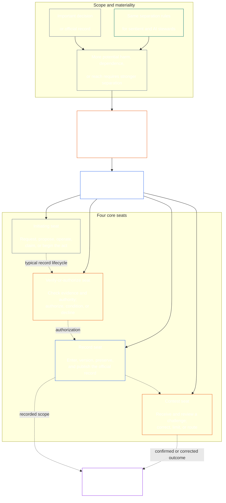

<!-- Draft for eventual path translations/hi/core_08_functional_independence_separation_of_duties.md -->
**Status:** AI-assisted translation draft; unreviewed. Not an official translation or attestation.

**Source:** `core_08.000_functional_independence_separation_of_duties.md`; edition `SC-Corpus-2026.10.21`; revision `5adf22f3d58520385afb9dc2bcb2f439346175fb`; SHA-256 `d9a573839564fa3a2e920fff4d2ecb4ccc8a7b560d8aef65656a356de09fdfda`.

**Scope:** Full Chapter Eight, including reading guides, trace blocks, tables, and diagrams. Links are written for the eventual `translations/<locale>/` destination. English remains controlling.

# अध्याय आठ: कार्यात्मक स्वतंत्रता और कर्तव्यों का पृथक्करण

<strong>कॉर्पस प्लेसमेंट (नॉन-ऑपरेटिव): फ़ाइल संरचना और पढ़ने के नियम</strong>

> यह फ़ाइल है **संवेदनशील संविधान का हिस्सा** और है **केवल एक साथ बांधना** दूसरे नंबर के साथ `core_*` फ़ाइलें एक पाठ के रूप में पढ़ी जाती हैं। इसमें है **अध्याय आठ**: कार्यात्मक स्वतंत्रता और कर्तव्यों के पृथक्करण के लिए क्रॉस-प्रोसेस आवश्यकता। यह इस प्रकार है [अध्याय सात](../../core_07.000_charters.md#chapter-seven-system-and-institutional-charters), जो सिस्टम चार्टर या संस्थागत चार्टर को बताता है जो प्रकाशित सीट मैप को ले जाता है, और संवैधानिक प्रक्रिया अध्याय से शुरू होता है [अध्याय नौ सिस्टम संरेखण प्रमाणन](../../core_09.000_system_alignment_certification_evaluation.md#chapter-nine-system-alignment-certification).
>
> - **संवैधानिक स्वामी:** भौतिक रूप से बाध्यकारी कृत्यों के लिए कर्तव्यों को अलग करने की आवश्यकता, अलग-अलग सीटों के माध्यम से पूरी की गई; प्रत्येक की सार्वभौमिक न्यूनतम सामग्री [भौतिक रूप से बाध्यकारी अधिनियम रिकॉर्ड](../../core_05.035_band_accountability.md#materially-binding-act-record); अभिनेता और अभिनेता से स्वतंत्रता [सामग्री नियंत्रण रेखा](../../core_05.035_band_accountability.md#material-control-line); प्रकाशित लेन और भूमिका प्लेसमेंट; संघर्ष, रिक्ति, प्रतिस्थापन, और गलत सीट रूटिंग; आनुपातिक मर्ज की गई होस्टिंग; जिम्मेदार हैंडऑफ़; और न्यूनतम स्वतंत्रता की शर्तें जो हर बाद की संवैधानिक प्रक्रिया पर लागू होनी चाहिए।
> - **सिद्धांत-परत स्रोत:** [अध्याय एक §18.3](../../core_01.010_stewardship_capacity_principles.md#183-separation-of-duties) कार्यात्मक स्वतंत्रता को बनाए रखने के लिए शासन की आवश्यकता है और यहां ऑपरेटिव सीट आर्किटेक्चर को रूट करना है।
> - **कार्यान्वयन स्वामी:** [सीजेएस-5.125 §11](../../corpus_joint_structure/cjs_05.125_accountability_operations.md#constitutional-lane-and-functional-separation) (*संवैधानिक लेन और कार्यात्मक पृथक्करण*), [सीआई-8.205 §2](../../corpus_institutions/ci_08.205_institutional_design_separation_of_powers.md#ci-8205-2-functional-separation-lanes), और [सीआई-14.205 §6](../../corpus_institutions/ci_15.205_appointment_competency_rotation_removal.md#ci-15205-6-seat-catalog--process-role-archetypes-and-operational-boundaries) सीटें लगाएं और चालू करें। वे सख्त हो सकते हैं और सीमित विशेष-प्राधिकरण सीट प्रकार जोड़ सकते हैं; वे इस अध्याय को छोटा नहीं कर सकते।
> - **प्रक्रिया-विशिष्ट अनुप्रयोग डाउनस्ट्रीम रहता है:** अध्याय नौ इस आवश्यकता को सिस्टम संरेखण प्रमाणन और संस्थागत संरेखण प्रमाणन पर लागू करता है; [अध्याय दस §3.7](../../core_11.000_standing_assessment.md#37-separation-of-duties) इसे स्थायी रिकॉर्ड पर लागू करता है; अध्याय तेरह और [कोर्पस_फोरम.एमडी](../../corpus_forum.md) इसे फ़ोरम प्रक्रिया पर लागू करें. उन अध्यायों में उनकी विषय वस्तु के लिए आवश्यक सुरक्षा उपाय शामिल हो सकते हैं; वे कोई कमज़ोर विकल्प नहीं बना सकते।
>
> पढ़ने का क्रम: §1 उद्देश्य और दायरा → §2 चार-सीट की आवश्यकता → §3 स्वतंत्रता और संघर्ष → §4 गलत-सीट रूटिंग → §5 प्रकाशित प्लेसमेंट, विकल्प, और प्रतिनिधिमंडल → §6 आनुपातिक स्केलिंग → §7 आपात स्थिति → §8 अधिनियम रिकॉर्ड और हैंडऑफ़ → §9 डाउनस्ट्रीम आवेदन.

<strong>पता लगाना</strong>

- अपस्ट्रीम:
  - [संवैधानिक टेट्राड](../../core_00.000_preamble.md#constitutional-tetrad) - विशेष रूप से **निगरानी** और **जवाबदेही**;
  - [सामग्री हिस्सेदारी](../../core_00.000_preamble.md#material-stake);
  - [अध्याय एक §17.1 साझा प्रबंधन मानक](../../core_01.010_stewardship_capacity_principles.md#171-shared-stewardship-standard) (1.015 §17.1);
  - [अध्याय एक §18 प्रबंधन अनुशासन के तहत शासन](../../core_01.010_stewardship_capacity_principles.md#18-governance-under-stewardship-discipline) (1.015 §18);
  - [अनुच्छेद XVI](../../core_06.010_rights_part_c.md#article-xvi-audit-transparency-and-independent-verification) (*लेखापरीक्षा, पारदर्शिता और स्वतंत्र सत्यापन*).
- उपखंड:
  - [§1](#1-purpose-scope-and-owner-boundary);
  - [§2](#2-four-seat-constitutional-requirement);
  - [§3](#3-independence-conflict-and-control-lines);
  - [§4](#4-wrong-seat-routing);
  - [§5](#5-published-placement-vacancy-and-substitution);
  - [§6](#6-proportional-scaling-and-merged-hosting);
  - [§7](#7-emergency-and-urgent-action);
  - [§8](#8-act-records-and-attributable-handoffs);
  - [§9](#9-relationship-to-later-processes).
- डाउनस्ट्रीम:
  - [अध्याय नौ](../../core_09.000_system_alignment_certification_evaluation.md#chapter-nine-system-alignment-certification) (9.000);
  - [अध्याय दस](../../core_11.000_standing_assessment.md#chapter-eleven-contribution-violation-and-standing-model--measurement) (10,000);
  - [अध्याय तेरह](../../core_14.000_forum.md#chapter-fourteen-forums-and-jurisdiction) (13,000);
  - [अध्याय चौदह](../../core_15.000_governance.md#chapter-fifteen-constitutional-contract-legitimacy-authorization-and-stewardship) (14,000); उपरोक्त निर्दिष्ट कार्यान्वयन पाठ।
- इसके साथ पढ़ें:
  - [अध्याय एक §19.3 मिसलिग्न्मेंट का पता लगाना](../../core_01.010_stewardship_capacity_principles.md#193-misalignment-detection) (1.015 §19.3) (*बहुवचन पहचान और समीक्षा*);
  - [जिम्मेदार कार्रवाई](../../core_05.035_band_accountability.md#attributable-action);
  - [एट्रिब्यूशन सत्यनिष्ठा](../../core_05.035_band_accountability.md#attribution-integrity);
  - [लेखापरीक्षा](../../core_05.050_band_oversight.md#auditability);
  - [प्रतिस्पर्धात्मकता](../../core_05.035_band_accountability.md#contestability);
  - [समानता](../../core_05.035_band_accountability.md#proportionality).

 

अध्याय आठ का संवैधानिक स्वामी है **भौतिक रूप से बाध्यकारी कृत्यों के लिए कार्यात्मक-स्वतंत्रता और कर्तव्यों के पृथक्करण की आवश्यकता**.

### 1. उद्देश्य, दायरा और स्वामी सीमा

<strong>पता लगाना</strong>

- अपस्ट्रीम: अध्याय खोलने वाले मालिक का दावा; [अध्याय एक §18](../../core_01.010_stewardship_capacity_principles.md#18-governance-under-stewardship-discipline) (1.015 §18); [निगरानी](../../core_05.020_apex_oversight_leg.md#oversight-constitutional); [जवाबदेही](../../core_05.005_apex_accountability_leg.md#accountability).
- डाउनस्ट्रीम: [§2](#2-four-seat-constitutional-requirement) के माध्यम से [§9](#9-relationship-to-later-processes); प्रत्येक बाद की प्रक्रिया जो भौतिक रूप से बाध्यकारी अधिनियम का निर्माण या परिवर्तन करती है।
- इसके साथ पढ़ें:
  - [चौथा अध्याय](../../core_04.000_burden_traceability_verification.md#chapter-four-burden-of-proof-traceability-and-verification) (4.000) सत्यापन सब्सट्रेट के लिए;
  - [अनुच्छेद XIII-ए](../../core_06.010_rights_part_c.md#article-xiii-a-reliability-and-trustworthiness-baseline) (*विश्वसनीयता और भरोसेमंदता आधार रेखा*) और
  - [अनुच्छेद XIII-बी](../../core_06.010_rights_part_c.md#article-xiii-b-right-to-redress-and-remedy) (*निवारण और उपचार का अधिकार*) चुनौती और निवारण के लिए;
  - [अनुच्छेद XVI](../../core_06.010_rights_part_c.md#article-xvi-audit-transparency-and-independent-verification) (*लेखापरीक्षा, पारदर्शिता और स्वतंत्र सत्यापन*) स्वतंत्र-सत्यापन अधिकार मंजिलों के लिए।

 

*स्पष्ट शब्दों में: इससे पहले कि एक संवैधानिक प्रक्रिया - या पहले से ही अधिकृत प्रणाली, संस्थान, या सीमित निर्णय डोमेन के भीतर एक हितधारक-स्तर के निर्णय पर भरोसा किया जा सके, इसके अंदर की नौकरियों को अलग किया जाना चाहिए। यह आवश्यकता दोनों पर लागू होती है [संवैधानिक अनुबंध परत](../../core_05.045_band_integrative.md#constitutional-contract-layer) और को [हितधारक प्रणाली भागीदारी](../../core_05.055_band_participation.md#stakeholder-status-and-weight). एक संवेदनशील, कार्यालय, एआई प्रणाली, हितधारक निकाय, या परिणाम चाहने वाला प्रतिनिधि कथित रूप से स्वतंत्र चेक की आपूर्ति नहीं कर सकता है, उस चेक के आधिकारिक रिकॉर्ड को नियंत्रित नहीं कर सकता है, या उसके लिए चुनौती का फैसला नहीं कर सकता है।*

यह अध्याय प्रत्येक पर लागू होता है [भौतिक रूप से बाध्यकारी अधिनियम](../../core_05.035_band_accountability.md#materially-binding-act), जैसा कि अध्याय पाँच इसे परिभाषित करता है, जिसमें शामिल हैं:

- एक फैसला;
- एक प्राधिकरण या प्रमाणीकरण;
- खोज;
- एक रिकॉर्ड प्रविष्टि या सामग्री संस्करण परिवर्तन;
- एक रिहाई, तैनाती, निरंतरता, या वापसी;
- एक संवितरण या आवंटन; और
- एक चुनौती का स्वभाव.

यह अध्याय क्लास पी ऑपरेटिंग पार्टी पर लागू नहीं होता है। उसकी हरकतें उसके अंदर ही रहती हैं [निजी इकाई](../../core_05.050_band_oversight.md#domain-specific-materiality-private-unit), एक एकल संवेदनशील, एक घर, या एक कसकर बंधा हुआ निजी दायरा जिसके सभी सदस्य इसमें शामिल होना चुनते हैं, और एक ऑपरेटिंग पार्टी जिसके कृत्यों का दूसरों को पालन करना चाहिए या जिस पर भरोसा किया जा सकता है, वह कम से कम कक्षा एल के अंतर्गत आता है **सीएस-9.305 (*सिस्टम वर्गीकरण मशीनरी*) और सीएस-9.310** (*सिस्टम वर्गीकरण मशीनरी*). कंप्यूटर वाले एकमात्र संवेदनशील व्यक्ति को किसी दूसरे सीट धारक की आवश्यकता नहीं होती। यह आवश्यकता उस दिन से लागू होती है जब ऑपरेटिंग पार्टी भौतिक रूप से बाध्यकारी अधिनियम अपनाती है।

इस अध्याय की सीटें परिभाषित करती हैं कि किसी विशेष कार्य के लिए कौन क्या कर सकता है; वे नौकरी के शीर्षक नहीं हैं. एक ही भावना, कार्यालय या प्रणाली अलग-अलग कृत्यों के लिए अलग-अलग स्थान रख सकती है। एक शीर्षक, प्रतिनिधिमंडल, तकनीकी क्षमता, या एक कदम उठाने की क्षमता उस कार्य के लिए रखी गई सीट को नहीं बढ़ाती है।

#### 1.1 नौकरियाँ अलग क्यों हैं?

*स्पष्ट शब्दों में: व्यापार, सरकार और परमाणु सुरक्षा में एक ही सबक बार-बार सीखा गया है। जब एक पक्ष किसी कार्य को शुरू कर सकता है, उसे अनुमोदित कर सकता है, उसे लिख सकता है, और उसके बारे में किसी भी शिकायत का मूल्यांकन कर सकता है, तो कोई भी गलती या झूठ को पकड़ने की स्थिति में नहीं है।*

यह उपधारा आवश्यकता के कारणों की व्याख्या करती है। यह निष्क्रिय है: बाध्यकारी नियम मौजूद हैं [§2 चार सीटों वाली संवैधानिक आवश्यकता](#2-four-seat-constitutional-requirement) के माध्यम से [§9 बाद की प्रक्रियाओं से संबंध](#9-relationship-to-later-processes).

कई क्षेत्र अपने आप एक ही विचार पर पहुँचे:

- **लेखांकन और आंतरिक नियंत्रण:** व्यवसायों और लेखा परीक्षकों ने लंबे समय से लेन-देन को अधिकृत करने, उसे रिकॉर्ड करने, परिसंपत्तियों को रखने और बही-खातों का मिलान करने के काम को विभाजित कर दिया है, ताकि कोई भी क्लर्क पैसे न ले सके और न ही लेने की बात छिपा सके। COSO जैसे आंतरिक-नियंत्रण ढाँचे अपनी मूल नियंत्रण गतिविधियों के बीच कर्तव्यों के पृथक्करण को सूचीबद्ध करते हैं।
- **सरकार में शक्तियों का पृथक्करण:** मोंटेस्क्यू ने तर्क दिया *कानूनों की आत्मा* (1748) जब एक संस्था कानून बनाती है, उसका पालन करती है और उसका न्याय करती है तो स्वतंत्रता खतरे में पड़ जाती है। जेम्स मैडिसन, इन *संघवादी संख्या 51* (1788) ने एक ऐसे डिज़ाइन का बचाव किया जिसमें प्रत्येक शाखा के पास दूसरों का विरोध करने के साधन हों। उसके बाद से कई संविधानों ने सत्ता को समान तरीकों से विभाजित किया है।
- **दो-व्यक्ति नियम:** संयुक्त राज्य अमेरिका की सेना को कुछ परमाणु हथियारों को लॉन्च करने या उन तक पहुंचने से पहले एक साथ कार्य करने के लिए दो अधिकृत चालक दल के सदस्यों की आवश्यकता होती है, ताकि कोई भी अकेले कार्य न कर सके (वायु सेना निर्देश 91-104)। इसी कारण से बैंक लंबे समय से तिजोरियों पर दोहरी चाबियाँ रखते हैं। दो-व्यक्ति नियम यह पुष्टि करता है कि कौन कार्य कर रहा है और क्या आदेश वास्तविक है, न कि यह कि क्या आदेश सही है। इसीलिए यह अध्याय एक स्वतंत्र जाँच की माँग करता है, न कि केवल दूसरे हस्ताक्षर की।
- **अलगाव के बिना क्या होता है:** 1995 में बैरिंग्स बैंक में, निक लीसन ने सिंगापुर ट्रेडिंग डेस्क और बैक ऑफिस दोनों को चलाया, जो इसके ट्रेडों का निपटान और रिकॉर्ड करता था। उसने घाटे को एक गुप्त खाते में छुपाया। 1994 में एक आंतरिक ऑडिट ने संयुक्त भूमिका को एक बड़े जोखिम के रूप में चिह्नित किया था, लेकिन प्रबंधन ने इसे वहीं छोड़ दिया। बैंक, जो उस समय दो शताब्दियों से अधिक पुराना था, फरवरी 1995 में लगभग S$2.2 बिलियन के घाटे के साथ ढह गया और इसे ING को बेच दिया गया।

ये उदाहरण यह नहीं दर्शाते कि कोई एक प्रणाली दोषरहित है। वे दिखाते हैं कि यह विचार पुराना है और व्यापक रूप से उपयोग किया जाता है, और गायब अलगाव विफलता का बार-बार होने वाला कारण है। वे कारण हैं, अधिकार नहीं।

#### 1.2 चार सीटें क्यों

*स्पष्ट शब्दों में: दो नौकरियाँ बहुत कम हैं और तीन में अंतराल रहता है। चार कार्यों में अधिनियम शुरू करना, उसकी जाँच करना, आधिकारिक रिकॉर्ड रखना और चुनौती सुनना शामिल है।*

यह उपधारा संख्या चार के कारणों की व्याख्या करती है। यह निष्क्रिय है: सीटें और उनके नियम सामने हैं [§2 चार सीटों वाली संवैधानिक आवश्यकता](#2-four-seat-constitutional-requirement).

- **दो बहुत कम है:** एक निर्माता और चेकर की जोड़ी एक पक्ष को अपने स्वयं के कार्य को मंजूरी देने से रोकती है। यह आधिकारिक रिकॉर्ड रखने या शिकायत सुनने के लिए किसी को नहीं छोड़ता है, इसलिए जिसके पास रिकॉर्ड है वह चुपचाप जो हुआ उसे बदल सकता है, और यह जोड़ी अपने स्वयं के काम के बारे में शिकायतों का न्याय करती है।
- **तीन शक्तियाँ सरकार के लिए उपयुक्त हैं, प्रत्येक कार्य के लिए नहीं:** बनाना, क्रियान्वित करना और निर्णय करना सरकार के अनुरूप है। एक एकल कार्य के लिए एक रिकॉर्ड की भी आवश्यकता होती है जो इसे जीवित रखता है और चुनौती के लिए एक मार्ग की आवश्यकता होती है जो अभिनेता या अनुमोदक के माध्यम से नहीं चलता है।
- **चार विफलता के बिंदुओं से मेल खाते हैं:** एक सीट अधिनियम शुरू करती है, एक इसकी जाँच करती है और इसे अधिकृत करती है, एक आधिकारिक रिकॉर्ड रखती है, और एक चुनौतियाँ सुनती है। यह लेखांकन में प्राधिकृत करने, रिकार्ड करने और समीक्षा करने के बीच के विभाजन को प्रतिध्वनित करता है।
- **स्वचालन से अंतर को खोलना आसान हो जाता है:** एक सिस्टम एक ही चरण में कार्य कर सकता है, हस्ताक्षर कर सकता है और अपना कार्य लॉग कर सकता है, और उसका लॉग तब प्रमाण की तरह दिखता है। [§2 चार सीटों वाली संवैधानिक आवश्यकता](#2-four-seat-constitutional-requirement) इसे एक साथ तीन सीटें रखने के समान माना जाता है।
- **छोटे गोद लेने वाले अभी भी अनुपालन कर सकते हैं:** [§6 आनुपातिक स्केलिंग और मर्ज्ड होस्टिंग](#6-proportional-scaling-and-merged-hosting) एक छोटे गोद लेने वाले को एक स्वतंत्र निकाय के साथ एक सीट रखने की अनुमति देता है या शर्तों पर, एक कार्यालय में दो सीटें रखता है। सत्यापित-या-अधिकृत सीट को कभी भी रिकॉर्ड सीट या प्रतियोगिता सीट के साथ विलय नहीं किया जाता है।

### 2. चार सीटों वाली संवैधानिक आवश्यकता

<strong>पता लगाना</strong>

- अपस्ट्रीम: [§1](#1-purpose-scope-and-owner-boundary); [अध्याय एक §18.3](../../core_01.010_stewardship_capacity_principles.md#183-separation-of-duties) (1.015 §18.3); [अध्याय एक §17.1](../../core_01.010_stewardship_capacity_principles.md#171-shared-stewardship-standard) (1.015 §17.1).
- डाउनस्ट्रीम: [§3](#3-independence-conflict-and-control-lines) के माध्यम से [§9](#9-relationship-to-later-processes); [सीआई-14.205 §6](../../corpus_institutions/ci_15.205_appointment_competency_rotation_removal.md#ci-15205-6-seat-catalog--process-role-archetypes-and-operational-boundaries) (*सीट कैटलॉग - प्रक्रिया-भूमिका आदर्श और परिचालन सीमाएँ*).
- इसके साथ पढ़ें: [§6](#6-proportional-scaling-and-merged-hosting) एकमात्र अनुमत मर्ज-होस्टिंग पथ के लिए।

 

*स्पष्ट शब्दों में: प्रत्येक भौतिक रूप से बाध्यकारी अधिनियम के लिए कर्तव्यों का पृथक्करण आवश्यक है **चार सीट की आवश्यकता**), और चार कार्य यह हैं कि इसे कैसे पूरा किया जाता है: पूछना या कार्य करना, जांच करना, आधिकारिक रिकॉर्ड रखना और चुनौती सुनना। नौकरियां तब भी अलग रहती हैं जब एक छोटे संगठन को एक कार्यालय में एक अनुमत जोड़ी रखने की अनुमति दी जाती है।*

<strong>पाठक मार्गदर्शन (गैर-ऑपरेटिव): चार सीटों वाला नक्शा</strong>

> **रीडर मैप (नॉन-ऑपरेटिव)।** यह आरेख चार सीटों और एक विशिष्ट रिकॉर्ड जीवनचक्र को दर्शाता है। इसमें पांचवीं कार्यान्वयन सीट नहीं जोड़ी गई है, प्रत्येक कार्रवाई से पहले समीक्षा की आवश्यकता नहीं है, या इस अनुभाग और §§3–6 में ऑपरेटिव नियमों में बदलाव नहीं किया गया है।

 

सीट बॉक्स के अंदर बिंदीदार तीर एक विशिष्ट रिकॉर्ड जीवनचक्र दिखाते हैं। कार्यान्वयन के तीर ट्रेस लिंक हैं, समीक्षा के लिए अनिवार्य प्रतीक्षा अनुक्रम नहीं।

प्रत्येक भौतिक रूप से बाध्यकारी अधिनियम में कार्यात्मक रूप से चार अलग-अलग सीटें होती हैं। अध्याय पाँच उनके विहित अर्थ प्रदान करता है; यह अनुभाग क्रॉस-प्रोसेस प्लेसमेंट और असंगति नियम बताता है:

1. **[आरंभिक आसन](../../core_05.035_band_accountability.md#initiating-seat)** - अनुरोध, प्रस्ताव, संचालन, दावा, या अन्यथा कार्य शुरू होता है।
2. **[सीट सत्यापित-या-अधिकृत करें](../../core_05.035_band_accountability.md#verify-or-authorize-seat)** - शासी मानक के विरुद्ध साक्ष्य और प्राधिकार की जांच करता है और अधिनियम को सत्यापित, अधिकृत, अस्वीकार या शर्तों पर रखता है।
3. **[रिकॉर्ड सीट](../../core_05.035_band_accountability.md#record-seat)** - प्रवेश करता है, संस्करण बनाता है, रखता है, संरक्षित करता है और प्रकाशित करता है [अधिनियम अभिलेख](../../core_05.035_band_accountability.md#materially-binding-act-record) सत्यापित-या-प्राधिकृत सीट ने क्या निर्धारित किया है।
4. **[प्रतियोगिता सीट](../../core_05.035_band_accountability.md#contest-seat)** - किसी चुनौती को प्राप्त करता है और उसकी समीक्षा करता है, जहां अधिकृत हो वहां सुधार या सीमा का आदेश देता है, और किसी भी मुद्दे को अपने अधिकार से बाहर कर देता है।

ये सीटें मानव और एआई प्रबंधकों पर समान रूप से लागू होती हैं। यदि कोई सिस्टम कोई कार्य करता है, उस पर हस्ताक्षर करता है, और फिर सबूत के रूप में अपने स्वयं के लॉग का उपयोग करता है, तो वह एक ही बार में आरंभ करने, सत्यापन करने और सीटों को रिकॉर्ड करने में बैठा होता है। प्रक्रिया को स्वचालित करने से चेक स्वतंत्र नहीं हो जाता।

एक ही अधिनियम पर निम्नलिखित संयोजन निषिद्ध हैं:

- आरंभ करने वाली सीट को अपने स्वयं के कार्य को सत्यापित या अधिकृत नहीं करना चाहिए;
- सत्यापित या अधिकृत सीट पर रिकॉर्ड सीट नहीं होनी चाहिए;
- सत्यापित-या-अधिकृत सीट पर प्रतियोगिता की सीट नहीं होनी चाहिए; और
- किसी सिस्टम के संचालक, या किसी संस्थान के शासी प्राधिकारी को उस सिस्टम या संस्थान के बारे में किसी अधिनियम को सत्यापित या अधिकृत नहीं करना चाहिए।

बाद के अध्याय या सम्मिलित कार्यान्वयन पाठ किसी विशेष प्रक्रिया के लिए अतिरिक्त युग्मों पर रोक लगा सकते हैं। वे यहां निषिद्ध जोड़ी बनाने की अनुमति नहीं दे सकते।

कर्तव्यों के पृथक्करण की आवश्यकता हर कक्षा में लागू होती है, और चार सीटों पर इसे कैसे पूरा किया जाता है। वर्ग-स्तरीय प्रश्न यह है कि क्या उन सीटों का विलय किया जा सकता है या एक धारक को साझा किया जा सकता है। किसी संस्था या प्रणाली के भीतर संचालित होने के लिए:

- क्लास सी स्कोप, पूर्ण चार-सीट पृथक्करण की हमेशा अनुशंसा की जाती है;
- क्लास बी स्कोप, पूर्ण चार-सीट पृथक्करण की लगभग हमेशा आवश्यकता होनी चाहिए; और
- क्लास ए स्कोप, पूर्ण चार-सीट पृथक्करण की हमेशा आवश्यकता होती है।

जहां दायरा मिश्रित है या वर्गीकरण अनिश्चित है, उच्चतम लागू मुद्रा लागू करें जब तक कि रिकॉर्ड निम्न स्थिति का समर्थन न करे।

### 3. स्वतंत्रता, संघर्ष और नियंत्रण रेखाएँ

<strong>पता लगाना</strong>

- अपस्ट्रीम: [§2](#2-four-seat-constitutional-requirement); [प्राधिकार-स्तरीय उत्तरदायित्व](../../core_01.010_stewardship_capacity_principles.md#181-governance-as-authorized-structure); [अनुच्छेद XXV](../../core_06.015_rights_part_d.md#article-xxv-constitutional-interpretation-review-and-anti-capture-safeguards) (*संवैधानिक व्याख्या, समीक्षा, और कब्जा-विरोधी सुरक्षा उपाय*).
- डाउनस्ट्रीम: [§4](#4-wrong-seat-routing); [§5](#5-published-placement-vacancy-and-substitution); [§8](#8-act-records-and-attributable-handoffs); अध्याय नौ प्रमाणन घटक भूमिकाएँ; अध्याय दस रिकॉर्ड हिरासत; अध्याय तेरह मंच आत्म-निर्णय विरोधी।
- इसके साथ पढ़ें: [सामग्री नियंत्रण रेखा](../../core_05.035_band_accountability.md#material-control-line); [सीआई-8.210](../../corpus_institutions/ci_08.210_conflict_integrity_anti_capture_anti_corruption.md) (*संघर्ष अखंडता, कब्जा-विरोधी, और भ्रष्टाचार-विरोधी*) और [सीएफ-13.425](../../corpus_forum/cf_14.425_integrity_safeguards_anti_capture_anti_self_judging.md) (*सत्यनिष्ठा सुरक्षा उपाय, कब्जा-विरोधी कार्रवाई, और आत्म-निर्णय-विरोधी समर्थन*) परिचालन संघर्ष और आत्म-निर्णय विरोधी सुरक्षा उपायों के लिए।

 

*स्पष्ट शब्दों में: डेस्क पर नाम बदलने से स्वतंत्रता नहीं मिलती। एक सत्यापनकर्ता प्राधिकारी या समीक्षक तब स्वतंत्र नहीं होता है जब परिणाम चाहने वाला संवेदनशील व्यक्ति या कार्यालय उस कार्य पर उन्हें निर्देश दे सकता है, हटा सकता है, पुरस्कृत कर सकता है, दंडित कर सकता है या चुपचाप खारिज कर सकता है।*

कार्यात्मक स्वतंत्रता का मूल्यांकन वास्तविक अधिकार और नियंत्रण से किया जाता है, लेबल से नहीं। उसी अधिनियम पर:

- सत्यापित-या-अधिकृत सीट और प्रतियोगिता सीट प्रारंभिक सीट के बाहर होनी चाहिए [सामग्री नियंत्रण रेखा](../../core_05.035_band_accountability.md#material-control-line);
- जिस पार्टी का हित अधिनियम द्वारा निर्धारित होता है, उसे सत्यापन-या-अधिकृत या चुनाव लड़ने वाली सीट नहीं रखनी चाहिए;
- विवादित रिकॉर्ड धारक को विवाद का निर्णय लेने या हिरासत छोड़ने के बजाय उस रिकॉर्ड को उसके पूर्ण ऑडिट ट्रेल के साथ प्रकाशित स्थानापन्न को सौंपना होगा; और
- अलग होने से अधिनियम पर अधिकार समाप्त हो जाता है; यह अनुरोधकर्ता, अनुरोधकर्ता की रिपोर्टिंग लाइन, या जो भी निकटतम हो, उसे सीट हस्तांतरित नहीं करता है।

का पता लगाएं [सामग्री नियंत्रण रेखा](../../core_05.035_band_accountability.md#material-control-line) विशेष कार्य के लिए. साझा बुनियादी ढाँचा, प्रशासनिक सहायता, या नियुक्ति इतिहास अकेले ही लाइन स्थापित नहीं करता है, लेकिन उन व्यवस्थाओं को व्यवहार में स्वतंत्र निर्णय को पराजित नहीं करना चाहिए।

स्वतंत्रता एक दूसरे हस्ताक्षर, एक नाममात्र समिति, एक आंतरिक लेबल, या एक उपकरण-जनित सत्यापन से संतुष्ट नहीं होती है जहां कथित चेक में अधिकार, साक्ष्य पहुंच, सामग्री नियंत्रण से स्वतंत्रता, या अस्वीकार करने और रूट करने की वास्तविक क्षमता का अभाव होता है।

### 4. गलत-सीट रूटिंग

<strong>पता लगाना</strong>

- अपस्ट्रीम: [§2](#2-four-seat-constitutional-requirement); [§3](#3-independence-conflict-and-control-lines).
- डाउनस्ट्रीम: [§5](#5-published-placement-vacancy-and-substitution); [§8](#8-act-records-and-attributable-handoffs); [सीआई-14.205 §6 साझा सीट नियम](../../corpus_institutions/ci_15.205_appointment_competency_rotation_removal.md#ci-46-shared-seat-rules).
- इसके साथ पढ़ें: [अध्याय एक §17.5 विरोध करने का कर्तव्य](../../core_01.010_stewardship_capacity_principles.md#175-duty-to-resist) (1.015 §17.5).

 

*स्पष्ट शब्दों में: जब कोई कदम आपका नहीं हो तो उसे चुपचाप न उठायें और न ही उससे दूर चले जाएँ। अंतर को रिकॉर्ड करें और मामले को सही जगह पर पहुंचाएं। इससे भी बेहतर, प्रक्रिया का निर्माण इस प्रकार करें कि प्रत्येक चरण बिना किसी को पता चले सही जगह पर जाए।*

जहां भी व्यावहारिक हो, गलत-सीट रूटिंग को प्रक्रिया में शामिल किया जाना चाहिए। एक इनटेक, कतार, वर्कफ़्लो, या इंटरफ़ेस को शुरू से ही प्रत्येक चरण को उसकी प्रकाशित सीट पर भेजना चाहिए, इसलिए उस सीट को एक कदम की पेशकश नहीं की जाती है जो इसे नहीं ले सकता है। स्वचालित रूटिंग:

- के अंतर्गत प्रकाशित प्लेसमेंट का अनुसरण करता है [§5 प्रकाशित प्लेसमेंट, रिक्ति, और प्रतिस्थापन](#5-published-placement-vacancy-and-substitution) और सीट पर मार्ग, अधिनियम के गुण-दोष पर नहीं;
- नीचे आइटम 3 की आवश्यकता के अनुसार प्रत्येक मार्ग को लॉग करता है;
- के अंतर्गत प्रकाशित स्थानापन्न या स्वतंत्र पथ का अनुसरण करता है [§5.3 एक सीट जिसे नक्शा खाली छोड़ देता है, या एक धारक जो सेवा नहीं दे सकता](#53-a-seat-the-map-leaves-unplaced-or-a-holder-who-cannot-serve) जब कोई धारक सेवा नहीं कर सकता है, और मामले को पकड़ता है और अंतर को लॉग करता है जब कोई सीट, स्थानापन्न, या स्वतंत्र पथ नहीं रखा जाता है, बजाय इसे निकटतम, सबसे तेज़, या सबसे वरिष्ठ सीट पर भेजने के; और
- वह स्वयं सीट-धारक नहीं है और वह यह नहीं बदल सकता कि सीट किसके पास है; केवल प्रकाशित प्लेसमेंट ही करता है।

जहां रूटिंग स्वचालित नहीं है, या विफल रहती है, वहां नीचे दिया गया कर्तव्य स्टीवर्ड पर लागू होता है। एक प्रबंधक को प्रबंधक की सीट से बाहर एक कदम रखने के लिए कहा जाना चाहिए:

1. उसके गुण-दोष तय किए बिना उस कदम को अस्वीकार कर दें;
2. उस सीट का नाम बताएं जो इसे ले सकता है और, जहां प्रकाशित हो, धारक या स्थानापन्न का नाम बताएं;
3. अनुरोध, धारित सीट, अंतराल या विरोध, और उपयोग किए गए मार्ग को लॉग करें;
4. साक्ष्य और पहले से प्राप्त किसी भी रिकॉर्ड की अखंडता को संरक्षित करना; और
5. टाले जा सकने वाले विलंब के बिना मार्ग।

वह प्रतिक्रिया कर्तव्य का पालन है, कार्य का परित्याग नहीं। क्रिया दाहिनी सीट से आगे बढ़ती है। यह कदम उठाना क्योंकि प्रबंधक निकटतम, सबसे तेज़, वरिष्ठ या विशिष्ट जानकार है, सीट छूटने का समाधान नहीं है।

### 5. प्रकाशित प्लेसमेंट, रिक्ति, और प्रतिस्थापन

<strong>पाठक मार्गदर्शन (गैर-ऑपरेटिव): यह अनुभाग कैसे तैयार किया गया है</strong>

- [§5.1 मानचित्र को क्या कहना चाहिए](#51-what-the-map-must-say) सूचीबद्ध करता है कि चार्टर रोल मैप के नाम क्या हैं: प्रत्येक सीट की मेजबानी कौन करता है, किस कार्य के लिए, अनुमत विलय, स्थानापन्न, स्वतंत्र मार्ग और संस्करण।
- [§5.2 नक्शा कहाँ रखा जाता है](#52-where-the-map-is-kept) कहता है कि नक्शा सिस्टम चार्टर या इंस्टीट्यूशनल चार्टर में या उसके साथ बैठता है, कि समूह का एक सदस्य संदर्भ द्वारा समूह के साझा मानचित्र को अपना सकता है, और क्लास पी अपनाने वाले को इसे प्रकाशित करने की आवश्यकता नहीं है।
- [§5.3 एक सीट जिसे नक्शा खाली छोड़ देता है, या एक धारक जो सेवा नहीं दे सकता](#53-a-seat-the-map-leaves-unplaced-or-a-holder-who-cannot-serve) कहता है कि गैप एक दोष है जिसे लॉग इन करके सही किया जाना चाहिए, कि सीट अभिनेता या अभिनेता की नियंत्रण रेखा तक नहीं जाती है, और इस बीच अधिनियम स्थानापन्न या स्वतंत्र पथ पर चला जाता है।
- [§5.4 प्रतिनिधिमंडल](#54-delegation) कहता है कि एक सीट केवल एक डिप्टी को सौंपी जा सकती है या मानचित्र नामों को प्रतिस्थापित किया जा सकता है, और यह प्रतिनिधिमंडल सीट की सीमा रखता है और सीट का निर्माण, विलय या विस्तार नहीं कर सकता है।

<strong>पता लगाना</strong>

- अपस्ट्रीम:
  - [§2](#2-four-seat-constitutional-requirement);
  - [§3](#3-independence-conflict-and-control-lines);
  - [पारदर्शिता](../../core_05.050_band_oversight.md#transparency);
  - [लेखापरीक्षा](../../core_05.050_band_oversight.md#auditability).
- डाउनस्ट्रीम: [§8](#8-act-records-and-attributable-handoffs); [सीआई-8.205 §2](../../corpus_institutions/ci_08.205_institutional_design_separation_of_powers.md#ci-8205-2-functional-separation-lanes) (*कार्यात्मक पृथक्करण लेन*); [सीआई-14.205 §5](../../corpus_institutions/ci_15.205_appointment_competency_rotation_removal.md#ci-15205-5-authorized-roles-and-accountability-chains) (*अधिकृत भूमिकाएँ और जवाबदेही श्रृंखलाएँ*); अध्याय नौ और अध्याय दस के रिकॉर्ड।
- इसके साथ पढ़ें:
  - [सिस्टम चार्टर](../../core_05.040_band_continuity.md#system-charter),
  - [संस्थागत चार्टर](../../core_05.040_band_continuity.md#institutional-charter);
  - [अध्याय सात §4 चार्टर रोल मैप और स्थायी-रिकॉर्ड कस्टडी](../../core_07.000_charters.md#4-the-charter-role-map-and-standing-record-custody) (7.000 §4); और
  - [अध्याय चौदह §5](../../core_15.000_governance.md#5-authorized-roles-competency-development-and-contribution) (14.000 §5).

 

*स्पष्ट शब्दों में: एक संगठन को यह अवश्य बताना चाहिए कि कठिन मामला आने से पहले प्रत्येक कार्य को कौन संभालता है, जिसमें सामान्य धारक के अनुपस्थित या विवादित होने पर कार्यभार कौन संभालता है।*

#### 5.1 मानचित्र को क्या कहना चाहिए

कक्षा एल या उच्चतर के प्रत्येक अपनाने वाले को जो भौतिक रूप से बाध्यकारी कार्य करता है उसे एक प्रकाशित, श्रवण योग्य और विवादास्पद बनाए रखना होगा [चार्टर भूमिका मानचित्र](../../core_05.040_band_continuity.md#charter-role-map) जो पहचानता है:

- कौन सी लेन, कार्यालय, भूमिका या प्रक्रिया प्रत्येक सीट को होस्ट करती है;
- वे कार्य और दायरे जिनके लिए वह प्लेसमेंट लागू होता है;
- प्रत्येक अनुमत मर्ज-होस्टिंग व्यवस्था और इसकी स्वतंत्रता सुरक्षा;
- प्रत्येक डिप्टी या स्थानापन्न जो किसी सीट पर कार्य कर सकता है, जिसमें अनुपस्थित, बहिष्कृत, कब्जा किया हुआ या विवादित धारक भी शामिल है;
- जब कोई योग्य विकल्प उपलब्ध न हो तो स्वतंत्र मार्ग; और
- इसका संस्करण और प्रभावी तिथि, ताकि किसी अधिनियम को उस समय लागू मानचित्र के आधार पर आंका जा सके जब इसे लिया गया था।

#### 5.2 नक्शा कहाँ रखा जाता है

नक्शा गोद लेने वाले के पास या उसके पास रखा जाता है [सिस्टम चार्टर](../../core_05.040_band_continuity.md#system-charter) या [संस्थागत चार्टर](../../core_05.040_band_continuity.md#institutional-charter).

किसी समूह का कोई सदस्य जो अपने द्वारा होस्ट की जाने वाली सीटों के लिए एक साझा मानचित्र प्रकाशित करता है, वह संदर्भ द्वारा उस मानचित्र को अपना सकता है ([§6.3 सीटें समान रखी गईं](#63-seats-held-in-common)), और अभी भी अपने स्वयं के स्थानापन्न और स्वतंत्र मार्ग का नाम देता है।

क्लास पी अपनाने वाला इस अध्याय से बाहर है ([§1 उद्देश्य, दायरा और स्वामी सीमा](#1-purpose-scope-and-owner-boundary)) और मानचित्र प्रकाशित करने की आवश्यकता नहीं है। यह अभी भी अकेले या स्वैच्छिक प्रणाली या संस्थागत चार्टर के साथ एक प्रकाशित कर सकता है ([अध्याय सात §4 चार्टर रोल मैप और स्थायी-रिकॉर्ड कस्टडी](../../core_07.000_charters.md#4-the-charter-role-map-and-standing-record-custody)).

#### 5.3 एक सीट जिसे नक्शा खाली छोड़ देता है, या एक धारक जो सेवा नहीं दे सकता है

एक गैर-स्थानित सीट, या एक धारक जो अनुपस्थित है, बहिष्कृत है, कब्जा कर लिया गया है, या विवादित है, लॉग इन करने और सही करने के लिए एक शासन दोष है।

- सीट स्वचालित रूप से आरंभ करने वाली सीट, किसी इच्छुक पार्टी, ऑपरेटर या उनके वरिष्ठ को नहीं मिलती है [सामग्री नियंत्रण रेखा](../../core_05.035_band_accountability.md#material-control-line).
- सुधारे जाने तक, अधिनियम प्रकाशित स्थानापन्न या स्वतंत्र पथ की ओर जाता है, चाहे अधिनियम कितना भी आवश्यक क्यों न हो।
- एक प्रमाणन सीट के लिए जिसे चार्टर रोल मैप बिना स्थान के छोड़ देता है, सुधार को प्रतिक्रिया और रिज़ॉल्यूशन विंडो को पूरा करना होगा, जो अंतराल के लॉग नोटिस से गिना जाता है, जैसा कि निर्धारित किया गया है [अध्याय सात §4.7.4 प्रमाणन सीटें](../../core_07.000_charters.md#474-certification-seats).

#### 5.4 प्रतिनिधिमंडल

एक सीट धारक सीट केवल किसी डिप्टी या उसके स्थानापन्न को सौंप सकता है [चार्टर भूमिका मानचित्र](../../core_05.040_band_continuity.md#charter-role-map) names. किसी और को सौंपा गया प्रतिनिधिमंडल सीट खाली छोड़ देता है, और [§5.3 एक सीट जिसे नक्शा खाली छोड़ देता है, या एक धारक जो सेवा नहीं दे सकता](#53-a-seat-the-map-leaves-unplaced-or-a-holder-who-cannot-serve) लागू होता है. नए डिप्टी या स्थानापन्न का नाम रखने से नक्शा बदल जाता है ([अध्याय सात §4.5 सीट नियम और सीट धारकों को बदलना](../../core_07.000_charters.md#45-changing-seat-rules-and-seat-holders)). एक प्रतिनिधिमंडल ऐसा नहीं कर सकता.

एक प्रतिनिधिमंडल एक ही सीट सीमा, साक्ष्य कर्तव्य, रिकॉर्ड और घड़ी रखता है, और प्रतिनिधि इसके अधीन रहता है [सामग्री नियंत्रण रेखा](../../core_05.035_band_accountability.md#material-control-line). यह कोई नई सीट नहीं बनाता, सीटों का विलय नहीं करता, या किसी प्रतिनिधि को वह काम करने की अनुमति नहीं देता जो प्रतिनिधि सीट नहीं कर सकती। एक प्रतिनिधि जो एक ही अधिनियम पर दूसरी सीट रखता है वह एक विलय है, और केवल मर्ज-होस्टिंग व्यवस्था ही मानचित्र के अंतर्गत सूचीबद्ध होती है [§6 आनुपातिक स्केलिंग और मर्ज्ड होस्टिंग](#6-proportional-scaling-and-merged-hosting) एक को अनुमति दें.

एक धारक सीट के काम में मदद करने के लिए कर्मचारियों या उपकरणों का उपयोग कर सकता है, जैसे सबूत इकट्ठा करना, मसौदा तैयार करना, या नियमित जांच चलाना। वह सहायता है, प्रतिनिधिमंडल नहीं। धारक अभी भी सीट के निर्णय लेता है, परिणाम के लिए जवाबदेह रहता है, और सीट की स्वतंत्रता के लिए जिम्मेदार रहता है। यदि कोई अन्य व्यक्ति निर्णय लेता है या सीट के नाम पर कोई कदम उठाता है, तो वह एक प्रतिनिधिमंडल है और उसे इस उपधारा को पूरा करना होगा। सहायता का उपयोग वह करने के लिए नहीं किया जा सकता जो सीट स्वयं नहीं कर सकती, जिसमें किसी अधिनियम के परिणाम को निर्धारित करने के लिए अन्य सीटों के धारकों पर दबाव डालना भी शामिल है।

### 6. आनुपातिक स्केलिंग और मर्ज्ड होस्टिंग

<strong>पाठक मार्गदर्शन (गैर-ऑपरेटिव): यह अनुभाग कैसे तैयार किया गया है</strong>

- [§6.1 कैसे पृथक्करण तराजू](#61-how-separation-scales) का कहना है कि ताकत, स्टाफिंग, अतिरेक, और हिस्सेदारी, वर्ग, निर्भरता और संभावित नुकसान के साथ अलगाव के पैमाने की औपचारिकता, जबकि चार सीटें अलग रहती हैं।
- [§6.2 एक कार्यालय में दो सीटों का विलय](#62-merging-two-seats-in-one-office) उन शर्तों को सूचीबद्ध करता है जिनके तहत एक छोटा या अनौपचारिक गोद लेने वाला एक कार्यालय में दो सीटें रख सकता है, और जो जोड़ियां वर्जित रहती हैं।
- [§6.3 सीटें समान रखी गईं](#63-seats-held-in-common) बताता है कि कैसे एक छोटा व्यवसाय एक सहकारी, संघ, या अन्य स्वतंत्र निकाय के साथ एक सीट रखता है, और स्वतंत्रता नियम जो लागू होते हैं।
- [§6.4 संयुक्त व्यावसायिक अभ्यास](#64-joint-professional-practice) कहता है कि क्लास एल या उच्चतर का एक संवेदनशील या छोटा अभ्यास एक मेजबान के साथ अपनी सीटें कैसे रख सकता है और किसी भी काम के लिए मेजबान के दस्तावेजों को अपना सकता है, और उन कार्यों पर और क्या लागू होता है जिनके लिए अभ्यास लाइसेंस या अभ्यास मंजूरी की आवश्यकता होती है।
- [§6.5 अनौपचारिक और सामुदायिक कार्य](#65-informal-and-community-work) का कहना है कि इस तरह के काम के लिए जाँच के लिए प्रकाशित प्राधिकारी के साथ एक स्वतंत्र भरोसेमंद निकाय का उपयोग किया जा सकता है।
- [§6.6 हिस्सेदारी, वर्ग, और क्या विलय को उचित नहीं ठहराता](#66-stake-class-and-what-does-not-justify-a-merger) का कहना है कि उच्च हिस्सेदारी अलग-अलग कार्यालयों की धारणा को बनाए रखती है, और केवल स्टाफिंग, गति या सुविधा कभी भी विलय को उचित नहीं ठहराती है।

<strong>पता लगाना</strong>

- अपस्ट्रीम:
  - [§2](#2-four-seat-constitutional-requirement);
  - [सामग्री हिस्सेदारी](../../core_00.000_preamble.md#material-stake);
  - [ज़रूरत](../../core_05.035_band_accountability.md#necessity);
  - [समानता](../../core_05.035_band_accountability.md#proportionality).
- डाउनस्ट्रीम: [अध्याय दस §3.7](../../core_11.000_standing_assessment.md#37-informal-and-small-scope-records) (10.000 §3.7); [सीजेएस-18.110 §4](../../corpus_joint_structure/cjs_19.110_specific_joint_interlocks.md#cjs-19110-4-class-scaled-lane-staffing-and-competency-redundancy) (*क्लास-स्केल लेन स्टाफिंग और योग्यता अतिरेक*); [सीआई-8.205 §2](../../corpus_institutions/ci_08.205_institutional_design_separation_of_powers.md#ci-8205-2-functional-separation-lanes) (*कार्यात्मक पृथक्करण लेन*).
- इसके साथ पढ़ें: [टालने योग्य बोझ](../../core_05.040_band_continuity.md#avoidable-burden) और अध्याय एक [§3.3 एंटी-डिग्रेडिंग प्रक्रिया](../../core_01.000_values_principles.md#33-anti-degrading-process).

 

*स्पष्ट शब्दों में: छोटे और अनौपचारिक समूहों को चार बड़े विभागों की आवश्यकता नहीं है। उन्हें एक वास्तविक स्वतंत्र जांच, एक उपयोगी रिकॉर्ड और एक चुनौती पथ की आवश्यकता है। स्केल स्टाफिंग पद्धति को बदलता है, संरक्षित पृथक्करण को नहीं।*

#### 6.1 कैसे पृथक्करण तराजू

सामग्री हिस्सेदारी, सिस्टम वर्ग, निर्भरता और उचित रूप से अनुमानित नुकसान के साथ पृथक्करण पैमाने की ताकत, स्टाफिंग, अतिरेक और औपचारिकता।

#### 6.2 एक कार्यालय में दो सीटों का विलय

एक छोटा या अनौपचारिक गोद लेने वाला एक कार्यालय में दो सीटें रख सकता है या केवल वहीं रख सकता है जहां निम्नलिखित सभी हों:

- विलय आवश्यक है और दायरे के अनुरूप है;
- यह अधिनियम के रिकॉर्ड पर प्रकाशित, श्रवण योग्य, विवादास्पद और खुलासा किया गया है;
- एक स्वतंत्रता सुरक्षा उपाय विलय से उत्पन्न जोखिमों का समाधान करता है;
- आरंभ करने वाली सीट अपने स्वयं के कार्य को सत्यापित या अधिकृत नहीं करती है;
- सत्यापित-या-अधिकृत सीट को कभी भी रिकॉर्ड सीट या प्रतियोगिता सीट के साथ विलय नहीं किया जाता है; और
- जब संघर्ष, भौतिक क्षति या चुनौती मर्ज किए गए धारक की वैध सीमा से अधिक हो जाती है तो एक स्वतंत्र मार्ग उपलब्ध रहता है।

#### 6.3 सीटें समान रखी गईं

एक व्यक्ति या कुछ लोगों द्वारा चलाया जाने वाला व्यवसाय स्थानीय सहकारी या ऐसे व्यवसायों के संघ, या किसी अन्य स्वतंत्र भरोसेमंद निकाय के साथ अपनी सत्यापन-या-अधिकृत, रिकॉर्ड, या प्रतियोगिता सीट रख सकता है। यह विलय नहीं है, क्योंकि सीटें अलग-अलग धारकों के पास रहती हैं। यह इस प्रकार है कि चार सीटों वाले कर्मचारियों के लिए बहुत छोटा व्यवसाय अभी भी कर्तव्यों को अलग करने की आवश्यकता को पूरा करता है [§2 चार सीटों वाली संवैधानिक आवश्यकता](#2-four-seat-constitutional-requirement). समूह के लिए इन नियमों के साथ-साथ, किसी भी प्लेसमेंट पर समान स्वतंत्रता नियम लागू होते हैं:

- **व्यवसाय से स्वतंत्र:** धारक है [स्वतंत्र](../../core_05.035_band_accountability.md#independence) आरंभ करने वाले व्यवसाय का. यह व्यवसाय से बाहर है [सामग्री नियंत्रण रेखा](../../core_05.035_band_accountability.md#material-control-line), और अधिनियम द्वारा तय किया गया कुछ भी इसे हिस्सेदारी नहीं देता है। एक आपूर्तिकर्ता, ऋणदाता, मकान मालिक, या ग्राहक जिस पर व्यवसाय निर्भर करता है, उस निर्भरता के बारे में किसी कार्य के लिए स्वतंत्र नहीं है, जैसे आपूर्तिकर्ता के स्वयं के अनुबंध पर विवाद, क्योंकि अधिनियम उनके लिए भी कुछ तय करता है।
- **समूह के लिए एक मानचित्र:** समूह एक प्रकाशित करता है [चार्टर भूमिका मानचित्र](../../core_05.040_band_continuity.md#charter-role-map) इसकी मेजबानी वाली सीटों के लिए, और प्रत्येक सदस्य इसे संदर्भ द्वारा अपना सकता है। एक सदस्य का अपना नक्शा अभी भी उसके विकल्प और उसके स्वतंत्र मार्ग का नाम देता है।
- **एक दूसरे की सेवा करना:** सदस्य विभिन्न कृत्यों पर एक-दूसरे की सीटों की सेवा कर सकते हैं। दो सदस्य एक बंद जोड़ी के रूप में एक-दूसरे के कृत्यों की जांच नहीं कर सकते हैं, और एक रोटेशन किसी कृत्य को उसके आरंभकर्ता की नियंत्रण रेखा के अंदर किसी धारक तक नहीं पहुंचा सकता है।
- **समूह के अपने कार्य:** किसी सदस्य को स्वीकार करना या हटाना, एक सीट आवंटित करना, और किसी सदस्य के कार्य पर निर्णय लेना समूह के भौतिक रूप से बाध्यकारी कार्य हैं। इन कृत्यों के लिए समूह:
  - चार सीटें लेता है;
  - अपना स्वयं का सिस्टम चार्टर या संस्थागत चार्टर प्रकाशित करता है; और
  - अपने से बाहर एक स्वतंत्र मार्ग रखता है (अन्य समूह, एक मंच, या एक सार्वजनिक कार्यालय), इसलिए यह कभी भी खुद को या अपने नियंत्रण वाले सदस्य को आंकता नहीं है।
- **कोई बाध्यता नहीं:** शामिल होने के लिए किसी व्यवसाय की आवश्यकता नहीं है, और कोई समूह ही एकमात्र मार्ग नहीं है।
- **प्रवेश सीमाएँ:** एक समूह किसी आवेदक को इस कारण से मना कर सकता है या टाल सकता है कि समूह उसे क्या सेवा दे सकता है, ताकि वह कभी भी अपनी क्षमता से अधिक काम लेने के लिए मजबूर न हो। ऐसे कारणों में शामिल हैं:
  - **क्षमता:** आवेदक के भौतिक कृत्यों की अपेक्षित मात्रा उस क्षमता का उपयोग करेगी जिस पर मौजूदा सदस्य भरोसा करते हैं। समूह किसी एक सदस्य से ली जाने वाली मात्रा को सीमित कर सकता है या प्रतीक्षा सूची रख सकता है;
  - **उपयुक्त:** आवेदक के कार्य या वर्ग समूह के सीट धारकों की योग्यता और सेवा के लिए नियुक्त कर्मचारियों से बाहर हैं, जैसे कि कार्य जिसमें समूह की तुलना में अधिक योग्यता अतिरेक की आवश्यकता होती है ([§6.6 हिस्सेदारी, वर्ग, और क्या विलय को उचित नहीं ठहराता](#66-stake-class-and-what-does-not-justify-a-merger));
  - **स्वतंत्रता:** समूह के धारक आवेदक के कार्यों को स्वतंत्र रूप से प्रस्तुत नहीं कर सकते, क्योंकि आवेदक अंदर है [सामग्री नियंत्रण रेखा](../../core_05.035_band_accountability.md#material-control-line) उनमें से एक का; और
  - **आचरण:** आवेदक ने पहले समूह की प्रकाशित शर्तों को तोड़ा है, या उन्हें स्वीकार नहीं करेगा।
- **सीमाएँ कैसे लागू की जाती हैं:** प्रत्येक प्रवेश सीमा:
  - समूह के सिस्टम चार्टर या संस्थागत चार्टर में कहा गया है ([अध्याय सात §3.1 सिस्टम चार्टर क्या बताता है](../../core_07.000_charters.md#31-what-a-system-charter-states)), इसलिए इसे लागू करने से पहले प्रकाशित किया जाता है;
  - आवेदकों को पसंद करने के लिए उसी तरह लागू होता है;
  - इसका उपयोग सदस्यों को प्रतिस्पर्धा से बचाने या समूह को उसके क्षेत्र में सीट पाने का एकमात्र रास्ता बनाने के लिए नहीं किया जाता है;
  - अस्वीकृत आवेदक को लिखित रूप में समझाया गया है; और
  - समूह के बाहर स्वतंत्र मार्ग से चुनाव लड़ा जा सकता है, क्योंकि किसी आवेदक को प्रवेश देना है या नहीं यह तय करना समूह का भौतिक रूप से बाध्यकारी कार्य है (देखें) *समूह के अपने कृत्य*, ऊपर)।
- **कोई जाल नहीं:** किसी समूह की शर्तें सीट को ऐसी लागत नहीं बना सकतीं जिसे व्यवसाय वहन नहीं कर सकता ([टालने योग्य बोझ](../../core_05.040_band_continuity.md#avoidable-burden)).
- **छोड़ना:** जो सदस्य निकलता है वह अपने रिकॉर्ड अपने साथ ले जाता है। समूह उन्हें रोककर नहीं रख सकता या उन्हें पीछे छोड़ने पर निर्भर नहीं कर सकता। समूह:
  - सदस्य को उसके अधिनियम रिकॉर्ड्स और उनमें मौजूद डेटा का पूर्ण निर्यात देता है, एक ऐसे रूप में जिसे सदस्य या नया होस्ट उपयोग कर सकता है ([सीएस-6.305 §1.2 निरंतरता-महत्वपूर्ण संग्रह और निर्यात क्षमता](../../corpus_systems/cs_06.305_information_types_and_handling.md#12-continuity-critical-collection-and-exportability)), और निर्यात पर किसी भी वैध सीमा का खुलासा करता है;
  - उन कृत्यों के लिए रिकॉर्ड सीट धारक को सदस्य के नाम सौंपता है, और रिकॉर्ड सीट धारक तब तक रहता है जब तक कि सदस्य एक का नाम नहीं लेता है, इसलिए चुनौती, सुधार या उपाय खुला रहने पर अधिनियम रिकॉर्ड पुनर्निर्माण योग्य रहता है ([§8 एक्ट रिकॉर्ड्स और एट्रिब्यूटेबल हैंडऑफ़](#8-act-records-and-attributable-handoffs)); और
  - केवल वही रखता है जो उसके स्वयं के कर्तव्यों की अभी भी आवश्यकता है, जैसे किसी अन्य सदस्य के लिए होस्ट किए गए अधिनियम का अधिनियम रिकॉर्ड या अभी भी चुनौती के अधीन अधिनियम, और केवल उस अवधारण अवधि के लिए जिसका उसने खुलासा किया है ([सीएस-6.305 §1.3 संग्रहण सूचना और विलोपन](../../corpus_systems/cs_06.305_information_types_and_handling.md#13-collection-notice-and-deletion)).
- **समूह द्वारा रखा गया डेटा:** समूह जो रखता है उसे नीचे दिए गए डेटा प्रकार द्वारा नियंत्रित किया जाता है [सीएस-6.310 §9 डेटा वर्गीकरण](../../corpus_systems/cs_06.310_data_classifications.md#cs-6310-9-data-classifications):
  - **पहचान और एट्रिब्यूशन डेटा (प्रकार I):** केवल यह सत्यापित करने के लिए उपयोग किया जाता है कि प्रत्येक सीट पर कौन था और किसने कार्य किया;
  - **भागीदारी और लेनदेन डेटा (प्रकार एच):** केवल अधिनियम के रिकॉर्ड, ऑडिट और चुनौती कर्तव्यों के लिए उपयोग किया जाता है;
  - **शासन स्रोत डेटा (प्रकार जी):** ऑडिट के लिए खुला है और डिफ़ॉल्ट रूप से सार्वजनिक नहीं है;
  - **सुरक्षा, सुरक्षा और जांच सामग्री (प्रकार एस):** केवल इसकी समयबद्ध समीक्षा के लिए रखा गया; और
  - **सदस्य के स्वयं के कार्य (प्रकार Y और प्रकार W):** सदस्य को लौटा दिया जाता है, और सदस्य के निर्देश देने पर समूह की प्रतियों से हटा दिया जाता है।

#### 6.4 संयुक्त व्यावसायिक अभ्यास

कक्षा एल या उच्चतर का एक संवेदनशील या छोटा अभ्यास अपनी सीटें एक मेज़बान के पास रख सकता है और मेज़बान के दस्तावेज़ों को अपना सकता है:

- **मेजबान कौन हो सकता है:** एक पेशेवर संघ, सहकारी, नियोक्ता, या सार्वजनिक रजिस्ट्री, चाहे वह कहीं भी स्थित हो।
- **प्रथा क्या अपनाती है:** मेज़बान का प्रकाशित मानचित्र और संस्थागत चार्टर, संदर्भ द्वारा, उनके द्वारा कवर किए गए कृत्यों के लिए।
- **कोई काम:** यह मार्ग अभ्यास के सभी कार्यों के लिए खुला है, चाहे उन्हें अभ्यास लाइसेंस या अभ्यास मंजूरी की आवश्यकता हो या नहीं, इसलिए दोनों प्रकार के कार्यों वाला अभ्यास इन सभी के लिए एक मेजबान का उपयोग कर सकता है।
- **वही नियम:** में नियम [§6.3 सीटें समान रखी गईं](#63-seats-held-in-common) मेज़बान और अभ्यास पर लागू होते हैं, जिसमें मेज़बान की अभ्यास से स्वतंत्रता, चार सीटें और मेज़बान के स्वयं के कृत्यों के लिए एक स्वतंत्र मार्ग, प्रकाशित प्रवेश सीमाएँ, और छोड़ने वाले सदस्य के लिए नियम शामिल हैं।
- **सूचीबद्ध कृत्य:** प्रैक्टिस लाइसेंस या प्रैक्टिस क्लीयरेंस के लिए सूचीबद्ध अधिनियम के लिए [अनुच्छेद XI-ई](../../core_06.005_rights_part_b.md#article-xi-e-institutional-formation-and-business-creation) (*संस्थागत गठन और व्यवसाय निर्माण*), मेजबान के मानक भी एक तकनीकी मंच की खोज से आते हैं, मेजबान जांच करता है कि प्रत्येक व्यवसायी के पास लाइसेंस या मंजूरी है, और अंतिम उपाय का एक सार्वजनिक मेजबान किसी भी धारक को स्वीकार करता है। अन्य कार्यों के लिए मेज़बान केवल इसी आधार पर स्वीकार करता है और मना कर देता है [§6.3 सीटें समान रखी गईं](#63-seats-held-in-common), और यह सक्षमता मानदंड नहीं लिख सकता है जो एक संवेदनशील व्यक्ति को काम से बाहर रखता है जिसे संविधान अनुमति नहीं देता है।
- **मेज़बान के अतिरिक्त कर्तव्य:** **सीआई-14.205 §7** (*प्रैक्टिस लाइसेंस, प्रैक्टिस क्लीयरेंस और संयुक्त पेशेवर प्रैक्टिस*) मेज़बान के अतिरिक्त कर्तव्यों और कब्जे के विरुद्ध सुरक्षा उपायों के बारे में बताता है।
- **आवश्यकता पूरी करता है:** इस तरह से मेज़बान से जुड़ने से कर्तव्यों के पृथक्करण की आवश्यकता पूरी हो जाती है [§2 चार सीटों वाली संवैधानिक आवश्यकता](#2-four-seat-constitutional-requirement) मेज़बान के दस्तावेज़ों में शामिल कृत्यों के लिए।

#### 6.5 अनौपचारिक और सामुदायिक कार्य

अनौपचारिक, अवैतनिक, पारस्परिक सहायता, देखभाल, मरम्मत, शिक्षण, सहकारी और सामुदायिक-प्रबंधन कार्य का उपयोग किया जा सकता है [स्वतंत्र](../../core_05.035_band_accountability.md#independence) प्रासंगिक जाँच के लिए प्रकाशित प्राधिकारी पर निर्भर निकाय। जब तक चेक वास्तव में स्वतंत्र और जवाबदेह मार्ग से चलता है, संविधान को अपने आकार और साधनों से परे औपचारिक कार्यालयों, स्टाफिंग या प्रक्रियाओं के निर्माण के लिए ऐसे काम की आवश्यकता नहीं है।

#### 6.6 हिस्सेदारी, वर्ग, और क्या विलय को उचित नहीं ठहराता

दांव जितना अधिक होगा, प्रारंभिक अपेक्षा उतनी ही मजबूत होगी कि प्रत्येक सीट अपने स्वयं के कार्यालय में बैठती है और प्रत्येक नौकरी में एक योग्य बैकअप होता है, जिसका अर्थ है कि एक से अधिक संवेदनशील लोग इसे करने में सक्षम हैं (योग्यता अतिरेक)। के तहत एक समूह के माध्यम से एक सीट साझा करना [§6.3 सीटें समान रखी गईं](#63-seats-held-in-common) उस अपेक्षा को कम नहीं करता.

कर्मचारियों की कमी, जल्दीबाजी, या सुविधा की चाहत एक कार्यालय में दो सीटें रखने को उचित ठहराने के लिए पर्याप्त नहीं है। न ही ऐसा कोई विशेषज्ञ है जो किसी अन्य से अधिक जानता हो। वर्ग में नियम है [§2 चार सीटों वाली संवैधानिक आवश्यकता](#2-four-seat-constitutional-requirement) आवेदन करना:

- **एक कक्षा:** चारों सीटों का विलय कभी नहीं होता.
- **क्लास बी या क्लास सी:** विलय की अनुमति केवल तभी दी जाती है जब वह इस अनुभाग की सभी शर्तों को पूरा करता हो।

जितना अधिक नुकसान हो सकता है और जितना अधिक अन्य लोग कार्य पर निर्भर होंगे, विलय को उचित ठहराना उतना ही कठिन होगा, और कार्य को उतना ही अधिक अलग कार्यालयों, प्रत्येक कार्य के लिए बैकअप धारकों और स्वतंत्र स्टैंड-इन की आवश्यकता होगी।

### 7. आपातकालीन और तत्काल कार्रवाई

<strong>पता लगाना</strong>

- अपस्ट्रीम:
  - [§2](#2-four-seat-constitutional-requirement);
  - [§6](#6-proportional-scaling-and-merged-hosting);
  - [अध्याय तेरह §6.1 आपातकालीन उपाय और निरंतरता का बोझ](../../core_14.000_forum.md#61-emergency-measures-and-continuation-burden) (13.000 §6.1);
  - [डिफ़ॉल्ट अंतरिम मुद्रा](../../core_01.005_interaction_interpretation.md#default-interim-posture).
- डाउनस्ट्रीम: निर्दिष्ट कार्यान्वयन पाठ में घटना, रोकथाम, रिहाई, निरंतरता और घटना के बाद की समीक्षा प्रक्रियाएं।
- इसके साथ पढ़ें: [सामयिकता](../../core_05.030_apex_timeliness_leg.md#timeliness-constitutional), [साक्ष्य संरक्षण](../../core_05.050_band_oversight.md#evidence-preservation), और [सीआई-14.205 §6 सीट कैटलॉग - प्रक्रिया-भूमिका आदर्श और परिचालन सीमाएं](../../corpus_institutions/ci_15.205_appointment_competency_rotation_removal.md#ci-46-seat-containment).

 

*स्पष्ट शब्दों में: एक वास्तविक आपात स्थिति सामान्य जाँच समाप्त होने से पहले कार्रवाई को उचित ठहरा सकती है। यह क्रम बदलता है, न कि सीट स्वामित्व या वर्ग-स्तरीय पृथक्करण मुद्रा। यह अभिनेता को अपनी निरंतरता को प्रमाणित करने, निशान मिटाने या बाद में अंतिम समीक्षक बनने की अनुमति नहीं देता है।*

जहां देरी से गंभीर और आसन्न नुकसान का उचित रूप से पूर्वानुमानित जोखिम पैदा हो सकता है, एक अधिकृत आरंभकर्ता या रोकथाम सीट सामान्य पूर्व सत्यापन पूरा होने से पहले आवश्यक न्यूनतम प्रतिवर्ती कार्रवाई कर सकती है, केवल तभी:

- आपातकालीन प्राधिकरण, दायरा, प्रारंभ, समाप्ति और कारण एक बार में या जितनी जल्दी संभव हो सके दर्ज किए जाते हैं;
- साक्ष्य और आपत्तियाँ संरक्षित हैं;
- नोटिस और भागीदारी लागू संवैधानिक घड़ी के भीतर बहाल की जाती है;
- एक स्वतंत्र सत्यापन-या-अधिकृत सीट तत्काल सीमा से परे किसी भी निरंतरता की समीक्षा करती है; और
- अधिनियम को घटना के बाद स्वतंत्र समीक्षा प्राप्त होती है।

आपातकालीन कार्रवाई नहीं होती:

- अभिनेता को अपनी स्वयं की निरंतरता को सत्यापित करने की अनुमति दें;
- विवादित रिकॉर्ड के लिए अभिनेता को रिकॉर्ड संरक्षक बनाना;
- अभिनेता को उसके अभिनय की चुनौती सुनने दें;
- अस्थायी आवश्यकता को स्थायी प्राधिकार में परिवर्तित करना;
- क्लास ए संस्थान या सिस्टम के लिए चार सीटों के किसी भी विलय की अनुमति दें।

निम्नलिखित में से कोई भी अपने आप में आपातकालीन स्थिति नहीं है:

- एक समयसीमा;
- एक रिलीज़ लक्ष्य;
- स्टाफ की कमी; या
- एक प्रतिष्ठित चिंता.

### 8. एक्ट रिकॉर्ड्स और एट्रिब्यूटेबल हैंडऑफ़

<strong>पता लगाना</strong>

- अपस्ट्रीम:
  - [§2](#2-four-seat-constitutional-requirement) के माध्यम से
  - [§7](#7-emergency-and-urgent-action);
  - [भौतिक रूप से बाध्यकारी अधिनियम रिकॉर्ड](../../core_05.035_band_accountability.md#materially-binding-act-record);
  - [जिम्मेदार कार्रवाई](../../core_05.035_band_accountability.md#attributable-action);
  - [एट्रिब्यूशन सत्यनिष्ठा](../../core_05.035_band_accountability.md#attribution-integrity).
- डाउनस्ट्रीम: [सीएस-14.305 §10 निरीक्षण योग्य जिम्मेदार कार्रवाई](../../corpus_systems/cs_15.305_critical_system_stewardship.md#cs-15305-103-inspectable-attributable-action); [सीआई-14.205 §6 साझा सीट नियम](../../corpus_institutions/ci_15.205_appointment_competency_rotation_removal.md#ci-46-shared-seat-rules); प्रत्येक प्रक्रिया रिकॉर्ड §8 द्वारा शासित होता है; [`materially_binding_act_record.schema.json`](../../implementation/schemas/materially_binding_act_record.schema.json) (*आधार मशीन-चेक करने योग्य प्रपत्र; प्रक्रिया समर्थन, दूसरी परिभाषा नहीं*).
- इसके साथ पढ़ें: [§4 गलत-सीट रूटिंग](#4-wrong-seat-routing) और [अध्याय चार §5](../../core_04.000_burden_traceability_verification.md#5-compliance-evidence-standard) (4.000 §5).

 

*स्पष्ट शब्दों में: प्रत्येक भौतिक रूप से बाध्यकारी अधिनियम में एक अधिनियम रिकॉर्ड होता है जो दिखाता है कि क्या हुआ, प्रत्येक सीट पर कौन था, क्या निर्णय लिया गया था और चुनौती कहाँ जाती है।*

प्रत्येक भौतिक रूप से बाध्यकारी अधिनियम में एक पहचान योग्य होना चाहिए [भौतिक रूप से बाध्यकारी अधिनियम रिकॉर्ड](../../core_05.035_band_accountability.md#materially-binding-act-record) (**अधिनियम अभिलेख**). अधिनियम रिकॉर्ड को एक लागू प्रक्रिया-विशिष्ट आधिकारिक रिकॉर्ड में या आधिकारिक रिकॉर्ड के जिम्मेदार, अखंडता-संरक्षित लिंक सेट में शामिल किया जा सकता है। यदि मौजूदा आधिकारिक रिकॉर्ड या लिंक किया गया सेट स्पष्ट रूप से सभी आवश्यक तत्वों की पहचान करता है, उनके लिंक और संस्करण इतिहास को संरक्षित करता है, और अधिकृत आधिकारिक रिकॉर्ड पथ के माध्यम से पहुंच योग्य रहता है, तो एक अलग डुप्लिकेट दस्तावेज़ की आवश्यकता नहीं है।

अधिनियम रिकॉर्ड को कम से कम निम्नलिखित की पहचान करनी चाहिए:

- एक स्थिर रिकॉर्ड पहचान, वर्तमान संस्करण, और सामग्री निर्माण और परिवर्तन टाइमस्टैम्प;
- अधिनियम, इसका भौतिक दायरा, स्थिति और शासी प्राधिकरण;
- आरंभ करने वाली सीट, धारक और प्राधिकारी;
- सत्यापित-या-अधिकृत सीट, धारक, शासी मानक, निर्धारण, भौतिक स्थितियाँ या कारण, और निर्धारण समय;
- रिकॉर्ड सीट, धारक, हिरासत प्राधिकारी, और दर्ज किया गया संस्करण;
- प्रतियोगिता सीट या प्रकाशित चुनौती मार्ग और वर्तमान चुनौती या सुधार स्थिति;
- प्रत्येक प्रतिनिधिमंडल, अस्वीकृति, प्रतिस्थापन, अनुमत विलय, या आपातकालीन प्रस्थान; और
- अधिनियम के पुनर्निर्माण के लिए आवश्यक भौतिक साक्ष्य और रिकॉर्ड लिंक, हैंडऑफ़, इनकार, शर्तें, अनसुलझे आपत्तियां, घड़ियां, प्रतिस्थापित संस्करण और सुधार।

किसी प्रक्रिया को इस न्यूनतम से अधिक की आवश्यकता हो सकती है, जैसे कि अपने प्रकार के कार्य के लिए अतिरिक्त या सख्त फ़ील्ड। यह उपरोक्त किसी आइटम को छोड़ नहीं सकता है, किसी का खंडन नहीं कर सकता है, या रिकॉर्ड को ऐसे रूप में नहीं रख सकता है जिससे अधिनियम का पुनर्निर्माण नहीं हो सके।

वैध गोपनीयता, गोपनीयता और सुरक्षा नियम तय करते हैं कि संरक्षित सामग्री को कौन देख सकता है और इसे कैसे साझा किया जा सकता है। वे कभी भी आधिकारिक निशान को मिटाने या इसे अनुपयोगी बनाने को उचित नहीं ठहराते हैं जब एक अधिकृत समीक्षक को अधिनियम की जांच करने, इसे चुनौती देने, इसे ठीक करने या कोई उपाय खोजने की आवश्यकता होती है।

लॉग दिखाते हैं कि किसने क्या किया, लेकिन वे स्वयं यह साबित नहीं करते कि कार्रवाई वैध थी। कार्रवाई करने वाले संवेदनशील व्यक्ति या सिस्टम द्वारा बनाए गए लॉग, हस्ताक्षर, मॉडल ट्रेस, चेकलिस्ट या सत्यापन की एक सीमित भूमिका होती है:

- ये सामग्रियां साक्ष्य प्रदान कर सकती हैं या अधिनियम रिकॉर्ड से जुड़ी हो सकती हैं।
- ये सामग्रियाँ किसी स्वतंत्र समीक्षा और निर्णय या आधिकारिक अधिनियम रिकॉर्ड का स्थान नहीं ले सकतीं।

### 9. बाद की प्रक्रियाओं से संबंध

<strong>पता लगाना</strong>

- अपस्ट्रीम: [§1](#1-purpose-scope-and-owner-boundary) के माध्यम से [§8](#8-act-records-and-attributable-handoffs).
- डाउनस्ट्रीम:
  - [अध्याय नौ](../../core_09.000_system_alignment_certification_evaluation.md#chapter-nine-system-alignment-certification) (9.000);
  - [अध्याय दस](../../core_11.000_standing_assessment.md#chapter-eleven-contribution-violation-and-standing-model--measurement) (10,000);
  - [अध्याय तेरह](../../core_14.000_forum.md#chapter-fourteen-forums-and-jurisdiction) (13,000);
  - [अध्याय चौदह](../../core_15.000_governance.md#chapter-fifteen-constitutional-contract-legitimacy-authorization-and-stewardship) (14.000).
- इसके साथ पढ़ें: [प्राधिकरण स्टैक और आंतरिक पदानुक्रम](../../core_05.045_band_integrative.md#owner-non-relocation) और यह [प्रस्तावना स्वामी रजिस्टर](../../core_00.000_preamble.md#4-principles-definitions-and-rights).

 

*स्पष्ट शब्दों में: बाद के अध्याय प्रत्येक प्रक्रिया को बताते हैं कि क्या मूल्यांकन करना, रिकॉर्ड करना, निर्णय लेना और उपाय करना है। यह अध्याय उन प्रक्रियाओं को बताता है कि ऐसा करते समय शक्ति को कैसे अलग किया जाना चाहिए।*

प्रत्येक बाद की संवैधानिक प्रक्रिया को यह स्पष्ट करना होगा कि यह सभी चार सीटों को कैसे आवंटित और उपयोग करती है और यह इस अध्याय का पालन कैसे करती है। व्यवहार में:

- इसका अपना प्रक्रिया रिकॉर्ड अधिनियम रिकॉर्ड के रूप में काम कर सकता है या इसमें प्रक्रिया-विशिष्ट विवरण जोड़ सकता है।
- यदि एक प्रक्रिया रिकॉर्ड कई भौतिक रूप से बाध्यकारी कृत्यों को शामिल करता है, तो यह प्रत्येक अधिनियम के लिए एक अलग अधिनियम रिकॉर्ड से जुड़ सकता है।
- जब आधिकारिक रिकॉर्ड पथ पूर्ण और पता लगाने योग्य रहता है तो एक अलग डुप्लिकेट रिकॉर्ड की आवश्यकता नहीं होती है।
- किसी प्रक्रिया को एक अलग नाम देने से उसे छूट नहीं मिलती है [§4 गलत-सीट रूटिंग](#4-wrong-seat-routing) या [§8 एक्ट रिकॉर्ड्स और एट्रिब्यूटेबल हैंडऑफ़](#8-act-records-and-attributable-handoffs), जिसमें उनके हैंडऑफ़ और गलत-सीट नियम शामिल हैं।

बाद के अध्याय में मजबूत स्वतंत्रता, अलगाव, अलगाव, हिरासत, पैनल या समीक्षा आवश्यकताओं को जोड़ा जा सकता है क्योंकि इसकी प्रक्रिया में उच्च या अलग जोखिम होता है। यह इस अध्याय की आवश्यकताओं को सीमित नहीं कर सकता है, और जो सीट खाली है वह नीचे के अभिनेता को नहीं मिलती है [§5.3 एक सीट जिसे नक्शा खाली छोड़ देता है, या एक धारक जो सेवा नहीं दे सकता](#53-a-seat-the-map-leaves-unplaced-or-a-holder-who-cannot-serve).

---

**पिछली फ़ाइल:** [मुख्य_07.000_चार्टर्स.एमडी](../../core_07.000_charters.md)

**अगली फ़ाइल:** [मुख्य_09.005_प्रणाली_संरेखण_प्रमाणीकरण_मूल्यांकन.एमडी](../../core_09.000_system_alignment_certification_evaluation.md#chapter-nine-part-a-certification-evaluation)
