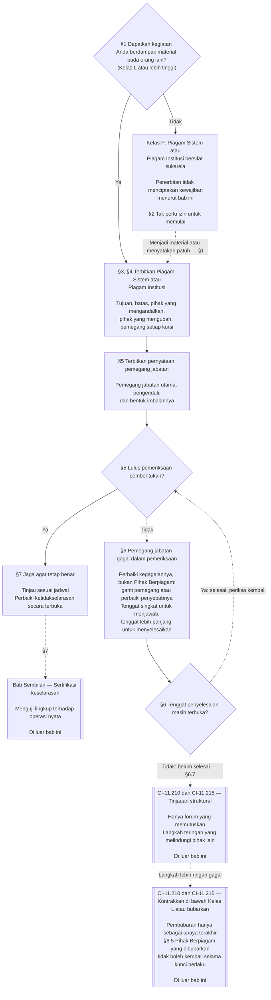

# BAB TUJUH: PIAGAM SISTEM DAN INSTITUSI

> **Status terjemahan:** draf berbantuan AI dalam bahasa Indonesia; belum ditinjau pembaca independen yang fasih. Teks sumber bernomor dalam bahasa Inggris tetap mengikat. Teks ini mencakup seluruh Bab Tujuh.

<strong>Letak dalam korpus (non-operatif): struktur berkas dan aturan baca</strong>

> Berkas ini **merupakan bagian dari Konstitusi Makhluk Sadar** dan **hanya mengikat bersama-sama** dengan berkas `core_*` bernomor lainnya yang dibaca sebagai satu teks. Berkas ini memuat **Bab Tujuh**: lantai minimum bagi dokumen lingkup terbitan suatu sistem dan institusi: Piagam Sistem dan Piagam Institusi. Bab ini menyusul Lantai Hak Bab Enam dan mendahului [Bab Delapan](../../../core_08.000_functional_independence_segregation_of_duties.md#chapter-eight-functional-independence-and-segregation-of-duties), yang memisahkan kursi-kursi di dalam setiap tindakan yang mengikat secara material.
>
> - **Pemilik konstitusional:** kapan sistem wajib menerbitkan Piagam Sistem dan kapan institusi wajib menerbitkan Piagam Institusi (wajib untuk Kelas L atau lebih tinggi, sukarela untuk Kelas P), isi minimum masing-masing, cara mengubah dan meninjaunya, serta pemeriksaan pembentukan atas status dan keaslian pemegang jabatan yang tercakup.
> - **Rumah definisi:** [Piagam Sistem](../../../core_05.040_band_continuity.md#system-charter), [Piagam Institusi](../../../core_05.040_band_continuity.md#institutional-charter), [Peta Peran Piagam](../../../core_05.040_band_continuity.md#charter-role-map), [Pihak Berpiagam](../../../core_05.040_band_continuity.md#chartered-party), dan [Pihak Pengoperasi](../../../core_05.050_band_oversight.md#operating-party) didefinisikan di Bab Lima. Bab ini menerapkan istilah-istilah tersebut tanpa mendefinisikannya ulang.
> - **Pemilik implementasi:** [CI-8.205 §6](../../../corpus_institutions/ci_08.205_institutional_design_separation_of_powers.md#ci-8205-6-system-and-institutional-charter-contents-review-and-formation-template) (*Isi Piagam Sistem dan Piagam Institusi, tinjauan, dan templat pembentukan*) memuat templat bidang lengkap, daftar periksa tinjauan, prosedur pembentukan, dan templat pernyataan pemeriksaan pembentukan. Ketentuannya boleh lebih ketat dan menambah bidang, tetapi tidak boleh mempersempit bab ini. Teksnya mengikat sebagai teks implementasi terinkorporasi hanya dalam lingkup adopsi yang sah ([Bab Delapan Belas §4 Kerangka adopsi dan lingkup kewenangan](../../../core_18.000_incorporation.md#4-adoption-framing-and-scope-of-authority)); lantai di bab ini mengikat sebagai teks inti.
> - **Pengguna lanjutan:** [Bab Delapan §5 Penempatan, Kekosongan Jabatan, dan Penggantian yang Dipublikasikan](../../../core_08.000_functional_independence_segregation_of_duties.md#5-published-placement-vacancy-and-substitution) mewajibkan Peta Peran Piagam. Bab Sembilan membaca Piagam Sistem untuk temuan lingkup dan batas, sedangkan Bagian D Bab Sembilan menguji pernyataan pemeriksaan pembentukan bagi Institusi. [Bab Sepuluh §3.7 Penitipan Catatan dan Kewenangan Pembukaan](../../../core_10.000_standing_assessment.md#37-record-custody-and-opening-authority) menerapkannya pada catatan status. [Bab Tiga Belas §4.3 Forum Institusional](../../../core_13.000_forum.md#43-institutional-forums) mengadili perselisihan tentang Piagam Institusi.
>
> Urutan baca: §1 kapan Piagam Sistem dan Piagam Institusi diwajibkan, beserta diagram proses → §2 hak untuk membentuk dan empat batas sempit → §3 hal yang wajib dinyatakan → §4 Peta Peran Piagam dan penitipan catatan status → §5 pemeriksaan pembentukan atas status dan keaslian pemegang jabatan → §6 ketika pemegang jabatan gagal dalam pemeriksaan pembentukan → §7 amendemen, tinjauan, dan ketidakselarasan lingkup.

<strong>Jejak</strong>

- Hulu:
  - [Tetrad Konstitusional](../../../core_00.000_preamble.md#constitutional-tetrad), terutama **pengawasan** dan **pertanggungjawaban**;
  - [taruhan material](../../../core_00.000_preamble.md#material-stake);
  - [Bab Satu §18.1 Tata Kelola sebagai Struktur yang Diotorisasi](../../../core_01.015_stewardship_capacity_principles.md#181-governance-as-authorized-structure) (1.015 §18.1);
  - [Pasal XI-E](../../../core_06.010_rights_part_b.md#article-xi-e-institutional-formation-and-business-creation) (*Pembentukan Institusi dan Pendirian Usaha*).
- Subseksi:
  - [§1](#1-kapan-piagam-sistem-dan-piagam-institusi-diwajibkan);
  - [§2](#2-hak-untuk-membentuk-dan-empat-batas-sempit);
  - [§3](#3-hal-yang-wajib-dinyatakan-piagam-sistem-dan-piagam-institusi);
  - [§4](#4-peta-peran-piagam-dan-penitipan-catatan-status);
  - [§5](#5-pemeriksaan-pembentukan-status-dan-keaslian-pemegang-jabatan);
  - [§6](#6-jika-pemegang-jabatan-gagal-dalam-pemeriksaan-pembentukan);
  - [§7](#7-amendemen-tinjauan-dan-ketidakselarasan-lingkup).
- Hilir:
  - [Bab Delapan](../../../core_08.000_functional_independence_segregation_of_duties.md#chapter-eight-functional-independence-and-segregation-of-duties) (8.000);
  - [Bab Sembilan](../../../core_09.000_system_alignment_certification.md#chapter-nine-system-alignment-certification-reading-index) (9.000);
  - [Bab Sepuluh](../../../core_10.000_standing_assessment.md#chapter-ten-contribution-violation-and-standing-model--measurement) (10.000);
  - [Bab Tiga Belas](../../../core_13.000_forum.md#chapter-thirteen-forums-and-jurisdiction) (13.000);
  - [Bab Empat Belas](../../../core_14.000_governance.md#chapter-fourteen-constitutional-contract-legitimacy-authorization-and-stewardship) (14.000); teks implementasi yang ditetapkan di atas.
- Baca bersama:
  - [Tumpukan Kewenangan dan Hierarki Internal](../../../core_05.045_band_integrative.md#authority-stack-and-internal-hierarchy);
  - [Batas Sistem](../../../core_05.040_band_continuity.md#system-boundaries);
  - [Integritas Batas Sistem](../../../core_05.040_band_continuity.md#system-boundary-integrity);
  - [Penciptaan Sistem](../../../core_05.055_band_participation.md#system-creation);
  - [Pendirian Usaha](../../../core_05.055_band_participation.md#business-creation).

 

Bab Tujuh adalah pemilik konstitusional bagi **Piagam Sistem, Piagam Institusi, dan lingkup yang dipublikasikan**.

Tiga bab membentuk satu rangkaian:

- **Bab Tujuh (bab ini):** menjelaskan apa yang diklaim akan dilakukan oleh [Pihak Berpiagam](../../../core_05.040_band_continuity.md#chartered-party), serta siapa yang boleh menduduki setiap kursi ketika pihak tersebut bertindak.
- **[Bab Delapan](../../../core_08.000_functional_independence_segregation_of_duties.md#chapter-eight-functional-independence-and-segregation-of-duties):** menjelaskan bagaimana kursi-kursi itu harus dipisahkan.
- **[Bab Sembilan](../../../core_09.000_system_alignment_certification.md#chapter-nine-system-alignment-certification-reading-index):** mensertifikasi suatu sistem dan, secara terpisah, suatu institusi. Masing-masing merupakan satu tindakan yang mengikat yang menggunakan kursi-kursi itu. Temuannya dikembalikan ke Piagam Sistem atau Piagam Institusi.

Bab-bab lain mengatur definisi, aturan kursi, kunci status, serta aturan pengambilan keputusan yang dirujuk bab ini. **CI-8.205 §6** (*Isi Piagam Sistem dan Piagam Institusi, tinjauan, dan templat pembentukan*) memuat templat bidang, prosedur pembentukan, dan daftar periksa tinjauan.

### 1. Kapan Piagam Sistem dan Piagam Institusi Diwajibkan

<strong>Jejak</strong>

- Hulu:
  - [§2](#2-hak-untuk-membentuk-dan-empat-batas-sempit);
  - [taruhan material](../../../core_00.000_preamble.md#material-stake);
  - [Proporsionalitas](../../../core_05.035_band_accountability.md#proportionality); klaim pemilik pada pembukaan bab;
  - [Bab Satu §18 Tata Kelola di Bawah Disiplin Pengelolaan Bertanggung Jawab](../../../core_01.015_stewardship_capacity_principles.md#18-governance-under-stewardship-discipline) (1.015 §18);
  - [Pengawasan](../../../core_05.020_apex_oversight_leg.md#oversight-constitutional);
  - [Pertanggungjawaban](../../../core_05.005_apex_accountability_leg.md#accountability).
- Hilir: [§3](#3-hal-yang-wajib-dinyatakan-piagam-sistem-dan-piagam-institusi); [Bab Sembilan Bagian A §2 Evaluasi Kelas Sistem](../../../core_09.005_system_alignment_certification_evaluation.md#2-system-class-evaluation) (9.005 §2) (*kelas dan kedalaman sertifikasi*); [Bab Sembilan Bagian D §12.1 Kelas Institusi](../../../core_09.020_institutional_alignment_certification.md#121-institution-class) (*kelas suatu Institusi*); **CS-9.305 (*Mekanisme klasifikasi sistem*) dan CS-9.310** (*Mekanisme klasifikasi sistem*) untuk katalog kelas.
- Baca bersama:
  - **CI-8.205 §6** (*Isi Piagam Sistem dan Piagam Institusi, tinjauan, dan templat pembentukan*);
  - **CF-13.415 §5** (*Pencatat institusional dan lokal*);
  - **CI-9.210** (*Kewajiban institusional yang terkait klasifikasi*);
  - [Piagam Sistem Bab Lima](../../../core_05.040_band_continuity.md#system-charter) (5.040);
  - [Piagam Institusi Bab Lima](../../../core_05.040_band_continuity.md#institutional-charter) (5.040);
  - [Pasal XI-E](../../../core_06.010_rights_part_b.md#article-xi-e-institutional-formation-and-business-creation) (*Pembentukan Institusi dan Pendirian Usaha*).

<strong>Definisi · Penilaian · Kepatuhan</strong>

- [Piagam Sistem](../../../core_05.040_band_continuity.md#system-charter) · [O](../../../core_05.040_band_continuity.md#system-charter) · [M](../../../core_05.040_band_continuity.md#system-charter-a) · [A](../../../core_05.040_band_continuity.md#system-charter-a) · [C](../../../core_05.040_band_continuity.md#system-charter-c)
- [Piagam Institusi](../../../core_05.040_band_continuity.md#institutional-charter) · [O](../../../core_05.040_band_continuity.md#institutional-charter) · [M](../../../core_05.040_band_continuity.md#institutional-charter-a) · [A](../../../core_05.040_band_continuity.md#institutional-charter-a) · [C](../../../core_05.040_band_continuity.md#institutional-charter-c)
- [Tata Kelola yang Disesuaikan dengan Klasifikasi](../../../core_05.050_band_oversight.md#classification-scaled-governance) · [O](../../../core_05.050_band_oversight.md#classification-scaled-governance) · [M](../../../core_05.050_band_oversight.md#classification-scaled-governance-a) · [A](../../../core_05.050_band_oversight.md#classification-scaled-governance-a) · [C](../../../core_05.050_band_oversight.md#classification-scaled-governance-c)

 

*Dalam istilah sederhana: sebelum siapa pun dapat menilai apakah suatu sistem atau institusi tetap berada dalam batas-batasnya, batas itu harus tertulis dan dapat dibaca semua orang. Sistem yang secara material memengaruhi pihak lain dalam salah satu dari sembilan ranah [Materialitas Spesifik Ranah](../../../core_05.050_band_oversight.md#domain-specific-materiality) perlu menerbitkan Piagam Sistem. Institusi menerbitkan piagam yang sesuai dengan sistem yang dijalankannya. Kelas P bersifat sukarela: kelompok menjahit yang memberikan selimut kepada pengungsi menjadi contohnya.*

Piagam Sistem atau Piagam Institusi adalah lingkup terbitan suatu Pihak Berpiagam: apa yang diklaimnya berwenang untuk dilakukan, apa yang tidak, dan siapa yang menduduki setiap kursi ketika pihak itu bertindak. Lingkup tersebut menjadi dasar penempatan kursi-kursi di Bab Delapan dan menjadi pembanding sertifikasi Bab Sembilan terhadap operasi nyata. Kewajiban Pihak Pengoperasi untuk menerbitkan piagam bergantung pada kelasnya: **wajib untuk Kelas L atau lebih tinggi, sukarela untuk Kelas P.** Jika wajib menerbitkannya, piagam itu juga harus dijaga agar tetap akurat.

Lima kelas dampak sistem menjadi kerangka untuk seluruh bagian berikut. Dari yang paling berdampak hingga yang paling rendah, masing-masing dalam satu baris:

- **Kelas A, kritis bagi kelangsungan hidup, mendasar, dan tidak tergantikan:** kegagalan dalam jangka waktu yang relevan bagi kelangsungan hidup, tanpa pengganti yang layak, berarti hilangnya kondisi untuk bertahan hidup.
- **Kelas B, kritis, sangat bergantung, dan signifikan secara sistemik:** pihak yang bergantung tidak dapat mempertahankan fungsi inti tanpanya. Kelangsungan hidup tidak langsung hilang, dan penggantian masih mungkin dilakukan tepat waktu.
- **Kelas C, terkoordinasi, sangat bergantung, dan tidak kritis:** sistem ini membentuk koordinasi dalam skala besar, tetapi bukan prasyarat operasional bagi fungsi Kelas A atau Kelas B.
- **Kelas L, lokal, berdampak terbatas, dan tidak kritis:** dampaknya menjangkau ke luar unit privat, tetapi bersifat lokal, dapat diganti, dan dapat dikendalikan.
- **Kelas P, personal, untuk penggunaan privat, terisolasi, dan eksperimental:** dampaknya tetap berada dalam unit privat tanpa ketergantungan pihak luar yang berarti.

[CS-9.310 §8](../../../corpus_systems/cs_09.310_system_impact_classifications.md#cs-9310-8-system-impact-classifications) (*Klasifikasi dampak sistem*) memuat definisi lengkap. Kelas A, B, C, dan L wajib menerbitkan piagam; Kelas P boleh menerbitkannya. [§1.2 Kelas yang tercakup](#12-kelas-yang-tercakup) menjelaskan bagaimana Institusi mengambil kelasnya dari Sistem yang dijalankannya.

#### 1.1 Siapa yang wajib menerbitkan

Sistem Kelas L atau lebih tinggi wajib menerbitkan dan memelihara [Piagam Sistem](../../../core_05.040_band_continuity.md#system-charter). Institusi Kelas L atau lebih tinggi wajib menerbitkan dan memelihara piagam yang sesuai dengan Sistem yang dijalankannya:

| Yang dioperasikan, dikelola secara bertanggung jawab, atau dikendalikan secara material oleh Institusi | Yang diterbitkan |
|---|---|
| Tepat satu Sistem yang memerlukan Piagam Sistem | Piagam Sistem itu saja, tanpa dokumen kedua. Piagam tersebut menamai Institusi sebagai pengelola yang bertanggung jawab dan juga berfungsi sebagai [Piagam Institusi](../../../core_05.040_band_continuity.md#institutional-charter): satu dokumen mencakup keduanya. |
| Lebih dari satu Sistem demikian | Piagam Institusi. Piagam itu memuat setiap Piagam Sistem yang berlaku bagi Sistem tersebut dan menjelaskan alasan Institusi menjalankan Sistem-Sistem itu ([§3 Hal yang Wajib Dinyatakan dalam Piagam Sistem dan Piagam Institusi](#3-hal-yang-wajib-dinyatakan-piagam-sistem-dan-piagam-institusi)). |
| Tidak ada Sistem demikian | Piagam Institusi yang menyatakan butir-butir milik Institusi sendiri dari [§3 Hal yang Wajib Dinyatakan dalam Piagam Sistem dan Piagam Institusi](#3-hal-yang-wajib-dinyatakan-piagam-sistem-dan-piagam-institusi), tanpa Piagam Sistem untuk disertakan. |

- **Usaha dan bentuk sejenis:** usaha atau bentuk organisasi lain yang dikelola menerbitkan Piagam Sistem atau Piagam Institusi yang berlaku baginya sebagai Sistem, sebagai Institusi, atau sebagai Institusi yang menjalankan Sistem tercakup. Bentuk hukumnya tidak mengubah jawabannya.
- **Praktik profesi bersama:** makhluk sadar atau praktik kecil Kelas L atau lebih tinggi yang melakukan tindakan yang tercantum dalam lisensi atau izin praktik dapat memenuhi bagian ini untuk tindakan tersebut dengan mengadopsi Piagam Sistem atau Piagam Institusi milik tuan rumah dan Peta Peran Piagam:
  - **Yang diadopsi:** dengan rujukan, Piagam Sistem atau Piagam Institusi dan Peta Peran Piagam milik tuan rumah dalam praktik profesi bersama, yang harus mencakup tindakan tersebut.
  - **Pemberitahuan adopsi:** pemberitahuan satu halaman yang dijelaskan dalam **CI-14.205 §7** (*Lisensi praktik, izin praktik, dan praktik profesi bersama*).
  - **Kelas:** kelas praktik tetap ditentukan oleh tindakan praktik itu sendiri.

#### 1.2 Kelas yang tercakup

Kelas suatu Pihak Berpiagam menentukan apakah penerbitan piagam diwajibkan atau menjadi pilihan:

- **Kelas A, B, C, dan L:** wajib. Diagram di [§1.7 Proses dalam Sekilas](#17-proses-sekilas) menunjukkan proses yang harus diikuti.
- **Kelas P:** pilihan, sampai salah satu dari dua peristiwa menjadikannya wajib. [§1.3 Apa itu Kelas P](#13-apa-itu-kelas-p) menjelaskan kapan Pihak Pengoperasi masuk Kelas P, dan [§1.4 Kelas P: piagam opsional dan kapan menjadi wajib](#14-kelas-p-piagam-opsional-dan-kapan-menjadi-wajib) menetapkan pilihan itu dan kapan berakhir.
- **Kelas suatu Institusi:** Institusi mengambil kelas tertinggi dari Sistem mana pun yang dioperasikan, dikelola secara bertanggung jawab, atau dikendalikan secara material olehnya. Jika tidak menjalankan Sistem demikian, kelas Institusi ditentukan oleh dampak material dan ketergantungannya sendiri, berdasarkan apa yang benar-benar diputuskan dan dikendalikannya, bukan label atau bentuk hukumnya, sesuai [Bab Sembilan Bagian D §12.1 Kelas Institusi](../../../core_09.020_institutional_alignment_certification.md#121-institution-class).

#### 1.3 Apa itu Kelas P

Pihak Pengoperasi hanya berkategori Kelas P selama kegiatannya tetap berada di bawah ambang di setiap sembilan ranah [Materialitas Spesifik Ranah](../../../core_05.050_band_oversight.md#domain-specific-materiality). Dalam praktiknya, tindakan dan dampaknya harus tetap berada di dalam [unit privat](../../../core_05.050_band_oversight.md#domain-specific-materiality-private-unit):

- **Melampaui ambang:** melampaui ambang dalam satu ranah saja menjadikannya setidaknya Kelas L menurut **CS-9.305 (*Mekanisme klasifikasi sistem*) dan CS-9.310** (*Mekanisme klasifikasi sistem*), berapa pun ukurannya atau apa pun namanya.
- **Tetap di bawah setiap ambang:** jumlah anggota tidak mengubah statusnya; ia tetap Kelas P.
- **Orang-orang di dalamnya:** Kelas P juga bergantung pada pihak yang berada di dalamnya. Siapa pun di dalam yang melihat Pihak Pengoperasi melampaui suatu ambang wajib melaporkannya, dan laporan tersebut dilindungi ([Materialitas Spesifik Ranah](../../../core_05.050_band_oversight.md#domain-specific-materiality)).

Lantai empat kursi dalam Bab Delapan tidak berlaku pada tindakan Pihak Pengoperasi Kelas P yang tetap berada di dalam unit privatnya. Karena itu, satu makhluk sadar dengan komputer tidak memerlukan pemegang kursi kedua. Lantai itu mulai berlaku pada hari Pihak Pengoperasi melakukan [Tindakan yang Mengikat secara Material](../../../core_05.035_band_accountability.md#materially-binding-act) yang wajib diikuti pihak lain atau dapat mereka andalkan sebagai sesuatu yang sudah pasti. Tindakan itu melampaui ambang ranah kewenangan atas pihak lain dan menjadikannya setidaknya Kelas L.

#### 1.4 Kelas P: piagam opsional dan kapan menjadi wajib

Pihak Pengoperasi Kelas P dianjurkan menerbitkan [Piagam Sistem](../../../core_05.040_band_continuity.md#system-charter) (untuk satu sistem) atau [Piagam Institusi](../../../core_05.040_band_continuity.md#institutional-charter) (untuk lebih dari satu sistem, atau tanpa sistem) yang sesuai dengan kegiatannya. Pihak itu dapat memakai daftar isi di [§3 Hal yang Wajib Dinyatakan Piagam Sistem dan Piagam Institusi](#3-hal-yang-wajib-dinyatakan-piagam-sistem-dan-piagam-institusi) dan peta kursi di [§4 Peta Peran Piagam dan Penitipan Catatan Status](#4-peta-peran-piagam-dan-penitipan-catatan-status) sebagai templat. Penerbitannya tidak menimbulkan kewajiban menurut proses bab ini:

- tidak ada tenggat ([§1.5 Kapan Piagam Sistem atau Piagam Institusi harus diterbitkan](#15-kapan-piagam-sistem-atau-piagam-institusi-harus-diterbitkan));
- tidak ada pemeriksaan pembentukan ([§5 Pemeriksaan Pembentukan: Status dan Keaslian Pemegang Jabatan](#5-pemeriksaan-pembentukan-status-dan-keaslian-pemegang-jabatan));
- tidak wajib memiliki [Peta Peran Piagam](../../../core_05.040_band_continuity.md#charter-role-map) ([§4 Peta Peran Piagam dan Penitipan Catatan Status](#4-peta-peran-piagam-dan-penitipan-catatan-status)), meskipun Pihak itu boleh menyertakannya dalam piagam sukarela atau menerbitkannya tersendiri; dan
- tidak ada siklus amendemen atau tinjauan wajib ([§7 Amendemen, Tinjauan, dan Ketidakselarasan Lingkup](#7-amendemen-tinjauan-dan-ketidakselarasan-lingkup)).

Penerbitan berhenti menjadi opsional apabila salah satu hal berikut terjadi:

- Pihak Pengoperasi diklasifikasikan ulang ke Kelas L atau lebih tinggi; atau
- operatornya menyatakan kepatuhan konstitusional atas nama Pihak Pengoperasi.

Pihak Pengoperasi kemudian wajib menerbitkan Piagam Sistem atau Piagam Institusi yang sesuai menurut jadwal di [§1.5](#15-kapan-piagam-sistem-atau-piagam-institusi-harus-diterbitkan).

**Pengakuan tidak bergantung pada dokumen lingkup.** Kelompok, dengan atau tanpa Piagam Sistem atau Piagam Institusi dan apa pun kelasnya, tidak menghalangi pengakuan terhadap anggotanya. Setiap anggota dapat meminta catatan kontribusi sebagai pengaju perorangan atas pekerjaan yang dilakukan di dalam ataupun di luar kelompok; catatan itu menyangkut kontribusi anggota, bukan status kelompok ([Bab Sepuluh §3.7 Catatan informal dan lingkup kecil](../../../core_10.000_standing_assessment.md#37-informal-and-small-scope-records)). Pemberian bantuan, barang, tenaga, atau jasa yang tidak wajib diterima siapa pun bukan tindakan yang mengikat secara material. Karena itu, lingkaran saling bantu yang memberikan selimut kepada pengungsi tidak memerlukan piagam agar para anggotanya diakui.

#### 1.5 Kapan Piagam Sistem atau Piagam Institusi harus diterbitkan

Sistem atau Institusi yang tercakup menerbitkan [Piagam Sistem](../../../core_05.040_band_continuity.md#system-charter) atau [Piagam Institusi](../../../core_05.040_band_continuity.md#institutional-charter) menurut jadwal ini:

- **Sistem atau Institusi baru:** sebelum mulai beroperasi atau menjalankan kewenangan atas pihak lain.
- **Yang sudah beroperasi:** pada tinjauan klasifikasi atau sertifikasi berikutnya, atau dalam tenggat penyelesaian setelah permintaan berdasarkan [§1.6](#16-jika-piagam-sistem-atau-piagam-institusi-tidak-ada), mana yang lebih dahulu. Sampai piagam diterbitkan, pihak itu berada dalam keadaan lalai.
  - **Sertifikasi yang mana:** untuk Sistem, Sertifikasi Keselarasan Sistemnya. Untuk Institusi, sertifikasi keselarasan institusional berdasarkan [Bab Sembilan Bagian D §11.3 Tidak ada izin dan tidak ada gerbang](../../../core_09.020_institutional_alignment_certification.md#113-no-permission-and-no-gate); tenggat sertifikasi pertamanya tidak pernah menjadi syarat untuk menerbitkan Piagam Institusi atau beroperasi.
- **Pemeriksaan pembentukan:** pemeriksaan dalam [§5](#5-pemeriksaan-pembentukan-status-dan-keaslian-pemegang-jabatan) juga diselesaikan pada saat yang sama.
- **Tempat penyimpanan:** Piagam Sistem atau Piagam Institusi diserahkan bersama Peta Peran Piagam dan pernyataan pemeriksaan pembentukan kepada pencatat Institusi, atau pencatat lokal jika kegiatan dan makhluk sadar yang terdampak bersifat lokal (**CF-13.415 §5** (*Pencatat institusional dan lokal*)):
  - **Tugas pencatat:** memeriksa kelengkapan persyaratan dan memberikan tanda terima bertanggal.
  - **Yang tidak pernah dilakukan pencatat:** memberikan izin atau memutuskan kelas maupun isi.
  - **Tanda terima terlambat atau tidak ada:** tidak pernah menghentikan Pihak Berpiagam untuk beroperasi.

#### 1.6 Jika Piagam Sistem atau Piagam Institusi tidak ada

Siapa pun yang mengetahui bahwa Pihak Berpiagam Kelas L atau lebih tinggi—termasuk yang baru masuk kelas itu—belum menerbitkan Piagam Sistem atau Piagam Institusi, dapat meminta piagam tersebut kepada otoritas pengaturnya. Peminta tidak memerlukan status hukum tertentu, tidak membayar biaya, dan tidak perlu menunjukkan kerugian. Permintaan menyebutkan Pihak Berpiagam dan alasan mengapa pihak itu tampak tercakup.

Dua tenggat dimulai saat permintaan diajukan: tenggat tanggapan dan tenggat penyelesaian. Masing-masing mengikuti Tier dengan huruf yang sama seperti kelas Pihak Berpiagam; semakin kritis kelasnya, semakin singkat tenggatnya:

| Kelas dan Tier | Tenggat tanggapan (sasaran penerimaan) | Tenggat penyelesaian (batas akhir) |
|---|---|---|
| Kelas A, Tier A | 24 jam | 7 hari kalender |
| Kelas B, Tier B | 2 hari kalender | 14 hari kalender |
| Kelas C, Tier C | 4 hari kalender | 30 hari kalender |
| Kelas L, Tier L | 8 hari kalender | 60 hari kalender |

Angka tersebut berasal dari **CF-13.445 §3.1** (*Sasaran tahapan dan batas waktu*), yang berlaku jika ada perbedaan. Selama sengketa kelas belum diputus, Pihak Berpiagam dihitung menurut Tier yang lebih kritis antara kelas pada Catatan Klasifikasi Sistem dan kelas yang ditunjukkan secara prima facie oleh peminta atau forum. Pihak Berpiagam tanpa kelas tercatat, atau yang tercatat Kelas P sementara kelasnya dipersoalkan, dihitung pada Tier C.

Tenggat-tenggat itu berlaku sebagai berikut:

- **Tenggat tanggapan:** Pihak Berpiagam menjawab dalam sasaran penerimaan Tier yang sesuai menurut **CF-13.445 §3.1**, dihitung sejak permintaan. Pihak itu menerbitkan piagam; menyebutkan tanggal penerbitannya; menunjuk piagam yang telah diterbitkan; atau menyatakan bahwa kegiatannya berada di bawah semua ambang [Materialitas Spesifik Ranah](../../../core_05.050_band_oversight.md#domain-specific-materiality) dan memberikan uraian tertulis yang diwajibkan untuk pengajuan tersebut.
- **Tenggat penyelesaian:** piagam beserta pernyataan pemeriksaan pembentukannya ([§5](#5-pemeriksaan-pembentukan-status-dan-keaslian-pemegang-jabatan)) harus diserahkan dalam batas akhir Tier yang sesuai menurut **CF-13.445 §3.1**, dihitung sejak permintaan. Pihak Berpiagam yang belum memiliki kursi independen mengajukan pernyataan sebagai deklarasi beserta buktinya, sebagaimana dijelaskan dalam bagian tersebut.
- **Pihak Pengoperasi menyatakan berada di bawah ambang:** permintaan itu juga menjadi tantangan klasifikasi menurut jalur *Challenge route* pada entri terkait:
  - **Tenggat tetap berjalan:** tenggat penyelesaian tetap berjalan selama tantangan menunggu putusan.
  - **Perpanjangan tantangan:** jika forum berwenang menilai tantangan layak ditinjau, tanggal jatuh tempo diperpanjang dan tenggat penyelesaian baru dimulai saat tantangan diputus. Forum memutus tantangan dalam batas akhir Tier yang sesuai.
  - **Arti layak ditinjau:** tantangan menyebutkan pelampauan tertentu dalam ranah yang disebutkan, dan uraian tertulis Pihak Pengoperasi menyisakan pertanyaan nyata tentang pelampauan itu. Pihak Pengoperasi tidak menilai sendiri kelayakan tantangannya. Tanggapan tanpa uraian tertulis tidak memperpanjang tanggal jatuh tempo.
  - **Jika kelas ditetapkan:** dalam tantangan itu atau tantangan lain, tanggal penetapan menjadi tanggal permintaan; tenggat tanggapan dan penyelesaian dihitung sejak tanggal tersebut menurut Tier kelas yang ditetapkan (Kelas A, B, C, atau L).
- **Jika tenggat terlewati:** tidak adanya tanggapan atau piagam pada tanggal jatuh tempo merupakan cacat yang harus dicatat dan diperbaiki. Peminta dapat membawa perkara ke forum berwenang melalui jalur yang sama. Hal itu tidak pernah menjadi syarat pembentukan atau pengoperasian.
- **Permintaan berulang:** permintaan kedua tentang Pihak Berpiagam yang sama, saat tanggapan atau penetapan terdahulu masih berlaku, tidak memulai tenggat baru. Pihak tersebut cukup menunjuk tanggapan atau penetapan itu. Pernyataan sepihak bahwa kegiatannya berada di bawah semua ambang, yang belum ditinjau forum, tidak dihitung sebagai tanggapan yang masih berlaku. Tanggapan atau penetapan tetap berlaku sampai pemicu pembukaan kembali dalam [Bab Sembilan Bagian D §14.2 Pemicu pembukaan kembali](../../../core_09.020_institutional_alignment_certification.md#142-reopening-triggers) terjadi:
  - **Perubahan material:** kegiatan Pihak Berpiagam berubah secara material.
  - **Bukti baru:** terdapat bukti baru tentang suatu pelampauan.

Permintaan yang menunjukkan salah satu hal itu bukan permintaan berulang. Permintaan tersebut ditangani sebagai perkara baru dan terpisah, dengan tenggat tanggapan dan penyelesaian tersendiri yang dihitung dari tanggalnya; tanggapan, penetapan, dan tenggat terdahulu tidak memenuhi atau mengubahnya.
- **Lingkup sementara:** ketiadaan piagam tidak berarti Pihak Berpiagam tidak memiliki batas. Sampai piagam tersedia, [Batas Sistem](../../../core_05.040_band_continuity.md#system-boundaries) yang nyata dan kelasnya tetap berlaku; sertifikasi atau forum dapat merekonstruksi lingkup dari operasi yang diamati.

#### 1.7 Proses sekilas

Diagram mengikuti satu Pihak Pengoperasi dari pertanyaan apakah kegiatannya berdampak material pada pihak lain, melalui penerbitan Piagam Sistem atau Piagam Institusi, hingga pemeliharaan ketepatannya. Jika masalah tidak diperbaiki dalam tenggat penyelesaian, proses piagam meneruskannya ke tinjauan yang diatur di luar bab ini. Bagian-bagian berikut menjelaskan tiap langkah dalam urutan yang sama.

<strong>Panduan pembaca (non-operatif): membaca diagram</strong>

> Intinya: tidak ada pihak yang memberikan Piagam Sistem atau Piagam Institusi, dan tidak seorang pun memerlukan izin untuk membentuk organisasi. Pihak Berpiagam yang kegiatannya berdampak material pada orang lain menerbitkan klaim kewenangannya dan pemegang setiap kursi; pemegang jabatan utamanya menjalani pemeriksaan. Pemegang jabatan yang gagal diganti atau penyebab kegagalannya diperbaiki, lalu Pihak Berpiagam melanjutkan kegiatan. Jika kegagalan belum diperbaiki saat tenggat penyelesaian berakhir, forum dapat meninjau Pihak Berpiagam dengan memulai dari langkah paling ringan yang melindungi pihak lain. Menurunkannya ke bawah Kelas L atau membubarkannya hanya dilakukan setelah langkah yang lebih ringan gagal. Pihak Berpiagam yang telah dibubarkan tidak boleh kembali selama kunci atasnya masih berlaku.
>
> Panah utuh menunjukkan jalur utama. Panah titik-titik menunjukkan pengecualian dan serah-terima yang diberi label bagian terkait. Kotak dengan garis ganda di kedua sisinya merupakan milik bab lain atau teks implementasi terinkorporasi. Diagram tidak menambah kewajiban, kursi, atau bidang; tidak satu pun langkah merupakan pemberian izin.

 

### 2. Hak untuk Membentuk dan Empat Batas Sempit

<strong>Panduan pembaca (non-operatif): susunan bagian ini</strong>

- [§2.1 Hak untuk membentuk](#21-hak-untuk-membentuk) menyatakan hak tersebut dan pihak yang tidak tercakup.
- [§2.2 Batas pertama: kunci yang masih berlaku atas makhluk sadar](#22-batas-pertama-kunci-yang-masih-berlaku-atas-makhluk-sadar) menjelaskan bagaimana kunci melarang satu makhluk sadar yang disebutkan untuk memegang satu jabatan pengendali.
- [§2.3 Batas kedua: penahanan singkat atas fakta tertentu yang terverifikasi](#23-batas-kedua-penahanan-singkat-atas-fakta-tertentu-yang-terverifikasi) menjelaskan penahanan singkat yang dapat melarang makhluk sadar tertentu untuk memegang jabatan pengendali.
- [§2.4 Batas ketiga: kunci atas Pihak Pengoperasi itu sendiri](#24-batas-ketiga-kunci-atas-pihak-pengoperasi-itu-sendiri) menjelaskan larangan atas Pihak Pengoperasi dan penerusnya, termasuk larangan menghidupkan kembali Pihak Berpiagam yang telah dibubarkan.
- [§2.5 Batas keempat: lisensi atau izin praktik](#25-batas-keempat-lisensi-atau-izin-praktik) menjelaskan kapan suatu tindakan berisiko tinggi yang disebutkan memerlukan lisensi atau izin. Hal ini bukan gerbang pembentukan.

<strong>Pelacakan</strong>

- Hulu: [§1](#1-kapan-piagam-sistem-dan-piagam-institusi-diwajibkan); [Pasal XI-E](../../../core_06.010_rights_part_b.md#article-xi-e-institutional-formation-and-business-creation) (*Pembentukan Institusi dan Pendirian Usaha*).
- Hilir: [§1](#1-kapan-piagam-sistem-dan-piagam-institusi-diwajibkan); [§5 Pemeriksaan Pembentukan: Status dan Keaslian Pemegang Jabatan](#5-pemeriksaan-pembentukan-status-dan-keaslian-pemegang-jabatan).
- Baca bersama:
  - [Penahanan Sementara](../../../core_05.035_band_accountability.md#interim-hold);
  - [Bab Sebelas §4.2 Pencegahan — kunci status umum](../../../core_11.000_standing_integration.md#42-prevention--general-standing-locks) (11.000 §4.2);
  - [Bab Sebelas §5.5 Kunci khusus](../../../core_11.000_standing_integration.md#55-special-locks) (11.000 §5.5);
  - [Bab Tiga Belas §5 Penahanan sementara pada jalur makhluk sadar tertentu](../../../core_13.000_forum.md#interim-hold-on-a-named-sentients-pathway) (13.000 §5).

 

*Intinya: Anda tidak memerlukan izin siapa pun untuk membentuk Sistem, Institusi, atau usaha. Empat batas sempit dapat berlaku. Tiga merupakan gerbang: kunci yang belum dicabut dapat melarang satu makhluk sadar memegang satu jabatan pengendali; penahanan singkat atas fakta tertentu yang terverifikasi dapat melakukan hal yang sama; dan kunci atas Pihak Pengoperasi dapat melarang Pihak Pengoperasi itu sendiri. Batas keempat dapat mewajibkan lisensi atau izin sebelum suatu tindakan berisiko tinggi yang disebutkan. Pihak Berpiagam yang dibubarkan forum dilarang kembali; larangan itu permanen jika pembubaran didasarkan pada perilaku anti-konstitusional yang meluas atau kerugian serius yang tidak dapat dipulihkan dan belum diperbaiki. Tidak satu pun dari batas itu menghentikan Pihak Pengoperasi baru untuk dibentuk atau beroperasi, dan bab ini tidak menambahkan batas lain.*

**Pasal XI-E** (*Pembentukan Institusi dan Pendirian Usaha*) memperbolehkan empat batas sempit:

- **Tiga batas pertama adalah satu-satunya gerbang** untuk membentuk Pihak Pengoperasi atau memegang kewenangan di dalamnya. Masing-masing melekat pada subjek yang disebutkan:
  - **Kunci yang masih berlaku** ([§2.2](#22-batas-pertama-kunci-yang-masih-berlaku-atas-makhluk-sadar)) melekat pada satu makhluk sadar tertentu dalam satu jabatan yang mengendalikan Pihak Berpiagam.
  - **Penahanan Sementara** ([§2.3](#23-batas-kedua-penahanan-singkat-atas-fakta-tertentu-yang-terverifikasi)) hanya melekat pada satu makhluk sadar tertentu dalam satu jabatan yang mengendalikan Pihak Berpiagam.
  - **Kunci atas Pihak Pengoperasi itu sendiri** ([§2.4](#24-batas-ketiga-kunci-atas-pihak-pengoperasi-itu-sendiri)) melekat pada Pihak Berpiagam yang terkena kunci, termasuk pihak yang dibubarkan forum.
- **Batas keempat bukan gerbang:** batas ini berupa lisensi atau izin praktik ([§2.5](#25-batas-keempat-lisensi-atau-izin-praktik)).

#### 2.1 Hak untuk membentuk

Siapa pun boleh membentuk Sistem, Institusi, atau usaha baru. Hak itu ditetapkan dalam [Pasal XI-E](../../../core_06.010_rights_part_b.md#article-xi-e-institutional-formation-and-business-creation) (*Pembentukan Institusi dan Pendirian Usaha*). Bab ini menambahkan kewajiban yang berlaku sesudahnya: begitu kegiatan Pihak Pengoperasi berdampak material pada pihak lain di salah satu dari sembilan ranah [Materialitas Spesifik Ranah](../../../core_05.050_band_oversight.md#domain-specific-materiality), Pihak itu harus mengumumkan terlebih dahulu kewenangan yang diklaimnya ([§1](#1-kapan-piagam-sistem-dan-piagam-institusi-diwajibkan)). Penerapan Piagam Sistem atau Piagam Institusi tidak boleh ditafsirkan mempersempit hak tersebut atau perlindungan Ambang Hak.

**Hal yang tidak dilindungi hak untuk membentuk.** Selain tiga gerbang dalam [§2.2](#22-batas-pertama-kunci-yang-masih-berlaku-atas-makhluk-sadar), [§2.3](#23-batas-kedua-penahanan-singkat-atas-fakta-tertentu-yang-terverifikasi), dan [§2.4](#24-batas-ketiga-kunci-atas-pihak-pengoperasi-itu-sendiri), **Pasal XI-E** (*Pembentukan Institusi dan Pendirian Usaha*) tidak melindungi:

- Pihak Pengoperasi yang dirancang untuk melanggar Kendala Konstitusional, merusak Keselamatan atau Kebenaran, atau memusatkan kuasa dengan cara yang dilarang [Bab Satu §11 Struktur Pasar](../../../core_01.005_values_principles.md#11-market-structure); atau
- Pihak Pengoperasi yang dibentuk atau dijalankan pendirinya tanpa keselarasan autentik dengan tujuan yang dinyatakan, sebagaimana terlihat dari perilaku, kendali, dan imbalan terverifikasi; atau oleh pendiri yang bermaksud menyesatkan pihak lain mengenai tujuan, kendali, atau kepentingannya, ataupun bermaksud merugikan pihak lain.

Forum memutus perkara tersebut berdasarkan Pasal itu. Konsekuensi yang diperbolehkan hanya tiga gerbang tadi: gerbang kunci yang masih berlaku, Penahanan Sementara, dan kunci atas Pihak Pengoperasi itu sendiri. Kegagalan pemeriksaan pembentukan merupakan salah satu bukti yang ditimbang forum; pemeriksaan itu sendiri tidak menentukan perkara.

#### 2.2 Batas pertama: kunci yang masih berlaku atas makhluk sadar

[Kunci status](../../../core_11.000_standing_integration.md#42-prevention--general-standing-locks) atau [kunci khusus](../../../core_11.000_standing_integration.md#55-special-locks) yang ditetapkan setelah pelanggaran terverifikasi dan belum dicabut melarang satu makhluk sadar yang disebutkan memegang kewenangan atas Institusi atau usaha sejenis ini.

- **Yang dilarang:** memperoleh atau menjalankan kewenangan untuk mengatur, mengendalikan, atau memiliki Pihak Pengoperasi.
- **Cakupannya:** hanya sejauh yang ditetapkan kunci. Larangan berakhir ketika kunci dicabut atau dipersempit.
- **Kunci atas Pihak Pengoperasi itu sendiri:** lihat [§2.4](#24-batas-ketiga-kunci-atas-pihak-pengoperasi-itu-sendiri).

#### 2.3 Batas kedua: penahanan singkat atas fakta tertentu yang terverifikasi

Batas ini berlaku ketika forum berwenang memerintahkan [Penahanan Sementara](../../../core_05.035_band_accountability.md#interim-hold) berdasarkan fakta terverifikasi tertentu yang membuat kemungkinan pemegang jabatan tidak selaras dengan tujuan Pihak Berpiagam lebih besar daripada kemungkinan sebaliknya. Hanya forum tersebut yang boleh memerintahkannya ([Bab Tiga Belas §5](../../../core_13.000_forum.md#interim-hold-on-a-named-sentients-pathway)). Pihak Berpiagam tidak boleh memutuskan sendiri untuk melarang seseorang dari jabatan karena itu akan menjadikannya hakim atas anggotanya sendiri. Dasar lengkapnya tercantum dalam [Bab Tiga Belas §5 Penahanan sementara pada jalur makhluk sadar tertentu](../../../core_13.000_forum.md#interim-hold-on-a-named-sentients-pathway); ringkasan ini tidak menggantikannya.

#### 2.4 Batas ketiga: kunci atas Pihak Pengoperasi itu sendiri

Kunci dapat dikenakan pada Pihak Pengoperasi, bukan hanya pada makhluk sadar. Gerbang itu melarang hal-hal yang disebutkan pada jalur kunci tersebut, baik pada Pihak Pengoperasi maupun penerus, entitas yang dikendalikan, dan wahana yang menggunakan nominee atau kedok. Larangan itu tidak berlaku bagi Pihak Pengoperasi lainnya.

- **Kunci berdasarkan penetapan final:** [Kunci Kepercayaan Anti-Konstitusional](../../../core_11.000_standing_integration.md#55-special-locks) berlaku demikian jika penetapan final menyebut Institusi, wahana penerus, atau entitas yang dikendalikan. Gerbang itu melarang hal-hal yang disebutkan jalur kunci pada Pihak Berpiagam, penerus, entitas terkendali, dan wahana nominee atau kedoknya.
- **Pihak Berpiagam yang dibubarkan:** perintah pembubaran final berdasarkan **CI-11.210 §4** (*Pembubaran*) menetapkan [Kunci Pembentukan Kembali setelah Pembubaran](../../../core_11.000_standing_integration.md#55-special-locks). Selama kunci berlaku, Pihak Berpiagam yang dibubarkan, penerus, entitas terkendali, wahana nominee atau kedoknya, serta Pihak Pengoperasi mana pun yang merupakan satu operasi dengan mereka tidak boleh dibentuk kembali, dihidupkan kembali, atau dijalankan dengan nama atau bentuk apa pun. Jika perintah menemukan perilaku anti-konstitusional yang meluas atau Kerugian yang Tidak Dapat Dipulihkan dan belum diperbaiki ([Bab Sebelas §8 Pemulihan dan penilaian ulang](../../../core_11.000_standing_integration.md#8-restoration-and-reassessment)), kunci itu permanen: berjalannya waktu, penyelesaian penyebab, atau pergantian pemegang jabatan tidak mencabutnya. Kunci hanya berakhir jika perintah pembubaran dibatalkan dalam peninjauan atau fakta baru material yang terverifikasi membuktikan temuan itu keliru. Dalam keadaan lain, kunci berakhir setelah penetapan independen bahwa penyebab telah diselesaikan, pemulihan telah diberikan, dan pengembalian lebih aman daripada pengucilan berkelanjutan. Kunci tidak melarang makhluk sadar membentuk Pihak Pengoperasi yang berbeda.

Tidak satu pun dari tiga gerbang itu menghentikan Pihak Pengoperasi baru untuk dibentuk, menerbitkan Piagam Sistem atau Piagam Institusi, atau mulai bekerja. Yang dihentikan hanyalah pihak yang terkena kunci, seperti Pihak Berpiagam yang dibubarkan dan berusaha kembali. Ketiga gerbang diterapkan dalam pemeriksaan pembentukan ([§5](#5-pemeriksaan-pembentukan-status-dan-keaslian-pemegang-jabatan)).

#### 2.5 Batas keempat: lisensi atau izin praktik

Batas keempat berlaku pada tindakan yang disebutkan, bukan pada pembentukan Pihak Pengoperasi:

- **Bukan gerbang pembentukan:** pemeriksaan pembentukan di [§5](#5-pemeriksaan-pembentukan-status-dan-keaslian-pemegang-jabatan) tidak menerapkan batas ini.
- **Bentuknya:** [Izin Kompetensi](../../../core_05.035_band_accountability.md#competency-clearance) yang boleh diwajibkan pengadopsi berdasarkan **Pasal XI-E** (*Pembentukan Institusi dan Pendirian Usaha*) sebelum tindakan tertentu dilakukan bagi pihak lain, dengan temuan risiko yang diterbitkan forum teknis.
  - **Lisensi praktik:** diwajibkan untuk tindakan yang dapat menyebabkan kerugian serius atau tidak dapat dipulihkan jika dilakukan dengan buruk.
  - **Izin praktik:** diwajibkan untuk tindakan yang dapat menyebabkan kerugian nyata tetapi lebih ringan jika dilakukan dengan buruk.
- **Yang dikenai:** pelaksanaan tindakan tersebut. Batas ini tidak pernah menghentikan Pihak Pengoperasi untuk dibentuk, menerbitkan Piagam Sistem atau Piagam Institusi, atau beroperasi.
- **Yang dilarang:** mengklaim atau melakukan tindakan tanpa izin. Piagam Sistem atau Piagam Institusi tidak boleh mengklaim tindakan itu kecuali pemegang jabatan yang melakukannya memiliki izin ([§3](#3-hal-yang-wajib-dinyatakan-piagam-sistem-dan-piagam-institusi)).

### 3. Hal yang Wajib Dinyatakan Piagam Sistem dan Piagam Institusi

<strong>Panduan pembaca (non-operatif): susunan bagian ini</strong>

- [§3.1 Isi Piagam Sistem](#31-isi-piagam-sistem) mencantumkan sembilan butir.
- [§3.2 Penunjuk Piagam](#32-penunjuk-piagam) menjelaskan bahwa Piagam Sistem atau Piagam Institusi boleh merujuk dokumen terbitan lain tanpa menyalin isinya, serta syarat sahnya rujukan tersebut.
- [§3.3 Tambahan dalam Piagam Institusi](#33-tambahan-dalam-piagam-institusi) mencakup isi tambahan selain sembilan butir: Piagam Sistem yang berlaku bagi Sistem yang dijalankan Institusi, serta alasan Institusi menjalankannya.
- [§3.4 Tindakan yang memerlukan lisensi atau izin praktik](#34-tindakan-yang-memerlukan-lisensi-atau-izin-praktik) menjelaskan bahwa piagam hanya boleh mencakup tindakan tersebut jika setiap makhluk sadar yang melakukannya memiliki lisensi atau izin, atau belajar di bawah pengawas yang memilikinya. Sampai itu terpenuhi, tindakan dicantumkan sebagai di luar lingkup (butir 4 dalam [§3.1](#31-isi-piagam-sistem)).
- [§3.5 Penskalaan](#35-penskalaan) menjelaskan hal yang berubah menurut kelas.

<strong>Pelacakan</strong>

- Hulu: [§1](#1-kapan-piagam-sistem-dan-piagam-institusi-diwajibkan); [Piagam Sistem Bab Lima](../../../core_05.040_band_continuity.md#system-charter) (5.040); [Piagam Institusi Bab Lima](../../../core_05.040_band_continuity.md#institutional-charter) (5.040).
- Hilir:
  - [§4](#4-peta-peran-piagam-dan-penitipan-catatan-status);
  - [§7](#7-amendemen-tinjauan-dan-ketidakselarasan-lingkup);
  - [Bab Sembilan Bagian B §8.1 Isi minimum catatan](../../../core_09.010_system_alignment_certification_record_process.md#81-minimum-record-contents) (9.010 §8.1) (*butir Piagam Sistem yang menjadi dasar catatan sertifikasi*);
  - **CI-8.205 §6** (*Isi Piagam Sistem dan Piagam Institusi, tinjauan, dan templat pembentukan*) untuk daftar bidang lengkap.
- Baca bersama:
  - [Bab Delapan Belas §4 Kerangka adopsi dan lingkup kewenangan](../../../core_18.000_incorporation.md#4-adoption-framing-and-scope-of-authority) (18.000 §4) (*dokumen lingkup dengan nama lain*);
  - [Bab Empat Belas §4.3 Persyaratan penyelesaian keputusan untuk pilihan pemangku kepentingan yang mengikat](../../../core_14.000_governance.md#43-decision-resolution-requirements-for-binding-stakeholder-choice) (14.000 §4.3);
  - **CI-6.205 §1** (*Integritas jalur pengawasan pemangku kepentingan, pemberitahuan, dan tata kelola yang mengikat*);
  - **CI-6.205 §2** (*Perlindungan anti-pemusatan dan legitimasi partisipasi*).

<strong>Definisi · Penilaian · Kepatuhan</strong>

- [Piagam Sistem](../../../core_05.040_band_continuity.md#system-charter) · [O](../../../core_05.040_band_continuity.md#system-charter) · [M](../../../core_05.040_band_continuity.md#system-charter-a) · [A](../../../core_05.040_band_continuity.md#system-charter-a) · [C](../../../core_05.040_band_continuity.md#system-charter-c)
- [Piagam Institusi](../../../core_05.040_band_continuity.md#institutional-charter) · [O](../../../core_05.040_band_continuity.md#institutional-charter) · [M](../../../core_05.040_band_continuity.md#institutional-charter-a) · [A](../../../core_05.040_band_continuity.md#institutional-charter-a) · [C](../../../core_05.040_band_continuity.md#institutional-charter-c)
- [Peta Peran Piagam](../../../core_05.040_band_continuity.md#charter-role-map) · [O](../../../core_05.040_band_continuity.md#charter-role-map) · [M](../../../core_05.040_band_continuity.md#charter-role-map-a) · [A](../../../core_05.040_band_continuity.md#charter-role-map-a) · [C](../../../core_05.040_band_continuity.md#charter-role-map-c)

 

*Intinya: Piagam Sistem harus cukup spesifik agar dapat diuji. Isinya menyatakan tujuan sistem; hal yang dilakukan dan tidak dilakukannya; pihak yang mengandalkannya; pihak yang boleh mengamendemen piagam; pemegang setiap kursi; serta tempat menemukan aturan keputusan yang mengikat. Piagam Sistem menunjuk aturan-aturan itu, bukan menggantikannya. Piagam Institusi menyatakan hal yang sama mengenai Institusi, lalu menambahkan Piagam Sistem yang dimilikinya dan alasan Institusi menjalankan sistem-sistem tersebut.*

#### 3.1 Isi Piagam Sistem

Piagam Sistem menyatakan hal-hal berikut dalam bahasa lugas yang dapat dibaca makhluk sadar terdampak dan auditor:

1. **Identitas dan versi:** nama, pengelola atau badan pengatur, versi, tanggal berlaku, dan riwayat perubahan.
2. **Tujuan:** hal yang hendak dilakukan Pihak Berpiagam.
3. **Kegiatan dalam lingkup:** fungsi, layanan, kewenangan, dan ranah yang diklaim.
   - **Klaim, bukan pemberian:** dokumen menyatakan kewenangan yang telah dimiliki Pihak Berpiagam dan tidak memberinya kewenangan baru. Legitimasi kewenangan itu, termasuk jika bersumber pada Piagam Konstitusional, diputus menurut [Bab Empat Belas §1 Otorisasi dan legitimasi kewenangan pengatur](../../../core_14.000_governance.md#1-authorization-and-legitimacy-of-governing-authority).
4. **Batas di luar lingkup:** kegiatan, kewenangan, dan ranah material yang tidak diizinkan untuk dijalankan.
5. **Komunitas terdampak dan ketergantungan:** pihak yang mengandalkan Pihak Berpiagam serta sistem atau infrastruktur yang menjadi ketergantungan atau gerbang baginya, jika material.
   - **Bukan cara untuk mengecualikan:** tidak mencantumkan suatu kelompok tidak mengeluarkannya dari lingkup. Makhluk sadar yang terdampak secara material tetap mendapatkan seluruh perlindungan Ambang Hak meski tidak disebutkan; daftar yang lebih sempit daripada ketergantungan nyata ditafsirkan sesuai ketergantungan nyata.
6. **Asumsi klasifikasi:** kelas atau Tier pengelolaan yang menjadi dasar, dengan [Penunjuk Piagam](../../../core_05.040_band_continuity.md#charter-pointer) ke **CS-9.305 (*Mekanisme klasifikasi sistem*) dan CS-9.310** (*Mekanisme klasifikasi sistem*), serta **CS-14.305** (*Pengelolaan sistem kritis*) jika berlaku.
7. **Peta Peran Piagam:** [Peta Peran Piagam](../../../core_05.040_band_continuity.md#charter-role-map), atau Penunjuk Piagam ke dokumen terbitan yang menjadi Peta Peran Piagam ([§4](#4-peta-peran-piagam-dan-penitipan-catatan-status)).
8. **Penunjuk Piagam atas pilihan pemangku kepentingan yang mengikat:**
   - **Kapan berlaku:** ketika perbedaan pendapat nyata di antara makhluk sadar terdampak memerlukan pilihan pemangku kepentingan yang mengikat di dalam Sistem. [Def.P2 Pilihan Pemangku Kepentingan yang Mengikat](../../../core_05.055_band_participation.md#defp2-binding-stakeholder-choice) menyebutnya lingkup penerimaan.
   - **Dokumen yang ditunjuk:** Penunjuk Piagam yang aktif ke tiga rangkaian aturan terbitan: urutan keputusan (cara pilihan dibuat), aturan pembobotan (besarnya suara tiap pihak), dan aturan catatan benturan hak (hal yang harus dicantumkan dalam catatan ketika hak berbenturan).
   - **Pembagian isi:** Piagam Sistem hanya memuat penunjuk. Tiga rangkaian aturan memuat isinya: cara pilihan dibuat, cara bobot ditetapkan, dan isi catatan. Piagam Sistem tidak memuat isi itu sendiri dan teks piagam tidak boleh diajukan sebagai pengganti aturan tersebut. Penunjuk yang mati atau teks Piagam Sistem yang diajukan sebagai pengganti aturan membuat kewajiban Piagam Sistem tidak terpenuhi.
9. **Kewenangan amendemen:** pihak yang boleh mengamendemen, hal yang dianggap amendemen material, serta jalur pemberitahuan dan keberatan.

#### 3.2 Penunjuk Piagam

Piagam Sistem atau Piagam Institusi boleh menunjuk dokumen atau ketentuan terbitan lain (rangkaian aturan, Peta Peran Piagam, atau Piagam Sistem) sebagai pengganti penyalinan isinya. Setiap rujukan tersebut merupakan [Penunjuk Piagam](../../../core_05.040_band_continuity.md#charter-pointer). Rujukan itu harus mengarah pada dokumen yang aktif, mutakhir, dan telah diterbitkan. Penunjuk Piagam yang mati atau kedaluwarsa dihitung sebagai butir yang hilang.

#### 3.3 Tambahan dalam Piagam Institusi

Piagam Institusi menyatakan butir 1–9 dari [§3.1](#31-isi-piagam-sistem) untuk Institusi itu sendiri, dan juga memuat:

- **Piagam Sistem:** semua Piagam Sistem yang berlaku bagi Sistem yang dijalankan, dikelola, atau dikendalikan secara material oleh Institusi. Piagam dapat disertakan lengkap atau melalui Penunjuk Piagam yang mengarah pada versi terbitan terkini.
- **Alasan portofolio:** alasan Institusi menjalankan Sistem-Sistem tersebut, hubungan semuanya dengan tujuan yang dinyatakan dan satu sama lain, serta ketergantungan bersama yang dimiliki. Sistem tanpa alasan yang dinyatakan dihitung sebagai butir yang hilang.

**CI-8.205 §6** (*Isi Piagam Sistem dan Piagam Institusi, tinjauan, dan templat pembentukan*) boleh mewajibkan tambahan dan menetapkan templat pembentukan, tetapi tidak boleh menghapus butir mana pun di atas.

#### 3.4 Tindakan yang memerlukan lisensi atau izin praktik

Subbagian ini menjelaskan klaim yang boleh dibuat dalam Piagam Sistem atau Piagam Institusi mengenai tindakan yang memerlukan lisensi atau izin praktik.

- **Batasnya:** jika suatu tindakan memerlukan lisensi atau izin praktik, piagam tidak boleh mencantumkannya sebagai kegiatan Pihak Berpiagam dan Pihak Berpiagam tidak boleh melakukannya, kecuali setiap makhluk sadar yang melakukannya telah memiliki lisensi atau izin, atau belajar di bawah pengawas yang memilikinya.
- **Sampai terpenuhi:** tindakan itu dicantumkan sebagai di luar lingkup pada butir 4 ([§3.1](#31-isi-piagam-sistem)).
- **Jika diklaim tanpa pemegang izin:** butir itu harus dicatat sebagai kekurangan dan diperbaiki; hal tersebut tidak menghentikan Pihak Berpiagam untuk dibentuk, menerbitkan piagam, atau melanjutkan pekerjaan lainnya.
- **Rujukan:** [§2](#2-hak-untuk-membentuk-dan-empat-batas-sempit) menjelaskan asal persyaratan. **CI-14.205 §7** (*Lisensi praktik, izin praktik, dan praktik profesional bersama*) memuat entri dan pemeriksaan tuan rumah.

#### 3.5 Penskalaan

Sebagian isi Piagam Sistem atau Piagam Institusi disesuaikan dengan kelas, sebagian lagi tidak:

- **Yang disesuaikan:** kedalaman piagam, frekuensi tinjauan, dan kemandirian peninjauannya disesuaikan dengan kelas dan [kepentingan material](../../../core_00.000_preamble.md#material-stake).
- **Kelas L:** piagam untuk Sistem atau Institusi Kelas L boleh ringkas dan memakai catatan yang lebih sederhana jika diperbolehkan oleh [Tata Kelola yang Diskalakan menurut Klasifikasi](../../../core_05.050_band_oversight.md#classification-scaled-governance). Namun, setiap butir wajib tetap harus dicakup.
- **Frekuensi tinjauan:** Piagam Sistem atau Piagam Institusi tidak menentukan seberapa sering piagam ditinjau; kelaslah yang menetapkannya.

### 4. Peta Peran Piagam dan Penitipan Catatan Status

<strong>Panduan pembaca (non-operatif): susunan bagian ini</strong>

- [§4.1 Kursi dan tujuannya](#41-kursi-dan-tujuannya) mengingatkan pembaca tentang empat kursi dan alasan satu pihak tidak boleh mengisi pasangan yang dilarang Bab Delapan dalam tindakan yang sama.
- [§4.2 Hal yang membuat penempatan sah](#42-hal-yang-membuat-penempatan-sah) menjelaskan bahwa Bab Delapan menetapkan uji (kemandirian, kekosongan dan penggantian, serta penempatan gabungan), sedangkan peta hanya mencatat siapa yang menduduki tiap kursi.
- [§4.3 Kewajiban piagam terhadap peta](#43-kewajiban-piagam-sistem-atau-piagam-institusi-terhadap-peta) menyatakan bahwa piagam wajib memuat atau menunjuk peta; peta yang hilang, penunjuk yang mati, atau peta kedaluwarsa merupakan cacat.
- [§4.4 Piagam mana yang memuat peta mana](#44-piagam-mana-yang-memuat-peta-mana) membahas beberapa Sistem dalam satu Piagam Institusi dan peta bersama.
- [§4.5 Mengubah aturan kursi dan pemegangnya](#45-mengubah-aturan-kursi-dan-pemegangnya) menyatakan bahwa perubahan pihak yang boleh memegang kursi merupakan amendemen; perubahan pemegang saat ini merupakan versi peta baru bertanggal, yang baru berlaku setelah pemberitahuan dan kesempatan mengajukan keberatan.
- [§4.6 Penitipan catatan status](#46-penitipan-catatan-status) menjelaskan isi peta untuk catatan status, dalam dua bagian: [§4.6.1 Catatan status operator](#461-catatan-status-operator) dan [§4.6.2 Catatan status pemangku kepentingan](#462-catatan-status-pemangku-kepentingan).
- [§4.7 Kekosongan dalam peta catatan status operator](#47-kekosongan-dalam-peta-catatan-status-operator) menjelaskan akibat jika kursi wajib tidak menyebut pemegang atau tidak memiliki pemegang berkualifikasi, dalam empat bagian: [§4.7.1 Keberadaan dan pencatatan kekosongan](#471-keberadaan-dan-pencatatan-kekosongan), [§4.7.2 Selama kekosongan berlangsung](#472-selama-kekosongan-berlangsung), [§4.7.3 Jika peristiwa menghilangkan pengganti berkualifikasi terakhir](#473-jika-peristiwa-menghilangkan-pengganti-berkualifikasi-terakhir), dan [§4.7.4 Kursi sertifikasi](#474-kursi-sertifikasi).

<strong>Pelacakan</strong>

- Hulu: [§3](#3-hal-yang-wajib-dinyatakan-piagam-sistem-dan-piagam-institusi); [Bab Delapan §2 Lantai Konstitusional Empat Kursi](../../../core_08.000_functional_independence_segregation_of_duties.md#2-four-seat-constitutional-floor) (8.000 §2).
- Hilir:
  - [Bab Delapan §5 Penempatan Terbitan, Kekosongan, dan Penggantian](../../../core_08.000_functional_independence_segregation_of_duties.md#5-published-placement-vacancy-and-substitution) (8.000 §5);
  - [Bab Sembilan Bagian B §6.1.1 Empat kursi dalam sertifikasi](../../../core_09.010_system_alignment_certification_record_process.md#611-four-seats-in-a-certification) (9.010 §6.1.1);
  - [Bab Sepuluh §3.7 Penitipan catatan dan kewenangan pembukaan](../../../core_10.000_standing_assessment.md#37-record-custody-and-opening-authority) (10.000 §3.7);
  - **CI-8.205 §2** (*Jalur pemisahan fungsional*);
  - **CI-14.205 §5** (*Peran yang diotorisasi dan rantai pertanggungjawaban*);
  - **CI-14.205 §6** (*Katalog kursi — pola peran proses dan batas operasional*).
- Baca bersama: [Garis Kendali Material](../../../core_05.035_band_accountability.md#material-control-line); [Catatan Status](../../../core_05.035_band_accountability.md#standing-record).

<strong>Definisi · Penilaian · Kepatuhan</strong>

- [Peta Peran Piagam](../../../core_05.040_band_continuity.md#charter-role-map) · [O](../../../core_05.040_band_continuity.md#charter-role-map) · [M](../../../core_05.040_band_continuity.md#charter-role-map-a) · [A](../../../core_05.040_band_continuity.md#charter-role-map-a) · [C](../../../core_05.040_band_continuity.md#charter-role-map-c)
- [Piagam Sistem](../../../core_05.040_band_continuity.md#system-charter) · [O](../../../core_05.040_band_continuity.md#system-charter) · [M](../../../core_05.040_band_continuity.md#system-charter-a) · [A](../../../core_05.040_band_continuity.md#system-charter-a) · [C](../../../core_05.040_band_continuity.md#system-charter-c)
- [Piagam Institusi](../../../core_05.040_band_continuity.md#institutional-charter) · [O](../../../core_05.040_band_continuity.md#institutional-charter) · [M](../../../core_05.040_band_continuity.md#institutional-charter-a) · [A](../../../core_05.040_band_continuity.md#institutional-charter-a) · [C](../../../core_05.040_band_continuity.md#institutional-charter-c)

 

*Intinya: Piagam Sistem atau Piagam Institusi adalah tempat nama pemegang kursi dicantumkan. Dokumen itu memuat daftar terbitan tentang pihak yang boleh menduduki tiap kursi untuk tindakan dalam lingkupnya, sehingga suatu pihak tidak dapat memilih pemeriksanya sendiri. Aturan mengenai penempatan kursi yang sah tetap berada di Bab Delapan. Penitipan catatan status yang aman bukan daftar terpisah; semuanya tercakup dalam peta yang sama.*

Setiap Piagam Sistem atau Piagam Institusi memuat [Peta Peran Piagam](../../../core_05.040_band_continuity.md#charter-role-map): daftar terbitan tentang pemegang setiap kursi. [Bab Delapan §5 Penempatan Terbitan, Kekosongan, dan Penggantian](../../../core_08.000_functional_independence_segregation_of_duties.md#5-published-placement-vacancy-and-substitution) mewajibkannya bagi setiap pengadopsi yang mengambil tindakan yang mengikat secara material dan menetapkan hal yang harus dicantumkan. Bagian ini menjelaskan cara piagam menggunakannya.

#### 4.1 Kursi dan tujuannya

Setiap [Tindakan yang Mengikat secara Material](../../../core_05.035_band_accountability.md#materially-binding-act) memiliki empat fungsi, dan [Bab Delapan §2 Lantai Konstitusional Empat Kursi](../../../core_08.000_functional_independence_segregation_of_duties.md#2-four-seat-constitutional-floor) memisahkannya:

- **[Kursi Pemrakarsa](../../../core_05.035_band_accountability.md#initiating-seat):** memulai tindakan dengan meminta, mengusulkan, menjalankan, atau mengklaimnya.
- **[Kursi Verifikasi atau Otorisasi](../../../core_05.035_band_accountability.md#verify-or-authorize-seat):** memeriksa bukti dan kewenangan, lalu memverifikasi, mengotorisasi, memberi syarat, atau menolak tindakan.
- **[Kursi Pencatatan](../../../core_05.035_band_accountability.md#record-seat):** menyimpan catatan resmi tentang keputusan Kursi Verifikasi atau Otorisasi.
- **[Kursi Keberatan](../../../core_05.035_band_accountability.md#contest-seat):** memeriksa tantangan dan memperbaiki, membatasi, atau mengarahkannya ke jalur lain.

Kursi-kursi itu ada agar satu pihak tidak dapat meminta hasil, memeriksa permintaannya sendiri, mengendalikan catatan pemeriksaan tersebut, sekaligus mengadili keberatannya. Kursi adalah fungsi dalam satu tindakan, bukan jabatan; jadi makhluk sadar, kantor, atau Sistem yang sama boleh menduduki kursi berbeda untuk tindakan yang berbeda, tetapi tidak boleh menggabungkan pasangan yang dilarang Bab Delapan dalam satu tindakan. Peta mencantumkan pemegang bernama bagi tiap kursi.

#### 4.2 Hal yang membuat penempatan sah

Bab Delapan menetapkan uji yang berlaku; peta hanya mencatat siapa yang menduduki tiap kursi:

- **Garis Kendali Material:** rantai kuasa nyata di sekitar satu tindakan. Pihak yang tindakannya dipersoalkan adalah pihak yang memulai tindakan, atau yang tindakannya sedang diverifikasi, ditantang, atau dicatat. Pihak tersebut mengendalikan suatu kursi jika, untuk tindakan itu, ia dapat mengarahkan, mengesampingkan, memberi imbalan, menghukum, atau memberhentikan pemegang kursi, atau menunda pekerjaannya. Makhluk sadar, kantor, dan Sistem yang dapat melakukan hal itu membentuk [Garis Kendali Material](../../../core_05.035_band_accountability.md#material-control-line) pihak tersebut untuk tindakan itu.
- **Kemandirian:** kursi yang memeriksa tindakan tidak independen jika pihak yang tindakannya dipersoalkan dapat mengendalikannya ([Bab Delapan §3 Kemandirian, Konflik, dan Garis Kendali](../../../core_08.000_functional_independence_segregation_of_duties.md#3-independence-conflict-and-control-lines)). Karena itu peta wajib menempatkan kursi pencatatan, kursi keberatan, dan setiap kursi verifikasi atau otorisasi di luar Garis Kendali Material pihak tersebut. Pihak itu juga tidak boleh mengubah pemegang kursi tersebut hanya dengan keputusannya sendiri ([§4.5](#45-mengubah-aturan-kursi-dan-pemegangnya)).
- **Kekosongan, pengganti, dan delegasi:** pihak yang menggantikan pemegang ketika ia tidak hadir atau berkonflik ([Bab Delapan §5](../../../core_08.000_functional_independence_segregation_of_duties.md#5-published-placement-vacancy-and-substitution)).
- **Penempatan gabungan:** keadaan terbatas ketika pihak kecil boleh menempatkan dua kursi pada satu kantor. Peta mencantumkan setiap susunan yang diperbolehkan beserta perlindungan kemandiriannya ([Bab Delapan §6 Penskalaan Proporsional dan Penempatan Gabungan](../../../core_08.000_functional_independence_segregation_of_duties.md#6-proportional-scaling-and-merged-hosting)).

#### 4.3 Kewajiban Piagam Sistem atau Piagam Institusi terhadap peta

Piagam Sistem atau Piagam Institusi wajib memuat Peta Peran Piagam atau menunjuknya melalui [Penunjuk Piagam](#32-penunjuk-piagam), agar pembaca yang memulai dari piagam dapat menemukan pemegang tiap kursi. Piagam memiliki cacat jika:

- **Peta tidak ada:** piagam tidak memuat maupun menunjuk peta.
- **Penunjuk mati:** penunjuk mengarah ke peta yang tidak ditemukan atau bukan dokumen terbitan yang masih berlaku.
- **Peta kedaluwarsa:** peta tidak menunjukkan pemegang saat ini. Perubahan pemegang diterbitkan sebagai versi peta baru bertanggal ([§4.5](#45-mengubah-aturan-kursi-dan-pemegangnya)).

#### 4.4 Piagam mana yang memuat peta mana

Piagam yang memuat peta bergantung pada susunan para pihak:

- **Beberapa Sistem:** satu Piagam Institusi boleh memuat beberapa Piagam Sistem. Tiap Piagam Sistem menyimpan peta untuk tindakan Sistemnya sendiri, sedangkan Piagam Institusi menyimpan peta bagi tindakan Institusi itu sendiri.
- **Peta bersama:** usaha atau praktik boleh menempatkan beberapa kursinya pada koperasi lokal, asosiasi, atau tuan rumah ([§1](#1-kapan-piagam-sistem-dan-piagam-institusi-diwajibkan)). Dalam hal itu, pihak tersebut boleh memakai peta terbitan kelompok itu tanpa menyalin isinya, sehingga Piagam Sistem atau Piagam Institusinya sendiri tetap ringkas. Pihak tersebut tetap harus menyebutkan pengganti saat pemegang kursinya tidak hadir atau berkonflik, serta jalur independen jika tidak ada pengganti berkualifikasi ([Bab Delapan §6 Penskalaan Proporsional dan Penempatan Gabungan](../../../core_08.000_functional_independence_segregation_of_duties.md#6-proportional-scaling-and-merged-hosting), *Kursi yang dipegang bersama*).

#### 4.5 Mengubah aturan kursi dan pemegangnya

Peta dapat diubah dengan dua cara, masing-masing melalui jalurnya sendiri:

- **Pihak yang boleh memegang kursi:** menentukan kantor mana yang boleh memegang kursi, menjadi pengganti, atau berbagi penempatan merupakan perubahan aturan peta. Perubahan ini hanya boleh dilakukan melalui proses amendemen yang ditetapkan dalam Piagam Sistem atau Piagam Institusi ([§7](#7-amendemen-tinjauan-dan-ketidakselarasan-lingkup)).
- **Pemegang kursi saat ini:** mengganti pemegang saat ini merupakan pembaruan, bukan amendemen. Perubahan dilakukan dengan menerbitkan versi peta baru yang bertanggal.
  - **Pemberitahuan dan kesempatan mengajukan keberatan:** untuk kursi pencatatan, kursi keberatan, dan setiap kursi verifikasi atau otorisasi yang ditempatkan dalam peta, versi baru baru berlaku setelah pemberitahuan dan kesempatan mengajukan keberatan. Pemberitahuan segera diberikan kepada subjek, setiap pengaju, dan setiap penantang pada semua catatan terbuka yang disentuh kursi itu.
  - **Tujuan keberatan:** keberatan dibawa ke forum menurut [Bab Sepuluh §3.6 Batas forum](../../../core_10.000_standing_assessment.md#36-forum-boundary), bukan hanya melalui jalur amendemen yang ditetapkan piagam. Selama keberatan menunggu putusan, perubahan ditangguhkan dan pemegang saat ini tetap menduduki kursi.
  - **Hal yang harus dibuktikan pemegang baru:** Pihak Berpiagam wajib menunjukkan bahwa pemegang baru memenuhi setiap uji dalam bidang 10 **CI-8.205 §6** (*Isi Piagam Sistem dan Piagam Institusi, tinjauan, dan templat pembentukan*). Tujuan uji tersebut adalah memastikan bahwa pemegang kursi tidak dapat ditekan atau memihak subjek, pengaju, maupun penantang, serta menjaga catatan tetap aman dan terbuka untuk ditantang. Karena itu, pemegang baru harus berada di luar [Garis Kendali Material](../../../core_05.035_band_accountability.md#material-control-line) para pihak tersebut; tidak boleh memegang dua kursi untuk catatan yang sama atau menjadi tuan rumah dalam susunan timbal balik atau melingkar; wajib menjaga catatan dan jejak auditnya tetap utuh; meneruskan tantangan pada hari diterima; tidak memungut biaya; serta mengungkapkan pihak yang mendanai dan mengaturnya.
  - **Kursi kosong:** kursi yang benar-benar kosong ditangani menurut [§4.7 Kekosongan dalam peta catatan status operator](#47-kekosongan-dalam-peta-catatan-status-operator), bukan butir ini.

**Versi yang berlaku:** tindakan dinilai menurut peta yang berlaku pada hari tindakan dilakukan. Jika forum membatalkan perubahan pemegang, perubahan itu dianggap tidak pernah berlaku dan tindakan pemegang tersebut dalam kursi dapat ditinjau.

#### 4.6 Penitipan catatan status

Isi peta yang diwajibkan bergantung pada jenis [Catatan Status](../../../core_05.035_band_accountability.md#standing-record), karena kedua jenisnya menghadapi konflik kepentingan yang berbeda ([Bab Sepuluh §3.7 Penitipan catatan dan kewenangan pembukaan](../../../core_10.000_standing_assessment.md#37-record-custody-and-opening-authority), *Dua jenis catatan status berdasarkan subjek*). Bab Sepuluh menerapkan lantai empat kursi pada catatan itu sendiri.

##### 4.6.1 Catatan status operator

Catatan status operator adalah catatan mengenai Pihak Berpiagam, lingkup piagamnya, dan Sistem yang dikelolanya. Untuk itu, peta menyebutkan empat hal:

- pihak yang boleh membuka catatan (kursi verifikasi);
- penitip terpisah yang menyimpannya (kursi pencatatan);
- pihak yang menangani keberatan (kursi keberatan); dan
- jalur independen jika tidak ada pengganti berkualifikasi, atau jika otoritas atau penitip yang disebutkan menjadi subjek catatan atau berada dalam Garis Kendali Material subjek, misalnya forum, layanan investigasi independen, atau badan cadangan yang ditunjuk sebelumnya.

Jika Piagam Sistem atau Piagam Institusi tidak menyebutkan jalur (kekosongan menurut [§4.7](#47-kekosongan-dalam-peta-catatan-status-operator)), ketentuan bawaan berikut berlaku:

- **Otoritas pembukaan catatan:** Otoritas Cadangan Catatan menurut **CF-13.415 §7** (*Otoritas Cadangan Catatan*) menjadi pilihan bawaan.
- **Penitip:** Penitip Cadangan Catatan menurut **CF-13.415 §9** (*Penitip Cadangan Catatan*) menjadi pilihan bawaan. Pihak itu juga memegang catatan ketika penitip yang disebutkan tidak dapat bertindak.
- **Pihak yang boleh ditunjuk dan uji yang berlaku:** pihak yang boleh ditunjuk untuk kursi-kursi ini dan uji yang wajib dipenuhinya ditetapkan dalam bidang 10 **CI-8.205 §6** (*Isi Piagam Sistem dan Piagam Institusi, tinjauan, dan templat pembentukan*).

##### 4.6.2 Catatan status pemangku kepentingan

Catatan status pemangku kepentingan menyangkut makhluk sadar dan Institusi yang memakai, mengandalkan, atau terdampak oleh Sistemnya. Aturannya berbeda karena Pihak Berpiagam mungkin memiliki kepentingan dalam catatan itu:

- **Kepentingan Pihak Berpiagam:** Pihak Berpiagam mungkin menjadi pengaju klaim atau tuduhan dalam catatan tersebut.
- **Kantornya sendiri:** kantor Pihak Berpiagam hanya boleh memegang kursi dalam catatan jika Pihak Berpiagam tidak berkepentingan di dalamnya. Jika berkepentingan, catatan dialihkan ke kantor di luar kendalinya atau ke proses verifikasi independen.
- **Tidak ada kantor yang disebutkan dan Pihak Berpiagam berkepentingan:** catatan dialihkan kepada Otoritas Cadangan Catatan (**CF-13.415 §7**) dan Penitip Cadangan Catatan (**CF-13.415 §9**), atau ke forum, sesuai [Bab Sepuluh §3.7 Penitipan catatan dan kewenangan pembukaan](../../../core_10.000_standing_assessment.md#37-record-custody-and-opening-authority) (*Larangan penitipan sendiri*).
- **Penamaan kantor bersifat opsional:** peta boleh menyebutkan sebelumnya kantor untuk catatan ini, tetapi tidak diwajibkan. Peta yang tidak menyebutkan satu pun tetap sah.

#### 4.7 Kekosongan dalam peta catatan status operator

Aturan berikut berlaku bagi kekosongan pada entri yang diwajibkan [§4.6.1 Catatan status operator](#461-catatan-status-operator). [§4.7.4 Kursi sertifikasi](#474-kursi-sertifikasi) menerapkan tenggat yang sama pada kursi sertifikasi.

##### 4.7.1 Keberadaan dan pencatatan kekosongan

Peta yang memiliki kekosongan membuat Piagam Sistem atau Piagam Institusi tidak sah. Peta wajib menyebutkan otoritas pembukaan catatan, penitip catatan, kursi keberatan, dan jalur independen. Perubahan yang menyebabkan salah satunya tidak lagi disebutkan tidak diperbolehkan.

- **Pihak yang boleh mencatat kekosongan:** siapa pun, tanpa harus memiliki kedudukan, dengan pemberitahuan kepada forum, pencatat, atau Otoritas Cadangan Catatan.
  - **Isi pemberitahuan:** menyebutkan kursi dan alasan kursi itu tampak tidak terisi.
  - **Awal tenggat:** kekosongan dicatat pada hari pemberitahuan pertama diterima dan tenggat mulai berjalan saat itu. Pemberitahuan yang terbukti keliru tidak memulai tenggat.

##### 4.7.2 Selama kekosongan berlangsung

Sampai kekosongan diatasi, kantor Pihak Berpiagam sendiri tidak dapat menerbitkan Catatan Status yang sah untuk lingkup terdampak.

- **Tujuan pengalihan catatan:** catatan dialihkan kepada Otoritas Cadangan Catatan (**CF-13.415 §7**) untuk diverifikasi dan Penitip Cadangan Catatan (**CF-13.415 §9**) untuk disimpan, atau dialihkan kepada forum, agar catatan siapa pun tidak tertunda karena perbaikan oleh Pihak Berpiagam ([Bab Sepuluh §3.7 Penitipan catatan dan kewenangan pembukaan](../../../core_10.000_standing_assessment.md#37-record-custody-and-opening-authority), *Larangan penitipan sendiri*).
- **Kapan penitipan dikembalikan:** Otoritas Cadangan Catatan dan Penitip Cadangan Catatan terus menangani catatan sampai ketiga hal berikut terpenuhi. Setelah itu, penitipan kembali kepada pemegang yang disebutkan dalam peta.
  - **Semua kursi terisi:** setiap kursi yang diwajibkan peta kembali memiliki pemegang bernama.
  - **Pemegang lulus uji:** Otoritas Cadangan Catatan atau forum mengonfirmasi setiap pemegang memenuhi uji pada bidang 10 **CI-8.205 §6** (*Isi Piagam Sistem dan Piagam Institusi, tinjauan, dan templat pembentukan*).
  - **Pemberitahuan dan kesempatan mengajukan keberatan telah diberikan:** pemberitahuan serta kesempatan dalam [§4.5 Mengubah aturan kursi dan pemegangnya](#45-mengubah-aturan-kursi-dan-pemegangnya) telah selesai.

##### 4.7.3 Jika peristiwa menghilangkan pengganti berkualifikasi terakhir

Jika suatu hal yang tidak dapat diperkirakan sebelumnya menyebabkan salah satu kursi tersebut tidak memiliki pemegang berkualifikasi, Pihak Berpiagam mendapat tenggat tanggapan dan penyelesaian biasa ([§1.6 Jika Piagam Sistem atau Piagam Institusi tidak ada](#16-jika-piagam-sistem-atau-piagam-institusi-tidak-ada)).

- **Penggantian darurat:** hanya diperbolehkan untuk kursi yang benar-benar kosong, dan sifatnya sementara.
- **Cara pengganti mulai menjabat:** Pihak Berpiagam boleh menunjuk pengganti, tetapi pengganti baru dapat menduduki kursi setelah Otoritas Cadangan Catatan (**CF-13.415 §7**) atau forum mengonfirmasi bahwa ia memenuhi uji bidang 10 **CI-8.205 §6** (*Isi Piagam Sistem dan Piagam Institusi, tinjauan, dan templat pembentukan*) dan uji kemandirian dalam [§4.2 Hal yang membuat penempatan sah](#42-hal-yang-membuat-penempatan-sah). Beban pembuktian berada pada Pihak Berpiagam.
- **Kapan penggantian berakhir:** pengganti darurat hanya penanggulangan sementara. Penggantian berakhir ketika tenggat pemeriksaannya habis, kecuali sebelum itu pengangkatan telah menjadi perubahan pemegang biasa sesuai [§4.5](#45-mengubah-aturan-kursi-dan-pemegangnya).
  - **Pihak yang menentukan tenggat:** Piagam Sistem atau Piagam Institusi menentukan lamanya, tetapi tidak boleh melebihi batas maksimum Tier.
  - **Batas maksimum:** 7 hari untuk Tier A, 14 hari untuk Tier B, 30 hari untuk Tier C, dan 60 hari untuk Tier L (tenggat penyelesaian dalam tabel [§1.6](#16-jika-piagam-sistem-atau-piagam-institusi-tidak-ada)).
  - **Keadaan darurat Tier A:** jika nyawa atau hak serius terancam, tenggat pemeriksaan bawaan adalah 3 hari, yaitu batas langkah perlindungan dalam [Bab Tiga Belas §6 Penyelesaian tepat waktu, tier materialitas, dan disiplin anti-penundaan](../../../core_13.000_forum.md#time-scale-levels) (*Tingkat skala waktu*).
  - **Sebelum pemeriksaan pembentukan selesai:** pengganti tidak boleh mengambil tindakan mengikat sendirian.

##### 4.7.4 Kursi sertifikasi

Tenggat yang sama berlaku bagi kursi sertifikasi. Jika peta tidak menyebutkan pihak yang memulai, menyimpan catatan, atau menangani keberatan atas Sertifikasi Keselarasan Sistem atau sertifikasi keselarasan Institusi, kekurangan tersebut harus dicatat dan diperbaiki. Namun, piagam tidak serta-merta menjadi tidak sah.

- **Hal yang boleh dilakukan Institusi:**
  - **Tetap beroperasi dan melakukan sertifikasi:** peta jalur dalam **CI-8.205 §2** (*Jalur pemisahan fungsional*) menempatkan kursi untuk sementara, sehingga tidak ada proses sertifikasi yang terhenti.
  - **Memperbaiki kekurangan:** kursi ditempatkan melalui amendemen peta bertanggal. Institusi mendapat tenggat tanggapan dan penyelesaian biasa (**CI-11.210 §3** (*Pemberitahuan, tanggapan, dan penyelesaian*), [§1.6](#16-jika-piagam-sistem-atau-piagam-institusi-tidak-ada)), yang dihitung sejak pemberitahuan kekosongan dicatat.
- **Hal yang tidak boleh dilakukan Institusi:**
  - **Memakai kekosongan untuk menghentikan sertifikasi:** kursi sertifikasi yang belum ditempatkan tidak pernah menjadi alasan untuk menghentikan, menunda, atau menghalangi proses sertifikasi.
  - **Membiarkan kekosongan melewati tenggat penyelesaian:** jika kursi masih belum ditempatkan saat tenggat berakhir, Piagam Sistem atau Piagam Institusi tidak sah dengan ketentuan yang sama seperti kekosongan pada entri catatan status ([§4.7.1](#471-keberadaan-dan-pencatatan-kekosongan)).
- **Kursi verifikasi atau otorisasi:** peta tidak menempatkan kursi ini ([Bab Delapan §5](../../../core_08.000_functional_independence_segregation_of_duties.md#5-published-placement-vacancy-and-substitution)); karena itu, kekosongannya tidak pernah tergolong kekosongan dalam bagian ini.

### 5. Pemeriksaan Pembentukan: Status dan Keaslian Pemegang Jabatan

<strong>Panduan pembaca (non-operatif): susunan bagian ini</strong>

- [§5.1 Cakupan](#51-cakupan) menetapkan kantor yang tercakup, bahwa staf lain tidak diperiksa satu per satu, dan bahwa pemeriksaan pembentukan berlaku sama bagi semua jenis wadah pemegangnya.
- [§5.2 Pemeriksaan status](#52-pemeriksaan-status) menetapkan hal yang diperiksa dan dicatat Pihak Berpiagam sebelum makhluk sadar menduduki jabatan tercakup: tidak ada kunci atau Penahanan Sementara, ambang kompetensi terpenuhi, dan konflik diungkapkan.
- [§5.3 Pemeriksaan keaslian](#53-pemeriksaan-keaslian) menetapkan kapan jabatan dipegang atas hak pemegang sendiri dan untuk tujuan yang dinyatakan, berdasarkan empat hal: kendali, kepentingan dan imbalan, perilaku, serta suara yang dilindungi.
- [§5.4 Bukti untuk pemeriksaan pembentukan](#54-bukti-untuk-pemeriksaan-pembentukan) menyatakan bahwa pemeriksaan tidak menanyakan kepercayaan makhluk sadar dan menetapkan tiga aturan: kepercayaan saja tidak cukup, label bukan perisai, dan kendali bukan keanggotaan.
- [§5.5 Pernyataan pemegang jabatan](#55-pernyataan-pemegang-jabatan) menetapkan bagaimana pernyataan terverifikasi bahwa pihak lain patut dirugikan dihitung sebagai perilaku, dan apa yang tidak dihitung.
- [§5.6 Pemeriksaan perlindungan staf](#56-pemeriksaan-perlindungan-staf) menetapkan hal yang sekali saja harus ditunjukkan Pihak Berpiagam mengenai staf yang tidak memegang jabatan tercakup.
- [§5.7 Pernyataan pemeriksaan pembentukan](#57-pernyataan-pemeriksaan-pembentukan) menetapkan hal yang diumumkan otoritas pengatur, pihak yang memverifikasinya, dan akibat pernyataan palsu.
- [§5.8 Waktu dan pemeriksaan ulang pembentukan](#58-waktu-dan-pemeriksaan-ulang-pembentukan) menetapkan waktu penerbitan pernyataan, pemeriksaan pemegang baru, dan pemicu pemeriksaan ulang.
- [§5.9 Proporsi dan beban](#59-proporsi-dan-beban) menjelaskan penskalaan pemeriksaan menurut kelas dan kepentingan material.

<strong>Pelacakan</strong>

- Hulu:
  - [§2](#2-hak-untuk-membentuk-dan-empat-batas-sempit);
  - [§1.5](#15-kapan-piagam-sistem-atau-piagam-institusi-harus-diterbitkan);
  - [§3](#3-hal-yang-wajib-dinyatakan-piagam-sistem-dan-piagam-institusi);
  - [§4](#4-peta-peran-piagam-dan-penitipan-catatan-status);
  - [Pasal XI-E](../../../core_06.010_rights_part_b.md#article-xi-e-institutional-formation-and-business-creation) (*Pembentukan Institusi dan Pendirian Usaha*);
  - [Hal yang Diberi Imbalan oleh Sistem](../../../core_00.000_preamble.md#what-systems-reward);
  - [Dua Pertanyaan Mendasar](../../../core_00.000_preamble.md#two-fundamental-questions);
  - [Bab Satu §19.1.4 Jalur Kedalaman Peran dan Tanggung Jawab Material](../../../core_01.015_stewardship_capacity_principles.md#1914-role-depth-and-material-responsibility-pathways) (1.015 §19.1.4);
  - [Bab Satu §19.4 Koreksi Ketidakselarasan dan Tanggapan terhadap Penguasaan](../../../core_01.015_stewardship_capacity_principles.md#194-misalignment-correction-and-capture-response) (1.015 §19.4);
  - [Bab Sebelas §4.2 Pencegahan — kunci status umum](../../../core_11.000_standing_integration.md#42-prevention--general-standing-locks) (11.000 §4.2);
  - [Bab Sebelas §5.5 Kunci khusus](../../../core_11.000_standing_integration.md#55-special-locks); dan
  - [Bab Sebelas §6.2 Ambang dan izin kompetensi](../../../core_11.000_standing_integration.md#62-competency-bars-and-clearances).
- Hilir:
  - [§6 Jika pemegang gagal dalam pemeriksaan pembentukan](#6-jika-pemegang-jabatan-gagal-dalam-pemeriksaan-pembentukan);
  - [Bab Sembilan Bagian D §12.2 Penilaian Institusi, selalu](../../../core_09.020_institutional_alignment_certification.md#122-institutional-evaluation-always) (9.020 §12.2) (butir 7, *forum menguji pernyataan tersebut*);
  - [Bab Sembilan Bagian A §3.3 Tata Kelola, Insentif, dan Disiplin Kontestabilitas](../../../core_09.005_system_alignment_certification_evaluation.md#33-governance-incentive-and-contestability-discipline) (9.005 §3.3);
  - **CI-8.205 §6** (*Isi Piagam Sistem dan Piagam Institusi, tinjauan, dan templat pembentukan*) untuk templat pernyataan.
- Baca bersama:
  - [Garis Kendali Material](../../../core_05.035_band_accountability.md#material-control-line);
  - [Catatan Status](../../../core_05.035_band_accountability.md#standing-record);
  - [Pelaporan Terlindungi (Peniupan Peluit)](../../../core_05.035_band_accountability.md#protected-reporting-whistleblowing);
  - [Bab Satu §17.5 Kewajiban Menolak](../../../core_01.015_stewardship_capacity_principles.md#175-duty-to-resist) (1.015 §17.5);
  - **CI-14.205 §2** (*Kriteria peran, standar pengangkatan, dan jalur pemberhentian*); dan
  - **CI-8.210** (*Integritas konflik, anti-penguasaan, dan anti-korupsi*).

 

*Intinya: sebelum Pihak Berpiagam menjalankan kewenangan atas pihak lain, makhluk sadar yang memegang jabatan utamanya diperiksa dua kali. Apakah mereka memenuhi standar jabatan yang diterbitkan dan tidak terkena kunci status? Apakah mereka memegang jabatan atas hak sendiri dan untuk tujuan Pihak Berpiagam yang dinyatakan, bukan sebagai kedok atau nominee? Jawabannya ditentukan dari pihak yang mengarahkan mereka, imbalan yang mereka terima, serta hal yang telah mereka katakan dan lakukan secara terverifikasi—tidak pernah dari kepercayaan mereka. Ini pemeriksaan pembentukan, bukan lisensi.*

Bagian ini menetapkan **pemeriksaan pembentukan**. Pemeriksaan ini menerapkan tiga gerbang dalam [§2 Hak untuk Membentuk dan Empat Batas Sempit](#2-hak-untuk-membentuk-dan-empat-batas-sempit): dua gerbang yang melekat pada makhluk sadar tertentu berlaku bagi jabatan tercakup; gerbang ketiga berlaku bagi Pihak Berpiagam yang terkena kunci. Pemeriksaan ini tidak mempersempit [Pasal XI-E](../../../core_06.010_rights_part_b.md#article-xi-e-institutional-formation-and-business-creation) (*Pembentukan Institusi dan Pendirian Usaha*). Pemeriksaan berlaku bagi Pihak Berpiagam Kelas L atau lebih tinggi ([§1](#1-kapan-piagam-sistem-dan-piagam-institusi-diwajibkan)).

#### 5.1 Cakupan

Pemeriksaan pembentukan menetapkan jabatan yang dicakup, pihak yang tidak dicakup, dan perlakuan yang sama bagi setiap jenis wadah:

- **Jabatan tercakup:**
  - setiap jabatan dalam otoritas pengatur, termasuk semua jabatan yang memegang kewenangan amendemen sebagaimana disebutkan dalam [§3 Hal yang Wajib Dinyatakan Piagam Sistem dan Piagam Institusi](#3-hal-yang-wajib-dinyatakan-piagam-sistem-dan-piagam-institusi) (butir 7);
  - setiap jabatan yang disebutkan [Peta Peran Piagam](../../../core_05.040_band_continuity.md#charter-role-map) sebagai pemegang kursi, pengganti, atau jalur independen ([§4](#4-peta-peran-piagam-dan-penitipan-catatan-status)); dan
  - jabatan, delegasi, atau kontraktor lain yang tindakannya mengikat pihak lain secara material dalam lingkup piagam atau mengendalikan catatan, kunci, atau dana yang menjadi sandaran lingkup tersebut.
- **Staf lain:** tidak diperiksa satu per satu; mereka tercakup dalam pemeriksaan perlindungan staf di bawah.
- **Semua jenis wadah:** pemeriksaan pembentukan berlaku sama terlepas dari jenis wadah pemegangnya. Jika pemegang jabatan tercakup adalah Sistem, pemeriksaan dilakukan atas operator atau pengelola Sistem tersebut—karena kepentingan dan kendalinya yang relevan—serta Catatan Sertifikasi Sistem milik Sistem itu.

#### 5.2 Pemeriksaan status

Sebelum makhluk sadar menduduki jabatan tercakup, Pihak Berpiagam memeriksa dan mencatat bahwa:

- tidak ada [kunci status](../../../core_11.000_standing_integration.md#42-prevention--general-standing-locks) atau [kunci khusus](../../../core_11.000_standing_integration.md#55-special-locks), termasuk [Kunci Status Kewenangan Institusional](../../../core_11.000_standing_integration.md#55-special-locks), yang sedang berlaku dan menghalangi jalur yang disebutkan untuk jabatan tersebut (gerbang kunci yang masih berlaku dalam **Pasal XI-E** (*Pembentukan Institusi dan Pendirian Usaha*));
- tidak ada [Penahanan Sementara](../../../core_05.035_band_accountability.md#interim-hold) (**Pasal XI-E**) yang sedang berlaku atas makhluk sadar itu untuk jabatan tersebut;
- ambang [kompetensi](../../../core_11.000_standing_integration.md#62-competency-bars-and-clearances) yang diterbitkan untuk jalur itu terpenuhi, termasuk izin kompetensi jika jalur tersebut mewajibkannya; dan
- setiap konflik diungkapkan menurut **CI-8.210** (*Integritas konflik, anti-penguasaan, dan anti-korupsi*) dan diselesaikan oleh kursi yang independen dari pemegangnya, serta masa jeda menurut **CI-14.205 §2** (*Kriteria peran, standar pengangkatan, dan jalur pemberhentian*) dipatuhi.

Hanya Catatan Status terverifikasi yang diperhitungkan, dan hanya melalui gerbang [Masukan Terverifikasi untuk Status](../../../core_05.035_band_accountability.md#verified-inputs-for-standing). Tuduhan yang belum diverifikasi, rumor, reputasi, prestise sosial, atau identitas, latar belakang, kesehatan, maupun disabilitas pemegang jabatan sebagai hal itu sendiri bukan status dan tidak dipertimbangkan. Bagian ini tidak menciptakan kunci, penahanan, ambang, atau Catatan Status.

#### 5.3 Pemeriksaan keaslian

Jabatan tercakup bersifat **autentik** jika pemegangnya memegang jabatan atas hak sendiri dan untuk tujuan sebagaimana dinyatakan dalam Piagam Sistem atau Piagam Institusi, bukan sebagai kedok, nominee, atau proksi untuk tujuan yang tidak dinyatakan dokumen tersebut. Pihak Berpiagam menetapkannya berdasarkan bukti tentang empat hal. Forum kemudian menguji empat hal yang sama ([Bab Sembilan Bagian D §12.2 Penilaian Institusi, selalu](../../../core_09.020_institutional_alignment_certification.md#122-institutional-evaluation-always), butir 7).

- **Kendali:** pihak yang dapat mengarahkan, mendanai, mengganti, atau memberi imbalan kepada pemegang jabatan, baik di dalam maupun di luar kewenangan yang diterbitkan. Pemegang jabatan yang mengikuti arahan pihak yang tidak diungkapkan atau menduduki kursi untuk pihak lain tidak autentik. Jalur kendali penerima manfaat yang tidak transparan merupakan penguasaan Sistem ([Bab Satu §19.4](../../../core_01.015_stewardship_capacity_principles.md#194-misalignment-correction-and-capture-response)).
- **Kepentingan dan imbalan:** hal yang diperoleh pemegang jabatan dari jabatan dan cara imbalannya dibayarkan.
  - Gaji, ekuitas, target, dan imbalan lain pemegang jabatan diungkapkan sejauh materialitasnya dan diuji dengan [Dua Pertanyaan Mendasar](../../../core_00.000_preamble.md#two-fundamental-questions): apakah struktur tersebut memberi imbalan atas tujuan yang dinyatakan, atau justru atas pelampauan batas, penyembunyian masalah, atau pengalihan biaya kepada pihak lain?
  - Pemegang jabatan yang diberi imbalan untuk hal yang dilarang oleh batas terbitan Pihak Berpiagam tidak memegang jabatan demi tujuan yang dinyatakan sampai imbalan itu diubah.
- **Perilaku:** hal yang telah dilakukan pemegang jabatan secara terverifikasi dalam fungsi yang sama, termasuk catatan terverifikasi tentang penyembunyian, pembalasan terhadap pelapor, atau penggagalan pemeriksaan sejenis, serta pernyataan terverifikasi menurut [§5.5 Pernyataan pemegang jabatan](#55-pernyataan-pemegang-jabatan).
  - Pemegang jabatan tanpa catatan bukan berarti memiliki catatan buruk; pendiri baru tidak gagal dalam pemeriksaan keaslian hanya karena belum memiliki riwayat.
  - Pemegang tanpa catatan tidak memiliki riwayat untuk ditinjau, sehingga pemeriksaan pembentukan melihat komitmen dan tindakan mereka saat ini. Mereka berkomitmen tertulis pada batas yang ditetapkan Pihak Berpiagam mengenai hal yang tidak akan dilakukan; menerima pemeriksaan pihak independen; dan menggunakan jalur keberatan jika tidak setuju dengan temuan tentang dirinya.
- **Suara yang dilindungi:** pemegang jabatan memiliki jalur yang dapat digunakan untuk menolak arahan yang melanggar hukum atau konstitusi ([Bab Satu §17.5 Kewajiban Menolak](../../../core_01.015_stewardship_capacity_principles.md#175-duty-to-resist)) dan untuk membuat laporan terlindungi atas dugaan beralasan mengenai ketidakpatuhan konstitusional, kerugian material, kegagalan keselamatan atau kebenaran, korupsi, penguasaan, penyalahgunaan, pembalasan, atau penghalangan tinjauan wajib ([Pelaporan Terlindungi](../../../core_05.035_band_accountability.md#protected-reporting-whistleblowing)). Pihak Berpiagam tidak boleh menghukum pemegang jabatan karena menggunakan salah satu jalur itu dengan iktikad baik.

#### 5.4 Bukti untuk pemeriksaan pembentukan

Pemeriksaan pembentukan tidak pernah menanyakan kepercayaan, nilai, atau perasaan makhluk sadar tentang Pihak Berpiagam; tidak memutuskan apakah suatu kepercayaan benar atau tulus; dan tidak mengumpulkan pernyataan baru untuk mengetahuinya. Keselarasan tujuan ditunjukkan oleh pihak yang mengarahkan pemegang, imbalan yang diterimanya, tindakannya, serta hal yang telah dikatakan atau direncanakannya tentang pihak lain. Tiga aturan berikut memastikan pembedaan itu:

- **Kepercayaan saja tidak cukup:** memegang atau menyatakan suatu kepercayaan, atau menjadi anggota agama, partai, atau kelompok, dengan sendirinya tidak menjadi pertimbangan yang menguntungkan atau merugikan pemegang jabatan. Hal yang sama berlaku bagi identitas, karakteristik yang dilindungi, atau disabilitasnya. Pernyataan antusiasme atau sumpah kesetiaan tidak pernah dihitung sebagai hal yang menguntungkan pemegang jabatan.
- **Label bukan perisai:** pernyataan, seruan, rencana, atau tindakan terverifikasi bahwa pihak lain patut dirugikan, atau perlakuan diskriminatif yang dilarang oleh [Pasal VI-C](../../../core_06.010_rights_part_b.md#article-vi-c-nondiscrimination) (*Larangan Diskriminasi*), diperhitungkan merugikan pemegang jabatan apa pun sebutannya. [Bab Satu §7.5 Ekspresi dan Garis Kerugian](../../../core_01.005_values_principles.md#75-expression-and-the-harm-line) menetapkan apakah hal itu merupakan kerugian atau diskriminasi terlarang, serta aturan bahwa label agama, politik, atau ideologi tidak menambah atau membenarkannya. Penilaian didasarkan pada hal yang dinyatakan, diserukan, atau dilakukan, bukan doktrin yang diajukan untuk membenarkannya.
- **Kendali bukan keanggotaan:** keanggotaan suatu kelompok bukan bukti. Pihak yang dapat mengarahkan, mendanai, mengganti, atau memberi imbalan kepada pemegang jabatan menjadi bukti menurut unsur *Kendali* di atas, apa pun jenis kelompoknya.

Hal yang diputuskan dan tidak diputuskan bagian ini:

- Bagian ini hanya memutuskan jenis bukti yang boleh digunakan dalam pemeriksaan pembentukan, menurut prinsip [Bab Satu §7.5 Ekspresi dan Garis Kerugian](../../../core_01.005_values_principles.md#75-expression-and-the-harm-line).
- Hal yang dilarang ditetapkan oleh [Pasal VI-C](../../../core_06.010_rights_part_b.md#article-vi-c-nondiscrimination) (*Larangan Diskriminasi*) dan **Pasal XI-F** (*Larangan Pemaksaan dan Persetujuan dalam Asosiasi*):
  - Bagian ini tidak memperluas ataupun mempersempit keduanya.
  - Aturan yang ditetapkan komunitas sukarela bagi anggota dan praktiknya sendiri, dengan syarat yang diterima para anggota, diatur oleh kedua Pasal tersebut.

#### 5.5 Pernyataan pemegang jabatan

Satu jenis pernyataan merupakan perilaku dan diperhitungkan merugikan pemegang jabatan: pernyataan, seruan, atau rencana terverifikasi bahwa pihak lain patut dirugikan atau diperlakukan secara diskriminatif sebagaimana dilarang oleh [Pasal VI-C](../../../core_06.010_rights_part_b.md#article-vi-c-nondiscrimination) (*Larangan Diskriminasi*), atau bahwa pemegang jabatan akan menyebabkan salah satunya.

- **Bobotnya:**
  - Pernyataan itu menjadi bukti niat merugikan dan ketidakselarasan dengan perlakuan adil terhadap pihak yang terdampak oleh Pihak Berpiagam atau jabatan tersebut.
  - Bobotnya lebih besar jika jabatan pemegang atau Pihak Berpiagam memberinya kuasa atas pihak-pihak tersebut.
  - Pernyataan saja tidak pernah memenuhi dasar Penahanan Sementara ([Penahanan Sementara](../../../core_05.035_band_accountability.md#interim-hold)); penahanan juga memerlukan fakta terverifikasi yang independen tentang perilaku, kendali, atau imbalan.
  - Jika ucapan menjadi bagian dasar, hal itu harus ditunjukkan dengan bukti jelas dan terverifikasi; keraguan terbuka diperhitungkan menentang penahanan; dan pencatatan harus menyebutkan bahwa standar pemeriksaan tertinggi dalam pembatasan berdasarkan ucapan yang ditetapkan [**Pasal XI-B** (*Ekspresi*)](../../../core_06.010_rights_part_b.md#article-xi-b-expression) berlaku.
- **Hal yang tidak dihitung:** pandangan bahwa suatu kelompok, gagasan, atau Institusi keliru; kritik keras; perbedaan pendapat yang sah; satire; kutipan; pelaporan; dan karya ilmiah tidak dihitung karena tidak satu pun menyatakan atau menyerukan kerugian atau perlakuan diskriminatif terhadap pihak lain. Rasa tersinggung atau perbedaan pendapat saja bukan kerugian ([**Pasal XI-G** (*Batas Kerugian Kolektif dan Antarmuka Penegakan*)](../../../core_06.010_rights_part_b.md#article-xi-g-collective-harm-boundary-and-enforcement-interface)).
- **Cara menemukannya:** pernyataan harus diverifikasi dan dibaca sesuai konteks. Buktinya berasal dari hal yang telah tersedia untuk umum, hal yang dikatakan di dalam atau tentang Pihak Berpiagam atau jabatannya, atau laporan terlindungi. Pihak Berpiagam dilarang memata-matai ucapan pribadi atau pergaulan pendiri maupun pemegang jabatan untuk mencarinya.
- **Jawaban dan penyelesaian:** pemegang jabatan boleh menjawab, menunjukkan konteks, dan menunjukkan lewat tindakannya bahwa pernyataan tersebut tidak lagi berlaku. Pencabutan pernyataan tanpa tindakan tidak menghapusnya.
- **Bukan hukuman atas ucapan:** penggunaan pernyataan sebagai bukti bukan pembatasan ekspresi ([Bab Satu §7.5](../../../core_01.005_values_principles.md#75-expression-and-the-harm-line)), dan pernyataan itu tetap dilindungi sebagai ucapan menurut [**Pasal XI-B** (*Ekspresi*)](../../../core_06.010_rights_part_b.md#article-xi-b-expression). Satu-satunya akibatnya adalah pada pihak yang memegang kewenangan atas orang-orang yang dibicarakan.

#### 5.6 Pemeriksaan perlindungan staf

Untuk staf yang tidak memegang jabatan tercakup, Pihak Berpiagam menunjukkan sekali saja, dalam pernyataan berikut, bahwa:

- aturan pengangkatan, gaji, promosi, dan pemberhentiannya tidak memberi imbalan atas tindakan yang bertentangan dengan tujuan yang dinyatakan Pihak Berpiagam;
- terdapat jalur pelaporan terlindungi dan tidak ada staf yang dihukum karena menggunakannya atau menolak arahan yang melanggar hukum atau konstitusi; dan
- hak dalam [Pasal III-C](../../../core_06.005_rights_part_a.md#article-iii-c-labor-and-economic-floor) (*Lantai Hak Tenaga Kerja dan Ekonomi*) tetap utuh.

Pemeriksaan ini menilai struktur Pihak Berpiagam. Staf perorangan tidak disaring.

#### 5.7 Pernyataan pemeriksaan pembentukan

Sebelum Sistem atau Institusi mulai menjalankan kewenangan atas pihak lain, dan bersama Piagam Sistem atau Piagam Institusinya, otoritas pengatur menerbitkan pernyataan yang:

- menyebutkan setiap jabatan tercakup;
- mencantumkan hasil pemeriksaan status dan masing-masing dari empat unsur pemeriksaan keaslian untuk setiap jabatan, beserta rujukan buktinya;
- mengungkapkan kepentingan dan hubungan kendali yang ditemukan;
- mencantumkan temuan pemeriksaan perlindungan staf; dan
- menyebutkan pihak yang memverifikasi setiap hal.

Pemegang jabatan boleh diidentifikasi berdasarkan jabatan dan versi Peta Peran bertanggal apabila penyebutan nama dapat membahayakannya. Otoritas verifikasi independen tetap melihat namanya.

- **Verifikasi:**
  - Fakta status diverifikasi oleh otoritas pembukaan catatan dan penitip catatan yang disebutkan dalam Peta Peran Piagam ([§4](#4-peta-peran-piagam-dan-penitipan-catatan-status)).
  - Otoritas pengatur tidak memverifikasi keaslian anggotanya sendiri, dan pemegang jabatan tidak memverifikasi pemeriksaannya sendiri. Jika jabatan tercakup merupakan salah satu kursi di peta, pemeriksaan pembentukan dilakukan oleh Otoritas Cadangan Catatan (**CF-13.415 §7** (*Otoritas Cadangan Catatan*)) atau forum.
  - Jika Pihak Berpiagam kecil dan belum memiliki kursi independen, pernyataan itu dibuat sebagai deklarasi beserta buktinya dan diverifikasi pada sertifikasi pertama Pihak Berpiagam.
  - Status yang belum diverifikasi selama masa tersebut tidak pernah menghalangi pembentukan atau pengoperasian.
- **Pernyataan palsu:**
  - Pernyataan palsu atau yang menyembunyikan pengendali jabatan tercakup merupakan penyembunyian dan bukti curang untuk catatan sertifikasi serta jembatan status ([Bab Sembilan Bagian D §15 Jembatan Status dan Larangan Pengelakan](../../../core_09.020_institutional_alignment_certification.md#15-standing-bridge-and-non-evasion); [Bab Sembilan Bagian B §10 Hubungan dengan Status](../../../core_09.010_system_alignment_certification_record_process.md#10-relationship-to-standing)).
  - Jika makhluk sadar dengan sengaja membuat, menandatangani, atau menyebabkan pernyataan itu dibuat dan kepalsuannya bersifat material serta terverifikasi, hal itu juga menjadi dasar Kunci Status Kewenangan Institusional atas makhluk sadar tersebut ([Bab Sebelas §5.5 Kunci khusus](../../../core_11.000_standing_integration.md#55-special-locks)), baik kendali disembunyikan maupun tidak. Kunci melekat pada makhluk sadar yang membuat atau menyebabkan pernyataan itu, bukan pada Pihak Berpiagam ataupun pemegang jabatan yang tidak terlibat.
  - Pernyataan yang keliru tanpa sepengetahuan makhluk sadar bukan dasar tersebut. Itu merupakan cacat yang harus diperbaiki menurut [§6 Jika pemegang gagal dalam pemeriksaan pembentukan](#6-jika-pemegang-jabatan-gagal-dalam-pemeriksaan-pembentukan).

#### 5.8 Waktu dan pemeriksaan ulang pembentukan

Pernyataan diterbitkan sekali, lalu dijaga agar tetap mutakhir:

- **Penerbitan:** pernyataan diterbitkan bersama Piagam Sistem atau Piagam Institusi ([§1.5](#15-kapan-piagam-sistem-atau-piagam-institusi-harus-diterbitkan) dan [§1.6](#16-jika-piagam-sistem-atau-piagam-institusi-tidak-ada)).
- **Pemegang baru:** pemegang baru jabatan tercakup diperiksa sebelum menduduki kursi.
- **Penggantian darurat:** pemeriksaan pembentukan diselesaikan dalam tenggat singkat yang ditetapkan **CI-8.205 §6** (*Isi Piagam Sistem dan Piagam Institusi, tinjauan, dan templat pembentukan*). Sebelum selesai, pengganti tidak boleh mengambil tindakan yang mengikat secara material seorang diri.
- **Pemeriksaan ulang pembentukan:** pernyataan diperiksa ulang pada setiap tinjauan berkala ([§7 Amendemen, Tinjauan, dan Ketidakselarasan Lingkup](#7-amendemen-tinjauan-dan-ketidakselarasan-lingkup)) dan jika salah satu pemicu berikut terjadi:
  - temuan terverifikasi tentang pemegang jabatan;
  - perubahan pihak yang mengendalikan jabatan tercakup;
  - perubahan struktur imbalan yang menjadi dasar pernyataan;
  - Penahanan Sementara atas pemegang jabatan diterbitkan atau berakhir;
  - laporan terlindungi mengenai hal itu; atau
  - tantangan yang kredibel.
- **Versi baru, bukan amendemen:** pemegang baru atau perubahan fakta menghasilkan versi pernyataan baru yang bertanggal. Hal itu bukan amendemen Piagam Sistem atau Piagam Institusi ([§4.5](#45-mengubah-aturan-kursi-dan-pemegangnya)).

Akibat pemeriksaan pembentukan yang gagal atau terlambat dijelaskan dalam [§6 Jika pemegang gagal dalam pemeriksaan pembentukan](#6-jika-pemegang-jabatan-gagal-dalam-pemeriksaan-pembentukan).

#### 5.9 Proporsi dan beban

Pemeriksaan pembentukan dibatasi secara proporsional dengan hal yang dilindunginya:

- Pihak Berpiagam hanya mengumpulkan informasi yang diperlukan oleh masing-masing dari tiga pemeriksaan. Pembalasan, pengawasan, atau penargetan pendiri tidak patuh terhadap [Pasal XI-E](../../../core_06.010_rights_part_b.md#article-xi-e-institutional-formation-and-business-creation) (*Pembentukan Institusi dan Pendirian Usaha*).
- Pemeriksaan pembentukan disesuaikan dengan kelas dan [kepentingan material](../../../core_00.000_preamble.md#material-stake). Untuk Kelas L, pemeriksaan berupa pernyataan singkat mengenai sedikit jabatan yang tercakup; bagi pendiri tunggal, isinya terbatas pada pengungkapan kepentingan dan kendali eksternal, jika ada. Tuntutan lebih dari itu menjadi [Beban yang Dapat Dihindari](../../../core_05.040_band_continuity.md#avoidable-burden).

### 6. Jika Pemegang Jabatan Gagal dalam Pemeriksaan Pembentukan

<strong>Panduan pembaca (non-operatif): susunan bagian ini</strong>

- [§6.1 Akibat pemeriksaan pembentukan yang gagal](#61-akibat-pemeriksaan-pembentukan-yang-gagal) menyatakan bahwa pemeriksaan yang gagal atau terlambat merupakan cacat yang harus dicatat dan diperbaiki; hal itu sendiri tidak menghentikan pembentukan atau pengoperasian kecuali jika ada kunci; kegagalan dicatat dalam sertifikasi berikutnya dan menjadi bukti terkait hak untuk membentuk, tetapi tidak memutuskan perkara itu.
- [§6.2 Jika pemeriksaan status gagal](#62-jika-pemeriksaan-status-gagal) menyatakan bahwa makhluk sadar itu tidak boleh memegang jabatan tersebut dan jabatan diisi atau diganti melalui versi Peta Peran baru yang bertanggal.
- [§6.3 Jika fakta dapat mendukung Penahanan Sementara](#63-jika-fakta-dapat-mendukung-penahanan-sementara) menyatakan bahwa fakta tertentu yang terverifikasi diajukan kepada forum berwenang; hanya forum itu yang boleh memerintahkan Penahanan Sementara.
- [§6.4 Jika pemeriksaan keaslian gagal](#64-jika-pemeriksaan-keaslian-gagal) menyatakan bahwa temuan kegagalan merupakan bukti bagi forum, bukan penahanan atau kunci; kursi dianggap kosong; penggantian pemegang merupakan pilihan, bukan kewajiban.
- [§6.5 Jika Pihak Berpiagam yang dibubarkan kembali](#65-jika-pihak-berpiagam-yang-dibubarkan-kembali) menjelaskan cakupan Kunci Pembentukan Kembali setelah Pembubaran, pihak yang memutuskan, dan beban pembuktian.
- [§6.6 Tenggat tanggapan dan penyelesaian](#66-tenggat-tanggapan-dan-penyelesaian) menetapkan awal tenggat dan kewajiban Pihak Berpiagam selama tiap tenggat.
- [§6.7 Jika kegagalan tidak diselesaikan](#67-jika-kegagalan-tidak-diselesaikan) menyatakan bahwa kegagalan menjadi temuan dalam sertifikasi berikutnya dan dapat dirujuk untuk tinjauan struktural setelah kesempatan wajar untuk menyelesaikannya dengan iktikad baik.
- [§6.8 Keadilan bagi pemegang jabatan](#68-keadilan-bagi-pemegang-jabatan) menyatakan hak untuk melihat, menjawab, dan menantang temuan yang merugikan, serta melarang penggunaan pemeriksaan untuk menyingkirkan pembangkang, pelapor, atau pengorganisasi pekerja.

<strong>Pelacakan</strong>

- Hulu:
  - [§5](#5-pemeriksaan-pembentukan-status-dan-keaslian-pemegang-jabatan);
  - [§2](#2-hak-untuk-membentuk-dan-empat-batas-sempit);
  - [§1.6](#16-jika-piagam-sistem-atau-piagam-institusi-tidak-ada);
  - [Pasal XI-E](../../../core_06.010_rights_part_b.md#article-xi-e-institutional-formation-and-business-creation) (*Pembentukan Institusi dan Pendirian Usaha*); dan
  - [Bab Tiga Belas §5 Penahanan sementara pada jalur makhluk sadar tertentu](../../../core_13.000_forum.md#interim-hold-on-a-named-sentients-pathway) (13.000 §5).
- Hilir:
  - [Bab Sembilan Bagian D §13.5 Kesiapan pemulihan, penolakan, dan pencabutan bagi Institusi](../../../core_09.020_institutional_alignment_certification.md#135-remediation-readiness-denial-and-revocation-for-an-institution);
  - [Bab Delapan §3 Kemandirian, Konflik, dan Garis Kendali](../../../core_08.000_functional_independence_segregation_of_duties.md#3-independence-conflict-and-control-lines);
  - **CI-11.210** (*Kegagalan dan pembubaran Institusi*);
  - **CI-11.215** (*Pertanggungjawaban dan sanksi Institusi*); dan
  - **CJS-5.125 §15** (*Pertanggungjawaban: tinjauan struktural, urgensi koreksi, dan ketentuan pengungkapan*).
- Baca bersama: [Penahanan Sementara](../../../core_05.035_band_accountability.md#interim-hold); [Penangguhan](../../../core_05.035_band_accountability.md#stay); **CI-14.205 §2** (*Kriteria peran, standar pengangkatan, dan jalur pemberhentian*).

 

*Intinya: Pihak Berpiagam yang dibubarkan forum tidak boleh kembali dengan nama apa pun selama kuncinya berlaku. Ini satu-satunya keadaan ketika Pihak Berpiagam itu sendiri dihentikan; penyebabnya adalah kunci, bukan pemeriksaan pembentukan. Dalam keadaan lain, kegagalan pemeriksaan pembentukan mengenai satu jabatan, bukan seluruh Pihak Berpiagam. Pemegangnya diganti atau masalahnya diselesaikan. Pihak Berpiagam mendapat tenggat singkat untuk menjawab dan tenggat lebih panjang untuk memperbaiki; keduanya makin singkat seiring meningkatnya kekritisan. Pihak Berpiagam tetap beroperasi selama proses. Hanya kegagalan yang tidak diselesaikan yang dapat berujung pada tinjauan terhadap Pihak Berpiagam, dan hanya forum yang boleh memerintahkannya. Pemeriksaan pembentukan hanya dapat melarang satu makhluk sadar memegang satu jabatan pengendali selama kunci yang masih berlaku dikenakan padanya atau selama forum memerintahkan penahanan singkat berdasarkan fakta terverifikasi tertentu.*

#### 6.1 Akibat pemeriksaan pembentukan yang gagal

Pemeriksaan pembentukan yang gagal atau terlambat merupakan cacat yang harus dicatat dan diperbaiki. Dengan sendirinya, kegagalan itu bukan alasan penghentian:

- **Kegagalan itu sendiri tidak menghalangi:** Pihak Pengoperasi yang tidak terkena kunci tetap boleh dibentuk, menerbitkan Piagam Sistem atau Piagam Institusi, dan terus beroperasi. Pihak Pengoperasi yang terkena kunci—seperti Pihak Berpiagam yang dibubarkan lalu kembali—dihentikan oleh kunci, bukan oleh pemeriksaan pembentukan yang gagal ([§6.5](#65-jika-pihak-berpiagam-yang-dibubarkan-kembali)).
- **Sertifikasi:** kegagalan dicatat sebagai temuan dalam sertifikasi Pihak Berpiagam berikutnya.
- **Kegagalan itu sendiri tidak menciptakan gerbang:** pemeriksaan pembentukan menerapkan tiga gerbang, tetapi kegagalan tidak menciptakan gerbang baru. Gerbang hanya berasal dari:
  - [§2.2 Batas pertama: kunci yang masih berlaku atas makhluk sadar](#22-batas-pertama-kunci-yang-masih-berlaku-atas-makhluk-sadar);
  - [§2.3 Batas kedua: penahanan singkat atas fakta tertentu yang terverifikasi](#23-batas-kedua-penahanan-singkat-atas-fakta-tertentu-yang-terverifikasi), yang hanya boleh diperintahkan forum sebagai Penahanan Sementara; atau
  - [§2.4 Batas ketiga: kunci atas Pihak Pengoperasi itu sendiri](#24-batas-ketiga-kunci-atas-pihak-pengoperasi-itu-sendiri).
- **Batas hak untuk membentuk:** kegagalan pemeriksaan pembentukan merupakan bukti yang dapat dipertimbangkan forum tentang batas hak untuk membentuk, tetapi tidak memutuskan batas tersebut ([§2](#2-hak-untuk-membentuk-dan-empat-batas-sempit)).

#### 6.2 Jika pemeriksaan status gagal

Jika makhluk sadar gagal dalam pemeriksaan status:

- **Tidak boleh menduduki jabatan:** ia tidak boleh memegang jabatan tersebut. **CI-14.205 §2** (*Kriteria peran, standar pengangkatan, dan jalur pemberhentian*) telah menetapkan hal itu; jika penyebabnya kunci yang masih berlaku atau Penahanan Sementara, **Pasal XI-E** (*Pembentukan Institusi dan Pendirian Usaha*) juga menetapkannya.
- **Mengisi kursi:** pihak lain mengisi jabatan itu atau menjadi pengganti, dan perubahan dicatat dalam versi Peta Peran baru yang bertanggal.
- **Tidak ada pemegang yang sah:** jika akibatnya Pihak Berpiagam tidak memiliki pemegang sah atas jabatan pengatur dan pihak lain bergantung padanya, forum berwenang dapat menunjuk pengelola sementara tanpa menghentikan Pihak Berpiagam, sebagaimana diatur Pasal XI-E mengenai Penahanan Sementara.

#### 6.3 Jika fakta dapat mendukung Penahanan Sementara

Pemeriksaan pembentukan dapat menemukan fakta yang mendukung Penahanan Sementara. Penanganannya sebagai berikut:

- **Rujukan:** jika fakta spesifik dan terverifikasi serta menunjukkan kemungkinan lebih besar bahwa pemegang jabatan tidak selaras dengan tujuan Pihak Berpiagam, Pihak Berpiagam merujuknya kepada forum berwenang.
- **Pihak yang boleh memerintahkan penahanan:** hanya forum itu yang boleh memerintahkan [Penahanan Sementara](../../../core_05.035_band_accountability.md#interim-hold) berdasarkan [Bab Tiga Belas §5](../../../core_13.000_forum.md#interim-hold-on-a-named-sentients-pathway). Forum dapat memerintahkannya kepada pemegang jabatan tercakup kapan saja, bukan hanya pada saat pembentukan.
- **Bukan keputusan Pihak Berpiagam:** Pihak Berpiagam tidak boleh melarang seseorang menjabat atas keputusannya sendiri karena tindakan itu akan menjadikannya hakim atas anggotanya.
- **Syarat forum:** forum hanya boleh memerintahkan penahanan jika fakta spesifik dan terverifikasi, risikonya lebih mungkin nyata daripada tidak, fakta menunjukkan risiko kerugian serius terhadap pihak lain atau penggagalan pengawasan badan, forum, atau sertifikasi yang tidak dapat menunggu, dan perlindungan yang lebih sempit tidak memadai. Uji lengkap tercantum dalam [Bab Tiga Belas §5 Penahanan sementara pada jalur makhluk sadar tertentu](../../../core_13.000_forum.md#interim-hold-on-a-named-sentients-pathway).

#### 6.4 Jika pemeriksaan keaslian gagal

Jika jabatan tercakup gagal dalam pemeriksaan keaslian:

- **Bukti, bukan penahanan atau kunci:** temuan kegagalan keaslian bukan dengan sendirinya Penahanan Sementara atau Kunci Status Kewenangan Institusional. Temuan tersebut merupakan bukti yang dapat dipertimbangkan forum saat memutuskan Penahanan Sementara atau, setelah pelanggaran terverifikasi, Kunci Status Kewenangan Institusional.
- **Kursi:** jabatan dianggap kosong untuk kursi yang dibawanya karena kursi yang dipegang melalui nominee atau proksi bukan penempatan independen menurut [Bab Delapan §3 Kemandirian, Konflik, dan Garis Kendali](../../../core_08.000_functional_independence_segregation_of_duties.md#3-independence-conflict-and-control-lines).
- **Cara memperbaiki:** Pihak Berpiagam memperbaiki cacat dengan:
  - mengakhiri kendali yang tidak diungkapkan;
  - mengubah imbalan; atau
  - mengungkapkan kepentingan dan memperoleh persetujuannya.
- **Penggantian pemegang:** Pihak Berpiagam boleh memilih untuk mengganti pemegang, tetapi temuan tidak pernah mewajibkannya. Tindakan yang ditujukan kepada makhluk sadar tertentu harus melalui Penahanan Sementara atau kunci berdasarkan temuan terverifikasi.

#### 6.5 Jika Pihak Berpiagam yang dibubarkan kembali

Jika Pihak Berpiagam yang dibubarkan kembali, penanganannya sebagai berikut:

- **Kapan kunci berlaku:** Kunci Pembentukan Kembali setelah Pembubaran menurut [Bab Sebelas §5.5 Kunci khusus](../../../core_11.000_standing_integration.md#55-special-locks) berlaku pada Pihak Berpiagam yang menurut pemeriksaan pembentukan, otoritas verifikasi, atau forum merupakan salah satu dari berikut:
  - Pihak Berpiagam yang dibubarkan dan dibentuk kembali;
  - penerusnya;
  - entitas yang dikendalikannya;
  - wahana yang menggunakan nominee atau perusahaan kedok; atau
  - satu operasi dengannya.
- **Perubahan pemegang:** mengganti pemegang jabatan tidak menyelesaikan persoalan, karena kunci mengikuti kegiatan dan kendali, bukan nama atau pemegang ([Bab Sebelas §9.4 Kewenangan Anti-Pengelakan dan Pemeriksaan Tembus](../../../core_11.000_standing_integration.md#94-anti-evasion-and-look-through-authority)).
- **Pihak yang memutuskan:** berdasarkan fakta terverifikasi, forum berwenang memutuskan apakah kunci mencakup wahana tersebut; pihak yang menyatakan bahwa kunci berlaku memikul beban pembuktian.
- **Pernyataan sendiri:** pernyataan Pihak Berpiagam bahwa dirinya baru tidak menentukan hasil.
- **Pihak Pengoperasi lain:** kunci tidak mencakup Pihak Pengoperasi yang berbeda, kecuali pada kenyataannya pihak itu satu operasi dengan pihak yang dibubarkan.
- **Pengelakan yang disengaja:** membentuk kembali, menghidupkan, atau menjalankan Pihak Berpiagam yang telah dibubarkan dengan nama lain atau melalui penerus, entitas terkendali, atau wahana nominee atau perusahaan kedok untuk menghindari kunci merupakan bentuk pelanggaran anti-konstitusional. Berdasarkan fakta terverifikasi, forum boleh menetapkannya menurut [Bab Dua Belas Bagian A](../../../core_12.005_misconduct_designation.md#chapter-twelve-part-a-anti-constitutional-misconduct--designation).

#### 6.6 Tenggat tanggapan dan penyelesaian

Jika pemeriksaan status atau keaslian menemukan bahwa pemegang jabatan tercakup gagal, Pihak Berpiagam mendapat dua tenggat yang sama seperti untuk permintaan atas Piagam Sistem atau Piagam Institusi yang hilang: tenggat tanggapan dan tenggat penyelesaian. Panjang masing-masing tenggat mengikuti Tier yang hurufnya sama dengan kelas Pihak Berpiagam (Kelas A memakai Tier A, dan seterusnya). Semakin kritis kelasnya, semakin singkat tenggatnya. Panjangnya tercantum dalam tabel [§1.6 Jika Piagam Sistem atau Piagam Institusi tidak ada](#16-jika-piagam-sistem-atau-piagam-institusi-tidak-ada).

- **Awal tenggat:** tenggat dimulai pada hari kegagalan ditemukan oleh Pihak Berpiagam, otoritas verifikasinya, atau forum, atau dilaporkan siapa pun dan tidak terbukti keliru. Jika pemegang mengajukan keberatan melalui kursi keberatan sebelum temuan berlaku, tenggat dimulai saat keberatan diputus; keberatan dengan iktikad baik bukan penundaan.
- **Tenggat tanggapan:** dalam tenggat ini Pihak Berpiagam menyatakan tertulis jabatan yang gagal dan tindakan yang akan dilakukan: mengganti pemegang, mengakhiri kendali yang tidak diungkapkan, mengubah imbalan, atau mengungkapkan kepentingan dan memperoleh persetujuannya. Pihak Berpiagam boleh menunjukkan bahwa temuan itu keliru.
- **Tenggat penyelesaian:** masalah diselesaikan dalam tenggat ini dan versi baru pernyataan yang bertanggal diterbitkan bersama konfirmasi otoritas verifikasi.
  - **Penggantian darurat:** penggantian darurat memiliki tenggat pemeriksaan sendiri yang lebih singkat. Piagam Sistem atau Piagam Institusi menetapkannya, tetapi tidak boleh melebihi batas maksimum Tier (batas bawaan 3 hari untuk langkah perlindungan dalam keadaan darurat Tier A), sebagaimana ditetapkan **CI-8.205 §6** (*Isi Piagam Sistem dan Piagam Institusi, tinjauan, dan templat pembentukan*) dan aturan *Kapan penggantian berakhir* di [§4.7](#47-kekosongan-dalam-peta-catatan-status-operator).

#### 6.7 Jika kegagalan tidak diselesaikan

Jika kegagalan belum diselesaikan saat tenggat penyelesaian berakhir:

- **Tidak dihentikan:** Pihak Berpiagam tidak dihentikan dan kegagalan dicatat sebagai temuan dalam sertifikasi berikutnya.
- **Rujukan:** jika kegagalan tetap ada setelah tenggat penyelesaian dan kesempatan wajar untuk menyelesaikannya dengan iktikad baik, forum utama merujuknya sebagai penolakan untuk menyelaraskan diri; rujukan itu membuka tinjauan struktural berdasarkan **CI-11.210** (*Kegagalan dan pembubaran Institusi*) dan **CJS-5.125 §15** (*Pertanggungjawaban: tinjauan struktural, urgensi koreksi, dan ketentuan pengungkapan*).
- **Tahapan:** tinjauan mengikuti urutan dalam **CI-11.210** (*Kegagalan dan pembubaran Institusi*) dan **CI-11.215** (*Pertanggungjawaban dan sanksi Institusi*). Tiap tahap hanya ditempuh jika langkah yang lebih ringan tidak mampu melindungi kewajiban Konstitusi:
  - koreksi yang diarahkan;
  - kewenangan yang dibatasi;
  - perintah penyusutan agar Pihak Berpiagam kembali ke bawah Kelas L;
  - pengoperasian yang diawasi;
  - kepengurusan oleh kurator atau pemisahan struktural; dan
  - sebagai upaya terakhir, pembubaran.
- **Forum yang memutuskan:** hanya forum berwenang yang memutuskan apakah suatu tahap akan ditempuh. Tidak ada tahap yang otomatis berlaku akibat tenggat terlewati atau temuan gagal. Apa pun tahapnya, perlindungan kesinambungan menjaga agar layanan, catatan, dan hak untuk mengajukan tantangan tetap tersedia.
- **Pembubaran:** pembubaran menetapkan Kunci Pembentukan Kembali setelah Pembubaran; Pihak Berpiagam yang dibubarkan dan wahana penerusnya tidak boleh dibentuk kembali. Kunci itu permanen jika perintah menemukan perilaku anti-konstitusional yang meluas atau Kerugian yang Tidak Dapat Dipulihkan dan belum diperbaiki ([§2](#2-hak-untuk-membentuk-dan-empat-batas-sempit)).
- **Bukan pengganti:** pembubaran tidak pernah menggantikan penetapan pelanggaran anti-konstitusional menurut Bab Dua Belas atau pertanggungjawaban makhluk sadar yang bertanggung jawab.

#### 6.8 Keadilan bagi pemegang jabatan

Perlindungan bagi pemegang jabatan yang menerima temuan merugikan:

- Pemegang jabatan dapat melihat temuan merugikan dan buktinya, menjawab, serta mengajukan keberatan melalui kursi keberatan sebelum temuan berlaku, kecuali jika perlindungan mendesak diperlukan. Pemegang jabatan yang terkena kunci atau Penahanan Sementara mengajukan keberatan melalui jalur yang ditetapkan kunci atau penahanan tersebut.
- Pemberhentian, pemindahan, atau penolakan terhadap pemegang jabatan yang membuat laporan terlindungi atau menolak arahan yang melanggar hukum atau konstitusi dianggap sebagai pembalasan, dan forum boleh [Menangguhkan](../../../core_05.035_band_accountability.md#stay) tindakan itu selama peninjauan berlangsung. Pemeriksaan pembentukan tidak boleh digunakan untuk menyingkirkan pembangkang, pelapor, atau pengorganisasi pekerja.

### 7. Amendemen, Tinjauan, dan Ketidakselarasan Lingkup

<strong>Panduan pembaca (non-operatif): susunan bagian ini</strong>

- [§7.1 Mengubah dokumen](#71-mengubah-dokumen) menjelaskan pihak yang boleh mengamendemen piagam, kewajiban pemberitahuan dan jalur keberatan, serta pencatatan otoritas dan tanggal.
- [§7.2 Tidak boleh memperluas lingkup secara diam-diam](#72-tidak-boleh-memperluas-lingkup-secara-diam-diam) menyatakan bahwa pelaksanaan kegiatan di luar lingkup tanpa amendemen merupakan kegagalan; pelanggaran utama adalah menawarkan dokumen sebagai izin untuk kegiatan di luarnya; lingkup tertulis yang sempit tidak mengurangi tanggung jawab Pihak Berpiagam.
- [§7.3 Tinjauan berkala](#73-tinjauan-berkala) menetapkan jadwal, pemicu tinjauan lebih awal, dan hal yang diperiksa.
- [§7.4 Menambah, menghentikan, atau menggabungkan Sistem](#74-menambah-menghentikan-atau-menggabungkan-sistem) menyatakan bahwa perubahan Sistem yang dijalankan Institusi merupakan amendemen material Piagam Institusi.
- [§7.5 Ketidaksesuaian dokumen dan praktik](#75-ketidaksesuaian-dokumen-dan-praktik) menetapkan cara menutup ketidakselarasan material, pemicu tinjauan sertifikasi baru oleh forum tanpa menunggu jadwal berikutnya, dan forum yang mengadili sengketa Piagam Institusi.
- [§7.6 Menyimpan versi lama](#76-menyimpan-versi-lama) menyatakan bahwa setiap versi diberi tanggal dan disimpan agar tindakan dinilai menurut versi yang berlaku saat itu.

<strong>Pelacakan</strong>

- Hulu: [§3](#3-hal-yang-wajib-dinyatakan-piagam-sistem-dan-piagam-institusi); [Bab Satu §18.4 Justifikasi Berkelanjutan](../../../core_01.015_stewardship_capacity_principles.md#184-ongoing-justification) (1.015 §18.4).
- Hilir: [Bab Sembilan Bagian B §9 Sertifikasi ulang dan Pembukaan Kembali](../../../core_09.010_system_alignment_certification_record_process.md#9-recertification-and-reopening) (9.010 §9); [Bab Tiga Belas §4.3 Forum Institusional](../../../core_13.000_forum.md#43-institutional-forums) (13.000 §4.3).
- Baca bersama: [Integritas Batas Sistem](../../../core_05.040_band_continuity.md#system-boundary-integrity); **CI-8.205 §1** (*Kewajiban pengaturan yang tidak dapat didelegasikan*); **CI-8.205 §6** (*Isi Piagam Sistem dan Piagam Institusi, tinjauan, dan templat pembentukan*).

<strong>Definisi · Penilaian · Kepatuhan</strong>

- [Piagam Sistem](../../../core_05.040_band_continuity.md#system-charter) · [O](../../../core_05.040_band_continuity.md#system-charter) · [M](../../../core_05.040_band_continuity.md#system-charter-a) · [A](../../../core_05.040_band_continuity.md#system-charter-a) · [C](../../../core_05.040_band_continuity.md#system-charter-c)
- [Piagam Institusi](../../../core_05.040_band_continuity.md#institutional-charter) · [O](../../../core_05.040_band_continuity.md#institutional-charter) · [M](../../../core_05.040_band_continuity.md#institutional-charter-a) · [A](../../../core_05.040_band_continuity.md#institutional-charter-a) · [C](../../../core_05.040_band_continuity.md#institutional-charter-c)
- [Tata Kelola](../../../core_05.035_band_accountability.md#governance) · [O](../../../core_05.035_band_accountability.md#governance) · [M](../../../core_05.035_band_accountability.md#governance-a) · [A](../../../core_05.035_band_accountability.md#governance-a) · [C](../../../core_05.035_band_accountability.md#governance-c)

 

*Intinya: lingkup boleh berubah, tetapi tidak secara diam-diam. Perubahan terhadap hal yang boleh dilakukan Pihak Berpiagam dibuat oleh makhluk sadar yang ditetapkan dalam piagam sebagai pihak yang berwenang, dengan pemberitahuan dan jalur keberatan. Dokumen ditinjau sesuai jadwal dan lebih cepat jika muncul masalah. Jika dokumen dan praktik tidak sesuai, salah satunya diperbaiki secara terbuka.*

Piagam Sistem atau Piagam Institusi harus tetap benar dari waktu ke waktu. Hal itu memerlukan enam hal berikut.

#### 7.1 Mengubah dokumen

Perubahan material merupakan amendemen dan mengikuti aturan berikut:

- **Pihak yang memutuskan:** hanya otoritas amendemen yang disebutkan dalam piagam boleh membuat amendemen material. Otoritas tersebut tidak boleh mendelegasikan tugas itu kepada pihak di bawahnya.
- **Pemberitahuan dan jalur keberatan:** perubahan diumumkan sebelumnya dan tersedia jalur untuk mengajukan keberatan.
- **Catatan:** otoritas yang memutuskan dan tanggalnya dicatat.

#### 7.2 Tidak boleh memperluas lingkup secara diam-diam

Pihak Berpiagam tetap berada dalam lingkup Piagam Sistem atau Piagam Institusi yang dinyatakan. Dokumen harus diamendemen terlebih dahulu sebelum kegiatan melampauinya:

- **Kegagalan:** beroperasi secara material di luar lingkup piagam merupakan kegagalan. Memperluas lingkup melalui kebiasaan, delegasi, atau penafsiran berbeda tanpa amendemen juga merupakan kegagalan.
- **Bentuk terburuk:** menunjuk piagam sebagai izin yang berlaku untuk kegiatan di luarnya merupakan kegagalan utama.
- **Dokumen sempit bukan perlindungan:** penulisan lingkup yang sempit tidak mengurangi tanggung jawab Pihak Berpiagam. Kelas, batas, dan kewajibannya mengikuti kegiatan nyata dan pihak yang bergantung padanya ([Integritas Batas Sistem](../../../core_05.040_band_continuity.md#system-boundary-integrity)); dokumen yang mengklaim lebih sedikit ditafsirkan berdasarkan kenyataan itu.

#### 7.3 Tinjauan berkala

Pihak Berpiagam meninjau Piagam Sistem atau Piagam Institusinya sesuai jadwal, dan lebih cepat jika terjadi masalah:

- **Frekuensi:** mengikuti irama yang ditetapkan kelas dalam [Bab Tiga Belas §6 Penyelesaian tepat waktu, tier materialitas, dan disiplin anti-penundaan](../../../core_13.000_forum.md#review-cadence) (*Irama tinjauan*).
- **Tinjauan lebih awal dipicu oleh:**
  - insiden material, yakni peristiwa atau rangkaian peristiwa terkait yang kerugiannya, nyata atau mungkin terjadi, cukup besar untuk mengubah kewajiban yang berlaku ([Materialitas](../../../core_05.050_band_oversight.md#materiality));
  - pertumbuhan ketergantungan;
  - perubahan kelas;
  - tantangan yang kredibel; atau
  - Pihak Berpiagam terlihat beroperasi di luar lingkup yang dinyatakan.
- **Hal yang diperiksa setiap kali:**
  - kesesuaian tujuan dan batas tertulis dengan kegiatan nyata Pihak Berpiagam dan [Batas Sistem](../../../core_05.040_band_continuity.md#system-boundaries);
  - kejujuran asumsi klasifikasi;
  - keberfungsian jalur amendemen dan keberatan;
  - keberlakuan setiap Penunjuk Piagam; dan
  - apakah Peta Peran Piagam masih menunjuk kantor aktif dan pemegangnya saat ini.
- **Pemeriksaan tambahan untuk Piagam Institusi:**
  - apakah alasan portofolio masih menjelaskan setiap Sistem yang dijalankan Institusi; dan
  - apakah setiap Piagam Sistem yang disertakan masih mutakhir.
- **Pemeriksaan tambahan jika pemeriksaan pembentukan berlaku:** jika [§5](#5-pemeriksaan-pembentukan-status-dan-keaslian-pemegang-jabatan) berlaku, tinjauan juga memastikan pernyataan pemeriksaan pembentukan yang diterbitkan masih benar. Pemeriksaan mencakup:
  - apakah setiap jabatan tercakup masih dipegang makhluk sadar yang disebutkan dalam pernyataan;
  - apakah makhluk sadar yang dapat mengarahkan, mendanai, mengganti, atau memberi imbalan kepada tiap pemegang masih sama dengan yang disebutkan;
  - apakah gaji dan imbalan lain tiap pemegang masih sesuai uraian; dan
  - apakah tiap pemegang masih memiliki jalur yang berfungsi untuk menolak arahan melanggar hukum atau konstitusi ([Bab Satu §17.5 Kewajiban Menolak](../../../core_01.015_stewardship_capacity_principles.md#175-duty-to-resist)) dan melaporkan dugaan beralasan mengenai ketidakpatuhan konstitusional, kerugian material, kegagalan keselamatan atau kebenaran, korupsi, penguasaan, penyalahgunaan, pembalasan, atau penghalangan tinjauan wajib ([Pelaporan Terlindungi](../../../core_05.035_band_accountability.md#protected-reporting-whistleblowing)).

#### 7.4 Menambah, menghentikan, atau menggabungkan Sistem

Perubahan Sistem yang dijalankan Institusi merupakan langkah besar dan ditangani sebagai berikut:

- **Merupakan amendemen:** menambah, menghentikan, atau menggabungkan Sistem adalah amendemen material Piagam Institusi. Alasan portofolio diubah pada saat yang sama.
- **Sistem baru:** Piagam Sistemnya diterbitkan sebelum Sistem mulai beroperasi ([§1](#1-kapan-piagam-sistem-dan-piagam-institusi-diwajibkan)).
- **Berkembang dari satu Sistem:** Institusi yang berubah dari menjalankan satu Sistem menjadi lebih dari satu menerbitkan Piagam Institusi pada saat itu.

#### 7.5 Ketidaksesuaian dokumen dan praktik

Jika Piagam Sistem atau Piagam Institusi berbeda secara material dari kegiatan nyata Pihak Berpiagam, kesenjangan itu ditutup secara terbuka:

- **Cara menutupnya:** amendemen dokumen, perbaikan praktik, sertifikasi ulang, atau pengurangan lingkup agar sesuai dengan dokumen.
- **Hal yang tidak dihitung:** memperluas lingkup secara diam-diam atau membiarkan dokumen tetap seperti semula.
- **Tinjauan sertifikasi:** ketidakselarasan material juga memicu tinjauan forum baru atas sertifikasi Sistem atau Institusi. Tinjauan tidak menunggu jadwal berikutnya. Untuk Sistem, lihat [Bab Sembilan Bagian B §9 Sertifikasi ulang dan Pembukaan Kembali](../../../core_09.010_system_alignment_certification_record_process.md#9-recertification-and-reopening). Untuk Institusi, lihat [Bab Sembilan Bagian D §14.2 Pemicu pembukaan kembali](../../../core_09.020_institutional_alignment_certification.md#142-reopening-triggers). Sertifikasi membaca lingkup tertulis dan membandingkannya dengan batas nyata; sertifikasi tidak menulis ulang dokumen. Sertifikasi Institusi mengutip setiap Catatan Sertifikasi Sistem yang disertakan tanpa mengulang sertifikasinya ([Bab Sembilan Bagian D](../../../core_09.020_institutional_alignment_certification.md#chapter-nine-part-d-institutional-alignment-certification)).
- **Jalur sengketa:** forum Institusional mengadili sengketa tentang lingkup Piagam Institusi, otoritas amendemennya, ketidakcocokan antara piagam dan perilaku, serta kegiatan di luar lingkup piagam ([Bab Tiga Belas §4.3 Forum Institusional](../../../core_13.000_forum.md#43-institutional-forums)).

#### 7.6 Menyimpan versi lama

Setiap versi Piagam Sistem atau Piagam Institusi diberi tanggal dan disimpan. Dengan demikian, tindakan, sertifikasi, atau catatan dinilai menurut versi yang berlaku saat hal itu terjadi, bukan menurut versi yang terbit kemudian.

---

**Berkas sebelumnya:** [core_06.025_rights_part_e.md](../../../core_06.025_rights_part_e.md)

**Berkas berikutnya:** [core_08.000_functional_independence_segregation_of_duties.md](../../../core_08.000_functional_independence_segregation_of_duties.md)
