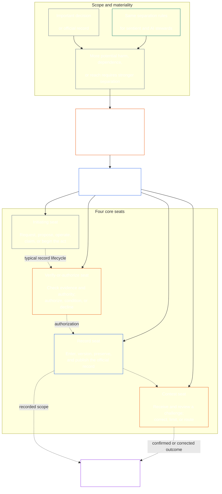

<!-- Draft for eventual path translations/id/core_08_functional_independence_separation_of_duties.md -->
**Status:** AI-assisted translation draft; unreviewed. Not an official translation or attestation.

**Source:** `core_08.000_functional_independence_separation_of_duties.md`; edition `SC-Corpus-2026.10.21`; revision `5adf22f3d58520385afb9dc2bcb2f439346175fb`; SHA-256 `d9a573839564fa3a2e920fff4d2ecb4ccc8a7b560d8aef65656a356de09fdfda`.

**Scope:** Full Chapter Eight, including reading guides, trace blocks, tables, and diagrams. Links are written for the eventual `translations/<locale>/` destination. English remains controlling.

# BAB DELAPAN: INDEPENDENSI FUNGSIONAL DAN PEMISAHAN TUGAS

<strong>Penempatan Corpus (non-operatif): struktur file dan aturan membaca</strong>

> File ini adalah **bagian dari Konstitusi Makhluk Hidup** dan adalah **hanya mengikat bersama-sama** dengan nomor lainnya `core_*` file dibaca sebagai satu teks. Ini berisi **Bab Delapan**: persyaratan lintas proses untuk independensi fungsional dan pemisahan tugas. Ini mengikuti [Bab Tujuh](../../core_07.000_charters.md#chapter-seven-system-and-institutional-charters), yang memuat Piagam Sistem atau Piagam Kelembagaan yang memuat peta kursi yang diterbitkan, dan mendahului bab proses ketatanegaraan yang diawali dengan [Bab Sembilan sertifikasi penyelarasan sistem](../../core_09.000_system_alignment_certification_evaluation.md#chapter-nine-system-alignment-certification).
>
> - **Pemilik konstitusional:** persyaratan pemisahan tugas untuk tindakan yang mengikat secara material, dipenuhi melalui kursi yang berbeda; isi minimum universal masing-masing [Catatan Tindakan yang Mengikat Secara Material](../../core_05.035_band_accountability.md#materially-binding-act-record); independensi dari aktor dan aktor [Jalur Kontrol Bahan](../../core_05.035_band_accountability.md#material-control-line); jalur yang dipublikasikan dan penempatan peran; konflik, kekosongan, pergantian pemain, dan pemilihan kursi yang salah; hosting gabungan yang proporsional; serah terima yang dapat diatribusikan; dan kondisi independensi minimum yang harus diterapkan pada setiap proses konstitusional selanjutnya.
> - **Sumber lapisan prinsip:** [Bab Satu §18.3](../../core_01.010_stewardship_capacity_principles.md#183-separation-of-duties) membutuhkan tata kelola untuk menjaga independensi fungsional dan mengarahkan arsitektur kursi operasional di sini.
> - **Pemilik implementasi:** [CJS-5.125 §11](../../corpus_joint_structure/cjs_05.125_accountability_operations.md#constitutional-lane-and-functional-separation) (*Jalur ketatanegaraan dan pemisahan fungsional*), [CI-8.205 §2](../../corpus_institutions/ci_08.205_institutional_design_separation_of_powers.md#ci-8205-2-functional-separation-lanes), Dan [CI-14.205 §6](../../corpus_institutions/ci_15.205_appointment_competency_rotation_removal.md#ci-15205-6-seat-catalog--process-role-archetypes-and-operational-boundaries) menempatkan dan mengoperasionalkan kursi. Peraturan ini mungkin lebih ketat dan dapat menambahkan jenis kursi otoritas khusus berbatas; mereka mungkin tidak mempersempit bab ini.
> - **Aplikasi khusus proses tetap berada di hilir:** Bab Sembilan menerapkan persyaratan ini pada sertifikasi penyelarasan sistem dan sertifikasi penyelarasan kelembagaan; [Bab Sepuluh §3.7](../../core_11.000_standing_assessment.md#37-separation-of-duties) menerapkannya pada catatan tetap; Bab Tiga Belas dan [korpus_forum.md](../../corpus_forum.md) menerapkannya pada proses forum. Bab-bab tersebut dapat menambahkan perlindungan yang diperlukan oleh pokok bahasannya; mereka mungkin tidak menciptakan pengganti yang lebih lemah.
>
> Urutan bacaan: §1 tujuan dan ruang lingkup → §2 Persyaratan Empat Kursi → §3 independensi dan konflik → §4 perutean kursi yang salah → §5 penempatan, pengganti, dan delegasi yang dipublikasikan → §6 penskalaan proporsional → §7 keadaan darurat → §8 Catatan Undang-undang dan serah terima → §9 penerapan hilir.

<strong>Jejak</strong>

- Hulu:
  - [Tetrad Konstitusional](../../core_00.000_preamble.md#constitutional-tetrad) - khususnya **pengawasan** Dan **akuntabilitas**;
  - [taruhan materi](../../core_00.000_preamble.md#material-stake);
  - [Bab Satu §17.1 Standar Penatalayanan Bersama](../../core_01.010_stewardship_capacity_principles.md#171-shared-stewardship-standard) (1.015 §17.1);
  - [Bab Satu §18 Tata Kelola Di Bawah Disiplin Penatalayanan](../../core_01.010_stewardship_capacity_principles.md#18-governance-under-stewardship-discipline) (1.015 §18);
  - [Pasal XVI](../../core_06.010_rights_part_c.md#article-xvi-audit-transparency-and-independent-verification) (*Audit, Transparansi, dan Verifikasi Independen*).
- Subbagian:
  - [§1](#1-purpose-scope-and-owner-boundary);
  - [§2](#2-four-seat-constitutional-requirement);
  - [§3](#3-independence-conflict-and-control-lines);
  - [§4](#4-wrong-seat-routing);
  - [§5](#5-published-placement-vacancy-and-substitution);
  - [§6](#6-proportional-scaling-and-merged-hosting);
  - [§7](#7-emergency-and-urgent-action);
  - [§8](#8-act-records-and-attributable-handoffs);
  - [§9](#9-relationship-to-later-processes).
- Hilir:
  - [Bab Sembilan](../../core_09.000_system_alignment_certification_evaluation.md#chapter-nine-system-alignment-certification) (9.000);
  - [Bab Sepuluh](../../core_11.000_standing_assessment.md#chapter-eleven-contribution-violation-and-standing-model--measurement) (10.000);
  - [Bab Tiga Belas](../../core_14.000_forum.md#chapter-fourteen-forums-and-jurisdiction) (13.000);
  - [Bab Empat Belas](../../core_15.000_governance.md#chapter-fifteen-constitutional-contract-legitimacy-authorization-and-stewardship) (14.000); teks implementasi yang ditunjuk yang disebutkan di atas.
- Baca dengan:
  - [Bab Satu §19.3 Deteksi Ketidaksejajaran](../../core_01.010_stewardship_capacity_principles.md#193-misalignment-detection) (1.015 §19.3) (*deteksi dan peninjauan jamak*);
  - [Tindakan yang Dapat Diatribusikan](../../core_05.035_band_accountability.md#attributable-action);
  - [Integritas Atribusi](../../core_05.035_band_accountability.md#attribution-integrity);
  - [Kemampuan Audit](../../core_05.050_band_oversight.md#auditability);
  - [Kontestabilitas](../../core_05.035_band_accountability.md#contestability);
  - [Proporsionalitas](../../core_05.035_band_accountability.md#proportionality).

 

Bab Delapan adalah pemilik konstitusional **persyaratan independensi fungsional dan pemisahan tugas untuk tindakan yang mengikat secara material**.

### 1. Tujuan, Ruang Lingkup, dan Batasan Kepemilikan

<strong>Jejak</strong>

- Hulu: klaim pemilik pembukaan bab; [Bab Satu §18](../../core_01.010_stewardship_capacity_principles.md#18-governance-under-stewardship-discipline) (1.015 §18); [Pengawasan](../../core_05.020_apex_oversight_leg.md#oversight-constitutional); [Akuntabilitas](../../core_05.005_apex_accountability_leg.md#accountability).
- Hilir: [§2](#2-four-seat-constitutional-requirement) melalui [§9](#9-relationship-to-later-processes); setiap proses selanjutnya yang menghasilkan atau mengubah suatu tindakan yang mengikat secara material.
- Baca dengan:
  - [Bab Empat](../../core_04.000_burden_traceability_verification.md#chapter-four-burden-of-proof-traceability-and-verification) (4.000) untuk substrat verifikasi;
  - [Pasal XIII-A](../../core_06.010_rights_part_c.md#article-xiii-a-reliability-and-trustworthiness-baseline) (*Dasar Keandalan dan Kepercayaan*) Dan
  - [Pasal XIII-B](../../core_06.010_rights_part_c.md#article-xiii-b-right-to-redress-and-remedy) (*Hak untuk Mendapatkan Ganti Rugi dan Pemulihan*) untuk tantangan dan ganti rugi;
  - [Pasal XVI](../../core_06.010_rights_part_c.md#article-xvi-audit-transparency-and-independent-verification) (*Audit, Transparansi, dan Verifikasi Independen*) untuk Hak Dasar verifikasi independen.

 

*Sederhananya: sebelum proses konstitusional—atau keputusan di tingkat pemangku kepentingan dalam sistem, lembaga, atau wilayah pengambilan keputusan yang sudah disahkan—dapat dipercaya, maka tugas-tugas di dalamnya harus dipisahkan. Persyaratan ini berlaku untuk keduanya [Lapisan Kontrak Konstitusional](../../core_05.045_band_integrative.md#constitutional-contract-layer) dan untuk [Partisipasi Sistem Pemangku Kepentingan](../../core_05.055_band_participation.md#stakeholder-status-and-weight). Makhluk hidup, kantor, sistem AI, badan pemangku kepentingan, atau perwakilan yang menginginkan suatu hasil juga tidak dapat menyediakan pemeriksaan yang dianggap independen, mengontrol catatan resmi dari pemeriksaan tersebut, atau memutuskan tantangan terhadap pemeriksaan tersebut.*

Bab ini berlaku untuk semua orang [Undang-Undang yang Mengikat Secara Material](../../core_05.035_band_accountability.md#materially-binding-act), sebagaimana didefinisikan oleh Bab Lima, termasuk:

- sebuah keputusan;
- otorisasi atau sertifikasi;
- sebuah temuan;
- entri rekaman atau perubahan versi materi;
- pelepasan, penerapan, kelanjutan, atau penarikan;
- pencairan atau alokasi; Dan
- disposisi tantangan.

Bab ini tidak berlaku untuk Pihak Operasi Kelas P. Tindakannya tetap berada di dalam dirinya [unit pribadi](../../core_05.050_band_oversight.md#domain-specific-materiality-private-unit), satu makhluk hidup, satu rumah tangga, atau suatu lingkaran privat yang terikat erat yang semua anggotanya memilih untuk berada di dalamnya, dan suatu Pihak Pengoperasi yang tindakan-tindakannya harus diikuti atau dapat diandalkan oleh pihak lain setelah diselesaikan setidaknya merupakan Kelas L di bawah **CS-9.305 (*Mesin klasifikasi sistem*) dan CS-9.310** (*Mesin klasifikasi sistem*). Satu-satunya makhluk hidup yang memiliki komputer tidak memerlukan dudukan kursi kedua. Persyaratan ini berlaku sejak Pihak Pengoperasi mengambil Undang-Undang yang Mengikat Secara Material.

Kursi dalam bab ini menentukan siapa yang boleh melakukan apa untuk tindakan tertentu; itu bukan jabatan. Makhluk hidup, kantor, atau sistem yang sama mungkin menduduki kursi yang berbeda untuk tindakan yang berbeda. Gelar, delegasi, kemampuan teknis, atau kemampuan untuk melakukan suatu langkah tidak memperbesar kursi yang diduduki untuk tindakan tersebut.

#### 1.1 Mengapa pekerjaan dipisahkan

*Secara sederhana: pelajaran yang sama telah dipelajari berulang kali dalam dunia bisnis, pemerintahan, dan keamanan nuklir. Ketika salah satu pihak dapat memulai suatu tindakan, menyetujuinya, menuliskannya, dan menilai keluhan apa pun mengenai tindakan tersebut, tidak ada pihak lain yang berada dalam posisi untuk menangkap kesalahan atau kebohongan.*

Subbagian ini menjelaskan alasan persyaratan tersebut. Ini bersifat non-operatif: peraturan yang mengikat sudah ada [§2 Persyaratan Konstitusional Empat Kursi](#2-four-seat-constitutional-requirement) melalui [§9 Hubungan dengan Proses Selanjutnya](#9-relationship-to-later-processes).

Beberapa bidang mencapai ide yang sama dengan sendirinya:

- **Akuntansi dan pengendalian internal:** Dunia usaha dan auditor telah lama membagi tugas dalam mengesahkan suatu transaksi, mencatatnya, menyimpan aset, dan merekonsiliasi pembukuan, sehingga tidak ada satu pun petugas yang dapat mengambil dan menyembunyikan pengambilan tersebut. Kerangka pengendalian internal seperti COSO mencantumkan pemisahan tugas di antara aktivitas pengendalian dasar mereka.
- **Pemisahan kekuasaan dalam pemerintahan:** Montesquieu membantah *Semangat Hukum* (1748) bahwa kebebasan berada dalam bahaya ketika satu badan membuat, melaksanakan, dan menilai hukum. James Madison, masuk *Federalis No.51* (1788), membela rancangan di mana masing-masing cabang memiliki sarana untuk melawan cabang lainnya. Sejak saat itu, banyak konstitusi yang membagi kekuasaan dengan cara serupa.
- **Aturan dua orang:** Militer Amerika Serikat mewajibkan dua awak kapal yang berwenang untuk bertindak bersama sebelum senjata nuklir tertentu dapat diluncurkan atau diakses, sehingga tidak ada seorang pun yang dapat bertindak sendiri (Instruksi Angkatan Udara 91-104). Bank telah lama menaruh dua kunci pada brankas karena alasan yang sama. Aturan dua orang menegaskan siapa yang bertindak dan apakah perintah tersebut asli, bukan apakah perintah tersebut masuk akal. Itu sebabnya bab ini meminta dilakukannya pengecekan independen, bukan sekadar tanda tangan kedua.
- **Apa yang terjadi tanpa pemisahan:** Di Barings Bank pada tahun 1995, Nick Leeson menjalankan meja perdagangan Singapura dan back office yang menyelesaikan dan mencatat perdagangannya. Dia menyembunyikan kerugian di akun rahasia. Audit internal pada tahun 1994 telah menandai peran gabungan tersebut sebagai risiko besar, namun manajemen membiarkannya. Bank tersebut, yang saat itu berusia lebih dari dua abad, bangkrut pada Februari 1995 dengan kerugian sekitar S$2,2 miliar dan dijual ke ING.

Contoh-contoh ini tidak menunjukkan bahwa sistem mana pun sempurna. Mereka menunjukkan bahwa gagasan tersebut sudah lama dan digunakan secara luas, dan bahwa pemisahan yang hilang merupakan penyebab kegagalan yang berulang. Itu adalah alasan, bukan otoritas.

#### 1.2 Mengapa empat kursi

*Secara sederhana: dua pekerjaan terlalu sedikit dan tiga pekerjaan menyisakan kesenjangan. Empat pekerjaan meliputi memulai tindakan, memeriksanya, menyimpan catatan resmi, dan mendengarkan tantangan.*

Subbagian ini menjelaskan alasan angka empat. Ini bersifat non-operatif: kursi dan peraturannya sudah ada [§2 Persyaratan Konstitusional Empat Kursi](#2-four-seat-constitutional-requirement).

- **Dua terlalu sedikit:** Pasangan pembuat dan pemeriksa menghentikan salah satu pihak untuk menyetujui tindakannya sendiri. Tidak ada seorang pun yang menyimpan catatan resmi atau mendengarkan keluhan, jadi siapa pun yang memegang catatan dapat dengan tenang mengubah apa yang terjadi, dan pasangan tersebut akhirnya menilai keluhan mengenai pekerjaannya sendiri.
- **Tiga kekuasaan sesuai dengan pemerintahan, tidak setiap tindakan:** Membuat, melaksanakan, dan mengadili sesuai dengan pemerintahan. Suatu tindakan juga memerlukan catatan yang bertahan lebih lama dan jalur tantangan yang tidak melalui aktor atau pemberi persetujuan.
- **Empat pertandingan dengan titik kegagalan:** Satu kursi memulai tindakan, satu memeriksa dan mengesahkannya, satu menyimpan catatan resmi, dan satu lagi mendengarkan tantangan. Hal ini menggemakan pembagian dalam akuntansi antara otorisasi, pencatatan, dan peninjauan.
- **Otomatisasi membuat kesenjangan mudah untuk dibuka:** Satu sistem dapat bertindak, menandatangani, dan mencatat pekerjaannya sendiri dalam satu langkah, dan lognya kemudian terlihat seperti bukti. [§2 Persyaratan Konstitusional Empat Kursi](#2-four-seat-constitutional-requirement) memperlakukannya seperti memegang tiga kursi sekaligus.
- **Pengadopsi kecil masih dapat mematuhi:** [§6 Penskalaan Proporsional dan Hosting Gabungan](#6-proportional-scaling-and-merged-hosting) memungkinkan pengadopsi kecil menempatkan kursi dengan badan independen atau, dengan syarat, menempatkan dua kursi dalam satu kantor. Kursi verifikasi atau otorisasi tidak pernah digabungkan dengan kursi rekor atau kursi kontes.

### 2. Persyaratan Konstitusional Empat Kursi

<strong>Jejak</strong>

- Hulu: [§1](#1-purpose-scope-and-owner-boundary); [Bab Satu §18.3](../../core_01.010_stewardship_capacity_principles.md#183-separation-of-duties) (1.015 §18.3); [Bab Satu §17.1](../../core_01.010_stewardship_capacity_principles.md#171-shared-stewardship-standard) (1.015 §17.1).
- Hilir: [§3](#3-independence-conflict-and-control-lines) melalui [§9](#9-relationship-to-later-processes); [CI-14.205 §6](../../corpus_institutions/ci_15.205_appointment_competency_rotation_removal.md#ci-15205-6-seat-catalog--process-role-archetypes-and-operational-boundaries) (*Katalog kursi — arketipe peran proses dan batasan operasional*).
- Baca dengan: [§6](#6-proportional-scaling-and-merged-hosting) untuk satu-satunya jalur hosting gabungan yang diizinkan.

 

*Secara sederhana: pemisahan tugas merupakan persyaratan untuk setiap tindakan yang mengikat secara material (the **Persyaratan Empat Kursi**), dan empat tugas untuk memenuhinya: bertanya atau bertindak, memeriksa, menyimpan catatan resmi, dan mendengarkan tantangan. Pekerjaan tersebut tetap berbeda bahkan ketika sebuah organisasi kecil diizinkan untuk menempatkan pasangan yang diizinkan dalam satu kantor.*

<strong>Panduan pembaca (non-operatif): peta empat kursi</strong>

> **Peta pembaca (non-operatif).** Diagram ini menunjukkan empat kursi dan siklus hidup rekaman pada umumnya. Perjanjian ini tidak menambahkan kursi implementasi kelima, memerlukan peninjauan untuk menyelesaikannya sebelum setiap tindakan, atau mengubah aturan operasional dalam bagian ini dan §§3–6.

 

Panah putus-putus di dalam kotak kursi menunjukkan siklus hidup rekaman yang khas. Tanda panah menuju penerapan adalah tautan jejak, bukan urutan wajib menunggu peninjauan.

Setiap tindakan yang mengikat secara material memiliki empat kursi yang berbeda secara fungsional. Bab Lima memberikan makna kanoniknya; bagian ini menyatakan aturan penempatan dan ketidakcocokan lintas proses:

1. **[Memulai Kursi](../../core_05.035_band_accountability.md#initiating-seat)** — meminta, mengusulkan, mengoperasikan, mengklaim, atau memulai tindakan.
2. **[Kursi Verifikasi atau Otorisasi](../../core_05.035_band_accountability.md#verify-or-authorize-seat)** — memeriksa bukti dan otoritas terhadap standar yang berlaku dan memverifikasi, mengizinkan, menolak, atau mengkondisikan tindakan tersebut.
3. **[Rekam Kursi](../../core_05.035_band_accountability.md#record-seat)** — memasukkan, membuat versi, menyimpan, menyimpan, dan menerbitkan [Catatan Tindakan](../../core_05.035_band_accountability.md#materially-binding-act-record) dari apa yang ditentukan oleh Kursi Verifikasi-atau-Otorisasi.
4. **[Kursi Kontes](../../core_05.035_band_accountability.md#contest-seat)** — menerima dan meninjau tantangan, memerintahkan koreksi atau batasan jika diizinkan, dan mengarahkan masalah apa pun ke luar kewenangannya.

Kursi ini berlaku untuk pelayan manusia dan AI. Jika suatu sistem melakukan suatu tindakan, menandatanganinya, dan kemudian menggunakan catatannya sendiri sebagai bukti, maka sistem tersebut duduk di kursi memulai, memverifikasi, dan mencatat sekaligus. Mengotomatiskan proses tidak membuat pemeriksaan menjadi independen.

Kombinasi berikut ini dilarang dalam satu tindakan:

- kursi pemrakarsa tidak boleh memverifikasi atau mengizinkan tindakannya sendiri;
- kursi verifikasi atau otorisasi tidak boleh memegang kursi rekor;
- kursi verifikasi-atau-otorisasi tidak boleh menampung kursi kontes; Dan
- operator suatu sistem, atau otoritas yang mengatur suatu lembaga, tidak boleh memverifikasi atau mengizinkan suatu tindakan mengenai sistem atau lembaga tersebut.

Bab selanjutnya atau teks implementasi yang digabungkan mungkin melarang pemasangan tambahan untuk proses tertentu. Mereka mungkin tidak mengizinkan pemasangan yang dilarang di sini.

Persyaratan pemisahan tugas berlaku di setiap kelas, dan empat kursi adalah cara pemenuhannya. Pertanyaan berskala kelasnya adalah apakah kursi-kursi tersebut dapat digabung atau dibagikan pemegangnya. Untuk institusi atau sistem yang beroperasi di dalam:

- Lingkup Kelas C, pemisahan empat kursi penuh selalu disarankan;
- Ruang lingkup Kelas B, pemisahan empat kursi penuh hampir selalu diperlukan; Dan
- Ruang lingkup Kelas A, pemisahan empat kursi penuh selalu diperlukan.

Apabila cakupannya tercampur atau klasifikasinya tidak pasti, terapkan postur tertinggi yang dapat diterapkan sampai catatan mendukung postur yang lebih rendah.

### 3. Garis Kemerdekaan, Konflik, dan Kendali

<strong>Jejak</strong>

- Hulu: [§2](#2-four-seat-constitutional-requirement); [Tanggung jawab yang berskala otoritas](../../core_01.010_stewardship_capacity_principles.md#181-governance-as-authorized-structure); [Pasal XXV](../../core_06.015_rights_part_d.md#article-xxv-constitutional-interpretation-review-and-anti-capture-safeguards) (*Interpretasi Konstitusi, Peninjauan Kembali, dan Perlindungan Anti-Penangkapan*).
- Hilir: [§4](#4-wrong-seat-routing); [§5](#5-published-placement-vacancy-and-substitution); [§8](#8-act-records-and-attributable-handoffs); Bab Sembilan Peran Komponen Sertifikasi; Bab Sepuluh Penahanan Catatan; Bab Tiga Belas forum anti-menilai diri sendiri.
- Baca dengan: [Jalur Kontrol Bahan](../../core_05.035_band_accountability.md#material-control-line); [CI-8.210](../../corpus_institutions/ci_08.210_conflict_integrity_anti_capture_anti_corruption.md) (*Integritas konflik, anti penangkapan, dan anti korupsi*) Dan [CF-13.425](../../corpus_forum/cf_14.425_integrity_safeguards_anti_capture_anti_self_judging.md) (*Perlindungan integritas, operasi anti-penangkapan, dan dukungan anti-menilai diri sendiri*) untuk konflik operasional dan upaya perlindungan yang anti-menilai diri sendiri.

 

*Sederhananya: mengubah nama di meja tidak menciptakan kemandirian. Otoritas verifikasi atau peninjau tidak independen ketika pihak atau kantor yang mencari hasil dapat mengarahkan, menghapus, memberi penghargaan, menghukum, atau secara diam-diam menolak mereka atas tindakan tersebut.*

Independensi fungsional dinilai berdasarkan otoritas dan kontrol aktual, bukan label. Pada tindakan yang sama:

- kursi verifikasi-atau-otorisasi dan kursi kontes harus berada di luar kursi pemrakarsa [Jalur Kontrol Bahan](../../core_05.035_band_accountability.md#material-control-line);
- pihak yang kepentingannya ditentukan oleh undang-undang tidak boleh menduduki kursi verifikasi atau otorisasi atau kontestasi;
- pemegang catatan yang berkonflik harus meneruskan catatan tersebut, dengan jejak audit lengkapnya, kepada pengganti yang dipublikasikan daripada memutuskan konflik tersebut atau meninggalkan penyimpanan; Dan
- penolakan menghilangkan otoritas atas tindakan tersebut; tidak mengalihkan tempat duduk kepada pemohon, jalur pelaporan pemohon, atau siapapun yang terdekat.

Lacak [Jalur Kontrol Bahan](../../core_05.035_band_accountability.md#material-control-line) untuk tindakan tertentu. Infrastruktur bersama, dukungan administratif, atau riwayat penunjukan tidak hanya menentukan batasan tersebut, namun pengaturan tersebut tidak boleh mengalahkan penilaian independen dalam praktiknya.

Independensi tidak dapat dipenuhi dengan tanda tangan kedua, komite nominal, label internal, atau pengesahan yang dihasilkan alat dimana cek yang seharusnya tidak memiliki otoritas, akses terhadap bukti, kebebasan dari kendali material, atau kemampuan nyata untuk menolak dan mengarahkan.

### 4. Perutean Kursi yang Salah

<strong>Jejak</strong>

- Hulu: [§2](#2-four-seat-constitutional-requirement); [§3](#3-independence-conflict-and-control-lines).
- Hilir: [§5](#5-published-placement-vacancy-and-substitution); [§8](#8-act-records-and-attributable-handoffs); [CI-14.205 §6 aturan kursi bersama](../../corpus_institutions/ci_15.205_appointment_competency_rotation_removal.md#ci-46-shared-seat-rules).
- Baca dengan: [Bab Satu §17.5 Kewajiban untuk Melawan](../../core_01.010_stewardship_capacity_principles.md#175-duty-to-resist) (1.015 §17.5).

 

*Secara sederhana: ketika suatu langkah bukan milik Anda, jangan diam-diam mengambilnya dan jangan pergi begitu saja. Catat celahnya dan pindahkan masalahnya ke tempat yang tepat. Lebih baik lagi, bangun prosesnya sehingga setiap langkah berjalan tepat tanpa ada yang menyadarinya.*

Perutean posisi yang salah harus dimasukkan ke dalam proses jika memungkinkan. Penerimaan, antrean, alur kerja, atau antarmuka harus mengirimkan setiap langkah ke tempat duduknya yang dipublikasikan sejak awal, sehingga sebuah langkah tidak ditawarkan ke tempat duduk yang mungkin tidak menempatinya. Perutean otomatis:

- mengikuti penempatan yang dipublikasikan di bawah [§5 Diterbitkan Penempatan, Lowongan, dan Pergantian](#5-published-placement-vacancy-and-substitution) dan rute berdasarkan tempat duduk, bukan berdasarkan tindakannya;
- mencatat setiap rute sesuai ketentuan item 3 di bawah ini;
- mengikuti jalur pengganti atau independen yang dipublikasikan di bawah [§5.3 Tempat duduk yang tidak ditempatkan pada peta, atau tempat duduk yang tidak dapat bertugas](#53-a-seat-the-map-leaves-unplaced-or-a-holder-who-cannot-serve) ketika pemegang kursi tidak dapat melakukan servis, dan menahan masalah tersebut serta mencatat kesenjangan ketika tidak ada kursi, pengganti, atau jalur independen yang ditempatkan, alih-alih mengirimkannya ke kursi terdekat, tercepat, atau paling senior; Dan
- bukan merupakan pemegang kursi dan tidak dapat mengubah siapa yang memegang kursi; hanya penempatan yang diterbitkan yang bisa melakukannya.

Apabila perutean tidak diotomatisasi, atau gagal, tugas di bawah ini berlaku bagi pengurus. Seorang pramugara yang diminta untuk melangkah keluar dari tempat duduk pramugara harus:

1. menolak langkah tersebut tanpa bermaksud memutuskan manfaatnya;
2. menyebutkan kursi yang dapat mendudukinya dan, jika diumumkan, pemegang atau penggantinya;
3. mencatat permintaan, kursi yang diduduki, kesenjangan atau konflik, dan rute yang digunakan;
4. menjaga bukti dan integritas catatan yang telah diterima; Dan
5. rute tanpa penundaan yang dapat dihindari.

Respons tersebut adalah pelaksanaan tugas, bukan pengabaian tindakan. Tindakan tersebut dilanjutkan melalui kursi kanan. Mengambil langkah karena pramugara adalah yang terdekat, tercepat, senior, atau memiliki pengetahuan unik bukanlah solusi untuk menghilangkan kursi.

### 5. Publikasi Penempatan, Lowongan, dan Pergantian

<strong>Panduan pembaca (non-operatif): bagaimana bagian ini disusun</strong>

- [§5.1 Apa yang harus disampaikan pada peta](#51-what-the-map-must-say) mencantumkan nama-nama dalam Peta Peran Piagam: siapa yang menjadi tuan rumah bagi setiap kursi, tindakan apa, penggabungan yang diizinkan, penggantinya, rute independen, dan versinya.
- [§5.2 Tempat penyimpanan peta](#52-where-the-map-is-kept) mengatakan peta tersebut ada dalam atau bersama Piagam Sistem atau Piagam Kelembagaan, bahwa anggota suatu kelompok dapat mengadopsi peta bersama kelompok tersebut dengan referensi, dan bahwa pengadopsi Kelas P tidak perlu mempublikasikannya.
- [§5.3 Tempat duduk yang tidak ditempatkan pada peta, atau tempat duduk yang tidak dapat bertugas](#53-a-seat-the-map-leaves-unplaced-or-a-holder-who-cannot-serve) mengatakan bahwa kesenjangan adalah cacat yang harus dicatat dan diperbaiki, bahwa kursi tidak lolos ke aktor atau garis kendali aktor, dan bahwa tindakan tersebut mengarah ke jalur pengganti atau independen sementara itu.
- [§5.4 Delegasi](#54-delegation) menyatakan bahwa suatu kursi hanya dapat didelegasikan kepada seorang wakil atau menggantikan nama peta, dan delegasi tersebut menjaga batas kursi dan tidak dapat membuat, menggabungkan, atau memperluas suatu kursi.

<strong>Jejak</strong>

- Hulu:
  - [§2](#2-four-seat-constitutional-requirement);
  - [§3](#3-independence-conflict-and-control-lines);
  - [Transparansi](../../core_05.050_band_oversight.md#transparency);
  - [Kemampuan Audit](../../core_05.050_band_oversight.md#auditability).
- Hilir: [§8](#8-act-records-and-attributable-handoffs); [CI-8.205 §2](../../corpus_institutions/ci_08.205_institutional_design_separation_of_powers.md#ci-8205-2-functional-separation-lanes) (*Jalur pemisah fungsional*); [CI-14.205 §5](../../corpus_institutions/ci_15.205_appointment_competency_rotation_removal.md#ci-15205-5-authorized-roles-and-accountability-chains) (*Peran resmi dan rantai akuntabilitas*); Catatan Bab Sembilan dan Bab Sepuluh.
- Baca dengan:
  - [Piagam Sistem](../../core_05.040_band_continuity.md#system-charter),
  - [Piagam Kelembagaan](../../core_05.040_band_continuity.md#institutional-charter);
  - [Bab Tujuh §4 Peta Peran Piagam dan Penyimpanan Catatan Tetap](../../core_07.000_charters.md#4-the-charter-role-map-and-standing-record-custody) (7.000 §4); Dan
  - [Bab Empat Belas §5](../../core_15.000_governance.md#5-authorized-roles-competency-development-and-contribution) (14.000 §5).

 

*Secara sederhana: sebuah organisasi harus menyatakan siapa yang memegang setiap pekerjaan sebelum kasus sulit tiba, termasuk siapa yang mengambil alih ketika pemegang jabatan biasa tidak hadir atau mengalami konflik.*

#### 5.1 Apa yang tertera pada peta

Setiap pengadopsi Kelas L atau lebih tinggi yang mengambil tindakan yang mengikat secara material harus mempertahankan tindakan yang dipublikasikan, dapat diaudit, dan dapat digugat [Peta Peran Piagam](../../core_05.040_band_continuity.md#charter-role-map) yang mengidentifikasi:

- jalur, kantor, peran, atau proses mana yang menampung setiap kursi;
- tindakan dan ruang lingkup penerapan penempatan tersebut;
- setiap pengaturan hosting gabungan yang diizinkan dan upaya menjaga independensinya;
- setiap wakil atau pengganti yang dapat bertindak dalam suatu kursi, termasuk bagi pemegang kursi yang tidak hadir, dikecualikan, tertangkap, atau berkonflik;
- rute independen bila tidak tersedia pengganti yang memenuhi syarat; Dan
- versinya dan tanggal berlakunya, sehingga suatu tindakan dinilai berdasarkan peta yang berlaku pada saat tindakan itu diambil.

#### 5.2 Tempat penyimpanan peta

Peta tersebut disimpan di dalam atau di tangan pengguna [Piagam Sistem](../../core_05.040_band_continuity.md#system-charter) atau [Piagam Kelembagaan](../../core_05.040_band_continuity.md#institutional-charter).

Seorang anggota kelompok yang menerbitkan peta bersama untuk kursi yang ditempatinya dapat mengadopsi peta tersebut dengan referensi ([§6.3 Kursi dimiliki bersama](#63-seats-held-in-common)), dan masih menyebutkan rute pengganti dan independennya sendiri.

Pengadopsi Kelas P berada di luar bab ini ([§1 Tujuan, Ruang Lingkup, dan Batasan Pemilik](#1-purpose-scope-and-owner-boundary)) dan tidak perlu mempublikasikan peta. Ia masih dapat menerbitkannya, sendiri atau dengan Sistem sukarela atau Piagam Kelembagaan ([Bab Tujuh §4 Peta Peran Piagam dan Penyimpanan Catatan Tetap](../../core_07.000_charters.md#4-the-charter-role-map-and-standing-record-custody)).

#### 5.3 Tempat duduk yang tidak ditempatkan pada peta, atau tempat duduk yang tidak dapat melakukan servis

Kursi yang tidak ditempatkan, atau pemegang kursi yang tidak hadir, dikecualikan, ditangkap, atau berkonflik, merupakan cacat tata kelola yang harus dicatat dan diperbaiki.

- Kursi tersebut tidak berpindah secara otomatis ke kursi pemrakarsa, pihak yang berkepentingan, operator, atau atasannya [Jalur Kontrol Bahan](../../core_05.035_band_accountability.md#material-control-line).
- Sebelum dikoreksi, tindakan tersebut akan mengarah ke jalur pengganti atau jalur independen yang telah dipublikasikan, betapapun mendesaknya tindakan tersebut.
- Untuk kursi sertifikasi yang tidak ditempatkan dalam Peta Peran Piagam, koreksi harus memenuhi jangka waktu respons dan resolusi, dihitung dari pemberitahuan kesenjangan yang dicatat, sebagaimana ditetapkan dalam [Bab Tujuh §4.7.4 Kursi sertifikasi](../../core_07.000_charters.md#474-certification-seats).

#### 5.4 Delegasi

Pemegang kursi hanya dapat mendelegasikan kursinya kepada seorang wakil atau penggantinya [Peta Peran Piagam](../../core_05.040_band_continuity.md#charter-role-map) nama. Delegasi kepada orang lain meninggalkan kursinya tanpa tempat, dan [§5.3 Tempat duduk yang tidak ditempatkan pada peta, atau tempat duduk yang tidak dapat bertugas](#53-a-seat-the-map-leaves-unplaced-or-a-holder-who-cannot-serve) berlaku. Menunjuk wakil baru atau penggantinya mengubah peta ([Bab Tujuh §4.5 Mengubah peraturan kursi dan pemegang kursi](../../core_07.000_charters.md#45-changing-seat-rules-and-seat-holders)). Delegasi tidak dapat melakukannya.

Delegasi menjaga batasan kursi, tugas bukti, catatan, dan jam yang sama, dan delegasi tetap tunduk pada [Jalur Kontrol Bahan](../../core_05.035_band_accountability.md#material-control-line). Ini tidak membuat kursi baru, menggabungkan kursi, atau mengizinkan delegasi melakukan apa yang tidak dapat dilakukan oleh kursi delegasi. Delegasi yang memegang kursi kedua pada undang-undang yang sama adalah merger, dan hanya pengaturan tuan rumah gabungan yang tercantum pada peta di bawah [§6 Penskalaan Proporsional dan Hosting Gabungan](#6-proportional-scaling-and-merged-hosting) izinkan satu.

Pemegang dapat menggunakan staf atau alat untuk membantu pekerjaan kursi tersebut, seperti mengumpulkan bukti, menyusun rancangan, atau menjalankan pemeriksaan rutin. Itu adalah bantuan, bukan delegasi. Pemegang kursi tetap mengambil keputusan kursi, tetap bertanggung jawab atas hasilnya, dan tetap bertanggung jawab atas independensi kursi. Jika orang lain mengambil keputusan atau mengambil langkah atas nama kursi, itu adalah delegasi dan harus memenuhi ayat ini. Bantuan tidak dapat digunakan untuk melakukan apa yang tidak dapat dilakukan oleh kursi tersebut, termasuk menekan pemegang kursi lain untuk menentukan hasil suatu tindakan.

### 6. Penskalaan Proporsional dan Hosting Gabungan

<strong>Panduan pembaca (non-operatif): bagaimana bagian ini disusun</strong>

- [§6.1 Bagaimana skala pemisahan](#61-how-separation-scales) mengatakan bahwa kekuatan, staf, redundansi, dan formalitas skala pemisahan dengan kepentingan, kelas, ketergantungan, dan kerugian yang dapat diperkirakan, sementara keempat kursi tetap berbeda.
- [§6.2 Menggabungkan dua kursi dalam satu kantor](#62-merging-two-seats-in-one-office) mencantumkan kondisi di mana pengguna kecil atau informal dapat menempatkan dua kursi di satu kantor, dan pasangan yang tetap dilarang.
- [§6.3 Kursi dimiliki bersama](#63-seats-held-in-common) menyebutkan bagaimana usaha kecil menempatkan kedudukan pada koperasi, perkumpulan, atau badan independen lainnya, dan aturan independensi yang berlaku.
- [§6.4 Praktek profesional bersama](#64-joint-professional-practice) mengatakan bagaimana praktik hidup atau kecil Kelas L atau lebih tinggi dapat menempatkan kursinya di tuan rumah dan mengadopsi dokumen tuan rumah, untuk pekerjaan apa pun, dan apa lagi yang berlaku untuk tindakan yang memerlukan izin praktik atau izin praktik.
- [§6.5 Pekerjaan informal dan komunitas](#65-informal-and-community-work) mengatakan bahwa pekerjaan tersebut dapat menggunakan badan pengandal independen dengan otoritas yang diterbitkan untuk memeriksanya.
- [§6.6 Wilayah, kelas, dan apa yang tidak membenarkan merger](#66-stake-class-and-what-does-not-justify-a-merger) mengatakan bahwa pertaruhan yang tinggi mempertahankan anggapan adanya kantor yang terpisah, dan bahwa staf, kecepatan, atau kenyamanan saja tidak pernah membenarkan merger.

<strong>Jejak</strong>

- Hulu:
  - [§2](#2-four-seat-constitutional-requirement);
  - [taruhan materi](../../core_00.000_preamble.md#material-stake);
  - [Kebutuhan](../../core_05.035_band_accountability.md#necessity);
  - [Proporsionalitas](../../core_05.035_band_accountability.md#proportionality).
- Hilir: [Bab Sepuluh §3.7](../../core_11.000_standing_assessment.md#37-informal-and-small-scope-records) (10.000 §3.7); [CJS-18.110 §4](../../corpus_joint_structure/cjs_19.110_specific_joint_interlocks.md#cjs-19110-4-class-scaled-lane-staffing-and-competency-redundancy) (*Penempatan staf jalur berskala kelas dan redundansi kompetensi*); [CI-8.205 §2](../../corpus_institutions/ci_08.205_institutional_design_separation_of_powers.md#ci-8205-2-functional-separation-lanes) (*Jalur pemisah fungsional*).
- Baca dengan: [Beban yang Dapat Dihindari](../../core_05.040_band_continuity.md#avoidable-burden) dan Bab Satu [§3.3 Proses Anti-Degradasi](../../core_01.000_values_principles.md#33-anti-degrading-process).

 

*Secara sederhana: kelompok kecil dan informal tidak memerlukan empat departemen besar. Mereka memang membutuhkan pemeriksaan independen yang nyata, catatan yang dapat digunakan, dan jalur tantangan. Skala mengubah metode penempatan staf, bukan pemisahan yang dilindungi.*

#### 6.1 Cara pemisahan skala

Kekuatan, staf, redundansi, dan formalitas skala pemisahan dengan kepentingan material, kelas sistem, ketergantungan, dan kerugian yang dapat diperkirakan secara wajar.

#### 6.2 Penggabungan dua kursi dalam satu kantor

Pengadopsi kecil atau informal dapat menempatkan dua kursi di satu kantor atau lembaga hanya jika semua hal berikut berlaku:

- penggabungan tersebut diperlukan dan proporsional dengan ruang lingkupnya;
- itu dipublikasikan, dapat diaudit, dapat digugat, dan diungkapkan dalam catatan tindakan;
- upaya menjaga independensi mengatasi risiko yang ditimbulkan oleh merger;
- kursi pemrakarsa tidak memverifikasi atau mengesahkan tindakannya sendiri;
- kursi verifikasi atau otorisasi tidak pernah digabungkan dengan kursi rekor atau kursi kontes; Dan
- jalur independen tetap tersedia ketika konflik, kerugian material, atau tantangan melampaui batas sah pemegang saham gabungan.

#### 6.3 Kursi dimiliki bersama

Sebuah bisnis yang dijalankan oleh satu orang atau beberapa orang dapat menempatkan verifikasi atau otorisasi, pencatatan, atau kontesnya pada koperasi lokal atau asosiasi bisnis tersebut, atau dengan badan independen lainnya yang mengandalkan. Ini bukan merger, karena kursinya tetap dipegang oleh pemegangnya sendiri. Ini adalah bagaimana sebuah bisnis yang terlalu kecil untuk memiliki empat kursi masih memenuhi persyaratan pemisahan tugas [§2 Persyaratan Konstitusional Empat Kursi](#2-four-seat-constitutional-requirement). Aturan independensi yang sama berlaku untuk penempatan apa pun, bersama dengan aturan berikut untuk grup:

- **Independen dari bisnis:** Pemegangnya adalah [mandiri](../../core_05.035_band_accountability.md#independence) dari memulai bisnis. Itu di luar bisnis [Jalur Kontrol Bahan](../../core_05.035_band_accountability.md#material-control-line), dan tindakan apa pun yang memutuskan tidak akan memberinya taruhan. Pemasok, pemberi pinjaman, tuan tanah, atau pelanggan yang menjadi sandaran bisnis tidak independen terhadap suatu tindakan mengenai ketergantungan tersebut, seperti perselisihan mengenai kontrak pemasok itu sendiri, karena tindakan tersebut memutuskan sesuatu untuk mereka juga.
- **Satu peta untuk grup:** Grup menerbitkan satu [Peta Peran Piagam](../../core_05.040_band_continuity.md#charter-role-map) untuk kursi yang dimilikinya, dan setiap anggota dapat mengadopsinya dengan referensi. Peta milik anggota masih menyebutkan nama penggantinya dan rute independennya.
- **Melayani satu sama lain:** Anggota dapat menduduki kursi satu sama lain dalam tindakan yang berbeda. Dua anggota tidak boleh memeriksa tindakan satu sama lain sebagai pasangan tertutup, dan suatu rotasi tidak boleh mengarahkan suatu tindakan ke pemegang di dalam garis kendali pemrakarsanya.
- **Tindakan kelompok itu sendiri:** Menerima atau memberhentikan seorang anggota, menetapkan kursi, dan memutuskan tindakan seorang anggota adalah tindakan kelompok yang mengikat secara material. Untuk tindakan ini kelompok:
  - mengambil empat kursi;
  - menerbitkan Piagam Sistem atau Piagam Kelembagaan sendiri; Dan
  - menjaga jalur independen di luar dirinya (kelompok lain, forum, atau kantor publik), sehingga tidak pernah menghakimi dirinya sendiri atau anggota yang dikontrolnya.
- **Tidak ada paksaan:** Tidak ada bisnis yang diperlukan untuk bergabung, dan tidak ada grup yang menjadi satu-satunya rute.
- **Batasan masuk:** Suatu kelompok boleh menolak atau menunda pemohon karena alasan yang terkait dengan apa yang dapat dilayani oleh kelompok tersebut, sehingga kelompok tersebut tidak pernah dipaksa untuk menerima lebih dari yang dapat mereka terima. Alasan tersebut antara lain:
  - **Kapasitas:** volume tindakan material yang diharapkan oleh pemohon akan menghabiskan kapasitas yang diandalkan oleh anggota yang ada. Grup dapat membatasi volume yang diperlukan dari salah satu anggota atau menyimpan daftar tunggu;
  - **Bugar:** jenis tindakan atau kelas pelamar berada di luar kualifikasi dan staf yang dimiliki oleh pemegang kursi grup, seperti pekerjaan yang membutuhkan lebih banyak redundansi kompetensi daripada yang dimiliki grup ([§6.6 Wilayah, kelas, dan apa yang tidak membenarkan merger](#66-stake-class-and-what-does-not-justify-a-merger));
  - **Kemerdekaan:** pemegang kelompok tidak dapat melayani perbuatan pemohon secara mandiri, karena pemohon berada di dalam [Jalur Kontrol Bahan](../../core_05.035_band_accountability.md#material-control-line) dari salah satunya; Dan
  - **Mengadakan:** pemohon telah melanggar persyaratan yang diterbitkan grup sebelumnya, atau tidak akan menerimanya.
- **Bagaimana batasan tersebut diterapkan:** Setiap batas masuk:
  - dinyatakan dalam Piagam Sistem atau Piagam Kelembagaan kelompok ([Bab Tujuh §3.1 Apa yang dinyatakan dalam Piagam Sistem](../../core_07.000_charters.md#31-what-a-system-charter-states)), sehingga dipublikasikan sebelum diterapkan;
  - menerapkan cara yang sama untuk menyukai pelamar;
  - tidak digunakan untuk melindungi anggota dari kompetisi atau menjadikan grup sebagai satu-satunya jalan menuju kursi di wilayahnya;
  - dijelaskan secara tertulis kepada pemohon yang ditolak; Dan
  - dapat digugat melalui jalur independen di luar kelompok, karena memutuskan diterima atau tidaknya seorang pelamar merupakan tindakan kelompok yang mengikat secara materiil (lihat *Tindakan kelompok itu sendiri*, di atas).
- **Tidak ada jebakan:** Persyaratan suatu kelompok mungkin tidak menjadikan kursi tersebut sebagai biaya yang tidak dapat ditanggung oleh bisnis ([Beban yang Dapat Dihindari](../../core_05.040_band_continuity.md#avoidable-burden)).
- **Meninggalkan:** Seorang anggota yang keluar membawa catatannya. Kelompok tersebut tidak boleh menahan mereka atau membuat kepergian mereka bergantung pada meninggalkan mereka. Grup:
  - memberi anggota ekspor penuh atas Catatan Tindakannya dan data di dalamnya, dalam bentuk yang dapat digunakan oleh anggota atau tuan rumah baru ([CS-6.305 §1.2 Pengumpulan dan kemampuan ekspor yang kritis terhadap kontinuitas](../../corpus_systems/cs_06.305_information_types_and_handling.md#12-continuity-critical-collection-and-exportability)), dan mengungkapkan terlebih dahulu batasan yang sah atas ekspor;
  - menyerahkan kursi rekor untuk tindakan tersebut kepada pemegang nama anggota, dan tetap menjadi pemegang kursi rekor sampai anggota menyebutkan salah satu, sehingga Catatan Undang-Undang tetap dapat direkonstruksi selama tantangan, koreksi, atau upaya hukum terbuka ([§8 Catatan Tindakan dan Penyerahan yang Dapat Diatribusikan](#8-act-records-and-attributable-handoffs)); Dan
  - hanya menyimpan apa yang masih diperlukan oleh tugasnya, seperti Catatan Tindakan dari tindakan yang dilakukannya untuk anggota lain atau tindakan yang masih dalam tantangan, dan hanya untuk jangka waktu penyimpanan yang diungkapkan ([CS-6.305 §1.3 Pemberitahuan pengumpulan dan penghapusan](../../corpus_systems/cs_06.305_information_types_and_handling.md#13-collection-notice-and-deletion)).
- **Data yang disimpan oleh grup:** Apa yang disimpan grup ditangani oleh tipe data di bawah [CS-6.310 §9 Klasifikasi data](../../corpus_systems/cs_06.310_data_classifications.md#cs-6310-9-data-classifications):
  - **Data identitas dan atribusi (Tipe I):** hanya digunakan untuk memverifikasi siapa yang memegang setiap kursi dan siapa yang bertindak;
  - **Data partisipasi dan transaksi (Tipe H):** hanya digunakan untuk mencatat, mengaudit, dan menantang tugas tindakan;
  - **Sumber data tata kelola (Tipe G):** terbuka untuk diaudit dan tidak dipublikasikan secara default;
  - **Materi keselamatan, keamanan, dan investigasi (Tipe S):** disimpan hanya untuk peninjauan yang terikat waktu; Dan
  - **Karya anggota sendiri (Tipe Y dan Tipe W):** dikembalikan ke anggota, dan dihapus dari salinan grup saat anggota mengarahkan.

#### 6.4 Praktek profesional bersama

Praktik hidup atau kecil Kelas L atau lebih tinggi dapat menempatkan kursinya di tuan rumah dan mengadopsi dokumen tuan rumah:

- **Siapa tuan rumahnya:** Suatu perkumpulan profesi, koperasi, pemberi kerja, atau kantor catatan sipil, dimanapun ia bermarkas.
- **Apa yang diadopsi dari praktik ini:** Peta dan Piagam Kelembagaan yang diterbitkan oleh tuan rumah, sebagai referensi, untuk tindakan yang dicakupnya.
- **Pekerjaan apa pun:** Jalur ini terbuka untuk semua tindakan praktek, baik memerlukan izin praktek atau izin praktek atau tidak, sehingga praktek dengan kedua jenis pekerjaan tersebut dapat menggunakan satu host untuk semuanya.
- **Aturan yang sama:** Aturan di [§6.3 Kursi dimiliki bersama](#63-seats-held-in-common) berlaku untuk tuan rumah dan praktiknya, termasuk independensi tuan rumah dari praktiknya, empat kursi dan jalur independen untuk tindakan tuan rumah sendiri, batasan penerimaan yang dipublikasikan, dan aturan bagi anggota yang keluar.
- **Tindakan yang terdaftar:** Untuk tindakan yang terdaftar untuk izin praktik atau izin praktik di bawah [Pasal XI-E](../../core_06.005_rights_part_b.md#article-xi-e-institutional-formation-and-business-creation) (*Pembentukan Kelembagaan dan Penciptaan Usaha*), standar tuan rumah juga berasal dari temuan forum teknis, tuan rumah memeriksa bahwa setiap praktisi memegang lisensi atau izin, dan tuan rumah sebagai upaya terakhir menerima pemegangnya. Untuk pekerjaan lain, tuan rumah menerima dan menolak hanya dengan alasan masuk [§6.3 Kursi dimiliki bersama](#63-seats-held-in-common), dan tidak boleh menuliskan kriteria kompetensi yang membuat seseorang tidak dapat bekerja sesuai dengan Konstitusi.
- **Tugas tambahan tuan rumah:** **CI-14.205 §7** (*Lisensi praktik, izin praktik, dan praktik profesional bersama*) menyatakan tugas tambahan tuan rumah dan perlindungan terhadap penangkapan.
- **Memenuhi persyaratan:** Bergabung dengan tuan rumah dengan cara ini memenuhi persyaratan pemisahan tugas [§2 Persyaratan Konstitusional Empat Kursi](#2-four-seat-constitutional-requirement) untuk tindakan yang dicakup oleh dokumen tuan rumah.

#### 6.5 Kerja informal dan komunitas

Pekerjaan informal, tidak berbayar, saling membantu, merawat, memperbaiki, mengajar, bekerja sama, dan mengurus masyarakat dapat menggunakan [mandiri](../../core_05.035_band_accountability.md#independence) badan pengandal dengan otoritas yang diterbitkan untuk pemeriksaan yang relevan. Konstitusi tidak mewajibkan upaya-upaya tersebut untuk membangun kantor-kantor formal, staf, atau prosedur-prosedur yang melampaui ukuran dan sarana yang dapat didukung secara wajar, selama pemeriksaan tersebut dilakukan melalui jalur yang benar-benar independen dan dapat dipertanggungjawabkan.

#### 6.6 Saham, kelas, dan apa yang tidak membenarkan merger

Semakin tinggi taruhannya, semakin kuat harapan awal bahwa setiap kursi berada di kantornya masing-masing dan bahwa setiap pekerjaan memiliki cadangan yang memenuhi syarat, yang berarti lebih dari satu orang yang mampu melakukannya (redundansi kompetensi). Berbagi kursi melalui grup di bawah [§6.3 Kursi dimiliki bersama](#63-seats-held-in-common) tidak menurunkan ekspektasi tersebut.

Kekurangan staf, terburu-buru, atau menginginkan kenyamanan tidak cukup untuk membenarkan penempatan dua kursi dalam satu kantor. Juga tidak ada seorang ahli pun yang mengetahui lebih banyak dari orang lain. Kelas mengatur masuk [§2 Persyaratan Konstitusional Empat Kursi](#2-four-seat-constitutional-requirement) menerapkan:

- **Kelas A:** keempat kursi tidak pernah digabungkan.
- **Kelas B atau Kelas C:** merger diperbolehkan hanya jika memenuhi semua kondisi dalam bagian ini.

Semakin banyak dampak buruk yang mungkin timbul dan semakin banyak orang lain yang bergantung pada pekerjaan tersebut, semakin sulit untuk membenarkan suatu merger, dan semakin banyak pekerjaan yang memerlukan kantor terpisah, pemegang cadangan untuk setiap pekerjaan, dan pihak yang independen.

### 7. Tindakan Darurat dan Mendesak

<strong>Jejak</strong>

- Hulu:
  - [§2](#2-four-seat-constitutional-requirement);
  - [§6](#6-proportional-scaling-and-merged-hosting);
  - [Bab Tiga Belas §6.1 Tindakan darurat dan beban lanjutan](../../core_14.000_forum.md#61-emergency-measures-and-continuation-burden) (13.000 §6.1);
  - [postur sementara default](../../core_01.005_interaction_interpretation.md#default-interim-posture).
- Hilir: proses peninjauan insiden, penahanan, pelepasan, kelanjutan, dan pasca peristiwa dalam teks implementasi yang ditentukan.
- Baca dengan: [Ketepatan waktu](../../core_05.030_apex_timeliness_leg.md#timeliness-constitutional), [Pelestarian Bukti](../../core_05.050_band_oversight.md#evidence-preservation), Dan [CI-14.205 §6 Katalog kursi — arketipe peran proses dan batasan operasional](../../corpus_institutions/ci_15.205_appointment_competency_rotation_removal.md#ci-46-seat-containment).

 

*Secara sederhana: keadaan darurat yang nyata dapat membenarkan tindakan sebelum pemeriksaan biasa selesai. Ini mengubah urutan, bukan kepemilikan kursi atau postur pemisahan kelas. Ia tidak membiarkan aktor mengesahkan kelanjutannya sendiri, menghapus jejaknya, atau menjadi peninjau terakhir setelahnya.*

Jika penundaan akan menimbulkan risiko bahaya serius dan segera yang dapat diperkirakan secara wajar, maka lembaga yang berwenang untuk memulai atau menahan dapat mengambil tindakan minimum yang dapat diubah yang diperlukan sebelum verifikasi awal yang biasa dilakukan hanya jika:

- kewenangan keadaan darurat, ruang lingkup, permulaan, kadaluwarsa, dan alasannya dicatat sekaligus atau sesegera mungkin secara fisik;
- bukti dan keberatan dipertahankan;
- pemberitahuan dan partisipasi dikembalikan dalam waktu konstitusional yang berlaku;
- lembaga verifikasi atau otorisasi independen meninjau kelanjutan apa pun di luar batasan langsungnya; Dan
- tindakan tersebut menerima tinjauan pasca-acara yang independen.

Tindakan darurat tidak:

- mengizinkan pelaku untuk memverifikasi kelanjutannya sendiri;
- menjadikan aktor sebagai penjaga rekaman untuk rekaman yang bertentangan;
- biarkan aktor mendengar tantangan terhadap tindakannya;
- mengubah kebutuhan sementara menjadi wewenang permanen;
- mengizinkan penggabungan empat kursi untuk institusi atau sistem Kelas A.

Tak satu pun dari kondisi berikut ini yang dengan sendirinya merupakan keadaan darurat:

- tenggat waktu;
- target pelepasan;
- kekurangan staf; atau
- masalah reputasi.

### 8. Catatan Tindakan dan Penyerahan yang Dapat Diatribusikan

<strong>Jejak</strong>

- Hulu:
  - [§2](#2-four-seat-constitutional-requirement) melalui
  - [§7](#7-emergency-and-urgent-action);
  - [Catatan Tindakan yang Mengikat Secara Material](../../core_05.035_band_accountability.md#materially-binding-act-record);
  - [Tindakan yang Dapat Diatribusikan](../../core_05.035_band_accountability.md#attributable-action);
  - [Integritas Atribusi](../../core_05.035_band_accountability.md#attribution-integrity).
- Hilir: [CS-14.305 §10 tindakan yang dapat diatribusikan yang dapat diperiksa](../../corpus_systems/cs_15.305_critical_system_stewardship.md#cs-15305-103-inspectable-attributable-action); [CI-14.205 §6 aturan kursi bersama](../../corpus_institutions/ci_15.205_appointment_competency_rotation_removal.md#ci-46-shared-seat-rules); setiap catatan proses diatur oleh §8; [`materially_binding_act_record.schema.json`](../../implementation/schemas/materially_binding_act_record.schema.json) (*formulir dasar yang dapat diperiksa mesin; dukungan proses, bukan definisi kedua*).
- Baca dengan: [§4 Perutean Kursi Salah](#4-wrong-seat-routing) Dan [Bab Empat §5](../../core_04.000_burden_traceability_verification.md#5-compliance-evidence-standard) (4.000 §5).

 

*Secara sederhana: setiap tindakan yang mengikat secara material mempunyai Catatan Tindakan yang menunjukkan apa yang terjadi, siapa yang memegang setiap kursi, apa yang diputuskan, dan ke mana tantangannya.*

Setiap tindakan yang mengikat secara materiil harus mempunyai suatu identitas [Catatan Tindakan yang Mengikat Secara Material](../../core_05.035_band_accountability.md#materially-binding-act-record) (**Catatan Tindakan**). Catatan Tindakan dapat diwujudkan dalam satu catatan resmi khusus proses yang berlaku atau dalam kumpulan catatan resmi terkait yang dapat diatribusikan dan menjaga integritas. Dokumen duplikat terpisah tidak diperlukan jika catatan resmi yang ada atau kumpulan tertaut dengan jelas mengidentifikasi semua elemen yang diperlukan, mempertahankan tautan dan riwayat versinya, dan tetap dapat diakses melalui jalur catatan resmi yang berwenang.

Catatan Undang-undang harus mengidentifikasi, paling sedikit:

- identitas catatan yang stabil, versi saat ini, dan stempel waktu pembuatan dan perubahan materi;
- tindakan tersebut, ruang lingkup materiilnya, statusnya, dan kewenangan pengaturannya;
- kedudukan, pemegang, dan wewenang pemrakarsa;
- kedudukan verifikasi atau otorisasi, pemegang, standar yang mengatur, penetapan, kondisi atau alasan material, dan waktu penetapan;
- tempat pencatatan, pemegang, otoritas penitipan, dan versi yang dimasukkan;
- kursi kontes atau rute tantangan yang dipublikasikan dan status tantangan atau koreksi saat ini;
- setiap delegasi, penolakan, substitusi, penggabungan yang diizinkan, atau pemberangkatan darurat; Dan
- bukti material dan tautan catatan, penyerahan, penolakan, kondisi, keberatan yang belum terselesaikan, jam, versi yang digantikan, dan koreksi yang diperlukan untuk merekonstruksi tindakan tersebut.

Suatu proses mungkin memerlukan lebih dari jumlah minimum ini, seperti bidang ekstra atau lebih ketat untuk jenis pekerjaannya sendiri. Ia tidak boleh mengabaikan item di atas, bertentangan dengan item di atas, atau menyimpan catatan dalam bentuk yang tidak lagi memungkinkan tindakan tersebut direkonstruksi.

Aturan privasi, kerahasiaan, dan keamanan yang sah menentukan siapa yang boleh melihat materi yang dilindungi dan bagaimana materi tersebut dibagikan. Mereka tidak pernah membenarkan penghapusan jejak resmi atau membuatnya tidak dapat digunakan ketika peninjau resmi memerlukannya untuk memeriksa tindakan tersebut, menentangnya, memperbaikinya, atau mencari penyelesaian.

Log menunjukkan siapa yang melakukan apa, namun log tersebut tidak dengan sendirinya membuktikan bahwa tindakan tersebut sah. Log, tanda tangan, jejak model, daftar periksa, atau pengesahan yang dibuat oleh makhluk hidup atau sistem yang mengambil tindakan memiliki peran terbatas:

- Materi ini dapat memberikan bukti atau dihubungkan dengan Catatan Undang-Undang.
- Materi-materi ini tidak dapat menggantikan tinjauan dan keputusan independen atau Catatan Undang-undang resmi itu sendiri.

### 9. Hubungan dengan Proses Selanjutnya

<strong>Jejak</strong>

- Hulu: [§1](#1-purpose-scope-and-owner-boundary) melalui [§8](#8-act-records-and-attributable-handoffs).
- Hilir:
  - [Bab Sembilan](../../core_09.000_system_alignment_certification_evaluation.md#chapter-nine-system-alignment-certification) (9.000);
  - [Bab Sepuluh](../../core_11.000_standing_assessment.md#chapter-eleven-contribution-violation-and-standing-model--measurement) (10.000);
  - [Bab Tiga Belas](../../core_14.000_forum.md#chapter-fourteen-forums-and-jurisdiction) (13.000);
  - [Bab Empat Belas](../../core_15.000_governance.md#chapter-fifteen-constitutional-contract-legitimacy-authorization-and-stewardship) (14.000).
- Baca dengan: [Tumpukan Otoritas dan Hierarki Internal](../../core_05.045_band_integrative.md#owner-non-relocation) dan itu [Daftar pemilik pembukaan](../../core_00.000_preamble.md#4-principles-definitions-and-rights).

 

*Secara sederhana: bab-bab selanjutnya memberi tahu setiap proses apa yang harus dievaluasi, dicatat, diputuskan, dan diperbaiki. Bab ini menjelaskan proses-proses tersebut bagaimana kekuasaan harus dipisahkan saat mereka melakukannya.*

Setiap proses konstitusional selanjutnya harus menjelaskan bagaimana proses tersebut menetapkan dan menggunakan keempat kursi tersebut dan bagaimana proses tersebut mengikuti bab ini. Dalam praktiknya:

- Catatan prosesnya sendiri dapat berfungsi sebagai Catatan Tindakan atau menambahkan detail spesifik proses ke dalamnya.
- Jika satu catatan proses mencakup beberapa tindakan yang mengikat secara material, maka catatan tersebut dapat ditautkan ke Catatan Tindakan terpisah untuk setiap tindakan.
- Catatan duplikat terpisah tidak diperlukan bila jalur catatan resmi tetap lengkap dan dapat dilacak.
- Memberi suatu proses nama yang berbeda tidak mengecualikannya [§4 Perutean Kursi Salah](#4-wrong-seat-routing) atau [§8 Catatan Tindakan dan Penyerahan yang Dapat Diatribusikan](#8-act-records-and-attributable-handoffs), termasuk peraturan serah terima dan salah tempat duduk.

Bab selanjutnya mungkin menambahkan persyaratan independensi, penolakan, pemisahan, hak asuh, panel, atau peninjauan yang lebih kuat karena prosesnya membawa risiko yang lebih tinggi atau berbeda. Ini mungkin tidak mempersempit persyaratan bab ini, dan kursi yang tidak ditempatkan tidak diberikan kepada aktor di bawahnya [§5.3 Tempat duduk yang tidak ditempatkan pada peta, atau tempat duduk yang tidak dapat bertugas](#53-a-seat-the-map-leaves-unplaced-or-a-holder-who-cannot-serve).

---

**Berkas sebelumnya:** [inti_07.000_piagam.md](../../core_07.000_charters.md)

**Berkas berikutnya:** [inti_09.005_sistem_penyelarasan_sertifikasi_evaluasi.md](../../core_09.000_system_alignment_certification_evaluation.md#chapter-nine-part-a-certification-evaluation)
