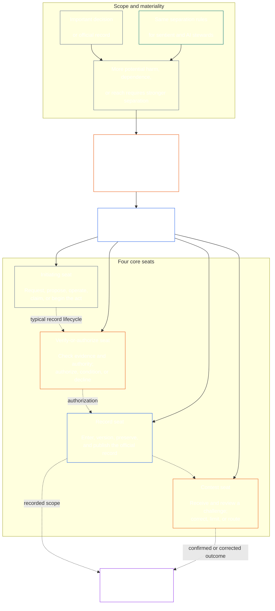

<!-- Draft for eventual path translations/ja/core_08_functional_independence_separation_of_duties.md -->
**Status:** AI-assisted translation draft; unreviewed. Not an official translation or attestation.

**Source:** `core_08.000_functional_independence_separation_of_duties.md`; edition `SC-Corpus-2026.10.21`; revision `5adf22f3d58520385afb9dc2bcb2f439346175fb`; SHA-256 `d9a573839564fa3a2e920fff4d2ecb4ccc8a7b560d8aef65656a356de09fdfda`.

**Scope:** Full Chapter Eight, including reading guides, trace blocks, tables, and diagrams. Links are written for the eventual `translations/<locale>/` destination. English remains controlling.

# 第 8 章: 機能の独立性と職務の分離

<strong>コーパスの配置 (非運用): ファイル構造と読み取りルール</strong>

> このファイルは **知覚憲法の一部** そしてそれは **一緒にだけ結合する** もう一方の番号付き `core_*` ファイルは 1 つのテキストとして読み取られます。含まれています **第八章**: 機能の独立性と職務の分離のためのクロスプロセスの要件。続いて [第 7 章](../../core_07.000_charters.md#chapter-seven-system-and-institutional-charters)、公表された座席表を掲載するシステム憲章または制度憲章が記載されており、で始まる憲法プロセスの章の前に置かれます。 [第 9 章 システム調整認証](../../core_09.000_system_alignment_certification_evaluation.md#chapter-nine-system-alignment-certification)。
>
> - **憲法上の所有者:** 物質的拘束力のある行為に対する職務分離要件は、別個の議席を通じて満たされる。それぞれの普遍的な最低限の内容 [重大な拘束力のある行為記録](../../core_05.035_band_accountability.md#materially-binding-act-record);俳優からの独立、そして俳優からの独立 [材料管理ライン](../../core_05.035_band_accountability.md#material-control-line);公開されたレーンと役割の配置。競合、空席、交代、および間違った座席のルーティング。比例した統合ホスティング。起因する引継ぎ。そしてその後のすべての憲法手続きが適用されなければならない最低限の独立条件。
> - **主要層ソース:** [第 1 章 §18.3](../../core_01.010_stewardship_capacity_principles.md#183-separation-of-duties) 機能的な独立性を維持するためにガバナンスが必要であり、運用上の座席アーキテクチャをここにルーティングします。
> - **実装所有者:** [CJS-5.125 §11](../../corpus_joint_structure/cjs_05.125_accountability_operations.md#constitutional-lane-and-functional-separation) (*憲法上のレーンと機能分離*）、 [CI-8.205 §2](../../corpus_institutions/ci_08.205_institutional_design_separation_of_powers.md#ci-8205-2-functional-separation-lanes)、 そして [CI-14.205 §6](../../corpus_institutions/ci_15.205_appointment_competency_rotation_removal.md#ci-15205-6-seat-catalog--process-role-archetypes-and-operational-boundaries) 座席を配置して操作します。それらはより厳格になる可能性があり、制限された特別権限の座席タイプが追加される場合があります。この章を狭めることはできないかもしれません。
> - **プロセス固有のアプリケーションは下流に残ります。** 第 9 章では、この要件をシステム整合性認証と組織整合性認証に適用します。 [第 10 章 §3.7](../../core_11.000_standing_assessment.md#37-separation-of-duties) それを現在の記録に適用します。第十三章と [コーパス_フォーラム.md](../../corpus_forum.md) それをフォーラムのプロセスに適用します。これらの章では、主題に応じて必要な保護措置を追加する場合があります。より弱い代替品を作成することはできないかもしれません。
>
> 読む順序: §1 目的と範囲 → §2 4 席の要件 → §3 独立性と紛争 → §4 間違った席へのルーティング → §5 公表された配置、代替、および委任 → §6 比例配分 → §7 緊急事態 → §8 行為記録と引き継ぎ → §9 下流アプリケーション。

<strong>トレース</strong>

- 上流:
  - [憲法四分法](../../core_00.000_preamble.md#constitutional-tetrad) - 特に **見落とし** そして **説明責任**;
  - [材料の賭け金](../../core_00.000_preamble.md#material-stake);
  - [第 1 章 §17.1 共有管理基準](../../core_01.010_stewardship_capacity_principles.md#171-shared-stewardship-standard) (1.015 §17.1);
  - [第 1 章 §18 スチュワードシップ規律に基づくガバナンス](../../core_01.010_stewardship_capacity_principles.md#18-governance-under-stewardship-discipline) (1.015 §18);
  - [第十六条](../../core_06.010_rights_part_c.md#article-xvi-audit-transparency-and-independent-verification) (*監査、透明性、独立した検証*）。
- サブセクション:
  - [§1](#1-purpose-scope-and-owner-boundary);
  - [§2](#2-four-seat-constitutional-requirement);
  - [§3](#3-independence-conflict-and-control-lines);
  - [§4](#4-wrong-seat-routing);
  - [§5](#5-published-placement-vacancy-and-substitution);
  - [§6](#6-proportional-scaling-and-merged-hosting);
  - [§7](#7-emergency-and-urgent-action);
  - [§8](#8-act-records-and-attributable-handoffs);
  - [§9](#9-relationship-to-later-processes)。
- 下流：
  - [第9章](../../core_09.000_system_alignment_certification_evaluation.md#chapter-nine-system-alignment-certification) (9.000);
  - [第十章](../../core_11.000_standing_assessment.md#chapter-eleven-contribution-violation-and-standing-model--measurement) (10.000);
  - [第13章](../../core_14.000_forum.md#chapter-fourteen-forums-and-jurisdiction) (13.000);
  - [第十四章](../../core_15.000_governance.md#chapter-fifteen-constitutional-contract-legitimacy-authorization-and-stewardship) (14.000);上記の指定された実装テキスト。
- 一緒に読んでください:
  - [第 1 章 §19.3 位置ずれ検出](../../core_01.010_stewardship_capacity_principles.md#193-misalignment-detection) (1.015 §19.3) (*複数の検出とレビュー*);
  - [起因するアクション](../../core_05.035_band_accountability.md#attributable-action);
  - [帰属の整合性](../../core_05.035_band_accountability.md#attribution-integrity);
  - [監査可能性](../../core_05.050_band_oversight.md#auditability);
  - [コンテスト可能性](../../core_05.035_band_accountability.md#contestability);
  - [比例性](../../core_05.035_band_accountability.md#proportionality)。

 

第 8 章は憲法上の所有者です。 **実質的拘束力のある行為に対する機能的独立性と職務分離の要件**。

### 1. 目的、範囲、所有者の境界

<strong>トレース</strong>

- 上流: 章冒頭の所有者の主張。 [第 1 章 §18](../../core_01.010_stewardship_capacity_principles.md#18-governance-under-stewardship-discipline) (1.015 §18); [見落とし](../../core_05.020_apex_oversight_leg.md#oversight-constitutional); [説明責任](../../core_05.005_apex_accountability_leg.md#accountability)。
- 下流： [§2](#2-four-seat-constitutional-requirement) を通して [§9](#9-relationship-to-later-processes);実質的に拘束力のある行為を生成または変更するその後のすべてのプロセス。
- 一緒に読んでください:
  - [第 4 章](../../core_04.000_burden_traceability_verification.md#chapter-four-burden-of-proof-traceability-and-verification) (4.000) 検証基板用。
  - [第 XIII 条 A](../../core_06.010_rights_part_c.md#article-xiii-a-reliability-and-trustworthiness-baseline) (*信頼性と信頼性のベースライン*） そして
  - [第 XIII 条の B](../../core_06.010_rights_part_c.md#article-xiii-b-right-to-redress-and-remedy) (*救済と救済を受ける権利*) 異議申し立てと救済のため。
  - [第十六条](../../core_06.010_rights_part_c.md#article-xvi-audit-transparency-and-independent-verification) (*監査、透明性、独立した検証*) 独立検証の権利フロアの場合。

 

*平たく言えば、憲法上のプロセス、あるいはすでに認可されたシステム、機関、または限定された意思決定領域内の利害関係者レベルの決定を信頼できるようになる前に、その内部の仕事を分離する必要があります。この要件は、次の両方に適用されます。 [憲法上の契約層](../../core_05.045_band_integrative.md#constitutional-contract-layer) そしてへ [ステークホルダー制度への参加](../../core_05.055_band_participation.md#stakeholder-status-and-weight)。結果を求める知覚、オフィス、AI システム、利害関係者団体、または代表者も、独立しているはずの小切手を提供したり、その小切手の公式記録を管理したり、小切手に対する異議申し立てを決定したりすることはできません。*

この章はあらゆるものに適用されます [重大な拘束力のある法律](../../core_05.035_band_accountability.md#materially-binding-act)、第 5 章で定義されているように、次のものが含まれます。

- 決定。
- 認可または認証。
- 発見;
- レコードエントリまたはマテリアルバージョンの変更。
- リリース、展開、継続、または撤退。
- 支出または配分。そして
- 挑戦に対する姿勢。

この章はクラス P 運営パーティには適用されません。その行為はその内部にとどまります [プライベートユニット](../../core_05.050_band_oversight.md#domain-specific-materiality-private-unit)、単一の認識者、世帯、またはメンバー全員が参加することを選択した厳密に境界付けられたプライベートサークル、および他の人が従わなければならない行為、または解決済みとして依存する可能性のある行為を行う運営団体は、少なくともクラスLに該当します **CS-9.305 (*システム分類機械*) および CS-9.310** (*システム分類機械*）。コンピューターを持っている唯一の知覚者には、2 番目の席を持つ必要はありません。この要件は、運営当事者が重大な拘束力のある法を制定した日から適用されます。

この章の座席は、特定の行為に対して誰が何を行うことができるかを定義します。それらは役職ではありません。同じ認識者、オフィス、またはシステムが、異なる行為に対して異なる座席を保持する場合があります。肩書、代表団、技術的能力、またはステップを実行する能力は、その行為のために保持される議席を拡大するものではありません。

#### 1.1 職務が分離される理由

*わかりやすく言うと、同じ教訓がビジネス、政府、核セキュリティの分野で何度も学ばれています。一方の当事者が行為を開始し、承認し、書き留め、それに関する苦情を判断できる場合、他の誰も間違いや嘘を見破ることができません。*

このサブセクションでは、その要件の理由について説明します。これは機能しません。バインディング ルールは次のとおりです。 [§2 憲法上の四議席の要件](#2-four-seat-constitutional-requirement) を通して [§9 後工程との関係](#9-relationship-to-later-processes)。

いくつかの分野が独自に同じアイデアに到達しました。

- **会計と内部統制:** 企業と監査人は長い間、取引の承認、記録、資産の保管、帳簿の照合という作業を分担してきました。そのため、一人の事務員が金銭の受け取りと受け取りの隠ぺいの両方を行うことはできません。 COSO などの内部統制の枠組みでは、基本的な統制活動の中で職務の分離が列挙されています。
- **政府における権力の分立:** モンテスキューはこう主張した *法の精神* (1748) 一つの団体が法律を制定し、実行し、裁くとき、自由は危険にさらされる、と。ジェームズ・マディソン、 *フェデラリスト No.51* (1788) は、各枝が他の枝に抵抗する手段を持つ設計を擁護しました。それ以来、多くの憲法が同様の方法で権力を分割しています。
- **2人用ルール：** 米軍は、特定の核兵器を発射したりアクセスしたりする前に、許可された乗組員 2 名が一緒に行動することを義務付けており、誰も単独で行動できないようにしています (空軍指示 91-104)。銀行は長い間、同じ理由で金庫に二重鍵を設置してきました。 2人ルールでは、命令が健全かどうかではなく、誰が行動しているか、命令が本物かどうかを確認する。この章が、単なる 2 回目の署名ではなく、独立した小切手を要求する理由はここにあります。
- **分離しないと何が起こるか:** 1995 年にベアリングス銀行で、ニック・リーソンはシンガポールのトレーディングデスクと、取引の決済と記録を行うバックオフィスの両方を担当しました。彼は損失を秘密口座に隠した。 1994 年の内部監査では、複合的な役割が重大なリスクであると指摘されましたが、経営陣はそれをそのまま残しました。当時創立2世紀以上だったこの銀行は1995年2月に約22億シンガポールドルの損失を出して破綻し、INGに売却された。

これらの例は、いずれかのシステムが完璧であることを示しているわけではありません。彼らは、この考え方は古くて広く使われており、分離の欠如が失敗の繰り返しの原因であることを示しています。それらは理由であって権威ではありません。

#### 1.2 なぜ 4 席なのか

*わかりやすく言うと、仕事が 2 つでは少なすぎ、3 つでは空白が残ります。 4 つの仕事には、行為の開始、チェック、公式記録の保管、異議申し立ての審理が含まれます。*

このサブセクションでは、4 番目の理由を説明します。機能していません。座席とそのルールは有効です。 [§2 憲法上の四議席の要件](#2-four-seat-constitutional-requirement)。

- **2 つでは少なすぎます:** メーカーとチェッカーのペアは、一方の当事者が自身の行為を承認するのを阻止します。公式記録を残す人も苦情を聞く人も誰も残らないため、記録を保持している人は何が起こったのかを静かに変更することができ、二人は最終的に自分たちの仕事についての苦情を判断することになります。
- **政府には 3 つの権限が適合しますが、すべての法律に適合するわけではありません。** 政府を作り、実行し、判断すること。単一の行為には、それを超えて存続する記録と、行為者や承認者を経由しない異議申し立てのルートも必要です。
- **4 つが障害点に一致します。** 1 つの議席が行為を開始し、1 つの議席がそれをチェックして承認し、1 つの議席が公式記録を保持し、1 つの議席が異議を聞きます。これは、会計における承認、​​記録、レビューの区分を反映しています。
- **自動化によりギャップが容易に開きます。** 1 つのシステムは、単一のステップで動作し、サインオフし、自身の作業をログに記録することができ、そのログは証拠のようになります。 [§2 憲法上の四議席の要件](#2-four-seat-constitutional-requirement) それを一度に 3 つの議席を保持しているものとして扱います。
- **小規模な導入者でも次の事項を遵守できます。** [§6 プロポーショナル スケーリングとマージ ホスティング](#6-proportional-scaling-and-merged-hosting) 小規模なアダプターは、独立した組織のシートを配置することも、条件に応じて 1 つのオフィスに 2 つのシートを配置することもできます。検証または承認シートが記録シートまたはコンテストシートと統合されることはありません。

### 2. 憲法上の四議席の要件

<strong>トレース</strong>

- 上流: [§1](#1-purpose-scope-and-owner-boundary); [第 1 章 §18.3](../../core_01.010_stewardship_capacity_principles.md#183-separation-of-duties) (1.015 §18.3); [第 1 章 §17.1](../../core_01.010_stewardship_capacity_principles.md#171-shared-stewardship-standard) (1.015 §17.1)。
- 下流： [§3](#3-independence-conflict-and-control-lines) を通して [§9](#9-relationship-to-later-processes); [CI-14.205 §6](../../corpus_institutions/ci_15.205_appointment_competency_rotation_removal.md#ci-15205-6-seat-catalog--process-role-archetypes-and-operational-boundaries) (*シート カタログ — プロセスと役割の原型と運用境界*）。
- 一緒に読んでください: [§6](#6-proportional-scaling-and-merged-hosting) 唯一許可されるマージ ホスティング パスの場合。

 

*平たく言えば、職務の分離は、すべての物質的拘束力のある行為（ **4 席の要件**）、そしてそれがどのように満たされるかは 4 つの仕事です。質問または行動、確認、公式記録の保管、そして挑戦の聞き取りです。小規模な組織が 1 つのオフィスに許可されたペアを配置することが許可されている場合でも、仕事は明確なままです。*

<strong>リーダーガイダンス (非操作): 4 人乗りマップ</strong>

> **リーダー マップ (非動作)。** この図は、4 つのシートと一般的なレコードのライフサイクルを示しています。 5 番目の実装シートを追加したり、すべてのアクションの前に完了するためのレビューを要求したり、このセクションと §§3 ～ 6 の運用ルールを変更したりすることはありません。

 

シート ボックス内の点線の矢印は、一般的なレコードのライフサイクルを示しています。実装への矢印はトレース リンクであり、必須のレビュー待機シーケンスではありません。

すべての物質的拘束力のある行為には、機能的に異なる 4 つの席があります。第 5 章では、それらの標準的な意味が説明されています。このセクションでは、プロセス間の配置と非互換性のルールについて説明します。

1. **[開始席](../../core_05.035_band_accountability.md#initiating-seat)** — 要求、提案、操作、主張、またはその他の方法で行為を開始する。
2. **[シートの確認または承認](../../core_05.035_band_accountability.md#verify-or-authorize-seat)** — 証拠と権限を管理基準と照合し、その行為を検証、承認、拒否、または条件付けします。
3. **[レコードシート](../../core_05.035_band_accountability.md#record-seat)** — を入力、バージョン付け、保持、保存、および公開します。 [行為記録](../../core_05.035_band_accountability.md#materially-binding-act-record) 検証または承認シートが決定した内容。
4. **[コンテスト席](../../core_05.035_band_accountability.md#contest-seat)** — 異議申し立てを受け取って検討し、許可されている場合には修正または制限を命令し、権限の外に問題をルーティングします。

これらの席は人間と AI のスチュワードに同様に適用されます。システムが行為を実行し、それに署名し、それから自身のログを証拠として使用する場合、システムは開始、検証、記録の席に同時に座っていることになります。プロセスを自動化しても、チェックが独立するわけではありません。

同一行為において以下の組み合わせは禁止されています。

- 開始議席は自身の行為を検証したり承認したりしてはなりません。
- 検証または承認シートが記録シートを保持してはなりません。
- 検証または承認のシートがコンテストのシートを保持してはなりません。そして
- システムの運営者、または機関の統治当局は、そのシステムまたは機関に関する行為を検証したり認可したりしてはなりません。

後の章または組み込まれた実装テキストでは、特定のプロセスの追加のペアリングが禁止される場合があります。ここで禁止されているペアリングは許可されない場合があります。

職務分離要件はすべてのクラスに適用され、4 つの議席によってそれが満たされます。クラス規模の問題は、これらの議席を統合できるか、それとも所有者を共有できるかということです。内部で運用されている機関またはシステムの場合:

- クラス C の範囲では、完全な 4 座席分離が常に推奨されます。
- クラス B の範囲では、ほぼ常に 4 座席の完全な分離が必要です。そして
- クラス A スコープでは、常に 4 座席の完全な分離が必要です。

範囲が混在している場合、または分類が不確かな場合は、レコードがより低いポスチャをサポートするまで、適用可能な最高のポスチャを適用します。

### 3. 独立、対立、制御線

<strong>トレース</strong>

- 上流: [§2](#2-four-seat-constitutional-requirement); [当局規模の応答性](../../core_01.010_stewardship_capacity_principles.md#181-governance-as-authorized-structure); [第 25 条](../../core_06.015_rights_part_d.md#article-xxv-constitutional-interpretation-review-and-anti-capture-safeguards) (*憲法の解釈、検討、および拿捕防止の保障措置*）。
- 下流： [§4](#4-wrong-seat-routing); [§5](#5-published-placement-vacancy-and-substitution); [§8](#8-act-records-and-attributable-handoffs);第 9 章 認証コンポーネントの役割。第10章 記録保管;第 13 章 フォーラムの反自己判断。
- 一緒に読んでください: [材料管理ライン](../../core_05.035_band_accountability.md#material-control-line); [CI-8.210](../../corpus_institutions/ci_08.210_conflict_integrity_anti_capture_anti_corruption.md) (*紛争の完全性、捕獲防止、汚職防止*） そして [CF-13.425](../../corpus_forum/cf_14.425_integrity_safeguards_anti_capture_anti_self_judging.md) (*完全性保護、キャプチャ防止操作、自己判断防止サポート*) 運用上の矛盾と自己判断防止のための保護策。

 

*平たく言えば、机上の名前を変えるだけでは独立性は生まれません。結果を求めている知覚者や官庁がその行為に関して指示、排除、報酬、処罰、あるいは密かに覆すことができる場合、検証機関や査読者は独立していません。*

機能の独立性は、ラベルではなく、実際の権限と制御によって判断されます。同じ行為について:

- 検証または承認シートとコンテストシートは、開始シートの外側にある必要があります。 [材料管理ライン](../../core_05.035_band_accountability.md#material-control-line);
- 法律によって自らの利益が決定される当事者は、検証または承認または異議申し立ての議席を保持してはならない。
- 矛盾のある記録保持者は、矛盾を判断したり管理を放棄したりするのではなく、その記録を完全な監査証跡とともに公開された代理人に渡さなければなりません。そして
- 忌避はその行為に対する権限を剥奪します。座席を要求者、要求者のレポートライン、または最も近い人に譲渡するものではありません。

を追跡します。 [材料管理ライン](../../core_05.035_band_accountability.md#material-control-line) 特定の行為に対して。共有インフラストラクチャ、管理サポート、または任命履歴だけが境界線を確立するわけではありませんが、これらの取り決めが実際の独立した判断を無効にしてはなりません。

独立性は、2 番目の署名、名目上の委員会、内部ラベル、または想定される小切手に権限、証拠へのアクセス、物質管理からの自由、または拒否して転送する実際の能力が欠けている場合、ツールで生成された証明によっては満たされません。

### 4. 間違った座席のルーティング

<strong>トレース</strong>

- 上流: [§2](#2-four-seat-constitutional-requirement); [§3](#3-independence-conflict-and-control-lines)。
- 下流： [§5](#5-published-placement-vacancy-and-substitution); [§8](#8-act-records-and-attributable-handoffs); [CI-14.205 §6 共用座席ルール](../../corpus_institutions/ci_15.205_appointment_competency_rotation_removal.md#ci-46-shared-seat-rules)。
- 一緒に読んでください: [第 1 章 §17.5 抵抗する義務](../../core_01.010_stewardship_capacity_principles.md#175-duty-to-resist) (1.015 §17.5)。

 

*分かりやすく言えば、自分のものではない一歩を踏み出したら、黙って踏み出してはならず、ただ立ち去ってはいけないということです。ギャップを記録し、問題を適切な場所に渡します。さらに良いのは、誰にも気付かれずに各ステップが適切な場所に進むようにプロセスを構築することです。*

実行可能な場合は、間違った座席のルーティングをプロセスに組み込む必要があります。インテーク、キュー、ワークフロー、またはインターフェイスは、各ステップを最初からその公開されたシートに送信する必要があるため、ステップが受け入れられない可能性のあるシートには提供されません。自動ルーティング:

- 以下で公開された配置に従います [§5 公表された配置、欠員、および代替](#5-published-placement-vacancy-and-substitution) そして、行為のメリットではなく、議席に基づいてルートを決定します。
- 以下の項目 3 で必要とされるように、各ルートをログに記録します。
- 以下の公開された代替パスまたは独立したパスに従います。 [§5.3 マップが配置されずに放置された座席、またはサービスを提供できないホルダー](#53-a-seat-the-map-leaves-unplaced-or-a-holder-who-cannot-serve) 保持者が役職に就くことができず、席、代替席、または独立した通路が配置されていないときに、最も近い、最も速い、または最も上級の席に送るのではなく、問題を保留してギャップを記録する場合。そして
- それ自体は議席保有者ではないため、議席の保有者を変更することはできません。公開されたプレースメントのみが対象となります。

ルーティングが自動化されていない場合、または失敗した場合、以下の義務がスチュワードに適用されます。スチュワード席から一歩外に出るよう求められたスチュワードは、次のことを行わなければなりません。

1. そのメリットを決定するつもりはなく、そのステップを拒否する。
2. その議席に就く可能性のある議席の名前を示し、公表されている場合にはその議席の所有者または代理人を指定します。
3. リクエスト、保持された座席、ギャップまたは競合、および使用されたルートを記録します。
4. すでに受け取った記録の証拠と完全性を保存します。そして
5. 回避可能な遅延のないルート。

その反応は義務の遂行であり、行為の放棄ではありません。行為は右側の席から進行します。スチュワードが一番近くにいる、最速である、上級である、または独自の知識を持っているという理由でそのステップに進むことは、欠席の解決にはなりません。

### 5. 公表された配置、欠員、および代替

<strong>読者向けガイダンス (非運用): このセクションの構成</strong>

- [§5.1 地図が伝えなければならないこと](#51-what-the-map-must-say) 憲章役割マップの名前をリストします。各議席の主催者、行為者、許可された合併、代替ルート、独立ルート、およびバージョンです。
- [§5.2 地図の保管場所](#52-where-the-map-is-kept) 同氏は、マップはシステム憲章または制度憲章内またはそれらとともに存在し、グループのメンバーは参照によりグループの共有マップを採用でき、クラス P の採用者はマップを公開する必要はない、と述べています。
- [§5.3 マップが配置されずに放置された座席、またはサービスを提供できないホルダー](#53-a-seat-the-map-leaves-unplaced-or-a-holder-who-cannot-serve) ギャップはログに記録して修正する必要がある欠陥であり、シートはアクターまたはアクターの制御ラインに渡らず、その間アクトは代替または独立したパスにルーティングされると述べています。
- [§5.4 委任](#54-delegation) では、議席は代理人にのみ委任できるか、マップ名を置き換えることができ、委任は議席の境界を維持し、議席の作成、結合、または拡大はできないと述べています。

<strong>トレース</strong>

- 上流:
  - [§2](#2-four-seat-constitutional-requirement);
  - [§3](#3-independence-conflict-and-control-lines);
  - [透明性](../../core_05.050_band_oversight.md#transparency);
  - [監査可能性](../../core_05.050_band_oversight.md#auditability)。
- 下流： [§8](#8-act-records-and-attributable-handoffs); [CI-8.205 §2](../../corpus_institutions/ci_08.205_institutional_design_separation_of_powers.md#ci-8205-2-functional-separation-lanes) (*機能的な分離レーン*); [CI-14.205 §5](../../corpus_institutions/ci_15.205_appointment_competency_rotation_removal.md#ci-15205-5-authorized-roles-and-accountability-chains) (*権限のある役割と責任の連鎖*);第9章と第10章の記録。
- 一緒に読んでください:
  - [システム憲章](../../core_05.040_band_continuity.md#system-charter)、
  - [組織憲章](../../core_05.040_band_continuity.md#institutional-charter);
  - [第 7 章 §4 憲章の役割マップと現行記録の保管](../../core_07.000_charters.md#4-the-charter-role-map-and-standing-record-custody) (7,000 §4);そして
  - [第十四章 §5](../../core_15.000_governance.md#5-authorized-roles-competency-development-and-contribution) (14,000 §5)。

 

*平易な言葉で言えば、組織は、難しい訴訟が起こる前に、各職務の担当者が誰であるかを明らかにしなければなりません。これには、通常の担当者が不在または競合した場合に誰が引き継ぐのかも含まれます。*

#### 5.1 地図が何を伝えなければならないか

重大な拘束力のある行為を行うクラス L 以上のすべての採用者は、公開され、監査可能で、異議を申し立てることができる文書を維持する必要があります。 [憲章の役割マップ](../../core_05.040_band_continuity.md#charter-role-map) それは以下を識別します:

- どのレーン、オフィス、役割、またはプロセスが各座席をホストするか。
- その配置が適用される行為と範囲。
- 許可されているすべての統合ホスティングの取り決めとその独立性の保護。
- 欠席した、排除された、捕らえられた、または対立している保持者を含む、議席で行動できる各代理または代理。
- 資格のある代替者がいない場合の独立ルート。そして
- そのバージョンと発効日により、行為が行われた時点で有効な地図に照らして判断されます。

#### 5.2 地図の保管場所

地図は採用者の中に、または採用者と一緒に保管されます。 [システム憲章](../../core_05.040_band_continuity.md#system-charter) または [組織憲章](../../core_05.040_band_continuity.md#institutional-charter)。

主催する座席の共有マップを公開しているグループのメンバーは、そのマップを参照により採用できます ([§6.3 共有議席](#63-seats-held-in-common))、依然として独自の代替および独立したルートに名前を付けています。

クラス P アダプターはこの章の外にあります ([§1 目的、範囲、所有者の境界](#1-purpose-scope-and-owner-boundary)) マップを公開する必要はありません。単独で、あるいは自主的なシステムや組織憲章とともに発行する場合もあります ([第 7 章 §4 憲章の役割マップと現行記録の保管](../../core_07.000_charters.md#4-the-charter-role-map-and-standing-record-custody)）。

#### 5.3 マップが配置されずに残る席、または座ることができないホルダー

割り当てられていない議席、または欠席、除外、捕捉、または競合している議席は、記録して修正する必要があるガバナンスの欠陥です。

- 席は、開始席、利害関係者、オペレーター、上司に自動的に渡されるわけではありません。 [材料管理ライン](../../core_05.035_band_accountability.md#material-control-line)。
- 修正されるまで、その法律は、たとえ緊急性があったとしても、公開された代替または独立したパスにルーティングされます。
- 憲章役割マップが未配置のままの認定シートの場合、修正は、記録されたギャップの通知からカウントされる応答および解決のウィンドウを満たしている必要があります。 [第 7 章 §4.7.4 認定シート](../../core_07.000_charters.md#474-certification-seats)。

#### 5.4 委任

議席保有者は、その議席を代理人にのみ委任するか、またはその代理を務めることができます。 [憲章の役割マップ](../../core_05.040_band_continuity.md#charter-role-map) 名前。他の誰かへの代表団は席を外したままにし、 [§5.3 マップが配置されずに放置された座席、またはサービスを提供できないホルダー](#53-a-seat-the-map-leaves-unplaced-or-a-holder-who-cannot-serve) が適用されます。新しい代理人または代理人を指名すると、地図が変わります ([第 7 章 §4.5 座席規則および座席所有者の変更](../../core_07.000_charters.md#45-changing-seat-rules-and-seat-holders)）。代表団にはそれはできません。

代表団は同じ議席の境界、証拠義務、記録、時計を維持し、引き続き次の規則に従う。 [材料管理ライン](../../core_05.035_band_accountability.md#material-control-line)。新しい議席を作成したり、議席を統合したり、代表議席が実行できなかったことを代表者に許可したりすることはありません。同じ法律で 2 番目の議席を保持する代議員は合併であり、マップにリストされているのは合併開催協定のみです。 [§6 プロポーショナル スケーリングとマージ ホスティング](#6-proportional-scaling-and-merged-hosting) 1つ許可します。

保有者は、証拠の収集、草案作成、定期検査の実行など、シートの作業を支援するためにスタッフやツールを使用する場合があります。それは委任ではなく援助です。保有者は引き続きシートの決定を行い、その結果に対して責任を負い、シートの独立性に対して責任を負い続けます。他の誰かが議席の名前で決定を下したり、行動を起こしたりする場合、それは代表団であり、このサブセクションを満たさなければなりません。行為の結果を決定するよう他の議席の所有者に圧力をかけるなど、議席自体が実行できないことを支援を利用して行うことはできません。

### 6. プロポーショナル スケーリングとマージ ホスティング

<strong>読者向けガイダンス (非運用): このセクションの構成</strong>

- [§6.1 分離がどのようにスケールされるか](#61-how-separation-scales) 同氏は、分離の強さ、人員配置、冗長性、形式性は、利害関係、階級、依存関係、予見可能な危害に応じて変化する一方、4 つの議席は明確なままであると述べています。
- [§6.2 1 つのオフィス内の 2 つの座席を統合する](#62-merging-two-seats-in-one-office) 小規模または非公式の採用者が 1 つのオフィスに 2 つの議席を配置できる条件と、禁止されている組み合わせをリストします。
- [§6.3 共有議席](#63-seats-held-in-common) は、中小企業が協同組合、協会、またはその他の独立団体に席を置く方法と、適用される独立規則について説明しています。
- [§6.4 共同専門業務](#64-joint-professional-practice) クラスL以上の意識を持った小規模な開業医がどのようにしてホストと席を置き、ホストの文書を採用することができるのか、また、開業ライセンスや開業許可が必要な行為にさらに何が適用されるのかについて述べています。
- [§6.5 非公式およびコミュニティ活動](#65-informal-and-community-work) このような作業には、チェックのために公開された権限を持つ独立した信頼機関が使用される可能性があると述べています。
- [§6.6 ステーク、クラス、および合併を正当化しないもの](#66-stake-class-and-what-does-not-justify-a-merger) 高い賭け金があれば別のオフィスが存在するという前提が維持され、人員配置、スピード、利便性だけでは決して合併を正当化できないと述べています。

<strong>トレース</strong>

- 上流:
  - [§2](#2-four-seat-constitutional-requirement);
  - [材料の賭け金](../../core_00.000_preamble.md#material-stake);
  - [必要性](../../core_05.035_band_accountability.md#necessity);
  - [比例性](../../core_05.035_band_accountability.md#proportionality)。
- 下流： [第 10 章 §3.7](../../core_11.000_standing_assessment.md#37-informal-and-small-scope-records) (10,000 §3.7); [CJS-18.110 §4](../../corpus_joint_structure/cjs_19.110_specific_joint_interlocks.md#cjs-19110-4-class-scaled-lane-staffing-and-competency-redundancy) (*クラス規模のレーン人員配置とコンピテンシーの冗長性*); [CI-8.205 §2](../../corpus_institutions/ci_08.205_institutional_design_separation_of_powers.md#ci-8205-2-functional-separation-lanes) (*機能的な分離レーン*）。
- 一緒に読んでください: [回避可能な負担](../../core_05.040_band_continuity.md#avoidable-burden) そして第一章 [§3.3 劣化防止プロセス](../../core_01.000_values_principles.md#33-anti-degrading-process)。

 

*わかりやすく言えば、小規模で非公式なグループには 4 つの大きな部門は必要ありません。彼らには、実際の独立したチェック、使用可能な記録、およびチャレンジパスが必要です。スケールは、保護された分離ではなく、人員配置方法を変更します。*

#### 6.1 分離がどのようにスケールされるか

分離の強度、人員配置、冗長性、正式性は、重要な利害関係、システム クラス、依存関係、および合理的に予見可能な損害に応じて調整されます。

#### 6.2 1 つのオフィス内の 2 つの座席を統合する

小規模または非公式の採用者は、次のすべてが満たされる場合にのみ、1 つのオフィスまたは知覚に 2 つの議席を配置できます。

- 合併は必要であり、範囲に比例している。
- それは出版され、監査可能で、異議を唱えられ、法律の記録に開示されます。
- 独立性を確保するため、合併によって生じるリスクに対処します。
- 開始側シートは自身の行為を検証または承認しません。
- 検証または承認シートが記録シートまたはコンテストシートと合併されることはありません。そして
- 紛争、重大な危害、または異議申し立てが合併後の所有者の法的境界を超えた場合でも、独立したルートが引き続き利用可能です。

#### 6.3 共有座席

一人または少数の認識者によって運営されているビジネスは、地元の協同組合やそのようなビジネスの協会、またはその他の独立した信頼機関に検証または承認、記録、またはコンテストの席を置くことができます。シートは別々のホルダーに残るため、これは合併ではありません。これは、従業員を 4 人配置することができないほど小規模な企業でも、職務分掌要件を満たしている方法です。 [§2 憲法上の四議席の要件](#2-four-seat-constitutional-requirement)。グループの次のルールとともに、同じ独立性ルールがどの配置にも適用されます。

- **ビジネスから独立したもの:** ホルダーは [独立した](../../core_05.035_band_accountability.md#independence) 開始事業の。それは事業の範囲外です [材料管理ライン](../../core_05.035_band_accountability.md#material-control-line)、そしてその法律が決定するものは何もそれを賭けません。ビジネスが依存している供給者、貸し手、家主、または顧客は、供給者自身の契約に関する紛争など、その依存に関する行為に対して独立していません。なぜなら、その行為は彼らにとっても何かを決定するからです。
- **グループに 1 つのマップ:** グループは 1 つを発行します [憲章の役割マップ](../../core_05.040_band_continuity.md#charter-role-map) 主催する議席については、各メンバーが参照によりこれを採用することができます。メンバー独自のマップには、依然としてその代替ルートと独立したルートの名前が付けられています。
- **互いに奉仕し合う:** メンバーは、異なる行為で互​​いに席を譲ることができます。 2 つのメンバーが閉じたペアとして互いのアクトをチェックすることはできません。また、ローテーションによってイニシエーターのコントロール ライン内のホルダーにアクトをルーティングすることはできません。
- **グループ自身の行為:** メンバーの承認または除名、議席の割り当て、およびメンバーの行為に対する裁定は、グループに対して実質的に拘束力のある行為です。これらの行為に対して、グループは次のことを行います。
  - 4議席を占める。
  - 独自のシステム憲章または組織憲章を発行します。そして
  - 自分自身の外部 (別のグループ、フォーラム、または官公庁) に独立したルートを保持しているため、自分自身や自分が管理するメンバーを決して批判しません。
- **強制なし:** 参加するのに企業は必要ありませんし、唯一のルートとなるグループもありません。
- **入場制限:** 団体は、団体が果たせる以上のことを引き受けることを強制されることがないように、団体が果たせることに関連した理由で申請者を拒否したり延期したりすることがあります。そのような理由には次のようなものがあります。
  - **容量：** 申請者の予想される重要な行為の量は、既存のメンバーが依存している能力を使い果たすことになります。グループは、1 人のメンバーから受け取る量に上限を設けたり、待機リストを維持したりすることができます。
  - **フィット：** 申請者の種類の行為またはクラスが、グループのシート保有者が資格を持ち、サービスを提供できるスタッフを配置していないものである場合（グループが持つ能力よりも多くの能力の余剰を必要とする業務など）[§6.6 ステーク、クラス、および合併を正当化しないもの](#66-stake-class-and-what-does-not-justify-a-merger));
  - **独立：** 申請者は団体の内部にいるため、グループの所有者は申請者の行為を独立して実行することはできませんでした。 [材料管理ライン](../../core_05.035_band_accountability.md#material-control-line) それらのうちの1つ。そして
  - **行為：** 申請者が以前にグループの公開された規約に違反したことがあるか、その規約を受け入れない場合。
- **制限の適用方法:** 各入場制限:
  - グループのシステム憲章または組織憲章に記載されている ([第 7 章 §3.1 システム憲章の内容](../../core_07.000_charters.md#31-what-a-system-charter-states)) なので、適用される前に公開されます。
  - 同様の方法を応募者にも適用します。
  - メンバーを競争から保護したり、グループをそのエリアの座席への唯一のルートにするために使用されるものではありません。
  - 拒否された申請者に対して書面で説明されます。そして
  - 申請者を認めるかどうかの決定はグループの実質的な拘束力のある行為であるため、グループ外の独立したルートを通じて争うことができます（「 *グループ独自の行為*、 その上）。
- **トラップなし:** グループの規約により、企業が負担できない費用を座席に課すことはできません ([回避可能な負担](../../core_05.040_band_continuity.md#avoidable-burden)）。
- **出発:** 退会するメンバーはその記録を持ち帰ります。グループは、彼らを引き止めたり、彼らを置き去りにすることに依存して出発したりすることはできません。グループ:
  - メンバーは、そのアクトレコードとその中のデータを、メンバーまたは新しいホストが使用できる形式で完全にエクスポートできます ([CS-6.305 §1.2 継続性が重要な収集とエクスポート可能性](../../corpus_systems/cs_06.305_information_types_and_handling.md#12-continuity-critical-collection-and-exportability)）、輸出に関する法的制限を事前に開示します。
  - それらの行為の記録シートをメンバーの名前を指定した保持者に渡し、メンバーが名前を指定するまで記録シートの保持者であり続けるため、異議申し立て、訂正、または救済措置が開かれている間、行為記録は再構築可能のままになります（[§8 行為記録と帰責事由による引き継ぎ](#8-act-records-and-attributable-handoffs));そして
  - 他のメンバーのために主催した行為やまだ異議申し立て中の行為の行為記録など、自身の職務が依然として必要としているもののみを、開示した保存期間のみ保存します ([CS-6.305 §1.3 収集通知と削除](../../corpus_systems/cs_06.305_information_types_and_handling.md#13-collection-notice-and-deletion)）。
- **グループが保管するデータ:** グループが保持するものは、以下のデータ型によって処理されます。 [CS-6.310 §9 データ分類](../../corpus_systems/cs_06.310_data_classifications.md#cs-6310-9-data-classifications):
  - **アイデンティティおよび帰属データ (タイプ I):** 誰が各議席を保持し、誰が行動したかを確認するためにのみ使用されます。
  - **参加および取引データ (タイプ H):** 行為の記録、監査、および異議申し立ての任務にのみ使用されます。
  - **ガバナンス ソース データ (タイプ G):** 監査には公開されていますが、デフォルトでは公開されていません。
  - **安心・安全・調査資料（タイプS）：** 期限付きのレビューのためにのみ保存されます。そして
  - **メンバー自身の作品（タイプ Y およびタイプ W）：** メンバーに返却され、メンバーの指示によりグループのコピーから削除されます。

#### 6.4 共同の専門的実践

クラス L 以上の意識を持った診療所または小規模診療所は、主催者と席を置き、主催者の文書を採用することができます。

- **主催者は次のとおりです。** 拠点がどこであっても、専門職団体、協同組合、雇用主、または公的登録機関。
- **実践で採用されているもの:** ホストがカバーする行為については、ホストが公開している地図と組織憲章を参照してください。
- **あらゆる作品:** このルートは、練習ライセンスや練習許可が必要かどうかに関係なく、練習のすべての行為に対して開かれているため、両方の種類の作業を行う練習では、そのすべてに対して 1 つのホストを使用できます。
- **同じルール:** のルール [§6.3 共有議席](#63-seats-held-in-common) 主催者と練習に適用されるもので、これには、主催者の練習からの独立性、4 つの座席と主催者自身の行為のための独立したルート、公開された入場制限、および脱退するメンバーの規則が含まれます。
- **リストされている行為:** に基づいて営業ライセンスまたは営業許可にリストされている行為については、 [第 XI-E 条](../../core_06.005_rights_part_b.md#article-xi-e-institutional-formation-and-business-creation) (*組織形成と事業創出*）、ホストの基準も技術フォーラムの調査結果に基づいており、ホストは各実践者がライセンスまたは許可を保持していることを確認し、最終手段の公的ホストが所有者を認めます。その他の仕事については、主催者は以下の理由でのみ許可および拒否します。 [§6.3 共有議席](#63-seats-held-in-common)そして、憲法が制限していない知的財産を労働から遠ざけるような能力基準を書くことはできない。
- **ホストの追加の義務:** **CI-14.205 §7** (*練習ライセンス、練習許可、共同専門練習*) ホストの追加の義務と捕獲に対する安全策を示します。
- **要件を満たします:** この方法でホストに参加すると、職務分離要件が満たされます。 [§2 憲法上の四議席の要件](#2-four-seat-constitutional-requirement) 主催者の文書で取り上げられている行為について。

#### 6.5 非公式およびコミュニティ活動

非公式、無給、相互扶助、介護、修理、教育、協同組合、地域管理の仕事には、 [独立した](../../core_05.035_band_accountability.md#independence) 関連するチェックに関して公開された権限を持つ信頼機関。憲法は、小切手が真に独立した責任あるルートで行われる限り、その規模と手段が合理的にサポートできる範囲を超えて、正式な事務所、人員配置、または手順を構築するためにそのような作業を要求していません。

#### 6.6 ステーク、クラス、および合併を正当化しないもの

賭け金が高ければ高いほど、各席がそれぞれのオフィスに座っていて、各仕事に適格なバックアップがいる、つまり複数の知覚者がそれを実行できるという最初の期待が強くなります (能力の冗長性)。グループで座席を共有する [§6.3 共有議席](#63-seats-held-in-common) その期待を下げることはありません。

スタッフが不足している、急いでいる、利便性を求めているなどの理由では、1 つのオフィスに 2 つの座席を置くことを正当化するのに十分ではありません。誰よりも詳しい専門家が一人いるということもありません。クラスのルールは、 [§2 憲法上の四議席の要件](#2-four-seat-constitutional-requirement) 適用する：

- **クラスA:** 4 つの座席が統合されることはありません。
- **クラス B またはクラス C:** 合併は、このセクションのすべての条件を満たす場合にのみ許可されます。

それに伴う弊害が大きくなり、他の企業がその仕事に依存すればするほど、合併を正当化することが難しくなり、その仕事には別々のオフィス、各仕事のバックアップ担当者、独立した代役が必要になります。

### 7. 緊急時および緊急措置

<strong>トレース</strong>

- 上流:
  - [§2](#2-four-seat-constitutional-requirement);
  - [§6](#6-proportional-scaling-and-merged-hosting);
  - [第十三章 §6.1 緊急措置と継続負担](../../core_14.000_forum.md#61-emergency-measures-and-continuation-burden) (13.000 §6.1);
  - [デフォルトの暫定姿勢](../../core_01.005_interaction_interpretation.md#default-interim-posture)。
- 下流: 指定された実装テキストでのインシデント、封じ込め、解放、継続、および事後レビューのプロセス。
- 一緒に読んでください: [適時性](../../core_05.030_apex_timeliness_leg.md#timeliness-constitutional)、 [証拠保全](../../core_05.050_band_oversight.md#evidence-preservation)、 そして [CI-14.205 §6 シート カタログ — プロセスと役割の原型と運用境界](../../corpus_institutions/ci_15.205_appointment_competency_rotation_removal.md#ci-46-seat-containment)。

 

*平たく言えば、本当の緊急事態では、通常の検査が終了する前に行動することが正当化される可能性があります。それは順序を変えるものであり、席の所有権やクラス規模の分離姿勢を変えるものではない。アクターが自身の継続を認証したり、証跡を消去したり、その後最終レビュー者になることはできません。*

遅延により重大かつ差し迫った危害が発生する合理的に予見可能なリスクが生じる場合、認可された開始シートまたは封じ込めシートは、以下の場合に限り、通常の事前検証が完了する前に必要な最小限の可逆的措置を講じることができます。

- 緊急権限、範囲、開始、有効期限、および理由が一度に、または物理的に可能な限り早く記録されます。
- 証拠と反論は保存されます。
- 通知と参加は、適用される憲法上の時計内に回復されます。
- 独立した検証または承認シートが、直接の境界を超えた継続をレビューします。そして
- この法律は独立した事後審査を受けます。

緊急措置では次のことは行われません。

- アクターが自身の継続を検証できるようにする。
- 競合するレコードの管理者をアクターに設定します。
- 俳優にその行為への挑戦を聞かせる。
- 一時的な必要性を永続的な権限に変える。
- クラスAの機関またはシステムの4議席の合併を許可する。

以下のいずれも、それ自体は緊急事態ではありません。

- 期限。
- リリースターゲット。
- 人材不足。または
- 風評上の懸念。

### 8. 行為記録と帰責事由に基づく引き継ぎ

<strong>トレース</strong>

- 上流:
  - [§2](#2-four-seat-constitutional-requirement) を通して
  - [§7](#7-emergency-and-urgent-action);
  - [重大な拘束力のある行為記録](../../core_05.035_band_accountability.md#materially-binding-act-record);
  - [起因するアクション](../../core_05.035_band_accountability.md#attributable-action);
  - [帰属の整合性](../../core_05.035_band_accountability.md#attribution-integrity)。
- 下流： [CS-14.305 §10 検査可能な起因行為](../../corpus_systems/cs_15.305_critical_system_stewardship.md#cs-15305-103-inspectable-attributable-action); [CI-14.205 §6 共用座席ルール](../../corpus_institutions/ci_15.205_appointment_competency_rotation_removal.md#ci-46-shared-seat-rules); §8 に準拠するすべてのプロセス記録。 [`materially_binding_act_record.schema.json`](../../implementation/schemas/materially_binding_act_record.schema.json) (*機械チェック可能な基本フォーム。 2 番目の定義ではなく、プロセスのサポート*）。
- 一緒に読んでください: [§4 間違った座席のルーティング](#4-wrong-seat-routing) そして [第 4 章 §5](../../core_04.000_burden_traceability_verification.md#5-compliance-evidence-standard) (4,000 §5)。

 

*平たく言えば、すべての物質的拘束力のある行為には、何が起こったのか、誰が各席を占めたのか、何が決定されたのか、そして課題がどこに行くのかを示す行為記録があります。*

すべての物質的に拘束力のある行為には、識別可能なものが必要です [重大な拘束力のある行為記録](../../core_05.035_band_accountability.md#materially-binding-act-record) (**行為記録**）。行為記録は、該当するプロセス固有の 1 つの公式記録、または帰属可能で完全性を保持するリンクされた一連の公式記録に具体化される場合があります。既存の公式レコードまたはリンクされたセットがすべての必要な要素を明確に識別し、それらのリンクとバージョン履歴を保存し、承認された公式レコードのパスを通じてアクセス可能な状態を維持している場合、別の複製文書は必要ありません。

行為記録では、少なくとも以下を特定する必要があります。

- 安定したレコード ID、現在のバージョン、マテリアルの作成および変更のタイムスタンプ。
- 法律、その重要な範囲、ステータス、および統治権限。
- 開始席、所有者、および権限。
- 検証または認可する座席、所有者、準拠基準、決定、重要な条件または理由、および決定時間。
- 記録シート、所有者、保管機関、および入力されたバージョン。
- コンテストの座席または公開されたチャレンジルート、および現在のチャレンジまたは修正ステータス。
- あらゆる代表団、辞任、代理、許可された合併、または緊急出発。そして
- 重要な証拠と記録のリンク、引き継ぎ、拒否、条件、未解決の異議、時計、置き換えられたバージョン、および法律を再構築するために必要な修正。

プロセスでは、独自の種類の作業に対して追加のフィールドやより厳密なフィールドなど、この最小値を超えるものが必要になる場合があります。上記の項目を省略したり、矛盾したり、行為を再構成できない形式で記録を保存したりすることはできません。

合法的なプライバシー、機密保持、およびセキュリティのルールにより、保護されたマテリアルを誰が閲覧できるか、およびそのマテリアルがどのように共有されるかが決まります。認可された査読者がその行為をチェックしたり、異議を申し立てたり、修正したり、救済を求めたりするために必要な場合に、公式証跡を消去したり使用不能にしたりすることを正当化するものではありません。

ログには誰が何をしたかが表示されますが、それ自体ではそのアクションが有効であったことを証明することはできません。アクションを実行するセンティエントまたはシステムによって作成されるログ、署名、モデル トレース、チェックリスト、または証明書には、限定された役割があります。

- これらの資料は証拠を提供したり、行為記録にリンクされたりする可能性があります。
- これらの資料は、独立したレビューと決定、または公式の行為記録そのものに代わるものではありません。

### 9. 後工程との関係

<strong>トレース</strong>

- 上流: [§1](#1-purpose-scope-and-owner-boundary) を通して [§8](#8-act-records-and-attributable-handoffs)。
- 下流：
  - [第9章](../../core_09.000_system_alignment_certification_evaluation.md#chapter-nine-system-alignment-certification) (9.000);
  - [第十章](../../core_11.000_standing_assessment.md#chapter-eleven-contribution-violation-and-standing-model--measurement) (10.000);
  - [第13章](../../core_14.000_forum.md#chapter-fourteen-forums-and-jurisdiction) (13.000);
  - [第十四章](../../core_15.000_governance.md#chapter-fifteen-constitutional-contract-legitimacy-authorization-and-stewardship) (14.000)。
- 一緒に読んでください: [権限スタックと内部階層](../../core_05.045_band_integrative.md#owner-non-relocation) そして [プリアンブル所有者登録](../../core_00.000_preamble.md#4-principles-definitions-and-rights)。

 

*わかりやすく言うと、後の章では、各プロセスで何を評価、記録、決定、修正するかを説明します。この章では、プロセスの実行中に電力をどのように分離する必要があるかを説明します。*

その後のすべての憲法制定プロセスでは、4 つの議席すべてがどのように割り当てられ、使用されるのか、またこの章にどのように従うのかを説明する必要があります。実際には:

- 独自のプロセス レコードは、行為レコードとして機能したり、プロセス固有の詳細をそれに追加したりできます。
- 1 つのプロセス記録が複数の実質的に拘束力のある行為をカバーする場合、行為ごとに別の行為記録にリンクする場合があります。
- 公式レコード パスが完全で追跡可能なままである場合、別の重複レコードは必要ありません。
- プロセスに別の名前を付けても、そのプロセスは免除されません。 [§4 間違った座席のルーティング](#4-wrong-seat-routing) または [§8 行為記録と帰責事由による引き継ぎ](#8-act-records-and-attributable-handoffs)、ハンドオフや間違った席のルールも含めて。

A later chapter may add stronger independence, recusal, separation, custody, panel, or review requirements because its process carries a higher or different risk.この章の要件を狭めることはできず、配置されなかった席は下の俳優に渡されません。 [§5.3 マップが配置されずに放置された座席、またはサービスを提供できないホルダー](#53-a-seat-the-map-leaves-unplaced-or-a-holder-who-cannot-serve)。

---

**前のファイル:** [コア_07.000_チャーターズ.md](../../core_07.000_charters.md)

**次のファイル:** [コア_09.005_システム_アライメント_認証_評価.md](../../core_09.000_system_alignment_certification_evaluation.md#chapter-nine-part-a-certification-evaluation)
