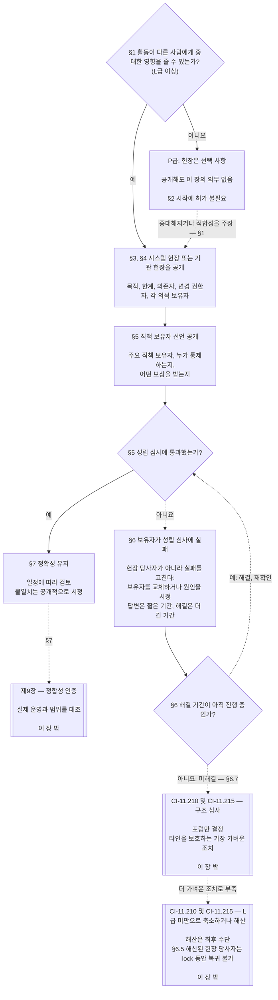

# 제7장: 시스템 헌장 및 기관 헌장

> **번역 상태:** 한국어 AI 보조 초안이며 독립적인 독자 검토를 받지 않았다. 번호가 붙은 영어 원문이 우선한다. 현재 제7장을 번역 중이다.

<strong>코퍼스 내 위치(비운영): 파일 구조와 읽기 규칙</strong>

> 이 파일은 **감지자 헌법의 일부**이며, 번호가 붙은 다른 `core_*` 파일과 함께 하나의 텍스트로 읽을 때만 구속력을 가진다. 이 파일은 시스템과 기관이 공개하는 범위 문서인 시스템 헌장과 기관 헌장의 최소 기준을 다루는 **제7장**이다. 제6장의 권리 바닥 다음, 제8장 앞에 놓이며, 제8장은 중대하게 구속력 있는 행위 안의 의석들을 분리한다.
>
> - **헌법상 소관:** 시스템이 시스템 헌장을 공개해야 하는 경우와 기관이 기관 헌장을 공개해야 하는 경우(L급 이상은 의무, P급은 선택), 각 헌장의 최소 기재사항, 변경·검토 방법, 해당 직책 보유자의 standing과 진정성에 대한 성립 심사.
> - **정의 위치:** [시스템 헌장](../../../core_05.040_band_continuity.md#system-charter), [기관 헌장](../../../core_05.040_band_continuity.md#institutional-charter), [헌장 역할 지도](../../../core_05.040_band_continuity.md#charter-role-map), [헌장 당사자](../../../core_05.040_band_continuity.md#chartered-party), [운영 주체](../../../core_05.050_band_oversight.md#operating-party)는 제5장에서 정의한다. 이 장은 그 용어를 적용할 뿐 다시 정의하지 않는다.
> - **이행 소관:** [CI-8.205 §6](../../../corpus_institutions/ci_08.205_institutional_design_separation_of_powers.md#ci-8205-6-system-and-institutional-charter-contents-review-and-formation-template)(*시스템·기관 헌장 내용, 검토 및 성립 템플릿*)에 전체 항목 템플릿, 검토 점검표, 성립 절차, 성립 심사 선언 템플릿이 있다. 더 엄격하게 하거나 항목을 추가할 수 있지만 이 장의 기준을 좁힐 수 없다. 유효한 채택 범위에서만 편입된 이행 문서로 구속력이 있다([제18장 §4 채택의 틀과 권한 범위](../../../core_19.000_incorporation.md#4-adoption-framing-and-scope-of-authority)). 이 장의 기준은 핵심 텍스트로서 구속력을 가진다.
> - **후속 적용:** [제8장 §5 공개 배치, 공석 및 대체](../../../core_08.000_functional_independence_segregation_of_duties.md#5-published-placement-vacancy-and-substitution)는 헌장 역할 지도를 요구한다. 제9장은 시스템 헌장을 범위와 경계 판단에 참조하고, 제9장 D부는 기관의 성립 심사 선언을 검증한다. [제10장 §3.7 standing 기록 보관 및 개시 권한](../../../core_11.000_standing_assessment.md#37-record-custody-and-opening-authority)은 이를 standing 기록에 적용한다. [제13장 §4.3 기관 포럼](../../../core_14.000_forum.md#43-institutional-forums)은 기관 헌장 분쟁을 다룬다.
>
> 읽는 순서: §1 시스템·기관 헌장이 필요한 때와 절차도 → §2 형성권과 네 가지 좁은 한계 → §3 헌장 기재사항 → §4 헌장 역할 지도와 standing 기록 보관 → §5 직책 보유자의 standing·진정성 성립 심사 → §6 보유자가 성립 심사에 실패한 경우 → §7 개정, 검토, 범위 불일치.

<strong>추적</strong>

- 상류: [헌법의 4원](../../../core_00.000_preamble.md#constitutional-tetrad), 특히 **감독**과 **책임성**; [중대한 이해관계](../../../core_00.000_preamble.md#material-stake); [제1장 §18.1 권한을 부여받은 구조로서의 통치](../../../core_01.010_stewardship_capacity_principles.md#181-governance-as-authorized-structure)(1.015 §18.1); [제XI-E조](../../../core_06.005_rights_part_b.md#article-xi-e-institutional-formation-and-business-creation)(*기관 형성 및 사업 창설*).
- 하위 절: [§1](#1-시스템-헌장과-기관-헌장이-필요한-경우); [§2](#2-형성할-권리와-네-가지-제한); [§3](#3-시스템-헌장과-기관-헌장이-명시해야-하는-내용); [§4](#4-헌장-역할-지도와-standing-기록-보관); [§5](#5-성립-심사-직책-보유자의-standing과-진정성); [§6](#6-보유자가-성립-심사에-실패한-경우); [§7](#7-개정검토범위-불일치).
- 하류: [제8장](../../../core_08.000_functional_independence_segregation_of_duties.md#chapter-eight-functional-independence-and-segregation-of-duties); [제9장](../../../core_09.000_system_alignment_certification_evaluation.md#chapter-nine-system-alignment-certification); [제10장](../../../core_11.000_standing_assessment.md#chapter-eleven-contribution-violation-and-standing-model--measurement); [제13장](../../../core_14.000_forum.md#chapter-fourteen-forums-and-jurisdiction); [제14장](../../../core_15.000_governance.md#chapter-fifteen-constitutional-contract-legitimacy-authorization-and-stewardship)과 위에서 지정한 이행 문서.
- 함께 읽기: [권한 계층과 내부 위계](../../../core_05.045_band_integrative.md#authority-stack-and-internal-hierarchy); [시스템 경계](../../../core_05.040_band_continuity.md#system-boundaries); [시스템 경계 무결성](../../../core_05.040_band_continuity.md#system-boundary-integrity); [시스템 창설](../../../core_05.055_band_participation.md#system-creation); [사업 창설](../../../core_05.055_band_participation.md#business-creation).

 

제7장은 **시스템 헌장, 기관 헌장, 공개된 범위**를 헌법상 관할한다.

세 장은 하나의 연결고리를 이룬다.

- **제7장(이 장):** [헌장 당사자](../../../core_05.040_band_continuity.md#chartered-party)가 무엇을 하겠다고 주장하고, 행위할 때 각 의석을 누가 맡는지 밝힌다.
- **[제8장](../../../core_08.000_functional_independence_segregation_of_duties.md#chapter-eight-functional-independence-and-segregation-of-duties):** 그 의석들을 어떻게 분리하는지 정한다.
- **[제9장](../../../core_09.000_system_alignment_certification_evaluation.md#chapter-nine-system-alignment-certification):** 시스템과 기관을 각각 인증한다. 각 인증은 의석을 사용하는 구속력 있는 행위이며, 발견사항을 시스템 헌장 또는 기관 헌장에 반영한다.

다른 장은 이 장이 참조하는 정의, 의석 규칙, standing lock, 의사결정 규칙을 관할한다. **CI-8.205 §6**(*시스템·기관 헌장 내용, 검토 및 성립 템플릿*)에 필드 템플릿, 성립 절차, 검토 점검표가 있다.

### 1. 시스템 헌장과 기관 헌장이 필요한 경우

<strong>추적</strong>

- 상류: [§2](#2-형성할-권리와-네-가지-제한); [중대한 이해관계](../../../core_00.000_preamble.md#material-stake); [비례성](../../../core_05.035_band_accountability.md#proportionality) 및 장 도입부의 소관 진술; [제1장 §18 수탁 책임의 규율하에 있는 통치](../../../core_01.010_stewardship_capacity_principles.md#18-governance-under-stewardship-discipline); [감독](../../../core_05.020_apex_oversight_leg.md#oversight-constitutional); [책임성](../../../core_05.005_apex_accountability_leg.md#accountability).
- 하류: [§3](#3-시스템-헌장과-기관-헌장이-명시해야-하는-내용); [제9장 A부 §2 시스템 등급 평가](../../../core_09.000_system_alignment_certification_evaluation.md#2-system-class-evaluation)(9.000 §2)(*등급과 인증 심도*); [제9장 D부 §12.1 기관 등급](../../../core_09.015_institutional_alignment_certification.md#121-institution-class)(9.015 §12.1)(*기관의 등급*); 등급 목록은 **CS-9.305(*시스템 분류 체계*) 및 CS-9.310**에 있다.
- 함께 읽기: **CI-8.205 §6**(*시스템·기관 헌장 내용, 검토 및 성립 템플릿*); **CF-13.415 §5**(*기관 및 지역 등록관*); **CI-9.210**(*분류 연계 기관 의무*); [제5장 시스템 헌장](../../../core_05.040_band_continuity.md#system-charter); [제5장 기관 헌장](../../../core_05.040_band_continuity.md#institutional-charter); [제XI-E조](../../../core_06.005_rights_part_b.md#article-xi-e-institutional-formation-and-business-creation)(*기관 형성 및 사업 창설*).

<strong>정의 · 평가 · 준수</strong>

- [시스템 헌장](../../../core_05.040_band_continuity.md#system-charter) · [O](../../../core_05.040_band_continuity.md#system-charter) · [M](../../../core_05.040_band_continuity.md#system-charter-a) · [A](../../../core_05.040_band_continuity.md#system-charter-a) · [C](../../../core_05.040_band_continuity.md#system-charter-c)
- [기관 헌장](../../../core_05.040_band_continuity.md#institutional-charter) · [O](../../../core_05.040_band_continuity.md#institutional-charter) · [M](../../../core_05.040_band_continuity.md#institutional-charter-a) · [A](../../../core_05.040_band_continuity.md#institutional-charter-a) · [C](../../../core_05.040_band_continuity.md#institutional-charter-c)
- [분류에 맞춘 통치](../../../core_05.050_band_oversight.md#classification-scaled-governance) · [O](../../../core_05.050_band_oversight.md#classification-scaled-governance) · [M](../../../core_05.050_band_oversight.md#classification-scaled-governance-a) · [A](../../../core_05.050_band_oversight.md#classification-scaled-governance-a) · [C](../../../core_05.050_band_oversight.md#classification-scaled-governance-c)

 

*쉽게 말하면, 시스템이나 기관이 한계를 지켰는지 판단하기 전에 그 한계를 누구나 읽을 수 있게 기록해야 한다. 아홉 영역 가운데 하나라도 타인에게 중대한 영향을 주는 시스템에는 공개된 시스템 헌장이 필요하다. 기관은 운영하는 시스템에 맞는 헌장을 공개한다. P급은 선택 사항이다. 난민에게 담요를 나눠주는 뜨개질 모임이 그 예다.*

시스템 헌장 또는 기관 헌장은 헌장 당사자가 공개한 범위를 나타낸다. 즉, 무엇을 할 권한이 있다고 주장하는지, 무엇을 하지 않는지, 행위할 때 각 의석을 누가 맡는지를 밝힌다. 제8장의 의석은 이 범위 아래 배치되고, 제9장의 인증은 실제 운영과 대조한다. 운영 주체의 공개 의무는 등급에 달려 있다. L급 이상은 의무이고 P급은 선택이다. 공개 의무가 있으면 내용을 정확하게 유지할 의무도 있다.

아래 다섯 가지 시스템 영향 등급이 기준이다. 영향이 큰 순서대로 열거한다.

- **A급, 생존 핵심·기반적·대체 불가:** 생존에 필요한 시간 안에 고장 나고 실행 가능한 대체재가 없으면 생존 조건을 잃는다.
- **B급, 중대·고의존·시스템상 중요:** 의존자가 없이는 핵심 기능을 유지할 수 없다. 생존이 즉시 사라지지는 않으며, 제때 대체할 가능성은 남는다.
- **C급, 조정·고의존·비중대:** 대규모 조정을 형성하지만 A급이나 B급 기능의 운영 전제는 아니다.
- **L급, 지역적·영향 제한·비중대:** 영향은 사적 단위를 넘지만 지역적이고, 대체 가능하며, 통제할 수 있다.
- **P급, 개인용·사적 사용·고립·실험적:** 의미 있는 외부 의존 없이 영향이 사적 단위 안에 머문다.

[CS-9.310 §8](../../../corpus_systems/cs_09.310_system_impact_classifications.md#cs-9310-8-system-impact-classifications)에 전체 정의가 있다. A, B, C, L급은 공개 의무이고 P급은 선택이다. [§1.2 적용되는 등급](#12-적용되는-등급)은 기관이 운영하는 시스템을 바탕으로 기관 등급을 정하는 방법을 설명한다.

#### 1.1 누가 공개해야 하는가

L급 이상 시스템은 [시스템 헌장](../../../core_05.040_band_continuity.md#system-charter)을 공개하고 유지해야 한다. L급 이상 기관은 운영하는 시스템에 맞는 다음 헌장을 공개하고 유지해야 한다.

| 기관이 운영·수탁 관리·실질적으로 통제하는 대상 | 공개할 문서 |
|---|---|
| 시스템 헌장이 필요한 시스템이 정확히 하나 | 해당 시스템 헌장만 공개하고 두 번째 문서는 만들지 않는다. 기관을 수탁 관리자로 명시하고 [기관 헌장](../../../core_05.040_band_continuity.md#institutional-charter)도 겸한다. 한 문서가 둘 다 다룬다. |
| 해당 시스템이 둘 이상 | 기관 헌장을 공개한다. 해당 시스템에 유효한 시스템 헌장을 모두 포함하고 기관이 그 시스템들을 운영하는 이유를 밝힌다([§3 시스템·기관 헌장의 기재사항](#3-시스템-헌장과-기관-헌장이-명시해야-하는-내용)). |
| 해당 시스템 없음 | 기관 자체에 대해 [§3 시스템·기관 헌장의 기재사항](#3-시스템-헌장과-기관-헌장이-명시해야-하는-내용)에서 요구하는 항목을 밝히는 기관 헌장. 포함할 시스템 헌장은 없다. |

- **사업체 및 유사 형태:** 사업체나 수탁 관리되는 다른 조직 형태는 시스템, 기관, 또는 대상 시스템을 운영하는 기관으로서 해당하는 시스템 헌장 또는 기관 헌장을 공개한다. 법적 형태는 답을 바꾸지 않는다.
- **공동 전문직 실무:** 실무 면허나 실무 허가 대상으로 열거된 행위를 하는 L급 이상 감지자 또는 소규모 실무 집단은 공동 전문직 실무의 주최 기관이 가진 시스템 헌장 또는 기관 헌장과 헌장 역할 지도를 채택하여 해당 행위에 관한 이 절의 요건을 충족할 수 있다.
  - **채택하는 것:** 해당 행위를 다루는 주최 기관의 시스템 헌장 또는 기관 헌장과 헌장 역할 지도를 참조로 채택한다.
  - **채택 통지:** **CI-14.205 §7**(*실무 면허, 실무 허가, 공동 전문직 실무*)가 정한 1쪽 통지.
  - **등급:** 실무 자체의 행위로 정해지는 등급은 바뀌지 않는다.

#### 1.2 적용되는 등급

헌장 당사자의 등급에 따라 공개가 의무인지 선택인지 정한다.

- **A, B, C, L급:** 의무다. [§1.7 절차 한눈에 보기](#17-절차-한눈에-보기) 도표에 절차가 나온다.
- **P급:** 두 사건 가운데 하나가 발생해 의무가 되기 전까지 선택이다. [§1.3 P급이란](#13-p급이란)은 운영 주체가 P급이 되는 조건을, [§1.4 P급: 선택적 헌장과 의무로 바뀌는 경우](#14-p급-선택적-헌장과-의무로-바뀌는-때)는 선택과 종료 시점을 설명한다.
- **기관의 등급:** 기관은 운영·수탁 관리·실질 통제하는 시스템 중 가장 높은 등급을 따른다. 그런 시스템을 운영하지 않는 기관은 명칭이나 법적 형태가 아니라 실제로 결정하고 보유하는 사항을 바탕으로 자체의 중대한 영향과 의존성을 평가한다([제9장 D부 §12.1 기관 등급](../../../core_09.015_institutional_alignment_certification.md#121-institution-class)).

#### 1.3 P급이란

운영 주체는 [영역별 중요성](../../../core_05.050_band_oversight.md#domain-specific-materiality)의 아홉 영역 모두에서 경계 아래에 머무는 동안에만 P급이다. 실질적으로 행위와 영향이 [사적 단위](../../../core_05.050_band_oversight.md#domain-specific-materiality-private-unit) 안에 머물러야 한다.

- **경계를 넘는 경우:** 어느 한 영역에서든 경계를 넘으면 규모나 명칭에 상관없이 **CS-9.305(*시스템 분류 체계*) 및 CS-9.310**(*시스템 분류 체계*)에 따라 적어도 L급이 된다.
- **모든 경계 아래에 머무는 경우:** 구성원 수가 얼마든 P급이다.
- **내부에 있는 사람들:** P급 여부는 그 안에 있는 사람들에게도 달려 있다. 운영 주체가 경계를 넘은 것을 알아차린 내부자는 보고할 의무가 있고, 보고는 보호된다([영역별 중요성](../../../core_05.050_band_oversight.md#domain-specific-materiality)).

제8장의 네 의석 최저 기준은 사적 단위 안에 머무는 P급 운영 주체의 행위에는 적용되지 않는다. 따라서 감지자 한 명과 컴퓨터만 있는 경우 두 번째 의석 보유자가 필요하지 않다. 다른 이들이 따라야 하거나 확정된 것으로 의존할 수 있는 [중대하게 구속력 있는 행위](../../../core_05.035_band_accountability.md#materially-binding-act)를 하는 때부터 네 의석 최저 기준이 적용된다. 그 행위는 타인에 대한 권한 영역의 경계를 넘어 적어도 L급이 된다.

#### 1.4 P급: 선택적 헌장과 의무로 바뀌는 때

P급 운영 주체는 운영 형태에 맞는 [시스템 헌장](../../../core_05.040_band_continuity.md#system-charter)(단일 시스템) 또는 [기관 헌장](../../../core_05.040_band_continuity.md#institutional-charter)(복수 시스템 또는 시스템 없음)을 공개하는 것이 권장된다. [§3 시스템·기관 헌장의 기재사항](#3-시스템-헌장과-기관-헌장이-명시해야-하는-내용)의 항목과 [§4 헌장 역할 지도 및 standing 기록 보관](#4-헌장-역할-지도와-standing-기록-보관)의 의석 지도를 서식으로 써도 된다. 공개만으로 이 장의 절차상 의무가 생기지는 않는다.

- 기한 없음([§1.5 시스템·기관 헌장의 제출 기한](#15-시스템-헌장-또는-기관-헌장의-제출-기한)).
- 성립 심사 없음([§5 성립 심사: 직책 보유자의 standing과 진정성](#5-성립-심사-직책-보유자의-standing과-진정성)).
- 필수 [헌장 역할 지도](../../../core_05.040_band_continuity.md#charter-role-map) 없음([§4 헌장 역할 지도 및 standing 기록 보관](#4-헌장-역할-지도와-standing-기록-보관)). 선택적으로 헌장에 붙이거나 별도로 공개할 수 있다.
- 의무적인 개정·검토 주기 없음([§7 개정, 검토, 범위 불일치](#7-개정검토범위-불일치)).

다음 중 하나가 발생하면 공개는 더 이상 선택이 아니다.

- 운영 주체가 L급 이상으로 재분류된다.
- 운영자가 운영 주체가 헌법을 준수한다고 주장한다.

그러면 운영 주체는 [§1.5](#15-시스템-헌장-또는-기관-헌장의-제출-기한)의 일정에 따라 적합한 시스템 헌장 또는 기관 헌장을 공개해야 한다.

**인정은 범위 문서에 달려 있지 않다.** 시스템 헌장 또는 기관 헌장의 유무나 등급과 상관없이 집단은 구성원의 인정을 가로막지 않는다. 각 구성원은 집단 안팎에서 한 일에 대해 개인 신청자로서 기여 기록을 신청할 수 있으며, 기록은 집단의 standing이 아니라 그 구성원의 기여를 다룬다([제10장 §3.7 비공식 및 소규모 범위 기록](../../../core_11.000_standing_assessment.md#37-informal-and-small-scope-records)). 타인이 받아들일 의무가 없는 지원, 물품, 노동, 서비스를 제공하는 것은 중대하게 구속력 있는 행위가 아니다. 따라서 난민에게 담요를 나누는 상호부조 모임에는 시스템 헌장이나 기관 헌장이 필요 없고, 구성원도 인정받을 수 있다.

#### 1.5 시스템 헌장 또는 기관 헌장의 제출 기한

적용 대상 시스템 또는 기관은 다음 일정에 따라 [시스템 헌장](../../../core_05.040_band_continuity.md#system-charter) 또는 [기관 헌장](../../../core_05.040_band_continuity.md#institutional-charter)을 공개한다.

- **신규 시스템 또는 기관:** 가동하거나 타인에게 권한을 행사하기 전에 공개한다.
- **이미 운영 중인 경우:** 다음 분류 검토나 인증 시점 또는 [§1.6 시스템·기관 헌장이 없는 경우](#16-시스템-헌장-또는-기관-헌장이-없는-경우)의 요청에 따른 해결 기간 안에 공개한다. 둘 중 먼저 오는 시점까지다. 공개할 때까지 불이행 상태다.
  - **어떤 인증인가:** 시스템은 시스템 정합성 인증을 받는다. 기관은 [제9장 D부 §11.3 허가도 관문도 없음](../../../core_09.015_institutional_alignment_certification.md#113-no-permission-and-no-gate)에 따른 기관 정합성 인증을 받는다. 첫 인증 기간은 기관 헌장 공개나 운영의 조건이 되어서는 안 된다.
- **성립 심사:** 동시에 [§5 성립 심사: 직책 보유자의 standing과 진정성](#5-성립-심사-직책-보유자의-standing과-진정성)을 완료한다.
- **제출처:** 헌장 역할 지도 및 성립 심사 선언과 함께 시스템 헌장 또는 기관 헌장을 기관 등록관에게 제출한다. 활동과 영향을 받는 감지자가 지역에 국한되면 지역 등록관에게 제출한다(**CF-13.415 §5**, *기관 및 지역 등록관*).
  - **등록관의 역할:** 필수사항 누락 여부를 확인하고 날짜가 적힌 접수증을 발급한다.
  - **등록관이 하지 않는 일:** 허가하지 않으며 등급이나 내용을 판정하지 않는다.
  - **접수증이 늦거나 없는 경우:** 헌장 당사자의 운영을 막지 않는다.

#### 1.6 시스템 헌장 또는 기관 헌장이 없는 경우

L급 이상(또는 새로 그 등급에 오른) 헌장 당사자가 시스템 헌장이나 기관 헌장을 공개하지 않은 것을 알아차린 사람은 누구나 그 통치 기관에 헌장을 요청할 수 있다. 요청자에게 standing은 필요하지 않고, 수수료도 없으며, 피해를 입증할 필요도 없다. 요청에는 헌장 당사자를 특정하고 적용 대상이라고 보는 이유를 적는다.

요청일부터 답변 기간과 해결 기간이 시작한다. 각 기간은 헌장 당사자의 등급과 같은 문자의 Tier를 기준으로 한다. 등급이 더 중대할수록 기간은 더 짧다.

| 등급과 Tier | 답변 기간(접수 목표) | 해결 기간(최종 한계) |
|---|---|---|
| A급, Tier A | 24시간 | 역일 7일 |
| B급, Tier B | 역일 2일 | 역일 14일 |
| C급, Tier C | 역일 4일 | 역일 30일 |
| L급, Tier L | 역일 8일 | 역일 60일 |

수치는 **CF-13.445 §3.1**(*단계 목표와 기한 하한*)에서 가져왔으며, 차이가 있으면 해당 조항이 우선한다. 등급에 이의를 제기하는 헌장 당사자는 시스템 분류 기록상의 등급과 요청자 또는 포럼이 일응의 입증으로 제시하는 등급 중 더 중대한 등급의 Tier로 계산한다. 기록상 등급이 없거나 등급이 다투어지는 동안 P급으로 기록된 헌장 당사자는 Tier C로 계산한다.

기간은 다음과 같이 적용한다.

- **답변 기간:** 헌장 당사자는 요청일부터 **CF-13.445 §3.1**(*단계 목표와 기한 하한*)의 해당 Tier 접수 목표 안에 답한다. 시스템 헌장 또는 기관 헌장을 공개하거나, 공개 예정일을 제시하거나, 이미 공개한 헌장을 가리키거나, [영역별 중요성](../../../core_05.050_band_oversight.md#domain-specific-materiality)의 모든 경계 아래라고 답하면서 그 입증에 필요한 서면 자료를 제출한다.
- **해결 기간:** 요청일부터 **CF-13.445 §3.1**(*단계 목표와 기한 하한*)의 해당 Tier 최종 한계 안에, 함께 제출할 성립 심사 선언과 함께 헌장을 제출한다([§5 성립 심사: 직책 보유자의 standing과 진정성](#5-성립-심사-직책-보유자의-standing과-진정성)). 아직 독립 의석이 없는 헌장 당사자는 해당 절의 규정대로 증거를 붙인 선언으로 제출한다.
- **경계 아래라고 하는 운영 주체:** 요청은 해당 항목의 *이의 제기 경로*에 따른 분류 이의도 된다.
  - **기간의 진행:** 이의가 계류 중에도 해결 기간은 계속 진행한다.
  - **이의에 따른 연장:** 관할 포럼이 이의가 심리할 가치가 있다고 판단하면 기한을 연장하고, 이의 결정 시 새 해결 기간을 시작한다. 포럼은 해당 Tier의 최종 한계 안에 이의를 결정한다.
  - **심리할 가치가 있는 이의:** 특정 영역에서 구체적인 경계 초과를 지목하고 운영 주체의 서면 입증에도 그 초과 여부에 실질적인 의문이 남는 이의다. 운영 주체가 스스로 심리 가치를 판단하지 못하며, 서면 입증 없는 답변은 기한을 연장하지 않는다.
  - **등급이 인정되는 경우:** 그 이의에서든 다른 절차에서든 등급을 인정한 날을 요청일로 본다. 인정된 등급(A, B, C 또는 L급)에 해당하는 Tier로 답변 기간과 해결 기간이 시작한다.
- **기한을 지키지 못한 경우:** 답변이 없거나 기한까지 시스템 헌장 또는 기관 헌장을 공개하지 않은 것은 기록하고 시정할 결함이다. 요청자는 같은 경로로 관할 포럼에 가져갈 수 있다. 형성이나 운영의 조건은 아니다.
- **반복 요청:** 같은 헌장 당사자에 대한 이전 답변이나 판단이 유효한 동안 두 번째 요청을 해도 새 답변 기간이나 해결 기간은 시작하지 않는다. 헌장 당사자는 이전 답변이나 판단을 가리켜 답한다. 포럼 검토 전인 자체적인 “모든 경계 아래” 입증은 유효한 답변으로 보지 않는다. [제9장 D부 §14.2 재개 사유](../../../core_09.015_institutional_alignment_certification.md#142-reopening-triggers)에 정한 다음 사건 중 하나가 발생할 때까지 답변이나 판단은 유효하다.
  - **중대한 변화:** 헌장 당사자의 활동이 중대하게 변한다.
  - **새 증거:** 경계 초과에 대한 새 증거가 제시된다.

  위 사항 중 하나를 제시하는 요청은 반복 요청이 아니다. 이전 요청과 별개로 처리되는 신규 요청이다. 자체 요청일을 기준으로 별도의 답변 기간과 해결 기간이 시작하며, 이전 답변·판단·기간이 이를 충족하거나 변경하지 않는다.
- **그동안의 범위:** 시스템 헌장 또는 기관 헌장이 없다는 이유로 헌장 당사자를 무제한으로 취급해서는 안 된다. 헌장이 생길 때까지 실제 [시스템 경계](../../../core_05.040_band_continuity.md#system-boundaries)와 등급이 적용되며, 인증 기관이나 포럼은 관찰된 운영에서 범위를 재구성할 수 있다.

#### 1.7 절차 한눈에 보기

이 도표는 운영 주체의 활동이 타인에게 중대한지 묻는 데서 시작해 시스템 헌장 또는 기관 헌장의 공개와 정확성 유지까지 이어진다. 해결 기간 안에 문제가 고쳐지지 않으면 헌장 절차는 이 장 밖의 심사로 넘긴다. 다음 절들은 각 단계를 같은 순서로 설명한다.

<strong>독자 안내(비운영): 도표 읽기</strong>

> 쉽게 말하면, 누구도 시스템 헌장이나 기관 헌장을 승인하지 않으며 형성에 허가도 필요하지 않다. 활동이 타인에게 중대한 영향을 주는 헌장 당사자는 자신이 행사한다고 주장하는 권한과 각 의석 보유자를 공개하고 주요 직책 보유자를 심사받는다. 보유자가 실패하면 교체하거나 원인을 고치며 헌장 당사자는 계속 운영한다. 해결 기간이 끝날 때까지 실패가 고쳐지지 않으면 포럼은 타인을 보호하는 가장 가벼운 조치부터 헌장 당사자를 심사할 수 있다. 헌장 당사자를 L급 아래로 축소하거나 해산하는 것은 더 가벼운 조치로 해결되지 않을 때만 가능하다. 해산된 헌장 당사자는 lock이 유효한 동안 돌아올 수 없다.
>
> 실선 화살표는 주 경로이고 점선 화살표는 근거 절이 표시된 예외와 인계를 뜻한다. 양쪽에 이중 선이 있는 상자는 다른 장 또는 편입된 이행 문서에 속한다. 도표는 의무, 의석, 필드를 추가하지 않으며 어느 단계도 허가를 부여하지 않는다.

 

### 2. 형성할 권리와 네 가지 제한

<strong>독자 안내(비운영): 이 절의 구성</strong>

- [§2.1 형성할 권리](#21-형성할-권리)는 권리와 그 적용 대상이 아닌 경우를 설명한다.
- [§2.2 첫 번째 제한: 감지자에 대한 미해제 lock](#22-첫-번째-제한-감지자에-대한-미해제-lock)은 lock이 특정 감지자 한 명을 통제 직책 하나에서 배제하는 방식을 설명한다.
- [§2.3 두 번째 제한: 특정 검증 사실에 근거한 단기 보류](#23-두-번째-제한-특정-검증-사실에-근거한-단기-보류)는 단기 보류가 특정 감지자 한 명을 통제 직책 하나에서 배제하는 방식을 설명한다.
- [§2.4 세 번째 제한: 운영 주체 자체에 대한 lock](#24-세-번째-제한-운영-주체-자체에-대한-lock)은 운영 주체와 승계 주체에 대한 lock과 해산된 헌장 당사자의 복귀 금지를 설명한다.
- [§2.5 네 번째 제한: 업무 면허 또는 허가](#25-네-번째-제한-업무-면허-또는-허가)는 특정 고위험 행위에 면허나 허가가 필요한 경우를 설명한다. 이는 형성 관문이 아니다.

<strong>추적</strong>

- 상위: [§1](#1-시스템-헌장과-기관-헌장이-필요한-경우); [제6장 Article XI-E](../../../core_06.005_rights_part_b.md#article-xi-e-institutional-formation-and-business-creation) (*기관 형성과 사업 창설*).
- 하위: [§1 시스템 헌장과 기관 헌장이 필요한 경우](#1-시스템-헌장과-기관-헌장이-필요한-경우); [§5 성립 심사: 직책 보유자의 standing과 진정성](#5-성립-심사-직책-보유자의-standing과-진정성).
- 함께 읽기:
  - [임시 보류](../../../core_05.035_band_accountability.md#interim-hold);
  - [제11장 §4.2 예방 — 일반 standing lock](../../../core_12.000_standing_integration.md#42-prevention--general-standing-locks) (11.000 §4.2);
  - [제11장 §5.5 특별 lock](../../../core_12.000_standing_integration.md#55-special-locks) (11.000 §5.5);
  - [제13장 §5 특정 감지자의 경로에 대한 임시 보류](../../../core_14.000_forum.md#interim-hold-on-a-named-sentients-pathway) (13.000 §5).

 

*쉽게 말하면, 시스템·기관·사업을 형성하는 데 누구의 허가도 필요하지 않다. 네 가지 좁은 제한이 적용될 수 있다. 그중 세 가지는 관문이다. 미해제 lock은 특정 감지자 한 명을 특정 통제 직책에서 배제할 수 있고, 특정 검증 사실에 근거한 단기 보류도 같은 조치를 할 수 있으며, 운영 주체 자체에 대한 lock은 그 운영 주체를 금지할 수 있다. 네 번째 제한은 특정 고위험 행위 전에 면허나 허가를 요구할 수 있다. 포럼이 해산한 헌장 당사자는 복귀할 수 없으며, 헌법 위반 행위가 광범위했거나 회복 불가능한 중대한 피해가 시정되지 않았다는 이유로 해산했다면 금지는 영구적이다. 이 제한은 새 운영 주체의 형성이나 운영을 막지 않으며, 이 장은 그 밖의 제한을 추가하지 않는다.*

**Article XI-E** (*기관 형성과 사업 창설*)는 네 가지 좁은 제한을 허용한다.

- **앞의 세 가지만 운영 주체를 형성하거나 그 안에서 권한을 보유하는 관문이다.** 각각 특정 대상을 제한한다.
  - **미해제 lock** ([§2.2 첫 번째 제한: 감지자에 대한 미해제 lock](#22-첫-번째-제한-감지자에-대한-미해제-lock))은 헌장 당사자를 통제하는 직책 하나에서 특정 감지자 한 명에게 적용된다.
  - **임시 보류** ([§2.3 두 번째 제한: 특정 검증 사실에 근거한 단기 보류](#23-두-번째-제한-특정-검증-사실에-근거한-단기-보류))는 헌장 당사자를 통제하는 직책 하나에서 특정 감지자 한 명에게만 적용된다.
  - **운영 주체 자체에 대한 lock** ([§2.4 세 번째 제한: 운영 주체 자체에 대한 lock](#24-세-번째-제한-운영-주체-자체에-대한-lock))은 해산된 경우를 포함해 lock이 직접 적용되는 헌장 당사자에 적용된다.
- **네 번째는 관문이 아니다.** 업무 면허나 허가 ([§2.5 네 번째 제한: 업무 면허 또는 허가](#25-네-번째-제한-업무-면허-또는-허가))다.

#### 2.1 형성할 권리

누구나 새 시스템·기관·사업을 형성할 수 있다. 그 권리는 [Article XI-E](../../../core_06.005_rights_part_b.md#article-xi-e-institutional-formation-and-business-creation) (*기관 형성과 사업 창설*)에 규정되어 있다. 이 장은 그 다음에 발생하는 의무를 추가한다. 운영 주체의 활동이 [영역별 중요성](../../../core_05.050_band_oversight.md#domain-specific-materiality)의 아홉 영역 중 어느 하나에서 타인에게 중대한 영향을 주게 되면, 운영 주체는 자신이 행사한다고 주장하는 권한을 미리 공개해야 한다([§1 시스템 헌장과 기관 헌장이 필요한 경우](#1-시스템-헌장과-기관-헌장이-필요한-경우)). 시스템 헌장이나 기관 헌장을 채택했다고 해서 이 권리나 권리 최저선 보호를 좁게 해석해서는 안 된다.

**형성할 권리의 적용 대상이 아닌 경우.** [§2.2 첫 번째 제한: 감지자에 대한 미해제 lock](#22-첫-번째-제한-감지자에-대한-미해제-lock), [§2.3 두 번째 제한: 특정 검증 사실에 근거한 단기 보류](#23-두-번째-제한-특정-검증-사실에-근거한-단기-보류), [§2.4 세 번째 제한: 운영 주체 자체에 대한 lock](#24-세-번째-제한-운영-주체-자체에-대한-lock)의 세 관문을 제외하면, **Article XI-E** (*기관 형성과 사업 창설*)는 다음을 보호하지 않는다.

- 헌법적 제약을 깨거나 안전 또는 진실성을 훼손하거나 [제1장 §11 시장 구조](../../../core_01.000_values_principles.md#11-market-structure)가 배제하는 방식으로 권력을 집중하도록 설계된 운영 주체;
- 검증된 행위·통제·보상에 비추어 명시된 목적과 진정성 있게 정렬되지 않은 창립자가 형성하거나 운영하는 운영 주체, 또는 목적·통제·이해관계에 관해 타인을 오도하거나 타인에게 해를 끼치려는 창립자가 형성하거나 운영하는 운영 주체.

포럼은 해당 Article에 따라 이 사건들을 판단하며, 결과는 그 Article의 세 관문, 즉 미해제 lock 관문, 임시 보류, 운영 주체 자체에 대한 lock으로 한정된다. 성립 심사 실패는 포럼이 평가하는 증거 중 하나일 뿐이므로, 성립 심사만으로 사건이 결정되지는 않는다.

#### 2.2 첫 번째 제한: 감지자에 대한 미해제 lock

검증된 위반 이후 부과되어 아직 해제되지 않은 [standing lock](../../../core_12.000_standing_integration.md#42-prevention--general-standing-locks) 또는 [특별 lock](../../../core_12.000_standing_integration.md#55-special-locks)은 특정 감지자 한 명이 해당 유형의 기관이나 사업에서 권한을 행사하는 것을 금지한다.

- 금지되는 행위: 운영 주체에서 통치·통제·소유 권한을 맡거나 행사하는 것.
- 적용 범위: lock이 정한 범위에 한정된다. lock이 해제되거나 범위가 좁아지면 끝난다.
- 운영 주체 자체에 대한 lock: [§2.4 세 번째 제한: 운영 주체 자체에 대한 lock](#24-세-번째-제한-운영-주체-자체에-대한-lock)을 참조한다.

#### 2.3 두 번째 제한: 특정 검증 사실에 근거한 단기 보류

관할권이 있는 포럼이 보유자가 헌장 당사자의 명시된 목적과 정렬되지 않았을 가능성이 더 높다는 점을 뒷받침하는 특정 검증 사실에 근거해 [임시 보류](../../../core_05.035_band_accountability.md#interim-hold)를 명령한 경우 이 제한이 적용된다. 그 포럼만 이를 명령할 수 있다([제13장 §5 특정 감지자의 경로에 대한 임시 보류](../../../core_14.000_forum.md#interim-hold-on-a-named-sentients-pathway)). 헌장 당사자가 스스로 누군가의 직책을 금지할 수는 없다. 그렇게 하면 자기 구성원에 대한 재판관이 되기 때문이다. 전체 근거는 [제13장 §5 특정 감지자의 경로에 대한 임시 보류](../../../core_14.000_forum.md#interim-hold-on-a-named-sentients-pathway)에 규정되어 있으며, 이 요약은 이를 대체하지 않는다.

#### 2.4 세 번째 제한: 운영 주체 자체에 대한 lock

lock은 감지자뿐 아니라 운영 주체 자체에 적용될 수 있다. 이 경우 관문은 해당 운영 주체와 그 승계 주체, 지배 법인, 명의자 또는 페이퍼컴퍼니가 보유한 수단에서 lock의 지정 경로가 정한 행위를 금지한다. 다른 운영 주체는 금지하지 않는다.

- 최종 지정으로 설정된 lock: 최종 지정에서 기관·승계 수단·지배 법인을 지정한 경우 [반헌법적 신뢰 lock](../../../core_12.000_standing_integration.md#55-special-locks)이 이에 해당한다. 이 관문은 헌장 당사자와 그 승계 주체, 지배 법인, 명의자 또는 페이퍼컴퍼니가 보유한 수단에서 lock의 지정 경로가 정한 행위를 금지한다.
- 해산된 헌장 당사자: **CI-11.210 §4** (*해산*)에 따른 최종 해산 명령은 [해산 후 재형성 lock](../../../core_12.000_standing_integration.md#55-special-locks)을 설정한다. 해산된 헌장 당사자와 그 승계 주체, 지배 법인, 명의자 또는 페이퍼컴퍼니가 보유한 수단, 그리고 이들과 하나의 운영을 이루는 운영 주체는 lock이 유효한 동안 어떠한 명칭이나 형태로도 재형성·부활·운영될 수 없다. 명령이 광범위한 반헌법적 행위 또는 시정되지 않은 회복 불가능한 피해를 인정한 경우([제11장 §8 복원과 재평가](../../../core_12.000_standing_integration.md#8-restoration-and-reassessment)), lock은 영구적이다. 시간이 지나거나 원인이 해결되거나 보유자가 바뀌어도 해제되지 않으며, 재심에서 해산 명령이 취소되거나 그 인정이 틀렸음을 보여주는 중대한 신규 검증 사실이 있을 때만 끝난다. 그 외에는 원인이 해결되고 구제가 이행되었으며 계속 배제하는 것보다 복귀가 더 안전하다는 독립적 인정이 있을 때 끝난다. 이 lock은 감지자가 다른 운영 주체를 형성하는 것을 금지하지 않는다.

세 관문 중 어느 것도 새 운영 주체의 형성, 시스템 헌장 또는 기관 헌장의 공개, 운영 개시를 막지 않는다. 막는 대상은 해산된 헌장 당사자처럼 자체적으로 lock이 걸린 당사자뿐이다. 세 관문은 [§5 성립 심사: 직책 보유자의 standing과 진정성](#5-성립-심사-직책-보유자의-standing과-진정성)에서 적용된다.

#### 2.5 네 번째 제한: 업무 면허 또는 허가

네 번째 제한은 운영 주체의 형성이 아니라 특정 행위에 적용된다.

- **운영 주체 형성의 관문이 아님:** [§5 성립 심사: 직책 보유자의 standing과 진정성](#5-성립-심사-직책-보유자의-standing과-진정성)은 이를 적용하지 않는다.
- **내용:** **Article XI-E** (*기관 형성과 사업 창설*)는 기술 포럼이 공개한 위험 판단을 근거로, 채택자가 타인을 위해 수행되는 특정 행위 전에 요구할 수 있도록 [역량 허가](../../../core_05.035_band_accountability.md#competency-clearance)를 허용한다.
  - **업무 면허:** 잘못 수행하면 중대하거나 회복 불가능한 피해가 발생할 위험이 있는 행위에 요구된다.
  - **업무 허가:** 잘못 수행하면 실제적이지만 더 경미한 피해가 발생할 위험이 있는 행위에 요구된다.
- **적용 대상:** 행위의 수행이다. 운영 주체의 형성, 시스템 헌장 또는 기관 헌장의 공개, 운영을 막지 않는다.
- **금지하는 행위:** 면허나 허가 없이 해당 행위를 주장하거나 수행하는 것. 보유자가 그 행위를 수행하지 않는 한 시스템 헌장이나 기관 헌장은 해당 행위를 주장할 수 없다([§3 시스템 헌장과 기관 헌장이 명시해야 하는 내용](#3-시스템-헌장과-기관-헌장이-명시해야-하는-내용)).

### 3. 시스템 헌장과 기관 헌장이 명시해야 하는 내용

<strong>독자 안내(비운영): 이 절의 구성</strong>

- [§3.1 시스템 헌장의 명시 사항](#31-시스템-헌장의-명시-사항)은 아홉 가지 항목을 나열한다.
- [§3.2 헌장 포인터](#32-헌장-포인터)는 헌장에 문서를 복사하는 대신 다른 공개 문서를 참조할 수 있는 경우와 유효한 참조의 요건을 설명한다.
- [§3.3 기관 헌장의 추가 사항](#33-기관-헌장의-추가-사항)은 기관 헌장이 아홉 항목 외에 보유하는 내용, 즉 기관이 운영하는 시스템의 시스템 헌장과 그 시스템을 운영하는 이유를 다룬다.
- [§3.4 업무 면허나 업무 허가가 필요한 행위](#34-업무-면허나-업무-허가가-필요한-행위)는 해당 행위를 수행하는 모든 감지자가 면허나 허가를 보유하거나 이를 보유한 감독자 밑에서 수습하지 않으면 시스템 헌장이나 기관 헌장이 그 행위를 주장할 수 없다고 규정한다. 그때까지는 §3.1 항목 4의 적용 범위 밖으로 기재한다.
- [§3.5 규모 조정](#35-규모-조정)은 등급에 따라 달라지는 사항을 설명한다.

<strong>정의 · 평가 · 준수</strong>

- [시스템 헌장](../../../core_05.040_band_continuity.md#system-charter) · O · M · A · C
- [기관 헌장](../../../core_05.040_band_continuity.md#institutional-charter) · O · M · A · C
- [헌장 역할 지도](../../../core_05.040_band_continuity.md#charter-role-map) · O · M · A · C

 

*쉽게 말하면, 시스템 헌장은 검증 가능한 수준으로 구체적이어야 한다. 목적, 수행하거나 수행하지 않는 일, 의존하는 사람, 시스템 헌장을 개정할 수 있는 사람, 각 의석의 보유자, 구속력 있는 의사결정 규칙의 위치를 밝힌다. 시스템 헌장은 그 규칙을 가리키며 대체하지 않는다. 기관 헌장은 기관에 관한 같은 내용을 밝힌 뒤, 보유한 시스템의 시스템 헌장과 그 시스템들을 운영하는 이유를 추가한다.*

#### 3.1 시스템 헌장의 명시 사항

시스템 헌장은 영향을 받는 감지자와 감사자가 읽을 수 있는 평이한 언어로 다음을 명시한다.

1. **식별 정보와 버전:** 이름, 관리인 또는 통치 기구, 버전, 시행일, 변경 이력.
2. **목적:** 헌장 당사자가 존재하는 이유.
3. **적용 범위 내 활동:** 헌장 당사자가 주장하는 기능·서비스·권한·영역.
   - **부여가 아니라 주장:** 문서는 헌장 당사자가 이미 보유한 권한을 명시할 뿐, 권한을 부여하지 않는다. 헌법 헌장에 근거한 권한을 포함해 권한의 정당성은 [제14장 §1 통치 권한의 승인과 정당성](../../../core_15.000_governance.md#1-authorization-and-legitimacy-of-governing-authority)에 따라 결정한다.
4. **적용 범위 밖의 한계:** 헌장 당사자가 행사할 권한이 없는 중대한 활동·권한·영역.
5. **영향받는 공동체와 의존성:** 중대한 경우 헌장 당사자에 의존하는 주체, 헌장 당사자가 의존하거나 접근을 통제하는 시스템 또는 기반시설.
   - **적용 제외가 아님:** 목록에서 집단을 빠뜨려도 그 집단이 적용 범위 밖으로 제외되지 않는다. 헌장 당사자가 중대한 영향을 주는 감지자는 문서에 이름이 있든 없든 모든 권리 최저선 보호를 받으며, 실제 의존 관계보다 좁은 목록은 실제 관계에 맞춰 해석한다.
6. **분류 가정:** 근거로 삼은 등급 또는 관리 등급. 해당하는 경우 **CS-9.305** (*시스템 분류 체계*), **CS-9.310** (*시스템 분류 체계*), **CS-14.305** (*중요 시스템 관리*)의 [헌장 포인터](../../../core_05.040_band_continuity.md#charter-pointer)를 포함한다.
7. **헌장 역할 지도:** [헌장 역할 지도](../../../core_05.040_band_continuity.md#charter-role-map) 또는 이를 구성하는 공개 문서를 가리키는 헌장 포인터([§4 헌장 역할 지도와 standing 기록 보관](#4-헌장-역할-지도와-standing-기록-보관)).
8. **구속력 있는 이해관계자 선택 헌장 포인터:**
   - **적용 시점:** 영향을 받는 감지자 사이에 실제 의견 불일치가 있고 시스템 안에서 구속력 있는 이해관계자 선택이 필요할 때. [Def.P2 구속력 있는 이해관계자 선택](../../../core_05.055_band_participation.md#defp2-binding-stakeholder-choice)은 이를 적용 범위라고 부른다.
   - **참조 대상:** 공개된 세 가지 규칙 모음의 유효한 헌장 포인터: 결정 순서(선택 방법), 가중치 규칙(각 주체의 발언권), 권리 충돌 기록 규칙(권리가 충돌할 때 기록할 사항).
   - **각 문서의 역할:** 시스템 헌장은 포인터만 보유한다. 세 규칙 모음이 실제 내용, 즉 선택 방법·가중치 설정·기록 사항을 담는다. 시스템 헌장 자체는 그 내용을 담지 않으며 그 문구를 규칙 대신 제시할 수 없다. 작동하지 않는 포인터나 규칙 대신 제시한 시스템 헌장 문구는 의무를 충족하지 못한다.
9. **개정 권한:** 개정할 수 있는 주체, 중대한 개정의 기준, 통지 및 이의 제기 경로.

#### 3.2 헌장 포인터

시스템 헌장이나 기관 헌장은 문구를 복사하는 대신 다른 공개 문서나 조항(규칙 모음, 헌장 역할 지도, 시스템 헌장)을 가리킬 수 있다. 각 참조는 [헌장 포인터](../../../core_05.040_band_continuity.md#charter-pointer)다. 현재 유효하고 공개된 문서로 연결되어야 한다. 작동하지 않거나 오래된 헌장 포인터는 항목 누락으로 본다.

#### 3.3 기관 헌장의 추가 사항

기관 헌장은 기관 자체에 대해 [§3.1 시스템 헌장의 명시 사항](#31-시스템-헌장의-명시-사항)의 1~9번 항목을 명시하고 다음도 보유한다.

- **시스템 헌장:** 기관이 운영·관리하거나 중대하게 통제하는 시스템에 유효하게 적용되는 모든 시스템 헌장. 전문을 포함하거나 현재 공개 버전으로 연결되는 헌장 포인터로 제시한다.
- **포트폴리오 근거:** 기관이 해당 시스템들을 운영하는 이유, 명시한 목적에 기여하는 방식과 서로의 관계, 공유하는 의존성. 명시된 이유가 없는 시스템은 항목 누락이다.

**CI-8.205 §6** (*시스템 및 기관 헌장의 내용·검토·형성 서식*)은 추가 사항을 요구하고 형성 서식을 정할 수 있지만 위 항목을 삭제할 수는 없다.

#### 3.4 업무 면허나 업무 허가가 필요한 행위

행위에 업무 면허나 업무 허가가 필요한 경우 시스템 헌장이나 기관 헌장이 무엇을 주장할 수 있는지 정한다.

- **제한:** 면허나 허가가 필요한 행위는 그 행위를 수행하는 모든 감지자가 면허·허가를 보유하거나 이를 보유한 감독자 밑에서 학습자로 일하지 않는 한, 시스템 헌장이나 기관 헌장에 헌장 당사자의 활동으로 기재할 수 없고 헌장 당사자도 수행할 수 없다.
- **그때까지:** 시스템 헌장이나 기관 헌장은 해당 행위를 항목 4([§3.1 시스템 헌장의 명시 사항](#31-시스템-헌장의-명시-사항))에 적용 범위 밖으로 기재한다.
- **보유자 없이 주장한 경우:** 기록하고 시정해야 하는 누락 항목이다. 이로 인해 헌장 당사자의 형성·공개·기타 업무 수행이 중단되지는 않는다.
- **관련 규정:** [§2 형성할 권리와 네 가지 제한](#2-형성할-권리와-네-가지-제한)은 요건의 근거를 설명하고, **CI-14.205 §7** (*업무 면허·업무 허가·공동 전문 업무*)은 등록과 주체 확인을 다룬다.

#### 3.5 규모 조정

시스템 헌장이나 기관 헌장의 일부는 등급에 따라 조정되고 일부는 그렇지 않다.

- **조정되는 사항:** 시스템 헌장이나 기관 헌장의 상세 수준, 검토 주기, 검토의 독립성은 등급과 [중대한 이해관계](../../../core_00.000_preamble.md#material-stake)에 따라 조정된다.
- **L급:** L급 시스템이나 기관의 헌장은 [분류 비례형 거버넌스](../../../core_05.050_band_oversight.md#classification-scaled-governance)가 허용하는 경우 간략하게 작성하고 단순한 기록을 유지할 수 있다. 그래도 요구되는 모든 항목을 다뤄야 한다.
- **검토 주기:** 시스템 헌장이나 기관 헌장이 검토 주기를 정하지 않는다. 등급이 정한다.

### 4. 헌장 역할 지도와 standing 기록 보관

<strong>독자 안내(비운영): 이 절의 구성</strong>

- [§4.1 의석의 의미와 존재 이유](#41-의석의-의미와-존재-이유)는 네 의석과 제8장이 금지하는 짝을 같은 행위에서 어떤 당사자도 맡을 수 없는 이유를 설명한다.
- [§4.2 유효한 배치의 요건](#42-유효한-배치의-요건)은 독립성·공석과 대체·통합 호스팅의 기준을 제8장이 정하고 지도는 배치만 기록한다고 설명한다.
- [§4.3 지도와 관련해 시스템 헌장이나 기관 헌장이 부담하는 의무](#43-지도와-관련해-시스템-헌장이나-기관-헌장이-부담하는-의무)는 지도 자체 또는 지도 포인터가 필요하며 누락·단절·구버전이 결함임을 설명한다.
- [§4.4 각 헌장이 보유하는 지도](#44-각-헌장이-보유하는-지도)는 기관 헌장 아래 여러 시스템이 있는 경우와 공유 지도를 다룬다.
- [§4.5 의석 규칙과 보유자 변경](#45-의석-규칙과-보유자-변경)은 보유 자격의 변경은 개정이고 현재 보유자의 변경은 통지와 이의 기회를 거쳐 발효되는 새 날짜 버전이라고 정한다.
- [§4.6 standing 기록 보관](#46-standing-기록-보관)은 지도가 standing 기록에 대해 명시할 사항과 [§4.6.1 운영자 standing 기록](#461-운영자-standing-기록), [§4.6.2 이해관계자 standing 기록](#462-이해관계자-standing-기록)을 다룬다.
- [§4.7 운영자 standing 기록 지도의 공백](#47-운영자-standing-기록-지도의-공백)은 필수 의석에 이름이 없거나 자격 보유자가 없을 때의 결과를 다룬다.

<strong>정의 · 평가 · 준수</strong>

- [헌장 역할 지도](../../../core_05.040_band_continuity.md#charter-role-map) · O · M · A · C
- [시스템 헌장](../../../core_05.040_band_continuity.md#system-charter) · O · M · A · C
- [기관 헌장](../../../core_05.040_band_continuity.md#institutional-charter) · O · M · A · C

 

*쉽게 말하면, 시스템 헌장이나 기관 헌장은 의석 보유자를 이름으로 밝힌다. 적용 행위별로 각 의석을 누가 맡을 수 있는지 공개 목록을 두어 당사자가 자기 검증자를 직접 고르지 못하게 한다. 유효한 의석 배치의 기준은 제8장에 있다. standing 기록의 안전한 보관도 별도 목록이 아니라 같은 지도의 일부다.*

모든 시스템 헌장이나 기관 헌장에는 [헌장 역할 지도](../../../core_05.040_band_continuity.md#charter-role-map), 즉 각 의석 보유자를 공개적으로 열거한 목록이 들어간다. [제8장 §5 공개 배치·공석·대체](../../../core_08.000_functional_independence_segregation_of_duties.md#5-published-placement-vacancy-and-substitution)는 중대하게 구속력 있는 행위를 하는 모든 채택자에게 이를 요구하고 명시할 내용을 정한다. 이 절은 시스템 헌장이나 기관 헌장이 그 지도를 다루는 방식을 정한다.

#### 4.1 의석의 의미와 존재 이유

모든 [중대하게 구속력 있는 행위](../../../core_05.035_band_accountability.md#materially-binding-act)에는 네 가지 역할이 있으며, [제8장 §2 네 의석 헌법상 최저선](../../../core_08.000_functional_independence_segregation_of_duties.md#2-four-seat-constitutional-floor)은 이를 분리한다.

- **[개시 의석](../../../core_05.035_band_accountability.md#initiating-seat):** 요청·제안·운영·주장을 통해 행위를 시작한다.
- **[검증 또는 승인 의석](../../../core_05.035_band_accountability.md#verify-or-authorize-seat):** 증거와 권한을 확인한 뒤 행위를 검증·승인·조건부 승인하거나 거부한다.
- **[기록 의석](../../../core_05.035_band_accountability.md#record-seat):** 검증 또는 승인 의석의 결정을 공식 기록으로 보존한다.
- **[이의 의석](../../../core_05.035_band_accountability.md#contest-seat):** 이의를 심리하고 이를 시정·제한하거나 적절한 경로로 보낸다.

이 의석들은 한 당사자가 결과를 요청하고 자기 요청을 심사하며 그 심사 기록을 통제하고 이의까지 판정하는 일을 막기 위해 존재한다. 의석은 직함이 아니라 특정 행위에서 맡는 역할이다. 따라서 같은 감지자·직책·시스템이 행위별로 서로 다른 의석을 맡을 수 있지만, 같은 행위에서 제8장이 금지하는 조합을 맡을 수는 없다. 지도에는 각 의석의 이름이 지정된 보유자가 적힌다.

#### 4.2 유효한 배치의 요건

제8장이 기준을 정하고 지도는 누가 어디에 있는지만 기록한다.

- **중대 통제선:** 특정 행위를 둘러싼 실제 권력 연쇄다. 문제의 당사자는 그 행위를 시작한 주체이거나 검증·이의 제기·기록의 대상인 행위의 주체다. 그 당사자가 해당 행위에서 보유자를 지휘·번복·보상·처벌·해임하거나 업무를 지연할 수 있으면 의석을 통제한다. 그렇게 할 수 있는 감지자·직책·시스템이 그 행위에서 당사자의 [중대 통제선](../../../core_05.035_band_accountability.md#material-control-line)을 이룬다.
- **독립성:** 문제의 행위 당사자가 통제할 수 있는 심사 의석은 독립적이지 않다([제8장 §3 독립성·이해 충돌·통제선](../../../core_08.000_functional_independence_segregation_of_duties.md#3-independence-conflict-and-control-lines)). 따라서 기록 의석·이의 의석·모든 검증 또는 승인 의석을 해당 당사자의 중대 통제선 밖에 배치해야 한다. 당사자는 자기 결정만으로 그 의석 보유자를 바꿀 수도 없다([§4.5 의석 규칙과 보유자 변경](#45-의석-규칙과-보유자-변경)).
- **공석·대체·위임:** 보유자가 부재하거나 이해 충돌이 있을 때 대신 맡을 주체([제8장 §5 공개 배치·공석·대체](../../../core_08.000_functional_independence_segregation_of_duties.md#5-published-placement-vacancy-and-substitution)).
- **통합 호스팅:** 소규모 당사자가 하나의 직책에 두 의석을 둘 수 있는 유일한 경우다. 지도에는 허용된 각 배치와 그에 따른 독립성 보호조치를 적는다([제8장 §6 비례 조정과 통합 호스팅](../../../core_08.000_functional_independence_segregation_of_duties.md#6-proportional-scaling-and-merged-hosting)).

#### 4.3 지도와 관련해 시스템 헌장이나 기관 헌장이 부담하는 의무

시스템 헌장이나 기관 헌장은 헌장 역할 지도를 포함하거나 [헌장 포인터](#32-헌장-포인터)로 가리켜서, 독자가 해당 헌장에서 시작해 각 의석 보유자를 찾을 수 있어야 한다. 다음은 결함이다.

- **지도 누락:** 지도가 없고 포인터도 없다.
- **끊어진 포인터:** 지도를 찾을 수 없거나 현재 공개 문서가 아닌 곳을 가리킨다.
- **구버전 지도:** 현재 각 의석을 맡은 사람을 표시하지 않는다. 보유자 변경은 날짜가 붙은 새 지도 버전으로 공개한다([§4.5 의석 규칙과 보유자 변경](#45-의석-규칙과-보유자-변경)).

#### 4.4 각 헌장이 보유하는 지도

각 헌장이 보유하는 지도는 당사자의 구성에 따라 달라진다.

- **여러 시스템:** 기관 헌장은 여러 시스템 헌장을 보유할 수 있다. 각 시스템 헌장은 자기 시스템의 행위에 관한 지도를 보유하고 기관 헌장은 기관 자체의 행위에 관한 지도를 보유한다.
- **공유 지도:** 사업이나 전문 업무는 의석 일부를 지역 협동조합·협회·호스트에 둘 수 있다([§1 시스템 헌장과 기관 헌장이 필요한 경우](#1-시스템-헌장과-기관-헌장이-필요한-경우)). 이 경우 자기 지도를 작성하는 대신 해당 단체의 공개 지도를 사용해 자기 시스템 헌장이나 기관 헌장을 간략하게 할 수 있다. 그래도 의석 보유자가 부재하거나 이해 충돌이 있을 때 대신 맡을 사람과 자격 있는 대체자가 없을 때 사용할 독립 경로를 명시해야 한다([제8장 §6 비례 조정과 통합 호스팅](../../../core_08.000_functional_independence_segregation_of_duties.md#6-proportional-scaling-and-merged-hosting), *공동 보유 의석*).

#### 4.5 의석 규칙과 보유자 변경

지도는 두 가지 방식으로 바뀔 수 있으며 각각 별도 절차를 따른다.

- **의석을 맡을 수 있는 주체:** 의석·대체 역할·공동 호스팅을 맡을 수 있는 직책을 정하는 것은 지도 규칙의 변경이다. 시스템 헌장이나 기관 헌장이 정한 개정 절차([§7 개정·검토·범위 불일치](#7-개정검토범위-불일치))를 통해서만 변경할 수 있다.
- **현재 의석 보유자:** 현재 보유자 변경은 개정이 아니라 갱신이다. 날짜가 붙은 새 지도 버전을 공개한다.
  - **통지와 이의 제기 기회:** 기록 의석·이의 의석·지도에 배치된 검증 또는 승인 의석은 통지와 이의 제기 기회를 제공한 뒤에만 새 버전이 발효된다. 해당 의석이 관여하는 모든 미결 기록의 당사자·각 청구인·각 이의 제기자에게 즉시 통지한다.
  - **이의 제기 경로:** 이의는 시스템 헌장이나 기관 헌장의 개정 경로만이 아니라 [제10장 §3.6 포럼 경계](../../../core_11.000_standing_assessment.md#36-forum-boundary)에 따른 포럼으로 간다. 이의가 계류 중이면 변경을 보류하고 현 보유자가 의석을 유지한다.
  - **새 보유자가 입증할 사항:** 헌장 당사자는 새 보유자가 **CI-8.205 §6** (*시스템 및 기관 헌장의 내용·검토·형성 서식*) 필드 10의 모든 기준을 통과함을 입증해야 한다. 목표는 하나다. 당사자·청구인·이의 제기자가 압박하거나 편향을 유도할 수 없고 기록을 안전하게 보존하며 이의 제기에 열려 있는 기관이 해당 의석을 맡아야 한다. 따라서 새 보유자는 이들의 [중대 통제선](../../../core_05.035_band_accountability.md#material-control-line) 밖에 있어야 하고, 같은 기록이나 호스트에서 상호적·순환적으로 두 의석을 맡아서는 안 된다. 기록과 감사 추적을 온전하게 유지하고, 이의를 접수 당일 경로에 따라 전달하며, 수수료를 받지 않고, 자금 제공자와 운영 주체를 공개해야 한다.
  - **공석:** 실제 공석은 이 항목이 아니라 [§4.7 운영자 standing 기록 지도의 공백](#47-운영자-standing-기록-지도의-공백)에 따라 처리한다.

**적용되는 버전:** 행위는 행위가 이루어진 날 유효했던 지도를 기준으로 판단한다. 포럼이 보유자 변경을 무효화하면 그 변경은 처음부터 발효되지 않은 것으로 보며 해당 보유자가 의석에서 수행한 행위는 재심 대상이 된다.

#### 4.6 Standing 기록 보관

지도에 적을 내용은 [standing 기록](../../../core_05.035_band_accountability.md#standing-record)의 유형에 따라 다르다. 두 유형은 서로 다른 이해 충돌에 놓인다([제10장 §3.7 기록 보관과 열람 권한](../../../core_11.000_standing_assessment.md#37-record-custody-and-opening-authority), *대상별 standing 기록의 두 유형*). 제10장은 기록 자체에 네 의석 최저선을 적용한다.

##### 4.6.1 운영자 standing 기록

운영자 standing 기록은 헌장 당사자와 그 헌장 적용 범위 및 관리 시스템에 관한 기록이다. 지도에는 다음 네 가지를 명시한다.

- 기록을 열 수 있는 주체(검증 의석);
- 기록을 보관하는 별도 보관자(기록 의석);
- 이의를 처리하는 주체(이의 의석);
- 자격 있는 대체자가 없거나, 지정된 권한자나 보관자가 기록의 대상이거나 그 대상의 중대 통제선 안에 있을 때 사용할 독립 경로. 예를 들면 포럼, 독립 조사 기관, 사전에 지정된 백업 기관이다.

시스템 헌장이나 기관 헌장에 경로가 지정되지 않은 경우([§4.7 운영자 standing 기록 지도의 공백](#47-운영자-standing-기록-지도의-공백)), 다음 기본값을 적용한다.

- **기록 열람 권한:** **CF-13.415 §7** (*백업 기록 권한자*)에 따른 백업 기록 권한자가 기본값이다.
- **보관자:** **CF-13.415 §9** (*백업 기록 보관자*)에 따른 백업 기록 보관자가 기본값이다. 지정된 보관자가 업무를 수행할 수 없을 때도 기록을 보관한다.
- **지정 가능한 주체와 기준:** 이 의석에 지정될 수 있는 주체와 각 보유자가 통과해야 할 기준은 **CI-8.205 §6** (*시스템 및 기관 헌장의 내용·검토·형성 서식*) 필드 10에 규정한다.

##### 4.6.2 이해관계자 standing 기록

이해관계자 standing 기록은 시스템을 이용하거나 그 시스템에 의존하거나 영향을 받는 감지자와 기관에 관한 기록이다. 헌장 당사자도 기록에 이해관계가 있을 수 있으므로 규칙이 다르다.

- **헌장 당사자의 이해관계:** 해당 기록에서 청구나 고발을 제기하는 주체일 수 있다.
- **자체 직책:** 헌장 당사자에게 그 기록의 이해관계가 없을 때만 해당 직책이 기록의 의석을 맡을 수 있다. 이해관계가 있으면 헌장 당사자의 통제 밖에 있는 직책이나 독립 검증으로 보낸다.
- **헌장 당사자에게 이해관계가 있고 지정된 직책이 없는 경우:** [제10장 §3.7 기록 보관과 열람 권한](../../../core_11.000_standing_assessment.md#37-record-custody-and-opening-authority) (*자체 보관 금지*)에 따라 백업 기록 권한자(**CF-13.415 §7**), 백업 기록 보관자(**CF-13.415 §9**) 또는 포럼이 기록을 맡는다.
- **직책 사전 지정은 선택:** 지도는 기록 처리 직책을 미리 지정할 수 있으나 반드시 그래야 하는 것은 아니다. 아무 직책도 지정하지 않은 지도도 유효하다.

#### 4.7 운영자 standing 기록 지도의 공백

이 규칙은 [§4.6.1 운영자 standing 기록](#461-운영자-standing-기록)에 따라 지도에 필수로 기재하는 사항에 공백이 있을 때 적용된다. [§4.7.4 인증 의석](#474-인증-의석)에도 같은 기한이 적용된다.

##### 4.7.1 공백의 성립과 기록

공백이 있는 지도는 시스템 헌장이나 기관 헌장을 무효로 만든다. 지도에는 기록 열람 권한자, 기록 보관자, 이의 의석, 독립 경로를 지정해야 한다. 이 중 하나라도 지정하지 않은 채로 두는 변경은 허용되지 않는다.

- **공백 기록 주체:** standing 없이 누구든 포럼·등록기관·백업 기록 권한자에게 통지하여 공백을 기록할 수 있다.
  - **통지 내용:** 해당 의석과 비어 있는 것으로 보이는 이유를 적는다.
  - **기한의 시작:** 첫 통지를 받은 날 공백을 기록하고 그때부터 기한이 진행한다. 잘못된 것으로 밝혀진 통지는 기한을 시작하지 않는다.

##### 4.7.2 공백이 해소될 때까지

공백이 해소될 때까지 헌장 당사자의 자체 직책은 영향을 받는 범위에 유효한 standing 기록을 발행할 수 없다.

- **기록 경로:** 헌장 당사자의 시정 조치를 기다리느라 기록이 지연되지 않도록 백업 기록 권한자(**CF-13.415 §7**)가 검증하고 백업 기록 보관자(**CF-13.415 §9**)가 보관하거나, 대신 포럼에 보낸다([제10장 §3.7 기록 보관과 열람 권한](../../../core_11.000_standing_assessment.md#37-record-custody-and-opening-authority), *자체 보관 금지*).
- **보관의 반환:** 다음 세 가지가 모두 이루어질 때까지 백업 기록 권한자와 백업 기록 보관자가 기록을 계속 처리한다. 그 뒤 지정된 보유자에게 보관을 돌려준다.
  - **모든 의석 충원:** 지도에서 요구하는 각 의석에 다시 지정된 보유자가 있다.
  - **보유자의 기준 통과:** 백업 기록 권한자나 포럼이 각 보유자가 **CI-8.205 §6** 필드 10의 기준을 통과한다고 확인한다.
  - **통지와 이의 제기 기회 완료:** [§4.5 의석 규칙과 보유자 변경](#45-의석-규칙과-보유자-변경)의 통지 및 이의 제기 기회가 완료된다.

##### 4.7.3 사건으로 마지막 자격 있는 대체자가 없어지는 경우

예측할 수 없었던 일로 해당 의석 중 하나에 자격 있는 보유자가 없어지면 헌장 당사자는 통상의 답변 기간과 해결 기간을 받는다([§1.6 시스템 헌장이나 기관 헌장이 없는 경우](#16-시스템-헌장-또는-기관-헌장이-없는-경우)).

- **긴급 대체:** 실제로 비어 있는 의석에만 허용되며 임시 조치다.
- **대체자의 의석 취임:** 헌장 당사자가 대체자를 지명할 수 있지만, 백업 기록 권한자(**CF-13.415 §7**)나 포럼이 대체자가 **CI-8.205 §6** 필드 10 기준과 [§4.2 유효한 배치의 요건](#42-유효한-배치의-요건)의 독립성 기준을 통과한다고 확인한 뒤에만 취임한다. 이를 입증할 책임은 헌장 당사자에게 있다.
- **대체 기간의 종료:** 긴급 대체는 임시 방편이다. 점검 기간이 끝날 때까지 [§4.5 의석 규칙과 보유자 변경](#45-의석-규칙과-보유자-변경)에 따른 정식 보유자 변경으로 전환되지 않으면 종료된다.
  - **기간 설정 주체:** 시스템 헌장이나 기관 헌장이 기간을 정하되 해당 Tier의 최장 기간보다 길 수 없다.
  - **최장 기간:** Tier A 7일, Tier B 14일, Tier C 30일, Tier L 60일([§1.6 시스템 헌장이나 기관 헌장이 없는 경우](#16-시스템-헌장-또는-기관-헌장이-없는-경우) 표의 해결 기간).
  - **Tier A 긴급 상황:** 생명이나 중대한 권리가 걸린 Tier A 긴급 상황에서는 [제13장 §6 적시 해결·중요성 Tier·지연 방지 규율](../../../core_14.000_forum.md#time-scale-levels) (*시간 척도 수준*)의 보호 조치 상한인 3일을 기본 점검 기간으로 한다.
  - **성립 심사 완료 전:** 대체자는 단독으로 구속력 있는 조치를 할 수 없다.

##### 4.7.4 인증 의석

인증 의석에도 같은 기한이 적용된다. 시스템 정합성 인증이나 기관 정합성 인증에서 절차를 개시하거나 기록을 보관하거나 이의를 처리할 주체가 지도에 지정되지 않은 경우, 기록하고 시정해야 할 결함이다. 이로 인해 시스템 헌장이나 기관 헌장이 즉시 무효가 되지는 않는다.

- **기관이 할 수 있는 일:**
  - **운영과 인증 계속:** **CI-8.205 §2** (*기능 분리 경로*)의 경로 지도가 그동안 의석을 배치하므로 인증 통과 절차를 중단하지 않는다.
  - **결함 시정:** 날짜가 붙은 지도 개정으로 의석을 배치한다. 기록된 공백 통지를 기준으로 통상의 답변 기간과 해결 기간(**CI-11.210 §3** (*통지·답변·해결*), [§1.6 시스템 헌장이나 기관 헌장이 없는 경우](#16-시스템-헌장-또는-기관-헌장이-없는-경우))을 적용한다.
- **기관이 할 수 없는 일:**
  - **공백으로 인증 중단:** 배치되지 않은 인증 의석은 통과 절차를 중단·지연·차단할 사유가 될 수 없다.
  - **해결 기간 초과 방치:** 기간이 끝날 때까지 의석이 배치되지 않으면 [§4.7.1 공백의 성립과 기록](#471-공백의-성립과-기록)의 운영자 standing 기록 공백과 같은 조건으로 시스템 헌장이나 기관 헌장이 무효가 된다.
- **검증 또는 승인 의석:** 지도는 이 의석을 배치하지 않는다([제8장 §5 공개 배치·공석·대체](../../../core_08.000_functional_independence_segregation_of_duties.md#5-published-placement-vacancy-and-substitution)). 따라서 이 유형의 공백에 해당하지 않는다.

### 5. 성립 심사: 직책 보유자의 standing과 진정성

<strong>독자 안내(비운영): 이 절의 구성</strong>

- [§5.1 적용 대상](#51-적용-대상)은 심사 대상 직책과 개별 심사 대상이 아닌 직원을 설명하고 보유자의 기반과 무관하게 같은 심사가 적용됨을 밝힌다.
- [§5.2 Standing 심사](#52-standing-심사)는 감지자가 대상 직책을 맡기 전 헌장 당사자가 확인·기록할 사항, 즉 lock과 임시 보류의 부재, 역량 기준 충족, 이해 충돌 공개를 정한다.
- [§5.3 진정성 심사](#53-진정성-심사)는 통제·이해관계와 보상·행위·보호된 발언권을 기준으로 보유자가 자기 권한으로 명시된 목적에 맞게 직책을 맡는지 판단한다.
- [§5.4 성립 심사에 사용할 수 있는 증거](#54-성립-심사에-사용할-수-있는-증거)는 감지자의 신념을 묻지 않는다고 정하고, 보유만으로 충분하지 않음·명칭은 방패가 아님·통제는 구성원 자격이 아님이라는 세 규칙을 둔다.
- [§5.5 보유자의 발언](#55-보유자의-발언)은 타인에게 해가 가해져도 된다는 검증된 발언의 취급과 고려하지 않는 사항을 설명한다.
- [§5.6 직원 보호조치 심사](#56-직원-보호조치-심사)는 대상 직책이 없는 직원에 대해 헌장 당사자가 한 번 입증할 사항을 정한다.
- [§5.7 성립 심사 선언](#57-성립-심사-선언)은 통치 권한자가 공개할 내용, 이를 검증할 주체, 허위 선언의 결과를 정한다.
- [§5.8 시기와 재심사](#58-시기와-성립-재심사)는 선언 공개 시점, 새 보유자 심사 시점, 재심사 사유를 정한다.
- [§5.9 비례와 입증 책임](#59-비례와-입증-책임)은 등급과 중대한 이해관계에 따른 심사 조정을 설명한다.

 

*쉽게 말하면, 헌장 당사자가 타인에 대한 권한을 행사하기 전에 핵심 직책을 맡는 감지자를 두 가지 측면에서 심사한다. 공개된 직책 기준을 충족하며 이를 막는 standing lock이 없는가? 직책을 자기 권한으로 헌장 당사자의 명시된 목적에 맞게 맡으며 대리인이나 명의상 보유자가 아닌가? 답은 누가 지시하는지, 어떤 보상을 받는지, 검증된 말과 행위가 무엇인지로 판단하며 신념으로 판단하지 않는다. 이것은 성립 심사이지 면허가 아니다.*

이 절은 **성립 심사**를 정한다. [§2 형성할 권리와 네 가지 제한](#2-형성할-권리와-네-가지-제한)의 세 관문을 적용한다. 특정 감지자에게 적용되는 두 관문은 대상 직책에 적용되고, 세 번째는 운영 주체 자체가 lock 상태인 헌장 당사자에 적용된다. 이 심사가 [Article XI-E](../../../core_06.005_rights_part_b.md#article-xi-e-institutional-formation-and-business-creation) (*기관 형성과 사업 창설*)를 축소하지 않는다. [§1 시스템 헌장과 기관 헌장이 필요한 경우](#1-시스템-헌장과-기관-헌장이-필요한-경우)에 따라 L급 이상 헌장 당사자에게 적용된다.

#### 5.1 적용 대상

성립 심사는 적용 대상 직책, 대상에서 제외되는 주체, 모든 보유자의 기반을 어떻게 다루는지 정한다.

- **대상 직책:**
  - 통치 권한자의 각 직책. 여기에는 [§3 시스템 헌장과 기관 헌장이 명시해야 하는 내용](#3-시스템-헌장과-기관-헌장이-명시해야-하는-내용) 항목 7에 따라 지정된 개정 권한을 보유한 모든 직책이 포함된다.
  - [헌장 역할 지도](../../../core_05.040_band_continuity.md#charter-role-map)가 의석·대체자·독립 경로로 지정한 각 직책([§4 헌장 역할 지도와 standing 기록 보관](#4-헌장-역할-지도와-standing-기록-보관)).
  - 헌장 적용 범위에서 행위로 타인을 중대하게 구속하거나 그 범위가 의존하는 기록·열쇠·자금을 통제하는 그 밖의 직책·위임자·계약자.
- **그 밖의 직원:** 한 명씩 심사하지 않는다. 아래 직원 보호조치 심사의 대상이다.
- **모든 기반:** 보유자의 기반과 무관하게 같은 성립 심사가 적용된다. 대상 직책의 보유자가 시스템이면, 이해관계와 통제가 중요한 그 시스템의 운영자나 관리자를 심사하고 시스템 자체의 시스템 인증 기록도 심사한다.

#### 5.2 Standing 심사

감지자가 대상 직책을 맡기 전에 헌장 당사자는 다음을 확인하고 기록한다.

- [standing lock](../../../core_12.000_standing_integration.md#42-prevention--general-standing-locks)이나 [특별 lock](../../../core_12.000_standing_integration.md#55-special-locks)([기관 권한 standing lock](../../../core_12.000_standing_integration.md#55-special-locks) 포함)이 유효하여 해당 직책의 지정 경로를 막고 있지 않다(**Article XI-E**, *기관 형성과 사업 창설*의 미해제 lock 관문).
- 감지자에게 해당 직책에 적용되는 [임시 보류](../../../core_05.035_band_accountability.md#interim-hold)(**Article XI-E**, *기관 형성과 사업 창설*)가 유효하지 않다.
- 해당 지정 경로의 공개 [역량 기준](../../../core_12.000_standing_integration.md#62-competency-bars-and-clearances)을 충족하며 필요한 경우 역량 허가를 받았다.
- 각 이해 충돌을 **CI-8.210** (*이해 충돌의 무결성·포획 방지·반부패*)에 따라 공개하고 보유자로부터 독립된 의석이 해소했으며, **CI-14.205 §2** (*역할 기준·임명 표준·해임 경로*)의 냉각 기간을 준수했다.

검증된 standing 기록만 [standing 검증 입력](../../../core_05.035_band_accountability.md#verified-inputs-for-standing) 관문을 통해 인정된다. 검증되지 않은 주장·소문·평판·사회적 지위 또는 보유자의 정체성·배경·건강·장애 자체는 standing이 아니며 고려하지 않는다. 이 절은 lock·보류·기준·standing 기록을 새로 만들지 않는다.

#### 5.3 진정성 심사

대상 직책은 보유자가 그 직책을 자기 권한으로 시스템 헌장이나 기관 헌장에 명시된 목적에 맞게 수행하고, 문서에 명시되지 않은 목적을 위해 대리인·명의자·대리 수행자가 아닌 경우 **진정성 있는** 직책이다. 헌장 당사자는 네 가지 증거를 평가한다. 이후 포럼도 같은 네 가지를 심사한다([제9장 D부 §12.2 언제나 수행하는 기관 평가](../../../core_09.015_institutional_alignment_certification.md#122-institutional-evaluation-always), 항목 7).

- **통제:** 공개된 권한 안팎에서 누가 보유자에게 지시하고 자금을 대며 교체하거나 보상할 수 있는지. 미공개 당사자의 지시에 따르거나 다른 주체를 위해 의석을 맡는 보유자는 진정성이 없다. 수익적 통제의 불투명한 경로는 시스템 포획이다([제1장 §19.4 정렬 불일치 시정과 포획 대응](../../../core_01.010_stewardship_capacity_principles.md#194-misalignment-correction-and-capture-response)).
- **이해관계와 보상:** 보유자가 직책에서 무엇을 얻고 어떤 방식으로 보수를 받는지.
  - 보유자의 보수·지분·목표·기타 보상은 중요성에 맞는 수준까지 공개하고 [두 가지 근본 질문](../../../core_00.000_preamble.md#two-fundamental-questions)에 비춰 본다. 구조가 명시된 목적에 보상하는가, 아니면 명시된 한계를 넘거나 문제를 숨기거나 비용을 타인에게 전가하는 데 보상하는가?
  - 헌장 당사자의 공개된 한계가 금지하는 행위에 보상받는 보유자는 보상이 변경될 때까지 명시된 목적을 위해 직책을 수행하는 것으로 보지 않는다.
- **행위:** 같은 기능에서 보유자가 검증 가능하게 한 일. 여기에는 은폐·신고자 보복·동일 유형의 심사 무력화에 관한 검증된 기록 및 [§5.5 보유자의 발언](#55-보유자의-발언)에 따른 검증된 발언이 포함된다.
  - 기록이 없다고 나쁜 기록이 있는 것은 아니며, 초임 창립자는 이력이 없다는 이유로 진정성 심사에 실패할 수 없다.
  - 기록이 없으면 살펴볼 과거 이력이 없으므로 심사에서는 현재의 약속과 행위를 본다. 헌장 당사자가 하지 않기로 정한 한계를 서면으로 수락하고, 독립된 주체의 심사를 받아들이며, 자신에 대한 판단에 동의하지 않을 경우 이의 제기 경로를 이용한다.
- **보호된 발언권:** 보유자는 위법하거나 위헌적인 지시를 거부할 수 있는 작동하는 경로([제1장 §17.5 저항 의무](../../../core_01.010_stewardship_capacity_principles.md#175-duty-to-resist))와 합리적으로 의심되는 헌법 불이행·중대한 피해·안전 또는 진실성 실패·부패·포획·학대·보복·필수 심사 방해를 보호된 방식으로 신고할 경로([보호된 신고(내부고발)](../../../core_05.035_band_accountability.md#protected-reporting-whistleblowing))가 있다. 헌장 당사자는 선의로 이 경로를 이용한 보유자를 불이익 처우할 수 없다.

#### 5.4 성립 심사에 사용할 수 있는 증거

성립 심사는 감지자에게 헌장 당사자에 대한 신념·가치관·감정을 묻지 않고, 신념의 진실성이나 진정성을 판단하지 않으며, 이를 알아보기 위한 발언 수집도 하지 않는다. 목적과의 정렬은 보유자를 지휘하는 주체, 보유자가 받는 보상, 보유자의 행위와 타인에 관해 말하거나 계획한 내용으로 확인한다. 다음 세 규칙이 이 원칙을 지킨다.

- **보유만으로는 충분하지 않음:** 신념을 갖거나 표명하는 일, 신앙·정당·집단에 속하는 일만으로 보유자에게 유리하거나 불리하게 판단하지 않는다. 보유자의 정체성·보호 특성·장애도 마찬가지다. 열의 표명이나 충성 서약은 보유자에게 유리한 증거가 되지 않는다.
- **명칭은 방패가 아님:** 타인이 해를 입어도 된다는 검증된 발언·선동·계획·행위 또는 [Article VI-C](../../../core_06.005_rights_part_b.md#article-vi-c-nondiscrimination) (*차별 금지*)가 금지하는 차별 대우는 무엇이라 불리든 보유자에게 불리하게 고려된다. 그것이 해악이나 금지된 차별인지는 [제1장 §7.5 표현과 해악 경계](../../../core_01.000_values_principles.md#75-expression-and-the-harm-line)가 정하며, 종교·정치·이념 명칭은 이를 더하거나 정당화하지 않는다. 정당화 근거로 제시한 교리가 아니라 발언·선동·행위의 내용을 평가한다.
- **통제는 구성원 자격이 아님:** 어떤 집단에 속해 있다는 것은 증거가 아니다. 집단의 종류와 무관하게 누가 보유자를 지시·지원·교체·보상할 수 있는지는 위의 *통제* 항목에 따른 증거다.

이 절이 판단하는 사항과 판단하지 않는 사항:

- 이 절은 [제1장 §7.5 표현과 해악 경계](../../../core_01.000_values_principles.md#75-expression-and-the-harm-line)의 원칙에 따라 성립 심사에서 사용할 수 있는 증거만 정한다.
- 금지되는 행위는 [Article VI-C](../../../core_06.005_rights_part_b.md#article-vi-c-nondiscrimination) (*차별 금지*)와 **Article XI-F** (*결사에 대한 강요 금지와 동의*)가 정한다.
  - 이 절은 어느 쪽의 범위도 확대하거나 축소하지 않는다.
  - 구성원이 동의한 조건에 따라 자발적 공동체가 자체 구성원과 활동에 정한 규칙은 해당 조항에 따른다.

#### 5.5 보유자의 발언

타인에게 해를 입혀도 된다는 검증된 발언·선동·계획, [Article VI-C](../../../core_06.005_rights_part_b.md#article-vi-c-nondiscrimination) (*차별 금지*)가 금지하는 차별 대우에 관한 검증된 발언·선동·계획, 또는 보유자가 그 어느 행위든 하겠다는 검증된 발언은 보유자에게 불리한 행위 증거로 고려한다.

- **증거의 비중:**
  - 해를 가하려는 의도와 헌장 당사자나 직책의 영향을 받는 사람에 대한 공정한 대우와의 불일치를 보여주는 증거다.
  - 보유자의 직책이나 헌장 당사자가 그 사람들에 대한 권한을 부여할수록 비중이 커진다.
  - 발언만으로는 [임시 보류](../../../core_05.035_band_accountability.md#interim-hold)의 근거가 될 수 없다. 보류에는 행위·통제·보상에 관한 독립된 검증 사실도 필요하다.
  - 발언이 근거의 일부라면 명확하게 검증된 증거로 입증하고, 해소되지 않은 의심은 보류에 불리하게 고려하며, 발언 내용에 근거한 제한에 [**Article XI-B** (*표현*)](../../../core_06.005_rights_part_b.md#article-xi-b-expression)이 요구하는 최고 수준의 심사를 적용했음을 기록한다.
- **증거가 되지 않는 것:** 집단·사상·기관이 틀렸다는 견해, 거센 비판, 적법한 반대, 풍자, 인용, 보도, 학술 활동은 타인에 대한 해악이나 차별 대우를 말하거나 선동하지 않으므로 증거가 아니다. 모욕감을 느끼거나 의견이 다르다는 것만으로 해악이 되지 않는다([**Article XI-G** (*집단적 해악 경계와 집행 인터페이스*)](../../../core_06.005_rights_part_b.md#article-xi-g-collective-harm-boundary-and-enforcement-interface)).
- **확인 방법:** 발언을 검증하고 맥락 속에서 읽는다. 이미 공개된 자료, 헌장 당사자나 직책에서 또는 이에 관해 한 말, 보호된 신고를 통해 확인한다. 헌장 당사자는 발언을 찾겠다며 창립자나 보유자의 사적 발언이나 교류를 감시할 수 없다.
- **답변과 시정:** 보유자는 답변하고 맥락을 제시하며 행위로 그 발언이 더는 유효하지 않음을 보일 수 있다. 단순한 철회만으로 발언이 지워지지는 않는다.
- **발언에 대한 처벌이 아님:** 발언을 증거로 사용하는 것은 표현을 제한하는 조치가 아니며([제1장 §7.5 표현과 해악 경계](../../../core_01.000_values_principles.md#75-expression-and-the-harm-line)), 발언은 [**Article XI-B** (*표현*)](../../../core_06.005_rights_part_b.md#article-xi-b-expression)에 따라 보호되는 표현으로 남는다. 유일한 효과는 해당 발언과 관련된 사람들에게 누가 권한을 행사할 수 있는지에 관한 것이다.

#### 5.6 직원 보호조치 심사

대상 직책을 맡지 않은 직원에 대해서는 헌장 당사자가 아래 선언에서 다음을 한 번 입증한다.

- 임명·보수·승진·해임 규칙이 헌장 당사자의 명시된 목적에 반하는 업무를 보상하지 않는다.
- 보호된 신고 경로가 있으며 이를 이용하거나 위법·위헌적 지시를 거부한 직원을 처벌하지 않았다.
- [Article III-C](../../../core_06.000_rights_part_a.md#article-iii-c-labor-and-economic-floor) (*노동 및 경제 최저선*)의 권리가 온전하다.

이는 헌장 당사자의 구조를 심사한다. 개별 직원을 선별 심사하지 않는다.

#### 5.7 성립 심사 선언

시스템이나 기관이 타인에 대한 권한을 행사하기 전에 통치 권한자는 시스템 헌장이나 기관 헌장과 함께 다음 선언을 공개한다.

- 각 대상 직책을 명시한다.
- 각 직책에 대해 standing 심사와 진정성 심사의 네 항목별 결과 및 근거를 제시한다.
- 확인된 이해관계와 통제 관계를 공개한다.
- 직원 보호조치 심사의 결과를 제시한다.
- 각 항목을 검증한 주체를 명시한다.

이름 공개가 보유자를 위험에 빠뜨릴 수 있으면 직책과 날짜가 붙은 역할 지도 버전으로 보유자를 식별할 수 있다. 독립 검증 권한자는 이름을 확인한다.

- **검증:**
  - standing 사실은 헌장 역할 지도가 지정한 기록 열람 권한자와 기록 보관자가 검증한다([§4 헌장 역할 지도와 standing 기록 보관](#4-헌장-역할-지도와-standing-기록-보관)).
  - 통치 권한자는 자체 구성원의 진정성을 검증하지 않으며 보유자는 자신의 심사를 검증하지 않는다. 대상 직책이 지도상의 의석인 경우 백업 기록 권한자(**CF-13.415 §7** *백업 기록 권한자*)나 포럼이 성립 심사를 수행한다.
  - 헌장 당사자가 소규모여서 아직 독립 의석을 두지 않은 경우에는 근거를 붙인 선언을 제출하고 첫 인증에서 검증받는다.
  - 그 기간 동안 검증이 완료되지 않았어도 형성이나 운영을 막지 않는다.
- **허위 선언:**
  - 거짓이거나 대상 직책의 통제자를 숨긴 선언은 은폐이며 인증 기록과 standing 연계 절차에 제출된 사기 증거다([제9장 D부 §15 standing 연계와 회피 금지](../../../core_09.015_institutional_alignment_certification.md#15-standing-bridge-and-non-evasion); [제9장 B부 §10 standing과의 관계](../../../core_09.005_system_alignment_certification_record_process.md#10-relationship-to-standing)).
  - 감지자가 고의로 선언했거나 서명했거나 작성을 초래했고 그 중요한 거짓이 검증된 경우, 통제를 숨겼는지와 관계없이 그 감지자에게 [기관 권한 standing lock](../../../core_12.000_standing_integration.md#55-special-locks)을 부과할 근거가 된다([제11장 §5.5 특별 lock](../../../core_12.000_standing_integration.md#55-special-locks)). lock은 선언을 작성하거나 초래한 감지자에게 적용되며 헌장 당사자나 관여하지 않은 보유자에게 적용되지 않는다.
  - 감지자가 모르는 사이에 잘못된 선언은 해당 근거가 아니다. [§6 보유자가 성립 심사에 실패한 경우](#6-보유자가-성립-심사에-실패한-경우)에 따라 시정할 결함이다.

#### 5.8 시기와 성립 재심사

선언은 한 번 공개한 뒤 최신 상태로 유지한다.

- **공개:** 시스템 헌장이나 기관 헌장과 함께 공개한다([§1.5 시스템 헌장이나 기관 헌장의 제출 기한](#15-시스템-헌장-또는-기관-헌장의-제출-기한), [§1.6 시스템 헌장이나 기관 헌장이 없는 경우](#16-시스템-헌장-또는-기관-헌장이-없는-경우)).
- **신규 보유자:** 대상 직책의 새 보유자는 의석에 취임하기 전에 심사한다.
- **긴급 대체:** **CI-8.205 §6** (*시스템 및 기관 헌장의 내용·검토·형성 서식*)이 정한 짧은 기간 안에 성립 심사를 마쳐야 하며 완료 전 대체자는 혼자서 중대하게 구속력 있는 행위를 할 수 없다.
- **성립 재심사:** 정기 검토 때마다([§7 개정·검토·범위 불일치](#7-개정검토범위-불일치)) 및 다음 사유가 있을 때 재심사한다.
  - 보유자에 대한 검증된 판단;
  - 대상 직책을 통제하는 주체의 변경;
  - 선언에서 근거로 삼은 보상 구조의 변경;
  - 보유자에게 임시 보류가 발령되거나 종료됨;
  - 관련 보호 신고;
  - 신빙성 있는 이의 제기.
- **개정이 아닌 새 버전:** 신규 보유자나 사실 변경이 있으면 날짜가 붙은 새 선언 버전을 작성한다. 이는 시스템 헌장이나 기관 헌장의 개정이 아니다([§4.5 의석 규칙과 보유자 변경](#45-의석-규칙과-보유자-변경)).

성립 심사 실패나 지연의 결과는 [§6 보유자가 성립 심사에 실패한 경우](#6-보유자가-성립-심사에-실패한-경우)에 규정한다.

#### 5.9 비례와 입증 책임

성립 심사는 보호 대상에 비례하는 수준으로 유지한다.

- 헌장 당사자는 세 가지 심사 각각에 필요한 자료만 수집한다. 창립자에 대한 보복·감시는 [Article XI-E](../../../core_06.005_rights_part_b.md#article-xi-e-institutional-formation-and-business-creation) (*기관 형성과 사업 창설*)에 따른 비준수 행위다.
- 성립 심사는 등급과 [중대한 이해관계](../../../core_00.000_preamble.md#material-stake)에 따라 조정한다. L급에서는 대상 직책이 적은 경우 간단한 선언으로 충분하며 단독 창립자는 이해관계와 외부 통제 공개로 축소한다. 그 이상은 [피할 수 있는 부담](../../../core_05.040_band_continuity.md#avoidable-burden)이다.

### 6. 보유자가 성립 심사에 실패한 경우

<strong>독자 안내(비운영): 이 절의 구성</strong>

- [§6.1 성립 심사 실패의 효과](#61-성립-심사-실패의-효과)는 실패·지연이 기록하고 시정해야 할 결함이며 그 자체로 운영을 막지 않고 인증의 판단 사항이 된다는 점을 정한다.
- [§6.2 Standing 심사 실패](#62-standing-심사-실패)는 감지자가 직책을 맡을 수 없으며 날짜가 붙은 역할 지도 버전으로 직책을 충원하거나 대체한다고 정한다.
- [§6.3 사실이 임시 보류의 근거가 될 수 있는 경우](#63-사실이-임시-보류의-근거가-될-수-있는-경우)는 특정 검증 사실을 관할 포럼에 전달하고 임시 보류는 해당 포럼만 명령할 수 있다고 정한다.
- [§6.4 진정성 심사 실패](#64-진정성-심사-실패)는 실패 판단이 보류나 lock이 아니라 포럼의 판단 증거이며, 직책을 공석으로 보고 보유자 교체는 한 가지 선택일 뿐이라고 정한다.
- [§6.5 해산된 헌장 당사자의 복귀](#65-해산된-헌장-당사자의-복귀)는 해산 후 재형성 lock이 이름이나 보유자가 아니라 활동과 통제를 따른다고 정한다.
- [§6.6 답변 기간과 해결 기간](#66-답변-기간과-해결-기간)은 기간의 시작과 각 기간 안의 의무를 정한다.
- [§6.7 실패가 해결되지 않은 경우](#67-실패가-해결되지-않은-경우)는 다음 인증의 판단 사항과 성실한 해결 기회 뒤 구조 심사 회부를 설명한다.
- [§6.8 보유자에 대한 공정성](#68-보유자에-대한-공정성)은 불리한 판단을 보유자에게 공개하고 답변·이의 제기 기회를 주며 반대자·신고자·노동 조직자를 제거하는 데 심사를 이용하지 못하게 한다.

 

*쉽게 말하면, 포럼이 해산한 헌장 당사자는 lock이 유지되는 동안 어떤 이름으로도 돌아올 수 없다. 헌장 당사자 자체가 중단되는 유일한 경우이며, 성립 심사가 아니라 lock이 이를 막는다. 그 밖의 경우 성립 심사 실패는 헌장 당사자가 아니라 직책 하나에 적용된다. 보유자를 교체하거나 문제를 해결한다. 헌장 당사자는 짧은 답변 기간과 더 긴 시정 기간을 받으며 중요성이 클수록 두 기간이 짧아진다. 그동안 계속 운영한다. 해결되지 않은 실패만 헌장 당사자에 대한 심사로 이어질 수 있으며, 심사는 포럼만 명령할 수 있다. 성립 심사로 감지자 한 명을 통제 직책 하나에서 배제할 수 있는 경우는 미해제 lock이 있거나 특정 검증 사실에 근거해 포럼이 단기 보류를 명령한 때뿐이다.*

#### 6.1 성립 심사 실패의 효과

성립 심사 실패나 지연은 기록하고 시정해야 할 결함이다. 그 자체로 운영을 중단시키지 않는다.

- **실패 자체로는 운영 차단 없음:** lock 상태가 아닌 운영 주체는 계속 형성하고 시스템 헌장이나 기관 헌장을 공개하며 운영할 수 있다. 복귀한 해산 헌장 당사자처럼 lock 상태인 운영 주체는 성립 심사 실패가 아니라 lock 때문에 중단된다([§6.5 해산된 헌장 당사자의 복귀](#65-해산된-헌장-당사자의-복귀)).
- **인증:** 다음 인증에서 헌장 당사자에 대한 판단 사항으로 포함된다.
- **실패 자체로 관문이 생기지 않음:** 성립 심사는 세 관문을 적용할 뿐 실패가 새 관문을 만들지 않는다. 관문은 다음 조항에서만 나온다.
  - [§2.2 첫 번째 제한: 감지자에 대한 미해제 lock](#22-첫-번째-제한-감지자에-대한-미해제-lock);
  - [§2.3 두 번째 제한: 특정 검증 사실에 근거한 단기 보류](#23-두-번째-제한-특정-검증-사실에-근거한-단기-보류). 임시 보류는 포럼만 명령할 수 있다.
  - [§2.4 세 번째 제한: 운영 주체 자체에 대한 lock](#24-세-번째-제한-운영-주체-자체에-대한-lock).
- **형성할 권리의 한계:** 실패는 형성권의 제한을 판단할 때 포럼이 고려할 증거일 수 있지만 그 한계를 확정하지는 않는다([§2 형성할 권리와 네 가지 제한](#2-형성할-권리와-네-가지-제한)).

#### 6.2 Standing 심사 실패

감지자가 standing 심사에 실패하면 다음과 같이 처리한다.

- **직책에서 배제:** 감지자는 해당 직책을 맡을 수 없다. **CI-14.205 §2** (*역할 기준·임명 표준·해임 경로*)의 직책 규칙이 이를 정하며 미해제 lock이나 임시 보류가 원인일 때는 **Article XI-E** (*기관 형성과 사업 창설*)도 이를 정한다.
- **의석 충원:** 다른 사람이 직책을 맡거나 대체자가 취임하며 날짜가 붙은 새 역할 지도 버전에 변경을 기록한다.
- **적법한 보유자가 없음:** 이로 인해 헌장 당사자에 통치 직책의 적법한 보유자가 없고 타인이 이에 의존한다면, [Article XI-E](../../../core_06.005_rights_part_b.md#article-xi-e-institutional-formation-and-business-creation) (*기관 형성과 사업 창설*)의 임시 보류 규정에 따라 관할 포럼은 임시 관리인을 지정할 수 있다. 헌장 당사자의 운영을 중단하지 않는다.

#### 6.3 사실이 임시 보류의 근거가 될 수 있는 경우

성립 심사에서 임시 보류의 근거가 될 사실이 드러나면 다음과 같이 처리한다.

- **회부:** 사실이 구체적이고 검증되었으며 보유자가 헌장 당사자의 명시된 목적과 정렬되지 않았을 가능성이 더 높다면 헌장 당사자는 관할 포럼에 회부한다.
- **보류 명령 권한자:** [제13장 §5 특정 감지자의 경로에 대한 임시 보류](../../../core_14.000_forum.md#interim-hold-on-a-named-sentients-pathway)에 따라 해당 포럼만 [임시 보류](../../../core_05.035_band_accountability.md#interim-hold)를 명령할 수 있다. 형성 시점에 한정되지 않으며 대상 직책 보유자에게 언제든 명령할 수 있다.
- **헌장 당사자가 결정할 수 없음:** 헌장 당사자가 자체 구성원을 판단하게 되므로 스스로 누군가의 직책을 금지할 수 없다.
- **포럼이 필요한 근거:** 사실이 구체적·검증되었고 위험이 실제일 가능성이 더 높으며 타인에 대한 중대한 피해 또는 기관·포럼·인증의 감독 무력화 위험이 즉시 다뤄져야 하고 더 좁은 보호조치로는 충분하지 않은 경우에만 보류를 명령할 수 있다. 전체 심사 기준은 [제13장 §5 특정 감지자의 경로에 대한 임시 보류](../../../core_14.000_forum.md#interim-hold-on-a-named-sentients-pathway)에 있다.

#### 6.4 진정성 심사 실패

대상 직책이 진정성 심사에 실패하면 다음과 같이 처리한다.

- **보류나 lock이 아닌 증거:** 진정성 심사 실패 판단 자체는 임시 보류나 기관 권한 standing lock이 아니다. 포럼이 임시 보류를 명령할지, 위반이 검증된 경우 기관 권한 standing lock을 명령할지 결정할 때 고려할 증거다.
- **의석 처리:** 명의자나 대리인을 통한 의석 보유는 [제8장 §3 독립성·이해 충돌·통제선](../../../core_08.000_functional_independence_segregation_of_duties.md#3-independence-conflict-and-control-lines)에 따른 독립 배치가 아니므로 직책을 공석으로 본다.
- **결함 시정:** 헌장 당사자는 다음 방식으로 시정한다.
  - 미공개 통제를 끝낸다.
  - 보상을 변경한다.
  - 이해관계를 공개하고 이를 해소한다.
- **보유자 교체:** 헌장 당사자가 선택할 수 있지만 의무는 아니다. 감지자를 대상으로 하는 조치는 검증된 판단에 따른 임시 보류나 lock 절차를 거쳐야 한다.

#### 6.5 해산된 헌장 당사자의 복귀

해산된 헌장 당사자의 복귀는 다음과 같이 처리한다.

- **lock 적용 대상:** 성립 심사자·검증 권한자·포럼이 다음 중 하나라고 판단한 헌장 당사자에게 [제11장 §5.5 특별 lock](../../../core_12.000_standing_integration.md#55-special-locks)의 해산 후 재형성 lock을 적용한다.
  - 재형성된 해산 헌장 당사자;
  - 그 승계 주체;
  - 그 지배 법인;
  - 명의자나 페이퍼컴퍼니를 통해 보유한 수단;
  - 해산된 당사자와 하나의 운영을 이루는 주체.
- **보유자 변경:** lock은 이름이나 보유자가 아니라 활동과 통제를 따르므로 직책 보유자 변경으로 해결되지 않는다([제11장 §9.4 회피 방지와 실질 확인 권한](../../../core_12.000_standing_integration.md#94-anti-evasion-and-look-through-authority)).
- **판정 주체:** 관할 포럼은 검증된 사실을 근거로 lock이 해당 수단에 적용되는지 판단하며, 적용된다고 주장한 당사자가 입증 책임을 진다.
- **자체 선언:** 새 당사자라는 헌장 당사자 자체의 선언으로 판단하지 않는다.
- **다른 운영 주체:** 해산된 주체와 실제로 하나의 운영을 이루지 않는 한 lock은 다른 운영 주체에 적용되지 않는다.
- **고의 회피:** lock을 피하려고 해산 헌장 당사자를 다른 명칭으로 또는 승계자·지배 법인·명의자나 페이퍼컴퍼니를 통해 재형성·부활·운영하는 행위는 반헌법적 비위다. 포럼은 검증된 사실을 근거로 [제12장 A부](../../../core_13.000_misconduct_designation.md#chapter-thirteen-part-a-anti-constitutional-misconduct--designation)에 따라 이를 지정할 수 있다.

#### 6.6 답변 기간과 해결 기간

standing 심사나 진정성 심사에서 대상 직책 보유자가 실패했다고 판단하면, 헌장 당사자는 누락된 시스템 헌장이나 기관 헌장 요청 때와 같은 두 기간, 즉 답변 기간과 시정할 해결 기간을 받는다. 각 기간은 헌장 당사자의 등급과 같은 문자 Tier에서 정하므로 등급이 중대할수록 짧다. 기간은 [§1.6 시스템 헌장이나 기관 헌장이 없는 경우](#16-시스템-헌장-또는-기관-헌장이-없는-경우) 표에 있다.

- **시작 시점:** 헌장 당사자·검증 권한자·포럼이 실패를 발견한 날, 또는 누구든 신고했고 틀렸다고 입증되지 않은 날 시작한다. 보유자가 판단 발효 전에 이의 의석을 통해 이의를 제기하면 이의 결정일부터 기간이 시작하며 선의의 이의 제기는 지연이 아니다.
- **답변 기간:** 실패한 직책과 시정 계획을 서면으로 밝힌다. 보유자 변경, 미공개 통제 종료, 보상 변경, 이해관계 공개 및 해소 중 하나를 제시한다. 또는 판단이 틀렸음을 입증한다.
- **해결 기간:** 문제를 해결하고 검증 권한자의 확인을 받아 날짜가 붙은 새 선언 버전을 공개한다.
  - **긴급 대체:** 긴급 대체에는 별도의 짧은 점검 기간을 적용한다. 시스템 헌장이나 기관 헌장이 기간을 정하되 Tier 최장 기간보다 길 수 없다. **CI-8.205 §6** 및 [§4.7 운영자 standing 기록 지도의 공백](#47-운영자-standing-기록-지도의-공백)의 *대체 기간의 종료*에 따른다. Tier A 긴급 상황의 기본값은 보호 조치 상한인 3일이다.

#### 6.7 실패가 해결되지 않은 경우

해결 기간이 끝날 때까지 실패가 해결되지 않으면 다음과 같다.

- **운영 중단 없음:** 헌장 당사자의 운영을 중단시키지 않으며 누락은 다음 인증의 판단 사항이 된다.
- **회부:** 합리적인 기간 동안 선의로 해결할 기회를 준 뒤에도 실패가 계속되면 선도 포럼은 이를 정렬 재거부로 회부하여 **CI-11.210** (*기관 실패와 해산*)과 **CJS-5.125 §15** (*책임성: 구조 심사·시정 긴급도·공개 조건*)에 따른 구조 심사를 연다.
- **단계별 조치:** 심사는 헌법상 의무를 보호하기에 더 가벼운 조치가 부족한 경우에만 **CI-11.210**과 **CI-11.215** (*기관의 책임성과 제재*)의 다음 단계를 따른다.
  - 시정 지시;
  - 권한 제한;
  - 헌장 당사자를 L급 미만으로 되돌리는 축소 명령;
  - 감독 운영;
  - 관재 또는 구조 분리;
  - 최후 수단인 해산.
- **포럼의 판단:** 관할 포럼만 필요한 조치를 결정한다. 기한을 놓치거나 판단에서 실패했다고 어느 조치도 자동으로 뒤따르지 않는다. 어떤 조치든 서비스·기록·이의 제기 권리를 연속성 보호조치로 유지한다.
- **해산:** 해산 시 해산 후 재형성 lock을 부과하므로 해당 헌장 당사자와 승계 수단은 재형성될 수 없다. 명령이 광범위한 반헌법적 행위나 시정되지 않은 회복 불가능한 피해를 인정하면 lock은 영구적이다([§2 형성할 권리와 네 가지 제한](#2-형성할-권리와-네-가지-제한)).
- **대체 수단이 아님:** 해산으로 제12장의 반헌법적 비위 지정이나 책임 있는 감지자의 책임을 대체하지 않는다.

#### 6.8 보유자에 대한 공정성

불리한 판단을 받은 보유자는 다음과 같이 보호된다.

- 보유자는 불리한 판단과 근거를 열람하고 답변하며 발효 전에 이의 의석을 통해 이의를 제기할 수 있다. 긴급한 보호가 필요한 경우는 예외다. lock이나 임시 보류 상태의 보유자는 해당 조치가 정한 경로로 이의를 제기한다.
- 보호 신고를 했거나 위법·위헌적 지시를 거부한 보유자를 해임·이동·거부하면 보복으로 추정되며, 검토가 진행되는 동안 포럼이 해당 조치를 [정지](../../../core_05.035_band_accountability.md#stay)할 수 있다. 성립 심사를 반대자·신고자·노동 조직자를 제거하는 데 이용할 수 없다.

### 7. 개정·검토·범위 불일치

<strong>독자 안내(비운영): 이 절의 구성</strong>

- [§7.1 문서 변경](#71-문서-변경)은 개정 권한자, 사전 통지와 이의 제기 경로, 기록할 권한자와 날짜를 정한다.
- [§7.2 조용한 범위 확장 금지](#72-조용한-범위-확장-금지)는 개정 없이 명시된 범위를 벗어나는 행위가 실패이며 문서를 허가로 제시하는 것이 가장 중대한 실패라고 정한다. 좁은 범위로 작성해도 헌장 당사자의 실제 책임은 줄어들지 않는다.
- [§7.3 정기 검토](#73-정기-검토)는 검토 주기·조기 검토 사유·검토 항목을 정한다.
- [§7.4 시스템 추가·종료·통합](#74-시스템-추가종료통합)은 기관의 시스템 구성이 바뀌면 기관 헌장을 중대하게 개정한다고 정한다.
- [§7.5 문서와 실제 관행의 불일치](#75-문서와-실제-관행의-불일치)는 중대한 불일치의 시정과 인증에 대한 즉시 재심사, 기관 헌장 분쟁의 심리 포럼을 설명한다.
- [§7.6 구버전 보관](#76-구버전-보관)은 각 버전을 날짜와 함께 보관해 행위 당시 유효한 문서를 기준으로 판단한다고 정한다.

<strong>정의 · 평가 · 준수</strong>

- [시스템 헌장](../../../core_05.040_band_continuity.md#system-charter) · O · M · A · C
- [기관 헌장](../../../core_05.040_band_continuity.md#institutional-charter) · O · M · A · C
- [거버넌스](../../../core_05.035_band_accountability.md#governance) · O · M · A · C

 

*쉽게 말하면, 범위는 바꿀 수 있지만 조용히 넓힐 수는 없다. 헌장 당사자가 할 수 있는 일을 바꾸려면 시스템 헌장이나 기관 헌장이 지정한 감지자가 통지와 이의 제기 경로를 거쳐야 한다. 문서는 일정에 따라, 문제가 생기면 더 일찍 재검토한다. 문서와 실제 관행이 다르면 공개적으로 둘 중 하나를 바로잡는다.*

시스템 헌장이나 기관 헌장은 시간이 지나도 실제 상태와 맞아야 한다. 이를 위해 아래 여섯 가지를 지킨다.

#### 7.1 문서 변경

중대한 변경은 개정이며 정해진 규칙을 따른다.

- **결정 권한자:** 시스템 헌장이나 기관 헌장이 지정한 개정 권한자만 중대한 개정을 할 수 있다. 그 권한을 하위 주체에 넘길 수 없다.
- **통지와 이의 제기 경로:** 변경을 미리 공지하고 이의를 제기할 방법을 둔다.
- **기록:** 결정 권한자와 날짜를 기록한다.

#### 7.2 조용한 범위 확장 금지

헌장 당사자는 시스템 헌장이나 기관 헌장에 명시된 범위 안에서 운영한다. 범위를 벗어나려면 먼저 문서를 개정해야 한다.

- **실패의 기준:** 헌장 적용 범위 밖에서 중대한 운영을 하는 것은 시스템 헌장이나 기관 헌장의 실패다. 개정 없이 관행·위임·문구의 재해석을 통해 범위를 넓히는 것도 실패다.
- **가장 중대한 형태:** 현재 문서를 근거로 문서 범위 밖의 업무를 허가받았다고 주장하는 행위다.
- **좁은 문서는 피난처가 아님:** 범위를 좁게 써도 헌장 당사자의 책임은 줄어들지 않는다. 등급·경계·의무는 실제 활동과 이에 의존하는 대상에 따라 정해진다([시스템 경계 무결성](../../../core_05.040_band_continuity.md#system-boundary-integrity)). 실제보다 적게 주장하는 문서는 실제 상황을 기준으로 불리하게 해석한다.

#### 7.3 정기 검토

헌장 당사자는 정기적으로 시스템 헌장이나 기관 헌장을 검토하며 문제가 발생하면 예정일보다 일찍 검토한다.

- **주기:** [제13장 §6 적시 해결·중요성 Tier·지연 방지 규율](../../../core_14.000_forum.md#review-cadence) (*검토 주기*)이 정한 등급별 주기를 따른다.
- **조기 검토 사유:**
  - 실제 피해나 개연성 있는 피해가 적용 의무를 바꿀 만큼 큰 중대한 사건 또는 연속 사건([중대성](../../../core_05.050_band_oversight.md#materiality));
  - 의존성 증가;
  - 등급 변경;
  - 신빙성 있는 이의 제기;
  - 헌장 당사자가 명시 범위 밖에서 운영하는 것으로 확인됨.
- **모든 검토에서 확인할 사항:**
  - 명시된 목적과 한계가 실제 활동 및 [시스템 경계](../../../core_05.040_band_continuity.md#system-boundaries)와 여전히 맞는가;
  - 분류 가정이 정직한가;
  - 개정과 이의 제기 경로가 실제로 작동하는가;
  - 모든 헌장 포인터가 유효한 문서로 연결되는가;
  - 헌장 역할 지도가 현재 유효한 직책과 보유자로 연결되는가.
- **기관 헌장 추가 확인:**
  - 포트폴리오 근거가 기관이 운영하는 모든 시스템을 여전히 설명하는가;
  - 포함된 모든 시스템 헌장이 최신인가.
- **성립 심사 적용 시 추가 확인:** [§5 성립 심사: 직책 보유자의 standing과 진정성](#5-성립-심사-직책-보유자의-standing과-진정성)이 적용되면 공개된 성립 심사 선언도 여전히 사실인지 확인한다.
  - 각 대상 직책을 선언에 기재한 감지자가 여전히 맡고 있는가;
  - 각 보유자를 지시·지원·교체·보상할 수 있는 감지자가 선언 내용과 같은가;
  - 각 보유자의 보수와 기타 보상이 선언 내용과 일치하는가;
  - 각 보유자에게 위법·위헌적 지시를 거부할 수 있는 작동 경로([제1장 §17.5 저항 의무](../../../core_01.010_stewardship_capacity_principles.md#175-duty-to-resist))와 헌법 불이행·중대한 피해·안전 또는 진실성 실패·부패·포획·학대·보복·필수 심사 방해를 합리적으로 의심할 때 보호 신고를 할 경로([보호된 신고(내부고발)](../../../core_05.035_band_accountability.md#protected-reporting-whistleblowing))가 여전히 있는가.

#### 7.4 시스템 추가·종료·통합

기관이 운영하는 시스템의 변경은 중대한 조치이므로 다음과 같이 처리한다.

- **개정에 해당:** 시스템 추가·종료·통합은 기관 헌장의 중대한 개정이다. 같은 단계에서 포트폴리오 근거도 변경한다.
- **신규 시스템:** 가동 전에 시스템 헌장을 공개한다([§1 시스템 헌장과 기관 헌장이 필요한 경우](#1-시스템-헌장과-기관-헌장이-필요한-경우)).
- **단일 시스템을 초과하는 확장:** 기관이 시스템 하나에서 여러 시스템을 운영하게 되는 시점에 기관 헌장을 공개한다.

#### 7.5 문서와 실제 관행의 불일치

시스템 헌장이나 기관 헌장과 헌장 당사자의 실제 운영이 중대하게 다르면 공개적으로 격차를 해소한다.

- **해소 방법:** 문서를 개정하거나 실제 관행을 시정하거나 재인증하거나 문서에 맞게 범위를 줄인다.
- **해결 방법이 아님:** 조용한 범위 확대나 문서를 그대로 두는 것.
- **인증 재심사:** 중대한 불일치는 해당 시스템이나 기관의 인증에 대한 포럼의 새 검토도 촉발한다. 예정된 다음 검토를 기다리지 않는다. 시스템은 [제9장 B부 §9 재인증과 재개](../../../core_09.005_system_alignment_certification_record_process.md#9-recertification-and-reopening), 기관은 [제9장 D부 §14.2 재개 사유](../../../core_09.015_institutional_alignment_certification.md#142-reopening-triggers)를 참조한다. 인증에서는 명시 범위를 실제 경계와 대조한다. 문서를 다시 작성하지 않으며, 기관 인증은 각 포함 시스템의 시스템 인증 기록을 인용하되 다시 수행하지 않는다([제9장 D부](../../../core_09.015_institutional_alignment_certification.md#chapter-nine-part-d-institutional-alignment-certification)).
- **분쟁 경로:** [제13장 §4.3 기관 포럼](../../../core_14.000_forum.md#43-institutional-forums)은 기관 헌장의 범위·개정 권한·기관 헌장과 관행의 불일치·헌장 적용 범위 밖의 운영에 관한 분쟁을 심리한다.

#### 7.6 구버전 보관

시스템 헌장이나 기관 헌장의 모든 버전에 날짜를 붙여 보관한다. 그래야 행위·인증·기록을 나중에 나온 버전이 아니라 당시 유효했던 버전을 기준으로 판단한다.

---

**이전 파일:** [core_05.060_band_performance.md](../../../core_05.060_band_performance.md)

**다음 파일:** [core_08.000_functional_independence_segregation_of_duties.md](../../../core_08.000_functional_independence_segregation_of_duties.md)
