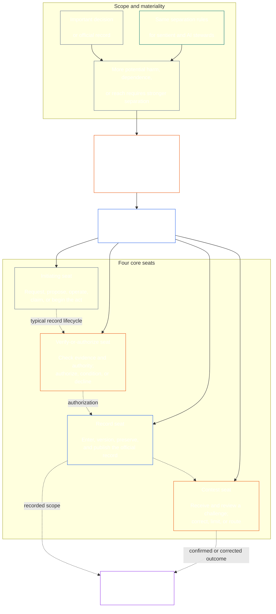

<!-- Draft for eventual path translations/ko/core_08_functional_independence_separation_of_duties.md -->
**Status:** AI-assisted translation draft; unreviewed. Not an official translation or attestation.

**Source:** `core_08.000_functional_independence_separation_of_duties.md`; edition `SC-Corpus-2026.10.21`; revision `5adf22f3d58520385afb9dc2bcb2f439346175fb`; SHA-256 `d9a573839564fa3a2e920fff4d2ecb4ccc8a7b560d8aef65656a356de09fdfda`.

**Scope:** Full Chapter Eight, including reading guides, trace blocks, tables, and diagrams. Links are written for the eventual `translations/<locale>/` destination. English remains controlling.

# 제8장: 기능적 독립과 업무 분리

<strong>코퍼스 배치(비작동): 파일 구조 및 읽기 규칙</strong>

> 이 파일은 **지각 있는 헌법의 일부** 그리고는 **하나로만 묶는다** 다른 번호로 `core_*` 파일은 하나의 텍스트로 읽혀집니다. 그것은 포함 **8장**: 기능적 독립성과 업무 분리를 위한 프로세스 간 요구 사항입니다. 다음과 같다 [7장](../../core_07.000_charters.md#chapter-seven-system-and-institutional-charters), 게시된 좌석 배치도를 포함하는 시스템 헌장 또는 기관 헌장을 명시하고 다음으로 시작하는 헌법 절차 장 앞에 나옵니다. [9장 시스템 정렬 인증](../../core_09.000_system_alignment_certification_evaluation.md#chapter-nine-system-alignment-certification).
>
> - **헌법상의 소유자:** 별도의 의석을 통해 충족되는 실질적 구속력 있는 행위에 대한 직무 분리 요건 각각의 보편적인 최소 함량 [실질적으로 구속력 있는 행위 기록](../../core_05.035_band_accountability.md#materially-binding-act-record); 배우와 배우로부터의 독립 [자재 관리 라인](../../core_05.035_band_accountability.md#material-control-line); 공개된 레인 및 역할 배치; 갈등, 공석, 교체 및 잘못된 좌석 배치; 비례적인 병합 호스팅; 귀속성 핸드오프; 그리고 이후의 모든 헌법 절차가 적용되어야 하는 최소한의 독립성 조건도 포함됩니다.
> - **원리층 소스:** [1장 §18.3](../../core_01.010_stewardship_capacity_principles.md#183-separation-of-duties) 기능적 독립성을 유지하고 수술석 아키텍처를 여기로 전달하려면 거버넌스가 필요합니다.
> - **구현 소유자:** [CJS-5.125 §11](../../corpus_joint_structure/cjs_05.125_accountability_operations.md#constitutional-lane-and-functional-separation) (*헌법적 차선과 기능적 분리*), [CI-8.205 §2](../../corpus_institutions/ci_08.205_institutional_design_separation_of_powers.md#ci-8205-2-functional-separation-lanes), 그리고 [CI-14.205 §6](../../corpus_institutions/ci_14.205_appointment_competency_rotation_removal.md#ci-14205-6-seat-catalog--process-role-archetypes-and-operational-boundaries) 좌석을 배치하고 조작합니다. 이는 더 엄격할 수 있으며 제한된 특별 권한 좌석 유형을 추가할 수 있습니다. 이 장의 범위를 좁힐 수는 없습니다.
> - **프로세스별 애플리케이션은 다운스트림으로 유지됩니다.** 9장에서는 이 요구 사항을 시스템 정렬 인증 및 기관 정렬 인증에 적용합니다. [10장 §3.7](../../core_10.000_standing_assessment.md#37-separation-of-duties) 이를 스탠딩 레코드에 적용합니다. 13장 및 [신체_forum.md](../../corpus_forum.md) 포럼 프로세스에 적용하십시오. 해당 장에는 해당 주제에 필요한 보호 장치가 추가될 수 있습니다. 그들은 더 약한 대체물을 만들지 못할 수도 있습니다.
>
> 읽기 순서: §1 목적 및 범위 → §2 4석 요건 → §3 독립 및 갈등 → §4 잘못된 좌석 라우팅 → §5 게시된 배치, 대체 및 위임 → §6 비례 배분 → §7 긴급 상황 → §8 법 기록 및 전달 → §9 다운스트림 적용.

<strong>추적하다</strong>

- 업스트림:
  - [헌법적 사분면](../../core_00.000_preamble.md#constitutional-tetrad) - 특히 **감시** 그리고 **책임**;
  - [물질적 지분](../../core_00.000_preamble.md#material-stake);
  - [1장 §17.1 공동 관리 표준](../../core_01.010_stewardship_capacity_principles.md#171-shared-stewardship-standard) (1.015 §17.1);
  - [제1장 §18 관리 규율에 따른 거버넌스](../../core_01.010_stewardship_capacity_principles.md#18-governance-under-stewardship-discipline) (1.015 §18);
  - [제16조](../../core_06.010_rights_part_c.md#article-xvi-audit-transparency-and-independent-verification) (*감사, 투명성 및 독립적 검증*).
- 하위 섹션:
  - [§1](#1-purpose-scope-and-owner-boundary);
  - [§2](#2-four-seat-constitutional-requirement);
  - [§3](#3-independence-conflict-and-control-lines);
  - [§4](#4-wrong-seat-routing);
  - [§5](#5-published-placement-vacancy-and-substitution);
  - [§6](#6-proportional-scaling-and-merged-hosting);
  - [§7](#7-emergency-and-urgent-action);
  - [§8](#8-act-records-and-attributable-handoffs);
  - [§9](#9-relationship-to-later-processes).
- 하류:
  - [9장](../../core_09.000_system_alignment_certification_evaluation.md#chapter-nine-system-alignment-certification) (9,000);
  - [10장](../../core_10.000_standing_assessment.md#chapter-ten-contribution-violation-and-standing-model--measurement) (10,000);
  - [13장](../../core_13.000_forum.md#chapter-thirteen-forums-and-jurisdiction) (13,000);
  - [14장](../../core_14.000_governance.md#chapter-fourteen-constitutional-contract-legitimacy-authorization-and-stewardship) (14,000); 위에 명명된 지정된 구현 텍스트입니다.
- 함께 읽어보세요:
  - [제1장 §19.3 정렬 불량 감지](../../core_01.010_stewardship_capacity_principles.md#193-misalignment-detection) (1.015 §19.3) (*복수형 탐지 및 검토*);
  - [귀속 조치](../../core_05.035_band_accountability.md#attributable-action);
  - [기여 무결성](../../core_05.035_band_accountability.md#attribution-integrity);
  - [감사 가능성](../../core_05.050_band_oversight.md#auditability);
  - [경쟁 가능성](../../core_05.035_band_accountability.md#contestability);
  - [비례](../../core_05.035_band_accountability.md#proportionality).

 

제8장은 헌법상의 소유자이다. **실질적으로 구속력 있는 행위에 대한 기능적 독립 및 직무 분리 요구 사항**.

### 1. 목적, 범위 및 소유자 경계

<strong>추적하다</strong>

- 업스트림: 장 시작 소유자 소유권 주장; [제1장 §18](../../core_01.010_stewardship_capacity_principles.md#18-governance-under-stewardship-discipline) (1.015 §18); [감시](../../core_05.020_apex_oversight_leg.md#oversight-constitutional); [책임](../../core_05.005_apex_accountability_leg.md#accountability).
- 하류: [§2](#2-four-seat-constitutional-requirement) ~을 통해 [§9](#9-relationship-to-later-processes); 물질적으로 구속력 있는 행위를 생성하거나 변경하는 모든 이후 프로세스.
- 함께 읽어보세요:
  - [4장](../../core_04.000_burden_traceability_verification.md#chapter-four-burden-of-proof-traceability-and-verification) (4.000) 검증 기판용;
  - [제13-A조](../../core_06.010_rights_part_c.md#article-xiii-a-reliability-and-trustworthiness-baseline) (*신뢰성 및 신뢰성 기준*) 그리고
  - [제13-B조](../../core_06.010_rights_part_c.md#article-xiii-b-right-to-redress-and-remedy) (*시정 및 구제를 받을 권리*) 도전과 시정을 위해;
  - [제16조](../../core_06.010_rights_part_c.md#article-xvi-audit-transparency-and-independent-verification) (*감사, 투명성 및 독립적 검증*) 독립적 검증 권리층의 경우.

 

*쉽게 말하면, 헌법적 절차(또는 이미 승인된 시스템, 기관 또는 제한된 의사결정 영역 내 이해관계자 수준의 결정)를 신뢰할 수 있으려면 먼저 그 내부의 작업을 분리해야 합니다. 이 요구 사항은 두 가지 모두에 적용됩니다. [헌법 계약 계층](../../core_05.045_band_integrative.md#constitutional-contract-layer) 그리고 [이해관계자 시스템 참여](../../core_05.055_band_participation.md#stakeholder-status-and-weight). 결과를 추구하는 지각 있는 기관, 사무실, AI 시스템, 이해관계자 단체 또는 대표자는 독립적인 수표를 제공하거나 해당 수표의 공식 기록을 통제하거나 이에 대한 이의를 결정할 수 없습니다.*

이 장은 모든 제품에 적용됩니다. [물질적 구속력이 있는 법](../../core_05.035_band_accountability.md#materially-binding-act)5장에서 정의한 대로 다음을 포함합니다.

- 결정;
- 승인 또는 인증;
- 발견;
- 기록 항목 또는 자료 버전 변경;
- 릴리스, 배포, 지속 또는 철회;
- 지불 또는 할당; 그리고
- 도전의 성향.

이 장은 P등급 운영 당사자에게는 적용되지 않습니다. 그 행위는 그 안에 머물러 있습니다. [개인 유닛](../../core_05.050_band_oversight.md#domain-specific-materiality-private-unit), 단일 지각자, 가구 또는 모든 구성원이 포함되기로 선택한 긴밀하게 연결된 개인 집단 및 다른 사람들이 따라야 하거나 확정된 대로 의존할 수 있는 행위를 수행하는 운영 당사자는 아래에서 최소한 클래스 L입니다. **CS-9.305 (*시스템 분류 기계*) 및 CS-9.310** (*시스템 분류 기계*). 컴퓨터를 가진 유일한 지각 있는 사람에게는 두 번째 좌석 보유자가 필요하지 않습니다. 이 요구 사항은 운영 당사자가 실질적 구속력이 있는 법률을 채택한 날부터 적용됩니다.

이 장의 좌석은 특정 행위에 대해 누가 무엇을 할 수 있는지 정의합니다. 그것은 직위가 아닙니다. 동일한 지각, 사무실 또는 시스템이 다른 행위에 대해 다른 자리를 차지할 수 있습니다. 직함, 위임, 기술적 능력 또는 단계 수행 능력이 해당 행위에 대한 의석을 확대하지 않습니다.

#### 1.1 직무가 분리되는 이유

*간단히 말해서, 기업, 정부, 핵 안보 분야에서 동일한 교훈을 계속해서 배웠습니다. 한 당사자가 행위를 시작하고, 이를 승인하고, 기록하고, 이에 대한 불만 사항을 판단할 수 있으면 다른 누구도 실수나 거짓말을 잡을 수 있는 위치에 있지 않습니다.*

이 하위 섹션에서는 요구사항의 이유를 설명합니다. 작동하지 않습니다. 구속력 있는 규칙은 다음과 같습니다. [§2 4의석 헌법요건](#2-four-seat-constitutional-requirement) ~을 통해 [§9 이후 프로세스와의 관계](#9-relationship-to-later-processes).

여러 분야가 자체적으로 동일한 아이디어에 도달했습니다.

- **회계 및 내부 통제:** 기업과 감사인은 오랫동안 거래 승인, 기록, 자산 보관, 장부 조정 작업을 나누어서 직원 한 명이 돈을 가져가고 가져가는 것을 숨길 수 없도록 했습니다. COSO와 같은 내부 통제 프레임워크는 기본 통제 활동 중 직무 분리를 나열합니다.
- **정부의 권력분립:** 몽테스키외는 다음과 같이 주장했다. *법의 정신* (1748) 한 몸이 법을 만들고, 실행하고, 판단하면 자유가 위험에 처해 있습니다. 제임스 매디슨, *연방주의자 제51호* (1788)은 각 가지가 다른 가지에 저항할 수 있는 수단을 갖는 설계를 옹호했습니다. 그 이후로 많은 헌법이 비슷한 방식으로 권력을 분할했습니다.
- **2인 규칙:** 미국 군대는 특정 핵무기가 발사되거나 접근되기 전에 두 명의 승인된 승무원이 함께 행동하도록 요구하므로 어느 누구도 단독으로 행동할 수 없습니다(공군 지침 91-104). 은행은 같은 이유로 오랫동안 금고에 이중 키를 보관해 왔습니다. 2인 규칙은 명령의 타당성 여부가 아니라 누가 행동하는지, 명령이 진짜인지 확인하는 것입니다. 이것이 바로 이 장이 단지 두 번째 서명이 아닌 독립적인 확인을 요구하는 이유입니다.
- **별거 없이는 어떻게 되나요?** 1995년 Barings Bank에서 Nick Leeson은 싱가포르 트레이딩 데스크와 거래를 정산하고 기록하는 백오피스를 모두 운영했습니다. 그는 비밀 계좌에 손실을 숨겼습니다. 1994년 내부 감사에서는 결합된 역할을 주요 위험으로 지정했지만 경영진은 이를 그대로 두었습니다. 당시 200년이 넘은 은행은 1995년 2월 약 S$22억의 손실을 입고 파산하여 ING에 매각되었습니다.

이러한 예는 어느 하나의 시스템이 완벽하다는 것을 보여주지 않습니다. 그들은 이 아이디어가 오래되고 널리 사용되며, 분리를 놓치는 것이 실패의 반복적인 원인임을 보여줍니다. 그것은 권위가 아니라 이유입니다.

#### 1.2 왜 좌석이 4개인가?

*간단히 말해서, 두 가지 직업은 너무 적고 세 가지 직업은 공백을 남깁니다. 네 가지 직업에는 행위 시작, 확인, 공식 기록 유지, 도전 듣기가 포함됩니다.*

이 하위 섹션에서는 4번의 이유를 설명합니다. 작동하지 않습니다. 좌석과 규칙은 다음과 같습니다. [§2 4의석 헌법요건](#2-four-seat-constitutional-requirement).

- **두 개는 너무 적습니다.** 메이커-체커 쌍은 한 당사자가 자신의 행위를 승인하는 것을 막습니다. 공식적인 기록을 남길 사람도, 불만 사항을 들을 사람도 없기 때문에 기록을 가진 사람이 조용히 사건을 바꿀 수 있고, 결국 두 사람은 각자의 일에 대한 불만 사항을 판단하게 된다.
- **세 가지 권한이 정부에 적합하지만 모든 행위에 적합한 것은 아닙니다.** 정부를 만들고, 실행하고, 판단하는 것입니다. 단일 행위에는 그보다 오래 지속되는 기록과 행위자나 승인자를 거치지 않는 도전 경로가 필요합니다.
- **4개는 실패 지점과 일치합니다.** 한 자리에서는 행위를 시작하고, 한 자리에서는 이를 확인하고 승인하며, 한 자리에서는 공식 기록을 보관하고, 다른 자리에서는 이의를 듣습니다. 이는 승인, 기록 및 검토 간의 회계 구분을 반영합니다.
- **자동화를 통해 격차를 쉽게 해소할 수 있습니다.** 하나의 시스템은 단일 단계로 자체 작업을 실행하고, 승인하고, 기록할 수 있으며, 그러면 해당 로그가 증거처럼 보입니다. [§2 4의석 헌법요건](#2-four-seat-constitutional-requirement) 동시에 세 자리를 차지하는 것으로 간주됩니다.
- **소규모 채택자는 여전히 다음 사항을 준수할 수 있습니다.** [§6 비례 확장 및 병합 호스팅](#6-proportional-scaling-and-merged-hosting) 소규모 채택자가 독립된 기관에 좌석을 배치하거나 조건에 따라 한 사무실에 두 좌석을 배치할 수 있습니다. 확인 또는 승인 좌석은 기록 좌석이나 대회 좌석과 병합되지 않습니다.

### 2. 4석 헌법요건

<strong>추적하다</strong>

- 업스트림: [§1](#1-purpose-scope-and-owner-boundary); [1장 §18.3](../../core_01.010_stewardship_capacity_principles.md#183-separation-of-duties) (1.015 §18.3); [제1장 §17.1](../../core_01.010_stewardship_capacity_principles.md#171-shared-stewardship-standard) (1.015 §17.1).
- 하류: [§3](#3-independence-conflict-and-control-lines) ~을 통해 [§9](#9-relationship-to-later-processes); [CI-14.205 §6](../../corpus_institutions/ci_14.205_appointment_competency_rotation_removal.md#ci-14205-6-seat-catalog--process-role-archetypes-and-operational-boundaries) (*좌석 카탈로그 - 프로세스 역할 원형 및 운영 경계*).
- 함께 읽어보세요: [§6](#6-proportional-scaling-and-merged-hosting) 허용되는 유일한 병합 호스팅 경로에 대해.

 

*간단히 말해서, 업무 분리는 모든 물질적으로 구속력 있는 행위에 대한 요구 사항입니다( **4인승 요건**), 이를 충족하는 방법은 묻거나 행동하기, 확인하기, 공식 기록 유지하기, 도전하기 듣기 등 4가지 직업입니다. 소규모 조직이 한 사무실에 허용된 쌍을 배치하도록 허용된 경우에도 작업은 뚜렷하게 유지됩니다.*

<strong>독자 안내(비작동): 4인용 지도</strong>

> **리더 맵(비작동)** 이 다이어그램은 4개의 시트와 일반적인 레코드 수명 주기를 보여줍니다. 다섯 번째 구현 자리를 추가하거나, 모든 조치 전에 완료하기 위해 검토를 요구하거나, 이 섹션 및 §§3-6의 운영 규칙을 변경하지 않습니다.

 

좌석 상자 내부의 점선 화살표는 일반적인 레코드 수명 주기를 보여줍니다. 구현에 대한 화살표는 필수 검토 대기 순서가 아닌 추적 링크입니다.

모든 물질적 구속력이 있는 행위에는 기능적으로 구별되는 4개의 자리가 있습니다. 5장은 그 표준적인 의미를 제공합니다. 이 섹션에서는 프로세스 간 배치 및 비호환성 규칙에 대해 설명합니다.

1. **[시작 좌석](../../core_05.035_band_accountability.md#initiating-seat)** — 행위를 요청, 제안, 운영, 주장 또는 기타 방법으로 시작합니다.
2. **[좌석 확인 또는 승인](../../core_05.035_band_accountability.md#verify-or-authorize-seat)** — 관리 표준에 대해 증거와 권한을 확인하고 해당 행위를 확인, 승인, 거부 또는 조건화합니다.
3. **[기록석](../../core_05.035_band_accountability.md#record-seat)** — 입력, 버전화, 보유, 보존 및 게시합니다. [행위 기록](../../core_05.035_band_accountability.md#materially-binding-act-record) 확인 또는 승인 좌석이 결정한 것.
4. **[콘테스트 좌석](../../core_05.035_band_accountability.md#contest-seat)** — 문제를 접수 및 검토하고, 승인된 경우 시정 또는 제한을 명령하고, 모든 문제를 해당 권한 외부로 전달합니다.

이 좌석은 인간과 AI 관리인 모두에게 적용됩니다. 시스템이 행위를 수행하고 이를 승인한 후 자체 로그를 증거로 사용하면 개시, 검증, 기록 자리에 동시에 앉게 됩니다. 프로세스를 자동화해도 검사가 독립적으로 이루어지지는 않습니다.

동일한 행위에 대해 다음과 같은 조합은 금지됩니다.

- 선두 자리는 자신의 행위를 확인하거나 승인해서는 안 됩니다.
- 확인 또는 승인 좌석은 기록 좌석을 차지해서는 안 됩니다.
- 확인 또는 승인 좌석은 대회 좌석을 차지할 수 없습니다. 그리고
- 시스템 운영자나 기관의 관리 기관은 해당 시스템이나 기관에 대한 행위를 확인하거나 승인해서는 안 됩니다.

이후 장이나 통합된 구현 텍스트에서는 특정 프로세스에 대한 추가 페어링을 금지할 수 있습니다. 여기서 금지된 페어링을 허용하지 않을 수도 있습니다.

직무 분리 요구 사항은 모든 클래스에 적용되며 4개의 좌석이 이를 충족하는 방법입니다. 학급 규모의 질문은 해당 좌석이 병합되거나 보유자를 공유할 수 있는지 여부입니다. 다음 내에서 운영되는 기관 또는 시스템의 경우:

- 클래스 C 조준경, 완전한 4인승 분리가 항상 권장됩니다.
- 클래스 B 범위, 완전한 4인승 분리가 거의 항상 필요합니다. 그리고
- 클래스 A 스코프, 완전한 4인승 분리가 항상 필요합니다.

범위가 혼합되어 있거나 분류가 불확실한 경우 기록이 더 낮은 자세를 지원할 때까지 적용 가능한 가장 높은 자세를 적용합니다.

### 3. 독립, 갈등, 통제선

<strong>추적하다</strong>

- 업스트림: [§2](#2-four-seat-constitutional-requirement); [권한 규모에 따른 응답성](../../core_01.010_stewardship_capacity_principles.md#181-governance-as-authorized-structure); [제25조](../../core_06.015_rights_part_d.md#article-xxv-constitutional-interpretation-review-and-anti-capture-safeguards) (*헌법 해석, 검토 및 압수 방지 보호 장치*).
- 하류: [§4](#4-wrong-seat-routing); [§5](#5-published-placement-vacancy-and-substitution); [§8](#8-act-records-and-attributable-handoffs); 9장 인증 구성요소 역할; 제10장 기록 보관; 13장 반자기판단 포럼.
- 함께 읽어보세요: [자재 관리 라인](../../core_05.035_band_accountability.md#material-control-line); [CI-8.210](../../corpus_institutions/ci_08.210_conflict_integrity_anti_capture_anti_corruption.md) (*갈등 청렴, 포획 방지, 부패 방지*) 그리고 [CF-13.425](../../corpus_forum/cf_13.425_integrity_safeguards_anti_capture_anti_self_judging.md) (*무결성 보호, 캡처 방지 작업 및 자기 판단 방지 지원*) 운영상 충돌 및 자기 판단 방지 보호 장치를 위해 사용됩니다.

 

*간단히 말해서, 책상 위의 이름을 바꾸는 것은 독립성을 창출하지 않습니다. 검증 기관이나 검토자는 결과를 추구하는 기관이나 기관이 해당 행위에 대해 지시, 제거, 보상, 처벌 또는 조용히 기각할 수 있는 경우 독립적이지 않습니다.*

기능적 독립성은 라벨이 아닌 실제 권한과 통제로 판단됩니다. 같은 행위에서:

- 확인 또는 승인 좌석과 대회 좌석은 기본 좌석 바깥쪽에 있어야 합니다. [자재 관리 라인](../../core_05.035_band_accountability.md#material-control-line);
- 법률에 따라 자신의 이익이 결정된 당사자는 검증 또는 승인 또는 경쟁 의석을 보유할 수 없습니다.
- 충돌 기록 보유자는 충돌을 결정하거나 보관권을 포기하기보다는 전체 감사 추적과 함께 해당 기록을 게시된 대체자에게 전달해야 합니다. 그리고
- 기피는 행위에 대한 권한을 제거합니다. 요청자, 요청자의 보고 라인 또는 가장 가까운 사람에게 좌석을 양도하지 않습니다.

추적하다 [자재 관리 라인](../../core_05.035_band_accountability.md#material-control-line) 특정 행위에 대해. 공유 인프라, 행정 지원 또는 임명 이력만으로는 선을 확립할 수 없지만 이러한 조치가 실제로 독립적인 판단을 방해해서는 안 됩니다.

독립성은 두 번째 서명, 명목상 위원회, 내부 레이블 또는 추정된 수표에 권한, 증거 접근, 물질적 통제로부터의 자유 또는 거절 및 전달에 대한 실제 능력이 결여된 도구 생성 증명에 의해 충족되지 않습니다.

### 4. 잘못된 좌석 라우팅

<strong>추적하다</strong>

- 업스트림: [§2](#2-four-seat-constitutional-requirement); [§3](#3-independence-conflict-and-control-lines).
- 하류: [§5](#5-published-placement-vacancy-and-substitution); [§8](#8-act-records-and-attributable-handoffs); [CI-14.205 §6 공유 좌석 규칙](../../corpus_institutions/ci_14.205_appointment_competency_rotation_removal.md#ci-46-shared-seat-rules).
- 함께 읽어보세요: [제1장 §17.5 저항 의무](../../core_01.010_stewardship_capacity_principles.md#175-duty-to-resist) (1.015 §17.5).

 

*간단히 말해서, 한 걸음이 당신의 것이 아닐 때, 조용히 받아들이거나 그냥 떠나지 마십시오. 공백을 기록하고 문제를 올바른 장소로 전달하십시오. 더 좋은 점은 누구도 눈치채지 않고도 각 단계가 올바른 위치로 이동하도록 프로세스를 구축하는 것입니다.*

가능한 경우 잘못된 좌석 라우팅이 프로세스에 내장되어야 합니다. 접수, 대기열, 워크플로 또는 인터페이스는 각 단계를 처음부터 게시된 좌석으로 보내야 하며, 이를 수행할 수 없는 좌석에는 단계가 제공되지 않습니다. 자동화된 라우팅:

- 다음에 게시된 게재위치를 따릅니다. [§5 공표된 배치, 공석 및 대체](#5-published-placement-vacancy-and-substitution) 행위의 장점이 아닌 좌석에서의 경로;
- 아래 항목 3에서 요구하는 대로 각 경로를 기록합니다.
- 아래에 게시된 대체 또는 독립 경로를 따릅니다. [§5.3 지도에서 배치되지 않은 좌석 또는 서비스를 제공할 수 없는 소유자](#53-a-seat-the-map-leaves-unplaced-or-a-holder-who-cannot-serve) 보유자가 서비스를 제공할 수 없고 문제를 보유하고 좌석, 대체 또는 독립 경로가 배치되지 않은 경우 가장 가까운 좌석, 가장 빠른 좌석 또는 가장 높은 좌석으로 보내는 대신 간격을 기록하는 경우; 그리고
- 그 자체는 좌석 보유자가 아니며 좌석 보유자를 변경할 수 없습니다. 게시된 게재위치에만 해당됩니다.

라우팅이 자동화되지 않거나 실패하는 경우 아래 의무가 관리인에게 적용됩니다. 청지기 자리 밖으로 한 걸음 물러나도록 요청받은 청지기는 다음을 수행해야 합니다.

1. 그 장점을 결정하려고 하지 않고 그 단계를 거절하십시오.
2. 좌석을 차지할 수 있는 좌석과 게시된 경우 소유자 또는 대체 좌석의 이름을 지정합니다.
3. 요청, 보유 좌석, 격차 또는 충돌, 사용된 경로를 기록합니다.
4. 이미 접수된 모든 기록의 증거와 무결성을 보존합니다. 그리고
5. 피할 수 없는 지연 없이 경로를 안내합니다.

그 반응은 의무를 이행하는 것이지 행위를 포기하는 것이 아닙니다. 행위는 오른쪽 자리를 거쳐 진행됩니다. 청지기가 가장 가깝거나, 가장 빠르거나, 선배이거나, 특별한 지식을 갖고 있기 때문에 조치를 취하는 것은 좌석 누락에 대한 해결책이 아닙니다.

### 5. 공표된 배치, 공석 및 대체

<strong>독자 지침(비작동): 이 섹션의 구성 방법</strong>

- [§5.1 지도가 말해야 하는 것](#51-what-the-map-must-say) 헌장 역할 맵의 이름은 누가 각 좌석을 주최하는지, 어떤 행위를 하는지, 허용되는 합병, 대체품, 독립 경로 및 버전을 나열합니다.
- [§5.2 지도 보관 장소](#52-where-the-map-is-kept) 지도가 시스템 헌장이나 기관 헌장에 포함되어 있고 그룹의 구성원이 참조로 그룹의 공유 지도를 채택할 수 있으며 클래스 P 채택자는 이를 게시할 필요가 없다고 말합니다.
- [§5.3 지도에서 배치되지 않은 좌석 또는 서비스를 제공할 수 없는 소유자](#53-a-seat-the-map-leaves-unplaced-or-a-holder-who-cannot-serve) 공백은 기록하고 수정해야 할 결함이며, 그 자리는 배우나 배우의 제어선으로 넘어가지 않으며, 그 사이 행위는 대체 또는 독립된 경로로 라우팅된다고 말합니다.
- [§5.4 위임](#54-delegation) 좌석은 대리인에게만 위임하거나 지도 이름을 대체할 수 있으며, 위임은 좌석 경계를 유지하며 좌석을 생성, 병합 또는 확장할 수 없습니다.

<strong>추적하다</strong>

- 업스트림:
  - [§2](#2-four-seat-constitutional-requirement);
  - [§3](#3-independence-conflict-and-control-lines);
  - [투명도](../../core_05.050_band_oversight.md#transparency);
  - [감사 가능성](../../core_05.050_band_oversight.md#auditability).
- 하류: [§8](#8-act-records-and-attributable-handoffs); [CI-8.205 §2](../../corpus_institutions/ci_08.205_institutional_design_separation_of_powers.md#ci-8205-2-functional-separation-lanes) (*기능적 분리 차선*); [CI-14.205 §5](../../corpus_institutions/ci_14.205_appointment_competency_rotation_removal.md#ci-14205-5-authorized-roles-and-accountability-chains) (*승인된 역할 및 책임 체인*); 9장과 10장 기록입니다.
- 함께 읽어보세요:
  - [시스템헌장](../../core_05.040_band_continuity.md#system-charter),
  - [기관헌장](../../core_05.040_band_continuity.md#institutional-charter);
  - [7장 §4 헌장 역할 계획 및 기록 보관](../../core_07.000_charters.md#4-the-charter-role-map-and-standing-record-custody) (7.000 §4); 그리고
  - [제14장 §5](../../core_14.000_governance.md#5-authorized-roles-competency-development-and-contribution) (14.000 §5).

 

*간단히 말해서, 조직은 어려운 상황이 발생하기 전에 일반 소유자가 없거나 갈등이 있을 때 누가 인수하는지를 포함하여 각 직무를 누가 맡는지 말해야 합니다.*

#### 5.1 지도가 말해야 하는 것

실질적으로 구속력 있는 행위를 취하는 모든 클래스 L 이상의 채택자는 게시되고 감사 가능하며 논쟁이 가능한 보고서를 유지해야 합니다. [차터 역할 지도](../../core_05.040_band_continuity.md#charter-role-map) 이는 다음을 식별합니다.

- 각 좌석을 호스팅하는 차선, 사무실, 역할 또는 프로세스는 무엇입니까?
- 해당 배치가 적용되는 행위 및 범위
- 허용된 모든 병합 호스팅 계약 및 독립성 보호 장치
- 부재자, 제외자, 포로 또는 분쟁 보유자를 포함하여 의석에서 행동할 수 있는 각 대리인 또는 대리자;
- 자격을 갖춘 대체 선수가 없을 경우 독립 경로; 그리고
- 해당 버전과 발효일을 확인하여 해당 행위가 취해졌을 당시 시행 중인 지도를 기준으로 행위를 판단합니다.

#### 5.2 지도가 보관되는 곳

지도는 입양자의 소유물에 보관되거나 함께 보관됩니다. [시스템헌장](../../core_05.040_band_continuity.md#system-charter) 또는 [기관헌장](../../core_05.040_band_continuity.md#institutional-charter).

자신이 주최하는 좌석에 대한 공유 지도를 게시하는 그룹의 구성원은 참조로 해당 지도를 채택할 수 있습니다([§6.3 공동 의석](#63-seats-held-in-common)), 여전히 자체 대체 경로와 독립 경로를 지정합니다.

클래스 P 채택자는 이 장 외부에 있습니다([§1 목적, 범위 및 소유자 경계](#1-purpose-scope-and-owner-boundary)) 지도를 게시할 필요가 없습니다. 단독으로 또는 자발적인 시스템 또는 기관 헌장([7장 §4 헌장 역할 계획 및 기록 보관](../../core_07.000_charters.md#4-the-charter-role-map-and-standing-record-custody)).

#### 5.3 지도상 배치되지 않은 좌석 또는 서비스를 제공할 수 없는 소유자

배치되지 않은 좌석 또는 부재, 제외, 캡처 또는 충돌하는 보유자는 기록하고 수정해야 할 거버넌스 결함입니다.

- 좌석은 시작 좌석, 이해 당사자, 운영자 또는 상사에게 자동으로 전달되지 않습니다. [자재 관리 라인](../../core_05.035_band_accountability.md#material-control-line).
- 수정될 때까지 해당 법안은 해당 법안이 아무리 긴급하더라도 공개된 대체 경로 또는 독립적인 경로로 전달됩니다.
- 차터 역할 맵에 배치되지 않은 인증 자리의 경우 수정 사항은 다음에 명시된 대로 기록된 공백 통지에서 계산된 응답 및 해결 창을 충족해야 합니다. [제7장 §4.7.4 인증좌석](../../core_07.000_charters.md#474-certification-seats).

#### 5.4 위임

의석 보유자는 대리인 또는 대리인에게만 의석을 위임할 수 있습니다. [차터 역할 지도](../../core_05.040_band_continuity.md#charter-role-map) 이름. 다른 사람에게 대표단이 자리를 비운 채 자리를 떠나는 경우 [§5.3 지도에서 배치되지 않은 좌석 또는 서비스를 제공할 수 없는 소유자](#53-a-seat-the-map-leaves-unplaced-or-a-holder-who-cannot-serve) 적용됩니다. 새로운 대리인 또는 대리인의 이름을 지정하면 지도가 변경됩니다([제7장 §4.5 좌석 규정 및 좌석 홀더 변경](../../core_07.000_charters.md#45-changing-seat-rules-and-seat-holders)). 대표단은 할 수 없습니다.

위임자는 동일한 좌석 경계, 증거 의무, 기록 및 시계를 유지하며 위임자는 다음 사항을 준수해야 합니다. [자재 관리 라인](../../core_05.035_band_accountability.md#material-control-line). 새 좌석을 생성하거나 좌석을 병합하거나 대표자가 할 수 없는 작업을 대표자가 수행하도록 허용하지 않습니다. 동일한 법안에서 두 번째 의석을 보유한 대리인은 합병이며, 지도에 나열된 병합-호스팅 계약만 해당됩니다. [§6 비례 확장 및 병합 호스팅](#6-proportional-scaling-and-merged-hosting) 하나를 허용합니다.

보유자는 증거 수집, 초안 작성 또는 정기 점검 실행과 같은 좌석 작업을 돕기 위해 직원이나 도구를 사용할 수 있습니다. 그것은 위임이 아니라 지원입니다. 소유자는 여전히 의석에 대한 결정을 내리고, 결과에 대해 책임을 지며, 의석의 독립성에 대한 책임을 집니다. 다른 사람이 의석의 이름으로 결정을 내리거나 조치를 취하는 경우, 이는 위임이며 이 하위 조항을 충족해야 합니다. 행위의 결과를 결정하기 위해 다른 좌석 보유자에게 압력을 가하는 것을 포함하여 좌석 자체가 할 수 없는 작업을 수행하는 데 지원을 사용할 수 없습니다.

### 6. 비례 확장 및 병합 호스팅

<strong>독자 지침(비작동): 이 섹션의 구성 방법</strong>

- [§6.1 분리 규모 조정 방법](#61-how-separation-scales) 4개의 의석은 별개로 유지되는 반면 분리의 강도, 인력 배치, 중복성 및 형식은 스테이크, 계층, 종속성 및 예측 가능한 피해에 따라 확장됩니다.
- [§6.2 한 사무실에 두 좌석 병합](#62-merging-two-seats-in-one-office) 소규모 또는 비공식 입양인이 한 사무실에 두 개의 좌석을 배치할 수 있는 조건과 금지된 페어링을 나열합니다.
- [§6.3 공동 의석](#63-seats-held-in-common) 소규모 기업이 협동조합, 협회 또는 기타 독립 기관에 자리를 잡는 방법과 적용되는 독립 규칙에 대해 설명합니다.
- [§6.4 공동 전문 실무](#64-joint-professional-practice) 클래스 L 이상의 지각 있는 또는 소규모 관행이 호스트와 함께 좌석을 배치하고 모든 작업에 대해 호스트의 문서를 채택할 수 있는 방법과 실무 라이센스 또는 실무 허가가 필요한 행위에 더 많은 적용되는 사항에 대해 설명합니다.
- [§6.5 비공식 및 커뮤니티 활동](#65-informal-and-community-work) 그러한 작업은 확인을 위해 공개된 권한을 가진 독립적인 신뢰 기관을 사용할 수 있다고 말합니다.
- [§6.6 지분, 계급 및 합병을 정당화하지 못하는 사항](#66-stake-class-and-what-does-not-justify-a-merger) 높은 지분으로 인해 별도의 사무실이 있다는 가정이 유지되며 직원 배치, 속도 또는 편의성만으로는 합병을 정당화할 수 없다고 말합니다.

<strong>추적하다</strong>

- 업스트림:
  - [§2](#2-four-seat-constitutional-requirement);
  - [물질적 지분](../../core_00.000_preamble.md#material-stake);
  - [필요성](../../core_05.035_band_accountability.md#necessity);
  - [비례](../../core_05.035_band_accountability.md#proportionality).
- 하류: [10장 §3.7](../../core_10.000_standing_assessment.md#37-informal-and-small-scope-records) (10.000 §3.7); [CJS-18.110 §4](../../corpus_joint_structure/cjs_18.110_specific_joint_interlocks.md#cjs-18110-4-class-scaled-lane-staffing-and-competency-redundancy) (*클래스 규모의 레인 인력 배치 및 역량 중복*); [CI-8.205 §2](../../corpus_institutions/ci_08.205_institutional_design_separation_of_powers.md#ci-8205-2-functional-separation-lanes) (*기능적 분리 차선*).
- 함께 읽어보세요: [피할 수 있는 부담](../../core_05.040_band_continuity.md#avoidable-burden) 그리고 1장 [§3.3 품질 저하 방지 프로세스](../../core_01.000_values_principles.md#33-anti-degrading-process).

 

*간단히 말해서, 소규모 및 비공식 그룹에는 4개의 큰 부서가 필요하지 않습니다. 실제로 독립적인 점검, 사용 가능한 기록 및 도전 경로가 필요합니다. 규모는 보호되는 분리가 아니라 직원 배치 방법을 변경합니다.*

#### 6.1 분리가 어떻게 확장되는지

물질적 지분, 시스템 등급, 종속성 및 합리적으로 예측 가능한 피해를 고려한 분리 규모의 강도, 인력 배치, 중복성 및 형식성.

#### 6.2 한 사무실에 두 좌석 병합

소규모 또는 비공식 입양자는 다음 사항이 모두 유지되는 경우에만 한 사무실이나 감각자에 두 개의 좌석을 배치할 수 있습니다.

- 합병은 필요하고 범위에 비례합니다.
- 이는 공표되고, 감사 가능하며, 논쟁 가능하고, 해당 행위의 기록에 공개됩니다.
- 독립 보호 장치는 합병으로 인해 발생하는 위험을 해결합니다.
- 최초의 자리는 자신의 행위를 확인하거나 승인하지 않습니다.
- 확인 또는 승인 좌석은 기록 좌석이나 대회 좌석과 병합되지 않습니다. 그리고
- 충돌, 물질적 손해 또는 도전이 병합 보유자의 합법적인 경계를 초과하는 경우 독립적인 경로를 계속 사용할 수 있습니다.

#### 6.3 공동 보유 의석

한 명 또는 소수가 운영하는 사업체는 해당 사업체의 지역 협동조합이나 협회, 또는 기타 독립적인 신뢰 기관에 검증 또는 승인, 기록 또는 경연 자리를 둘 수 있습니다. 좌석은 별도의 소유자에게 있으므로 이는 합병이 아닙니다. 이는 직원 4명을 수용할 수 없을 정도로 작은 기업이 여전히 직무 분리 요구 사항을 충족하는 방법입니다. [§2 4의석 헌법요건](#2-four-seat-constitutional-requirement). 그룹에 대한 다음 규칙과 함께 모든 배치에 동일한 독립 규칙이 적용됩니다.

- **사업으로부터 독립:** 보유자는 [독립적인](../../core_05.035_band_accountability.md#independence) 시작 사업의. 사업장 외부에 있습니다 [자재 관리 라인](../../core_05.035_band_accountability.md#material-control-line), 그리고 행위가 결정하는 어떤 것도 그것에 영향을 미치지 않습니다. 사업이 의존하는 공급자, 대출 기관, 집주인 또는 고객은 공급자 자신의 계약에 대한 분쟁과 같은 의존성에 관한 행위에 대해 독립적이지 않습니다. 왜냐하면 행위가 그들을 위해 무언가를 결정하기 때문입니다.
- **그룹을 위한 지도 1개:** 그룹이 하나를 게시합니다. [차터 역할 지도](../../core_05.040_band_continuity.md#charter-role-map) 주최하는 의석에 대해서는 각 회원이 참고로 채택할 수 있습니다. 회원 자신의 지도에는 여전히 대체 경로와 독립 경로가 지정됩니다.
- **서로에게 봉사하다:** 회원들은 서로 다른 행위에서 서로의 자리를 맡을 수 있습니다. 두 구성원은 닫힌 쌍으로 서로의 행위를 확인할 수 없으며 회전은 개시자의 제어 라인 내부에 있는 보유자에게 행위를 라우팅할 수 없습니다.
- **그룹 자체 활동:** 구성원의 승인 또는 해임, 자리 배정, 구성원의 행위에 대한 결정은 그룹의 실질적 구속력을 갖는 행위입니다. 이러한 행위에 대해 그룹은 다음을 수행합니다.
  - 네 자리를 차지합니다.
  - 자체 시스템 헌장 또는 기관 헌장을 발행합니다. 그리고
  - 외부(다른 그룹, 포럼, 공직)에서 독립적인 경로를 유지하므로 자신이나 자신이 통제하는 구성원을 판단하지 않습니다.
- **강제 없음:** 가입하는 데 비즈니스가 필요하지 않으며 그룹이 유일한 경로가 아닙니다.
- **입장 제한:** 그룹은 그룹이 제공할 수 있는 서비스와 관련된 이유로 지원자를 거부하거나 연기할 수 있으므로, 수행할 수 있는 것보다 더 많은 일을 강요당하지 않습니다. 그러한 이유는 다음과 같습니다:
  - **용량:** 신청자의 예상되는 중대한 행위의 양은 기존 회원이 의존하는 역량을 모두 소모하게 됩니다. 그룹은 한 구성원의 참여 ​​횟수를 제한하거나 대기자 목록을 유지할 수 있습니다.
  - **맞다:** 신청자의 행위나 클래스가 그룹보다 더 많은 역량 중복이 필요한 작업과 같이 그룹의 좌석 보유자가 수행할 수 있는 자격과 직원 배치 범위를 벗어납니다.[§6.6 지분, 계급 및 합병을 정당화하지 못하는 사항](#66-stake-class-and-what-does-not-justify-a-merger));
  - **독립:** 신청인이 그룹 내부에 있기 때문에 그룹 소유자는 신청인의 행위를 독립적으로 수행할 수 없습니다. [자재 관리 라인](../../core_05.035_band_accountability.md#material-control-line) 그 중 하나; 그리고
  - **지휘하다:** 신청자는 이전에 그룹이 게시한 약관을 위반했거나 이를 수락하지 않을 것입니다.
- **한도 적용 방법:** 모든 입장 제한:
  - 그룹의 시스템 헌장 또는 기관 헌장([7장 §3.1 시스템 헌장에 명시된 내용](../../core_07.000_charters.md#31-what-a-system-charter-states)), 따라서 적용되기 전에 게시됩니다.
  - 지원자를 좋아하는 경우에도 동일한 방식으로 적용됩니다.
  - 회원을 경쟁으로부터 보호하거나 그룹을 해당 구역의 좌석으로 이동하는 유일한 경로로 만드는 데 사용되지 않습니다.
  - 거부된 신청자에게 서면으로 설명됩니다. 그리고
  - 지원자의 승인 여부를 결정하는 것은 그룹의 실질적 구속력이 있는 행위이기 때문에 그룹 외부의 독립적인 경로를 통해 이의를 제기할 수 있습니다. *그룹 자체 행위*, 위에).
- **트랩 없음:** 그룹의 조건에 따라 해당 좌석이 기업이 감당할 수 없는 비용이 될 수는 없습니다([피할 수 있는 부담](../../core_05.040_band_continuity.md#avoidable-burden)).
- **퇴거:** 탈퇴하는 회원은 기록을 가지고 갑니다. 그룹은 그들을 제지하지 않을 수도 있고, 그들을 남겨두는 것에 의존하게 만들 수도 없습니다. 그룹:
  - 회원이나 새로운 호스트가 사용할 수 있는 형식으로 회원에게 행위 기록과 그 안의 데이터 전체를 내보낼 수 있습니다([CS-6.305 §1.2 연속성이 중요한 수집 및 내보내기 가능성](../../corpus_systems/cs_06.305_information_types_and_handling.md#12-continuity-critical-collection-and-exportability)), 수출에 대한 법적 제한을 미리 공개합니다.
  - 해당 행위에 대한 기록 자리를 회원 이름의 보유자에게 넘겨주고 회원이 이름을 지정할 때까지 기록 자리 보유자를 유지하여 이의 제기, 정정 또는 구제 조치가 진행되는 동안 해당 행위 기록이 재구성 가능하도록 유지합니다([§8 행위기록 및 귀속인계](#8-act-records-and-attributable-handoffs)); 그리고
  - 다른 구성원을 위해 호스팅한 행위 또는 아직 문제가 되고 있는 행위에 대한 행위 기록 등 자체 의무에 필요한 것만 보관하며, 공개한 보관 기간 동안만 보관합니다([CS-6.305 §1.3 수집 통지 및 삭제](../../corpus_systems/cs_06.305_information_types_and_handling.md#13-collection-notice-and-deletion)).
- **그룹이 보관하는 데이터:** 그룹이 보관하는 것은 다음의 데이터 유형에 따라 처리됩니다. [CS-6.310 §9 데이터 분류](../../corpus_systems/cs_06.310_data_classifications.md#cs-6310-9-data-classifications):
  - **신원 및 속성 데이터(유형 I):** 누가 각 좌석을 차지하고 누가 행동했는지 확인하는 데에만 사용됩니다.
  - **참여 및 거래 데이터(유형 H):** 해당 행위의 기록, 감사 및 이의 제기 의무에만 사용됩니다.
  - **거버넌스 소스 데이터(유형 G):** 감사에 공개되며 기본적으로 공개되지 않습니다.
  - **안전, 보안 및 조사 자료(유형 S):** 시간 제한이 있는 검토를 위해서만 보관됩니다. 그리고
  - **회원 본인의 작품(Y형, W형):** 회원에게 반환되며, 회원의 지시 시 그룹 사본에서 삭제됩니다.

#### 6.4 공동 전문 실무

클래스 L 이상의 지각 있는 또는 소규모 관행은 호스트와 함께 좌석을 배치하고 호스트의 문서를 채택할 수 있습니다.

- **호스트는 누구입니까:** 전문 협회, 협동조합, 고용주 또는 공공 등록소 등 어디에 기반을 두든 상관없습니다.
- **관행이 채택하는 것:** 그들이 다루는 행위에 대해 호스트가 게시한 지도와 기관 헌장(참고용)입니다.
- **모든 작업:** 이 경로는 연습 라이센스나 연습 승인이 필요한지 여부에 관계없이 모든 연습 행위에 대해 열려 있으므로 두 종류의 작업을 모두 수행하는 연습에서는 모든 작업에 대해 하나의 호스트를 사용할 수 있습니다.
- **동일한 규칙:** 의 규칙 [§6.3 공동 의석](#63-seats-held-in-common) 관행으로부터 호스트의 독립성, 호스트 자신의 행위에 대한 4개의 좌석과 독립적인 경로, 게시된 입장 제한 및 탈퇴하는 회원에 대한 규칙을 포함하여 호스트와 관행에 적용됩니다.
- **나열된 행위:** 아래에 따라 연습 라이센스 또는 연습 허가를 위해 나열된 행위의 경우 [제XI-E조](../../core_06.005_rights_part_b.md#article-xi-e-institutional-formation-and-business-creation) (*기관 형성 및 비즈니스 창출*), 호스트의 표준은 기술 포럼 조사 결과에서도 나오며, 호스트는 각 실무자가 라이선스 또는 허가를 보유하고 있는지 확인하고 최후의 수단으로 공개 호스트는 모든 보유자를 인정합니다. 그 외 작업에 대해서는 호스트가 다음의 사유에 의해서만 인정하고 거부합니다. [§6.3 공동 의석](#63-seats-held-in-common), 그리고 헌법이 제한하지 않는 지각 있는 사람을 직장에서 제외시키는 능력 기준을 작성할 수 없습니다.
- **호스트의 추가 의무:** **CI-14.205 §7** (*실무면허, 실무허가, 공동 전문 실무*)에는 호스트의 추가 의무와 포획 방지 장치가 명시되어 있습니다.
- **요구 사항을 충족합니다.** 이런 방식으로 호스트에 합류하면 다음의 직무 분리 요구 사항을 충족합니다. [§2 4의석 헌법요건](#2-four-seat-constitutional-requirement) 호스트의 문서에 포함된 행위에 대해

#### 6.5 비공식 및 지역사회 활동

비공식, 무급, 상호 지원, 관리, 수리, 교육, 협력 및 지역 사회 관리 업무에는 [독립적인](../../core_05.035_band_accountability.md#independence) 관련 확인에 대해 공개된 권한을 가진 신뢰 기관입니다. 헌법은 수표가 진정으로 독립적이고 책임 있는 경로를 통해 실행되는 한 규모와 수단이 합리적으로 지원할 수 있는 것 이상으로 공식적인 사무실, 직원 또는 절차를 구축하기 위해 그러한 작업을 요구하지 않습니다.

#### 6.6 지분, 계급, 합병을 정당화하지 못하는 것

위험이 높을수록 각 좌석이 자체 사무실에 있고 각 작업에 자격을 갖춘 백업이 있다는 시작 기대가 더 강해집니다. 즉, 두 명 이상의 지각 있는 사람이 해당 작업을 수행할 수 있음을 의미합니다(역량 중복). 아래 그룹을 통해 좌석 공유 [§6.3 공동 의석](#63-seats-held-in-common) 그 기대를 낮추지 않습니다.

직원이 부족하거나, 서두르거나, 편리함을 원하는 것만으로는 한 사무실에 두 자리를 두는 것을 정당화하기에 충분하지 않습니다. 누구보다 잘 아는 전문가가 한 명 있는 것도 아닙니다. 수업 규칙은 [§2 4의석 헌법요건](#2-four-seat-constitutional-requirement) 적용하다:

- **클래스 A:** 4개의 좌석은 병합되지 않습니다.
- **클래스 B 또는 클래스 C:** 합병은 이 섹션의 모든 조건을 충족하는 경우에만 허용됩니다.

뒤따를 수 있는 피해가 더 많고 다른 사람들이 업무에 더 많이 의존할수록 합병을 정당화하기가 더 어려워지며, 업무에 별도의 사무실, 각 직무에 대한 백업 보유자 및 독립적인 대리인이 더 많이 필요합니다.

### 7. 긴급조치 및 긴급조치

<strong>추적하다</strong>

- 업스트림:
  - [§2](#2-four-seat-constitutional-requirement);
  - [§6](#6-proportional-scaling-and-merged-hosting);
  - [제13장 §6.1 긴급조치 및 지속부담](../../core_13.000_forum.md#61-emergency-measures-and-continuation-burden) (13.000 §6.1);
  - [기본 임시 자세](../../core_01.005_interaction_interpretation.md#default-interim-posture).
- 다운스트림: 지정된 구현 텍스트의 사건, 봉쇄, 해제, 지속 및 사건 후 검토 프로세스.
- 함께 읽어보세요: [적시](../../core_05.030_apex_timeliness_leg.md#timeliness-constitutional), [증거보존](../../core_05.050_band_oversight.md#evidence-preservation), 그리고 [CI-14.205 §6 좌석 카탈로그 - 프로세스 역할 원형 및 운영 경계](../../corpus_institutions/ci_14.205_appointment_competency_rotation_removal.md#ci-46-seat-containment).

 

*간단히 말해서, 실제 긴급 상황에서는 일반 점검이 완료되기 전에 조치를 취하는 것이 정당화될 수 있습니다. 좌석 소유권이나 계급별 분리 자세가 아닌 순서를 바꾸는 것입니다. 행위자가 자신의 연속성을 인증하거나 흔적을 지우거나 나중에 최종 검토자가 되는 것을 허용하지 않습니다.*

지연으로 인해 합리적으로 예측 가능한 심각하고 임박한 피해가 발생할 경우, 승인된 시작 또는 격리 좌석은 다음과 같은 경우에만 일반 사전 검증이 완료되기 전에 필요한 최소한의 되돌릴 수 있는 조치를 취할 수 있습니다.

- 비상 권한, 범위, 시작, 만료 및 이유는 즉시 또는 물리적으로 가능한 한 빨리 기록됩니다.
- 증거와 반대 의견은 보존됩니다.
- 통지 및 참여는 해당 헌법 시계 내에 복원됩니다.
- 독립적인 검증 또는 승인 좌석은 즉각적인 경계를 넘어서는 지속성을 검토합니다. 그리고
- 해당 행위는 독립적인 사후 검토를 받습니다.

긴급 조치는 다음을 수행하지 않습니다.

- 행위자가 자신의 연속성을 확인하도록 허용합니다.
- 충돌 기록에 대해 배우 기록 관리인을 지정합니다.
- 배우가 자신의 연기에 대한 도전을 듣게 하십시오.
- 일시적인 필요성을 영구적인 권위로 전환합니다.
- 클래스 A 기관 또는 시스템에 대한 4개 좌석의 병합을 허용합니다.

다음 중 그 자체로는 긴급 상황이 아닙니다.

- 마감일;
- 릴리스 타겟;
- 인력 부족; 또는
- 평판 문제.

### 8. 행위기록 및 귀속인계

<strong>추적하다</strong>

- 업스트림:
  - [§2](#2-four-seat-constitutional-requirement) ~을 통해
  - [§7](#7-emergency-and-urgent-action);
  - [실질적으로 구속력 있는 행위 기록](../../core_05.035_band_accountability.md#materially-binding-act-record);
  - [귀속 조치](../../core_05.035_band_accountability.md#attributable-action);
  - [기여 무결성](../../core_05.035_band_accountability.md#attribution-integrity).
- 하류: [CS-14.305 §10 검사 가능한 귀속 조치](../../corpus_systems/cs_14.305_critical_system_stewardship.md#cs-14305-103-inspectable-attributable-action); [CI-14.205 §6 공유 좌석 규칙](../../corpus_institutions/ci_14.205_appointment_competency_rotation_removal.md#ci-46-shared-seat-rules); §8이 적용되는 모든 프로세스 기록; [`materially_binding_act_record.schema.json`](../../implementation/schemas/materially_binding_act_record.schema.json) (*기본 기계 확인 가능 양식; 두 번째 정의가 아닌 프로세스 지원*).
- 함께 읽어보세요: [§4 잘못된 좌석 배정](#4-wrong-seat-routing) 그리고 [제4장 §5](../../core_04.000_burden_traceability_verification.md#5-compliance-evidence-standard) (4.000 §5).

 

*간단히 말해서, 물질적으로 구속력이 있는 모든 행위에는 무슨 일이 일어났는지, 누가 각 자리를 차지했는지, 무엇이 결정되었는지, 도전이 어디로 가는지를 보여주는 행위 기록이 있습니다.*

실질적으로 구속력이 있는 모든 행위에는 식별 가능한 정보가 있어야 합니다. [실질적으로 구속력 있는 행위 기록](../../core_05.035_band_accountability.md#materially-binding-act-record) (**행위 기록**). 법률 기록은 하나의 해당 프로세스별 공식 기록 또는 귀속되고 무결성이 보존된 연결된 공식 기록 세트로 구현될 수 있습니다. 기존 공식 기록이나 링크된 세트가 모든 필수 요소를 명확하게 식별하고 해당 링크와 버전 기록을 보존하며 승인된 공식 기록 경로를 통해 계속 액세스할 수 있는 경우 별도의 중복 문서가 필요하지 않습니다.

행위 기록은 최소한 다음을 식별해야 합니다.

- 안정적인 기록 ID, 현재 버전, 자료 생성 및 변경 타임스탬프
- 법률, 그 주요 범위, 지위 및 관리 권한
- 최초의 자리, 보유자 및 권한;
- 검증 또는 승인 좌석, 보유자, 관리 표준, 결정, 중요한 조건 또는 이유 및 결정 시간;
- 기록 위치, 보유자, 보관 기관 및 입력된 버전
- 콘테스트 좌석 또는 게시된 챌린지 경로 및 현재 챌린지 또는 수정 상태
- 모든 위임, 거부, 대체, 허용된 합병 또는 긴급 출발; 그리고
- 중요한 증거 및 기록 링크, 양도, 거부, 조건, 해결되지 않은 반대 의견, 시계, 대체 버전 및 행위를 재구성하는 데 필요한 수정 사항.

프로세스에는 자체 작업 종류에 대해 추가 필드나 더 엄격한 필드 등 이 최소값 이상이 필요할 수 있습니다. 위 항목을 생략하거나, 모순되거나, 행위를 더 이상 재구성할 수 없는 형태로 기록을 보관할 수 없습니다.

합법적인 개인 정보 보호, 기밀 유지 및 보안 규칙에 따라 보호된 자료를 볼 수 있는 사람과 공유 방법이 결정됩니다. 그들은 승인된 검토자가 행위를 확인하고, 이의를 제기하고, 수정하거나 해결책을 모색하기 위해 필요할 때 공식적인 흔적을 지우거나 사용할 수 없게 만드는 것을 결코 정당화하지 않습니다.

로그는 누가 무엇을 했는지 보여주지만 그 자체로 해당 작업이 유효하다는 것을 증명하지는 않습니다. 조치를 취하는 감각자 또는 시스템에 의해 생성된 로그, 서명, 모델 추적, 체크리스트 또는 증명은 제한된 역할을 갖습니다.

- 이러한 자료는 증거를 제공하거나 법률 기록에 연결될 수 있습니다.
- 이러한 자료는 독립적인 검토 및 결정이나 공식 법률 기록 자체를 대체할 수 없습니다.

### 9. 이후 프로세스와의 관계

<strong>추적하다</strong>

- 업스트림: [§1](#1-purpose-scope-and-owner-boundary) ~을 통해 [§8](#8-act-records-and-attributable-handoffs).
- 하류:
  - [9장](../../core_09.000_system_alignment_certification_evaluation.md#chapter-nine-system-alignment-certification) (9,000);
  - [10장](../../core_10.000_standing_assessment.md#chapter-ten-contribution-violation-and-standing-model--measurement) (10,000);
  - [13장](../../core_13.000_forum.md#chapter-thirteen-forums-and-jurisdiction) (13,000);
  - [14장](../../core_14.000_governance.md#chapter-fourteen-constitutional-contract-legitimacy-authorization-and-stewardship) (14.000).
- 함께 읽어보세요: [권한 스택 및 내부 계층](../../core_05.045_band_integrative.md#owner-non-relocation) 그리고 [프리앰블 소유자 등록](../../core_00.000_preamble.md#4-principles-definitions-and-rights).

 

**

Every later constitutional process must explain how it assigns and uses all four seats and how it follows this chapter. 실제로:

- 
- 
- 공식 기록 경로가 완전하고 추적 가능한 경우 별도의 중복 기록이 필요하지 않습니다.
- 프로세스에 다른 이름을 부여한다고 해서 프로세스가 면제되는 것은 아닙니다. [§4 잘못된 좌석 배정](#4-wrong-seat-routing) 또는 [§8 행위기록 및 귀속인계](#8-act-records-and-attributable-handoffs), 핸드오프 및 잘못된 자리 규칙을 포함합니다.

이후 장에서는 해당 프로세스가 더 높거나 다른 위험을 수반하기 때문에 더 강력한 독립성, 거부, 별거, 양육권, 패널 또는 검토 요구 사항을 추가할 수 있습니다. 본 장의 요구 사항을 좁힐 수 없으며, 배치되지 않은 좌석은 해당 배우에게 전달되지 않습니다. [§5.3 지도에서 배치되지 않은 좌석 또는 서비스를 제공할 수 없는 소유자](#53-a-seat-the-map-leaves-unplaced-or-a-holder-who-cannot-serve).

---

**이전 파일:** [핵심_07.000_차터스.md](../../core_07.000_charters.md)

**다음 파일:** [핵심_09.005_체계_조정_인증_평가.md](../../core_09.000_system_alignment_certification_evaluation.md#chapter-nine-part-a-certification-evaluation)
