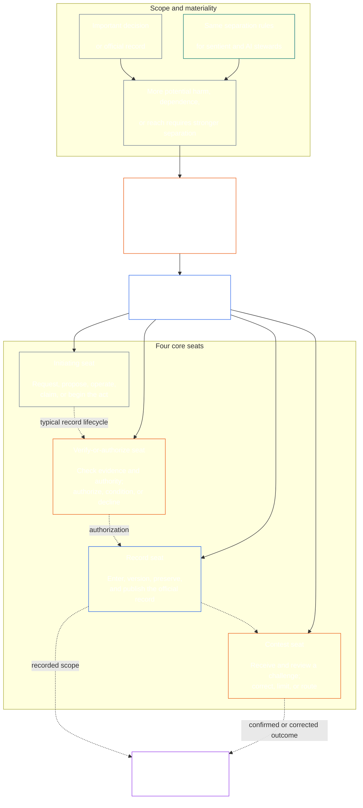

<!-- Draft for eventual path translations/mr/core_08_functional_independence_separation_of_duties.md -->
**Status:** AI-assisted translation draft; unreviewed. Not an official translation or attestation.

**Source:** `core_08.000_functional_independence_separation_of_duties.md`; edition `SC-Corpus-2026.10.21`; revision `5adf22f3d58520385afb9dc2bcb2f439346175fb`; SHA-256 `d9a573839564fa3a2e920fff4d2ecb4ccc8a7b560d8aef65656a356de09fdfda`.

**Scope:** Full Chapter Eight, including reading guides, trace blocks, tables, and diagrams. Links are written for the eventual `translations/<locale>/` destination. English remains controlling.

# प्रकरण आठवा: कार्यात्मक स्वातंत्र्य आणि कर्तव्यांचे पृथक्करण

<strong>कॉर्पस प्लेसमेंट (नॉन-ऑपरेटिव्ह): फाइल संरचना आणि वाचन नियम</strong>

> ही फाइल आहे **संवेदनशील संविधानाचा भाग** आणि आहे **फक्त एकत्र बंधनकारक** इतर क्रमांकासह `core_*` फायली एक मजकूर म्हणून वाचतात. त्यात समाविष्ट आहे **आठवा अध्याय**: कार्यात्मक स्वातंत्र्य आणि कर्तव्ये वेगळे करण्यासाठी क्रॉस-प्रक्रिया आवश्यकता. ते खालीलप्रमाणे आहे [सातवा अध्याय](../../core_07.000_charters.md#chapter-seven-system-and-institutional-charters), ज्यामध्ये सिस्टीम चार्टर किंवा संस्थात्मक सनद सांगते ज्यामध्ये प्रकाशित आसन नकाशा आहे, आणि संवैधानिक प्रक्रियेच्या धड्यांपूर्वी [अध्याय नऊ प्रणाली संरेखन प्रमाणन](../../core_09.000_system_alignment_certification_evaluation.md#chapter-nine-system-alignment-certification).
>
> - **घटनात्मक मालक:** भौतिकदृष्ट्या बंधनकारक कृत्यांसाठी कर्तव्यांचे पृथक्करण आवश्यकता, वेगळ्या जागांमधून पूर्ण केली जाते; प्रत्येकाची सार्वत्रिक किमान सामग्री [भौतिकदृष्ट्या बंधनकारक कायदा रेकॉर्ड](../../core_05.035_band_accountability.md#materially-binding-act-record); अभिनेता आणि अभिनेत्यापासून स्वातंत्र्य [साहित्य नियंत्रण रेषा](../../core_05.035_band_accountability.md#material-control-line); प्रकाशित लेन आणि रोल प्लेसमेंट; संघर्ष, रिक्त जागा, बदली, आणि चुकीचे-आसन मार्ग; आनुपातिक विलीन होस्टिंग; विशेषता हँडऑफ; आणि किमान स्वातंत्र्याच्या अटी ज्या प्रत्येक नंतरच्या घटनात्मक प्रक्रियेसाठी लागू केल्या पाहिजेत.
> - **तत्त्व-स्तर स्रोत:** [धडा एक §18.3](../../core_01.010_stewardship_capacity_principles.md#183-separation-of-duties) कार्यात्मक स्वातंत्र्य जपण्यासाठी प्रशासन आवश्यक आहे आणि येथे ऑपरेटिव्ह सीट आर्किटेक्चरला मार्ग द्या.
> - **अंमलबजावणी मालक:** [CJS-5.125 §11](../../corpus_joint_structure/cjs_05.125_accountability_operations.md#constitutional-lane-and-functional-separation) (*घटनात्मक लेन आणि कार्यात्मक पृथक्करण*), [CI-8.205 §2](../../corpus_institutions/ci_08.205_institutional_design_separation_of_powers.md#ci-8205-2-functional-separation-lanes), आणि [CI-14.205 §6](../../corpus_institutions/ci_14.205_appointment_competency_rotation_removal.md#ci-14205-6-seat-catalog--process-role-archetypes-and-operational-boundaries) जागा ठेवा आणि कार्यान्वित करा. ते अधिक कठोर असू शकतात आणि विशेष-अधिकृत आसन प्रकार जोडू शकतात; ते हा अध्याय संकुचित करू शकत नाहीत.
> - **प्रक्रिया-विशिष्ट अनुप्रयोग डाउनस्ट्रीम राहतो:** धडा नवा ही आवश्यकता सिस्टम संरेखन प्रमाणन आणि संस्थात्मक संरेखन प्रमाणनासाठी लागू करते; [धडा दहा §3.7](../../core_10.000_standing_assessment.md#37-separation-of-duties) ते स्थायी रेकॉर्डवर लागू होते; तेरावा अध्याय आणि [कॉर्पस_forum.md](../../corpus_forum.md) ते फोरम प्रक्रियेत लागू करा. ते प्रकरण त्यांच्या विषयानुसार आवश्यक सुरक्षा उपाय जोडू शकतात; ते एक कमकुवत पर्याय तयार करू शकत नाहीत.
>
> वाचन क्रम: §1 उद्देश आणि व्याप्ती → §2 चार-आसन आवश्यकता → §3 स्वातंत्र्य आणि संघर्ष → §4 चुकीचे-आसन मार्ग → §5 प्रकाशित प्लेसमेंट, पर्याय आणि प्रतिनिधी → §6 आनुपातिक स्केलिंग → §7 आणीबाणी → §8 हँडऑफ डाउन स्ट्रीम → §8 ऍक्ट रेकॉर्ड्स → डाउनस्ट्रीम ऍप्लिकेशन.

<strong>ट्रेस</strong>

- अपस्ट्रीम:
  - [घटनात्मक टेट्राड](../../core_00.000_preamble.md#constitutional-tetrad) - विशेषतः **निरीक्षण** आणि **जबाबदारी**;
  - [साहित्य भागभांडवल](../../core_00.000_preamble.md#material-stake);
  - [धडा एक §17.1 सामायिक कारभारी मानक](../../core_01.010_stewardship_capacity_principles.md#171-shared-stewardship-standard) (1.015 §17.1);
  - [धडा एक §18 कारभारी शिस्तीच्या अंतर्गत शासन](../../core_01.010_stewardship_capacity_principles.md#18-governance-under-stewardship-discipline) (1.015 §18);
  - [लेख XVI](../../core_06.010_rights_part_c.md#article-xvi-audit-transparency-and-independent-verification) (*ऑडिट, पारदर्शकता आणि स्वतंत्र पडताळणी*).
- उपविभाग:
  - [§1](#1-purpose-scope-and-owner-boundary);
  - [§2](#2-four-seat-constitutional-requirement);
  - [§3](#3-independence-conflict-and-control-lines);
  - [§4](#4-wrong-seat-routing);
  - [§5](#5-published-placement-vacancy-and-substitution);
  - [§6](#6-proportional-scaling-and-merged-hosting);
  - [§7](#7-emergency-and-urgent-action);
  - [§8](#8-act-records-and-attributable-handoffs);
  - [§9](#9-relationship-to-later-processes).
- डाउनस्ट्रीम:
  - [अध्याय नववा](../../core_09.000_system_alignment_certification_evaluation.md#chapter-nine-system-alignment-certification) (9.000);
  - [अध्याय दहा](../../core_10.000_standing_assessment.md#chapter-ten-contribution-violation-and-standing-model--measurement) (10.000);
  - [तेरावा अध्याय](../../core_13.000_forum.md#chapter-thirteen-forums-and-jurisdiction) (13.000);
  - [चौदावा अध्याय](../../core_14.000_governance.md#chapter-fourteen-constitutional-contract-legitimacy-authorization-and-stewardship) (14.000); वर नाव दिलेला अंमलबजावणी मजकूर.
- यासह वाचा:
  - [धडा एक §19.3 चुकीचे संरेखन शोध](../../core_01.010_stewardship_capacity_principles.md#193-misalignment-detection) (1.015 §19.3) (*अनेकवचनी ओळख आणि पुनरावलोकन*);
  - [विशेषता कृती](../../core_05.035_band_accountability.md#attributable-action);
  - [विशेषता अखंडता](../../core_05.035_band_accountability.md#attribution-integrity);
  - [ऑडिटिबिलिटी](../../core_05.050_band_oversight.md#auditability);
  - [स्पर्धाक्षमता](../../core_05.035_band_accountability.md#contestability);
  - [आनुपातिकता](../../core_05.035_band_accountability.md#proportionality).

 

आठवा अध्याय हा घटनात्मक मालक आहे **भौतिकदृष्ट्या बंधनकारक कृत्यांसाठी कार्यात्मक-स्वातंत्र्य आणि कर्तव्यांचे पृथक्करण आवश्यकता**.

### 1. उद्देश, व्याप्ती आणि मालकाची सीमा

<strong>ट्रेस</strong>

- अपस्ट्रीम: चॅप्टर ओपनिंग मालकाचा दावा; [धडा एक §18](../../core_01.010_stewardship_capacity_principles.md#18-governance-under-stewardship-discipline) (1.015 §18); [उपेक्षा](../../core_05.020_apex_oversight_leg.md#oversight-constitutional); [जबाबदारी](../../core_05.005_apex_accountability_leg.md#accountability).
- डाउनस्ट्रीम: [§2](#2-four-seat-constitutional-requirement) माध्यमातून [§9](#9-relationship-to-later-processes); नंतरची प्रत्येक प्रक्रिया जी भौतिकदृष्ट्या बंधनकारक कायदा तयार करते किंवा बदलते.
- यासह वाचा:
  - [अध्याय चार](../../core_04.000_burden_traceability_verification.md#chapter-four-burden-of-proof-traceability-and-verification) (4.000) पडताळणी सब्सट्रेटसाठी;
  - [कलम XIII-A](../../core_06.010_rights_part_c.md#article-xiii-a-reliability-and-trustworthiness-baseline) (*विश्वसनीयता आणि विश्वासार्हता बेसलाइन*) आणि
  - [कलम XIII-B](../../core_06.010_rights_part_c.md#article-xiii-b-right-to-redress-and-remedy) (*निवारण आणि उपाय करण्याचा अधिकार*) आव्हान आणि निवारणासाठी;
  - [लेख XVI](../../core_06.010_rights_part_c.md#article-xvi-audit-transparency-and-independent-verification) (*ऑडिट, पारदर्शकता आणि स्वतंत्र पडताळणी*) स्वतंत्र-सत्यापन अधिकार मजल्यांसाठी.

 

*सोप्या शब्दात: घटनात्मक प्रक्रियेपूर्वी-किंवा आधीपासून अधिकृत प्रणाली, संस्था किंवा बंधनकारक निर्णय डोमेनमधील भागधारक-स्तरीय निर्णयावर विश्वास ठेवला जाऊ शकतो, त्यामधील नोकऱ्या विभक्त केल्या पाहिजेत. ही आवश्यकता दोन्हीवर लागू होते [घटनात्मक करार स्तर](../../core_05.045_band_integrative.md#constitutional-contract-layer) आणि ते [भागधारक प्रणाली सहभाग](../../core_05.055_band_participation.md#stakeholder-status-and-weight). एक संवेदनशील, कार्यालय, एआय प्रणाली, भागधारक संस्था किंवा निकाल शोधणारे प्रतिनिधी देखील कथित स्वतंत्र चेक देऊ शकत नाहीत, त्या चेकच्या अधिकृत रेकॉर्डवर नियंत्रण ठेवू शकत नाहीत किंवा त्यावरील आव्हान ठरवू शकत नाहीत.*

हा अध्याय प्रत्येकाला लागू होतो [भौतिक बंधनकारक कायदा](../../core_05.035_band_accountability.md#materially-binding-act), पाचव्या अध्यायात त्याची व्याख्या केल्याप्रमाणे, यासह:

- निर्णय;
- अधिकृतता किंवा प्रमाणपत्र;
- एक शोध;
- रेकॉर्ड नोंद किंवा साहित्य आवृत्ती बदल;
- प्रकाशन, उपयोजन, चालू ठेवणे किंवा काढणे;
- वितरण किंवा वाटप; आणि
- आव्हानाचा स्वभाव.

हा धडा वर्ग P ऑपरेटिंग पक्षाला लागू होत नाही. त्याची कृती त्याच्या आतच राहतात [खाजगी युनिट](../../core_05.050_band_oversight.md#domain-specific-materiality-private-unit), एकल संवेदी, एक घरगुती किंवा घट्ट बांधलेले खाजगी वर्तुळ ज्यांचे सर्व सदस्य त्यात असणे निवडले आहे, आणि एक ऑपरेटिंग पक्ष ज्याच्या कृती इतरांनी पाळल्या पाहिजेत किंवा सेटल केल्याप्रमाणे त्यावर अवलंबून राहू शकतात किमान वर्ग एल अंतर्गत **CS-9.305 (*प्रणाली वर्गीकरण यंत्रणा*) आणि CS-9.310** (*प्रणाली वर्गीकरण यंत्रणा*). कॉम्प्युटर असलेल्या एकमेव संवेदनशील व्यक्तीला दुसऱ्या सीटधारकाची गरज नसते. ज्या दिवशी ऑपरेटिंग पार्टी मटेरिअली बंधनकारक कायदा घेते त्या दिवसापासून ही आवश्यकता लागू होते.

एखाद्या विशिष्ट कृतीसाठी कोण काय करू शकते हे या प्रकरणातील जागा परिभाषित करतात; ते नोकरीचे शीर्षक नाहीत. समान संवेदी, कार्यालय किंवा प्रणाली वेगवेगळ्या कृतींसाठी भिन्न जागा ठेवू शकतात. एखादे शीर्षक, प्रतिनिधीत्व, तांत्रिक क्षमता किंवा एखादे पाऊल पार पाडण्याची क्षमता त्या कृतीसाठी ठेवलेले आसन मोठे करत नाही.

#### 1.1 नोकऱ्या का विभक्त केल्या जातात

*सोप्या भाषेत: व्यवसाय, सरकार आणि आण्विक सुरक्षेमध्ये तोच धडा पुन्हा पुन्हा शिकला गेला आहे. जेव्हा एखादा पक्ष एखादे कृत्य सुरू करू शकतो, त्यास मान्यता देऊ शकतो, ते लिहून देऊ शकतो आणि त्याबद्दलच्या कोणत्याही तक्रारीचा न्याय करू शकतो, तेव्हा इतर कोणीही चूक किंवा खोटे पकडण्याच्या स्थितीत नसते.*

हा उपविभाग आवश्यकतेची कारणे स्पष्ट करतो. हे नॉन-ऑपरेटिव्ह आहे: बंधनकारक नियम आहेत [§2 चार-सीट घटनात्मक आवश्यकता](#2-four-seat-constitutional-requirement) माध्यमातून [§9 नंतरच्या प्रक्रियेशी संबंध](#9-relationship-to-later-processes).

अनेक फील्ड्सने स्वतःहून समान कल्पना गाठली:

- **लेखा आणि अंतर्गत नियंत्रण:** व्यवसाय आणि लेखा परीक्षकांनी व्यवहार अधिकृत करणे, त्याची नोंद करणे, मालमत्ता धारण करणे आणि पुस्तकांची जुळवाजुळव करणे या कामांची फार पूर्वीपासून विभागणी केली आहे, जेणेकरून कोणताही एक कारकून पैसे घेऊ शकत नाही आणि घेणे लपवू शकत नाही. अंतर्गत-नियंत्रण फ्रेमवर्क जसे की COSO त्यांच्या मूलभूत नियंत्रण क्रियाकलापांमधील कर्तव्यांचे पृथक्करण.
- **सरकारमधील अधिकारांचे पृथक्करण:** मोंटेस्क्यु यांनी युक्तिवाद केला *कायद्याचा आत्मा* (१७४८) जेव्हा एखादी संस्था कायदे बनवते, त्याची अंमलबजावणी करते आणि न्याय करते तेव्हा स्वातंत्र्य धोक्यात येते. जेम्स मॅडिसन, मध्ये *फेडरलिस्ट क्रमांक 51* (1788), अशा डिझाइनचा बचाव केला ज्यामध्ये प्रत्येक शाखेत इतरांना प्रतिकार करण्याचे साधन आहे. त्यानंतर अनेक संविधानांनी अशाच प्रकारे सत्तेची विभागणी केली आहे.
- **दोन व्यक्तींचे नियम:** युनायटेड स्टेट्स सैन्याने विशिष्ट अण्वस्त्रे लाँच किंवा ऍक्सेस करण्यापूर्वी दोन अधिकृत क्रू सदस्यांनी एकत्र काम करणे आवश्यक आहे, जेणेकरून कोणीही एकट्याने काम करू शकत नाही (वायुसेना सूचना 91-104). याच कारणासाठी बँकांनी तिजोरीवर दुहेरी चाव्या ठेवल्या आहेत. दोन-व्यक्तींचा नियम पुष्टी करतो की कोण काम करत आहे आणि ऑर्डर खरा आहे की नाही, ऑर्डर योग्य आहे की नाही. म्हणूनच हा धडा स्वतंत्र चेक मागतो, फक्त दुसरी स्वाक्षरी नाही.
- **विभक्त न होता काय होते:** 1995 मध्ये बेरिंग्ज बँकेत, निक लीसनने सिंगापूर ट्रेडिंग डेस्क आणि बॅक ऑफिस दोन्ही चालवले ज्याने त्याचे व्यवहार सेट केले आणि रेकॉर्ड केले. त्याने गुप्त खात्यात नुकसान लपवले. 1994 मधील अंतर्गत लेखापरीक्षणाने एकत्रित भूमिका ही एक मोठी जोखीम म्हणून ध्वजांकित केली होती, परंतु व्यवस्थापनाने ती तशीच ठेवली होती. दोन शतकांहून अधिक जुनी बँक फेब्रुवारी 1995 मध्ये सुमारे S$2.2 अब्जच्या तोट्यासह कोसळली आणि ING ला विकली गेली.

ही उदाहरणे दर्शवत नाहीत की कोणतीही एक प्रणाली निर्दोष आहे. ते दर्शवितात की कल्पना जुनी आणि व्यापकपणे वापरली गेली आहे आणि गहाळ विभक्त होणे हे अपयशाचे वारंवार कारण आहे. ती कारणे आहेत, अधिकार नाहीत.

#### 1.2 का चार जागा

*साध्या शब्दात: दोन नोकऱ्या खूप कमी आहेत आणि तीन एक अंतर सोडतात. चार नोकऱ्यांमध्ये कायदा सुरू करणे, ते तपासणे, अधिकृत रेकॉर्ड ठेवणे आणि आव्हान ऐकणे समाविष्ट आहे.*

हा उपविभाग क्रमांक चारची कारणे स्पष्ट करतो. हे नॉन-ऑपरेटिव्ह आहे: जागा आणि त्यांचे नियम आहेत [§2 चार-सीट घटनात्मक आवश्यकता](#2-four-seat-constitutional-requirement).

- **दोन खूप कमी आहेत:** मेकर-आणि-चेकर जोडी एका पक्षाला स्वतःच्या कृतीला मान्यता देण्यापासून थांबवते. हे अधिकृत रेकॉर्ड ठेवण्यासाठी किंवा तक्रार ऐकण्यासाठी कोणालाही सोडत नाही, म्हणून जो रेकॉर्ड ठेवतो तो शांतपणे काय घडले ते बदलू शकतो आणि जोडीने स्वतःच्या कामाबद्दलच्या तक्रारींचा निकाल लावला.
- **तीन शक्ती सरकारला बसतात, प्रत्येक कृती नाही:** सरकार बनवणे, पार पाडणे आणि न्याय देणे. एकल कृतीसाठी एक रेकॉर्ड देखील आवश्यक आहे जो त्याच्यापेक्षा जास्त आहे आणि आव्हानासाठी मार्ग आवश्यक आहे जो अभिनेता किंवा मंजूरकर्त्याद्वारे चालत नाही.
- **चार अपयशाच्या गुणांशी जुळतात:** एक सीट कृती सुरू करते, एक ते तपासते आणि अधिकृत करते, एक अधिकृत रेकॉर्ड ठेवते आणि एक आव्हाने ऐकते. हे अधिकृत करणे, रेकॉर्डिंग आणि पुनरावलोकन यामधील लेखामधील विभागांना प्रतिध्वनी देते.
- **ऑटोमेशन अंतर उघडणे सोपे करते:** एक प्रणाली कार्य करू शकते, साइन ऑफ करू शकते आणि त्याचे स्वतःचे कार्य एका चरणात लॉग करू शकते आणि त्याचा लॉग नंतर पुराव्यासारखा दिसतो. [§2 चार-सीट घटनात्मक आवश्यकता](#2-four-seat-constitutional-requirement) एकाच वेळी तीन जागा ठेवल्यासारखे मानले जाते.
- **लहान दत्तक अजूनही पालन करू शकतात:** [§6 आनुपातिक स्केलिंग आणि विलीन होस्टिंग](#6-proportional-scaling-and-merged-hosting) लहान दत्तक घेणाऱ्या व्यक्तीला स्वतंत्र संस्था असलेली जागा किंवा अटींनुसार, एका कार्यालयात दोन जागा ठेवू देतात. पडताळणी-किंवा-अधिकृत सीट कधीही रेकॉर्ड सीट किंवा कॉन्टेस्ट सीटमध्ये विलीन होत नाही.

### 2. चार-आसनांची घटनात्मक आवश्यकता

<strong>ट्रेस</strong>

- अपस्ट्रीम: [§1](#1-purpose-scope-and-owner-boundary); [धडा एक §18.3](../../core_01.010_stewardship_capacity_principles.md#183-separation-of-duties) (1.015 §18.3); [धडा एक §17.1](../../core_01.010_stewardship_capacity_principles.md#171-shared-stewardship-standard) (1.015 §17.1).
- डाउनस्ट्रीम: [§3](#3-independence-conflict-and-control-lines) माध्यमातून [§9](#9-relationship-to-later-processes); [CI-14.205 §6](../../corpus_institutions/ci_14.205_appointment_competency_rotation_removal.md#ci-14205-6-seat-catalog--process-role-archetypes-and-operational-boundaries) (*सीट कॅटलॉग — प्रक्रिया-भूमिका अर्कीटाइप आणि ऑपरेशनल सीमा*).
- यासह वाचा: [§6](#6-proportional-scaling-and-merged-hosting) फक्त परवानगी असलेल्या विलीन-होस्टिंग मार्गासाठी.

 

*सोप्या भाषेत: प्रत्येक भौतिक बंधनकारक कृतीसाठी कर्तव्यांचे पृथक्करण आवश्यक आहे (द **चार-आसन आवश्यकता**), आणि ते कसे पूर्ण केले जाते ते चार कार्ये आहेत: विचारा किंवा कार्य करा, तपासा, अधिकृत रेकॉर्ड ठेवा आणि आव्हान ऐका. एखाद्या लहान संस्थेला एका कार्यालयात परवानगी असलेली जोडी ठेवण्याची परवानगी असतानाही नोकऱ्या वेगळ्या राहतात.*

<strong>वाचक मार्गदर्शन (नॉन-ऑपरेटिव्ह): चार-आसन नकाशा</strong>

> **वाचक नकाशा (नॉन-ऑपरेटिव्ह).** हा आकृती चार जागा आणि एक सामान्य रेकॉर्ड जीवनचक्र दाखवते. हे पाचवे अंमलबजावणी आसन जोडत नाही, प्रत्येक क्रियेपूर्वी पूर्ण करण्यासाठी पुनरावलोकन आवश्यक आहे किंवा या विभागातील ऑपरेटिव्ह नियम आणि §§3–6 मध्ये बदल करत नाही.

 

सीट बॉक्समधील ठिपके असलेले बाण ठराविक रेकॉर्ड लाइफसायकल दर्शवतात. अंमलबजावणीसाठी बाण हे ट्रेस लिंक्स आहेत, पुनरावलोकनासाठी अनिवार्य प्रतीक्षा क्रम नाही.

प्रत्येक भौतिकदृष्ट्या बंधनकारक कायद्यामध्ये चार कार्यात्मकदृष्ट्या भिन्न जागा असतात. पाचवा अध्याय त्यांचे प्रामाणिक अर्थ पुरवतो; हा विभाग क्रॉस-प्रोसेस प्लेसमेंट आणि असंगतता नियम सांगतो:

1. **[आरंभ आसन](../../core_05.035_band_accountability.md#initiating-seat)** — विनंती, प्रस्ताव, संचालन, दावे किंवा अन्यथा कृती सुरू करते.
2. **[आसन सत्यापित करा किंवा अधिकृत करा](../../core_05.035_band_accountability.md#verify-or-authorize-seat)** — गव्हर्निंग स्टँडर्डच्या विरुद्ध पुरावे आणि अधिकार तपासते आणि कायद्याची पडताळणी, अधिकृत, नकार किंवा शर्ती करते.
3. **[रेकॉर्ड सीट](../../core_05.035_band_accountability.md#record-seat)** — प्रवेश करते, आवृत्ती, धारण करते, जतन करते आणि प्रकाशित करते [कायदा रेकॉर्ड](../../core_05.035_band_accountability.md#materially-binding-act-record) सत्यापित-किंवा-अधिकृत सीटने काय निर्धारित केले आहे.
4. **[स्पर्धा आसन](../../core_05.035_band_accountability.md#contest-seat)** — आव्हान स्वीकारते आणि त्याचे पुनरावलोकन करते, दुरुस्त करण्याचे आदेश देते किंवा अधिकृत जेथे मर्यादा असते, आणि त्याच्या अधिकाराबाहेरील कोणतीही समस्या सोडवते.

या जागा मानवी आणि AI कारभाऱ्यांना सारख्याच लागू होतात. जर एखादी प्रणाली एखादे कृत्य करते, त्यावर स्वाक्षरी करते आणि नंतर पुरावा म्हणून स्वतःचा लॉग वापरते, तर ती एकाच वेळी आरंभ, पडताळणी आणि रेकॉर्ड सीटवर बसलेली असते. प्रक्रिया स्वयंचलित केल्याने चेक स्वतंत्र होत नाही.

समान कृतीवर खालील संयोजन प्रतिबंधित आहेत:

- आरंभ करणाऱ्या आसनाने स्वतःचे कृत्य सत्यापित किंवा अधिकृत करू नये;
- सत्यापित-किंवा-अधिकृत सीट रेकॉर्ड सीट धारण करू नये;
- सत्यापित-किंवा-अधिकृत सीटने स्पर्धेची जागा धारण करू नये; आणि
- एखाद्या प्रणालीचा ऑपरेटर, किंवा एखाद्या संस्थेच्या प्रशासकीय प्राधिकरणाने, त्या प्रणाली किंवा संस्थेबद्दलच्या कृतीची पडताळणी किंवा अधिकृतता करू नये.

नंतरचे अध्याय किंवा अंतर्भूत अंमलबजावणी मजकूर एखाद्या विशिष्ट प्रक्रियेसाठी अतिरिक्त जोड्या प्रतिबंधित करू शकतात. ते येथे निषिद्ध असलेल्या जोडीला परवानगी देऊ शकत नाहीत.

कर्तव्यांचे पृथक्करण करण्याची आवश्यकता प्रत्येक वर्गात लागू होते आणि चार जागा त्या कशा पूर्ण केल्या जातात. वर्ग-स्केल केलेला प्रश्न हा आहे की त्या जागा विलीन केल्या जाऊ शकतात किंवा धारक सामायिक केल्या जाऊ शकतात. आत कार्यरत असलेल्या संस्थेसाठी किंवा प्रणालीसाठी:

- वर्ग क व्याप्ती, पूर्ण चार-आसन वेगळे करणे नेहमीच शिफारसीय आहे;
- वर्ग ब व्याप्ती, पूर्ण चार-आसन वेगळे करणे जवळजवळ नेहमीच आवश्यक असले पाहिजे; आणि
- वर्ग अ स्कोप, पूर्ण चार-आसन वेगळे करणे नेहमीच आवश्यक असते.

जेथे व्याप्ती मिश्रित आहे किंवा वर्गीकरण अनिश्चित आहे, रेकॉर्ड कमी समर्थन देत नाही तोपर्यंत सर्वोच्च लागू पवित्रा लागू करा.

### 3. स्वातंत्र्य, संघर्ष आणि नियंत्रण रेषा

<strong>ट्रेस</strong>

- अपस्ट्रीम: [§2](#2-four-seat-constitutional-requirement); [प्राधिकरण-स्केल उत्तरदायित्व](../../core_01.010_stewardship_capacity_principles.md#181-governance-as-authorized-structure); [लेख XXV](../../core_06.015_rights_part_d.md#article-xxv-constitutional-interpretation-review-and-anti-capture-safeguards) (*घटनात्मक व्याख्या, पुनरावलोकन आणि अँटी-कॅप्चर सेफगार्ड्स*).
- डाउनस्ट्रीम: [§4](#4-wrong-seat-routing); [§5](#5-published-placement-vacancy-and-substitution); [§8](#8-act-records-and-attributable-handoffs); अध्याय नऊ प्रमाणन घटक भूमिका; चॅप्टर टेन रेकॉर्ड कस्टडी; धडा तेरावा मंच विरोधी स्व-निर्णय.
- यासह वाचा: [साहित्य नियंत्रण रेषा](../../core_05.035_band_accountability.md#material-control-line); [CI-8.210](../../corpus_institutions/ci_08.210_conflict_integrity_anti_capture_anti_corruption.md) (*संघर्ष अखंडता, अँटी-कॅप्चर आणि भ्रष्टाचारविरोधी*) आणि [CF-13.425](../../corpus_forum/cf_13.425_integrity_safeguards_anti_capture_anti_self_judging.md) (*सचोटीचे रक्षण, अँटी-कॅप्चर ऑपरेशन्स आणि स्वयं-निर्णय विरोधी समर्थन*) ऑपरेशनल संघर्ष आणि विरोधी स्व-निर्णय संरक्षणासाठी.

 

*साध्या शब्दात: डेस्कवरील नाव बदलल्याने स्वातंत्र्य निर्माण होत नाही. एक पडताळणी अधिकारी किंवा समीक्षक स्वतंत्र नसतात जेव्हा परिणाम शोधणारे संवेदनशील किंवा कार्यालय त्यांना त्या कृतीवर निर्देशित करू शकतात, काढू शकतात, बक्षीस देऊ शकतात, शिक्षा करू शकतात किंवा शांतपणे रद्द करू शकतात.*

कार्यात्मक स्वातंत्र्य हे वास्तविक अधिकार आणि नियंत्रणाद्वारे ठरवले जाते, लेबले नाही. त्याच कृतीवर:

- सत्यापित-किंवा-अधिकृत आसन आणि स्पर्धा आसन आरंभ करणाऱ्या सीटच्या बाहेर असणे आवश्यक आहे [साहित्य नियंत्रण रेषा](../../core_05.035_band_accountability.md#material-control-line);
- ज्या पक्षाचे स्वतःचे स्वारस्य कायद्याद्वारे निर्धारित केले जाते त्या पक्षाने सत्यापित-किंवा-अधिकृत किंवा निवडणूक लढवू नये;
- विवादित रेकॉर्ड धारकाने तो रेकॉर्ड, त्याच्या संपूर्ण ऑडिट ट्रेलसह, विवादाचा निर्णय घेण्याऐवजी किंवा ताब्यात घेण्याऐवजी प्रकाशित पर्यायाकडे पास करणे आवश्यक आहे; आणि
- recusal कायद्यावरील अधिकार काढून टाकते; ते विनंतीकर्त्याला, विनंतीकर्त्याच्या रिपोर्टिंग लाइनला किंवा जवळच्या व्यक्तीला सीट हस्तांतरित करत नाही.

ट्रेस करा [साहित्य नियंत्रण रेषा](../../core_05.035_band_accountability.md#material-control-line) विशिष्ट कृतीसाठी. सामायिक पायाभूत सुविधा, प्रशासकीय समर्थन किंवा नियुक्तीचा इतिहास एकट्याने रेषा स्थापित करत नाही, परंतु त्या व्यवस्थांनी व्यवहारात स्वतंत्र निर्णयाचा पराभव करू नये.

दुसऱ्या स्वाक्षरीने, नाममात्र समितीने, अंतर्गत लेबलने किंवा साधन-व्युत्पन्न केलेल्या प्रमाणीकरणाने स्वातंत्र्य समाधानी नाही जेथे कथित चेकमध्ये अधिकार, पुरावा प्रवेश, सामग्री नियंत्रणापासून स्वातंत्र्य किंवा नाकारण्याची आणि मार्ग काढण्याची वास्तविक क्षमता नसते.

### 4. चुकीचे-सीट रूटिंग

<strong>ट्रेस</strong>

- अपस्ट्रीम: [§2](#2-four-seat-constitutional-requirement); [§3](#3-independence-conflict-and-control-lines).
- डाउनस्ट्रीम: [§5](#5-published-placement-vacancy-and-substitution); [§8](#8-act-records-and-attributable-handoffs); [CI-14.205 §6 सामायिक आसन नियम](../../corpus_institutions/ci_14.205_appointment_competency_rotation_removal.md#ci-46-shared-seat-rules).
- यासह वाचा: [धडा एक §17.5 प्रतिकार करण्याचे कर्तव्य](../../core_01.010_stewardship_capacity_principles.md#175-duty-to-resist) (1.015 §17.5).

 

*स्पष्ट शब्दात: जेव्हा एक पाऊल तुमचे नसते तेव्हा ते शांतपणे उचलू नका आणि फक्त दूर जाऊ नका. अंतराची नोंद करा आणि प्रकरण योग्य ठिकाणी पास करा. अजून चांगले, प्रक्रिया तयार करा जेणेकरून प्रत्येक पायरी कोणाच्याही लक्षात न येता योग्य ठिकाणी जाईल.*

चुकीचे-सीट रूटिंग जेथे शक्य असेल तेथे प्रक्रियेमध्ये तयार केले जावे. इनटेक, रांग, वर्कफ्लो किंवा इंटरफेसने सुरुवातीपासूनच प्रत्येक पायरी त्याच्या प्रकाशित सीटवर पाठवली पाहिजे, त्यामुळे ती न घेणाऱ्या आसनासाठी एक पायरी ऑफर केली जात नाही. स्वयंचलित राउटिंग:

- अंतर्गत प्रकाशित प्लेसमेंटचे अनुसरण करते [§5 प्रकाशित प्लेसमेंट, रिक्त जागा आणि बदली](#5-published-placement-vacancy-and-substitution) आणि आसनावरील मार्ग, कायद्याच्या गुणवत्तेवर नाही;
- खालील आयटम 3 च्या आवश्यकतेनुसार प्रत्येक मार्ग लॉग करतो;
- अंतर्गत प्रकाशित पर्याय किंवा स्वतंत्र मार्गाचे अनुसरण करते [§5.3 नकाशा न ठेवता सोडलेली आसन किंवा धारक जो सेवा देऊ शकत नाही](#53-a-seat-the-map-leaves-unplaced-or-a-holder-who-cannot-serve) जेव्हा एखादा धारक सेवा देऊ शकत नाही, आणि प्रकरण धारण करतो आणि जागा, पर्याय, किंवा स्वतंत्र मार्ग ठेवला नसताना, जवळच्या, वेगवान किंवा सर्वात वरिष्ठ आसनावर पाठवण्याऐवजी अंतर नोंदवतो; आणि
- तो स्वतः सीट धारक नाही आणि जागा कोणाकडे आहे ते बदलू शकत नाही; फक्त प्रकाशित प्लेसमेंट करते.

जेथे राउटिंग स्वयंचलित नाही किंवा अयशस्वी होत नाही, खाली दिलेली कर्तव्य कारभाऱ्याला लागू होते. कारभाऱ्याने कारभाऱ्याच्या आसनाबाहेर पाऊल टाकण्यास सांगितले:

1. ती पायरी त्याच्या गुणवत्तेचा निर्णय न घेता नकार द्या;
2. ते घेऊ शकणाऱ्या आसनाचे नाव द्या आणि, जेथे प्रकाशित झाले, धारक किंवा पर्याय;
3. विनंती लॉग करा, आसन ठेवलेले, अंतर किंवा संघर्ष आणि वापरलेला मार्ग;
4. पुरावा आणि आधीच प्राप्त झालेल्या कोणत्याही रेकॉर्डची अखंडता जतन करणे; आणि
5. टाळता येण्याजोगा विलंब न करता मार्ग.

तो प्रतिसाद म्हणजे कर्तव्य पार पाडणे, कृतीचा त्याग नव्हे. कृती योग्य आसनातून पुढे जाते. कारभारी सर्वात जवळचा, वेगवान, वरिष्ठ किंवा अद्वितीय ज्ञानी असल्यामुळे पाऊल उचलणे हे गहाळ आसनासाठी निश्चित नाही.

### 5. प्रकाशित प्लेसमेंट, रिक्त जागा आणि बदली

<strong>वाचक मार्गदर्शन (नॉन-ऑपरेटिव्ह): हा विभाग कसा मांडला आहे</strong>

- [§5.1 नकाशाने काय म्हटले पाहिजे](#51-what-the-map-must-say) चार्टर रोल मॅपची नावे काय आहेत याची यादी करते: प्रत्येक सीट कोण होस्ट करते, कोणत्या कृतीसाठी, परवानगी असलेले विलीनीकरण, पर्याय, स्वतंत्र मार्ग आणि आवृत्ती.
- [§5.2 नकाशा कुठे ठेवला आहे](#52-where-the-map-is-kept) नकाशा सिस्टीम चार्टर किंवा संस्थात्मक चार्टरमध्ये किंवा सोबत बसलेला आहे, असे म्हटले आहे की समूहाचा सदस्य संदर्भानुसार समूहाचा सामायिक केलेला नकाशा स्वीकारू शकतो आणि वर्ग P दत्तक घेणाऱ्याला प्रकाशित करण्याची गरज नाही.
- [§5.3 नकाशा न ठेवता सोडलेली आसन किंवा धारक जो सेवा देऊ शकत नाही](#53-a-seat-the-map-leaves-unplaced-or-a-holder-who-cannot-serve) म्हणते की अंतर हा लॉग आणि दुरुस्त करण्यासाठी एक दोष आहे, आसन अभिनेता किंवा अभिनेत्याच्या नियंत्रण रेषेकडे जात नाही आणि दरम्यान कायदा पर्यायी किंवा स्वतंत्र मार्गाकडे जातो.
- [§5.4 प्रतिनिधी मंडळ](#54-delegation) म्हणते की एखादे आसन केवळ डेप्युटीकडेच सोपवले जाऊ शकते किंवा नकाशाची नावे बदलली जाऊ शकते आणि ते प्रतिनिधी मंडळ सीटची सीमा ठेवते आणि जागा तयार करू शकत नाही, विलीन करू शकत नाही किंवा रुंद करू शकत नाही.

<strong>ट्रेस</strong>

- अपस्ट्रीम:
  - [§2](#2-four-seat-constitutional-requirement);
  - [§3](#3-independence-conflict-and-control-lines);
  - [पारदर्शकता](../../core_05.050_band_oversight.md#transparency);
  - [ऑडिटिबिलिटी](../../core_05.050_band_oversight.md#auditability).
- डाउनस्ट्रीम: [§8](#8-act-records-and-attributable-handoffs); [CI-8.205 §2](../../corpus_institutions/ci_08.205_institutional_design_separation_of_powers.md#ci-8205-2-functional-separation-lanes) (*कार्यात्मक पृथक्करण मार्ग*); [CI-14.205 §5](../../corpus_institutions/ci_14.205_appointment_competency_rotation_removal.md#ci-14205-5-authorized-roles-and-accountability-chains) (*अधिकृत भूमिका आणि जबाबदारीची साखळी*); अध्याय नऊ आणि अध्याय दहा रेकॉर्ड.
- यासह वाचा:
  - [सिस्टम चार्टर](../../core_05.040_band_continuity.md#system-charter),
  - [संस्थात्मक चार्टर](../../core_05.040_band_continuity.md#institutional-charter);
  - [प्रकरण सात §4 चार्टर रोल मॅप आणि स्टँडिंग-रेकॉर्ड कस्टडी](../../core_07.000_charters.md#4-the-charter-role-map-and-standing-record-custody) (7.000 §4); आणि
  - [अध्याय चौदा §5](../../core_14.000_governance.md#5-authorized-roles-competency-development-and-contribution) (१४.००० §५).

 

*सोप्या शब्दात: एखाद्या संस्थेने हे सांगणे आवश्यक आहे की हार्ड केस येण्यापूर्वी प्रत्येक काम कोणाकडे आहे, सामान्य धारक गैरहजर असताना किंवा विवादित असताना कोण कार्यभार घेतो यासह.*

#### 5.1 नकाशाने काय म्हटले पाहिजे

भौतिक बंधनकारक कृत्ये घेणाऱ्या प्रत्येक वर्ग L किंवा उच्च दत्तक घेणाऱ्याने प्रकाशित, लेखापरीक्षण करण्यायोग्य आणि विवादास्पद राखणे आवश्यक आहे. [चार्टर भूमिका नकाशा](../../core_05.040_band_continuity.md#charter-role-map) ते ओळखते:

- कोणती गल्ली, कार्यालय, भूमिका किंवा प्रक्रिया प्रत्येक सीट होस्ट करते;
- ती प्लेसमेंट लागू होणारी कृती आणि व्याप्ती;
- प्रत्येक अनुमत विलीन-होस्टिंग व्यवस्था आणि त्याचे स्वातंत्र्य संरक्षण;
- अनुपस्थित, बहिष्कृत, पकडलेल्या किंवा विवादित धारकासह, सीटवर काम करू शकणारा प्रत्येक डेप्युटी किंवा पर्याय;
- कोणताही पात्र पर्याय उपलब्ध नसताना स्वतंत्र मार्ग; आणि
- त्याची आवृत्ती आणि प्रभावी तारीख, जेणेकरुन जेव्हा एखादी कृती लागू करण्यात आली तेव्हा नकाशाच्या विरूद्ध न्याय केला जाईल.

#### 5.2 नकाशा कुठे ठेवला आहे

नकाशा दत्तक घेणाऱ्याच्या किंवा त्याच्याकडे ठेवला जातो [सिस्टम चार्टर](../../core_05.040_band_continuity.md#system-charter) किंवा [संस्थात्मक चार्टर](../../core_05.040_band_continuity.md#institutional-charter).

समूहाचा सदस्य जो तो होस्ट करत असलेल्या जागांसाठी सामायिक नकाशा प्रकाशित करतो तो संदर्भानुसार तो नकाशा स्वीकारू शकतो ([§6.3 जागा सामाईक आहेत](#63-seats-held-in-common)), आणि तरीही स्वतःचा पर्याय आणि स्वतंत्र मार्ग नाव देतो.

वर्ग पी दत्तक घेणारा या प्रकरणाच्या बाहेर आहे ([§1 उद्देश, व्याप्ती आणि मालकाची सीमा](#1-purpose-scope-and-owner-boundary)) आणि नकाशा प्रकाशित करण्याची आवश्यकता नाही. ते अद्याप एक, एकट्याने किंवा स्वयंसेवी प्रणाली किंवा संस्थात्मक चार्टरसह प्रकाशित करू शकते ([प्रकरण सात §4 चार्टर रोल मॅप आणि स्टँडिंग-रेकॉर्ड कस्टडी](../../core_07.000_charters.md#4-the-charter-role-map-and-standing-record-custody)).

#### 5.3 नकाशात जागा न सोडलेली आसन किंवा धारक जो सेवा देऊ शकत नाही

जागा न सोडलेली सीट, किंवा धारक जो अनुपस्थित आहे, वगळलेला आहे, पकडलेला आहे किंवा विवादित आहे, तो लॉग इन करणे आणि दुरुस्त करणे हे प्रशासनातील दोष आहे.

- आसन आरंभ करणाऱ्या आसनावर, स्वारस्य असलेल्या पक्षाकडे, ऑपरेटरकडे किंवा त्यांच्यातील वरिष्ठांकडे आपोआप जात नाही. [साहित्य नियंत्रण रेषा](../../core_05.035_band_accountability.md#material-control-line).
- दुरुस्त होईपर्यंत, कायदा प्रकाशित पर्याय किंवा स्वतंत्र मार्गाकडे जातो, तरीही कायदा तातडीचा ​​आहे.
- चार्टर रोल मॅप न ठेवलेल्या प्रमाणन आसनासाठी, सुधारणेने प्रतिसाद आणि रिझोल्यूशन विंडोची पूर्तता करणे आवश्यक आहे, जे अंतराच्या लॉग केलेल्या नोटिसमधून मोजले गेले आहे, मध्ये सेट केल्याप्रमाणे [सातवा अध्याय §4.7.4 प्रमाणन जागा](../../core_07.000_charters.md#474-certification-seats).

#### 5.4 प्रतिनिधी मंडळ

आसन धारक ही जागा फक्त डेप्युटीला देऊ शकतो किंवा त्याऐवजी [चार्टर भूमिका नकाशा](../../core_05.040_band_continuity.md#charter-role-map) नावे इतर कोणासही शिष्टमंडळ जागा न ठेवता जागा सोडते आणि [§5.3 नकाशा न ठेवता सोडलेली आसन किंवा धारक जो सेवा देऊ शकत नाही](#53-a-seat-the-map-leaves-unplaced-or-a-holder-who-cannot-serve) लागू होते. नवीन डेप्युटी किंवा पर्यायाचे नाव दिल्याने नकाशा बदलतो ([अध्याय सात §4.5 आसन नियम आणि आसनधारक बदलणे](../../core_07.000_charters.md#45-changing-seat-rules-and-seat-holders)). शिष्टमंडळ ते करू शकत नाही.

प्रतिनिधी मंडळ समान आसन सीमा, पुरावा कर्तव्ये, रेकॉर्ड आणि घड्याळ ठेवते आणि प्रतिनिधी त्याच्या अधीन राहतो [साहित्य नियंत्रण रेषा](../../core_05.035_band_accountability.md#material-control-line). हे नवीन आसन तयार करत नाही, जागा विलीन करत नाही किंवा प्रतिनिधीला जे करू शकत नाही ते करू देत नाही. त्याच कायद्यावर दुसरे आसन धारण करणारा प्रतिनिधी हे विलीनीकरण आहे, आणि फक्त विलीन-होस्टिंग व्यवस्था नकाशाच्या खाली सूचीबद्ध करते [§6 आनुपातिक स्केलिंग आणि विलीन होस्टिंग](#6-proportional-scaling-and-merged-hosting) एक परवानगी द्या.

धारक सीटच्या कामात मदत करण्यासाठी कर्मचारी किंवा साधने वापरू शकतो, जसे की पुरावे गोळा करणे, मसुदा तयार करणे किंवा नियमित तपासणी करणे. ती मदत आहे, शिष्टमंडळ नाही. धारक अजूनही सीटचे निर्णय घेतो, निकालासाठी उत्तरदायी राहतो आणि सीटच्या स्वातंत्र्यासाठी जबाबदार राहतो. जर कोणी निर्णय घेतला किंवा सीटच्या नावावर पाऊल टाकले तर ते एक प्रतिनिधी मंडळ आहे आणि त्यांनी या उपविभागाची पूर्तता करणे आवश्यक आहे. एखाद्या कृत्याचा परिणाम निश्चित करण्यासाठी इतर जागा धारकांवर दबाव टाकण्यासह, जे सीट स्वतः करू शकत नाही ते करण्यासाठी सहाय्याचा वापर केला जाऊ शकत नाही.

### 6. आनुपातिक स्केलिंग आणि विलीन होस्टिंग

<strong>वाचक मार्गदर्शन (नॉन-ऑपरेटिव्ह): हा विभाग कसा मांडला आहे</strong>

- [§6.1 कसे विभक्तीकरण स्केल](#61-how-separation-scales) म्हणते की ताकद, स्टाफिंग, रिडंडंसी आणि स्टेक, क्लास, डिपेंडन्सी आणि संभाव्य हानीसह सेपरेशन स्केलची औपचारिकता, तर चार जागा वेगळ्या राहतात.
- [§6.2 एका कार्यालयात दोन जागा एकत्र करणे](#62-merging-two-seats-in-one-office) एक लहान किंवा अनौपचारिक दत्तक घेणारा एका कार्यालयात दोन जागा ठेवू शकतो अशा अटींची यादी करतो आणि जोड्या प्रतिबंधित राहतात.
- [§6.3 जागा सामाईक आहेत](#63-seats-held-in-common) लहान व्यवसाय सहकारी, असोसिएशन किंवा इतर स्वतंत्र संस्थेसह जागा कशी ठेवतो आणि लागू होणारे स्वातंत्र्य नियम सांगतात.
- [§6.4 संयुक्त व्यावसायिक सराव](#64-joint-professional-practice) एल किंवा उच्च वर्गातील संवेदनशील किंवा लहान सराव आपल्या जागा होस्टसह कसे ठेवू शकतात आणि होस्टची कागदपत्रे कोणत्याही कामासाठी स्वीकारू शकतात आणि सराव परवाना किंवा सराव मंजुरी आवश्यक असलेल्या कृतींना आणखी काय लागू होते ते सांगते.
- [§6.5 अनौपचारिक आणि सामुदायिक कार्य](#65-informal-and-community-work) म्हणते की असे काम तपासासाठी प्रकाशित अधिकारासह स्वतंत्र अवलंबून असलेल्या संस्थेचा वापर करू शकते.
- [§6.6 स्टेक, क्लास आणि काय विलीनीकरणाचे समर्थन करत नाही](#66-stake-class-and-what-does-not-justify-a-merger) म्हणते की उच्च भागभांडवल स्वतंत्र कार्यालयांची धारणा ठेवते आणि केवळ कर्मचारी, वेग किंवा सोयीमुळे विलीनीकरणाचे समर्थन होत नाही.

<strong>ट्रेस</strong>

- अपस्ट्रीम:
  - [§2](#2-four-seat-constitutional-requirement);
  - [साहित्य भागभांडवल](../../core_00.000_preamble.md#material-stake);
  - [गरज](../../core_05.035_band_accountability.md#necessity);
  - [आनुपातिकता](../../core_05.035_band_accountability.md#proportionality).
- डाउनस्ट्रीम: [धडा दहा §3.7](../../core_10.000_standing_assessment.md#37-informal-and-small-scope-records) (10.000 §3.7); [CJS-18.110 §4](../../corpus_joint_structure/cjs_18.110_specific_joint_interlocks.md#cjs-18110-4-class-scaled-lane-staffing-and-competency-redundancy) (*वर्ग-स्केल्ड लेन स्टाफिंग आणि सक्षमता रिडंडन्सी*); [CI-8.205 §2](../../corpus_institutions/ci_08.205_institutional_design_separation_of_powers.md#ci-8205-2-functional-separation-lanes) (*कार्यात्मक पृथक्करण मार्ग*).
- यासह वाचा: [टाळता येणारे ओझे](../../core_05.040_band_continuity.md#avoidable-burden) आणि धडा पहिला [§3.3 अँटी-डिग्रेडिंग प्रक्रिया](../../core_01.000_values_principles.md#33-anti-degrading-process).

 

*साध्या शब्दात: लहान आणि अनौपचारिक गटांना चार मोठ्या विभागांची आवश्यकता नाही. त्यांना वास्तविक स्वतंत्र तपासणी, वापरण्यायोग्य रेकॉर्ड आणि आव्हान मार्ग आवश्यक आहे. स्केल स्टाफिंग पद्धत बदलते, संरक्षित पृथक्करण नाही.*

#### 6.1 पृथक्करण तराजू कसे

सामर्थ्य, कर्मचारी, रिडंडंसी आणि भौतिक भागभांडवल, प्रणाली वर्ग, अवलंबित्व आणि वाजवीपणे अंदाजे हानीसह विभक्त स्केलची औपचारिकता.

#### 6.2 एका कार्यालयात दोन जागा एकत्र करणे

एक लहान किंवा अनौपचारिक दत्तक घेणारा व्यक्ती एका कार्यालयात दोन जागा ठेवू शकतो किंवा फक्त खालील सर्व जागा ठेवू शकतो:

- विलीनीकरण आवश्यक आहे आणि व्याप्तीच्या प्रमाणात आहे;
- ते प्रकाशित, लेखापरीक्षण करण्यायोग्य, विवादास्पद आणि कायद्याच्या रेकॉर्डवर उघड केले जाते;
- विलीनीकरणामुळे निर्माण झालेल्या जोखमींना संबोधित करण्यासाठी एक स्वातंत्र्य संरक्षण;
- आरंभ करणारी आसन स्वतःची कृती सत्यापित किंवा अधिकृत करत नाही;
- सत्यापित-किंवा-अधिकृत सीट कधीही रेकॉर्ड सीट किंवा स्पर्धा सीटमध्ये विलीन होत नाही; आणि
- संघर्ष, भौतिक हानी किंवा आव्हान विलीन धारकाची कायदेशीर सीमा ओलांडते तेव्हा एक स्वतंत्र मार्ग उपलब्ध राहतो.

#### 6.3 समान धारण केलेल्या जागा

एकल किंवा काही लोकांद्वारे चालवलेला व्यवसाय स्थानिक सहकारी किंवा अशा व्यवसायांच्या असोसिएशन किंवा इतर कोणत्याही स्वतंत्र अवलंबून असलेल्या संस्थेसह सत्यापित-किंवा-अधिकृत करू शकतो, रेकॉर्ड करू शकतो किंवा स्पर्धा करू शकतो. हे विलीनीकरण नाही, कारण जागा वेगळ्या धारकांसह राहतात. चार जागांच्या कर्मचाऱ्यांसाठी खूपच लहान असलेला व्यवसाय अजूनही कर्तव्याच्या पृथक्करणाची आवश्यकता पूर्ण करतो [§2 चार-सीट घटनात्मक आवश्यकता](#2-four-seat-constitutional-requirement). ग्रुपसाठी या नियमांसह, कोणत्याही प्लेसमेंटसाठी समान स्वातंत्र्य नियम लागू होतात:

- **व्यवसायापासून स्वतंत्र:** धारक आहे [स्वतंत्र](../../core_05.035_band_accountability.md#independence) आरंभ व्यवसायाचा. ते व्यवसायाच्या बाहेर आहे [साहित्य नियंत्रण रेषा](../../core_05.035_band_accountability.md#material-control-line), आणि कायदा ठरविते काहीही त्याला भाग देत नाही. पुरवठादार, सावकार, जमीनमालक किंवा ग्राहक ज्यावर व्यवसाय अवलंबून असतो ते त्या अवलंबित्वाबद्दलच्या कृतीसाठी स्वतंत्र नसतात, जसे की पुरवठादाराच्या स्वतःच्या करारावरील वाद, कारण कायदा त्यांच्यासाठीही काहीतरी ठरवतो.
- **गटासाठी एक नकाशा:** गट एक प्रकाशित करतो [चार्टर भूमिका नकाशा](../../core_05.040_band_continuity.md#charter-role-map) ते होस्ट करत असलेल्या जागांसाठी आणि प्रत्येक सदस्य संदर्भानुसार त्याचा अवलंब करू शकतो. सदस्याच्या स्वतःच्या नकाशात अजूनही त्याच्या पर्यायाची आणि त्याच्या स्वतंत्र मार्गाची नावे आहेत.
- **एकमेकांची सेवा करणे:** सदस्य वेगवेगळ्या कृत्यांवर एकमेकांची जागा देऊ शकतात. दोन सदस्य बंद जोडी म्हणून एकमेकांच्या कृती तपासू शकत नाहीत आणि रोटेशन त्याच्या आरंभकर्त्याच्या नियंत्रण रेषेतील धारकाकडे कृती पाठवू शकत नाही.
- **गटाची स्वतःची कृती:** सदस्याला प्रवेश देणे किंवा काढून टाकणे, जागा नियुक्त करणे आणि सदस्याच्या कृतीवर निर्णय घेणे या समूहाच्या भौतिकदृष्ट्या बंधनकारक कृती आहेत. या कृत्यांसाठी गट:
  - चार जागा घेते;
  - स्वतःचे सिस्टम चार्टर किंवा संस्थात्मक चार्टर प्रकाशित करते; आणि
  - स्वतःच्या बाहेर एक स्वतंत्र मार्ग ठेवते (दुसरा गट, एक मंच किंवा सार्वजनिक कार्यालय), म्हणून ते स्वतःला किंवा ते नियंत्रित करत असलेल्या सदस्याला कधीही न्याय देत नाही.
- **कोणतीही सक्ती नाही:** कोणत्याही व्यवसायात सामील होण्यासाठी आवश्यक नाही आणि कोणताही गट हा एकमेव मार्ग नाही.
- **प्रवेश मर्यादा:** समूह काय सेवा देऊ शकतो या कारणास्तव अर्जदारास नकार देऊ शकतो किंवा पुढे ढकलू शकतो, जेणेकरुन त्याला त्याच्या क्षमतेपेक्षा जास्त घेण्याची सक्ती केली जात नाही. अशा कारणांमध्ये हे समाविष्ट आहे:
  - **क्षमता:** अर्जदाराच्या अपेक्षित भौतिक कृत्यांमध्ये विद्यमान सदस्य अवलंबून असलेल्या क्षमतेचा वापर करेल. गट कोणत्याही एका सदस्याकडून घेतलेला आवाज मर्यादित करू शकतो किंवा प्रतीक्षा यादी ठेवू शकतो;
  - **फिट:** अर्जदाराच्या प्रकारची कृती किंवा वर्ग हे गटाचे सीट धारक ज्या कामासाठी पात्र आहेत आणि सेवा देण्यासाठी कर्मचारी आहेत, जसे की ज्या कामासाठी गटापेक्षा अधिक सक्षमता रिडंडंसी आवश्यक आहे ([§6.6 स्टेक, क्लास आणि काय विलीनीकरणाचे समर्थन करत नाही](#66-stake-class-and-what-does-not-justify-a-merger));
  - **स्वातंत्र्य:** गट धारक अर्जदाराच्या कृती स्वतंत्रपणे करू शकत नाहीत, कारण अर्जदार [साहित्य नियंत्रण रेषा](../../core_05.035_band_accountability.md#material-control-line) त्यापैकी एक; आणि
  - **आचरण:** अर्जदाराने याआधी गटाच्या प्रकाशित अटींचा भंग केला आहे किंवा तो स्वीकारणार नाही.
- **मर्यादा कशा लागू केल्या जातात:** प्रत्येक प्रवेश मर्यादा:
  - गटाच्या सिस्टीम चार्टर किंवा संस्थात्मक चार्टरमध्ये नमूद केले आहे ([सातवा अध्याय §3.1 प्रणाली चार्टर काय सांगतो](../../core_07.000_charters.md#31-what-a-system-charter-states)), म्हणून ते लागू होण्यापूर्वी प्रकाशित केले जाते;
  - अर्जदारांना आवडण्यासाठी त्याच प्रकारे लागू होते;
  - सदस्यांना स्पर्धेपासून वाचवण्यासाठी किंवा गटाला त्याच्या क्षेत्रातील जागेचा एकमेव मार्ग बनवण्यासाठी वापरला जात नाही;
  - नाकारलेल्या अर्जदाराला लेखी स्पष्ट केले आहे; आणि
  - गटाच्या बाहेर स्वतंत्र मार्गाने निवडणूक लढविली जाऊ शकते, कारण अर्जदाराला प्रवेश द्यायचा की नाही हे ठरवणे ही समूहाची भौतिकदृष्ट्या बंधनकारक क्रिया आहे (पहा *गटाची स्वतःची कृती*, वर).
- **सापळा नाही:** एखाद्या गटाच्या अटींमुळे सीटची किंमत व्यवसाय सहन करू शकत नाही ([टाळता येणारे ओझे](../../core_05.040_band_continuity.md#avoidable-burden)).
- **सोडत आहे:** निघणारा सदस्य त्याच्या नोंदी घेऊन जातो. गट त्यांना मागे ठेवू शकत नाही किंवा त्यांना मागे सोडण्यावर अवलंबून राहू शकत नाही. गट:
  - सदस्याला त्याच्या ॲक्ट रेकॉर्ड्सची संपूर्ण निर्यात आणि त्यातील डेटा देते, ज्या स्वरूपात सदस्य किंवा नवीन होस्ट वापरू शकतो ([CS-6.305 §1.2 सातत्य-गंभीर संकलन आणि निर्यातक्षमता](../../corpus_systems/cs_06.305_information_types_and_handling.md#12-continuity-critical-collection-and-exportability)), आणि निर्यातीवर कोणतीही कायदेशीर मर्यादा समोर उघड करते;
  - त्या कृत्यांसाठी रेकॉर्ड सीट धारकास सभासदांची नावे सुपूर्द करते आणि जोपर्यंत सदस्याचे नाव घेत नाही तोपर्यंत रेकॉर्ड सीट धारक राहतो, त्यामुळे एक आव्हान, सुधारणा किंवा उपाय उघडे असताना अधिनियम रेकॉर्ड पुनर्रचना करण्यायोग्य राहतात ([§8 कायदा रेकॉर्ड आणि विशेषता हँडऑफ](#8-act-records-and-attributable-handoffs)); आणि
  - स्वतःची कर्तव्ये अजूनही आवश्यक आहेत फक्त तेच ठेवते, जसे की त्याने दुसऱ्या सदस्यासाठी आयोजित केलेल्या कृत्याचा कायदा रेकॉर्ड किंवा अद्याप आव्हानाखाली असलेल्या कृतीचा, आणि केवळ ठेवण्याच्या कालावधीसाठी तो खुलासा करतो ([CS-6.305 §1.3 संकलन सूचना आणि हटवणे](../../corpus_systems/cs_06.305_information_types_and_handling.md#13-collection-notice-and-deletion)).
- **गटाने ठेवलेला डेटा:** गट जे ठेवतो ते डेटा प्रकार अंतर्गत हाताळले जाते [CS-6.310 §9 डेटा वर्गीकरण](../../corpus_systems/cs_06.310_data_classifications.md#cs-6310-9-data-classifications):
  - **ओळख आणि विशेषता डेटा (प्रकार I):** प्रत्येक सीट कोणी धरली आणि कोणी कृती केली याची पडताळणी करण्यासाठीच वापरली जाते;
  - **सहभाग आणि व्यवहार डेटा (प्रकार H):** केवळ कायद्याच्या रेकॉर्ड, ऑडिट आणि आव्हान कर्तव्यांसाठी वापरले जाते;
  - **गव्हर्नन्स स्रोत डेटा (प्रकार G):** ऑडिटसाठी खुले आहे आणि डीफॉल्टनुसार सार्वजनिक नाही;
  - **सुरक्षितता, सुरक्षा आणि तपास सामग्री (प्रकार S):** केवळ त्याच्या कालबद्ध पुनरावलोकनासाठी ठेवले; आणि
  - **सदस्याची स्वतःची कामे (प्रकार Y आणि प्रकार W):** सदस्याकडे परत आले, आणि सदस्याने निर्देश केल्यावर गटाच्या प्रतींमधून हटवले.

#### 6.4 संयुक्त व्यावसायिक सराव

एल किंवा उच्च वर्गाची संवेदनशील किंवा लहान सराव यजमानांसोबत आपली जागा ठेवू शकते आणि होस्टची कागदपत्रे स्वीकारू शकते:

- **होस्ट कोण असू शकतो:** व्यावसायिक संघटना, सहकारी, नियोक्ता किंवा सार्वजनिक नोंदणी, जिथे ती आधारित असेल.
- **सराव काय स्वीकारते:** यजमानाचा प्रकाशित नकाशा आणि संस्थात्मक चार्टर, संदर्भानुसार, त्यांनी समाविष्ट केलेल्या कृतींसाठी.
- **कोणतेही काम:** हा मार्ग सरावाच्या सर्व कृतींसाठी खुला आहे, मग त्यांना सराव परवाना किंवा सराव मंजुरीची आवश्यकता असो किंवा नसो, त्यामुळे दोन्ही प्रकारच्या कामांसह सराव या सर्वांसाठी एक होस्ट वापरू शकतो.
- **समान नियम:** मध्ये नियम [§6.3 जागा सामाईक आहेत](#63-seats-held-in-common) यजमान आणि सरावाला लागू करा, यजमानाचे सरावापासूनचे स्वातंत्र्य, चार जागा आणि यजमानाच्या स्वतःच्या कृतींसाठी स्वतंत्र मार्ग, प्रकाशित प्रवेश मर्यादा आणि बाहेर पडणाऱ्या सदस्यासाठी नियम.
- **सूचीबद्ध कृत्ये:** अंतर्गत सराव परवाना किंवा सराव मंजुरीसाठी सूचीबद्ध केलेल्या कायद्यासाठी [लेख XI-E](../../core_06.005_rights_part_b.md#article-xi-e-institutional-formation-and-business-creation) (*संस्थात्मक निर्मिती आणि व्यवसाय निर्मिती*), यजमानाची मानके तांत्रिक मंचाच्या शोधातून देखील येतात, यजमान तपासतो की प्रत्येक व्यवसायीकडे परवाना किंवा मंजुरी आहे आणि अंतिम उपायाचा सार्वजनिक होस्ट कोणत्याही धारकास प्रवेश देतो. इतर कामासाठी, यजमान केवळ कारणास्तव मान्य करतो आणि नकार देतो [§6.3 जागा सामाईक आहेत](#63-seats-held-in-common), आणि हे सक्षमतेचे निकष लिहू शकत नाही जे एखाद्या भावनांना कामापासून दूर ठेवत नाही.
- **यजमानाची जोडलेली कर्तव्ये:** **CI-14.205 §7** (*सराव परवाना, सराव मंजुरी आणि संयुक्त व्यावसायिक सराव*) यजमानाची जोडलेली कर्तव्ये आणि कॅप्चर विरूद्ध सुरक्षा उपाय सांगते.
- **आवश्यकता पूर्ण करते:** अशा प्रकारे होस्टमध्ये सामील होणे मधील कर्तव्यांचे पृथक्करण आवश्यकता पूर्ण करते [§2 चार-सीट घटनात्मक आवश्यकता](#2-four-seat-constitutional-requirement) कृत्यांसाठी यजमानाच्या दस्तऐवजांचा समावेश आहे.

#### 6.5 अनौपचारिक आणि सामुदायिक कार्य

अनौपचारिक, विनावेतन, म्युच्युअल-मदत, काळजी, दुरुस्ती, अध्यापन, सहकारी आणि सामुदायिक-कारभारी कार्य वापरु शकते [स्वतंत्र](../../core_05.035_band_accountability.md#independence) संबंधित तपासणीसाठी प्रकाशित प्राधिकरणावर अवलंबून असलेली संस्था. जोपर्यंत चेक वास्तविकपणे स्वतंत्र आणि उत्तरदायी मार्गाने चालतो तोपर्यंत औपचारिक कार्यालये, कर्मचारी किंवा कार्यपद्धती ज्याचा आकार आणि साधन वाजवीपणे समर्थन करू शकतील त्यापलीकडे अशा कामाची घटनेला आवश्यकता नाही.

#### 6.6 स्टेक, क्लास आणि काय विलीनीकरणाचे समर्थन करत नाही

स्टेक्स जितका जास्त असेल तितकी सुरुवातीची अपेक्षा मजबूत होईल की प्रत्येक सीट स्वतःच्या ऑफिसमध्ये बसेल आणि प्रत्येक कामाचा योग्य बॅकअप असेल, म्हणजे एकापेक्षा जास्त संवेदनशील ते करू शकतात (योग्यता रिडंडंसी). अंतर्गत गटाद्वारे सीट सामायिक करणे [§6.3 जागा सामाईक आहेत](#63-seats-held-in-common) ती अपेक्षा कमी करत नाही.

कर्मचारी कमी असणे, घाईत असणे किंवा सोयीची इच्छा असणे हे एका कार्यालयात दोन जागा ठेवणे पुरेसे नाही. यापैकी एकही तज्ञ नसतो जो इतर कोणापेक्षा जास्त जाणतो. मध्ये वर्ग नियम [§2 चार-सीट घटनात्मक आवश्यकता](#2-four-seat-constitutional-requirement) लागू करा:

- **वर्ग अ:** चार जागा कधीही एकत्र केल्या जात नाहीत.
- **वर्ग ब किंवा वर्ग क:** या विभागातील प्रत्येक अटी पूर्ण करत असल्यासच विलीनीकरणास परवानगी आहे.

जितके जास्त नुकसान होऊ शकते आणि इतर कामावर अवलंबून असतात तितके विलीनीकरणाचे समर्थन करणे अधिक कठीण असते आणि कामासाठी स्वतंत्र कार्यालये, प्रत्येक कामासाठी बॅकअप धारक आणि स्वतंत्र स्टँड-इन आवश्यक असतात.

### 7. आपत्कालीन आणि तातडीची कारवाई

<strong>ट्रेस</strong>

- अपस्ट्रीम:
  - [§2](#2-four-seat-constitutional-requirement);
  - [§6](#6-proportional-scaling-and-merged-hosting);
  - [धडा तेरावा §6.1 आणीबाणीचे उपाय आणि सतत ओझे](../../core_13.000_forum.md#61-emergency-measures-and-continuation-burden) (13.000 §6.1);
  - [डीफॉल्ट अंतरिम मुद्रा](../../core_01.005_interaction_interpretation.md#default-interim-posture).
- डाउनस्ट्रीम: नियुक्त केलेल्या अंमलबजावणी मजकूरात घटना, प्रतिबंध, प्रकाशन, निरंतरता आणि कार्यक्रमानंतरची पुनरावलोकन प्रक्रिया.
- यासह वाचा: [समयसूचकता](../../core_05.030_apex_timeliness_leg.md#timeliness-constitutional), [पुरावा जतन](../../core_05.050_band_oversight.md#evidence-preservation), आणि [CI-14.205 §6 सीट कॅटलॉग — प्रक्रिया-भूमिका अर्कीटाइप आणि ऑपरेशनल सीमा](../../corpus_institutions/ci_14.205_appointment_competency_rotation_removal.md#ci-46-seat-containment).

 

*साध्या शब्दात: वास्तविक आणीबाणी सामान्य तपासणी पूर्ण होण्यापूर्वी कृती करण्याचे समर्थन करू शकते. ते क्रम बदलते, आसन मालकी किंवा वर्ग-स्केल्ड विभक्त पवित्रा नाही. हे अभिनेत्याला त्याचे स्वतःचे सातत्य प्रमाणित करू देत नाही, ट्रेल मिटवू देत नाही किंवा नंतर अंतिम समीक्षक बनू देत नाही.*

जेथे विलंब गंभीर आणि निकटवर्ती हानीचा वाजवी जोखीम निर्माण करेल, तेथे अधिकृत आरंभ किंवा प्रतिबंधक आसन सामान्य पूर्व पडताळणी पूर्ण होण्यापूर्वी आवश्यक असलेली किमान उलट करता येण्याजोगी कारवाई करू शकते फक्त जर:

- आणीबाणीचे अधिकार, व्याप्ती, प्रारंभ, कालबाह्यता आणि कारण एकाच वेळी किंवा शक्य तितक्या लवकर रेकॉर्ड केले जातात;
- पुरावे आणि आक्षेप जतन केले जातात;
- सूचना आणि सहभाग लागू घटनात्मक घड्याळात पुनर्संचयित केला जातो;
- एक स्वतंत्र सत्यापित-किंवा-अधिकृत आसन तात्काळ बंधनाच्या पलीकडे कोणत्याही निरंतरतेचे पुनरावलोकन करते; आणि
- कायद्याला घटनेनंतरचे स्वतंत्र पुनरावलोकन प्राप्त होते.

आपत्कालीन कृती हे करत नाही:

- अभिनेत्याला त्याची स्वतःची निरंतरता सत्यापित करण्याची परवानगी द्या;
- विवादित रेकॉर्डसाठी अभिनेत्याला रेकॉर्ड कस्टोडियन बनवा;
- अभिनेत्याला त्याच्या अभिनयाचे आव्हान ऐकू द्या;
- तात्पुरती गरज कायमस्वरूपी अधिकारात रूपांतरित करा;
- वर्ग अ संस्था किंवा प्रणालीसाठी चार जागांच्या कोणत्याही विलीनीकरणास परवानगी द्या.

खालीलपैकी कोणतीही आपत्कालीन परिस्थिती नाही:

- एक अंतिम मुदत;
- प्रकाशन लक्ष्य;
- कर्मचाऱ्यांची कमतरता; किंवा
- एक प्रतिष्ठेची चिंता.

### 8. ॲक्ट रेकॉर्ड्स आणि ॲट्रिब्युटेबल हँडऑफ्स

<strong>ट्रेस</strong>

- अपस्ट्रीम:
  - [§2](#2-four-seat-constitutional-requirement) माध्यमातून
  - [§7](#7-emergency-and-urgent-action);
  - [भौतिकदृष्ट्या बंधनकारक कायदा रेकॉर्ड](../../core_05.035_band_accountability.md#materially-binding-act-record);
  - [विशेषता कृती](../../core_05.035_band_accountability.md#attributable-action);
  - [विशेषता अखंडता](../../core_05.035_band_accountability.md#attribution-integrity).
- डाउनस्ट्रीम: [CS-14.305 §10 तपासणी करण्यायोग्य विशेषता क्रिया](../../corpus_systems/cs_14.305_critical_system_stewardship.md#cs-14305-103-inspectable-attributable-action); [CI-14.205 §6 सामायिक आसन नियम](../../corpus_institutions/ci_14.205_appointment_competency_rotation_removal.md#ci-46-shared-seat-rules); §8 द्वारे शासित प्रत्येक प्रक्रिया रेकॉर्ड; [`materially_binding_act_record.schema.json`](../../implementation/schemas/materially_binding_act_record.schema.json) (*बेस मशीन-चेक करण्यायोग्य फॉर्म; प्रक्रिया समर्थन, दुसरी व्याख्या नाही*).
- यासह वाचा: [§4 चुकीचे-सीट राउटिंग](#4-wrong-seat-routing) आणि [अध्याय चार §5](../../core_04.000_burden_traceability_verification.md#5-compliance-evidence-standard) (4.000 §5).

 

*सोप्या भाषेत: प्रत्येक भौतिक बंधनकारक कायद्यामध्ये काय घडले, प्रत्येक सीट कोणी धरली, काय ठरवले गेले आणि आव्हान कोठे जाते हे दर्शविणारी एक अधिनियम रेकॉर्ड असते.*

प्रत्येक भौतिक बंधनकारक कृतीची ओळख पटण्याजोगी असणे आवश्यक आहे [भौतिकदृष्ट्या बंधनकारक कायदा रेकॉर्ड](../../core_05.035_band_accountability.md#materially-binding-act-record) (**कायदा रेकॉर्ड**). ॲक्ट रेकॉर्ड एका लागू प्रक्रिया-विशिष्ट अधिकृत रेकॉर्डमध्ये किंवा अधिकृत रेकॉर्डच्या एका विशिष्ट, अखंडता-संरक्षणाशी जोडलेल्या संचामध्ये मूर्त स्वरूपात असू शकतो. विद्यमान अधिकृत रेकॉर्ड किंवा लिंक केलेला सेट स्पष्टपणे सर्व आवश्यक घटक ओळखत असल्यास, त्यांचे दुवे आणि आवृत्ती इतिहास जतन करत असल्यास आणि अधिकृत अधिकृत रेकॉर्ड मार्गाद्वारे प्रवेशयोग्य राहिल्यास वेगळ्या डुप्लिकेट दस्तऐवजाची आवश्यकता नाही.

ॲक्ट रेकॉर्डने किमान ओळखले पाहिजे:

- एक स्थिर रेकॉर्ड ओळख, वर्तमान आवृत्ती आणि साहित्य निर्मिती आणि बदल टाइमस्टॅम्प;
- कायदा, त्याची भौतिक व्याप्ती, स्थिती आणि प्रशासकीय अधिकार;
- आरंभ करणारे आसन, धारक आणि अधिकार;
- पडताळणी-किंवा-अधिकृत आसन, धारक, नियमन मानक, निर्धार, भौतिक परिस्थिती किंवा कारणे आणि निर्धाराची वेळ;
- रेकॉर्ड सीट, धारक, ताब्यात अधिकार आणि आवृत्ती प्रविष्ट केली;
- स्पर्धेची जागा किंवा प्रकाशित आव्हान मार्ग आणि वर्तमान आव्हान किंवा सुधारणा स्थिती;
- प्रत्येक प्रतिनिधी मंडळ, पुनरावृत्ती, बदली, परवानगी असलेले विलीनीकरण किंवा आपत्कालीन निर्गमन; आणि
- भौतिक पुरावे आणि रेकॉर्ड लिंक्स, हँडऑफ, नकार, अटी, निराकरण न झालेले आक्षेप, घड्याळे, बदललेल्या आवृत्त्या आणि कायद्याची पुनर्रचना करण्यासाठी आवश्यक दुरुस्त्या.

एखाद्या प्रक्रियेला या किमान पेक्षा जास्त आवश्यक असू शकते, जसे की त्याच्या स्वतःच्या कामासाठी अतिरिक्त किंवा कठोर फील्ड. ते वरील आयटम सोडू शकत नाही, एखाद्याचा विरोध करू शकत नाही किंवा रेकॉर्ड अशा स्वरूपात ठेवू शकत नाही जे यापुढे कृतीची पुनर्रचना करू देत नाही.

कायदेशीर गोपनीयता, गोपनीयता आणि सुरक्षा नियम हे ठरवतात की संरक्षित सामग्री कोण पाहू शकते आणि ती कशी शेअर केली जाते. अधिकृत समीक्षकाला कृती तपासण्यासाठी, आव्हान देण्यासाठी, दुरुस्त करण्यासाठी किंवा त्यावर उपाय शोधण्याची आवश्यकता असेल तेव्हा ते अधिकृत ट्रेल मिटवणे किंवा ते निरुपयोगी बनवणे कधीही समर्थन करत नाहीत.

नोंदी दर्शवतात की कोणी काय केले, परंतु ते स्वतः सिद्ध करत नाहीत की कृती वैध होती. लॉग, स्वाक्षरी, मॉडेल ट्रेस, चेकलिस्ट, किंवा संवेदनांनी किंवा सिस्टमद्वारे कृती करत असलेल्या साक्षांकनाची मर्यादित भूमिका असते:

- हे साहित्य पुरावे प्रदान करू शकतात किंवा अधिनियम रेकॉर्डशी जोडले जाऊ शकतात.
- ही सामग्री स्वतंत्र पुनरावलोकन आणि निर्णय किंवा अधिकृत कायदा रेकॉर्ड बदलू शकत नाही.

### 9. नंतरच्या प्रक्रियेशी संबंध

<strong>ट्रेस</strong>

- अपस्ट्रीम: [§1](#1-purpose-scope-and-owner-boundary) माध्यमातून [§8](#8-act-records-and-attributable-handoffs).
- डाउनस्ट्रीम:
  - [अध्याय नववा](../../core_09.000_system_alignment_certification_evaluation.md#chapter-nine-system-alignment-certification) (9.000);
  - [अध्याय दहा](../../core_10.000_standing_assessment.md#chapter-ten-contribution-violation-and-standing-model--measurement) (10.000);
  - [तेरावा अध्याय](../../core_13.000_forum.md#chapter-thirteen-forums-and-jurisdiction) (13.000);
  - [चौदावा अध्याय](../../core_14.000_governance.md#chapter-fourteen-constitutional-contract-legitimacy-authorization-and-stewardship) (14.000).
- यासह वाचा: [प्राधिकरण स्टॅक आणि अंतर्गत पदानुक्रम](../../core_05.045_band_integrative.md#owner-non-relocation) आणि [प्रस्तावना मालक नोंदणी](../../core_00.000_preamble.md#4-principles-definitions-and-rights).

 

*सोप्या भाषेत: नंतरचे प्रकरण प्रत्येक प्रक्रियेचे काय मूल्यमापन करायचे, रेकॉर्ड करायचे, ठरवायचे आणि उपाय करायचे हे सांगतात. हा धडा त्या प्रक्रियांना सांगतो की ते करत असताना शक्ती कशी वेगळी करावी.*

प्रत्येक नंतरच्या घटनात्मक प्रक्रियेने हे स्पष्ट केले पाहिजे की ती सर्व चार जागा कशा नियुक्त करते आणि वापरते आणि या प्रकरणाचे पालन कसे करते. सराव मध्ये:

- त्याची स्वतःची प्रक्रिया रेकॉर्ड कायदा रेकॉर्ड म्हणून काम करू शकते किंवा त्यात प्रक्रिया-विशिष्ट तपशील जोडू शकतात.
- जर एका प्रक्रियेच्या नोंदीमध्ये अनेक भौतिक बंधनकारक कृत्यांचा समावेश असेल, तर तो प्रत्येक कृतीसाठी वेगळ्या अधिनियम रेकॉर्डशी जोडू शकतो.
- अधिकृत रेकॉर्ड पथ पूर्ण आणि शोधण्यायोग्य राहते तेव्हा वेगळ्या डुप्लिकेट रेकॉर्डची आवश्यकता नसते.
- एखाद्या प्रक्रियेला वेगळे नाव दिल्याने त्यातून सूट मिळत नाही [§4 चुकीचे-सीट राउटिंग](#4-wrong-seat-routing) किंवा [§8 कायदा रेकॉर्ड आणि विशेषता हँडऑफ](#8-act-records-and-attributable-handoffs), त्यांच्या हँडऑफ आणि चुकीच्या-आसन नियमांसह.

नंतरचा अध्याय मजबूत स्वातंत्र्य, पुनर्संचय, विभक्तता, ताब्यात, पॅनेल किंवा पुनरावलोकन आवश्यकता जोडू शकतो कारण त्याच्या प्रक्रियेमध्ये उच्च किंवा भिन्न धोका असतो. हे या धड्याच्या आवश्यकता कमी करू शकत नाही, आणि जागा न ठेवलेली आसन अभिनेत्याच्या खाली जाणार नाही [§5.3 नकाशा न ठेवता सोडलेली आसन किंवा धारक जो सेवा देऊ शकत नाही](#53-a-seat-the-map-leaves-unplaced-or-a-holder-who-cannot-serve).

---

**मागील फाइल:** [कोर_०७.०००_charters.md](../../core_07.000_charters.md)

**पुढील फाइल:** [कोर_०९.००५_प्रणाली_संरेखन_प्रमाणन_evaluation.md](../../core_09.000_system_alignment_certification_evaluation.md#chapter-nine-part-a-certification-evaluation)
