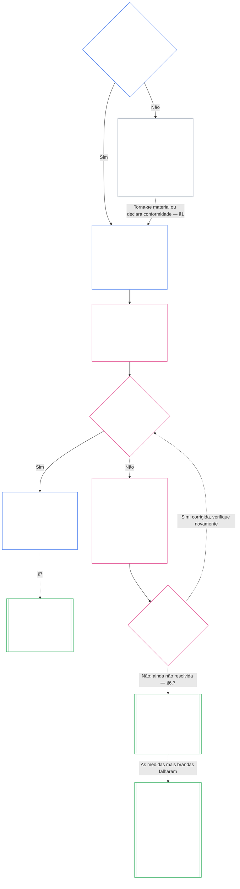

# CAPÍTULO SETE: CARTAS DO SISTEMA E INSTITUCIONAIS

> **Status da tradução:** rascunho completo do capítulo assistido por IA, em português brasileiro, ainda não revisado por leitor independente fluente. O inglês numerado é a fonte vinculante.

<strong>Lugar no corpus (não operativo): estrutura do arquivo e regras de leitura</strong>

> Este arquivo **faz parte da Constituição Senciente** e **só vincula em conjunto** com os demais arquivos numerados `core_*`, lidos como um só texto. Contém o **Capítulo Sete**: o piso para os documentos de escopo publicados por um sistema e por uma instituição: a Carta do Sistema e a Carta Institucional. Ele vem depois do Piso de Direitos do Capítulo Seis e antes do [Capítulo Oito](../../../core_08.000_functional_independence_segregation_of_duties.md#chapter-eight-functional-independence-and-segregation-of-duties), que separa os assentos dentro de qualquer ato materialmente vinculante.
>
> - **Responsável constitucional:** quando um sistema deve publicar uma Carta do Sistema e quando uma instituição deve publicar uma Carta Institucional (obrigatória na Classe L ou superior, voluntária na Classe P), o conteúdo mínimo de cada uma, como são alteradas e revisadas, e a verificação de formação sobre a posição e a autenticidade de quem ocupa cargos abrangidos.
> - **Sede das definições:** [Carta do Sistema](../../../core_05.040_band_continuity.md#system-charter), [Carta Institucional](../../../core_05.040_band_continuity.md#institutional-charter), [Mapa de Funções da Carta](../../../core_05.040_band_continuity.md#charter-role-map), [Parte Constituída](../../../core_05.040_band_continuity.md#chartered-party) e [Parte Operadora](../../../core_05.050_band_oversight.md#operating-party) são definidas no Capítulo Cinco. Este capítulo as aplica, sem redefini-las.
> - **Responsável pela implementação:** [CI-8.205 §6](../../../corpus_institutions/ci_08.205_institutional_design_separation_of_powers.md#ci-8205-6-system-and-institutional-charter-contents-review-and-formation-template) (*Conteúdo das Cartas do Sistema e Institucional, revisão e modelo de formação*) contém o modelo completo dos campos, a lista de revisão, o procedimento de formação e o modelo da declaração de verificação de formação. Pode ser mais rigoroso e acrescentar campos. Não pode reduzir o piso deste capítulo. Seu texto vincula como texto de implementação incorporado apenas dentro do escopo válido de adoção ([Capítulo Dezoito §4 Enquadramento da adoção e escopo da autoridade](../../../core_18.000_incorporation.md#4-adoption-framing-and-scope-of-authority)); o piso deste capítulo vincula como texto central.
> - **Capítulos que aplicam estas regras:** o [Capítulo Oito §5 Posicionamento, vacância e substituição publicados](../../../core_08.000_functional_independence_segregation_of_duties.md#5-published-placement-vacancy-and-substitution) exige o Mapa de Funções da Carta. O Capítulo Nove consulta a Carta do Sistema para determinar escopo e limites, e a Parte D do Capítulo Nove testa a declaração de verificação de formação de uma Instituição. O [Capítulo Dez §3.7 Custódia de registros e autoridade para abri-los](../../../core_10.000_standing_assessment.md#37-record-custody-and-opening-authority) a aplica aos registros de posição. O [Capítulo Treze §4.3 Fóruns institucionais](../../../core_13.000_forum.md#43-institutional-forums) julga controvérsias sobre a Carta Institucional.
>
> Ordem de leitura: §1 quando as Cartas do Sistema e Institucional são exigidas, com o diagrama do processo → §2 o direito de formar e quatro limites estritos → §3 o que devem declarar → §4 o Mapa de Funções da Carta e a custódia de registros de posição → §5 a verificação de formação da posição e autenticidade de titulares de cargos → §6 quando um titular não passa na verificação de formação → §7 alteração, revisão e desalinhamento de escopo.

<strong>Rastreio</strong>

- Fontes anteriores:
  - [Tétrade Constitucional](../../../core_00.000_preamble.md#constitutional-tetrad), especialmente **supervisão** e **responsabilização**;
  - [interesse material](../../../core_00.000_preamble.md#material-stake);
  - [Capítulo Um §18.1 Governança como estrutura autorizada](../../../core_01.010_stewardship_capacity_principles.md#181-governance-as-authorized-structure) (1.015 §18.1);
  - [Artigo XI-E](../../../core_06.005_rights_part_b.md#article-xi-e-institutional-formation-and-business-creation) (*Formação institucional e criação de empresas*).
- Subseções:
  - [§1](#1-quando-as-cartas-do-sistema-e-institucional-são-exigidas);
  - [§2](#2-o-direito-de-formar-e-quatro-limites-estritos);
  - [§3](#3-o-que-as-cartas-do-sistema-e-institucional-devem-declarar);
  - [§4](#4-o-mapa-de-funções-da-carta-e-a-custódia-de-registros-de-posição);
  - [§5](#5-verificação-de-formação-posição-e-autenticidade-de-titulares-de-cargos);
  - [§6](#6-quando-um-titular-não-passa-na-verificação-de-formação);
  - [§7](#7-alteração-revisão-e-desalinhamento-de-escopo).
- Aplicação posterior:
  - [Capítulo Oito](../../../core_08.000_functional_independence_segregation_of_duties.md#chapter-eight-functional-independence-and-segregation-of-duties) (8.000);
  - [Capítulo Nove](../../../core_09.000_system_alignment_certification_evaluation.md#chapter-nine-system-alignment-certification) (9.000);
  - [Capítulo Dez](../../../core_10.000_standing_assessment.md#chapter-ten-contribution-violation-and-standing-model--measurement) (10.000);
  - [Capítulo Treze](../../../core_13.000_forum.md#chapter-thirteen-forums-and-jurisdiction) (13.000);
  - [Capítulo Quatorze](../../../core_14.000_governance.md#chapter-fourteen-constitutional-contract-legitimacy-authorization-and-stewardship) (14.000); o texto de implementação designado acima.
- Ler em conjunto com:
  - [Hierarquia interna e pilha de autoridade](../../../core_05.045_band_integrative.md#authority-stack-and-internal-hierarchy);
  - [Limites dos sistemas](../../../core_05.040_band_continuity.md#system-boundaries);
  - [Integridade dos limites do sistema](../../../core_05.040_band_continuity.md#system-boundary-integrity);
  - [Criação de sistemas](../../../core_05.055_band_participation.md#system-creation);
  - [Criação de empresas](../../../core_05.055_band_participation.md#business-creation).

 

O Capítulo Sete é o responsável constitucional pelas **Cartas do Sistema, Cartas Institucionais e escopo publicado**.

Três capítulos formam uma só cadeia:

- **Capítulo Sete (este capítulo):** diz o que uma [Parte Constituída](../../../core_05.040_band_continuity.md#chartered-party) declara fazer e quem pode ocupar cada assento quando ela atua.
- **[Capítulo Oito](../../../core_08.000_functional_independence_segregation_of_duties.md#chapter-eight-functional-independence-and-segregation-of-duties):** diz como esses assentos devem permanecer separados.
- **[Capítulo Nove](../../../core_09.000_system_alignment_certification_evaluation.md#chapter-nine-system-alignment-certification):** certifica um sistema e, separadamente, uma instituição, cada qual como um ato vinculante que usa os assentos. O capítulo devolve suas conclusões à Carta do Sistema ou à Carta Institucional.

Outros capítulos definem os termos, as regras dos assentos, os bloqueios de posição e as regras decisórias a que este capítulo remete. **CI-8.205 §6** (*Conteúdo das Cartas do Sistema e Institucional, revisão e modelo de formação*) contém o modelo dos campos, o procedimento de formação e a lista de revisão.

### 1. Quando as Cartas do Sistema e Institucional são exigidas

<strong>Rastreio</strong>

- Fontes anteriores:
  - [§2](#2-o-direito-de-formar-e-quatro-limites-estritos);
  - [interesse material](../../../core_00.000_preamble.md#material-stake);
  - [Proporcionalidade](../../../core_05.035_band_accountability.md#proportionality); afirmação de responsabilidade na abertura do capítulo;
  - [Capítulo Um §18 Governança sob disciplina de tutela](../../../core_01.010_stewardship_capacity_principles.md#18-governance-under-stewardship-discipline) (1.015 §18);
  - [Supervisão](../../../core_05.020_apex_oversight_leg.md#oversight-constitutional);
  - [Responsabilização](../../../core_05.005_apex_accountability_leg.md#accountability).
- Aplicação posterior: [§3](#3-o-que-as-cartas-do-sistema-e-institucional-devem-declarar); [Capítulo Nove Parte A §2 Avaliação da classe do sistema](../../../core_09.000_system_alignment_certification_evaluation.md#2-system-class-evaluation) (9.000 §2) (*classe e profundidade da certificação*); [Capítulo Nove Parte D §12.1 Classe da Instituição](../../../core_09.015_institutional_alignment_certification.md#121-institution-class) (*classe de uma Instituição*); **CS-9.305 (*Mecanismo de classificação de sistemas*) e CS-9.310** (*Mecanismo de classificação de sistemas*) para o catálogo de classes.
- Ler em conjunto com:
  - **CI-8.205 §6** (*Conteúdo das Cartas do Sistema e Institucional, revisão e modelo de formação*);
  - **CF-13.415 §5** (*Registradores institucionais e locais*);
  - **CI-9.210** (*Obrigações institucionais vinculadas à classificação*);
  - [Carta do Sistema no Capítulo Cinco](../../../core_05.040_band_continuity.md#system-charter) (5.040);
  - [Carta Institucional no Capítulo Cinco](../../../core_05.040_band_continuity.md#institutional-charter) (5.040);
  - [Artigo XI-E](../../../core_06.005_rights_part_b.md#article-xi-e-institutional-formation-and-business-creation) (*Formação institucional e criação de empresas*).

<strong>Definições · Avaliação · Conformidade</strong>

- [Carta do Sistema](../../../core_05.040_band_continuity.md#system-charter) · [O](../../../core_05.040_band_continuity.md#system-charter) · [M](../../../core_05.040_band_continuity.md#system-charter-a) · [A](../../../core_05.040_band_continuity.md#system-charter-a) · [C](../../../core_05.040_band_continuity.md#system-charter-c)
- [Carta Institucional](../../../core_05.040_band_continuity.md#institutional-charter) · [O](../../../core_05.040_band_continuity.md#institutional-charter) · [M](../../../core_05.040_band_continuity.md#institutional-charter-a) · [A](../../../core_05.040_band_continuity.md#institutional-charter-a) · [C](../../../core_05.040_band_continuity.md#institutional-charter-c)
- [Governança ajustada à classificação](../../../core_05.050_band_oversight.md#classification-scaled-governance) · [O](../../../core_05.050_band_oversight.md#classification-scaled-governance) · [M](../../../core_05.050_band_oversight.md#classification-scaled-governance-a) · [A](../../../core_05.050_band_oversight.md#classification-scaled-governance-a) · [C](../../../core_05.050_band_oversight.md#classification-scaled-governance-c)

 

*Em termos simples: antes que alguém possa avaliar se um sistema ou uma instituição respeitou seus limites, esses limites precisam estar escritos e disponíveis para todos. Um sistema que seja material para outros sencientes em qualquer uma das nove áreas da [Materialidade específica por domínio](../../../core_05.050_band_oversight.md#domain-specific-materiality) precisa publicar uma Carta do Sistema. Uma instituição publica a carta adequada aos sistemas que opera. A Classe P é voluntária: um círculo de costura que doa colchas a refugiados serve de exemplo.*

Uma Carta do Sistema ou Carta Institucional é o escopo publicado de uma Parte Constituída: o que ela declara ter autoridade para fazer, o que não fará e quem ocupa cada assento quando ela atua. É sob esse escopo que os assentos do Capítulo Oito são posicionados e contra o qual a certificação no Capítulo Nove compara a operação real. A obrigação de uma Parte Operadora publicar uma carta depende de sua classe: **obrigatória na Classe L ou superior, voluntária na Classe P.** Quando obrigada a publicá-la, deve mantê-la atualizada.

As cinco classes de impacto do sistema formam o quadro de tudo o que segue. Da mais à menos consequente, uma linha para cada:

- **Classe A, crítica para a sobrevivência, fundamental e insubstituível:** uma falha dentro do prazo relevante para a sobrevivência, sem substituto viável, causa a perda das condições de sobrevivência.
- **Classe B, crítica, de alta dependência e importância sistêmica:** quem depende dela não consegue manter a função central sem ela. A sobrevivência não se perde de imediato, e ainda é possível substituí-la a tempo.
- **Classe C, coordenada, de alta dependência e não crítica:** molda a coordenação em grande escala, mas não é requisito operacional para o funcionamento das Classes A ou B.
- **Classe L, local, de impacto limitado e não crítica:** seus efeitos ultrapassam uma unidade privada, mas são locais, substituíveis e contíveis.
- **Classe P, pessoal, de uso privado, isolada e experimental:** seus efeitos ficam dentro de uma unidade privada, sem dependência externa relevante.

[CS-9.310 §8](../../../corpus_systems/cs_09.310_system_impact_classifications.md#cs-9310-8-system-impact-classifications) (*Classificações de impacto do sistema*) contém as definições completas. As Classes A, B, C e L devem publicar; a Classe P pode fazê-lo. A [§1.2 Quais classes estão abrangidas](#12-quais-classes-estão-abrangidas) explica como uma Instituição herda sua classe dos sistemas que opera.

#### 1.1 Quem deve publicar

Um Sistema de Classe L ou superior deve publicar e manter uma [Carta do Sistema](../../../core_05.040_band_continuity.md#system-charter). Uma Instituição de Classe L ou superior deve publicar e manter a carta adequada aos Sistemas que opera:

| O que a Instituição opera, administra ou controla materialmente | O que publica |
| --- | --- |
| Exatamente um Sistema que precisa de Carta do Sistema | Essa Carta do Sistema, sem um segundo documento. Ela nomeia a Instituição como responsável e também serve de [Carta Institucional](../../../core_05.040_band_continuity.md#institutional-charter): um documento cobre ambos. |
| Mais de um Sistema desse tipo | Uma Carta Institucional. Ela inclui todas as Cartas do Sistema vigentes para esses Sistemas e declara por que a Instituição opera precisamente esses Sistemas ([§3 O que as Cartas do Sistema e Institucional devem declarar](#3-o-que-as-cartas-do-sistema-e-institucional-devem-declarar)). |
| Nenhum Sistema desse tipo | Uma Carta Institucional que declare os itens próprios da Instituição previstos em [§3 O que as Cartas do Sistema e Institucional devem declarar](#3-o-que-as-cartas-do-sistema-e-institucional-devem-declarar), sem Cartas do Sistema a incluir. |

- **Empresas e formas comparáveis:** uma empresa ou outra forma organizacional administrada publica a Carta do Sistema ou a Carta Institucional que se aplica a ela como Sistema, como Instituição ou como Instituição que opera um Sistema abrangido. Sua forma jurídica não altera a resposta.
- **Prática profissional conjunta:** uma pessoa senciente ou pequena prática de Classe L ou superior que realize um ato incluído numa licença ou autorização profissional pode cumprir esta seção para esses atos adotando a Carta do Sistema ou Carta Institucional de uma entidade anfitriã e seu Mapa de Funções da Carta:
  - **O que se adota:** por referência, a Carta do Sistema ou Carta Institucional e o Mapa de Funções da Carta da anfitriã na prática profissional conjunta; esses documentos devem abranger os atos em questão.
  - **Aviso de adoção:** o aviso de uma página descrito em **CI-14.205 §7** (*Licença profissional, autorização profissional e prática profissional conjunta*).
  - **Classe:** a prática conserva a classe determinada por seus próprios atos.

#### 1.2 Quais classes estão abrangidas

A classe da Parte Constituída decide se a publicação é obrigatória ou facultativa:

- **Classes A, B, C e L:** obrigatória. O diagrama em [§1.7 O processo em visão geral](#17-o-processo-em-visão-geral) mostra o processo que seguem.
- **Classe P:** facultativa até que um de dois eventos a torne obrigatória. [§1.3 O que é a Classe P](#13-o-que-é-a-classe-p) explica quando uma Parte Operadora é Classe P; [§1.4 Classe P: cartas facultativas e quando se tornam obrigatórias](#14-classe-p-cartas-facultativas-e-quando-se-tornam-obrigatórias) define a escolha e quando ela termina.
- **Classe de uma Instituição:** a Instituição assume a classe mais alta de qualquer Sistema que opera, administra ou controla materialmente. Se não opera nenhum Sistema desse tipo, sua classificação depende de seu próprio impacto material e dependência, avaliados pelo que realmente decide e controla, não pelo nome ou forma jurídica, conforme [Capítulo Nove Parte D §12.1 Classe da Instituição](../../../core_09.015_institutional_alignment_certification.md#121-institution-class).

#### 1.3 O que é a Classe P

Uma Parte Operadora só é Classe P enquanto sua atividade permanecer abaixo do limite em cada um dos nove domínios de [Materialidade específica por domínio](../../../core_05.050_band_oversight.md#domain-specific-materiality), o que, na prática, significa que seus atos e efeitos ficam dentro de sua [unidade privada](../../../core_05.050_band_oversight.md#domain-specific-materiality-private-unit):

- **Ultrapassar um limite:** ultrapassar o limite em qualquer domínio a torna no mínimo Classe L, conforme **CS-9.305 (*Mecanismo de classificação de sistemas*) e CS-9.310** (*Mecanismo de classificação de sistemas*), qualquer que seja seu tamanho ou nome.
- **Permanecer abaixo de todos os limites:** ela continua na Classe P, seja qual for o número de membros.
- **Quem está dentro:** a Classe P também depende de quem está dentro dela. Toda pessoa que perceba a Parte Operadora ultrapassar um limite deve informar isso; a comunicação é protegida ([Materialidade específica por domínio](../../../core_05.050_band_oversight.md#domain-specific-materiality)).

O piso de quatro assentos do Capítulo Oito não se aplica aos atos de uma Parte Operadora de Classe P, que ficam dentro de sua unidade privada; assim, uma única pessoa senciente com um computador não precisa de um segundo titular de assento. O piso passa a valer no dia em que a Parte Operadora pratica um [Ato Materialmente Vinculante](../../../core_05.035_band_accountability.md#materially-binding-act) que outros sencientes devem seguir ou podem tratar como definitivo, ultrapassando o limite no domínio da autoridade sobre terceiros e tornando-a no mínimo Classe L.

#### 1.4 Classe P: cartas facultativas e quando se tornam obrigatórias

Recomenda-se que uma Parte Operadora de Classe P publique a [Carta do Sistema](../../../core_05.040_band_continuity.md#system-charter) (para um único sistema) ou a [Carta Institucional](../../../core_05.040_band_continuity.md#institutional-charter) (para mais de um sistema ou nenhum) adequada ao que opera. Ela pode usar como modelo a lista de conteúdo de [§3 O que as Cartas do Sistema e Institucional devem declarar](#3-o-que-as-cartas-do-sistema-e-institucional-devem-declarar) e o mapa de assentos de [§4 O Mapa de Funções da Carta e a custódia de registros de posição](#4-o-mapa-de-funções-da-carta-e-a-custódia-de-registros-de-posição). A publicação não cria dever algum no processo deste capítulo:

- não há prazo de publicação ([§1.5 Quando vence o prazo para a Carta do Sistema ou Carta Institucional](#15-quando-vence-o-prazo-para-a-carta-do-sistema-ou-carta-institucional));
- não há verificação de formação ([§5 Verificação de formação: posição e autenticidade de titulares de cargos](#5-verificação-de-formação-posição-e-autenticidade-de-titulares-de-cargos));
- não é obrigatório um [Mapa de Funções da Carta](../../../core_05.040_band_continuity.md#charter-role-map) ([§4 O Mapa de Funções da Carta e a custódia de registros de posição](#4-o-mapa-de-funções-da-carta-e-a-custódia-de-registros-de-posição)), embora ela possa mantê-lo com sua Carta do Sistema ou Carta Institucional voluntária, ou publicá-lo separadamente; e
- não é obrigatório um ciclo de alterações ou revisões ([§7 Alteração, revisão e desalinhamento de escopo](#7-alteração-revisão-e-desalinhamento-de-escopo)).

Se ocorrer qualquer uma destas situações, a publicação deixa de ser facultativa:

- a Parte Operadora é reclassificada como Classe L ou superior; ou
- seu operador declara conformidade constitucional em nome da Parte Operadora.

Então, a Parte Operadora deve publicar a Carta do Sistema ou Carta Institucional adequada, segundo o cronograma de [§1.5 Quando vence o prazo para a Carta do Sistema ou Carta Institucional](#15-quando-vence-o-prazo-para-a-carta-do-sistema-ou-carta-institucional).

**O reconhecimento não depende de um documento de escopo.** Um grupo, tenha ou não uma Carta do Sistema ou Carta Institucional e qualquer que seja sua classe, não se interpõe entre seus membros e o reconhecimento. Cada membro pode solicitar um registro de contribuição como requerente individual, pelo trabalho realizado dentro ou fora do grupo; o registro trata da contribuição do membro, não da posição do grupo ([Capítulo Dez §3.7 Registros informais e de escopo limitado](../../../core_10.000_standing_assessment.md#37-informal-and-small-scope-records)). Prestar ajuda, fornecer bens, trabalho ou serviços cuja aceitação não seja obrigatória não é um ato materialmente vinculante; por isso, um círculo de ajuda mútua que doa colchas a refugiados não precisa de Carta do Sistema nem de Carta Institucional para que seus membros sejam reconhecidos.

#### 1.5 Quando vence o prazo para a Carta do Sistema ou Carta Institucional

Um Sistema ou Instituição abrangido publica sua [Carta do Sistema](../../../core_05.040_band_continuity.md#system-charter) ou [Carta Institucional](../../../core_05.040_band_continuity.md#institutional-charter) conforme este cronograma:

- **Sistema ou Instituição novos:** antes de entrar em operação ou começar a exercer autoridade sobre terceiros.
- **Quem já está em operação:** na próxima revisão de classificação ou certificação, ou dentro do prazo de resolução após solicitação feita nos termos de [§1.6 Quando falta uma Carta do Sistema ou Carta Institucional](#16-quando-falta-uma-carta-do-sistema-ou-carta-institucional), o que ocorrer primeiro. Até publicar, está em descumprimento.
  - **Qual certificação:** para um Sistema, sua Certificação de Alinhamento do Sistema. Para uma Instituição, a certificação de alinhamento institucional segundo [Capítulo Nove Parte D §11.3 Sem permissão e sem barreira](../../../core_09.015_institutional_alignment_certification.md#113-no-permission-and-no-gate); o prazo da primeira certificação nunca condiciona a publicação da Carta Institucional nem a operação.
- **Verificação de formação:** ela também conclui a verificação de formação de [§5 Verificação de formação: posição e autenticidade de titulares de cargos](#5-verificação-de-formação-posição-e-autenticidade-de-titulares-de-cargos) nesse mesmo momento.
- **Onde protocolar:** a Carta do Sistema ou Carta Institucional, junto com seu Mapa de Funções da Carta e a declaração de verificação de formação, é protocolada no registro institucional ou, se a atividade e os sencientes afetados forem locais, no registro local (**CF-13.415 §5** (*Registradores institucionais e locais*)):
  - **O que faz o registrador:** verifica se falta algum item obrigatório e emite um recibo datado.
  - **O que o registrador nunca faz:** não concede permissão nem decide a classe ou o conteúdo.
  - **Recibo atrasado ou ausente:** nunca impede a Parte Constituída de operar.

#### 1.6 Quando falta uma Carta do Sistema ou Carta Institucional

Qualquer pessoa que perceba que uma Parte Constituída de Classe L ou superior, nova ou recém-classificada nessa classe, não publicou sua Carta do Sistema ou Carta Institucional pode solicitá-la à sua autoridade dirigente. Quem solicita não precisa ter legitimidade, não paga taxa e não precisa demonstrar dano. A solicitação identifica a Parte Constituída e explica por que ela parece estar abrangida.

Da solicitação começam a correr dois prazos: o prazo para responder e o prazo para resolver. A duração de cada um vem do Nível de mesma letra que a classe da Parte Constituída; quanto mais crítica a classe, menores os prazos:

| Classe e Nível | Prazo para responder (meta de recebimento) | Prazo para resolver (limite máximo) |
|---|---|---|
| Classe A, Nível A | 24 horas | 7 dias corridos |
| Classe B, Nível B | 2 dias corridos | 14 dias corridos |
| Classe C, Nível C | 4 dias corridos | 30 dias corridos |
| Classe L, Nível L | 8 dias corridos | 60 dias corridos |

Os valores vêm de **CF-13.445 §3.1** (*Metas por etapa e pisos de prazo*), que prevalece se houver divergência. Se uma Parte Constituída contestar sua classe, ela será contada no Nível da classe mais crítica entre aquela que consta em seu Registro de Classificação do Sistema e qualquer classe que quem solicita ou o fórum demonstre prima facie, até a questão ser decidida. Uma Parte Constituída sem classe registrada, ou com Classe P enquanto sua classe está em questão, é contada no Nível C.

Os prazos funcionam assim:

- **Prazo para responder:** a Parte Constituída responde dentro do prazo para responder, que corresponde à meta de recebimento do Nível correspondente em **CF-13.445 §3.1** (*Metas por etapa e pisos de prazo*), contado da solicitação. Ela publica a Carta do Sistema ou Carta Institucional, informa a data em que fará isso, indica a carta que já publicou ou declara que está abaixo de todas as linhas da [Materialidade específica por domínio](../../../core_05.050_band_oversight.md#domain-specific-materiality) e apresenta a demonstração escrita exigida para esse enquadramento.
- **Prazo para resolver:** a Carta do Sistema ou Carta Institucional deve ser publicada dentro do prazo de resolução, que corresponde ao limite máximo do Nível correspondente em **CF-13.445 §3.1** (*Metas por etapa e pisos de prazo*), contado da solicitação, junto com a declaração de verificação de formação correspondente ([§5 Verificação de formação: posição e autenticidade de titulares de cargos](#5-verificação-de-formação-posição-e-autenticidade-de-titulares-de-cargos)). Uma Parte Constituída que ainda não tenha um assento independente registra essa declaração como declaração acompanhada de suas provas, conforme previsto nessa seção.
- **Parte Operadora que afirma estar abaixo do limite:** a solicitação também se torna uma contestação de classificação, pelo procedimento de *Rota para contestação* da entrada correspondente:
  - **Contagem do prazo:** o prazo de resolução continua correndo enquanto a contestação está pendente.
  - **Prorrogação por contestação:** se o fórum competente considerar que a contestação merece revisão, prorroga-se a data-limite e um novo prazo de resolução começa quando ela for decidida. O fórum decide a contestação dentro do limite máximo do Nível correspondente.
  - **O que merece revisão:** a contestação merece revisão quando identifica um cruzamento específico em domínio nomeado e a demonstração escrita da Parte Operadora deixa uma dúvida real sobre esse cruzamento. A própria Parte Operadora não decide isso; uma resposta sem demonstração escrita não prorroga o prazo.
  - **Quando uma classe é determinada:** nesta contestação ou em qualquer outra, a data da determinação conta como data da solicitação: o prazo para responder e o prazo de resolução começam a correr a partir dela, no Nível da classe determinada (Classe A, B, C ou L).
- **Descumprimento do prazo:** não responder, ou não publicar a Carta do Sistema ou Carta Institucional até a data-limite, é um defeito a registrar e corrigir. Quem solicitou pode levá-lo ao fórum competente pelo mesmo procedimento. Nunca é condição para formar ou operar.
- **Solicitação repetida:** uma segunda solicitação sobre a mesma Parte Constituída, feita enquanto ainda vigorar a resposta anterior ou uma determinação sobre ela, não inicia novos prazos para responder ou resolver. A Parte Constituída responde apontando para aquela resposta ou determinação. Sua própria demonstração de que está abaixo de todos os limites, ainda sem revisão do fórum, não conta como resposta vigente. A resposta ou determinação continua vigente até que ocorra um dos fatos que, segundo os critérios para reabertura descritos em [Capítulo Nove Parte D §14.2 Critérios para reabertura](../../../core_09.015_institutional_alignment_certification.md#142-reopening-triggers), encerra essa vigência:
  - **Mudança material:** a atividade da Parte Constituída muda materialmente.
  - **Novas provas:** são apresentadas novas provas sobre um cruzamento.

  Uma solicitação que demonstre qualquer uma dessas situações não é repetida. É uma nova solicitação, processada de forma separada e independente da anterior. Tem seu próprio prazo para responder e prazo de resolução, contados de sua própria data; a resposta, determinação e prazos anteriores não a satisfazem nem são alterados por ela.
- **Escopo enquanto isso:** a ausência de uma Carta do Sistema ou Carta Institucional não permite tratar a Parte Constituída como ilimitada. Até que ela exista, valem os [Limites reais do Sistema](../../../core_05.040_band_continuity.md#system-boundaries) e a classe efetiva da Parte Constituída; uma certificação ou um fórum pode reconstruir o escopo a partir da operação observada.

#### 1.7 O processo em visão geral

O diagrama acompanha uma Parte Operadora desde a pergunta sobre se ela é material para outros sencientes até a publicação e atualização correta de sua Carta do Sistema ou Carta Institucional. Se um problema não for corrigido dentro do prazo de resolução, o processo de elaboração da carta o encaminha para uma revisão regulada fora deste capítulo. As seções seguintes explicam cada etapa nessa mesma ordem.

<strong>Orientação de leitura (não operativa): como ler o diagrama</strong>

> Em termos simples: ninguém concede uma Carta do Sistema ou Carta Institucional e ninguém precisa de permissão para formar uma organização. Uma Parte Constituída cuja atividade seja material para outros publica o que declara ter autoridade para fazer e quem ocupa cada assento; os titulares de seus cargos principais são verificados. Se um titular não passar, ele é substituído ou a causa é corrigida, e a Parte Constituída continua. Se a falha ainda não for corrigida quando vencer o prazo de resolução, um fórum pode revisar a Parte Constituída, começando pela medida mais branda que proteja os demais. Reduzir a Parte Constituída para abaixo da Classe L ou dissolvê-la só ocorre se as medidas mais brandas falharem. Uma Parte Constituída dissolvida não pode voltar enquanto o bloqueio estiver vigente.
>
> As setas contínuas mostram o caminho principal. As setas pontilhadas mostram exceções e transferências, identificadas pela seção que as autoriza. As caixas com barras duplas laterais pertencem a outro capítulo ou ao texto de implementação incorporado. O diagrama não acrescenta dever, assento ou campo, e nenhuma etapa concede permissão.

 

### 2. O direito de formar e quatro limites estritos

<strong>Orientação de leitura (não operativa): estrutura desta seção</strong>

- [§2.1 O direito de formar](#21-o-direito-de-formar) declara esse direito e a quem ele não abrange.
- [§2.2 Primeiro limite: uma trava vigente sobre um senciente](#22-primeiro-limite-uma-trava-vigente-sobre-um-senciente) explica como uma trava impede um senciente nomeado de ocupar um cargo controlador.
- [§2.3 Segundo limite: suspensão breve baseada em fatos específicos verificados](#23-segundo-limite-suspensão-breve-baseada-em-fatos-específicos-verificados) explica como uma suspensão breve pode impedir um senciente nomeado de ocupar um cargo controlador.
- [§2.4 Terceiro limite: trava sobre a própria Parte Operadora](#24-terceiro-limite-trava-sobre-a-própria-parte-operadora) explica como uma trava sobre uma Parte Operadora a impede, junto com suas sucessoras, e como uma Parte Constituída dissolvida não pode voltar.
- [§2.5 Quarto limite: licença ou autorização profissional](#25-quarto-limite-licença-ou-autorização-profissional) explica quando um ato nomeado de alto risco requer licença ou autorização. Isso não é uma barreira para formar.

<strong>Rastreio</strong>

- Fontes anteriores: [§1](#1-quando-as-cartas-do-sistema-e-institucional-são-exigidas); [Artigo XI-E](../../../core_06.005_rights_part_b.md#article-xi-e-institutional-formation-and-business-creation) (*Formação institucional e criação de empresas*).
- Aplicação posterior: [§1 Quando as Cartas do Sistema e Institucional são exigidas](#1-quando-as-cartas-do-sistema-e-institucional-são-exigidas); [§5 Verificação de formação: posição e autenticidade de titulares de cargos](#5-verificação-de-formação-posição-e-autenticidade-de-titulares-de-cargos).
- Ler em conjunto com:
  - [Suspensão Provisória](../../../core_05.035_band_accountability.md#interim-hold);
  - [Capítulo Onze §4.2 Prevenção — travas gerais de posição](../../../core_11.000_standing_integration.md#42-prevention--general-standing-locks) (11.000 §4.2);
  - [Capítulo Onze §5.5 Travas especiais](../../../core_11.000_standing_integration.md#55-special-locks) (11.000 §5.5);
  - [Capítulo Treze §5 Suspensão provisória na via de um senciente nomeado](../../../core_13.000_forum.md#interim-hold-on-a-named-sentients-pathway) (13.000 §5).

 

*Em termos simples: ninguém precisa de permissão para formar um sistema, instituição ou empresa. Quatro limites estritos podem se aplicar. Três são barreiras: uma trava não resolvida pode impedir um senciente de ocupar um cargo controlador; uma suspensão breve baseada em fatos específicos verificados pode fazer o mesmo; e uma trava sobre a própria Parte Operadora pode impedi-la de atuar. O quarto limite pode exigir licença ou autorização antes de um ato nomeado de alto risco. Uma Parte Constituída dissolvida por um fórum fica impedida de voltar, e o impedimento é permanente quando a dissolução se baseou em conduta anticonstitucional disseminada ou em dano grave irreversível que nunca foi reparado. Nenhum desses limites impede que uma nova Parte Operadora se forme ou opere, e este capítulo não acrescenta limites.*

O **Artigo XI-E** (*Formação institucional e criação de empresas*) permite quatro limites estritos:

- **Os três primeiros são as únicas barreiras** à formação de uma Parte Operadora ou ao exercício de autoridade nela. Cada uma incide sobre um sujeito nomeado:
  - **Trava vigente** ([§2.2 Primeiro limite: uma trava vigente sobre um senciente](#22-primeiro-limite-uma-trava-vigente-sobre-um-senciente)): incide sobre um senciente nomeado, em um cargo que controla a Parte Constituída.
  - **Suspensão Provisória** ([§2.3 Segundo limite: suspensão breve baseada em fatos específicos verificados](#23-segundo-limite-suspensão-breve-baseada-em-fatos-específicos-verificados)): incide somente sobre um senciente nomeado, em um cargo que controla a Parte Constituída.
  - **Trava sobre a própria Parte Operadora** ([§2.4 Terceiro limite: trava sobre a própria Parte Operadora](#24-terceiro-limite-trava-sobre-a-própria-parte-operadora)): incide sobre uma Parte Constituída que esteja sob trava, inclusive uma dissolvida por um fórum.
- **O quarto não é uma barreira:** é uma licença ou autorização profissional ([§2.5 Quarto limite: licença ou autorização profissional](#25-quarto-limite-licença-ou-autorização-profissional)).

#### 2.1 O direito de formar

Qualquer senciente pode formar um novo sistema, instituição ou empresa. Esse direito está previsto no [Artigo XI-E](../../../core_06.005_rights_part_b.md#article-xi-e-institutional-formation-and-business-creation) (*Formação institucional e criação de empresas*). Este capítulo acrescenta o dever que vem em seguida. Quando a atividade de uma Parte Operadora se torna material para terceiros em qualquer uma das nove áreas da [Materialidade específica por domínio](../../../core_05.050_band_oversight.md#domain-specific-materiality), ela deve declarar publicamente, com antecedência, a autoridade que reivindica ([§1 Quando as Cartas do Sistema e Institucional são exigidas](#1-quando-as-cartas-do-sistema-e-institucional-são-exigidas)). A adoção de uma Carta do Sistema ou Carta Institucional não deve ser interpretada como redução desse direito ou de qualquer proteção do Piso de Direitos.

**Quem não está abrangido pelo direito de formar.** Além das três barreiras previstas em [§2.2 Primeiro limite: uma trava vigente sobre um senciente](#22-primeiro-limite-uma-trava-vigente-sobre-um-senciente), [§2.3 Segundo limite: suspensão breve baseada em fatos específicos verificados](#23-segundo-limite-suspensão-breve-baseada-em-fatos-específicos-verificados) e [§2.4 Terceiro limite: trava sobre a própria Parte Operadora](#24-terceiro-limite-trava-sobre-a-própria-parte-operadora), o **Artigo XI-E** (*Formação institucional e criação de empresas*) não protege:

- uma Parte Operadora planejada para violar uma Restrição Constitucional, enfraquecer a Segurança ou a Verdade, ou concentrar poder de modo vedado pelo [Capítulo Um §11 Estrutura de mercado](../../../core_01.000_values_principles.md#11-market-structure); ou
- uma Parte Operadora formada ou administrada por um fundador que não esteja autenticamente alinhado com a finalidade declarada, conforme demonstrado por conduta, controle e recompensas verificados, que pretenda enganar outros sobre sua finalidade, controle ou interesses, ou causar dano a terceiros.

Os fóruns decidem esses casos nos termos daquele Artigo, e as únicas consequências são as três barreiras nele previstas: a barreira por trava vigente, a Suspensão Provisória e a trava sobre a própria Parte Operadora. A reprovação na verificação de formação é uma das provas que o fórum pondera; a verificação de formação, por si só, não decide o caso.

#### 2.2 Primeiro limite: uma trava vigente sobre um senciente

Uma [trava de posição](../../../core_11.000_standing_integration.md#42-prevention--general-standing-locks) ou [trava especial](../../../core_11.000_standing_integration.md#55-special-locks), imposta após uma violação verificada e ainda não levantada, impede um senciente nomeado de exercer autoridade sobre esse tipo de instituição ou empresa.

- **O que fica impedido:** assumir ou exercer autoridade de governança, controle ou propriedade na Parte Operadora.
- **Até onde alcança:** somente até onde a trava determinar. Ela termina quando for levantada ou reduzida.
- **Trava sobre a própria Parte Operadora:** veja [§2.4 Terceiro limite: trava sobre a própria Parte Operadora](#24-terceiro-limite-trava-sobre-a-própria-parte-operadora).

#### 2.3 Segundo limite: suspensão breve baseada em fatos específicos verificados

Este limite se aplica quando um fórum competente ordena uma [Suspensão Provisória](../../../core_05.035_band_accountability.md#interim-hold) com base em fatos específicos verificados que mostram probabilidade superior a 50% de que o titular esteja desalinhado com a finalidade declarada da Parte Constituída. Somente esse fórum pode ordená-la ([Capítulo Treze §5 Suspensão provisória na via de um senciente nomeado](../../../core_13.000_forum.md#interim-hold-on-a-named-sentients-pathway)). A Parte Constituída não pode decidir por conta própria impedir alguém de ocupar um cargo, pois isso a tornaria juíza de seu próprio membro. O fundamento completo é aquele previsto no [Capítulo Treze §5 Suspensão provisória na via de um senciente nomeado](../../../core_13.000_forum.md#interim-hold-on-a-named-sentients-pathway); esta forma resumida não o substitui.

#### 2.4 Terceiro limite: trava sobre a própria Parte Operadora

Uma trava pode incidir sobre uma Parte Operadora, e não apenas sobre um senciente. Nesse caso, a barreira impede o que a via nomeada na trava especifica, na Parte Operadora e em suas sucessoras, entidades controladas e veículos mantidos por interposta pessoa ou empresa de fachada. Ela não impede nenhuma outra Parte Operadora.

- **Trava imposta por designação definitiva:** a [Trava de Confiança Anticonstitucional](../../../core_11.000_standing_integration.md#55-special-locks) produz esse efeito quando a designação definitiva nomeia uma instituição, um veículo sucessor ou uma entidade controlada. A barreira então impede o que a via nomeada na trava especifica, na Parte Constituída e em suas sucessoras, entidades controladas e veículos mantidos por interposta pessoa ou empresa de fachada.
- **Parte Constituída dissolvida:** uma ordem definitiva de dissolução nos termos de **CI-11.210 §4** (*Dissolução*) impõe uma [Trava de Reconstituição após Dissolução](../../../core_11.000_standing_integration.md#55-special-locks). Enquanto ela vigorar, a Parte Constituída dissolvida, suas sucessoras, entidades controladas, veículos mantidos por interposta pessoa ou empresa de fachada e qualquer Parte Operadora que constitua uma só operação com elas não podem ser novamente constituídas, reativadas ou operadas sob qualquer nome ou forma. Quando a ordem constatar conduta anticonstitucional disseminada ou Dano Irreversível não reparado ([Capítulo Onze §8 Restauração e reavaliação](../../../core_11.000_standing_integration.md#8-restoration-and-reassessment)), a trava é permanente: a passagem do tempo, a resolução da causa ou a substituição de titulares não a levantam; ela só termina se a ordem de dissolução for anulada em revisão ou se novos fatos materiais verificados demonstrarem que a conclusão estava errada. Nos demais casos, termina quando uma determinação independente conclui que a causa foi resolvida, a reparação foi entregue e o retorno é mais seguro do que a exclusão continuada. Ela não impede nenhum senciente de formar outra Parte Operadora.

Nenhuma das três barreiras impede que uma nova Parte Operadora se forme, publique sua Carta do Sistema ou Carta Institucional ou comece a operar. Elas só impedem uma parte que esteja sob trava, como uma Parte Constituída dissolvida que tente voltar. As três barreiras são aplicadas na verificação de formação ([§5 Verificação de formação: posição e autenticidade de titulares de cargos](#5-verificação-de-formação-posição-e-autenticidade-de-titulares-de-cargos)).

#### 2.5 Quarto limite: licença ou autorização profissional

O quarto limite se aplica a um ato nomeado, não à formação de uma Parte Operadora:

- **Não é uma barreira à Parte Operadora:** a verificação de formação em [§5 Verificação de formação: posição e autenticidade de titulares de cargos](#5-verificação-de-formação-posição-e-autenticidade-de-titulares-de-cargos) não aplica esse limite.
- **O que é:** uma [Autorização de Competência](../../../core_05.035_band_accountability.md#competency-clearance) que um adotante pode exigir, nos termos do **Artigo XI-E** (*Formação institucional e criação de empresas*), antes de um ato nomeado ser realizado para terceiros, com base em uma conclusão publicada de risco por um fórum técnico.
  - **Licença profissional:** exigida para atos que, se realizados mal, arriscam dano grave ou irreversível.
  - **Autorização profissional:** exigida para atos que, se realizados mal, arriscam dano real, porém menor.
- **A que se aplica:** à realização do ato. Nunca impede que uma Parte Operadora se forme, publique sua Carta do Sistema ou Carta Institucional, ou opere.
- **O que impede:** reivindicar ou realizar o ato sem a autorização. Uma Carta do Sistema ou Carta Institucional não pode incluir o ato em seu escopo, a menos que quem o realize tenha a habilitação exigida ([§3 O que as Cartas do Sistema e Institucional devem declarar](#3-o-que-as-cartas-do-sistema-e-institucional-devem-declarar)).

### 3. O que as Cartas do Sistema e Institucional devem declarar

<strong>Orientação de leitura (não operativa): estrutura desta seção</strong>

- [§3.1 O que declara uma Carta do Sistema](#31-o-que-declara-uma-carta-do-sistema) lista os nove itens.
- [§3.2 Ponteiros da Carta](#32-ponteiros-da-carta) explica como uma Carta do Sistema ou Carta Institucional pode remeter a outro documento publicado em vez de copiar seu conteúdo, e o que torna válida essa remissão.
- [§3.3 O que acrescenta uma Carta Institucional](#33-o-que-acrescenta-uma-carta-institucional) cobre o que uma Carta Institucional contém além dos nove itens: as Cartas do Sistema dos sistemas que a Instituição opera e por que os opera.
- [§3.4 Atos que exigem licença ou autorização profissional](#34-atos-que-exigem-licença-ou-autorização-profissional) diz que uma Carta do Sistema ou Carta Institucional só pode incluir esse ato se cada senciente que o realiza tiver a licença ou autorização, ou trabalhar como aprendiz sob supervisão de alguém que a tenha. Até lá, o ato consta como fora do escopo (item 4 de [§3.1 O que declara uma Carta do Sistema](#31-o-que-declara-uma-carta-do-sistema)).
- [§3.5 Escala](#35-escala) diz o que muda com a classe.

<strong>Rastreio</strong>

- Fontes anteriores: [§1](#1-quando-as-cartas-do-sistema-e-institucional-são-exigidas); [Carta do Sistema no Capítulo Cinco](../../../core_05.040_band_continuity.md#system-charter) (5.040); [Carta Institucional no Capítulo Cinco](../../../core_05.040_band_continuity.md#institutional-charter) (5.040).
- Aplicação posterior:
  - [§4](#4-o-mapa-de-funções-da-carta-e-a-custódia-de-registros-de-posição);
  - [§7](#7-alteração-revisão-e-desalinhamento-de-escopo);
  - [Capítulo Nove Parte B §8.1 Conteúdo mínimo do registro](../../../core_09.005_system_alignment_certification_record_process.md#81-minimum-record-contents) (9.005 §8.1) (*os campos da Carta do Sistema de que depende um registro de certificação*);
  - **CI-8.205 §6** (*Conteúdo das Cartas do Sistema e Institucional, revisão e modelo de formação*) para a lista completa de campos.
- Ler em conjunto com:
  - [Capítulo Dezoito §4 Enquadramento da adoção e escopo da autoridade](../../../core_18.000_incorporation.md#4-adoption-framing-and-scope-of-authority) (18.000 §4) (*um documento de escopo mantido sob outro nome*);
  - [Capítulo Quatorze §4.3 Requisitos de resolução decisória para escolhas vinculantes das partes afetadas](../../../core_14.000_governance.md#43-decision-resolution-requirements-for-binding-stakeholder-choice) (14.000 §4.3);
  - **CI-6.205 §1** (*Supervisão das partes afetadas, notificação e integridade da via de governança vinculante*);
  - **CI-6.205 §2** (*Salvaguardas contra concentração de poder e em favor da legitimidade participativa*).

<strong>Definições · Avaliação · Conformidade</strong>

- [Carta do Sistema](../../../core_05.040_band_continuity.md#system-charter) · [O](../../../core_05.040_band_continuity.md#system-charter) · [M](../../../core_05.040_band_continuity.md#system-charter-a) · [A](../../../core_05.040_band_continuity.md#system-charter-a) · [C](../../../core_05.040_band_continuity.md#system-charter-c)
- [Carta Institucional](../../../core_05.040_band_continuity.md#institutional-charter) · [O](../../../core_05.040_band_continuity.md#institutional-charter) · [M](../../../core_05.040_band_continuity.md#institutional-charter-a) · [A](../../../core_05.040_band_continuity.md#institutional-charter-a) · [C](../../../core_05.040_band_continuity.md#institutional-charter-c)
- [Mapa de Funções da Carta](../../../core_05.040_band_continuity.md#charter-role-map) · [O](../../../core_05.040_band_continuity.md#charter-role-map) · [M](../../../core_05.040_band_continuity.md#charter-role-map-a) · [A](../../../core_05.040_band_continuity.md#charter-role-map-a) · [C](../../../core_05.040_band_continuity.md#charter-role-map-c)

 

*Em termos simples: uma Carta do Sistema precisa ser específica o bastante para poder ser verificada. Ela declara para que serve o sistema, o que faz e não faz, quem depende dele, quem pode alterar a Carta do Sistema, quem ocupa cada assento e onde estão as regras decisórias vinculantes. A Carta do Sistema aponta para essas regras, mas não as substitui. Uma Carta Institucional declara o mesmo sobre a instituição, acrescenta as Cartas do Sistema que mantém e explica por que a instituição opera esses sistemas.*

#### 3.1 O que declara uma Carta do Sistema

Uma Carta do Sistema declara, em linguagem simples que os sencientes afetados e os auditores possam ler:

1. **Identidade e versão:** nome, responsável ou órgão dirigente, versão, data de vigência e histórico de alterações.
2. **Finalidade:** o que a Parte Constituída existe para fazer.
3. **Atividades abrangidas:** as funções, os serviços, as autoridades e os domínios que reivindica.
   - **Uma reivindicação, não uma concessão:** o documento declara a autoridade que a Parte Constituída já detém, sem concedê-la. A legitimidade dessa autoridade, inclusive quando se baseia numa Carta Constitucional, é decidida conforme [Capítulo Quatorze §1 Autorização e legitimidade da autoridade governante](../../../core_14.000_governance.md#1-authorization-and-legitimacy-of-governing-authority).
4. **Limites de escopo:** as atividades, autoridades e áreas materiais que ela não está autorizada a exercer.
5. **Comunidades afetadas e dependências:** quem depende da Parte Constituída e, quando material, de quais sistemas ou infraestruturas ela depende ou cujo acesso controla.
   - **Não é uma exclusão voluntária:** omitir um grupo desta lista não o retira do escopo. Um senciente que a Parte Constituída afeta materialmente conserva todas as proteções do Piso de Direitos, esteja ou não nomeado no documento; se a lista for mais estreita do que a dependência real, interpreta-se conforme essa dependência.
6. **Premissas de classificação:** a classe ou nível de administração responsável adotado, com um [Ponteiro da Carta](../../../core_05.040_band_continuity.md#charter-pointer) para **CS-9.305 (*Mecanismo de classificação de sistemas*) e CS-9.310** (*Mecanismo de classificação de sistemas*) e **CS-14.305** (*Administração responsável de sistemas críticos*), quando aplicáveis.
7. **Mapa de Funções da Carta:** o [Mapa de Funções da Carta](../../../core_05.040_band_continuity.md#charter-role-map) ou um Ponteiro da Carta para o documento publicado que contenha esse mapa ([§4 O Mapa de Funções da Carta e a custódia de registros de posição](#4-o-mapa-de-funções-da-carta-e-a-custódia-de-registros-de-posição)).
8. **Ponteiros da Carta para escolhas vinculantes das partes afetadas:**
   - **Quando se aplica:** quando uma divergência real entre sencientes afetados exige uma escolha vinculante das partes afetadas dentro do sistema. A [Def.P2 Escolha Vinculante das Partes Afetadas](../../../core_05.055_band_participation.md#defp2-binding-stakeholder-choice) chama isso de escopo de admissão.
   - **Para que aponta:** ponteiros ativos da Carta para três conjuntos de regras publicados: a sequência decisória (como se faz a escolha), as regras de ponderação (quem tem quanto poder de decisão) e as regras do registro de colisão de direitos (o que o registro precisa mostrar quando direitos colidem).
   - **Quem contém qual conteúdo:** a Carta do Sistema guarda apenas os ponteiros. Os três conjuntos de regras contêm o conteúdo efetivo: como a escolha é feita, como se define a ponderação e o que o registro mostra. A Carta do Sistema não contém esse conteúdo e seu próprio texto não pode substituir essas regras. Um ponteiro inativo, ou o uso do texto da Carta do Sistema no lugar das regras, descumpre o dever relativo à Carta do Sistema.
9. **Autoridade para alterar:** quem pode alterar, o que conta como alteração material e quais são os caminhos de notificação e contestação.

#### 3.2 Ponteiros da Carta

Uma Carta do Sistema ou Carta Institucional pode apontar para outro documento ou dispositivo publicado (um conjunto de regras, o Mapa de Funções da Carta ou uma Carta do Sistema) em vez de copiá-lo. Cada referência desse tipo é um [Ponteiro da Carta](../../../core_05.040_band_continuity.md#charter-pointer). Deve resolver para um documento publicado, vigente e atualizado. Um Ponteiro da Carta quebrado ou desatualizado equivale à ausência de um item obrigatório.

#### 3.3 O que acrescenta uma Carta Institucional

Uma Carta Institucional declara os itens 1 a 9 de [§3.1 O que declara uma Carta do Sistema](#31-o-que-declara-uma-carta-do-sistema) para a própria Instituição e também contém:

- **As Cartas do Sistema:** todas as Cartas do Sistema vigentes para os Sistemas que a Instituição opera, administra ou controla materialmente, reproduzidas por inteiro ou por um Ponteiro da Carta que leve à versão publicada atual.
- **A justificativa do portfólio:** por que a Instituição opera precisamente esses Sistemas, como eles servem à finalidade declarada e se relacionam entre si, e quais dependências compartilham. Um Sistema sem justificativa declarada corresponde a um item ausente.

**CI-8.205 §6** (*Conteúdo das Cartas do Sistema e Institucional, revisão e modelo de formação*) pode exigir mais e define o modelo de formação, mas não pode excluir nenhum item acima.

#### 3.4 Atos que exigem licença ou autorização profissional

Esta subseção define o que uma Carta do Sistema ou Carta Institucional pode reivindicar quando um ato exige licença ou autorização profissional.

- **O limite:** se um ato exigir licença ou autorização profissional, a Carta do Sistema ou Carta Institucional não pode incluí-lo entre as atividades da Parte Constituída, e a Parte Constituída não pode realizá-lo, a menos que cada senciente que o execute tenha a licença ou autorização, ou trabalhe como aprendiz sob a supervisão de alguém que a tenha.
- **Até lá:** a Carta do Sistema ou Carta Institucional lista o ato como fora do escopo no item 4 ([§3.1 O que declara uma Carta do Sistema](#31-o-que-declara-uma-carta-do-sistema)).
- **Se for reivindicado sem titular habilitado:** é um item ausente que deve ser registrado e corrigido; isso não impede a Parte Constituída de se formar, publicar sua carta ou continuar as demais atividades.
- **Onde consultar:** [§2 O direito de formar e quatro limites estritos](#2-o-direito-de-formar-e-quatro-limites-estritos) explica a origem da exigência, e **CI-14.205 §7** (*Licença profissional, autorização profissional e prática profissional conjunta*) contém os registros e a verificação da entidade anfitriã.

#### 3.5 Escala

Algumas partes de uma Carta do Sistema ou Carta Institucional variam conforme a classe; outras não:

- **O que varia:** o nível de detalhe da Carta do Sistema ou Carta Institucional, a frequência de revisão e a independência da revisão aumentam conforme a classe e o [interesse material](../../../core_00.000_preamble.md#material-stake).
- **Classe L:** uma Carta do Sistema ou Carta Institucional de um sistema ou instituição de Classe L pode ser breve e manter registros mais simples, quando a [Governança ajustada à classificação](../../../core_05.050_band_oversight.md#classification-scaled-governance) permitir. Ainda assim, precisa abranger todos os itens obrigatórios.
- **Frequência de revisão:** uma Carta do Sistema ou Carta Institucional não decide com que frequência será revisada. Isso é determinado pela classe.

### 4. O Mapa de Funções da Carta e a custódia de registros de posição

<strong>Orientação de leitura (não operativa): estrutura desta seção</strong>

- [§4.1 O que são os assentos e por que existem](#41-o-que-são-os-assentos-e-por-que-existem) relembra os quatro assentos e por que nenhuma parte pode ocupar, no mesmo ato, as combinações proibidas pelo Capítulo Oito.
- [§4.2 O que torna válido um posicionamento](#42-o-que-torna-válido-um-posicionamento) diz que o Capítulo Oito fixa os testes (independência, vacância e substituição, acumulação de funções), e que o mapa apenas registra quem ocupa cada assento.
- [§4.3 O que a Carta do Sistema ou Institucional deve ao mapa](#43-o-que-a-carta-do-sistema-ou-institucional-deve-ao-mapa) diz que a Carta precisa conter o mapa ou apontar para ele, e que um mapa ausente, um ponteiro quebrado ou um mapa desatualizado é um defeito dessa Carta.
- [§4.4 Qual Carta do Sistema ou Institucional mantém cada mapa](#44-qual-carta-do-sistema-ou-institucional-mantém-cada-mapa) trata de vários Sistemas sob uma Carta Institucional e de um mapa compartilhado.
- [§4.5 Alteração das regras e dos titulares dos assentos](#45-alteração-das-regras-e-dos-titulares-dos-assentos) diz que alterar quem pode ocupar um assento é uma emenda, enquanto trocar o titular atual é uma nova versão datada do mapa, que só entra em vigor depois de aviso e oportunidade de contestação.
- [§4.6 Custódia de registros de posição](#46-custódia-de-registros-de-posição) diz o que o mapa precisa declarar sobre registros de posição em duas partes: [§4.6.1 Registros de posição da Parte Operadora](#461-registros-de-posição-da-parte-operadora) e [§4.6.2 Registros de posição das partes afetadas](#462-registros-de-posição-das-partes-afetadas).
- [§4.7 Lacunas no mapa para registros de posição da Parte Operadora](#47-lacunas-no-mapa-para-registros-de-posição-da-parte-operadora) diz o que acontece quando um assento obrigatório não está nomeado ou não tem titular qualificado. Tem quatro partes: [§4.7.1 Quando existe uma lacuna e como registrá-la](#471-quando-existe-uma-lacuna-e-como-registrá-la), [§4.7.2 Enquanto a lacuna estiver aberta](#472-enquanto-a-lacuna-estiver-aberta), [§4.7.3 Se acontecimentos removerem o último substituto qualificado](#473-se-acontecimentos-removerem-o-último-substituto-qualificado) e [§4.7.4 Assentos de certificação](#474-assentos-de-certificação).

<strong>Rastreio</strong>

- Fontes anteriores: [§3](#3-o-que-as-cartas-do-sistema-e-institucional-devem-declarar); [Capítulo Oito §2 Piso Constitucional de Quatro Assentos](../../../core_08.000_functional_independence_segregation_of_duties.md#2-four-seat-constitutional-floor) (8.000 §2).
- Aplicação posterior:
  - [Capítulo Oito §5 Posicionamento, vacância e substituição publicados](../../../core_08.000_functional_independence_segregation_of_duties.md#5-published-placement-vacancy-and-substitution) (8.000 §5);
  - [Capítulo Nove Parte B §6.1.1 Quatro assentos em uma certificação](../../../core_09.005_system_alignment_certification_record_process.md#611-four-seats-in-a-certification) (9.005 §6.1.1);
  - [Capítulo Dez §3.7 Custódia de registros e autoridade de abertura](../../../core_10.000_standing_assessment.md#37-record-custody-and-opening-authority) (10.000 §3.7);
  - **CI-8.205 §2** (*Faixas de separação funcional*);
  - **CI-14.205 §5** (*Papéis autorizados e cadeias de responsabilização*);
  - **CI-14.205 §6** (*Catálogo de assentos — arquétipos de papéis de processo e limites operacionais*).
- Ler em conjunto com: [Linha de Controle Material](../../../core_05.035_band_accountability.md#material-control-line); [Registro de Posição](../../../core_05.035_band_accountability.md#standing-record).

<strong>Definições · Avaliação · Conformidade</strong>

- [Mapa de Funções da Carta](../../../core_05.040_band_continuity.md#charter-role-map) · [O](../../../core_05.040_band_continuity.md#charter-role-map) · [M](../../../core_05.040_band_continuity.md#charter-role-map-a) · [A](../../../core_05.040_band_continuity.md#charter-role-map-a) · [C](../../../core_05.040_band_continuity.md#charter-role-map-c)
- [Carta do Sistema](../../../core_05.040_band_continuity.md#system-charter) · [O](../../../core_05.040_band_continuity.md#system-charter) · [M](../../../core_05.040_band_continuity.md#system-charter-a) · [A](../../../core_05.040_band_continuity.md#system-charter-a) · [C](../../../core_05.040_band_continuity.md#system-charter-c)
- [Carta Institucional](../../../core_05.040_band_continuity.md#institutional-charter) · [O](../../../core_05.040_band_continuity.md#institutional-charter) · [M](../../../core_05.040_band_continuity.md#institutional-charter-a) · [A](../../../core_05.040_band_continuity.md#institutional-charter-a) · [C](../../../core_05.040_band_continuity.md#institutional-charter-c)

 

*Em termos simples: a Carta do Sistema ou Carta Institucional é onde os assentos recebem titulares identificados. Ela contém uma lista publicada de quem pode ocupar cada assento nos atos que abrange, para que a parte não escolha seu próprio verificador. As regras que definem o posicionamento válido continuam no Capítulo Oito. A custódia segura dos registros de posição não fica numa lista separada: faz parte do mesmo mapa.*

Toda Carta do Sistema ou Carta Institucional contém um [Mapa de Funções da Carta](../../../core_05.040_band_continuity.md#charter-role-map): uma lista publicada de quem ocupa cada assento. O [Capítulo Oito §5 Posicionamento, vacância e substituição publicados](../../../core_08.000_functional_independence_segregation_of_duties.md#5-published-placement-vacancy-and-substitution) exige esse mapa de todo adotante que pratique atos materialmente vinculantes e especifica o que deve ser nomeado. Esta seção diz o que a Carta do Sistema ou Carta Institucional faz com ele.

#### 4.1 O que são os assentos e por que existem

Todo [Ato Materialmente Vinculante](../../../core_05.035_band_accountability.md#materially-binding-act) envolve quatro funções, que o [Capítulo Oito §2 Piso Constitucional de Quatro Assentos](../../../core_08.000_functional_independence_segregation_of_duties.md#2-four-seat-constitutional-floor) mantém separadas:

- **[Assento de Iniciativa](../../../core_05.035_band_accountability.md#initiating-seat):** inicia o ato ao solicitá-lo, propô-lo, operá-lo ou reivindicá-lo.
- **[Assento de Verificação ou Autorização](../../../core_05.035_band_accountability.md#verify-or-authorize-seat):** verifica as provas e a autoridade, depois verifica, autoriza, condiciona ou recusa o ato.
- **[Assento de Registro](../../../core_05.035_band_accountability.md#record-seat):** mantém o registro oficial do que o Assento de Verificação ou Autorização decidiu.
- **[Assento de Contestação](../../../core_05.035_band_accountability.md#contest-seat):** recebe uma contestação e a corrige, limita ou encaminha.

Os assentos existem para que nenhuma parte possa pedir um resultado, verificar o próprio pedido, controlar o registro dessa verificação e também julgar a contestação correspondente. Um assento é uma função em um ato, não um cargo; assim, o mesmo senciente, órgão ou sistema pode ocupar assentos diferentes em atos diferentes, mas nunca uma combinação proibida pelo Capítulo Oito no mesmo ato. O mapa identifica o titular de cada assento.

#### 4.2 O que torna válido um posicionamento

O Capítulo Oito define os testes; o mapa apenas registra quem ocupa cada assento:

- **Linha de Controle Material:** a cadeia real de poder em torno de um ato. A parte cujo ato está em questão é quem o inicia ou cuja atuação está sendo verificada, contestada ou registrada. Para aquele ato, uma parte controla um assento se puder dirigir, anular, recompensar, punir ou destituir o titular, ou atrasar seu trabalho. Os sencientes, órgãos e sistemas capazes de fazê-lo compõem a [Linha de Controle Material](../../../core_05.035_band_accountability.md#material-control-line) daquela parte para o ato.
- **Independência:** um assento que verifica um ato não é independente se a parte cujo ato está em questão puder controlá-lo ([Capítulo Oito §3 Independência, conflito e linhas de controle](../../../core_08.000_functional_independence_segregation_of_duties.md#3-independence-conflict-and-control-lines)). Portanto, o mapa deve colocar o assento de registro, o de contestação e cada assento de verificação ou autorização fora da Linha de Controle Material dessa parte. Ela também não pode decidir sozinha quem ocupa esses assentos ([§4.5 Alteração das regras e dos titulares dos assentos](#45-alteração-das-regras-e-dos-titulares-dos-assentos)).
- **Vacância, substitutos e delegação:** identifica quem assume quando um titular está ausente ou em conflito ([Capítulo Oito §5 Posicionamento, vacância e substituição publicados](../../../core_08.000_functional_independence_segregation_of_duties.md#5-published-placement-vacancy-and-substitution)).
- **Acumulação de funções:** identifica os únicos casos em que uma parte pequena pode colocar dois assentos em um mesmo órgão. O mapa lista cada arranjo permitido e a salvaguarda de independência correspondente ([Capítulo Oito §6 Escala proporcional e acumulação de funções](../../../core_08.000_functional_independence_segregation_of_duties.md#6-proportional-scaling-and-merged-hosting)).

#### 4.3 O que a Carta do Sistema ou Institucional deve ao mapa

A Carta do Sistema ou Carta Institucional contém seu Mapa de Funções da Carta ou aponta para ele por meio de um [Ponteiro da Carta](#32-ponteiros-da-carta), para que quem consulte a Carta possa descobrir quem ocupa cada assento. Há um defeito se:

- **O mapa está ausente:** a Carta não o contém nem aponta para um.
- **O ponteiro está quebrado:** aponta para um mapa que não pode ser encontrado ou que não é um documento publicado e vigente.
- **O mapa está desatualizado:** não mostra os titulares atuais. Uma troca de titular é publicada em uma nova versão datada do mapa ([§4.5 Alteração das regras e dos titulares dos assentos](#45-alteração-das-regras-e-dos-titulares-dos-assentos)).

#### 4.4 Qual Carta do Sistema ou Institucional mantém cada mapa

Qual Carta do Sistema ou Carta Institucional mantém um mapa depende de como as partes estão organizadas:

- **Vários Sistemas:** uma Carta Institucional pode conter várias Cartas do Sistema. Cada Carta do Sistema mantém o mapa dos atos de seu próprio Sistema; a Carta Institucional mantém o mapa dos atos próprios da Instituição.
- **Mapa compartilhado:** uma empresa ou prática pode atribuir alguns de seus assentos a uma cooperativa local, associação ou entidade anfitriã ([§1 Quando as Cartas do Sistema e Institucional são exigidas](#1-quando-as-cartas-do-sistema-e-institucional-são-exigidas)). Nesse caso, pode usar o mapa publicado desse grupo em vez de escrever outro, mantendo sua própria Carta do Sistema ou Carta Institucional mais breve. Ainda precisa nomear quem assume quando um titular de assento está ausente ou em conflito, e indicar uma via independente a ser usada quando nenhum substituto qualificado estiver disponível ([Capítulo Oito §6 Escala proporcional e acumulação de funções](../../../core_08.000_functional_independence_segregation_of_duties.md#6-proportional-scaling-and-merged-hosting), *Assentos compartilhados*).

#### 4.5 Alteração das regras e dos titulares dos assentos

O mapa pode mudar de duas formas, cada qual com seu próprio procedimento:

- **Quem pode ocupar um assento:** decidir quais órgãos podem ocupar um assento, atuar como substitutos ou compartilhar funções altera as regras do mapa. Essa mudança só pode ocorrer pelo procedimento de emenda indicado na Carta do Sistema ou Carta Institucional ([§7 Alteração, revisão e desalinhamento de escopo](#7-alteração-revisão-e-desalinhamento-de-escopo)).
- **Quem ocupa o assento agora:** trocar o titular atual é uma atualização, não uma emenda. Faz-se isso publicando uma nova versão datada do mapa.
  - **Aviso e oportunidade de contestar:** para o assento de registro, o de contestação e cada assento de verificação ou autorização disposto no mapa, a nova versão só entra em vigor depois do aviso e da oportunidade de contestá-la. O aviso é enviado imediatamente ao sujeito, a cada requerente e a cada contestante em todos os registros abertos tocados pelo assento.
  - **Para onde vai a contestação:** a contestação é encaminhada a um fórum conforme [Capítulo Dez §3.6 Limite do fórum](../../../core_10.000_standing_assessment.md#36-forum-boundary), não apenas pelo procedimento de emenda indicado na Carta do Sistema ou Carta Institucional. Enquanto pendente, a contestação adia a mudança: o titular atual permanece no assento.
  - **O que o novo titular deve demonstrar:** a Parte Constituída demonstra que o novo titular passa em todos os testes do campo 10 de **CI-8.205 §6** (*Conteúdo das Cartas do Sistema e Institucional, revisão e modelo de formação*). Os testes têm um único objetivo: o assento deve ser ocupado por uma entidade que não possa ser pressionada por, nem favorecer, o sujeito, um requerente ou um contestante, e que mantenha o registro seguro e sujeito a contestação. Portanto, o novo titular deve ficar fora da [Linha de Controle Material](../../../core_05.035_band_accountability.md#material-control-line) dessas partes, não pode ocupar dois assentos no mesmo registro nem participar de um arranjo recíproco ou circular, deve preservar o registro e seu histórico de auditoria, encaminhar contestações no dia em que chegarem, não cobrar taxa e declarar quem o financia e governa.
  - **Assento vazio:** um assento realmente vazio é tratado em [§4.7 Lacunas no mapa para registros de posição da Parte Operadora](#47-lacunas-no-mapa-para-registros-de-posição-da-parte-operadora), não neste item.

**Qual versão se aplica:** um ato é avaliado conforme o mapa vigente no dia em que ocorreu. Se um fórum anular a troca de titular, ela é tratada como se nunca tivesse entrado em vigor, e os atos praticados por aquele titular no assento ficam sujeitos a revisão.

#### 4.6 Custódia de registros de posição

O que o mapa deve declarar depende do tipo de [Registro de Posição](../../../core_05.035_band_accountability.md#standing-record), pois os dois tipos envolvem conflitos de interesse distintos ([Capítulo Dez §3.7 Custódia de registros e autoridade de abertura](../../../core_10.000_standing_assessment.md#37-record-custody-and-opening-authority), *Dois tipos de registro de posição conforme o sujeito*). O Capítulo Dez aplica o piso de quatro assentos aos próprios registros.

##### 4.6.1 Registros de posição da Parte Operadora

Registros de posição da Parte Operadora são registros sobre a Parte Constituída, o escopo coberto por sua carta e os sistemas que administra. Para eles, o mapa nomeia quatro elementos:

- quem pode abrir o registro (o assento de verificação);
- um custodiante separado que o mantém (o assento de registro);
- quem trata das contestações (o assento de contestação); e
- uma via independente para quando nenhum substituto qualificado estiver disponível, ou quando a autoridade ou o custodiante nomeado for o próprio sujeito ou estiver dentro da Linha de Controle Material do sujeito, como um fórum, o serviço investigativo independente ou uma entidade de reserva nomeada previamente.

Quando a Carta do Sistema ou Carta Institucional não nomear nenhuma via (uma lacuna nos termos de [§4.7 Lacunas no mapa para registros de posição da Parte Operadora](#47-lacunas-no-mapa-para-registros-de-posição-da-parte-operadora)), aplicam-se estas opções padrão:

- **Autoridade de abertura de registros:** por padrão, a Autoridade de Reserva para Registros, nos termos de **CF-13.415 §7** (*Autoridade de Reserva para Registros*).
- **Custodiante:** por padrão, o Custodiante de Reserva para Registros, nos termos de **CF-13.415 §9** (*Custodiante de Reserva para Registros*). Ele também mantém o registro quando o custodiante nomeado não puder atuar.
- **Quem pode ser nomeado e os testes:** quem pode ser nomeado para esses assentos e os testes que cada titular precisa passar constam do campo 10 de **CI-8.205 §6** (*Conteúdo das Cartas do Sistema e Institucional, revisão e modelo de formação*).

##### 4.6.2 Registros de posição das partes afetadas

Registros de posição das partes afetadas dizem respeito aos sencientes e às instituições que usam, dependem dos sistemas da Parte Constituída ou são afetados por eles. As regras são diferentes porque a Parte Constituída pode ter interesse no registro:

- **Interesse da Parte Constituída:** ela pode ser quem apresenta uma reivindicação ou acusação nesses registros.
- **Seus próprios órgãos:** só podem ocupar assento no registro se a Parte Constituída não tiver interesse nele. Se tiver, o registro fica sob a responsabilidade de um órgão fora do controle da Parte Constituída ou passa por verificação independente.
- **Se nenhum for nomeado e a Parte Constituída tiver interesse:** o registro vai para a Autoridade de Reserva para Registros (**CF-13.415 §7**) e o Custodiante de Reserva para Registros (**CF-13.415 §9**), ou para um fórum, conforme [Capítulo Dez §3.7 Custódia de registros e autoridade de abertura](../../../core_10.000_standing_assessment.md#37-record-custody-and-opening-authority) (*Sem custódia própria*).
- **Nomear órgãos é facultativo:** o mapa pode nomear previamente órgãos para esses registros, mas não é obrigado a fazê-lo; um mapa que não nomeie nenhum continua válido.

#### 4.7 Lacunas no mapa para registros de posição da Parte Operadora

Estas regras se aplicam a lacunas nas entradas exigidas em [§4.6.1 Registros de posição da Parte Operadora](#461-registros-de-posição-da-parte-operadora). [§4.7.4 Assentos de certificação](#474-assentos-de-certificação) aplica os mesmos prazos aos assentos de certificação.

##### 4.7.1 Quando existe uma lacuna e como registrá-la

Um mapa com lacunas invalida a Carta do Sistema ou Carta Institucional. O mapa deve nomear a autoridade de abertura de registros, o custodiante dos registros, o assento de contestação e a via independente. Não é permitida uma alteração que deixe qualquer um deles sem nome.

- **Quem pode registrar uma lacuna:** qualquer pessoa, sem precisar demonstrar legitimidade, por aviso a um fórum, registrador ou à Autoridade de Reserva para Registros.
  - **O que o aviso declara:** identifica o assento e explica por que parece estar sem titular.
  - **Quando começam os prazos:** a lacuna é registrada no dia em que o primeiro aviso é recebido, e os prazos começam nesse dia; um aviso cuja falsidade for demonstrada não inicia prazo algum.

##### 4.7.2 Enquanto a lacuna estiver aberta

Até que seja resolvida, nenhum dos órgãos próprios da Parte Constituída pode emitir um registro de posição válido para o escopo afetado.

- **Para onde vai o registro:** segue para a Autoridade de Reserva para Registros (**CF-13.415 §7** (*Autoridade de Reserva para Registros*)), para verificação, e para o Custodiante de Reserva para Registros (**CF-13.415 §9** (*Custodiante de Reserva para Registros*)), para custódia; pode também ir diretamente a um fórum, para que o registro de ninguém fique aguardando a correção da Parte Constituída ([Capítulo Dez §3.7 Custódia de registros e autoridade de abertura](../../../core_10.000_standing_assessment.md#37-record-custody-and-opening-authority), *Sem custódia própria*).
- **Quando a custódia retorna:** a Autoridade e o Custodiante de Reserva para Registros continuam cuidando do registro até que as três condições abaixo se cumpram. Então a custódia volta aos titulares nomeados.
  - **Todos os assentos estão ocupados:** cada assento exigido pelo mapa tem novamente um titular nomeado.
  - **Os titulares passam nos testes:** a Autoridade de Reserva para Registros ou um fórum confirma que cada titular passa nos testes do campo 10 de **CI-8.205 §6** (*Conteúdo das Cartas do Sistema e Institucional, revisão e modelo de formação*).
  - **Houve aviso e oportunidade de contestar:** concluiu-se o aviso e a oportunidade de contestação previstos em [§4.5 Alteração das regras e dos titulares dos assentos](#45-alteração-das-regras-e-dos-titulares-dos-assentos).

##### 4.7.3 Se acontecimentos removerem o último substituto qualificado

Se um acontecimento imprevisível deixar um desses assentos sem titular qualificado, a Parte Constituída recebe os prazos usuais para responder e resolver ([§1.6 Quando falta uma Carta do Sistema ou Carta Institucional](#16-quando-falta-uma-carta-do-sistema-ou-carta-institucional)).

- **Substituição emergencial:** é permitida apenas para um assento que esteja realmente vazio e é temporária.
- **Como o substituto assume o assento:** a Parte Constituída pode nomear um substituto, mas ele só assume depois que a Autoridade de Reserva para Registros (**CF-13.415 §7** (*Autoridade de Reserva para Registros*)) ou um fórum confirmar que ele passa nos testes do campo 10 de **CI-8.205 §6** (*Conteúdo das Cartas do Sistema e Institucional, revisão e modelo de formação*) e nos testes de independência de [§4.2 O que torna válido um posicionamento](#42-o-que-torna-válido-um-posicionamento). Cabe à Parte Constituída demonstrar que isso ocorreu.
- **Quando termina a substituição:** o substituto emergencial é uma solução provisória. Seu mandato termina quando vencer seu prazo de verificação, a menos que até então tenha se tornado uma troca regular de titular nos termos de [§4.5 Alteração das regras e dos titulares dos assentos](#45-alteração-das-regras-e-dos-titulares-dos-assentos).
  - **Quem define o prazo:** a Carta do Sistema ou Carta Institucional define a duração, mas não pode ultrapassar o máximo do Nível correspondente.
  - **Máximos:** 7 dias para o Nível A, 14 para o Nível B, 30 para o Nível C e 60 para o Nível L (os prazos de resolução da tabela em [§1.6 Quando falta uma Carta do Sistema ou Carta Institucional](#16-quando-falta-uma-carta-do-sistema-ou-carta-institucional)).
  - **Emergência de Nível A:** em emergência de Nível A com vida ou direitos graves em risco, o prazo padrão de verificação é de 3 dias, o limite da etapa protetiva em [Capítulo Treze §6 Resolução oportuna, níveis de materialidade e disciplina contra atrasos](../../../core_13.000_forum.md#time-scale-levels) (*Níveis de escala temporal*).
  - **Até concluir a verificação de formação:** o substituto não pode praticar sozinho nenhum ato vinculante.

##### 4.7.4 Assentos de certificação

Os mesmos prazos se aplicam aos assentos de certificação. Se o mapa não nomear quem inicia, quem mantém o registro ou quem recebe contestações de uma certificação de alinhamento do sistema ou de uma certificação de alinhamento institucional, há um defeito a registrar e corrigir. Isso não invalida imediatamente a Carta do Sistema ou Carta Institucional.

- **O que a instituição pode fazer:**
  - **Continuar operando e certificando:** o mapa de faixas de **CI-8.205 §2** (*Faixas de separação funcional*) determina temporariamente quem ocupa o assento; nenhuma etapa de certificação é suspensa.
  - **Corrigir o defeito:** posicionar o assento por meio de emenda datada do mapa. Aplicam-se os prazos usuais para responder e resolver (**CI-11.210 §3** (*Aviso, resposta e resolução*); [§1.6 Quando falta uma Carta do Sistema ou Carta Institucional](#16-quando-falta-uma-carta-do-sistema-ou-carta-institucional)), contados do aviso de lacuna registrado.
- **O que a instituição não pode fazer:**
  - **Usar a lacuna para suspender a certificação:** a falta de posicionamento de um assento de certificação nunca justifica suspender, atrasar ou impedir uma etapa.
  - **Deixar a lacuna aberta depois do prazo de resolução:** se o assento continuar sem titular ao fim do prazo, a Carta do Sistema ou Carta Institucional fica inválida nos mesmos termos de uma lacuna nas entradas de registros de posição ([§4.7.1 Quando existe uma lacuna e como registrá-la](#471-quando-existe-uma-lacuna-e-como-registrá-la)).
- **Assento de verificação ou autorização:** o mapa não posiciona esse assento ([Capítulo Oito §5 Posicionamento, vacância e substituição publicados](../../../core_08.000_functional_independence_segregation_of_duties.md#5-published-placement-vacancy-and-substitution)); portanto, isso nunca constitui uma lacuna deste tipo.

### 5. Verificação de formação: posição e autenticidade de titulares de cargos

<strong>Orientação de leitura (não operativa): estrutura desta seção</strong>

- [§5.1 O que está abrangido](#51-o-que-está-abrangido) diz quais cargos são alcançados pela verificação de formação, que os demais funcionários não são verificados um a um e que a verificação é igual qualquer que seja o substrato do titular.
- [§5.2 Verificação de posição](#52-verificação-de-posição) diz o que a Parte Constituída verifica e registra antes que um senciente assuma um cargo abrangido: ausência de trava, ausência de Suspensão Provisória, cumprimento do requisito de competência e declaração de conflitos.
- [§5.3 Verificação de autenticidade](#53-verificação-de-autenticidade) diz quando um cargo é exercido pelo titular em direito próprio e para a finalidade declarada, conforme quatro elementos: controle, interesses e recompensas, conduta e voz protegida.
- [§5.4 Que provas a verificação de formação pode usar](#54-que-provas-a-verificação-de-formação-pode-usar) diz que ela nunca pergunta o que um senciente acredita e estabelece três regras: crença não basta, rótulos não servem de escudo e controle não é o mesmo que filiação.
- [§5.5 O que um titular disse](#55-o-que-um-titular-disse) diz como uma declaração verificada de que outros merecem dano conta como conduta e o que não conta.
- [§5.6 Verificação das salvaguardas para funcionários](#56-verificação-das-salvaguardas-para-funcionários) diz o que a Parte Constituída declara uma vez sobre funcionários que não ocupam cargos abrangidos.
- [§5.7 Declaração da verificação de formação](#57-declaração-da-verificação-de-formação) diz o que a autoridade dirigente publica, quem verifica e o que decorre de declaração falsa.
- [§5.8 Prazo e nova verificação de formação](#58-prazo-e-nova-verificação-de-formação) diz quando a declaração é publicada, quando um novo titular é verificado e o que aciona nova verificação.
- [§5.9 Proporção e ônus](#59-proporção-e-ônus) diz como a verificação de formação varia conforme a classe e o interesse material.

<strong>Rastreio</strong>

- Fontes anteriores:
  - [§2](#2-o-direito-de-formar-e-quatro-limites-estritos);
  - [§1.5](#15-quando-vence-o-prazo-para-a-carta-do-sistema-ou-carta-institucional);
  - [§3](#3-o-que-as-cartas-do-sistema-e-institucional-devem-declarar);
  - [§4](#4-o-mapa-de-funções-da-carta-e-a-custódia-de-registros-de-posição);
  - [Artigo XI-E](../../../core_06.005_rights_part_b.md#article-xi-e-institutional-formation-and-business-creation) (*Formação institucional e criação de empresas*);
  - [O que os sistemas recompensam](../../../core_00.000_preamble.md#what-systems-reward);
  - as [Duas Perguntas Fundamentais](../../../core_00.000_preamble.md#two-fundamental-questions);
  - [Capítulo Um §19.1.4 Vias de profundidade de papel e responsabilidade material](../../../core_01.010_stewardship_capacity_principles.md#1914-role-depth-and-material-responsibility-pathways) (1.015 §19.1.4);
  - [Capítulo Um §19.4 Correção de desalinhamento e resposta à captura](../../../core_01.010_stewardship_capacity_principles.md#194-misalignment-correction-and-capture-response) (1.015 §19.4);
  - [Capítulo Onze §4.2 Prevenção — travas gerais de posição](../../../core_11.000_standing_integration.md#42-prevention--general-standing-locks) (11.000 §4.2),
  - [§5.5 Travas especiais](../../../core_11.000_standing_integration.md#55-special-locks) e
  - [§6.2 Impedimentos e autorizações de competência](../../../core_11.000_standing_integration.md#62-competency-bars-and-clearances).
- Aplicação posterior:
  - [§6 Quando um titular não passa na verificação de formação](#6-quando-um-titular-não-passa-na-verificação-de-formação);
  - [Capítulo Nove Parte D §12.2 Avaliação institucional, sempre](../../../core_09.015_institutional_alignment_certification.md#122-institutional-evaluation-always) (9.015 §12.2) (item 7, *os fóruns testam a declaração*);
  - [Capítulo Nove Parte A §3.3 Disciplina de governança, incentivos e impugnabilidade](../../../core_09.000_system_alignment_certification_evaluation.md#33-governance-incentive-and-contestability-discipline) (9.000 §3.3);
  - **CI-8.205 §6** (*Conteúdo das Cartas do Sistema e Institucional, revisão e modelo de formação*) para o modelo da declaração.
- Ler em conjunto com:
  - [Linha de Controle Material](../../../core_05.035_band_accountability.md#material-control-line);
  - [Registro de Posição](../../../core_05.035_band_accountability.md#standing-record);
  - [Relato Protegido (denúncia)](../../../core_05.035_band_accountability.md#protected-reporting-whistleblowing);
  - [Capítulo Um §17.5 Dever de resistir](../../../core_01.010_stewardship_capacity_principles.md#175-duty-to-resist) (1.015 §17.5);
  - **CI-14.205 §2** (*Critérios de função, padrões de nomeação e vias de destituição*);
  - **CI-8.210** (*Integridade de conflitos, proteção contra captura e anticorrupção*).

 

*Em termos simples: antes de uma Parte Constituída exercer autoridade sobre terceiros, verifica-se duas vezes quem ocupa seus cargos principais. Essas pessoas atendem ao padrão publicado para a função, sem uma trava de posição que as impeça? Exercem o cargo em direito próprio e para a finalidade declarada pela Parte Constituída, e não como fachada ou interpostas pessoas? A resposta depende de quem lhes dá instruções, pelo que são pagas e pelo que disseram e fizeram de forma verificável; nunca do que acreditam. Esta é uma verificação de formação, não uma licença.*

Esta seção trata da **verificação de formação**. Ela aplica as três barreiras previstas em [§2 O direito de formar e quatro limites estritos](#2-o-direito-de-formar-e-quatro-limites-estritos): as duas que incidem sobre um senciente nomeado se aplicam a cargos abrangidos, e a terceira se aplica a uma Parte Constituída que esteja sob trava. Ela não reduz o alcance do [Artigo XI-E](../../../core_06.005_rights_part_b.md#article-xi-e-institutional-formation-and-business-creation) (*Formação institucional e criação de empresas*). Aplica-se a uma Parte Constituída de Classe L ou superior ([§1 Quando as Cartas do Sistema e Institucional são exigidas](#1-quando-as-cartas-do-sistema-e-institucional-são-exigidas)).

#### 5.1 O que está abrangido

A verificação de formação define quais cargos abrange, quem fica fora dela e como trata todos os substratos:

- **Cargos abrangidos:**
  - cada cargo da autoridade dirigente, inclusive os que detêm autoridade para emendar, nomeados nos termos do item 7 de [§3 O que as Cartas do Sistema e Institucional devem declarar](#3-o-que-as-cartas-do-sistema-e-institucional-devem-declarar);
  - cada cargo que o [Mapa de Funções da Carta](../../../core_05.040_band_continuity.md#charter-role-map) nomeia para um assento, um substituto ou a via independente ([§4 O Mapa de Funções da Carta e a custódia de registros de posição](#4-o-mapa-de-funções-da-carta-e-a-custódia-de-registros-de-posição)); e
  - qualquer outro cargo, delegado ou contratado cujos atos vinculem materialmente terceiros dentro do escopo da carta, ou que controle registros, chaves ou fundos dos quais esse escopo dependa.
- **Demais funcionários:** não são verificados um a um. Estão abrangidos pela verificação das salvaguardas para funcionários, abaixo.
- **Qualquer substrato:** a verificação de formação é igual, seja qual for o substrato do titular. Quando o titular de um cargo abrangido for um Sistema, verifica-se também seu operador ou responsável, cujos interesses e controle importam, assim como o próprio Registro de Certificação do Sistema.

#### 5.2 Verificação de posição

Antes de um senciente assumir um cargo abrangido, a Parte Constituída verifica e registra que:

- nenhuma [trava de posição](../../../core_11.000_standing_integration.md#42-prevention--general-standing-locks) ou [trava especial](../../../core_11.000_standing_integration.md#55-special-locks), inclusive a [Trava de Posição da Autoridade Institucional](../../../core_11.000_standing_integration.md#55-special-locks), esteja vigente para bloquear a via nomeada correspondente ao cargo (a barreira por trava vigente do **Artigo XI-E** (*Formação institucional e criação de empresas*));
- nenhuma [Suspensão Provisória](../../../core_05.035_band_accountability.md#interim-hold) (**Artigo XI-E** (*Formação institucional e criação de empresas*)) esteja vigente contra o senciente para aquele cargo;
- o [requisito de competência](../../../core_11.000_standing_integration.md#62-competency-bars-and-clearances) publicado para a via nomeada tenha sido atendido, com autorização de competência quando a via a exigir; e
- cada conflito tenha sido declarado conforme **CI-8.210** (*Integridade de conflitos, proteção contra captura e anticorrupção*) e resolvido por um assento independente do titular, e todo período de afastamento exigido por **CI-14.205 §2** (*Critérios de função, padrões de nomeação e vias de destituição*) tenha sido cumprido.

Só contam registros de posição verificados, e somente pela barreira de [Insumos Verificados para Posição](../../../core_05.035_band_accountability.md#verified-inputs-for-standing). Uma acusação não verificada, um rumor, uma reputação, prestígio social ou a identidade, origem, saúde ou deficiência do titular, por si só, não constituem posição e não são considerados. Esta seção não cria trava, suspensão, impedimento ou registro de posição.

#### 5.3 Verificação de autenticidade

Um cargo abrangido é **autêntico** quando o titular o exerce em direito próprio e para a finalidade declarada na Carta do Sistema ou Carta Institucional, não como fachada, interposta pessoa ou procurador de uma finalidade não declarada. A Parte Constituída determina isso com provas sobre quatro elementos. Um fórum posteriormente testa os mesmos quatro ([Capítulo Nove Parte D §12.2 Avaliação institucional, sempre](../../../core_09.015_institutional_alignment_certification.md#122-institutional-evaluation-always), item 7).

- **Controle:** quem pode dar instruções, financiar, substituir ou recompensar o titular, dentro ou fora da autoridade publicada. Um titular que siga instruções de parte não declarada, ou cujo assento seja mantido para outra pessoa, não é autêntico. Vias opacas de controle beneficiário constituem captura do sistema ([Capítulo Um §19.4 Correção de desalinhamento e resposta à captura](../../../core_01.010_stewardship_capacity_principles.md#194-misalignment-correction-and-capture-response)).
- **Interesses e recompensas:** o que o titular ganha com o cargo e como é remunerado.
  - Remuneração, participação acionária, metas e outras recompensas do titular são declaradas conforme sua materialidade e submetidas às [Duas Perguntas Fundamentais](../../../core_00.000_preamble.md#two-fundamental-questions): a estrutura recompensa a finalidade declarada ou recompensa ultrapassar os limites declarados, ocultar problemas ou transferir custos a terceiros?
  - Um titular recompensado por aquilo que os limites publicados da Parte Constituída proíbem não exerce o cargo para a finalidade declarada enquanto a recompensa não for alterada.
- **Conduta:** o que o titular comprovadamente fez na mesma função, inclusive um registro verificado de ocultação, retaliação contra denunciantes ou sabotagem do mesmo tipo de verificação, e o que comprovadamente disse nos termos de [§5.5 O que um titular disse](#55-o-que-um-titular-disse).
  - Um titular sem histórico não tem um histórico ruim, e um fundador estreante não reprova na verificação de autenticidade por falta de experiência.
  - Como não há histórico a examinar, a verificação considera o que o titular assume e faz agora. Ele concorda por escrito com os limites que a Parte Constituída fixou sobre aquilo que não fará, aceita ser verificado por uma parte independente e usa a via de contestação se discordar de uma conclusão a seu respeito.
- **Voz protegida:** o titular dispõe de uma via efetiva para recusar uma instrução ilegal ou inconstitucional ([Capítulo Um §17.5 Dever de resistir](../../../core_01.010_stewardship_capacity_principles.md#175-duty-to-resist)) e relatar de forma protegida suspeita razoável de não conformidade constitucional, dano material, falha de segurança ou verdade, corrupção, captura, abuso, retaliação ou obstrução de revisão obrigatória ([Relato Protegido (denúncia)](../../../core_05.035_band_accountability.md#protected-reporting-whistleblowing)). A Parte Constituída não pode penalizar o titular por usar qualquer uma das vias de boa-fé.

#### 5.4 Que provas a verificação de formação pode usar

A verificação de formação nunca pergunta no que um senciente acredita, o que valoriza ou sente sobre a Parte Constituída; nunca decide se uma crença é verdadeira ou sincera; e não coleta novas declarações para descobrir isso. O alinhamento da finalidade é demonstrado por quem dirige o titular, pelo que ele recebe, pelo que faz e pelo que disse ou planejou sobre terceiros. Três regras mantêm essa distinção:

- **A crença, por si só, não basta:** ter ou professar uma crença, ou pertencer a uma fé, partido ou grupo, não conta por si a favor ou contra o titular. O mesmo vale para sua identidade, característica protegida ou deficiência. Demonstrar entusiasmo ou prestar juramento de lealdade nunca conta a favor do titular.
- **Rótulos não servem de escudo:** uma declaração, apelo, plano ou ato verificado de que outros merecem dano, ou tratamento discriminatório proibido pelo [Artigo VI-C](../../../core_06.005_rights_part_b.md#article-vi-c-nondiscrimination) (*Não discriminação*), conta contra o titular, qualquer que seja o rótulo usado. O que constitui dano ou discriminação proibida, e a regra de que um rótulo religioso, político ou ideológico não agrava nem desculpa isso, estão definidos em [Capítulo Um §7.5 Expressão e limite do dano](../../../core_01.000_values_principles.md#75-expression-and-the-harm-line). A avaliação considera o que a declaração diz, pede ou faz, não a doutrina oferecida para justificá-la.
- **Controle não é filiação:** pertencer a um grupo não é prova. É prova saber quem pode instruir, financiar, substituir ou recompensar o titular nos termos do item *Controle* acima, qualquer que seja o tipo de grupo.

O que esta seção decide e o que não decide:

- Esta seção determina apenas quais provas a verificação de formação pode usar, segundo o princípio de [Capítulo Um §7.5 Expressão e limite do dano](../../../core_01.000_values_principles.md#75-expression-and-the-harm-line).
- O que é proibido está definido no [Artigo VI-C](../../../core_06.005_rights_part_b.md#article-vi-c-nondiscrimination) (*Não discriminação*) e no **Artigo XI-F** (*Não imposição e consentimento na associação*):
  - Nada aqui amplia ou reduz nenhum dos dois.
  - As regras que uma comunidade voluntária estabelece para seus membros e práticas, em termos aceitos por eles, são regidas por esses artigos.

#### 5.5 O que um titular disse

Um tipo de declaração constitui conduta e conta contra o titular: uma declaração, apelo ou plano verificado de que outros merecem dano ou tratamento discriminatório proibido pelo [Artigo VI-C](../../../core_06.005_rights_part_b.md#article-vi-c-nondiscrimination) (*Não discriminação*), ou de que o titular causará qualquer um deles.

- **Peso:**
  - É prova de intenção de causar dano e de desalinhamento com o tratamento justo de quem é afetado pela Parte Constituída ou pelo cargo.
  - Pesa mais quando o cargo ou a Parte Constituída confere poder sobre essas pessoas.
  - Uma declaração, sozinha, nunca satisfaz o fundamento de uma [Suspensão Provisória](../../../core_05.035_band_accountability.md#interim-hold): a suspensão também exige fatos verificados independentes sobre conduta, controle ou recompensa.
  - Quando a declaração fizer parte do fundamento, ela deve ser demonstrada por provas claras e verificadas, dúvidas abertas contam contra a suspensão e registra-se que se aplica o mais alto nível de escrutínio do [**Artigo XI-B** (*Expressão*)](../../../core_06.005_rights_part_b.md#article-xi-b-expression) a limites baseados no que foi dito.
- **O que não conta:** opinião de que um grupo, ideia ou instituição está errado, crítica severa, dissidência lícita, sátira, citação, reportagem e pesquisa acadêmica não contam, pois nenhuma delas declara nem pede dano ou tratamento discriminatório de terceiros. Ofensa ou divergência, por si só, não constitui dano ([**Artigo XI-G** (*Limite de dano coletivo e interface de aplicação*)](../../../core_06.005_rights_part_b.md#article-xi-g-collective-harm-boundary-and-enforcement-interface)).
- **Como se verifica:** a declaração deve ser verificada e lida no contexto. Deve vir de material já público, de algo dito dentro ou a respeito da Parte Constituída ou do cargo, ou de um relato protegido. Nenhuma Parte Constituída pode vigiar as declarações ou associações privadas de um fundador ou titular para encontrar uma delas.
- **Resposta e resolução:** o titular pode responder, demonstrar o contexto e demonstrar por meio de ações que a declaração deixou de valer. Uma retratação sem mais nada não a apaga.
- **Não é punição por expressão:** usar uma declaração como prova não limita a expressão ([Capítulo Um §7.5 Expressão e limite do dano](../../../core_01.000_values_principles.md#75-expression-and-the-harm-line)), e ela continua protegida como expressão pelo [**Artigo XI-B** (*Expressão*)](../../../core_06.005_rights_part_b.md#article-xi-b-expression). Seu único efeito recai sobre quem exerce autoridade em relação às pessoas afetadas.

#### 5.6 Verificação das salvaguardas para funcionários

Para funcionários que não ocupam cargo abrangido, a Parte Constituída declara uma vez, na declaração abaixo, que:

- suas regras de nomeação, remuneração, promoção e destituição não recompensam trabalho contrário à finalidade declarada da Parte Constituída;
- existe uma via de relato protegido, e nenhum funcionário que a tenha usado ou recusado uma instrução ilegal ou inconstitucional foi penalizado; e
- os direitos previstos no [Artigo III-C](../../../core_06.000_rights_part_a.md#article-iii-c-labor-and-economic-floor) (*Piso laboral e econômico*) continuam íntegros.

Esta verificação examina a estrutura da Parte Constituída. Funcionários individuais não passam por triagem.

#### 5.7 Declaração da verificação de formação

Antes que um Sistema ou Instituição comece a exercer autoridade sobre terceiros, e junto com sua Carta do Sistema ou Carta Institucional, a autoridade dirigente publica uma declaração que:

- nomeia cada cargo abrangido;
- informa, para cada cargo, o resultado da verificação de posição e de cada um dos quatro elementos da verificação de autenticidade, com citação das provas;
- declara os interesses e as relações de controle identificados;
- informa as conclusões da verificação das salvaguardas para funcionários; e
- nomeia quem verificou cada elemento.

O titular pode ser identificado pelo cargo e pela versão datada do Mapa de Funções se identificá-lo pelo nome for perigoso. A autoridade verificadora independente conhece seu nome.

- **Verificação:**
  - Os fatos de posição são verificados pela autoridade de abertura de registros e pelo custodiante de registros nomeados no Mapa de Funções da Carta ([§4 O Mapa de Funções da Carta e a custódia de registros de posição](#4-o-mapa-de-funções-da-carta-e-a-custódia-de-registros-de-posição)).
  - A autoridade dirigente não verifica a autenticidade de seus próprios membros, e um titular não verifica sua própria avaliação: quando o cargo abrangido for ele mesmo um assento do mapa, a verificação de formação é realizada pela Autoridade de Reserva para Registros (**CF-13.415 §7** (*Autoridade de Reserva para Registros*)) ou por um fórum.
  - Quando uma Parte Constituída for pequena e ainda não houver assento independente, a declaração é apresentada como declaração acompanhada de provas e verificada na primeira certificação da Parte Constituída.
  - Não ser verificada durante esse intervalo nunca impede a formação ou a operação.
- **Declaração falsa:**
  - Uma declaração falsa ou que oculte quem controla um cargo abrangido constitui ocultação e prova fraudulenta para o registro de certificação e para a ponte de posição ([Capítulo Nove Parte D §15 Ponte de Posição e Não Evasão](../../../core_09.015_institutional_alignment_certification.md#15-standing-bridge-and-non-evasion); [Capítulo Nove Parte B §10 Relação com a Posição](../../../core_09.005_system_alignment_certification_record_process.md#10-relationship-to-standing)).
  - Quando um senciente fizer, assinar ou causar conscientemente a declaração, e sua falsidade for material e verificada, isso também constitui fundamento para impor a Trava de Posição da Autoridade Institucional a esse senciente ([Capítulo Onze §5.5 Travas especiais](../../../core_11.000_standing_integration.md#55-special-locks)), quer a declaração oculte controle ou não. A trava incide sobre o senciente que fez ou causou a declaração, não sobre a Parte Constituída nem sobre um titular que não tenha participado.
  - Uma declaração errada sem conhecimento do senciente não constitui esse fundamento. É um defeito a corrigir nos termos de [§6 Quando um titular não passa na verificação de formação](#6-quando-um-titular-não-passa-na-verificação-de-formação).

#### 5.8 Prazo e nova verificação de formação

A declaração é publicada uma vez e depois mantida atualizada:

- **Publicação:** a declaração é publicada junto com a Carta do Sistema ou Carta Institucional ([§1.5 Quando vence o prazo para a Carta do Sistema ou Carta Institucional](#15-quando-vence-o-prazo-para-a-carta-do-sistema-ou-carta-institucional) e [§1.6 Quando falta uma Carta do Sistema ou Carta Institucional](#16-quando-falta-uma-carta-do-sistema-ou-carta-institucional)).
- **Novo titular:** o novo titular de um cargo abrangido é verificado antes de assumir o assento.
- **Substituição emergencial:** a verificação de formação é concluída dentro do prazo curto definido por **CI-8.205 §6** (*Conteúdo das Cartas do Sistema e Institucional, revisão e modelo de formação*), e o substituto não pratica sozinho nenhum ato materialmente vinculante antes disso.
- **Nova verificação de formação:** a declaração volta a ser verificada em cada revisão periódica ([§7 Alteração, revisão e desalinhamento de escopo](#7-alteração-revisão-e-desalinhamento-de-escopo)) e quando ocorrer um dos seguintes fatos:
  - uma conclusão verificada a respeito de um titular;
  - mudança de quem controla um cargo abrangido;
  - mudança numa estrutura de recompensas em que a declaração se baseou;
  - imposição ou encerramento de uma Suspensão Provisória contra um titular;
  - relato protegido a respeito do assunto; ou
  - contestação plausível.
- **Nova versão, não emenda:** a entrada de um novo titular ou a mudança de um fato gera uma nova versão datada da declaração. Não é emenda da Carta do Sistema ou Carta Institucional ([§4.5 Alteração das regras e dos titulares dos assentos](#45-alteração-das-regras-e-dos-titulares-dos-assentos)).

As consequências de uma verificação de formação reprovada ou atrasada constam em [§6 Quando um titular não passa na verificação de formação](#6-quando-um-titular-não-passa-na-verificação-de-formação).

#### 5.9 Proporção e ônus

A verificação de formação é proporcional ao que protege:

- A Parte Constituída coleta apenas o necessário para cada uma das três verificações. Retaliação, vigilância ou perseguição a fundadores descumpre o [Artigo XI-E](../../../core_06.005_rights_part_b.md#article-xi-e-institutional-formation-and-business-creation) (*Formação institucional e criação de empresas*).
- A verificação de formação varia conforme a classe e o [interesse material](../../../core_00.000_preamble.md#material-stake). Na Classe L, é uma declaração curta para os poucos cargos abrangidos; para um fundador único, limita-se à declaração de interesses e de qualquer controle externo. Exigir mais é um [Ônus Evitável](../../../core_05.040_band_continuity.md#avoidable-burden).

### 6. Quando um titular não passa na verificação de formação

<strong>Orientação de leitura (não operativa): estrutura desta seção</strong>

- [§6.1 O que significa reprovar na verificação de formação](#61-o-que-significa-reprovar-na-verificação-de-formação) diz que a reprovação ou atraso é um defeito a registrar e corrigir, que por si só não impede uma Parte Operadora de se formar ou operar (uma trava impede, como no caso de uma Parte Constituída dissolvida que retorna), que a reprovação entra na certificação seguinte e serve como prova sobre o direito de formar sem decidi-lo.
- [§6.2 Quando falha a verificação de posição](#62-quando-falha-a-verificação-de-posição) diz que o senciente não pode ocupar o cargo e que o assento é preenchido novamente ou por substituto, conforme nova versão datada do Mapa de Funções.
- [§6.3 Quando os fatos podem fundamentar uma Suspensão Provisória](#63-quando-os-fatos-podem-fundamentar-uma-suspensão-provisória) diz que fatos específicos verificados são encaminhados ao fórum competente, só esse fórum pode impor uma Suspensão Provisória e a Parte Constituída não pode, por conta própria, excluir um senciente de um cargo.
- [§6.4 Quando falha a verificação de autenticidade](#64-quando-falha-a-verificação-de-autenticidade) diz que uma conclusão de falta de autenticidade serve como prova para um fórum, não constitui suspensão nem trava, deixa o assento como vago e não exige a substituição do titular.
- [§6.5 Quando retorna uma Parte Constituída dissolvida](#65-quando-retorna-uma-parte-constituída-dissolvida) diz que a Trava de Reconstituição após Dissolução acompanha a atividade e o controle, não o nome ou titular, e define quem decide e quem tem o ônus da prova.
- [§6.6 Prazos para responder e resolver](#66-prazos-para-responder-e-resolver) diz quando os prazos começam e o que a Parte Constituída deve fazer durante cada um.
- [§6.7 Se a falha não for resolvida](#67-se-a-falha-não-for-resolvida) diz que o descumprimento entra na próxima certificação e, somente após oportunidade razoável para resolver de boa-fé, pode ser encaminhado à revisão estrutural, cuja adoção depende exclusivamente de um fórum.
- [§6.8 Equidade para o titular](#68-equidade-para-o-titular) diz que o titular vê a conclusão desfavorável, pode respondê-la e contestá-la, e que a verificação de formação não pode ser usada para remover dissidentes, denunciantes ou organizadores de trabalhadores.

<strong>Rastreio</strong>

- Fontes anteriores:
  - [§5](#5-verificação-de-formação-posição-e-autenticidade-de-titulares-de-cargos);
  - [§2](#2-o-direito-de-formar-e-quatro-limites-estritos);
  - [§1.6](#16-quando-falta-uma-carta-do-sistema-ou-carta-institucional);
  - [Artigo XI-E](../../../core_06.005_rights_part_b.md#article-xi-e-institutional-formation-and-business-creation) (*Formação institucional e criação de empresas*);
  - [Capítulo Treze §5 Suspensão provisória na via de um senciente nomeado](../../../core_13.000_forum.md#interim-hold-on-a-named-sentients-pathway) (13.000 §5).
- Aplicação posterior:
  - [Capítulo Nove Parte D §13.5 Prontidão para reparação, negativa e revogação para uma Instituição](../../../core_09.015_institutional_alignment_certification.md#135-remediation-readiness-denial-and-revocation-for-an-institution) (9.015 §13.5);
  - [Capítulo Oito §3 Independência, conflito e linhas de controle](../../../core_08.000_functional_independence_segregation_of_duties.md#3-independence-conflict-and-control-lines) (8.000 §3);
  - **CI-11.210** (*Falha institucional e dissolução*);
  - **CI-11.215** (*Responsabilização e sanções institucionais*);
  - **CJS-5.125 §15** (*Responsabilização: revisão estrutural, urgência de correção e condições de divulgação*).
- Ler em conjunto com: [Suspensão Provisória](../../../core_05.035_band_accountability.md#interim-hold); [Suspensão da medida](../../../core_05.035_band_accountability.md#stay); **CI-14.205 §2** (*Critérios de função, padrões de nomeação e vias de destituição*).

 

*Em termos simples: uma Parte Constituída dissolvida por um fórum não pode voltar sob outro nome enquanto a trava estiver vigente. Esse é o único caso em que a própria Parte Constituída fica impedida, e isso ocorre por causa da trava, não da verificação de formação. Em todos os demais casos, a reprovação afeta um cargo, não a Parte Constituída. O titular é substituído ou o problema é resolvido. A Parte Constituída recebe um prazo curto para responder e outro mais longo para corrigir, ambos menores quanto mais crítica for a classe. Ela continua operando durante todo o processo. Somente uma falha que nunca se resolva pode levar à revisão da Parte Constituída, e só um fórum pode ordená-la. A verificação de formação só pode impedir um senciente de ocupar um cargo controlador enquanto ele estiver sob uma trava vigente ou enquanto um fórum tiver imposto uma suspensão breve com base em fatos específicos verificados.*

#### 6.1 O que significa reprovar na verificação de formação

Uma verificação de formação reprovada ou atrasada é um defeito a registrar e corrigir. Por si só, não interrompe atividades:

- **A reprovação, por si só, não impede:** uma Parte Operadora que não esteja sob trava ainda pode se formar, publicar sua Carta do Sistema ou Carta Institucional e continuar operando. Uma Parte Operadora sob trava, como uma Parte Constituída dissolvida que retorna, fica impedida pela trava, não pela reprovação na verificação de formação ([§6.5 Quando retorna uma Parte Constituída dissolvida](#65-quando-retorna-uma-parte-constituída-dissolvida)).
- **Certificação:** a reprovação entra como conclusão na próxima certificação da Parte Constituída.
- **A reprovação, por si só, não cria uma barreira:** a verificação de formação aplica as três barreiras, mas não cria nenhuma. Elas só decorrem de:
  - [§2.2 Primeiro limite: uma trava vigente sobre um senciente](#22-primeiro-limite-uma-trava-vigente-sobre-um-senciente);
  - [§2.3 Segundo limite: suspensão breve baseada em fatos específicos verificados](#23-segundo-limite-suspensão-breve-baseada-em-fatos-específicos-verificados), que somente um fórum pode impor como Suspensão Provisória; ou
  - [§2.4 Terceiro limite: trava sobre a própria Parte Operadora](#24-terceiro-limite-trava-sobre-a-própria-parte-operadora).
- **Limites do direito de formar:** a reprovação é uma prova que um fórum pode ponderar ao avaliar os limites do direito de formar, mas não os decide ([§2 O direito de formar e quatro limites estritos](#2-o-direito-de-formar-e-quatro-limites-estritos)).

#### 6.2 Quando falha a verificação de posição

Quando um senciente não passa na verificação de posição:

- **Não pode ocupar o cargo:** o senciente não pode ocupar aquele cargo. Os critérios de função de **CI-14.205 §2** (*Critérios de função, padrões de nomeação e vias de destituição*) já determinam isso e, quando a causa for uma trava vigente ou uma Suspensão Provisória, o **Artigo XI-E** (*Formação institucional e criação de empresas*) também.
- **Preenchimento do assento:** outra pessoa ou um substituto assume o cargo; a mudança é registrada numa nova versão datada do Mapa de Funções.
- **Ausência de titular legítimo:** se isso deixar a Parte Constituída sem titular legítimo para um cargo dirigente de que terceiros dependem, o fórum competente pode nomear um responsável interino, sem interromper a Parte Constituída, conforme prevê o [Artigo XI-E](../../../core_06.005_rights_part_b.md#article-xi-e-institutional-formation-and-business-creation) (*Formação institucional e criação de empresas*) para a Suspensão Provisória.

#### 6.3 Quando os fatos podem fundamentar uma Suspensão Provisória

A verificação de formação pode revelar fatos que fundamentem uma Suspensão Provisória. O procedimento é este:

- **Encaminhamento:** quando os fatos forem específicos e verificados, e demonstrarem probabilidade superior a 50% de que o titular esteja desalinhado com a finalidade declarada da Parte Constituída, ela os encaminha ao fórum competente.
- **Quem pode impor a suspensão:** somente esse fórum pode impor uma [Suspensão Provisória](../../../core_05.035_band_accountability.md#interim-hold) nos termos do [Capítulo Treze §5 Suspensão provisória na via de um senciente nomeado](../../../core_13.000_forum.md#interim-hold-on-a-named-sentients-pathway), a qualquer momento contra o titular de um cargo abrangido, e não apenas durante a formação.
- **Não cabe à Parte Constituída decidir:** ela não pode decidir por conta própria impedir alguém de ocupar um cargo, pois seria juíza de seu próprio membro.
- **O que o fórum exige:** o fórum só pode impor a suspensão se os fatos forem específicos e verificados, se o risco for mais provável do que improvável, se os fatos mostrarem risco iminente de dano grave a terceiros ou de frustrar a supervisão de um órgão, fórum ou certificação, e se uma salvaguarda mais limitada não bastar. O teste completo consta do [Capítulo Treze §5 Suspensão provisória na via de um senciente nomeado](../../../core_13.000_forum.md#interim-hold-on-a-named-sentients-pathway).

#### 6.4 Quando falha a verificação de autenticidade

Quando um cargo abrangido não passa na verificação de autenticidade:

- **É prova, não suspensão nem trava:** uma conclusão negativa de autenticidade não é, por si só, uma Suspensão Provisória nem uma Trava de Posição da Autoridade Institucional. É uma prova que o fórum pode ponderar ao decidir se impõe uma Suspensão Provisória ou, caso uma violação seja verificada, a Trava de Posição da Autoridade Institucional.
- **O assento:** considera-se vago o assento ocupado por fachada ou interposta pessoa, pois isso não constitui posicionamento independente nos termos do [Capítulo Oito §3 Independência, conflito e linhas de controle](../../../core_08.000_functional_independence_segregation_of_duties.md#3-independence-conflict-and-control-lines).
- **Como resolver:** a Parte Constituída corrige o defeito:
  - encerrando o controle não declarado;
  - alterando a recompensa; ou
  - declarando o interesse e obtendo sua aprovação.
- **Substituição do titular:** a Parte Constituída pode optar por substituir o titular, mas nenhuma conclusão a obriga a isso. Qualquer medida dirigida ao senciente nomeado exige uma Suspensão Provisória ou uma trava baseada em conclusão verificada.

#### 6.5 Quando retorna uma Parte Constituída dissolvida

O retorno de uma Parte Constituída dissolvida é tratado assim:

- **Quando se aplica a trava:** a Trava de Reconstituição após Dissolução prevista no [Capítulo Onze §5.5 Travas especiais](../../../core_11.000_standing_integration.md#55-special-locks) se aplica quando a verificação de formação, a autoridade verificadora ou um fórum conclui que a Parte Constituída é:
  - a própria Parte Constituída dissolvida, reconstituída;
  - sua sucessora;
  - uma entidade controlada por ela;
  - um veículo mantido por interposta pessoa ou empresa de fachada; ou
  - uma só operação com ela.
- **Troca de titular:** substituir o titular de um cargo não resolve o problema, pois a trava acompanha a atividade e o controle, não o nome ou titular ([Capítulo Onze §9.4 Autoridade contra evasão e para desconsiderar formas aparentes](../../../core_11.000_standing_integration.md#94-anti-evasion-and-look-through-authority)).
- **Quem decide:** o fórum competente decide, com base em fatos verificados, se a trava alcança o veículo; a parte que afirma que ela se aplica tem o ônus da prova.
- **Declaração da própria parte:** a declaração da Parte Constituída de que é nova não decide a questão.
- **Outras Partes Operadoras:** a trava não alcança uma Parte Operadora diferente, a menos que ela constitua, de fato, uma só operação com a dissolvida.
- **Evasão deliberada:** reconstituir, reativar ou operar uma Parte Constituída dissolvida sob outro nome, por sucessora, entidade controlada ou veículo mantido por interposta pessoa ou empresa de fachada, para contornar a trava, constitui má conduta anticonstitucional. Um fórum pode designá-la nos termos do [Capítulo Doze Parte A](../../../core_12.000_misconduct_designation.md#chapter-twelve-part-a-anti-constitutional-misconduct--designation) com base em fatos verificados.

#### 6.6 Prazos para responder e resolver

Quando a verificação de posição ou de autenticidade conclui que o titular de um cargo abrangido falhou, a Parte Constituída recebe os mesmos dois prazos aplicáveis à solicitação de uma Carta do Sistema ou Carta Institucional ausente: um prazo para responder e outro para resolver. Cada prazo tem a duração do Nível com a mesma letra da classe da Parte Constituída (Classe A corresponde ao Nível A, e assim por diante); quanto mais crítica a classe, menores os prazos. As durações constam da tabela em [§1.6 Quando falta uma Carta do Sistema ou Carta Institucional](#16-quando-falta-uma-carta-do-sistema-ou-carta-institucional).

- **Quando começa:** os prazos começam no dia em que a Parte Constituída, sua autoridade verificadora ou um fórum identifica a falha, ou em que alguém a relata sem que se demonstre que o relato é falso. Se o titular contestar a conclusão pelo assento de contestação antes que ela produza efeito, os prazos começam quando a contestação for decidida; contestar de boa-fé não é atraso.
- **Prazo para responder:** dentro desse prazo, a Parte Constituída declara por escrito qual cargo falhou e o que fará: trocar o titular, encerrar o controle não declarado, alterar a recompensa, ou declarar o interesse e obter sua aprovação. Em alternativa, demonstra que a conclusão está errada.
- **Prazo para resolver:** dentro desse prazo, o problema é corrigido e uma nova versão datada da declaração é publicada, com confirmação da autoridade verificadora.
  - **Substituição emergencial:** a substituição emergencial tem prazo de verificação próprio e mais curto, fixado pela Carta do Sistema ou Carta Institucional e limitado ao máximo do Nível (padrão de 3 dias, o limite da etapa protetiva para emergência de Nível A), conforme **CI-8.205 §6** (*Conteúdo das Cartas do Sistema e Institucional, revisão e modelo de formação*) e a regra *Quando termina a substituição* em [§4.7 Lacunas no mapa para registros de posição da Parte Operadora](#47-lacunas-no-mapa-para-registros-de-posição-da-parte-operadora).

#### 6.7 Se a falha não for resolvida

Se a falha continuar sem resolução ao fim do prazo de resolução:

- **A operação não é interrompida:** a Parte Constituída não para de operar, e o descumprimento entra como conclusão em sua certificação seguinte.
- **Encaminhamento:** se a falha persistir após o prazo de resolução e uma oportunidade razoável para corrigi-la de boa-fé, o fórum principal a encaminha como resistência ao alinhamento. Isso inicia uma revisão estrutural nos termos de **CI-11.210** (*Falha institucional e dissolução*) e **CJS-5.125 §15** (*Responsabilização: revisão estrutural, urgência de correção e condições de divulgação*).
- **Escala de medidas:** a revisão segue a escala de **CI-11.210** e **CI-11.215** (*Responsabilização e sanções institucionais*); cada etapa só é usada quando medidas mais brandas não puderem proteger os deveres constitucionais:
  - correção dirigida;
  - limitação de autoridade;
  - ordem para reduzir o escopo para abaixo da Classe L;
  - operação supervisionada;
  - administração judicial ou separação estrutural; e
  - por último, dissolução.
- **O fórum decide:** somente o fórum competente decide qual etapa aplicar, se alguma. Nenhuma medida decorre automaticamente do vencimento de um prazo ou de uma conclusão negativa. Em qualquer medida, as salvaguardas de continuidade preservam serviços, registros e direitos de contestação.
- **Dissolução:** a dissolução impõe uma Trava de Reconstituição após Dissolução, que impede a reconstituição da Parte Constituída dissolvida e de seus veículos sucessores; a trava é permanente quando a ordem conclui que houve conduta anticonstitucional disseminada ou Dano Irreversível não reparado ([§2 O direito de formar e quatro limites estritos](#2-o-direito-de-formar-e-quatro-limites-estritos)).
- **Não substitui a responsabilização:** a dissolução nunca substitui a designação de má conduta anticonstitucional nos termos do Capítulo Doze nem a responsabilização dos sencientes responsáveis.

#### 6.8 Equidade para o titular

O titular que receba uma conclusão desfavorável tem estas proteções:

- Ele recebe a conclusão desfavorável e as provas que a sustentam, pode responder e contestá-la pelo assento de contestação antes que produza efeitos, salvo quando for necessária proteção urgente. O titular sob trava ou Suspensão Provisória contesta pela via indicada nessa trava ou suspensão.
- Presume-se retaliatória a destituição, transferência ou recusa de um titular que tenha feito um relato protegido ou recusado uma instrução ilegal ou inconstitucional; enquanto durar a revisão, um fórum pode [suspender a medida](../../../core_05.035_band_accountability.md#stay). A verificação de formação não pode ser usada para remover dissidentes, denunciantes ou organizadores de trabalhadores.

### 7. Alteração, revisão e desalinhamento de escopo

<strong>Orientação de leitura (não operativa): estrutura desta seção</strong>

- [§7.1 Alteração do documento](#71-alteração-do-documento) diz quem pode emendar uma Carta do Sistema ou Carta Institucional, que a alteração exige aviso e uma via de contestação, e que a autoridade e a data ficam registradas.
- [§7.2 Sem ampliação silenciosa do escopo](#72-sem-ampliação-silenciosa-do-escopo) diz que operar além do escopo declarado sem emenda é uma falha, especialmente apresentar o documento como permissão para atividades fora dele, e que declarar um escopo mais estreito não reduz aquilo pelo que a Parte Constituída responde.
- [§7.3 Revisão periódica](#73-revisão-periódica) diz com que frequência o documento é revisto, o que antecipa a revisão e o que cada revisão verifica.
- [§7.4 Adicionar, aposentar ou fundir Sistemas](#74-adicionar-aposentar-ou-fundir-sistemas) diz que alterar os Sistemas de uma Instituição é uma emenda material à sua Carta Institucional.
- [§7.5 Quando o documento e a prática divergem](#75-quando-o-documento-e-a-prática-divergem) diz como resolver uma divergência material, que ela também aciona uma nova revisão da certificação pelo fórum sem esperar a revisão programada seguinte, e quais fóruns ouvem controvérsias sobre uma Carta Institucional.
- [§7.6 Manutenção de versões antigas](#76-manutenção-de-versões-antigas) diz que cada versão é datada e guardada para que os atos sejam avaliados conforme a versão vigente na época.

<strong>Rastreio</strong>

- Fontes anteriores: [§3](#3-o-que-as-cartas-do-sistema-e-institucional-devem-declarar); [Capítulo Um §18.4 Justificativa contínua](../../../core_01.010_stewardship_capacity_principles.md#184-ongoing-justification) (1.015 §18.4).
- Aplicação posterior: [Capítulo Nove Parte B §9 Recertificação e reabertura](../../../core_09.005_system_alignment_certification_record_process.md#9-recertification-and-reopening) (9.005 §9) (*emenda da Carta do Sistema e divergência como fatos que reabrem a revisão*); [Capítulo Treze §4.3 Fóruns institucionais](../../../core_13.000_forum.md#43-institutional-forums) (13.000 §4.3).
- Ler em conjunto com: [Integridade dos limites do sistema](../../../core_05.040_band_continuity.md#system-boundary-integrity); **CI-8.205 §1** (*Deveres dirigentes indelegáveis*); **CI-8.205 §6** (*Conteúdo das Cartas do Sistema e Institucional, revisão e modelo de formação*).

<strong>Definições · Avaliação · Conformidade</strong>

- [Carta do Sistema](../../../core_05.040_band_continuity.md#system-charter) · [O](../../../core_05.040_band_continuity.md#system-charter) · [M](../../../core_05.040_band_continuity.md#system-charter-a) · [A](../../../core_05.040_band_continuity.md#system-charter-a) · [C](../../../core_05.040_band_continuity.md#system-charter-c)
- [Carta Institucional](../../../core_05.040_band_continuity.md#institutional-charter) · [O](../../../core_05.040_band_continuity.md#institutional-charter) · [M](../../../core_05.040_band_continuity.md#institutional-charter-a) · [A](../../../core_05.040_band_continuity.md#institutional-charter-a) · [C](../../../core_05.040_band_continuity.md#institutional-charter-c)
- [Governança](../../../core_05.035_band_accountability.md#governance) · [O](../../../core_05.035_band_accountability.md#governance) · [M](../../../core_05.035_band_accountability.md#governance-a) · [A](../../../core_05.035_band_accountability.md#governance-a) · [C](../../../core_05.035_band_accountability.md#governance-c)

 

*Em termos simples: o escopo pode mudar, mas não em silêncio. Uma alteração ao que a Parte Constituída pode fazer é realizada pelos sencientes que sua Carta do Sistema ou Carta Institucional autoriza a alterá-la, com aviso e uma via de contestação. O documento é revisto conforme um cronograma e antes dele quando algo dá errado; quando o texto e a prática divergem, um dos dois é corrigido de forma transparente.*

Uma Carta do Sistema ou Carta Institucional deve permanecer fiel à realidade ao longo do tempo. Para isso, são necessárias seis medidas, descritas abaixo.

#### 7.1 Alteração do documento

Uma alteração material é uma emenda e segue regras definidas:

- **Quem decide:** somente a autoridade de emenda nomeada na Carta do Sistema ou Carta Institucional pode fazer uma emenda material. Essa autoridade não pode delegar essa função a ninguém abaixo dela.
- **Aviso e via de contestação:** a alteração é anunciada com antecedência e existe uma via para contestá-la.
- **Registro:** a autoridade que decidiu e a data são registradas.

#### 7.2 Sem ampliação silenciosa do escopo

A Parte Constituída permanece dentro do escopo declarado em sua Carta do Sistema ou Carta Institucional. Para ultrapassá-lo, o documento deve ser emendado antes:

- **O que constitui falha:** operar materialmente fora do escopo declarado na carta é uma falha da Carta do Sistema ou Carta Institucional. Também é falha ampliar o escopo por costume, delegação ou interpretação diferente do texto, sem emenda.
- **A versão mais grave:** apresentar a Carta do Sistema ou Carta Institucional como permissão vigente para atividades fora do escopo é a falha principal.
- **Documento estreito não é proteção:** declarar um escopo estreito não reduz aquilo pelo que a Parte Constituída responde. Sua classe, seus limites e seus deveres decorrem do que ela realmente faz e de quem depende dela ([Integridade dos limites do sistema](../../../core_05.040_band_continuity.md#system-boundary-integrity)); um documento que reivindique menos é interpretado à luz desses fatos.

#### 7.3 Revisão periódica

A Parte Constituída revê sua Carta do Sistema ou Carta Institucional conforme um cronograma, e antes dele se algo der errado:

- **Frequência:** na periodicidade definida pela classe em [Capítulo Treze §6 Resolução oportuna, níveis de materialidade e disciplina contra atrasos](../../../core_13.000_forum.md#review-cadence) (*Periodicidade da revisão*).
- **Revisão antecipada quando:**
  - ocorrer um incidente material, isto é, um evento ou série de eventos relacionados cujo dano, real ou provável, seja suficiente para alterar os deveres aplicáveis ([Materialidade](../../../core_05.050_band_oversight.md#materiality));
  - aumentarem as dependências;
  - a classe mudar;
  - houver contestação plausível; ou
  - a Parte Constituída for observada operando fora do escopo declarado.
- **O que toda revisão verifica:**
  - se a finalidade e os limites declarados ainda correspondem ao que a Parte Constituída realmente faz e aos seus [Limites do Sistema](../../../core_05.040_band_continuity.md#system-boundaries);
  - se as premissas de classificação são verdadeiras;
  - se os procedimentos de emenda e contestação funcionam na prática;
  - se cada Ponteiro da Carta continua levando a algum lugar; e
  - se o Mapa de Funções da Carta ainda leva a órgãos ativos e aos titulares atuais.
- **Verificações adicionais para uma Carta Institucional:**
  - se a justificativa do portfólio continua explicando cada Sistema operado pela Instituição; e
  - se cada Carta do Sistema incluída continua atualizada.
- **Verificação adicional quando se aplica a verificação de formação:** quando [§5 Verificação de formação: posição e autenticidade de titulares de cargos](#5-verificação-de-formação-posição-e-autenticidade-de-titulares-de-cargos) se aplicar, a revisão também confirma que a declaração de verificação de formação continua verdadeira. Verifica se:
  - cada cargo abrangido continua ocupado pelo senciente nomeado na declaração;
  - continuam sendo os mesmos os sencientes que podem dar instruções, financiar, substituir ou recompensar cada titular e que a declaração descreve;
  - a remuneração e as demais recompensas de cada titular continuam correspondendo ao que a declaração descreve; e
  - cada titular ainda dispõe de uma via efetiva para recusar uma instrução ilegal ou inconstitucional ([Capítulo Um §17.5 Dever de resistir](../../../core_01.010_stewardship_capacity_principles.md#175-duty-to-resist)) e fazer um relato protegido de suspeita razoável de não conformidade constitucional, dano material, falha de segurança ou verdade, corrupção, captura, abuso, retaliação ou obstrução de revisão obrigatória ([Relato Protegido (denúncia)](../../../core_05.035_band_accountability.md#protected-reporting-whistleblowing)).

#### 7.4 Adicionar, aposentar ou fundir Sistemas

Alterar os Sistemas operados por uma Instituição é uma medida importante e deve ser tratada como tal:

- **É uma emenda:** adicionar, aposentar ou fundir um Sistema é uma emenda material à Carta Institucional. A justificativa do portfólio é alterada na mesma etapa.
- **Novo Sistema:** sua Carta do Sistema é publicada antes de entrar em operação ([§1 Quando as Cartas do Sistema e Institucional são exigidas](#1-quando-as-cartas-do-sistema-e-institucional-são-exigidas)).
- **Passar a operar mais de um Sistema:** a Instituição que passa de um Sistema para mais de um publica sua Carta Institucional nesse momento.

#### 7.5 Quando o documento e a prática divergem

Quando uma Carta do Sistema ou Carta Institucional divergir materialmente do que a Parte Constituída realmente faz, a divergência é resolvida de forma transparente:

- **Formas de resolver:** emendar o documento, corrigir a prática, fazer nova certificação ou reduzir o escopo para que corresponda ao documento.
- **O que não resolve:** ampliar o escopo em silêncio ou manter o documento inalterado.
- **Revisão da certificação:** uma divergência material também aciona nova revisão, pelo fórum, da certificação daquele Sistema ou Instituição. Não é preciso esperar a próxima revisão programada. Para um Sistema, veja [Capítulo Nove Parte B §9 Recertificação e reabertura](../../../core_09.005_system_alignment_certification_record_process.md#9-recertification-and-reopening). Para uma Instituição, veja [Capítulo Nove Parte D §14.2 Critérios para reabertura](../../../core_09.015_institutional_alignment_certification.md#142-reopening-triggers). A certificação lê o escopo declarado e o compara com os limites reais. Não reescreve o documento; a certificação institucional cita cada Registro de Certificação do Sistema incluído sem refazê-lo ([Capítulo Nove Parte D](../../../core_09.015_institutional_alignment_certification.md#chapter-nine-part-d-institutional-alignment-certification)).
- **Onde resolver uma controvérsia:** fóruns institucionais ouvem controvérsias sobre o escopo da Carta Institucional, a autoridade para emendá-la, divergência entre ela e a conduta ou operação fora do escopo declarado ([Capítulo Treze §4.3 Fóruns institucionais](../../../core_13.000_forum.md#43-institutional-forums)).

#### 7.6 Manutenção de versões antigas

Cada versão da Carta do Sistema ou Carta Institucional é datada e guardada. Assim, um ato, uma certificação ou um registro é avaliado conforme a versão vigente quando ocorreu, não conforme uma versão posterior.

---

**Arquivo anterior:** [core_05_band_performance.md](../../../translations/pt/core_05_band_performance.md)

**Próximo arquivo:** [core_08.000_functional_independence_segregation_of_duties.md](../../../translations/pt/core_07_functional_independence_segregation_of_duties.md)
