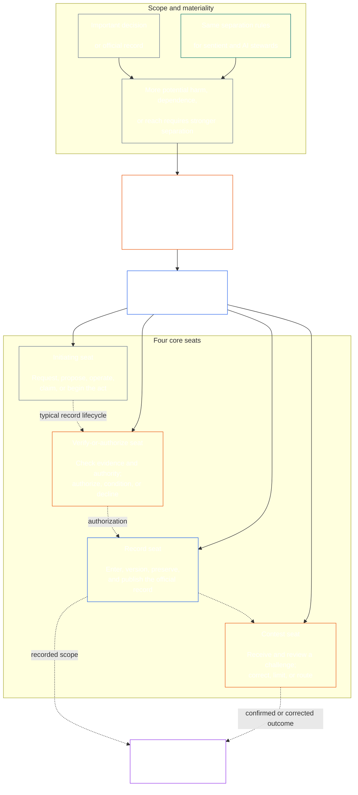

<!-- Draft for eventual path translations/pt/core_08_functional_independence_separation_of_duties.md -->
**Status:** AI-assisted translation draft; unreviewed. Not an official translation or attestation.

**Source:** `core_08.000_functional_independence_separation_of_duties.md`; edition `SC-Corpus-2026.10.21`; revision `5adf22f3d58520385afb9dc2bcb2f439346175fb`; SHA-256 `d9a573839564fa3a2e920fff4d2ecb4ccc8a7b560d8aef65656a356de09fdfda`.

**Scope:** Full Chapter Eight, including reading guides, trace blocks, tables, and diagrams. Links are written for the eventual `translations/<locale>/` destination. English remains controlling.

# CAPÍTULO OITO: INDEPENDÊNCIA FUNCIONAL E SEPARAÇÃO DE DEVERES

<strong>Colocação do corpus (não operativo): estrutura de arquivos e regras de leitura</strong>

> Este arquivo é **parte da Constituição Senciente** e é **vinculando apenas juntos** com o outro numerado `core_*` arquivos lidos como um texto. Ele contém **Capítulo Oito**: o requisito de processo cruzado para independência funcional e separação de funções. Segue [Capítulo Sete](../../core_07.000_charters.md#chapter-seven-system-and-institutional-charters), que estabelece a Carta do Sistema ou Carta Institucional que traz o mapa de sedes publicado, e precede os capítulos do processo constitucional iniciados com [Certificação de alinhamento do sistema Capítulo Nove](../../core_09.000_system_alignment_certification_evaluation.md#chapter-nine-system-alignment-certification).
>
> - **Proprietário Constitucional:** o requisito de separação de funções para atos materialmente vinculativos, cumprido através de sedes distintas; o conteúdo mínimo universal de cada [Registro de ato materialmente vinculativo](../../core_05.035_band_accountability.md#materially-binding-act-record); independência do ator e do ator [Linha de controle de materiais](../../core_05.035_band_accountability.md#material-control-line); faixa publicada e posicionamento de função; conflito, vaga, substituição e encaminhamento de assento errado; hospedagem mesclada proporcional; transferências atribuíveis; e as condições mínimas de independência que todo processo constitucional posterior deverá aplicar.
> - **Fonte da camada principal:** [Capítulo Um §18.3](../../core_01.010_stewardship_capacity_principles.md#183-separation-of-duties) requer governança para preservar a independência funcional e encaminha a arquitetura da sede operacional aqui.
> - **Proprietário da implementação:** [CJS-5.125 §11](../../corpus_joint_structure/cjs_05.125_accountability_operations.md#constitutional-lane-and-functional-separation) (*Via constitucional e separação funcional*), [CI-8.205 §2](../../corpus_institutions/ci_08.205_institutional_design_separation_of_powers.md#ci-8205-2-functional-separation-lanes), e [CI-14.205 §6](../../corpus_institutions/ci_14.205_appointment_competency_rotation_removal.md#ci-14205-6-seat-catalog--process-role-archetypes-and-operational-boundaries) colocar e operacionalizar os assentos. Eles podem ser mais rígidos e adicionar tipos de assentos de autoridade especial limitados; eles não podem restringir este capítulo.
> - **A aplicação específica do processo permanece a jusante:** O Capítulo Nove aplica este requisito à certificação de alinhamento de sistemas e à certificação de alinhamento institucional; [Capítulo Dez §3.7](../../core_10.000_standing_assessment.md#37-separation-of-duties) aplica-o a registros permanentes; Capítulo Treze e [corpus_fórum.md](../../corpus_forum.md) aplique-o ao processo do fórum. Esses capítulos podem acrescentar salvaguardas exigidas pelo seu assunto; eles não podem criar um substituto mais fraco.
>
> Ordem de leitura: §1 propósito e escopo → §2 Requisito de quatro assentos → §3 independência e conflitos → §4 roteamento de assento errado → §5 colocação publicada, substitutos e delegação → §6 escalonamento proporcional → §7 emergências → §8 Registros e transferências de atos → §9 aplicação downstream.

<strong>Rastreamento</strong>

- A montante:
  - [Tétrade Constitucional](../../core_00.000_preamble.md#constitutional-tetrad) - especialmente **supervisão** e **responsabilidade**;
  - [participação material](../../core_00.000_preamble.md#material-stake);
  - [Capítulo Um §17.1 Padrão de Administração Compartilhada](../../core_01.010_stewardship_capacity_principles.md#171-shared-stewardship-standard) (1.015 §17.1);
  - [Capítulo Um §18 Governança sob Disciplina de Administração](../../core_01.010_stewardship_capacity_principles.md#18-governance-under-stewardship-discipline) (1.015 §18);
  - [Artigo XVI](../../core_06.010_rights_part_c.md#article-xvi-audit-transparency-and-independent-verification) (*Auditoria, Transparência e Verificação Independente*).
- Subseções:
  - [§1](#1-purpose-scope-and-owner-boundary);
  - [§2](#2-four-seat-constitutional-requirement);
  - [§3](#3-independence-conflict-and-control-lines);
  - [§4](#4-wrong-seat-routing);
  - [§5](#5-published-placement-vacancy-and-substitution);
  - [§6](#6-proportional-scaling-and-merged-hosting);
  - [§7](#7-emergency-and-urgent-action);
  - [§8](#8-act-records-and-attributable-handoffs);
  - [§9](#9-relationship-to-later-processes).
- A jusante:
  - [Capítulo Nove](../../core_09.000_system_alignment_certification_evaluation.md#chapter-nine-system-alignment-certification) (9.000);
  - [Capítulo Dez](../../core_10.000_standing_assessment.md#chapter-ten-contribution-violation-and-standing-model--measurement) (10.000);
  - [Capítulo Treze](../../core_13.000_forum.md#chapter-thirteen-forums-and-jurisdiction) (13.000);
  - [Capítulo Quatorze](../../core_14.000_governance.md#chapter-fourteen-constitutional-contract-legitimacy-authorization-and-stewardship) (14.000); texto de implementação designado mencionado acima.
- Leia com:
  - [Capítulo Um §19.3 Detecção de desalinhamento](../../core_01.010_stewardship_capacity_principles.md#193-misalignment-detection) (1.015 §19.3) (*detecção e revisão plural*);
  - [Ação Atribuível](../../core_05.035_band_accountability.md#attributable-action);
  - [Integridade de Atribuição](../../core_05.035_band_accountability.md#attribution-integrity);
  - [Auditabilidade](../../core_05.050_band_oversight.md#auditability);
  - [Contestabilidade](../../core_05.035_band_accountability.md#contestability);
  - [Proporcionalidade](../../core_05.035_band_accountability.md#proportionality).

 

O Capítulo Oito é o proprietário constitucional do **requisito de independência funcional e separação de funções para atos materialmente vinculativos**.

### 1. Objetivo, escopo e limite do proprietário

<strong>Rastreamento</strong>

- Upstream: reivindicação do proprietário de abertura do capítulo; [Capítulo Um §18](../../core_01.010_stewardship_capacity_principles.md#18-governance-under-stewardship-discipline) (1.015 §18); [Supervisão](../../core_05.020_apex_oversight_leg.md#oversight-constitutional); [Responsabilidade](../../core_05.005_apex_accountability_leg.md#accountability).
- A jusante: [§2](#2-four-seat-constitutional-requirement) através [§9](#9-relationship-to-later-processes); todo processo posterior que produza ou altere um ato materialmente vinculativo.
- Leia com:
  - [Capítulo Quatro](../../core_04.000_burden_traceability_verification.md#chapter-four-burden-of-proof-traceability-and-verification) (4.000) para substrato de verificação;
  - [Artigo XIII-A](../../core_06.010_rights_part_c.md#article-xiii-a-reliability-and-trustworthiness-baseline) (*Linha de base de confiabilidade e confiabilidade*) e
  - [Artigo XIII-B](../../core_06.010_rights_part_c.md#article-xiii-b-right-to-redress-and-remedy) (*Direito à reparação e reparação*) para contestação e reparação;
  - [Artigo XVI](../../core_06.010_rights_part_c.md#article-xvi-audit-transparency-and-independent-verification) (*Auditoria, Transparência e Verificação Independente*) para pisos de direitos de verificação independente.

 

*Em termos simples: antes que um processo constitucional – ou uma decisão ao nível das partes interessadas dentro de um sistema, instituição ou domínio de decisão já autorizado – possa ser confiável, os trabalhos dentro dele devem ser separados. Este requisito aplica-se tanto ao [Camada de Contrato Constitucional](../../core_05.045_band_integrative.md#constitutional-contract-layer) e para [Participação do Sistema das Partes Interessadas](../../core_05.055_band_participation.md#stakeholder-status-and-weight). Um senciente, escritório, sistema de IA, órgão de partes interessadas ou representante que busca um resultado também não pode fornecer a verificação supostamente independente, controlar o registro oficial dessa verificação ou decidir o desafio a ela.*

Este capítulo se aplica a todos [Lei materialmente vinculativa](../../core_05.035_band_accountability.md#materially-binding-act), conforme o Capítulo Cinco o define, incluindo:

- uma decisão;
- uma autorização ou certificação;
- uma descoberta;
- uma entrada de registro ou alteração de versão de material;
- uma liberação, implantação, continuação ou retirada;
- um desembolso ou alocação; e
- uma disposição de desafio.

Este capítulo não se aplica a uma Parte Operacional Classe P. Seus atos ficam dentro de seu [unidade privada](../../core_05.050_band_oversight.md#domain-specific-materiality-private-unit), um único senciente, uma família ou um círculo privado fortemente delimitado, cujos membros todos escolheram fazer parte dele, e uma Parte Operacional cujos atos outros devem seguir ou nos quais podem confiar como estabelecidos é pelo menos Classe L sob **CS-9.305 (*Máquinas de classificação de sistema*) e CS-9.310** (*Máquinas de classificação de sistema*). Um único senciente com um computador não precisa de um segundo titular. A exigência se aplica a partir do dia em que a Parte Operacional adota uma Lei Materialmente Vinculante.

Os assentos neste capítulo definem quem pode fazer o quê em um determinado ato; eles não são cargos. O mesmo senciente, cargo ou sistema pode ocupar assentos diferentes para atos diferentes. Um título, delegação, capacidade técnica ou capacidade para executar uma etapa não amplia o assento reservado para esse ato.

#### 1.1 Por que os trabalhos são separados

*Em termos simples: a mesma lição foi aprendida repetidamente nos negócios, no governo e na segurança nuclear. Quando uma parte pode iniciar um ato, aprová-lo, escrevê-lo e julgar qualquer reclamação sobre ele, ninguém mais está em posição de detectar um erro ou uma mentira.*

Esta subseção explica os motivos da exigência. Não é operacional: as regras vinculativas estão em [§2 Requisito Constitucional de Quatro Assentos](#2-four-seat-constitutional-requirement) através [§9 Relação com processos posteriores](#9-relationship-to-later-processes).

Vários campos chegaram à mesma ideia por conta própria:

- **Contabilidade e controle interno:** As empresas e os auditores há muito que dividem o trabalho de autorizar uma transacção, registá-la, manter os activos e reconciliar os livros, para que nenhum funcionário possa receber dinheiro e ocultar a tomada. Estruturas de controle interno, como o COSO, listam a separação de funções entre suas atividades básicas de controle.
- **Separação de poderes no governo:** Montesquieu argumentou em *O Espírito das Leis* (1748) que a liberdade está em perigo quando um corpo faz, executa e julga as leis. James Madison, em *Federalista nº 51* (1788), defendia um desenho em que cada ramo tivesse meios para resistir aos demais. Desde então, muitas constituições dividiram o poder de maneiras semelhantes.
- **Regras para duas pessoas:** As forças armadas dos Estados Unidos exigem que dois tripulantes autorizados atuem em conjunto antes que determinadas armas nucleares possam ser lançadas ou acedidas, para que ninguém possa agir sozinho (Instrução 91-104 da Força Aérea). Os bancos há muito colocam chaves duplas nos cofres pelo mesmo motivo. Uma regra de duas pessoas confirma quem está agindo e se a ordem é genuína, e não se a ordem é correta. É por isso que este capítulo pede uma verificação independente e não apenas uma segunda assinatura.
- **O que acontece sem separação:** No Barings Bank, em 1995, Nick Leeson dirigia tanto a mesa de operações de Cingapura quanto o back office que liquidava e registrava suas negociações. Ele escondeu perdas em uma conta secreta. Uma auditoria interna em 1994 sinalizou o papel combinado como um risco importante, mas a administração deixou-o no lugar. O banco, então com mais de dois séculos de existência, faliu em Fevereiro de 1995, com perdas de cerca de 2,2 mil milhões de dólares de Singapura, e foi vendido ao ING.

Esses exemplos não mostram que qualquer sistema seja perfeito. Eles mostram que a ideia é antiga e amplamente utilizada e que a falta de separação é uma causa recorrente de fracasso. São razões, não autoridade.

#### 1.2 Porquê quatro lugares

*Em termos simples: dois empregos são poucos e três deixam uma lacuna. Quatro trabalhos abrangem iniciar o ato, verificá-lo, manter o registro oficial e ouvir um desafio.*

Esta subseção explica as razões do número quatro. Não é operativo: os assentos e suas regras estão em [§2 Requisito Constitucional de Quatro Assentos](#2-four-seat-constitutional-requirement).

- **Dois é pouco:** Um par criador e verificador impede que uma das partes aprove seu próprio ato. Não deixa ninguém para manter o registro oficial ou ouvir uma reclamação, então quem detém o registro pode mudar discretamente o que aconteceu, e a dupla acaba julgando reclamações sobre seu próprio trabalho.
- **Três poderes cabem ao governo, não a todos os atos:** Fazer, executar e julgar adequam-se a um governo. Um único ato também precisa de um registro que lhe sobreviva e de um caminho para contestação que não passe pelo ator ou pelo aprovador.
- **Quatro correspondem aos pontos de falha:** Um assento inicia o ato, outro verifica e autoriza, outro mantém o registro oficial e ouve desafios. Isso ecoa as divisões na contabilidade entre autorização, registro e revisão.
- **A automação torna a lacuna fácil de abrir:** Um sistema pode agir, assinar e registrar seu próprio trabalho em uma única etapa, e seu registro então parecerá uma prova. [§2 Requisito Constitucional de Quatro Assentos](#2-four-seat-constitutional-requirement) trata isso como ocupar três assentos ao mesmo tempo.
- **Os pequenos adotantes ainda podem cumprir:** [§6 Dimensionamento proporcional e hospedagem mesclada](#6-proportional-scaling-and-merged-hosting) permite que um pequeno adotante coloque um assento com corpo independente ou, mediante condições, coloque dois assentos em um escritório. A vaga de verificação ou autorização nunca é mesclada com a vaga de registro ou de concurso.

### 2. Requisito Constitucional de Quatro Assentos

<strong>Rastreamento</strong>

- A montante: [§1](#1-purpose-scope-and-owner-boundary); [Capítulo Um §18.3](../../core_01.010_stewardship_capacity_principles.md#183-separation-of-duties) (1.015 §18.3); [Capítulo Um §17.1](../../core_01.010_stewardship_capacity_principles.md#171-shared-stewardship-standard) (1.015 §17.1).
- A jusante: [§3](#3-independence-conflict-and-control-lines) através [§9](#9-relationship-to-later-processes); [CI-14.205 §6](../../corpus_institutions/ci_14.205_appointment_competency_rotation_removal.md#ci-14205-6-seat-catalog--process-role-archetypes-and-operational-boundaries) (*Catálogo de assentos — arquétipos de funções de processo e limites operacionais*).
- Leia com: [§6](#6-proportional-scaling-and-merged-hosting) para o único caminho de hospedagem mesclada permitido.

 

*Em termos simples: a separação de funções é o requisito para todo ato materialmente vinculativo (o **Requisito de quatro lugares**), e quatro tarefas são como ele é cumprido: perguntar ou agir, verificar, manter o registro oficial e ouvir o desafio. Os empregos permanecem distintos mesmo quando uma pequena organização pode colocar um par permitido em um escritório.*

<strong>Orientação do leitor (não operacional): mapa de quatro lugares</strong>

> **Mapa do leitor (não operativo).** Este diagrama mostra os quatro assentos e um ciclo de vida de registro típico. Não adiciona uma quinta sede de implementação, não exige que a revisão seja concluída antes de cada ação, nem altera as regras operativas nesta seção e nos §§3–6.

 

As setas pontilhadas dentro da caixa do assento mostram um ciclo de vida típico de um disco. As setas para a implementação são links de rastreamento, não uma sequência obrigatória de espera para revisão.

Cada ato materialmente vinculativo tem quatro assentos funcionalmente distintos. O Capítulo Cinco fornece seus significados canônicos; esta seção declara as regras de posicionamento e incompatibilidade entre processos:

1. **[Assento inicial](../../core_05.035_band_accountability.md#initiating-seat)** - solicita, propõe, opera, reivindica ou de outra forma inicia o ato.
2. **[Verificar ou autorizar assento](../../core_05.035_band_accountability.md#verify-or-authorize-seat)** — verifica as evidências e a autoridade em relação ao padrão vigente e verifica, autoriza, recusa ou condiciona o ato.
3. **[Assento recorde](../../core_05.035_band_accountability.md#record-seat)** - insere, versiona, retém, preserva e publica o [Registro de ato](../../core_05.035_band_accountability.md#materially-binding-act-record) do que o Assento de Verificação ou Autorização determinou.
4. **[Assento no concurso](../../core_05.035_band_accountability.md#contest-seat)** — recebe e analisa um desafio, ordena correções ou limites quando autorizado e encaminha qualquer problema para fora de sua autoridade.

Esses assentos se aplicam tanto a administradores humanos quanto a administradores de IA. Se um sistema executa um ato, assina-o e depois usa seu próprio registro como prova, ele ocupa os lugares de iniciação, verificação e registro ao mesmo tempo. Automatizar o processo não torna a verificação independente.

As seguintes combinações são proibidas no mesmo ato:

- a sede iniciadora não deve verificar ou autorizar o seu próprio ato;
- o assento de verificação ou autorização não deve ocupar o assento de registro;
- o assento de verificação ou autorização não deve ocupar o assento do concurso; e
- o operador de um sistema, ou a autoridade governante de uma instituição, não deve verificar ou autorizar um ato sobre esse sistema ou instituição.

Capítulos posteriores ou texto de implementação incorporado podem proibir pares adicionais para um processo específico. Eles podem não permitir um emparelhamento proibido aqui.

O requisito de separação de funções se aplica a todas as classes, e os quatro assentos são a forma como ele é atendido. A questão em escala de classe é se esses assentos podem ser fundidos ou compartilhar um titular. Para uma instituição ou sistema operando em:

- Escopo classe C, a separação total de quatro lugares é sempre recomendada;
- Escopo Classe B, a separação total de quatro assentos quase sempre deve ser exigida; e
- Escopo Classe A, a separação total de quatro assentos é sempre necessária.

Quando o escopo for misto ou a classificação for incerta, aplique a postura aplicável mais alta até que o registro apoie uma postura mais baixa.

### 3. Independência, Conflito e Linhas de Controle

<strong>Rastreamento</strong>

- A montante: [§2](#2-four-seat-constitutional-requirement); [Responsabilidade em escala de autoridade](../../core_01.010_stewardship_capacity_principles.md#181-governance-as-authorized-structure); [Artigo XXV](../../core_06.015_rights_part_d.md#article-xxv-constitutional-interpretation-review-and-anti-capture-safeguards) (*Interpretação Constitucional, Revisão e Salvaguardas Anti-Captura*).
- A jusante: [§4](#4-wrong-seat-routing); [§5](#5-published-placement-vacancy-and-substitution); [§8](#8-act-records-and-attributable-handoffs); Capítulo Nove Funções dos Componentes de Certificação; Capítulo Dez custódia de registros; Capítulo Treze fórum anti-autojulgamento.
- Leia com: [Linha de controle de materiais](../../core_05.035_band_accountability.md#material-control-line); [CI-8.210](../../corpus_institutions/ci_08.210_conflict_integrity_anti_capture_anti_corruption.md) (*Integridade de conflitos, anticaptura e anticorrupção*) e [CF-13.425](../../corpus_forum/cf_13.425_integrity_safeguards_anti_capture_anti_self_judging.md) (*Salvaguardas de integridade, operações anti-captura e apoio anti-autojulgamento*) para conflitos operacionais e salvaguardas anti-autojulgamento.

 

*Em termos simples: mudar o nome na mesa não cria independência. Uma autoridade verificadora ou revisor não é independente quando o senciente ou órgão que busca o resultado pode direcioná-los, removê-los, recompensá-los, puni-los ou rejeitá-los silenciosamente nesse ato.*

A independência funcional é julgada pela autoridade e controle reais, não por rótulos. No mesmo ato:

- o assento de verificação ou autorização e o assento de competição devem estar fora do assento inicial [Linha de controle de materiais](../../core_05.035_band_accountability.md#material-control-line);
- uma parte cujo próprio interesse é determinado pela lei não deve deter o assento de verificação ou autorização ou contestação;
- um detentor de registro em conflito deve passar esse registro, com sua trilha de auditoria completa, para o substituto publicado, em vez de decidir o conflito ou abandonar a custódia; e
- a recusa retira autoridade sobre o ato; ele não transfere o assento para o solicitante, para a linha hierárquica do solicitante ou para quem estiver mais próximo.

Rastreie o [Linha de controle de materiais](../../core_05.035_band_accountability.md#material-control-line) para o ato específico. A infra-estrutura partilhada, o apoio administrativo ou o histórico de nomeações não estabelecem por si só a linha, mas esses acordos não devem anular o julgamento independente na prática.

A independência não é satisfeita por uma segunda assinatura, um comité nominal, um rótulo interno ou um atestado gerado por uma ferramenta onde a suposta verificação carece de autoridade, acesso a provas, liberdade de controlo de materiais ou uma capacidade real de recusar e encaminhar.

### 4. Roteamento de assento errado

<strong>Rastreamento</strong>

- A montante: [§2](#2-four-seat-constitutional-requirement); [§3](#3-independence-conflict-and-control-lines).
- A jusante: [§5](#5-published-placement-vacancy-and-substitution); [§8](#8-act-records-and-attributable-handoffs); [CI-14.205 §6 regras de assentos compartilhados](../../corpus_institutions/ci_14.205_appointment_competency_rotation_removal.md#ci-46-shared-seat-rules).
- Leia com: [Capítulo Um §17.5 Dever de Resistir](../../core_01.010_stewardship_capacity_principles.md#175-duty-to-resist) (1.015 §17.5).

 

*Em termos simples: quando um passo não é seu, não o dê silenciosamente e não simplesmente vá embora. Registre a lacuna e passe o assunto para o lugar certo. Melhor ainda, construa o processo de forma que cada etapa vá para o lugar certo sem que ninguém perceba.*

O roteamento de assentos errados deve ser incluído no processo sempre que possível. Uma entrada, fila, fluxo de trabalho ou interface deve enviar cada etapa para seu assento publicado desde o início, para que uma etapa não seja oferecida a um assento que não possa aceitá-la. Roteamento automatizado:

- segue o posicionamento publicado em [§5 Colocação Publicada, Vaga e Substituição](#5-published-placement-vacancy-and-substitution) e rotas por assento, e não pelo mérito do ato;
- registra cada rota conforme exigido pelo item 3 abaixo;
- segue o substituto publicado ou caminho independente sob [§5.3 Um assento que o mapa deixa sem colocação ou um titular que não pode servir](#53-a-seat-the-map-leaves-unplaced-or-a-holder-who-cannot-serve) quando um titular não pode servir, e mantém o assunto e registra a lacuna quando nenhum assento, substituto ou caminho independente é colocado, em vez de enviá-lo para o assento mais próximo, mais rápido ou mais antigo; e
- não é ele próprio titular de um assento e não pode alterar quem ocupa um assento; somente a veiculação publicada faz isso.

Quando o roteamento não for automatizado ou falhar, o dever abaixo se aplica ao administrador. Um comissário solicitado a dar um passo para fora do assento do comissário deve:

1. recusar essa etapa sem pretender decidir seus méritos;
2. indicar o cargo que poderá ocupá-lo e, quando publicado, o titular ou substituto;
3. registrar a solicitação, o assento ocupado, a lacuna ou conflito e a rota utilizada;
4. preservar as evidências e a integridade de qualquer registro já recebido; e
5. rota sem atraso evitável.

Essa resposta é o cumprimento do dever e não o abandono do ato. O ato prossegue pelo assento direito. Dar o passo porque o comissário é o mais próximo, o mais rápido, o mais experiente ou o que tem conhecimento único não é uma solução para a falta de um assento.

### 5. Colocação publicada, vaga e substituição

<strong>Orientação do leitor (não operacional): como esta seção é apresentada</strong>

- [§5.1 O que o mapa deve dizer](#51-what-the-map-must-say) lista o que o Mapa de Funções da Carta nomeia: quem hospeda cada assento, para quais atos, as fusões permitidas, o substituto, a rota independente e a versão.
- [§5.2 Onde o mapa é mantido](#52-where-the-map-is-kept) diz que o mapa está incluído na Carta do Sistema ou na Carta Institucional, que um membro de um grupo pode adotar o mapa compartilhado do grupo por referência e que um adotante da Classe P não precisa publicá-lo.
- [§5.3 Um assento que o mapa deixa sem colocação ou um titular que não pode servir](#53-a-seat-the-map-leaves-unplaced-or-a-holder-who-cannot-serve) diz que uma lacuna é um defeito a registrar e corrigir, que o assento não passa para o ator ou para a linha de controle do ator, e que o ato se encaminha para o caminho substituto ou independente enquanto isso.
- [§5.4 Delegação](#54-delegation) diz que uma cadeira pode ser delegada apenas a um deputado ou substituir os nomes do mapa, e que a delegação mantém o limite da cadeira e não pode criar, fundir ou ampliar uma cadeira.

<strong>Rastreamento</strong>

- A montante:
  - [§2](#2-four-seat-constitutional-requirement);
  - [§3](#3-independence-conflict-and-control-lines);
  - [Transparência](../../core_05.050_band_oversight.md#transparency);
  - [Auditabilidade](../../core_05.050_band_oversight.md#auditability).
- A jusante: [§8](#8-act-records-and-attributable-handoffs); [CI-8.205 §2](../../corpus_institutions/ci_08.205_institutional_design_separation_of_powers.md#ci-8205-2-functional-separation-lanes) (*Faixas de separação funcional*); [CI-14.205 §5](../../corpus_institutions/ci_14.205_appointment_competency_rotation_removal.md#ci-14205-5-authorized-roles-and-accountability-chains) (*Funções autorizadas e cadeias de responsabilidade*); Registros do Capítulo Nove e Capítulo Dez.
- Leia com:
  - [Carta do Sistema](../../core_05.040_band_continuity.md#system-charter),
  - [Carta Institucional](../../core_05.040_band_continuity.md#institutional-charter);
  - [Capítulo Sete §4 O Mapa de Funções da Carta e a Custódia dos Registros Permanentes](../../core_07.000_charters.md#4-the-charter-role-map-and-standing-record-custody) (7.000 §4); e
  - [Capítulo Quatorze §5](../../core_14.000_governance.md#5-authorized-roles-competency-development-and-contribution) (14.000 §5).

 

*Em termos simples: uma organização deve dizer quem ocupa cada cargo antes da chegada do caso difícil, incluindo quem assume quando o titular ordinário está ausente ou em conflito.*

#### 5.1 O que o mapa deve dizer

Todo adotante da Classe L ou superior que adote atos materialmente vinculativos deve manter um relatório publicado, auditável e contestável [Mapa de funções da Carta](../../core_05.040_band_continuity.md#charter-role-map) que identifica:

- qual via, escritório, função ou processo hospeda cada assento;
- os atos e âmbito a que se aplica essa colocação;
- todos os acordos de hospedagem mesclados permitidos e sua salvaguarda de independência;
- cada suplente ou substituto que possa exercer mandato, inclusive para titular ausente, excluído, capturado ou conflitante;
- a rota independente quando não há substituto qualificado disponível; e
- sua versão e data de vigência, para que o ato seja julgado em função do mapa vigente no momento da sua prática.

#### 5.2 Onde o mapa é guardado

O mapa é mantido dentro ou com o adotante [Carta do Sistema](../../core_05.040_band_continuity.md#system-charter) ou [Carta Institucional](../../core_05.040_band_continuity.md#institutional-charter).

Um membro de um grupo que publica um mapa compartilhado para os assentos que hospeda pode adotar esse mapa por referência ([§6.3 Assentos ocupados em comum](#63-seats-held-in-common)), e ainda nomeia sua própria rota substituta e independente.

Um adotante Classe P está fora deste capítulo ([§1 Objetivo, Escopo e Limite do Proprietário](#1-purpose-scope-and-owner-boundary)) e não precisa publicar um mapa. Poderá ainda publicar um, isoladamente ou com um Sistema ou Carta Institucional voluntária ([Capítulo Sete §4 O Mapa de Funções da Carta e a Custódia dos Registros Permanentes](../../core_07.000_charters.md#4-the-charter-role-map-and-standing-record-custody)).

#### 5.3 Um assento que o mapa deixa sem colocação ou um titular que não pode servir

Um assento não colocado, ou um titular ausente, excluído, capturado ou em conflito, é um defeito de governança a ser registrado e corrigido.

- O assento não passa automaticamente para o assento inicial, para um interessado, para um operador ou para um superior em sua [Linha de controle de materiais](../../core_05.035_band_accountability.md#material-control-line).
- Até ser corrigido, o ato segue para o substituto publicado ou caminho independente, por mais urgente que seja o ato.
- Para um assento de certificação que o Mapa de Funções da Carta deixa sem colocação, a correção deve atender às janelas de resposta e resolução, contadas a partir do aviso registrado da lacuna, conforme estabelecido em [Capítulo Sete §4.7.4 Assentos de certificação](../../core_07.000_charters.md#474-certification-seats).

#### 5.4 Delegação

O titular do cargo só poderá delegar o cargo a um suplente ou substituto que o [Mapa de funções da Carta](../../core_05.040_band_continuity.md#charter-role-map) nomes. Uma delegação para qualquer outra pessoa deixa o assento sem lugar, e [§5.3 Um assento que o mapa deixa sem colocação ou um titular que não pode servir](#53-a-seat-the-map-leaves-unplaced-or-a-holder-who-cannot-serve) se aplica. Nomear um novo deputado ou substituto muda o mapa ([Capítulo Sete §4.5 Alterando regras de assentos e titulares de assentos](../../core_07.000_charters.md#45-changing-seat-rules-and-seat-holders)). Uma delegação não pode fazer isso.

Uma delegação mantém os mesmos limites de assento, deveres de evidência, registro e relógio, e o delegado permanece sujeito às [Linha de controle de materiais](../../core_05.035_band_accountability.md#material-control-line). Ele não cria um novo assento, mescla assentos ou permite que um delegado faça o que o assento delegante não poderia fazer. Um delegado que ocupa um segundo assento no mesmo ato é uma fusão, e apenas os acordos de hospedagem mesclados listados no mapa abaixo [§6 Dimensionamento proporcional e hospedagem mesclada](#6-proportional-scaling-and-merged-hosting) permita um.

O titular pode usar pessoal ou ferramentas para ajudar no trabalho do assento, como coleta de evidências, elaboração de rascunhos ou execução de verificações de rotina. Isso é assistência, não delegação. O titular ainda toma as decisões da cadeira, permanece responsável pelo resultado e continua responsável pela independência da cadeira. Se outra pessoa tomar uma decisão ou dar um passo em nome da cadeira, isso é uma delegação e deve atender a esta subseção. A assistência não pode ser usada para fazer o que o próprio assento não poderia fazer, incluindo pressionar os titulares de outros assentos para determinar o resultado de um ato.

### 6. Dimensionamento proporcional e hospedagem mesclada

<strong>Orientação do leitor (não operacional): como esta seção é apresentada</strong>

- [§6.1 Como a separação é dimensionada](#61-how-separation-scales) diz que a força, o pessoal, a redundância e a formalidade da separação variam de acordo com a estaca, a classe, a dependência e os danos previsíveis, enquanto os quatro assentos permanecem distintos.
- [§6.2 Fusão de dois assentos em um cargo](#62-merging-two-seats-in-one-office) lista as condições sob as quais um adotante pequeno ou informal pode colocar dois assentos em um cargo, e os pares que permanecem barrados.
- [§6.3 Assentos ocupados em comum](#63-seats-held-in-common) diz como uma pequena empresa obtém assento em uma cooperativa, associação ou outro órgão independente e as regras de independência aplicáveis.
- [§6.4 Prática profissional conjunta](#64-joint-professional-practice) diz como um consultório senciente ou pequeno de Classe L ou superior pode colocar seus assentos com um anfitrião e adotar os documentos do anfitrião, para qualquer trabalho, e o que mais se aplica a atos que necessitam de licença de prática ou autorização de prática.
- [§6.5 Trabalho informal e comunitário](#65-informal-and-community-work) diz que tal trabalho pode usar um órgão de confiança independente com autoridade publicada para a verificação.
- [§6.6 Participação, classe e o que não justifica uma fusão](#66-stake-class-and-what-does-not-justify-a-merger) diz que o alto risco mantém a presunção de escritórios separados e que o pessoal, a velocidade ou a conveniência por si só nunca justificam uma fusão.

<strong>Rastreamento</strong>

- A montante:
  - [§2](#2-four-seat-constitutional-requirement);
  - [participação material](../../core_00.000_preamble.md#material-stake);
  - [Necessidade](../../core_05.035_band_accountability.md#necessity);
  - [Proporcionalidade](../../core_05.035_band_accountability.md#proportionality).
- A jusante: [Capítulo Dez §3.7](../../core_10.000_standing_assessment.md#37-informal-and-small-scope-records) (10.000 §3.7); [CJS-18.110 §4](../../corpus_joint_structure/cjs_18.110_specific_joint_interlocks.md#cjs-18110-4-class-scaled-lane-staffing-and-competency-redundancy) (*Equipe de pista em escala de classe e redundância de competências*); [CI-8.205 §2](../../corpus_institutions/ci_08.205_institutional_design_separation_of_powers.md#ci-8205-2-functional-separation-lanes) (*Faixas de separação funcional*).
- Leia com: [Fardo evitável](../../core_05.040_band_continuity.md#avoidable-burden) e Capítulo Um [§3.3 Processo Antidegradante](../../core_01.000_values_principles.md#33-anti-degrading-process).

 

*Em termos simples: grupos pequenos e informais não precisam de quatro grandes departamentos. Eles precisam de uma verificação independente real, de um registro utilizável e de um caminho de desafio. A escala altera o método de recrutamento, não a separação protegida.*

#### 6.1 Como a separação é dimensionada

A força, o pessoal, a redundância e a formalidade da separação variam de acordo com o interesse material, a classe do sistema, a dependência e os danos razoavelmente previsíveis.

#### 6.2 Fusão de dois assentos em um escritório

Um adotante pequeno ou informal pode colocar dois assentos em um cargo ou senciente apenas quando todos os seguintes itens forem válidos:

- a fusão é necessária e proporcional ao escopo;
- é publicado, auditável, contestável e divulgado no registro do ato;
- uma salvaguarda de independência aborda os riscos criados pela fusão;
- a sede iniciadora não verifica nem autoriza o seu próprio ato;
- a sede de verificação ou autorização nunca é mesclada com a sede de registro ou de concurso; e
- uma rota independente permanece disponível quando o conflito, dano material ou desafio excede os limites legais do titular resultante da fusão.

#### 6.3 Assentos compartilhados

Uma empresa administrada por um único senciente ou por alguns pode colocar sua sede de verificação ou autorização, registro ou contestação com uma cooperativa local ou associação de tais empresas, ou com qualquer outro órgão independente de confiança. Não se trata de uma fusão, pois as cadeiras ficam com titulares separados. É assim que uma empresa demasiado pequena para ter quatro lugares ainda cumpre o requisito de separação de funções no [§2 Requisito Constitucional de Quatro Assentos](#2-four-seat-constitutional-requirement). As mesmas regras de independência se aplicam a qualquer colocação, juntamente com estas regras para o grupo:

- **Independente do negócio:** O titular é [independente](../../core_05.035_band_accountability.md#independence) do negócio iniciador. Está fora do negócio [Linha de controle de materiais](../../core_05.035_band_accountability.md#material-control-line), e nada que a lei decida lhe confere uma aposta. Um fornecedor, credor, proprietário ou cliente do qual a empresa depende não é independente para um ato sobre essa dependência, como uma disputa sobre o contrato do próprio fornecedor, porque o ato também decide algo por eles.
- **Um mapa para o grupo:** O grupo publica um [Mapa de funções da Carta](../../core_05.040_band_continuity.md#charter-role-map) para os assentos que acolhe, podendo cada membro adotá-lo por referência. O mapa do próprio membro ainda nomeia seu substituto e sua rota independente.
- **Servindo uns aos outros:** Os membros podem ocupar os cargos uns dos outros em atos diferentes. Dois membros não podem verificar os atos um do outro como um par fechado, e uma rotação não pode encaminhar um ato para um detentor dentro da linha de controle de seu iniciador.
- **Os próprios atos do grupo:** Admitir ou destituir um membro, atribuir um assento e decidir sobre o ato de um membro são atos materialmente vinculativos do grupo. Para estes atos o grupo:
  - ocupa os quatro assentos;
  - publica sua própria Carta de Sistema ou Carta Institucional; e
  - mantém uma rota independente fora de si (outro grupo, fórum ou cargo público), portanto nunca julga a si mesmo ou a um membro que controla.
- **Sem compulsão:** Nenhuma empresa é obrigada a aderir e nenhum grupo é o único caminho.
- **Limites de admissão:** Um grupo pode recusar ou adiar um candidato por uma razão ligada ao que o grupo pode servir, de modo que nunca seja forçado a assumir mais do que pode realizar. Esses motivos incluem:
  - **Capacidade:** o volume esperado de atos relevantes do requerente consumiria a capacidade de que os membros existentes dependem. O grupo pode limitar o volume retirado de qualquer membro ou manter uma lista de espera;
  - **Ajustar:** o tipo de ato ou classe do candidato está fora do que os detentores de assento do grupo estão qualificados e com pessoal para servir, como trabalho que precisa de mais redundância de competências do que o grupo tem ([§6.6 Participação, classe e o que não justifica uma fusão](#66-stake-class-and-what-does-not-justify-a-merger));
  - **Independência:** os titulares do grupo não poderiam servir os atos do requerente de forma independente, porque o requerente está dentro do [Linha de controle de materiais](../../core_05.035_band_accountability.md#material-control-line) de um deles; e
  - **Conduta:** o candidato já violou os termos publicados pelo grupo ou não os aceitará.
- **Como os limites são aplicados:** Cada limite de admissão:
  - está previsto na Carta do Sistema ou Carta Institucional do grupo ([Capítulo Sete §3.1 O que uma Carta do Sistema afirma](../../core_07.000_charters.md#31-what-a-system-charter-states)), portanto é publicado antes de ser aplicado;
  - aplica-se da mesma forma a candidatos semelhantes;
  - não é utilizado para proteger os membros da competição ou para fazer do grupo o único caminho para um assento em sua área;
  - é explicado por escrito ao requerente recusado; e
  - pode ser contestado pela via independente fora do grupo, porque a decisão de admitir um candidato é um ato materialmente vinculativo do grupo (ver *Os próprios atos do grupo*, acima).
- **Sem armadilha:** Os termos de um grupo não podem tornar o assento um custo que a empresa não possa suportar ([Fardo evitável](../../core_05.040_band_continuity.md#avoidable-burden)).
- **Saindo:** Um membro que sai leva consigo seus registros. O grupo não pode impedi-los ou fazer com que a saída dependa de deixá-los para trás. O grupo:
  - fornece ao membro uma exportação completa de seus registros de atos e dos dados neles contidos, em um formato que o membro ou um novo anfitrião possa usar ([CS-6.305 §1.2 Coleta e exportabilidade crítica para continuidade](../../corpus_systems/cs_06.305_information_types_and_handling.md#12-continuity-critical-collection-and-exportability)) e divulga antecipadamente qualquer limite legal à exportação;
  - entrega o assento de registro desses atos ao titular, os nomes dos membros, e permanece o detentor do assento de registro até que o membro nomeie um, para que os Registros de Atos permaneçam reconstruíveis enquanto uma contestação, correção ou solução estiver aberta ([§8 Registros de atos e transferências atribuíveis](#8-act-records-and-attributable-handoffs)); e
  - mantém apenas o que suas próprias funções ainda exigem, como o Registro de Ato de um ato que organizou para outro membro ou de um ato ainda sob contestação, e apenas pelo período de retenção que divulgou ([CS-6.305 §1.3 Aviso de coleta e exclusão](../../corpus_systems/cs_06.305_information_types_and_handling.md#13-collection-notice-and-deletion)).
- **Dados mantidos pelo grupo:** O que o grupo mantém é tratado por tipo de dados em [CS-6.310 §9 Classificações de dados](../../corpus_systems/cs_06.310_data_classifications.md#cs-6310-9-data-classifications):
  - **Dados de identidade e atribuição (Tipo I):** usado apenas para verificar quem ocupou cada assento e quem atuou;
  - **Dados de participação e transação (Tipo H):** usado apenas para as funções de registro, auditoria e contestação do ato;
  - **Dados de origem de governança (Tipo G):** aberto à auditoria e não público por padrão;
  - **Material de segurança, proteção e investigação (Tipo S):** mantido apenas para sua revisão com prazo determinado; e
  - **As próprias obras do membro (Tipo Y e Tipo W):** devolvido ao membro e excluído das cópias do grupo quando o membro instrui.

#### 6.4 Prática profissional conjunta

Uma clínica senciente ou pequena de Classe L ou superior pode colocar seus assentos com um anfitrião e adotar os documentos do anfitrião:

- **Quem pode ser o anfitrião:** Uma associação profissional, cooperativa, empregadora ou registro público, onde quer que esteja sediada.
- **O que a prática adota:** O mapa publicado pelo anfitrião e a Carta Institucional, por referência, para os atos que abrangem.
- **Qualquer trabalho:** Este percurso está aberto a todos os atos do consultório, quer necessitem ou não de licença ou autorização de prática, pelo que um consultório com os dois tipos de trabalho pode utilizar um anfitrião para tudo.
- **As mesmas regras:** As regras em [§6.3 Assentos ocupados em comum](#63-seats-held-in-common) aplicam-se ao anfitrião e à prática, incluindo a independência do anfitrião em relação à prática, os quatro assentos e uma rota independente para os próprios atos do anfitrião, limites de admissão publicados e a regra para um membro que sai.
- **Atos listados:** Para um ato listado para uma licença de prática ou autorização de prática sob [Artigo XI-E](../../core_06.005_rights_part_b.md#article-xi-e-institutional-formation-and-business-creation) (*Formação Institucional e Criação de Negócios*), os padrões do anfitrião também vêm de uma descoberta de fórum técnico, o anfitrião verifica se cada praticante possui a licença ou autorização, e um anfitrião público de último recurso admite qualquer titular. Para outros trabalhos, o anfitrião admite e recusa apenas com base em [§6.3 Assentos ocupados em comum](#63-seats-held-in-common), e não pode redigir critérios de competência que mantenham um senciente fora do trabalho que a Constituição não proíbe.
- **Deveres adicionais do anfitrião:** **CI-14.205 §7** (*Licença de prática, autorização de prática e prática profissional conjunta*) declara os deveres adicionais do anfitrião e as salvaguardas contra a captura.
- **Atende ao requisito:** Juntar-se a um anfitrião desta forma atende ao requisito de separação de funções em [§2 Requisito Constitucional de Quatro Assentos](#2-four-seat-constitutional-requirement) para os atos abrangidos pelos documentos do anfitrião.

#### 6.5 Trabalho informal e comunitário

O trabalho informal, não remunerado, de ajuda mútua, cuidado, reparo, ensino, cooperação e administração comunitária pode usar um [independente](../../core_05.035_band_accountability.md#independence) órgão confiável com autoridade publicada para a verificação relevante. A Constituição não exige esse trabalho para construir escritórios formais, pessoal ou procedimentos além do que o seu tamanho e meios podem razoavelmente suportar, desde que a verificação seja executada através de uma via genuinamente independente e responsável.

#### 6.6 Participação, classe e o que não justifica uma fusão

Quanto maiores os riscos, mais forte será a expectativa inicial de que cada assento fique em seu próprio escritório e que cada trabalho tenha um backup qualificado, o que significa mais de um senciente capaz de fazê-lo (redundância de competências). Compartilhando um assento através de um grupo em [§6.3 Assentos ocupados em comum](#63-seats-held-in-common) não diminui essa expectativa.

A falta de pessoal, a pressa ou a necessidade de comodidade não são suficientes para justificar a colocação de dois assentos em um escritório. Nem é ter um especialista que saiba mais do que qualquer outra pessoa. A classe governa em [§2 Requisito Constitucional de Quatro Assentos](#2-four-seat-constitutional-requirement) aplicar:

- **Classe A:** os quatro assentos nunca são fundidos.
- **Classe B ou Classe C:** uma fusão só é permitida se atender a todas as condições desta seção.

Quanto mais danos isso possa resultar e quanto mais outros dependerem do trabalho, mais difícil será justificar uma fusão e mais o trabalho precisará de escritórios separados, titulares de reserva para cada trabalho e substitutos independentes.

### 7. Ação Emergencial e Urgente

<strong>Rastreamento</strong>

- A montante:
  - [§2](#2-four-seat-constitutional-requirement);
  - [§6](#6-proportional-scaling-and-merged-hosting);
  - [Capítulo Treze §6.1 Medidas de emergência e encargos de continuação](../../core_13.000_forum.md#61-emergency-measures-and-continuation-burden) (13.000 §6.1);
  - [postura provisória padrão](../../core_01.005_interaction_interpretation.md#default-interim-posture).
- Downstream: processos de incidente, contenção, liberação, continuação e revisão pós-evento no texto de implementação designado.
- Leia com: [Oportunidade](../../core_05.030_apex_timeliness_leg.md#timeliness-constitutional), [Preservação de Evidências](../../core_05.050_band_oversight.md#evidence-preservation), e [CI-14.205 §6 Catálogo de assentos – arquétipos de funções de processo e limites operacionais](../../corpus_institutions/ci_14.205_appointment_competency_rotation_removal.md#ci-46-seat-containment).

 

*Em termos simples: uma emergência real pode justificar uma ação antes do término da verificação normal. Isso muda a sequência, não a propriedade dos assentos ou a postura de separação em escala de classe. Não permite que o ator certifique sua própria continuação, apague a trilha ou se torne o revisor final posteriormente.*

Quando o atraso criar um risco razoavelmente previsível de danos graves e iminentes, um local de inicialização ou contenção autorizado poderá tomar as medidas reversíveis mínimas necessárias antes que a verificação prévia ordinária seja concluída, apenas se:

- a autoridade, o escopo, o início, o vencimento e o motivo da emergência são registrados imediatamente ou assim que fisicamente possível;
- evidências e objeções são preservadas;
- a notificação e a participação são restabelecidas dentro do prazo constitucional aplicável;
- um assento independente de verificação ou autorização analisa qualquer continuação além do limite imediato; e
- a lei recebe revisão independente pós-evento.

A ação de emergência não:

- permitir que o ator verifique a sua própria continuação;
- tornar o ator o guardião do registro de um registro conflitante;
- deixe o ator ouvir o desafio ao seu ato;
- converter a necessidade temporária em autoridade permanente;
- permitir qualquer fusão dos quatro assentos para uma instituição ou sistema de Classe A.

Nenhuma das seguintes situações é por si só uma emergência:

- um prazo;
- uma meta de liberação;
- falta de pessoal; ou
- uma preocupação de reputação.

### 8. Registros de atos e transferências atribuíveis

<strong>Rastreamento</strong>

- A montante:
  - [§2](#2-four-seat-constitutional-requirement) através
  - [§7](#7-emergency-and-urgent-action);
  - [Registro de ato materialmente vinculativo](../../core_05.035_band_accountability.md#materially-binding-act-record);
  - [Ação Atribuível](../../core_05.035_band_accountability.md#attributable-action);
  - [Integridade de Atribuição](../../core_05.035_band_accountability.md#attribution-integrity).
- A jusante: [CS-14.305 §10 ação atribuível inspecionável](../../corpus_systems/cs_14.305_critical_system_stewardship.md#cs-14305-103-inspectable-attributable-action); [CI-14.205 §6 regras de assentos compartilhados](../../corpus_institutions/ci_14.205_appointment_competency_rotation_removal.md#ci-46-shared-seat-rules); todo registro de processo regido pelo §8; [`materially_binding_act_record.schema.json`](../../implementation/schemas/materially_binding_act_record.schema.json) (*formulário básico verificável por máquina; suporte ao processo, não uma segunda definição*).
- Leia com: [§4 Roteamento de assento errado](#4-wrong-seat-routing) e [Capítulo Quatro §5](../../core_04.000_burden_traceability_verification.md#5-compliance-evidence-standard) (4.000 §5).

 

*Em termos simples: todo ato materialmente vinculativo tem um Registro de Ato que mostra o que aconteceu, quem ocupou cada assento, o que foi decidido e para onde vai o desafio.*

Todo ato materialmente vinculativo deve ter uma finalidade identificável [Registro de ato materialmente vinculativo](../../core_05.035_band_accountability.md#materially-binding-act-record) (**Registro de ato**). O Registro do Ato pode ser incorporado em um registro oficial específico do processo aplicável ou em um conjunto de registros oficiais atribuíveis e vinculados que preservam a integridade. Um documento duplicado separado não é necessário se o registro oficial existente ou conjunto vinculado identificar claramente todos os elementos necessários, preservar seus links e histórico de versão e permanecer acessível através do caminho de registro oficial autorizado.

O Registro de Ato deverá identificar, no mínimo:

- uma identidade de registro estável, a versão atual e os carimbos de data e hora de criação e alteração do material;
- a lei, seu escopo material, status e autoridade governante;
- o assento inicial, titular e autoridade;
- a sede de verificação ou autorização, titular, norma aplicável, determinação, condições ou razões materiais e tempo de determinação;
- a sede do registro, titular, autoridade de custódia e versão inserida;
- a vaga no concurso ou rota do desafio publicada e o status atual do desafio ou correção;
- toda delegação, recusa, substituição, fusão permitida ou saída emergencial; e
- as evidências materiais e links de registro, transferências, recusas, condições, objeções não resolvidas, relógios, versões substituídas e correções necessárias para reconstruir o ato.

Um processo pode exigir mais do que esse mínimo, como campos extras ou mais restritos para seu próprio tipo de trabalho. Não pode omitir um item acima, contradizê-lo ou manter o registro de uma forma que não permita mais a reconstrução do ato.

As regras legais de privacidade, confidencialidade e segurança decidem quem pode ver o material protegido e como ele é compartilhado. Eles nunca justificam o apagamento do rastro oficial ou sua inutilização quando um revisor autorizado precisa dele para verificar o ato, contestá-lo, corrigi-lo ou buscar uma solução.

Os registros mostram quem fez o quê, mas por si só não provam que a ação foi válida. Um log, assinatura, rastreamento de modelo, lista de verificação ou atestado criado pelo senciente ou sistema que executa a ação tem uma função limitada:

- Esses materiais podem fornecer evidências ou estar vinculados ao Registro do Ato.
- Esses materiais não podem substituir uma análise e decisão independente ou o próprio Registro de Ato oficial.

### 9. Relacionamento com Processos Posteriores

<strong>Rastreamento</strong>

- A montante: [§1](#1-purpose-scope-and-owner-boundary) através [§8](#8-act-records-and-attributable-handoffs).
- A jusante:
  - [Capítulo Nove](../../core_09.000_system_alignment_certification_evaluation.md#chapter-nine-system-alignment-certification) (9.000);
  - [Capítulo Dez](../../core_10.000_standing_assessment.md#chapter-ten-contribution-violation-and-standing-model--measurement) (10.000);
  - [Capítulo Treze](../../core_13.000_forum.md#chapter-thirteen-forums-and-jurisdiction) (13.000);
  - [Capítulo Quatorze](../../core_14.000_governance.md#chapter-fourteen-constitutional-contract-legitimacy-authorization-and-stewardship) (14.000).
- Leia com: [Pilha de autoridade e hierarquia interna](../../core_05.045_band_integrative.md#owner-non-relocation) e o [Registro do proprietário do preâmbulo](../../core_00.000_preamble.md#4-principles-definitions-and-rights).

 

*Em termos simples: os capítulos posteriores dizem a cada processo o que avaliar, registrar, decidir e remediar. Este capítulo explica a esses processos como o poder deve ser separado enquanto eles fazem isso.*

Cada processo constitucional posterior deve explicar como atribui e utiliza todos os quatro assentos e como segue este capítulo. Na prática:

- Seu próprio registro de processo pode servir como Registro de Ato ou adicionar detalhes específicos do processo a ele.
- Se um registro de processo abrange vários atos materialmente vinculativos, ele poderá vincular-se a um Registro de Ato separado para cada ato.
- Um registro duplicado separado não é necessário quando o caminho do registro oficial permanece completo e rastreável.
- Dar um nome diferente a um processo não o isenta de [§4 Roteamento de assento errado](#4-wrong-seat-routing) ou [§8 Registros de atos e transferências atribuíveis](#8-act-records-and-attributable-handoffs), incluindo suas regras de transferência e assento errado.

Um capítulo posterior pode acrescentar requisitos mais fortes de independência, recusa, separação, custódia, painel ou revisão porque o seu processo acarreta um risco maior ou diferente. Pode não restringir os requisitos deste capítulo, e um assento que não esteja colocado não passa para o ator sob [§5.3 Um assento que o mapa deixa sem colocação ou um titular que não pode servir](#53-a-seat-the-map-leaves-unplaced-or-a-holder-who-cannot-serve).

---

**Arquivo anterior:** [essencial_07.000_charters.md](../../core_07.000_charters.md)

**Próximo arquivo:** [essencial_09.005_sistema_alinhamento_certificação_avaliação.md](../../core_09.000_system_alignment_certification_evaluation.md#chapter-nine-part-a-certification-evaluation)
