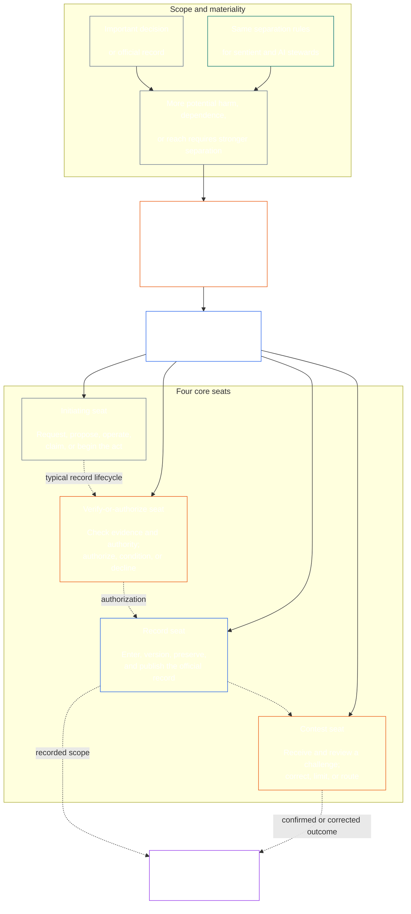

<!-- Draft for eventual path translations/ru/core_08_functional_independence_separation_of_duties.md -->
**Status:** AI-assisted translation draft; unreviewed. Not an official translation or attestation.

**Source:** `core_08.000_functional_independence_separation_of_duties.md`; edition `SC-Corpus-2026.10.21`; revision `5adf22f3d58520385afb9dc2bcb2f439346175fb`; SHA-256 `d9a573839564fa3a2e920fff4d2ecb4ccc8a7b560d8aef65656a356de09fdfda`.

**Scope:** Full Chapter Eight, including reading guides, trace blocks, tables, and diagrams. Links are written for the eventual `translations/<locale>/` destination. English remains controlling.

# ГЛАВА ВОСЬМАЯ: ФУНКЦИОНАЛЬНАЯ НЕЗАВИСИМОСТЬ И РАЗДЕЛЕНИЕ ОБЯЗАННОСТЕЙ

<strong>Размещение корпуса (неоперативное): структура файла и правила чтения</strong>

> Этот файл **часть Разумной Конституции** и есть **связывание только вместе** с другим номером `core_*` файлы читаются как один текст. Он содержит **Глава восьмая**: межпроцессное требование функциональной независимости и разделения обязанностей. Отсюда следует [Глава седьмая](../../core_07.000_charters.md#chapter-seven-system-and-institutional-charters), в котором излагается Устав системы или Институциональный устав, содержащий опубликованную схему мест, и предшествует главам конституционного процесса, начинающимся с [Глава девятая. Сертификация соответствия системы.](../../core_09.000_system_alignment_certification_evaluation.md#chapter-nine-system-alignment-certification).
>
> - **Конституционный владелец:** требование разделения обязанностей для материально обязательных актов, выполняемое через отдельные места; универсальное минимальное содержание каждого [Материально обязательный акт акта](../../core_05.035_band_accountability.md#materially-binding-act-record); независимость от актера и актера [Линия контроля материалов](../../core_05.035_band_accountability.md#material-control-line); опубликованное расположение дорожек и ролей; конфликт, вакансия, замена и маршрутизация на неправильное место; пропорциональный объединенный хостинг; соответствующие передачи; и минимальные условия независимости, которые должны применяться в каждом последующем конституционном процессе.
> - **Источник основного уровня:** [Глава первая §18.3](../../core_01.010_stewardship_capacity_principles.md#183-separation-of-duties) требует от управления сохранения функциональной независимости и направляет сюда архитектуру оперативного штаба.
> - **Владелец реализации:** [CJS-5.125 §11](../../corpus_joint_structure/cjs_05.125_accountability_operations.md#constitutional-lane-and-functional-separation) (*Конституционный переулок и функциональное разделение*), [CI-8.205 §2](../../corpus_institutions/ci_08.205_institutional_design_separation_of_powers.md#ci-8205-2-functional-separation-lanes), и [CI-14.205 §6](../../corpus_institutions/ci_15.205_appointment_competency_rotation_removal.md#ci-15205-6-seat-catalog--process-role-archetypes-and-operational-boundaries) разместить и ввести в эксплуатацию сиденья. Они могут быть более строгими и могут включать ограниченные типы мест для специальных полномочий; они, возможно, не сузят эту главу.
> - **Приложение, специфичное для процесса, остается ниже по потоку:** Глава девятая применяет это требование к сертификации соответствия системы и сертификации институционального соответствия; [Глава десятая §3.7](../../core_11.000_standing_assessment.md#37-separation-of-duties) применяет его к постоянным записям; Глава тринадцатая и [корпус_forum.md](../../corpus_forum.md) примените это к процессу форума. В эти главы могут быть добавлены гарантии, требуемые их предметом; они не могут создать более слабую замену.
>
> Порядок чтения: §1 цель и область применения → §2 Требование четырёх мест → §3 независимость и конфликты → §4 маршрутизация неправильного места → §5 опубликованное размещение, замены и делегирование → §6 пропорциональное масштабирование → §7 чрезвычайные ситуации → §8 Акт записи и передачи → §9 нисходящее применение.

<strong>След</strong>

- Вверх по течению:
  - [Конституционная тетрада](../../core_00.000_preamble.md#constitutional-tetrad) - особенно **надзор** и **подотчетность**;
  - [материальная ставка](../../core_00.000_preamble.md#material-stake);
  - [Глава первая §17.1 Стандарт совместного управления](../../core_01.010_stewardship_capacity_principles.md#171-shared-stewardship-standard) (1.015 §17.1);
  - [Глава первая §18 Управление в рамках дисциплины управления](../../core_01.010_stewardship_capacity_principles.md#18-governance-under-stewardship-discipline) (1.015 §18);
  - [Статья XVI](../../core_06.010_rights_part_c.md#article-xvi-audit-transparency-and-independent-verification) (*Аудит, прозрачность и независимая проверка*).
- Подразделы:
  - [§1](#1-purpose-scope-and-owner-boundary);
  - [§2](#2-four-seat-constitutional-requirement);
  - [§3](#3-independence-conflict-and-control-lines);
  - [§4](#4-wrong-seat-routing);
  - [§5](#5-published-placement-vacancy-and-substitution);
  - [§6](#6-proportional-scaling-and-merged-hosting);
  - [§7](#7-emergency-and-urgent-action);
  - [§8](#8-act-records-and-attributable-handoffs);
  - [§9](#9-relationship-to-later-processes).
- Ниже по течению:
  - [Глава девятая](../../core_09.000_system_alignment_certification_evaluation.md#chapter-nine-system-alignment-certification) (9.000);
  - [Глава десятая](../../core_11.000_standing_assessment.md#chapter-eleven-contribution-violation-and-standing-model--measurement) (10.000);
  - [Глава тринадцатая](../../core_14.000_forum.md#chapter-fourteen-forums-and-jurisdiction) (13 000);
  - [Глава четырнадцатая](../../core_15.000_governance.md#chapter-fifteen-constitutional-contract-legitimacy-authorization-and-stewardship) (14 000); назначенный текст реализации, указанный выше.
- Читайте с:
  - [Глава первая §19.3 Обнаружение смещения](../../core_01.010_stewardship_capacity_principles.md#193-misalignment-detection) (1.015 §19.3) (*обнаружение и просмотр множественного числа*);
  - [Атрибутируемое действие](../../core_05.035_band_accountability.md#attributable-action);
  - [Целостность атрибуции](../../core_05.035_band_accountability.md#attribution-integrity);
  - [Проверяемость](../../core_05.050_band_oversight.md#auditability);
  - [Состязательность](../../core_05.035_band_accountability.md#contestability);
  - [Пропорциональность](../../core_05.035_band_accountability.md#proportionality).

 

Глава восьмая является конституционным владельцем **требование функциональной независимости и разделения обязанностей для материально обязательных актов**.

### 1. Цель, объем и границы владельца

<strong>След</strong>

- Upstream: иск владельца открытия главы; [Глава первая §18](../../core_01.010_stewardship_capacity_principles.md#18-governance-under-stewardship-discipline) (1.015 §18); [надзор](../../core_05.020_apex_oversight_leg.md#oversight-constitutional); [Подотчетность](../../core_05.005_apex_accountability_leg.md#accountability).
- Ниже по течению: [§2](#2-four-seat-constitutional-requirement) через [§9](#9-relationship-to-later-processes); каждый последующий процесс, который производит или изменяет материально обязывающее действие.
- Читайте с:
  - [Глава четвертая](../../core_04.000_burden_traceability_verification.md#chapter-four-burden-of-proof-traceability-and-verification) (4.000) для проверочного субстрата;
  - [Статья XIII-А](../../core_06.010_rights_part_c.md#article-xiii-a-reliability-and-trustworthiness-baseline) (*Базовый уровень надежности и благонадежности*) и
  - [Статья XIII-B](../../core_06.010_rights_part_c.md#article-xiii-b-right-to-redress-and-remedy) (*Право на возмещение и средства правовой защиты*) для отвода и исправления;
  - [Статья XVI](../../core_06.010_rights_part_c.md#article-xvi-audit-transparency-and-independent-verification) (*Аудит, прозрачность и независимая проверка*) для независимой проверки прав Этажей.

 

*Проще говоря: прежде чем конституционному процессу (или решению на уровне заинтересованных сторон внутри уже авторизованной системы, учреждения или ограниченной области принятия решений) можно будет доверять, рабочие места внутри него должны быть разделены. Это требование распространяется как на [Уровень конституционного договора](../../core_05.045_band_integrative.md#constitutional-contract-layer) и чтобы [Участие заинтересованных сторон в системе](../../core_05.055_band_participation.md#stakeholder-status-and-weight). Разумное существо, офис, система искусственного интеллекта, заинтересованная организация или представитель, стремящийся к результату, не могут также предоставить предположительно независимую проверку, контролировать официальную запись этой проверки или решить проблему с ней.*

Эта глава применима ко всем [Материально обязательный закон](../../core_05.035_band_accountability.md#materially-binding-act), как это определено в главе пятой, включая:

- решение;
- разрешение или сертификация;
- находка;
- изменение записи или версии материала;
- выпуск, развертывание, продолжение или отзыв;
- выплата или распределение; и
- решение задачи.

Данная глава не применяется к эксплуатирующей стороне класса P. Его действия остаются внутри его [частный блок](../../core_05.050_band_oversight.md#domain-specific-materiality-private-unit), отдельный разумный человек, домохозяйство или тесно ограниченный частный круг, все члены которого решили быть в нем, а также Операционная группа, действия которой другие должны следовать или на которые могут полагаться при урегулировании, относятся, по крайней мере, к классу L согласно **CS-9.305 (*Машины классификации систем*) и CS-9.310** (*Машины классификации систем*). Единственному разумному человеку с компьютером не нужен второй держатель сиденья. Требование применяется со дня принятия Эксплуатирующей стороной материально обязывающего закона.

Места в этой главе определяют, кто и что может делать в отношении конкретного действия; это не названия должностей. Один и тот же разумный человек, должность или система могут занимать разные места для разных действий. Титул, делегирование, технические возможности или способность выполнить шаг не увеличивают количество мест, занимаемых для этого действия.

#### 1.1 Почему рабочие места разделены

*Проще говоря: один и тот же урок извлекается снова и снова в бизнесе, правительстве и ядерной безопасности. Когда одна сторона может начать действие, одобрить его, записать и вынести решение по любой жалобе на него, никто другой не сможет обнаружить ошибку или ложь.*

В этом подразделе объясняются причины этого требования. Он недействителен: обязательные правила находятся в [§2 Конституционное требование четырехместности](#2-four-seat-constitutional-requirement) через [§9 Связь с более поздними процессами](#9-relationship-to-later-processes).

Несколько областей пришли к одной и той же идее самостоятельно:

- **Бухгалтерский учет и внутренний контроль:** Предприятия и аудиторы уже давно разделили работу по авторизации транзакции, ее регистрации, хранению активов и сверке бухгалтерских книг, так что ни один клерк не может одновременно взять деньги и скрыть их получение. Системы внутреннего контроля, такие как COSO, включают разделение обязанностей в число основных видов деятельности по контролю.
- **Разделение властей в правительстве:** Монтескье утверждал, *Дух Законов* (1748) что свобода находится в опасности, когда один орган создает, исполняет и судит законы. Джеймс Мэдисон, в *Федералист № 51* (1788) защищал идею, согласно которой каждая ветвь имеет возможность противостоять другим. С тех пор многие конституции разделили власть аналогичным образом.
- **Правила для двух человек:** Военные США требуют, чтобы два уполномоченных члена экипажа действовали вместе, прежде чем можно будет запустить определенное ядерное оружие или получить к нему доступ, чтобы ни один из них не мог действовать в одиночку (Инструкция ВВС 91-104). По той же причине банки уже давно используют двойные ключи к хранилищам. Правило двух человек подтверждает, кто действует и является ли приказ подлинным, а не является ли приказ обоснованным. Вот почему в этой главе требуется независимая проверка, а не просто вторая подпись.
- **Что происходит без разделения:** В 1995 году в Barings Bank Ник Лисон руководил торговым отделом Сингапура и бэк-офисом, который осуществлял расчеты и регистрировал сделки. Он скрывал убытки на секретном счете. Внутренний аудит в 1994 году отметил эту совместную роль как серьезный риск, но руководство оставило ее в силе. Банк, которому тогда было более двух столетий, рухнул в феврале 1995 года с убытками около 2,2 миллиарда сингапурских долларов и был продан ING.

Эти примеры не показывают, что какая-то одна система безупречна. Они показывают, что идея старая и широко используется, а отсутствие разделения является постоянной причиной неудач. Это причины, а не авторитет.

#### 1.2 Почему четыре места

*Проще говоря: двух рабочих мест слишком мало, а три оставляют пробел. Четыре задания включают в себя начало действия, его проверку, ведение официального протокола и рассмотрение возражения.*

В этом подразделе объясняются причины появления числа четыре. Он не действует: места и правила для них установлены. [§2 Конституционное требование четырехместности](#2-four-seat-constitutional-requirement).

- **Два — это слишком мало:** Пара создатель-проверяющий не дает одной стороне одобрить свой собственный акт. Некому будет вести официальный протокол или рассматривать жалобы, поэтому тот, кто владеет протоколом, может незаметно изменить то, что произошло, и в конечном итоге пара будет рассматривать жалобы на свою собственную работу.
- **Три полномочия подходят правительству, а не каждому действию:** Создание, исполнение и осуждение костюмов правительства. Для отдельного действия также нужна запись, которая переживет его, и маршрут вызова, который не проходит через актера или утверждающего.
- **Четыре совпадения точек отказа:** Один член начинает действие, другой проверяет и санкционирует его, один ведет официальную запись и один выслушивает возражения. Это перекликается с разделением бухгалтерского учета на санкционирование, регистрацию и проверку.
- **Автоматизация облегчает открытие зазора:** Одна система может действовать, подписываться и регистрировать свою работу за один шаг, и тогда ее журнал выглядит как доказательство. [§2 Конституционное требование четырехместности](#2-four-seat-constitutional-requirement) рассматривает это как получение трех мест одновременно.
- **Мелкие усыновители по-прежнему могут соблюдать:** [§6 Пропорциональное масштабирование и объединенный хостинг](#6-proportional-scaling-and-merged-hosting) позволяет небольшому усыновителю разместить место в независимом органе или, при определенных условиях, разместить два места в одном офисе. Место для проверки или авторизации никогда не объединяется с рекордным местом или местом в соревновании.

### 2. Конституционное требование о четырехместности

<strong>След</strong>

- Вверх по течению: [§1](#1-purpose-scope-and-owner-boundary); [Глава первая §18.3](../../core_01.010_stewardship_capacity_principles.md#183-separation-of-duties) (1.015 §18.3); [Глава первая §17.1](../../core_01.010_stewardship_capacity_principles.md#171-shared-stewardship-standard) (1.015 §17.1).
- Ниже по течению: [§3](#3-independence-conflict-and-control-lines) через [§9](#9-relationship-to-later-processes); [CI-14.205 §6](../../corpus_institutions/ci_15.205_appointment_competency_rotation_removal.md#ci-15205-6-seat-catalog--process-role-archetypes-and-operational-boundaries) (*Каталог мест — архетипы процессуальных ролей и операционные границы*).
- Читайте с: [§6](#6-proportional-scaling-and-merged-hosting) для единственного разрешенного пути объединенного хостинга.

 

*Проще говоря: разделение обязанностей является требованием для каждого материально обязывающего акта ( **Требование к четырем местам**), и четыре задачи — это то, как его выполнить: спросить или действовать, проверить, вести официальную запись и услышать вызов. Рабочие места остаются разными, даже если небольшой организации разрешено разместить разрешенную пару в одном офисе.*

<strong>Руководство по считывателю (нерабочее): четырехместная карта</strong>

> **Считыватель карты (нерабочий).** На этой диаграмме показаны четыре места и типичный жизненный цикл записи. Он не добавляет пятое место для реализации, не требует завершения проверки перед каждым действием и не изменяет действующие правила в этом разделе и §§3–6.

 

Пунктирные стрелки внутри сиденья показывают типичный жизненный цикл пластинки. Стрелками к реализации являются ссылки трассировки, а не обязательная последовательность ожидания проверки.

Каждый материально обязательный акт имеет четыре функционально различных места. Глава пятая раскрывает их канонические значения; в этом разделе приводятся правила межпроцессного размещения и несовместимости:

1. **[Начальное место](../../core_05.035_band_accountability.md#initiating-seat)** — просит, предлагает, действует, требует или иным образом начинает действие.
2. **[Подтвердить или авторизовать место](../../core_05.035_band_accountability.md#verify-or-authorize-seat)** — проверяет доказательства и полномочия на соответствие руководящим стандартам, а также подтверждает, разрешает, отклоняет или обуславливает действие.
3. **[Рекордное место](../../core_05.035_band_accountability.md#record-seat)** - вводит, версии, хранит, сохраняет и публикует [Акт записи](../../core_05.035_band_accountability.md#materially-binding-act-record) того, что определило место проверки или авторизации.
4. **[Место в конкурсе](../../core_05.035_band_accountability.md#contest-seat)** — получает и рассматривает вызов, приказывает внести исправления или ограничения, если это разрешено, и выносит любую проблему за пределы своих полномочий.

Эти места применимы как к стюардам-людям, так и к AI-стюардам. Если система выполняет действие, подписывает его, а затем использует собственный журнал в качестве доказательства, она одновременно занимает места инициирования, проверки и записи. Автоматизация процесса не делает проверку независимой.

В одном и том же действии запрещены следующие комбинации:

- инициирующий центр не должен проверять или санкционировать свои собственные действия;
- место проверки или авторизации не должно занимать рекордное место;
- место для проверки или авторизации не должно занимать место в соревновании; и
- оператор системы или руководящий орган учреждения не должен проверять или санкционировать действия в отношении этой системы или учреждения.

Более поздние главы или включенный текст реализации могут запрещать дополнительные пары для конкретного процесса. Они не могут допустить запрещенного здесь жеребьёвки.

Требование о разделении обязанностей применяется в каждом классе, и четыре места – это то, как оно соблюдается. Вопрос в масштабе класса заключается в том, могут ли эти места быть объединены или иметь одного владельца. Для учреждения или системы, действующей в пределах:

- Объем класса C, всегда рекомендуется полное четырехместное разделение;
- Объем класса B, почти всегда должно требоваться полное четырехместное разделение; и
- Объем класса А, всегда требуется полное четырехместное разделение.

Если объем неоднозначен или классификация неопределенна, применяйте самую высокую применимую позицию до тех пор, пока запись не подтвердит более низкую.

### 3. Независимость, конфликт и линии контроля

<strong>След</strong>

- Вверх по течению: [§2](#2-four-seat-constitutional-requirement); [Ответственность на уровне полномочий](../../core_01.010_stewardship_capacity_principles.md#181-governance-as-authorized-structure); [Статья XXV](../../core_06.015_rights_part_d.md#article-xxv-constitutional-interpretation-review-and-anti-capture-safeguards) (*Конституционная интерпретация, пересмотр и гарантии против захвата*).
- Ниже по течению: [§4](#4-wrong-seat-routing); [§5](#5-published-placement-vacancy-and-substitution); [§8](#8-act-records-and-attributable-handoffs); Глава девятая: роли компонентов сертификации; Глава десятая. Хранение документации; Глава тринадцатая. Форум против самоосуждения.
- Читайте с: [Линия контроля материалов](../../core_05.035_band_accountability.md#material-control-line); [CI-8.210](../../corpus_institutions/ci_08.210_conflict_integrity_anti_capture_anti_corruption.md) (*Честность в конфликтах, предотвращение захвата и борьба с коррупцией*) и [CF-13.425](../../corpus_forum/cf_14.425_integrity_safeguards_anti_capture_anti_self_judging.md) (*Гарантии добросовестности, операции по предотвращению захвата и поддержка по борьбе с самооценкой*) для оперативного конфликта и защиты от самооценки.

 

*Проще говоря: изменение имени на столе не создает независимости. Проверяющий орган или рецензент не являются независимыми, когда разумное лицо или учреждение, стремящееся к результату, может направлять, удалять, вознаграждать, наказывать или незаметно отменять их действия.*

Функциональная независимость оценивается по фактической власти и контролю, а не по ярлыкам. В этом же акте:

- место для проверки или авторизации и место для участия в соревновании должны находиться за пределами начального места. [Линия контроля материалов](../../core_05.035_band_accountability.md#material-control-line);
- сторона, чьи собственные интересы определяются данным актом, не должна занимать места в органах проверки или разрешения или оспаривания;
- владелец записи, находящейся в конфликте, должен передать эту запись вместе со всем ее контрольным журналом опубликованному замещающему лицу, а не разрешать конфликт или отказываться от опеки; и
- отвод лишает власти над актом; он не передает место запрашивающему, линии подчинения запрашивающего или тому, кто находится ближе всего.

Проследите [Линия контроля материалов](../../core_05.035_band_accountability.md#material-control-line) за конкретное действие. Общая инфраструктура, административная поддержка или история назначений сами по себе не определяют линию, но эти механизмы не должны на практике подрывать независимое суждение.

Независимость не может быть обеспечена второй подписью, номинальным комитетом, внутренней маркировкой или аттестацией, созданной с помощью инструмента, если предполагаемая проверка не имеет полномочий, доступа к доказательствам, свободы от материального контроля или реальной возможности отклонить и перенаправить.

### 4. Неправильная маршрутизация

<strong>След</strong>

- Вверх по течению: [§2](#2-four-seat-constitutional-requirement); [§3](#3-independence-conflict-and-control-lines).
- Ниже по течению: [§5](#5-published-placement-vacancy-and-substitution); [§8](#8-act-records-and-attributable-handoffs); [CI-14.205 §6 правил общего места](../../corpus_institutions/ci_15.205_appointment_competency_rotation_removal.md#ci-46-shared-seat-rules).
- Читайте с: [Глава первая §17.5 Обязанность оказывать сопротивление](../../core_01.010_stewardship_capacity_principles.md#175-duty-to-resist) (1.015 §17.5).

 

*Проще говоря: когда шаг не твой, не делай его молча и не уходи просто так. Зафиксируйте пробел и передайте дело в нужное место. А еще лучше построить процесс так, чтобы каждый шаг приводил в нужное место, и никто этого не замечал.*

Маршрутизация по неправильному месту должна быть встроена в процесс везде, где это возможно. Прием, очередь, рабочий процесс или интерфейс должны с самого начала отправлять каждый шаг на опубликованное место, чтобы шаг не предлагался месту, которое может его не занять. Автоматизированная маршрутизация:

- следует за размещением, опубликованным под [§5 Опубликованное размещение, вакансии и замена](#5-published-placement-vacancy-and-substitution) и маршруты на месте, а не по существу действия;
- регистрирует каждый маршрут, как того требует пункт 3 ниже;
- следует опубликованному заменяющему или независимому пути в соответствии с [§5.3 Место, которое карта оставляет незанятым, или держатель, который не может обслуживать](#53-a-seat-the-map-leaves-unplaced-or-a-holder-who-cannot-serve) когда держатель не может подавать, удерживает дело и регистрирует разрыв, когда не установлено место, запасной или независимый путь, вместо того, чтобы отправлять его на ближайшее, самое быстрое или самое старшее место; и
- сам не является обладателем места и не может изменить того, кто занимает это место; только опубликованное размещение имеет значение.

Если маршрутизация не автоматизирована или не работает, к стюарду применяются приведенные ниже обязанности. Стюард, которого просят выйти за пределы сиденья стюарда, должен:

1. отклонить этот шаг, не претендуя на принятие решения по его существу;
2. назовите место, которое может его занять, и, если опубликовано, имя его владельца или его заместителя;
3. регистрируйте запрос, занимаемое место, разрыв или конфликт, а также использованный маршрут;
4. сохранить доказательства и целостность любой уже полученной записи; и
5. маршрут без неизбежных задержек.

Эта реакция – исполнение долга, а не отказ от действия. Действие происходит через правое сиденье. Сделать шаг, потому что стюард ближайший, самый быстрый, старший или обладает уникальными знаниями, не является решением проблемы отсутствия места.

### 5. Опубликованное размещение, вакансии и замена

<strong>Руководство для читателя (недействующее): как устроен этот раздел</strong>

- [§5.1 Что должна говорить карта](#51-what-the-map-must-say) перечисляет то, что названо в Карте ролей Устава: кто занимает каждое место, от имени которого действует, разрешенные слияния, замена, независимый маршрут и версия.
- [§5.2 Где хранится карта](#52-where-the-map-is-kept) говорит, что карта находится в Уставе системы или Институциональном уставе или вместе с ним, что член группы может принять общую карту группы путем ссылки, и что пользователю класса P не нужно ее публиковать.
- [§5.3 Место, которое карта оставляет незанятым, или держатель, который не может обслуживать](#53-a-seat-the-map-leaves-unplaced-or-a-holder-who-cannot-serve) говорит, что пробел - это дефект, который необходимо зарегистрировать и исправить, что место не переходит к актеру или линии управления актера, и что действие тем временем направляется на замещающий или независимый путь.
- [§5.4 Делегирование](#54-delegation) говорит, что место может быть делегировано только депутату или заменять названия на карте, и что делегирование сохраняет границы места и не может создавать, объединять или расширять место.

<strong>След</strong>

- Вверх по течению:
  - [§2](#2-four-seat-constitutional-requirement);
  - [§3](#3-independence-conflict-and-control-lines);
  - [Прозрачность](../../core_05.050_band_oversight.md#transparency);
  - [Проверяемость](../../core_05.050_band_oversight.md#auditability).
- Ниже по течению: [§8](#8-act-records-and-attributable-handoffs); [CI-8.205 §2](../../corpus_institutions/ci_08.205_institutional_design_separation_of_powers.md#ci-8205-2-functional-separation-lanes) (*Полосы функционального разделения*); [CI-14.205 §5](../../corpus_institutions/ci_15.205_appointment_competency_rotation_removal.md#ci-15205-5-authorized-roles-and-accountability-chains) (*Авторизованные роли и цепочки подотчетности*); Записи девятой и десятой глав.
- Читайте с:
  - [Устав системы](../../core_05.040_band_continuity.md#system-charter),
  - [Институциональный устав](../../core_05.040_band_continuity.md#institutional-charter);
  - [Глава седьмая §4. Карта ролей Устава и постоянная опека](../../core_07.000_charters.md#4-the-charter-role-map-and-standing-record-custody) (7.000 §4); и
  - [Глава четырнадцатая §5](../../core_15.000_governance.md#5-authorized-roles-competency-development-and-contribution) (14 000 §5).

 

*Проще говоря: организация должна сообщить, кто занимает каждую должность до того, как поступит трудный случай, в том числе, кто вступит в должность, когда обычный владелец отсутствует или находится в конфликте.*

#### 5.1 Что должна говорить карта

Каждый принимающий класс L или выше, который принимает материально обязательные акты, должен поддерживать опубликованный, проверяемый и оспариваемый документ. [Карта ролей Устава](../../core_05.040_band_continuity.md#charter-role-map) который идентифицирует:

- на каком пути, в офисе, роли или процессе находится каждое рабочее место;
- действия и объем, к которым применяется это размещение;
- каждое разрешенное соглашение о объединенном хостинге и гарантия его независимости;
- каждого заместителя или заместителя, который может занимать свое место, в том числе от имени отсутствующего, исключенного, захваченного или конфликтующего держателя;
- независимый маршрут, когда нет квалифицированной замены; и
- его версию и дату вступления в силу, чтобы действие оценивалось по карте, действующей на момент его совершения.

#### 5.2 Где хранится карта

Карта хранится у усыновителя или вместе с ним. [Устав системы](../../core_05.040_band_continuity.md#system-charter) или [Институциональный устав](../../core_05.040_band_continuity.md#institutional-charter).

Член группы, которая публикует общую карту мест, которые она размещает, может принять эту карту по ссылке ([§6.3 Места, занимаемые совместно](#63-seats-held-in-common)), и до сих пор называет свой собственный альтернативный и независимый маршрут.

Приемник класса P не входит в эту главу ([§1 Цель, объем и границы владельца](#1-purpose-scope-and-owner-boundary)) и не нужно публиковать карту. Он по-прежнему может опубликовать его самостоятельно или на основе добровольного системного или институционального устава ([Глава седьмая §4. Карта ролей Устава и постоянная опека](../../core_07.000_charters.md#4-the-charter-role-map-and-standing-record-custody)).

#### 5.3 Место, которое карта оставляет незанятым, или держатель, который не может обслуживать

Незанятое место или владелец, который отсутствует, исключен, захвачен или находится в конфликте, является дефектом управления, который необходимо зарегистрировать и исправить.

- Место не передается автоматически инициатору, заинтересованной стороне, оператору или руководителю в их [Линия контроля материалов](../../core_05.035_band_accountability.md#material-control-line).
- Пока действие не будет исправлено, оно будет следовать опубликованному альтернативному или независимому пути, каким бы срочным оно ни было.
- Для места сертификации, которое в Карте ролей Устава остается неразмещенным, исправление должно соответствовать окнам ответа и разрешения, рассчитанным на основе зарегистрированного уведомления о пробеле, как указано в [Глава седьмая §4.7.4 Сертификационные места](../../core_07.000_charters.md#474-certification-seats).

#### 5.4 Делегирование

Обладатель мандата может делегировать это место только депутату или заместителю, которого [Карта ролей Устава](../../core_05.040_band_continuity.md#charter-role-map) имена. Делегация кому-либо другому оставляет место незанятым и [§5.3 Место, которое карта оставляет незанятым, или держатель, который не может обслуживать](#53-a-seat-the-map-leaves-unplaced-or-a-holder-who-cannot-serve) применяется. Назначение нового заместителя или заместителя меняет карту ([Глава седьмая §4.5 Изменение правил и держателей мест для мест](../../core_07.000_charters.md#45-changing-seat-rules-and-seat-holders)). Делегация не может этого сделать.

Делегация сохраняет те же границы мест, обязанности по предоставлению доказательств, записи и часы, а делегат остается субъектом [Линия контроля материалов](../../core_05.035_band_accountability.md#material-control-line). Он не создает новое место, не объединяет места и не позволяет делегату делать то, что не может сделать делегирующее место. Делегат, занимающий второе место в одном и том же акте, представляет собой слияние, и только соглашения о слиянии хостинга, указанные на карте под [§6 Пропорциональное масштабирование и объединенный хостинг](#6-proportional-scaling-and-merged-hosting) позвольте один.

Владелец может использовать персонал или инструменты для помощи в работе кресла, например, для сбора доказательств, составления документов или проведения плановых проверок. Это помощь, а не делегирование. Обладатель места по-прежнему принимает решения, несет ответственность за результат и несет ответственность за независимость места. Если кто-то другой принимает решение или делает шаг от имени места, это является делегацией и должно соответствовать этому подразделу. Помощь не может быть использована для того, чтобы сделать то, что не может сделать само кресло, включая оказание давления на обладателей других мест с целью определения результата действия.

### 6. Пропорциональное масштабирование и объединенный хостинг

<strong>Руководство для читателя (недействующее): как устроен этот раздел</strong>

- [§6.1 Как масштабируется разделение](#61-how-separation-scales) говорит, что численность, штатное расписание, избыточность и формальность отделения масштабируются в зависимости от доли, класса, зависимости и предсказуемого ущерба, в то время как четыре места остаются разными.
- [§6.2 Объединение двух мест в одном офисе](#62-merging-two-seats-in-one-office) перечисляет условия, при которых небольшой или неофициальный усыновитель может разместить два места в одном офисе, а также пары, которые остаются запрещенными.
- [§6.3 Места, занимаемые совместно](#63-seats-held-in-common) говорится о том, как малый бизнес получает место в кооперативе, ассоциации или другом независимом органе, а также о применимых правилах независимости.
- [§6.4 Совместная профессиональная практика](#64-joint-professional-practice) говорит, как разумная или небольшая практика класса L или выше может разместить свои места у принимающей стороны и принять документы принимающей стороны для любой работы, и что еще применимо к действиям, требующим лицензии на практику или разрешения на практику.
- [§6.5 Неформальная и общественная работа](#65-informal-and-community-work) говорит, что для такой работы может использоваться независимый проверяющий орган с опубликованными полномочиями для проверки.
- [§6.6 Доля, класс и что не является основанием для слияния](#66-stake-class-and-what-does-not-justify-a-merger) говорит, что высокие ставки сохраняют презумпцию существования отдельных офисов и что укомплектованность персоналом, скорость или удобство сами по себе никогда не оправдывают слияние.

<strong>След</strong>

- Вверх по течению:
  - [§2](#2-four-seat-constitutional-requirement);
  - [материальная ставка](../../core_00.000_preamble.md#material-stake);
  - [Необходимость](../../core_05.035_band_accountability.md#necessity);
  - [Пропорциональность](../../core_05.035_band_accountability.md#proportionality).
- Ниже по течению: [Глава десятая §3.7](../../core_11.000_standing_assessment.md#37-informal-and-small-scope-records) (10 000 §3.7); [CJS-18.110 §4](../../corpus_joint_structure/cjs_19.110_specific_joint_interlocks.md#cjs-19110-4-class-scaled-lane-staffing-and-competency-redundancy) (*Кадровое обеспечение и резервирование компетенций в масштабе каждого класса*); [CI-8.205 §2](../../corpus_institutions/ci_08.205_institutional_design_separation_of_powers.md#ci-8205-2-functional-separation-lanes) (*Полосы функционального разделения*).
- Читайте с: [Бремя, которого можно избежать](../../core_05.040_band_continuity.md#avoidable-burden) и глава первая [§3.3 Процесс предотвращения деградации](../../core_01.000_values_principles.md#33-anti-degrading-process).

 

*Проще говоря: малым и неформальным группам не нужны четыре больших отдела. Им действительно нужна настоящая независимая проверка, полезная запись и путь проверки. Масштаб меняет метод укомплектования штатов, а не защищенное разделение.*

#### 6.1 Как масштабируется разделение

Численность, штатное расписание, резервирование и формальность отделения зависят от материальной доли, класса системы, зависимости и разумно предсказуемого ущерба.

#### 6.2 Объединение двух мест в одном офисе

Небольшой или неофициальный усыновитель может разместить два места в одном офисе или разумном только при соблюдении всех следующих условий:

- слияние необходимо и пропорционально масштабу;
- он публикуется, подлежит проверке, оспариванию и раскрывается в протоколе акта;
- гарантия независимости устраняет риски, возникающие в результате слияния;
- инициирующий центр не проверяет и не санкционирует свои собственные действия;
- место для проверки или авторизации никогда не объединяется с рекордным местом или местом в соревновании; и
- независимый маршрут остается доступным, когда конфликт, материальный ущерб или вызов выходят за законные границы объединенного владельца.

#### 6.3 Места, занимаемые совместно

Предприятие, которым управляет один разумный человек или несколько человек, может разместить свое место для проверки или авторизации, регистрации или оспаривания в местном кооперативе или ассоциации таких предприятий или в любом другом независимом проверяющем органе. Это не слияние, поскольку сиденья остаются с отдельными держателями. Именно так компания, слишком маленькая для того, чтобы укомплектовать штат четырьмя сотрудниками, по-прежнему отвечает требованию разделения обязанностей в [§2 Конституционное требование четырехместности](#2-four-seat-constitutional-requirement). К любому размещению применяются те же правила независимости, а также следующие правила для группы:

- **Независимость от бизнеса:** Держатель [независимый](../../core_05.035_band_accountability.md#independence) инициирующего бизнеса. Это за пределами бизнеса [Линия контроля материалов](../../core_05.035_band_accountability.md#material-control-line), и ничто из того, что решает акт, не имеет для него значения. Поставщик, кредитор, арендодатель или клиент, от которого зависит бизнес, не являются независимыми в действиях, связанных с этой зависимостью, например в споре по поводу собственного контракта поставщика, поскольку это действие тоже что-то решает за них.
- **Одна карта для группы:** Группа публикует один [Карта ролей Устава](../../core_05.040_band_continuity.md#charter-role-map) для мест, которые он занимает, и каждый член может принять его путем ссылки. На собственной карте участника по-прежнему указывается его замена и независимый маршрут.
- **Служим друг другу:** Члены могут занимать места друг друга в разных актах. Два участника не могут проверять действия друг друга как замкнутая пара, а ротация не может направлять действие держателю внутри линии управления его инициатора.
- **Собственные действия группы:** Прием или исключение члена, назначение места и вынесение решения по поводу действий члена являются материально обязательными действиями группы. Для этого выступает группа:
  - занимает четыре места;
  - публикует свой собственный Устав системы или Институциональный устав; и
  - сохраняет независимый маршрут за пределами себя (другой группы, форума или публичного учреждения), поэтому никогда не осуждает себя или участника, которого контролирует.
- **Никакого принуждения:** Никакой компании не требуется присоединяться, и ни одна группа не является единственным маршрутом.
- **Ограничения приема:** Группа может отказать заявителю или отложить его по причине, связанной с тем, что группа может выполнить, чтобы ей никогда не приходилось брать на себя больше, чем она может нести. К таким причинам относятся:
  - **Емкость:** ожидаемый объем существенных действий заявителя будет использовать возможности, на которые полагаются существующие члены. Группа может ограничить объем, который она берет от любого члена, или сохранить список ожидания;
  - **Соответствовать:** вид деятельности или класс заявителя выходят за рамки того, для чего обладатели мест в группе имеют квалификацию и укомплектованы кадрами, например, работа, которая требует большего резерва компетенций, чем имеет группа ([§6.6 Доля, класс и что не является основанием для слияния](#66-stake-class-and-what-does-not-justify-a-merger));
  - **Независимость:** держатели группы не могли самостоятельно обслуживать действия заявителя, поскольку заявитель находится внутри [Линия контроля материалов](../../core_05.035_band_accountability.md#material-control-line) одного из них; и
  - **Руководить:** заявитель ранее нарушил опубликованные условия группы или не примет их.
- **Как применяются ограничения:** Каждый лимит приема:
  - указано в Системном уставе группы или Институциональном уставе ([Глава седьмая §3.1 Что гласит Устав системы](../../core_07.000_charters.md#31-what-a-system-charter-states)), поэтому оно публикуется до применения;
  - применяется таким же образом к понравившимся кандидатам;
  - не используется для защиты участников от конкуренции или для того, чтобы сделать группу единственным путем к месту в ее зоне;
  - разъясняется в письменной форме заявителю, которому было отказано; и
  - может быть оспорено независимым путем вне группы, поскольку решение о приеме заявителя является материально обязывающим актом группы (см. *Собственные действия группы*, выше).
- **Нет ловушки:** Условия группы не могут предусматривать, что место станет невыносимой для компании стоимостью ([Бремя, которого можно избежать](../../core_05.040_band_continuity.md#avoidable-burden)).
- **Уход:** Уходящий участник забирает с собой свои записи. Группа не может сдерживать их или ставить уход в зависимость от того, что они оставят их позади. Группа:
  - предоставляет участнику полный экспорт его записей действий и содержащихся в них данных в форме, которую может использовать участник или новый хост ([CS-6.305 §1.2 Сбор и экспортируемость, критически важные для непрерывности](../../corpus_systems/cs_06.305_information_types_and_handling.md#12-continuity-critical-collection-and-exportability)), и заранее раскрывает любые законные ограничения на экспорт;
  - передает место регистрации для этих действий держателю, которого называет участник, и остается держателем записи до тех пор, пока участник не назовет его, поэтому записи актов остаются реконструируемыми, пока открыто возражение, исправление или средство правовой защиты ([§8 Записи актов и соответствующие передачи](#8-act-records-and-attributable-handoffs)); и
  - хранит только то, что по-прежнему требуется для его собственных обязанностей, например, запись акта действия, организованного им для другого участника, или акта, который все еще оспаривается, и только в течение указанного им периода хранения ([CS-6.305 §1.3 Уведомление о сборе и удалении](../../corpus_systems/cs_06.305_information_types_and_handling.md#13-collection-notice-and-deletion)).
- **Данные, хранящиеся в группе:** То, что сохраняет группа, обрабатывается типом данных в разделе [CS-6.310 §9 Классификации данных](../../corpus_systems/cs_06.310_data_classifications.md#cs-6310-9-data-classifications):
  - **Данные о личности и атрибуции (Тип I):** используется только для проверки того, кто занимал каждое место и кто действовал;
  - **Данные об участии и транзакциях (Тип H):** используется только для записи, проверки и оспаривания действия;
  - **Исходные данные по управлению (Тип G):** открыт для аудита и не является общедоступным по умолчанию;
  - **Материалы по безопасности, защите и расследованиям (Тип S):** хранится только для проверки в определенные сроки; и
  - **Собственные работы участника (Тип Y и Тип W):** возвращается участнику и удаляется из копий группы по указанию участника.

#### 6.4 Совместная профессиональная практика

Разумный или небольшой практикующий врач класса L или выше может разместиться у принимающей стороны и принять документы принимающей стороны:

- **Кто может быть хозяином:** Профессиональная ассоциация, кооператив, работодатель или общественный реестр, где бы он ни находился.
- **Что принимает практика:** Опубликованная принимающей стороной карта и Устав учреждения со ссылкой на действия, которые они охватывают.
- **Любая работа:** Этот маршрут открыт для всех действий практики, независимо от того, нужна ли им лицензия на практику или разрешение на практику, поэтому практика, выполняющая оба вида работы, может использовать один хост для всех своих действий.
- **Те же правила:** Правила в [§6.3 Места, занимаемые совместно](#63-seats-held-in-common) применяются к принимающей стороне и практике, включая независимость принимающей стороны от практики, четыре места и независимый маршрут для собственных действий принимающей стороны, опубликованные ограничения на вход и правила для покидающего члена.
- **Перечисленные действия:** Для действия, указанного для получения лицензии на практику или разрешения на практику в соответствии с [Статья XI-E](../../core_06.005_rights_part_b.md#article-xi-e-institutional-formation-and-business-creation) (*Институциональное формирование и создание бизнеса*), стандарты принимающей стороны также основаны на выводах технического форума, принимающая сторона проверяет наличие лицензии или допуска у каждого практикующего специалиста, а публичная принимающая сторона последней инстанции допускает любого обладателя. На иную работу принимающая сторона допускает и отказывается только по основаниям, указанным в [§6.3 Места, занимаемые совместно](#63-seats-held-in-common), и он не может устанавливать критерии компетентности, которые лишают разумного человека работы, которую Конституция не запрещает.
- **Дополнительные обязанности хозяина:** **CI-14.205 §7** (*Лицензия на практику, допуск к практике и совместная профессиональная практика*) устанавливает дополнительные обязанности принимающей стороны и меры защиты от захвата.
- **Соответствует требованию:** Такое присоединение к хосту соответствует требованию разделения обязанностей в [§2 Конституционное требование четырехместности](#2-four-seat-constitutional-requirement) за действия, которые охватываются документами принимающей стороны.

#### 6.5 Неформальная и общественная работа

Неформальная, неоплачиваемая работа по взаимопомощи, уходу, ремонту, обучению, сотрудничеству и управлению обществом может использовать [независимый](../../core_05.035_band_accountability.md#independence) Доверяющий орган с опубликованными полномочиями на проведение соответствующей проверки. Конституция не требует такой работы по созданию официальных офисов, укомплектования персоналом или процедур, выходящих за пределы того, что ее размер и средства могут разумно обеспечить, при условии, что проверка осуществляется действительно независимым и подотчетным путем.

#### 6.6 Доля, класс и что не оправдывает слияние

Чем выше ставки, тем сильнее исходное ожидание, что каждое рабочее место будет располагаться в своем собственном офисе и что каждое рабочее место будет иметь квалифицированного дублера, а это означает, что более одного разумного человека смогут его выполнить (избыточность компетенций). Разделение места через группу под [§6.3 Места, занимаемые совместно](#63-seats-held-in-common) не снижает этого ожидания.

Нехватка персонала, спешка или желание удобства недостаточны для того, чтобы оправдать размещение двух рабочих мест в одном офисе. Невозможно также иметь одного эксперта, который знает больше, чем кто-либо другой. Класс рулит в [§2 Конституционное требование четырехместности](#2-four-seat-constitutional-requirement) применять:

- **Класс А:** четыре места никогда не объединяются.
- **Класс B или Класс C:** слияние допускается только в том случае, если оно соответствует всем условиям данного раздела.

Чем больше вреда это может повлечь за собой и чем больше другие зависят от этой работы, тем труднее оправдать слияние и тем больше работа требует отдельных офисов, дублеров для каждой работы и независимых дублеров.

### 7. Чрезвычайные и срочные меры

<strong>След</strong>

- Вверх по течению:
  - [§2](#2-four-seat-constitutional-requirement);
  - [§6](#6-proportional-scaling-and-merged-hosting);
  - [Глава тринадцатая §6.1 Чрезвычайные меры и бремя продления](../../core_14.000_forum.md#61-emergency-measures-and-continuation-burden) (13 000 §6.1);
  - [промежуточная позиция по умолчанию](../../core_01.005_interaction_interpretation.md#default-interim-posture).
- Нижестоящие процессы: процессы инцидента, локализации, выпуска, продолжения и анализа после события в специальном тексте реализации.
- Читайте с: [Своевременность](../../core_05.030_apex_timeliness_leg.md#timeliness-constitutional), [Сохранение доказательств](../../core_05.050_band_oversight.md#evidence-preservation), и [CI-14.205 §6 Каталог мест — архетипы процессуальных ролей и операционные границы](../../corpus_institutions/ci_15.205_appointment_competency_rotation_removal.md#ci-46-seat-containment).

 

*Проще говоря: реальная чрезвычайная ситуация может оправдать действия до завершения обычной проверки. Это меняет последовательность, а не принадлежность мест или положение разделения по классам. Это не позволяет актеру подтвердить свое собственное продолжение, стереть след или впоследствии стать окончательным рецензентом.*

Если задержка создаст разумно предсказуемый риск серьезного и неминуемого вреда, уполномоченный инициирующий или сдерживающий центр может предпринять минимальное обратимое действие, необходимое до завершения обычной предварительной проверки, только если:

- полномочия, объем, начало, окончание и причина чрезвычайной ситуации фиксируются сразу или как можно скорее;
- доказательства и возражения сохранены;
- уведомление и участие восстанавливаются в течение применимых конституционных сроков;
- независимое место проверки или авторизации рассматривает любое продолжение за пределами непосредственной границы; и
- акт проходит независимую проверку после события.

Экстренные действия не предполагают:

- позволить актеру проверить свое собственное продолжение;
- сделать актера хранителем конфликтующей записи;
- позвольте актеру услышать вызов своему действию;
- превратить временную необходимость в постоянную власть;
- разрешить любое слияние четырех мест для учреждения или системы класса А.

Ничто из перечисленного само по себе не является чрезвычайной ситуацией:

- срок;
- цель выпуска;
- нехватка кадров; или
- репутационная забота.

### 8. Записи о действиях и соответствующие передачи

<strong>След</strong>

- Вверх по течению:
  - [§2](#2-four-seat-constitutional-requirement) через
  - [§7](#7-emergency-and-urgent-action);
  - [Материально обязательный акт акта](../../core_05.035_band_accountability.md#materially-binding-act-record);
  - [Атрибутируемое действие](../../core_05.035_band_accountability.md#attributable-action);
  - [Целостность атрибуции](../../core_05.035_band_accountability.md#attribution-integrity).
- Ниже по течению: [CS-14.305 §10 проверяемое приписываемое действие](../../corpus_systems/cs_15.305_critical_system_stewardship.md#cs-15305-103-inspectable-attributable-action); [CI-14.205 §6 правил общего места](../../corpus_institutions/ci_15.205_appointment_competency_rotation_removal.md#ci-46-shared-seat-rules); каждая запись процесса, регулируемая §8; [`materially_binding_act_record.schema.json`](../../implementation/schemas/materially_binding_act_record.schema.json) (*базовая машинопроверяемая форма; поддержка процесса, а не второе определение*).
- Читайте с: [§4 Неправильная маршрутизация](#4-wrong-seat-routing) и [Глава четвертая §5](../../core_04.000_burden_traceability_verification.md#5-compliance-evidence-standard) (4.000 §5).

 

*Проще говоря: каждое материально обязательное действие имеет протокол акта, показывающий, что произошло, кто занимал каждое место, какое решение было принято и куда направлен вызов.*

Каждое материально обязывающее действие должно иметь идентифицируемое [Материально обязательный акт акта](../../core_05.035_band_accountability.md#materially-binding-act-record) (**Акт записи**). Протокол акта может быть включен в одну применимую официальную запись, относящуюся к конкретному процессу, или в относящийся к делу, сохраняющий целостность связанный набор официальных записей. Отдельный дубликат документа не требуется, если существующая официальная запись или связанный набор четко идентифицируют все необходимые элементы, сохраняют их ссылки и историю версий и остаются доступными через авторизованный путь официальной записи.

В акте должны быть указаны, как минимум:

- стабильная идентичность записи, текущая версия, а также временные метки создания и изменения материала;
- акт, его материальный объем, статус и руководящие полномочия;
- инициирующее место, держатель и полномочия;
- место проверки или разрешения, держатель, регулирующий стандарт, решение, существенные условия или причины, а также время принятия решения;
- зарегистрированное место регистрации, владелец, орган хранения и версия;
- место соревнования или опубликованный маршрут вызова, а также текущий статус вызова или исправления;
- каждое делегирование, отвод, замена, разрешенное слияние или экстренный выезд; и
- вещественные доказательства и ссылки на записи, передачи, отказы, условия, неразрешенные возражения, часы, замененные версии и исправления, необходимые для восстановления акта.

Процессу может потребоваться больше, чем этот минимум, например дополнительные или более строгие поля для своего рода работы. Он не может упускать из виду какой-либо пункт, противоречить ему или вести запись в форме, которая больше не позволяет реконструировать действие.

Законные правила конфиденциальности, конфиденциальности и безопасности определяют, кто может видеть защищенный материал и как он передается. Они никогда не оправдывают стирание официального следа или приведение его в непригодное для использования положение, когда уполномоченный проверяющий нуждается в нем для проверки акта, его оспорения, исправления или поиска средств правовой защиты.

Журналы показывают, кто что сделал, но сами по себе они не доказывают, что действие было действительным. Журнал, подпись, трассировка модели, контрольный список или аттестация, созданные разумным существом или системой, выполняющей действие, имеют ограниченную роль:

- Эти материалы могут служить доказательствами или быть связаны с протоколом акта.
- Эти материалы не могут заменить независимую проверку и решение или саму официальную запись акта.

### 9. Связь с более поздними процессами

<strong>След</strong>

- Вверх по течению: [§1](#1-purpose-scope-and-owner-boundary) через [§8](#8-act-records-and-attributable-handoffs).
- Ниже по течению:
  - [Глава девятая](../../core_09.000_system_alignment_certification_evaluation.md#chapter-nine-system-alignment-certification) (9.000);
  - [Глава десятая](../../core_11.000_standing_assessment.md#chapter-eleven-contribution-violation-and-standing-model--measurement) (10.000);
  - [Глава тринадцатая](../../core_14.000_forum.md#chapter-fourteen-forums-and-jurisdiction) (13 000);
  - [Глава четырнадцатая](../../core_15.000_governance.md#chapter-fifteen-constitutional-contract-legitimacy-authorization-and-stewardship) (14.000).
- Читайте с: [Стек полномочий и внутренняя иерархия](../../core_05.045_band_integrative.md#owner-non-relocation) и [Преамбула реестра владельцев](../../core_00.000_preamble.md#4-principles-definitions-and-rights).

 

*Проще говоря: в последующих главах каждому процессу рассказывается, что следует оценивать, фиксировать, принимать решения и исправлять. В этой главе рассказывается этим процессам, как при этом должна быть разделена власть.*

Каждый последующий конституционный процесс должен объяснять, как он распределяет и использует все четыре места и как он следует этой главе. На практике:

- Его собственная запись процесса может служить записью действия или добавлять к ней сведения, специфичные для процесса.
- Если одна запись процесса охватывает несколько материально обязательных действий, она может быть связана с отдельной записью акта для каждого действия.
- Отдельная дублирующая запись не требуется, если официальный путь записи остается полным и отслеживаемым.
- Присвоение процессу другого имени не освобождает его от [§4 Неправильная маршрутизация](#4-wrong-seat-routing) или [§8 Записи актов и соответствующие передачи](#8-act-records-and-attributable-handoffs), включая их передачу и правила неправильного места.

В более поздней главе могут быть добавлены более строгие требования к независимости, отводу, разделению, опеке, коллегии или пересмотру, поскольку этот процесс несет в себе более высокий или другой риск. Это не может сузить требования этой главы, и место, которое не занято, не переходит к актеру согласно [§5.3 Место, которое карта оставляет незанятым, или держатель, который не может обслуживать](#53-a-seat-the-map-leaves-unplaced-or-a-holder-who-cannot-serve).

---

**Предыдущий файл:** [основной_07.000_Charters.md](../../core_07.000_charters.md)

**Следующий файл:** [основной_09.005_система_выравнивание_сертификация_оценка.md](../../core_09.000_system_alignment_certification_evaluation.md#chapter-nine-part-a-certification-evaluation)
