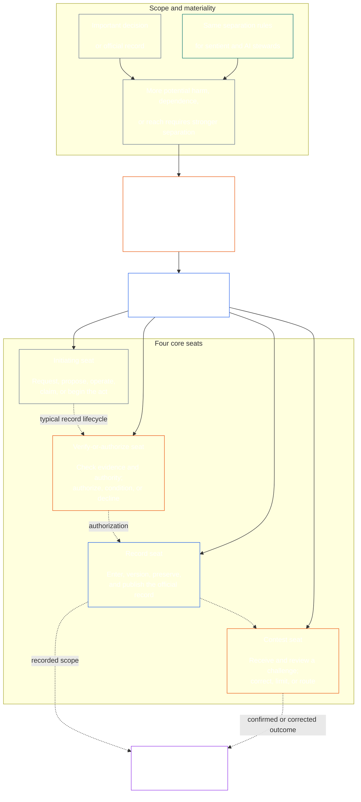

<!-- Draft for eventual path translations/ta/core_08_functional_independence_separation_of_duties.md -->
**Status:** AI-assisted translation draft; unreviewed. Not an official translation or attestation.

**Source:** `core_08.000_functional_independence_separation_of_duties.md`; edition `SC-Corpus-2026.10.21`; revision `5adf22f3d58520385afb9dc2bcb2f439346175fb`; SHA-256 `d9a573839564fa3a2e920fff4d2ecb4ccc8a7b560d8aef65656a356de09fdfda`.

**Scope:** Full Chapter Eight, including reading guides, trace blocks, tables, and diagrams. Links are written for the eventual `translations/<locale>/` destination. English remains controlling.

# அத்தியாயம் எட்டு: செயல்பாட்டுச் சுதந்திரம் மற்றும் கடமைகளைப் பிரித்தல்

<strong>கார்பஸ் பிளேஸ்மென்ட் (செயல்படாதது): கோப்பு அமைப்பு மற்றும் வாசிப்பு விதிகள்</strong>

> இந்த கோப்பு **உணர்வுபூர்வமான அரசியலமைப்பின் ஒரு பகுதி** மற்றும் உள்ளது **ஒன்றாக மட்டுமே பிணைத்தல்** மற்ற எண்ணுடன் `core_*` கோப்புகள் ஒரு உரையாக வாசிக்கப்படுகின்றன. இது கொண்டுள்ளது **அத்தியாயம் எட்டு**: செயல்பாட்டு சுதந்திரம் மற்றும் கடமைகளை பிரிப்பதற்கான குறுக்கு-செயல்முறை தேவை. அது பின்வருமாறு [அத்தியாயம் ஏழு](../../core_07.000_charters.md#chapter-seven-system-and-institutional-charters), இது வெளியிடப்பட்ட இருக்கை வரைபடத்தைக் கொண்டுள்ள கணினி சாசனம் அல்லது நிறுவன சாசனத்தைக் கூறுகிறது, மேலும் அரசியலமைப்பு செயல்முறை அத்தியாயங்களுக்கு முந்தியுள்ளது. [அத்தியாயம் ஒன்பது அமைப்பு சீரமைப்பு சான்றிதழ்](../../core_09.000_system_alignment_certification_evaluation.md#chapter-nine-system-alignment-certification).
>
> - **அரசியலமைப்பு உரிமையாளர்:** தனித்தனி இருக்கைகள் மூலம் நிறைவேற்றப்படும் பொருள் பிணைப்புச் செயல்களுக்கான கடமைகளைப் பிரித்தல் தேவை; ஒவ்வொன்றின் உலகளாவிய குறைந்தபட்ச உள்ளடக்கங்கள் [மெட்டீரியல் பைண்டிங் ஆக்ட் ரெக்கார்டு](../../core_05.035_band_accountability.md#materially-binding-act-record); நடிகர் மற்றும் நடிகரிடமிருந்து சுதந்திரம் [பொருள் கட்டுப்பாட்டு வரி](../../core_05.035_band_accountability.md#material-control-line); வெளியிடப்பட்ட லேன் மற்றும் ரோல் பிளேஸ்மென்ட்; மோதல், காலியிடம், மாற்றீடு மற்றும் தவறான இருக்கை வழித்தடம்; விகிதாசார இணைக்கப்பட்ட ஹோஸ்டிங்; கற்பிக்கப்பட்ட கைமாறுகள்; மற்றும் ஒவ்வொரு பிற்கால அரசியலமைப்பு செயல்முறையும் பொருந்தக்கூடிய குறைந்தபட்ச சுதந்திர நிபந்தனைகள்.
> - **கொள்கை அடுக்கு ஆதாரம்:** [அத்தியாயம் ஒன்று §18.3](../../core_01.010_stewardship_capacity_principles.md#183-separation-of-duties) செயல்பாட்டு சுதந்திரத்தை பாதுகாக்கவும், செயல்பாட்டு இருக்கை கட்டமைப்பை இங்கு வழிநடத்தவும் ஆளுகை தேவைப்படுகிறது.
> - **அமலாக்க உரிமையாளர்:** [CJS-5.125 §11](../../corpus_joint_structure/cjs_05.125_accountability_operations.md#constitutional-lane-and-functional-separation) (*அரசியலமைப்பு பாதை மற்றும் செயல்பாட்டு பிரிப்பு*), [CI-8.205 §2](../../corpus_institutions/ci_08.205_institutional_design_separation_of_powers.md#ci-8205-2-functional-separation-lanes), மற்றும் [CI-14.205 §6](../../corpus_institutions/ci_15.205_appointment_competency_rotation_removal.md#ci-15205-6-seat-catalog--process-role-archetypes-and-operational-boundaries) இருக்கைகளை வைத்து இயக்கவும். அவை கடுமையானதாக இருக்கலாம் மற்றும் வரம்புக்குட்பட்ட சிறப்பு-அதிகார இருக்கை வகைகளைச் சேர்க்கலாம்; அவர்கள் இந்த அத்தியாயத்தை சுருக்க முடியாது.
> - **செயல்முறை சார்ந்த பயன்பாடு கீழ்நிலையிலேயே உள்ளது:** பாடம் ஒன்பது இந்த தேவையை கணினி சீரமைப்பு சான்றிதழுக்கும் நிறுவன சீரமைப்பு சான்றிதழுக்கும் பொருந்தும்; [அத்தியாயம் பத்து §3.7](../../core_11.000_standing_assessment.md#37-separation-of-duties) நிற்கும் பதிவுகளுக்கு இது பொருந்தும்; அத்தியாயம் பதின்மூன்று மற்றும் [கார்பஸ்_forum.md](../../corpus_forum.md) மன்ற செயல்முறைக்கு அதைப் பயன்படுத்துங்கள். அந்த அத்தியாயங்கள் அவற்றின் பொருளுக்குத் தேவையான பாதுகாப்புகளைச் சேர்க்கலாம்; அவர்கள் ஒரு பலவீனமான மாற்றீட்டை உருவாக்க முடியாது.
>
> வாசிப்பு வரிசை: §1 நோக்கம் மற்றும் நோக்கம் → §2 நான்கு-இருக்கை தேவை → §3 சுதந்திரம் மற்றும் முரண்பாடுகள் → §4 தவறான இருக்கை ரூட்டிங் → §5 வெளியிடப்பட்ட வேலை வாய்ப்பு, மாற்றீடுகள் மற்றும் பிரதிநிதித்துவம் → §6 விகிதாச்சார அளவு → 7ன் அளவுகள் பதிவுகள் மற்றும் கையேடுகள் → §9 கீழ்நிலை பயன்பாடு.

<strong>சுவடு</strong>

- அப்ஸ்ட்ரீம்:
  - [அரசியலமைப்பு டெட்ராட்](../../core_00.000_preamble.md#constitutional-tetrad) - குறிப்பாக **மேற்பார்வை** மற்றும் **பொறுப்புக்கூறல்**;
  - [பொருள் பங்கு](../../core_00.000_preamble.md#material-stake);
  - [அத்தியாயம் ஒன்று §17.1 பகிரப்பட்ட பணிப்பெண் தரநிலை](../../core_01.010_stewardship_capacity_principles.md#171-shared-stewardship-standard) (1.015 §17.1);
  - [அத்தியாயம் ஒன்று §18 பணிப்பெண் ஒழுக்கத்தின் கீழ் ஆளுகை](../../core_01.010_stewardship_capacity_principles.md#18-governance-under-stewardship-discipline) (1.015 §18);
  - [கட்டுரை XVI](../../core_06.010_rights_part_c.md#article-xvi-audit-transparency-and-independent-verification) (*தணிக்கை, வெளிப்படைத்தன்மை மற்றும் சுயாதீன சரிபார்ப்பு*)
- துணைப்பிரிவுகள்:
  - [§1](#1-purpose-scope-and-owner-boundary);
  - [§2](#2-four-seat-constitutional-requirement);
  - [§3](#3-independence-conflict-and-control-lines);
  - [§4](#4-wrong-seat-routing);
  - [§5](#5-published-placement-vacancy-and-substitution);
  - [§6](#6-proportional-scaling-and-merged-hosting);
  - [§7](#7-emergency-and-urgent-action);
  - [§8](#8-act-records-and-attributable-handoffs);
  - [§9](#9-relationship-to-later-processes).
- கீழ்நிலை:
  - [அத்தியாயம் ஒன்பது](../../core_09.000_system_alignment_certification_evaluation.md#chapter-nine-system-alignment-certification) (9.000);
  - [அத்தியாயம் பத்து](../../core_11.000_standing_assessment.md#chapter-eleven-contribution-violation-and-standing-model--measurement) (10.000);
  - [அத்தியாயம் பதின்மூன்று](../../core_14.000_forum.md#chapter-fourteen-forums-and-jurisdiction) (13.000);
  - [அத்தியாயம் பதினான்கு](../../core_15.000_governance.md#chapter-fifteen-constitutional-contract-legitimacy-authorization-and-stewardship) (14.000); மேலே பெயரிடப்பட்ட செயல்படுத்தல் உரை.
- உடன் படிக்கவும்:
  - [அத்தியாயம் ஒன்று §19.3 தவறான சீரமைப்பு கண்டறிதல்](../../core_01.010_stewardship_capacity_principles.md#193-misalignment-detection) (1.015 §19.3) (*பன்மை கண்டறிதல் மற்றும் ஆய்வு*);
  - [கற்பிதமான செயல்](../../core_05.035_band_accountability.md#attributable-action);
  - [பண்பு ஒருமைப்பாடு](../../core_05.035_band_accountability.md#attribution-integrity);
  - [தணிக்கைத்திறன்](../../core_05.050_band_oversight.md#auditability);
  - [போட்டித்தன்மை](../../core_05.035_band_accountability.md#contestability);
  - [விகிதாசாரம்](../../core_05.035_band_accountability.md#proportionality).

 

அத்தியாயம் எட்டு அரசியலமைப்பின் உரிமையாளராக உள்ளது **பொருள் பிணைப்புச் செயல்களுக்கான செயல்பாட்டு-சுதந்திரம் மற்றும் கடமைகளைப் பிரித்தல் தேவை**.

### 1. நோக்கம், நோக்கம் மற்றும் உரிமையாளர் எல்லை

<strong>சுவடு</strong>

- அப்ஸ்ட்ரீம்: அத்தியாயத்தைத் திறக்கும் உரிமையாளரின் உரிமைகோரல்; [அத்தியாயம் ஒன்று §18](../../core_01.010_stewardship_capacity_principles.md#18-governance-under-stewardship-discipline) (1.015 §18); [மேற்பார்வை](../../core_05.020_apex_oversight_leg.md#oversight-constitutional); [பொறுப்புக்கூறல்](../../core_05.005_apex_accountability_leg.md#accountability).
- கீழ்நிலை: [§2](#2-four-seat-constitutional-requirement) மூலம் [§9](#9-relationship-to-later-processes); ஒவ்வொரு பிந்தைய செயல்முறையும் ஒரு பொருள் பிணைப்புச் செயலை உருவாக்குகிறது அல்லது மாற்றுகிறது.
- உடன் படிக்கவும்:
  - [அத்தியாயம் நான்கு](../../core_04.000_burden_traceability_verification.md#chapter-four-burden-of-proof-traceability-and-verification) (4.000) சரிபார்ப்பு அடி மூலக்கூறு;
  - [கட்டுரை XIII-A](../../core_06.010_rights_part_c.md#article-xiii-a-reliability-and-trustworthiness-baseline) (*நம்பகத்தன்மை மற்றும் நம்பகத்தன்மை அடிப்படை*) மற்றும்
  - [கட்டுரை XIII-B](../../core_06.010_rights_part_c.md#article-xiii-b-right-to-redress-and-remedy) (*பரிகாரம் மற்றும் தீர்வுக்கான உரிமை*) சவால் மற்றும் தீர்வுக்காக;
  - [கட்டுரை XVI](../../core_06.010_rights_part_c.md#article-xvi-audit-transparency-and-independent-verification) (*தணிக்கை, வெளிப்படைத்தன்மை மற்றும் சுயாதீன சரிபார்ப்பு*) சுதந்திர சரிபார்ப்பு உரிமைகள் தளங்கள்.

 

*எளிமையான சொற்களில்: ஒரு அரசியலமைப்பு செயல்முறைக்கு முன் - அல்லது ஏற்கனவே அங்கீகரிக்கப்பட்ட அமைப்பு, நிறுவனம் அல்லது வரம்புக்குட்பட்ட முடிவு களத்திற்குள் பங்குதாரர்-நிலை முடிவு-நம்பலாம், அதில் உள்ள வேலைகள் பிரிக்கப்பட வேண்டும். இந்த தேவை இரண்டுக்கும் பொருந்தும் [அரசியலமைப்பு ஒப்பந்த அடுக்கு](../../core_05.045_band_integrative.md#constitutional-contract-layer) மற்றும் [பங்குதாரர் அமைப்பு பங்கேற்பு](../../core_05.055_band_participation.md#stakeholder-status-and-weight). ஒரு உணர்வு, அலுவலகம், AI அமைப்பு, பங்குதாரர் அமைப்பு, அல்லது ஒரு முடிவைத் தேடும் பிரதிநிதி, கூறப்படும் சுயாதீனமான காசோலையை வழங்கவோ, அந்த காசோலையின் அதிகாரப்பூர்வ பதிவைக் கட்டுப்படுத்தவோ அல்லது அதற்கான சவாலை தீர்மானிக்கவோ முடியாது.*

இந்த அத்தியாயம் அனைவருக்கும் பொருந்தும் [பொருள் பிணைப்பு சட்டம்](../../core_05.035_band_accountability.md#materially-binding-act), அத்தியாயம் ஐந்தாவது அதை வரையறுக்கிறது, உட்பட:

- ஒரு முடிவு;
- ஒரு அங்கீகாரம் அல்லது சான்றிதழ்;
- ஒரு கண்டுபிடிப்பு;
- பதிவு நுழைவு அல்லது பொருள் பதிப்பு மாற்றம்;
- ஒரு வெளியீடு, வரிசைப்படுத்தல், தொடர்ச்சி அல்லது திரும்பப் பெறுதல்;
- ஒரு வழங்கல் அல்லது ஒதுக்கீடு; மற்றும்
- ஒரு சவாலின் தன்மை.

இந்த அத்தியாயம் கிளாஸ் பி ஆப்பரேட்டிங் பார்ட்டிக்கு பொருந்தாது. அதன் செயல்கள் அதன் உள்ளேயே இருக்கும் [தனியார் அலகு](../../core_05.050_band_oversight.md#domain-specific-materiality-private-unit), ஒரு ஒற்றை உணர்வு, ஒரு குடும்பம் அல்லது இறுக்கமாக வரையறுக்கப்பட்ட தனிப்பட்ட வட்டம், அதன் உறுப்பினர்கள் அனைவரும் அதில் இருக்கத் தேர்வுசெய்துள்ளனர், மேலும் ஒரு இயக்கக் கட்சியானது அதன் செயல்களை மற்றவர்கள் பின்பற்ற வேண்டும் அல்லது நம்பியிருக்க வேண்டும். **CS-9.305 (*கணினி வகைப்பாடு இயந்திரங்கள்*) மற்றும் CS-9.310** (*கணினி வகைப்பாடு இயந்திரங்கள்*) கம்ப்யூட்டரைப் பயன்படுத்தும் ஒரே உணர்வுள்ளவருக்கு இரண்டாவது இருக்கை வைத்திருப்பவர் தேவையில்லை. செயல்பாட்டுக் கட்சி பொருள் பிணைப்புச் சட்டத்தை எடுத்த நாளிலிருந்து தேவை பொருந்தும்.

இந்த அத்தியாயத்தில் உள்ள இருக்கைகள் ஒரு குறிப்பிட்ட செயலுக்கு யார் என்ன செய்யலாம் என்பதை வரையறுக்கிறது; அவை வேலை தலைப்புகள் அல்ல. ஒரே உணர்வு, அலுவலகம் அல்லது அமைப்பு வெவ்வேறு செயல்களுக்கு வெவ்வேறு இடங்களை வைத்திருக்கலாம். ஒரு தலைப்பு, பிரதிநிதித்துவம், தொழில்நுட்ப திறன் அல்லது ஒரு படி செய்யும் திறன் ஆகியவை அந்த செயலுக்கான இருக்கையை பெரிதாக்காது.

#### 1.1 வேலைகள் ஏன் பிரிக்கப்படுகின்றன

*எளிமையான சொற்களில்: வணிகம், அரசாங்கம் மற்றும் அணுசக்தி பாதுகாப்பு ஆகியவற்றில் அதே பாடம் மீண்டும் மீண்டும் கற்றுக் கொள்ளப்பட்டது. ஒரு தரப்பினர் ஒரு செயலைத் தொடங்கும்போது, ​​​​அதற்கு ஒப்புதல் அளிக்கலாம், அதை எழுதலாம் மற்றும் அதைப் பற்றிய எந்தவொரு புகாரையும் தீர்ப்பளிக்க முடியும் என்றால், வேறு யாரும் ஒரு தவறையோ அல்லது பொய்யையோ பிடிக்கும் நிலையில் இல்லை.*

இந்த துணைப்பிரிவு தேவைக்கான காரணங்களை விளக்குகிறது. இது செயல்படாதது: பிணைப்பு விதிகள் உள்ளன [§2 நான்கு இருக்கை அரசியலமைப்புத் தேவை](#2-four-seat-constitutional-requirement) மூலம் [§9 பிந்தைய செயல்முறைகளுக்கான உறவு](#9-relationship-to-later-processes).

பல துறைகள் தாங்களாகவே ஒரே கருத்தை அடைந்தன:

- **கணக்கியல் மற்றும் உள் கட்டுப்பாடு:** வணிகங்கள் மற்றும் தணிக்கையாளர்கள் ஒரு பரிவர்த்தனையை அங்கீகரிப்பது, அதை பதிவு செய்வது, சொத்துக்களை வைத்திருப்பது மற்றும் புத்தகங்களை சமரசம் செய்வது போன்ற பணிகளை நீண்ட காலமாக பிரித்து வைத்துள்ளனர், இதனால் எந்த ஒரு எழுத்தரும் பணம் எடுக்க முடியாது மற்றும் எடுக்கப்பட்டதை மறைக்க முடியாது. COSO போன்ற உள்-கட்டுப்பாட்டு கட்டமைப்புகள் அவற்றின் அடிப்படைக் கட்டுப்பாட்டு நடவடிக்கைகளில் கடமைகளைப் பிரிப்பதைப் பட்டியலிடுகின்றன.
- **அரசாங்கத்தில் அதிகாரப் பிரிப்பு:** மான்டெஸ்கியூ வாதிட்டார் *சட்டங்களின் ஆவி* (1748) ஒரு உடல் சட்டங்களை உருவாக்கி, செயல்படுத்தி, தீர்ப்பளிக்கும் போது சுதந்திரம் ஆபத்தில் உள்ளது. ஜேம்ஸ் மேடிசன், இல் *பெடரலிஸ்ட் எண். 51* (1788), ஒவ்வொரு கிளையும் மற்றவற்றை எதிர்க்கும் வழிகளைக் கொண்ட ஒரு வடிவமைப்பை பாதுகாத்தது. பல அரசியலமைப்புகள் அதிகாரத்தை ஒரே மாதிரியாகப் பிரித்துள்ளன.
- **இரு நபர் விதிகள்:** சில அணுவாயுதங்களை ஏவுவதற்கு அல்லது அணுகுவதற்கு முன், அமெரிக்க இராணுவம் இரண்டு அங்கீகரிக்கப்பட்ட குழு உறுப்பினர்கள் இணைந்து செயல்பட வேண்டும், அதனால் யாரும் தனியாக செயல்பட முடியாது (விமானப்படை அறிவுறுத்தல் 91-104). இதே காரணத்திற்காக வங்கிகள் நீண்ட காலமாக பெட்டகங்களில் இரட்டை விசைகளை வைத்துள்ளன. இரு நபர் விதி, யார் செயல்படுகிறார் என்பதையும், உத்தரவு உண்மையானதா என்பதையும் உறுதிப்படுத்துகிறது, ஆர்டர் சரியானதா என்பதை அல்ல. அதனால்தான் இந்த அத்தியாயம் இரண்டாவது கையொப்பம் மட்டும் இல்லாமல் ஒரு சுயாதீன காசோலையைக் கேட்கிறது.
- **பிரிக்காமல் என்ன நடக்கும்:** 1995 இல் பேரிங்ஸ் வங்கியில், நிக் லீசன் சிங்கப்பூர் வர்த்தக மேசை மற்றும் பின் அலுவலகம் இரண்டையும் நடத்தி அதன் வர்த்தகங்களைத் தீர்த்து பதிவு செய்தார். அவர் ஒரு ரகசிய கணக்கில் இழப்புகளை மறைத்தார். 1994 ஆம் ஆண்டில் ஒரு உள் தணிக்கையானது ஒருங்கிணைந்த பங்கை ஒரு பெரிய ஆபத்து என்று கொடியிட்டது, ஆனால் நிர்வாகம் அதை அப்படியே விட்டுவிட்டது. இரண்டு நூற்றாண்டுகளுக்கும் மேலான பழைய வங்கி, பிப்ரவரி 1995 இல் சுமார் S$2.2 பில்லியன் இழப்புகளுடன் சரிந்து INGக்கு விற்கப்பட்டது.

எந்த ஒரு அமைப்பும் குறைபாடற்றது என்பதை இந்த எடுத்துக்காட்டுகள் காட்டவில்லை. இந்த யோசனை பழையது மற்றும் பரவலாகப் பயன்படுத்தப்பட்டது என்றும், காணாமல் போனது தோல்விக்கான தொடர்ச்சியான காரணம் என்றும் அவர்கள் காட்டுகிறார்கள். அவை காரணங்கள், அதிகாரம் அல்ல.

#### 1.2 ஏன் நான்கு இருக்கைகள்

*எளிமையான சொற்களில்: இரண்டு வேலைகள் மிகக் குறைவு மற்றும் மூன்று இடைவெளி விடுகின்றன. நான்கு வேலைகள் செயலைத் தொடங்குதல், அதைச் சரிபார்த்தல், அதிகாரப்பூர்வ பதிவை வைத்திருப்பது மற்றும் சவாலைக் கேட்பது ஆகியவை அடங்கும்.*

இந்த துணைப்பிரிவு எண் நான்குக்கான காரணங்களை விளக்குகிறது. இது செயல்படாதது: இருக்கைகள் மற்றும் அவற்றின் விதிகள் உள்ளன [§2 நான்கு இருக்கை அரசியலமைப்புத் தேவை](#2-four-seat-constitutional-requirement).

- **இரண்டு மிகக் குறைவு:** ஒரு மேக்கர் மற்றும் செக்கர் ஜோடி ஒரு தரப்பினர் அதன் சொந்த செயலை அங்கீகரிப்பதைத் தடுக்கிறது. உத்தியோகபூர்வ பதிவை வைத்திருக்கவோ அல்லது புகாரைக் கேட்கவோ இது யாரையும் விட்டுவிடாது, எனவே பதிவை வைத்திருக்கும் எவரும் அமைதியாக நடந்ததை மாற்றலாம், மேலும் இந்த ஜோடி அதன் சொந்த வேலையைப் பற்றிய புகார்களைத் தீர்ப்பதை முடிக்கிறது.
- **மூன்று அதிகாரங்கள் அரசாங்கத்திற்கு பொருந்தும், ஒவ்வொரு செயலும் அல்ல:** ஒரு அரசாங்கத்தை உருவாக்குதல், செயல்படுத்துதல் மற்றும் தீர்ப்பளித்தல். ஒரு ஒற்றைச் செயலுக்கு அதைக் கடந்த ஒரு பதிவும், நடிகர் அல்லது ஒப்புதல் அளிப்பவர் வழியாகச் செல்லாத சவாலுக்கான பாதையும் தேவை.
- **தோல்வியின் புள்ளிகளுடன் நான்கு பொருந்துகிறது:** ஒரு இருக்கை செயலைத் தொடங்குகிறது, ஒருவர் அதைச் சரிபார்த்து அங்கீகரிக்கிறார், ஒருவர் அதிகாரப்பூர்வ பதிவை வைத்திருக்கிறார், ஒருவர் சவால்களைக் கேட்கிறார். அங்கீகாரம், பதிவு செய்தல் மற்றும் மதிப்பாய்வு செய்தல் ஆகியவற்றுக்கு இடையேயான கணக்கியலில் உள்ள பிரிவுகளை இது எதிரொலிக்கிறது.
- **ஆட்டோமேஷன் இடைவெளியைத் திறப்பதை எளிதாக்குகிறது:** ஒரு அமைப்பு ஒரே படியில் செயல்படலாம், கையொப்பமிடலாம் மற்றும் அதன் சொந்த வேலையை பதிவு செய்யலாம், அதன் பதிவு பின்னர் ஆதாரமாகத் தெரிகிறது. [§2 நான்கு இருக்கை அரசியலமைப்புத் தேவை](#2-four-seat-constitutional-requirement) ஒரே நேரத்தில் மூன்று இருக்கைகளை வைத்திருப்பதாகக் கருதுகிறது.
- **சிறிய தத்தெடுப்பாளர்கள் இன்னும் இணங்கலாம்:** [§6 விகிதாசார அளவீடு மற்றும் ஒன்றிணைக்கப்பட்ட ஹோஸ்டிங்](#6-proportional-scaling-and-merged-hosting) ஒரு சிறிய தத்தெடுப்பவர் ஒரு சுயாதீன அமைப்பில் இருக்கையை வைக்க அனுமதிக்கிறார் அல்லது நிபந்தனைகளின் பேரில், ஒரு அலுவலகத்தில் இரண்டு இருக்கைகளை வைக்கலாம். சரிபார்க்க அல்லது அங்கீகரிக்கும் இருக்கை பதிவு இருக்கை அல்லது போட்டி இருக்கையுடன் ஒருபோதும் இணைக்கப்படாது.

### 2. நான்கு இருக்கை அரசியலமைப்புத் தேவை

<strong>சுவடு</strong>

- அப்ஸ்ட்ரீம்: [§1](#1-purpose-scope-and-owner-boundary); [அத்தியாயம் ஒன்று §18.3](../../core_01.010_stewardship_capacity_principles.md#183-separation-of-duties) (1.015 §18.3); [அத்தியாயம் ஒன்று §17.1](../../core_01.010_stewardship_capacity_principles.md#171-shared-stewardship-standard) (1.015 §17.1).
- கீழ்நிலை: [§3](#3-independence-conflict-and-control-lines) மூலம் [§9](#9-relationship-to-later-processes); [CI-14.205 §6](../../corpus_institutions/ci_15.205_appointment_competency_rotation_removal.md#ci-15205-6-seat-catalog--process-role-archetypes-and-operational-boundaries) (*இருக்கை பட்டியல் - செயல்முறை-பங்கு ஆர்க்கிடைப்கள் மற்றும் செயல்பாட்டு எல்லைகள்*)
- உடன் படிக்கவும்: [§6](#6-proportional-scaling-and-merged-hosting) ஒரே அனுமதிக்கப்பட்ட இணைக்கப்பட்ட ஹோஸ்டிங் பாதைக்கு.

 

*எளிமையான சொற்களில்: கடமைகளைப் பிரிப்பது என்பது ஒவ்வொரு பொருள் பிணைப்புச் செயலுக்கும் (தி **நான்கு இருக்கைகள் தேவை**), மற்றும் நான்கு வேலைகள் அதை எவ்வாறு சந்திக்கின்றன: கேளுங்கள் அல்லது செயல்படுங்கள், சரிபார்க்கவும், அதிகாரப்பூர்வ பதிவை வைத்திருங்கள் மற்றும் சவாலைக் கேளுங்கள். ஒரு சிறிய நிறுவனம் அனுமதிக்கப்பட்ட ஜோடியை ஒரு அலுவலகத்தில் வைக்க அனுமதிக்கப்படும்போதும் வேலைகள் தனித்தனியாக இருக்கும்.*

<strong>வாசகர் வழிகாட்டுதல் (செயல்படாதது): நான்கு இருக்கை வரைபடம்</strong>

> **வாசகர் வரைபடம் (செயல்படாதது).** இந்த வரைபடம் நான்கு இருக்கைகள் மற்றும் ஒரு பொதுவான பதிவு வாழ்க்கைச் சுழற்சியைக் காட்டுகிறது. இது ஐந்தாவது அமலாக்க இருக்கையைச் சேர்க்காது, ஒவ்வொரு செயலுக்கும் முன்பாக மறுஆய்வு செய்ய வேண்டும் அல்லது இந்தப் பிரிவில் செயல்படும் விதிகளை மாற்றவும் மற்றும் §§3–6.

 

இருக்கைப் பெட்டியின் உள்ளே இருக்கும் புள்ளியிடப்பட்ட அம்புகள் வழக்கமான பதிவு வாழ்க்கைச் சுழற்சியைக் காட்டுகின்றன. செயல்படுத்துவதற்கான அம்புகள் ட்ரேஸ் லிங்க்களாகும், மறுஆய்வுக்கான கட்டாயக் காத்திருப்பு வரிசை அல்ல.

ஒவ்வொரு பொருள் பிணைப்புச் செயலிலும் நான்கு செயல்பாட்டுத் தனித்தனி இருக்கைகள் உள்ளன. அத்தியாயம் ஐந்து அவற்றின் நியமன அர்த்தங்களை வழங்குகிறது; இந்த பிரிவு குறுக்கு-செயல்முறை வேலை வாய்ப்பு மற்றும் பொருந்தாத விதிகளைக் கூறுகிறது:

1. **[துவக்க இருக்கை](../../core_05.035_band_accountability.md#initiating-seat)** - கோரிக்கைகள், முன்மொழிதல், செயல்படுதல், உரிமைகோரல்கள் அல்லது செயலைத் தொடங்குதல்.
2. **[இருக்கையை சரிபார்க்கவும் அல்லது அங்கீகரிக்கவும்](../../core_05.035_band_accountability.md#verify-or-authorize-seat)** - ஆளும் தரநிலைக்கு எதிரான சான்றுகள் மற்றும் அதிகாரத்தை சரிபார்த்து, சட்டத்தை சரிபார்க்கிறது, அங்கீகரிக்கிறது, மறுக்கிறது அல்லது நிபந்தனைகளை விதிக்கிறது.
3. **[பதிவு இருக்கை](../../core_05.035_band_accountability.md#record-seat)** — உள்ளிடுகிறது, பதிப்பு செய்கிறது, வைத்திருக்கிறது, பாதுகாக்கிறது மற்றும் வெளியிடுகிறது [செயல் பதிவு](../../core_05.035_band_accountability.md#materially-binding-act-record) சரிபார்க்க அல்லது அங்கீகரிக்கும் இருக்கை என்ன தீர்மானித்தது.
4. **[போட்டி இருக்கை](../../core_05.035_band_accountability.md#contest-seat)** - ஒரு சவாலைப் பெறுகிறது மற்றும் மதிப்பாய்வு செய்கிறது, அங்கீகரிக்கப்பட்ட இடங்களில் திருத்தம் அல்லது வரம்புகளை ஆர்டர் செய்கிறது மற்றும் அதன் அதிகாரத்திற்கு வெளியே எந்தவொரு சிக்கலையும் வழிநடத்துகிறது.

இந்த இருக்கைகள் மனிதர்களுக்கும் AI பணிப்பெண்களுக்கும் ஒரே மாதிரியாக பொருந்தும். ஒரு அமைப்பு ஒரு செயலைச் செய்து, அதில் கையொப்பமிட்டு, அதன் சொந்த பதிவை ஆதாரமாகப் பயன்படுத்தினால், அது ஒரே நேரத்தில் துவக்க, சரிபார்ப்பு மற்றும் பதிவு இருக்கைகளில் அமர்ந்திருக்கும். செயல்முறையை தானியக்கமாக்குவது காசோலையை சுயாதீனமாக மாற்றாது.

அதே சட்டத்தில் பின்வரும் சேர்க்கைகள் தடைசெய்யப்பட்டுள்ளன:

- துவக்க இருக்கை அதன் சொந்த செயலை சரிபார்க்கவோ அல்லது அங்கீகரிக்கவோ கூடாது;
- சரிபார்க்க அல்லது அங்கீகரிக்கும் இருக்கை பதிவு இருக்கையை வைத்திருக்கக்கூடாது;
- சரிபார்க்க அல்லது அங்கீகரிக்கும் இருக்கை போட்டி இருக்கையை வைத்திருக்கக்கூடாது; மற்றும்
- ஒரு அமைப்பின் ஆபரேட்டர், அல்லது ஒரு நிறுவனத்தின் ஆளும் அதிகாரம், அந்த அமைப்பு அல்லது நிறுவனத்தைப் பற்றிய செயலை சரிபார்க்கவோ அல்லது அங்கீகரிக்கவோ கூடாது.

பிந்தைய அத்தியாயங்கள் அல்லது ஒருங்கிணைக்கப்பட்ட செயல்படுத்தல் உரை ஒரு குறிப்பிட்ட செயல்முறைக்கு கூடுதல் இணைப்புகளை தடை செய்யலாம். அவர்கள் இங்கே தடைசெய்யப்பட்ட ஜோடியை அனுமதிக்க மாட்டார்கள்.

கடமைகளைப் பிரித்தல் தேவை ஒவ்வொரு வகுப்பிலும் பொருந்தும், மேலும் நான்கு இருக்கைகள் அது எவ்வாறு பூர்த்தி செய்யப்படுகிறது. அந்த இடங்கள் ஒன்றிணைக்கப்படுமா அல்லது ஹோல்டரைப் பகிரலாமா என்பது வகுப்பு அளவிலான கேள்வி. இதில் செயல்படும் நிறுவனம் அல்லது அமைப்புக்கு:

- வகுப்பு C நோக்கம், முழு நான்கு-இருக்கைப் பிரிப்பு எப்போதும் பரிந்துரைக்கப்படுகிறது;
- வகுப்பு B நோக்கம், முழு நான்கு-இருக்கைப் பிரிப்பு கிட்டத்தட்ட எப்போதும் தேவைப்பட வேண்டும்; மற்றும்
- வகுப்பு A ஸ்கோப், முழு நான்கு இருக்கைகள் எப்போதும் தேவை.

நோக்கம் கலந்திருந்தால் அல்லது வகைப்பாடு நிச்சயமற்றதாக இருந்தால், பதிவு குறைந்த ஒன்றை ஆதரிக்கும் வரை, பொருந்தக்கூடிய மிக உயர்ந்த தோரணையைப் பயன்படுத்தவும்.

### 3. சுதந்திரம், மோதல் மற்றும் கட்டுப்பாட்டு கோடுகள்

<strong>சுவடு</strong>

- அப்ஸ்ட்ரீம்: [§2](#2-four-seat-constitutional-requirement); [அதிகாரம் அளவிடப்பட்ட பதில்](../../core_01.010_stewardship_capacity_principles.md#181-governance-as-authorized-structure); [கட்டுரை XXV](../../core_06.015_rights_part_d.md#article-xxv-constitutional-interpretation-review-and-anti-capture-safeguards) (*அரசியலமைப்பு விளக்கம், மதிப்பாய்வு மற்றும் பிடிப்பு எதிர்ப்பு பாதுகாப்புகள்*)
- கீழ்நிலை: [§4](#4-wrong-seat-routing); [§5](#5-published-placement-vacancy-and-substitution); [§8](#8-act-records-and-attributable-handoffs); அத்தியாயம் ஒன்பது சான்றிதழ் கூறு பாத்திரங்கள்; அத்தியாயம் பத்து பதிவு காவல்; அத்தியாயம் பதின்மூன்று மன்ற எதிர்ப்பு சுய-தீர்ப்பு.
- உடன் படிக்கவும்: [பொருள் கட்டுப்பாட்டு வரி](../../core_05.035_band_accountability.md#material-control-line); [CI-8.210](../../corpus_institutions/ci_08.210_conflict_integrity_anti_capture_anti_corruption.md) (*மோதல் ஒருமைப்பாடு, பிடிப்பு எதிர்ப்பு மற்றும் ஊழல் எதிர்ப்பு*) மற்றும் [CF-13.425](../../corpus_forum/cf_14.425_integrity_safeguards_anti_capture_anti_self_judging.md) (*ஒருமைப்பாடு பாதுகாப்புகள், பிடிப்பு எதிர்ப்பு செயல்பாடுகள் மற்றும் சுய-தீர்ப்பு எதிர்ப்பு ஆதரவு*) செயல்பாட்டு மோதல் மற்றும் சுய-தீர்ப்புக்கு எதிரான பாதுகாப்புகள்.

 

*எளிமையான சொற்களில்: மேசையில் பெயரை மாற்றுவது சுதந்திரத்தை உருவாக்காது. ஒரு சரிபார்க்கும் அதிகாரம் அல்லது மதிப்பாய்வாளர் சுயாதீனமாக இல்லை, முடிவுகளைத் தேடும் உணர்வாளர் அல்லது அலுவலகம் அந்தச் செயலில் அவர்களை வழிநடத்தவோ, அகற்றவோ, வெகுமதி அளிக்கவோ, தண்டிக்கவோ அல்லது அமைதியாக நிராகரிக்கவோ முடியும்.*

செயல்பாட்டு சுதந்திரம் உண்மையான அதிகாரம் மற்றும் கட்டுப்பாட்டால் தீர்மானிக்கப்படுகிறது, லேபிள்கள் அல்ல. அதே செயலில்:

- சரிபார்க்க அல்லது அங்கீகரிக்கும் இருக்கை மற்றும் போட்டி இருக்கை துவக்க இருக்கைக்கு வெளியே இருக்க வேண்டும் [பொருள் கட்டுப்பாட்டு வரி](../../core_05.035_band_accountability.md#material-control-line);
- சட்டத்தால் தீர்மானிக்கப்படும் ஒரு கட்சி, சரிபார்க்க அல்லது அங்கீகரிக்க அல்லது போட்டியிடும் இருக்கையை வைத்திருக்கக்கூடாது;
- முரண்பட்ட பதிவு வைத்திருப்பவர், மோதலை முடிவு செய்வதற்கு அல்லது காவலை கைவிடுவதற்குப் பதிலாக, அந்த பதிவை அதன் முழு தணிக்கைத் தடத்துடன் வெளியிடப்பட்ட மாற்றீட்டிற்கு அனுப்ப வேண்டும்; மற்றும்
- மறுப்பு செயலின் மீதான அதிகாரத்தை நீக்குகிறது; அது இருக்கையை கோரிக்கையாளருக்கோ, கோரிக்கையாளரின் அறிக்கையிடல் வரிக்கோ அல்லது அருகில் உள்ளவருக்கும் மாற்றாது.

டிரேஸ் தி [பொருள் கட்டுப்பாட்டு வரி](../../core_05.035_band_accountability.md#material-control-line) குறிப்பிட்ட செயலுக்கு. பகிரப்பட்ட உள்கட்டமைப்பு, நிர்வாக ஆதரவு அல்லது நியமனம் வரலாறு ஆகியவை மட்டுமே வரியை நிறுவவில்லை, ஆனால் அந்த ஏற்பாடுகள் நடைமுறையில் சுயாதீனமான தீர்ப்பை தோற்கடிக்கக்கூடாது.

இரண்டாவது கையொப்பம், பெயரளவு குழு, உள் முத்திரை அல்லது கருவி-உருவாக்கிய சான்றொப்பம் ஆகியவற்றால் சுதந்திரம் திருப்தி அடையவில்லை, அங்கு கூறப்படும் காசோலைக்கு அதிகாரம், சான்று அணுகல், பொருள் கட்டுப்பாட்டிலிருந்து சுதந்திரம் அல்லது நிராகரிப்பு மற்றும் வழித்தடத்தின் உண்மையான திறன் இல்லை.

### 4. தவறான இருக்கை ரூட்டிங்

<strong>சுவடு</strong>

- அப்ஸ்ட்ரீம்: [§2](#2-four-seat-constitutional-requirement); [§3](#3-independence-conflict-and-control-lines).
- கீழ்நிலை: [§5](#5-published-placement-vacancy-and-substitution); [§8](#8-act-records-and-attributable-handoffs); [CI-14.205 §6 இருக்கை விதிகளைப் பகிர்ந்துள்ளது](../../corpus_institutions/ci_15.205_appointment_competency_rotation_removal.md#ci-46-shared-seat-rules).
- உடன் படிக்கவும்: [அத்தியாயம் ஒன்று §17.5 எதிர்க்க வேண்டிய கடமை](../../core_01.010_stewardship_capacity_principles.md#175-duty-to-resist) (1.015 §17.5).

 

*எளிமையான சொற்களில்: ஒரு படி உங்களுடையதாக இல்லாதபோது, ​​​​அதை அமைதியாக எடுத்துக் கொள்ளாதீர்கள், வெறுமனே விலகிச் செல்லாதீர்கள். இடைவெளியைப் பதிவுசெய்து, விஷயத்தை சரியான இடத்திற்கு அனுப்பவும். இன்னும் சிறப்பாக, செயல்முறையை உருவாக்குங்கள், எனவே ஒவ்வொரு அடியும் யாரும் கவனிக்காமல் சரியான இடத்திற்குச் செல்லும்.*

தவறான இருக்கை வழித்தடத்தை நடைமுறைப்படுத்தக்கூடிய இடமெல்லாம் செயல்பாட்டில் கட்டமைக்க வேண்டும். ஒரு உட்கொள்ளல், வரிசை, பணிப்பாய்வு அல்லது இடைமுகம் ஒவ்வொரு அடியையும் தொடக்கத்திலிருந்தே அதன் வெளியிடப்பட்ட இருக்கைக்கு அனுப்ப வேண்டும், எனவே அதை எடுக்காத இருக்கைக்கு ஒரு படி வழங்கப்படாது. தானியங்கி ரூட்டிங்:

- கீழ் வெளியிடப்பட்ட வேலை வாய்ப்பு பின்வருமாறு [§5 வெளியிடப்பட்ட வேலை வாய்ப்பு, காலியிடம் மற்றும் மாற்றீடு](#5-published-placement-vacancy-and-substitution) மற்றும் இருக்கையில் உள்ள வழிகள், சட்டத்தின் தகுதியின் அடிப்படையில் அல்ல;
- கீழே உள்ள உருப்படி 3 க்கு தேவையான ஒவ்வொரு வழியையும் பதிவு செய்கிறது;
- கீழ் வெளியிடப்பட்ட மாற்று அல்லது சுயாதீனமான பாதையைப் பின்பற்றுகிறது [§5.3 வரைபடம் வைக்கப்படாமல் இருக்கும் இருக்கை அல்லது சேவை செய்ய முடியாத ஹோல்டர்](#53-a-seat-the-map-leaves-unplaced-or-a-holder-who-cannot-serve) ஒரு ஹோல்டரால் சேவை செய்ய முடியாது, மற்றும் விஷயத்தை வைத்திருந்து, அருகில் உள்ள, வேகமான அல்லது மூத்த இருக்கைக்கு அனுப்புவதற்குப் பதிலாக, இருக்கை, மாற்று அல்லது சுயாதீனமான பாதை எதுவும் வைக்கப்படாதபோது இடைவெளியை பதிவு செய்யும் போது; மற்றும்
- தானே இருக்கை வைத்திருப்பவர் அல்ல, யார் இருக்கையை வைத்திருப்பவர் என்பதை மாற்ற முடியாது; வெளியிடப்பட்ட வேலை வாய்ப்பு மட்டுமே செய்கிறது.

ரூட்டிங் தானியங்கு செய்யப்படாதபோது அல்லது தோல்வியுற்றால், கீழேயுள்ள கடமை பணிப்பெண்ணுக்குப் பொருந்தும். பணிப்பெண்ணின் இருக்கைக்கு வெளியே ஒரு அடி எடுத்து வைக்குமாறு பணிப்பெண் கேட்டுள்ளார்:

1. அதன் தகுதியை முடிவு செய்யாமல் அந்த படியை நிராகரிக்கவும்;
2. அதை எடுக்கக்கூடிய இருக்கை மற்றும் வெளியிடப்பட்ட இடத்தில், வைத்திருப்பவர் அல்லது மாற்றீட்டின் பெயரைக் குறிப்பிடவும்;
3. கோரிக்கை, வைத்திருக்கும் இருக்கை, இடைவெளி அல்லது முரண்பாடு மற்றும் பயன்படுத்தப்பட்ட பாதை ஆகியவற்றை பதிவு செய்யவும்;
4. ஏற்கனவே பெறப்பட்ட எந்தவொரு பதிவின் ஆதாரத்தையும் ஒருமைப்பாட்டையும் பாதுகாத்தல்; மற்றும்
5. தவிர்க்க முடியாத தாமதம் இல்லாத பாதை.

அந்த பதில் கடமையை நிறைவேற்றுவது, செயலை கைவிடுவது அல்ல. செயல் சரியான இருக்கை வழியாக செல்கிறது. பணிப்பெண் மிக அருகில், வேகமானவர், மூத்தவர் அல்லது தனிப்பட்ட அறிவாற்றல் கொண்டவர் என்பதால் இந்த நடவடிக்கை எடுப்பது, விடுபட்ட இருக்கைக்கான தீர்வாகாது.

### 5. வெளியிடப்பட்ட வேலை வாய்ப்பு, காலியிடம் மற்றும் மாற்றீடு

<strong>வாசகர் வழிகாட்டுதல் (செயல்படாதது): இந்தப் பகுதி எவ்வாறு அமைக்கப்பட்டுள்ளது</strong>

- [§5.1 வரைபடம் என்ன சொல்ல வேண்டும்](#51-what-the-map-must-say) சார்ட்டர் ரோல் மேப் பெயர்கள் என்ன என்பதை பட்டியலிடுகிறது: ஒவ்வொரு இருக்கையும் யார் ஹோஸ்ட் செய்கிறார்கள், அதற்கான செயல்கள், அனுமதிக்கப்பட்ட இணைப்புகள், மாற்று, சுயாதீன பாதை மற்றும் பதிப்பு.
- [§5.2 வரைபடம் எங்கே வைக்கப்பட்டுள்ளது](#52-where-the-map-is-kept) வரைபடமானது சிஸ்டம் சாசனம் அல்லது நிறுவன சாசனத்தில் அல்லது அதனுடன் உள்ளதாகக் கூறுகிறது, ஒரு குழுவின் உறுப்பினர் குழுவின் பகிரப்பட்ட வரைபடத்தை குறிப்பு மூலம் ஏற்றுக்கொள்ளலாம், மேலும் ஒரு வகுப்பு P தத்தெடுப்பவர் அதை வெளியிட வேண்டியதில்லை.
- [§5.3 வரைபடம் வைக்கப்படாமல் இருக்கும் இருக்கை அல்லது சேவை செய்ய முடியாத ஹோல்டர்](#53-a-seat-the-map-leaves-unplaced-or-a-holder-who-cannot-serve) ஒரு இடைவெளி என்பது உள்நுழைந்து சரிசெய்வதற்கான குறைபாடு என்றும், அந்த இருக்கை நடிகருக்கு அல்லது நடிகரின் கட்டுப்பாட்டுக் கோட்டிற்குச் செல்லவில்லை என்றும், இதற்கிடையில் செயல் மாற்று அல்லது சுயாதீனமான பாதைக்கு செல்கிறது என்றும் கூறுகிறார்.
- [§5.4 பிரதிநிதித்துவம்](#54-delegation) ஒரு துணைக்கு மட்டுமே இருக்கை வழங்கப்படலாம் அல்லது வரைபடப் பெயர்களை மாற்றலாம் என்றும், பிரதிநிதிகள் இருக்கை எல்லையை வைத்திருப்பதால் இருக்கையை உருவாக்கவோ, ஒன்றிணைக்கவோ அல்லது விரிவுபடுத்தவோ முடியாது.

<strong>சுவடு</strong>

- அப்ஸ்ட்ரீம்:
  - [§2](#2-four-seat-constitutional-requirement);
  - [§3](#3-independence-conflict-and-control-lines);
  - [வெளிப்படைத்தன்மை](../../core_05.050_band_oversight.md#transparency);
  - [தணிக்கைத்திறன்](../../core_05.050_band_oversight.md#auditability).
- கீழ்நிலை: [§8](#8-act-records-and-attributable-handoffs); [CI-8.205 §2](../../corpus_institutions/ci_08.205_institutional_design_separation_of_powers.md#ci-8205-2-functional-separation-lanes) (*செயல்பாட்டு பிரிப்பு பாதைகள்*); [CI-14.205 §5](../../corpus_institutions/ci_15.205_appointment_competency_rotation_removal.md#ci-15205-5-authorized-roles-and-accountability-chains) (*அங்கீகரிக்கப்பட்ட பாத்திரங்கள் மற்றும் பொறுப்புக்கூறல் சங்கிலிகள்*); அத்தியாயம் ஒன்பது மற்றும் அத்தியாயம் பத்து பதிவுகள்.
- உடன் படிக்கவும்:
  - [சிஸ்டம் சார்ட்டர்](../../core_05.040_band_continuity.md#system-charter),
  - [நிறுவன சாசனம்](../../core_05.040_band_continuity.md#institutional-charter);
  - [அத்தியாயம் ஏழு §4 சார்ட்டர் ரோல் மேப் மற்றும் ஸ்டாண்டிங்-ரெகார்ட் கஸ்டடி](../../core_07.000_charters.md#4-the-charter-role-map-and-standing-record-custody) (7.000 §4); மற்றும்
  - [அத்தியாயம் பதினான்கு §5](../../core_15.000_governance.md#5-authorized-roles-competency-development-and-contribution) (14.000 §5).

 

*எளிமையான சொற்களில்: கடினமான வழக்கு வருவதற்கு முன்பு ஒவ்வொரு வேலையையும் யார் வைத்திருக்கிறார்கள் என்பதை ஒரு நிறுவனம் கூற வேண்டும், சாதாரண ஹோல்டர் இல்லாதபோது அல்லது முரண்படும்போது யார் பொறுப்பேற்கிறார்கள் என்பது உட்பட.*

#### 5.1 வரைபடம் என்ன சொல்ல வேண்டும்

எல் அல்லது அதற்கு மேற்பட்ட வகுப்புகளை ஏற்றுக்கொள்பவர், பொருள் பிணைப்புச் செயல்களை மேற்கொள்ளும், வெளியிடப்பட்ட, தணிக்கை செய்யக்கூடிய மற்றும் போட்டியிடக்கூடியதாக இருக்க வேண்டும். [பட்டய பங்கு வரைபடம்](../../core_05.040_band_continuity.md#charter-role-map) இது அடையாளம் காட்டுகிறது:

- எந்தப் பாதை, அலுவலகம், பங்கு அல்லது செயல்முறை ஒவ்வொரு இருக்கையையும் வழங்குகிறது;
- அந்த வேலை வாய்ப்பு பொருந்தும் செயல்கள் மற்றும் நோக்கம்;
- ஒவ்வொரு அனுமதிக்கப்பட்ட இணைக்கப்பட்ட ஹோஸ்டிங் ஏற்பாடு மற்றும் அதன் சுதந்திர பாதுகாப்பு;
- இல்லாத, விலக்கப்பட்ட, கைப்பற்றப்பட்ட அல்லது முரண்பட்ட வைத்திருப்பவர் உட்பட, இருக்கையில் செயல்படக்கூடிய ஒவ்வொரு துணை அல்லது மாற்றுத் திறனாளி;
- தகுதிவாய்ந்த மாற்றீடு கிடைக்காதபோது சுதந்திரமான பாதை; மற்றும்
- அதன் பதிப்பு மற்றும் பயனுள்ள தேதி, அதனால் ஒரு செயல் எடுக்கப்பட்ட போது நடைமுறையில் உள்ள வரைபடத்திற்கு எதிராக தீர்மானிக்கப்படுகிறது.

#### 5.2 வரைபடம் எங்கு வைக்கப்பட்டுள்ளது

வரைபடம் தத்தெடுப்பவரிடமோ அல்லது அவரிடமோ வைக்கப்பட்டுள்ளது [சிஸ்டம் சார்ட்டர்](../../core_05.040_band_continuity.md#system-charter) அல்லது [நிறுவன சாசனம்](../../core_05.040_band_continuity.md#institutional-charter).

ஒரு குழுவின் உறுப்பினர், அது ஹோஸ்ட் செய்யும் இருக்கைகளுக்கான பகிரப்பட்ட வரைபடத்தை வெளியிடுகிறார், அந்த வரைபடத்தை குறிப்பு மூலம் ஏற்றுக்கொள்ளலாம் ([§6.3 பொதுவான இடங்கள்](#63-seats-held-in-common)), இன்னும் அதன் சொந்த மாற்று மற்றும் சுயாதீனமான பாதையை பெயரிடுகிறது.

ஒரு வகுப்பு P தத்தெடுப்பவர் இந்த அத்தியாயத்திற்கு வெளியே இருக்கிறார் ([§1 நோக்கம், நோக்கம் மற்றும் உரிமையாளர் எல்லை](#1-purpose-scope-and-owner-boundary)) மற்றும் வரைபடத்தை வெளியிட தேவையில்லை. அது இன்னும் தனியாகவோ அல்லது தன்னார்வ அமைப்பு அல்லது நிறுவன சாசனத்துடன் ஒன்றை வெளியிடலாம் ([அத்தியாயம் ஏழு §4 சார்ட்டர் ரோல் மேப் மற்றும் ஸ்டாண்டிங்-ரெகார்ட் கஸ்டடி](../../core_07.000_charters.md#4-the-charter-role-map-and-standing-record-custody))

#### 5.3 வரைபடம் வைக்கப்படாமல் இருக்கும் இருக்கை அல்லது சேவை செய்ய முடியாத ஒரு ஹோல்டர்

இடமளிக்கப்படாத இருக்கை அல்லது இல்லாத, விலக்கப்பட்ட, கைப்பற்றப்பட்ட அல்லது முரண்பட்ட ஒரு வைத்திருப்பவர், பதிவுசெய்து சரிசெய்வதற்கான நிர்வாகக் குறைபாடு ஆகும்.

- தொடக்க இருக்கை, ஆர்வமுள்ள தரப்பினர், நடத்துனர் அல்லது அவர்களது உயர் அதிகாரிக்கு இருக்கை தானாகவே செல்லாது. [பொருள் கட்டுப்பாட்டு வரி](../../core_05.035_band_accountability.md#material-control-line).
- திருத்தப்படும் வரை, சட்டம் வெளியிடப்பட்ட மாற்றீடு அல்லது சுயாதீனமான பாதைக்கு செல்லும், இருப்பினும் அவசரச் சட்டம்.
- சார்ட்டர் ரோல் மேப் வைக்கப்படாமல் இருக்கும் சான்றிதழ் இருக்கைக்கு, திருத்தமானது பதிலளிப்பு மற்றும் தெளிவுத்திறன் சாளரங்களைச் சந்திக்க வேண்டும். [அத்தியாயம் ஏழு §4.7.4 சான்றிதழ் இருக்கைகள்](../../core_07.000_charters.md#474-certification-seats).

#### 5.4 பிரதிநிதித்துவம்

ஒரு இருக்கை வைத்திருப்பவர் அந்த இருக்கையை ஒரு துணை அல்லது பதிலீட்டுக்கு மட்டுமே வழங்க முடியும் [பட்டய பங்கு வரைபடம்](../../core_05.040_band_continuity.md#charter-role-map) பெயர்கள். வேறு எவருக்கும் ஒரு பிரதிநிதிகள் இருக்கையை இடமில்லாமல் விட்டுச் செல்கிறார்கள், மற்றும் [§5.3 வரைபடம் வைக்கப்படாமல் இருக்கும் இருக்கை அல்லது சேவை செய்ய முடியாத ஹோல்டர்](#53-a-seat-the-map-leaves-unplaced-or-a-holder-who-cannot-serve) பொருந்தும். புதிய துணை அல்லது மாற்றாக பெயரிடுவது வரைபடத்தை மாற்றுகிறது ([அத்தியாயம் ஏழு §4.5 இருக்கை விதிகள் மற்றும் இருக்கை வைத்திருப்பவர்களை மாற்றுதல்](../../core_07.000_charters.md#45-changing-seat-rules-and-seat-holders)) ஒரு பிரதிநிதி அதை செய்ய முடியாது.

ஒரு தூதுக்குழு அதே இருக்கை எல்லை, சான்று கடமைகள், பதிவு மற்றும் கடிகாரத்தை வைத்திருக்கிறது, மேலும் பிரதிநிதிக்கு உட்பட்டு இருப்பார் [பொருள் கட்டுப்பாட்டு வரி](../../core_05.035_band_accountability.md#material-control-line). இது புதிய இருக்கையை உருவாக்கவோ, இருக்கைகளை ஒன்றிணைக்கவோ அல்லது பிரதிநிதி இருக்கையால் செய்ய முடியாததைச் செய்ய ஒரு பிரதிநிதியை அனுமதிக்கவோ இல்லை. அதே சட்டத்தில் இரண்டாவது இடத்தைப் பிடித்திருக்கும் பிரதிநிதி ஒரு இணைப்பு, மேலும் இணைக்கப்பட்ட ஹோஸ்டிங் ஏற்பாடுகள் மட்டுமே வரைபடத்தில் பட்டியலிடப்பட்டுள்ளன. [§6 விகிதாசார அளவீடு மற்றும் ஒன்றிணைக்கப்பட்ட ஹோஸ்டிங்](#6-proportional-scaling-and-merged-hosting) ஒன்றை அனுமதிக்கவும்.

ஆதாரங்களைச் சேகரித்தல், வரைவு செய்தல் அல்லது வழக்கமான காசோலைகளை இயக்குதல் போன்ற இருக்கையின் பணிகளுக்கு உதவ, பணியாளர் அல்லது கருவிகளை வைத்திருப்பவர் பயன்படுத்தலாம். அது உதவி, பிரதிநிதித்துவம் அல்ல. வைத்திருப்பவர் இன்னும் இருக்கையின் முடிவுகளை எடுக்கிறார், முடிவுகளுக்குப் பொறுப்பாக இருக்கிறார், மேலும் இருக்கையின் சுதந்திரத்திற்குப் பொறுப்பேற்கிறார். வேறு யாராவது ஒரு முடிவை எடுத்தால் அல்லது இருக்கையின் பெயரில் ஒரு படி எடுத்தால், அது ஒரு பிரதிநிதி குழுவாகும், மேலும் இந்த துணைப்பிரிவை சந்திக்க வேண்டும். ஒரு செயலின் முடிவைத் தீர்மானிக்க மற்ற இருக்கைகளை வைத்திருப்பவர்களுக்கு அழுத்தம் கொடுப்பது உட்பட, இருக்கையால் செய்ய முடியாததைச் செய்ய உதவியைப் பயன்படுத்த முடியாது.

### 6. விகிதாசார அளவீடு மற்றும் ஒன்றிணைக்கப்பட்ட ஹோஸ்டிங்

<strong>வாசகர் வழிகாட்டுதல் (செயல்படாதது): இந்தப் பகுதி எவ்வாறு அமைக்கப்பட்டுள்ளது</strong>

- [§6.1 எப்படி பிரித்தல் அளவுகள்](#61-how-separation-scales) நான்கு இருக்கைகள் தனித்தனியாக இருக்கும் போது, ​​பலம், பணியாளர்கள், பணிநீக்கம் மற்றும் பங்கு, வர்க்கம், சார்பு மற்றும் எதிர்பார்க்கக்கூடிய தீங்கு ஆகியவற்றுடன் பிரிக்கும் அளவின் சம்பிரதாயம் என்று கூறுகிறது.
- [§6.2 ஒரு அலுவலகத்தில் இரண்டு இருக்கைகளை இணைத்தல்](#62-merging-two-seats-in-one-office) ஒரு சிறிய அல்லது முறைசாரா தத்தெடுப்பவர் ஒரு அலுவலகத்தில் இரண்டு இருக்கைகளை வைக்கக்கூடிய நிபந்தனைகள் மற்றும் தடைசெய்யப்பட்ட ஜோடிகளை பட்டியலிடுகிறது.
- [§6.3 பொதுவான இடங்கள்](#63-seats-held-in-common) ஒரு சிறு வணிகமானது கூட்டுறவு, சங்கம் அல்லது பிற சுயாதீன அமைப்புடன் ஒரு இருக்கையை எவ்வாறு வைக்கிறது மற்றும் பொருந்தக்கூடிய சுதந்திர விதிகள் ஆகியவற்றைக் கூறுகிறது.
- [§6.4 கூட்டு தொழில்முறை பயிற்சி](#64-joint-professional-practice) கிளாஸ் எல் அல்லது அதற்கு மேல் உள்ள ஒரு உணர்வுப்பூர்வமான அல்லது சிறிய பயிற்சியானது, ஹோஸ்டுடன் தனது இருக்கைகளை வைத்து, ஹோஸ்டின் ஆவணங்களை, எந்தப் பணிக்காகவும் ஏற்கலாம், மேலும் பயிற்சி உரிமம் அல்லது பயிற்சி அனுமதி தேவைப்படும் செயல்களுக்கு இன்னும் என்ன பொருந்தும் என்று கூறுகிறது.
- [§6.5 முறைசாரா மற்றும் சமூகப் பணி](#65-informal-and-community-work) அத்தகைய வேலை காசோலைக்காக வெளியிடப்பட்ட அதிகாரத்துடன் ஒரு சுயாதீனமான சார்பு அமைப்பைப் பயன்படுத்தலாம் என்று கூறுகிறது.
- [§6.6 பங்குகள், வர்க்கம் மற்றும் ஒன்றிணைப்பை நியாயப்படுத்தாதவை](#66-stake-class-and-what-does-not-justify-a-merger) அதிக பங்கு தனித்தனி அலுவலகங்களின் அனுமானத்தை வைத்திருக்கிறது, மற்றும் பணியாளர்கள், வேகம் அல்லது வசதி மட்டுமே ஒருபோதும் ஒரு இணைப்பை நியாயப்படுத்தாது.

<strong>சுவடு</strong>

- அப்ஸ்ட்ரீம்:
  - [§2](#2-four-seat-constitutional-requirement);
  - [பொருள் பங்கு](../../core_00.000_preamble.md#material-stake);
  - [அவசியம்](../../core_05.035_band_accountability.md#necessity);
  - [விகிதாசாரம்](../../core_05.035_band_accountability.md#proportionality).
- கீழ்நிலை: [அத்தியாயம் பத்து §3.7](../../core_11.000_standing_assessment.md#37-informal-and-small-scope-records) (10.000 §3.7); [CJS-18.110 §4](../../corpus_joint_structure/cjs_19.110_specific_joint_interlocks.md#cjs-19110-4-class-scaled-lane-staffing-and-competency-redundancy) (*வகுப்பு-அளவிடப்பட்ட லேன் பணியாளர்கள் மற்றும் திறன் பணிநீக்கம்*); [CI-8.205 §2](../../corpus_institutions/ci_08.205_institutional_design_separation_of_powers.md#ci-8205-2-functional-separation-lanes) (*செயல்பாட்டு பிரிப்பு பாதைகள்*)
- உடன் படிக்கவும்: [தவிர்க்கக்கூடிய சுமை](../../core_05.040_band_continuity.md#avoidable-burden) மற்றும் அத்தியாயம் ஒன்று [§3.3 இழிவு-எதிர்ப்பு செயல்முறை](../../core_01.000_values_principles.md#33-anti-degrading-process).

 

*எளிமையான சொற்களில்: சிறிய மற்றும் முறைசாரா குழுக்களுக்கு நான்கு பெரிய துறைகள் தேவையில்லை. அவர்களுக்கு ஒரு உண்மையான சுயாதீன சரிபார்ப்பு, பயன்படுத்தக்கூடிய பதிவு மற்றும் ஒரு சவால் பாதை தேவை. அளவுகோல் பணியாளர் முறையை மாற்றுகிறது, பாதுகாக்கப்பட்ட பிரிப்பு அல்ல.*

#### 6.1 எப்படி பிரிப்பு அளவுகள்

பொருள் பங்கு, அமைப்பு வகுப்பு, சார்பு மற்றும் நியாயமான முறையில் எதிர்பார்க்கக்கூடிய தீங்கு ஆகியவற்றுடன் பிரிக்கும் அளவின் வலிமை, பணியாளர்கள், பணிநீக்கம் மற்றும் சம்பிரதாயம்.

#### 6.2 ஒரு அலுவலகத்தில் இரண்டு இருக்கைகளை இணைத்தல்

ஒரு சிறிய அல்லது முறைசாரா தத்தெடுப்பவர் ஒரு அலுவலகத்தில் இரண்டு இருக்கைகளை வைக்கலாம் அல்லது பின்வருபவை அனைத்தும் இருக்கும் இடத்தில் மட்டுமே உணர்வுப்பூர்வமாக இருக்க முடியும்:

- இணைப்பு அவசியமானது மற்றும் நோக்கத்திற்கு விகிதாசாரமாகும்;
- இது வெளியிடப்பட்டது, தணிக்கை செய்யக்கூடியது, போட்டியிடக்கூடியது மற்றும் சட்டத்தின் பதிவில் வெளிப்படுத்தப்பட்டது;
- ஒரு சுதந்திரப் பாதுகாப்பு இணைப்பால் உருவாக்கப்பட்ட அபாயங்களைக் குறிக்கிறது;
- துவக்க இருக்கை அதன் சொந்த செயலை சரிபார்க்கவோ அல்லது அங்கீகரிக்கவோ இல்லை;
- சரிபார்க்க அல்லது அங்கீகரிக்கும் இருக்கை பதிவு இருக்கை அல்லது போட்டி இருக்கையுடன் ஒருபோதும் இணைக்கப்படாது; மற்றும்
- மோதல், பொருள் சேதம் அல்லது சவால் இணைக்கப்பட்ட உரிமையாளரின் சட்டப்பூர்வ எல்லையை மீறும் போது ஒரு சுயாதீனமான வழி கிடைக்கும்.

#### 6.3 பொதுவான இடங்கள்

ஒரு தனி நபர் அல்லது சிலரால் நடத்தப்படும் வணிகமானது, அதன் சரிபார்த்தல் அல்லது அங்கீகாரம், பதிவு செய்தல் அல்லது போட்டியிடும் இருக்கையை உள்ளூர் கூட்டுறவு அல்லது அத்தகைய வணிகங்களின் சங்கம் அல்லது வேறு ஏதேனும் சுயாதீனமாக சார்ந்திருக்கும் அமைப்புடன் வைக்கலாம். இது ஒரு இணைப்பு அல்ல, ஏனென்றால் இருக்கைகள் தனி ஹோல்டர்களுடன் இருக்கும். நான்கு இருக்கைகளைப் பணியாளர்களுக்குக் கொடுக்க முடியாத அளவுக்குச் சிறிய வணிகமானது, கடமைகளைப் பிரிப்பதற்கான தேவையைப் பூர்த்தி செய்கிறது [§2 நான்கு இருக்கை அரசியலமைப்புத் தேவை](#2-four-seat-constitutional-requirement). குழுவிற்கான இந்த விதிகளுடன், எந்த இடத்துக்கும் அதே சுதந்திர விதிகள் பொருந்தும்:

- **வணிகத்தைச் சாராதது:** வைத்திருப்பவர் [சுதந்திரமான](../../core_05.035_band_accountability.md#independence) தொடக்க வணிகத்தின். இது வணிகத்திற்கு வெளியே உள்ளது [பொருள் கட்டுப்பாட்டு வரி](../../core_05.035_band_accountability.md#material-control-line), மற்றும் சட்டம் முடிவு செய்யும் எதுவும் அதற்கு பங்களிப்பதில்லை. ஒரு சப்ளையர், கடன் வழங்குபவர், நில உரிமையாளர் அல்லது வணிகம் சார்ந்து இருக்கும் வாடிக்கையாளர், சப்ளையர்களின் சொந்த ஒப்பந்தத்தின் மீதான தகராறு போன்ற அந்தச் சார்பைப் பற்றிய ஒரு செயலுக்கு சுயாதீனமாக இல்லை, ஏனெனில் அந்தச் சட்டம் அவர்களுக்கும் ஏதாவது ஒன்றைத் தீர்மானிக்கிறது.
- **குழுவிற்கான ஒரு வரைபடம்:** குழு ஒன்றை வெளியிடுகிறது [பட்டய பங்கு வரைபடம்](../../core_05.040_band_continuity.md#charter-role-map) அது வழங்கும் இடங்களுக்கு, மேலும் ஒவ்வொரு உறுப்பினரும் குறிப்பு மூலம் அதை ஏற்றுக்கொள்ளலாம். ஒரு உறுப்பினரின் சொந்த வரைபடம் அதன் மாற்று மற்றும் அதன் சுயாதீனமான பாதையை இன்னும் பெயரிடுகிறது.
- **ஒருவருக்கொருவர் சேவை செய்தல்:** உறுப்பினர்கள் வெவ்வேறு செயல்களில் ஒருவருக்கொருவர் இருக்கைகளை வழங்கலாம். இரண்டு உறுப்பினர்கள் ஒரு மூடிய ஜோடியாக ஒருவருக்கொருவர் செயல்களைச் சரிபார்க்கக்கூடாது, மேலும் சுழற்சியானது ஒரு செயலை அதன் துவக்கியின் கட்டுப்பாட்டுக் கோட்டிற்குள் வைத்திருப்பவருக்கு அனுப்பாது.
- **குழுவின் சொந்த செயல்கள்:** ஒரு உறுப்பினரை அனுமதிப்பது அல்லது நீக்குவது, இருக்கையை ஒதுக்குவது மற்றும் ஒரு உறுப்பினரின் செயலை தீர்ப்பது ஆகியவை குழுவின் பொருள் சார்ந்த செயல்களாகும். இந்த செயல்களுக்கு குழு:
  - நான்கு இருக்கைகளை எடுக்கிறது;
  - அதன் சொந்த அமைப்பு சாசனம் அல்லது நிறுவன சாசனத்தை வெளியிடுகிறது; மற்றும்
  - ஒரு சுயாதீனமான பாதையை தனக்கு வெளியே வைத்திருக்கும் (மற்றொரு குழு, ஒரு மன்றம் அல்லது பொது அலுவலகம்), எனவே அது தன்னை அல்லது அது கட்டுப்படுத்தும் உறுப்பினரை ஒருபோதும் தீர்மானிக்காது.
- **கட்டாயம் இல்லை:** எந்த வணிகமும் சேரத் தேவையில்லை, எந்தக் குழுவும் ஒரே வழி.
- **சேர்க்கை வரம்புகள்:** ஒரு குழு விண்ணப்பதாரரை நிராகரிக்கலாம் அல்லது ஒத்திவைக்கலாம். அத்தகைய காரணங்கள் அடங்கும்:
  - **திறன்:** விண்ணப்பதாரரின் எதிர்பார்க்கப்படும் பொருள் செயல்கள், ஏற்கனவே உள்ள உறுப்பினர்கள் நம்பியிருக்கும் திறனைப் பயன்படுத்தும். குழு எந்த ஒரு உறுப்பினரிடமிருந்தும் எடுக்கும் அளவைக் கட்டுப்படுத்தலாம் அல்லது காத்திருப்புப் பட்டியலை வைத்திருக்கலாம்;
  - **பொருத்தம்:** விண்ணப்பதாரரின் வகையான செயல்கள் அல்லது வகுப்பு, குழுவின் இருக்கை வைத்திருப்பவர்கள் தகுதியுள்ளவர்கள் மற்றும் பணிபுரிய பணியாளர்களுக்கு அப்பாற்பட்டது, அதாவது குழுவை விட அதிக திறன் பணிநீக்கம் தேவைப்படும் வேலை[§6.6 பங்குகள், வர்க்கம் மற்றும் ஒன்றிணைப்பை நியாயப்படுத்தாதவை](#66-stake-class-and-what-does-not-justify-a-merger));
  - **சுதந்திரம்:** விண்ணப்பதாரர் உள்ளே இருப்பதால், குழுவின் வைத்திருப்பவர்கள் விண்ணப்பதாரரின் செயல்களை சுயாதீனமாக வழங்க முடியாது. [பொருள் கட்டுப்பாட்டு வரி](../../core_05.035_band_accountability.md#material-control-line) அவர்களில் ஒருவரின்; மற்றும்
  - **நடத்தை:** விண்ணப்பதாரர் குழுவின் வெளியிடப்பட்ட விதிமுறைகளை முன்பே மீறியுள்ளார் அல்லது அவற்றை ஏற்கமாட்டார்.
- **வரம்புகள் எவ்வாறு பயன்படுத்தப்படுகின்றன:** ஒவ்வொரு சேர்க்கை வரம்பு:
  - குழுவின் அமைப்பு சாசனம் அல்லது நிறுவன சாசனத்தில் ([அத்தியாயம் ஏழு §3.1 கணினி சாசனம் என்ன கூறுகிறது](../../core_07.000_charters.md#31-what-a-system-charter-states)), எனவே இது பயன்படுத்தப்படுவதற்கு முன்பு வெளியிடப்பட்டது;
  - விண்ணப்பதாரர்களை விரும்புவதற்கு அதே வழியில் பொருந்தும்;
  - உறுப்பினர்களை போட்டியில் இருந்து பாதுகாக்க அல்லது குழுவை அதன் பகுதியில் உள்ள இருக்கைக்கு ஒரே பாதையாக மாற்ற பயன்படாது;
  - மறுக்கப்பட்ட விண்ணப்பதாரருக்கு எழுத்துப்பூர்வமாக விளக்கப்பட்டது; மற்றும்
  - குழுவிற்கு வெளியே உள்ள சுயேச்சையான பாதையில் போட்டியிடலாம், ஏனெனில் விண்ணப்பதாரரை அனுமதிக்கலாமா வேண்டாமா என்பதை தீர்மானிப்பது குழுவின் பொருள் சார்ந்த செயலாகும் (பார்க்க *குழுவின் சொந்த செயல்கள்*, மேலே).
- **பொறி இல்லை:** ஒரு குழுவின் விதிமுறைகள் இருக்கையை வணிகத்தால் தாங்க முடியாத செலவாக மாற்றாது ([தவிர்க்கக்கூடிய சுமை](../../core_05.040_band_continuity.md#avoidable-burden))
- **வெளியேறுதல்:** வெளியேறும் உறுப்பினர் அதன் பதிவுகளை எடுத்துச் செல்கிறார். குழு அவர்களைத் தடுத்து நிறுத்தவோ அல்லது வெளியேறுவதைச் சார்ந்து அவர்களை விட்டுச் செல்லவோ கூடாது. குழு:
  - உறுப்பினர் அல்லது புதிய புரவலன் பயன்படுத்தக்கூடிய வடிவத்தில், உறுப்பினருக்கு அதன் சட்டப் பதிவுகள் மற்றும் அவற்றில் உள்ள தரவுகளின் முழு ஏற்றுமதியையும் வழங்குகிறது ([CS-6.305 §1.2 தொடர்ச்சியான முக்கியமான சேகரிப்பு மற்றும் ஏற்றுமதி](../../corpus_systems/cs_06.305_information_types_and_handling.md#12-continuity-critical-collection-and-exportability)), மற்றும் ஏற்றுமதியில் ஏதேனும் சட்டப்பூர்வ வரம்பை வெளிப்படுத்துகிறது;
  - அந்தச் செயல்களுக்கான பதிவு இருக்கையை உறுப்பினர் பெயர்களை வைத்திருப்பவரிடம் ஒப்படைத்து, உறுப்பினர் ஒருவரைப் பெயரிடும் வரை பதிவு இருக்கை வைத்திருப்பவராக இருப்பார், எனவே ஒரு சவால், திருத்தம் அல்லது தீர்வு திறந்திருக்கும் போது சட்டப் பதிவுகள் புனரமைக்கக்கூடியதாக இருக்கும் ([§8 சட்டப் பதிவுகள் மற்றும் பண்புக்கூறு கையேடுகள்](#8-act-records-and-attributable-handoffs)); மற்றும்
  - அதன் சொந்த கடமைகளுக்கு இன்னும் என்ன தேவையோ அதை மட்டும் வைத்திருக்கிறது, அதாவது மற்றொரு உறுப்பினருக்காக அது ஹோஸ்ட் செய்த செயல் அல்லது ஒரு செயலின் பதிவு இன்னும் சவாலுக்கு உட்பட்டது, மேலும் அது வெளிப்படுத்திய தக்கவைப்பு காலத்திற்கு மட்டுமே ([CS-6.305 §1.3 சேகரிப்பு அறிவிப்பு மற்றும் நீக்குதல்](../../corpus_systems/cs_06.305_information_types_and_handling.md#13-collection-notice-and-deletion))
- **குழுவால் சேமிக்கப்பட்ட தரவு:** குழு வைத்திருப்பது தரவு வகையின் கீழ் கையாளப்படுகிறது [CS-6.310 §9 தரவு வகைப்பாடுகள்](../../corpus_systems/cs_06.310_data_classifications.md#cs-6310-9-data-classifications):
  - **அடையாளம் மற்றும் பண்புக்கூறு தரவு (வகை I):** ஒவ்வொரு இருக்கையையும் யார் பிடித்தார்கள், யார் செயல்பட்டார்கள் என்பதை சரிபார்க்க மட்டுமே பயன்படுத்தப்படுகிறது;
  - **பங்கேற்பு மற்றும் பரிவர்த்தனை தரவு (வகை H):** சட்டத்தின் பதிவு, தணிக்கை மற்றும் சவால் கடமைகளுக்கு மட்டுமே பயன்படுத்தப்படுகிறது;
  - **ஆளுகை மூல தரவு (வகை ஜி):** தணிக்கைக்கு திறந்திருக்கும் மற்றும் இயல்பாக பொதுவில் இல்லை;
  - **பாதுகாப்பு, பாதுகாப்பு மற்றும் விசாரணைப் பொருள் (வகை S):** அதன் காலவரையறை மதிப்பாய்வுக்காக மட்டுமே வைக்கப்பட்டது; மற்றும்
  - **உறுப்பினரின் சொந்த படைப்புகள் (வகை Y மற்றும் வகை W):** உறுப்பினரிடம் திரும்பி, உறுப்பினர் இயக்கும் போது குழுவின் நகல்களில் இருந்து நீக்கப்படும்.

#### 6.4 கூட்டு தொழில்முறை பயிற்சி

கிளாஸ் எல் அல்லது அதற்கும் மேலான ஒரு உணர்வுப்பூர்வமான அல்லது சிறிய நடைமுறையானது அதன் இருக்கைகளை ஹோஸ்டுடன் வைத்து ஹோஸ்டின் ஆவணங்களை ஏற்றுக்கொள்ளலாம்:

- **தொகுப்பாளர் யாராக இருக்கலாம்:** ஒரு தொழில்முறை சங்கம், கூட்டுறவு, முதலாளி அல்லது பொதுப் பதிவேடு, அது எங்கிருந்தாலும்.
- **நடைமுறை என்ன ஏற்றுக்கொள்கிறது:** ஹோஸ்டின் வெளியிடப்பட்ட வரைபடம் மற்றும் நிறுவன சாசனம், அவர்கள் உள்ளடக்கிய செயல்களுக்கு குறிப்பு மூலம்.
- **எந்த வேலையும்:** பயிற்சி உரிமம் அல்லது பயிற்சி அனுமதி தேவைப்பட்டாலும் இல்லாவிட்டாலும், நடைமுறையின் அனைத்துச் செயல்களுக்கும் இந்தப் பாதை திறந்திருக்கும், எனவே இரண்டு வகையான வேலைகளையும் கொண்ட ஒரு பயிற்சி அனைத்திற்கும் ஒரு ஹோஸ்டைப் பயன்படுத்தலாம்.
- **அதே விதிகள்:** உள்ள விதிகள் [§6.3 பொதுவான இடங்கள்](#63-seats-held-in-common) புரவலன் மற்றும் நடைமுறையில் இருந்து புரவலன் சுதந்திரம், நான்கு இருக்கைகள் மற்றும் ஹோஸ்டின் சொந்த செயல்களுக்கான ஒரு சுயாதீனமான பாதை, வெளியிடப்பட்ட சேர்க்கை வரம்புகள் மற்றும் வெளியேறும் உறுப்பினருக்கான விதி உட்பட, ஹோஸ்ட் மற்றும் நடைமுறைக்கு பொருந்தும்.
- **பட்டியலிடப்பட்ட செயல்கள்:** நடைமுறை உரிமம் அல்லது பயிற்சி அனுமதியின் கீழ் பட்டியலிடப்பட்ட ஒரு செயலுக்கு [கட்டுரை XI-E](../../core_06.005_rights_part_b.md#article-xi-e-institutional-formation-and-business-creation) (*நிறுவன உருவாக்கம் மற்றும் வணிக உருவாக்கம்*), ஹோஸ்டின் தரநிலைகள் ஒரு தொழில்நுட்ப மன்றக் கண்டுபிடிப்பிலிருந்தும் வருகின்றன, ஒவ்வொரு பயிற்சியாளரும் உரிமம் அல்லது அனுமதியை வைத்திருப்பதை ஹோஸ்ட் சரிபார்க்கிறது. மற்ற வேலைகளுக்கு, புரவலன் உள்ள அடிப்படையில் மட்டுமே ஒப்புக்கொள்கிறார் மற்றும் மறுக்கிறார் [§6.3 பொதுவான இடங்கள்](#63-seats-held-in-common), மற்றும் ஒரு உணர்வுள்ளவரை வேலையிலிருந்து விலக்கி வைக்கும் தகுதி அளவுகோல்களை அது எழுதாமல் இருக்கலாம்.
- **ஹோஸ்டின் கூடுதல் கடமைகள்:** **CI-14.205 §7** (*பயிற்சி உரிமம், பயிற்சி அனுமதி மற்றும் கூட்டு தொழில்முறை பயிற்சி*) ஹோஸ்ட்டின் கூடுதல் கடமைகள் மற்றும் பிடிப்பிற்கு எதிரான பாதுகாப்புகளைக் கூறுகிறது.
- **தேவையை பூர்த்தி செய்கிறது:** இந்த வழியில் ஒரு ஹோஸ்டில் சேர்வது கடமைகளைப் பிரிப்பதற்கான தேவையைப் பூர்த்தி செய்கிறது [§2 நான்கு இருக்கை அரசியலமைப்புத் தேவை](#2-four-seat-constitutional-requirement) புரவலன் ஆவணங்கள் உள்ளடக்கிய செயல்களுக்கு.

#### 6.5 முறைசாரா மற்றும் சமூகப் பணி

முறைசாரா, ஊதியம் பெறாத, பரஸ்பர உதவி, கவனிப்பு, பழுதுபார்ப்பு, கற்பித்தல், கூட்டுறவு மற்றும் சமூகப் பொறுப்பாளர் பணி ஆகியவற்றைப் பயன்படுத்தலாம் [சுதந்திரமான](../../core_05.035_band_accountability.md#independence) தொடர்புடைய காசோலைக்கு வெளியிடப்பட்ட அதிகாரத்துடன் நம்பியிருக்கும் அமைப்பு. காசோலை உண்மையான சுதந்திரமான மற்றும் பொறுப்பான பாதையில் இயங்கும் வரை, அதன் அளவு மற்றும் வழிமுறைகளை நியாயமான முறையில் ஆதரிக்கக்கூடியதைத் தாண்டி, முறையான அலுவலகங்கள், பணியாளர்கள் அல்லது நடைமுறைகளை உருவாக்க அரசியலமைப்பிற்கு அத்தகைய வேலை தேவையில்லை.

#### 6.6 பங்குகள், வர்க்கம், மற்றும் எது ஒரு இணைப்பை நியாயப்படுத்தாது

அதிக பங்குகள், ஒவ்வொரு இருக்கையும் அதன் சொந்த அலுவலகத்தில் அமர்ந்து ஒவ்வொரு வேலைக்கும் ஒரு தகுதியான காப்புப்பிரதி உள்ளது என்ற ஆரம்ப எதிர்பார்ப்பு வலுவாக உள்ளது, அதாவது ஒன்றுக்கு மேற்பட்ட அறிவாளிகள் அதைச் செய்ய முடியும் (திறன் பணிநீக்கம்). கீழ் ஒரு குழு மூலம் இருக்கையைப் பகிர்தல் [§6.3 பொதுவான இடங்கள்](#63-seats-held-in-common) அந்த எதிர்பார்ப்பை குறைக்கவில்லை.

பணியாளர்கள் பற்றாக்குறை, அவசரம் அல்லது வசதியை விரும்புவது ஒரு அலுவலகத்தில் இரண்டு இருக்கைகளை வைப்பதை நியாயப்படுத்த போதாது. வேறு யாரையும் விட அதிகமாக அறிந்த ஒரு நிபுணரும் இல்லை. வர்க்கம் ஆட்சி செய்கிறது [§2 நான்கு இருக்கை அரசியலமைப்புத் தேவை](#2-four-seat-constitutional-requirement) விண்ணப்பிக்க:

- **வகுப்பு A:** நான்கு இடங்கள் ஒருபோதும் இணைக்கப்படவில்லை.
- **வகுப்பு B அல்லது வகுப்பு C:** இந்த பிரிவில் உள்ள அனைத்து நிபந்தனைகளையும் பூர்த்தி செய்தால் மட்டுமே இணைப்பு அனுமதிக்கப்படும்.

அதிகமான தீங்குகள் மற்றும் பிற வேலைகளைச் சார்ந்து இருப்பதால், ஒரு இணைப்பு நியாயப்படுத்துவது கடினம், மேலும் வேலைக்கு தனித்தனி அலுவலகங்கள், ஒவ்வொரு வேலைக்கும் காப்புப் பிரதி வைத்திருப்பவர்கள் மற்றும் சுயாதீனமான நிலைப்பாடுகள் தேவை.

### 7. அவசர மற்றும் அவசர நடவடிக்கை

<strong>சுவடு</strong>

- அப்ஸ்ட்ரீம்:
  - [§2](#2-four-seat-constitutional-requirement);
  - [§6](#6-proportional-scaling-and-merged-hosting);
  - [அத்தியாயம் பதின்மூன்று §6.1 அவசர நடவடிக்கைகள் மற்றும் தொடர்ச்சுமை](../../core_14.000_forum.md#61-emergency-measures-and-continuation-burden) (13.000 §6.1);
  - [இயல்புநிலை இடைக்கால தோரணை](../../core_01.005_interaction_interpretation.md#default-interim-posture).
- கீழ்நிலை: சம்பவம், கட்டுப்படுத்தல், வெளியீடு, தொடர்ச்சி மற்றும் நிகழ்வுக்குப் பிந்தைய மதிப்பாய்வு செயல்முறைகள் நியமிக்கப்பட்ட செயல்படுத்தல் உரையில்.
- உடன் படிக்கவும்: [காலப்போக்கு](../../core_05.030_apex_timeliness_leg.md#timeliness-constitutional), [சான்றுகள் பாதுகாத்தல்](../../core_05.050_band_oversight.md#evidence-preservation), மற்றும் [CI-14.205 §6 இருக்கை பட்டியல் — செயல்முறை-பங்கு ஆர்க்கிடைப்கள் மற்றும் செயல்பாட்டு எல்லைகள்](../../corpus_institutions/ci_15.205_appointment_competency_rotation_removal.md#ci-46-seat-containment).

 

*எளிமையான சொற்களில்: ஒரு உண்மையான அவசரநிலையானது சாதாரண சோதனை முடிவதற்குள் செயல்படுவதை நியாயப்படுத்தலாம். இது வரிசையை மாற்றுகிறது, இருக்கை உரிமையை அல்லது வகுப்பு அளவிலான பிரிப்பு தோரணையை அல்ல. நடிகரை அதன் தொடர்ச்சியை சான்றளிக்கவோ, தடத்தை அழிக்கவோ அல்லது அதன் பிறகு இறுதி மதிப்பாய்வாளராக ஆகவோ இது அனுமதிக்காது.*

தாமதமானது தீவிரமான மற்றும் உடனடித் தீங்கின் நியாயமான முன்னறிவிப்பு ஆபத்தை உருவாக்கும் பட்சத்தில், ஒரு அங்கீகரிக்கப்பட்ட துவக்கம் அல்லது கட்டுப்பாட்டு இருக்கையானது, சாதாரண முன் சரிபார்ப்பு முடிவதற்குள் தேவையான குறைந்தபட்ச மீளக்கூடிய நடவடிக்கையை எடுக்கலாம்:

- அவசரகால அதிகாரம், நோக்கம், ஆரம்பம், காலாவதி மற்றும் காரணம் ஆகியவை ஒரே நேரத்தில் அல்லது உடல் ரீதியாக முடிந்தவரை விரைவில் பதிவு செய்யப்படுகின்றன;
- ஆதாரங்கள் மற்றும் ஆட்சேபனைகள் பாதுகாக்கப்படுகின்றன;
- அறிவிப்பு மற்றும் பங்கேற்பு ஆகியவை பொருந்தக்கூடிய அரசியலமைப்பு கடிகாரத்திற்குள் மீட்டமைக்கப்படுகின்றன;
- ஒரு சுயாதீனமான சரிபார்த்தல் அல்லது அங்கீகரித்தல் இருக்கை உடனடி எல்லைக்கு அப்பாற்பட்ட எந்தவொரு தொடர்ச்சியையும் மதிப்பாய்வு செய்கிறது; மற்றும்
- இந்தச் சட்டம் நிகழ்வுக்குப் பிந்தைய சுயாதீன மதிப்பாய்வைப் பெறுகிறது.

அவசர நடவடிக்கை இல்லை:

- நடிகரை அதன் தொடர்ச்சியை சரிபார்க்க அனுமதி;
- முரண்பட்ட பதிவுக்காக நடிகரை பதிவு காப்பாளராக ஆக்குங்கள்;
- நடிகர் தனது செயலுக்கு சவாலைக் கேட்கட்டும்;
- தற்காலிகத் தேவையை நிரந்தர அதிகாரமாக மாற்றுதல்;
- ஒரு வகுப்பு A நிறுவனம் அல்லது அமைப்பிற்கான நான்கு இடங்களை இணைக்க அனுமதிக்கவும்.

பின்வருபவை எதுவும் அவசரநிலை அல்ல:

- ஒரு காலக்கெடு;
- ஒரு வெளியீட்டு இலக்கு;
- பணியாளர் பற்றாக்குறை; அல்லது
- ஒரு நற்பெயர் கவலை.

### 8. ஆக்ட் ரெக்கார்ட்ஸ் மற்றும் அட்ரிபியூட்டபிள் ஹேண்ட்ஆஃப்ஸ்

<strong>சுவடு</strong>

- அப்ஸ்ட்ரீம்:
  - [§2](#2-four-seat-constitutional-requirement) மூலம்
  - [§7](#7-emergency-and-urgent-action);
  - [மெட்டீரியல் பைண்டிங் ஆக்ட் ரெக்கார்டு](../../core_05.035_band_accountability.md#materially-binding-act-record);
  - [கற்பிதமான செயல்](../../core_05.035_band_accountability.md#attributable-action);
  - [பண்பு ஒருமைப்பாடு](../../core_05.035_band_accountability.md#attribution-integrity).
- கீழ்நிலை: [CS-14.305 §10 பரிசோதிக்கக்கூடிய பண்புக்கூறு நடவடிக்கை](../../corpus_systems/cs_15.305_critical_system_stewardship.md#cs-15305-103-inspectable-attributable-action); [CI-14.205 §6 இருக்கை விதிகளைப் பகிர்ந்துள்ளது](../../corpus_institutions/ci_15.205_appointment_competency_rotation_removal.md#ci-46-shared-seat-rules); ஒவ்வொரு செயல்முறை பதிவும் §8 ஆல் நிர்வகிக்கப்படுகிறது; [`materially_binding_act_record.schema.json`](../../implementation/schemas/materially_binding_act_record.schema.json) (*அடிப்படை இயந்திரம் சரிபார்க்கக்கூடிய வடிவம்; செயல்முறை ஆதரவு, இரண்டாவது வரையறை அல்ல*)
- உடன் படிக்கவும்: [§4 தவறான இருக்கை ரூட்டிங்](#4-wrong-seat-routing) மற்றும் [அத்தியாயம் நான்கு §5](../../core_04.000_burden_traceability_verification.md#5-compliance-evidence-standard) (4.000 §5).

 

*எளிமையான சொற்களில்: ஒவ்வொரு பொருளையும் பிணைக்கும் செயலிலும் என்ன நடந்தது, ஒவ்வொரு இருக்கையையும் யார் பிடித்தார்கள், என்ன முடிவு எடுக்கப்பட்டது, ஒரு சவால் எங்கு செல்கிறது என்பதைக் காட்டும் சட்டப் பதிவு உள்ளது.*

ஒவ்வொரு பொருள் பிணைப்புச் செயலுக்கும் அடையாளம் காணக்கூடியதாக இருக்க வேண்டும் [மெட்டீரியல் பைண்டிங் ஆக்ட் ரெக்கார்டு](../../core_05.035_band_accountability.md#materially-binding-act-record) (**செயல் பதிவு**) சட்டப் பதிவேடு பொருந்தக்கூடிய ஒரு செயல்முறை-குறிப்பிட்ட அதிகாரப்பூர்வ பதிவில் அல்லது உத்தியோகபூர்வ பதிவுகளின் ஒருமைப்பாட்டைப் பாதுகாக்கும் இணைக்கப்பட்ட தொகுப்பில் பொதிந்திருக்கலாம். ஏற்கனவே உள்ள அதிகாரப்பூர்வ பதிவு அல்லது இணைக்கப்பட்ட தொகுப்பு தேவையான அனைத்து கூறுகளையும் தெளிவாகக் கண்டறிந்து, அவற்றின் இணைப்புகள் மற்றும் பதிப்பு வரலாற்றைப் பாதுகாத்து, அங்கீகரிக்கப்பட்ட அதிகாரப்பூர்வ பதிவுப் பாதையில் அணுகக்கூடியதாக இருந்தால், தனி நகல் ஆவணம் தேவையில்லை.

சட்டப் பதிவு குறைந்தபட்சம் அடையாளம் காண வேண்டும்:

- ஒரு நிலையான பதிவு அடையாளம், தற்போதைய பதிப்பு மற்றும் பொருள் உருவாக்கம் மற்றும் நேர முத்திரைகளை மாற்றுதல்;
- செயல், அதன் பொருள் நோக்கம், நிலை மற்றும் ஆளும் அதிகாரம்;
- தொடக்க இருக்கை, வைத்திருப்பவர் மற்றும் அதிகாரம்;
- இருக்கை, வைத்திருப்பவர், ஆளும் தரநிலை, நிர்ணயம், பொருள் நிலைமைகள் அல்லது காரணங்கள், மற்றும் தீர்மானிக்கும் நேரம் ஆகியவற்றை சரிபார்க்க அல்லது அங்கீகரிக்கவும்;
- பதிவு இருக்கை, வைத்திருப்பவர், காவல் அதிகாரம் மற்றும் பதிப்பு உள்ளிட்டவை;
- போட்டி இருக்கை அல்லது வெளியிடப்பட்ட சவால் வழி மற்றும் தற்போதைய சவால் அல்லது திருத்தம் நிலை;
- ஒவ்வொரு பிரதிநிதிகளும், மறுப்பு, மாற்றீடு, அனுமதிக்கப்பட்ட இணைப்பு அல்லது அவசரகால புறப்பாடு; மற்றும்
- பொருள் ஆதாரம் மற்றும் பதிவு இணைப்புகள், கையேடுகள், மறுப்புகள், நிபந்தனைகள், தீர்க்கப்படாத ஆட்சேபனைகள், கடிகாரங்கள், மாற்றியமைக்கப்பட்ட பதிப்புகள் மற்றும் சட்டத்தை மறுகட்டமைக்க தேவையான திருத்தங்கள்.

ஒரு செயல்முறைக்கு அதன் சொந்த வகையான வேலைக்கான கூடுதல் அல்லது கண்டிப்பான புலங்கள் போன்ற இந்த குறைந்தபட்சத்தை விட அதிகமாக தேவைப்படலாம். இது மேலே உள்ள உருப்படியை விட்டுவிடக்கூடாது, ஒன்றுக்கு முரணாக இருக்கலாம் அல்லது செயலை மீண்டும் உருவாக்க அனுமதிக்காத வடிவத்தில் பதிவை வைத்திருக்கக்கூடாது.

சட்டப்பூர்வ தனியுரிமை, ரகசியத்தன்மை மற்றும் பாதுகாப்பு விதிகள் பாதுகாக்கப்பட்ட உள்ளடக்கத்தை யார் பார்க்கலாம், எப்படிப் பகிரலாம் என்பதைத் தீர்மானிக்கும். அங்கீகரிக்கப்பட்ட மதிப்பாய்வாளர் செயலைச் சரிபார்க்கவோ, சவால் செய்யவோ, திருத்தவோ அல்லது தீர்வைத் தேடவோ தேவைப்படும்போது, ​​அதிகாரப்பூர்வ சுவடுகளை அழிப்பதையோ அல்லது பயன்படுத்த முடியாததாக மாற்றுவதையோ அவர்கள் ஒருபோதும் நியாயப்படுத்த மாட்டார்கள்.

யார் என்ன செய்தார்கள் என்பதை பதிவுகள் காட்டுகின்றன, ஆனால் அந்த நடவடிக்கை சரியானது என்பதை தாங்களாகவே நிரூபிக்கவில்லை. ஒரு பதிவு, கையொப்பம், மாதிரித் தடம், சரிபார்ப்புப் பட்டியல் அல்லது செயலில் ஈடுபடும் அமைப்பு அல்லது அமைப்பு உருவாக்கிய சான்றளிப்பு ஆகியவை வரையறுக்கப்பட்ட பங்கைக் கொண்டுள்ளன:

- இந்த பொருட்கள் சான்றுகளை வழங்கலாம் அல்லது சட்டப் பதிவோடு இணைக்கப்படலாம்.
- இந்த பொருட்கள் ஒரு சுயாதீன மதிப்பாய்வு மற்றும் முடிவை அல்லது அதிகாரப்பூர்வ சட்டப் பதிவேட்டை மாற்ற முடியாது.

### 9. பிந்தைய செயல்முறைகளுக்கான உறவு

<strong>சுவடு</strong>

- அப்ஸ்ட்ரீம்: [§1](#1-purpose-scope-and-owner-boundary) மூலம் [§8](#8-act-records-and-attributable-handoffs).
- கீழ்நிலை:
  - [அத்தியாயம் ஒன்பது](../../core_09.000_system_alignment_certification_evaluation.md#chapter-nine-system-alignment-certification) (9.000);
  - [அத்தியாயம் பத்து](../../core_11.000_standing_assessment.md#chapter-eleven-contribution-violation-and-standing-model--measurement) (10.000);
  - [அத்தியாயம் பதின்மூன்று](../../core_14.000_forum.md#chapter-fourteen-forums-and-jurisdiction) (13.000);
  - [அத்தியாயம் பதினான்கு](../../core_15.000_governance.md#chapter-fifteen-constitutional-contract-legitimacy-authorization-and-stewardship) (14.000)
- உடன் படிக்கவும்: [அதிகார அடுக்கு மற்றும் உள் படிநிலை](../../core_05.045_band_integrative.md#owner-non-relocation) மற்றும் தி [முன்னுரை உரிமையாளர் பதிவு](../../core_00.000_preamble.md#4-principles-definitions-and-rights).

 

*எளிமையான சொற்களில்: ஒவ்வொரு செயல்முறையையும் மதிப்பீடு செய்வது, பதிவு செய்வது, முடிவு செய்வது மற்றும் பரிகாரம் செய்வது ஆகியவற்றைப் பின் வரும் அத்தியாயங்கள் கூறுகின்றன. இந்த அத்தியாயம் அந்த செயல்முறைகளை அவர்கள் செய்யும் போது எவ்வாறு சக்தியை பிரிக்க வேண்டும் என்று கூறுகிறது.*

ஒவ்வொரு பிந்தைய அரசியலமைப்பு செயல்முறையும் அது எவ்வாறு நான்கு இடங்களையும் ஒதுக்குகிறது மற்றும் பயன்படுத்துகிறது மற்றும் இந்த அத்தியாயத்தை எவ்வாறு பின்பற்றுகிறது என்பதை விளக்க வேண்டும். நடைமுறையில்:

- அதன் சொந்த செயல்முறைப் பதிவு, சட்டப் பதிவாக இருக்கலாம் அல்லது அதில் செயல்முறை சார்ந்த விவரங்களைச் சேர்க்கலாம்.
- ஒரு செயல்முறைப் பதிவு பல பொருள் பிணைப்புச் செயல்களை உள்ளடக்கியிருந்தால், அது ஒவ்வொரு செயலுக்கும் ஒரு தனிச் சட்டப் பதிவோடு இணைக்கப்படலாம்.
- உத்தியோகபூர்வ பதிவு பாதை முழுமையடையும் மற்றும் கண்டறியக்கூடியதாக இருக்கும் போது ஒரு தனி நகல் பதிவு தேவையில்லை.
- ஒரு செயல்முறைக்கு வேறு பெயரைக் கொடுப்பது அதிலிருந்து விலக்கு அளிக்காது [§4 தவறான இருக்கை ரூட்டிங்](#4-wrong-seat-routing) அல்லது [§8 சட்டப் பதிவுகள் மற்றும் பண்புக்கூறு கையேடுகள்](#8-act-records-and-attributable-handoffs), அவர்களின் ஒப்படைப்பு மற்றும் தவறான இருக்கை விதிகள் உட்பட.

அடுத்த அத்தியாயம் வலுவான சுதந்திரம், மறுப்பு, பிரித்தல், காவலில், குழு அல்லது மறுஆய்வுத் தேவைகளைச் சேர்க்கலாம், ஏனெனில் அதன் செயல்முறை அதிக அல்லது வேறுபட்ட ஆபத்தைக் கொண்டுள்ளது. இது இந்த அத்தியாயத்தின் தேவைகளைக் குறைக்காமல் இருக்கலாம், மேலும் இடமில்லாத இருக்கை நடிகருக்குக் கிடைக்காது [§5.3 வரைபடம் வைக்கப்படாமல் இருக்கும் இருக்கை அல்லது சேவை செய்ய முடியாத ஹோல்டர்](#53-a-seat-the-map-leaves-unplaced-or-a-holder-who-cannot-serve).

---

**முந்தைய கோப்பு:** [முக்கிய_07.000_சாசனங்கள்.எம்.டி](../../core_07.000_charters.md)

**அடுத்த கோப்பு:** [முக்கிய_09.005_அமைப்பு_சீரமைப்பு_சான்றிதழ்_மதிப்பீடு.எம்.டி](../../core_09.000_system_alignment_certification_evaluation.md#chapter-nine-part-a-certification-evaluation)
