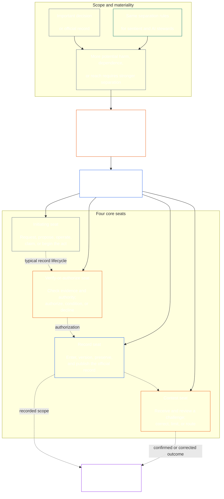

<!-- Draft for eventual path translations/te/core_08_functional_independence_separation_of_duties.md -->
**Status:** AI-assisted translation draft; unreviewed. Not an official translation or attestation.

**Source:** `core_08.000_functional_independence_separation_of_duties.md`; edition `SC-Corpus-2026.10.21`; revision `5adf22f3d58520385afb9dc2bcb2f439346175fb`; SHA-256 `d9a573839564fa3a2e920fff4d2ecb4ccc8a7b560d8aef65656a356de09fdfda`.

**Scope:** Full Chapter Eight, including reading guides, trace blocks, tables, and diagrams. Links are written for the eventual `translations/<locale>/` destination. English remains controlling.

# చాప్టర్ ఎనిమిదో: ఫంక్షనల్ స్వతంత్రత మరియు విధుల విభజన

<strong>కార్పస్ ప్లేస్‌మెంట్ (నాన్-ఆపరేటివ్): ఫైల్ నిర్మాణం మరియు పఠన నియమాలు</strong>

> ఈ ఫైల్ **సెంటియెంట్ రాజ్యాంగంలో భాగం** మరియు ఉంది **కలిసి మాత్రమే బైండింగ్** ఇతర సంఖ్యతో `core_*` ఫైల్‌లు ఒక వచనంగా చదవబడతాయి. ఇది కలిగి ఉంది **ఎనిమిదవ అధ్యాయం**: క్రియాత్మక స్వాతంత్ర్యం మరియు విధుల విభజన కోసం క్రాస్-ప్రాసెస్ అవసరం. ఇది అనుసరిస్తుంది [అధ్యాయం ఏడు](../../core_07.000_charters.md#chapter-seven-system-and-institutional-charters), ఇది ప్రచురించిన సీటు మ్యాప్‌ను కలిగి ఉన్న సిస్టమ్ చార్టర్ లేదా ఇన్‌స్టిట్యూషనల్ చార్టర్‌ను పేర్కొంటుంది మరియు రాజ్యాంగ ప్రక్రియ అధ్యాయాలతో ప్రారంభమయ్యే ముందు ఉంటుంది [అధ్యాయం తొమ్మిది సిస్టమ్ అమరిక ధృవీకరణ](../../core_09.000_system_alignment_certification_evaluation.md#chapter-nine-system-alignment-certification).
>
> - **రాజ్యాంగ యజమాని:** మెటీరియల్‌గా బైండింగ్ చర్యల కోసం విధుల విభజన అవసరం, ప్రత్యేక సీట్ల ద్వారా కలుసుకున్నారు; ప్రతి యొక్క సార్వత్రిక కనీస విషయాలు [మెటీరియల్‌గా బైండింగ్ యాక్ట్ రికార్డ్](../../core_05.035_band_accountability.md#materially-binding-act-record); నటుడు మరియు నటుడి నుండి స్వతంత్రం [మెటీరియల్ కంట్రోల్ లైన్](../../core_05.035_band_accountability.md#material-control-line); ప్రచురించిన లేన్ మరియు రోల్ ప్లేస్‌మెంట్; సంఘర్షణ, ఖాళీ, ప్రత్యామ్నాయం మరియు తప్పు-సీటు రూటింగ్; దామాషా విలీన హోస్టింగ్; ఆపాదించదగిన హ్యాండ్‌ఆఫ్‌లు; మరియు ప్రతి తదుపరి రాజ్యాంగ ప్రక్రియ తప్పనిసరిగా వర్తించే కనీస స్వతంత్ర పరిస్థితులు.
> - **సూత్ర-పొర మూలం:** [మొదటి అధ్యాయం §18.3](../../core_01.010_stewardship_capacity_principles.md#183-separation-of-duties) క్రియాత్మక స్వాతంత్య్రాన్ని సంరక్షించడానికి పాలన అవసరం మరియు ఇక్కడ ఆపరేటివ్ సీట్ ఆర్కిటెక్చర్‌ను రూట్ చేస్తుంది.
> - **అమలు యజమాని:** [CJS-5.125 §11](../../corpus_joint_structure/cjs_05.125_accountability_operations.md#constitutional-lane-and-functional-separation) (*రాజ్యాంగ లేన్ మరియు క్రియాత్మక విభజన*), [CI-8.205 §2](../../corpus_institutions/ci_08.205_institutional_design_separation_of_powers.md#ci-8205-2-functional-separation-lanes), మరియు [CI-14.205 §6](../../corpus_institutions/ci_15.205_appointment_competency_rotation_removal.md#ci-15205-6-seat-catalog--process-role-archetypes-and-operational-boundaries) సీట్లు ఉంచండి మరియు అమలు చేయండి. అవి కఠినంగా ఉండవచ్చు మరియు పరిమిత ప్రత్యేక-అధికార సీటు రకాలను జోడించవచ్చు; వారు ఈ అధ్యాయాన్ని కుదించకపోవచ్చు.
> - **ప్రక్రియ-నిర్దిష్ట అప్లికేషన్ దిగువన ఉంటుంది:** అధ్యాయం తొమ్మిది ఈ అవసరాన్ని సిస్టమ్ అమరిక ధృవీకరణకు మరియు సంస్థాగత అమరిక ధృవీకరణకు వర్తిస్తుంది; [అధ్యాయం పది §3.7](../../core_11.000_standing_assessment.md#37-separation-of-duties) నిలబడి ఉన్న రికార్డులకు ఇది వర్తిస్తుంది; అధ్యాయం పదమూడవ మరియు [కార్పస్_forum.md](../../corpus_forum.md) దీన్ని ఫోరమ్ ప్రక్రియకు వర్తింపజేయండి. ఆ అధ్యాయాలు వాటి విషయానికి అవసరమైన రక్షణలను జోడించవచ్చు; వారు బలహీనమైన ప్రత్యామ్నాయాన్ని సృష్టించలేరు.
>
> పఠన క్రమం: §1 ప్రయోజనం మరియు స్కోప్ → §2 నాలుగు-సీట్ల అవసరం రికార్డ్‌లు మరియు హ్యాండ్‌ఆఫ్‌లు → §9 దిగువ అప్లికేషన్.

<strong>ట్రేస్ చేయండి</strong>

- అప్‌స్ట్రీమ్:
  - [రాజ్యాంగ టెట్రాడ్](../../core_00.000_preamble.md#constitutional-tetrad) - ముఖ్యంగా **పర్యవేక్షణ** మరియు **జవాబుదారీతనం**;
  - [పదార్థం వాటా](../../core_00.000_preamble.md#material-stake);
  - [అధ్యాయం 1 §17.1 షేర్డ్ స్టీవార్డ్‌షిప్ స్టాండర్డ్](../../core_01.010_stewardship_capacity_principles.md#171-shared-stewardship-standard) (1.015 §17.1);
  - [అధ్యాయం 1 §18 స్టీవార్డ్‌షిప్ క్రమశిక్షణలో పాలన](../../core_01.010_stewardship_capacity_principles.md#18-governance-under-stewardship-discipline) (1.015 §18);
  - [ఆర్టికల్ XVI](../../core_06.010_rights_part_c.md#article-xvi-audit-transparency-and-independent-verification) (*ఆడిట్, పారదర్శకత మరియు స్వతంత్ర ధృవీకరణ*)
- ఉపవిభాగాలు:
  - [§1](#1-purpose-scope-and-owner-boundary);
  - [§2](#2-four-seat-constitutional-requirement);
  - [§3](#3-independence-conflict-and-control-lines);
  - [§4](#4-wrong-seat-routing);
  - [§5](#5-published-placement-vacancy-and-substitution);
  - [§6](#6-proportional-scaling-and-merged-hosting);
  - [§7](#7-emergency-and-urgent-action);
  - [§8](#8-act-records-and-attributable-handoffs);
  - [§9](#9-relationship-to-later-processes).
- దిగువ:
  - [అధ్యాయం తొమ్మిది](../../core_09.000_system_alignment_certification_evaluation.md#chapter-nine-system-alignment-certification) (9.000);
  - [అధ్యాయం పది](../../core_11.000_standing_assessment.md#chapter-eleven-contribution-violation-and-standing-model--measurement) (10.000);
  - [పదమూడవ అధ్యాయం](../../core_14.000_forum.md#chapter-fourteen-forums-and-jurisdiction) (13.000);
  - [పద్నాల్గవ అధ్యాయం](../../core_15.000_governance.md#chapter-fifteen-constitutional-contract-legitimacy-authorization-and-stewardship) (14.000); పైన పేర్కొన్న నిర్దేశిత అమలు టెక్స్ట్.
- దీనితో చదవండి:
  - [అధ్యాయం 1 §19.3 తప్పుగా అమరిక గుర్తింపు](../../core_01.010_stewardship_capacity_principles.md#193-misalignment-detection) (1.015 §19.3) (*బహువచన గుర్తింపు మరియు సమీక్ష*);
  - [ఆపాదించదగిన చర్య](../../core_05.035_band_accountability.md#attributable-action);
  - [అట్రిబ్యూషన్ సమగ్రత](../../core_05.035_band_accountability.md#attribution-integrity);
  - [ఆడిటబిలిటీ](../../core_05.050_band_oversight.md#auditability);
  - [పోటీతత్వం](../../core_05.035_band_accountability.md#contestability);
  - [అనుపాతత](../../core_05.035_band_accountability.md#proportionality).

 

ఎనిమిదవ అధ్యాయం రాజ్యాంగ యజమాని **మెటీరియల్‌గా బైండింగ్ చర్యల కోసం క్రియాత్మక-స్వాతంత్ర్యం మరియు విధుల విభజన అవసరం**.

### 1. పర్పస్, స్కోప్ మరియు ఓనర్ సరిహద్దు

<strong>ట్రేస్ చేయండి</strong>

- అప్‌స్ట్రీమ్: చాప్టర్ ఓపెనింగ్ ఓనర్ దావా; [మొదటి అధ్యాయం §18](../../core_01.010_stewardship_capacity_principles.md#18-governance-under-stewardship-discipline) (1.015 §18); [పర్యవేక్షణ](../../core_05.020_apex_oversight_leg.md#oversight-constitutional); [జవాబుదారీతనం](../../core_05.005_apex_accountability_leg.md#accountability).
- దిగువ: [§2](#2-four-seat-constitutional-requirement) ద్వారా [§9](#9-relationship-to-later-processes); మెటీరియల్ బైండింగ్ యాక్ట్‌ను ఉత్పత్తి చేసే లేదా మార్చే ప్రతి తదుపరి ప్రక్రియ.
- దీనితో చదవండి:
  - [అధ్యాయం నాలుగు](../../core_04.000_burden_traceability_verification.md#chapter-four-burden-of-proof-traceability-and-verification) (4.000) వెరిఫికేషన్ సబ్‌స్ట్రేట్ కోసం;
  - [ఆర్టికల్ XIII-A](../../core_06.010_rights_part_c.md#article-xiii-a-reliability-and-trustworthiness-baseline) (*విశ్వసనీయత మరియు విశ్వసనీయత బేస్లైన్*) మరియు
  - [ఆర్టికల్ XIII-B](../../core_06.010_rights_part_c.md#article-xiii-b-right-to-redress-and-remedy) (*పరిహారం మరియు నివారణ హక్కు*) సవాలు మరియు పరిష్కారం కోసం;
  - [ఆర్టికల్ XVI](../../core_06.010_rights_part_c.md#article-xvi-audit-transparency-and-independent-verification) (*ఆడిట్, పారదర్శకత మరియు స్వతంత్ర ధృవీకరణ*) స్వతంత్ర-ధృవీకరణ హక్కుల అంతస్తుల కోసం.

 

*సాదా పరంగా: రాజ్యాంగ ప్రక్రియకు ముందు-లేదా ఇప్పటికే అధీకృత వ్యవస్థ, సంస్థ లేదా పరిమిత నిర్ణయ డొమైన్‌లో వాటాదారుల-స్థాయి నిర్ణయం-విశ్వసించవచ్చు, దానిలోని ఉద్యోగాలు తప్పనిసరిగా వేరు చేయబడాలి. ఈ అవసరం రెండింటికీ వర్తిస్తుంది [రాజ్యాంగ ఒప్పంద పొర](../../core_05.045_band_integrative.md#constitutional-contract-layer) మరియు కు [వాటాదారుల వ్యవస్థ భాగస్వామ్యం](../../core_05.055_band_participation.md#stakeholder-status-and-weight). ఒక సెంటియెంట్, ఆఫీస్, AI సిస్టమ్, స్టేక్‌హోల్డర్ బాడీ లేదా ఫలితాన్ని కోరుకునే ప్రతినిధి కూడా స్వతంత్రంగా భావించే చెక్‌ను అందించలేరు, ఆ చెక్ యొక్క అధికారిక రికార్డును నియంత్రించలేరు లేదా దానికి సవాలును నిర్ణయించలేరు.*

ఈ అధ్యాయం ప్రతి ఒక్కరికీ వర్తిస్తుంది [మెటీరియల్ బైండింగ్ చట్టం](../../core_05.035_band_accountability.md#materially-binding-act), ఐదవ అధ్యాయం నిర్వచించినట్లుగా, వీటితో సహా:

- ఒక నిర్ణయం;
- ఒక అధికారం లేదా ధృవీకరణ;
- ఒక అన్వేషణ;
- రికార్డ్ ఎంట్రీ లేదా మెటీరియల్ వెర్షన్ మార్పు;
- విడుదల, విస్తరణ, కొనసాగింపు లేదా ఉపసంహరణ;
- ఒక పంపిణీ లేదా కేటాయింపు; మరియు
- ఒక సవాలు యొక్క వైఖరి.

ఈ అధ్యాయం క్లాస్ P ఆపరేటింగ్ పార్టీకి వర్తించదు. దాని చర్యలు దాని లోపల ఉంటాయి [ప్రైవేట్ యూనిట్](../../core_05.050_band_oversight.md#domain-specific-materiality-private-unit), ఒకే సెంటింట్, ఒక కుటుంబం లేదా కఠినంగా బంధించబడిన ప్రైవేట్ సర్కిల్, దీని సభ్యులు అందరూ దానిలో ఉండాలని ఎంచుకుంటారు మరియు ఒక ఆపరేటింగ్ పార్టీ, దీని చర్యలను ఇతరులు అనుసరించాలి లేదా స్థిరపడినట్లుగా ఆధారపడవచ్చు. **CS-9.305 (*సిస్టమ్ వర్గీకరణ యంత్రాలు*) మరియు CS-9.310** (*సిస్టమ్ వర్గీకరణ యంత్రాలు*) కంప్యూటర్‌ను కలిగి ఉన్న ఏకైక వ్యక్తికి రెండవ సీటు హోల్డర్ అవసరం లేదు. ఆపరేటింగ్ పార్టీ మెటీరియల్ బైండింగ్ యాక్ట్ తీసుకున్న రోజు నుండి ఈ అవసరం వర్తిస్తుంది.

ఈ అధ్యాయంలోని సీట్లు నిర్దిష్ట చర్య కోసం ఎవరు ఏమి చేయగలరో నిర్వచించాయి; అవి ఉద్యోగ శీర్షికలు కావు. ఒకే సెంటింట్, ఆఫీసు లేదా సిస్టమ్ వేర్వేరు చర్యల కోసం వేర్వేరు సీట్లను కలిగి ఉండవచ్చు. శీర్షిక, ప్రతినిధి బృందం, సాంకేతిక సామర్థ్యం లేదా ఒక దశను నిర్వహించగల సామర్థ్యం ఆ చట్టం కోసం ఉంచిన సీటును పెంచదు.

#### 1.1 ఉద్యోగాలు ఎందుకు వేరు చేయబడ్డాయి

*సరళంగా చెప్పాలంటే: వ్యాపారం, ప్రభుత్వం మరియు అణు భద్రతలో అదే పాఠం మళ్లీ మళ్లీ నేర్చుకుంది. ఒక పక్షం ఒక చర్యను ప్రారంభించగలిగినప్పుడు, దానిని ఆమోదించగలిగినప్పుడు, దానిని వ్రాసి, దాని గురించిన ఏదైనా ఫిర్యాదును నిర్ధారించగలిగినప్పుడు, మరెవరూ తప్పు లేదా అబద్ధాన్ని పట్టుకునే స్థితిలో ఉండరు.*

ఈ ఉపవిభాగం అవసరానికి గల కారణాలను వివరిస్తుంది. ఇది నాన్-ఆపరేటివ్: బైండింగ్ నియమాలు ఉన్నాయి [§2 నాలుగు-సీట్ల రాజ్యాంగ ఆవశ్యకత](#2-four-seat-constitutional-requirement) ద్వారా [§9 తదుపరి ప్రక్రియలకు సంబంధం](#9-relationship-to-later-processes).

అనేక ఫీల్డ్‌లు వారి స్వంత ఆలోచనకు చేరుకున్నాయి:

- **అకౌంటింగ్ మరియు అంతర్గత నియంత్రణ:** వ్యాపారాలు మరియు ఆడిటర్లు చాలా కాలంగా లావాదేవీని అధీకృతం చేయడం, దానిని రికార్డ్ చేయడం, ఆస్తులను కలిగి ఉండటం మరియు పుస్తకాలను సరిదిద్దడం వంటి పనిని విభజించారు, తద్వారా ఏ ఒక్క గుమస్తా డబ్బు తీసుకోలేరు మరియు తీసుకోవడం దాచలేరు. COSO వంటి అంతర్గత నియంత్రణ ఫ్రేమ్‌వర్క్‌లు వాటి ప్రాథమిక నియంత్రణ కార్యకలాపాలలో విధులను వేరు చేస్తాయి.
- **ప్రభుత్వంలో అధికారాల విభజన:** మాంటెస్క్యూ వాదించారు *ది స్పిరిట్ ఆఫ్ ది లాస్* (1748) ఒక శరీరం చట్టాలను రూపొందించడం, అమలు చేయడం మరియు తీర్పులు ఇచ్చినప్పుడు స్వేచ్ఛ ప్రమాదంలో ఉంది. జేమ్స్ మాడిసన్, ఇన్ *ఫెడరలిస్ట్ నం. 51* (1788), ప్రతి శాఖకు ఇతరులను నిరోధించే మార్గాలను కలిగి ఉండే డిజైన్‌ను సమర్థించారు. అప్పటి నుండి అనేక రాజ్యాంగాలు అధికారాన్ని ఒకే విధంగా విభజించాయి.
- **ఇద్దరు వ్యక్తుల నియమాలు:** యునైటెడ్ స్టేట్స్ మిలిటరీకి నిర్దిష్ట అణ్వాయుధాలను ప్రయోగించడానికి లేదా యాక్సెస్ చేయడానికి ముందు ఇద్దరు అధీకృత సిబ్బంది కలిసి పనిచేయాలని కోరుతున్నారు, తద్వారా ఎవరూ ఒంటరిగా పని చేయలేరు (ఎయిర్ ఫోర్స్ ఇన్‌స్ట్రక్షన్ 91-104). ఇదే కారణంతో బ్యాంకులు చాలా కాలంగా వాల్ట్‌లపై డ్యూయల్ కీలను ఉంచాయి. ఇద్దరు వ్యక్తుల నియమం ఎవరు నటిస్తున్నారు మరియు ఆర్డర్ నిజమైనదా కాదా అని నిర్ధారిస్తుంది, ఆర్డర్ సరైనదా కాదా అని కాదు. అందుకే ఈ అధ్యాయం రెండవ సంతకం మాత్రమే కాకుండా స్వతంత్ర తనిఖీని అడుగుతుంది.
- **విభజన లేకుండా ఏమి జరుగుతుంది:** 1995లో బేరింగ్స్ బ్యాంక్‌లో, నిక్ లీసన్ సింగపూర్ ట్రేడింగ్ డెస్క్ మరియు బ్యాక్ ఆఫీస్ రెండింటినీ నిర్వహించాడు, అది స్థిరపడి దాని ట్రేడ్‌లను రికార్డ్ చేసింది. నష్టాలను రహస్య ఖాతాలో దాచుకున్నాడు. 1994లో అంతర్గత ఆడిట్ సంయుక్త పాత్రను పెద్ద ప్రమాదంగా ఫ్లాగ్ చేసింది, కానీ నిర్వహణ దానిని వదిలివేసింది. అప్పటికి రెండు శతాబ్దాల కంటే ఎక్కువ వయస్సు ఉన్న బ్యాంక్, ఫిబ్రవరి 1995లో సుమారు S$2.2 బిలియన్ల నష్టాలతో కుప్పకూలింది మరియు INGకి విక్రయించబడింది.

ఈ ఉదాహరణలు ఏ ఒక్క వ్యవస్థ దోషరహితమని చూపించవు. ఆలోచన పాతదని మరియు విస్తృతంగా ఉపయోగించబడుతుందని మరియు తప్పిపోయిన విభజన వైఫల్యానికి పునరావృత కారణమని వారు చూపుతున్నారు. అవి కారణాలు, అధికారం కాదు.

#### 1.2 నాలుగు సీట్లు ఎందుకు

*సాధారణ పరంగా: రెండు ఉద్యోగాలు చాలా తక్కువగా ఉన్నాయి మరియు మూడు ఖాళీని వదిలివేస్తాయి. చట్టాన్ని ప్రారంభించడం, దాన్ని తనిఖీ చేయడం, అధికారిక రికార్డును ఉంచడం మరియు సవాలును వినడం నాలుగు ఉద్యోగాలు.*

ఈ ఉపవిభాగం నాలుగు సంఖ్యకు గల కారణాలను వివరిస్తుంది. ఇది నాన్-ఆపరేటివ్: సీట్లు మరియు వాటి నియమాలు ఉన్నాయి [§2 నాలుగు-సీట్ల రాజ్యాంగ ఆవశ్యకత](#2-four-seat-constitutional-requirement).

- **రెండు చాలా తక్కువ:** మేకర్-అండ్-చెకర్ జంట ఒక పార్టీ తన స్వంత చర్యను ఆమోదించకుండా ఆపుతుంది. ఇది అధికారిక రికార్డును ఉంచడానికి లేదా ఫిర్యాదును వినడానికి ఎవరినీ వదిలిపెట్టదు, కాబట్టి రికార్డును కలిగి ఉన్నవారు నిశ్శబ్దంగా ఏమి జరిగిందో మార్చగలరు మరియు ఈ జంట తన స్వంత పని గురించి ఫిర్యాదులను నిర్ధారించడం ముగించారు.
- **మూడు అధికారాలు ప్రభుత్వానికి సరిపోతాయి, ప్రతి చర్య కాదు:** ప్రభుత్వాన్ని తయారు చేయడం, నిర్వహించడం మరియు తీర్పు ఇవ్వడం. ఒకే యాక్ట్‌కి దాని కంటే ఎక్కువ కాలం ఉండే రికార్డ్ మరియు ఛాలెంజ్ కోసం ఒక మార్గం అవసరం, అది నటుడు లేదా ఆమోదించే వ్యక్తి ద్వారా అమలు చేయబడదు.
- **వైఫల్యం పాయింట్లతో నాలుగు సరిపోలుతుంది:** ఒక సీటు ఈ చర్యను ప్రారంభిస్తుంది, ఒకరు తనిఖీ చేసి దానిని ఆథరైజ్ చేస్తారు, ఒకరు అధికారిక రికార్డును ఉంచుతారు మరియు ఒకరు సవాళ్లను వింటారు. ఇది అధికారం, రికార్డింగ్ మరియు సమీక్షల మధ్య అకౌంటింగ్‌లోని విభజనలను ప్రతిధ్వనిస్తుంది.
- **ఆటోమేషన్ గ్యాప్‌ను సులభంగా తెరవడానికి చేస్తుంది:** ఒక సిస్టమ్ ఒకే దశలో పని చేయగలదు, సైన్ ఆఫ్ చేయగలదు మరియు దాని స్వంత పనిని లాగ్ చేయగలదు మరియు దాని లాగ్ రుజువు వలె కనిపిస్తుంది. [§2 నాలుగు-సీట్ల రాజ్యాంగ ఆవశ్యకత](#2-four-seat-constitutional-requirement) ఒకేసారి మూడు సీట్లు పట్టుకున్నట్లు వ్యవహరిస్తుంది.
- **చిన్న అడాప్టర్‌లు ఇప్పటికీ పాటించగలరు:** [§6 అనుపాత స్కేలింగ్ మరియు విలీన హోస్టింగ్](#6-proportional-scaling-and-merged-hosting) ఒక చిన్న అడాప్టర్‌ను స్వతంత్ర సంస్థతో సీటు ఉంచడానికి లేదా షరతులపై, ఒక కార్యాలయంలో రెండు సీట్లను ఉంచడానికి అనుమతిస్తుంది. వెరిఫై-లేదా-అథరైజ్ సీటు ఎప్పుడూ రికార్డ్ సీటుతో లేదా పోటీ సీటుతో విలీనం చేయబడదు.

### 2. నాలుగు-సీట్ల రాజ్యాంగ ఆవశ్యకత

<strong>ట్రేస్ చేయండి</strong>

- అప్‌స్ట్రీమ్: [§1](#1-purpose-scope-and-owner-boundary); [మొదటి అధ్యాయం §18.3](../../core_01.010_stewardship_capacity_principles.md#183-separation-of-duties) (1.015 §18.3); [మొదటి అధ్యాయం §17.1](../../core_01.010_stewardship_capacity_principles.md#171-shared-stewardship-standard) (1.015 §17.1).
- దిగువ: [§3](#3-independence-conflict-and-control-lines) ద్వారా [§9](#9-relationship-to-later-processes); [CI-14.205 §6](../../corpus_institutions/ci_15.205_appointment_competency_rotation_removal.md#ci-15205-6-seat-catalog--process-role-archetypes-and-operational-boundaries) (*సీట్ కేటలాగ్ — ప్రాసెస్-రోల్ ఆర్కిటైప్స్ మరియు కార్యాచరణ సరిహద్దులు*)
- దీనితో చదవండి: [§6](#6-proportional-scaling-and-merged-hosting) అనుమతించబడిన ఏకైక విలీన-హోస్టింగ్ మార్గం కోసం.

 

*సాదా పరంగా: ప్రతి మెటీరియల్ బైండింగ్ యాక్ట్‌కు విధుల విభజన అవసరం (ది **నాలుగు సీట్ల అవసరం**), మరియు నాలుగు ఉద్యోగాలు ఎలా నెరవేరుతాయి: అడగండి లేదా పని చేయండి, తనిఖీ చేయండి, అధికారిక రికార్డును ఉంచండి మరియు సవాలును వినండి. ఒక చిన్న సంస్థ ఒక కార్యాలయంలో అనుమతించబడిన జంటను ఉంచడానికి అనుమతించబడినప్పుడు కూడా ఉద్యోగాలు విభిన్నంగా ఉంటాయి.*

<strong>రీడర్ గైడెన్స్ (నాన్-ఆపరేటివ్): నాలుగు సీట్ల మ్యాప్</strong>

> **రీడర్ మ్యాప్ (నాన్-ఆపరేటివ్).** ఈ రేఖాచిత్రం నాలుగు సీట్లు మరియు సాధారణ రికార్డు జీవితచక్రాన్ని చూపుతుంది. ఇది ఐదవ అమలు సీటును జోడించదు, ప్రతి చర్యకు ముందు పూర్తి చేయడానికి సమీక్ష అవసరం లేదా ఈ విభాగం మరియు §§3–6లోని ఆపరేటివ్ నియమాలను మార్చడం అవసరం.

 

సీటు పెట్టె లోపల చుక్కల బాణాలు సాధారణ రికార్డ్ జీవితచక్రాన్ని చూపుతాయి. అమలు చేయడానికి బాణాలు ట్రేస్ లింక్‌లు, రివ్యూ కోసం తప్పనిసరిగా వేచి ఉండే క్రమం కాదు.

ప్రతి మెటీరియల్ బైండింగ్ యాక్ట్‌లో నాలుగు క్రియాత్మకంగా విభిన్నమైన సీట్లు ఉంటాయి. ఐదవ అధ్యాయం వాటి కానానికల్ అర్థాలను అందిస్తుంది; ఈ విభాగం క్రాస్-ప్రాసెస్ ప్లేస్‌మెంట్ మరియు అననుకూలత నియమాలను తెలియజేస్తుంది:

1. **[సీటు ప్రారంభించడం](../../core_05.035_band_accountability.md#initiating-seat)** - అభ్యర్థనలు, ప్రతిపాదించడం, నిర్వహించడం, క్లెయిమ్ చేయడం లేదా చట్టం ప్రారంభించడం.
2. **[సీటును ధృవీకరించండి-లేదా ఆథరైజ్ చేయండి](../../core_05.035_band_accountability.md#verify-or-authorize-seat)** - పాలక ప్రమాణానికి వ్యతిరేకంగా సాక్ష్యం మరియు అధికారాన్ని తనిఖీ చేస్తుంది మరియు చట్టాన్ని ధృవీకరిస్తుంది, ప్రమాణీకరించడం, తిరస్కరించడం లేదా షరతులు విధించడం.
3. **[రికార్డ్ సీటు](../../core_05.035_band_accountability.md#record-seat)** — ప్రవేశిస్తుంది, సంస్కరణలు చేస్తుంది, ఉంచుతుంది, సంరక్షిస్తుంది మరియు ప్రచురిస్తుంది [చట్టం రికార్డు](../../core_05.035_band_accountability.md#materially-binding-act-record) వెరిఫై-లేదా-ఆథరైజ్ సీట్ నిర్ణయించిన వాటిలో.
4. **[పోటీ సీటు](../../core_05.035_band_accountability.md#contest-seat)** — ఒక సవాలును స్వీకరిస్తుంది మరియు సమీక్షిస్తుంది, అధికారం ఉన్న చోట దిద్దుబాటు లేదా పరిమితులను ఆర్డర్ చేస్తుంది మరియు దాని అధికారం వెలుపల ఏదైనా సమస్యను రూట్ చేస్తుంది.

ఈ సీట్లు మానవులకు మరియు AI స్టీవార్డ్‌లకు ఒకే విధంగా వర్తిస్తాయి. సిస్టమ్ ఒక చర్యను అమలు చేసి, దానిపై సంతకం చేసి, ఆపై దాని స్వంత లాగ్‌ను రుజువుగా ఉపయోగిస్తే, అది ఒకేసారి ప్రారంభించడం, ధృవీకరించడం మరియు రికార్డ్ చేసే సీట్లలో కూర్చుంటుంది. ప్రక్రియను ఆటోమేట్ చేయడం వలన చెక్ స్వతంత్రంగా ఉండదు.

కింది కలయికలు ఒకే చట్టంలో నిషేధించబడ్డాయి:

- ప్రారంభించే సీటు దాని స్వంత చర్యను ధృవీకరించకూడదు లేదా అధికారం ఇవ్వకూడదు;
- వెరిఫై-లేదా-ఆథరైజ్ సీటు తప్పనిసరిగా రికార్డ్ సీటును కలిగి ఉండకూడదు;
- వెరిఫై-లేదా-ఆథరైజ్ సీటు పోటీ సీటును కలిగి ఉండకూడదు; మరియు
- సిస్టమ్ యొక్క ఆపరేటర్ లేదా ఒక సంస్థ యొక్క పాలక అధికారం, ఆ వ్యవస్థ లేదా సంస్థ గురించిన చర్యను ధృవీకరించకూడదు లేదా అధికారం ఇవ్వకూడదు.

తరువాతి అధ్యాయాలు లేదా ఇన్‌కార్పొరేటెడ్ ఇంప్లిమెంటేషన్ టెక్స్ట్ ఒక నిర్దిష్ట ప్రక్రియ కోసం అదనపు జతలను నిషేధించవచ్చు. ఇక్కడ నిషేధించబడిన జతను వారు అనుమతించకపోవచ్చు.

విధుల విభజన అవసరం ప్రతి తరగతికి వర్తిస్తుంది మరియు నాలుగు సీట్లు ఎలా నెరవేరుతాయి. ఆ సీట్లు విలీనం కావచ్చా లేదా హోల్డర్‌ను పంచుకోవాలా అనేది క్లాస్-స్కేల్ ప్రశ్న. లోపల పనిచేసే సంస్థ లేదా సిస్టమ్ కోసం:

- క్లాస్ సి స్కోప్, పూర్తి నాలుగు-సీట్ల విభజన ఎల్లప్పుడూ సిఫార్సు చేయబడింది;
- క్లాస్ B స్కోప్, పూర్తి నాలుగు-సీట్ల విభజన దాదాపు ఎల్లప్పుడూ అవసరం; మరియు
- క్లాస్ A స్కోప్, పూర్తి నాలుగు సీట్ల విభజన ఎల్లప్పుడూ అవసరం.

స్కోప్ మిశ్రమంగా ఉన్న చోట లేదా వర్గీకరణ అనిశ్చితంగా ఉన్న చోట, రికార్డ్ తక్కువ దానికి మద్దతు ఇచ్చే వరకు అత్యధికంగా వర్తించే భంగిమను వర్తింపజేయండి.

### 3. స్వాతంత్ర్యం, సంఘర్షణ మరియు నియంత్రణ రేఖలు

<strong>ట్రేస్ చేయండి</strong>

- అప్‌స్ట్రీమ్: [§2](#2-four-seat-constitutional-requirement); [అథారిటీ-స్కేల్డ్ జవాబుదారీతనం](../../core_01.010_stewardship_capacity_principles.md#181-governance-as-authorized-structure); [ఆర్టికల్ XXV](../../core_06.015_rights_part_d.md#article-xxv-constitutional-interpretation-review-and-anti-capture-safeguards) (*రాజ్యాంగ వివరణ, సమీక్ష మరియు యాంటీ-క్యాప్చర్ రక్షణలు*)
- దిగువ: [§4](#4-wrong-seat-routing); [§5](#5-published-placement-vacancy-and-substitution); [§8](#8-act-records-and-attributable-handoffs); చాప్టర్ నైన్ సర్టిఫికేషన్ కాంపోనెంట్ రోల్స్; చాప్టర్ టెన్ రికార్డ్ కస్టడీ; అధ్యాయం పదమూడవ ఫోరమ్ వ్యతిరేక స్వీయ-నిర్ధారణ.
- దీనితో చదవండి: [మెటీరియల్ కంట్రోల్ లైన్](../../core_05.035_band_accountability.md#material-control-line); [CI-8.210](../../corpus_institutions/ci_08.210_conflict_integrity_anti_capture_anti_corruption.md) (*సంఘర్షణ సమగ్రత, యాంటీ క్యాప్చర్ మరియు అవినీతి వ్యతిరేకత*) మరియు [CF-13.425](../../corpus_forum/cf_14.425_integrity_safeguards_anti_capture_anti_self_judging.md) (*సమగ్రత రక్షణలు, యాంటీ-క్యాప్చర్ ఆపరేషన్‌లు మరియు స్వీయ-నిర్ధారణ వ్యతిరేక మద్దతు*) కార్యాచరణ సంఘర్షణ మరియు స్వీయ-నిర్ధారణ వ్యతిరేక రక్షణల కోసం.

 

*సరళంగా చెప్పాలంటే: డెస్క్‌పై పేరు మార్చడం స్వతంత్రతను సృష్టించదు. ఫలితాన్ని కోరుకునే వ్యక్తి లేదా కార్యాలయం ఆ చర్యపై వారిని నిర్దేశించగలిగినప్పుడు, తీసివేయవచ్చు, రివార్డ్ చేయవచ్చు, శిక్షించవచ్చు లేదా నిశ్శబ్దంగా రద్దు చేయగలిగినప్పుడు ధృవీకరించే అధికారం లేదా సమీక్షకుడు స్వతంత్రంగా ఉండరు.*

క్రియాత్మక స్వాతంత్ర్యం వాస్తవ అధికారం మరియు నియంత్రణ ద్వారా నిర్ణయించబడుతుంది, లేబుల్‌లు కాదు. అదే చట్టంపై:

- ధృవీకరణ-లేదా-అధీకృత సీటు మరియు పోటీ సీటు తప్పనిసరిగా ప్రారంభ సీటు వెలుపల ఉండాలి [మెటీరియల్ కంట్రోల్ లైన్](../../core_05.035_band_accountability.md#material-control-line);
- చట్టం ద్వారా నిర్ణయించబడిన స్వంత ఆసక్తి ఉన్న పార్టీ ధృవీకరించడం లేదా అధికారం ఇవ్వడం లేదా పోటీ చేసే సీటును కలిగి ఉండకూడదు;
- వివాదాస్పద రికార్డ్ హోల్డర్ ఆ రికార్డ్‌ను దాని పూర్తి ఆడిట్ ట్రయిల్‌తో, సంఘర్షణను నిర్ణయించడం లేదా కస్టడీని విడిచిపెట్టడం కంటే ప్రచురించిన ప్రత్యామ్నాయానికి అందించాలి; మరియు
- తిరస్కరణ చట్టంపై అధికారాన్ని తొలగిస్తుంది; ఇది అభ్యర్థికి, అభ్యర్థి రిపోర్టింగ్ లైన్‌కు లేదా సమీపంలో ఉన్నవారికి సీటును బదిలీ చేయదు.

ట్రేస్ చేయండి [మెటీరియల్ కంట్రోల్ లైన్](../../core_05.035_band_accountability.md#material-control-line) నిర్దిష్ట చట్టం కోసం. షేర్డ్ ఇన్‌ఫ్రాస్ట్రక్చర్, అడ్మినిస్ట్రేటివ్ సపోర్ట్ లేదా అపాయింట్‌మెంట్ హిస్టరీ ఒక్కటే లైన్‌ను స్థాపించదు, అయితే ఆ ఏర్పాట్లు ఆచరణలో స్వతంత్ర తీర్పును ఓడించకూడదు.

స్వాతంత్ర్యం రెండవ సంతకం, నామమాత్రపు కమిటీ, అంతర్గత లేబుల్ లేదా సాధనం-ఉత్పత్తి చేసిన ధృవీకరణ ద్వారా సంతృప్తి చెందదు, ఇక్కడ ఊహించిన చెక్‌కు అధికారం, సాక్ష్యం యాక్సెస్, మెటీరియల్ నియంత్రణ నుండి స్వేచ్ఛ లేదా తిరస్కరణ మరియు మార్గంలో నిజమైన సామర్థ్యం లేదు.

### 4. తప్పు-సీట్ రూటింగ్

<strong>ట్రేస్ చేయండి</strong>

- అప్‌స్ట్రీమ్: [§2](#2-four-seat-constitutional-requirement); [§3](#3-independence-conflict-and-control-lines).
- దిగువ: [§5](#5-published-placement-vacancy-and-substitution); [§8](#8-act-records-and-attributable-handoffs); [CI-14.205 §6 సీటు నియమాలను పంచుకుంది](../../corpus_institutions/ci_15.205_appointment_competency_rotation_removal.md#ci-46-shared-seat-rules).
- దీనితో చదవండి: [మొదటి అధ్యాయం §17.5 ప్రతిఘటించాల్సిన బాధ్యత](../../core_01.010_stewardship_capacity_principles.md#175-duty-to-resist) (1.015 §17.5).

 

*సరళంగా చెప్పాలంటే: ఒక అడుగు మీది కానప్పుడు, నిశ్శబ్దంగా దానిని తీసుకోకండి మరియు దూరంగా నడవకండి. గ్యాప్‌ని రికార్డ్ చేయండి మరియు విషయాన్ని సరైన స్థలానికి పంపండి. ఇంకా మంచిది, ప్రక్రియను రూపొందించండి, తద్వారా ప్రతి అడుగు ఎవరూ గమనించాల్సిన అవసరం లేకుండా సరైన స్థానానికి వెళుతుంది.*

తప్పు-సీట్ రూటింగ్ ప్రాక్టీస్ చేయగల చోట ప్రక్రియలో నిర్మించబడాలి. ఒక ఇన్‌టేక్, క్యూ, వర్క్‌ఫ్లో లేదా ఇంటర్‌ఫేస్ ప్రతి దశను దాని ప్రచురించిన సీటుకు మొదటి నుండి పంపాలి, కాబట్టి దానిని తీసుకోని సీటుకు ఒక దశ అందించబడదు. ఆటోమేటెడ్ రూటింగ్:

- కింద ప్రచురించబడిన ప్లేస్‌మెంట్‌ను అనుసరిస్తుంది [§5 ప్రచురించబడిన ప్లేస్‌మెంట్, ఖాళీ మరియు ప్రత్యామ్నాయం](#5-published-placement-vacancy-and-substitution) మరియు సీటుపై మార్గాలు, చట్టం యొక్క యోగ్యతపై కాదు;
- దిగువ అంశం 3కి అవసరమైన విధంగా ప్రతి మార్గాన్ని లాగ్ చేస్తుంది;
- కింద ప్రచురించబడిన ప్రత్యామ్నాయం లేదా స్వతంత్ర మార్గాన్ని అనుసరిస్తుంది [§5.3 మ్యాప్ ఉంచని సీటు లేదా సర్వ్ చేయలేని హోల్డర్](#53-a-seat-the-map-leaves-unplaced-or-a-holder-who-cannot-serve) హోల్డర్ సర్వ్ చేయలేనప్పుడు, మరియు విషయాన్ని పట్టుకుని, సీటు, ప్రత్యామ్నాయం లేదా స్వతంత్ర మార్గాన్ని ఉంచనప్పుడు గ్యాప్‌ను లాగ్ చేసినప్పుడు, దానిని సమీపంలోని, వేగవంతమైన లేదా అత్యంత సీనియర్ సీటుకు పంపడం కంటే; మరియు
- స్వయంగా సీటు-హోల్డర్ కాదు మరియు సీటును కలిగి ఉన్నవారిని మార్చలేరు; ప్రచురించిన ప్లేస్‌మెంట్ మాత్రమే చేస్తుంది.

రూటింగ్ స్వయంచాలకంగా లేని చోట లేదా విఫలమైతే, దిగువ విధి స్టీవార్డ్‌కు వర్తిస్తుంది. స్టీవార్డ్ స్టీవార్డ్ సీటు వెలుపల అడుగు వేయమని అడిగాడు:

1. దాని మెరిట్‌లను నిర్ణయించడానికి ఉద్దేశ్యం లేకుండా ఆ దశను తిరస్కరించండి;
2. సీటు తీసుకునే సీటు పేరు మరియు ప్రచురించబడిన చోట హోల్డర్ లేదా ప్రత్యామ్నాయం;
3. అభ్యర్థన, పట్టుకున్న సీటు, గ్యాప్ లేదా వైరుధ్యం మరియు ఉపయోగించిన మార్గాన్ని లాగ్ చేయండి;
4. ఇప్పటికే అందుకున్న ఏదైనా రికార్డు యొక్క సాక్ష్యం మరియు సమగ్రతను సంరక్షించడం; మరియు
5. నివారించదగిన ఆలస్యం లేకుండా మార్గం.

ఆ ప్రతిస్పందన కర్తవ్య నిర్వహణ, చర్యను విడిచిపెట్టడం కాదు. చట్టం కుడి సీటు ద్వారా కొనసాగుతుంది. స్టీవార్డ్ దగ్గరివాడు, వేగవంతమైనవాడు, సీనియర్ లేదా ప్రత్యేక పరిజ్ఞానం ఉన్నవాడు కాబట్టి స్టెప్ తీసుకోవడం మిస్ సీటుకు పరిష్కారం కాదు.

### 5. ప్రచురించబడిన ప్లేస్‌మెంట్, ఖాళీ మరియు ప్రత్యామ్నాయం

<strong>రీడర్ మార్గదర్శకత్వం (నాన్-ఆపరేటివ్): ఈ విభాగం ఎలా రూపొందించబడింది</strong>

- [§5.1 మ్యాప్ తప్పనిసరిగా ఏమి చెప్పాలి](#51-what-the-map-must-say) చార్టర్ రోల్ మ్యాప్ పేర్లను జాబితా చేస్తుంది: ప్రతి సీటును ఎవరు హోస్ట్ చేస్తారు, దాని కోసం చర్యలు, అనుమతించబడిన విలీనాలు, ప్రత్యామ్నాయం, స్వతంత్ర మార్గం మరియు సంస్కరణ.
- [§5.2 మ్యాప్ ఎక్కడ ఉంచబడింది](#52-where-the-map-is-kept) మ్యాప్ సిస్టమ్ చార్టర్ లేదా ఇన్‌స్టిట్యూషనల్ చార్టర్‌లో లేదా దానితో పాటుగా ఉందని, గ్రూప్‌లోని సభ్యుడు గ్రూప్ యొక్క షేర్డ్ మ్యాప్‌ను సూచన ద్వారా స్వీకరించవచ్చని మరియు క్లాస్ P అడాప్టర్ ఒకదాన్ని ప్రచురించాల్సిన అవసరం లేదని చెప్పారు.
- [§5.3 మ్యాప్ ఉంచని సీటు లేదా సర్వ్ చేయలేని హోల్డర్](#53-a-seat-the-map-leaves-unplaced-or-a-holder-who-cannot-serve) గ్యాప్ అనేది లాగ్ మరియు సరిదిద్దడానికి లోపమని, సీటు నటుడి లేదా నటుడి నియంత్రణ రేఖకు వెళ్లదని మరియు అదే సమయంలో ఆ చర్య ప్రత్యామ్నాయం లేదా స్వతంత్ర మార్గానికి దారి తీస్తుందని చెప్పారు.
- [§5.4 ప్రతినిధి బృందం](#54-delegation) ఒక సీటును డిప్యూటీకి మాత్రమే అప్పగించవచ్చు లేదా మ్యాప్ పేర్లను భర్తీ చేయవచ్చు మరియు ప్రతినిధి బృందం సీటు సరిహద్దును ఉంచుతుంది మరియు సీటును సృష్టించడం, విలీనం చేయడం లేదా విస్తరించడం సాధ్యం కాదని చెప్పారు.

<strong>ట్రేస్ చేయండి</strong>

- అప్‌స్ట్రీమ్:
  - [§2](#2-four-seat-constitutional-requirement);
  - [§3](#3-independence-conflict-and-control-lines);
  - [పారదర్శకత](../../core_05.050_band_oversight.md#transparency);
  - [ఆడిటబిలిటీ](../../core_05.050_band_oversight.md#auditability).
- దిగువ: [§8](#8-act-records-and-attributable-handoffs); [CI-8.205 §2](../../corpus_institutions/ci_08.205_institutional_design_separation_of_powers.md#ci-8205-2-functional-separation-lanes) (*ఫంక్షనల్ విభజన లేన్లు*); [CI-14.205 §5](../../corpus_institutions/ci_15.205_appointment_competency_rotation_removal.md#ci-15205-5-authorized-roles-and-accountability-chains) (*అధీకృత పాత్రలు మరియు జవాబుదారీ గొలుసులు*); చాప్టర్ నైన్ మరియు చాప్టర్ టెన్ రికార్డులు.
- దీనితో చదవండి:
  - [సిస్టమ్ చార్టర్](../../core_05.040_band_continuity.md#system-charter),
  - [సంస్థాగత చార్టర్](../../core_05.040_band_continuity.md#institutional-charter);
  - [అధ్యాయం ఏడు §4 చార్టర్ రోల్ మ్యాప్ మరియు స్టాండింగ్-రికార్డ్ కస్టడీ](../../core_07.000_charters.md#4-the-charter-role-map-and-standing-record-custody) (7.000 §4); మరియు
  - [పద్నాలుగు అధ్యాయం §5](../../core_15.000_governance.md#5-authorized-roles-competency-development-and-contribution) (14.000 §5).

 

*సాదాసీదాగా చెప్పాలంటే: సాధారణ హోల్డర్ లేనప్పుడు లేదా వైరుధ్యంలో ఉన్నప్పుడు ఎవరు బాధ్యతలు స్వీకరిస్తారనే దానితో సహా కఠినమైన కేసు రాకముందే ప్రతి ఉద్యోగాన్ని ఎవరు నిర్వహిస్తారో సంస్థ తప్పనిసరిగా చెప్పాలి.*

#### 5.1 మ్యాప్ తప్పనిసరిగా ఏమి చెప్పాలి

L లేదా అంతకంటే ఎక్కువ తరగతిని స్వీకరించే ప్రతి ఒక్కరూ మెటీరియల్‌గా బైండింగ్ చర్యలను తీసుకోవాలి, తప్పనిసరిగా ప్రచురించబడిన, ఆడిట్ చేయదగిన మరియు పోటీ చేయదగినది [చార్టర్ పాత్ర మ్యాప్](../../core_05.040_band_continuity.md#charter-role-map) ఇది గుర్తిస్తుంది:

- ఏ లేన్, ఆఫీస్, రోల్ లేదా ప్రాసెస్ ప్రతి సీటును హోస్ట్ చేస్తుంది;
- ఆ ప్లేస్‌మెంట్ వర్తించే చర్యలు మరియు పరిధి;
- ప్రతి అనుమతించబడిన విలీన-హోస్టింగ్ ఏర్పాటు మరియు దాని స్వతంత్ర రక్షణ;
- హాజరుకాని, మినహాయించబడిన, సంగ్రహించబడిన లేదా వివాదాస్పద హోల్డర్‌తో సహా సీటులో పనిచేసే ప్రతి డిప్యూటీ లేదా ప్రత్యామ్నాయం;
- అర్హత కలిగిన ప్రత్యామ్నాయం అందుబాటులో లేనప్పుడు స్వతంత్ర మార్గం; మరియు
- దాని సంస్కరణ మరియు ప్రభావవంతమైన తేదీ, తద్వారా ఒక చట్టం తీసుకున్నప్పుడు అమలులో ఉన్న మ్యాప్‌కు వ్యతిరేకంగా నిర్ణయించబడుతుంది.

#### 5.2 మ్యాప్ ఎక్కడ ఉంచబడింది

మ్యాప్ అడాప్టర్‌లో లేదా వారి వద్ద ఉంచబడుతుంది [సిస్టమ్ చార్టర్](../../core_05.040_band_continuity.md#system-charter) లేదా [సంస్థాగత చార్టర్](../../core_05.040_band_continuity.md#institutional-charter).

అది హోస్ట్ చేసే సీట్ల కోసం భాగస్వామ్య మ్యాప్‌ను ప్రచురించే సమూహంలోని సభ్యుడు ఆ మ్యాప్‌ను సూచన ద్వారా స్వీకరించవచ్చు ([§6.3 సీట్లు ఉమ్మడిగా ఉన్నాయి](#63-seats-held-in-common)), మరియు ఇప్పటికీ దాని స్వంత ప్రత్యామ్నాయం మరియు స్వతంత్ర మార్గానికి పేరు పెట్టింది.

క్లాస్ P అడాప్టర్ ఈ అధ్యాయం వెలుపల ఉంది ([§1 ప్రయోజనం, పరిధి మరియు యజమాని సరిహద్దు](#1-purpose-scope-and-owner-boundary)) మరియు మ్యాప్‌ను ప్రచురించాల్సిన అవసరం లేదు. ఇది ఇప్పటికీ ఒకదానిని, ఒంటరిగా లేదా స్వచ్ఛంద వ్యవస్థ లేదా సంస్థాగత చార్టర్‌తో ప్రచురించవచ్చు ([అధ్యాయం ఏడు §4 చార్టర్ రోల్ మ్యాప్ మరియు స్టాండింగ్-రికార్డ్ కస్టడీ](../../core_07.000_charters.md#4-the-charter-role-map-and-standing-record-custody))

#### 5.3 మ్యాప్ ఉంచని సీటు లేదా సర్వ్ చేయలేని హోల్డర్

ఉంచని సీటు, లేదా హాజరుకాని, మినహాయించబడిన, సంగ్రహించబడిన లేదా వైరుధ్యం ఉన్న హోల్డర్, లాగ్ మరియు సరిదిద్దడానికి పాలనా లోపం.

- సీటు స్వయంచాలకంగా ప్రారంభ సీటుకు, ఆసక్తిగల పార్టీకి, ఆపరేటర్‌కు లేదా వారిలోని ఉన్నతాధికారికి వెళ్లదు. [మెటీరియల్ కంట్రోల్ లైన్](../../core_05.035_band_accountability.md#material-control-line).
- సరిదిద్దబడే వరకు, చట్టం ప్రచురించబడిన ప్రత్యామ్నాయం లేదా స్వతంత్ర మార్గానికి మార్గనిర్దేశం చేస్తుంది, అయితే చట్టం అత్యవసరం.
- చార్టర్ రోల్ మ్యాప్ ఉంచబడని ధృవీకరణ సీటు కోసం, దిద్దుబాటు తప్పనిసరిగా ప్రతిస్పందన మరియు రిజల్యూషన్ విండోలకు అనుగుణంగా ఉండాలి, గ్యాప్ యొక్క లాగిన్ చేసిన నోటీసు నుండి లెక్కించబడుతుంది. [అధ్యాయం ఏడు §4.7.4 సర్టిఫికేషన్ సీట్లు](../../core_07.000_charters.md#474-certification-seats).

#### 5.4 ప్రతినిధి బృందం

సీటు హోల్డర్ ఆ సీటును ఒక డిప్యూటీ లేదా ప్రత్యామ్నాయానికి మాత్రమే అప్పగించవచ్చు [చార్టర్ పాత్ర మ్యాప్](../../core_05.040_band_continuity.md#charter-role-map) పేర్లు. ఎవరికైనా ప్రతినిధి బృందం సీటును ఉంచకుండా వదిలివేస్తుంది మరియు [§5.3 మ్యాప్ ఉంచని సీటు లేదా సర్వ్ చేయలేని హోల్డర్](#53-a-seat-the-map-leaves-unplaced-or-a-holder-who-cannot-serve) వర్తిస్తుంది. కొత్త డిప్యూటీ లేదా ప్రత్యామ్నాయం పేరు పెట్టడం మ్యాప్‌ను మారుస్తుంది ([అధ్యాయం ఏడు §4.5 సీటు నియమాలు మరియు సీట్ హోల్డర్‌లను మార్చడం](../../core_07.000_charters.md#45-changing-seat-rules-and-seat-holders)) ప్రతినిధి బృందం దీన్ని చేయదు.

ఒక ప్రతినిధి బృందం అదే సీటు సరిహద్దు, సాక్ష్యం విధులు, రికార్డు మరియు గడియారాన్ని ఉంచుతుంది మరియు ప్రతినిధికి లోబడి ఉంటారు [మెటీరియల్ కంట్రోల్ లైన్](../../core_05.035_band_accountability.md#material-control-line). ఇది కొత్త సీటును సృష్టించదు, సీట్లను విలీనం చేయదు లేదా ప్రతినిధి సీటు చేయలేని పనిని చేయడానికి ప్రతినిధిని అనుమతించదు. అదే చట్టంలో రెండవ సీటును కలిగి ఉన్న డెలిగేట్ విలీనం, మరియు మ్యాప్‌లో జాబితా చేయబడిన విలీన-హోస్టింగ్ ఏర్పాట్లు మాత్రమే [§6 అనుపాత స్కేలింగ్ మరియు విలీన హోస్టింగ్](#6-proportional-scaling-and-merged-hosting) ఒకదాన్ని అనుమతించండి.

సాక్ష్యాలను సేకరించడం, డ్రాఫ్టింగ్ చేయడం లేదా సాధారణ తనిఖీలను అమలు చేయడం వంటి సీటు పనిలో సహాయం చేయడానికి హోల్డర్ సిబ్బంది లేదా సాధనాలను ఉపయోగించవచ్చు. అది సహాయం, ప్రతినిధి బృందం కాదు. హోల్డర్ ఇప్పటికీ సీటు యొక్క నిర్ణయాలను తీసుకుంటాడు, ఫలితం కోసం జవాబుదారీగా ఉంటాడు మరియు సీటు స్వతంత్రతకు బాధ్యత వహిస్తాడు. మరొకరు నిర్ణయం తీసుకున్నా లేదా సీటు పేరుతో అడుగు వేసినా, అది ప్రతినిధి బృందం మరియు ఈ సబ్‌సెక్షన్‌కు అనుగుణంగా ఉండాలి. ఒక చట్టం యొక్క ఫలితాన్ని నిర్ణయించడానికి ఇతర సీట్ల హోల్డర్‌లను ఒత్తిడి చేయడంతో సహా సీటు స్వయంగా చేయలేని పనిని చేయడానికి సహాయం ఉపయోగించబడదు.

### 6. అనుపాత స్కేలింగ్ మరియు విలీన హోస్టింగ్

<strong>రీడర్ మార్గదర్శకత్వం (నాన్-ఆపరేటివ్): ఈ విభాగం ఎలా రూపొందించబడింది</strong>

- [§6.1 ఎలా విభజన ప్రమాణాలు](#61-how-separation-scales) వాటా, తరగతి, డిపెండెన్సీ మరియు ఊహించదగిన హానితో విభజన స్కేల్ యొక్క బలం, సిబ్బంది, రిడెండెన్సీ మరియు లాంఛనప్రాయత, నాలుగు సీట్లు విభిన్నంగా ఉంటాయి.
- [§6.2 ఒక కార్యాలయంలో రెండు సీట్లను విలీనం చేయడం](#62-merging-two-seats-in-one-office) ఒక చిన్న లేదా అనధికారిక అడాప్టర్ ఒక కార్యాలయంలో రెండు సీట్లను ఉంచే పరిస్థితులను మరియు నిషేధించబడిన జతలను జాబితా చేస్తుంది.
- [§6.3 సీట్లు ఉమ్మడిగా ఉన్నాయి](#63-seats-held-in-common) ఒక చిన్న వ్యాపారం సహకార, సంఘం లేదా ఇతర స్వతంత్ర సంస్థతో సీటును ఎలా ఉంచుతుంది మరియు వర్తించే స్వతంత్ర నియమాలను వివరిస్తుంది.
- [§6.4 ఉమ్మడి వృత్తిపరమైన అభ్యాసం](#64-joint-professional-practice) క్లాస్ L లేదా అంతకంటే ఎక్కువ సెంటిెంట్ లేదా చిన్న ప్రాక్టీస్ తన సీట్లను హోస్ట్‌తో ఎలా ఉంచవచ్చు మరియు హోస్ట్ యొక్క డాక్యుమెంట్‌లను ఏ పని కోసం స్వీకరించవచ్చు మరియు ప్రాక్టీస్ లైసెన్స్ లేదా ప్రాక్టీస్ క్లియరెన్స్ అవసరమయ్యే చర్యలకు ఇంకా ఏమి వర్తిస్తుంది.
- [§6.5 అనధికారిక మరియు సంఘం పని](#65-informal-and-community-work) అటువంటి పని చెక్ కోసం ప్రచురించబడిన అధికారంతో స్వతంత్ర ఆధారపడే సంస్థను ఉపయోగించవచ్చని చెప్పారు.
- [§6.6 వాటా, తరగతి మరియు విలీనాన్ని ఏది సమర్థించదు](#66-stake-class-and-what-does-not-justify-a-merger) అధిక వాటా ప్రత్యేక కార్యాలయాల ఊహను ఉంచుతుందని మరియు సిబ్బంది, వేగం లేదా సౌలభ్యం మాత్రమే విలీనాన్ని సమర్థించదని చెప్పారు.

<strong>ట్రేస్ చేయండి</strong>

- అప్‌స్ట్రీమ్:
  - [§2](#2-four-seat-constitutional-requirement);
  - [పదార్థం వాటా](../../core_00.000_preamble.md#material-stake);
  - [ఆవశ్యకత](../../core_05.035_band_accountability.md#necessity);
  - [అనుపాతత](../../core_05.035_band_accountability.md#proportionality).
- దిగువ: [అధ్యాయం పది §3.7](../../core_11.000_standing_assessment.md#37-informal-and-small-scope-records) (10.000 §3.7); [CJS-18.110 §4](../../corpus_joint_structure/cjs_19.110_specific_joint_interlocks.md#cjs-19110-4-class-scaled-lane-staffing-and-competency-redundancy) (*క్లాస్-స్కేల్డ్ లేన్ సిబ్బంది మరియు యోగ్యత రిడెండెన్సీ*); [CI-8.205 §2](../../corpus_institutions/ci_08.205_institutional_design_separation_of_powers.md#ci-8205-2-functional-separation-lanes) (*ఫంక్షనల్ విభజన లేన్లు*)
- దీనితో చదవండి: [తప్పించుకోదగిన భారం](../../core_05.040_band_continuity.md#avoidable-burden) మరియు చాప్టర్ వన్ [§3.3 యాంటీ-డిగ్రేడింగ్ ప్రాసెస్](../../core_01.000_values_principles.md#33-anti-degrading-process).

 

*సాదా పరంగా: చిన్న మరియు అనధికారిక సమూహాలకు నాలుగు పెద్ద విభాగాలు అవసరం లేదు. వారికి నిజమైన స్వతంత్ర తనిఖీ, ఉపయోగించగల రికార్డు మరియు సవాలు మార్గం అవసరం. స్కేల్ సిబ్బంది పద్ధతిని మారుస్తుంది, రక్షిత విభజన కాదు.*

#### 6.1 ఎలా విభజన ప్రమాణాలు

మెటీరియల్ వాటా, సిస్టమ్ క్లాస్, డిపెండెన్సీ మరియు సహేతుకంగా ఊహించదగిన హానితో విభజన స్థాయి యొక్క బలం, సిబ్బంది, రిడెండెన్సీ మరియు ఫార్మాలిటీ.

#### 6.2 ఒక కార్యాలయంలో రెండు సీట్లను విలీనం చేయడం

ఒక చిన్న లేదా అనధికారిక అడాప్టర్ ఒక కార్యాలయంలో రెండు సీట్లను ఉంచవచ్చు లేదా కిందివన్నీ కలిగి ఉన్న చోట మాత్రమే సెంటింట్‌గా ఉండవచ్చు:

- విలీనం అవసరం మరియు పరిధికి అనులోమానుపాతంలో ఉంటుంది;
- ఇది చట్టం యొక్క రికార్డులో ప్రచురించబడింది, ఆడిట్ చేయదగినది, పోటీ చేయదగినది మరియు బహిర్గతం చేయబడింది;
- స్వాతంత్ర్య రక్షణ విలీనము వలన ఏర్పడే నష్టాలను పరిష్కరిస్తుంది;
- ప్రారంభించే సీటు దాని స్వంత చర్యను ధృవీకరించదు లేదా అధికారం ఇవ్వదు;
- వెరిఫై-లేదా-ఆథరైజ్ సీటు ఎప్పుడూ రికార్డ్ సీటుతో లేదా పోటీ సీటుతో విలీనం చేయబడదు; మరియు
- సంఘర్షణ, భౌతిక హాని లేదా సవాలు విలీన హోల్డర్ యొక్క చట్టబద్ధమైన సరిహద్దును అధిగమించినప్పుడు స్వతంత్ర మార్గం అందుబాటులో ఉంటుంది.

#### 6.3 సీట్లు ఉమ్మడిగా ఉన్నాయి

ఒక వ్యక్తి లేదా కొంతమంది ద్వారా నిర్వహించబడే వ్యాపారం దాని వెరిఫై-లేదా-ఆథరైజ్, రికార్డ్ లేదా పోటీ సీటును స్థానిక సహకార లేదా అటువంటి వ్యాపారాల సంఘంతో లేదా ఏదైనా ఇతర స్వతంత్ర ఆధారపడే సంస్థతో ఉంచవచ్చు. ఇది విలీనం కాదు, ఎందుకంటే సీట్లు ప్రత్యేక హోల్డర్‌లతో ఉంటాయి. నాలుగు సీట్లు సిబ్బందికి సరిపోలేనంత చిన్న వ్యాపారం ఇప్పటికీ విధుల విభజన అవసరాన్ని ఎలా తీరుస్తుంది [§2 నాలుగు-సీట్ల రాజ్యాంగ ఆవశ్యకత](#2-four-seat-constitutional-requirement). సమూహానికి ఈ నియమాలతో పాటు ఏదైనా ప్లేస్‌మెంట్‌కి కూడా అదే స్వతంత్ర నియమాలు వర్తిస్తాయి:

- **వ్యాపారంతో సంబంధం లేకుండా:** హోల్డర్ ఉంది [స్వతంత్ర](../../core_05.035_band_accountability.md#independence) ప్రారంభ వ్యాపారం యొక్క. ఇది వ్యాపారానికి వెలుపల ఉంది [మెటీరియల్ కంట్రోల్ లైన్](../../core_05.035_band_accountability.md#material-control-line), మరియు చట్టం నిర్ణయించే ఏదీ దానికి వాటాను ఇవ్వదు. వ్యాపారం ఆధారపడిన సరఫరాదారు, రుణదాత, భూస్వామి లేదా కస్టమర్ ఆ ఆధారపడటం గురించిన చర్యకు స్వతంత్రంగా ఉండరు, అంటే సరఫరాదారు యొక్క స్వంత ఒప్పందంపై వివాదం వంటిది, ఎందుకంటే చట్టం వారికి కూడా ఏదైనా నిర్ణయిస్తుంది.
- **సమూహం కోసం ఒక మ్యాప్:** సమూహం ఒకటి ప్రచురిస్తుంది [చార్టర్ పాత్ర మ్యాప్](../../core_05.040_band_continuity.md#charter-role-map) ఇది హోస్ట్ చేసే సీట్ల కోసం, మరియు ప్రతి సభ్యుడు దానిని సూచన ద్వారా స్వీకరించవచ్చు. సభ్యుని స్వంత మ్యాప్ ఇప్పటికీ దాని ప్రత్యామ్నాయం మరియు దాని స్వతంత్ర మార్గాన్ని సూచిస్తుంది.
- **ఒకరికొకరు సేవ చేసుకోవడం:** సభ్యులు వేర్వేరు చర్యలపై ఒకరి సీట్లను మరొకరు అందించవచ్చు. ఇద్దరు సభ్యులు క్లోజ్డ్ పెయిర్‌గా ఒకరి చర్యలను మరొకరు తనిఖీ చేయలేరు మరియు భ్రమణం దాని ప్రారంభ నియంత్రణ రేఖలోని హోల్డర్‌కు చర్యను రూట్ చేయకపోవచ్చు.
- **సమూహం యొక్క స్వంత చర్యలు:** సభ్యుడిని అంగీకరించడం లేదా తొలగించడం, సీటు కేటాయించడం మరియు సభ్యుని చట్టంపై తీర్పు ఇవ్వడం సమూహం యొక్క భౌతికంగా కట్టుబడి ఉండే చర్యలు. ఈ చర్యల కోసం సమూహం:
  - నాలుగు సీట్లను తీసుకుంటుంది;
  - దాని స్వంత సిస్టమ్ చార్టర్ లేదా సంస్థాగత చార్టర్‌ను ప్రచురిస్తుంది; మరియు
  - ఒక స్వతంత్ర మార్గాన్ని దాని వెలుపల ఉంచుతుంది (మరొక సమూహం, ఒక ఫోరమ్ లేదా పబ్లిక్ ఆఫీస్), కాబట్టి అది తనను తాను లేదా తాను నియంత్రించే సభ్యుడిని ఎన్నటికీ తీర్పు చెప్పదు.
- **బలవంతం లేదు:** చేరడానికి వ్యాపారం అవసరం లేదు మరియు ఏ సమూహం మాత్రమే మార్గం.
- **ప్రవేశ పరిమితులు:** ఒక సమూహం దరఖాస్తుదారుని తిరస్కరించవచ్చు లేదా వాయిదా వేయవచ్చు, ఎందుకంటే సమూహం సేవ చేయగల దానితో ముడిపడి ఉంటుంది, తద్వారా అది తీసుకువెళ్ళగలిగే దానికంటే ఎక్కువ తీసుకోవలసి ఉంటుంది. అటువంటి కారణాలలో ఇవి ఉన్నాయి:
  - **సామర్థ్యం:** దరఖాస్తుదారు ఆశించిన మెటీరియల్ చర్యల పరిమాణం ఇప్పటికే ఉన్న సభ్యులు ఆధారపడే సామర్థ్యాన్ని ఉపయోగించుకుంటుంది. సమూహం ఏదైనా ఒక సభ్యుని నుండి తీసుకునే వాల్యూమ్‌ను పరిమితం చేయవచ్చు లేదా వేచి ఉండే జాబితాను ఉంచవచ్చు;
  - **సరిపోయే:** సమూహం యొక్క సీటు హోల్డర్లు అర్హత మరియు సిబ్బందిని కలిగి ఉన్న దాని కంటే దరఖాస్తుదారు యొక్క రకమైన చర్యలు లేదా తరగతికి వెలుపల ఉంది, సమూహం కలిగి ఉన్న దానికంటే ఎక్కువ సామర్థ్యం రిడెండెన్సీ అవసరమయ్యే పని వంటివి ([§6.6 వాటా, తరగతి మరియు విలీనాన్ని ఏది సమర్థించదు](#66-stake-class-and-what-does-not-justify-a-merger));
  - **స్వాతంత్ర్యం:** సమూహం యొక్క హోల్డర్లు దరఖాస్తుదారు యొక్క చర్యలను స్వతంత్రంగా అందించలేరు, ఎందుకంటే దరఖాస్తుదారు లోపల ఉన్నారు [మెటీరియల్ కంట్రోల్ లైన్](../../core_05.035_band_accountability.md#material-control-line) వాటిలో ఒకటి; మరియు
  - **ప్రవర్తన:** దరఖాస్తుదారు సమూహం యొక్క ప్రచురించిన నిబంధనలను ముందే ఉల్లంఘించారు లేదా వాటిని అంగీకరించరు.
- **పరిమితులు ఎలా వర్తించబడతాయి:** ప్రతి ప్రవేశ పరిమితి:
  - సమూహం యొక్క సిస్టమ్ చార్టర్ లేదా సంస్థాగత చార్టర్‌లో పేర్కొనబడింది ([అధ్యాయం ఏడు §3.1 సిస్టమ్ చార్టర్ ఏమి చెబుతుంది](../../core_07.000_charters.md#31-what-a-system-charter-states)), కాబట్టి ఇది వర్తించే ముందు ప్రచురించబడుతుంది;
  - దరఖాస్తుదారులను ఇష్టపడటానికి అదే విధంగా వర్తిస్తుంది;
  - పోటీ నుండి సభ్యులను రక్షించడానికి లేదా సమూహాన్ని దాని ప్రాంతంలోని సీటుకు ఏకైక మార్గంగా చేయడానికి ఉపయోగించబడదు;
  - తిరస్కరించబడిన దరఖాస్తుదారునికి వ్రాతపూర్వకంగా వివరించబడింది; మరియు
  - సమూహం వెలుపల స్వతంత్ర మార్గం ద్వారా పోటీ చేయవచ్చు, ఎందుకంటే దరఖాస్తుదారుని అంగీకరించాలా వద్దా అని నిర్ణయించడం సమూహం యొక్క భౌతికంగా కట్టుబడి ఉండే చర్య (చూడండి *సమూహం యొక్క స్వంత చర్యలు*, పైన).
- **ఉచ్చు లేదు:** సమూహం యొక్క నిబంధనలు సీటును వ్యాపారం భరించలేని ఖర్చుగా మార్చకపోవచ్చు ([తప్పించుకోదగిన భారం](../../core_05.040_band_continuity.md#avoidable-burden))
- **వదిలి:** నిష్క్రమించిన సభ్యుడు దాని రికార్డులను దానితో తీసుకువెళతాడు. సమూహం వారిని వెనుకకు ఉంచకపోవచ్చు లేదా వదిలివేయడం వారిని వదిలివేయడంపై ఆధారపడి ఉంటుంది. సమూహం:
  - సభ్యుడు లేదా కొత్త హోస్ట్ ఉపయోగించగల రూపంలో సభ్యునికి దాని యాక్ట్ రికార్డ్‌లు మరియు వాటిలోని డేటా యొక్క పూర్తి ఎగుమతిని అందిస్తుంది ([CS-6.305 §1.2 కొనసాగింపు-క్లిష్టమైన సేకరణ మరియు ఎగుమతి](../../corpus_systems/cs_06.305_information_types_and_handling.md#12-continuity-critical-collection-and-exportability)), మరియు ఎగుమతిపై ఏదైనా చట్టబద్ధమైన పరిమితిని ముందుగా వెల్లడిస్తుంది;
  - ఆ చర్యలకు సంబంధించిన రికార్డు సీటును సభ్యుని పేర్లను హోల్డర్‌కు అందజేస్తుంది మరియు సభ్యుడు ఒకరి పేరు పెట్టే వరకు రికార్డ్ సీటు హోల్డర్‌గా ఉంటారు, కాబట్టి సవాలు, దిద్దుబాటు లేదా పరిహారం తెరిచినప్పుడు చట్టం రికార్డ్‌లు పునర్నిర్మించబడతాయి ([§8 చట్టం రికార్డులు మరియు ఆపాదించదగిన హ్యాండ్‌ఆఫ్‌లు](#8-act-records-and-attributable-handoffs)); మరియు
  - ఇది మరొక సభ్యుని కోసం హోస్ట్ చేసిన చట్టం లేదా సవాలులో ఉన్న చట్టం వంటి దాని స్వంత విధులకు ఇప్పటికీ అవసరమైన వాటిని మాత్రమే ఉంచుతుంది మరియు అది వెల్లడించిన నిలుపుదల కాలం వరకు మాత్రమే ([CS-6.305 §1.3 సేకరణ నోటీసు మరియు తొలగింపు](../../corpus_systems/cs_06.305_information_types_and_handling.md#13-collection-notice-and-deletion))
- **సమూహం ఉంచిన డేటా:** సమూహం ఉంచేది డేటా రకం ద్వారా నిర్వహించబడుతుంది [CS-6.310 §9 డేటా వర్గీకరణలు](../../corpus_systems/cs_06.310_data_classifications.md#cs-6310-9-data-classifications):
  - **గుర్తింపు మరియు అట్రిబ్యూషన్ డేటా (రకం I):** ప్రతి సీటును ఎవరు కలిగి ఉన్నారు మరియు ఎవరు నటించారు అని ధృవీకరించడానికి మాత్రమే ఉపయోగిస్తారు;
  - **భాగస్వామ్యం మరియు లావాదేవీ డేటా (రకం H):** చట్టం యొక్క రికార్డు, ఆడిట్ మరియు సవాలు విధులకు మాత్రమే ఉపయోగించబడుతుంది;
  - **గవర్నెన్స్ సోర్స్ డేటా (రకం G):** డిఫాల్ట్‌గా ఆడిట్‌కు తెరవబడి పబ్లిక్ కాదు;
  - **భద్రత, భద్రత మరియు విచారణ సామగ్రి (రకం S):** దాని కాలపరిమితి సమీక్ష కోసం మాత్రమే ఉంచబడింది; మరియు
  - **సభ్యుని స్వంత రచనలు (రకం Y మరియు టైప్ W):** సభ్యునికి తిరిగి పంపబడింది మరియు సభ్యుడు నిర్దేశించినప్పుడు సమూహం యొక్క కాపీల నుండి తొలగించబడుతుంది.

#### 6.4 ఉమ్మడి వృత్తిపరమైన అభ్యాసం

క్లాస్ L లేదా అంతకంటే ఎక్కువ సెంటియెంట్ లేదా చిన్న అభ్యాసం దాని సీట్లను హోస్ట్‌తో ఉంచవచ్చు మరియు హోస్ట్ యొక్క పత్రాలను స్వీకరించవచ్చు:

- **హోస్ట్ ఎవరు కావచ్చు:** ఒక ప్రొఫెషనల్ అసోసియేషన్, కోఆపరేటివ్, యజమాని లేదా పబ్లిక్ రిజిస్ట్రీ, అది ఎక్కడ ఆధారితమైనా.
- **అభ్యాసం ఏమి అవలంబిస్తుంది:** హోస్ట్ యొక్క పబ్లిష్ చేయబడిన మ్యాప్ మరియు ఇన్స్టిట్యూషనల్ చార్టర్, వారు కవర్ చేసే చర్యల కోసం సూచన.
- **ఏదైనా పని:** ఈ మార్గం ప్రాక్టీస్ లైసెన్స్ లేదా ప్రాక్టీస్ క్లియరెన్స్ అవసరమా లేదా కాకపోయినా అన్ని ప్రాక్టీస్ చర్యల కోసం తెరిచి ఉంటుంది, కాబట్టి రెండు రకాల పనితో కూడిన అభ్యాసం అన్నింటికీ ఒక హోస్ట్‌ని ఉపయోగించవచ్చు.
- **అదే నియమాలు:** లో నియమాలు [§6.3 సీట్లు ఉమ్మడిగా ఉన్నాయి](#63-seats-held-in-common) హోస్ట్ మరియు ప్రాక్టీస్‌కు వర్తిస్తాయి, ప్రాక్టీస్ నుండి హోస్ట్ యొక్క స్వతంత్రత, నాలుగు సీట్లు మరియు హోస్ట్ యొక్క స్వంత చర్యల కోసం స్వతంత్ర మార్గం, ప్రచురించిన ప్రవేశ పరిమితులు మరియు సభ్యునికి నిష్క్రమించే నియమం.
- **జాబితా చేయబడిన చర్యలు:** ప్రాక్టీస్ లైసెన్స్ లేదా ప్రాక్టీస్ క్లియరెన్స్ కోసం జాబితా చేయబడిన చట్టం కోసం [ఆర్టికల్ XI-E](../../core_06.005_rights_part_b.md#article-xi-e-institutional-formation-and-business-creation) (*సంస్థాగత నిర్మాణం మరియు వ్యాపార సృష్టి*), హోస్ట్ యొక్క ప్రమాణాలు సాంకేతిక ఫోరమ్ అన్వేషణ నుండి కూడా వచ్చాయి, హోస్ట్ ప్రతి అభ్యాసకుడు లైసెన్స్ లేదా క్లియరెన్స్‌ను కలిగి ఉన్నారని తనిఖీ చేస్తుంది మరియు చివరి రిసార్ట్ యొక్క పబ్లిక్ హోస్ట్ ఏదైనా హోల్డర్‌ను అంగీకరిస్తుంది. ఇతర పని కోసం, హోస్ట్ అంగీకరించిన మరియు నిరాకరిస్తుంది [§6.3 సీట్లు ఉమ్మడిగా ఉన్నాయి](#63-seats-held-in-common), మరియు రాజ్యాంగం గేట్ చేయని ఒక సెంటింట్‌ను పని నుండి దూరంగా ఉంచే సామర్థ్య ప్రమాణాలను ఇది వ్రాయకపోవచ్చు.
- **హోస్ట్ యొక్క అదనపు విధులు:** **CI-14.205 §7** (*ప్రాక్టీస్ లైసెన్స్, ప్రాక్టీస్ క్లియరెన్స్ మరియు జాయింట్ ప్రొఫెషనల్ ప్రాక్టీస్*) హోస్ట్ యొక్క అదనపు విధులు మరియు క్యాప్చర్ నుండి రక్షణలను తెలియజేస్తుంది.
- **అవసరాన్ని తీరుస్తుంది:** ఈ విధంగా హోస్ట్‌లో చేరడం వల్ల విధుల విభజన అవసరం ఉంటుంది [§2 నాలుగు-సీట్ల రాజ్యాంగ ఆవశ్యకత](#2-four-seat-constitutional-requirement) చర్యల కోసం హోస్ట్ యొక్క పత్రాలు కవర్ చేస్తాయి.

#### 6.5 అనధికారిక మరియు సంఘం పని

అనధికారిక, చెల్లించని, పరస్పర-సహాయం, సంరక్షణ, మరమ్మత్తు, బోధన, సహకార మరియు కమ్యూనిటీ-స్టీవార్డ్‌షిప్ పనిని ఉపయోగించవచ్చు [స్వతంత్ర](../../core_05.035_band_accountability.md#independence) సంబంధిత చెక్ కోసం ప్రచురించిన అధికారంతో ఆధారపడిన సంస్థ. చెక్ నిజమైన స్వతంత్ర మరియు జవాబుదారీ మార్గంలో నడిచేంత వరకు, అధికారిక కార్యాలయాలు, సిబ్బంది లేదా దాని పరిమాణం మరియు మార్గాల కంటే సహేతుకంగా మద్దతు ఇవ్వగల దానికంటే ఎక్కువ విధానాలను నిర్మించడానికి రాజ్యాంగం అటువంటి పని అవసరం లేదు.

#### 6.6 వాటా, తరగతి మరియు విలీనాన్ని ఏది సమర్థించదు

ఎక్కువ వాటాలు, ప్రతి సీటు దాని స్వంత కార్యాలయంలో కూర్చుంటుందని మరియు ప్రతి ఉద్యోగానికి అర్హత కలిగిన బ్యాకప్ ఉంటుందని ప్రారంభ నిరీక్షణ బలంగా ఉంటుంది, అంటే ఒకటి కంటే ఎక్కువ మంది వ్యక్తులు దీన్ని చేయగలరు (కాంపిటెన్సీ రిడెండెన్సీ). కింద గ్రూప్ ద్వారా సీటు పంచుకోవడం [§6.3 సీట్లు ఉమ్మడిగా ఉన్నాయి](#63-seats-held-in-common) ఆ అంచనాను తగ్గించదు.

సిబ్బంది కొరత, హడావిడి, లేదా సౌకర్యం కోరుకోవడం ఒక కార్యాలయంలో రెండు సీట్లు వేయడాన్ని సమర్థించడం సరిపోదు. ఎవరికన్నా ఎక్కువ తెలిసిన ఒక నిపుణుడు కూడా లేడు. తరగతి నియమాలు [§2 నాలుగు-సీట్ల రాజ్యాంగ ఆవశ్యకత](#2-four-seat-constitutional-requirement) దరఖాస్తు:

- **క్లాస్ A:** నాలుగు సీట్లు ఎప్పుడూ విలీనం కాలేదు.
- **క్లాస్ బి లేదా క్లాస్ సి:** ఈ విభాగంలోని ప్రతి షరతుకు అనుగుణంగా ఉంటేనే విలీనం అనుమతించబడుతుంది.

మరింత హానిని అనుసరించవచ్చు మరియు ఇతరులు పనిపై ఎక్కువ ఆధారపడతారు, విలీనంని సమర్థించడం కష్టం, మరియు పనికి ప్రత్యేక కార్యాలయాలు, ప్రతి ఉద్యోగానికి బ్యాకప్ హోల్డర్‌లు మరియు స్వతంత్ర స్టాండ్-ఇన్‌లు అవసరం.

### 7. అత్యవసర మరియు అత్యవసర చర్య

<strong>ట్రేస్ చేయండి</strong>

- అప్‌స్ట్రీమ్:
  - [§2](#2-four-seat-constitutional-requirement);
  - [§6](#6-proportional-scaling-and-merged-hosting);
  - [అధ్యాయం పదమూడవ §6.1 అత్యవసర చర్యలు మరియు కొనసాగింపు భారం](../../core_14.000_forum.md#61-emergency-measures-and-continuation-burden) (13.000 §6.1);
  - [డిఫాల్ట్ మధ్యంతర భంగిమ](../../core_01.005_interaction_interpretation.md#default-interim-posture).
- డౌన్‌స్ట్రీమ్: నియమించబడిన అమలు టెక్స్ట్‌లో సంఘటన, నియంత్రణ, విడుదల, కొనసాగింపు మరియు పోస్ట్-ఈవెంట్ సమీక్ష ప్రక్రియలు.
- దీనితో చదవండి: [సమయపాలన](../../core_05.030_apex_timeliness_leg.md#timeliness-constitutional), [సాక్ష్యం పరిరక్షణ](../../core_05.050_band_oversight.md#evidence-preservation), మరియు [CI-14.205 §6 సీట్ కేటలాగ్ — ప్రాసెస్-రోల్ ఆర్కిటైప్స్ మరియు కార్యాచరణ సరిహద్దులు](../../corpus_institutions/ci_15.205_appointment_competency_rotation_removal.md#ci-46-seat-containment).

 

*సాదాసీదాగా చెప్పాలంటే: సాధారణ తనిఖీ ముగిసేలోపు నిజమైన ఎమర్జెన్సీ చర్యను సమర్థించవచ్చు. ఇది క్రమాన్ని మారుస్తుంది, సీటు యాజమాన్యం లేదా తరగతి-స్కేల్ వేరు భంగిమను కాదు. ఇది నటుడిని తన స్వంత కొనసాగింపును ధృవీకరించడానికి, ట్రయల్‌ను చెరిపివేయడానికి లేదా ఆ తర్వాత తుది సమీక్షకునిగా మారడానికి అనుమతించదు.*

ఆలస్యం తీవ్రమైన మరియు ఆసన్నమైన హాని యొక్క సహేతుకంగా ఊహించదగిన ప్రమాదాన్ని సృష్టిస్తే, అధీకృత ప్రారంభ లేదా నియంత్రణ సీటు సాధారణ ముందస్తు ధృవీకరణ పూర్తి కావడానికి ముందు అవసరమైన కనీస రివర్సిబుల్ చర్యను తీసుకోవచ్చు:

- అత్యవసర అధికారం, పరిధి, ప్రారంభం, గడువు మరియు కారణం ఒకేసారి లేదా భౌతికంగా వీలైనంత త్వరగా నమోదు చేయబడతాయి;
- ఆధారాలు మరియు అభ్యంతరాలు భద్రపరచబడ్డాయి;
- నోటీసు మరియు భాగస్వామ్యం వర్తించే రాజ్యాంగ గడియారంలో పునరుద్ధరించబడతాయి;
- ఒక స్వతంత్ర ధృవీకరణ-లేదా-అధీకృత సీటు తక్షణ పరిమితికి మించి ఏదైనా కొనసాగింపును సమీక్షిస్తుంది; మరియు
- చట్టం స్వతంత్ర పోస్ట్ ఈవెంట్ సమీక్షను పొందుతుంది.

అత్యవసర చర్య చేయదు:

- నటుడిని దాని స్వంత కొనసాగింపును ధృవీకరించడానికి అనుమతించండి;
- వివాదాస్పద రికార్డు కోసం నటుడిని రికార్డ్ సంరక్షకుడిగా చేయండి;
- నటుడు తన నటనకు సవాలును విననివ్వండి;
- తాత్కాలిక అవసరాన్ని శాశ్వత అధికారంగా మార్చడం;
- క్లాస్ A సంస్థ లేదా వ్యవస్థ కోసం నాలుగు సీట్లలో ఏదైనా విలీనాన్ని అనుమతించండి.

కింది వాటిలో ఏదీ స్వయంగా అత్యవసరం కాదు:

- ఒక గడువు;
- ఒక విడుదల లక్ష్యం;
- సిబ్బంది కొరత; లేదా
- ఒక కీర్తి ఆందోళన.

### 8. చట్టం రికార్డులు మరియు ఆపాదించదగిన హ్యాండ్‌ఆఫ్‌లు

<strong>ట్రేస్ చేయండి</strong>

- అప్‌స్ట్రీమ్:
  - [§2](#2-four-seat-constitutional-requirement) ద్వారా
  - [§7](#7-emergency-and-urgent-action);
  - [మెటీరియల్‌గా బైండింగ్ యాక్ట్ రికార్డ్](../../core_05.035_band_accountability.md#materially-binding-act-record);
  - [ఆపాదించదగిన చర్య](../../core_05.035_band_accountability.md#attributable-action);
  - [అట్రిబ్యూషన్ సమగ్రత](../../core_05.035_band_accountability.md#attribution-integrity).
- దిగువ: [CS-14.305 §10 తనిఖీ చేయదగిన ఆపాదించదగిన చర్య](../../corpus_systems/cs_15.305_critical_system_stewardship.md#cs-15305-103-inspectable-attributable-action); [CI-14.205 §6 సీటు నియమాలను పంచుకుంది](../../corpus_institutions/ci_15.205_appointment_competency_rotation_removal.md#ci-46-shared-seat-rules); §8 ద్వారా నిర్వహించబడే ప్రతి ప్రక్రియ రికార్డు; [`materially_binding_act_record.schema.json`](../../implementation/schemas/materially_binding_act_record.schema.json) (*బేస్ మెషిన్-తనిఖీ రూపం; ప్రక్రియ మద్దతు, రెండవ నిర్వచనం కాదు*)
- దీనితో చదవండి: [§4 తప్పు-సీట్ రూటింగ్](#4-wrong-seat-routing) మరియు [అధ్యాయం నాలుగు §5](../../core_04.000_burden_traceability_verification.md#5-compliance-evidence-standard) (4.000 §5).

 

*సాదారణంగా చెప్పాలంటే: ప్రతి మెటీరియల్ బైండింగ్ యాక్ట్‌లో ఏమి జరిగింది, ప్రతి సీటును ఎవరు కలిగి ఉన్నారు, ఏమి నిర్ణయించారు మరియు సవాలు ఎక్కడికి వెళుతుంది అని చూపించే యాక్ట్ రికార్డ్ ఉంటుంది.*

ప్రతి మెటీరియల్ బైండింగ్ చట్టం తప్పనిసరిగా గుర్తించదగినదిగా ఉండాలి [మెటీరియల్‌గా బైండింగ్ యాక్ట్ రికార్డ్](../../core_05.035_band_accountability.md#materially-binding-act-record) (**చట్టం రికార్డు**) చట్టం రికార్డ్ ఒక వర్తించే ప్రక్రియ-నిర్దిష్ట అధికారిక రికార్డ్‌లో లేదా ఆపాదించదగిన, సమగ్రతను సంరక్షించే లింక్డ్ అధికారిక రికార్డుల సెట్‌లో పొందుపరచబడి ఉండవచ్చు. ఇప్పటికే ఉన్న అధికారిక రికార్డ్ లేదా లింక్ చేయబడిన సెట్ అవసరమైన అన్ని అంశాలను స్పష్టంగా గుర్తిస్తుంది, వాటి లింక్‌లు మరియు సంస్కరణ చరిత్రను భద్రపరుస్తుంది మరియు అధీకృత అధికారిక రికార్డ్ మార్గం ద్వారా ప్రాప్యత చేయగలిగితే ప్రత్యేక నకిలీ పత్రం అవసరం లేదు.

చట్టం రికార్డ్ తప్పనిసరిగా గుర్తించాలి, కనీసం:

- స్థిరమైన రికార్డ్ గుర్తింపు, ప్రస్తుత వెర్షన్ మరియు మెటీరియల్ క్రియేషన్ మరియు టైమ్ స్టాంప్‌లను మార్చడం;
- చట్టం, దాని పదార్థ పరిధి, స్థితి మరియు పాలక అధికారం;
- ప్రారంభ సీటు, హోల్డర్ మరియు అధికారం;
- సీటు, హోల్డర్, గవర్నింగ్ స్టాండర్డ్, డిటర్మినేషన్, మెటీరియల్ కండిషన్స్ లేదా కారణాలు మరియు డిటర్మినేషన్ టైమ్‌ని వెరిఫై చేయడం లేదా ఆథరైజ్ చేయడం;
- రికార్డ్ సీటు, హోల్డర్, కస్టడీ అధికారం మరియు సంస్కరణ నమోదు చేయబడింది;
- పోటీ సీటు లేదా ప్రచురించిన సవాలు మార్గం మరియు ప్రస్తుత సవాలు లేదా దిద్దుబాటు స్థితి;
- ప్రతి ప్రతినిధి బృందం, ఉపసంహరణ, ప్రత్యామ్నాయం, అనుమతించబడిన విలీనం లేదా అత్యవసర నిష్క్రమణ; మరియు
- మెటీరియల్ సాక్ష్యం మరియు రికార్డ్ లింక్‌లు, హ్యాండ్‌ఆఫ్‌లు, తిరస్కరణలు, షరతులు, పరిష్కరించని అభ్యంతరాలు, గడియారాలు, భర్తీ చేసిన సంస్కరణలు మరియు చట్టాన్ని పునర్నిర్మించడానికి అవసరమైన దిద్దుబాట్లు.

ఒక ప్రక్రియకు దాని స్వంత రకమైన పని కోసం అదనపు లేదా కఠినమైన ఫీల్డ్‌ల వంటి ఈ కనిష్టం కంటే ఎక్కువ అవసరం కావచ్చు. ఇది ఎగువన ఉన్న అంశాన్ని వదిలివేయకపోవచ్చు, ఒకదానికి విరుద్ధంగా ఉండవచ్చు లేదా చట్టం పునర్నిర్మించబడని రూపంలో రికార్డ్‌ను ఉంచకూడదు.

చట్టబద్ధమైన గోప్యత, గోప్యత మరియు భద్రతా నియమాలు రక్షిత మెటీరియల్‌ని ఎవరు చూడవచ్చో మరియు అది ఎలా భాగస్వామ్యం చేయబడాలో నిర్ణయిస్తాయి. చట్టాన్ని తనిఖీ చేయడానికి, సవాలు చేయడానికి, సరిదిద్దడానికి లేదా పరిష్కారాన్ని వెతకడానికి అధీకృత సమీక్షకుడికి అవసరమైనప్పుడు అధికారిక ట్రయిల్‌ను చెరిపివేయడాన్ని లేదా నిరుపయోగంగా మార్చడాన్ని వారు ఎప్పుడూ సమర్థించరు.

లాగ్‌లు ఎవరు ఏమి చేశారో చూపుతాయి, కానీ ఆ చర్య చెల్లుబాటు అయ్యేదని వారు స్వయంగా నిరూపించలేదు. ఒక లాగ్, సంతకం, మోడల్ ట్రేస్, చెక్‌లిస్ట్ లేదా చర్య తీసుకునే సిస్టమ్ లేదా సిస్టమ్ ద్వారా సృష్టించబడిన ధృవీకరణ పరిమిత పాత్రను కలిగి ఉంటుంది:

- ఈ పదార్థాలు సాక్ష్యాలను అందించవచ్చు లేదా చట్టం రికార్డ్‌కు లింక్ చేయబడవచ్చు.
- ఈ పదార్థాలు స్వతంత్ర సమీక్ష మరియు నిర్ణయాన్ని లేదా అధికారిక చట్టం రికార్డును భర్తీ చేయలేవు.

### 9. తరువాతి ప్రక్రియలకు సంబంధం

<strong>ట్రేస్ చేయండి</strong>

- అప్‌స్ట్రీమ్: [§1](#1-purpose-scope-and-owner-boundary) ద్వారా [§8](#8-act-records-and-attributable-handoffs).
- దిగువ:
  - [అధ్యాయం తొమ్మిది](../../core_09.000_system_alignment_certification_evaluation.md#chapter-nine-system-alignment-certification) (9.000);
  - [అధ్యాయం పది](../../core_11.000_standing_assessment.md#chapter-eleven-contribution-violation-and-standing-model--measurement) (10.000);
  - [పదమూడవ అధ్యాయం](../../core_14.000_forum.md#chapter-fourteen-forums-and-jurisdiction) (13.000);
  - [పద్నాల్గవ అధ్యాయం](../../core_15.000_governance.md#chapter-fifteen-constitutional-contract-legitimacy-authorization-and-stewardship) (14.000)
- దీనితో చదవండి: [అథారిటీ స్టాక్ మరియు అంతర్గత సోపానక్రమం](../../core_05.045_band_integrative.md#owner-non-relocation) మరియు ది [పీఠిక యజమాని రిజిస్టర్](../../core_00.000_preamble.md#4-principles-definitions-and-rights).

 

*సాదా పరంగా: తర్వాతి అధ్యాయాలు ప్రతి ప్రక్రియను మూల్యాంకనం చేయడం, రికార్డ్ చేయడం, నిర్ణయించడం మరియు పరిష్కరించడం వంటివి తెలియజేస్తాయి. ఈ అధ్యాయం ఆ ప్రక్రియలు చేస్తున్నప్పుడు శక్తిని ఎలా వేరు చేయాలి అని చెబుతుంది.*

ప్రతి తదుపరి రాజ్యాంగ ప్రక్రియ నాలుగు సీట్లను ఎలా కేటాయిస్తుంది మరియు ఉపయోగిస్తుంది మరియు ఈ అధ్యాయాన్ని ఎలా అనుసరిస్తుందో వివరించాలి. ఆచరణలో:

- దాని స్వంత ప్రాసెస్ రికార్డ్ చట్టం రికార్డ్‌గా పని చేస్తుంది లేదా దానికి ప్రాసెస్-నిర్దిష్ట వివరాలను జోడించవచ్చు.
- ఒక ప్రాసెస్ రికార్డ్ అనేక మెటీరియల్ బైండింగ్ చర్యలను కవర్ చేస్తే, అది ప్రతి యాక్ట్‌కు ప్రత్యేక యాక్ట్ రికార్డ్‌కు లింక్ చేయవచ్చు.
- అధికారిక రికార్డ్ మార్గం పూర్తిగా మరియు గుర్తించదగినదిగా ఉన్నప్పుడు ప్రత్యేక డూప్లికేట్ రికార్డ్ అవసరం లేదు.
- ప్రాసెస్‌కి వేరే పేరు పెట్టడం వల్ల దానికి మినహాయింపు ఉండదు [§4 తప్పు-సీట్ రూటింగ్](#4-wrong-seat-routing) లేదా [§8 చట్టం రికార్డులు మరియు ఆపాదించదగిన హ్యాండ్‌ఆఫ్‌లు](#8-act-records-and-attributable-handoffs), వారి హ్యాండ్‌ఆఫ్ మరియు తప్పు-సీటు నియమాలతో సహా.

తదుపరి అధ్యాయం బలమైన స్వాతంత్ర్యం, ఉపసంహరణ, విభజన, కస్టడీ, ప్యానెల్ లేదా సమీక్ష అవసరాలను జోడించవచ్చు ఎందుకంటే దాని ప్రక్రియ ఎక్కువ లేదా భిన్నమైన ప్రమాదాన్ని కలిగి ఉంటుంది. ఇది ఈ అధ్యాయం యొక్క అవసరాలను కుదించకపోవచ్చు మరియు ఉంచని సీటు కింద ఉన్న నటుడికి పాస్ చేయదు [§5.3 మ్యాప్ ఉంచని సీటు లేదా సర్వ్ చేయలేని హోల్డర్](#53-a-seat-the-map-leaves-unplaced-or-a-holder-who-cannot-serve).

---

**మునుపటి ఫైల్:** [కోర్_07.000_charters.md](../../core_07.000_charters.md)

**తదుపరి ఫైల్:** [కోర్_09.005_వ్యవస్థ_అమరిక_ధృవీకరణ_మూల్యాంకనం.md](../../core_09.000_system_alignment_certification_evaluation.md#chapter-nine-part-a-certification-evaluation)
